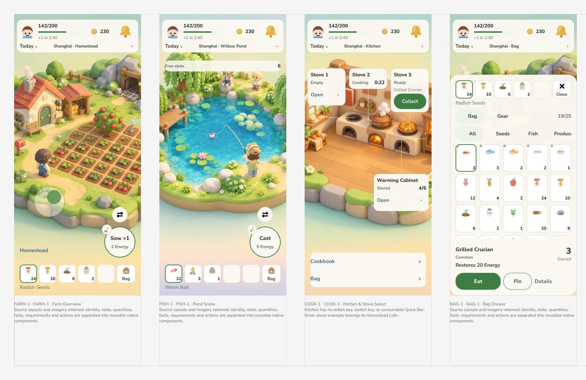
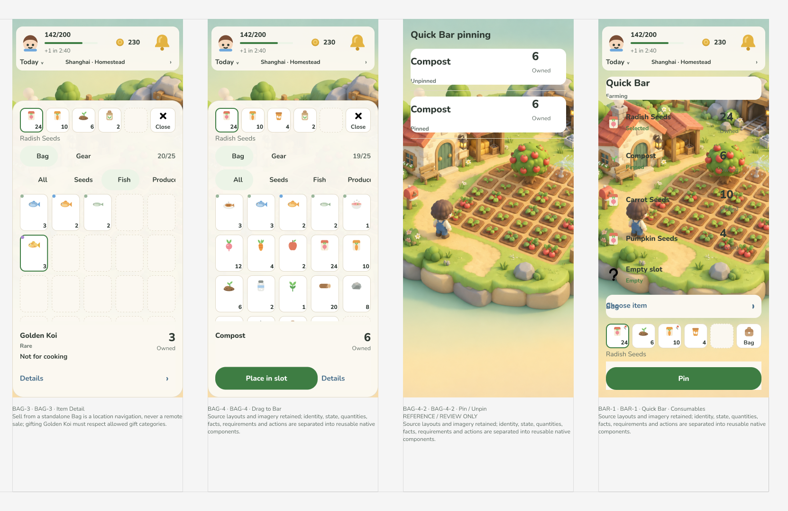
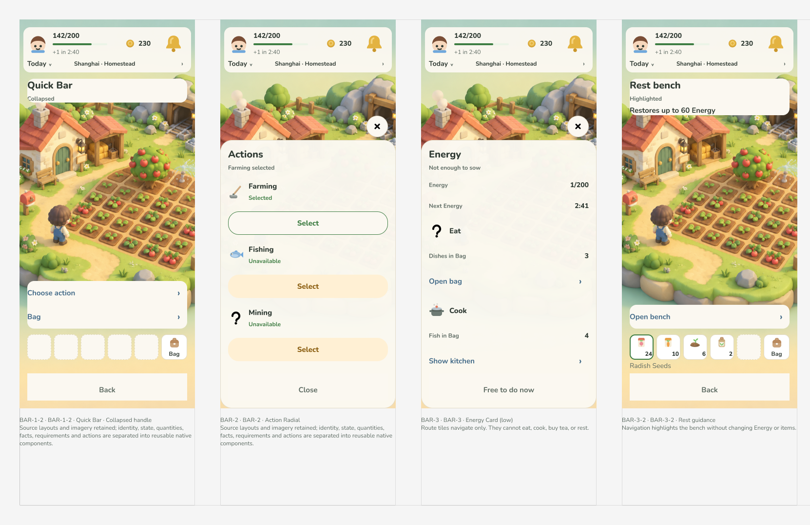
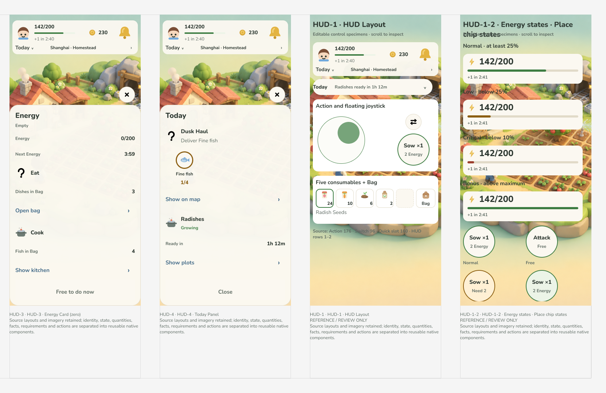
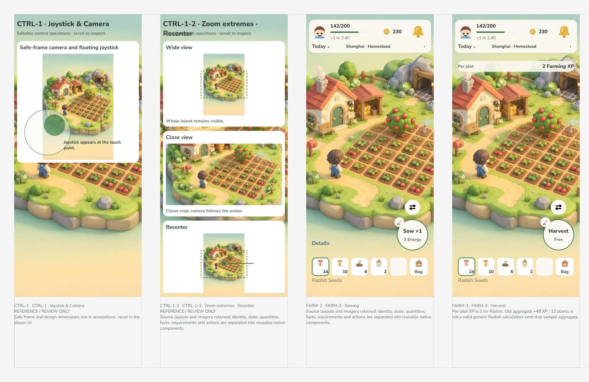
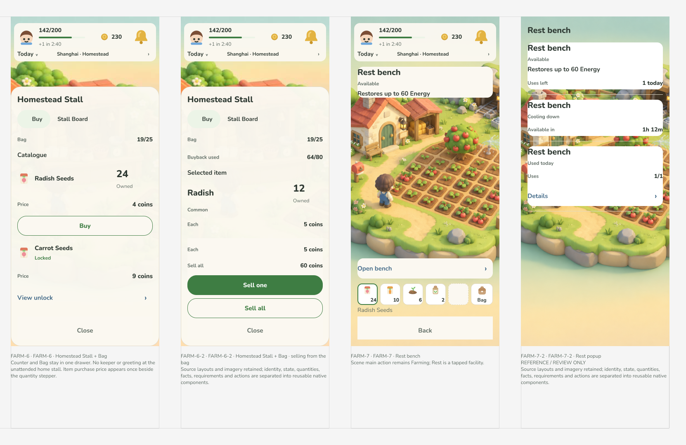

# 旧稿行1–3视觉QA

本轮实际检查24/84张旧稿。3张新云端行图、6张四卡精确裁切均已保存；6张裁切逐张打开。只读静态检查，未点击原型、未改源、未重复截取相同状态。

Today已真实出现，控件文字不再整体极小；但Energy Card、物品/快捷栏示意、柜台与背包同屏仍有阻断问题，不能将本批标为通过。BAR-2及最后Pin/安全底边/Harvest规则的已知待同步项单列。

| 卡片 | 状态 | 观察 |
|---|---|---|
| FARM-1 | known-pending | 圆形Sow、工具、摇杆与真实5格清楚；仍是旧y712快捷栏，底部约14px，待safe-bottom更新。 |
| FISH-1 | known-pending | Cast圆键/5 Energy、容量与5格清楚；仍是旧底边，待上移24px。 |
| COOK-1 | visual-pass | 独立灶台/保温柜场景卡保留；身份、状态、倒计时、领取与导航区分，未出现Cook/Free劳作键。 |
| BAG-1 | known-pending | 网格已露3行，标题/数量/效果分离；菜仍显示Pin、位置仍Shanghai · Bag，说明该帧未消费最后修订。 |
| BAG-3 | visual-pass | Golden Koi身份、Rare、数量3与Not for cooking分离；5列过滤网格与底部详情可读。未点击Details验证内层路线。 |
| BAG-4 | major | 原拖入快捷栏的分镜改成Place in slot提交按钮，没有拖拽物/目标槽的可见演示。 |
| BAG-4-2 | major | 参考板仅有Compost/Pinned/Unpinned文字，未显示Pin/Unpin控件和格的pin徽标对比。 |
| BAR-1 | critical | 5个物品语义行直接压在3D场景上；Bag与Choose item重叠；完整快捷栏又重复在底部；额外全宽Pin缺少清楚上下文。 |
| BAR-1-2 | critical | 标为Collapsed却绘出5空格和Bag，没有原收起把手；正文Bag入口与末格Bag重复并加Back。 |
| BAR-2 | known-pending | 仍为generic列表，Combat在初始折叠区外；已知等待action-picker专用径向补丁，不作为新发现重复修。 |
| BAR-3 | critical | 卡内1/200、顶HUD142/200矛盾；必需2 Energy未显示；四个恢复入口只有Eat/Cook在首屏，Tea/Rest被推下。 |
| BAR-3-2 | major | 引导场景没有保持原Sow不足圆键，变成Open bench与Back；HUD仍142而对应低体力示例应一致。 |
| HUD-3 | critical | 卡内0/200但顶HUD142/200；归零时四恢复出口未同屏，仅Eat/Cook可见。 |
| HUD-4 | major | Today原3条引导仅显示2条；单个材料格与独立Show按钮使每行过高，Fishing目标掉到首屏外。 |
| HUD-1 | visual-pass-with-note | 实际HUD/Today、圆键、切换、摇杆与5格已原生示意；共享HUD恢复Today后下方独立Today示例应加组件标签以免被误读为重复入口。 |
| HUD-1-2 | critical | 四个Energy变体均写142/200，而条分别低/红/满；Bonus也仍+1 in2:41。应显式覆写变体实例Energy/Recovery。长标题与说明重叠。 |
| CTRL-1 | needs-verification | 摇杆和场景示意可见；安全框在这张截图中不明显，需要核对该层是否被遮挡；未据此断言节点不存在。 |
| CTRL-1-2 | major | Wide/Close/Recenter构图差异已保留；长标题第二行Recenter与固定位置说明重叠，回中说明在当前视口底部外。 |
| FARM-2 | visual-pass | Sow圆键与2 Energy、独立Gear徽标、源5格与选中全名清楚，底边已经采用新位置。 |
| FARM-3 | known-pending | 圆键/5格正确，但仍显示Harvest Free，待主代理确认的最新计费口径同步。 |
| FARM-6 | critical | 首屏变成大号商品纵列，仅见2种商品，原柜台+背包同屏丢失；Bag网格完全在当前可见区之外。 |
| FARM-6-2 | critical | 柜台与背包网格均不在当前可见区；Each5coins在选中详情与固定动作区重复。 |
| FARM-7 | major | 长椅入口可识别，但原场景Sow圆键消失，额外Back区域占底部。 |
| FARM-7-2 | major | 三种Rest状态的数字可读，但Available缺Rest/Not now、Cooling/Used缺实际禁用按钮；参考状态只剩文字。 |

## 证据

哈希、nodeId和逐卡索引见[review-01-03.json](review-01-03.json)。横向/纵向滚动内容存在于设计数据中并不等于已验证能操作；本批只说明当前首屏可见性。
