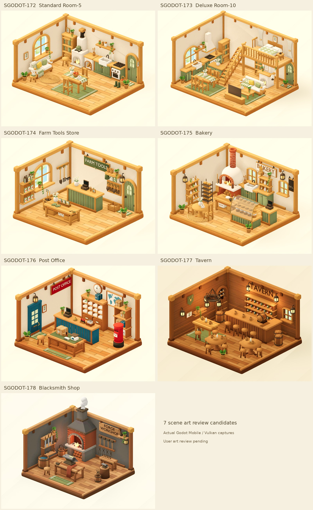

# 赵云 · 暖木室内系场景评审包（2026-10-07）

按 Plane 父卡 SGODOT-171 的顺序完成了赵云负责的七个场景评审版。每张卡在实际开工时改为 **In Progress**。当前 SGODOT-172 已完成第 2 轮样板返工并转 **Review**；173–178 仍是原审阅稿，待样板确认后按新 review 推进。用户在本轮明确要求依次制作、每完成一个用 Lark CLI 发消息，并留待早上 review，因此没有在第一张后中断。

最新入口：[172 样板 R2：三栏叠图、角色走位与逐项清单](../standard_room_5-review2-2026-10-07/README.md)。下图保留为首轮七场景总览。

| Plane | 完整参考、对照图和交付文档 | GLB / 摆放实例 | 场景三角面 |
|---|---|---:|---:|
| [SGODOT-172](https://plane.sensenjoy.cn/zili/browse/SGODOT-172) | [Standard Room-5](../standard_room_5-2026-10-07/README.md) | 41 本地 + 3 共享 / 49 | 126,952 |
| [SGODOT-173](https://plane.sensenjoy.cn/zili/browse/SGODOT-173) | [Deluxe Room-10](../deluxe_room_10-2026-10-07/README.md) | 50 / 55 | 120,302 |
| [SGODOT-174](https://plane.sensenjoy.cn/zili/browse/SGODOT-174) | [Farm Tools Store](../farm_tools_store-2026-10-07/README.md) | 36 / 41 | 85,144 |
| [SGODOT-175](https://plane.sensenjoy.cn/zili/browse/SGODOT-175) | [Bakery](../bakery-2026-10-07/README.md) | 41 / 42 | 121,144 |
| [SGODOT-176](https://plane.sensenjoy.cn/zili/browse/SGODOT-176) | [Post Office](../post_office-2026-10-07/README.md) | 35 / 49 | 78,004 |
| [SGODOT-177](https://plane.sensenjoy.cn/zili/browse/SGODOT-177) | [Tavern](../tavern-2026-10-07/README.md) | 32 / 95 | 84,743 |
| [SGODOT-178](https://plane.sensenjoy.cn/zili/browse/SGODOT-178) | [Blacksmith Shop](../blacksmith_shop-2026-10-07/README.md) | 33 / 34 | 75,186 |

每个目录包含原始 Figma 节点导出、Godot 整场景截图、设计/运行时对照图、从 Blender 模型渲染的三视图、预算与资产哈希。源文件位于 `tools/art/source/<slug>/<slug>.blend`，生成脚本位于 `tools/art/build_<slug>.py`；运行资产、摆放/碰撞清单位于 `assets/rooms/<slug>/`，美术场景位于 `scenes/<slug>/`。每场景均有独立的 2048² 共享 atlas 和导入设置。

## 检查与交付

七个场景均完成实际 Godot Mobile/Vulkan 渲染，运行环境为 Godot 4.7.2 / AMD Custom GPU 0405 (RADV VANGOGH)，截图为 1440×1080。所有模型的 UV、法线、无重复内嵌 atlas、清单一致性、材质绑定、有限非空包围盒及导出/导入三角面计数完成核对。Blender 使用 5.2.0 LTS。详见 [汇总验证](verification.json) 与各场景的 `verification-summary.json`。

每个场景通过用户指定的 Lark CLI 发出一条记录和三张图片，并回读消息、下载图片校验 SHA-256；Plane 对应卡片已附三张图和完成记录，附件也完成下载比对。私人聊天 ID 和原始消息回执只保存在忽略目录 `output/scene-production-2026-10-07/`。

Basic Room 已验收资产和源脚本保持不变。新模型保留命名部件与独立 pivot；椅子、凳子、酒瓶、灯具、信件等重复模块通过实例复用。铁匠铺的大小铁砧使用同一 GLB 的等比实例。

## 评审边界

这是美术评审候选，并不表示用户已接受还原效果。尺寸、背面和结构深度由单张透视图推断；植物、织物、装饰密度、材质磨损、间接光和部分小道具有简化，具体差异逐场景记录。请优先核对整体构图、比例、家具布局与风格，再审细节。

首轮范围是场景美术；第 1 轮 review 新增共享桌面角色移动、尺度和碰撞 harness，目前 172 样板已覆盖。未新增玩法/地图接入、Android 验收、发包或生产更新，也没有把桌面渲染结果当作手机性能结论。所有源码与小体量评审素材已分场景提交在 `wp-3d-scene`；[远端同名分支](https://github.com/IndieMiao/sensen-godot/tree/wp-3d-scene)用于其他 agent 评审，尚未合入主开发分支。远端同时包含[刘备的八个店面场景](../shop-series-2026-10-07/README.md)。

评审差异从基线 `2d18868` 开始：`git diff 2d18868..origin/wp-3d-scene`。先看本页总览与各场景对照图，再按各场景 README 重建或运行 Godot 检查；新环境按 [环境准备指南](../art-environment-setup.md)配置工具。
