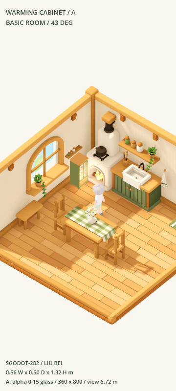
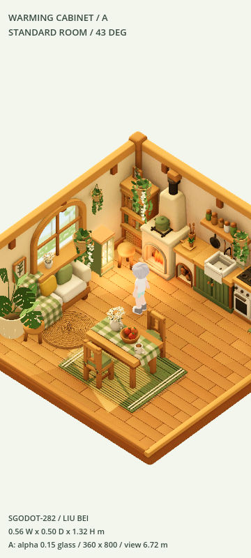
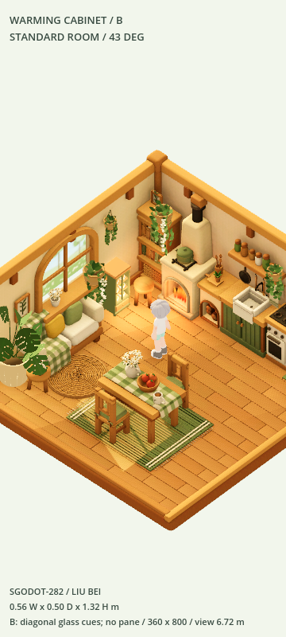

# SGODOT-282 · Warming Cabinet v1.1

刘备（`0fb1de1f-ead5-443b-9537-54cbac113260`）交付：将 Basic / Standard 的缩小 pantry 占位替换为可见三层六盘的独立保温柜。柜身、门框、脚为原厨房图集的鼠尾草绿；顶板和抽屉保留蜂蜜木；门只留一根竖档。造型参考设定页，颜色、门格、尺寸和落位采用上官婉儿 v1.1 及不知火舞 `10319435` 定稿。

**此 PR 仅进入 wp-3d-scene，待技术检查、画面验收和用户批准；不进 0.2.6。** 不改 anchors、占位件或 Deluxe Room。后续运行时整合由上官婉儿处理，落位及点击/碰撞锚点由程序接入。

| 实际导入 | A：半透明面 | B：无面，仅斜高光 |
|---|---:|---:|
| 宽 × 深 × 高 | 0.560 × 0.500 × 1.320 m | 相同 |
| 三角面 | 1492 | 1490 |
| 网格节点 / surfaces | 9 / 15 | 8 / 14 |
| 材质 | 3（含玻璃） | 2 |
| 玻璃 | alpha 0.15 | 无透明面 |

两案的柜体、菜盘和两道斜高光的几何、UV、材质逐项相同。每盘碗/菜合为一个独立节点 `dish_1 … dish_6`，顺序是上左、上右、中左、中右、下左、下右；无 12 格外观变体。另有 `top_center`、`door_center`、`glow` 三个空挂点。完整合同见 [manifest](../../../assets/props/warming_cabinet/manifest.json)。

按「可读性优先、规格优先于设定图」做出的选择：

- 采用鼠尾草绿柜身及单竖档；不复制设定页的通体木色和木纹。
- A/B 使用两个 GLB 便于对比；B 是不知火舞当前倾向，最终选案仍待审核。
- 原图集在新资产目录内保留一份**字节完全相同**的副本，A/B 共用；使目录可独立整合，因为 art 分支没有旧 placeholder 目录。原图集 SHA-256 为 `9802eca7bf7b4607d712fbb99c0d6ab3acf48ba2638a8734177160bbeb4f1360`。不重烘焙、不修改原图。颜色只取固定 UV 点，不采木纹。
- 使用规格允许的 256² 小图补充琥珀色及食物色；不加实时灯、不发光。房间截图保留程序现有的门前暖灯位置和 0.9 能量。六盘仍各自可隐藏，因此有独立网格及多个 surface；不能用房间的统一 `material_override` 覆盖这些材质。
- Standard 采用 v1.1 全文给出的 prop X=-2.916（派活简述背面参考为 -2.918）；Basic X=-2.850。均 Y=0.082、yaw=90、scale=1。

## 房间落位与交叠

使用真实 `basic_room_art.tscn` / `standard_room_5_art.tscn`，包括共享植物和 Basic 的 anchors 调味架。anchors 来源为 farm-dev `bd8a4802bd54d9ed45bfb02f4cac4a3e9f8933f0`，冻结到审阅 fixture 中。

| 检查 | Basic | Standard |
|---|---:|---:|
| 逐三角检测的房间部件/实例 | 24 | 50 |
| 障碍物穿插 | 0 | 0 |
| 12 条背面射线测得最小墙/踢脚线间距 | 50 mm | 4 mm |
| 拱窗沿墙方向 AABB 间距 | 250 mm | 50 mm |
| 书架小凳沿墙方向 AABB 间距 | 不在此房间 | 60 mm |
| 窗台绿萝沿墙方向 AABB 间距 | 1652 mm（原 window_plant） | 44.7 mm |
| 调味架与柜顶垂直间距 | 174.7 mm | 653 mm（原 wall_shelf） |

BVH 对实际 GLB 及变换做三角检测，包含墙、踢脚线、拱窗、绿萝、书架、小凳及调味架；再以将柜体后移 0.30 m 穿入真实墙体作正控，两间均能检出。上述 AABB 数字是对应轴的间隔，不是宣称所有表面的全局最短距离。

**地面接触单独记录：** Standard 木板顶 Y=0.0825，比规格的落位 Y=0.082 高 0.5 mm，脚底有 68 对支撑接触三角。保持指定落位，不把这处地面接触算成墙/家具穿插。Basic 无此接触命中。

## 审阅图

房间四图原始分辨率 **360×800**；采用当前 P0 默认 **43°、6.72 m 视宽**，保留各房间自己的偏航（Basic 约 40.31°，Standard 43°）。审阅 fixture 将相机平移到厨房，焦点 `(-1.1,1.25,-0.45)`；旁边是实际组装角色。两张 `*_detail` 是另附的 3.5 m 视宽近景，不替代四张默认尺度图。场景与暖灯参数真实复用；此为离线美术审阅场景，不是完整 P0 UI 走查。

| Basic A | Basic B | Standard A | Standard B |
|---|---|---|---|
|  |  |  |  |

正面、3/4、侧面两案各一张：`a_front.png` / `b_front.png`、`a_three_quarter.png` / `b_three_quarter.png`、`a_side.png` / `b_side.png`。单件细节关闭投射阴影，保留同样的材质；房间图保留真实阴影。所有 PNG 均署名 `LIU BEI`。

## 验证及复现

- **216 项** GLB 几何/UV/挂点/交叠检查通过，**137 项** Godot 实际导入/节点/材质/截图检查通过。
- 两次干净重建的 2 个 GLB、2 张 PNG、manifest 共 **5 个文件 SHA-256 完全一致**。
- 原图 UV 均落在已确认的源模型三角内，采样邻域无黑/空白；每个三角恒定 UV，无木纹；没有实时灯或发光材质。六盘排序、identity transform、导入 scale 1、A/B 共用几何均验证。
- Blender **5.2.2 LTS**、Godot **4.7.2**、**Vulkan Mobile / AMD Custom GPU 0405（RADV VANGOGH）**；贴图启用 mipmaps/VRAM 压缩。仅桌面渲染验证，不作为真机性能结论。

完整记录：[validation.json](validation.json)。源文件与命令：[source README](../../../tools/art/source/warming_cabinet_282/README.md)。运行时目录及接入约定：[asset README](../../../assets/props/warming_cabinet/README.md)。
