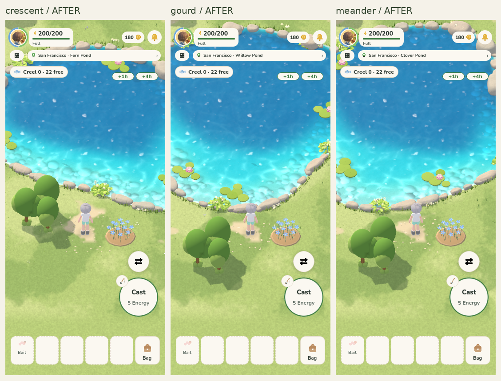

# SGODOT-422 · 野外地表参数样稿

刘备，2026-11-05。按上官婉儿提供、已经不知火舞审过的 `wild_concept_v1.jpg` / `c_wild.png` 制作。
交付到 `wp-3d-scene-liubei-wild-ground`，草稿 PR 目标 `wp-3d-scene`；待上官婉儿技术检查、不知火舞看图，合并由奕星处理。

地面现在分为普通草、深绿草团和日晒浅黄绿三层不规则大色块，入口有弯曲的沙土带，其他岸边有少量裸土与平面小石子。
本包交付贴图、可编辑生成器、参数样稿和真实游戏截图。正式 `modules/ponds/pond_ground.gdshader` / `pond_scenery.gd` 没有修改；程序按下述接口接入。



## 实渲与参考范围

- [Crescent 前后对比](crescent_comparison.png)、[Gourd 前后对比](gourd_comparison.png)、[Meander 前后对比](meander_comparison.png)。每列原生 360×800，没有缩放或重绘；标签在截图之外。旁边保留六张原始 PNG。
- [Gourd 整塘俯视](gourd_overhead.png)，另有 [Crescent](crescent_overhead.png) / [Meander](meander_overhead.png)。只为检查地面分布改变相机，不作为开场镜头。
- [槽位、站位、路面边界图](layout_constraints.png)是数据示意图；[细节贴图 3×3 平铺](detail_tile_3x3.png)检查细纹接缝。大色块和路径本身不平铺。

开场使用现有审阅流程的固定游戏快照 `67116c6df4f69062ce658c50581e72ab1779a1b4`，原生 43° 镜头、6.72m 宽、出生点 `(6.125,0,-1.625)`、P0 HUD 和完整角色；只读提取到 `output/wild-ground-422/project`，未切换或改写 b1。
资源上下文采用给定 mock：F2 放原亚麻，Gourd / Meander 的 F1、Crescent 的 C1 放原树林。前后两列使用同样的资源、既有装饰、灯光和固定水动画时刻；本次新增的只有地表材质。

**路径长度按可走区收口。** 原生入口可走边界在 `z=-0.75`，出生点在 `z=-1.625`；因此设定整屏图一直延伸到快捷栏的长路不能直接照搬。样稿在边界内渐隐，连接出生点与各自塘岸，不把画面下方不可走草地画成入口。详见边界图。没有改导航去迁就设定图。

本轮不制作装饰模型。新石子全部烘在地面，几何高度 0；无新花丛、香蒲、灌木或倒木。原场景仍有旧装饰，整合时由程序与赵云按 422 五条统一撒点、替换及避让。本次截图不表示旧蓝花和旧树的整套撒点已经通过 422 验收。

## 贴图与坐标接口

资源目录：[`assets/ponds/ground`](../../../assets/ponds/ground/)。四张 PNG 均为 1024×1024，均有 Godot 4.7.2 自动生成且互不重复的导入 UID。

| 文件 | 用法 | 色彩空间 / 寻址 |
|---|---|---|
| `meadow_color.png` | 原创柔和草叶笔触的颜色细节，普通草、深草、晒黄草共用 | sRGB；`source_color`；每 4.8m 平铺 |
| `crescent_layout.png` | Crescent 布局 | 线性数据；不平铺 |
| `gourd_layout.png` | Gourd 布局 | 线性数据；不平铺 |
| `meander_layout.png` | Meander 布局 | 线性数据；不平铺 |

布局图按 `entry.template_id` 选一张；不依赖装饰随机种子。只需加载当前塘形。像素与源数据哈希见 [`ground_manifest.json`](../../../assets/ponds/ground/ground_manifest.json)。

```glsl
vec2 layout_uv = (world.xz - vec2(-4.0, -20.0)) / vec2(20.0, 24.0);
```

PNG 左上对应世界 `x=-4,z=-20`，U 向 +X，V 向 +Z；不要翻转 V 或使用 PlaneMesh 的局部 UV。范围外回到普通草底色；遮罩边缘已有渐变。

| 通道 | 语义 |
|---|---|
| R | 深绿草权重 |
| G | 日晒浅黄绿权重 |
| B | 沙土小路 / 裸土覆盖度 |
| A | 贴地小石子覆盖度；**不是整张材质的透明度** |

普通草权重为 `max(0,1-R-G)`。不将布局图标记为 `source_color`，不把 A 写入材质 `ALPHA`。
导入保留 `compress/mode=0`（无损）、`mipmaps/generate=true`、`process/fix_alpha_border=false`、`process/premult_alpha=false`、`detect_3d/compress_to=0`。
自动 alpha-border 修补会把 alpha=0 区域里的 R/G/B 草色和路径数据当成透明边重写，必须关闭。38 项检查已验证导入后基础级 RGBA 与源 PNG 完全相等。

以 RGBA8 + 完整 mip 链保守估算，每张约 5.33 MiB；当前塘形的布局加共享细节图上限约 10.67 MiB。纹理压缩可由程序另测后调整，不能直接用有损压缩覆盖已验证的槽位留白。文件大小不代表显存。

## 程序接入参数

可直接查看隔离样稿 [`pond_ground.sample.gdshader`](../../../tools/art/source/wild_ground_422/pond_ground.sample.gdshader)。这是本地参数证明，不是正式运行时改动。

1. 材质把旧 `grass_detail=bank_grass.png` / `surface_flow=surface_flow.png` 绑定替换为 `meadow_color` / 当前塘形的 `ground_layout`。
2. 去掉原正弦草色混合和沿固定 `x=6.05` 的直路公式；用 R/G 权重混草色、B 混沙土、A 混石子。细节图采样亮度用于低对比草叶纹理，不带照片或烘焙阳光。
3. 保留单个地面 MeshInstance 和同一个材质 pass。样稿仍为两次纹理采样，不加几何、法线贴图、透明 pass 或投影。

| 参数 | 本稿值 |
|---|---|
| `layout_origin` / `layout_extent` | `(-4,-20)` / `(20,24)` |
| `detail_metres` / `detail_strength` | `4.8` / `0.55` |
| 普通草，线性 RGB | `(0.35,0.455,0.15)` |
| 深绿草，线性 RGB | `(0.235,0.35,0.105)` |
| 日晒草，线性 RGB | `(0.49,0.555,0.235)` |
| 沙土，线性 RGB | `(0.65,0.54,0.355)` |
| 石子，线性 RGB | `(0.72,0.67,0.53)` |
| `ROUGHNESS` / `SPECULAR` | `0.95` / `0.12` |

表中 RGB 是着色器线性值。若程序改成 Godot `Color` + `source_color` 的颜色参数，需转换后再填，不能把同一数值重复当 sRGB 转换。

约束已烘入图中：所有 36 个候选槽位都预留，不仅是本图实际启用的两个；路面避开每个槽位中心 ±0.90m 方形和站位半径 0.30m。散布裸土及新石子额外避让槽位 1.5m；石子之间至少约 0.48m，不堆叠。导航边沿 0.20–0.56m 淡出，岸边 0.43–0.78m 淡出。

原 `MeadowTurf` 和旧入口 36 颗几何石子目前仍在，前后对比均保留。程序整合赵云装饰时建议依据 B 通道剔除路中央高草、以 A 通道的新散石替换旧几何散石，避免双份。不要更改槽位或导航来绕过这些约束。塘形 / 导航 / 槽位发生改变时需重烘对应布局。

## 验证与复现

Steam Deck / AMD VANGOGH / Vulkan Mobile / Godot 4.7.2。三塘六张开场及三张俯视已逐张检查，完整角色可见；前后 SubViewport 的可见 3D 绘制均为 22（不代表整帧含阴影/UI的总量），镜头变换逐对一致。没有物理手机性能结论。

- [`map-validation.json`](map-validation.json)：38 项通过；读取真实导入纹理，逐个检查所有沙土/石子像素对原生 `SystemPonds.blueprint()` 导航、槽位占地、采集站位和石子 1.5m 避让。
- [`godot-validation.json`](godot-validation.json)：原始截图尺寸、相机、出生点、渲染器和各图可见 draw 记录；没有游戏命令提交。
- [Android 烟测记录](android-validation.json)及[Android 输入截图条](android_smoke.png)：这里的设备是 API 37 x86_64 **模拟器**、SwiftShader Vulkan Mobile。真实双指 61 个 MotionEvent 将 zoom 1.0 调至 1.4；拖动 34 个 MotionEvent 后角色移动 0.44m、松手后停住；实际点击打开原生背包。完整 APK 回读与四张打包纹理相等。仅测试包 `com.sensen.wildground422qa`，不交付 APK、不替换玩家应用；runner 已停包、临时触摸 dex 已删、显示设置已还原。

完整制作脚本及参考快照位于 [`tools/art/source/wild_ground_422`](../../../tools/art/source/wild_ground_422/README.md)。
