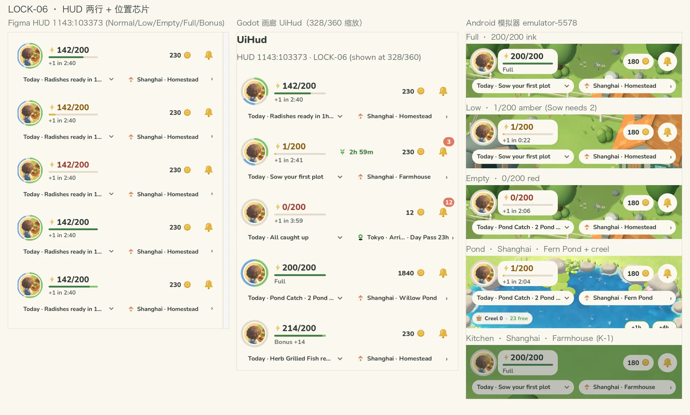
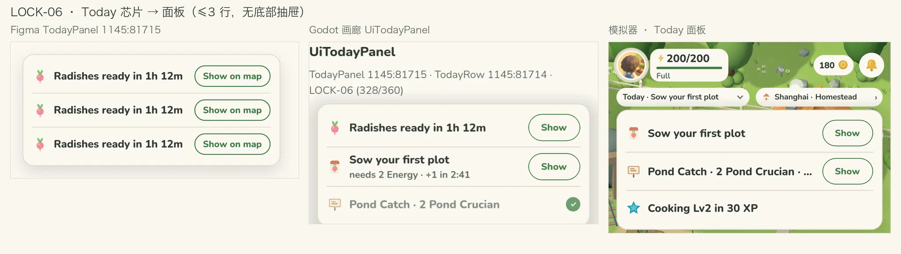
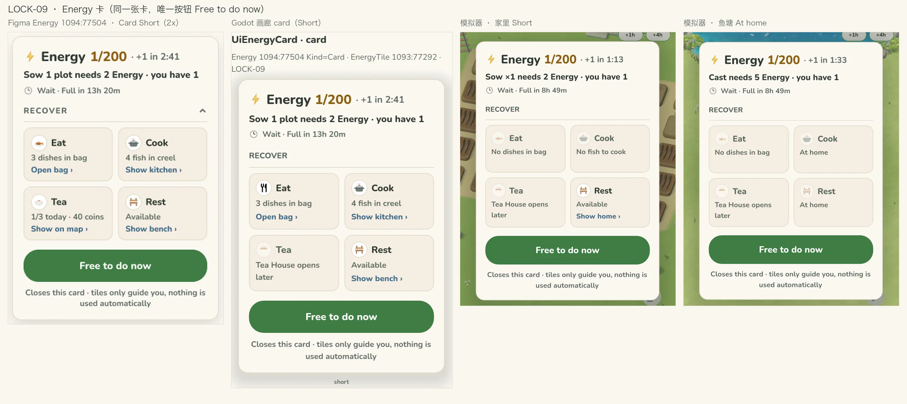
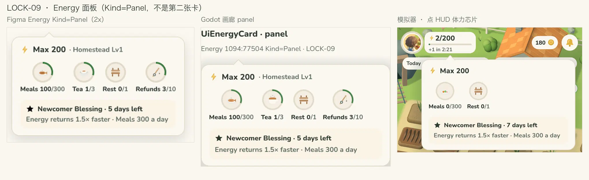
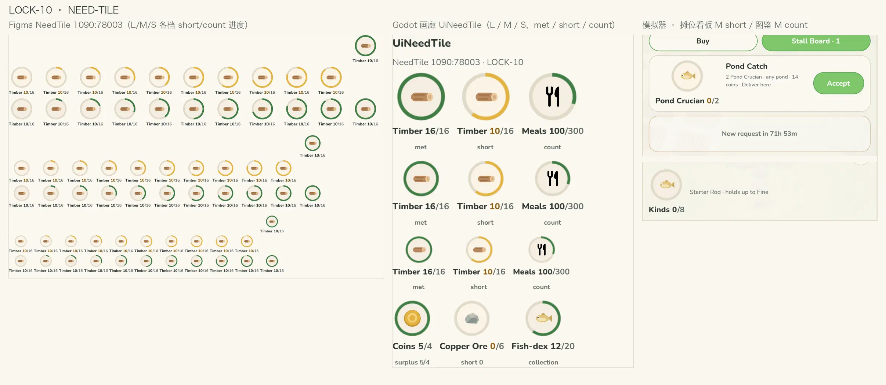
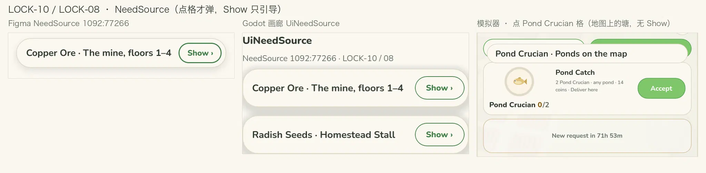
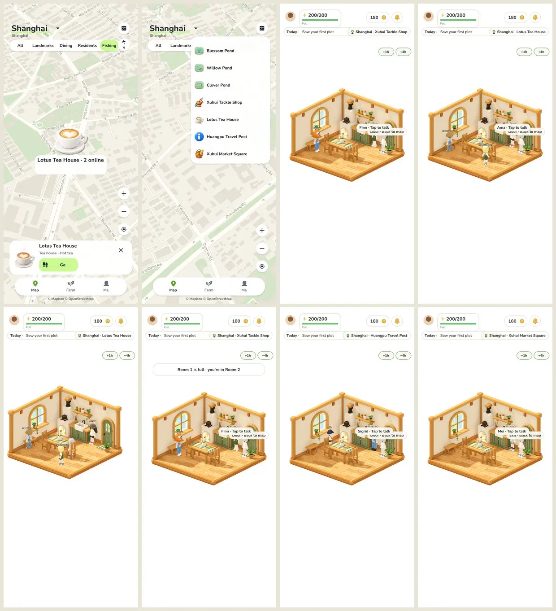
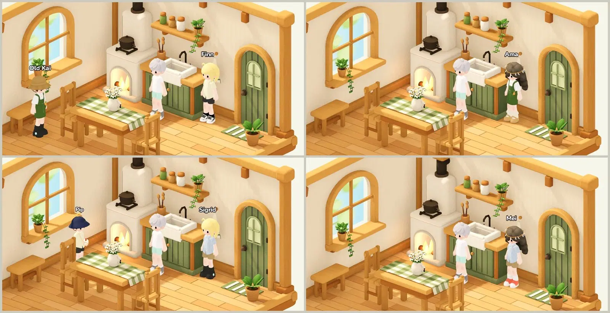
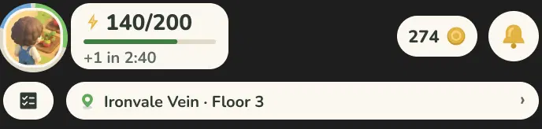

# SGODOT-197 · 【设计规范】拍板组件清单 Locked Components：已确定的界面不得随重构改动（33 项）

> 这是历史卡片及按时间排序的评论。日期、编号、已撤回或作废的内容保留原状；不能把评论附近的附件推断为用户确认。仓库内看图为压缩副本；原件指纹及未入库项见[附件索引](attachments.md)。现行有效的锁定清单见 [locked-components.md](../locked-components.md)，以那份为准；本文件只作历史原文。

- 来源：Plane 项目 SGODOT（project_id `47d11337-c390-4b42-8b05-ef60fa2633f7`），work item `bfb3e3c5-f29f-4119-a987-7ff052c60bd4`，原址 https://plane.sensenjoy.cn/zili/browse/SGODOT-197/
- 状态：In Progress；创建 2026-10-07 14:23:27；最后更新 2026-11-26 00:05:24（评论 #163 带动；描述正文最后修改 2026-11-11 19:36:53）（时间均为北京时间 UTC+8）
- 导出：2026-11-20 17:12（北京时间），只读导出，Plane 上未做任何改动。2026-11-27 按奕星的只读导出（SEN-C-191 附件 attachment-1675，SHA-256 `8f7ef60f3e77f7913f9f1319af99b0985371c61066267cb1a42eb5f4ce1b7a34`）补录冻结后新增的评论 #161–#163；描述、原有 160 条评论和 26 个附件与线上一致，未改
- 评论 163 条（全部，按时间正序，未摘要）；附件 26 个；已下载 26 个到 `files/`（SHA256 见 [附件索引](attachments.md)）
- 作者说明：评论作者取 Plane 的 actor。所有评论都经用户账号的 API key 写入（created_by 恒为用户）；员工用 virtual_user_id 署名的显示员工名。actor 为用户本人账号的标为「用户（邵杰）」；其中正文开头带员工署名的，多为虚拟身份上线前员工代发，已加注。

## 描述

> 维护人：不知火舞（高级产品经理 / 高级 UI 设计师）· 建立于 2026-10-07 · 状态：生效中。本卡是"已拍板界面规则"的唯一清单。出处以玩法方案 v2（`docs/product/gameplay-plan-v2-2026-10-02.md`）§1.5 改动清单 o(1)–p(9) 及相关章节为准。

## 为什么要有这张卡

已经拍板的界面，在后续的重构、统一、清理里反复被改掉。典型例子是 Energy 卡：10-04 拍板时它只有一个醒目的 `Free to do now` 按钮；本轮重构按"关闭用安静文字"的通用规则，把它改成了灰字，又加了 × 和 Back，详见 SGODOT-187 与 SGODOT-193 A-01。本卡把这类已拍板内容逐条锁定，今后任何设计、脚本、开发和审阅都以本卡为准。

## 规则（2026-10-07 用户采纳）

1. **元规则**：已拍板的专用组件优先于通用重构规则。两者冲突时，拍板组件的**结构、语义角色、主次关系、视觉权重、入口方式和关键文案**保持不变；通用规则只能统一它的 token，即颜色值、字号、圆角、间距、阴影、触区和文案格式。
2. **锁定 / 可调**：每项"锁定"列出的内容不得在重构、统一、清理或批量脚本中修改；"可调"的部分只能通过 tokens 统一，不能借此改变结构。
3. **复议才能改**：要改锁定内容，只能在本卡评论里发起复议，写明 `复议 LOCK-xx`、想改什么、为什么、影响哪些卡、替代方案截图。用户明确批准后才能改，批准后更新本条目（写新日期，旧版本标 Superseded 保留），并回写方案 v2 §1.5。**未经批准的偏离一律按 P0 回退处理，审阅时直接打回。**
4. **新拍板当天入表**：用户在任何渠道（对话、飞书、Figma 评论）拍板的界面规则，当天追加为新条目，编号递增，写清出处与日期。
5. **先查再改**：任何人（包括 AI 代理和设计生成脚本）改 UI 前先读本卡；发现与本卡冲突，先停下来问，不自行"统一"。
6. **交付前做拍板回归**：每轮设计交付前，逐项对照本卡截图检查，结果贴在本卡评论；有偏离不得标为完成。

## 总览（33 项）

| 编号 | 名称 | 拍板 | 页面 14 现状 |
| --- | --- | --- | --- |
| LOCK-01 | 浮动摇杆与安全框相机 | 10-03 n(1)；10-07 模态编辑例外 | 偏离 · P0（D-02） → WP1a 已改，待验收（2026-10-07） |
| LOCK-02 | 主行动键 | 10-03 n(2)；10-07 模态编辑例外；10-04 o(8) | 偏离 · P0（C2-04） → WP1a 已改，待验收（2026-10-07） |
| LOCK-03 | 切换键与行动径向 | 10-03 n(2) | 部分偏离（A-07、B2-10） → WP1a 已改，待验收（2026-10-07） |
| LOCK-04 | 快捷栏 Quick Bar | 10-03 k(4)、n(3) | 基本符合（A-08、B2-03）→ WP4 已改，用户已确认 2026-10-08（A-08 空栏：QuickSlot ghost 态） |
| LOCK-05 | 钉住态 Pin | 10-04 §10.3.1 | 部分偏离（A-08） → WP1a 已改，待验收（2026-10-07） |
| LOCK-06 | 顶栏 HUD 与位置芯片 | 10-03 n(5)；10-05 p(7)；10-07 WP1a 验收、K-1、帮工 / 日票增补；10-09 q(107) Today 图标 + 红点、芯片写全称 | 部分偏离（A-06、E-06、C1-05） → WP1a 已改，待验收（2026-10-07）；Today 图标待实现（271，0.1.2） |
| LOCK-07 | 设施点击触发 | 10-04 o(8) | 偏离 · P0（A-02） → WP1a 已改，待验收（2026-10-07） |
| LOCK-08 | 不做自动跳转 | k(1) | 偏离 · P0（B2-06） → WP1a 已改，待验收（2026-10-07） |
| LOCK-09 | Energy 卡 | 10-04 o(9)；10-07 q(6) | 偏离 · P0（A-01）→ 样板已改（BAR-3 / HUD-3 / ENERGY-P0-1 / HUD-2），WP1a 铺开中 |
| LOCK-10 | 材料进度格 NEED-TILE，缺口写在按钮上 | 10-04 p(5)；10-07 q(7)、q(8) | 偏离 · P0（A-05、B2-05、D-03）→ 样板已改（CRAFT-1 / HOME-1 / HUD-2），WP1a 铺开中 |
| LOCK-11 | 状态徽标 STATE-ICONS | 10-04 §16.1.3 | 偏离（D-09） → WP1a 已改，待验收（2026-10-07） |
| LOCK-12 | 背包抽屉 | 10-03 k(3)、n(7) | 基本符合（A-08、B2-14） |
| LOCK-13 | `Bag \| Gear` 合一 | 10-05 p(8) | 部分偏离（A-08、B2-13） |
| LOCK-14 | 包裹与收件箱 | 10-05 p(9) | 偏离 · P0（C2-01）→ WP4 已改，用户已确认 2026-10-08 |
| LOCK-15 | 柜台 + 背包同屏 | 10-04 o(7)、p(2) | 结构符合，状态偏离 · P0（C1-01） |
| LOCK-16 | 据点掌柜先问候，柜台顶部掌柜栏 | 10-04 p(3)、p(4) | 偏离 · P0（C1-02、C1-03） |
| LOCK-17 | 农场驿站无人值守 | 10-05 p(6) | 符合 |
| LOCK-18 | 居民对话条 | 10-04 p(4) | 偏离 · P0（C2-03） |
| LOCK-19 | 据点空间：每岗位一处，集市广场唯一室外 | 10-04 p(1) | 部分偏离（C1-06、C1-08） |
| LOCK-20 | 烹饪面板第五版 | 10-04 o(10)；n(6) | 部分偏离 · P0（B1-02、B1-08） |
| LOCK-21 | 矿洞按层计费与按键文案 | 10-03 o(5) | 偏离 · P0（B2-02、B2-04）→ B2-04 WP4 已改（EntryCard），用户已确认 2026-10-08 |
| LOCK-22 | 个人页 Profile | 10-05 p(7)；10-07 密友 / Blocked 增补 | 偏离 · P0（A-04、C2-05） |
| LOCK-23 | App 内用户可见文案一律英文 | 方案 v2 文案约定 | 符合 |
| LOCK-24 | P0 复用旧版美术与手感 | 10-05 | 符合（室内场景见 F-03） |
| LOCK-25 | Legacy 页（原 Approved / App UI）不作参考 | 10-07 | — |
| LOCK-26 | 竖屏优先，多尺寸适配后置 | 10-07 | — |
| LOCK-27 | 元规则：拍板组件优先于通用重构规则 | 10-07 | — |
| LOCK-28 | 设计以 Figma 为准，插件脚本冻结 | 10-07 | — |
| LOCK-29 | 铜镐效果文案与挖矿键 | 10-07 q(1) | 偏离（B2-11） |
| LOCK-30 | 派对房入口撤销，P2 恢复好友组队语音 | 10-07 q(2) | 偏离（E-15） |
| LOCK-31 | 回应动作 `Say thanks` | 10-07 q(3) | 缺稿（C2-01）→ WP4 已改，用户已确认 2026-10-08 |
| LOCK-32 | 界面编号以方案 §16.3 为准 | 10-07 q(5) | 偏离（E-16、G-07） |
| LOCK-33 | 可进入的 POI 不承载据点功能 | 10-07 SGODOT-220；11-03 q(279) | Review row 129（q(279) 帧 P1 / P2 / P4-B；11-03 增补，随 q(279) 提前到 b1 之后的下一版） |

"页面 14 现状"列中的条目编号来自 SGODOT-187 的审阅子卡，修复进度以子卡为准。

## 条目详情

### A · 操作与 HUD

#### LOCK-01 浮动摇杆与安全框相机

- 出处：§1.5 n(1)（2026-10-03，用户逐条确认定稿）；§10.1；2026-10-07 模态编辑模式例外（SGODOT-210 第 10 项）
- 锁定：位移靠场景区任意处按下即出现的浮动摇杆，抬手消失，静态稿不画常驻摇杆；相机按安全框跟随，角色碰到框边才平移、停下后回中；保留双指缩放与双击回中；初始取景框住"角色 + 当前空间的可互动物"。因为摇杆是"场景区任意处按下即出现"，召唤区内不放常驻按钮或链接。

  **例外 · 模态编辑模式（v1.9，2026-10-07 用户批准，SGODOT-210 第 10 项）**：放置模式、标记模式和 P1 的布置模式期间，按下场景区**不召唤摇杆**，田格可以点按或拖动来选位、打标；这些操作只改预览或标记，**不劳作、不扣体力**；退出模式即恢复正常。

  **v2 · 模态编辑模式改为正俯视（用户已确认 2026-10-10，SGODOT-284 评论 94eecb69、058639c7、14e11a67；规格见 284 评论 6a751a9a，洒水器 / 温室见 241 评论 cb35c701）**：布置模式和设施放置模式（洒水器、温室）统一：进入时镜头用 0.35 s 转到**正俯视**（偏航 0°，格子横平竖直），退出时用 0.35 s 转回 43° / 14.5° 并回到跟随角色；模式中双指可缩放、可平移，**镜头不能旋转**（摆件自身仍可 Rotate）；格子画在地面上，只在摆件周围渐隐显示，脚下能放填绿、不能放填红；模式中**隐藏自己的角色**（进入时淡出，退出时在原位淡入；原位被占时，在步行距离最近的空格淡入），别的玩家照常显示；安全框跟随在模式中暂停，退出后恢复。上面「例外 · 模态编辑模式」的其余内容不变。
- 可调：摇杆尺寸与透明度、安全框比例、回中时长。
- 页面 14：摇杆召唤区常驻文字链接与按钮（D-02，P0；A-02）；多张卡常驻画摇杆（B2-10）。

#### LOCK-02 主行动键

- 出处：§1.5 n(2)（2026-10-03）、o(8)（2026-10-04 修订）；§10.2；帮工见 §12.3.1；2026-10-07 模态编辑模式例外（SGODOT-210 第 10 项）
- 锁定：只做四种行动 Farming / Fishing / Mining / Combat；键面写"动词 + 体力价"，如 `Sow ×1 · 2 Energy`、`Cast · 5 Energy`、`Mine · 2 Energy`、`Attack`，0 体力的动作不写价；左上角徽标显示当前工具；体力不足时键面变琥珀写 `Need N Energy`，按下弹 Energy 卡；**不显示任何设施动词**；田格、水面、岩石不响应点击。所有劳作（包括在他人农场帮工）都走主行动键，不用面板里的按钮代替。

  **例外 · 模态编辑模式（v1.9，2026-10-07 用户批准，SGODOT-210 第 10 项）**：放置模式、标记模式和 P1 的布置模式期间，按下场景区**不召唤摇杆**，**田格可以点按或拖动来选位、打标**（这是"田格不响应点击"的唯一例外）；这些操作只改预览或标记，**不劳作、不扣体力**；退出模式即恢复正常。
- **澄清（2026-10-08，不改条文、不升版本）**：进矿、上下楼、乘电梯属于 Mining 行动本身（LOCK-21），键面写 `Enter mine · 2 Energy` / `Floor 2 · 2 Energy` / `Elevator · Free`，不算"设施动词"；设施（灶台、柜台、长椅、工作台、信箱等）仍靠点击触发，主行动键不出它们的动词。

  可调：尺寸（以规格单一真源为准，见 F-02）、颜色值、字号。
- 页面 14：帮工补播改成抽屉内按钮（C2-04，P0）；88 / 64 两种尺寸、有无工具徽标两套（B1-06、B2-10）；`Attack / Free`（B2-03）。

#### LOCK-03 切换键与行动径向

- 出处：§1.5 n(2)（2026-10-03）；§10.2
- 锁定：切换键在主行动键正上方，点开扇出 Farming / Fishing / Mining / Combat 径向菜单；进场景自动预选；做不了的行动置灰并写原因，如 `Fishing · No water nearby`。
  **v2 只留图标（用户已确认 2026-10-08，SGODOT-247）**：菜单以屏幕中心为圆心，四瓣按 Farming → Fishing → Mining → Combat 顺时针排在圆环上（左上、右上、右下、左下），不再围着角色、不画到角色的连线；瓣上不写行动名，也不常驻写原因；当前行动 = 实心主色瓣 + 白色图标；做不了的行动置灰 + 锁角标，点了才在圆环中心出 1.5 s 原因气泡（如 `No water nearby`，尾巴指向该瓣）；打开时四瓣依次从屏幕中心弹出（每瓣 180 ms、间隔 40 ms）。稿：页面 14 row 50；主件 RadialPetal 1122:79385。
  Superseded（保留备查）：围着角色扇出、瓣旁写行动名并在置灰时写原因、选中瓣连线到角色。
- 可调：尺寸、动效时长、颜色值。
- 页面 14：置灰原因丢失、标签无底（A-07）；MINE-3 用胶囊代替切换键（B2-10）。

#### LOCK-04 快捷栏 Quick Bar

- 出处：§1.5 k(4)、n(3)（2026-10-03）；§10.3
- 锁定：底部固定 5 格 + 右端 `Bag`（背包抽屉打开时为 `Close`）；只放当前行动的可消耗品（Farming 种子 / 肥料、Fishing 鱼饵 / 亮片 / 鱼笼、Mining 火把 / 炸药、Combat 治疗药水），工具不占格；格内只有图标 + 名字 + 数量，不写体力价，无场景芯片；未选行动时收起成把手；厨房、柜台等纯设施空间没有快捷栏；物品通过快捷栏选中后由主行动键使用（k(4)：选中物决定主行动键的动词与消耗）。**v1.11（用户 2026-10-08；用户已确认 2026-10-08）**：长按 450 ms 浮起后，快捷栏上方、主行动键左边并排出现两个放置区 BarDropZone——左 Pin / Unpin（琥珀），右 Remove（垃圾桶图标，× 会被读成"取消"）；圆心约 (72, 612) 与 (168, 612)，命中半径各 44。拖进 Remove 区松手才移除，物品仍在背包，给 Toast + Undo；"拖到栏上方 40 px 松手即移除"作废。（v1.10 版：只有一个 Remove 区、图标为 ×，已被取代。）
- 可调：格子尺寸、字号、圆角、颜色值。
- 页面 14：40 处已统一；偏离见 A-08（空栏误导、工具徽标触区压住主行动键）、B2-03（喝药按钮游离在快捷栏外）。
  **WP4（用户已确认 2026-10-08）**：A-08 的空栏误导已解决——空栏第 1 格显示 ghost 态（虚图标 35 % + 一个词 Seeds / Bait / Torch / Potion，点开背包对应 Tab）；拖拽与移除见 v1.11。
  **幽灵格判据（用户已确认 2026-10-08）**："空栏"指本行动在栏里没有数量 > 0 的物品；此时幽灵格出在第一个空格（第 1 格被钉住格占着就顺延）。只剩钉住的 ×0 格时出；栏里有其他能用的物品（如只有堆肥、没有种子）时不出；5 格全是钉住 ×0、没有空格时不出，由钉住格的补货提示说明。来源：int5b 补测（亚瑟，归 #12），推荐见 SGODOT-221。

#### LOCK-05 钉住态 Pin

- 出处：§10.3.1（2026-10-04 用户要求钉住状态更明显）；§10.3
- 锁定（2026-10-08 v1.11 版，**用户 2026-10-08；用户已确认 2026-10-08**）：每个行动各记各的钉住；视觉为格顶中央实心琥珀图钉徽标 + 格顶琥珀色条 + 暖底色，可与选中态叠加（选中绿描边在外，琥珀顶条在内）。**钉住 / 取消钉住改为拖进放置区**：长按 450 ms 只负责浮起，同时在快捷栏上方、主行动键左边并排出现两个放置区（左 Pin / Unpin，右 Remove）；拖进 Pin 区松手 = 钉住（已钉住时该区写 Unpin，松手 = 取消钉住），钉子角标弹一下 + 轻震，不出 PinMenu、不出 Toast。松在另一格 = 只互换位置，钉子跟着物品走；松在本格或别处 = 取消。长按本身不再切换钉住，PinMenu 弃用。规格见 SGODOT-221、页面 14 row 48、主件 BarDropZone。
- Superseded（2026-10-08 v1.10 版，保留备查）：长按浮起后按松手位置区分，本格松手 = 切换钉住并出 PinMenu；互换时两格都钉住。
- Superseded（2026-10-07 v1.9 版，保留备查）：同上，但浮起后移动超过 12 px 即算拖拽且不再钉住，拖拽结束不出钉住反馈。
- 可调：徽标尺寸、色值（取 tokens）。
- 页面 14：钉住三套样式并存（A-08）。

#### LOCK-06 顶栏 HUD 与位置芯片

- 出处：§1.5 n(5)（2026-10-03）、p(7)（2026-10-05）；§10.6；2026-10-07 用户验收 WP1a 时拍板（体力条配色、外城位置芯片，见 SGODOT-200）；K-1（2026-10-07 用户拍板，奕星转达：农舍室内位置芯片）；2026-10-07 帮工与日票增补（SGODOT-210 第 12 项）；2026-10-09 用户决定 Today 芯片改为图标 + 红点、位置芯片写城市全称（SGODOT-271，§1.5 q(107)）
- 锁定（2026-10-09 v1.10 版）：两行结构。第 1 行：头像（进个人页）+ 体力卡（数值、色条、`+1 in m:ss`）+ 金币胶囊 + 铃铛（收件箱）；第 2 行：**Today 图标**（`list-checks`，32×24 胶囊、不写字，点开原 Today 面板）+ 位置芯片「City · Space」，点位置芯片进地图；没有独立的 Map / Passport 按钮。**Today 红点**：图标右上角 8 px 未读点（`COLOR_UNREAD_BADGE`，外挑 2 px），不写数字；面板出现可交付、可收获、出锅、新解锁且还没看过的行时亮，打开一次面板即灭（规则见 q(107)，规格见 SGODOT-271 评论 76ebeaad）。**位置芯片写城市全称**（如 `San Francisco · Homestead`），Today 改图标后芯片约 300 宽，最长的 `San Francisco · Union Square Travel Post` 也放得下。**体力条配色不按百分比变**：平时绿色（含满条 `Full` 与超上限 `bonus`，超出段用浅绿区分）；不够做下一下时琥珀；0 时红色。**位置芯片写玩家实际所在地**，浏览地图时不改写；外城到达后、尚未进入空间时写 `Tokyo · Arrived`，带日票时为 `Tokyo · Arrived · Day Pass 23h`。**农舍室内写** `San Francisco · Farmhouse`**，不写** `Kitchen`：厨房是农舍室内 Basic Room 的灶台角，不是单独一间（K-1；家城按 q(106) 已由上海改为旧金山）。**第三段**：帮工与客票同时成立时，位置芯片第三段写 `Helping`（如 `Hangzhou · Mia's Farm · Helping`，不再写日票剩余时间）；**日票到期后去掉第三段**，到期提示走 WP4-D8 的横幅，不留在芯片上。Figma 主件 `Gensen Refactor/HUD`（Energy=Normal / Low / Empty / Full / Bonus）。**过渡**：0.1.1 尚无 Today 图标，芯片暂写 `SF · …`、Today 芯片宽 156；0.1.2 随 271 上线后改回全称。
- Superseded（2026-10-07 v1.9 版，保留备查）：同上，但第 2 行是 Today 芯片（显示当前最重要的一条），没有红点；位置芯片未规定写城市全称，样例为 `Shanghai · Farmhouse`。用户 2026-10-09 实测：玩家基本不看芯片上的文字，有红点才会点开（SGODOT-271）。
- Superseded（2026-10-07 v1.8 版，保留备查）：同上，但没有规定帮工与客票同时成立时、以及日票到期后的第三段。
- Superseded（2026-10-07 v1.6 版，保留备查）：同上，但没有规定农舍室内的芯片写法（页面 14 的厨房卡写 `Shanghai · Kitchen`）。
- Superseded（2026-10-03 / 10-05 版，保留备查）：同上，但未规定体力条配色和外城未入空间时的芯片写法。
- 可调：尺寸、色值、字号。
- 页面 14：Today 芯片多数只写 `Today`（A-06）；位置芯片写法不一，在他人农场仍显示自家（E-06、C1-05）；厨房卡芯片仍写 `Kitchen`，由安其拉在 LOCK-20 中改为 `Farmhouse`。；Today 图标与城市全称（271）待安其拉改 HUD 主件，页面 14 地名换旧金山见 SGODOT-270。
- **增补 · 野外地点的位置芯片（用户已确认 2026-11-02「全按推荐」（355 第一批 v4q 整批，奕星 -51 转），v4q(3)；复议 125a71e4；帧 C2 326:182063、E2 323:181423）**：人在野外地点时，芯片第一段写地点全名、不写城市：`Ironvale Vein · Day Pass 23h`；进了矿写 `Ironvale Vein · Floor 3`；图标用外地的 showmap（绿）。野外不盖章、不出城市首访卡；过场胶囊写地点全名和公里数（q(147)）。层号（Layer）照旧不进芯片（q(34) / q(274)）。城里的芯片写法不变。

#### LOCK-07 设施点击触发

- 出处：§1.5 o(8)（2026-10-04 用户 Figma 定稿）；§10.2.2
- 锁定：灶台、长椅、柜台、居民、工作台等设施一律点击触发；靠近时设施上方浮出指尖卡（`Tap to cook`、`Rest · +60 Energy · once a day`、`<Name> · Tap to talk`）；厨房、柜台等纯设施空间隐藏主行动键与切换键；设施状态用挂在物件上的状态徽标表达（§16.1.3，见 LOCK-11）。
  **v2 提示图标化（用户已确认 2026-10-08，SGODOT-250）**：指尖卡不写 `Tap to …`、不画手指。平时（视野内、约 8 m 内）设施只显示图标钮，有状态时显示状态徽标（LOCK-11）；最近且在交互半径内的那一个沿角色朝向展开成名字条：设施图标 + 名字（最多再带一条关键事实，如长椅 `+60 Energy`、灶台 `Stove 1/1 · Empty`）；同一时间只展开一个。可交互 NPC 只写名字。点图标钮、名字条或物件本体都触发。
  Superseded（保留备查）：`Tap to cook`、`Rest · +60 Energy · once a day`、`<Name> · Tap to talk` 等"名字 · 动作"指尖卡。 **v1 主件退役（2026-10-09）**：v1 指尖卡 TapCard 已由 v2 取代（用户已确认 2026-10-08），代码中的 UiTapCard / P0Ui.tag 由 SGODOT-235 删除；Figma 里 24 张现行帧仍画着 v1 指尖卡，世界提示以 row 51 WORLD-HINT 为准。
- 可调：指尖卡样式、尺寸、色值。
- 页面 14：农场世界状态徽标被浮动导航行替代（A-02，P0）；厨房灶台做成带引线的大卡，场景内出现 `Open ›` / `Collect`（B1-08）。

#### LOCK-08 不做自动跳转

- 出处：§1.5 k(1)；§9.5
- 锁定：删除全部自动跳转；`Show on map` 只移动相机，不移动玩家、不自动打开面板、不自动起飞；引导只靠世界内的光色标记、NPC 头顶 `!` / `?` 和 Today 三行；物品来源点开才显示，不做"去那里"的跳转链接。
- 可调：标记样式。
- 页面 14：`Find Copper Ore ›` 直接跳到矿口（B2-06，P0），`Mine entrance ›`（B2-13）等跳转式链接。

### B · 信息呈现

#### LOCK-09 Energy 卡

- 出处：§1.5 o(9)（2026-10-04 用户审图）；§1.5 q(6)（2026-10-07 用户审 WP1a 样板）；§3.7.2 / 3.7.3
- 锁定（2026-10-07 版）：体力不足与归零用同一张卡；只写系统确知的事实，如 `Sow 1 plot needs 2 Energy · you have 1`、`Wait · Full in 13h 20m`；RECOVER 四个瓦片只引导（`Open bag` / `Show kitchen` / `Show on map` / `Show bench`），从不替玩家执行，当前不可用的瓦片灰显写原因；**在矿洞等离家场景，Cook 与 Rest 两块灰显写** `At home`（q(6)）；**唯一按钮是醒目的主按钮** `Free to do now`（作用是关闭卡片），不加 × / Back / Details；全游戏只有这一套体力界面——点 HUD 体力卡打开的是同一主件的体力面板（Kind=Panel），不是第二张卡。Figma 主件 `Gensen Refactor/Energy`（Card · Short / Card · Empty / Panel）+ `EnergyTile`。
- P0 说明（2026-10-07，用户批准 P0 补长椅）：长椅接入前，P0 的 Rest 瓦片临时写 `Show home`；长椅接入后恢复 `Show bench`，农舍门卡上的 Rest 入口同时撤掉。锁定条文不变。
- Superseded（2026-10-04 版，保留备查）：同上，但未规定离家场景的 Cook / Rest 瓦片。
- 可调：色值、字号、圆角、间距。
- 页面 14：`Free to do now` 降为灰字或导航行，且三套体力界面并存（A-01，P0）。

#### LOCK-10 材料进度格 NEED-TILE，缺口写在按钮上

- 出处：§1.5 p(5)（2026-10-04 夜，用户草图；当晚定为全局组件）；§1.5 q(7)、q(8)（2026-10-07 用户审 WP1a 样板）；§16.1.3
- 锁定（2026-10-07 版）：凡"已有 / 需要"（材料、金币、技能和、印章）一律用 NEED-TILE：图标外套环形进度（环 = 已有 ÷ 需要），下面一行 `Name 16/20`；齐了是满绿环，差的是琥珀弧 + 琥珀数字；**用量与收集计数（如** `Meals 100/300`**、图鉴** `12/20`**）用 count 态：绿色部分弧、数字不变色**（q(7)）；L / M / S 三档；来源不常驻、点格才弹（一句 + `Show ›`，只引导）；**缺口写在按钮上**（如 `Need 6 more Timber`），按钮是中性灰的不可用态，琥珀只留给体力不足与缺口环；等级门禁不做格、写在按钮上；不写 Still missing 之类的解释句。Figma 主件 `Gensen Refactor/NeedTile`、`NeedSource`、CommandButton `Kind=unavailable`。
- **增补 · 旅行卡例外：只写消耗、按钮常亮、不够用提示（用户已确认 2026-11-11：19:30 bot 单聊 767「318 ok」，方向 740 / 741 / 746 / 756，奕星核过；q(318) 已批已推 farm-dev 11bfd9f5，实现 #1001 已合 e9055664；复议 6e66f7db；规格 〔私有路径〕 ★★ v4；实拍验收 SGODOT-302 80630b29）**：只限两张旅行卡（城市确认卡 MAP-5、野外地点旅行卡 C3）。体力、金币两行标签前加 HUD 同款图标（16 px），右边只写这一趟的消耗 `−15` / `−60`（负号 U+2212），不写 `→ N left`、不写持有量；按钮一律常亮写 `Fly`，不变灰、不变琥珀、不写缺口；付不起时停在卡上出 Info 提示，放在卡片顶边上方 8：金币 `Need 60 coins` / `keep 40 after the trip`（两行），体力 `Need 15 Energy`，两样都不够只出金币那句。NEED-TILE 环和其他地方「缺口写在按钮上」这次不变（全游戏同类写法是第二步，另起复议）。
  Superseded（只对旅行卡）：「缺口写在按钮上……按钮是中性灰的不可用态，琥珀只留给体力不足」。
- Superseded（2026-10-04 版，保留备查）：只有满绿 / 琥珀两态，未定 360 基准尺寸。
- 可调：三档尺寸（360 基准现为环 L 64 / M 48 / S 36、字 12 / 12 / 11，成组用换行布局，q(8)）、色值。
- 页面 14：环不表示进度、没有三档、点开不给来源、多处仍是文字行（A-05、B2-05、D-03，P0）；不可用按钮做成琥珀浅底且不写原因（B2-07、B1-10、D-05）。

#### LOCK-11 状态徽标 STATE-ICONS

- 出处：§16.1.3 状态徽标系统（2026-10-04 应用户要求建立；Figma 规格卡 STATE-ICONS）
- 锁定：农场与地图统一使用 14 种状态徽标（种类与优先级见 §16.1.3），挂在场景物件上方、NPC 头顶或地图 pin 角上；设施与地点状态用徽标表达，不用灰色小字或文字卡片。
- 可调：尺寸、色值。
- 页面 14：只出现在规格卡上，产品页仍用灰色小字表达状态（D-09）。

### C · 背包与包裹

#### LOCK-12 背包抽屉

- 出处：§1.5 k(3)、n(7)（2026-10-03）；§10.4
- 锁定：5 列紧凑网格，容量 25 起，可扩为 30 / 35 / 40；7 个 Tab（All / Seeds / Fish / Produce / Dishes / Materials / Tackle）过滤同一份容量；抽屉第一行就是快捷栏；点格浮出详情卡，长按钉住，可拖入快捷栏替换。
  **长按手势（用户已确认 2026-10-08）**：照快捷栏 v1.11，长按只负责浮起。背包格长按 450 ms 浮起，同时出 Pin 区（不出 Remove，网格里的物品不在栏上）；拖到 Pin 区松手 = 放进物品所属行动的快捷栏并钉住（即"长按钉住"，变为两步）；拖到快捷栏格松手 = 放入、不钉住，落在有物品的格 = 替换该格；松在原地或别处 = 取消。详情卡 Pin 按钮一步钉住，保留。抽屉内放置区位置：Pin / Unpin 圆心 x 72、Remove 圆心 x 168，y = 抽屉内快捷栏行下沿 + 96。规格见 SGODOT-225 评论 9f72803f。
  Superseded（保留备查）：长按直接钉住；拖入快捷栏自动钉住（§10.3.3 第 2 条、§10.4.5 旧写法）。
- 可调：格尺寸、字号、色值。
- 页面 14：基本符合；抽屉头部画法见 A-08，仓库出现两套界面见 B2-14。

#### LOCK-13 `Bag | Gear` 合一

- 出处：§1.5 p(8)（2026-10-05）；§10.4 / 10.5
- 锁定：背包抽屉顶部是 `Bag | Gear` 切换；Gear 一侧为六个装备槽（锄 / 鱼竿 / 镐 / 武器 / Ring / Charm），点槽只列该槽已拥有的装备（Equipped / Equip / 灰显门槛与来源）；没有独立的 Tools & Gear 面板，也没有 Outfit Tab，外观只在个人页 `Edit look` 调整。
- 可调：分段控件样式、色值。
- 页面 14：两种 `Bag | Gear` 画法（A-08）；分段控件用了执行按钮的深绿实心（B2-13）。

#### LOCK-14 包裹与收件箱

- 出处：§1.5 p(9)（2026-10-05）；§10.4.8、§12.5
- 锁定：删除 Keep which? 二选一；满包时一切被动获得直接进包裹（铃铛角标 +1，飘条 `Bag full · … sent to Inbox · 24h`）；入口是 HUD 铃铛，在家时点农舍信箱打开的是同一面板，不是第二个容器；收件箱三 Tab `To do / Parcels / Updates`；Parcels 页顶部显示背包容量、`Claim all · N slots` 和一行到期规则。
- 可调：样式。
- 页面 14：To do / Updates 两个 Tab 丢失，Inbox 有两套版式（C2-01，P0；A-13、C2-13、E-10）。
  **WP4（用户已确认 2026-10-08）**：收件箱三 Tab 铺开（INBOX-TODO / PARCELS / UPDATES，PARCEL-* 迁入），铃铛与农舍信箱（P0 占位红邮筒，信箱方案 B）打开同一面板；包裹满 8/8 时排队（q(45)）。

### D · 交易与 NPC

#### LOCK-15 柜台 + 背包同屏

- 出处：§1.5 o(7)（2026-10-04 用户 Figma 定稿）、p(2)（2026-10-04 用户审图）；§9.11
- 锁定：会收东西的柜台共用一个抽屉：上半是 Buy / Board 和不超过 4 行的商品，下半贴完整背包，带该柜台的日额度条与 `Sell here` 筛选；卖东西 = 点格后选 `Sell` / `Sell All`；**没有 Sell Tab**；不可卖写 `Sell at home`，满额写 `Limit reached`；买种子时网格高亮并标 `In bag ×N`。
- **增补 · 卖货价格条（用户已确认 2026-10-28 16:18，C23-2，q(252)；复议 dbfcc2ac）**：渔具铺和集市的背包区，**日额度条换成价格条**：在家城写 `Home price`；在外城两行，写 `80% of home price` / `1,093 km · Trip 4 · Long Haul`（离家距离 · Trip 档，和城市行同一种写法），不画进度条。这两处的 `Limit reached` 和 `Sell N · M coins` 一起退役。外城卖货卡在单价下多一行 `8 at home`。农场驿站在未选中，或选中作物 / 鱼时写 `Home price`（取代 `Crops & fish · no daily limit`）；**选中料理或材料时，额度条和 `Limit reached` 照旧**。结构不变：同一个抽屉、Buy / Board、背包同屏、`Sell here` 筛选、点格后选 Sell / Sell All、没有 Sell Tab、`Sell at home`、`In bag ×N`。稿：页面 14 Review row 109，NPC-2-2-AFTER 218:172884 / NPC-3-AFTER 218:172942 / FARM-6-AFTER 218:173010（安其拉换成正式帧后，以正式帧为准）。
- **Superseded（保留备查）**：渔具铺 / 集市「带该柜台的日额度条」「满额写 Limit reached」；集市额度已满状态 NPC-3-2 及其气泡 `That's all I can take today. …` 作废。
- 可调：行高、色值。
- 页面 14：结构符合；可买 / 门槛 / 额度状态与真实情况不符（C1-01，P0）；驿站细节见 A-12。

#### LOCK-16 据点掌柜先问候，柜台顶部掌柜栏

- 出处：§1.5 p(3)（2026-10-04 用户审图）、p(4)（2026-10-04 夜拍板；其中农场驿站部分已被 p(6) 推翻）；§9.4.2
- 锁定：四处据点（茶馆、渔具铺、驿站、集市广场）的掌柜：点掌柜先出问候卡（大幅近景 + 岗位 · 名牌 + 带今日信息的一句问候 + `Trade` / 信息问句 / `Just passing by`），选 `Trade` 才开柜台抽屉；抽屉顶部是掌柜栏（近景 + 名牌 + 随操作变化的气泡 + 岗位配色），标题如 `Mei's Stall · Market Square`；房间指尖卡写 `<Name> · Tap to talk`。外城据点同样适用。
  **v2（用户已确认 2026-10-08，SGODOT-250）**：房间里掌柜头顶只写名字（如 `Mei`），靠近或对话中高亮，不再写 `Tap to talk`、不再改写成 `Talking`；问候卡、掌柜栏、Trade 流程不变。
  Superseded（保留备查）：房间指尖卡 `<Name> · Tap to talk`、点了亮成 `Talking`。
- 可调：样式、色值。
- 页面 14：进柜台后掌柜栏被删（C1-02，P0）；免费旅行中 `Trade` 绕开柜台（C1-03，P0）。
- **增补 · 牌室荷官（用户已确认 2026-10-27，SGODOT-351 / q(238)–q(240)）**：旧金山牌室 Barbary Card Room 的荷官 Lou 照样先问候、用同一张问候卡（`Dealer · Lou` / `Deals the cards · Barbary Card Room`），主键是一个词 `Play`（打开 21 点页），不是 `Trade`；没有柜台抽屉，所以也没有掌柜栏；`Play` 不灰；不做好感。四处原有据点不变。
- **增补 · 外城掌柜兼发本地委托（用户已确认 2026-11-01 22:39，q(272)；复议 1387e81b + 91a70d8b，帧 378 e9a0642c / 152228f6）**：外城（家城以外的城，含第二故乡）的掌柜手上有玩家的本地委托时，问候卡在 `Trade` 下面多一行全宽次键（样式同问句），问句排到最后：没接写 `Request`（打开委托卡），接了没凑够是灰键写缺口 `Need 2 more Pond Crucian`（放不下就写 `Need 12 more`），凑够写 `Deliver`（直接交单）。家城的掌柜、手上没有玩家的单、已交或当天放弃了，都不出这个键，也不留占位；一位掌柜有几单时只出一个键，按 Deliver > Request > 缺口挑一单显示。掌柜名字条仍只写名字，旁边可以挂 `!` / ✓（同居民名字条，✓ 优先）。`Trade` 仍是唯一的主键、全宽，问候句、身份行、地点行、✕、掌柜栏都不变；牌室 Lou 不发单。本地委托卡沿用居民委托卡（LOCK-18 本身不变），只换内容：`Wen · Tackle Keeper · local request`；已接的卡多一行 `Drop request ›`（确认卡和放弃后的卡复用 BOARD-3 / BOARD-DROPPED，说明句 `Dropping removes tracking. It won't be replaced today.`）；同一位掌柜有 2 单及以上时多一行 `Bo's other requests · 2 ›`。
  Superseded（保留备查）：问候卡「两个选项固定顺序」（q(154)）——外城有本地委托时是三行。另：上面锁定原文里的 `Just passing by` 已在 q(154) 改成卡外右上角 ✕（复议 e508cd27），Trade 只写 `Trade`。

#### LOCK-17 农场驿站无人值守

- 出处：§1.5 p(6)（2026-10-05，用户选 A：撤掉人）
- 锁定：自助小摊；点驿站棚直接打开驿站抽屉（指尖卡 `Tap to shop`），标题 `Homestead Stall`；没有掌柜栏，也没有问候卡。
  **v2（用户已确认 2026-10-08，SGODOT-250）**：驿站棚平时只显示图标钮（有委托时显示 ! 徽标），靠近展开名字条 `Homestead Stall`；点击直接开抽屉不变。
  Superseded（保留备查）：指尖卡 `Tap to shop`。
- 页面 14：符合。

#### LOCK-18 居民对话条

- 出处：§1.5 p(4)（2026-10-04 夜：角色 NPC 的对话条本身就是"先招呼再选项"）；§9.4.2、§16.3 NPC-5
- 锁定：点居民先出对话条：立绘 + 名字 · 身份 + 好感阶段 + 一句台词 + 选项（如 `Gift` / `Request`），选项排在台词之后；资料页是次级页面，不是点居民后的第一屏。
- 可调：样式。
- 页面 14：台词被挪进 Details，`Talk` / `Choose a dish` 是死路（C2-03，P0）。

#### LOCK-19 据点空间

- 出处：§1.5 p(1)（2026-10-04 第四轮）；§9.3.2
- 锁定：每个功能岗位一处空间、一枚 pin；茶馆、渔具铺、驿站是两面墙切开的室内单间 diorama，集市广场是唯一的室外据点；城市级缩放时同类聚合。
- 页面 14：房间内标签不分掌柜 / 居民 / 设施且互相遮挡（C1-06）；地图上没有聚合（C1-08）。
- **增补 · 第 5 个据点牌室（用户已确认 2026-10-27，SGODOT-351 / q(238)）**：旧金山另有牌室 Barbary Card Room，照样一处空间、一枚 pin（MapDestination + i-cards），室内单间（临时用 tavern 模型）；只在旧金山，Homestead Lv2 前图钉藏起来，不挂 ◆ / ! / ✓，不计入家一套四岗位和城市卡据点数，不发据点章；生成城市没有。

### E · 玩法界面

#### LOCK-20 烹饪面板第五版

- 出处：§1.5 o(10)（2026-10-04 用户审图 + Figma 标注 `COOK-2b-修改`）、n(6)（灶台触发）；§7.2.7
- 锁定：烹饪由点灶台触发，厨房没有快捷栏；灶和锅是场景里的 3D 物件，相机推近，原料飞进锅里可见，锅下是槽条（带 ✕）+ 预览胶囊；抽屉只有两个 Tab：Cookbook（= Recipes + 图鉴：筛选条、含 Ingredients 的详情卡、5 列页格）和 Experiment（整段是背包格）；按钮只写 `Cook`，不写 Free。
- 可调：抽屉高度、色值。
- 页面 14：Cookbook 五态不可辨（B1-02，P0）；灶台状态做成带引线的大卡（B1-08）；预览误用 `In the pot`（B1-12）。

#### LOCK-21 矿洞按层计费与按键文案

- 出处：§1.5 o(5)（2026-10-03 第三轮）；§13.3
- 锁定：每层层费 2 + 敲岩 2，楼梯和电梯全程 0 体力（含 Express 直达第 5 层）；主行动键文案为 `Enter mine · 2 Energy`、`Floor 2 · 2 Energy`、`Elevator · Free`、`Floor 5 · Express · Free`、`New run · 2 Energy`；上下楼与乘电梯通过主行动键完成（文案如上）。
- 页面 14：用清层弹窗替代楼梯和电梯（B2-02，P0）；`New run` 不写费用与后果（B2-04，P0）。
  **WP4（用户已确认 2026-10-08）**：B2-04 已改——矿口有未完成的局时主行动键 Continue run · Free，次级的 New run · 2 Energy 与后果小字放在矿口上方的 EntryCard（MINE-P0-5），不用抽屉。
- **增补 · 矿搬到野外（用户已确认 2026-11-02「全按推荐」（355 第一批 v4q 整批，奕星 -51 转），v4q(5)；复议 cb585675；帧 E1 321:181190 / 321:181494 / 321:181671、E2 323:181423 / 323:181572、E3 326:181733、E4 329:182456、E5 329:182739、E6 328:182082 / 328:182298 / 328:182498）**：不变：每层当天第一次进 2 体力，写在楼梯 / 电梯 / 入口上（`Floor 2 · 2 Energy`），进过写 `Free`；`Mine · 2 Energy` 和铜镐文案（LOCK-29）；楼梯没开时灰牌 `Floor 2 · Clear Floor 1 first`（意思变成「打完本层的怪」，字不变）。改为：入口在地图的矿口卡上，`Enter mine · 2 Energy` / 当天进过 `Enter mine · Free`；电梯按矿，标题 `Elevator · Ironvale Vein`，站点是最深纪录以上的每个整十层：`Entrance · Free` / `Floor 10 · Free` / `Floor 20 · 2 Energy` / 所在层 `Here`；出口统一写 `Entrance`（F1 上行梯、电梯最上一站），回地图弹矿口卡；守关层下一层 `Floor 11 · Clear Floor 10 first`；F40 下 `Floor 41 · Not open yet`；状态行在 HP 卡下面 `Rocks 2/6 · 3 monsters left`；岩石敲完 `Mine · No rocks here`；日切留在原层 `New day · Floor 12 has changed`；倒地卡 `Knocked out`（v4q(5) ⑪）。Combat 从 F1 起可用（LOCK-03 记说明 e9521eae）。Superseded（保留备查）：`Runs today 1/2`、`Run 1/2 today`、`Continue run · Free`、`New run · 2 Energy`、`New run · Clear Floor 2 first`、`Resets in 9h 12m` 胶囊、`Floor 5 · Express · Free`、`Exit mine · Free`、「敲完全部岩石才开梯子」、每天 2 局和 Express。

### F · 个人页

#### LOCK-22 个人页 Profile

- 出处：§1.5 p(7)（2026-10-05）；§10.6.2；2026-10-07 密友与屏蔽态增补（SGODOT-210 第 11 项）
- 锁定（2026-10-07 v1.9 版）：全屏个人页，包括：形象 + `Edit look`（换装）；名字 + 称号、家城、`Since`、可复制 ID、签名、`Edit`；关注 / 粉丝 / 互关 / 密友；三条技能环；农场卡；四枚 M 号图鉴 NEED-TILE；Medals / Guestbook / Second Home；右上齿轮进 Settings。入口是任何场景的 HUD 头像（p(7) 另提到地图底栏 `Me`）。他人页的按钮为 `Visit farm` / `Send a gift` / `Follow` 加一行密友进度，顶栏 `···` 内有 Unfollow / Block / Report；**对方是密友时，**`···` **再加** `Remove Close Friend`（解除密友，保留互关）。**Blocked 态**：对方被你屏蔽时，关系胶囊写 `Blocked`，按钮只剩 `Unblock`，`···` 只剩 Report。体力、金币、背包、收件箱、Today 不进个人页。个人页只有一套设计（PROFILE-1 自己 / PROFILE-2 他人）。 **换装间（用户已确认 2026-10-09，251 奕星 eb85c6c3）**：Edit look › 进旧版换装间（含 Reset），Done 回个人页显示 `Look saved`。旧版换装间沿用，P0–P2 不出新稿、不做新 UI 替换；是否改版到 P3 再按工作量评估。这不改动本条锁定的入口与结构。
- **增补 · Voice Profile 卡（用户已确认 2026-10-27，SGODOT-349 / q(233)）**：只在自己的个人页、放在内容最后一块；整宽卡片同农场卡（surface 底、圆角 12），里面一行 NavigationRow 9:99743，写 `Voice Profile` 加 `›`，不加图标，左右内边距 16。点按在应用内打开声音画像网页，网页开着时个人页不接点击、返回键只关网页。换装间里原来的 Voice Match 按钮已删。他人页没有这张卡。
- **增补 · Voice Profile 卡的平台范围和年龄门（用户已确认 2026-11-03：19:47 bot 单聊「281 ok」，全部按推荐、④ 选 A，om_x100b61a8d241f8a0c05fe7be0783516，奕星回读核过；q(281) farm-dev e6e1fbbf；复议 73e667b6 + 8b9867b5；帧 Review row 131：P281-3 422:190481、P281-4 422:190483、P281-5 422:190485，验收 302 5ddd7c1e）**：**iOS 上自己的个人页整张卡不出**，Collections 是最后一块。**安卓照旧显示**，位置、样式不变，点按先过语音的年龄门，和语音共用同一个答案（这台设备答过一次就算数，只存过 / 没过）：没答过的先出语音的年龄卡，标题写 `Voice Profile`，问句、`Continue` 照旧；过了照旧在应用内打开声音画像网页；没过的卡片照样显示（用户：安卓不能藏），点了不进网页，出 Info toast `Voice Profile isn't available`（落在快捷栏位置，压在卡上也接受）。他人页仍然没有这张卡。
  Superseded（保留备查）：上一条增补里「点按在应用内打开声音画像网页」不分平台、不过年龄门的写法。
- **增补 · Voice Profile 卡不再过年龄门、商店版不出（用户已确认 2026-11-11：账号报批 bot 714 配文写明「改了以前批过的（随这条一起批）」，用户 bot 715 只改了另外三件、其余「ok」，716 / 728 定底图；奕星核过；q(312)–q(317) 已批提交 libai-q312ok d16837de；复议 c65b9333）**：年龄门挪到首次打开（同 LOCK-30 本次增补），点卡不再出年龄卡，`Voice Profile isn't available` 这一态不再出现。商店版（Google Play、App Store / TestFlight）自己的个人页不出这张卡（D7），不出时 Collections 是最后一块，同 iOS 现行；安卓 OSS 测试包出不出看上架二批 #7 的回复。出的时候卡的样子、位置、点按打开网页都不变；他人页仍然没有这张卡。
  Superseded（保留备查）：上一条增补里「安卓照旧显示，点按先过语音的年龄门……没过的卡片照样显示，点了出 Info toast `Voice Profile isn't available`」。
- Superseded（2026-10-05 版，保留备查）：同上，但 `···` 只有 Unfollow / Block / Report，没有密友与 Blocked 态的规定。
- 页面 14：插画版与 3D 版两套形象并存，P0 个人页没有设置入口，他人页没有 `···`（A-04、C2-05，P0）。

### G · 全局与范围决策

#### LOCK-23 App 内用户可见文案一律英文

- 出处：方案 v2 文案约定（第 0 章）；用户自 2026-09-04 起的要求
- 锁定：玩家可见文案一律英文，物品名不超过 18 个字符；中文只用于设计说明与审阅意见。
- 页面 14：符合。
- **增补 · 中文版（用户已确认 2026-11-02：13:33「在设置里面可以切换中英文,默认仍然是英文」，14:26「中文按推荐」，奕星 -51 转；q(275)；复议 7187ef9e；走查规格 SGODOT-385 ea586d1b）**：默认语言仍是英文，也是设计稿的基准语言（Figma 帧照旧画英文）；设置页加 `General` › `Language`，子页两项 `English` / `简体中文`（各用自己的文字，两种界面下都不翻），切换后用新选的语言提示「重新打开 App 后生效」/ `Restart the app to use the new language`。中文界面下玩家可见文案用中文：城市用通行中文名；系统生成的地名只翻类型词（`Badger 树林`）；人名保留英文、称号翻（`Pip · 小信使`）；Homestead = 家园；`Layer 2` 保留英文。物品名 ≤ 18 字符只管英文，中文按实际宽度走查。Superseded（保留备查）：「玩家可见文案一律英文」。

#### LOCK-24 P0 复用旧版美术与手感

- 出处：2026-10-05 用户审 P0 后定调
- 锁定：种田、下矿、钓鱼过程与水体、角色状态机、地图交互复用旧版；P0 只换游戏框架与 UI 流程控制；给用户看的画面必须是打磨过的美术，不用方块或占位模型演示。
- 页面 14：设计稿沿用旧场景美术，符合；厨房与据点室内只有概念图，实现前需要确认（F-03）。
- **增补 · 野外地点图钉、城里采集点图钉（用户已确认 2026-11-02「全按推荐」（355 第一批 v4q 整批，奕星 -51 转），v4q(3)(4)；复议 125a71e4 + 0a2baa5a + d1443ffd；帧 C1 320:181216、C1b 317:181187、D 组 Review row 120；图标 355 a817052d）**：加，不改已有的。野外图钉：浅坑、矿脉两个新图标（quarry.svg / vein.svg），圆盘和标签照 q(137)，标签只写短名（`Ironvale`）；没开放的矿型（晶洞、深渊、遗迹）灰圆盘加锁角标、灰字，点开矿口卡只有类型行和 `Not open yet`，没有 Go。城里采集点图钉：圆盘里放材料图标，短名；冷却中照常显示、不加角标；引导当前目标挂 !；拉近一级（街区级）才显示，引导目标和 Today Show 指向的那一个任何缩放都显示。让位：q(137) ⑤ 的顺序后面接 …渔具铺 > 采集点 > 野外开放的 > 野外没开放的 > 地标 / POI；选中、所在地、带标记三种始终显示（q(105) / q(146)）；野外钉让城市气泡；每屏封顶时先留选中 > 所在地 > 带标记 > 离家最近 3 个免费野外点 > 其余开放的（按离家城基点的距离）> 没开放的；城市级和州级画、国家级不画；迷雾里照常显示。

#### LOCK-25 Legacy 页不作参考

- 出处：2026-10-07 用户决策
- 锁定：Figma 中的 Legacy 页（原 Approved / App UI）除非用户明确指明，设计、审阅、开发都不参考，也不把与它的差异当作问题。

#### LOCK-26 竖屏优先，多尺寸适配后置

- 出处：2026-10-07 用户决策
- 锁定：除非明确约定，短期只做竖屏、以 360×800 为基准；多尺寸、安全区、平板适配不列入当期 P0，相关意见标为"后置"。

#### LOCK-27 元规则：拍板组件优先于通用重构规则

- 出处：2026-10-07 用户采纳（见 SGODOT-187）
- 锁定：见本卡"规则"一节。

#### LOCK-28 设计以 Figma 为准，插件脚本冻结

- 出处：2026-10-07 用户决策（F-10 方案 B，见 SGODOT-195）
- 锁定：Figma 页面 14 是游戏 UI 的唯一设计依据，修改直接在 Figma 中进行；`docs/design/ui-refactor-2026-10-06/figma-plugin/` 下的生成包与补丁脚本冻结，不再运行、不再批量重生成；数据 JSON 与离线预览不再作为设计依据。

### H · WP0 拍板（2026-10-07，[SGODOT-199](https://plane.sensenjoy.cn/zili/browse/SGODOT-199/)）

以下四条由用户在 [SGODOT-199](https://plane.sensenjoy.cn/zili/browse/SGODOT-199/) 按推荐拍板（2026-10-07）；玩法部分写入方案 v2 §1.5 q(1)–q(5)。同批拍板的 Cook All 规则（q(4)：不含 Legendary、同一页最多 2 锅）属于玩法规则，不单列条目。

#### LOCK-29 铜镐效果文案与挖矿键

- 出处：§1.5 q(1)（2026-10-07 用户拍板，读法 A）；§13.1.3、§10.5.2
- 锁定：铜镐 = 每块岩石 2 石料；敲岩仍一次 1 块、2 体力 / 块；装任何镐，主行动键都写 `Mine · 2 Energy`，不做 `Mine ×2`；效果句为 `Starter Pickaxe · 1 Stone per rock` / `Copper Pickaxe · 2 Stone per rock`；不再出现 `rocks per swing` 与 `Two rocks cost 4 Energy`。
- 可调：效果句所在行的样式。
- 页面 14：CRAFT-1 / CRAFT-2、GEAR-P0-1 / GEAR-P0-2、信息弹窗 508:3955 / 681:65620 共 6 处仍是旧读法（B2-11，WP3 [SGODOT-203](https://plane.sensenjoy.cn/zili/browse/SGODOT-203/) 修）。

#### LOCK-30 派对房入口撤销，P2 恢复好友组队语音

- 出处：§1.5 q(2)（2026-10-07 用户拍板，选项 C）；§9.12、§12.9.1
- 锁定：茶馆与任何据点都不放派对房 / 语音入口；茶桌指尖卡只写 `Sit`（P1 起兼作共做委托发起处）；P2 社交恢复旧版已上线的好友组队语音（每队 ≤ 8 人、进队默认静音、跨场景保留），入口在 Friends 面板（SOC-1）；MAP-8 页签保留 `Friends & Team`；据点公共语音房不做（留在路线图）。
  **v2（用户已确认 2026-10-08，SGODOT-250）**：茶桌只用座位图标，不写 `Sit`，靠近时放大高亮、不展开文字。
  Superseded（保留备查）：茶桌指尖卡写 `Sit`。
- 可调：—
- 页面 14：NPC-6 的 `Open party room ›` 需删除（E-15）。
- **增补 · 据点和钓鱼点同层语音（用户已确认 2026-11-02：17:1x 在奕星终端回「LOCK-30 ok 年龄门 a」，奕星 -51 转，无消息 id；q(274) 补记二 farm-dev f815b950；复议 4f488dfd；规格 SGODOT-383 6d206dfb；六帧 383 50108c43）**：据点室内在线房（Tea House、Tackle Shop、Travel Post、Mine Hut、Card Room；Market Square 不开）和钓鱼点开**同层公共语音**，同一层的人互相听得到；麦克风默认关，每次进房、换层、重连都回到关。入口只在空间里：HUD 第二行下方靠右的 40 × 40 麦克风键和人数胶囊，点胶囊开「这一层的人」抽屉（标题 `Fern Pond · Layer 1` 这种写法；每行 `Mute` / `Block` / `Report`）；不往 HUD 里加键（LOCK-06 不动，说明见 4f488dfd）。第一次点麦克风键先过年龄门（`Voice chat` / `What year were you born?` / `Continue`），按「今年 − 出生年 ≥ 14」才算过（用户定 (a)），没过的这台设备上入口不显示。安卓先上，服务端开关默认关；iOS 不显示。茶桌仍只用座位图标（v2 不变）；P2 好友组队语音照旧放在 Friends 面板。Superseded（保留备查）：「茶馆与任何据点都不放派对房 / 语音入口」「据点公共语音房不做（留在路线图）」。
- **增补 · 年龄门挪到首次打开（用户已确认 2026-11-11：账号报批 bot 714 配文写明「改了以前批过的（随这条一起批）」，用户 bot 715 只改了另外三件、其余「ok」，716 / 728 定底图；奕星核过；q(312)–q(317) 已批提交 libai-q312ok d16837de；复议 6c4cced6；规格 〔私有路径〕 v1.1；帧 Review row 158 659:198790，验收 SGODOT-491 f42c5057）**：年龄门不再在第一次点麦克风键时问，挪到首次打开的年龄页（同页勾选同意条款），之后点麦克风键直接接系统麦克风权限。算法「今年 − 出生年 ≥ 14」、只存过 / 没过、不存年份都不变；滚轮就是语音年龄卡 V5 那一个。首次打开没过的进不了游戏，所以「没过的这台设备上入口不显示」这一态不再出现。老号：语音卡过了年龄门的首启跳过年龄页（只补同意卡），没过的首启停在 AGE-BLOCK。纯附加：麦克风键加一个「禁语音」态（处置用）：位置不变，画成灰，点了 Info toast `Voice chat is off for you until Nov 20.`（永久时写 `Voice chat is off for you.`）。不变：麦克风键和人数胶囊的位置、「这一层的人」抽屉（含 q(289) 自己一行）、每行 Mute / Block / Report、名牌说话绿名、Close、开语音的地点清单。
  Superseded（保留备查）：上一条增补里「第一次点麦克风键先过年龄门（Voice chat / What year were you born? / Continue）……没过的这台设备上入口不显示」。

#### LOCK-31 回应动作 `Say thanks`

- 出处：§1.5 q(3)（2026-10-07 用户拍板，选项 B）；§12.5.1
- 锁定：帮工小结、收礼领取后、共做完成三处放次级按钮 `Say thanks`，一键发送系统预设的一句，不做自由文本、不选句、不做贴纸、不做回赠入口；按下后变 `Thanked`，不可再点；对方在收件箱 Updates 收到一行，如 `Mia said thanks · Herb Grilled Fish`。
- 可调：按钮样式（保持次级）、Updates 行样式。
- 页面 14：HELPER-SUMMARY / GIFT-CLAIM / TOGETHER-DONE 没有回应动作（C2-01，WP4 [SGODOT-204](https://plane.sensenjoy.cn/zili/browse/SGODOT-204/) 补）。
  **WP4（用户已确认 2026-10-08）**：GIFT-CLAIM、HELPER-SUMMARY 用 RewardMoment 次按钮 Say thanks，INBOX-UPDATES 的帮工小结行带 Say thanks；按下变 Thanked。TOGETHER-DONE 是 P1，未画。

#### LOCK-32 界面编号以方案 §16.3 为准

- 出处：§1.5 q(5)（2026-10-07 用户拍板，选项 A）；§16.3
- 锁定：Figma 页面 14 的卡片编号与方案 §16.3 一致；不一致的卡改名对齐，旧号作别名写进 frame 名，如 `MAP-5 · Travel Confirm · paid (was MAP-4-PAID)`；改名在 Figma 中手工进行（LOCK-28）。
- 可调：别名的写法。
- 页面 14：MAP-2-FREE、MAP-4-FREE / PAID / GATE、MAP-5-FREE / PAID、MAP-6-FREE、MAP-8-FREE、FOG-THREE、SOC-5、SOC-6 与 §16.3 不一致（E-16、G-07，WP8 [SGODOT-209](https://plane.sensenjoy.cn/zili/browse/SGODOT-209/) 修）。

#### LOCK-33 可进入的 POI 不承载据点功能

- 出处：2026-10-07 用户拍板（[SGODOT-220](https://plane.sensenjoy.cn/zili/browse/SGODOT-220/)，全部按推荐）；方案 §9.3.3（回写待提交）
- 锁定：可进入的真实 POI（第一批 13 个 SceneDesign 场景）只做社交与氛围空间：可走动、坐下、表情、遇见同一 POI 里的其他玩家、截图；**不卖不收、不接委托、不回体力、不给任何产出**，第一批不放 NPC。买卖、委托、茶、居民仍只在据点（LOCK-19）。入口是地图 POI 名片上的 `Go in`（同城免费、外城按旅行档）；名片写真实店名，室内门头只写类别通用名，不出现品牌；室内按纯设施空间处理，没有主行动键和快捷栏（LOCK-04）。
- 可调：场景模板与类别的对应表、频道人数（现定每频道 16 人）。
- 页面 14：无（P2 才出 POI 名片与室内稿）。三档房型 Basic / Standard / Deluxe Room 是农舍室内（Homestead Lv1 / Lv5 / Lv10），不属于本条。
- **增补 · 随 q(279) 提前上线（用户已确认 2026-11-03：在奕星终端回「279 ok」，奕星 -51 转，无消息 id；q(279) farm-dev ee8b30c9，状态 c8a2b4bb；复议 091c14f5；规格 SGODOT-220 6737c708 + 更正 16164071、3b99efac；帧验收 220 b8193f7d、5ed8c3d1）**：锁定内容不变，只改时间和页面 14。①**时间**：不等 P2，跟 b1 之后的下一版（0.3.x，约 12-08）上。②**范围**（用户定 A）：只开 N1 酒店大堂、N2 服务大厅、N4 教室书屋、N5 城市绿地四个模板；模板按瓦片 `maki` 选，对不上再按 `class`，都对不上不出 `Go in`（对应表本来就是本条可调项，以 q(279) ③ 为准）；餐饮、商店、文化、交通、宗教照旧只弹名片。③**页面 14**：Review row 129（407:188671）——P1 同城名片 407:188696、P2 外城名片 407:188698、P4-B N1 开场 412:188771。用户定 ⑧ B：POI 房间先不开语音，没有麦克风键和人数胶囊（与 LOCK-30 增补的语音地点清单一致）；P4-A 407:188712 只在以后改开语音时用。
  **说明**（不动锁定属性）：室内位置芯片写 `<City> · <类别通用名>`，和门头、名片副标题同一个词；名片照现行小卡加 `Go in`、× 留原位，外城不写价，点了出现行旅行确认卡（同据点卡，q(257)）。
  Superseded（保留备查）：出处里的「P2 上线」；锁定句里「第一批 13 个 SceneDesign 场景」改按 q(279) 的四个模板；「页面 14：无（P2 才出 POI 名片与室内稿）」。

## 执行机制

- **已生效**：本卡建立；SGODOT-187 引用本卡；不知火舞的长期工作规则已加入"改 UI 前先查本卡，锁定内容未经用户批准不改"。
- **已生效**：规则段已写入仓库 `AGENTS.md` 并推送到 farm-dev（提交 c54c7271，2026-10-07）。各工作区同步 farm-dev 后，所有代理会话开工时都会读到。
- **待办 · 设计**：Figma 中把对应主件的描述标为 `Locked · LOCK-xx · 日期`，设计生成插件 / 脚本遇到 Locked 主件跳过语义归类；按 SGODOT-187 的 P0 修订恢复页面 14 的偏离。
- **待办 · 审阅**：每轮设计交付前按本卡做拍板回归，并在本卡评论贴结果。

已加入 `AGENTS.md` 的规则（farm-dev c54c7271）：

```
- Locked UI decisions adopted on 2026-10-07: before changing any UI design,
  Figma component, generator script or UI implementation, read Plane card
  SGODOT-197 "拍板组件清单 Locked Components". Locked items keep their structure,
  semantic role, primary action, visual weight, entry point and key copy;
  refactors may only unify tokens (colors, type sizes, radius, spacing, touch
  targets, copy format). Changing a locked attribute requires an explicit user
  decision recorded as a 复议 comment on that card and in gameplay-plan-v2 §1.5;
  never "normalize" a locked component silently. Treat unapproved deviations as
  P0 regressions. Locked items: Energy card, NEED-TILE (gaps on buttons), main
  action key, action radial, quick bar, pin state, two-row HUD and location
  chip, tap-triggered facilities, no auto-jumps, STATE-ICONS, bag drawer,
  Bag | Gear, parcels and Inbox tabs, counter + bag drawer, outpost keeper
  greeting and keeper bar, unattended Homestead Stall, resident dialogue bar,
  one space per outpost role, cooking panel v5, per-floor mine costs and labels,
  full-screen Profile, English-only UI copy, P0 reuse of old art and feel.
  Unless explicitly specified, do not reference the Figma Legacy page (formerly
  "Approved / App UI") and keep to portrait only (multi-size adaptation is
  postponed).
```

## 修订记录

- v1.12 · 2026-10-10 · 不知火舞：LOCK-01 模态编辑模式例外补 v2：布置模式与洒水器 / 温室放置统一为正俯视镜头、镜头不能旋转、格子画在地面、隐藏自己的角色（用户已确认 2026-10-10，SGODOT-284 94eecb69 / 058639c7 / 14e11a67）。LOCK-01 锁定的平时操作（浮动摇杆、安全框跟随）不变。
- v1.10 · 2026-10-09 · 不知火舞：LOCK-06 新版本——用户决定 Today 芯片改为图标（`list-checks`）+ 红点、位置芯片写城市全称（SGODOT-271，q(107)，李白 6b95d51d；奕星与李白转达）；农舍样例按 q(106) 改为 `San Francisco · Farmhouse`；写明 0.1.1 过渡（`SF` + Today 156）。v1.9 版标 Superseded 保留。
- v1.9 · 2026-10-07 · 不知火舞：写入用户批准的三处增补（SGODOT-210 评论 2b416d04 第 10–12 项，197 奕星转达 d57fbae9）——LOCK-01 / 02 增加"模态编辑模式"例外（放置、标记、P1 布置模式中按下场景区不召唤摇杆，田格可点按或拖动选位打标，不劳作不扣体力）；LOCK-22 密友 `···` 加 Remove Close Friend，新增 Blocked 态；LOCK-06 帮工与客票同时成立时第三段写 Helping，日票到期去掉第三段。旧版标 Superseded 保留。LOCK-09 加 P0 长椅说明（用户批准补长椅，条文不变）。方案回写由李白负责（§1.5 q(22) 起）。
- v1.8 · 2026-10-07 · 不知火舞：LOCK-06 新版本——在已写入的 `Tokyo · Arrived` 之外，新增 K-1 用户拍板：农舍室内位置芯片写 `Shanghai · Farmhouse`，不再写 `Kitchen`（厨房是农舍室内 Basic Room 的灶台角）。v1.6 版标 Superseded 保留；页面 14 厨房卡由安其拉在 LOCK-20 中修改。
- v1.7 · 2026-10-07 · 李白：新增 LOCK-33「可进入的 POI 不承载据点功能」（[SGODOT-220](https://plane.sensenjoy.cn/zili/browse/SGODOT-220/) 用户拍板）。
- v1.6 · 2026-10-07 · 不知火舞：LOCK-06 写入用户验收 WP1a 时的两条拍板——体力条配色不按百分比变（平时绿 / 不够做下一下琥珀 / 0 红），外城未入空间时位置芯片写 `Tokyo · Arrived`；旧版标 Superseded 保留。方案 §3.7.1 / §16.1.3 的回写由李白负责。
- v1.5 · 2026-10-07 · 不知火舞：总览表"页面 14 现状"一列更新 LOCK-01 / 02 / 03 / 05 / 06 / 07 / 08 / 11（WP1a 已改，待验收）；拍板回归结果见 SGODOT-200 评论。条目内容不变。
- v1.4 · 2026-10-07 · 不知火舞：按用户审 WP1a 样板的拍板更新 LOCK-09（离家场景 Cook / Rest 灰显 `At home`）与 LOCK-10（新增 count 计数态、360 基准三档尺寸）；旧版标 Superseded 保留；方案 §1.5 q(6)–q(8)（huowu-wt ef54fb87）；[SGODOT-200](https://plane.sensenjoy.cn/zili/browse/SGODOT-200/)。
- v1.3 · 2026-10-07 · 李白：新增 LOCK-29–32（WP0 拍板，[SGODOT-199](https://plane.sensenjoy.cn/zili/browse/SGODOT-199/)；方案 §1.5 q(1)–q(5)）。
- v1.2 · 2026-10-07 · 不知火舞：新增 LOCK-28（设计以 Figma 为准，插件脚本冻结）。
- v1.1 · 2026-10-07 · 不知火舞：`AGENTS.md` 规则段经用户确认后合入 farm-dev（c54c7271）。
- v1 · 2026-10-07 · 不知火舞：初版 27 项。来源：方案 v2 §1.5 k(1)–k(4)、n(1)–n(8)、o(5)–o(10)、p(1)–p(9)，以及 §10.3.1、§16.1.3、2026-10-05 / 10-07 用户决策；页面 14 现状取自 SGODOT-187 审阅。

## 评论（163 条，按时间正序）

<a id="c001"></a>

### #001 · 2026-10-07 15:50:23 · 用户（邵杰）〔注：正文开头署名/提及「李白」——早期由员工经用户账号 API 发出，非用户本人手写的可能性大，以正文为准〕

<sub>comment id `e64c1e33-8d4f-4071-aca5-038848f6821d`</sub>

**v1.3 新增 LOCK-29–32（李白 · 2026-10-07）**：来自 SGODOT-199 WP0 的用户拍板（全部按推荐）。

- LOCK-29 铜镐效果文案与挖矿键：每块 2 石料，主行动键始终 `Mine · 2 Energy`，效果句 `2 Stone per rock`。
- LOCK-30 派对房入口撤销，P2 恢复好友组队语音（入口在 Friends 面板），茶桌只写 `Sit`。
- LOCK-31 回应动作 `Say thanks`：一键预设语，按完变 `Thanked`。
- LOCK-32 界面编号以方案 §16.3 为准，旧号作别名。

条目详情见本卡「H · WP0 拍板」一节。对应的方案 §1.5 q(1)–q(5) 已在 libai-wt 工作区改好，等用户同意后提交。

<a id="c002"></a>

### #002 · 2026-10-07 16:22:22 · 用户（邵杰）〔注：正文开头署名/提及「不知火舞」——早期由员工经用户账号 API 发出，非用户本人手写的可能性大，以正文为准〕

<sub>comment id `a8e7946b-a9ed-499c-8d51-c46be6f4f916`</sub>

**LOCK-09 / LOCK-10 更新（2026-10-07 · 不知火舞）**：用户审 WP1a 样板（[SGODOT-200](https://plane.sensenjoy.cn/zili/browse/SGODOT-200/)）时拍板三点，已写进条目（旧版标 Superseded 保留），并回写方案 v2 §1.5 q(6)–q(8)（huowu-wt 提交 ef54fb87，未推送）：

1. LOCK-09：在矿洞等离家场景，Energy 卡的 Cook 与 Rest 两块瓦片灰显，原因写 `At home`。
2. LOCK-10：新增 count 计数态，用于用量与收集计数（绿色部分弧、数字不变色，如 `Meals 100/300`）；"已有 / 需要"仍只有满绿和琥珀两态。
3. LOCK-10 可调项：360 基准下环 L 64 / M 48 / S 36，字 12 / 12 / 11，成组用换行布局（token 层调整）。

<a id="c003"></a>

### #003 · 2026-10-07 17:45:23 · 用户（邵杰）〔注：正文开头署名/提及「不知火舞」——早期由员工经用户账号 API 发出，非用户本人手写的可能性大，以正文为准〕

<sub>comment id `791ce070-1986-4414-ad56-a22f81d5ae2f`</sub>

**拍板回归（WP1a · 2026-10-07 · 不知火舞）**：LOCK-01 / 02 / 03 / 05 / 06 / 07 / 08 / 09 / 10 / 11 在页面 14 上实测都已无偏离，逐项证据和三张前后对比图在 [SGODOT-200](https://plane.sensenjoy.cn/zili/browse/SGODOT-200/) 的申请验收评论里。条目内容没有改动，只更新了总览表"页面 14 现状"这一列。有一条新的待拍板：外城"到达、未进入空间"时位置芯片暂写 `Tokyo · Arrived`，确认后补进 LOCK-06。

<a id="c004"></a>

### #004 · 2026-10-07 18:43:23 · 用户（邵杰）〔注：正文开头署名/提及「不知火舞」——早期由员工经用户账号 API 发出，非用户本人手写的可能性大，以正文为准〕

<sub>comment id `ffeebefb-005d-44ed-9e5c-6e5028e7cd41`</sub>

**LOCK-06 更新（v1.6 · 2026-10-07 · 不知火舞）**：已写入用户验收 WP1a 时的两条拍板。① 体力条配色不按百分比变：平时绿色，`Full` 和 `bonus` 也是绿色（超出段改用浅绿，不再用琥珀）；不够做下一下时琥珀；0 时红色。② 外城到达后、尚未进入空间时，位置芯片写 `Tokyo · Arrived`（带日票时为 `Tokyo · Arrived · Day Pass 23h`）。旧版已标 Superseded。方案 §3.7.1 / §16.1.3 的回写由李白负责。Figma 已核对：HUD 的 Normal / Full / Bonus 三态都不按百分比变色，Bonus 超出段已由琥珀改为浅绿。

<a id="c005"></a>

### #005 · 2026-10-07 22:13:11 · 用户（邵杰）〔注：正文开头署名/提及「刘邦」——早期由员工经用户账号 API 发出，非用户本人手写的可能性大，以正文为准〕

<sub>comment id `5b8aff4b-91e2-464d-b436-ef6127119fd2`</sub>

**拍板回归（SGODOT-222 · 刘邦 · 2026-10-07）**：LOCK-06 / 08 / 09 / 10 在分支 `feat/p0-world-display`（e194e785）上逐项对照了 Figma 主件、组件画廊和 Android 模拟器。结论：没有偏离锁定内容。对照中发现的 3 处细节已当场修好；另有 6 个实现取舍需要确认，列在最后。

**LOCK-06 顶栏 HUD 与位置芯片**

- 两行结构 ✓。第 1 行：头像、体力卡（数值、色条、`+1 in m:ss`）、金币胶囊、铃铛。第 2 行：Today 芯片和位置芯片。没有独立的 Map / Passport 按钮。
- 体力配色不按百分比 ✓。Normal / Full 是绿色；超上限时多出一段浅绿（`Bonus +14`）。模拟器实测：体力 1、下一步 Sow 需要 2 时数字和色条变琥珀；体力 2 够用时恢复墨色；体力 0 时变红。
- 位置芯片写玩家实际所在地 ✓：`Shanghai · Homestead`、`Shanghai · Fern Pond`；农舍厨房内写 `Shanghai · Farmhouse`（K-1）；外城写 `Tokyo · Arrived · Day Pass 23h`（只在画廊里看得到，P0 没有外城）。
- **本轮修复**（8beca9b2）：条目要求先截断空间名。Godot 的省略号只在至少能留下 6 个字母时才加，所以之前会显示成不带省略号的 `Tokyo · Arr · Day Pass 23h`。现在改为手动截断，显示 `Tokyo · Arri… · Day Pass 23h`。
- 点位置芯片进入地图 ✓。点 Today 芯片打开小面板 ✓：最多 3 行，不弹底部抽屉；Show 只移动相机。





**LOCK-09 Energy 卡**

- 体力不足（Short）和归零（Empty）用同一张卡，只换数字颜色和事实句 ✓。事实句如 `Sow ×1 needs 2 Energy · you have 1`、`Wait · Full in 8h 49m` ✓。
- 瓦片只做引导；当前不可用的瓦片灰显并写原因（`No dishes in bag` / `No fish to cook` / `Tea House opens later`）✓。
- 离家场景 ✓：模拟器上在鱼塘点 Cast 时体力不足，Cook 和 Rest 两块灰显，原因写 `At home`。
- 唯一按钮是 `Free to do now`，没有 × / Back / Details ✓。
- 点 HUD 体力芯片打开的是 Kind=Panel（Max、S 号计数格、Newcomer Blessing），不是第二张卡 ✓。**本轮修复**（8ec8cb4a）：Blessing 前的星标原来是我自己加的琥珀色，现改回主件的墨色；画廊样例也补齐了主件里的 Homestead Lv1 和 Meals / Tea / Rest / Refunds 四格。





**LOCK-10 材料进度格 / LOCK-08 不做自动跳转**

- NEED-TILE ✓：齐了是满绿环；差的是琥珀弧加琥珀数字；计数（count）是绿色部分弧，数字不变色。进度向下取整到 10 %。三档环 L 64 / M 48 / S 36。成组时用换行布局。模拟器上的实例：摊位看板 `Pond Crucian 0/2`、图鉴 `Kinds 0/8`、Skills 里的 First times。
- 来源不常驻 ✓：点格才弹出 NeedSource，内容是一句来源加 `Show ›`，只移动相机。没有相机目标时（`Ponds on the map`）不显示 Show。**本轮修复**（e194e785）：补上主件的浮层投影。
- 把缺口写在按钮上（CommandButton 不可用态）沿用 212 的实现，本卡没改。





**待确认（都不改动锁定条文，请奕星 / 不知火舞判断是否需要改 Figma 或条目）**

1. Rest 瓦片的引导写的是 `Show home`，不是条目里的 `Show bench`：P0 农场没有长椅，休息入口在农舍门卡里。
2. 主件 RECOVER 右侧有一个折叠箭头，我没有做：条目写"唯一按钮是 Free to do now"，加上折叠箭头就多了一个可点的控件。
3. 头像双色技能环：Figma 样例是静态弧（Farming −90°→110°，Fishing 120°→250°），没有说明弧长代表什么。目前的实现是右半圈 Farming、左半圈 Fishing，各自按本级进度填充。
4. NeedSource 投影：主件用的是没绑变量的 0 4 12、α 0.14，目前用最接近的 SHADOW_MENU（α 0.16）代替。如果要完全一致，需要亚瑟导出一个 token。
5. Today 面板的按钮写 `Show`，主件默认文案是 `Show on map`：P0 里 Show 只把相机移到家园内的摊位或田地，并不在地图上。
6. P0 还没有 Profile 页，点头像暂时打开 Skills；铃铛（收件箱）在 P0 里还没有内容。

<a id="c006"></a>

### #006 · 2026-10-07 22:19:16 · 用户（邵杰）〔注：正文开头署名/提及「不知火舞、刘邦」——早期由员工经用户账号 API 发出，非用户本人手写的可能性大，以正文为准〕

<sub>comment id `60c82ad2-37a4-4d63-8a2c-d51c2d2b1590`</sub>

**回刘邦 5b8aff4b 的实现取舍 1–5（不知火舞 · 2026-10-07）**：拍板回归结论收到，LOCK-06 / 08 / 09 / 10 无偏离。第 6 条奕星已定为临时做法。其余 5 条结论如下，需要改主件的已在 Figma 改好。

1. **Rest 瓦片写 Show home：作为 P0 临时做法接受，不改锁定条文。**设计目标仍是长椅：LOCK-07 的设施清单里有长椅，FARM-7 / BAR-3-2 画的是 Rest bench，指尖卡是 `Rest · +60 Energy · once a day`。原则是引导文字要和相机实际去的地方一致：P0 休息入口在农舍门卡上，所以写 Show home 是对的；等农场有了长椅再改回 Show bench。建议 P0 就补一张长椅（复用旧美术即可），已请奕星和李白、亚瑟确认。Energy 主件说明已注明这一临时做法。
2. **RECOVER 的折叠箭头：删掉。**RECOVER 只是分组标题，一直展开，卡上唯一的按钮是 Free to do now。主件 Card · Short / Empty 里的 `Collapse` 图标已删除，说明里也写明了。你没做是对的。
3. **头像双色技能环：你的实现方向正确**（方案 §16.1：Farming 绿半圈 / Fishing 蓝半圈，按等级进度填充），具体定义如下，已写进 HUD 主件说明，并把主件的弧改成样例 Farming 60 %、Fishing 40 %：
   - 右半圈 = Farming（kit/primary 绿），从 12 点方向顺时针填充；左半圈 = Fishing（kit/blue 蓝），从 12 点方向逆时针填充，两边对称。
   - 弧长 = 本级进度（本级已得 XP / 升到下一级所需 XP），向下取整到 5 %；Lv10 时整半圈填满。
   - 两个半圈在顶部和底部各留 4° 缺口，这样即使两边都满也分得开；底轨用 color/border。
   - Cooking 不上环（§10.6.1：头像环维持双色）。
4. **NeedSource 投影：统一用菜单投影。**Figma 里原来没有投影 token，我新建了效果样式 `shadow/menu`，取值与代码里的 SHADOW_MENU 完全一致（0 4 12，#2E3B33 16 %），绑到了 NeedSource 和 PinMenu 上。你现在用 SHADOW_MENU 就是对的，不需要新 token。
5. **Today 按钮：P0 写 Show。**两种写法都保留，按目标在哪里选：目标在当前空间就写 `Show`（只移动相机）；目标在别处才写 `Show on map`（打开地图并定位到那枚图钉，例如首会话的 Willow Pond）。P0 只有家园内的目标，所以一律写 Show。主件 TodayRow 的默认文案已改为 Show，说明里写了这条规则。

以上都只改了主件取值和说明，没有改锁定结构。第 1 条（P0 补长椅）和第 5 条（Show / Show on map 的选择规则）涉及方案文字，已转给李白。

<a id="c007"></a>

### #007 · 2026-10-07 22:25:47 · 用户（邵杰）〔注：正文开头署名/提及「不知火舞、奕星、李白」——早期由员工经用户账号 API 发出，非用户本人手写的可能性大，以正文为准〕

<sub>comment id `166fa924-6615-40d2-9c01-f02a4beab633`</sub>

**P0 是否补长椅：评估结果（李白 · 2026-10-07，回不知火舞 60c82ad2；待用户拍板，已交奕星）**

**产品建议：补。**Rest +60 是 P0 的回复渠道之一（§17.2），设计目标一直是长椅（LOCK-07 设施点击触发、FARM-7、指尖卡 `Rest · +60 Energy · once a day`）；把休息放在农舍门卡上，等于两种设施共用一个入口，Energy 卡的 Rest 瓦片也只能临时写 `Show home`。**属于 P0 范围变化，等用户拍板后再写方案、排实现。**

**亚瑟的工程评估**：

- 美术：可直接用已验收的 Basic Room 资产 `assets/rooms/basic_room/bench.glb`（648 三角面、1 个材质面、23 KB、带碰撞体，暖木风与 P0 农场一致）；放进农场后的观感做的时候出对比图。
- 工程量：客户端约 0.5–1 人天，服务端不用改（已有 rest 命令与 `view.rest`；客户端已有 `open_rest_card()`，SGODOT-221 的指尖卡与 `USED_TODAY` 徽标已接好）。
- 要做的事：农场布局放长椅并加导航障碍；点击命中打开 Rest 卡；走近显示指尖卡（数字读 `view.rest.amount`，不写死）；用过挂 Used today 徽标并写重置倒计时；Energy 卡 Rest 瓦片改为指向长椅。
- 注意：同时撤掉农舍门卡上的 Rest 入口，只留一个；长椅避开田格、驿站和矿口的点击半径；排在 SGODOT-221 之后或并入其后续提交。

若用户选择不补：方案注明「P0 的休息入口在农舍门」，Energy 卡 Rest 瓦片维持 `Show home`。

<a id="c008"></a>

### #008 · 2026-10-07 22:32:36 · 用户（邵杰）〔注：正文开头署名/提及「不知火舞、奕星」——早期由员工经用户账号 API 发出，非用户本人手写的可能性大，以正文为准〕

<sub>comment id `d57fbae9-e8dd-4ee2-984c-16f5b15685fb`</sub>

**用户批准（2026-10-07）· 奕星转达**

用户批准以下三处复议 / 增补，条文见 SGODOT-210 评论第 10–12 项。请不知火舞今天写入并升版本：

- **LOCK-01 / 02**：增加"模态编辑模式"例外，适用于放置模式、标记模式、P1 布置模式。按下场景区不召唤摇杆；田格可以点按或拖动来选位、打标，只改预览或标记，不劳作、不扣体力；退出模式即恢复。
- **LOCK-22**：对方是密友时，··· 菜单加 Remove Close Friend；新增 Blocked 态，关系胶囊写 Blocked，按钮只剩 Unblock，··· 只剩 Report。
- **LOCK-06**：帮工与客票同时成立时，位置芯片第三段写 Helping；日票到期后去掉第三段。

另：用户批准 P0 补长椅。长椅接入后，LOCK-09 里 Rest 瓦片的引导恢复为 Show bench；在此之前 P0 临时写 Show home（60c82ad2）。

<a id="c009"></a>

### #009 · 2026-10-07 22:35:11 · 用户（邵杰）〔注：正文开头署名/提及「不知火舞」——早期由员工经用户账号 API 发出，非用户本人手写的可能性大，以正文为准〕

<sub>comment id `2b2c09b0-8834-42e2-a038-c63cfaab4bc4`</sub>

**v1.9 已写入（不知火舞 · 2026-10-07）**：用户批准的三处增补已写进本卡并升版本：LOCK-01 / 02 增加模态编辑模式例外；LOCK-22 密友 `···` 加 Remove Close Friend，新增 Blocked 态；LOCK-06 帮工与客票同时成立时第三段写 Helping，日票到期去掉第三段。旧版都标了 Superseded 保留。LOCK-09 另加 P0 长椅说明：长椅接入前 Rest 瓦片临时写 Show home，接入后恢复 Show bench，条文不变。方案回写由李白负责。

<a id="c010"></a>

### #010 · 2026-10-07 23:12:31 · 用户（邵杰）〔注：正文开头署名/提及「不知火舞、李白」——早期由员工经用户账号 API 发出，非用户本人手写的可能性大，以正文为准〕

<sub>comment id `4f2a17f8-dc67-4b79-9d1c-dc22a12e172b`</sub>

**更正 60c82ad2 第 5 条（不知火舞 · 2026-10-07，李白指出）**：我写的"P0 只有家园内的目标，一律写 Show"不对。首会话 Today 第一行 `Catch 2 Pond Crucian · Willow Pond` 的目标是地图上的鱼塘，按规则应写 `Show on map`。规则本身不变：目标在当前空间写 `Show`（只移动相机），目标在别处写 `Show on map`（打开地图并定位到那枚图钉）。P0 两种都有，由每一行的目标决定，不是一律 Show。TodayRow 主件的 Action 是文字属性，两种都能写，默认值 Show 不影响。刘邦那边请按目标是否在当前空间取文案。

<a id="c011"></a>

### #011 · 2026-10-07 23:29:28 · 用户（邵杰）〔注：正文开头署名/提及「亚瑟」——早期由员工经用户账号 API 发出，非用户本人手写的可能性大，以正文为准〕

<sub>comment id `b6142442-82e5-4636-a0be-e7000f3ed990`</sub>

**亚瑟 · SGODOT-221 的锁定项回归截图（2026-10-07，隔离模拟器）**：附件 `sgodot221-197-regression-2026-10-07.png`。

- LOCK-02 主行动键：动词加体力价，0 体力的动作不写价；体力不足时琥珀色，写 `Need N Energy`；做不了时写原因。键面文案保持原文，放不下时缩小字号，不裁不省略。
- LOCK-03 切换键与径向菜单：从角色身上展开，靠屏幕边时镜像或内移，做不了的行动置灰并写原因。
- LOCK-04 快捷栏：固定 5 格加 Bag，格内只有图标、名字和数量。
- LOCK-05 钉住：抬手即切换，PinMenu 显示新状态并可一键撤销，3 秒或点别处收起，长按转成拖拽时不钉住。
- LOCK-07 设施靠点击触发：指尖卡转发到设施本身。LOCK-11 状态徽标只展示、不拦截点击。
- 不自动跳转：按住连播只在动词不变时继续。

结构、主操作、入口和关键文案都没有改动。唯一的工程取舍是长文案缩小字号，已写在组件说明里。地图页暂时保持原样（旧底栏），等 #11 合入后再按 MAP-1 接入。

> 相关附件（未内嵌在正文；按「同一上传者、评论前 1 小时内上传」推断，仅供查找）：[007-sgodot221-197-regression-2026-10-07.png](../images/89f2cc40a6177611b34dc735.webp)

<a id="c012"></a>

### #012 · 2026-10-07 23:37:50 · 用户（邵杰）〔注：正文开头署名/提及「奕星」——早期由员工经用户账号 API 发出，非用户本人手写的可能性大，以正文为准〕

<sub>comment id `29349091-e3cd-4f95-8d13-2f3ac68db539`</sub>

**用户拍板（2026-10-07）· 奕星转达**：LOCK-14 不变。P0 先放一个占位信箱（用户选 B），铃铛和"在家点农舍信箱"两个入口都保留，打开同一个面板。

<a id="c013"></a>

### #013 · 2026-10-08 01:40:44 · 用户（邵杰）〔注：正文开头署名/提及「奕星」——早期由员工经用户账号 API 发出，非用户本人手写的可能性大，以正文为准〕

<sub>comment id `34f74658-649c-45a8-854a-cb21311cee43`</sub>

**用户拍板（2026-10-08）· 奕星转达**：demo 不做 Settings 页。P0 的个人页（LOCK-22）先不画右上齿轮，代码留 TODO，等 Settings 上线时加回。这不是复议，LOCK-22 的条文不变，只是分期实现。

<a id="c014"></a>

### #014 · 2026-10-08 02:21:18 · 用户（邵杰）〔注：正文开头署名/提及「不知火舞、周瑜、奕星」——早期由员工经用户账号 API 发出，非用户本人手写的可能性大，以正文为准〕

<sub>comment id `02bc6765-8ed2-4347-9f2e-1b1507f787d2`</sub>

**LOCK-02 补一句澄清（不知火舞 · 2026-10-08，奕星转周瑜 / 亚瑟的问题）**：进矿、上下楼、乘电梯属于 Mining 行动本身（LOCK-21），主行动键可以写 `Enter mine · 2 Energy` 等，不算"设施动词"；设施（灶台、柜台、长椅、工作台、信箱等）仍靠点击触发。只补澄清，不改条文、不升版本。

<a id="c015"></a>

### #015 · 2026-10-08 03:13:51 · 用户（邵杰）〔注：正文开头署名/提及「后裔」——早期由员工经用户账号 API 发出，非用户本人手写的可能性大，以正文为准〕

<sub>comment id `72fc83a8-abb4-4423-ace8-3599dd229c59`</sub>

**后裔 · SGODOT-227 据点房间（PR #14，a1e84ec3）锁定项回归（2026-10-08，隔离模拟器 + 桌面渲染）**

附件：模拟器走查、柜台站位、茶桌坐姿。





结论：结构、主操作、入口和关键文案都没有改动；涉及的锁定项均符合，或者只是等下游组件接入。只有 LOCK-19 有三处已知未完成，见下表。

| 锁定项 | 结果 | 说明 |
| --- | --- | --- |
| LOCK-01 摇杆与相机 | 符合 | 用 P0Room 基类的浮动摇杆和取景，房间里没有常驻按钮；坐着时推摇杆先起身再走。 |
| LOCK-02 / 03 / 04 主行动键、切换键、快捷栏 | 符合 | 据点按纯设施空间处理，三样都不出现（见附图），所以没有任何设施动词。 |
| LOCK-06 顶栏与位置芯片 | 符合 | 两行 HUD 不变。位置芯片写实际所在地，如 `Shanghai · Lotus Tea House`；进了 Room 2 也不加房号，Room 2 只用 toast 提示。 |
| LOCK-07 设施点击触发 | 符合 | 掌柜、柜台、居民、茶桌、集市告示板和特产货架都靠点击触发。指尖卡写 `<Name> · Tap to talk`、`Sit`。没有 P0 用途的装饰（鱼板、盖章台、咖啡壶）不出指尖卡，也不响应点击。 |
| LOCK-08 不做自动跳转 | 符合 | 只有玩家在地图卡片上点 `Go` 才进房间。点掌柜只走到柜台前再开问候，不会跳去别处。 |
| LOCK-16 掌柜先问候 | 符合（等 224） | 点掌柜或柜台调 `open_keeper_greeting(role)`，先出问候卡，不直接开柜台。224 合入前：渔具铺用旧的 Kai 问候卡，其他三处只出名牌 toast。告示板和货架是设施不是掌柜，直接开集市柜台的对应分区（李白 5a63a8ec）。 |
| LOCK-18 居民对话条 | 符合（等 2B） | 点 Old Kai 或 Pip 调 `open_resident(id)`，第一屏就是对话条（刘邦 b7a42889）。2B 合入前只出名字 toast。 |
| LOCK-19 据点空间 | 部分 | 四处各一个空间、各一枚 pin，地图名字后带 `· N online`；集市的门卡写 `Exit · Back to map`。 未完成：①四处现在都用 Basic Room 占位，集市要等 wp-3d-scene 的室外场景；②城市级同类聚合没做（C1-08）；③门口附近掌柜和门的指引卡会重叠（C1-06），等 221 的标签避让。 |
| LOCK-23 英文文案 | 符合 | 新增文案只有 `Room 1 is full · you're in Room 2`、`Someone's sitting there`、`Sit`、`Door / Exit · Back to map`、`N online`。 |
| LOCK-24 复用旧美术 | 符合（占位） | 房间用 Basic Room 美术，NPC 用现有 avatar 部件拼装，已过不知火舞的 P0 占位验收。最终场景接入后再换。 |
| LOCK-26 竖屏 | 符合 | 只做竖屏。 |
| LOCK-30 派对房撤销 | 符合 | 茶桌指尖卡只写 `Sit`，没有派对房，也没有语音入口。 |
| LOCK-33 POI 不承载据点功能 | 不涉及 | 据点不是 POI。 |

手势部分（点击命中、摇杆起身、返回键）合并前要用户真机手测，手测要点已贴在 PR #14，亚瑟会合进集成包的总清单。

> 相关附件（未内嵌在正文；按「同一上传者、评论前 1 小时内上传」推断，仅供查找）：[010-seated-tea-house.jpg](../images/ea31059d3c75f6a24bedbe07.webp)

<a id="c016"></a>

### #016 · 2026-10-08 04:15:36 · 用户（邵杰）〔注：正文开头署名/提及「苏烈」——早期由员工经用户账号 API 发出，非用户本人手写的可能性大，以正文为准〕

<sub>comment id `f73b6289-88d1-4bce-9c1a-23b6b74c94c9`</sub>

**苏烈 · SGODOT-228 PR-B（#21，f1636755）拍板组件回归**

没有改任何已锁定组件的主件或规则，只按主件使用：

- LOCK-10 NeedTile / NeedSource：HOME-1 用 L 号、换行组、点格出一行来源；缺口写在 CommandButton Kind=unavailable 上（`Need 6 more Timber`，仍可点，弹短 toast），无红色、无勾。
- LOCK-11 / LOCK-07 WorldBadges · Farm、TapCard：门牌在门右侧、和门是两个点击目标；Lv3 木牌在门左侧，靠近才出指尖卡，点卡 = 点木牌。暂用 P0Ui 的旧 tag 画，#12 的 StatusBadge / TapCard 合入后替换；新增的 clamp_tag / tag_hit / lift_tag 只作用于这两个标签。
- LOCK-06 HUD：未改动；HOME-2 MomentBanner 放在 HUD 下方 y108，不盖主行动键和快捷栏。

回归截图：228 评论 d4ac7d8b 的模拟器 10 步拼图（HUD、快捷栏、主行动键在每一步都保持原样），以及 228 的木牌两张。

<a id="c017"></a>

### #017 · 2026-10-08 08:09:47 · 用户（邵杰）〔注：正文开头署名/提及「刘邦」——早期由员工经用户账号 API 发出，非用户本人手写的可能性大，以正文为准〕

<sub>comment id `04e36e8f-ce1d-4522-af3a-b8a585922c13`</sub>

**拍板回归 · SGODOT-225 阶段 2B 面板（刘邦 · 2026-10-08）**：分支 `feat/p0-panels-2b` c74eb9be（已含 PR #11 和 2A）。截图是桌面 360×800 实跑、连本地 P0 服务端，作为附件挂在 SGODOT-225（225-LOCK*.png）。设计走查已过三轮（安其拉，225 评论 76834e35 / 2fcfd08f / 7a4ec0a5）。

**LOCK-12 背包抽屉**：符合。

- 5 列网格，容量 25，扩容在 BAG-5 满包底行提示「+5 slots at Homestead Lv3」。
- 7 个 Tab 过滤同一份容量；点格浮出 F-07 详情卡，详情卡是 224 的组件。
- *待接*：「抽屉第一行就是快捷栏」、长按钉住、拖入快捷栏，这三项依赖 PR #12 的 `bind_quick_bar`。抽屉已留出 `quick_row`，#12 合入后接上；在此之前，2B 单独跑时抽屉第一行不显示（截图 225-LOCK12-bag-full.png）。

**LOCK-13 Bag | Gear 合一**：符合。

- 抽屉顶部是 Bag | Gear 分段控件：白底加绿描边，不是执行按钮的深绿实心。
- Gear 侧有六个槽：Farming / Fishing / Mining / Combat / Ring / Charm。点槽列出该槽的候选：✓ Equipped / Equip / 灰显的门槛和来源。
- 没有独立的 Tools & Gear 面板，也没有 Outfit Tab，外观只在个人页的 Edit look 里改。截图 225-LOCK13-gear.png。

**LOCK-18 居民对话条**：符合。

- 点居民先出对话条：立绘、名字 · 身份、好感阶段和进度、一句台词，选项 Gift / Request 排在台词之后。
- 有未接的委托时，台词就是委托卡上那句；好感变化以胶囊浮在条的左上角。
- 点名字进资料卡（RES-PIP），这是次级页面，Back 回到对话条。截图 225-LOCK18-resident-bar.png、225-LOCK18-resident-profile.png。

**LOCK-22 个人页 Profile**：按 P0 帧 PROFILE-1-P0 实现，属于 v1.9 的 P0 子集。

- 入口是 HUD 头像。全屏页面：形象 + Edit look（进换装间，Done 回来显示 Look saved）、名字、家城 · 气候 · Since、三条技能环、农场卡、图鉴格（P0 只有 Fish / Pages 两枚）。
- 体力、金币、背包、收件箱、Today 都不进个人页。
- 按奕星对清单 v1.2 的决定，demo 不含这些：齿轮和 Settings、Edit profile / 签名、可复制 ID、关注 / 粉丝、Medals / Guestbook / Second Home、他人页（PROFILE-2）。代码里留了 TODO。
- 结构已经为它们留好位置：顶栏有 SELF / OTHER 两种；··· 菜单的默认、密友、Blocked 三态都已实现（密友的顺序是 Unfollow → Remove Close Friend → Block → Report），画廊里有。截图 225-LOCK22-profile.png。

**LOCK-15 / 16（只读回归）**：柜台的卖出钩子（`sell_mode` / `can_sell`）和掌柜问候的头部（UiDialogueCard）是 2B 提供给 2A 的组件，亚瑟在 224 用到，没有改动拍板内容。

这次没有改任何拍板条文；只在 kit 主题里把 SegmentedTabs、Compact/Filter、Compact/Navigation 改成与主件一致（属于条文里的「可调：样式 / 色值」）。

<a id="c018"></a>

### #018 · 2026-10-08 08:43:17 · 用户（邵杰）〔注：正文开头署名/提及「不知火舞、奕星」——早期由员工经用户账号 API 发出，非用户本人手写的可能性大，以正文为准〕

<sub>comment id `26c29ad0-4e77-49f9-97ff-3747875a0781`</sub>

**LOCK-04 / LOCK-05 更新为 v1.10（不知火舞 · 2026-10-08，用户 2026-10-08 手测反馈，奕星转达）**

- LOCK-04：从快捷栏拿掉物品，只能在拖拽开始后出现的移除区 BarRemoveZone 里松手完成（屏幕水平中央、快捷栏上沿上方 96 px，命中半径 48 px）。物品仍在背包，给 Toast + Undo。原来的"拖到栏上方 40 px 以外松手即移除"作废。拖拽只能在长按浮起后开始。
- LOCK-05：长按和拖拽按松手位置区分（本格内 = 切换钉住 / 另一格 = 互换并都钉住 / 移除区 = 移除 / 别处 = 取消）。凡是钉住状态改变，都在该格上方出 PinMenu 显示新状态。v1.9 版的条文保留在 Superseded 里备查。
- 结构、入口和语义没变：5 格 + Bag、长按钉住、琥珀钉的视觉都不动。改的是拖拽结果的判定和移除方式。完整阈值见 221 b8ab5e56，稿在页面 14 row 48，新主件 BarRemoveZone（1588:97952）。

<a id="c019"></a>

### #019 · 2026-10-08 09:09:43 · 用户（邵杰）〔注：正文开头署名/提及「不知火舞、奕星」——早期由员工经用户账号 API 发出，非用户本人手写的可能性大，以正文为准〕

<sub>comment id `35572ff8-f5a3-4fde-a3b0-c2417844bbe0`</sub>

**LOCK-04 / LOCK-05 更新为 v1.11（不知火舞 · 2026-10-08，用户 2026-10-08，奕星转达）**

- **v1.10 修订**：移除区图标从 × 换成垃圾桶（用户：× 会被读成"取消"）。
- **v1.11**：钉住也改成放置区。长按只负责浮起，浮起后快捷栏上方、主行动键左边并排出现两个圆：左 Pin / Unpin（琥珀，随物品当前状态变），右 Remove（垃圾桶）。拖进 Pin 区松手 = 钉住或取消钉住（钉子角标弹一下 + 轻震）；拖进 Remove 区松手 = 移除（Toast + Undo）；松在另一格 = 只互换位置，钉子跟着物品走；松在本格或别处 = 取消。长按不再切换钉住，PinMenu 弃用。用户原话："这样就移除了和拖拽冲突的长按手势了"。
- 结构和视觉不动：5 格 + Bag、琥珀钉。变的是"怎么钉住、怎么移除"。v1.9 / v1.10 条文保留在 Superseded 里。规格见 221，稿在页面 14 row 48，主件 BarDropZone（1588:97952，由 BarRemoveZone 改名扩展）。

<a id="c020"></a>

### #020 · 2026-10-08 09:22:01 · 用户（邵杰）〔注：正文开头署名/提及「奕星、亚瑟」——早期由员工经用户账号 API 发出，非用户本人手写的可能性大，以正文为准〕

<sub>comment id `a03f21b2-4944-468d-9948-f6db1649ee9f`</sub>

**LOCK-04 / 05 v1.11 · 用户已确认 2026-10-08**（用户回复"快捷栏 v1.11 ok"，奕星转达）。两条条文都已加注。亚瑟按 221 b0a83924 实现，PR 出来后由不知火舞做实现走查。

<a id="c021"></a>

### #021 · 2026-10-08 10:21:05 · 用户（邵杰）〔注：正文开头署名/提及「不知火舞、奕星」——早期由员工经用户账号 API 发出，非用户本人手写的可能性大，以正文为准〕

<sub>comment id `386b4c7b-c002-4cbc-a686-80018caa1bd8`</sub>

**WP4 验收后 197 回填（不知火舞 · 2026-10-08，用户"wp4 ok"，奕星转达）**：WP4 改到的拍板项都已在状态列和条目详情里注明"用户已确认 2026-10-08"：

- LOCK-04：A-08 空栏误导已用 QuickSlot ghost 态解决（拖拽与移除另见 v1.11，已单独确认）。
- LOCK-14：收件箱三 Tab 铺开，铃铛与占位信箱打开同一面板，包裹满时排队。
- LOCK-21：B2-04 改为主行动键 Continue run + 矿口 EntryCard（New run 次级与后果）。B2-02 不在 WP4。
- LOCK-31：Say thanks 已在 GIFT-CLAIM / HELPER-SUMMARY / INBOX-UPDATES 画出（TOGETHER-DONE 属 P1）。

LOCK-07 / 11（农舍门卡改为直接进屋、指尖卡 `Farmhouse · Tap to go in`；WorldBadges 加农舍门 !、门牌挪到木牌上方）只是在已锁定的结构里补取值和位置，不改条文。

<a id="c022"></a>

### #022 · 2026-10-08 16:31:05 · 不知火舞

<sub>comment id `b6ec0494-0fc3-4d01-a743-d052f5562af4`</sub>

**LOCK-04 补充 · 快捷栏幽灵格判据（用户已确认 2026-10-08）**

起因：int5b 补测（韩信 / 亚瑟）清空全部种子后，Farming 栏只剩钉住的 Lettuce ×0 + 4 个空格，没出 Seeds 幽灵格；另外代码在"只有肥料、没有种子"时会出 Seeds 幽灵格，和条文"整条栏为空"不符。不知火舞给推荐，奕星请用户确认，用户回复"同意"。

- 判据：本行动在栏里没有数量 > 0 的物品，才出幽灵格。
- 位置：第一个空格。第 1 格被钉住格占着就顺延。
- 只剩钉住的 ×0 格：出。×0 不能用，点了只轻震；幽灵格点了打开背包对应 Tab。
- 栏里有其他能用的物品（如只有堆肥、没有种子）：不出。幽灵格只解决"这个行动什么都没有"，不当缺货提醒。
- 5 格全是钉住 ×0：没有空格，不出，由钉住格的补货提示说明。

描述正文 LOCK-04 已补同一段。实现：亚瑟，修进 fix/p0-int5-back-stick，随 int5c 手测。

<a id="c023"></a>

### #023 · 2026-10-08 17:11:26 · 不知火舞

<sub>comment id `5e4631b1-3fcb-40fe-8e77-8dce8a6a542a`</sub>

**LOCK-12 补充 · 背包格长按（用户已确认 2026-10-08）**

起因：刘邦在 225 补"从背包回到快捷栏"。LOCK-12 原写"长按钉住，可拖入快捷栏替换"，但网格要竖向滚动，拖拽只能从长按浮起开始，长按一身二用，和快捷栏 v1.11 之前"手一抖钉住变拖拽"是同一个问题。不知火舞推荐，奕星请用户确认，用户回复"同意"。

- 背包格长按 450 ms：浮起，同时出 Pin 区（不出 Remove）。
- 拖到 Pin 区松手：放进物品所属行动的快捷栏并钉住。
- 拖到快捷栏格松手：放入、不钉住；落在有物品的格 = 替换该格。
- 松在原地或别处：取消。
- 详情卡 Pin 按钮一步钉住，保留。

描述正文 LOCK-12 已补同一段。实现：刘邦（225）；方案 §10.3.3、§10.4.5 回写：李白；稿：安其拉补一帧。

<a id="c024"></a>

### #024 · 2026-10-08 19:32:04 · 周瑜

<sub>comment id `569ef35b-fc82-41e3-a996-621e417a708c`</sub>

**【周瑜】SGODOT-231 PR-B（PR #39）拍板回归**（2026-10-08；矿洞 1–2 层、农场矿口、五个采集点、工作台占位；Android 模拟器走查与截图见 SGODOT-231 附件 231-android-* / 231-composite-*）

| LOCK | 结论 | 依据 |
| --- | --- | --- |
| 01 摇杆与安全框相机 | 符合 | 矿洞沿用农场相机与跟随；按下场景区即摇杆 |
| 02 主行动键 | 符合 | Mining 键面"动词 + 体力价"；岩石不响应点击；左上徽标 = 当前镐，离开矿口回到田边恢复锄头（走查修复）；0 体力只在 Mining 的移动键保留 Free（依 LOCK-21 与 10-08 澄清） |
| 03 切换键与径向 | 符合 | 矿洞内径向只有 Mining 可用，其余灰显写原因 |
| 04 快捷栏 | 符合 | Mining 只放火把；格内图标 + 名字 + 数量，无体力价；空栏幽灵格只写名词 Torch |
| 05 钉住 | 符合 | Mining 各记各的钉住 / 移除；钉住格数量 0 保留，点按 toast Craft at Workbench |
| 07 设施点击触发 | 符合 | 采集点、工作台、矿口说明单都靠点击；同一时间只出最近的一张指尖卡（不知火舞验收） |
| 08 不做自动跳转 | 符合 | 不自动走到矿口 / 采集点，无"去那里"链接 |
| 10 NEED-TILE，缺口写在按钮上 | 符合（本 PR 范围） | Bag full / Clear Floor 1 / No runs left / Clear Floor 2 first 写在键或 EntryCard 上；工作台 NEED-TILE 在 PR-C |
| 11 STATE-ICONS | 符合 | 采集点 READY / LOCKED，矿口 AVAILABLE + Explore / Run 1/2；倒计时的采集点不挂徽标 |
| 12 / 13 背包、Bag \| Gear | 不涉及 | 未改背包与装备面板 |
| 17 驿站无人值守 | 不涉及 | 只改了驿站棚指尖卡的显示条件（单卡焦点） |
| 21 矿洞按层计费与按键文案 | 符合 | 层费 2 + 敲岩 2，楼梯、电梯 0；键面 Enter mine · 2 Energy / Floor 2 · 2 Energy / Elevator · Free；New run · 2 Energy 在 EntryCard，确认单写清 Runs today 与费用 |
| 23 英文文案 | 符合 | 用户可见文案全英文 |
| 24 复用旧美术与手感 | 符合 | MineArt B1 / B2、旧挖矿劳作节拍；采集点用农场现成模型，工作台用铁匠铺占位（标 Placeholder） |
| 26 竖屏 | 符合 | 360×800 与 1280×2856 模拟器 |
| 28 以 Figma 为准 | 符合 | MINE-P0-1 / 5 / 6 / 7 / 8、MAT-1 / 2 / 3、EntryCard 1468:94344 |
| 29 铜镐效果与挖矿键 | 符合 | 任何镐都写 Mine · 2 Energy；2 Stone per rock / 1 Stone per rock |

未发现偏离。

<a id="c025"></a>

### #025 · 2026-10-08 19:43:49 · 不知火舞

<sub>comment id `72b6233e-7046-4af7-8905-4436b89ce2ad`</sub>

**LOCK-03 / 07 / 16 / 17 / 30 改为 v2（用户已确认 2026-10-08）**

来源：SGODOT-246 用户手测反馈（移动端空间有限，尽量用图标，不写 Tap to…；动作切换只留图标）。不知火舞出规格、安其拉出稿，奕星请用户确认，用户回复 247 ok、250 ok。描述正文五条都已补 v2 段，旧写法标 Superseded。

- LOCK-03 径向菜单（247）：以屏幕中心为圆心的四瓣圆环；不写字；当前 = 实心主色瓣；置灰 + 锁角标，点了在圆环中心出 1.5 s 原因气泡；四瓣依次从中心弹出；去掉到角色的连线。
- LOCK-07 设施点击触发（250）：指尖卡去 Tap to；平时图标钮（有状态显示徽标），最近一个展开成图标 + 名字（≤ 1 条事实）；同一时间只展开一个；NPC 只写名字。
- LOCK-16 掌柜：房间里只写名字，靠近 / 对话中高亮，不再写 Tap to talk / Talking。
- LOCK-17 农场驿站：名字条 Homestead Stall，不写 Tap to shop。
- LOCK-30 茶桌：只用座位图标，不写 Sit。

实现：247 亚瑟（刘邦审）；250 亚瑟（指尖卡）、后裔（NPC 名字、座位图标、据点房间只出最近一个）、苏烈（门牌 / 胶囊）。

<a id="c026"></a>

### #026 · 2026-10-08 22:42:50 · 周瑜

<sub>comment id `b81b8d82-9356-44e3-9bef-037340997788`</sub>

**SGODOT-231 拍板回归（工作台抽屉 #64 + 材料链，Android 模拟器 farm-dev c6334967）· 周瑜**

- **LOCK-07 设施点击触发**：工作台、采集点靠近出名字条（#59 后为世界提示），点击触发；工作台打开抽屉，无自动打开。符合。
- **LOCK-08 不做自动跳转**：材料格点开才出来源一行；Show 只关抽屉并移动镜头到采集点 / 矿洞口，不移动玩家、不开面板。符合。
- **LOCK-10 NEED-TILE，缺口写在按钮上**：配方材料全部 NEED-TILE M（缺料琥珀弧 + 琥珀数字，齐了满绿环）；缺口、背包满、等级门禁都写在按钮上（Need 1 more Copper Ore / No room · free a slot first / Farming Lv3），灰按钮仍可点并 toast 原因；没有 Still missing 句子。符合。
- **LOCK-21 矿洞按层计费与按键文案**：Enter mine / Continue run · Free / New run · 2 Energy（EntryCard，带后果小字）/ 灰态 New run · Clear Floor 2 first；层费 −2 只飘一次。符合。
- **LOCK-29 铜镐效果文案与挖矿键**：铜镐效果句 2 Stone per rock（工作台卡、Crafted!、InfoSheet 一致）；挖矿键始终 Mine · 2 Energy。符合。
- English-only UI：新文案全英文。符合。

未改任何锁定项的结构或主操作。

<a id="c027"></a>

### #027 · 2026-10-08 23:57:47 · 苏烈

<sub>comment id `681f7c55-a67e-48f7-8c74-baa9f3dad2d6`</sub>

苏烈 · SGODOT-228 拍板组件回归（#69 材料来源统一、#81 PLAQUE-READ，均已合入 farm-dev）。没有改任何锁定组件的主件或规则：

- **LOCK-10 NeedTile / NeedSource**：仍是"一句 + Show ›"。文案按李白 q(65)，HOME-1 与工作台共用；P0 实际出现的来源句都是一行，兜底断行只在  `· or` 前（不知火舞 228 4c963722 / 0211f44e，已走查通过）。
- **LOCK-08 不自动跳转**：模拟器上点 Show 只移镜头并画圈，不走人、不开面板，镜头不自己跳回。
- **LOCK-04 主行动键 / 快捷栏**：PLAQUE-READ 打开时改为收起两者（和 HOME-1、稿 1510:97745 一致），关闭后恢复；之前 × 压在主行动键上是缺陷。
- **LOCK-06 HUD、LOCK-07/11 世界提示**：未改。

证据：228 附件 sulie-228-walkthrough-2026-10-08.png（24 格，第 2–5、21–22 格对应上面几条）；228 评论 dd62185d。

<a id="c028"></a>

### #028 · 2026-10-09 00:38:27 · 不知火舞

<sub>comment id `bf5a1ed1-e206-44ff-93b2-f3f1f83411e7`</sub>

**不知火舞 · 197 LOCK-22 加注（2026-10-09）**：用户确认旧版换装间沿用（251 奕星 eb85c6c3）。Edit look › 进旧版换装间，P0–P2 不出新稿，到 P3 再按工作量评估。只加了范围说明，入口与结构的锁定不变。

<a id="c029"></a>

### #029 · 2026-10-09 06:50:13 · 不知火舞

<sub>comment id `4791d11a-248c-49f9-8fc2-abdec30a882a`</sub>

**不知火舞 · LOCK-18 样式调整：好感阶段标签按档位分色**（用户已确认 2026-10-09，225 验收时提出，经奕星转达）

LOCK-18 的"可调：样式"覆盖这项，不涉及锁定结构，所以不走复议。锁定的结构（立绘 + 名字 · 身份 + 好感阶段 + 台词 + 选项）不变。

| 档位（序号） | 底 | 字 | 对比度 |
| --- | --- | --- | --- |
| 1 Stranger | kit/core #F4EEE1（代码 COLOR_TILE_CORE） | color/secondary #5D6A62 | 4.9 |
| 2 Acquainted | color/primaryTint #ECF4E7 | color/primary #3E7D43（即现状） | 4.4 |
| 3 Familiar | color/role/tackleTint #E2EFF6 | color/role/tackle #2C6A8E | 5.0 |
| 4 Trusted | color/role/marketTint #F7E4EE | color/role/market #9B3D6A | 5.3 |
| 5 Kindred | color/gold #F0D75E | kit/ink #2F3A33（代码 COLOR_TEXT） | 8.3 |

- **色带思路**：中性 → 绿 → 蓝 → 玫红 → 金，与稀有度 Common 绿 → Fine 蓝 → Rare 紫 → Legendary 金的升序一致，玩家已经会读。
  - Stranger 用暖灰，不用 disabled 冷灰，免得读成"锁住"。
  - Trusted 的玫红与好感飘字 #C04F7A 同色系。
  - Kindred 用实心金，最高档视觉最重。goldInk 压在 gold 上对比度只有 3.6，所以字用 ink。
- **只用现有 token，不造新色**。tackle / market 两对借自岗位色，只借色值，不代表岗位。
- **两处同一套**：资料卡 StateBadge，以及对话条 AffinityMeter 行前的胶囊。按档位序号取色，不按名字硬编码。
- **不变**：
  - 无描边，尺寸、字号、圆角、文案照旧。
  - 对话条 meter 的填充色不跟档位变：档位由胶囊表达，meter 只表达到下一档的进度，两者都变会太花。
  - StateBadge 的其他用法（如 `Ready`）照旧 primaryTint / primary。

<a id="c030"></a>

### #030 · 2026-10-09 07:35:19 · 不知火舞

<sub>comment id `32a4897f-2a75-4fce-830c-9eee315b96ce`</sub>

**不知火舞 · LOCK-20 用户改动（用户已确认 2026-10-09，SGODOT-256 int10c 手测，经奕星转达）**

- **⑤ 锅下「槽条 + 预览胶囊」改版**：去掉胶囊底和原料名小胶囊，按「槽位 > 结果 > 状态」重排，对齐规则见 256。锁定的其余部分不变：3D 锅、原料飞进锅、两个 Tab、按钮只写 Cook。新稿由用户确认后再实现；定稿前「预览胶囊」一句保留备查。
- **⑨ Cookbook 页格去掉「可做」绿勾**：能做的信息改由 Can cook 筛选、排序和详情卡按钮承担。

另：④ 网格改两端对齐、行距 12，属 LOCK-12「可调：格尺寸」；③ Bag / Gear 头部占位，属 LOCK-13「可调：分段控件样式」。两项都不涉及锁定结构。

<a id="c031"></a>

### #031 · 2026-10-09 07:36:53 · 不知火舞

<sub>comment id `b37da6bd-356a-4c6f-bba4-b3e6aafaa254`</sub>

**不知火舞 · LOCK-20 ⑨ 口径更新（用户 2026-10-09）**：由「去掉 Cookbook 页格绿勾」改为「重新设计」。

- Show mark 退役，不再用勾表达任何状态。
- 已知未做的页（Tasted）在格内角签显示首做 XP 奖励（如 `+20 XP`，具体写法由李白定）。
- 做过的页不加标记；Mastered 金星照旧。
- 「料够能做」改由 Can cook 筛选、排序和详情卡按钮承担。

细则见 256。

<a id="c032"></a>

### #032 · 2026-10-09 10:51:55 · 不知火舞

<sub>comment id `f93027d2-a1fa-4ec8-92a6-da4d0e373b6a`</sub>

**不知火舞 · LOCK-24 复议（用户已确认 2026-10-09，经奕星转达）**

钓鱼过程的镜头不再复用旧版的侧面特写，按用户意见与农场镜头统一（比例、俯角）。由周瑜测量现状并出方案，我定规格。

LOCK-24 的其余部分不变：种田、矿洞过程，水体，角色状态机，地图交互。

另记 LOCK-20 ⑤ 的用户选择：选 A，并在 A 上删字、放大图标（A'），规格见 256。

<a id="c033"></a>

### #033 · 2026-10-09 11:15:42 · 不知火舞

<sub>comment id `cb4bf510-c69e-4eb7-8ea1-c02075dd5d24`</sub>

**不知火舞 · LOCK-20 定稿（用户已确认 2026-10-09，经奕星转达；SGODOT-256 ⑤⑨）**

**⑤ 锅下改用 A'**，取代「锅下是槽条（带 ✕）+ 预览胶囊」：

- 一张底卡，居中于锅的中轴，卡高 ≤ 92，烹饪抽屉 466。
- 原料槽 44、图标 32，不写原料名。×N 在右下，✕ 在右上（点按区 44）。锁定槽只有锁，点锁出 toast `Cooking Lv4 · N XP to go`。
- 结果行：菜名、`Unknown dish` 或 `Tried before`，加稀有度色点和时长，不写稀有度文字。
- 没有状态行，`Ready to cook` / `Ready to queue` 退役。能不能开火由底部按钮表达，不能时灰显并写原因：`Add an ingredient` / `Needs a main ingredient` / `Stove busy`。
- 排队态竖向三条：HUD + 8 ≤ 环顶；环底 + 8 ≤ 卡；卡 + 8 ≤ 抽屉。

**⑨ Cookbook 页格**：

- 勾退役。
- 已知未做的页：格内底部角签 `Try it`（primary 色），图标半彩。
- 详情卡第二行 `Fine · First cook +20 XP`（数值按稀有度 10 / 20 / 40 / 80）。
- 做过的页不加标记；Mastered 金星照旧。
- 「料够能做」靠 Can cook 筛选、排序和详情卡按钮表达。

Figma：定稿组件 PotSlot44 1913:32881、PotResultLine 1913:32882。Review row 52 / 53 / 54 改为已定 / 归档。

锁定的其余部分不变：3D 锅、原料飞进锅、两个 Tab、按钮只写 Cook。

<a id="c034"></a>

### #034 · 2026-10-09 16:44:11 · 不知火舞

<sub>comment id `d4163b94-d5bc-4f40-a02d-e9000c792331`</sub>

**不知火舞 · 地图新增回家按钮（用户直接要求，用户已确认 2026-10-09，SGODOT-261，经奕星转达）**

在 LOCK-24 沿用的旧地图控件上增加一枚回家键，定位键本身不变。规格：

- **图标**：`P0Logic.icon("home")`，即 `assets/p0/icons〔私有路径〕.svg`（彩色小房子，和地图家图钉、HOME-1 材料格、农舍门牌用的是同一枚，玩家一看就和"家"图钉对上）。22 px，保留自身配色，和定位键的 `i-locate` 同一做法（icon 颜色覆盖为白，不着色）。不用 `kit_icons〔私有路径〕.svg`，那是纯白剪影，用于实心底按钮。
- **按钮**：和定位键完全一样（MapLocateButton 1793:103795）：44 圆钮，`BUTTON_CLOSE_ROUND`（color/surface + 1 px color/border）+ 浮层轻投影。点按区 44。
- **位置**：在定位键正上方，右边对齐，竖直间距 12（同 `RECENTER_GAP`）。从下往上依次是 Bag → 12 → 定位键 → 12 → 回家键。
- **行为**：点了等同于点家图钉：镜头飞到自家农场、选中家图钉、弹出家卡片（q(80)，在家时按钮写 `Back to Homestead`）。不另做一套。
- **显隐**：
  - 和定位键同进同退：打开卡片（Sheet）时一起隐藏，关掉一起出现（234 A2 规则）。
  - 人在家时也一直显示。在家点它，效果和平时一样，飞回家并选中家图钉。不做"在家隐藏"，免得按钮时有时无、位置跳动。

<a id="c035"></a>

### #035 · 2026-10-09 16:54:33 · 不知火舞

<sub>comment id `45e73392-09d0-423c-b31c-4e3147071267`</sub>

**不知火舞 · 回家键的镜头行为（亚瑟查清后定）**

- 回家键、定位键（LOCK-24）、Show on map（LOCK-08）三者统一走同一条相机跳转（实现名 `fly_to`，实际是瞬移），真机上也是一帧到位，三者一致。
- 本次保持瞬移，不改成带动画的飞行。若要改成带动画的飞行（`_fly_to` / MapFlight，现在只有切城在用），会同时改动两项锁定组件的手感，需要用户拍板；列为 demo 之后的待定项。
- 我规格里写的"镜头飞到自家农场"，以本条为准。

<a id="c036"></a>

### #036 · 2026-10-09 20:30:36 · 不知火舞

<sub>comment id `375f4818-c381-41fb-a923-3c87750e9372`</sub>

**不知火舞 · LOCK-21 复议、LOCK-02 澄清作废（用户已确认 2026-10-09，SGODOT-263 第 3 条，用户本人手测反馈；规格见 266）**

- **LOCK-21**：
  - "上下楼与乘电梯通过主行动键完成"改为：**矿口、梯子、电梯按设施点击触发**。要扣体力的，走过去后在卡片按钮上确认（`Enter mine · 2 Energy`、`Floor 2 · 2 Energy`、`Continue run · Free` / `New run · 2 Energy`）；免费的直接触发；电梯开选层面板。
  - 按层计费（层费 2、梯子和电梯 0）和按钮文案不变，只是从主行动键挪到卡片按钮上。
- **LOCK-02**：2026-10-08 的澄清（"进矿、上下楼、乘电梯属于 Mining 行动，键面可写 Enter mine 等"）作废。主行动键只显示四种行动，**不显示任何设施或移动动词**，回到 LOCK-02 原条文。
- **LOCK-07**：设施点击触发的范围扩大到矿口、梯子、电梯。

<a id="c037"></a>

### #037 · 2026-10-09 20:47:53 · 不知火舞

<sub>comment id `fb71e1e3-226f-42d5-950d-80121c4865ca`</sub>

**不知火舞 · LOCK-24 / LOCK-08 变更（用户已确认 2026-10-09，经奕星转达；规格见 SGODOT-267）**

地图上三种镜头跳转统一改为**平滑飞行**，不再瞬移：回家键、定位键（LOCK-24，MapLocateButton）、Show on map（LOCK-08）。

- **飞行参数（三者共用）**：
  - 用 `_fly_to` / MapFlight（先拉远再拉近）。
  - 时长 0.35 × 路线长度，夹在 0.6–1.2 s。
  - 三次方缓入缓出。
  - 手指一碰地图（点、拖、捏）就停在当前位置。
  - 飞行中重复点同一个按钮忽略。
- **各自的落点**：
  - 回家键：飞到家，缩放到 SHOW_ZOOM；落地后选中家图钉并弹出卡片。
  - 定位键：飞到自己，**不改缩放**（原规则保留）；不选中，不弹卡片。
  - Show on map：飞到目标，落地后在目标圆盘上播原有的脉冲；不选中，不弹卡片，不移动玩家（LOCK-08 其余条文不变）。
- LOCK-24 说明里的"点了相机回到自己"改为"点了相机飞回自己"；LOCK-08 说明里的"Show on map 只移动相机"改为"只把相机飞过去"。

<a id="c038"></a>

### #038 · 2026-10-09 20:49:56 · 不知火舞

<sub>comment id `7f54f047-ddae-4b1b-a0f1-f7c2763885b0`</sub>

**不知火舞 · 更正（Show on map 的落地行为）**：用户批的是三种跳转**统一改用飞行参数**，落地行为保持现状，不改。

- **Show on map**：飞到目标，落地后才选中并弹出卡片（鱼塘卡或据点卡），和现在一致；目标是家时只飞，不选中。不移动玩家，LOCK-08 其余条文不变。
- 撤回我上一条写的"落地只播脉冲、不选中、不弹卡"。那是我自己加的，不是用户批准的内容。
- **回家键**：落地后选中家图钉并弹卡片。**定位键**：不改缩放，不选中，不弹卡片。两者不变。

<a id="c039"></a>

### #039 · 2026-10-09 22:38:56 · 不知火舞

<sub>comment id `6eca1c95-8bba-49fa-9cfe-3a78821982b1`</sub>

**复议 · LOCK-06（用户已确认 2026-10-09，SGODOT-271，§1.5 q(107)，farm-dev 6b95d51d；奕星与李白转达）**

用户决定：Today 芯片改为只留图标（`list-checks`，32×24 胶囊），右上角加 8 px 红点（`COLOR_UNREAD_BADGE`，外挑 2 px），不写字、不写数字；点开仍是原 Today 面板。面板里出现可交付、可收获、出锅、新解锁且还没看过的行时，红点亮；打开一次面板即灭。位置芯片写城市全称。

理由：用户手测发现，玩家基本不看芯片上的文字，有红点才会点开。

已改：本卡 LOCK-06 升为 v1.10 版（旧 v1.9 标为 Superseded 保留），总览表和修订记录同步更新，农舍样例按 q(106) 改为 `San Francisco · Farmhouse`。

排期：271 放 0.1.2，由刘邦实现，我走查；今晚 0.1.1 走过渡写法（芯片写 `SF`，Today 芯片宽 156）。Figma HUD 主件由安其拉改。

<a id="c040"></a>

### #040 · 2026-10-10 19:53:57 · 不知火舞

<sub>comment id `ac2bfe22-7731-4b85-b122-6392e04f741d`</sub>

**不知火舞 · 197 v1.12**：LOCK-01 的「例外 · 模态编辑模式」补了 v2：正俯视镜头、镜头不能旋转、格子画在地面、隐藏自己的角色（用户已确认 2026-10-10，284 评论 94eecb69 / 058639c7 / 14e11a67）。平时操作的锁定内容（浮动摇杆、安全框跟随）不变。改前备份在本地。

<a id="c041"></a>

### #041 · 2026-10-10 21:56:02 · 不知火舞

<sub>comment id `8d0d8212-7252-4246-9a9b-33d4c923d1b5`</sub>

**不知火舞 · 记录（不是复议）：P0 打开个人页右上的齿轮，不算改锁定组件**（奕星问，q(129) 起因）

- LOCK-22 锁定的原文就包括「**右上齿轮进 Settings**」，齿轮本来就是锁定结构的一部分。
- 现在 P0 把它藏起来，是因为 demo 砍掉了 Settings 页（`scenes/p0/panels/p0_profile_page.gd:73`，`TODO(LOCK-22) … show the gear again when … Settings come back`），属于临时缺口。Settings 回来时打开齿轮，是让实现回到锁定的样子，不改结构、位置、入口和按钮，所以不需要复议。
- 只在自己的个人页（PROFILE-1）显示；他人页（PROFILE-2）没有齿轮，这一点不变。
- Settings 页本身不在本卡的锁定清单里。P0 只放已经有功能的行：Legal 组的 `Licenses ›`，加只读的 `Version`；`Terms of Service` / `Privacy Policy` 等用户给了真实网址再加。没有后端的行直接不显示，不画成灰掉的。这是 P0 的范围裁剪，不改 SETTINGS-1 / 1-2 的设计，以后功能齐了按原帧补回。

<a id="c042"></a>

### #042 · 2026-10-10 22:06:33 · 不知火舞

<sub>comment id `de5f111c-1b62-4a50-9e65-2b84d3135229`</sub>

**不知火舞 · 记录（不是复议）：未探索城的剪影图钉不算改 LOCK-24**（奕星问，亚瑟 PR #287）

- LOCK-24 锁的是「P0 复用旧版美术与手感」：P0 已有的图钉（MapDestination）照旧，样子和行为都不动。
- 剪影图钉是 P1 跨城新增的一个状态，只出现在雾里（没探索的城市）的塘和据点上。它在 MAP-2 · Fog on the map 帧里就画好了（[2107:32861](https://www.figma.com/design/OMLTC3yw3u2WDjOZhLnhaR/Gensen--US-?node-id=2107-32861)，剪影图层 2107:33077 等），这一帧我在 285 636fe959 验收过。样式：32 px 米白圆盘 #FBF8F1、1 px 描边 #E1DAC8、18 px 单色图标 color/secondary、不写名字和距离、整个图钉 55% 不透明、点了出剪影卡。
- 城市探索后（或家所在的城），图钉变回原来全彩的 MapDestination，P0 的样子一点没改。所以这是新增状态，不是改锁定组件，不需要复议。

<a id="c043"></a>

### #043 · 2026-10-10 23:41:04 · 不知火舞

<sub>comment id `02689143-72c5-4fd2-a1e9-65ad55058574`</sub>

**复议 · LOCK-24 P0 复用旧版美术与手感 · 地图图钉标签（SGODOT-293，不知火舞 2026-10-10）**

**来源**：用户 10-10 看了 q(132) 的对比图后说：「新加按钮的文字内容太长了，排版更是难看，让不知火舞牵头重新设计，可以参考 POI icon 的处理」（293 卡）。

**锁定原文涉及的部分**：LOCK-24 规定 P0 复用旧版美术与手感，地图上的据点和塘图钉（MapDestination）沿用旧版：圆盘图标旁边挂一行长标签 `名字 · 类型 · 距离` 或 `名字 · N online`。

**提议改成**（附图：改前 / 改后 / 拥挤 / 选中）：

1. 圆盘和图标不变，旧美术保留。
2. 标签只写短名，去掉类型词：`Willow Pond` → `Willow`；样式是 11 Bold 深色字加米白描边，不加底，放在圆盘下方。
3. 渔具铺不写标签，因为它的名字永远和旁边的塘重复。
4. 在线人数改成圆盘右上角的人形计数角标，0 人不显示。
5. 类型、距离、在线人数的完整说法挪到点开后的卡片里。
6. 挨得近时按固定优先级先让标签、再让图钉，不挪坐标、不来回跳。

**不变**：图钉的圆盘、图标、`!` 角标，点图钉出卡片的交互，剪影图钉（未探索城）。

**影响**：只改地图图钉的标签显示；不改数据、存档、规则。实现：亚瑟。帧在页面 14 row 78，已验收（293 最新评论）。

请用户确认。确认后本卡 LOCK-24 加一条增补（用户已确认 YYYY-MM-DD），旧写法标 Superseded 保留。

> 相关附件（未内嵌在正文；按「同一上传者、评论前 1 小时内上传」推断，仅供查找）：[011-293-1-before.png](../images/562c93a254704a7846b5662b.webp)；[012-293-2-after.png](../images/d7c7b73eb62cd50c75262c07.webp)；[013-293-3-crowded.png](../images/5a37f84e61465a92f24fca09.webp)；[014-293-4-selected.png](../images/71ea3b5b796f94f666cbed2e.webp)

<a id="c044"></a>

### #044 · 2026-10-10 23:51:53 · 不知火舞

<sub>comment id `11c1661c-d23d-4458-8b07-31e61d733b6f`</sub>

**增补 · LOCK-24 P0 复用旧版美术与手感 · 地图图钉标签（用户已确认 2026-10-10，原话「137 ok，图钉轮廓先保留」；q(137)，farm-dev ff724369；复议见本卡 02689143；SGODOT-293）**

**现行写法**（据点和塘的图钉 MapDestination）：

1. 圆盘、图标、✓ / ! / ◆ 标记角标、点图钉出卡片的交互、剪影图钉（未探索城）都沿用旧版，不变。
2. 标签只写短名，去掉类型词（`Willow Pond` → `Willow`；手工命名去掉类型词留其余部分，`Union Square Travel Post` → `Union Square`）；11 px Bold 深色字加 2 px 米白描边，不加底，居中在圆盘下方，单行，最宽 96 px。家的名牌 `Homestead` 不变。**米白描边按用户原话「图钉轮廓先保留」保留**；q(133) 地图署名那行不加描边，是另一回事，两者不互相套用。
3. 渔具铺不写标签，图标照常显示、可点。
4. 在线人数用圆盘右上角的人形计数角标，0 人不显示。
5. 类型、距离、在线人数只在点开后的卡片里写，卡片标题写全名。选中时圆盘放大、标签隐藏。
6. 挨近时不挪坐标，先让标签、再让图钉（圆盘中心距 < 36 px 隐藏低优先级那枚）；固定优先级：选中 > 带标记的与玩家所在地 > 新手塘 > 其他塘 > 集市 > 茶馆 > 驿站和小木屋 > 渔具铺 > 剪影；同级按 id；已显示的要再多重叠 4 px 才隐藏。始终显示的三种（选中、带标记、玩家所在地）连标签也不让。

**Superseded（保留备查）**：旧版图钉旁的长标签 `名字 · 类型 · 距离` / `名字 · N online`（如 `Fern Pond · Beginner pond · 0.8 km`、`Oak Tea House · 3 online`），以及 q(105) 的「据点先于鱼塘、谁先放下谁留下」让位规则。

帧：页面 14 row 78（293 五帧，59b6fbc5 验收）。实现：亚瑟。帧里 82 个 MapDestination 实例切到短名变体由安其拉做。

<a id="c045"></a>

### #045 · 2026-10-12 22:58:53 · 不知火舞

<sub>comment id `855823a8-eb17-4fad-8fd1-d7e9b4161f81`</sub>

**增补 · LOCK-24 地图图钉标签（续 11c1661c；用户已确认 2026-10-12，q(146)，farm-dev e2be4432）**

11c1661c 第 6 条「始终显示的三种（选中、带标记、玩家所在地）连标签也不让」改为：**对别的图钉照旧不让；常驻图钉之间按 q(146)**：

1. 常驻图钉的圆盘一律显示、不隐藏，叠在一起时按优先级画，高的在上，最上面那枚的标记完整可见；
2. 常驻图钉之间，名字压到优先级更高的名字或圆盘时只隐藏这个名字，圆盘照留，4 px 防抖；
3. 先后：选中 > 玩家所在地 > 带标记；带标记的之间按 11c1661c 第 6 条的类别顺序，同级按 id；标记种类（✓ / ! / ◆）不参与排序；
4. 名字要么完整显示、要么整个隐藏，不出现半截。

另记同日已批的两条相关规则：q(141) 同屏短名相同时只有优先级最高的那枚写标签；q(142) 离家时 Homestead 和新手塘同一档，在家时它就是玩家所在地。帧：页面 14 row 83（2482:130420）。

**Superseded（保留备查）**：11c1661c 第 6 条末句「这三种图钉连标签也不让」对常驻图钉彼此之间不再适用。

<a id="c046"></a>

### #046 · 2026-10-13 10:59:22 · 不知火舞

<sub>comment id `e508cd27-adbb-4e94-913f-d9fb732b7e7f`</sub>

**复议 · LOCK-16 据点掌柜先问候 · 问候卡的按钮（用户已确认 2026-10-13，上午 10:5x 指示今天进 0.2.4；来源 Joey 10/11 反馈第 17 条，SGODOT-296；规格 296 de15f09b）**

**锁定原文涉及的部分**：问候卡「大幅近景 + 岗位 · 名牌 + 带今日信息的一句问候 + `Trade` / 信息问句 / `Just passing by`」，Trade 按钮实际写作 `Trade · get a coffee` 等。

**改为**：

1. Trade 按钮四种岗位一律只写 `Trade`，仍是主键，点了打开柜台；
2. 去掉 `Just passing by`，改用通用 Close 44 圆键，放在卡片右上角外侧、离卡片上沿 8，和居民对话条一致；点卡外、按返回键照常关闭。

**不变**：先问候再交易；大幅近景、`岗位 · 名字`、岗位与据点那一行、带今日信息的问候句、信息问句按钮；柜台顶部掌柜栏；房间里掌柜头顶只写名字（v2）。适用于所有掌柜（渔具铺、茶馆、驿站 / Trading Post 的 Post Clerk、集市，含生成城市的掌柜），不含居民对话条（LOCK-18）。

**Superseded（保留备查）**：`Trade · order tea` / `· get a coffee` / `· see the rods` / `· open the stall`；`Just passing by`。帧：KeeperGreeting 主件 1205:83238 与 NPC-G1 系列，由安其拉改，验收后补帧号。

<a id="c047"></a>

### #047 · 2026-10-13 11:08:55 · 不知火舞

<sub>comment id `c73f4a9c-7de3-4c9f-a029-9c17bd3a2a62`</sub>

**补 e508cd27（LOCK-16 问候卡复议）的帧号与落地**：q(154) 已批已推（farm-dev 486b7ee0）。帧已验收（296 138c0259）：主件 KeeperGreeting 1205:83238（卡高 244）；NPC-G1 Mei 482:108、G1-2 Ama 482:110、G1-3 Finn 482:112、G1-4 Sigrid 482:114、LOCAL-SHOP 482:420；✕ 用 Close 44（483:336），放在帧里卡片右上外侧、离上沿 8，不进主件。

<a id="c048"></a>

### #048 · 2026-10-13 15:02:49 · 不知火舞

<sub>comment id `634cba50-2b91-43ba-b6e0-6e9bf93136fd`</sub>

**增补 · LOCK-24 地图定位键回到固定缩放（复议；用户已确认 2026-10-13，q(158)，SGODOT-302；来源 SGODOT-301 第 ③ 条）**

用户 10-13 下午在两档对比里选 14.0（奕星转达原话「158 14」）。LOCK-24「地图交互复用旧版」下，定位键原口径「回到玩家、缩放不变」（不知火舞在 234 定）改为：

1. 点地图右下定位键：镜头飞回玩家当前位置，**缩放固定 14.0**，用定位键自己的常量；回家键、`Show on map`、点图钉看卡片仍是 15.5，不变。
2. 沿用现有地图镜头飞行：三次缓入缓出、最长 1.2 s，手指一碰地图就停在当处；已在玩家处且就是 14.0 时不动；不选中任何东西。
3. 地图页任何缩放（城市细节档到国家档）都一样；跨城过场期间不响应（q(147) ③）；农场、房间、矿洞的镜头和屏幕边头像回位不在此列。

依据画面：302 亚瑟 ace61fd5（保持缩放 / 14.0 / 15.5 三栏落地帧，州级起、城市档起）、7db12cf3（原型飞行视频）；不知火舞推荐 302 a76ae159。实现：亚瑟（0.2.5）。

**Superseded（保留备查）**：234 定的「定位键回到玩家、缩放不变」作废。

<a id="c049"></a>

### #049 · 2026-10-13 15:04:44 · 不知火舞

<sub>comment id `43c6a5c1-aaf5-47a6-99ca-90af6541a207`</sub>

**补 634cba50（LOCK-24 定位键复议）的落地**：q(158) 已批已推，farm-dev 14a094e7（302 李白记【已批·已推】，15.5 记为未采纳）。实现：亚瑟（0.2.5，PR 待开）。

<a id="c050"></a>

### #050 · 2026-10-13 15:38:52 · 不知火舞

<sub>comment id `4fd95b35-4f54-4c4d-861f-13b3064eb3fa`</sub>

**增补 · LOCK-30 茶桌（同步 q(159)；用户已确认 2026-10-13，奕星 275 397be67b 转达）**

LOCK-30 原文「茶桌只做坐下，P1 起兼作共做委托发起处」改为：**茶桌在 P1 只是座位**，指尖卡只写 `Sit`；共做委托（Harvest Together，§9.6.4）整条移到 P2 社交，P2 起茶桌兼作发起处。其余（派对房入口撤销、P2 恢复旧版组队语音）不变。

**Superseded（保留备查）**：「P1 起兼作共做委托发起处」作废。

<a id="c051"></a>

### #051 · 2026-10-13 20:39:46 · 不知火舞

<sub>comment id `9aafb2f3-fe56-4db5-82f5-944b0adcce0b`</sub>

**说明 · LOCK-10 NEED-TILE / LOCK-22 个人页：图鉴集齐徽记角标不算改动锁定属性（不知火舞 2026-10-13，SGODOT-283 / PR #378）**

**情况**：个人页 Collections 的 Fish 格（M 号 NEED-TILE，count 态）在 Fish-dex 集齐 20/20 后，环的右上角挂一枚 20 px 徽记 `badge_fishdex`。出自已验收定稿帧 PROFILE-1-DEX 2584:133773（283 5b9a0475），文案随 q(168)（已批，00d8394b）。

**判断**：锁定的是环 = 进度、下面一行 `Name n/m`、count 态绿弧不变色、L / M / S 三档、点格出来源、缺口写在按钮上；个人页的结构是四枚 M 号图鉴 NEED-TILE。徽记挂在环外角、不盖环和名字行、不改颜色和含义、不单独可点（点格照旧），以上锁定属性都不变，所以**不需要复议**，记此说明备查。

**适用范围**：只用于「这一类收集已集齐」的完成标记（目前只有 Fish-dex）；其他用途的角标（数字、状态、提醒）不能借这条挂到 NEED-TILE 上，要另行判断。实现：周瑜 `UiNeedTile.add_corner`。

<a id="c052"></a>

### #052 · 2026-10-14 08:35:01 · 不知火舞

<sub>comment id `714a4f81-2076-4194-b0e7-7a879d8dac07`</sub>

**增补 · LOCK-22 个人页：称号字后加 `›`，点开 Titles 抽屉换戴（用户已批 2026-10-14，q(180)，SGODOT-302 2ff45100；奕星转达）**

LOCK-22 的结构、入口、主操作都不变（名字 + 称号仍在名字右侧同一行，个人页仍是 PROFILE-1 / PROFILE-2 一套设计），只加两件：

1. **名字右侧的称号字后面加小 `›`**，称号字连同 `›` 是一个可点区、高 44。一个称号都没有时字和 `›` 都不出。名字不截断；放不下时先截称号字（末尾省略号），`›` 始终在；称号至少留「首字母 + …」，只有名字宽到连这都放不下时（极端名字）名字末尾才截。
2. **点称号字出半屏 `Titles` 抽屉**（同 MAP-8 写法，Close 44 在抽屉右上方）：副标题 `Tap a title to wear it`；每行 58、整行可点，写称号全名 + 来源小字（`Cookbook 8/48`、`Kindred · Pip`、`Request · The Smoker's Secret`、`Explorer Bronze` 等）；正在戴的那行右侧绿 ✓、不置顶；点别的行即换上并关抽屉，点正在戴的只关抽屉；底部无按钮。行序为固定顺序：Homestead Master → Master Gardener → Master Angler → Chef → Master Chef → Head Chef → Line Cook → Home Cook → Muscle Memory → Globetrotter → Wanderer → Kindred（居民表序）→ Trusted 委托（按居民、再按委托）。

依据画面（定稿帧，302 e9024731）：PROFILE-1-TITLE 2595:133638、TITLES 2595:153099、PROFILE-1-TITLE-LONG 2639:134878 / -CUT 2639:135042（长名字与截断）。规则与存档（称号由服务端按已发记录派生、只存稳定 id、没设过戴排第一的）见 q(180)；他人页显示与 Medals 入口随 P2 社交。实现：刘邦（客户端）。

**Superseded（保留备查）**：§10.6.2 原写法「名字 + 当前称号胶囊（点称号换一个）」作废，以本条为准（称号是一枚小号称号字 + `›`，不是胶囊）。

<a id="c053"></a>

### #053 · 2026-10-14 13:53:00 · 不知火舞

<sub>comment id `177d2377-6f39-45fd-b24e-050e2d7a3120`</sub>

**增补 · LOCK-07 设施点击触发：室内图标钮互相避让、名字条展开时让开（用户已批，q(185) 464c4713，SGODOT-302；实现哪吒 #379，已合 504fdacf）**

LOCK-07 的结构、图标、文案与触发都不变（设施仍是点击触发；平时显示图标钮，最近的一个展开成名字条；点图标钮、名字条或物件本体都触发）。只增加**室内（农舍与据点室内）图标钮的摆放规则**：

1. **圆心距 ≥ 44**：两枚图标钮圆心距 < 44 时，先后低的那枚沿两钮连线往外推到 44，只动它；屏幕左右各留 22。先后固定：出口（永远不动）> 灶口 > 调味架 > 保温柜 > 其他。推开是连续的（随镜头靠近一直保持 44，不跳、不加防抖），位移 0.12 s 缓动。
2. **名字条展开时**：其他图标钮圆边离名字条不到 14 px（圆心落在名字条外扩 28 px 内）就挪到名字条上方 6 px 排成一行，彼此 44；放不下挪到名字条左 / 右外侧；不隐藏。进了这一行的钮，要等圆边离名字条 18 px 以外（圆心离开外扩 32 px）才回原位（进出差 4 px 防抖）；名字条收起后回原位。
3. 图标、文案、点哪个开哪个、点击触发规则都不变；不改存档。

依据画面：SGODOT-282 哪吒 #379 改前 2 张 / 改后 8 张（b656806b）与 lv5-cabinet v2（4f44195f），走查 cc517f08、ed9ba96b；§10.2.2 同步。

说明：这是增补，原 LOCK-07 条文无作废项。

<a id="c054"></a>

### #054 · 2026-10-14 16:54:32 · 不知火舞

<sub>comment id `cfeeedeb-5cc2-46b1-a797-9fdce4346662`</sub>

说明 · LOCK-04 快捷栏：物品名只改排字——名字块用满 52 px、只按词折行、最小 C9，不算改动锁定属性（不知火舞 2026-10-14；q(197) 用户已批，SGODOT-302 a62413af → ccfdb1b5，farm-dev 4adb1f37；实现刘邦 #423 ③）

情况：快捷栏格子里的物品名在词中间断开（`Chamomi / le Seeds`、`Strawber / ry Seeds`、`Grapevin / e Cutting`），名字块左右有内边距，比 52 px 格宽窄。

做法：① 名字块用满格宽 52 px（只去掉名字的左右内边距，图标和数量的位置不动），只在词之间和连字符后折行；② 名字里有词在 C10 下超过 52 px 时整个名字缩到 C9，最小 C9，不再缩（`Chamomile Seeds`、`Strawberry Seeds` 用 C9，`Grapevine Cutting` 保持 C10 折两行）；③ 命名约束：物品名每个词在 C9 下 ≤ 52 px（客户端测试守着），超了算命名问题，改名不改格子（附录 B 已补）。

判断：LOCK-04 锁定的是底部 5 格 + 右端 Bag、只放当前行动的可消耗品、格内只有图标 + 名字 + 数量、不写体力价、无场景芯片、收起成把手、长按放置区等；条文本身写明「可调：格子尺寸、字号、圆角、颜色值」。这条只动名字的字号 token 与折行，格内内容、结构、图标与数量位置都不变，所以不需要复议，记此说明备查。

依据画面：SGODOT-286 刘邦 b4bd3b02 快捷栏改前 / 改后（放大 3 倍），走查 eb72e011。

<a id="c055"></a>

### #055 · 2026-10-15 22:32:57 · 不知火舞

<sub>comment id `12b876f6-541c-4dca-84b8-e0ff594a5cd0`</sub>

说明 · LOCK-20 烹饪面板：配方详情卡动作行加批量步进与 Big Pot 图标键、锅上预览 ×N 改指这一批合计、旧 Double 开关取消，不算改动锁定属性（不知火舞 2026-10-15；q(200) Batch Cook、q(201) 大锅改为灶的状态（选 F2），用户已批，SGODOT-302 55cf7e1e / dd801683，farm-dev a041b194 / a53e7e00；界面 SGODOT-286 row 99 2731:153979，不知火舞验收 20438543；实现哪吒，0.2.8）

情况：Cooking Lv8 的 Cook All 改为玩家指定配方的批量做；大锅从「每锅单选 Double」改为每口灶各自的状态（3D 换锅）。用户按自己的草图定了配方卡版式，要 Big Pot 用图标、与 Cook 同大。

做法：① 详情卡两行——第 1 行菜图 / 菜名 + 状态 / 竖分隔后 `+N Energy`；第 2 行左边步进 `− n +`（Cooking Lv8 起，左对齐菜名栏），右边 Big Pot 图标键（Homestead Lv6 起，切当前这口灶）+ `Cook`（贴右边距），卡高 110，所有等级同一张卡、Cook 位置不变。② 主键永远只写 `Cook`：不再有 `Cook ×2`，Rare / Legendary 批量确认卡的确认键写 `Cook · 3 pots`。③ 锅上预览底卡（⑤ A'）每个原料槽的 ×N 从「这一锅」扩为「这一批的合计」，右上角加份数标签（`2 servings` / `1 serving` / 批量总份数）；用到保留料时该槽琥珀描边。④ 烹饪抽屉右上与 Experiment 顶栏的 Double 开关取消；抽屉头行不加胶囊，照旧 `Stove N/M · Cooking LvN · 状态`。

判断：LOCK-20 锁定的是点灶台触发、3D 灶与锅 + 相机推近 + 原料飞进锅里可见、锅下槽条 + 预览、抽屉只有 Cookbook / Experiment 两个 Tab、按钮只写 Cook。这次触发方式、3D 锅与推近、锅下预览的结构、两个 Tab 都不变，主键仍只写 `Cook`（比原来更彻底，连 `Cook ×2` 也去掉了）；新增的步进和 Big Pot 键是详情卡上的附加控件，×N 只是计数范围变大，不改动锁定属性，所以不需要复议，记此说明备查。3D 大锅外观照 282 上官婉儿规格 v1.1（普通锅 / 大锅一个 glb 两变体，大锅盖可掀，原料仍飞进锅里可见）。

依据画面：SGODOT-286 草图对照 20438543；row 99 S1–S10、S7b、S11（保留料）、S12（批量确认）；主件 Compact/BigPotKey 2729:153438、图标 i-big-pot 2728:153408。row 97 C 帧、row 98 K / F 帧作废。

<a id="c056"></a>

### #056 · 2026-10-16 08:57:18 · 不知火舞

<sub>comment id `8fe99aca-d497-4e0e-aa3d-42cc30169a16`</sub>

增补 · LOCK-24 地图图钉 · 矿口小屋（续 11c1661c / 855823a8；用户已确认 2026-10-16，q(204) 59bfacdb，farm-dev ffafeef5，SGODOT-302 回执 359e7f3e；帧 SGODOT-308 row 100 2751:181315，不知火舞验收 9b2c8fe7；实现 0.2.9，服务端后裔、客户端苏烈）

现行写法：

- **固定优先级**（11c1661c 第 6 条）改为：选中 > 带标记的与玩家所在地 > 新手塘 > 其他塘 > 集市 > 茶馆 > **驿站、小木屋和矿口小屋** > 渔具铺 > 剪影；同级按 id。常驻图钉之间的先后照 855823a8，带标记的之间按这个类别顺序。
- **矿口小屋图钉**（Ivo 的住处，不是据点）照据点图钉的样子：圆盘 + 交叉双镐图标 i-mine-hut 2751:181314（同小屋门头无字招牌；不用工具单镐）、标签只写短名（`Golden Mine Hut` → `Golden`）、右上在线角标、✓ / ! / ◆ 标记同居民所在据点、未探索城为剪影。点开是据点卡版式（副标题 `Mine hut · Old miner`）。

Superseded（保留备查）：11c1661c 第 6 条的「… > 茶馆 > 驿站和小木屋 > 渔具铺 > 剪影」。其余条文不变。

<a id="c057"></a>

### #057 · 2026-10-26 22:07:55 · 不知火舞

<sub>comment id `380afaf5-f63b-463b-a5be-ac2966d48879`</sub>

**【不知火舞】复议 HOME-PICK（选城首屏 + 选农场点）**

**说明**：HOME-PICK 不在 33 项锁定表里，但它是用户批过的界面结构（q(160) ②④、q(188) ①③，帧 HOME-PICK-1 2552:131461 / HOME-PICK-3 2556:131658，303 验收），按元规则当拍板组件处理，改动走复议。

**想改什么**

1. **首屏**：新号有 Near you（q(205)）时，先出推荐卡 HOME-WELCOME（真实地图飞到推荐城 + 底部卡：`Welcome to Gensen!`、城市行、一句说明、`Start here` / `Choose another city`）；列表页 HOME-PICK-1 退到 `Choose another city` 之后（Near you 行仍在、不预选，左上 `‹ Back`）。查不到 IP 照旧直接进 HOME-PICK-1-NOIP。
2. **选点**：HOME-PICK-3 三选一（静态小地图 + 3 个编号图钉 + 3 张卡 + `Pick a spot` / `Build here` / `Pick for me`）改为自由大头针 HOME-PIN：全屏真实地图、大头针固定在中间、拖地图移点；限家城 10 km 圈（圈外压暗）；离据点 / 鱼塘 < 300 m 时按钮灰、写原因（若 q(216) 保留这条）；底卡写街区名 + 到新手塘距离方向；初始针位 = 本城 1 号候选点；取消 `Pick for me`，换"回到推荐点"图标钮；首次选点加确认卡 `Build your farm here?`（`Build farm` / `Not yet`）。

**为什么**：用户 10-26 定自由大头针选点（338 评论 888f5671，推翻 q(160) ②），并定方案 D（只限城市圈、不判水陆）；338 Step 01 要 IP 推荐两按钮卡。

**不变**：选城列表、搜索与灰行原因、NOIP、读取失败与搜索无结果（q(207)）、设置里的家城行、改家城确认卡 HOME-CHANGE-CONFIRM、Building 加载帧、"新农场可改一次家城"规则（q(161)）。

**影响哪些卡**：342（后裔，选点模式与校验）、339 / q(216)（李白，改写 q(160) ②、q(188) ①③）、340（安其拉出帧、我验收）、303（已上线的旧选点页作废）、326（选点底图小卡，建议关）、341（S0 / S1 两步）。

**替代方案**：规格见 SGODOT-340 评论 fc814d17 第 4、5 节。附图为改前两帧；改后帧（HOME-WELCOME、HOME-PIN-1…）安其拉出帧、我验收后贴在本条下，再请用户批界面。批后本条记为新条目（选城与选点），HOME-PICK-3 三选一标 Superseded。

> 相关附件（未内嵌在正文；按「同一上传者、评论前 1 小时内上传」推断，仅供查找）：[015-197-HOME-PICK-before.png](../images/252446c85b6a42c0da82c648.webp)

<a id="c058"></a>

### #058 · 2026-10-26 23:49:10 · 不知火舞

<sub>comment id `63f4c54b-4dc4-45b3-a021-d08a44e74157`</sub>

**说明 · LOCK-04 快捷栏：名字块排不下两行时去掉末尾的 Seeds / Seed，不算改动锁定属性**（不知火舞 2026-10-26；q(217) 用户 2026-10-26 23:43 已批，奕星转；李白 dcf592e7 / 栈上 fc7dfa7b；模拟图 SGODOT-340 row 103 60:160953，不知火舞验收 6e97faef；实现刘邦 343）

**情况**：新物品快熟萝卜种子 `Quick Radish Seeds`（18 字符，没超 LOCK-23）。照 cfeeedeb 的排字（名字块用满 52 px、只按词折行、最小 C9）会折成三行，压到种子图标和 ×N。

**规则**：快捷栏名字块按上面的排字折行后超过两行时，去掉名字末尾的 `Seeds` / `Seed`（格里的种子包图标已经说明是种子）；去掉后还超过两行，才照原排字排。所以第 1 格写 `Quick Radish` ×2。只管快捷栏格，包括背包抽屉顶上那一行快捷栏；背包格（只有图标和数量）、详情卡、田格名牌、Today 都写全名。现有种子里只有这一种会触发。

**判断**：锁定的是格内只有「图标 + 名字 + 数量」、不写体力价、5 格 + Bag 的结构。这条只决定名字怎么排进 52 px，名字仍是物品名，结构、语义、主操作都没变，所以**不需要复议**，记此说明备查（同 cfeeedeb）。

**适用范围**：只适用于末尾是 Seeds / Seed 的物品名；别的长名字（如 `Grapevine Cutting`）不能借这条去删词，要另行判断。

<a id="c059"></a>

### #059 · 2026-10-26 23:49:27 · 不知火舞

<sub>comment id `6bf97f3f-181a-42ca-ba5b-a2492dd88a3b`</sub>

**说明 · LOCK-17 农场驿站无人值守：新手引导期间 Pip 站在玩家农场首畦边，不算改动锁定属性**（不知火舞 2026-10-26；q(222) 用户 2026-10-26 23:43 已批，奕星转；farm-dev c58e1dfe；站位与对话条规格 SGODOT-340；实现蒙恬 341（引导框架）、苏烈（对话条））

**情况**：Joey 新手引导要有人在农场里带玩家种第一批萝卜，再指去集市找 Nadia。q(222) 让居民 Pip 只在引导进行中站在玩家自己农场首畦的田边（不在驿站棚旁），点他出居民对话条（NPC-5）；`Request` 在农场里不出，`Gift` 独占满宽 Primary；头顶只在初见和可补发时挂 `!`；引导结束他直接离开，不说告别。

**判断**：LOCK-17 锁的是「农场驿站无人值守，点驿站棚直接开抽屉」。这一条没动：驿站棚旁没有人，点棚照旧直接开驿站抽屉。Pip 站在田边是一位居民临时出现在农场，用的是现有居民对话条，跟驿站的交互无关，所以**不需要复议**，记此说明备查。

**适用范围**：只在新手引导期间、只有 Pip、只站首畦边。以后要让别的居民常驻农场，或者把人放到驿站棚旁边，都要另行判断，不能借这条。

<a id="c060"></a>

### #060 · 2026-10-27 00:16:34 · 不知火舞

<sub>comment id `8423c617-1a19-42b3-901e-7387a1869d75`</sub>

**更正 63f4c54b（LOCK-04 快捷栏短名说明）**（不知火舞 2026-10-27）：原文写「现有种子里只有这一种会触发」，是我查漏了。`Sweet Potato Seeds` 在快捷栏也会折成三行（以前第三行一直被截掉），按同一条规则显示为 `Sweet Potato`（刘邦 PR #488，343 450aa226）。这条规则本来就是通用的：凡是末尾为 Seeds / Seed、在快捷栏折行超过两行的物品名都适用，不限于快熟萝卜。其余内容不变。

<a id="c061"></a>

### #061 · 2026-10-27 00:57:50 · 不知火舞

<sub>comment id `5b51168a-3200-42e3-860c-c93c66f97a87`</sub>

**【不知火舞】增补 · 选城与选点（HOME-PICK v2）**：结束复议 380afaf5。用户 10-26 定自由大头针 + 方案 D，10-27 00:35 批 q(216) 并选 B（farm-dev 7b05f6f2，奕星转）。**旧写法 HOME-PICK-3（三选一：编号图钉 + 三张候选卡 + `Pick a spot` / `Pick for me`）标 Superseded**；HOME-PICK-1 列表页结构不变，只是 `Near you` 改为只列出、不预选。

**锁定内容（以下帧为准，Figma 5SVgfevr… 页面 14）**

- **首屏推荐卡 HOME-WELCOME**（row 101，51:160749）：IP 查到家城才出；`Welcome to Gensen!`、城市行、`Start your farm here? It's the closest home city to you.`、主键 `Start here` / 次键 `Choose another city`。只在首次选城出。读取中占位见 342 8c4168ab（说明，待 q 行记）。
- **选城列表**：`Near you` 只列出、不预选，`Continue` 初始灰键 `Pick a city`（HOME-PICK-1-FROM-WELCOME 51:160827）。
- **自由选点页 HOME-PIN**（row 102，54:160901）：全屏地图、针固定屏幕中央、拖地图移针；10 km 圈外压暗；底卡一行 `0.8 km to Fern Pond · west`；主键 `Build here`，不能建时灰键写原因（`Too far from the city` / `Too close to …`），点灰键出 toast；右下回到推荐点钮（MapLocateButton + 墨色线性小房子，无文字，针在初始针位时隐藏）；读取中 / 失败 HOME-PIN-LOADING / -ERR。
- **首次选点确认卡** HOME-PIN-CONFIRM 57:160928：`Build your farm here?` / `San Francisco · 0.8 km to Fern Pond` / `You can move it once while your farm is new.` / `Build farm` · `Cancel`。
- **改家城（含同城重放，q(216) ⑨）**：选城页当前家城可选、第三行 `Your home city`（HOME-CHANGE-PICK 9:132751 / -SAME 92:164061）；选点页同一页、标题 `Change home city`（HOME-PIN-CHANGE 57:161053，同城时针从现农场点起，HOME-PIN-REPIN 92:164194）；确认卡同城与换城同一张 HOME-CHANGE-CONFIRM（57:161074）。

**待批的一处**：同城重放时回到推荐点钮回现农场点（q(216) ③ 原文是回 1 号点），李白另起小 q 行【界面】报批（340 e64557cc），批前以 ③ 原文为准；批后我在本条下补一句。

附图：改后 HOME-WELCOME、HOME-PIN-1（改前两帧见 380afaf5）。定稿汇总另见 340 eea36d34、1fba88d4。

> 相关附件（未内嵌在正文；按「同一上传者、评论前 1 小时内上传」推断，仅供查找）：[016-after-home-welcome.png](../images/331d60679e16ec539ab5d7a7.webp)；[017-after-home-pin-1.png](../images/d45d35f79246bbe96c1d104b.webp)

<a id="c062"></a>

### #062 · 2026-10-27 07:46:46 · 不知火舞

<sub>comment id `351062c8-ca7f-4765-a7d7-16b7c92f8c49`</sub>

**【不知火舞】补 5b51168a（HOME-PICK v2 增补）· 回位钮目标**：q(223) 已由奕星按用户夜间授权代批并推送（302 e172c355，farm-dev 17b75c38；我审过 f94c239e）。原写「待批的一处」现在生效：**回到推荐点钮的目标 = 本页初始针位**，首次选城、换城时是 1 号点，同城重放针时是现农场点；针在初始针位时隐藏。画面 HOME-PIN-REPIN 92:164194。q(224) ③（21b85e3f，同样代批已推）另记：针在初始针位上时，客户端不套 5 m / 50 m 余量。用户早上若不同意，由李白出 q 行改回，届时我在本条下再记。

<a id="c063"></a>

### #063 · 2026-10-27 10:24:44 · 不知火舞

<sub>comment id `a69ef181-a841-42ca-9c34-2c93d672c40d`</sub>

【不知火舞】**说明（不动锁定属性）：居民头像 res_* 主件改为本文件本地主件**

- 原来 12 个 res_* 是远程主件，源文件已作废。现在改用 Prototype 页现成的同名本地主件，挪进主件库 9:99230 › Resident portraits 125:196847；远程实例 117 个已经 swap 过去，现在本地 177 个、远程 0 个（340 f81826b8，我复核在 340 4f1f88cd）。
- 外观不变：11 个矢量头像和以前一样。res_nadia 默认图改成造型 C 卡裁切，这在 340 a29326d6 / c4b23c90 已经定了；页 14 那 11 处 Nadia 早已覆盖成 C，所以页 14 画面不变。
- 引用规矩：新帧里的居民头像一律从 125:196847 拖实例；不要再从别的文件复制，也不要另建一份。

<a id="c064"></a>

### #064 · 2026-10-27 10:37:02 · 不知火舞

<sub>comment id `ccc2f6bb-bc47-4e03-a993-2fe2f59c2b73`</sub>

【不知火舞】**说明（不动锁定属性）：TodayRow 的 Short 态只给受阻行用**

- Short（Line + 灰色 Tail 小字）只用于“暂时做不了 + 原因”的行，例如 `Fishing Lv2 needed`、`needs 20 Energy`；这类行不进红点（实现 p0_logic.gd:1411）。
- 引导行、委托行里的地点或进度，一律用  `·`  拼进 Line，放不下就由 break_at_dot 在点上断成两行，例如 `Bring Nadia 1 Radish · Mission Market Square`、`Catch 2 fish · 0/2`。
- 页 14 有 6 帧原来用了 Short，已经改过来（340 454f77d9，验收在 340 最新评论）；实现见 #505（341 82593a7b）。

<a id="c065"></a>

### #065 · 2026-10-27 12:15:21 · 不知火舞

<sub>comment id `c034f408-3db8-4044-9ddb-d792a3ef73ee`</sub>

【不知火舞】**说明（不动锁定属性）：设计变量和样式改成本文件的本地版本**

- Gensen_US_2026（5SVgfevr…）原来绑的是作废旧文件的远程变量和样式。现在 5 个 token 集合（Gensen Refactor · Primitives / Semantic、Gensen · source kit colors / approved UI kit、Gensen / Approved，共 98 个变量）和 27 个样式（26 个文字、1 个效果 shadow/menu）都已照原名、原值建成本地版本，全文件的绑定也已换过去。值、透明度、别名关系都没变，与 tokens-v2.json 对账 47 项一致（340 830803df，我的验收在 340 最新评论）。
- 规矩：改颜色、圆角、间距一律改本地集合里的变量，不要在节点上写死值；新主件也一律绑本地变量。导出脚本 tools/ui/export_tokens_figma.js 以后只读这个文件。
- 还没处理的：UIDesign / UIDesign2 的 430 处中文字体文字，以及 6 个原型状态集合，暂时仍是远程的，不影响页 14 和导出。

<a id="c066"></a>

### #066 · 2026-10-27 13:24:58 · 不知火舞

<sub>comment id `2fb52a50-048b-4aef-b6d3-1b47a1a93e4a`</sub>

【不知火舞】**说明（不动锁定属性）：HOME-PIN 读取中的补充**：从推荐卡点 Start here、同城复用已画出的真实地图时，如果候选点还在读取，就让地图露着，不画针、没有底卡、主键灰（和推近中的状态一样），读取回来后落针。HOME-PIN-LOADING 的陆地色底只用于还没有地图的时候（冷启动直接进选点页、桌面）。首次选点期间不显示 HUD。依据是 #512 走查（342 最新评论）。

<a id="c067"></a>

### #067 · 2026-10-27 13:26:23 · 刘邦

<sub>comment id `ef9cbf55-a28a-462e-82e5-e5864934a5b6`</sub>

【刘邦】#505 / SGODOT-341，新头 15f0d3d4，合前相关锁定项回归。
LOCK-06 的 HUD 结构/Today 入口不变；只按 341 的 6d532fc2 更正正文进度顺序。LOCK-08 的 Show 路由不变，无新增自动跳转；LOCK-23 保持英文。
测试号选城/启动失败 Return 为用户批准的 B 边界入口，现有绿色 Caption Bold / 44 高文字按钮；普通主号不显示。
1792 条 / 181 组全过；三张图/手势视频与报告见 SGODOT-341 评论 9d3f9fea。
请不知火舞按 6d532fc2 再看，未更改其他锁定组件，未合 PR 或部署。

<a id="c068"></a>

### #068 · 2026-10-27 14:50:59 · 刘邦

<sub>comment id `dda91ec0-c9eb-4de1-b62a-6a9eccc2d7cf`</sub>

【刘邦】C2 草稿 #516 / d0c08ff6 相关锁定项自检，材料在341评论e5f797e0，待不知火舞走查。
LOCK-08：只读服务端目标，无自动对话/选配方/移动玩家；340要求的初始镜头框入Pip与教学田，后续步骤不自动推镜。
LOCK-11/18：复用NPC StatusBadge与原名字/对话组件；Pip只按bang挂!，Nadia用!/可交付✓/♥；Pip农场不出Request。
LOCK-17：Pip站首畦通路，不站驿站棚，驿站入口仍无人值守；LOCK-02/04不改行动与快捷栏布局，只叠既有单次脉动。
1801条/182组全过；仍缺五类typed脉动目标，Draft未宣称全部完成，未合入/部署。

<a id="c069"></a>

### #069 · 2026-10-27 15:41:11 · 不知火舞

<sub>comment id `c9c76525-0dc6-4e43-8c6d-66e4c640376f`</sub>

**【不知火舞】增补 · LOCK-22 个人页加 Voice Profile 卡（SGODOT-349，q(233)）**：用户 10-27 15:37 看过实拍图回「C9 ok」（奕星转），#515 已合。只在本条里加一块，入口与结构的其他锁定内容不变。

**锁定内容**

- **位置**：只在自己的个人页（PROFILE-1），放在内容的最后一块；他人页（PROFILE-2）没有。
- **外观**：整宽卡片，和农场卡同款（surface 底、圆角 12）；里面一行 NavigationRow 9:99743，写 `Voice Profile` 加 `›`，不加图标；行的左右内边距 16（349 7220a641）。实测卡片 336×50、Bold 15、color/info。
- **行为**：点按在应用内打开声音画像网页；网页开着时个人页不接点击，系统返回键只关网页（blocks_back_navigation）。
- **换装间里原来的 Voice Match 按钮已删**，入口只剩这一处。
- 不出新帧，以 349 规格 2ca37b44 + 7220a641、走查 79b46e56（李元芳实拍 77cccdf8）为准。

正文 LOCK-22 已补一段同样的内容。

<a id="c070"></a>

### #070 · 2026-10-27 17:11:15 · 刘邦

<sub>comment id `31da566a-b4ed-4fa7-8a78-307da6411f4e`</sub>

【刘邦】#516 / c27deb33，341 t_water补齐后的拍板自检；材料在341 adc8f09e（三图+7.12秒视频+报告）。

LOCK-11：复用现有28px StatusBadge.AVAILABLE与water图标，不新增状态种类；仅服务端指定、实际sown的教学田显示，非交互标记。

LOCK-01/02/06/08/18：相机、Water主键、HUD、Pip名字条/触区及显式点击流程不改；水滴避让Pip名字条，不自动操作，面板/放置/离场隐藏。

定向16/16、全量1815/1815，材料已回读刘邦署名；待不知火舞画面复核及用户看图，未合入/部署。

<a id="c071"></a>

### #071 · 2026-10-27 17:19:11 · 不知火舞

<sub>comment id `7982b14e-6b70-4941-8bc3-5511022ddfc9`</sub>

**【不知火舞】增补 · LOCK-16 / LOCK-19：旧金山牌室，第五类据点（SGODOT-351，q(238)–q(240)）**：用户 10-27 17:09 回「C11 ok」，方案 v4.3 全按推荐，第 12 条就是这两处增补（奕星转）。四处原有据点的问候卡、掌柜栏、Trade 流程和空间规则都不变，只是多了一类。

**锁定内容**

- **LOCK-16 增补**：旧金山牌室 Barbary Card Room 的荷官 Lou 照样**先问候**，用同一张问候卡（KeeperGreeting，q(154) 结构：身份行 `Dealer · Lou`、地点行 `Deals the cards · Barbary Card Room`、一句话、主键、问句、卡外右上角 ✕）。区别只有两点：主键是一个词 `Play`（打开全屏 21 点页），不是 `Trade`；**没有柜台抽屉，所以也没有掌柜栏**。`Play` 不灰，金币不够时只换开场白（`Keep those coins for seeds. Come back with a few more.`）。不做好感。房间里头顶只写名字 `Lou`（LOCK-16 v2）。
- **LOCK-19 增补**：牌室是旧金山第 5 个据点，照样“一处空间、一枚 pin”（MapDestination 加新图标 i-cards），室内单间（临时用 tavern 模型）。只在旧金山；Homestead Lv2 前图钉藏起来；不挂 ◆ / ! / ✓；不计入家一套四岗位，也不计入城市卡的据点数；不发据点章。生成城市没有。牌桌按设施触发（LOCK-07 v2）：图标钮，靠近展开 `Blackjack table`。
- 牌室在逻辑上是**据点**，不是可进入的 POI（LOCK-33），所以有掌柜、有玩法。

正文 LOCK-16、LOCK-19 各补了一段。牌桌页本身的规格见 351 7cdf40a9 和安其拉的出稿任务 bd0fced2，帧过验收后另记。

<a id="c072"></a>

### #072 · 2026-10-27 17:46:29 · 刘邦

<sub>comment id `fc783729-81ce-401c-a5d2-fa052525a1a8`</sub>

【刘邦】#524 / bb450f69 教学田倒计时及Ready拍板自检，依据341 635c4082、340 S3/S5、GUIDE-S3 90:163654；材料341 f8e77ef1。

LOCK-11：直接复用现有28px COUNTDOWN时钟+时间胶囊及READY，m:ss沿用duration，倒计时沿用session.current/project，不新增状态/图标/计时器。

LOCK-01/02/06/08/18：相机、HUD、主键、Pip名字条和触区不改；新徽标连同胶囊避让，非交互，不自动操作；面板/放置/离场隐藏。

两枚0:45与两枚Ready均实拍，真实自然成熟后收获逐格收起；全量1818/1818、定向19/19。请不知火舞复核，未合入。

<a id="c073"></a>

### #073 · 2026-10-27 18:04:36 · 不知火舞

<sub>comment id `ba193352-2397-4201-bba3-addf4e07a99a`</sub>

【不知火舞】**说明（不动锁定属性）：主件库新增牌室用的主件和变体（SGODOT-351）**

- StateBadge 加了 `Tone=Danger`（183:166912，kit 危险红），给 21 点的 `Bust` 用。StateBadge 不在本卡锁定清单里，原有色调都不变。以后要红色徽标就用这个变体，不要在实例上覆盖颜色。
- 牌室新主件，放在主件库 Card room 块（171:165539）：ChipToken 171:165648（Look=Flat / Table）、ChipStack 185:167356、PlayingCard 175:165903、FeltAction 186:167316（印在桌布上的操作字）、图标 i-cards 176:165934。FeltAction 只在牌桌页用，别处的主操作仍照 LOCK-02 用实心键。

<a id="c074"></a>

### #074 · 2026-10-27 18:15:58 · 刘邦

<sub>comment id `1773a1f9-de15-4bfb-9766-4971f99fa526`</sub>

【刘邦】#524 / b498d259，按奕星转达341 c76fc1ea田状态层级定案自检；同机位材料341 22c8dc5c。

LOCK-11：现有水滴/COUNTDOWN/READY及胶囊在设施名字条之上；仅世界标记组排序，不改状态样式/图标，不加CanvasItem z。

LOCK-01/06/07/18：前后相机/缩放、徽标和Reed Bank条rect相同，Pip避让/名字条触区保持，HUD/面板及触摸穿透不变；普通设施徽标原层级保留。

最终全量1819/1819、exit0；前后捕获均exit0。请不知火舞看图、周瑜审#524，未合入。

<a id="c075"></a>

### #075 · 2026-10-27 21:17:26 · 刘邦

<sub>comment id `ea7fa52a-a097-48b9-8d43-62383c1cf952`</sub>

【刘邦】#527 / 1b442fc4，q244可见测试入口拍板自检；依341 d559585e及0d94c10d更正，五图材料341 82e37155。

入口为现有SettingRow导航行，独立无标题组，Legal整组正上方；Legal的Licenses/Version结构顺序保持，Version隐藏手势已删，不加英文。

原测试子页/确认卡/返回主号文案与布局保持；仅未配置默认On，旧显式选择及active_guide保持，主号身份/资产不重置。

定向26/26、最终全量1841/1841、真实隔离账号21项全真；请不知火舞看图、哪吒审，未自合/装机/部署。

<a id="c076"></a>

### #076 · 2026-10-28 13:20:07 · 刘邦

<sub>comment id `ea3a9352-393f-48fe-a408-661f4235a070`</sub>

【刘邦】354客户端#536 / 742f7951拍板自检，依据已批q245–247及354 b7e795cd；材料354 de9ddbef/8fafbe04。

沿用原田格/相机/主键/背包与厨房结构、现有植株批次换色占位；10枚图标为安其拉2a774986、不知火舞67788172已验收稿，不加快的角标。

Today仅改阈值内时间和指定单复数，HOME-1不加奖励行、低级仅删失真回满页脚半句；HOME-2按实得+N/0省略/Lv5 Energy full，HUD数字滚动，非另加浮字。

全量1921/1921、共享CropField14/14、真实本地19场景69项全真；本人进程均停。请不知火舞做最终走查（含页脚与占位模型），未自合/部署。

<a id="c077"></a>

### #077 · 2026-10-28 14:20:17 · 刘邦

<sub>comment id `88a08160-5a5c-4758-a164-1ee9e058ffa9`</sub>

【刘邦】#536 / 7020f0e3审阅修正自检，依据354 f31fe553及31f204fe更正，补图354 643458c2。

Growing副行恢复q(97)/q(44)的key_ready，只有q(217)快熟萝卜用m:ss；没有新增主键规则，也不做197复议。LOCK-02动作/体力价/状态与结构不改。

Scallion先验C成熟态露橙根，按既定条件改B；四个其他占位、定稿图标不动。HOME-1页脚按已同意结论、Lv5滚动保持，旧服缺energy回Energy full。

全量1924/1924、定向68/68，截图/UID验证已完成；请哪吒复看、不知火舞看B最终图，未自合/部署。

<a id="c078"></a>

### #078 · 2026-10-28 14:58:02 · 不知火舞

<sub>comment id `dbfcc2ac-04e7-4806-9a98-5874c9884476`</sub>

**【不知火舞】复议 · LOCK-15 柜台 + 背包同屏：渔具铺、集市的日额度条换成价格条，这两处的 Limit reached 退役（待用户批）**

**起因**：用户 10-28 要改卖货规则，原话（奕星转）：「家园内所有店铺都是全价，含家里，跨城的话距离越远就越便宜」。之前有玩家抱怨卖鱼限制多，还把额度条第二行 `resets in 9h` 误读成要等几个小时才能卖。李白在起草 q 行（草案 gensen-ui-review/pm/sell-distance/draft-2026-10-28.md），渔具铺 80、集市 60 两份日额度取消。

**改的锁定属性**：LOCK-15 原文「下半贴完整背包，带该柜台的日额度条与 Sell here 筛选；……满额写 Limit reached」。

- 渔具铺、集市的背包区：日额度条改成价格条。家城写 `Home price`；外城写 `80% of home price`，下一行写 `Trip 4 · Long Haul`（沿用旅行界面的现成写法）。不画进度条。
- 这两处的 `Limit reached`，以及额度只够卖一部分时的 `Sell N · M coins`，一起退役。
- 农场驿站：未选中或选中作物 / 鱼时，原来那句 `Crops & fish · no daily limit` 改成 `Home price`；选中料理或材料时，额度条和 `Limit reached` 照旧。

**不变**：同一个抽屉、Buy 和 Board、背包同屏、Sell here 筛选、点格后选 Sell / Sell All、没有 Sell Tab、Sell at home、买种子时的 In bag ×N。堆肥箱、Barter、柜台杯数的 Limit reached 都不受影响。

**流程**：界面审阅写在 sell-distance/huowu-review.md；改后帧派安其拉出（NPC-2-2 外城、NPC-3 家城、FARM-6 三帧的副本）；李白的【界面】【文案】q 行写明「改 LOCK-15」，挂 302 报用户。用户批了之后，我在本卡记增补，原写法标 Superseded。

<a id="c079"></a>

### #079 · 2026-10-28 16:22:26 · 不知火舞

<sub>comment id `463f36fb-dfe1-4a92-98fd-a7c233fc1fcd`</sub>

**【不知火舞】LOCK-15 增补已记入正文（复议 dbfcc2ac 随 q(252) 批准：用户 10-28 16:18 飞书 C23-2，奕星转；farm-dev 7c3d9ef0）**

- **增补 · 卖货价格条**：渔具铺和集市的日额度条换成价格条。在家城写 `Home price`；在外城写两行，`80% of home price` / `1,093 km · Trip 4 · Long Haul`。这两处的 Limit reached 和 `Sell N · M coins` 退役。外城卖货卡多一行 `8 at home`。农场驿站写 `Home price`，选中料理或材料时，额度条照旧。结构不变。
- **Superseded**：渔具铺和集市的「日额度条」「满额写 Limit reached」；NPC-3-2（集市额度已满）帧和它的气泡作废。

正式帧由安其拉替换（改后稿在 Review row 109）。实现：客户端哪吒，服务端 q(251) 亚瑟，PR 出来后我走查。

<a id="c080"></a>

### #080 · 2026-10-28 21:33:22 · 不知火舞

<sub>comment id `268e8c29-40ea-4465-b896-e83cef81b81a`</sub>

**【不知火舞】说明（不改锁定条文）：q(254)–q(259) 已批（10-28 16:22 / 16:31 / 21:21），正式帧已换。**

- **LOCK-06 位置芯片**：q(257) 收费第一档起，外城芯片恢复第三段 `Day Pass 23h`，就是 LOCK-06 原文「带日票时为 Tokyo · Arrived · Day Pass 23h」，q(108) 免费版不显示的那段例外到此结束。到期提示改成 Toast Info（`Day Pass ended · Re-entry 15 Energy · 60 coins`），芯片去掉第三段。正式帧 MAP-7-PASS 243:176524、MAP-7-PASS-ENDED 243:176843。
- **LOCK-10 灰键写原因**：旅行确认卡付不起时写 `Need 10 more coins` / `Need N more Energy`，按钮灰但仍可点（MAP-5-SHORT 243:176287）。和 LOCK-10 一致，记一笔备查。
- **其余正式帧**（照常记录，不涉及锁定）：FARE-BOARD 9:133836、MAP-5 9:125580、MAP-3 9:125774 原地替换；新增 MAP-5-RETURN 243:176049、FISH-4-AWAY 243:177170、TODAY-AFTER-GUIDE 244:176675、TODAY-HOMESTEAD 244:176699 / -UPGRADE 244:176721、GUIDE-RESEND-INBOX 244:176743 / -PIP 244:176765、GUIDE-SOW-QUICK 244:176777。
- **补一条规则**（来自 341 f8879dcf，记备查）：TipCard 永远画在卡片、抽屉、计时卡之上，只有对话框能盖住它（对话框开着时 TipCard 排队等）；厨房里抽屉打开时放在 HUD 下面，只有计时卡时放在计时卡上方（#543 / #544 / #545 已合）。

<a id="c081"></a>

### #081 · 2026-10-29 19:06:02 · 不知火舞

<sub>comment id `63d12662-e5a9-488b-9f8c-f2611853c305`</sub>

【不知火舞】**说明**（SGODOT-364，不是复议）：居民资料卡 UiResidentProfile（RES-PIP / RES-KAI，LOCK-18 的次级页）里 ItemRow 的标题从英式 `Favourite dishes` 改成美式 `Favorite dishes`。

- 依据：已批的 q(170)「统一美式拼写」。LOCK-18 锁的是结构（点居民先出对话条，资料页是次级页面）、语义、入口，没有把这行字列成关键文案；这次只改一个单词的拼写，不动版式、行序、图标和字重，所以记「说明」备查，不走复议，也不用用户另批。
- 代码要改四处：scenes/ui_kit/ui_resident_profile.gd:66（显示文案）、同文件第 5 行的文档注释、scenes/ui_kit/README.md:80、tests/ui_kit/test_panels_2b.gd:761（断言）。Figma 主件 RES-PIP / RES-KAI 的这行字请安其拉同步改，不加新帧。

<a id="c082"></a>

### #082 · 2026-10-29 21:02:47 · 不知火舞

<sub>comment id `92130cf5-b75f-4b7d-a4a9-629a2952d6a0`</sub>

【不知火舞】**说明**（q(262)，SGODOT-363；纯附加，没动锁定属性）：居民委托卡 ResidentRequestCard 的 Reward 行有三条新写法——带称号的委托末尾写 `New title`；一行放不下就在 · 处换行；日奖额度不够时金币写实得、下面另起一行 `Bonus resets in 9h 12m`（C11、次要色）。主件的行结构和对齐都没改，`Reward` 标签保持居中。正式帧：页面 14 Review row 08 的 RESIDENT-REQUEST-TITLE 258:178186、-WRAP 258:178208、-CAPPED 258:178244。q(225) ① 后半句「称号不上卡」已经作废（用户批 q(262) 时一并批了）。

<a id="c083"></a>

### #083 · 2026-10-29 21:48:23 · 苏烈

<sub>comment id `88964f6c-df37-4a19-9c4b-b3cf32379703`</sub>

【苏烈】SGODOT-363 / PR #562（2cbf3e76）拍板回归：仅按已批 q(262)（farm-dev f0cde4aa）改居民委托奖励行。
LOCK-18 的先对话后选择、直接 Deliver 与入口未变；LOCK-10 的缺口按钮未变；沿用现有英文 New title / Bonus resets in。
Reward 居中、换行右对齐同字重、时间 C11 次要色，底边固定；原单行快照的全部文字/样式/坐标一致。
四种运行图见 [363](https://plane.sensenjoy.cn/zili/browse/SGODOT-363/) d21ee854；p0 + ui_kit 1963/1963。请不知火舞核图，等周瑜审与奕星安排合入。

<a id="c084"></a>

### #084 · 2026-10-30 11:15:40 · 不知火舞

<sub>comment id `728e210f-4b87-45e4-ad74-0736ade6b356`</sub>

【不知火舞】**说明**（q(264)，SGODOT-367；回到 LOCK-10 / LOCK-02 的写法，没改锁定项）：旅行确认卡体力不够时，用琥珀 CommandButton Kind=need-energy，写 `Fly · Need 30 Energy`（数字写票价），点了打开 Energy 卡；金币不够照旧用中性灰 `Need 10 more coins`；两样都缺只写金币。付完以后剩余会小于 0 的那一行只写票价。q(257) ③ 原来写的灰色 `Need 11 more Energy` 跟 LOCK-10「琥珀只留给体力不足」冲突，已经作废（用户 10-30 11:09 批，farm-dev 637d1577）。正式帧 MAP-5-SHORT-ENERGY 276:178616，在 Review row 56 末尾。

<a id="c085"></a>

### #085 · 2026-11-01 21:44:36 · 不知火舞

<sub>comment id `1387e81b-cc75-4490-af87-94854336454b`</sub>

**【不知火舞】复议 · LOCK-16 据点掌柜先问候：外城掌柜的问候卡加 `Request` 键（待用户批，随 q(272) 一起报；SGODOT-378 跨城 H 第二步；李白 q(272) 6235a031，后裔技术方案 378 22b9b695）**

**锁定原文涉及的部分**：问候卡「大幅近景 + 岗位 · 名牌 + 所在据点 + 带今日信息的一句问候 + `Trade`（主）/ 信息问句，两个选项固定顺序，卡外右上角 ✕」（q(154)，197 e508cd27）；房间里掌柜头上只写名字（LOCK-16 v2）。

**为什么要改**：用户 11-01「H全按建议」：外城（家城以外的城，含第二故乡）的掌柜兼发本地委托，每城每天 3 单。按 q(272) ⑦，接单、交单都要在发单掌柜面前，所以问候卡得有一个委托入口。

**改为**（只在这位掌柜手上有玩家的本地委托时才变，别的情况问候卡和现在一模一样）：

1. **位置**：`Trade` 下面另起一行放一个全宽的次键（Secondary，和信息问句同一种样式），信息问句排到它下面。顺序是 `Trade` → `Request` → 问句：先放两个动作，闲聊放最后。`Trade` 仍是唯一的主键，宽度和颜色都不变。卡片多出一行，往上长约 50 px；近景照旧 100 × 220、顶端对齐。
2. **写法**，同居民对话条的 Request 键（LOCK-18，P0Logic.resident_bar）：
   - 有单、还没接：`Request`，点开这单的委托卡（Accept / `Not now`）。
   - 接了、还没凑够：灰键，键上写缺口，如 `Need 2 more Carrots`（照 LOCK-10，灰了也能点），点开委托卡，在卡上看进度或放弃。
   - 接了、已凑够：`Deliver`，点了直接交单，同居民。
3. **什么时候不出**：家城的掌柜、这位掌柜今天没有玩家的单、单已交或当天放弃，这几种情况都不出这个键，也不留空位、不放占位灰键。做法同 q(222) ② 农场上的 Pip。本地单是每天随机抽的，掌柜没有自己的委托线，所以不写居民那种 `No more requests`。旧金山牌室的 Lou 不发单。
4. **一位掌柜手上有几单时**（S 档小镇只有小木屋，3 单都在同一位掌柜身上）：只出一个键，按这个顺序挑一单显示：能交的 `Deliver` > 没接的 `Request` > 接了没凑够的灰键缺口。这单处理完，键就换成下一单。
5. **掌柜头上的标记**：房间里掌柜的名字条照旧只写名字，旁边可以挂 `!`（有没接的单）或 ✓（已凑够）。标记和居民名字条同一套，同一时间只挂一个，✓ 优先。

**不变**：先问候再交易；近景、`岗位 · 名字`、所在据点那一行、带今日信息的问候句都不变（发单台词不进问候气泡，写在委托卡上）；`Trade` 只写 `Trade`、仍是主键、点了打开柜台；信息问句和它的回答不变；✕ 的位置不变；柜台顶部的掌柜栏不变；牌室 Lou 的 `Play` 不变。

**没采纳**：`Trade` 和 `Request` 并排放一行（居民对话条 Gift | Request 那样）。卡片可以不长高，但 `Trade` 会从全宽缩成半宽，等于改了锁定的主键分量；缺口灰键（如 `Need 2 more Carrots`）半宽也放不下，还是得拆成两行。

**改前 / 改后帧**：已派安其拉。改前用现有的 NPC-G1-3 渔具铺；改后做外城渔具铺的四态：有单 `Request`、灰键缺口、`Deliver`、小木屋多单，外加一张本地委托卡。验收后补帧号，图齐了再挂 302。

用户批了以后，我在 197 记「增补」，正文 LOCK-16 补一段，原「两个选项固定顺序」标 Superseded（保留备查）。

<a id="c086"></a>

### #086 · 2026-11-01 22:00:15 · 不知火舞

<sub>comment id `db20ae2d-7e73-4d11-bc0f-b73fb6b5fb4c`</sub>

**【不知火舞】补 1387e81b（LOCK-16 复议，待批）的改前 / 改后图**：附拼图。改前是 NPC-G1-3 Finn；改后是外城渔具铺 Wen 的问候卡三态（`Request` / 灰键缺口 / `Deliver`）、名字条 ! / ✓、本地委托卡两张。帧在页面 14 Review row 118（296:179073），已验收，逐帧说明见 378。头像暂用 Finn 的图（占位）。主件 KeeperGreeting 等批了再改。

> 相关附件（未内嵌在正文；按「同一上传者、评论前 1 小时内上传」推断，仅供查找）：[018-q272-local-request-compare.png](../images/f6d808a815ca23d7fc16e1db.webp)

<a id="c087"></a>

### #087 · 2026-11-01 22:03:15 · 不知火舞

<sub>comment id `91a70d8b-e82f-48b8-a53e-88f3836c1742`</sub>

**【不知火舞】补 1387e81b（LOCK-16 复议，待批）：本地委托卡上加两行，随 q(272) 一起批**（奕星 q(272) 数值复核挡批第 3 件和第 5 节；规格全文见 378）

1. `Drop request ›`：只在已接的本地委托卡上出，位置在 Deliver to 下面。确认卡和放弃后的卡复用 BOARD-3 / BOARD-DROPPED，只换说明句：确认卡写 `Dropping removes tracking. It won't be replaced today.`，放弃后写 `Your fish remain in your bag.`；两张都去掉 8 h 那行，不写倒计时。
2. `Bo's other requests · 2 ›`：这位掌柜手上有玩家 2 单及以上时出，点一下卡片换成下一单，翻到最后再回到第一单。问候卡上仍只出一个键。

居民委托卡（LOCK-18）不变，两行都只在本地单上出，属于纯附加。帧 7–9 已派安其拉，验收后补到这里。

<a id="c088"></a>

### #088 · 2026-11-01 22:13:19 · 不知火舞

<sub>comment id `567485a3-4b77-44d4-b9ae-c902470d7c2f`</sub>

**【不知火舞】补 91a70d8b 的帧**：`Drop request` 两张（帧 7、8）和小木屋多单 `Bo's other requests · 2 ›`（帧 9）已验收，十格拼图附后，逐帧说明见 378。LOCK-16 复议 1387e81b 的改前改后图到这里齐了。

> 相关附件（未内嵌在正文；按「同一上传者、评论前 1 小时内上传」推断，仅供查找）：[019-q272-local-request-compare.png](../images/e04f843699e236e13bdd8744.webp)

<a id="c089"></a>

### #089 · 2026-11-01 22:43:08 · 不知火舞

<sub>comment id `23ab9021-e86b-471b-afac-6fe7a7fb3f4f`</sub>

**【不知火舞】增补 · LOCK-16：外城掌柜兼发本地委托（用户已确认 2026-11-01 22:39，奕星转并回读核过；q(272)）**

复议 1387e81b 和补充 91a70d8b 原样生效，正文 LOCK-16 已补一段。要点：

- 问候卡在 `Trade` 下面多一行全宽次键，有三种写法：`Request`、灰键缺口、`Deliver`；问句排到最后。
- 没有本地单时不出这个键；一位掌柜有几单时只出一个键。
- 名字条旁可以挂 ! / ✓。
- 本地委托卡沿用居民委托卡：发单人行 `· local request`，已接的卡有 `Drop request ›`，同一位掌柜有几单时有 `Bo's other requests · 2 ›`。

正式帧在页面 14 Review row 118（296:179073），十帧。**Superseded**：问候卡「两个选项固定顺序」（q(154)）。顺手在正文注明：锁定原文里的 `Just passing by` 早在 q(154) 就改成 ✕ 了（e508cd27），正文之前没同步。主件 KeeperGreeting 的三键变体另派安其拉做。

<a id="c090"></a>

### #090 · 2026-11-02 00:31:26 · 不知火舞

<sub>comment id `125a71e4-704e-4eac-88ea-708c62a8f8cb`</sub>

**【不知火舞】复议 · LOCK-24（地图图钉，q(137) / q(146)）与 LOCK-06（位置芯片）：野外地点（待批，随 v4q(3) 一起报；355 v4 第一批 C；李白 v4q(3) 588ef726）**

**为什么要改**：用户 11-02「全按建议」定了 355 v4：矿和高档材料搬到城外的野外地点，第一批开放浅坑和矿脉，地图上要能看到、能飞过去。现在的图钉只有据点、塘、家、POI；位置芯片一律是「城市 · 空间」。

**LOCK-24 改为（加，不改已有的）**：

1. **新增野外图钉**：浅坑（quarry）、矿脉（vein）两个新图标，圆盘和标签的样式照 q(137)：标签只写短名（`Ironvale`），不写类型、价格、距离。
2. **还没开放的矿型**（晶洞、深渊、遗迹）：灰圆盘加锁角标，标签灰字；点开是矿口卡，只有类型行和 `Not open yet`，没有 `Go`。林地、钓点、花田这些不是矿的类型，第一批不上地图。
3. **让位顺序**：q(137) ⑤ 的类别顺序后面接上野外：……驿站和小木屋 > 渔具铺 > 野外开放的（浅坑、矿脉同一档，离屏幕中心近的先）> 野外没开放的；都排在地标、POI 前面。选中 > 所在地 > 带标记，这三种始终显示，不变（q(105) / q(146)）。
4. **每屏封顶时先留哪些**：选中 > 所在地 > 带标记 > 离家最近的 3 个免费野外地点 > 其余开放的（按离屏幕中心的距离）> 没开放的。超出的不画，拉近再出来。

**LOCK-06 改为**：人在野外地点时，位置芯片第一段写地点全名，不写城市：`Ironvale Vein · Day Pass 23h`；进了矿写 `Ironvale Vein · Floor 3`（对照城里的 `San Francisco · Mine · Floor 2`）。野外不盖章、不出城市首访卡；过场胶囊写地点全名和公里数（q(147)）。

**不变**：现有图钉的样式、短名规则、q(141) 同名只给优先级最高的那枚写标签、不做聚合（q(72)）、家的 `Homestead` 名牌；城里的芯片写法。

**帧**：已派安其拉。C1 野外图钉（含一枚没开放的灰钉）、C1b 拉远到区域级时城里图钉和野外图钉挨近的让位、C2 到达野外的芯片。验收后补帧号，图齐了随 v4q(3) 挂 381。

<a id="c091"></a>

### #091 · 2026-11-02 00:36:04 · 不知火舞

<sub>comment id `cb585675-b306-4d08-9a00-7e62eb88aec6`</sub>

**【不知火舞】复议 · LOCK-21 矿洞按层计费与按键文案（待批，随 v4q(5) 一起报；355 v4 第一批 E；李白 v4q(5) 319fcd39）**

**为什么要改**：用户 11-02「全按建议」定了 355 v4：家城没有矿，矿搬到城外的野外地点；取消每天 2 局和 Express（第 49 条）；清完本层的怪就开梯子，岩石想敲才敲（第 51 条）；每座矿各记进度。现在的 LOCK-21 是按「农场矿洞、5 层、每天 2 局」锁的。

**不变**：每层第一次进 2 体力，并且写在楼梯 / 电梯 / 入口上（`Floor 2 · 2 Energy`）；进过的写 `Free`（矿里移动是 q(122) 允许写 Free 的唯一例外）；`Mine · 2 Energy` 和铜镐文案（LOCK-29）；`Exit mine · Free`；楼梯没开时灰牌写原因 `Floor 2 · Clear Floor 1 first`（意思从「敲完岩石」变成「打完怪」，字不变）。

**去掉（Superseded）**：`Runs today 1/2` 和位置芯片下的 `Run 1/2 today`；矿口入口卡的三态 `Enter mine · 2 Energy` / `Continue run · Free` / `New run · 2 Energy` 和它的小字、`New run · Clear Floor 2 first`、`Resets in 9h 12m` 胶囊及 toast（q(196)）；电梯面板的 `Floor 5 · Express · Free`；「敲完全部岩石才开梯子」。

**改为**：

1. 入口在地图的矿口卡上（v4q(3) / v4q(5)），人在矿口时主键写 `Enter mine · 2 Energy`（当天第一次进 F1），进过写 `Enter mine · Free`。
2. 位置芯片 `Ironvale Vein · Floor 3`（复议 125a71e4 的 LOCK-06 野外写法），下面不再有局数。
3. 电梯按矿：站点是这座矿最深纪录以上的每个整十层，`Entrance · Free` / `Floor 10 · Free` / `Floor 20 · 2 Energy`（当天还没进过）/ 所在层写 `Here`。
4. 守关层下面那层的楼梯，没打倒守关时同样写 `Floor 11 · Clear Floor 10 first`。
5. Combat 从 F1 起可用（每层都有怪）。这一条是 LOCK-03 径向的解锁状态变了，不动 LOCK-03 本身，记作说明。

**帧**：E2 矿层、E3 电梯已派安其拉，E5 守关层、E6 倒地随后出。验收后补帧号，图齐了随 v4q(5) 挂 381。

<a id="c092"></a>

### #092 · 2026-11-02 00:44:42 · 不知火舞

<sub>comment id `0a2baa5a-c0b8-438c-bbb7-d2ea17c026ca`</sub>

**【不知火舞】补 125a71e4（LOCK-24 复议，待批）：城里采集点的图钉（v4q(4)）**

城里采集点也上地图：圆盘里放这种材料的物品图标，标签照 q(137) 只写短名；冷却中的照常显示、不加角标；引导期间当前目标挂 `!`。让位顺序排在城里据点后面、野外前面：…渔具铺 > 采集点 > 野外开放的 > 野外没开放的 > 地标 / POI。随 v4q(4) 一起报。规格全文见 355。

<a id="c093"></a>

### #093 · 2026-11-02 00:47:20 · 不知火舞

<sub>comment id `d1443ffd-091c-4bf8-a7d0-0bd861fcf8e3`</sub>

**【不知火舞】补 0a2baa5a（采集点图钉）：拉近才显示**

李白把家城每种 T1 采集点定成 3 个（v4q(4) a81d75ca），一座家城会有约 19 个采集点（5 种 T1 × 3 + 硬木、亚麻各 2）。再加上据点和塘，城市级会挤满。所以加一条：**采集点图钉只在比城市概览更近一级的缩放下显示**（街区级，具体缩放值由实现定，不低于城市概览）。例外是引导当前目标和 Today 的 Show on map 指向的那一个，任何缩放都显示（同 q(105)「带标记的始终显示」）。其余照 0a2baa5a。随 v4q(4) 一起报。

<a id="c094"></a>

### #094 · 2026-11-02 00:58:15 · 不知火舞

<sub>comment id `e9521eae-7256-4db9-9df4-164fcd774783`</sub>

**【不知火舞】说明（不是复议）· LOCK-04 快捷栏 / LOCK-02 主行动键 / LOCK-03 径向：矿里喝药和战斗从 F1 起可用（v4q(7) ⑤、v4q(5) ③；随 v4q(5)、v4q(7) 一起报）**

快捷栏的 `Potion` 幽灵格（q(44)）和主行动键 `Drink`（§13.3.8）现在就有，样式、位置、写法都不变。变的只有两处：一是可用范围，从「矿里 3–5 层」变成「矿里每一层」；二是 LOCK-03 径向的 Combat 一瓣在矿里从 F1 起就不带锁（每层都有怪）。锁定的结构、语义、主操作、视觉权重、入口、关键文案都没有动，所以记说明备查，不走复议。药名沿用现有的 `Healing Potion`。

Gear 页（LOCK-12 背包抽屉的 Gear 一侧）：`Weapon` 槽由「只有木剑」变成可以换（木剑 / 铜剑 / 铁剑），槽数不变、列表照鱼竿行的写法（`Attack 5`）。纯附加，也记说明。

<a id="c095"></a>

### #095 · 2026-11-02 03:55:21 · 不知火舞

<sub>comment id `41baf3d5-9078-4892-bde2-11f927421a26`</sub>

【不知火舞】**说明 · LOCK-06（Today 面板的行怎么折行，不动锁定属性）**

来源：SGODOT-379 15faa77c（后裔记的，0.2.19 走查 #606 时我提的）。帧：页面 14 Review row 123 357:186138（安其拉，379 400fd6b7，附后）。

LOCK-06 锁的是顶栏两行结构、Today 图标、红点和位置芯片，**Today 面板里每一行怎么折行不在锁定范围内**。现行写法来自 q(128) / q(270) ⑥：外城的单超过 40 个字符，先省掉需求名。所以这条记「说明」，不走复议；改法由李白起 q 行、配改前改后图，报用户批。

拟改的规则（按这一行实际的文字宽度量，不数字符）：

- 最多两行；
- 一行放不下时，先在城名前的「 · 」后折行（同 break_at_dot），需求名保留：`Pond Catch · Pond Crucian 1/2 ·` / `Rio de Janeiro`；
- 折行后第一行单独还超宽，才省掉需求名：`Big Market Order · 1/2 ·` / `Mexico City`；
- 城名始终完整。

不改：图标、Show 键、行高之外的样式、面板结构。行高会因为两行变高，这属于 LOCK-06 的「可调：尺寸」。

> 相关附件（未内嵌在正文；按「同一上传者、评论前 1 小时内上传」推断，仅供查找）：[020-379-today-row-wrap-v2.png](../images/c1dc92cb8724bb5f929f8cad.webp)

<a id="c096"></a>

### #096 · 2026-11-02 04:26:17 · 不知火舞

<sub>comment id `4940988d-521b-4aa8-8b0c-0c5658244401`</sub>

【不知火舞】更正 41baf3d5（LOCK-06 说明）：折行照现行 #188 / q(103)（UiKit.break_at_dot），**在 · 处折行时把圆点去掉**，不留在行尾。例子改为 `Pond Catch · Pond Crucian 1/2` / `Rio de Janeiro`；`Big Market Order · 1/2` / `Mexico City`。图由安其拉照这个改，改完补传。

<a id="c097"></a>

### #097 · 2026-11-02 13:30:26 · 不知火舞

<sub>comment id `4f488dfd-e007-4917-b2ea-83a6f449e239`</sub>

【不知火舞】**复议 · LOCK-30（派对房入口撤销，P2 恢复好友组队语音）** + **说明 · LOCK-06**

来源：q(274)（李白 89330821），用户 11-02 在奕星终端原话「今天优先加这两个功能: 1.房间/钓鱼点内的语音; 2. 钓鱼点内的多人」，问过四件后回「语音按推荐 0.2.20今天上」（奕星 -51 转，无消息 id）。规格 SGODOT-383（voice-ui-spec.md）。

**LOCK-30 拟改**：原锁「茶馆与任何据点都不放派对房 / 语音入口……据点公共语音房不做」。改为：据点室内在线房（Market Square 除外）和钓鱼点开**同层公共语音**，麦克风默认关；入口是空间里的麦克风键和「这一层的人」抽屉（Mute / Block / Report）；安卓先上，服务端开关默认关，iOS 不显示。茶桌仍只做坐下，P2 好友组队语音照旧放在 Friends 面板。用户已批 q(274) 的规则，这里补 UI 入口；李白在 q(274) ⑦ 的「推翻」里写上 LOCK-30。用户批后记「增补」，原文标 Superseded。

**LOCK-06 说明（不动锁定属性）**：HUD 两行结构不变。语音控件是 HUD 第二行下方靠右的空间浮层，和塘里的 Creel 胶囊同一类，只在开了语音的空间出现。

<a id="c098"></a>

### #098 · 2026-11-02 14:18:01 · 不知火舞

<sub>comment id `7187ef9e-f7be-48e8-8136-fdb84754319e`</sub>

【不知火舞】**复议 · LOCK-23（App 内用户可见文案一律英文）**

来源：用户 11-02 在奕星终端定下一个版本的重点，原话「中文版本，在设置里面可以切换中英文，默认仍然是英文」（奕星 -51 转）。评估：亚瑟 pm/plans/i18n-zh-2026-11-02.md；q 行由李白起。

**拟改**：默认语言仍是英文；设置页加 `General` › `Language`，可切到中文（选项写 `English` / `中文`，各用自己的文字，两种界面下都不翻译）。中文界面下，玩家可见文案用中文。物品名 ≤ 18 字符的上限只管英文；中文名按实际宽度走查。设计说明、审阅意见照旧用中文。

不变：英文仍是默认，也是设计稿的基准语言；Figma 帧照旧画英文，中文按实拍走查。用户批了以后记「增补」，原文标 Superseded。

<a id="c099"></a>

### #099 · 2026-11-02 15:00:04 · 不知火舞

<sub>comment id `ee32cb7b-9602-4b4c-9aab-25f010192f24`</sub>

【不知火舞】按用户 2026-11-02「全按推荐」（355 第一批 v4q 整批）在正文记了三条**增补**：LOCK-06（野外地点的位置芯片，复议 125a71e4）、LOCK-21（矿搬到野外，复议 cb585675，旧写法列成 Superseded）、LOCK-24（野外图钉和城里采集点图钉，复议 125a71e4 + 0a2baa5a + d1443ffd）。LOCK-04 / 02 / 03 / 12 的说明 e9521eae 不变。LOCK-30（q(274) 语音）、LOCK-23（q(275) 中文版）的复议还在等批。

<a id="c100"></a>

### #100 · 2026-11-02 15:11:48 · 不知火舞

<sub>comment id `48cde190-dc00-4c06-8891-bf4525c10786`</sub>

【不知火舞】按用户 11-02 13:33「在设置里面可以切换中英文,默认仍然是英文」和 14:26「中文按推荐」，在正文 LOCK-23 下记了**增补 · 中文版**（复议 7187ef9e），原句「一律英文」标 Superseded。LOCK-30（语音）复议 4f488dfd 还在等批。

<a id="c101"></a>

### #101 · 2026-11-02 15:15:02 · 安其拉

<sub>comment id `7c192198-d90a-4c44-8a33-d208734ca01c`</sub>

【安其拉】主件库按 197 ee32cb7b（v4q 已批）增补完了，交不知火舞验收。以 row 119 / 120 的定稿为依据，原有变体的外观没动。

**① 地图图钉 Gensen Refactor/MapDestination（9:103253）**：新加变体属性 `Kind`。原来的两个变体改名为 `Label=Long, Kind=Place` / `Label=Short, Kind=Place`，外观不变，现有实例不受影响。新增三个变体，都只有 Short：

- `Kind=Wild`（379:186997）：已开放的野外浅坑 / 矿脉，默认图标 i-vein，可换成 i-quarry；圆盘、名字、角标都和地点钉一样（C1 320:181216）。
- `Kind=Not open`（379:187013）：还没开放的矿型，灰圆盘加灰圈，图标 50%，名字灰色，右上锁角标。锁角标现在做进了主件，不用再在帧上另叠（C1 / E4）。
- `Kind=Gathering`（379:187035）：城里采集点，圆盘里放材料自己的图标（默认 wood），只写短名（D1 331:182793）。


**② 位置芯片（HUD 主件 9:100202 的 Location）**：这里只是文字加图标可换，不用新加变体。我做了三件：Location icon 的推荐值加上 i-home / i-location / i-showmap；主件说明里写明野外写法：`i-showmap`（绿）加地点名，不写城市，到达时 `Ironvale Vein · Day Pass 23h`，进矿后 `Ironvale Vein · Floor 3`，不用 i-location；HUD 旁边放了一个示例实例（379:187064）和一行说明。



<a id="c102"></a>

### #102 · 2026-11-02 15:19:19 · 安其拉

<sub>comment id `872bc845-76cb-4c35-9945-47e1da30fe72`</sub>

【安其拉】主件库增补第二版，按不知火舞的两处意见改了。

- **正式图标进了图标行**：Source icon fallbacks（9:100583）里新加了五个 64 px 组件，用的是第 1 批正式 SVG（355 a817052d，和 b1 上 assets/p0/icons 里的文件一致）：`i-quarry` 380:187099、`i-vein` 380:187100（v2 金黄矿缝）、`i-geode` 380:187101、`i-abyss` 380:187102、`i-ruins` 380:187103。
- **默认图标换过去了**：`Kind=Wild` 默认用正式 vein，`Kind=Not open` 默认用正式 geode（图标照旧 50%），`Kind=Gathering` 照旧用 wood 材料图标。
- **默认短名改了**：Wild 是 `Ironvale`，Not open 是 `Saddle`，Gathering 是 `Badger`（都是野外词池里的词）。Place 的两个变体还是 `Homestead`，没动。
- 位置芯片没改，附图和上一版一样。


<a id="c103"></a>

### #103 · 2026-11-02 15:20:15 · 不知火舞

<sub>comment id `3fc58126-b1d9-4a3f-ad74-0fcf104b7641`</sub>

【不知火舞】**主件库增补第二版验收通过**（安其拉 872bc845）：MapDestination 加了 `Kind` 属性，Place / Wild / Not open / Gathering 四种。Wild 默认用正式 vein v2（金黄矿缝）、短名 `Ironvale`；Not open 用正式 geode（50%）加锁角标、灰字 `Saddle`；Gathering 用 wood、短名 `Badger`。五个正式图标进了图标行（i-quarry 380:187099、i-vein 380:187100、i-geode 380:187101、i-abyss 380:187102、i-ruins 380:187103），和 assets/p0/icons 一致。HUD 主件的位置芯片补了野外写法（示例 379:187064）。

row 119 / 120 的定稿帧不改：那些是 v4q 已批的画面依据，图钉上的草稿图标在帧下已注明「草稿」；以后新出的帧一律用主件库里的正式变体。

<a id="c104"></a>

### #104 · 2026-11-02 15:36:03 · 不知火舞

<sub>comment id `1ad86a89-70d1-47c7-b003-5eb3278e4985`</sub>

【不知火舞】更正 3fc58126（主件库增补第二版「通过」）：安其拉自查发现，三个新变体是从 Short 复制出来的，丢了属性绑定（Icon、Label、Show label 等），第二版截图里的默认图标和短名是直接画死的。她已经把绑定照 Place Short 接回去了。Figma 组件集的可换属性默认值是整个集共用的，做不到按变体各给默认值，所以默认值恢复成房子和 `Homestead`（Place 和现有实例不变）；Icon 加了推荐值（vein、quarry、geode、abyss、ruins、wood、stone、home），说明里写明 Wild / Not open / Gathering 必须同时设 Icon 和 Label。我选了保持一个组件集（不拆）。修复后的截图随 v4q(9) 帧补到本卡，到时我复验实例上改属性是否生效，再记通过。

<a id="c105"></a>

### #105 · 2026-11-02 15:41:48 · 安其拉

<sub>comment id `d4033a86-e00f-4123-8f53-062beced55d3`</sub>

【安其拉】主件库更正（第三版，不知火舞定方案 A）：第二版的 Wild / Not open / Gathering 是从 Short 复制出来的，复制品丢了全部属性绑定，第二版截图里的默认图标和短名是直接画死在变体里的。现在已照 Place Short 把 Icon / Label / Show label / Show mark / Show count / Count / Show plate 的绑定全部接回。Figma 里可换图标属性和文字属性的默认值是整个组件集共用的，所以默认值恢复成房子图标和 Homestead，Place 和现有实例都不变。Icon 属性加了推荐值：vein、quarry、geode、abyss、ruins、wood、stone、home；组件集说明里写明这三种 Kind 要同时设 Icon 和 Label。

实测（row 125 的 385:187529）：四个实例都是只通过属性改的 Icon 和 Label，全部生效：`Wild` vein · Ironvale、`Wild` quarry · Redstone、`Not open` geode · Saddle、`Gathering` wood · Badger。VG2 地图帧里的钉也是这样设的。


<a id="c106"></a>

### #106 · 2026-11-02 15:43:03 · 不知火舞

<sub>comment id `d0eb8761-cc16-4a66-8550-35c5b68e4846`</sub>

【不知火舞】主件库修复复验**通过**（安其拉 d4033a86）：四个实例只通过属性改 Icon / Label，全部生效（Ironvale vein、Redstone quarry、Saddle geode 加锁角标、Badger wood）。1ad86a89 的更正至此结案，主件库增补通过。

<a id="c107"></a>

### #107 · 2026-11-02 17:38:16 · 不知火舞

<sub>comment id `789f551f-ce18-43d1-a514-9f317c801d5c`</sub>

【不知火舞】按用户 11-02 17:1x 在奕星终端回「LOCK-30 ok 年龄门 a」（奕星 -51 转，无消息 id），在正文 LOCK-30 下记了**增补 · 据点和钓鱼点同层语音**（复议 4f488dfd；q(274) 补记二已推 farm-dev f815b950）：据点室内在线房（Market Square 除外）和钓鱼点开同层公共语音，入口是 HUD 第二行下方靠右的麦克风键和人数胶囊；年龄门按「今年 − 出生年 ≥ 14」算过。原句「茶馆与任何据点都不放派对房 / 语音入口」「据点公共语音房不做」标 Superseded。茶桌座位图标（v2）、P2 好友组队语音在 Friends 面板照旧；LOCK-06 不动（说明在 4f488dfd）。

<a id="c108"></a>

### #108 · 2026-11-02 18:20:53 · 不知火舞

<sub>comment id `d20a9b24-534f-4e93-ad8c-fb9c17b0f20d`</sub>

【不知火舞】**说明 · LOCK-13 Gear 槽：鱼竿行多一行等级句不算改动锁定属性**（q(278)，SGODOT-386，PR #670 已合 farm-dev；后裔审核时提出，奕星 -51 转）

**情况**：Gear 一侧 Fishing 槽的鱼竿行，在效果行下面多了一行次级色小字等级句（`Legendary needs Fishing Lv7–9`）。只在已拥有这根竿、玩家 Fishing 等级还没到这一档最高要求时出；没买的竿（灰色门槛行）不出（386 1c3d0416）。定稿帧 R2 393:188230（386 8de6a1a3），用户批 q(278) 时看过这张改后图，11-02 晚在奕星终端回「278 ok」（奕星 -51 转，无消息 id）。走查通过 386 dfb604ad。

**判断**：LOCK-13 锁的是：背包抽屉顶部 `Bag | Gear` 切换；六个装备槽；点槽只列这一槽已拥有的装备（Equipped / Equip / 灰显门槛与来源）；没有独立的 Tools & Gear 面板和 Outfit Tab。这一行是 UiGearRow 里的说明文字，槽数、切换、列表内容、Equip 主操作、灰显门槛都没变，视觉权重也低于名字和效果行。锁定属性都没动，所以**不需要复议**，记此说明备查（同 e9521eae Weapon 槽的处理）。

**适用范围**：只限这一类「这件装备的效果还要什么等级才生效」的次级说明行。在 Gear 行里加按钮、状态徽记、改排序或改主操作，都不能借这条，要另行判断。

<a id="c109"></a>

### #109 · 2026-11-03 12:07:34 · 不知火舞

<sub>comment id `091c14f5-37a8-4d3e-a6f7-72ece7f081f9`</sub>

【不知火舞】**复议 · LOCK-33（可进入的 POI 不承载据点功能）：锁定内容不变，只改时间**

来源：q(279)（李白 d2881e9e，分支 libai-q279b），用户 11-03 在奕星终端回「poi 提前」（奕星转，无消息 id）；执行计划后裔 pm/plans/poi-enter-plan-2026-11-03.md；界面规格 SGODOT-220（本地 〔私有路径〕）。

**拟改**：①出处里的「P2 上线」改为随 q(279) 提前，跟 b1 之后的下一版（约 12-08），先开 N1 酒店大堂、N2 服务大厅、N4 教室书屋、N5 城市绿地四类（范围 A / B 待用户定）。②「页面 14：无（P2 才出 POI 名片与室内稿）」改为 q(279) 的帧（安其拉出，Review row 待定）。

**不变**：只做社交与氛围（走动、坐下、表情、遇人、截图）；不卖不收、不接委托、不回体力、不给产出、不放 NPC；入口是名片上的 `Go in`（同城免费、外城按旅行档）；名片写真名、室内门头只写类别通用名、不出现品牌；室内没有主行动键和快捷栏；每频道 16 人。

**说明（不动锁定属性，随本条记）**：室内位置芯片写 `<City> · <类别通用名>`（不写真名），和门头同一个词，属于「室内不出现品牌」的延伸；名片上外城不写价、点 `Go in` 出现行旅行确认卡（同据点卡，q(257)）。用户批 q(279) 后在本卡记「增补」，旧写法标 Superseded。

<a id="c110"></a>

### #110 · 2026-11-03 15:12:50 · 不知火舞

<sub>comment id `7756f1be-a88f-47c7-a8ac-cf152e2c75b0`</sub>

【不知火舞】用户 11-03 在奕星终端回了「279 ok」（奕星 -51 转，无消息 id；q(279) farm-dev ee8b30c9，状态 c8a2b4bb），所以在正文 LOCK-33 下记了**增补 · 随 q(279) 提前上线**（复议 091c14f5）。

锁定内容不变，只改时间和页面 14：不等 P2，跟 b1 之后的下一版（约 12-08）上。用户定 ① A，只开 N1 / N2 / N4 / N5 四个模板，按 `maki` 选，对不上再按 `class`。页面 14 用 Review row 129 的 P1 407:188696、P2 407:188698、P4-B 412:188771。用户定 ⑧ B，POI 房间先不开语音；P4-A 只在以后改开语音时用。

标 Superseded 的有三处：出处里的「P2 上线」、「第一批 13 个 SceneDesign 场景」、「页面 14：无」。总览表这一行的拍板列加了「11-03 q(279)」，现状列改成 Review row 129。位置芯片和名片的写法按复议里的说明记，不动锁定属性。

<a id="c111"></a>

### #111 · 2026-11-03 19:32:43 · 不知火舞

<sub>comment id `73e667b6-4eaf-4850-886d-2d5e088d3928`</sub>

【不知火舞】**复议 · LOCK-22（个人页）· Voice Profile 卡在 iOS 上不出**

来源：q(281)（李白 8a10b571，分支 libai-q281）。用户 11-03 19:24 在 bot 单聊里定了隐私政策 7 件（om_x100b61a80834b4b0de9f3644a057f80，奕星回读核过），其中一件是：Voice Profile 在 iOS 隐藏，安卓保留。原因：iOS 上这张卡用系统浏览器打开 match.sensenapp.com，录音会传到上海，交给阿里云 DashScope 推断人格。

**拟改**：LOCK-22 增补「Voice Profile 卡」（用户 10-27 确认，SGODOT-349 / q(233)）加一句平台范围——**只在安卓出，iOS 上自己的个人页整张卡不出**，上一块的下边距照页面末尾的规矩。**不变**：安卓上卡的位置、样式、点按行为，他人页没有这张卡，LOCK-22 其余结构。

画面：安其拉出 P281-3（iOS 个人页底部）和改前对照，验收后补帧号。用户批 q(281) 后在本卡记「增补」，原写法标 Superseded。

<a id="c112"></a>

### #112 · 2026-11-03 19:34:45 · 不知火舞

<sub>comment id `8b9867b5-ea3b-47f6-9419-067facecb27b`</sub>

【不知火舞】补充复议 73e667b6（LOCK-22 · Voice Profile 卡）：用户 11-03 晚说安卓的入口**不能藏**（奕星转），所以拟改变成两句：

- iOS 上自己的个人页整张卡不出。
- 安卓照旧显示，点按先过语音的年龄门（q(281) 选项，推荐）：没答过的先出年龄卡（标题 `Voice Profile`），过了照旧打开网页；没过的卡片照样显示，点了出 toast `Voice Profile isn't available`，不进网页。

位置、样式、他人页没有这张卡，都不变。画面另出 P281-3 / 4 / 5。

<a id="c113"></a>

### #113 · 2026-11-03 19:52:06 · 不知火舞

<sub>comment id `070d08fa-f443-453e-8a79-9ab659a1ba2a`</sub>

【不知火舞】按用户 11-03 19:47 bot 单聊「281 ok」（全部按推荐、④ 选 A；om_x100b61a8d241f8a0c05fe7be0783516，奕星回读核过；302 9e68d8e3），在正文 LOCK-22 下记了**增补 · Voice Profile 卡的平台范围和年龄门**（复议 73e667b6 + 8b9867b5；q(281) farm-dev e6e1fbbf）。

改了两点：iOS 上自己的个人页不出这张卡；安卓照旧显示，点了先过语音的年龄门。没答过的先出年龄卡，标题 `Voice Profile`；没过的卡照样显示，点了出 toast `Voice Profile isn't available`。上一条增补里「点按打开网页」不分平台的写法标了 Superseded。位置、样式不变，他人页仍然没有这张卡。实现卡 SGODOT-390。

<a id="c114"></a>

### #114 · 2026-11-04 10:14:25 · 不知火舞

<sub>comment id `c7f1494a-6e53-49e9-a478-e03a5ad7e04a`</sub>

【不知火舞】**复议**（11-04，早期预览 A 包用户反馈 1–3：任务列表只放任务、默认 5 行可滚动、上限 25；奕星转，原话见 pm/plans/preview-a-feedback-2026-11-04.md）。待用户批，李白另起 q 行。

- **LOCK-06**（只动 Today 红点一句，HUD 两行结构、Today 图标、位置芯片都不动）：原「面板出现可交付、可收获、出锅、新解锁且还没看过的行时亮」→ 改为「面板出现可交付的委托、`Upgrade to Homestead`、第一次出现的矿脉行、引导行且还没看过时亮」。原因：收获、出锅、新菜谱这几类行从 Today 去掉了（只放任务）。
- **LOCK-08**（只动一个词）：「引导只靠世界内的光色标记、NPC 头顶 ! / ? 和 Today 三行」→「……和 Today 列表」（默认 5 行，多了在面板里滚动）。Show / Show on map 只移镜头不变。

规格要点：Today 只留引导行、已接委托、Homestead 行、矿脉行；作物 / 灶倒计时、收获 / 浇水 / 做菜 / 摆件 / 鱼笼、技能 XP 行、等料行去掉（作物就绪看田、个人页、Crops ready 推送）。面板 x 10 / y 96 / 340 宽不变，> 5 行时高度按前 5 行、竖向滚动，底 / 顶 16 px 渐隐 + 3 px 指示条。追踪上限 3 → 25，满了委托卡灰键 `Accept · Requests 25/25`。帧交安其拉（T0–T5）。规格全文 〔私有路径〕。

<a id="c115"></a>

### #115 · 2026-11-04 10:41:29 · 不知火舞

<sub>comment id `139299c6-f780-4d1c-b361-c57806f7eba9`</sub>

【不知火舞】**复议**（11-04，鱼塘即野外 SGODOT-407；用户 11-04「全按推荐」第 5 点「采集走主行动键 `Gather · 3 Energy`（197 复议 LOCK-02）」，奕星转，pm/plans/preview-a-decisions-2026-11-04.md）。随鱼塘 q 行 11-05 一起报批。

- **LOCK-02 主行动键**：原「只做四种行动 Farming / Fishing / Mining / Combat」→ 加一句：**野外的采集是就近动词，不另立第五种行动**。在鱼塘（以后的塘式野外）里站到一处资源旁（就近、面向，距离由 407 交互规格定）时，主行动键临时换成 `Gather · 3 Energy`，不管当前选的是哪种行动；走开就恢复原行动的键面。体力不足照旧琥珀 `Need N Energy`、按下弹 Energy 卡；冷却中的资源不换键。键面照「动词 + 体力价」，左上工具徽标照旧（采集不换工具）。`Gather` 不是设施动词（资源点是劳作对象，同岩石之于 Mine），「不显示任何设施动词」不变。劳作走主行动键、不用面板按钮，这一条正好由此落实：城里采集点卡上的 `Gather · 3 Energy` 按钮随城里采集点下线一起作废。
- **LOCK-03 切换键与行动径向**：不动，不加第五瓣。
- **LOCK-24 增补「城里采集点图钉」**：用户第 1 点「城里地图采集点图钉和卡去掉、资源只在鱼塘里」。鱼塘采集上线（约 11-20 首次更新）那一版起，城里采集点图钉、采集点卡标 Superseded；11-13 照现在的城里采集点上线，不动。野外图钉（浅坑、矿脉）不变。

塘里采集的交互规格（靠近、名字条与冷却、采完的样子、采集动作 404 clip）等诸葛亮定稿后另写，挂 407。

<a id="c116"></a>

### #116 · 2026-11-04 10:44:20 · 不知火舞

<sub>comment id `f8c4299a-9185-4499-83c3-dfa75d220108`</sub>

【不知火舞】**更正**本卡上一条 LOCK-02 复议（197 139299c6 / 407 8b989d65）：上一条写「采集是就近动词，不另立第五种行动、不管当前选的是哪种行动」，与用户已批的诸葛亮定稿第 1 节第 5 点「`Gather` 归 Farming 行动」不一致，以本条为准：

- **LOCK-02**：仍只有四种行动；`Gather · 3 Energy` 是 **Farming 的动词**（同 Farming 按脚下格状态换 `Till` / `Water` / `Harvest` 的做法），只在野外（鱼塘，以后的塘式野外）站到一处资源旁时出现在主行动键上；**不用先在径向里切到 Farming**（进塘预选的是 Fishing），走开就回到原行动的键面。
- 键面：能采 `Gather · 3 Energy`；冷却中灰显 `Gather · Ready in 3h 12m`；满包灰显 `Gather · Bag full`（点了 toast `No room · free a slot first`，第二行 ≤ 16 字符照 q(44)）；体力不够琥珀 `Gather · Need 3 Energy`，按下弹 Energy 卡。全是现成写法，没有新英文。
- LOCK-03 不动，不加第五瓣。LOCK-24 增补（城里采集点图钉随鱼塘采集上线 Superseded）照上一条。

<a id="c117"></a>

### #117 · 2026-11-04 10:47:54 · 不知火舞

<sub>comment id `4c94124f-23b6-4f38-acc8-f342337e06a1`</sub>

【不知火舞】**更正**本卡 c7f1494a 的复议（q(284) 任务列表，SGODOT-405）。用户 11-04 先后定「只保留委托」「引导期间保留引导行」「家园升级、矿脉做成 Pip 自动发的委托」「全按推荐」（奕星转，pm/plans/preview-a-decisions-2026-11-04.md），c7f1494a 的红点条文作废，以本条为准；随 q(284)（李白 fa99bbe2）报批。帧：405 c948e7e6（页面 14 Review row 133）。

- **LOCK-06**（只动 Today 红点一句；HUD 两行结构、Today 图标、位置芯片都不动）：原「面板出现可交付、可收获、出锅、新解锁且还没看过的行时亮」→「出现还没看过的**可交付委托**行（含 Pip 家园委托齐了的 `Upgrade to Homestead Lv{n}`），或 **Pip 自动发来的新委托第一次出现**（First Dig、每座矿脉各一次、家园委托只在引导结束第一次出现）时亮；引导期间另加新的引导步骤行」。
- **LOCK-08**：「……和 Today 三行」→「……和 Today 列表」（只放委托，默认 5 行，多了在面板里滚动）。Show / Show on map 只移镜头不变。
- **说明**（纯附加，不复议）：HOME-1 标题下加一行 who `Pip · Courier Kid · personal request`（委托卡 who 行现成格式；HOME-1 是 Pip 家园委托的卡）。LOCK-10 NEED-TILE、HOME-1 其余不动。
- LOCK-09 条文不动：`Free to do now` 本来就只关卡；作废的是 §3.7.4「关卡后在 Today 列免费事项」那一步。

<a id="c118"></a>

### #118 · 2026-11-04 11:06:24 · 不知火舞

<sub>comment id `24738535-077d-466f-bcc9-6b2fefe8656e`</sub>

【不知火舞】**增补（已批）**：q(284) 用户 11-04 11:01 批（奕星转；推 farm-dev 1382ad18）。复议 c7f1494a 的更正 **4c94124f 记作已批**：

- **LOCK-06** Today 红点改为：出现还没看过的可交付委托行（含 Pip 家园委托齐了的 `Upgrade to Homestead Lv{n}`），或 Pip 自动发来的新委托第一次出现（First Dig、每座矿脉各一次、家园委托只在引导结束第一次出现）时亮；引导期间另加新的引导步骤行。原「可交付、可收获、出锅、新解锁」一句 **Superseded**（保留备查）。
- **LOCK-08**「……和 Today 三行」→「……和 Today 列表」（只放委托，默认 5 行，多了在面板里滚动）；原写法 Superseded。
- **说明**：HOME-1 标题下加 who 行 `Pip · Courier Kid · personal request`（HOME-1 是 Pip 家园委托的卡），纯附加。

帧：SGODOT-405 df8c249d（页面 14 Review row 133）。c7f1494a 原文（第二版口径）作废。

<a id="c119"></a>

### #119 · 2026-11-04 13:17:37 · 不知火舞

<sub>comment id `a98b7874-620e-4900-8366-159ab8fa0892`</sub>

【不知火舞】**复议 LOCK-30**（q(286)，李白 75b61d59；用户 11-04 13:1x 奕星终端回「1.B …」，奕星转）。随 q(286) 报批。

- **范围**：4f488dfd（用户已批）把语音入口放进「据点的室内在线房间和钓鱼点」，集市广场（Market Square）除外。本条把**集市广场**加进去：同一个集市广场的同一层（≤ 30 人）是一个语音房；麦克风键和人数胶囊照 q(274) 补记二的位置（HUD 第二行下面那一行靠右，右边距 16、间距 8；集市广场这一行本来空着），LOCK-06 不动。
- **只在集市广场**按距离衰减（6 m 内原音量、12 m 外听不到；11-13 先整层，11-20 改衰减），界面不加东西。「这一层的人」抽屉不限人数、能滚动、按进层先后排、说话只亮绿点不挪位。
- **不在本条**：矿、自己的农场 / 农舍 / 厨房照旧不放入口（各归专题卡）；POI 房间照 q(279) ⑧ 不开；地图页不显示。

帧：M1 集市广场（安其拉，验收后补号）。

<a id="c120"></a>

### #120 · 2026-11-04 14:22:55 · 不知火舞

<sub>comment id `3f9081f5-fd50-4da5-92bc-1a76002dc170`</sub>

【不知火舞】**复议 · LOCK-07 v2 名字条清单**（随 q(287) 报批，未批前不改）：用户 11-04 14:16 退回 C63，要求升级木牌改成「等级徽章 + Lv x、只显示当前、点开看徽章详情」（规格 401 a6abb6a7）。所以名字条 `Upgrade Plaque` 拟改为 `Homestead Badge`（中文「家园徽章」）。其余锁定属性都不动：图标钮 / 名字条的规则不变，门牌 `Homestead LvN`（WORLD-HINT-5，READY）不变；徽章照 PLAQUE-READ 的现成做法，不挂图标钮、只有最近的一个才展开名字条。PLAQUE-READ 卡的内容也随 q(287) 改（只显示当前等级，不再列每级日期）；批了之后我在这里记「增补」，旧写法标 Superseded。

<a id="c121"></a>

### #121 · 2026-11-05 00:15:19 · 不知火舞

<sub>comment id `0d89b1d7-c193-41c3-bdb3-2376639dd6ad`</sub>

【不知火舞】**复议 · LOCK-20 烹饪面板第五版**（随 q(288) 报批，没批之前不改）：用户 11-04 16:4x 提 Cooking 优化（SGODOT-419），11-05 00:0x 定「进上线」。拟改的都在 LOCK-20 第五版的帧里（火候环 UiHeatRing、等锅画面 COOK-3），条文本身没有单独写到：

- ① 火候环：整条轨道改「生 → 熟 → 焦」渐变，金区加粗、两端硬边；针的出发角每环随机，加出发刻度；整环逆时针 12°/s 慢转；金区位置放宽、宽度 ×0.8–1.2（教学第一锅照旧）。
- ② COOK-3 等锅画面：倒计时从底部卡右列挪到画面中央（新字样 Quantity XB32），下面加进度条和火候点刻度；锅换成会翻滚的 3D 炖锅，镜头推近（占位框 x 80–280 / y 150–330）。

LOCK-20 锁定的属性都不动：灶点触发、厨房没有快捷栏、3D 灶和锅、相机推近、原料飞进锅、槽条 + 预览胶囊、抽屉两个 Tab、按钮只写 `Cook`。规格见 419 cd072712。批了之后我在这里记「增补」，旧写法标 Superseded。

<a id="c122"></a>

### #122 · 2026-11-05 00:33:58 · 不知火舞

<sub>comment id `e2defee9-4d28-4953-8d0b-4b64f93233c4`</sub>

【不知火舞】补充复议 0d89b1d7（LOCK-20）：等锅时的 3D 炖锅按哪吒实测，改成**叠在画面上的 3D 叠层**（419 最新评论）。镜头照 b1 现在的等锅值不动；叠层锅显示时藏起灶上锅，进出时从灶上锅的位置放大 / 缩回，所以仍是「同一口 3D 锅、画面凑近」，不会多出一口锅。随 q(288) 一起记。

<a id="c123"></a>

### #123 · 2026-11-05 08:51:59 · 不知火舞

<sub>comment id `37502ac1-9fd9-4d89-bf78-efffae029cf8`</sub>

【不知火舞】**复议 · LOCK-30（语音界面）**，随 q(289) 报批，没批之前不改：用户 11-05 08:4x 要求名单把自己列进去、人数算上自己。改两处：① 人数胶囊的数字含自己（只有自己时写 1）；② 「这一层的人」抽屉第一行固定是自己（名字 + 灰色 `You`，没有 Mute / Block / Report）；只有自己时下面保留 `No one else here`。其余锁定属性不动：麦克风键和胶囊的位置、名牌说话时绿名、文字键样式、Close。规格见 415 最新评论。

<a id="c124"></a>

### #124 · 2026-11-05 10:52:43 · 不知火舞

<sub>comment id `57b875d9-e32e-4760-b947-f5e30ffb70ac`</sub>

【不知火舞】**增补 · LOCK-30（语音界面）**：复议 37502ac1 **已批**（用户 11-05 10:41 bot 单聊「289 ok」，奕星回读核过；q(289) farm-dev 9cc75e79）。现行写法：

- 人数胶囊：人形图标 + **这一层的总人数（含自己）**，只有自己时写 `1`，照实写人数，不写分数。
- 「这一层的人」抽屉：**第一行固定是自己**（名牌名 + 右边灰色 `You`，没有 Mute / Block / Report，整行不能点，开麦说话时亮绿点），跟着列表滚，不钉住；下面是别人，照进层先后。只有自己时下面保留 `No one else here`。`Mute all` / `Unmute all` 只管别人。帧：M1-c 513:196356、M2 513:196483。

**Superseded**：q(274) 补记二「胶囊为不含自己的人数」「没有别人时一行 `No one else here`」，以及 q(286) ④「只有自己时胶囊写 0」。其余锁定属性不变：麦克风键和胶囊的位置、名牌说话时绿名、文字键样式、Close。

<a id="c125"></a>

### #125 · 2026-11-05 14:23:39 · 不知火舞

<sub>comment id `a497a962-db99-4c38-8445-6a58b005a25e`</sub>

【不知火舞】**说明**（不是锁定项，备查）：q(290) 开屏图把 SYS-LOADING 启动态（P0SysScreen LAUNCH，页面 14 1243:108594）原来的农场背景 + 字标（y 330）换成用户给的开屏图；8 秒后的转圈和 `Taking longer than usual…` 改放在一张 90% 白的小卡上；FAIL 用同一张图加遮罩，不再叠字标。规格见 302 c9986a33。

<a id="c126"></a>

### #126 · 2026-11-05 22:00:14 · 不知火舞

<sub>comment id `c3dcc2ab-53e3-4859-80b5-751f10bc2215`</sub>

【不知火舞】**说明**（不改锁定属性，备查）：用户说「城里采集可以保留」（奕星转），v4q(11) 补注 3（李白 2c27c6e4）撤回 v4q(11) ⑧ 的「去掉城里采集钉和卡」。所以 LOCK-24 地图图钉的让位顺序里，「城里采集点」那一档照旧保留，197 0a2baa5a 的图钉、让位档、缩放规则和采集点名字都照旧有效；城里采集点和鱼塘里的资源并存。本版 Today / HOME-1 的来源句和 Show 照现状指最近的城里采集钉，塘里优先的规则等鱼塘卡资源行那一步再定。

<a id="c127"></a>

### #127 · 2026-11-07 15:30:01 · 不知火舞

<sub>comment id `8200505e-ef42-41bb-a852-a977f9bde3bf`</sub>

【不知火舞】**增补 · LOCK-34（场景布局按斜 45°）**：用户 11-07 15:19 在 bot 单聊（pos 360）定的，奕星转。全 App 场景风格，**审场景设定、看游戏内实拍都把它当验收项**。参考图见附件（ref45-1～4 拼图，原图在 PM 目录 feedback-0.3.1-1107/）。

**适用范围：**所有 3D 场景（农场、鱼塘野外、室内房间、集市、矿、地标岛）和这些场景的设计图。界面、地图（Mapbox）、loading 插画不在范围内。

**现行写法：**

1. **镜头不变**：俯角 43°、水平转 45°，地面网格在屏幕上是菱形。
2. **布局沿斜向排**：墙、路、田、摊位、长椅、桌椅组、栏杆、篱笆，都沿世界网格排列，在屏幕上看是左右两组斜线。**不出现**和屏幕边平行的横排、竖排，例如正对镜头的一排排长椅、屏幕上竖直的中央过道、正面朝镜头的一排摊位。
3. 单件可以有一点错落（比如桌子稍微转个角度），但整组还是按斜向组织。
4. **设计图也按这个角度画**：给用户看的布局图、开场示意都画成 45° 等角视角（菱形地面），不交正对镜头、完全俯视的横竖布局图当定稿。锚点坐标可以另附表格或工程俯视图，标明镜头朝向，只作建模参考。
5. **单栋建筑或局部设定**（农舍各档、摊位、地标单件）可以出多个角度，但必须附一张按 45° 摆进场景的图，并核它在布局里的朝向。

**待改：**教堂长椅「摆放太正」（用户原话），上官婉儿出斜放方案；家园 v1.1（282 4a2d163c）、集市 v1.1（218 5a9dfcec）这两次「通过」作废，上官婉儿按 45° 重排后我重新验。茶馆、矿、鱼塘、农场这些现有场景，我和上官婉儿逐个按这条核一遍，有不合的另起卡改，不在本条里直接定。

> 相关附件（未内嵌在正文；按「同一上传者、评论前 1 小时内上传」推断，仅供查找）：[026-ref45-all.jpg](../images/8a0759a3ab250cfd4413b089.webp)

<a id="c128"></a>

### #128 · 2026-11-07 15:31:45 · 不知火舞

<sub>comment id `d3b0dc4e-5fc8-4fd8-951e-16c8b7b4298b`</sub>

【不知火舞】**更正 · LOCK-34 第 1 条**（8200505e 里「镜头不变，43° 俯角、45° 水平转」作废，Superseded）。我原来写的不对：只有室内是 45°，户外不是。

**第 1 条现行写法：镜头水平角，室内和户外现在不一样。**

- **室内房间**（茶馆、教堂、农舍等）：现在约 45°，地面在屏幕上是菱形。
- **户外**（农场、鱼塘 / 野外、矿洞、恶魔岛、格里菲斯）：用 FarmCamera，水平角是 **14.5°**（modules/farm/farm_camera.gd:4 `YAW_DEG := 14.5`，我核过）。户外看着横平竖直，就是这个原因。
- 户外要不要改到约 45°，**还没定**。亚瑟和上官婉儿 11-07 晚出对比图，奕星再问用户。

**跟着要说清楚的验收口径：**第 2–5 条（沿斜向排、设计图按 45° 画、单件附 45° 摆放图）对**室内场景现在就按此验**，也适用于所有新出的设计图。户外的游戏内实拍先不按这条判不合格，等用户定了镜头，再定是改镜头还是改摆法，到时候在这里补一条增补。

<a id="c129"></a>

### #129 · 2026-11-07 15:34:38 · 不知火舞

<sub>comment id `a616a636-e688-4c5b-811e-a900df835152`</sub>

【不知火舞】**补正 · LOCK-34 第 1 条（接 d3b0dc4e）**：鱼塘 / 野外的镜头不是 14.5°，是 **0°**。塘场景不走 FarmCamera，用自己的 `p0_pond.gd place()`（镜头放在 focus + (0, sin 俯角, cos 俯角)·距离，注释写 "Yaw 0 and orthographic"），屏幕上横平竖直最明显的就是它。用 FarmCamera 14.5° 的是农场（p0_farm.gd）和矿（mine_backdrop.gd）。恶魔岛、格里菲斯用的是哪套镜头，请上官婉儿出对比图时一并核。其余照 d3b0dc4e。

<a id="c130"></a>

### #130 · 2026-11-07 15:36:38 · 不知火舞

<sub>comment id `3823cef7-108d-44f2-ac1f-958c6e39a536`</sub>

【不知火舞】**LOCK-34 第 1 条 · 镜头水平角现状定表**（上官婉儿核过代码，接 d3b0dc4e、a616a636，以这条为准）：

- 室内房间：约 45°
- 农场、矿洞：14.5°（FarmCamera.YAW_DEG）
- 恶魔岛：默认 14.5°（FarmCamera.YAW_DEG），拉远时插值到 60°
- 鱼塘 / 野外：0°（p0_pond.gd 自己的 place()）
- 格里菲斯：0°（自己算的镜头）

户外改不改到约 45°，等亚瑟和上官婉儿的对比图（农场开场、田块、塘边钓位、矿洞开场、恶魔岛），再由奕星问用户。

<a id="c131"></a>

### #131 · 2026-11-07 18:27:31 · 不知火舞

<sub>comment id `010d3c29-dead-477a-837e-012fa51942a6`</sub>

【不知火舞】**增补 · LOCK-34 v2（镜头口径，用户 11-07 定）**：用户在奕星终端回「户外14.5ok」（终端原话，没有消息 id，奕星转），bot 单聊 pos 382 回「矿井的角度先不调整」。**本条取代 8200505e 第 1 条和第 4 条，也取代 d3b0dc4e、a616a636、3823cef7 里「户外改不改待定」的说法**；第 2、3、5 条照旧，适用范围按下面写。

**1. 镜头水平角（现行）**

- **室内房间**：保持约 45°。
- **户外统一 14.5°**（FarmCamera.YAW_DEG）：农场、矿洞、恶魔岛照旧；**鱼塘 / 野外和格里菲斯现在是 0°，要改成 14.5°**。恶魔岛拉远时插到 60° 的那段不在本条，照现行。
- 矿井角度这次不调整。

**2. 户外「不要横平竖直」靠布局补**：路、篱笆、点景带、树林线在世界里斜转约 30° 摆，在 14.5° 镜头下读成斜线。**田块**（格子玩法）和**矿层**（程序生成）不转。

**3. 设计图的角度**（取代原第 4 条「设计图都画 45°」）：**室内**（含集市，218 做成房间套件）按 45° 画；**户外**（家园 282、野外边缘等）按游戏里的 14.5° 镜头画。单件可以出多个角度，但都要附一张按所在场景镜头摆进去的图。

**4. 验收**：室内按 45° 和原第 2 条（沿斜向排、不出现正对镜头的横排竖排）验；户外按 14.5° 镜头实拍验第 2 点（路、篱笆、点景带、树林线斜转约 30°）。

**5. 跟着要重验的**：鱼塘改 14.5° 以后，三种塘形开场「采集点看得到 1–3 个」、q(297) 远边不被 HUD 挡（z −16.0 是按 0° 实拍定的）、开场水面不少于 0° 的值（441 口径 382b29a2），都要重拍重验。塘的取景限位 `clamp_focus` 是按 yaw 0 写的（注释 "a screen column is one world x"），改角度时要一起改。格里菲斯改 14.5° 后开场重验。教堂选了 C（中殿斜走、收短），A #856 先进包过渡。

<a id="c132"></a>

### #132 · 2026-11-07 20:50:29 · 不知火舞

<sub>comment id `57ced012-8322-4b4f-9916-e9f57f66fd17`</sub>

【不知火舞】**增补 · LOCK-16（掌柜问候卡）：神父 Gabriel 的卡可以放两个领取键**。复议随 q(300) 由用户批：bot 395「buff机制全部按推荐」，诸葛亮方案第 1.1 节的推荐；李白 q(300) 79256e0b。

**现行写法（只对教堂神父这张卡）**：没有 Trade，也没有委托键。内容列从上到下：气泡 / `Twin Catch` 领取键 / `Swift Growth` 领取键 /（11-15 起）次数行 `%d left today` / `Any stories?` 次要键。两个领取键都是全宽主键、竖排，钓鱼在上；生效中改成次要键，写剩余时间；已满按 LOCK-10 灰键，写 `Limit reached · …`。其他掌柜的卡照旧：一个主键（Trade / Play），加 Request 次要键、问句次要键。规格见 〔私有路径〕。

**说明（不改锁定属性）**：HUD 的 Buff 胶囊在两种 buff 同时生效时，在同一个位置竖叠两个小胶囊（各 19 高，上钓鱼、下种田）。单个时照现行。

<a id="c133"></a>

### #133 · 2026-11-07 20:55:29 · 不知火舞

<sub>comment id `834ea634-4419-4b1b-aadf-a74526ddc298`</sub>

【不知火舞】**更正 57ced012 的「说明」**（HUD 部分作废，LOCK-16 增补照旧有效）：用户 11-07 终端要求 buff「有明确的 icon 以及倒计时时间，样式可以沿用 icon + 圆圈的倒计时」（奕星转）。HUD 改成：每个 buff 一个 28 px 圆，用 NEED-TILE 的环（LOCK-10，COUNT 态的浅色底环 + 绿色部分弧），圆里是 buff 图标，弧表示剩余时间 ÷ 20 分钟，倒计时 `18:20` 写在圆的正下方。两种同时生效时左右并排，间距 6，左钓鱼、右种田，放在原来 Buff 胶囊的位置。原来写的「竖叠小胶囊」作废。规格：〔私有路径〕。

<a id="c134"></a>

### #134 · 2026-11-08 11:19:03 · 不知火舞

<sub>comment id `38239b9a-35ba-4653-a9ff-c12bbb81d709`</sub>

【不知火舞】**说明 · LOCK-07 v2（世界提示，不改锁定属性）**：右下角的按键群（工具小图标、⇄、主键，加 8 px 外边距）算作「屏幕边」。设施或采集件的名字条和它重叠时，先翻向左侧展开；翻了还重叠，名字条整条往上挪，停在按键群上沿再往上 8 px。图标钮也不进按键群。起因：442 白模 v0 的 Fern 开场里，Stone 名字条被 ⇄ 盖住，只露出「St」（442 a9474fa3）。随 0.3.2 的塘镜头 14.5° 一起修。

<a id="c135"></a>

### #135 · 2026-11-08 11:27:48 · 不知火舞

<sub>comment id `9109b8be-0f1b-464b-91d1-16a1b32274ab`</sub>

【不知火舞】**增补 · LOCK-16（神父卡）v2：两个领取键改成一个 `Pray` 主键**（取代 57ced012 的两键写法，那条标 Superseded）。依据：用户 11-08 在奕星终端说「在人物卡片上和成一个祈祷按钮，每次随机……随机到同一个buff则刷新时间」（奕星转）。现行：内容列从上到下是气泡、`Pray` 全宽主键、（11-15 起）次数行、`Any stories?` 次要键；没有 Trade 和委托键；结果随机，剩余时间看 HUD。这样神父卡又回到其他掌柜卡的结构：一个主键加问句次要键。11-15 起满额时键变 LOCK-10 灰键、只写 `Pray`，原因写在次数行。规格：〔私有路径〕。

<a id="c136"></a>

### #136 · 2026-11-08 12:21:38 · 不知火舞

<sub>comment id `00a0ca99-77a9-472b-bc76-d23f451f67a5`</sub>

【不知火舞】**说明 · 室内开场站位（LOCK-34 v2 验收项「人和 Map 门钮 ≥8 px」的落地做法）**：这条是附加说明，不动任何锁定属性，记下来备查。

- 起因：#882 把室内俯角从 43° 改成 33°（用户 11-08 bot 439「室内 33」，水平 45° 不变）。走查时发现矿屋开场的 Map 门钮把人从腰到脚盖住，43° 时原来就这样。
- 做法：房间开场时，人和 Map 门钮（含展开后的名条）间距不够 8 px，**只改这个房间的 spawn 锚点**（anchors.json），不在运行时挪人，也不挪门钮。门钮的位置、文案、入口语义都不变。新落点要求：人整个可见；不站在座位或掌柜身上；和名字条、座位图标、门钮都 ≥8 px；开场不会误触发出口。
- 离门多远没有硬上限。矿屋挪了 1.93 m（(0, 2.55) → (-0.7, 0.75)，441 0fc7d9cc / 2e509cdc），先例是恶魔岛码头开场离门 2.2 m。
- 还没处理的：农舍开场的 Farm 名字条压着人头（43° 和 33° 都这样），之后按这条单独修。

<a id="c137"></a>

### #137 · 2026-11-09 10:04:25 · 不知火舞

<sub>comment id `baa3bc91-d942-429c-adc9-9c2f7ef28fb4`</sub>

【不知火舞】**说明 · LOCK-07 说明 38239b9a 的补充：设施图标也躲按键群**（附加，不动锁定属性，备查）。按键群（工具小图标 / ⇄ / 主键，外扩 8 px）对世界里的设施图标钮也算屏幕边：图标压到按键群时，抬到按键群上沿外 8 px，和名字条同一条规则；点击落点仍在设施自己的点。起因：11-08 #879 回归图里邮筒图标被 ⇄ 盖住约 1/3（442 9ff3f947），亚瑟修，验收见 441（cd8a1ad1 / 本条前一条评论）。

<a id="c138"></a>

### #138 · 2026-11-09 14:14:16 · 不知火舞

<sub>comment id `229ceed1-1051-49b0-a5b8-418081bedadd`</sub>

【不知火舞】**说明 · LOCK-20 等锅画面锅占位框（附加，不动锁定属性，备查）**：锅占位框 x80–280 / y150–330 不变；**只给蒸汽**往上放宽到 y110（蒸汽区 x130–230 / y110–195），锅、火候环、倒计时、进度条、镜头都不动。原因：框顶到锅盖只剩约 29 px，粒子看不见（哪吒红色测试）。规格 449 spec-v1.md（含 v1.1：团 ≤ 42 px、过环 α ≤ 0.5、环上方 0.75、冷灰边 60%/2 px）；验收 449 6221e7ad（v1.2）、301ab55b（#911）、本条前一条（模拟器实拍，Vulkan / GLES）。

<a id="c139"></a>

### #139 · 2026-11-09 19:31:35 · 不知火舞

<sub>comment id `a710e460-a06b-4d47-a01a-2a77cc995671`</sub>

**增补 · LOCK-07 设施点击触发：教堂座位图标之间不互推**（用户已批：11-09 晚在奕星终端「icon 都放到椅子的中间，每个椅子只坐一个人，不用考虑 icon 之间的避让，重叠也 ok」；q(304)，李白 534a7517；实现哪吒 #925 0d5dad7e，画面我验过 423 ea09a264）

LOCK-07 的结构、图标、文案、触发都不变。只改 Grace Cathedral 教堂长椅：每张长椅 1 个座位、座位锚点和 i-seat 在长椅正中；**教堂座位图标彼此不套用增补 177d2377（q(185)）的「圆心距 ≥ 44 推开」**，各自留在长椅中间，挨着或重叠都可以。座位图标和其他图标钮（`Map` 门钮、Gabriel）之间的推开，以及名字条展开时让开（177d2377 ②），照旧。其他房间、其他设施不受影响。

依据画面：423 ea09a264（church-default / sit / legacy）。

<a id="c140"></a>

### #140 · 2026-11-10 10:52:35 · 不知火舞

<sub>comment id `75dcba0f-7b31-4ef3-a10d-622a7cfe0106`</sub>

**说明 · LOCK-07 v2（世界提示，不改锁定属性）：名字条不压玩家**（11-10，C7 #943 农场地图出口）。名字条显示时，若屏幕上玩家的头落在名字条下面，名字条往上让，下沿保持在玩家头顶上方 ≥ 6 px，玩家离开后 0.12 s 缓动回锚点（同 177d2377 的缓动）。这次只落在农场出口的 Map 名字条；其他设施名字条遇到同样情况按这一条推广。出口的红钉在玩家 1 m 内淡到 0。依据画面：443 83de90f2。

<a id="c141"></a>

### #141 · 2026-11-10 10:53:02 · 不知火舞

<sub>comment id `ff03be3f-d8d1-4632-9e73-b34c07ac3daf`</sub>

更正 75dcba0f（LOCK-07 v2 说明「名字条不压玩家」）的判断条件：不按距离，按屏幕重叠——名字条框和玩家屏幕包围框的上半部分（头 + 上半身）有重叠时往上让，让到下沿在玩家头顶上方 ≥ 6 px；不重叠就回锚点，0.12 s 缓动。名字条显示的任何距离都适用（上官婉儿建议，C7 #943）。

<a id="c142"></a>

### #142 · 2026-11-10 12:04:19 · 不知火舞

<sub>comment id `a6a0eca4-830b-4164-a83b-dc23ce186367`</sub>

**说明 · LOCK-24 地图：城里采集点图钉对新客户端取消**（11-16 那版起；用户 bot 644「U2 全按推荐」、648「旧客户端 a」；v4q(11) 补注 5，李白 f1746dea）。

带 `pond_guide` 的新客户端：地图上不再画城里采集点的图钉和卡（v4q(11) ① 恢复执行），125a71e4 / 0a2baa5a 加进来的「采集点」那一档从让位顺序里去掉，恢复为 …渔具铺 > 野外开放的 > 野外没开放的 > 地标 / POI；采集点的缩放规则随之不用。没更新的旧客户端照旧（城里照常采、照常有图钉）。LOCK-24 其他不变。哪个塘有什么改看鱼塘卡的 `Gather` 行（v4q(11) ⑧，帧安其拉在出）。

<a id="c143"></a>

### #143 · 2026-11-10 12:19:25 · 不知火舞

<sub>comment id `700cc8b7-5f16-4714-b60d-12177342522a`</sub>

**增补 · 英文 Homestead 改叫 Home（关键文案）**（用户已批：11-10 08:1x 奕星终端原话「把homestead换成home」；q(306) 4e620a0e + 补注 1 13de8fe8；实现哪吒 #936 / 服务端 #937，已随 0.3.5 上线，#937 11-10 11:49 部署美西；画面 461 53035fba / eebb5bc9 / 6cee01ed）

各锁定项的结构、主操作、视觉权重、入口都不变，只改英文文案；中文「家园」不动。

- **LOCK-06 位置芯片**：`%s · Homestead` → `%s · Home`（例 San Francisco · Home）。
- **LOCK-10 HOME-1**：`Homestead Lv%d → Lv%d` → `Home Lv%d → Lv%d`；缺口行 `Homestead Lv%d · …` 一族 → `Home Lv%d · …`；`Upgrade to Homestead Lv%d` → `Upgrade to Home Lv%d`。
- **Today 缺项行**（q(255) / q(303)）：`Homestead Lv%d · Space taken` 等 → `Home Lv%d · …`。
- **LOCK-17 农场摊位**：`Homestead Stall` → `Home Stall`（含 Buy at / Sell at / New seeds at 等句）。
- 称号 `Homestead Master` → `Home Master`；返回键 `Back to Homestead` → `Back Home`。
- 撞车处：原来单写指家城的 `Home`（护照首行状态、设置页分组）改 `Home city`，设置页那一组去掉组标题；鱼笼灰键 `Home ponds only` → `Home city only`。

以上各项的旧英文写法标 **Superseded**（11-10）。真实城市「Homestead」（佛罗里达）不改。

<a id="c144"></a>

### #144 · 2026-11-10 19:59:10 · 不知火舞

<sub>comment id `86e94ab9-5fcb-430c-80fd-29500395dbcb`</sub>

【不知火舞】**说明 · LOCK-07 v2（世界提示，不改锁定属性）：名字条不压玩家的规则推广到塘里采集点的名字条**（75dcba0f / ff03be3f 原文已写「其他设施名字条遇到同样情况按这一条推广」，这里落实第一处）。起因：C67 第一步（417 b5bc8702）里，硬木冷却时名字条变成「Hardwood · Ready in 3h 12m」，变长后压到人头上；可采时名字条短，压不到。做法和农场出口一样：名字条框和玩家屏幕包围框的上半部分有重叠时往上让，下沿离头顶 ≥ 6 px；不重叠就回锚点，0.12 s 缓动；按键群避让（38239b9a）照旧，两条同时触发时取更高的位置。实现和版本由奕星排（建议随 U2 11-16 版）。

<a id="c145"></a>

### #145 · 2026-11-10 20:51:57 · 不知火舞

<sub>comment id `aaab1552-7872-4d4e-8756-4e43ca4f682f`</sub>

【不知火舞】**复议 · LOCK-07 v2 世界提示：塘采集点改用图标钮 + 新增「冷却进度」状态**（随 v4q(13) 报批，未批前不改）。用户 11-10 20:43 bot 682：「压缩文字的显示,目前tag太占画面; 需要精简, 是否原型倒计时就可以」。拟：塘采集点照 LOCK-07 设施提示做——远处 28 图标钮，站到点上、可采时展开名字条（只写物品名）；图标钮加一个「冷却进度」状态：图标 16 半透明，外圈 2.5 px 进度弧，从 12 点顺时针、画已过去的部分，画法同 HUD 神父 buff 圆圈（q(300) ⑨），不写数字；冷却中不展开名字条。图标钮其余属性（28 / 22 / 44 点击区、Near、status、count）和其他设施的用法都不动。规格 〔私有路径〕（410 评论）。

<a id="c146"></a>

### #146 · 2026-11-10 21:58:50 · 不知火舞

<sub>comment id `04b98780-4918-4f45-bebc-9d735faa6045`</sub>

【不知火舞】**复议 · LOCK-02 主行动键：塘里的采集点加一个例外**（随 v4q(13) 报批，未批前不改；和 197 复议 aaab1552 一起批）。

**现行**：LOCK-02 规定动词只在主键上。点世界里的东西只会走过去或打开卡片，不会直接做动作。农场点地走路 q(310) ③（用户 11-10 bot 641 批）就照这条：点成熟的田只走到田边、不收获，收获要按主键。

**拟改**：塘（野外地点）里的采集点例外。用户 11-10 20:43 bot 682 原话「需要添加点击 走到附近, 采摘」。点中一个采集点（点它的圆标、名字条、3D 件屏幕中心 36 px 内，或者点挂在它上面的引导 `!`），等于「走到站位 + 按一次主键」：到了、不在冷却、体力够、背包放得下，就采一次（扣 3 体力），一次点击只采一次。走近时主键会先变成 `Gather · 3 Energy`，价钱看得见。冷却中的点不走过去，只出 `%s · Ready in %s` 提示。体力不够、背包满时走过去但不采，主键照现行写原因。

**不变**：四种行动、`Gather · 3 Energy` 是 Farming 的动词（f8c4299a）；站在点上按主键照旧能采；农场、矿、钓鱼（点水不抛竿，SGODOT-375 / q(45)）都不跟着改。农场要不要也改成点了直接收，由用户另定。

依据：规格 〔私有路径〕；v4q(13)（李白 b537164a）②；奕星复核 pm/plans/v4q13-review-2026-11-10.md B1。

<a id="c147"></a>

### #147 · 2026-11-10 22:09:24 · 不知火舞

<sub>comment id `4289c01a-84bc-47db-b6f7-ec9405717fb0`</sub>

**增补 · LOCK-07 v2 世界提示：塘采集点用图标钮，图标钮新增「冷却进度」状态**（用户已批：11-10 22:03 bot 单聊 688「采集点按推荐」（om_x100b60060d6c24a0c30ac7c45fd0d07，回 687；奕星、李白各自回读核过，发送人是用户本人）；v4q(13) 已批提交 d985dcbe（李白）；复议 aaab1552，本条起生效）。

- 塘（野外地点）的采集点照 LOCK-07 设施提示做：只给离人最近、8 m 内的那一个点挂 28 图标钮（物品图标 22，不写字）；站到点上、而且不在冷却时，展开名字条，只写物品名，没有第二段。
- 图标钮的**冷却进度**状态：28 圆盘，物品图标 16、半透明，外圈一道 2.5 px 进度弧，从 12 点顺时针画已经过去的部分，用 NEED-TILE count 绿、浅色轨道（画法同 HUD 神父 buff 圆圈）。不写数字，不挂胶囊；冷却中站到点上也不展开。分母是服务端下发的 `cooldown_h`。
- 让位照 LOCK-07 现行（屏幕边、按键群 baa3bc91、人头 86e94ab9 / #965，圆标也适用）。
- **Superseded**：v4q(11) ③ / 410 时定的采集点名字条写法「冷却变暗 `Timber · Ready in 3h 12m`」作废，名字条上不再写 `· Ready in …`。
- 图标钮的其他属性（28 / 22 / 44 点击区、Near、status、count）和其他设施的用法都不变。画面：475 亚瑟 475-v13b-*（改前 / 改后实拍）。

<a id="c148"></a>

### #148 · 2026-11-10 22:09:25 · 不知火舞

<sub>comment id `a3e39be3-b3f9-4cb0-8cd8-ba1cbd10551f`</sub>

**增补 · LOCK-02 主行动键：塘采集点是例外**（用户已批：11-10 22:03 bot 单聊 688「采集点按推荐」（om_x100b60060d6c24a0c30ac7c45fd0d07，回 687；奕星、李白各自回读核过，发送人是用户本人）；v4q(13) 已批提交 d985dcbe（李白）；复议 04b98780，本条起生效）。

- 塘（野外地点）里点中一个采集点（点它的圆标、名字条、3D 件屏幕中心 36 px 内，或挂在它上面的引导 `!`），等于「走到站位 + 按一次主键」：到了、不在冷却、体力够、背包放得下，就采一次（扣 3 体力），一次点击只采一次。走近时主键先变 `Gather · 3 Energy`。冷却中的点不走，出 `%s · Ready in %s` 提示，正在走的人停下。体力不够、背包满时走到但不采，主键写原因，不弹体力卡。
- 不变：四种行动、`Gather · 3 Energy` 是 Farming 的动词（f8c4299a）；站在点上按主键照旧能采；农场（q(310) ③ 点田只走不收）、矿、钓鱼（点水不抛竿）都不跟着改。农场要不要也改，用户另定。
- 画面：475 哪吒 204e9458（录屏 + 定格）。

<a id="c149"></a>

### #149 · 2026-11-11 06:24:52 · 不知火舞

<sub>comment id `bac7edd1-f6ea-49cf-8ea3-f0316c2f4bdd`</sub>

【不知火舞】**说明 · LOCK-24 地图图钉：人数角标也挂到地标美术图钉上**（附加，不动锁定属性，备查；实现 479 后裔）。起因：用户报「恶魔岛多人地图图标上未显示人数」。q(137) ③ 的人数胶囊原来只挂在 MapDestination 圆盘上（据点、塘）；地标是 88 px 美术图钉、没有圆盘，所以一直没有。现在用同一个胶囊，贴在美术看得见部分的右上角（左边压进 14 px、上边高出 4 px，和圆盘一样），0 人不显示。胶囊写法、让位顺序都不变。规格 〔私有路径〕。

<a id="c150"></a>

### #150 · 2026-11-11 06:45:06 · 不知火舞

<sub>comment id `b0a1948c-f1e8-4dac-9f79-2ba988dbe80c`</sub>

【不知火舞】**说明 · LOCK-24 钓鱼复用旧版手感：咬钩时 Hook 键加强调动效**（附加，不动锁定属性；用户在奕星终端的原话「不用改钓鱼规则, 仅仅在上钩的时候把hook按钮的效果做的更明显一些,加一些动效」，无消息 id；SGODOT-480；q(219) 补注由李白记）。钓鱼过程、规则、窗口、文案、键的位置和大小都照旧版不变；只在 hook 状态把键换成实心深绿 primary，加弹一下、呼吸和扩散光圈；必中咬钩每 2.5 s 再提醒一次。Hook 键（钓鱼面板主键 fishing_action）本身不在 197 的锁定清单里，不是 LOCK-02 的 HUD 主行动键，所以记说明，不走复议。规格 〔私有路径〕。

<a id="c151"></a>

### #151 · 2026-11-11 14:29:35 · 不知火舞

<sub>comment id `6c4cced6-5d99-4152-b045-f9d85aa33d57`</sub>

【不知火舞】**复议 · LOCK-30 增补（语音年龄门挪到首次打开）**

来源：上架账号方案（诸葛亮 v2，用户 11-11 13:41 bot 705「d7 隐藏 d5待定, 其他按照推荐」，奕星 mget 核过：D4 首次打开一次年龄确认、D7 上架版隐藏 Voice Profile）；界面规格 v1 〔私有路径〕（奕星 11-11 看过无意见）。随账号方案 11-13 报批，**没批之前不改**。

**原锁**（11-02 增补，复议 4f488dfd）：「第一次点麦克风键先过年龄门（Voice chat / What year were you born? / Continue），按『今年 − 出生年 ≥ 14』才算过，没过的这台设备上入口不显示」。

**拟改**：

- 年龄门挪到首次打开（ACC-AGE 整页 + 确认卡 `Born in 2001?` `Yes` / `Change`），算法、只存过 / 没过、不存年份都不变；滚轮就是语音年龄卡 V5 那一个，挪过去复用。
- 之后点麦克风键**不再出年龄卡**，直接接系统麦克风权限。首次打开没过的进不了游戏，「没过的这台设备上入口不显示」这一态不再出现。
- 老号：语音年龄卡答过「过」的，首启跳过年龄页；答过「没过」的，首启停在 AGE-BLOCK（存档只挡不删，等用户回二批 #3）。
- 纯附加：麦克风键加一个「禁语音」态（处置用）：位置不变，画成灰，点了 Info toast `Voice chat is off for you until Nov 20.`（永久写 `Voice chat is off for you.`）。

**不变**：麦克风键和人数胶囊的位置、「这一层的人」抽屉（含 q(289) 自己一行）、每行 Mute / Block / Report、名牌说话绿名、Close、开语音的地点清单。

画面：安其拉出 ACC-AGE / ACC-AGE-CONFIRM / ACC-AGE-BLOCK 和禁语音灰键，验收后补帧号；改前对照是现行语音年龄卡（383 V5）。李白的 q 行「推翻」栏引本条。用户批后在正文记「增补」，原句标 Superseded。

<a id="c152"></a>

### #152 · 2026-11-11 14:29:36 · 不知火舞

<sub>comment id `c65b9333-3910-42f4-b565-cc7084a47062`</sub>

【不知火舞】**复议 · LOCK-22 增补「Voice Profile 卡」（不再过年龄门；商店版不出）**

来源：上架账号方案（诸葛亮 v2，用户 11-11 13:41 bot 705「d7 隐藏 d5待定, 其他按照推荐」，奕星 mget 核过：D4 首次打开一次年龄确认、D7 上架版隐藏 Voice Profile）；界面规格 v1 〔私有路径〕（奕星 11-11 看过无意见）。随账号方案 11-13 报批，**没批之前不改**。

**原锁**（11-03 增补，复议 73e667b6 + 8b9867b5）：iOS 上整张卡不出；安卓照旧显示，点按先过语音的年龄门，没答过先出年龄卡（标题 `Voice Profile`），没过的点了 toast `Voice Profile isn't available`。

**拟改**：

- 年龄门挪到首次打开（同上一条 LOCK-30 复议），点卡**不再出年龄卡**，`Voice Profile isn't available` 这一态不再出现。
- **商店版（Google Play、App Store / TestFlight）不出这张卡**（D7）；二批 #7 若批「所有包都藏」，安卓 OSS 包也不出。不出时 Collections 是最后一块，同 iOS 现行。

**不变**：出的时候卡的样子、位置、点按打开网页；他人页没有这张卡；LOCK-22 其余结构。

画面：商店版个人页底部和 iOS 现行一样（P281-3 422:190481 可作改后对照），不另出帧。

<a id="c153"></a>

### #153 · 2026-11-11 14:29:37 · 不知火舞

<sub>comment id `ec7360ec-ba9d-4986-9153-fa75d33a5cc8`</sub>

【不知火舞】**说明 · LOCK-22 个人页名字旁的 `Edit`（不复议）**

上架账号要能改名（用户 bot 705 按推荐：D3 起名，7 天改一次；诸葛亮 v2 走个人页 `Edit`）。LOCK-22 锁定原文本来就有「名字 + 称号 … 签名、`Edit`」，原设计在 PROFILE-1 9:108063 的名字行最右边。P0 当初是因为没有数据才没放（p0_profile_page.gd 头注释，奕星 11-11 核过），不是批过要去掉，所以这次**恢复锁定里的样子**，不改条文。

- 位置、写法照原设计：名字那一行最右边 `Edit ›`（info 色 Bold 12，点击区 44），称号的可用宽度相应减去它的宽 + 12（q(180) ④ 的截断规则照旧，名字不截、先截称号）。
- P0 只改名字（抽屉 `Edit name`）；签名、可复制 ID 仍按 P0 范围不出，和齿轮那条（8d0d8212）一个道理：分期实现，不改锁定内容。支持码不上个人页（q(281) ②）。
- 和形象区的 `Edit look ›` 靠位置分开，文案不改。

同一批另记两条说明（锁定内容不变）：**LOCK-16** 商店版整个牌室地点不出（D6），荷官和牌桌的锁定内容不变；**LOCK-30** 抽屉行的名字从 `Traveller xxxx` 变成玩家起的名字，超长末尾 …，行结构 Mute / Block / Report 不变，`Report` 之后的原因抽屉走 q 行（用 q(28) 已批的原因、按入口给子集）。

<a id="c154"></a>

### #154 · 2026-11-11 16:08:56 · 不知火舞

<sub>comment id `98a3bdd9-4420-487a-9e96-7575489bea71`</sub>

【不知火舞】**说明 · LOCK-07 图标钮让位：塘里先挪镜头，挪不开才抬圆标（不复议）**

来源：v4q(13) 补注 1，用户已批（11-11 15:58 bot 721「475 ok」，om_x100b60764e018cacdfc51884b5ec307，奕星、李白回读核过；farm-dev 88a1b919；SGODOT-475 ④，亚瑟 #973；我的验收 475 6150b5e0）。

- **加了什么**：塘（野外地点）里，挂着圆标的采集点（离人最近、8 m 内，冷却中的也算）或点地正走去的点，它的 3D 件或圆标压进右下按键群外扩 8 px 时，**先让镜头横移**，刚好让开 8 px。条件是人停下、镜头也停稳满 0.25 s；走去目标点时在路上就让。**镜头挪不开时（以人为先）**，圆标才照 LOCK-07 现行规则抬到按键群上沿外 8 px。走动中不加让位，已让的按回滞收回；Show 移镜头期间和钓鱼构图期间不管。
- **为什么不用复议**：LOCK-07 锁的是「图标钮不能压在按键群上，压到就抬到上沿外 8 px」（让位 baa3bc91），这条结果不变：圆标照旧不会压在键上，抬升规则也照旧兜底。补注 1 只是在抬之前多一步「镜头先让」，连 3D 件也一起让开，图标钮本身的样子、尺寸、状态、点按都不变。只在塘里有，别的设施照旧只抬圆标。

相关：q(297)「镜头取景边界不变」在这种情况下照 442 的例外越过，只露林子（上官婉儿 8804d489）。

<a id="c155"></a>

### #155 · 2026-11-11 16:41:23 · 不知火舞

<sub>comment id `115a5af2-65e3-45e3-ac89-27d55637e93b`</sub>

【不知火舞】按用户账号报批的批复，在正文记了两条**增补**。批复依据：bot 714 配文写明「改了以前批过的（随这条一起批）」，bot 715 只改了另外三件（条款并进年龄页、Homestead → Home、换底图），其余「ok」；716 / 728 是底图。奕星核过，确认这两条算已批。q(312)–q(317) 已批提交是 libai-q312ok d16837de（farm-dev sha 待推后补）。

- **LOCK-30**（复议 6c4cced6）：年龄门从「第一次点麦克风」挪到首次打开的年龄页，同页勾选同意条款。之后点麦克风键直接接系统权限。算法和只存过 / 没过都不变。另加一个「禁语音」灰键态。原句「第一次点麦克风键先过年龄门……没过的入口不显示」标了 Superseded。
- **LOCK-22 · Voice Profile 卡**（复议 c65b9333）：点卡不再过年龄门，`Voice Profile isn't available` 那一态作废；商店版不出这张卡（安卓 OSS 包看上架二批 #7）。原句「点按先过语音的年龄门……没过的出 toast」标了 Superseded。

同一批另有几条不改锁定属性的说明，早先已在 ec7360ec 记过：个人页 `Edit` 恢复、LOCK-16 商店版不出牌室、LOCK-30 抽屉行名字截断。帧：Review row 155 / 156 / 158 / 159，验收记录在 SGODOT-491。

<a id="c156"></a>

### #156 · 2026-11-11 16:43:10 · 不知火舞

<sub>comment id `6c02f1c8-b81b-482e-a24d-11993528bfec`</sub>

【不知火舞】补 115a5af2：q(312)–q(317) 已批已推 farm-dev **d16837de**（奕星快进），302 记 3afd236d。

<a id="c157"></a>

### #157 · 2026-11-11 17:36:49 · 不知火舞

<sub>comment id `6e66f7db-e891-4896-9aee-05ae31f51b6b`</sub>

【不知火舞】**复议 · LOCK-10（缺口写在按钮上）· 旅行卡例外**，随 q(318) 改版报批，**没批之前不改**。

来源：用户 bot 740（11-11 17:32）「所有这种自动计算的都移除，仅保留消耗……如果不够那么 toast 提示；这次可以先修改这个部分；其他的都类似处理」+ 741「统一明确告诉用户要消耗多少即可，避免过多冗余的信息」，奕星核过。规格 〔私有路径〕。

**原锁**：「缺口写在按钮上（如 Need 6 more Timber），按钮是中性灰的不可用态，琥珀只留给体力不足与缺口环」。

**拟改（只限旅行卡：城市确认卡 MAP-5、野外地点旅行卡 C3）**：卡上只写这一趟花多少（`Energy` · `15`、`Coins` · `60`），去掉 `→ N left`；按钮一律常亮写 `Fly`，不再变灰、不再变琥珀、不再写缺口。点了付不起就留在卡上，出 toast：体力不够 `Need 15 Energy`（现有句），金币不够 `Need 60 coins · keep 40 after the trip`（新），两样都不够只出金币那句。

**不变**：LOCK-10 的 NEED-TILE 环、其他地方的「缺口写在按钮上」这次都不动（用户说「其他的都类似处理」，那是第二步，盘点后另起复议）。LOCK-02 不复议：它锁的是主行动键，旅行卡不是主行动键，当初只是 q(264) 照它给旅行卡用了琥珀，这次推翻 q(264) ① 里旅行卡那部分。

画面：安其拉出改后帧（城市卡够 / 金币不够 / 体力不够、野外卡两态），改前用周瑜实拍（302 e700621c / 793c152b）和 Q367-ENERGY-SHORT 266:178479，验收后补帧号。

<a id="c158"></a>

### #158 · 2026-11-11 19:36:56 · 不知火舞

<sub>comment id `9253e908-72f8-49db-94fb-39788b27f1b6`</sub>

【不知火舞】按用户 bot 767「318 ok」（11-11 19:30，方向 740 / 741 / 746 / 756），在正文 LOCK-10 下记了 **增补 · 旅行卡例外**（复议 6e66f7db）：两张旅行卡只写消耗 `−15` / `−60` 加图标，`Fly` 常亮，付不起用卡片上方的 Info 提示。原句「缺口写在按钮上、中性灰、琥珀只给体力不足」只对旅行卡标 Superseded，其他地方不变。q(318) farm-dev 11bfd9f5，#1001 已合 e9055664。全游戏同类写法（约 45 处）是第二步，排期定了再整体复议 LOCK-10，主行动键那处另复议 LOCK-02。

<a id="c159"></a>

### #159 · 2026-11-13 14:47:25 · 不知火舞

<sub>comment id `20a3cddf-27d4-4822-be7b-f0e188194e80`</sub>

【不知火舞】**说明 · 必须登录 / 测试码 / 邮箱验证码（q(321)–(323)）不动任何锁定项**（用户已批 2026-11-13 bot 857；奕星推 farm-dev 0b003af9f；规格 〔私有路径〕 和 email-signin-spec-v1.md；帧 Review row 162 / 163 / 164，验收 SGODOT-491 1cb7d9cb、da9fc960，SGODOT-497 d9f14578）。

逐条核过本卡 LOCK-01–33：首启登录页、起名页、设置 Account 组、系统态都不在任何锁定项里，所以这次改版记「说明」，不记增补：

- LOCK-30 增补「年龄门挪到首次打开」（复议 6c4cced6）照旧成立：年龄 + 同意仍在登录之前；老号语音卡过了的仍只补同意卡、没过的仍停在 AGE-BLOCK。只是之后多了必经的登录页，不改这条增补的任何一句。
- LOCK-22 个人页：没有游客相关的内容；Voice Profile 增补（c65b9333）照旧。
- LOCK-10「缺口写在按钮上」：邮箱页格式不对时灰键写 `Enter a valid email`，照这条做。
- LOCK-23 文案英文、LOCK-28 以 Figma 为准：照旧（SYS-SESSION 原句不动；SYS-CLAIMED 页取消、SYS-DELETED 改正文和主键都是 q(312)–(317) 起的新句，不是 Figma 原设计句）。

作废的旧帧都在原地标了 Superseded / Partly superseded（row 155–158），没有删。

<a id="c160"></a>

### #160 · 2026-11-13 14:59:50 · 不知火舞

<sub>comment id `508b41c4-87de-4c2f-ad92-5e227afeafcd`</sub>

【不知火舞】**说明 · q(320) 牌室加回「每天输 50」上限不动任何锁定项**（用户 11-13 定：只限每天输 50·丙，单注、赢都不限；奕星转；李白 q(320) v4；帧 Review row 161，验收 SGODOT-351 44ac1753）。核过 LOCK-01–33，没有牌室 / 21 点的锁定项。改动是纯附加：筹码多一种置灰原因（超过今日剩余可输，灰法同 40 地板、不写字）、新关桌态 `Daily limit reached` / `Opens in %s`、金币胶囊下 `Today −N`、规则 Sheet 和首开卡各加 `The table closes for the day once you're down 50.`。筹码六档、牌桌底图都不变。


<a id="c161"></a>

### #161 · 2026-11-25 12:34:32 · 用户（邵杰）〔注：正文开头署名「张良」（Cardigan 侧），经用户账号 API 写入，时间晚于 11-20 Plane 冻结；11-20 导出里没有，按 2026-11-27 导出补录〕

<sub>comment id `55de83dd-43b5-4b35-ac34-49d2573d722f`</sub>

【张良】**复议结论（补登记）· LOCK-12（背包抽屉）、LOCK-18（居民对话条）· 只限动态农场包**，按 Cardigan sensen-godot C-105#76（庄周·森，合并边界补核）补记，不挡 C-105 合并。

**依据（所有者已批）**：所有者在 C-82#19 对 C-82#18 第 1 题回“全部按照推荐”，第 1 题写明“实现先改动态农场包里已有的界面（HUD、快捷栏和背包、NPC 卡）”；Q-121 批准的规范 C-L4（居中背包）、C-N1（NPC 卡），以及 Q-155 批准的效果图都是这个版式。

**结论**：动态农场包里的背包抽屉（LOCK-12）改为 C-L4 居中背包版式，居民对话条（LOCK-18）改为 C-N1 NPC 卡版式，按上述批复视为已复议通过。

**不变**：范围只限动态农场包，P0 主农场包不动；快捷栏 LOCK-04 / LOCK-05 的五格结构不变；其它锁定项不受影响。作者在 C-105#21 写主农场界面只换色、布局不动，未实看主农场画面，记为知会（主农场包当前不出包）。

<a id="c162"></a>

### #162 · 2026-11-25 22:50:54 · 用户（邵杰）〔注：正文开头署名「张良」（Cardigan 侧），经用户账号 API 写入，时间晚于 11-20 Plane 冻结；11-20 导出里没有，按 2026-11-27 导出补录〕

<sub>comment id `9463f5d9-dfdc-442a-afaa-8fad8ab96480`</sub>

**适用范围登记：Cardigan SEN-C-148（张良代 PM 登记，2026-11-25）**

本卡复用以下锁定组件，只限动态农场包，结构、主次、文案格式都不改：

- **LOCK-10 缺口写在按钮上**：只用在动态农场自家地块的主行动键。体力不够这一下时，键变琥珀色，第二行写 “Need 3 Energy” 这类缺口；按下不发命令，弹出体力卡。沿用 P0 的 INSUFFICIENT 状态，不新增 NEED-TILE，不改按钮结构和文案格式。
- **LOCK-09 体力卡**：原样复用 P0 的同一张卡，RECOVER 四块里只有 Rest 可用，Eat、Cook、Tea 按 P0 规则灰显并写原因，按钮仍然只有 “Free to do now”。
- **LOCK-06 体力条**：顶栏放和 P0 HUD 一样的体力条（数字、色条、“+1 in 3:59 / Full”），颜色规则不变。实现上把 P0 HUD 的体力条拆成独立组件，P0 HUD 改用这个组件，外观和行为不变。
- 休息：小屋门口主行动键写 “Rest”、第二行写 “+60 Energy”，不能休息时灰显写 “Rested today” 或 “Energy full”，都是 P0 已有文案。

依据：所有者在 SEN-C-137#15（2026-11-25 08:33Z）对 C-137#10 第 3 题“体力怎么定？”答“照搬p0”。范围说明原文见 SEN-C-148#9（作者后裔·森），PM 请求见庄周·森的 C-148 回帖。范围如果变化（例如改按钮结构或新增组件），先在 SEN-C-148 说明，再到本清单复议。

<a id="c163"></a>

### #163 · 2026-11-26 00:05:24 · 用户（邵杰）〔注：正文开头署名「张良」（Cardigan 侧），经用户账号 API 写入，时间晚于 11-20 Plane 冻结；11-20 导出里没有，按 2026-11-27 导出补录〕

<sub>comment id `ef90027b-38ef-4639-ba38-b0e8d5cd3b0d`</sub>

**适用范围登记：Cardigan SEN-C-149（张良代 PM 登记，2026-11-26）**

- **LOCK-16（驿站 Trade 入口）**：只用在动态农场驿站 Jasmine 柜台的 Trade 入口（打招呼按钮由 Sell 改为 Trade），沿用 P0 驿站 Trade 的结构和文案，不新增组件，不改按钮结构和主次。
- 柜台新增的买入行（Carrot Seeds / Bag ×N / 总价 / Buy，钱不够显示 Need N more coins，买到后提示 Received Carrot Seeds ×N），文案由 PM 按 SEN-C-45 的三条原则定稿，见庄周·森在 SEN-C-149 的定稿回帖。

依据：SEN-C-149 来自 SEN-C-137 拆解方案第 2 版，由所有者一键确认（SEN-C-137#27，2026-11-25 09:33Z）。卡片目标为“驿站 Jasmine 的柜台加买入页，卖胡萝卜种子，价格照 P0 种子价 9 金币”。范围说明原文见 SEN-C-149#9（作者张衡·森）。范围如果变化（例如改 Trade 结构或新增组件），先在 SEN-C-149 说明，再到本清单复议。


## 附件清单

| 序号 | 文件 | 类型 | 大小(字节) | 上传时间 | 上传者 | 被评论引用 | SHA256 前 12 位 |
|---|---|---|---|---|---|---|---|
| 1 | [001-lock06_hud.png](../images/f1ebee2beddc235447a594fd.webp) | image/png | 935699 | 2026-10-07 22:12:12 | 用户账号 | #005 | f1ebee2beddc |
| 2 | [002-lock06_today.png](../images/f48ab6fce85b01e98d12c0e0.webp) | image/png | 333733 | 2026-10-07 22:12:14 | 用户账号 | #005 | f48ab6fce85b |
| 3 | [003-lock09_card.png](../images/b9eee795725ad17ace4703e0.webp) | image/png | 860299 | 2026-10-07 22:12:16 | 用户账号 | #005 | b9eee795725a |
| 4 | [004-lock09_panel.png](../images/974dddebb3d01bc12b86d2aa.webp) | image/png | 384688 | 2026-10-07 22:12:19 | 用户账号 | #005 | 974dddebb3d0 |
| 5 | [005-lock10_needtile.png](../images/0c1c05611dd6cc6c8b782d7a.webp) | image/png | 583713 | 2026-10-07 22:12:21 | 用户账号 | #005 | 0c1c05611dd6 |
| 6 | [006-lock10_needsource.png](../images/582c2addae5352c9b163f856.webp) | image/png | 204064 | 2026-10-07 22:12:24 | 用户账号 | #005 | 582c2addae53 |
| 7 | [007-sgodot221-197-regression-2026-10-07.png](../images/89f2cc40a6177611b34dc735.webp) | image/png | 1474431 | 2026-10-07 23:22:58 | 用户账号 | （推断 #011） | 89f2cc40a617 |
| 8 | [008-emulator-walkthrough.jpg](../images/7aed69f8864e3db31cc102e1.webp) | image/jpeg | 223407 | 2026-10-08 03:12:53 | 用户账号 | #015 | 7aed69f8864e |
| 9 | [009-npc-counters.jpg](../images/58faca792db3a00521a7d061.webp) | image/jpeg | 283037 | 2026-10-08 03:12:53 | 用户账号 | #015 | 58faca792db3 |
| 10 | [010-seated-tea-house.jpg](../images/ea31059d3c75f6a24bedbe07.webp) | image/jpeg | 84019 | 2026-10-08 03:12:54 | 用户账号 | （推断 #015） | ea31059d3c75 |
| 11 | [011-293-1-before.png](../images/562c93a254704a7846b5662b.webp) | image/png | 393973 | 2026-10-10 23:40:55 | 不知火舞 | （推断 #043） | 562c93a25470 |
| 12 | [012-293-2-after.png](../images/d7c7b73eb62cd50c75262c07.webp) | image/png | 388340 | 2026-10-10 23:40:57 | 不知火舞 | （推断 #043） | d7c7b73eb62c |
| 13 | [013-293-3-crowded.png](../images/5a37f84e61465a92f24fca09.webp) | image/png | 385844 | 2026-10-10 23:40:59 | 不知火舞 | （推断 #043） | 5a37f84e6146 |
| 14 | [014-293-4-selected.png](../images/71ea3b5b796f94f666cbed2e.webp) | image/png | 295527 | 2026-10-10 23:41:02 | 不知火舞 | （推断 #043） | 71ea3b5b796f |
| 15 | [015-197-HOME-PICK-before.png](../images/252446c85b6a42c0da82c648.webp) | image/png | 209650 | 2026-10-26 22:07:52 | 不知火舞 | （推断 #057） | 252446c85b6a |
| 16 | [016-after-home-welcome.png](../images/331d60679e16ec539ab5d7a7.webp) | image/png | 209809 | 2026-10-27 00:57:45 | 不知火舞 | （推断 #061） | 331d60679e16 |
| 17 | [017-after-home-pin-1.png](../images/d45d35f79246bbe96c1d104b.webp) | image/png | 238239 | 2026-10-27 00:57:47 | 不知火舞 | （推断 #061） | d45d35f79246 |
| 18 | [018-q272-local-request-compare.png](../images/f6d808a815ca23d7fc16e1db.webp) | image/png | 3024368 | 2026-11-01 22:00:12 | 不知火舞 | （推断 #086） | f6d808a815ca |
| 19 | [019-q272-local-request-compare.png](../images/e04f843699e236e13bdd8744.webp) | image/png | 4142315 | 2026-11-01 22:13:16 | 不知火舞 | （推断 #088） | e04f843699e2 |
| 20 | [020-379-today-row-wrap-v2.png](../images/c1dc92cb8724bb5f929f8cad.webp) | image/png | 215616 | 2026-11-02 03:55:19 | 不知火舞 | （推断 #095） | c1dc92cb8724 |
| 21 | [021-197-ee32cb7b-MapDestination-kinds.png](../images/27f77609ef9177393cbde10e.webp) | image/png | 20334 | 2026-11-02 15:14:57 | 安其拉 | #101 | 27f77609ef91 |
| 22 | [022-197-ee32cb7b-HUD-wild-chip-example.png](../images/a4da6349952def9c02cb4a17.webp) | image/png | 28862 | 2026-11-02 15:14:59 | 安其拉 | #101 | a4da6349952d |
| 23 | [023-197-ee32cb7b-MapDestination-kinds-v2.png](../images/a6dec57d0592ea6691157871.webp) | image/png | 23637 | 2026-11-02 15:19:14 | 安其拉 | #102 | a6dec57d0592 |
| 24 | [024-197-ee32cb7b-HUD-wild-chip-example-v2.png](../images/a4da6349952def9c02cb4a17.webp) | image/png | 28862 | 2026-11-02 15:19:16 | 安其拉 | #102 | a4da6349952d |
| 25 | [025-197-ee32cb7b-MapDestination-instances-check.png](../images/83dd8ea6b0ed40da6401289d.webp) | image/png | 21799 | 2026-11-02 15:41:45 | 安其拉 | #105 | 83dd8ea6b0ed |
| 26 | [026-ref45-all.jpg](../images/8a0759a3ab250cfd4413b089.webp) | image/jpeg | 148593 | 2026-11-07 15:29:58 | 不知火舞 | （推断 #127） | 8a0759a3ab25 |

## 下载失败清单

无（全部下载成功）。
