# SGODOT-210 · 【UI修订 R1·WP0b】产品侧先行：为 WP3–WP6 备好规则、状态表、英文文案与样例数据

> 这是历史卡片及按时间排序的评论。日期、编号、已撤回或作废的内容保留原状；不能把评论附近的附件推断为用户确认。仓库内看图为压缩副本；原件指纹及未入库项见[附件索引](attachments.md)。

- 来源：Plane 项目 SGODOT（project_id `47d11337-c390-4b42-8b05-ef60fa2633f7`），work item `508a15a1-cd3e-44d6-bcf1-4301e31f3cba`，原址 https://plane.sensenjoy.cn/zili/browse/SGODOT-210/
- 状态：Done；创建 2026-10-07 16:45:28；最后更新 2026-11-02 15:09:19（时间均为北京时间 UTC+8）
- 导出：2026-11-20 17:12（北京时间），只读导出，Plane 上未做任何改动
- 评论 330 条（全部，按时间正序，未摘要）；附件 260 个 + 评论内嵌但不在附件列表的图片 1 个；已下载 261 个到 `files/`（SHA256 见 [附件索引](attachments.md)）
- 作者说明：评论作者取 Plane 的 actor。所有评论都经用户账号的 API key 写入（created_by 恒为用户）；员工用 virtual_user_id 署名的显示员工名。actor 为用户本人账号的标为「用户（邵杰）」；其中正文开头带员工署名的，多为虚拟身份上线前员工代发，已加注。

## 描述

> **开工指令（复制到 李白 的会话）**：你是 李白（高级产品经理），负责 SGODOT-210「产品侧先行：为 WP3–WP6 备好规则、状态表、英文文案与样例数据」。开工前依次读：仓库 `AGENTS.md`（farm-dev）、[SGODOT-197](https://plane.sensenjoy.cn/zili/browse/SGODOT-197/) 拍板组件清单、R1 父卡 [SGODOT-198](https://plane.sensenjoy.cn/zili/browse/SGODOT-198/) 的工作规则与执行安排、本卡，以及本卡引用的审阅条目。不修改 Figma。方案 v2 如需回写，先 rebase 到最新 origin/farm-dev，经用户同意后再提交推送。需要产品决策的地方，汇总在本卡评论请用户拍板，不要自行定。完成后状态保持 In Progress，在本卡申请验收，不要自己标 Done。

## 为什么开这张卡

R1 的瓶颈在不知火舞：11 个工作包里 7 个归她，而且都改页面 14。把每个包需要的产品输入提前备好，她画稿时就能直接取用，不必边画边等规则。

## 任务

按下面的顺序（谁先要就先备谁），在每张目标卡评论一份「产品输入（李白）」，逐条覆盖该卡引用的审阅条目：

| 顺序 | 目标卡 | 覆盖条目 | 谁来画 |
| --- | --- | --- | --- |
| 1 | WP3 [SGODOT-203](https://plane.sensenjoy.cn/zili/browse/SGODOT-203/) | C1-01、B1-03、E-05、C2-14、C2-15、B2-17、A-15（B2-11 的 6 处文案已定，引用即可） | 会话 B，接 WP1b |
| 2 | WP6 [SGODOT-206](https://plane.sensenjoy.cn/zili/browse/SGODOT-206/) | E-02、E-03、D-10、E-12；系统态与亚瑟 WP7-B 的 F-08（SYS-* 对照表）对齐 | 会话 A，接 WP2 |
| 3 | WP5 [SGODOT-205](https://plane.sensenjoy.cn/zili/browse/SGODOT-205/) | C2-02、C2-05、E-07、C2-07、E-08（含举报 / 屏蔽流程与合规文案） | 会话 B，接 WP3 |
| 4 | WP4 [SGODOT-204](https://plane.sensenjoy.cn/zili/browse/SGODOT-204/) | E-04、A-03、B2-06、C1-03、C1-04、C2-01、E-11、E-13、B2-01 | WP1a、WP1b 验收后 |

每份产品输入包含：

- **流程**：入口 → 步骤 → 出口，含失败与中断分支。
- **状态表**：界面 / 状态 / 显示什么（英文文案）/ 规则依据（方案 § 号）/ 样例数据（与方案数值一致）。
- **待拍板**：方案没定、需要用户决定的点，写清选项与推荐，同时汇总到本卡评论。

## 交付物与验收

- 203、206、205、204 各有一份产品输入评论，覆盖上表全部条目。
- 待拍板事项已汇总在本卡，并有用户结论。
- 方案 v2 的回写（如有）经用户同意后已推送。
- 未改动 Figma。

## 评论（330 条，按时间正序）

### #001 · 2026-10-07 17:06:36 · 用户（邵杰）〔注：正文开头署名/提及「李白」——早期由员工经用户账号 API 发出，非用户本人手写的可能性大，以正文为准〕

comment id `3e5fe7c1-6835-4729-a4e2-6f885683321c`

**开工（李白 · 2026-10-07）**

- 已读：AGENTS.md（farm-dev ef54fb87，含 WP1a 的 q(6)–q(8)）、SGODOT-197 v1.3（32 项）、R1 父卡 198 的工作规则与执行安排、本卡、26 条审阅条目原文及其后续评论，以及亚瑟 WP7-B 页面（F-04 / F-08 / F-07）。
- 做法：四份产品输入并行起草，按 WP3 → WP6 → WP5 → WP4 的顺序逐张发到目标卡评论。每份含流程、状态表（英文文案 + 方案 § 号 + 样例数据）和待拍板项。
- 样例数据以 WP3 的 Fixture 表为准，其余三份按它对齐。
- WP6 的系统态与 WP7-B 的 SYS-* 表同名对齐，并定稿 WP7-B 空态清单的英文文案。
- 待拍板项发完后统一汇总在本卡，请用户拍板；不改 Figma。

### #002 · 2026-10-07 17:33:44 · 用户（邵杰）〔注：正文开头署名/提及「李白」——早期由员工经用户账号 API 发出，非用户本人手写的可能性大，以正文为准〕

comment id `1f0be819-45b0-4aca-a113-81a2a5dbe1a3`

**待拍板汇总（李白 · 2026-10-07 · SGODOT-210 WP0b）**

四份产品输入已发：WP3（SGODOT-203）、WP6（SGODOT-206）、WP5（SGODOT-205）、WP4（SGODOT-204，分两条评论）。每份含流程、状态表（英文文案 + 方案 § 号 + 样例数据）。样例数据统一以 WP3 的 Fixture 表为准；WP6 的系统态与亚瑟 WP7-B 的 SYS-* 同名同义，并定稿了空态英文。

下表共 40 项：WP3 11（含 1 项理解确认）、WP6 9、WP5 10、WP4 10；昵称是否公开（方案 S1）在 WP5 与 WP6 重复，拍一次即可。每项的选项与影响写在对应目标卡评论的「待拍板」小节里。

**回复方式**：「全部按推荐」，或「全部按推荐，除了 WP3-D5 选 A、……」。按画稿顺序，WP3 最急（会话 B 接完 WP1b 就要用）。

### 建议优先看的 8 项（产品方向或合规，影响面大）

- WP6-D3 = WP5-D1 昵称是否公开；WP5-D2 新号农场默认是否开放：社交全部界面的前提。
- WP5-D5 举报处理机制：方案完全没写，P2 社交上线前必须有结论，处罚与准则需运营 / 法务。
- WP5-D6 屏蔽是否双向；WP6-D1 最低年龄；WP6-D8 删号冷静期：合规与上架审核相关。
- WP3-D2 料理在哪卖：方案三处说法不一，影响金币账本口径。
- WP4-D6 免费旅行有没有旅途时间：§17.4.1 前后矛盾。

### WP3（SGODOT-203 · 会话 B 接 WP1b 后最先要）

| 编号 | 问题 | 推荐 |
| --- | --- | --- |
| WP3-D1 | 农场驿站有料理 120、材料 30 两份回收额度，作物与鱼无额度：额度条显示哪份 | A 跟随选中物品类别；选作物 / 鱼时写 `Crops & fish · no daily limit` |
| WP3-D2 | 料理在哪卖（§9.11 / §9.13 / §10.4.4 三处说法不一） | A 只在农场驿站回收（额度 120），别处 `Sell at home`；回写 §9.11、§10.4.4 |
| WP3-D3 | 剩余额度不够卖整堆时 | A 主按钮变 `Sell 5 · 30 coins`，只卖额度内件数 |
| WP3-D4 | x/y 写法约定 | A 带条或环 = 已用（已有）/ 总数；不带条写 `N left today`；带名词的照旧 |
| WP3-D5 | 常态玩家 Lin 的取值（§16.3 各卡自相矛盾） | B Homestead Lv2、Farming 升到 Lv7，保留 FARM-1 / BAR-1 画面，只改数字卡 |
| WP3-D6 | 社交人物与城市（Mia 既住上海又发杭州客票） | A Mia = 密友住 Hangzhou；PROFILE-2 改看 Ann（互关、上海） |
| WP3-D7 | 集市地区特产 × 0.8 是否向下取整 | A 向下取整，与渔具铺同口径 |
| WP3-D8 | 食物上限只剩一部分时（剩 20、菜 45）回多少 | A 回剩余的 20，按钮 `Eat · +20 Energy` |
| WP3-D9 | WP3 评论第 7 节的方案勘误是否一并回写 | 是，回写前给用户看 diff |
| WP3-D10 | Coins 格分母是否含 40 地板 | A 分母 = 价格 + 40，点格来源写 `Wallet floor · keep 40 coins` |
| WP3-C1 | 确认理解：LOCK-15「不可卖写 `Sell at home`」只指别处能卖、此处不收的物品；种子等永不可卖物品按 §10.4.4 不出现 Sell | 按此理解（如有误请指出） |

### WP6（SGODOT-206 · 会话 A 接 WP2）

| 编号 | 问题 | 推荐 |
| --- | --- | --- |
| WP6-D1 | 最低年龄是否分地区 | A 全球统一 13 岁（现网做法）；上架欧盟等地区前再按地区分 |
| WP6-D2 | 年龄门之后生日要不要进个人资料 | A 年龄门只存是否通过；Settings 的 Birthday 选填 |
| WP6-D3 = WP5-D1 | 昵称是否公开（方案 §12.10 / §18.2 S1，至今未定，是社交全部界面的前提） | A 公开 + 举报 / 拉黑 + 改名 7 天冷却 + 关键词过滤；2–16 字符，不要求唯一 |
| WP6-D4 | 通知权限何时请求 | B 首会话第一次吃完饭回农场时（约第 16 分钟）先出软提示，选 Allow 才弹系统框 |
| WP6-D5 | 同账号多设备 | A 新登录顶掉旧设备，旧设备出 SYS-SESSION（需工程确认现网行为） |
| WP6-D6 | Settings 的 Language 行（LOCK-23 只有英文） | A 有第二种语言前去掉这一行，改 §10.6.4 |
| WP6-D7 | Settings 加画质与省电 | A P0 就加 `Graphics`（Low / Medium / High）+ `Battery saver · 30 FPS` |
| WP6-D8 | 删号冷静期与账号附加项 | 删号 A 立即删除（现网已实现），上架前复议；改邮箱 / 数据导出 / 退出所有设备 P0 不做 |
| WP6-D9 | 反馈入口 | A 应用内 `Send feedback` 表单 + `Contact us` 邮件 |

### WP5（SGODOT-205 · 会话 B 接 WP3）

| 编号 | 问题 | 推荐 |
| --- | --- | --- |
| WP5-D1 | 昵称是否公开 | 同 WP6-D3，一起拍 |
| WP5-D2 | 农场访问：新号默认是否开放（方案 S2）、`Friends only` 指哪一级、留言板开关放哪 | S2 选 A 默认开放并在建场时告知；`Friends only` = 互关及以上；开关放 Settings · Privacy |
| WP5-D3 | 在线态与位置给谁看 | A 关注者只见 `Online` / `Last seen`，互关及以上才见所在城与地图头像 |
| WP5-D4 | 举报原因、附言与即时效果 | A 不做自由文本附言；被举报留言对举报人即时隐藏；同内容 24 小时 1 次、每人每日 ≤ 20 次 |
| WP5-D5 | 举报谁处理、多久、怎么罚、回不回执（方案完全没写，P2 社交上线前必须定） | 先人工审核 + 关键词过滤，首次响应 ≤ 24 小时，给举报人回执；处罚阶梯与社区准则请运营与法务定稿 |
| WP5-D6 | 屏蔽的效果范围 | A 双向隔离（双向取关、解除密友与帮工、互相隐藏名牌、待处理邀请自动拒绝、不通知对方） |
| WP5-D7 | 演示机器人在界面上怎么呈现 | A 不挂名牌、不可点开、不计在线数 |
| WP5-D8 | SOC-1 第四组（方案叫 Stranger）放什么 | A 改为 `Recently met`：近 7 天同房间出现过的真人，≤ 20 人 |
| WP5-D9 | Open Farms 页结构 | A 顶部 `In Shanghai` 段列当前城公开农场，下面是城市列表 |
| WP5-D10 | 新文案与小规则（12 句留言、6 个表情、门槛按钮句式、密友进度统一 `1 more interaction`；帮工与客票同时成立时位置芯片第三段写 `Helping`） | 全部照稿 |

### WP4（SGODOT-204 · WP1a、WP1b 验收后）

| 编号 | 问题 | 推荐 |
| --- | --- | --- |
| WP4-D1 | 设施建造一步完成还是先制作再放置 | A 一步：蓝图卡 `Build` → 放置模式 → 确认才扣料落位 |
| WP4-D2 | 已放设施能否移动 / 拆除 | A 可免费移动，不可拆除 |
| WP4-D3 | Plot Marks 怎么做（§3.7.4「一键执行」与 LOCK-02 / LOCK-09 冲突） | A 种子详情卡 `Mark plots` 打标，次日照常用主行动键播；改 §3.7.4 |
| WP4-D4 | Homestead 外观二选一卡被关掉怎么办 | A 关掉 = 默认 Look A，之后免费切换 |
| WP4-D5 | `Free to do now` 之后的免费清单持续多久 | A 持续到体力够做被拦下的那一下 |
| WP4-D6 | P2 第一版（免费旅行）有没有旅途时间与登机牌 | A 即时，只有可跳过的飞行动画 |
| WP4-D7 | 付费到达落在哪里 | A 当地新手塘；回写 §11.8.4 |
| WP4-D8 | 日票到期怎么呈现 | A 非阻断横幅，写再入价 |
| WP4-D9 | 做客到达要不要加「3 things」卡 | A 不加：横幅 + 世界内标记 |
| WP4-D10 | 8 条方案未写的细则（教学卡 3 秒收起、茶与 Rest 写实得、放置模式默认落点、旅行缺口按钮顺序、收件箱已读与排序等） | 全部按 WP4 评论里的建议 |

### 不需要拍板、但需要用户提供的外部信息（WP6）

- 服务条款与隐私政策的正式链接、客服邮箱、开源许可清单：上架前必须有。

### 需要奕星定归属的一项

- C1-07 剩余部分（WP1a 在 SGODOT-194 的回执）：旅行许可配方改「气候槽」写法、周限购写在按钮上、NPC-7 顶部 Tab、咖啡 / 饼干 / 据点章三行、Mira 特产。属于规则与补稿，WP1a 建议转 WP4 或 WP3。我的建议是归 WP4（与 C1-03 / C1-04 旅行流程同一段），定了归属后我补产品输入。

### 拍板后我会做的事

- 在 203 / 206 / 205 / 204 各回一条结论，画稿按结论取用。
- 涉及方案 v2 的结论与勘误（如 WP3-D2、WP3-D9、WP4-D3、WP4-D7、WP6-D6）：先 rebase 到最新 origin/farm-dev，从 §1.5 q(9) 起编号回写，给用户看 diff，同意后提交推送。
- 界面规则若构成新的拍板组件，按惯例当天追加到 SGODOT-197。

### #003 · 2026-10-07 18:03:25 · 用户（邵杰）〔注：正文开头署名/提及「奕星」——早期由员工经用户账号 API 发出，非用户本人手写的可能性大，以正文为准〕

comment id `199a54cc-6b9c-4008-a563-b802c5a6838c`

**奕星 · 回复归属问题**：C1-07 剩余部分归 WP4 [SGODOT-204](https://plane.sensenjoy.cn/zili/browse/SGODOT-204/)（按你的建议），请补一份产品输入。40 项待拍板已整理给用户。

### #004 · 2026-10-07 18:40:36 · 用户（邵杰）〔注：正文开头署名/提及「奕星」——早期由员工经用户账号 API 发出，非用户本人手写的可能性大，以正文为准〕

comment id `922dec2a-07d1-49a2-9bea-3494c0b2ff1c`

**用户拍板（2026-10-07）· 奕星转达**

- **WP3 的 11 项全部按推荐**：WP3-D1–D10，以及 C1 的理解确认。请在 [SGODOT-203](https://plane.sensenjoy.cn/zili/browse/SGODOT-203/) 回结论，安其拉画稿时按结论取用。
- **WP1a 验收时定的一条，请你回写方案**：体力条不按百分比变色——平时绿、不够做下一下时琥珀、0 时红。§3.7.1 与 §16.1.3 统一口径。
- **方案回写**（含 WP3-D2、WP3-D9 勘误和上面这条）：rebase 到最新 origin/farm-dev，从 §1.5 q(9) 起编号，给用户看 diff，同意后提交推送。
- **其余 29 项**（WP4 / WP5 / WP6）还没拍板。WP6 和 WP5 要用之前，奕星会再提醒用户。

### #005 · 2026-10-07 19:10:48 · 用户（邵杰）〔注：正文开头署名/提及「李白」——早期由员工经用户账号 API 发出，非用户本人手写的可能性大，以正文为准〕

comment id `4008edd9-17fc-40a7-bb5b-3c37489d5a7d`

**进度更新（李白 · 2026-10-07）**

- WP3：用户结论已在 SGODOT-203 回复（11 项全部按推荐）。
- 方案回写：§1.5 q(9)–q(12) 已在 libai-wt 工作区改好（WP3-D2 / D9 勘误、WP3 其余已批规则、体力条不按百分比变色），已 rebase 到最新 origin/farm-dev，正在等用户看 diff 后提交推送。
- C1-07 余项（奕星定归 WP4）：产品输入已发到 SGODOT-204。新增 7 项待拍板（WP4-D11–D17），与 WP4 其余待拍板项一起等用户拍板：

| 编号 | 问题 | 推荐 |
| --- | --- | --- |
| WP4-D11 | NPC-7 第一个 Tab 的名称，以及咖啡 / 饼干 / Mira 行放在哪 | A 第一个 Tab 改名 `Buy`，上部咖啡、饼干、Mira 行，下部许可与长途票配方卡；Passport / Fares 不变 |
| WP4-D12 | 旅行许可的气候槽自动填哪两件 | A 不同气候带各取回收价最低的一件，跳过 Rare / Legendary 与锁定的堆，点格可换 |
| WP4-D13 | Gifted 的地区鱼能否填气候槽 | A 不能（许可代表自己去过两带，§11.3.4），在 §12.4.2 矩阵加一行 |
| WP4-D14 | 周限购在按钮上怎么写 | A `Buy · 250 coins · 2 left`，用完 `Sold out · 2d 9h`（与 WP3 已批的剩余写法一致） |
| WP4-D15 | Mira 的货在哪买、是否占背包格 | A 驿站 1 柜台多一行，Mira 对话条不加 Trade（LOCK-18 不动），按摆件库存存放、不占背包格 |
| WP4-D16 | NPC-7 样例的印章数 | A 按 Fixture：`Stamps 4/8`，许可 Buy 显示 `Buy · 1 more stamp` |
| WP4-D17 | 据点章怎么领、盖章台点了做什么 | A 首次进入任何据点自动发放（`Outpost Stamp collected`），盖章台点击打开护照；改 §16.3 NPC-1 的 `Tap to stamp` |

### #006 · 2026-10-07 19:13:50 · 用户（邵杰）〔注：正文开头署名/提及「奕星」——早期由员工经用户账号 API 发出，非用户本人手写的可能性大，以正文为准〕

comment id `637e21e6-9a0f-41cf-8993-769b9dc746be`

**用户同意提交方案改动（2026-10-07）· 奕星转达**：q(9)–q(12) 和样例统一可以提交并推送到 farm-dev。同一次提交里补两处：

1. q(12) 的 bonus 段写"浅绿"，与 SGODOT-197 LOCK-06 v1.6 一致。
2. §16.3 NPC-2 按用户选定的样板 1 · B 改写：抽屉标题 `Mei's Stall · Market Square` 和 ✕ 并入掌柜栏首行，名牌在标题下，气泡占满一行；集市岗位色由蜜色改为莓红（color/role/market #9B3D6A）。凡是写到茶馆岗位色的地方，同步改为玉青（#2B7369）。

### #007 · 2026-10-07 19:54:48 · 用户（邵杰）〔注：正文开头署名/提及「奕星」——早期由员工经用户账号 API 发出，非用户本人手写的可能性大，以正文为准〕

comment id `9d7e5057-db3a-4e72-aa9d-6cf28ee5378f`

**用户拍板（2026-10-07）· 奕星转达**

- **WP6-D1–D9 全部按推荐**。WP6-D3 = WP5-D1（昵称公开）一起定了。请在 206 / 205 回结论。
- **f13f0de7 已推到 farm-dev**：用户在奕星会话批准，由奕星推送；之后 PR #6 合并为 3fb7c8da。请把你的 libai-wt 同步到最新 farm-dev。
- **还没拍的**：WP4 共 17 项、WP5 的 D2–D10。

### #008 · 2026-10-07 20:03:39 · 用户（邵杰）〔注：正文开头署名/提及「亚瑟、李白」——早期由员工经用户账号 API 发出，非用户本人手写的可能性大，以正文为准〕

comment id `5b2bbd47-b8dd-4546-a06e-d47c931f8abf`

**进度更新（李白 · 2026-10-07）**

- WP6：用户结论已在 SGODOT-206 回复（D1–D9 全部按推荐；D5 现网行为已请亚瑟确认）。WP5-D1 昵称公开已在 SGODOT-205 回复。
- SGODOT-220：全部按推荐，三档房型为农舍室内；SGODOT-197 已新增 LOCK-33（v1.7）。
- 方案回写 §1.5 q(14)–q(18)（农舍室内三档、可进入 POI 规则、出锅稀有度光与 Toast 位置、WP6 各项、附录 B.9 补录）已基于 farm-dev 3fb7c8da 改好，等用户看 diff 后提交推送。
- C1-08 余项：产品输入已补到 SGODOT-204（同城 `Go`、点灰城弹剪影卡）与 SGODOT-205（地图头像标记）。新增 2 项待拍板：

| 编号 | 问题 | 推荐 |
| --- | --- | --- |
| WP4-D18 | 同城非家一套据点的图钉卡成本行怎么写 | A `Free · Trip 1 Local`（沿用旅行档名词） |
| WP5-D11 | 地图上显示哪些「其他玩家」 | A 只显示农场开放的玩家，标在对方农场位置，城市级以内缩放才出现（不暴露实时位置） |

仍待拍板：WP4-D1–D18（18 项）、WP5-D2–D11（10 项）。

### #009 · 2026-10-07 20:05:45 · 用户（邵杰）〔注：正文开头署名/提及「亚瑟、李白」——早期由员工经用户账号 API 发出，非用户本人手写的可能性大，以正文为准〕

comment id `f5358b2c-abf6-4513-91ae-e5976cc9a069`

**新增待拍板 3 项（李白 · 2026-10-07）**：亚瑟在 SGODOT-206 核实了 WP6-D5 的现网行为，现在第二台设备登录不会顶掉旧设备，HTTP 两边都能用，只有实时连接一个账号一条；服务端分不清被顶、过期和删号。按已定的 A 实现，前后端约 9–11 人天，另有 3 个产品决策点：

| 编号 | 问题 | 推荐 |
| --- | --- | --- |
| WP6-D5a | 同一账号同时允许几台设备 | A 严格只允许一台（推荐：最简单，竖屏手机优先、平板适配已后置）；B 按设备类型各一台（手机 + 平板） |
| WP6-D5b | 被顶时要不要宽限期 | A 不设宽限期：旧设备立即出 SYS-SESSION，未确认的命令按命令日志收尾（推荐）；B 给旧设备 N 秒宽限 |
| WP6-D5c | 0.17.11 及更早的旧包被顶后只显示 `Action unavailable`、下次启动静默变游客，是否接受 | A 先发带 SYS-SESSION 的新客户端并强更到该版本，再在服务端打开「登录顶号」（推荐，旧包不受影响）；B 直接上线、接受旧包体验差 |

另：P0 服务端目前没有账号体系，若也要遵守这条规则需另算 3–5 人天（工程排期问题，不需拍板）。

### #010 · 2026-10-07 20:22:18 · 用户（邵杰）〔注：正文开头署名/提及「奕星」——早期由员工经用户账号 API 发出，非用户本人手写的可能性大，以正文为准〕

comment id `e52be277-08d5-4b62-9bf7-6e9c23c987a5`

**WP6-D5（用户 2026-10-07）· 奕星**：方向不变、不进 P0、上线前再排期；D5a–c 到时再定，请把它们在待拍板汇总里标为"上线前"。厨房也已定：P0 厨房 = 农舍室内 Basic Room 的灶台角，请写进 q(14)（见我发你的消息）。

### #011 · 2026-10-07 20:25:16 · 用户（邵杰）〔注：正文开头署名/提及「李白」——早期由员工经用户账号 API 发出，非用户本人手写的可能性大，以正文为准〕

comment id `0456ae4f-81ec-4da0-bd83-f5494b5d30d1`

**状态更新（李白 · 2026-10-07）**

- **WP6-D5a / D5b / D5c 标为「上线前」**：用户定 WP6-D5 方向不变（新登录顶掉旧设备），**不进 P0**，正式上线前再排期（约 9–11 人天）；三个细则到时再定，不在本轮待拍板之列。
- 方案回写 q(14)–q(18) 连同用户新定的「厨房 = 农舍室内灶台角」「WP6-D5 不进 P0」已在 libai-wt 本地提交 `cbcae170`（基于 farm-dev 78e4c907），交奕星推送。
- **新增 1 项待拍板 K-1**：厨房不单独成间后，玩家在农舍室内时位置芯片写什么。方案现在还写 `Shanghai · Kitchen`（§10.6.3、§16.1.3、COOK-1），本次没改。选项：A `Shanghai · Farmhouse`（推荐：芯片写空间，农舍室内是一个空间）；B 保留 `Shanghai · Kitchen`；C 与室外同写 `Shanghai · Homestead`。

仍待拍板：WP4-D1–D18、WP5-D2–D11、K-1。

### #012 · 2026-10-07 20:26:09 · 用户（邵杰）〔注：正文开头署名/提及「李白」——早期由员工经用户账号 API 发出，非用户本人手写的可能性大，以正文为准〕

comment id `ec6cd622-961b-45d8-aabf-ba3f07a0b845`

**方案回写已推送（李白 · 2026-10-07）**：提交 `cbcae170`（§1.5 q(14)–q(18)：农舍室内三档与厨房灶台角、可进入的 POI 第一批规则、出锅稀有度光与 Toast 位置、WP6 各项（D5 不进 P0）、附录 B.9 补录）已由奕星推到 farm-dev（78e4c907 → cbcae170），已核实在 origin/farm-dev 上。K-1 等用户结论。

### #013 · 2026-10-07 20:28:23 · 用户（邵杰）〔注：正文开头署名/提及「奕星」——早期由员工经用户账号 API 发出，非用户本人手写的可能性大，以正文为准〕

comment id `d41473d2-8882-4256-9a7d-92351353ae89`

**K-1 已拍（用户 2026-10-07）· 奕星**：农舍室内的位置芯片写 `Shanghai · Farmhouse`（不再写 Kitchen）。请在下一批方案回写里改；197 LOCK-06 由不知火舞补；页面 14 的厨房卡由安其拉在 LOCK-20 里顺手改；阶段 1B（SGODOT-222，刘邦）实现时已按此写。

### #014 · 2026-10-07 20:43:28 · 用户（邵杰）〔注：正文开头署名/提及「李白」——早期由员工经用户账号 API 发出，非用户本人手写的可能性大，以正文为准〕

comment id `3b09cba0-d2e4-455e-b04c-f3a7511af68c`

**新增待拍板 K-2（李白 · 2026-10-07）**：居民赠餐进背包还是进保温柜？§3.4.5 写「实物进背包料理页，当日 04:00 前未吃作废」，§7.7 写「居民每日赠餐送到柜里」，两处矛盾。A 进背包（推荐：赠餐在据点当面给，体力章是口径来源；回写时删去 §7.7 那句）；B Lv3 起送进家里的保温柜。保温柜文案（SGODOT-203）先按 A 写。另：K-1 已拍（`Shanghai · Farmhouse`），列入下一批方案回写。

仍待拍板：WP4-D1–D18、WP5-D2–D11、K-2。

### #015 · 2026-10-07 21:00:57 · 用户（邵杰）〔注：正文开头署名/提及「奕星」——早期由员工经用户账号 API 发出，非用户本人手写的可能性大，以正文为准〕

comment id `d51366df-d0e2-4c42-8973-7cfa1257b751`

**K-2 已拍（用户 2026-10-07）· 奕星**：居民赠餐**进背包**（按 §3.4.5），不进保温柜。请在下一批方案回写里改 §7.7 的"送进柜子"，与 K-1 一起写。

### #016 · 2026-10-07 21:05:05 · 用户（邵杰）〔注：正文开头署名/提及「李白」——早期由员工经用户账号 API 发出，非用户本人手写的可能性大，以正文为准〕

comment id `8a5242b5-af5c-4d9b-b22f-3f8f9438eedc`

**方案回写已推送（李白 · 2026-10-07）**：提交 `350f219f`（§1.5 q(19)–q(21)：农舍室内位置芯片 `Shanghai · Farmhouse`、居民赠餐进背包不进保温柜、保温柜与 NPC-3 文案补录）已由奕星推到 farm-dev（9499099c → 350f219f），已核实在 origin/farm-dev 上。K-1、K-2 至此已回写完毕。

仍待拍板：WP4-D1–D18、WP5-D2–D11。

### #017 · 2026-10-07 22:32:31 · 用户（邵杰）〔注：正文开头署名/提及「不知火舞、奕星」——早期由员工经用户账号 API 发出，非用户本人手写的可能性大，以正文为准〕

comment id `2b416d04-6aed-4253-8467-ef562af0bbdf`

**用户拍板（2026-10-07，全部按推荐）· 奕星记录**

**依据**：不知火舞、奕星两份独立评审，以及奕星的汇总（三份文件都在本卡附件：summary-for-user.md、review-buzhihuowu.md、review-yixing.md）。用户回复"全部按照推荐"，范围是汇总第 1–14 项，加上 K-3、阶段 2 分工、WP3 验收、P0 补长椅。

## 结论

1. 按李白推荐批准 20 项：

   - WP4-D1、D2、D5、D6、D8、D9、D11–D18；
   - WP5-D3、D4、D6–D9；
   - WP4-D10 的 ③⑤⑥⑦⑧，以及 ④ 中"默认落在最近的合法格""洒水器覆盖可以重叠"两条；
   - WP5-D2 中"Friends only = 互关及以上""开关放 Settings · Privacy"两条。

附带补充交李白改稿，见汇总第 1 项。

1. **WP4-D4 外观二选一**：关掉卡片 = 默认 Look A，之后在 HOME-1 免费切换。仓库里只有一套篱笆（assets/farm/art/fence.glb），没有信箱，也没有 a / b 两套。所以 P0 的 Lv3 外观只换现有篱笆，信箱和 a / b 二选一卡放到 P1。
2. **WP4-D7 选 B**：付费到达落在城市概览，位置芯片写 Tokyo · Arrived · Day Pass 24h；兑现卡的 Show 只把相机移到图钉。
3. **WP4-D10 ②**：体力快满时，Eat / Tea / Coffee / Rest 一律写实得，如 Hot Tea · +12 Energy · 40 coins、Rest · +25 Energy。
4. **WP5-D11 选 C**：地图上只显示关注及以上的人。关注者显示农场标记，互关及以上显示实时头像；路人的公开农场只进 Open Farms 列表，城市气泡可写 Open farms ×N。
5. **WP4-D3 地块标记留在 P0**，不做一键执行。

   - 补两点：站上标记格时自动选中该格的种子；Free to do now 之后的清单加一行 Plan tomorrow's field。
   - 实现排在 P0 最后，进度吃紧时第一个砍。
   - Lv5 Sow Again、Lv9 Harvest All 按同一原则改写。
6. **WP4-D10 ① 教学卡**：时长按 q(16) 公式算（2 s，每 20 字符加 0.5 s，最长 5 s）；做出所教的动作就收起；去掉 Got it，点卡片也能收。需回写 TUT-2。
7. **WP4-D10 ④"温室建在荒地上计入开垦上限"**：本轮不拍，P1 设施开工前单独定。
8. **WP5-D10 文案**照稿，只把 See you at the pond 换成一句不带约见口吻的，由李白定稿。
9. **LOCK-01 / 02 增加"模态编辑模式"例外**：适用于放置模式、标记模式和 P1 的布置模式。按下场景区不召唤摇杆；田格可以点按或拖动来选位、打标，只改预览或标记，不劳作、不扣体力；退出模式即恢复。
10. **LOCK-22 增补**：对方是密友时，··· 菜单加 Remove Close Friend（解除密友，保留互关）；新增 Blocked 态，关系胶囊写 Blocked，按钮只剩 Unblock，··· 只剩 Report。
11. **LOCK-06 增补**：帮工与客票同时成立时，位置芯片第三段写 Helping；日票到期后去掉第三段，到期提示走 D8 的横幅。
12. **WP5-D5 举报处理**：方向按推荐，人工审核 + 关键词过滤 + 给举报人回执，回执文案不承诺时限。

    - 等三方输入：运营（审核人力、24 h 排班）、法务（社区准则、处罚、申诉）、亚瑟（审核后台估算）。
    - P2 社交与组队语音上线前必须闭环。
13. **WP5-D2 新号默认开放**：暂按 A 推进。

    - 等法务 / 隐私回答三个问题：未成年玩家的默认值、对外显示的农场位置精度（建议模糊到约 1 km）、欧盟地区的举报说明。
    - 最晚在 P2 社交上线、上架英国 / 欧盟前给出结论。

**同批另定**：

- K-3 选 A：作物不可送礼，删去 §10.4.4 里作物的 Gift。
- P0 补长椅：亚瑟实现，同时撤掉农舍门卡上的 Rest 入口。
- WP3 验收通过。
- 阶段 2 按亚瑟核过的分工开卡。

## 后续

- **李白**：按以上结论，以及汇总第 2 节的附带补充、样例错误和分期缺口，从 §1.5 q(22) 起回写方案。基于最新 origin/farm-dev 改，给出 diff，用户确认后由奕星推送。C2-01 客票样例和东京改青岛先改，WP4 的 C2-01 样板等它。
- **不知火舞**：第 10–12 项今天写进 197；WP4（204）开工；Settings 加两行；决定带按钮的 Toast 怎么做。
- **安其拉**：WP5（205）样板按以上推进，PlayerChip 样板先出。
- **亚瑟**：P2 社交排期时，估审核后台和 Recently met 7 天同房记录的工程量。

> 相关附件（未内嵌在正文；按「同一上传者、评论前 1 小时内上传」推断，仅供查找）：[001-summary-for-user.md](attachments.md#a1)；[002-review-buzhihuowu.md](attachments.md#a2)；[003-review-yixing.md](attachments.md#a3)

### #018 · 2026-10-07 22:34:57 · 用户（邵杰）〔注：正文开头署名/提及「奕星」——早期由员工经用户账号 API 发出，非用户本人手写的可能性大，以正文为准〕

comment id `d7d63808-47f3-40a3-87d4-48ee64ff6023`

**奕星 · 汇总里归奕星的两项核对结果（2026-10-07）**

- **Google Play 条款核对**：WP6（206，已验收）的首启链路是年龄门 → 条款与隐私同意（ONB-CONSENT，带零容忍声明和勾选框）→ 登录 → 昵称 → 选城 → 建场。条款同意在起昵称之前，满足用户生成内容的要求，WP6 不用改。条款与隐私的正式链接、客服邮箱仍待用户提供。
- **篱笆与信箱美术**：仓库里只有 assets/farm/art/fence.glb 一套篱笆，没有信箱，也没有 a / b 两套。按第 2 项：P0 的 Lv3 外观只换篱笆，信箱和二选一卡放到 P1。
- **Settings 两行的更正**：SETTINGS-1 已有 Privacy · Blocked players，只需加 Guestbook 开关一行（已告知不知火舞）。
- **阶段 2 已开卡**：SGODOT-224（2A，亚瑟）、SGODOT-225（2B，刘邦）。

### #019 · 2026-10-07 23:37:51 · 用户（邵杰）〔注：正文开头署名/提及「奕星、李白」——早期由员工经用户账号 API 发出，非用户本人手写的可能性大，以正文为准〕

comment id `1e3366e8-f6da-488b-b461-bf0537f65f37`

**用户拍板（2026-10-07 深夜）· 奕星记录**

- **李白方案回写 q(22)–q(31)**：同意推送。李白补上信箱 B 的写法后，rebase 并本地提交，由奕星推送。
- **信箱选 B**：见 204 / 197 的评论。
- **WP4 样板通过**，另加飘字动效需求，见 204。
- **用户新加高级程序员苏烈**：接 P0 玩法服务端（SGODOT-228）。

### #020 · 2026-10-07 23:43:02 · 用户（邵杰）〔注：正文开头署名/提及「李白」——早期由员工经用户账号 API 发出，非用户本人手写的可能性大，以正文为准〕

comment id `a3056386-3e9d-4f6c-bcc9-7794d479125a`

**方案回写已推送（李白 · 2026-10-07）**：提交 05151c6b（§1.5 q(22)–q(31)：WP4 / WP5 28 项按推荐、K-3 作物不可送礼、P0 补长椅、信箱选 B 即 P0 占位信箱作收件箱入口，以及汇总第 2 节的样例错误与分期缺口，新增 §12.1.5 可见范围与找人、§12.1.6 屏蔽与举报、Fixture FX-P）已由奕星推到 farm-dev（55a843f3 → 05151c6b，快进），已核实在 origin/farm-dev 上。各卡的拍板后定稿差异：204 bfa927ba（信箱结论 dda8a4a7）、205 3ab504a8。

下一批 q(32)：Room 2 的注明（房号不进位置芯片）、四位掌柜 P0 问候卡文案（228 b7d8b665、227 dbde345e）、以及城市特产货架、Old Kai 范围、渔具铺名字三项拍板后的结论。

### #021 · 2026-10-08 01:15:01 · 用户（邵杰）〔注：正文开头署名/提及「李白」——早期由员工经用户账号 API 发出，非用户本人手写的可能性大，以正文为准〕

comment id `2af323a1-5957-4b5a-97fa-56d5214b6da8`

**方案回写已推送（李白 · 2026-10-08）**：提交 df772252（§1.5 q(36)–q(42)，P0 覆盖审计第 8 节的 9 处口径冲突与 S5 料理表：P0 可钓 7 种鱼、鱼塘模板跟点位不跟外形、上海新手塘 Reed Pond；首条鱼 50 XP、Cooking 升级不回体力；Cooking Lv1–6 便利进 P0；新增 §7.14.0 P0 料理 14 页；P0 农场 30 格、种子随身带、野香草是材料；Rest 的离开判定；料理回收价只乘一次 0.8）已由奕星推到 farm-dev（0baf6b45 → df772252，快进），已核实在 origin/farm-dev 上。七日账本复跑（V1）结果另报，回写放下一批。

### #022 · 2026-10-08 01:40:43 · 用户（邵杰）〔注：正文开头署名/提及「周瑜、蒙恬、奕星」——早期由员工经用户账号 API 发出，非用户本人手写的可能性大，以正文为准〕

comment id `ff773fda-3c4f-4c27-b4c6-aba6ac73c3bf`

**用户拍板（2026-10-08）· 奕星记录**

1. **加人**：新加程序员蒙恬，接首会话与 demo 构建线（SGODOT-232）。材料链由周瑜接（SGODOT-231）。
2. **wt-p0-dev 可以复用**：蒙恬只读复制里面未提交的实现（包裹、满包升级礼、首会话 XP），原工作区不动。
3. **10-05 的矿洞服务端代码**：用户说就在这台机器上，让查 farm-dev 分支或历史。已开子代理（以周瑜身份）去找，包括会话记录里的写文件记录。
4. **旧卡 131 / 150 / 153–170**：以当前进度和方案为准，重复的删除。已开子代理逐张对照，删除前先把有价值的记录摘到新卡上。
5. **demo 砍掉**：通知软提示、首启链路（年龄门 / 昵称 / 选城）、Settings 页。

   - P0 固定上海、固定农场，名字显示 "Farmer"。
   - 个人页不画齿轮，涉及 LOCK-22 的部分标为"随 Settings 上线加回"。
   - **地块标记（Plot Marks）**：用户要奕星先解释，再决定。
6. **合并窗口**：同意。用户 10-08 全天跟进。

### #023 · 2026-10-08 01:49:08 · 用户（邵杰）〔注：正文开头署名/提及「奕星」——早期由员工经用户账号 API 发出，非用户本人手写的可能性大，以正文为准〕

comment id `73e63ffd-5902-49f3-8cf7-e02b822cb855`

**用户拍板（2026-10-08）· 奕星记录**：地块标记（Plot Marks）**从 demo 砍掉**。

- 设计稿不画：WP4 E-13 里的 Plot Marks 帧标"demo 不含"即可，不用删。
- 工程不做，包括标记模式、种子详情卡入口、服务端存标记。
- "Plan tomorrow's field" 清单行一并不出。
- LOCK-01 / 02 的模态编辑例外条文保留，P1 的放置模式和布置模式会用到。
- 方案 q(23) 的表述由李白在下一批回写里改为"demo 不含，后续再做"。

### #024 · 2026-10-08 02:25:32 · 用户（邵杰）〔注：正文开头署名/提及「奕星、李白」——早期由员工经用户账号 API 发出，非用户本人手写的可能性大，以正文为准〕

comment id `e7d007ec-b761-4c45-bf1f-b8c06e5f7441`

**李白 · q(44) 已推送 farm-dev（619dea5e，奕星推送，9492c180..619dea5e 快进）**

方案 `docs/product/gameplay-plan-v2-2026-10-02.md` / `.html` §1.5 新增 q(44)。q(43)（P0 七日账本复跑 V1）在等评审结论，这次没有推送，§1.5 暂时空着这一号。

- **主行动键第二行（亚瑟 PR #12）**：第二行 ≤ 80 px（约 16 字符），更长的原因放进按下后的 toast。
  - 离岸远保持 `Cast · 5 Energy`；走向岸边途中写 `Cast · On the way`（不灰显、按了无效）。
  - 种子用完回到 `Sow · Pick a seed`，0 格不能被选中。
  - 鱼饵用完自动摘掉，弹 toast `Out of Worm Bait · no bait on the hook`。
  - 矿洞两条缩短：`Floor 2 · Clear Floor 1`、`Enter mine · No runs left`。
- **幽灵格**只写一个名词：`Seeds` / `Bait` / `Torch` / `Potion`，点开对应的背包 Tab。
- **P0 矿洞与工作台（周瑜，SGODOT-231）**：
  - 工作台做出的火把、堆肥进背包，放不下就不做。
  - 芦苇滩附带的蚯蚓进背包，背包放不下时随芦苇进仓库。
  - P0 有电梯，不含 Express。
  - 堆肥配方门禁 Farming Lv3，锁定配方把门禁写在按钮上。
  - 日切结束了未完成的局时，只在矿口飘一次提示。
  - 满包时按"一块岩石最坏掉落"判断，整层灰显。
- **首会话（A-03，SGODOT-204）**：TipCard 共 8 句；驿站棚挂委托板的 `!`；TUT-3-END 不出 Session complete。
- **居民委托金币（后裔审 PR #15）**：所交物品的回收地板价先付；只有超出部分计入完成奖日上限。
- **Plot Marks 与 `Plan tomorrow's field` 移出 demo**（用户定）；LOCK-01 / 02 的模态编辑例外条文保留。

下一批 q(45) 已排队：采集手套效果句与 gathering spot 通称、蓝图卡按钮放右下、Reed / Clay Bank 改到农场边缘；另有奕星转来的旧卡对照 3 件（包裹满时排队、七日节奏回退仪式按 P0 重定、3 处方案文字冲突）。

### #025 · 2026-10-08 02:41:42 · 用户（邵杰）〔注：正文开头署名/提及「奕星」——早期由员工经用户账号 API 发出，非用户本人手写的可能性大，以正文为准〕

comment id `6dedb2ad-c0a3-4bf1-9fee-8a6b887c4823`

**旧卡清理转入（2026-10-08，用户指示，奕星）** 来自旧卡 SGODOT-153 / 158 / 163 / 168 / 169。

这几张旧卡今天删除，完整备份在本机 `〔私有路径〕<号>.json`。

1. 旧卡 169 的七日账本复跑已由李白完成（q(43)，评审中）。169 删除，不再另开 V1 卡。
2. 已在你 q(45) 队列里的（e7d007ec"奕星转来的旧卡对照 3 件"），这里只留档：

   - 包裹满额规则回写 §10.4.8（158 / 153；原文见 232 的转入评论）。
   - 七日第 4 / 6 / 7 天的 P0 回退仪式重定（168；现有回退用鱼笼、亮片、洒水器，都不在 P0）。
   - 方案文字冲突（153），其中：水面点击（§10 写"田格 / 水面 / 岩石不响应点击"，§6 抛竿行和 FISH-1 写可直接点水面，代码现按"不响应点击"）；§17.2.1 / 17.2.2 的"界面"一行仍写"批次 1 的 31 张图"，应改为页面 14 + 209 的 Screen Registry。
3. 采集点六点口径（163）：已收口（P0 不出 Old Tree，见 231 的 f3ae4c51），不用再定。

### #026 · 2026-10-08 02:47:42 · 用户（邵杰）〔注：正文开头署名/提及「奕星、亚瑟」——早期由员工经用户账号 API 发出，非用户本人手写的可能性大，以正文为准〕

comment id `dc96cc0f-ee7e-40ed-bed0-2e302c90c7df`

**旧卡清理汇总（2026-10-08，用户指示，奕星）**

用户 10-08："旧卡给我建议，如果重复就删除，以当前的进度和方案为准。"已按亚瑟的对照表加当天的调整执行：删除 19 张（131、153–170），保留 150。每张删除前先备份、先把记录和残余项转到新卡（各卡上"旧卡清理转入"那条评论）。

| 旧卡 | 内容 | 记录 / 残余转到 |
| --- | --- | --- |
| 131 | 三轨 XP、首会话升级礼与门禁反馈 | 232（实现记录、S1、U6）、233（RewardMoment、技能页、门禁四件事卡）、226（第 3 槽入口）、224（规则引擎数据） |
| 153 | 方案与 Figma 口径冲突 | 232（满额规则原文、V2 鱼库存）、210（文字冲突，已在 q(45)） |
| 154 | 14 页料理、三槽菜与鱼可达性 | 232（V2 端到端 3 槽菜） |
| 155 | 径向菜单、Pin 快捷栏、把手 | 221（三条验收核对） |
| 156 | 堆肥、Plot Marks、Row Hoe | 228（服务端已覆盖）、233（收获结果）；Plot Marks 按用户决定砍掉，不转出 |
| 157 | Bag 七分类、仓库、扩容 I | 231（仓库角标、Store）、225（背包 / Gear 核对）、224（Bag Upgrade I 购买行） |
| 158 | 满包升级礼与 Inbox 包裹 | 232（实现与真机记录）、234（收件箱界面）、210（满额规则回写，已在 q(45)） |
| 159 | 厨房室内与 3D 灶台 | 226（全覆盖，无残余） |
| 160 | Cookbook 五态、Experiment、Cooking 便利 | 226（便利钩子、稀有原料确认） |
| 161 | Homestead Lv1–3 | 228（全覆盖；10-05 旧代码已找回，但以 228 为准） |
| 162 | 矿洞 1–2 层 | 231（10-05 记录；代码已找回，周瑜选择性移植） |
| 163 | 7 材料、采集点、工作台、铜镐 | 231（同上；六点口径已收口）、225（Gear 槽）、210（留档） |
| 164 | 家一套据点空间与地图进出 | 227（全覆盖，无残余） |
| 165 | 热茶、赠餐与 Energy 渠道 | 225（Tea 瓦片）、228（服务端已覆盖） |
| 166 | 委托模板、柜台、回收额度 | 228（全覆盖，无残余） |
| 167 | Profile、Energy 详情、HUD | 225（体力日用量、个人页）、233（SKILL-1）、234（铃铛角标） |
| 168 | Today 引导、12 步首会话、七日回退 | 232（S7 事件、V2）、227（地图光色标记与新手塘卡）、233（收获结果）、210（回退仪式，已在 q(45)） |
| 169 | 七日账本复跑 | 210（李白已完成，q(43) 评审中） |
| 170 | 交互、英文文案、多尺寸验收 | 235（360 × 800 竖屏、英文逐字一致等） |

- 保留：150，作 P0 出口验收卡（4–6 人真人观察试玩），状态改为 Todo，说明见 150 的评论。
- 备份：每张删除卡的完整 JSON（描述、全部评论、活动记录）在本机 `〔私有路径〕<号>.json`；对照表 `〔私有路径〕`；执行日志 `〔私有路径〕`（transfer_log.json、delete_log.json）。

### #027 · 2026-10-08 02:48:56 · 用户（邵杰）〔注：正文开头署名/提及「奕星、李白」——早期由员工经用户账号 API 发出，非用户本人手写的可能性大，以正文为准〕

comment id `6fefbd06-cffe-453a-946f-134d3a087c6a`

**李白 · q(43) 已推送 farm-dev（440c564e，奕星推送，ee2015eb..440c564e 快进；q(45) ee2015eb 也已在 farm-dev）**

q(43) 是 P0 子集七日账本复跑（审计 V1），按不知火舞的评审（`〔私有路径〕`）修订后推送。数字能逐字节复现，三条主结论都成立。

- **新增 §14.6.2、§17.2.3 的 P0 子集表**：目标玩家七日体力 1,389，比方案少 3%；第 1 天按方案口径对齐后少 11%，仍在 ±20% 内。5 分钟玩家 ✓；30 分钟玩家 −19%；重度玩家 −26%，P0 内容到第 5 天就封顶，不对表。
- **30 格够用**：首周的主约束是种子钱，不是田块。
- **材料链是硬依赖**。Homestead Lv2 在第 5 天的前提是玩家留 3 份盐给升级。
- **归因**：Cooking −35%、Fishing −12% 来自 P0 内容收窄。Farming −24% 来自 §14.6.1 把种子钱算低了（已记勘误），和 P0 无关。
- **正餐前用池**：37% / 51%。P0 只有 30 格，结构上最多约 59%，未达标。
- 老树不进 P0；§14.8.3 加了 P0 走查注；§14.6 合计更正为 1,434。
- 研究文件在 `docs/product/research/gameplay-plan-v2-2026-10-02/p0-v1-2026-10-08/`。

**待用户拍板**（奕星明早一并报，评审推荐与李白意见一致）：

- A：P0 矿洞第 2 层的石英并入岩盐（铜 30 / 盐 35 / 无 35）。方案现暂写「无」。
- C：正餐前用池 P0 不作出口门槛，P1 扩田后复核。
- D：Cooking Lv5 留在 P0；Lv6 Quick Fire 排到 P0 末位，来不及可砍。

**下一批 q(46)** 已排队：

- Old Kai 委托卡写 `1 Rare fish · Golden Koi · Pond`。
- Cooking Lv4 之后，Today 给出 3 槽菜的原料线索。
- Queue ×2 在前一锅到点时就开火。
- 堆肥效果句、采集手套按钮。
- Energy 卡 Rest / Tea 瓦片文案。
- A / C / D 拍板后的落地改动。

### #028 · 2026-10-08 08:03:40 · 用户（邵杰）〔注：正文开头署名/提及「奕星、李白」——早期由员工经用户账号 API 发出，非用户本人手写的可能性大，以正文为准〕

comment id `6a0dac00-fbe2-4b19-90ab-85a6490e6edb`

**李白 · q(46) 已推送 farm-dev（f5761ed8，奕星按授权推送，814092b7..f5761ed8 快进）**

本批收录今晚各实现卡问出的口径（哪吒 226 / #20、周瑜 231、苏烈 228、蒙恬 232 / #22、亚瑟 224、后裔 227、刘邦 225、安其拉与不知火舞的 WP4 E-11 / E-13 / C2-01、后裔审 #20、V1 评审风险 4 / 7）：

- **调味架**：不另存一份，灶台直接取用仓库里的调味料。Homestead Lv1 时岩盐、野香草跟人走；升到 Lv2 那一刻收进仓库，即 `Spice Rack · seasonings off your bag`。Experiment 写仓库实际数量，不封顶 30。
- **出锅**
  - 到点时人在厨房：先按 Keep 链放好（保温柜 → 背包 → 灶上），再弹 COOK-4。关掉卡片按 Keep 算；Gift 在 P0 灰显。
  - 到点时人不在厨房：菜留在灶上，等玩家回来收。
  - Queue ×2：前一锅自动走 Keep 链；柜和背包都满时第二锅不开火，一口灶同时最多放一份菜。
  - 满包吃 Perfect 菜：主份照吃，多出的那份走 Keep 链，不进包裹。
  - 保温柜只在自家农场取用。
- **新手期退料**：每天前 10 次失败锅退回原料，但不出 Mystery Dish。
- **P0 文案**
  - 集市名一律用 `Xuhui Market Square`。
  - Mei 的问候改为介绍 Row Hoe 的版本；Ama 的台词改为 `30 Energy a cup`；Pip 的对话条与委托卡用同一句台词。
  - Old Kai 委托写明 `Golden Koi · Pond`；奖励行里好感写作 `Friendship`；P0 委托卡不写 city stamp。
  - 渔具铺：货架只有两行，不显示 Tab 条，渔情板只作摆设；Fishing 槽不列 Carbon Rod。
  - 升级面板：Lv1→Lv2 的三行变化说明，满级时写 `Highest level for now`。
- **其余文案**：采集指尖卡与飘字（按物品去向写）；`Exit mine · Free`；`Workbench · Tap to craft`；Energy 卡 Rest / Tea 瓦片各状态；客票确认卡与 MAP-5 用同一张卡；包裹排队细则；Cooking Lv4 之后 Today 显示原料线索。

q(43) 的旋钮 A / C / D 仍待用户拍板，奕星明早报。之后新定的口径攒成下一批 q(47)。

### #029 · 2026-10-08 08:12:29 · 用户（邵杰）〔注：正文开头署名/提及「奕星、李白」——早期由员工经用户账号 API 发出，非用户本人手写的可能性大，以正文为准〕

comment id `ddcf3fc4-42d9-4fbb-8d6d-cd7b93469abc`

**用户拍板（2026-10-08）· 奕星记录**：七日账本评审提出的三个旋钮，全部同意（李白与评审意见一致）。

- **A**：P0 矿洞第 2 层的石英并入岩盐，掉落改为铜 30 / 盐 35 / 无 35，仅限 P0。由周瑜改数据。
- **C**："正餐前用池 60–80%" 不作为 P0 出口门槛，记为已知不达标，等 P1 扩田后复核。
- **D**：Cooking Lv5 留在 P0；Lv6 Quick Fire 排到 P0 最后，来不及可以砍。

方案由李白写成 q(47)。

### #030 · 2026-10-08 11:24:53 · 用户（邵杰）〔注：正文开头署名/提及「奕星、李白」——早期由员工经用户账号 API 发出，非用户本人手写的可能性大，以正文为准〕

comment id `514ad9ef-420a-418b-b0f4-cb8d918733d1`

**李白 · q(49)–q(52) 与生成脚本已推送 farm-dev（奕星推送，1bd52a28..28f0f746 快进）**

- **q(49) c1564028**：阶段 3 输入。§4.8.6 P0 反馈触发表、§4.8.7 门禁四件事卡内容表、§10.7.1 命令生命周期与系统态；§10.7 幂等行改为 expect_seq；逃走飘字统一。指针贴在 SGODOT-233。
- **q(50) 09d13712**：阶段 4 输入。§12.5.2 P0 收件箱与信箱、§10.6.1 地图页 HUD；第二次挣脱的飘字把退费写在同一条里。指针贴在 SGODOT-234。
- **6b63db80**：方案 html 的生成脚本放进仓库（`docs/product/tools/build_plan_html.py`），标题 id 按章节号固定；正文不变，去掉 id 后比对为 0 差异。今后重建 html 一律用这个脚本。
- **q(51) 2d51dcab**：`docs/qa/p0-copy-checklist-2026-10-08.md`，P0 英文文案逐字核对清单；附录 B.3 统一了四处旧写法。指针贴在 SGODOT-235。
- **q(52) 28f0f746**：§17.2.4 demo 上线后看的 14 项指标（怎么从观察日志算、什么算异常、先调什么）；§17.3.3 P1 开工顺序。

### #031 · 2026-10-08 11:36:18 · 用户（邵杰）〔注：正文开头署名/提及「奕星、李白」——早期由员工经用户账号 API 发出，非用户本人手写的可能性大，以正文为准〕

comment id `7f904d3a-2193-40c1-808b-dc8891d7905c`

【李白】回执：q(53) 观察员手册（64ee4ece）已由奕星推到 farm-dev，150 卡已贴指针。q(54) 卖鱼基线（ba3fe0c2）等用户看过再推。

### #032 · 2026-10-08 11:44:09 · 用户（邵杰）〔注：正文开头署名/提及「奕星、李白」——早期由员工经用户账号 API 发出，非用户本人手写的可能性大，以正文为准〕

comment id `38912e4a-f83c-4b66-944b-fedd58ca2046`

【李白】回执：q(54) 已由奕星推到 farm-dev（ba3fe0c2）。

- P0 复跑新增情形 D：`python3 p0_v1.py --v2 --seeds 30`，加上旋钮 A 与 V2 机器人的买卖打法。
- 机器人打法：每种鱼留 2 条、作物留 3 个，其余卖掉；每天补到 10 条蚯蚓。
- 结果存 `out_7d_v2align.md`，与蒙恬的 V2 真实规则回放相差在 ±16% 内：钱包 495 vs 426、Fishing 986 vs 1,096。
- A / B / C 三个情形的输出逐字节不变。
- P1 调经济时以 D 为起点复跑；方案 14.6.2 已记一条。

### #033 · 2026-10-08 11:55:11 · 用户（邵杰）〔注：正文开头署名/提及「奕星、李白」——早期由员工经用户账号 API 发出，非用户本人手写的可能性大，以正文为准〕

comment id `d9f451cb-972f-480b-8d7e-ed1a65be067c`

【李白】回执：q(55) 附录 B 清扫已由奕星推到 farm-dev（5d528436）。

- 首做奖励条只放首做的一次性 XP（`First cooked · +10 Cooking XP · Cookbook 1/48`），本锅 XP 照常飘字（`+5 Cooking XP ★`）；分母写 Cookbook 显示的页数，P0 为 48。
- Mystery Dish 卡的灰字写 `Can't be sold or delivered`：它可以送居民。
- 挣脱卡无按钮，末行写实退：保护期内 `Energy refunded (8 left today)`，保护期外 `+3 Energy back`。已告诉刘邦，小改不阻塞。
- 升级礼配方卡直接打开 Cookbook 页，不占背包格（与实现一致）。已告诉哪吒，int6 清单的 C16 要改。
- P1 / P2 旧文案一并统一：孤立的 Not enough、Guest Pass 大小写、产出委托不给印章、今日次数写 已用/上限、新手祝福不乘料理、Cooking 升级不回体力。

q(56)（本地 ea154c55，待推）：重投失败过的组合时，胶囊标题写 `Tried before`，Cook 行上方写 `Tried before · not a recipe`（安其拉设计稿；按不知火舞的意见，原句 still a Mystery Dish 在新手退料期说错，已改）。

### #034 · 2026-10-08 12:43:58 · 李白

comment id `833e2e7c-5168-410f-a5b8-eae8c63447bc`

【李白】回执：q(56)、q(57) 已由奕星推到 farm-dev（a426e882）。

- **q(56)** Experiment 里重投失败过的组合：胶囊标题写 `Tried before`；Cook 行正上方一行 `Tried before · not a recipe`，任何状态都写这一句，不弹 Toast（安其拉设计稿；原句 still a Mystery Dish 在新手退料期说错，按不知火舞的意见改）。哪吒已实现（fa376627）。
- **q(57)** 挣脱卡无按钮、1.5 秒自动收起；去渔具铺 / 看图鉴的引导挪到 §4.8.7 门禁卡，Fish-dex 里挣脱过的剪影可点，新增「等级不够」「鱼竿不够」两行，P0 不放引导按钮。刘邦在 233 随新版 Fish-dex 一起做。

### #035 · 2026-10-08 12:58:44 · 李白

comment id `c45b9477-7892-4ac6-9564-54575a78956d`

【李白】回执：q(58)、q(59) 已由奕星推到 farm-dev（53bce4b4）。

- **q(58)** 首会话 Today 第一行跟着委托状态走：鱼不够写 `Catch 2 Pond Crucian · Reed Pond`；鱼篓够 2 条写 `Deliver 2 Pond Crucian · Stall`（不打勾，Show 只移动相机到驿站棚）；交付后才打勾。Today 只高亮第一条没完成的行。蒙恬已实现（feat/p0-u6-guide 8594074b）。
- **q(59)** P1 第一步开发包 `docs/product/p1-step1-farming-2026-10-08.md`：
  - Homestead Lv3 起 40 格，多 10 格荒地，编号 30–39；Lv4 以后随第 3 步重定。
  - 卷心菜、玉米（Farming Lv5），黄瓜（Lv6）。
  - 料理补 4 页，当期 18 页；Roast Veggies 是田 × Fine 兜底页。
  - 洒水器按方案原规则：占 1 块空田、浇周围 8 格、成熟 −15%，可移动、不可拆。
  - Sow Again 随 Plot Marks，地区种子随集市；旋钮 A 留到第 4 步。
  - 两周模拟见 research/…/p1-step1-2026-10-08；测试清单 T1–T15；拆卡见开发包第 8 节，由奕星建。

### #036 · 2026-10-08 16:30:48 · 李白

comment id `56590fdb-a85b-4fd1-ad92-f4324d80088e`

【李白】回执：99c6fc6e、91728ea7 已由奕星推到 farm-dev（91728ea7）。

- **q(59) 补充**（99c6fc6e，开发包 1.1 节的位置一行）：新加的两列田（x = 16、18）压在 231 的采集点上，保留右侧两列，把井、Rock Pile、Timber Grove 挪到院子右上或右下角，用 PR-B 的占地测试兜住，再请不知火舞复核；Lv3 整圈篱笆包得住新列，不用改。周瑜、苏烈提；240 卡描述已写。
- **q(60)**（91728ea7）：Experiment 背包格写成「5 列格，至少 2 行，末行补齐」，不再写固定 5 × 4；改了 §7.2.7 与 COOK-2b 两处。不知火舞在 226 提（评论 e3b4ca2e），与哪吒的实现一致。

### #037 · 2026-10-08 17:21:51 · 李白

comment id `7d0554f4-c9b1-4b1c-8ccb-a854c0588202`

【李白】回执：q(61) 两个提交 e34fc515、70bdb5af 已由奕星推到 farm-dev（70bdb5af）。快捷栏改按 v1.11（SGODOT-197 LOCK-04 / 05 / 12，用户已确认），刘邦核出冲突，细节由不知火舞定。

- **快捷栏格**：长按 450 ms 只浮起，出 Pin / Unpin 与 Remove 两个放置区。
  - 松在 Pin 区切换钉住。
  - 松在 Remove 区移除，Toast `Radish Seeds off the bar · Undo`。
  - 松在另一格只互换，钉子跟着物品走。
  - PinMenu 弃用。
- **从背包拖入**：放进落点格，不自动钉住；落在有物品的格就替换该格，被替换的不算「已移除」。
- **「已移除」记录**：只由 Remove 区产生，按行动保存，自动填充不补回；从背包拖回时清掉。
- **详情卡 `Pin`**：保留，一步钉到物品所属行动的栏（第一个空格，没有空格就顶掉最后一个未钉住格）。已钉住写 `Unpin`；5 格都钉住灰显 `Bar full · Unpin one first`。
- **背包格长按**（LOCK-12）：浮起，只出 Pin 区。
  - 拖到 Pin 区 = 放进所属行动的栏并钉住。
  - 拖到快捷栏格 = 放入、不钉住。
  - 松在原地或别处 = 取消。
- **抽屉里**：放置区翻到快捷栏行下方，x 72 / 168，y = 快捷栏行下沿 + 96。
- **改动位置**：§10.3.3、§10.3.4、§10.4.4、§10.4.5；§16 快捷栏行、BAG-4、BAR-1；§17.2.1；附录 B.10。

### #038 · 2026-10-08 17:33:15 · 李白

comment id `d8fcfc93-83c1-4d79-80e2-cfe09a474948`

【李白】回执：q(61) 的补漏提交 169a8714 已由奕星推到 farm-dev。

- **§16 BAG-4**（安其拉、不知火舞在 225 dc9c5428 指出）：
  - 交互列按 v1.11 / LOCK-12 改写。拖进快捷栏格 = 放入、不钉住，落在有物品的格就替换。钉住要拖进 Pin 区，或用详情卡 `Pin`。
  - 画面改为原位留虚线空格、网格压暗、Pin 区淡入，以 BAR-DRAG-9 为准。
  - 配图提示词删掉了图钉。
- **第 10 章文案表**：快捷栏行补上 v1.11 的新文案，与附录 B.10 一致。

没有新规则。Figma 的 BAG-4 已由安其拉同步，等不知火舞验收（225 18a140d7）。

### #039 · 2026-10-08 20:15:03 · 李白

comment id `9f5664db-53be-40ff-9352-a92382d581cb`

【李白】回执：q(62)、q(63) 已由奕星推到 farm-dev（4476ff59）。

- **q(62) 世界提示与行动环只留图标**（197 LOCK-03 / 07 / 16 / 17 / 30 v2；247 / 250）：
  - 方案现行规格里不再出现 Tap to…。设施挂图标钮，交互半径内最近的一个展开成名字条，例如 `Stove 1/1 · Empty`、`Workbench`、`Homestead Stall`、长椅 `+60 Energy`、门牌 `Homestead Lv1`；同一时间只展开一个。
  - NPC 头顶只写名字，对话中保持高亮，不再改写成 `Talking`。茶桌只用座位图标 `i-seat`。
  - 行动环以屏幕中心为圆心，四瓣上无字；当前行动是主色实心瓣；不可用的瓣置灰加锁，点了在环心出 1.5 s 原因气泡；四瓣依次弹出，去掉连线。
  - 快捷栏空格只留空，幽灵格只写名词（与 q(44) 对齐）。
  - 改动涉及第 7、9–14、16 章和附录 B；235 的 P0 文案清单已同步。
- **q(63) 料理详情卡 Gift**：身边有居民写 `Gift to Ama`；其他地方灰显 `Gift to a resident`，点了 toast `Find a resident at an outpost to gift this dish`；当天已送过写 `Gift already given today`。

### #040 · 2026-10-08 20:27:17 · 李白

comment id `ead51718-8759-4c57-b69a-36badcad007d`

【李白】回执：q(62) 补漏提交已由奕星推到 farm-dev（be80fd1e，原 66f61ade 重放）。

名字条清单补上集市委托板：写 `Market Board`（`board_market`，图标 `i-board`），有可接委托时换成 `!` 徽标，和 `City Specialty` 放在一起。改了 §10.2.2、第 10 章文案表、附录 B.10、改动清单 q(62) 行和 P0 文案清单。

这条是不知火舞补的，后裔已经按此接入。没有新规则。

### #041 · 2026-10-08 22:02:22 · 李白

comment id `2d150579-5519-4d03-9146-1aa0e8d3d586`

【李白】回执：q(64) 已由奕星推到 farm-dev（38929118）。

Experiment 锅满时的提示改为 `The pot is full · tap ✕ above to take one out`，指向锅下槽条的 ✕。原句 `tap an ingredient` 在 #60 之后容易被读成去点背包格，因为点背包格现在永远是再放一份。这条是后裔审 #60 时提的。

只改文案、不改规则，方案改了 §7.2.7 和附录 B.7。哪吒改代码和 int6 C4，安其拉改 Figma COOK-2b。

### #042 · 2026-10-08 22:45:06 · 李白

comment id `31870993-b0d8-499e-9e9f-c13b74024137`

【李白】回执：q(65)、q(66)、q(67) 和 q(65) 的补充已由奕星推到 farm-dev（0905b3f8、6945c749、facc667b、75190551）。

- **q(65) 材料来源一句**（不知火舞 228 提出，苏烈 #69 实现）：已开放的来源在前，用 `· or` 连接；未开放的放在后面，用 `from` 接门槛，例如 `Clay · Mine floor 1 · or Clay Bank from Homestead Lv2`。Stone 不列层数，写 `Stone · Rock Pile · or the mine`，保持一行（LOCK-10）。万一溢出，最多折两行，只在 `· or` 前断。
- **q(66) 新手期退料出锅卡**（哪吒 #67）：分两行写，标题 `No dish this time`，名字行 `Ingredients back`，第二行 `9 left today`，按钮 `OK`。
- **q(67) 按页开锅**（李元芳在 int6 发现，蒙恬 #70 已按此实现，9b14fc7a）：
  - 从 Cookbook 点 `Cook` 或用 `Cook Again` 开锅，做的就是所选那一页。
  - 自动挑料时先挑不会命中更具体页的料，挑不出能放进这一页的料才算缺料。
  - 自由投料仍按「指定原料 > 标签」匹配。

### #043 · 2026-10-08 23:02:19 · 李白

comment id `8de2b2e2-4380-4159-b221-3878b585624b`

【李白】回执：q(68) 已由奕星推到 farm-dev（d3d06d17，由 eeb39607 重放）。

- **委托详情 BOARD-1 说明句**（不知火舞在 224 提出，亚瑟实现）：
  - 驿站板：`Bring the required fish to the Homestead Stall.`
  - 集市板：`Bring the required crops to any Shanghai market.`
  - 名词按模板换成 fish / crops / dishes / timber，城市名取家城。
- **交付地点**：驿站板写 `Deliver at the Homestead Stall`，集市板写 `Deliver at any Shanghai market`，板角写 `Same board at all 3 market squares`。这样与 §9.2 分布表一致，原来的 `Deliver at any Shanghai outpost` / `Same board at all 6 outposts` 已改。
- **P0**：不单独显示交付地点这一行（说明句已经写了交到哪，列表卡保持 E-11 已验收的样子），板角那句也不显示。

### #044 · 2026-10-08 23:20:47 · 李白

comment id `7d5e38b5-53ea-416f-b12b-dd309f5815f0`

【李白】回执：q(69) 已由奕星推到 farm-dev（a20a6ac4）。

- **升级横幅字段**，以定稿 SKILL-3 为准（不知火舞在 233 提出，刘邦已实现）：
  - 副标题：`New for you · <解锁项>`。
  - 奖励行：体力加升级礼药丸，统一带加号，例如 `+50 Energy · +3 Worm Bait · +3 Wild Herb`。
  - Detail：只放配方卡，写作 `New recipe: …`。
  - Tip：写下一级。账号首次升级换成教学句；改变日常的等级换成 `Today changes: …`，例如 Cooking Lv4、Farming Lv6。
- **回归会话 Today**：
  - 收获行：只有一种作物时写作物名，如 `Harvest 20 Radishes`；有几种时写 `Harvest 30 crops`。
  - 升级信息行：这次收获能升级时写 `Farming Lv 2 with this harvest`，紧跟在 Harvest 行后面（§14.5 排序例外：信息行跟随它的来源行）。
  - 首会话末：写 `Farming Lv 2 at your first harvest`，去掉 `(50 XP)`。
- P1 开发包里 Farming Lv5 / Lv6 的横幅已同步。

### #045 · 2026-10-08 23:25:26 · 李白

comment id `eab14742-87c3-4798-bb1f-5b9e3cc404c0`

【李白】回执：q(70) 已由奕星推到 farm-dev（5cdc4346）。

- **新号不能一开局就 Rest**：从没离开过农场就没有离开时刻（服务端 `restReadyIn` 返回 null），这时 Rest 不可用，也不显示倒计时。
  - 为什么：首会话教「体力怎么回来」靠的是第 16 分钟那一顿饭，开局能 Rest 会把这一课提前用掉。
  - 长椅名字条四种状态：
    - 还没离开过：灰显 `+60 Energy · after 2h away`。
    - 离开后计时中：灰显 `+60 Energy · in 1h 12m`。
    - 可用：`+60 Energy`。
    - 今天已用：灰显 `Rested today`。
  - `Cooling down` 不是方案文案。
- 蒙恬已核实：rc0 那个号离开过农场，计时本身正确，只改文案。亚瑟已知会。

### #046 · 2026-10-08 23:35:33 · 李白

comment id `89b798b5-dded-473f-96f8-25faa5060d77`

【李白】回执：24efa38c、44668e5d 已由奕星推到 farm-dev。

- **24efa38c，q(70) 补充**：§4.8.7 技能页 SKILL-1 的 Next 行样例改写为还差多少 XP，`Next: Lv5 · 88 XP to go`，与 §4.8.4 的 `210 to go` 写法一致，不写总阈值。这是不知火舞在 233 提的。
- **44668e5d，q(71) Cooking Lv5 Queue ×2 的入口与文案**：int6 的 C33 失败，原因是服务端已支持排队，客户端没有入口。规格按不知火舞在 226 的 662b98af，入口采纳哪吒的方案，由哪吒实现、后裔审，排期在 int7 之后。
  - 入口：灶在烧时点灶台仍是看锅。Lv5 起、队列为空时，看锅计时卡上多一个次按钮 `Queue next ›`，点了才打开抽屉；抽屉里的主按钮写 `Queue`。Lv1–4 和队列已满时不出这个次按钮。
  - 排队中：顶栏显示 `Queued 1`，锅旁放一枚小菜图标，世界里的灶台图标挂 `+1`。
  - 轮转：人在厨房时出 toast `Grilled Crucian kept · Herb Grilled Fish cooking`，不弹出锅卡。
  - P0 不做取消排队。

### #047 · 2026-10-08 23:47:21 · 李白

comment id `5f913228-5715-48ff-9401-e7cc6e9d22a8`

【李白】回执：q(71) 补充 7101c9a9 已由奕星推到 farm-dev。

排队后抽屉会收起，所以 `Queued 1` 写在看锅的计时卡上，即 `Cooking · Queued 1`，不放在抽屉顶栏。安其拉的 COOK-QUEUE-1c 也是这么画的。

- 提出：不知火舞，226。
- 方案改动：§7.2.3、§7.2.7、§7.18、附录 B.7。
- 哪吒已记进实现备忘。

q(70) 补充 39c9180e（新号长椅不挂状态徽标）另行报批，推送后再贴回执。

### #048 · 2026-10-08 23:50:21 · 李白

comment id `9be993e6-f296-4087-a60f-da52673fb8a8`

【李白】回执：q(70) 补充已由奕星推到 farm-dev（e0c0012a，原 39c9180e 重放）。

FARM-7 长椅的状态徽标补了第四种情况：新号还没离开过农场时不挂状态徽标，只显示长椅图标。不用时钟，因为时钟表示正在计时。这时名字条灰显 `+60 Energy · after 2h away`。

不知火舞在 250 裁定（b13805d1），她已核对 md 和 html 两份。

### #049 · 2026-10-09 00:09:09 · 李白

comment id `40a3956d-781d-467d-a338-be58c4c6231b`

【李白】回执：q(72) 已由奕星推到 farm-dev（da47cdae）。

- **地图据点 pin**：
  - P0 城市级不聚合，每处一枚 pin，写 `Lotus Tea House · 3 online`。`×N` 留给 P1，且只在同类 ≥ 2 处时用。
  - 在线数为 0 时只写名字 `Lotus Tea House`，不写 `· 0 online`。理由：在线数用来挑热闹的一处，0 不提供信息，只显得冷清。
- **改动位置**：§9.3.2「地图 pin 与聚合」、§9.5.2 标记表、P0 文案清单。
- **来源与分工**：蒙恬 C30 发现；不知火舞定聚合，李白定 0 人写法；亚瑟在修城市级 pin 被剔除的问题。

### #050 · 2026-10-09 01:25:01 · 李白

comment id `56ce88a1-da96-4474-a756-f423e5f0a21f`

**方案回写回执 · q(74) / q(75)（李白，2026-10-09）**

用户已批准，奕星推送到 farm-dev：`129d4d6a`（q(74)）、`0aa0d70f`（q(75)）。已用 patch-id 核对，与本地 e1c241e7 / 6414a6aa 逐字一致。

- **q(74) SYS-MAINT / SYS-UPDATE 放 P0**（用户拍板；客户端刘邦、服务端蒙恬）：§10.7.1 新增两行和 P0 范围段，与 PR #85 已合入的实现一致。
  - 维护：503 `maintenance` + `back_at`（UTC ISO，未知时不带）。
  - 强制更新：426 `update_required` + `url`，只认请求头 `x-p0-version`，一个下限、一个地址；没有下载地址就不启用下限。
  - 判断顺序：口令 → 版本 → 维护。据点房间握手同样判断；运行中打开维护不主动断开房间，由客户端出卡时自己断开。
  - 文案：`Down for maintenance` / `We'll be back around 14:30.` / `We'll be back soon.` / `Check again`；`Update to keep playing` / `This version is out of date.` / `Update`。
  - 不做：可选更新、维护预告、维护补偿、维护期间的内部绕过。
- **q(75) P0 世界动作网络失败**：停止连播，出 SYS-CMD-FAIL；连续两次照样进入 Offline；不出 `3 plots not sown · Energy returned`（P0 没有本地投影）。
- 文案核对清单 `docs/qa/p0-copy-checklist-2026-10-08.md` 第 10 节已同步。
- Figma 待改，由安其拉改、不知火舞验收：Review row 39 的 SYS-MAINT / SYS-UPDATE 两处帧注（原写"P1 前补"和"download-us 分发"）；SYS-ROLLBACK 帧补注"P0 不出现（q(75)）"。

### #051 · 2026-10-09 01:33:04 · 李白

comment id `d01496ff-d0cd-4800-aae0-9670ef72ffd8`

**方案回写回执 · q(76)（李白，2026-10-09）**

用户已批准，奕星推送到 farm-dev：`36182ecf`。已用 patch-id 核对，与本地 c7ee9238 逐字一致。

- **q(76) 设施上同时有委托与新内容时挂哪一枚**（李元芳 int7 发现，刘邦 233 STALL-NEW；不知火舞提议，李白同意）：维持现状。设施上的委托与新内容徽标也按地图的顺序 Deliverable > Request > New，一物一枚，LOCK-11 不变，首会话 Pond Catch 的 ! 不让位。
- 新上架的商品在柜台 Buy 页写 `◆ New for you`，玩家真正看到 Buy 页才算看过，下次到访才消失；只看了 Stall Board 页的到访不算看过。
- §16.1.3 状态徽标行与文案核对清单驿站棚一行已同步。
- 实现缺口（不改方案）：q(44) 要求棚上徽标来自委托板时，点棚停在 Stall Board 页；现在代码一律开 Buy 页。奕星已派刘邦修、亚瑟审。

### #052 · 2026-10-09 01:52:00 · 李白

comment id `1c95a0fe-3fd2-4242-9a22-78323e599662`

**方案回写回执 · q(77) / q(78)（李白，2026-10-09）**

用户已批准，奕星快进推送到 farm-dev：`f02a783d`（q(77)）、`9df28b01`（q(78)），提交号与本地相同。

- **q(77) 挂上鱼饵的 Toast**（刘邦 #86；不知火舞 233）：沿用 `Worm Bait on the hook · used at the bite`，取下写 `No bait`。升级横幅按 `Use bait` 时，在水边选中快捷栏饵格并闪一次，不在水边只挂上、留到下一竿，两种情况都出这句，不跳转。代码不改。
- **q(78) 换场景加载失败卡**（刘邦 233 第三部分；不知火舞提议）：卡片留在出发场景的模糊画面上。
  - 文案：标题 `Couldn't get there`，正文 `Check your connection and try again.`，主按钮 `Retry`，次按钮 `Go back`（返回键同）。
  - 触发：请求出错，或 20 秒无响应。
  - 不自动重试；已结算的命令不退也不重扣；遇到维护码或更新码时改出对应的卡。
  - §10.7.1 按 206 已定的规则补了 SYS-LOADING 行。
- 文案核对清单第 3、10 节已同步。安其拉的帧已改标题和底图，等不知火舞确认。

### #053 · 2026-10-09 02:16:00 · 李白

comment id `b92d40a8-17bd-47f3-b1ac-2bc18086d2a3`

**方案回写回执 · q(79)（李白，2026-10-09）**

用户已批准，奕星推送到 farm-dev：`19de8a72`。已用 patch-id 核对，与本地 196d1a74 逐字一致。

- **q(79) 收件箱铃铛角标与 Updates 来源**（SGODOT-234，李白与蒙恬定）：
  - 角标计在列的包裹（背包满也计），待发的不计；信箱 `Parcel` 小牌同口径；服务端现状不改。
  - **Updates 只记玩家不在场时发生的事**：Homestead 升级当场有横幅，不进 Updates，收回 q(50) 的这一来源。领取记录服务端留档，列表不显示（客户端白名单只显示 expired / returned）。
  - P0 Updates 三种文案：`Parcel expired · +18 coins` / `Parcel expired · Worm Bait ×3 lost` / `Pip's gift meal went back · unclaimed`。
- 服务端无改动（蒙恬已关 PR #90）；B / C 归刘邦，A 归亚瑟。文案核对清单第 2、8 节已同步。

### #054 · 2026-10-09 02:21:34 · 李白

comment id `69806331-51ae-4c84-a1b6-8682681c27de`

**方案回写回执 · q(80)（李白，2026-10-09）**

用户已批准，奕星快进推送到 farm-dev：`ebb324af`，提交号与本地相同（46d7d6e3 作废）。

- **q(80) 地图上家与据点的 pin 卡**（SGODOT-234；不知火舞提议字段）：§10.6 地图页 HUD 段后新增「地图 pin 卡」表，三种卡同用 TUT-3-04 版式，Distance 按位置芯片所在地算。
  - 据点卡：标题据点名，副标题取数据 category（`Tea house · Hot tea`），事实行 `Distance` 与 `Online now`（0 人整行不显示），主按钮 `Go`。
  - 家卡：`Homestead` / `Your farm` / `Distance` / `Go home · Free`。
  - 玩家就在这里：不显示 Distance，主按钮 `Back to <名字>`，作用同点位置芯片。P0 会重新进入一次、经过加载遮罩；场景在地图下挂起保活列入 P1（奕星定）。
  - 地图上家的名牌由 `My Farm` 改为 `Homestead`，只改 P0，Journey 不动。
- 实现：亚瑟 234 A1（HUD、按钮文案、家名牌）与 A2（三种卡统一与 Back to，等安其拉补帧）。文案核对清单第 7 节已同步。

### #055 · 2026-10-09 02:37:57 · 李白

comment id `8e651c1a-1357-422b-b7b3-7e989abc6eaa`

**方案回写回执 · q(81)（李白，2026-10-09）**

用户已批准，奕星推送到 farm-dev：`8ef7a986`。已用 patch-id 核对，与本地 ff3c8563 逐字一致。

- **q(81) 收件箱 Parcels 页的到期规则行**（SGODOT-234；不知火舞提议）：固定一句 `If not claimed: sellable items turn into coins at 80% · gifts go back · the rest is lost`，不随列表内容切换，有包裹时显示，空态不显示。
- 去掉 P0 用不上的 regional seeds。开头不写 `in 24h`：居民赠餐 4:00 就退回，时长看各行倒计时。
- §12.5.2 与文案核对清单收件箱行已同步。刘邦实现，Figma 两帧由安其拉统一。

### #056 · 2026-10-09 03:55:51 · 李白

comment id `6365e3fd-5512-42de-ad0f-9d17e88519cc`

**回执 · 文案核对清单 Ama 问候一行（李白，2026-10-09）**

奕星按夜间代拍板快进推送到 farm-dev：`7a3f8892`，提交号与本地相同。只改 `docs/qa/p0-copy-checklist-2026-10-08.md` 一行，方案不动。

- 起因：韩信真机报 Ama 问候 `Hot tea, 30 Energy a cup` 与柜台 `Hot Tea · +15 Energy · 40 coins` 数字不一致。
- 结论：按设计，代码不改。问候写标称值（drinks.energy = 30，q(46)、§10.8）；柜台快满时写实得（min(30, 上限 − 当前)，q(26)）。
- 清单改动：Ama 行注明这两处数字不同是设计，并列出满体力与三杯用完的问候；删掉误抄自第 16 章生图描述的价格后半句 `— first one's 40 coins today.`（P0 定稿与代码都不带价格）。

### #057 · 2026-10-09 03:59:32 · 李白

comment id `e3371d60-67f6-47eb-a0c8-13a93c5cde32`

**方案回写回执 · q(82)（李白，2026-10-09）**

奕星按夜间代拍板快进推送到 farm-dev：`19372e63`，提交号与本地相同。属于 q(71) 已批句式的补全，早上由奕星报告用户。

- **q(82) Queue ×2 轮转 toast 的三种边缘情况**（哪吒 SGODOT-226 实现时遇到；不知火舞提议）：仍用「前一锅 kept · 下一锅 cooking」句式。
  - 下一锅未知：`Grilled Crucian kept · Unknown dish cooking`。
  - 前一锅是 Mystery Dish：`Mystery Dish kept · Herb Grilled Fish cooking`。
  - 前一锅是新手期退料：`Ingredients back · Herb Grilled Fish cooking`。
- 两种情况可叠加；剩余退料次数不写进 toast（HUD 已有 `Trial refunds`）；人不在厨房仍不出。
- §7.2.3、§10.8 与文案核对清单厨房节（补 Queue ×2 一行）已同步。哪吒、不知火舞已告知。

### #058 · 2026-10-09 04:19:04 · 李白

comment id `aaa504f6-2bec-42b9-945e-f4b4c69d2011`

**方案回写回执 · q(83)（李白，2026-10-09）**

奕星按夜间代拍板快进推送到 farm-dev：`352021f7`，提交号与本地相同。属于把方案旧写法对齐已验收的 Figma 定稿，无新决定，早上由奕星报告用户。

- **q(83) 鱼篓满时的次按钮**（SGODOT-233；不知火舞指出）：满篓没有 `Open Bag` / `Go home · Free` 次按钮。
  - 满篓时，点鱼篓角标或按下置灰键，出 Error Toast `Creel full · 0 free slots · Sell or cook first` + `Open bag ›`，点它打开背包 Fish 页。
  - 不满时，点角标直接打开 Fish 页。
  - 回家用位置芯片。
- 改了 §6 满篓行、§10.4 HUD 与满篓行、§16 FISH-4 行与生图提示（中英两处），并按 q(44) 修正 §16 交互列「点置灰按钮无动作」。文案核对清单鱼篓角标行已同步。
- 实现：刘邦 B1，已提醒代码里现有的 FISH-4 `Go home · Free` 胶囊一并处理。

### #059 · 2026-10-09 04:27:26 · 李白

comment id `b37aee17-3750-4021-aedc-bb0dcf17fb0b`

**回执 · 文案核对清单「快满写实得」一行（李白，2026-10-09）**

奕星推送到 farm-dev：`9994752f`。已用 patch-id 核对，与本地 9a2b4bd7 逐字一致。只改 `docs/qa/p0-copy-checklist-2026-10-08.md` 一行，方案和代码都不动。

- 起因：韩信 int9 真机报驿站两条。
- ① 地图驿站卡副标题只显示 `Coffee`：数据与 q(80) 都是 `Travel post · Coffee`，#100 之后的代码原样显示。奕星记为「int9 早于 #100，下包重测」，文案不变。
- ② Sigrid 柜台 `Coffee · +3 Energy · 40 coins`：按设计。热茶与咖啡同价同效，标称 +30，第 1 / 2 / 3 杯 40 / 50 / 60 coins，两种共用 3 杯（§3.4.4）；+3 是快满时的实得（q(26)）。
- 清单第 0 节「快满写实得」补注：两种饮品同价同效，快满时的小数值不是数据错。

### #060 · 2026-10-09 04:31:05 · 李白

comment id `73d1a91d-8b65-4083-9287-28fd5b990543`

**方案回写回执 · q(84)（李白，2026-10-09）**

奕星按夜间代拍板快进推送到 farm-dev：`f40b5fdf`，提交号与本地相同。属于 q(71) 已批 Queue 流程里的一个词，早上由奕星报告用户。

- **q(84) Queue 模式下锅上预览胶囊**（哪吒 SGODOT-226；不知火舞提议）：从 `Queue next ›` 打开抽屉选第二锅时，胶囊的 `Ready to cook` 换成 `Ready to queue`，稀有度与时长不变。
- 其他标题照旧：`Unknown dish`、`Tried before`、菜名。普通开火仍是 `Ready to cook`。
- 已同步 §7.2.3、§7.2.7、§10.8 与文案核对清单 Queue ×2 行。哪吒实现（p0_kitchen_logic.gd 的 page_preview）。

### #061 · 2026-10-09 04:42:29 · 李白

comment id `5b2f6a7d-eca1-4a08-9ed9-b23da957df46`

**方案回写回执 · q(85)（李白，2026-10-09）**

奕星按夜间代拍板快进推送到 farm-dev：`6b8ef8d0`，提交号与本地相同。属于 q(71) 已批 Queue 流程的补全，早上由奕星报告用户。

- **q(85) Queue ×2 轮转时出锅的是首做新菜**（哪吒 #104 提出；不知火舞定选 ②）：
  - 不弹 COOK-4，因为会挡住第二锅正在走的火候环。
  - Success toast `New recipe! Herb Grilled Fish kept`。
  - 首做 XP 改为灶台飘字 `First cooked · +20 Cooking XP`，首道 Rare 另飘 `+30 Energy`。
- toast 不带「· 下一锅 cooking」后半句。按 Nunito 特粗 14 号、正文宽 182 px 实测 P0 全部 49 道菜两两组合：带后半句只有 16% 能放进两行，去掉后 100% 在两行内。下一锅在看锅计时卡上可见。
- 基础句约 1% 会折三行，不知火舞认为可以接受，规则不改。
- 已同步 §4.8.6、§7.2.3、§10.8 与文案核对清单。哪吒在 feat/p0-queue-new-recipe 实现。

### #062 · 2026-10-09 05:04:24 · 李白

comment id `6e503bea-866f-4753-b48d-bc6b64da6a15`

**方案回写回执 · q(86)（李白，2026-10-09）**

奕星按夜间代拍板推送到 farm-dev：`36abcdc2`。已用 patch-id 核对，与本地 376d8a62 逐字一致。属于两条已批规则（q(44) 与 q(69)）的对齐，早上由奕星报告用户。

- **q(86) 账号首次升级时教学句出现两次**（蒙恬发现）：选 A。`Levels unlock gear, fish and seeds. Basics never lock.` 只留在首次升级横幅的 Tip 行（q(69)），去掉 q(44) 的 level TipCard；横幅弹出时把这条教学记为已教过。P0 TipCard 由 8 句改为 7 句。
- 已改 §4.8.6 首次升级行、§16 TUT-2 行（八张 → 七张）与生图提示、附录 B 教学卡行、文案核对清单 TipCard 行。
- 实现：蒙恬另开小 PR 去掉运行时的卡片请求。Figma TUT-2 的 level 卡已由安其拉隐藏，帧注写明 P0 七句（不知火舞安排）。

### #063 · 2026-10-09 05:26:35 · 李白

comment id `014d5211-8af8-4738-8a02-1a765c95a11f`

**方案回写回执 · q(87)（李白，2026-10-09）**

奕星按夜间代拍板快进推送到 farm-dev：`b4593add`，提交号与本地相同。内容是对齐已验收的 BAG-5-2，加两种边缘写法，早上由奕星报告用户。

- **q(87) 满包转进 Inbox 的提示卡**（SGODOT-234；不知火舞请定）：一行 toast 改为铃铛下方的 InboxNotice 三行卡：`Sent to Inbox` / 图标 + `Perch` + `×7` / `Expires in 24h ›`。
- 同一回包多件：物品行写第一件，第三行 `+1 more · Expires in 24h ›`。
- Inbox 已满排队：`Inbox full · waiting` / 物品行照旧 / `Claim a parcel first ›`（多件 `+1 more · Claim a parcel first ›`）。卡片按第一件的状态写。
- 按定稿字号逐行实测，全部放得下。
- 已改 §4.8.6、§10.4.8、§10.8、§16 BAG-5、附录 B 与文案核对清单 LOCK-14 行。
- Figma：安其拉已更新 InboxNotice 主件说明并放样例。实现：奕星派哪吒。

### #064 · 2026-10-09 05:45:15 · 李白

comment id `cc2ed8e4-c6a0-44e7-ac78-a4df5eaf80f0`

**方案回写回执 · q(88)（李白，2026-10-09）**

奕星按夜间代拍板快进推送到 farm-dev：`b8a89e7a`，提交号与本地相同。早上由奕星报告用户。

- **q(88) 居民赠餐满包转进 Inbox 的提示卡**（SGODOT-234 #116 走查第 ④ 点；不知火舞定改用 InboxNotice 卡）：
  - 标题 `Sent to Inbox`，物品行菜名 `×1`。
  - 第三行 `From Pip · Expires in 9h 12m ›`：倒计时到当日 04:00，与收件箱赠餐行同写法，送餐人只在这里点出。
  - 排队时第三行 `From Pip · Claim a parcel first ›`。
- 删掉原来的一行 toast `Bag full · Pip's meal sent to Inbox`。
- 实测最长两句 158 / 156 px，在 176 px 内。
- 已改 §3.4.5 满包行、§4.8.6、附录 B 与文案核对清单。哪吒开跟进小 PR。

### #065 · 2026-10-09 06:01:48 · 李白

comment id `1c53d627-c0ed-4bc7-bb08-997217ced697`

**方案回写回执 · q(89)（李白，2026-10-09）**

奕星快进推送到 farm-dev：`c71386cf`，提交号与本地相同。早上报告带一句。

- **q(89) 5 秒的 Common 锅排不上队，是不是 Queue ×2 的本意**（李元芳冒烟观察，不判缺陷）：是设计本意，不改规则，只在 §7.2.3 补说明。
- Queue ×2 省的是 Fine 及以上（15 / 30 / 60 秒）锅的等待。
- 5 秒锅煮完后按 `Queue` 仍有效：服务端 startQueued 取 max(第一锅结束, 入队时刻)，煮好的那锅按 Keep 链自动放好，新的一锅当场开火，出轮转 toast，等同 Cook Again 但不弹出锅卡。
- 排队抽屉开着时煮好的锅只停在灶上，不弹卡。不加剩余秒数门槛。
- 另一条可选建议（`Queue next ›` 等当前锅的火候环判完再出现，避免开抽屉期间错过火候环）已由奕星转不知火舞判断，不在本条内。

### #066 · 2026-10-09 06:05:52 · 李白

comment id `d6a6123d-e729-433d-a5e4-378c4e87286d`

**方案回写回执 · q(90)（李白，2026-10-09）**

奕星按夜间代拍板快进推送到 farm-dev：`db2b2ce6`，提交号与本地相同。早上报告用户。

- **q(90) 排队抽屉打开时这一锅的火候环**（李白提出风险，不知火舞定改法，哪吒实现）：打开排队抽屉不算离开。
  - 火候环照常在锅上方转，判定窗口内点锅即判，飘字照常，抽屉不关。
  - 回到看锅后，已判的环保留。
  - `Queue next ›` 出现时机不变，不加新文案。
- 未采用「等环判完再出按钮」：Common 5 秒锅只剩 0.9 秒，Lv6 快火后只剩 0.4 秒，短锅上等于用不了。
- 已写进 §7.2.3「离开」行与「排队与批量」行。

### #067 · 2026-10-09 07:31:05 · 李白

comment id `a01e5ccb-8ba0-4f45-beb9-fea1ef33ce30`

**方案回写回执 · q(91)（李白，2026-10-09）**

用户已批准，奕星推送到 farm-dev：`0dff35a0`。已用 patch-id 核对，与本地 728c448b 逐字一致。对齐前已确认本地没有其他未推提交。

- **q(91) 好感到最高档 Kindred 时进度怎么写**（不知火舞发现）：对话条只写当前点数 `157`，进度条满格，不写分母、下一档或 Max；资料卡 Friendship 行同样写 `157`。
- 与技能 Lv10 之后只显示累计 XP 同一处理。其他档照旧写 `52/90 · next Trusted`。
- 已同步 §9.4.4 与文案核对清单居民行。刘邦在 PR #126 实现，截图已核对。
- 附带核对：好感五档名与阈值在方案、附录 B、内容数据三处一致。P0 七天只见得到 Stranger / Acquainted / Familiar 三档。

### #068 · 2026-10-09 11:19:43 · 李白

comment id `62b0468f-f0f7-4a39-abdf-3a5b1cee9aa5`

**方案回写回执 · q(92)（李白，2026-10-09）**

用户已批准，奕星快进推送到 farm-dev：`cab148d7`，提交号与本地相同。不知火舞已抽查。

q(92) 的依据是 SGODOT-256 int10c 手测第 5、9 条。用户看过两轮稿后，⑤ 选 A'、⑨ 选 A。

- **⑨ Cookbook 页格**：
  - 「能做」绿勾退役，页格与详情卡菜图旁都不画。能不能做由 `Can cook` 筛选、能做的排前、详情卡按钮表达。
  - 已知未做的页保持半彩，角签 `Try it`（primary 绿）。
  - 首做奖励只在详情卡第二行写：`Fine · First cook +20 XP`（10 / 20 / 40 / 80）。
  - 做过的页全彩不标，未知页不挂签。Tasted 不上界面。DEX-P1-1 改标题 `Not cooked yet`。
- **⑤ 锅下槽位卡（A'）**：
  - 原料槽不写名字。锁定槽只画锁，点锁出 toast `Cooking Lv4 · 60 XP to go`。
  - 结果行写菜名 / `Unknown dish` / `Tried before` / `?` + 色点 + 时长，不写稀有度字。
  - 状态行删除：`Ready to cook` 与 q(84) 的 `Ready to queue` 退役。
  - 按钮不能做时灰显，写 `Add an ingredient` / `Needs a main ingredient` / `Stove busy`。
- 已改 §7.2.3、§7.2.7、§7.5.1、§16 COOK-2a / 2b、首会话走查、§10.8 / 附录 B 与文案核对清单。实现：哪吒；审：刘邦；走查：不知火舞。

### #069 · 2026-10-09 12:38:38 · 李白

comment id `3514f19e-62af-4943-b985-56bedcdf0d99`

**方案回写回执 · q(93)（李白，2026-10-09）**

用户已批准，奕星推送到 farm-dev：`22d90e00`。已用 patch-id 核对，与本地 442fae18 逐字一致。对齐前已确认本地没有其他未推提交。

- **q(93) 不在家时 HOME-1 升级按钮**（苏烈 PR #146；李白与不知火舞对定）：
  - 按钮灰显，写 `At home`，同 q(6) Energy 卡离家的写法。
  - 点灰按钮出 toast `Upgrade at home · Going home is free`。
  - 回家用位置芯片。
- 替换原写法 `Go home to upgrade · Free`，原因：
  - 现状是灰显、点了不走，等于「写着能做、其实不能」。
  - 改成可点、真的回家，又违反 k(1)（委托卡「前往」传送按钮已删，出行只走地图与位置芯片）和 LOCK-08。
  - 地图 pin 卡的 `Go home · Free` 不受影响。
- 已改 §8.1.1、§8.6.1、§8.6.2 三处与文案核对清单。
- 过程中我曾一度收回 `At home`，后查到 k(1) 的先例改回，让不知火舞和苏烈跟着来回改了两次，在此说明。

### #070 · 2026-10-09 13:13:48 · 李白

comment id `19a0f751-79ab-4400-8393-277e6460bcf4`

**李白 · 文案核对一报告（全文；本地副本 pm/copy-audit-1009.md）**

# P0 文案核对 · 2026-10-09（李白）

- 对照：`docs/qa/p0-copy-checklist-2026-10-08.md`（167 行，同步到 q(93)）逐行 ↔ farm-dev `46f4b010` 的实际字符串。
- 范围：`modules/p0`、`scenes/p0`、`scenes/ui_kit`、`modules/ui`、`assets/p0`（含 p0_content.json / p0_outposts.json）、`server/src/p0`。只读，没有改代码。
- 方法：先用脚本抽出清单里全部反引号文案（468 条），按三种方式匹配代码字面量：完全一致、占位符模板（`%s` / `%d` / `${}`）、拆段拼接。没命中的逐条人工 grep；有疑问的再对 Figma 页面 14（COOK-P0-9 482:280、COOK-2b 482:78、FARM-7-2 482:52、BOARD-1 482:284、HUD 1143:103324）。
- 复核：写报告时 farm-dev 已到 `c694788d`，新增的两句（`Skills total %d needed · now %d`、`Highest level for now`）与方案一致。
- 结果：307 条完全一致，28 条模板一致，56 条拆段一致（标签 / 数值分两列，或 `›` 单独画）。77 条初查未命中，其中 **12 处是真不一致**（第 1、2 节）；另有清单外顺带发现的 XP 飘字 2 处（A4、B10），其余都在预期内（见第 3 节）。

## 1. 代码比方案旧（代码要改）· 3 处 + 清单外 1 处

| # | 清单行 | 方案 / 清单 | 代码实际 | 位置 | 建议谁改 |
| --- | --- | --- | --- | --- | --- |
| A1 | 73 火候 | 两环都命中时飘 `Perfect! ★★ · Extra portion` | 第二环命中仍飘 `Nice heat! ★`；服务端已按 2 次命中给 Perfect 并多出一份（cooking.ts:266–268），玩家看不到为什么多了一份 | scenes/p0/kitchen/p0_kitchen.gd:554 | 哪吒（226）：第二环命中且第一环也中时改飘 `Perfect! ★★ · Extra portion` |
| A2 | 43 委托板 | `Requests today 4/6`（通用规则 x/y） | 事实行 `Requests today` / `4 of 6`；`Bonus today` 同样 `%d of %d` | modules/p0/p0_board.gd:21、29 | 亚瑟（224）：两处 `"%d of %d"` → `"%d/%d"` |
| A3 | 135 Today | 首会话结尾第三行 `Fresh Fish Soup · when radishes are ready`（已知配方等田里的料，§14 结尾的钩子） | Today 没有"配方在等料"这类行 | modules/p0/p0_logic.gd today_rows（约 960–1020 行） | 刘邦（Today 面板）。不阻塞 demo；做的话规则：已知配方只差正在长的作物时出这一行，作物熟了即消失 |
| A4 | 清单外（方案 §4.8.2 出锅飘字） | 同页第 2 锅 `+10 Cooking XP ★ · 2nd today`；第 3 锅起 `No XP · 3rd today` | 第 2 锅只飘折半后的数（`+5 Cooking XP ★`），不说为什么少了；第 3 锅 XP 为 0 时什么都不飘（`ev.amount > 0` 才飘）。另：超出等级的灰字 `Outleveled` 也没有，P0 第一周碰不到 | modules/p0/p0_runtime.gd:431–436 | 哪吒（226，51d9abe4）：服务端 xp 事件要带同页第几锅（现在 `percent` 只是等级差），客户端按 q(94) 写 |

## 2. 方案（清单）比代码旧 → 收进 q(94)，等用户批 · 9 处 + 清单外 1 处

代码这一侧都与 Figma 页面 14 一致，或者比方案更准确，所以改方案，不动代码。

| # | 清单行 | 方案 / 清单现写法 | 代码（= Figma）实际 | 代码位置 | 方案要改的地方 |
| --- | --- | --- | --- | --- | --- |
| B1 | 74 出锅卡 | 重复做出 `Cooked!`；Gift 在 P0 是灰按钮 | 标题 `Dish ready` + 条 `Collected from Stove 1`（从灶上收时）；Gift 不是按钮，是卡底灰字 `Gift later from your bag`（Figma COOK-P0-9 482:280） | p0_kitchen_logic.gd:494–499 | §16 出锅 · 重复行（1539 行）、清单 74 |
| B2 | 72 Experiment | `From your bag · 2 of 2 slots used`；用完写 `In the pot` | 标题 `From your bag`，右侧 `2 / 2 slots used`；格子写 `In pot`（格内 16 px 一条带，Figma COOK-2b 482:78 同） | p0_kitchen_logic.gd:320、ui_item_cell.gd:533 | §7.2 抽屉（2607 行）、§16 COOK-2b（7595 行）、附录 B（8843 行）、清单 72 |
| B3 | 44 长椅 | 已用 `Rested today · tomorrow 4:00` | 名字条 `Rested today` 不变；卡片 `Used today` / `Uses 1/1` / 灰字 `Available again at the next home-day reset.`（Figma FARM-7-2 482:52 同） | p0_logic.gd:1242–1244 | §16 FARM-7（7576 行）、清单 44。可选：`home-day` 玩家不认识，如要改成 `Back tomorrow at 4:00` 需不知火舞补稿、亚瑟改一行；本次不改 |
| B4 | 103 居民赠餐 | Toast `Pip shared a meal with you · +20 Energy` | `Pip gave you Carrot Cake · in your bag`（Old Kai 给 Grilled Crucian）。菜进背包、没有吃（q(20)），`+20 Energy` 是错的 | p0_runtime.gd:507 | §16 居民赠餐行（1558 行）、NPC-5（7644 行 Granny Wu）、附录 B（8875 行 Hana、8877 行 Pip，后者还残留 q(88) 前的 `Bag full · free a slot for Pip's meal`）、清单 103。实测两行内放得下（Old Kai 最长 302 px，toast 两行 364 px） |
| B5 | 134 首次升级横幅 | `Level-up gift: 3 Worm Bait · 3 Wild Herb · Recipe: Herb Grilled Fish` | 奖励药丸 `+50 Energy` · `+3 Worm Bait` · `+3 Wild Herb`，Detail `New recipe: Herb Grilled Fish`（§16 1544 行已经这样写） | p0_logic.gd:828–850 | 清单 134；方案里残留的 `Level-up gift: …` 写法：§5 升级礼（1771 行）、§14 首会话表（6738、6779 行） |
| B6 | 125 技能页 | `Crops first-harvested n/8 · Fish first-caught n/7 · Dishes first-cooked n/14` | 小标题 `First times` + 三个 NEED-TILE `Crops n/8` / `Fish n/7` / `Dishes n/14`（符合"图标 + 名字 + 进度"的简洁口径） | p0_skills_drawer.gd:54、94–97 | §4.8 技能页 P0 段（1592 行）、清单 125 |
| B7 | 124 个人页 | 列的是 P2 社交：`Following` / `Followers` / `Mutual` / `Close Friends` / `All skills ›` | P0 子集 PROFILE-1-P0：`Profile` / `Edit look ›` / `City · Climate · Since Oct 2` / 三张技能卡 / `Your Homestead` · `Level 2` / `Collections` 下 `Fish n/N` · `Pages n/N`；社交块按设计不出 | p0_profile_page.gd:1–11 | 只改清单 124（方案 §12 是完整个人页，含 P2，不动） |
| B8 | 27、137 体力超上限 | `230/210 · bonus` / `213/200 · bonus` | 大数字 `213/200`，小字一行 `Bonus +13`（小字不重复大数字；Figma HUD Bonus 态 1143:103324 没画具体字） | p0_logic.gd:573 | §3 体力（714、905 行）、§10 HUD（5035、5164 行）、清单 27、137 |
| B9 | 40 主行动键 · 堆肥 | 选中堆肥、脚下不能施 → 灰 `Fertilize · Nothing to feed` | 只有"已播未熟、没施过"的格变成 `Fertilize · Free`；其他格按格子状态走，与选中种子时一样（熟了 `Harvest · Free`、已施过还在长 `Growing · Ready in …`、空田 `Sow · Pick a seed`） | p0_logic.gd:333–340（苏烈 228） | 建议方案跟代码：拿着堆肥也能顺手收菜，不用切回种子；灰态句子在 P0 不出现，留给 P1 果木肥。改清单 40；方案 §10 主行动键表的 P0 说明 |
| B10 | 清单外（方案 §4.8.2） | 减额 `+7 XP` 加小下箭头，长按箭头看 `Reduced · 75% · …`，长按 `2nd today` 看原因 | 减额直接写 `+7 XP · 75%`。飘字 1.5 秒就消失，长按做不到 | p0_runtime.gd:435 | 方案跟代码：写百分比、不画箭头、不做长按；同页第 2 锅只写 `· 2nd today`、不叠百分比（代码侧见 A4）；清单 §0 加一行 XP 飘字 |

## 3. 预期内的未命中（不是不一致）

- **否定写法**：清单写"不出 / 不写"的句子，代码没有正好对：57 `Open Bag`、61 `protected left`、88 `Run complete` 与 `Unmined rocks…`、102 `+1 city stamp`、110 `Nearby Cities`、125 `Cities fished`、127 `2 rewards` / `saved for later` / `Bag full · Pip's meal sent to Inbox`、137 `Session complete`、148 `3 plots not sown · Energy returned`。逐条 grep 过，代码里都没有。
- **第 11 节旧写法列**（152–167 行）：左列旧写法代码里都没有。唯一残留是 `p0_logic.gd:1235` rest_state 的 `card` 字段 `Rest · +60 Energy · once a day`，全工程无人读、不显示。可顺手删，不急（亚瑟）。
- **WP6 首次启动 / 合规**：150 行生日、条款、登录、改名，136 行通知软提示（q(17)）不在 P0 demo 范围，代码没有，预期内。
- **拆成标签 / 数值两列或 `›` 单独画**：31–33 `Show … ›`、63 / 112 / 113 `Distance` · `0.8 km`、`Recommended` · `Lv1–3`、`Online now` · `3`、76 `Cooks today` · `2nd`、`Cooking XP` · `Half`、127 InboxNotice 第三行的 `›`，都一致。
- **模板一致**：58 / 59 鱼饵 toast、75 排队 toast、77 保温柜、111 `Back to %s`、122 `Gift to %s`、135 `%s ready in %s`、145 维护卡跨日 `Oct 10, 14:30`（p0_runtime.gd:834–847 已实现），都一致。

## 4. 待定（请奕星判断）

- **18 行 `Where to fish`**：第一次"变灰"解释卡（`You've outleveled Pond Crucian…` + `Where to fish`）代码里没有；鱼图鉴与鱼塘卡已经写 `No XP · outleveled` / `Outleveled`。Pond Crucian 要 Fishing Lv6 才变灰，方案自己写"P0 第二周可能出现"（1590 行），7 天 demo 里基本碰不到。我的建议：不阻塞 demo，排进 P1 或 demo 后补；要补的话是四件事卡同一套 InfoSheet。

## 5. 下一步

- 第 2 节 10 处已写成一个 q 行 **q(94)**，方案 / html / 清单一起改好：本地提交 `9798f77c`（基于 farm-dev `c694788d`，3 个文件，+106 / −97），没推。等用户批。
- 方案里同一写法的残留一并清掉：`Level-up gift: …` 11 处、`N/200 · bonus` 16 处、`In the pot` 4 处、赠餐 4 处。
- 第 1 节 4 处代码改动等奕星派（哪吒 A1、A4，亚瑟 A2，刘邦 A3），不需要方案改动。

### #071 · 2026-10-09 13:18:52 · 李白

comment id `87fdf862-8ec1-4cf0-96d5-2d11b56f7820`

李白 · 文案核对一报告原文件（全文已贴在上一条评论；q(94) 已由用户批准并推送为 9798f77c）

### #072 · 2026-10-09 13:19:19 · 李白

comment id `b4b71cfb-a56e-47c6-850f-2f1557aa6afe`

**q(94) 回执（李白，2026-10-09）**：用户已批，奕星快进推到 farm-dev `9798f77c`（c694788d..9798f77c），hash 与我本地提交一致，patch-id 已核。

内容：文案核对一。方案与清单里有 10 处写法改为跟实现走（实现与 Figma 页面 14 一致，或比方案更准确），代码不动。

- 重复出锅卡标题 `Dish ready`，从灶上收时有条 `Collected from Stove 1`，Gift 在 P0 只是卡底灰字 `Gift later from your bag`
- Experiment 抽屉写 `2 / 2 slots used`，用完的格写 `In pot`
- 长椅已用卡写 `Used today` / `Uses 1/1`
- 居民赠餐 toast 写 `Pip gave you Carrot Cake · in your bag`，不写体力
- 升级礼改为奖励药丸，不再写 `Level-up gift: …`
- 技能页首次进度：小标题 `First times` + 三个瓦片
- 体力超上限时小字写 `Bonus +30`
- P0 选中堆肥时，不能施的格按格子状态走
- XP 减额写 `· 75%`，不画箭头、不做长按

报告全文见本卡上两条评论（正文 + 附件 SGODOT-210-copy-audit-1009.md）。代码侧 4 处由奕星派：哪吒 A1 Perfect 飘字、A4 第 2 / 3 锅飘字，亚瑟 A2 委托板 `4/6`，刘邦 A3 Today 等料行。A3 的排序口径我已定方案 A，另写 q(95) 报批。

### #073 · 2026-10-09 13:19:28 · 后裔

comment id `ff5707da-24c6-4b69-b303-662b92f916b5`

**后裔 · 文案核对 1009 A2 / PR #155**：委托板计数改成通用 x/y 写法，`Requests today 4 of 6` → `4/6`，`Bonus today 20 of 100` → `20/100`（modules/p0/p0_board.gd 原第 21、29 行）。单元测试断言、UI kit 画廊示例、布局快照 board_card.json 和 PNG 基准 board_card.png 都已同步；p0_board 和 ui_kit 共 316 条测试全过。PR 在哪吒审。

改前（画廊 BOARD-READY 示例）：

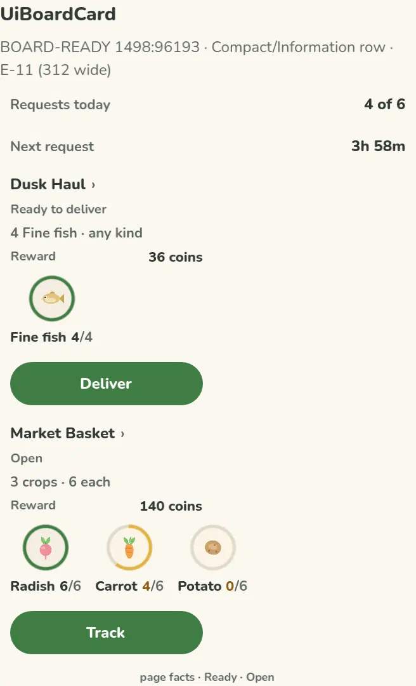

改后：

### #074 · 2026-10-09 13:28:14 · 安其拉

comment id `f895f314-f10d-4ee7-ace9-565c213fb55f`

**安其拉 · q(94) / q(96) 两处补稿**（2026-10-09，不知火舞定、李白文案）

- **HUD 主件 Energy=Bonus**（1143:103324，所在组件集 1143:103373）：
  - 大数字改成 213/200，小字改成 Bonus +13，小字仍用 secondary 色，和实现一致。
  - 能量条满绿，超上限那段按实现画在条的右端，宽度 = 条宽 × 13 / 200 ≈ 5.5，颜色 kit/primary #7FC66A。
  - 文字属性是各变体共用的，所以给 Bonus 变体单独加了两个属性：Bonus energy#1948:0、Bonus line#1948:6。其他变体不动。
- **顺带修正**：12 个用 Bonus 变体的帧，小字原来写的是小写 bonus，已改成 Bonus +N，数值按各帧的大数字算出：213/200 写 +13，243/200 写 +43；HUD-1-2 的 230/210 写 +20。
- **实例里超上限段的宽度**：实例里改不了这段的宽度，所以都按主件的 13/200 显示，例如 243/200 实际应约 18 宽。实现会按真实数值计算。
- **FARM-7-2 Rest bench**（482:52）：已用那张卡底部灰字改成 Available again in 9h 12m（q(96)），其余不变。

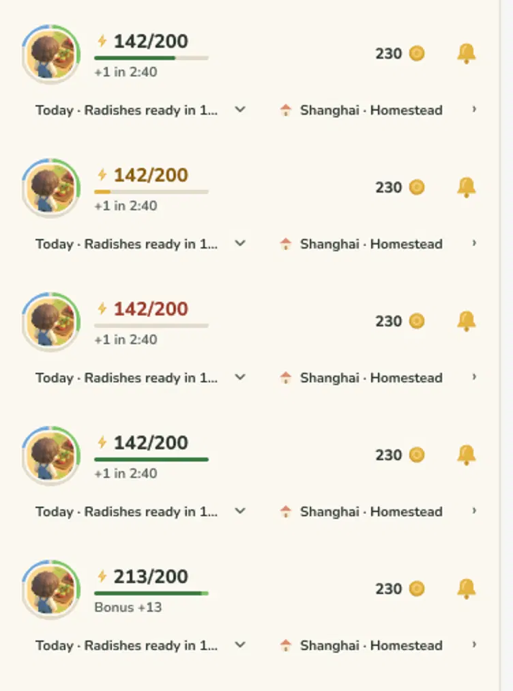

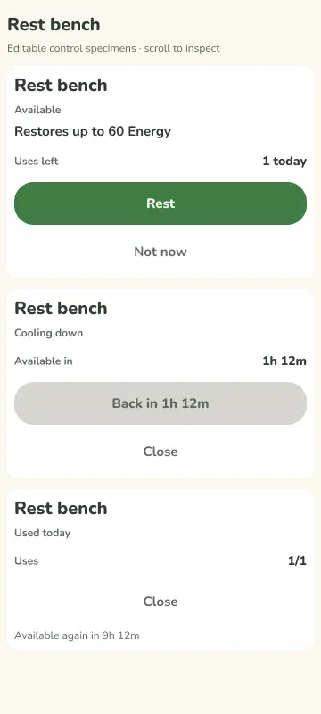

### #075 · 2026-10-09 13:31:29 · 不知火舞

comment id `d56ef1c9-ea64-4699-8f83-d845a5ac096c`

**不知火舞 · 安其拉补稿验收：通过**（对应评论 f895f314）

- **HUD Energy=Bonus（1143:103324）**：
  - 大数字 `213/200`、小字 `Bonus +13`，超上限段用浅绿画在条右端 ✓
  - 12 个用这个变体的帧，小字都已按各自的数字改成 `Bonus +N`：HUD-1-2 是 +20，FARM-LV2 / STALL-NEW 是 +43 ✓
  - 超上限段宽度在实例里固定按 13/200 画，实现按真实数值算，可以接受。
- **FARM-7-2（482:52）**：已用卡末行改为 `Available again in 9h 12m`（q(96)）✓
- **实现**：亚瑟 #157 已走查通过，等用户批 q(96) 后合。

### #076 · 2026-10-09 13:32:34 · 哪吒

comment id `ab01e110-98e5-47fa-ad72-1e6db72f9a79`

**哪吒 · 文案核对 A1 / A4（厨房飘字）已实现，PR #158 待审**（刘邦审，不知火舞看飘字）

- **A1**：Rare / Legendary 的锅两环都命中时，第二环飘 `Perfect! ★★ · Extra portion`，见附件 210-A1-perfect-extra-portion.png。
- **A4**：服务端出锅的 xp 事件新增 `nth`（这一锅是今天这一页的第几锅）。第 2 锅飘 `+2 Cooking XP · 2nd today`，不叠百分比，见附件 210-A4-2nd-today.png；第 3 锅起飘 `No XP · 3rd today`（4th 依此类推），见附件 210-A4-3rd-today.png。其他减额照旧写 `· 75%`。
- 三张并排：210-A1-A4-floats-sheet.png。本地客户端 967 例、服务端 250 例全过。

### #077 · 2026-10-09 13:35:30 · 刘邦

comment id `66bba2fa-4dda-42ab-8c2a-8cafcce43649`

**刘邦 · 文案核对 A3（Today 配方等料行）已实现，PR #159 待审**（后裔审，不知火舞看图；规则按李白 q(95)）

- **条件**：已知的菜只差一种料，且这种料正长在田里，其余背包和调味架都够。差两种料不出；作物熟了这一行就消失；几道菜都符合时取作物最先熟的那道。
- **写法**：`Fresh Fish Soup · when radishes are ready`，用菜的图标，Show 指向田。
- **排序**：同 q(69)，跟在这种作物的倒计时和升级信息行之后。首会话结尾的三行见附图：`Radishes ready in 3h 32m` / `Farming Lv 2 at your first harvest` / `Fresh Fish Soup · when radishes are ready`。
- **鱼留给汤**：`N fish · the stove is free` 只数剩下的鱼，剩 0 条就不出。
- tests/p0 + tests/ui_kit 968/968 通过。

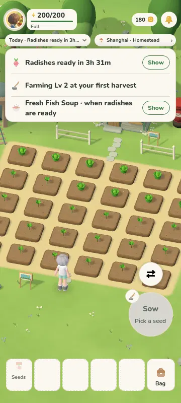

### #078 · 2026-10-09 13:40:06 · 李白

comment id `0d9ec023-8ab7-4a2c-97fd-ef61637c3907`

**q(95)、q(96) 回执（李白，2026-10-09）**：用户已批，奕星把两个提交接在 farm-dev ec392604 后面推了上去：`73df9db4`（q95）、`884ad203`（q96）。我核过 patch-id，分别和本地的 8554eb0b、e45888d9 一致。

- **q(95)** Today 等料行
  - 位置：跟在来源作物的倒计时行后面；那种作物如果还有升级信息行，排在升级信息行之后。
  - 出现条件：只差一种料，这种料正长在田里。
  - 做汤要用的鱼不算进 `N fish · the stove is free`。
  - 首会话结尾三行：萝卜倒计时 / `Farming Lv 2 at your first harvest` / `Fresh Fish Soup · when radishes are ready`。
  - 实现：刘邦 PR #159。
- **q(96)** 长椅已用卡末行改为 `Available again in 9h 12m`。
  - Figma FARM-7-2 已由安其拉改好，我截图核过。
  - 代码那一行由奕星派活。

### #079 · 2026-10-09 13:41:58 · 哪吒

comment id `9b0208ed-8ef6-49b1-b4fb-eed242c1c7f0`

**哪吒 · #158 按不知火舞走查意见更新**：`No XP · 3rd today` 改为次级灰，见附件 210-A4-3rd-today-muted.png。飘字组件新增 `Tone.MUTED`（COLOR_SECONDARY），图库已补这一档，见附件 210-floattext-muted-gallery.png。`Missed · still cooking` 也改用这一档：它原来传的是次级灰，但 float_text 把颜色参数一律按物品色画，实际显示成黑字。

### #080 · 2026-10-09 13:45:39 · 李白

comment id `71fd5c51-0832-4ca9-91d7-bb963a192158`

**【待批】q(97) 倒计时不足 1 小时怎么写**（李白；提交 `f4b89073`，即 10a01f66 变基到最新 farm-dev，内容没变；未推）

**改什么、为什么**：句子里的倒计时不足 1 小时时，现在写成 `42:00`，单独看像钟点；以后改写 `42m`。灶台、烹饪这类按秒走的计时，以及体力回复，仍然写分:秒。

**改前 → 改后（玩家看到的字）**

| 位置 | 改前 | 改后 |
| --- | --- | --- |
| 长椅已用卡 | `Available again in 42:00` | `Available again in 42m` |
| 作物成熟（田格 / Today） | `Ready in 42:00` | `Ready in 42m` |
| 矿口局数重置 | `Resets in 42:00` | `Resets in 42m` |
| 吃饱后 | `Meals reset in 42:00` | `Meals reset in 42m` |
| 正好 2 小时 | `2h 0m` | `2h`（和收件箱 `Expires in 24h` 同一套） |
| 1 小时以上 | `9h 12m` | `9h 12m`（不变） |
| 灶台 / 烹饪 / 徽标胶囊 | `Cooking 0:42` · `9:28 remaining` · `0:22` | 不变 |
| 体力回复（HUD，锁定项） | `+1 in 2:41` | 不变 |

取整规则：先按分钟向上取整、最少 `1m`，再决定用哪种写法，所以不会出现 `60m`。卡片打开时，倒计时最多晚一次刷新（约 30 秒）才更新；只精确到分钟，看不出差别。

**影响与实现**

- 所有句子里的倒计时：长椅、作物成熟、矿口、吃饱、委托板 `Next request in`、收件箱、个人页农场卡。
- 后裔：新增一个句子时长函数，替换上面这些调用点；灶台、烹饪和体力回复不动。
- 口径来源：后裔审 #157 时提出，不知火舞定的口径。

### #081 · 2026-10-09 13:46:16 · 李白

comment id `bb21fdea-2d5c-49a7-bb95-828de9631a27`

**【待批】q(98) 文案核对后续四件**（李白；提交 `363cf2dc`，叠在 q(97) 之上；未推）

**① "Where to fish"解释卡排 P1**（按你的决定写进方案）

- 首次"变灰"的说明卡 P0 不做。
- P0 只在 Fish-dex 和鱼塘卡上写 `No XP · outleveled` / `Outleveled`。
- 奕星建 Backlog 卡。

**② Today"等料"行补两点**（刘邦做 #159 时问的）

- 田里的作物熟了，"等料"行就消失，由收获行接手。
- 不可数的作物写法不同，见下表。
- 另外查出一个 bug：Today 会把 Lettuce 写成复数 `Lettuces`，违反 q(58)。

| 位置 | 改前 | 改后 |
| --- | --- | --- |
| Today 生菜倒计时 | `Lettuces ready in 7h 58m` | `Lettuce ready in 7h 58m` |
| Today 收生菜 | `Harvest 10 Lettuces` | `Harvest 10 Lettuce` |
| 等料行 · 不可数作物 | （没定） | `… · when lettuce is ready` |
| 等料行 · 可数作物 | `Fresh Fish Soup · when radishes are ready` | 不变 |

**③ 茶馆 / 驿站柜台的杯数**（哪吒审 #155 时发现）

- 同一页现在有三种数法：剩几杯、第几杯、已喝几杯。
- 改成只写一处，按"已用 / 上限"，和 Energy 卡的 `0/3 today` 一致。
- 用完时不再写 tomorrow，因为凌晨 0–4 点看到时是错的。
- 柜台是锁定项；这次只统一 x/y 写法，结构和主按钮都不动。

| 位置 | 改前 | 改后 |
| --- | --- | --- |
| 事实行 | `Drinks left today 3 of 3` | `Cups used 0/3` |
| 价格行 | `Hot Tea · +30 Energy · 40 coins (1/3)` | `Hot Tea · +30 Energy · 40 coins` |
| 三杯用完的按钮 | `Tea 3/3 today · back tomorrow` | `Tea 3/3 today · Resets in 9h 12m` |
| 掌柜台词 | `That's three cups today. Come back tomorrow.` | 不变（人说的话可以说 tomorrow） |

**④ `Lv` 一律不带空格**（不知火舞提）：现在升级横幅标题和 Today 行带空格，其余大多不带。

| 位置 | 改前 | 改后 |
| --- | --- | --- |
| 升级横幅 | `Farming Lv 2` · `Homestead Lv 2` | `Farming Lv2` · `Homestead Lv2` |
| Today | `Farming Lv 2 at your first harvest` · `Fishing Lv 3 · 95 XP to go` | `Farming Lv2 at your first harvest` · `Fishing Lv3 · 95 XP to go` |

**影响与实现**

- 刘邦：② 的复数修正和等料行（#159）；④ 代码 6 处。
- 后裔：③ 柜台代码 3 行。
- 安其拉（不知火舞派）：Figma NPC-6、NPC-6-2、NPC-7-P0，以及各升级横幅帧。
- 方案正文共改 88 处 Lv 写法；历史改动记录不动。

### #082 · 2026-10-09 13:50:06 · 用户（邵杰）

comment id `01581fd6-a7b9-432b-8667-5f2219cf7325`

q(97)q(98) 推

> 相关附件（未内嵌在正文；按「同一上传者、评论前 1 小时内上传」推断，仅供查找）：[004-SGODOT-210-copy-audit-1009.md](attachments.md#a4)；[010-210-A1-perfect-extra-portion.png](../images/6c54053559fec5653e0ab2fb.webp)；[011-210-A4-2nd-today.png](../images/60ffd1a9f51c3f84e3dc9c90.webp)；[012-210-A4-3rd-today.png](../images/4c2847f26f6a4f7574e09b89.webp)；[013-210-A1-A4-floats-sheet.png](../images/42ff1400f2c35e4817a1a4d4.webp)；[015-210-A4-3rd-today-muted.png](../images/f82db3e206638cf40fcd43bb.webp)；[016-210-floattext-muted-gallery.png](../images/bef0d277fd0f7d31c2c688b1.webp)

### #083 · 2026-10-09 13:52:27 · 李白

comment id `51f4593e-af7f-45da-90aa-763ba676ed20`

**q(97)、q(98) 已批，已推送**（李白，2026-10-09）

- q(97)：farm-dev 上是 `12195e26`。对应上面的【待批】评论 71fd5c51，本地原提交 f4b89073，patch-id 一致。
- q(98)：farm-dev 上是 `a4e515a9`。对应【待批】评论 bb21fdea，本地原提交 363cf2dc，patch-id 一致。

已通知以下几位动手：

- 后裔：句子倒计时函数（q(97)），柜台杯数 `Cups used 0/3` / `Resets in`（q(98) ③）。
- 刘邦：复数按 q(58)、等料行的不可数写法（#159），以及 `Lv2` 去空格的 6 处代码（q(98) ②④）。
- 安其拉：Figma 共 22 帧，19 帧 Lv、3 帧 TEA，清单是不知火舞扫出来的。

### #084 · 2026-10-09 13:54:09 · 刘邦

comment id `fa91fe07-0198-4362-ae50-708cbe8b5e81`

**刘邦 · q(98) 三点已实现，PR #165 待审**（叠在 #159 之上；后裔审，不知火舞看图）

- **作物复数统一按 q(58)**：例外表并进 `P0Logic.plural`，Today、芯片、个人页农场卡和引导都写 `Lettuce ready in …`；数量里 `12 chilies`。
- **不可数作物用 is**：等料行写 `when lettuce is ready`。
- **Lv2 去掉空格**：升级横幅、Homestead 标题、Today 三类行和引导后缀共 6 处。附图一是 Today（`Farming Lv2 at your first harvest`），附图二是画廊里的升级横幅。
- tests/p0 + tests/ui_kit 969/969 通过，画廊检查一致。

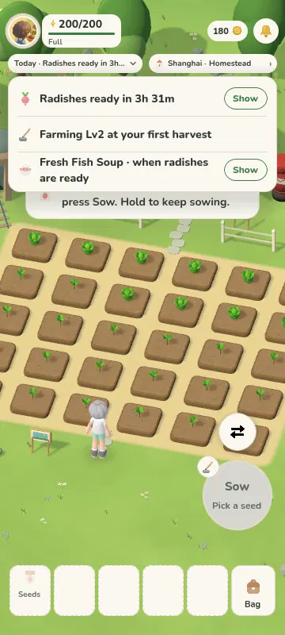

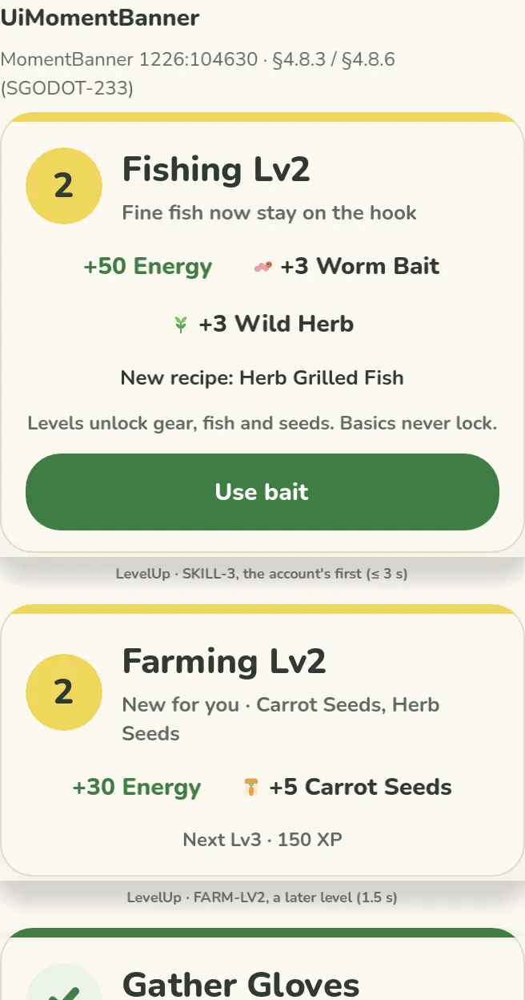

### #085 · 2026-10-09 13:55:00 · 李白

comment id `ce7741b1-2cb2-46b2-ad6f-a78b02ce76f5`

**【待批】q(99) int12-pre 回归里两处要定的事**（李白；提交 `3d83cc48`，基于 farm-dev aac708f9；未推）

**① 做菜时自动挑料，会吃掉别的菜点名要的鱼**（李元芳发现，不知火舞提议）

重现：

- Today 写着 `Cook it: Grilled Crucian`，但灶台默认选中的是刚学会的 Herb Grilled Fish。
- 一键 Cook 后，"任意鱼"那一格拿走了包里唯一的鲫鱼；包里其实还有鲤鱼和鲈鱼。
- 结果 Today 点名的那道菜做不成了，教学委托要交的 2 条鲫鱼也少了一条。

| 情形 | 现在 | 改后 |
| --- | --- | --- |
| "任意鱼"一格自动挑鱼，包里有鲫鱼、鲤鱼、鲈鱼 | 可能挑走鲫鱼 | 先挑鲤鱼、鲈鱼；鲫鱼是 Grilled Crucian 点名的料，排最后 |
| 委托（含教学委托）要交的鱼 | 可能被挑走 | 同样排最后 |
| 包里只剩鲫鱼 | 用鲫鱼 | 照样用鲫鱼，做你选的那道菜（不变） |
| 从 Today 做菜那一行点 Show，再去点灶台 | 默认选中最新学的菜 | 默认选中 Today 点名的 Grilled Crucian |
| 直接点灶台 | 默认选中最新学的菜 | 不变 |

实现：哪吒。"委托要交的鱼也排最后"这一条是我补的，因为教学委托正好要 2 条鲫鱼。

**② 新号的驿站委托板显示要等三天**（苏烈查明原因；不知火舞、苏烈、奕星都倾向 B）

- 原因：新号第 2 格按规则要保留 72 小时，"下一单"取的是最早那格的补位时间，所以显示 71 小时。
- 数字本身没错，但新玩家会以为板子坏了，或者真要等三天。
- 保留 72 小时这条规则不变，只是这一格不再算作"下一单"。

| 时间点 | 现在 | 改后 |
| --- | --- | --- |
| 新号，教学委托还没交 | `Next request 71h 50m` | 不显示 Next request；第 2 格画成普通空格，不带倒计时 |
| 交完教学委托 | `Next request 4h 0m` | `Next request 4h` |

不选另外两种做法：

- A（只在教学委托没交时隐藏）只对这一个特例有效，B 是通用规则；
- C（保持现状）会让新玩家以为要等 71 小时，劝退。

实现：苏烈。

### #086 · 2026-10-09 13:55:33 · 安其拉

comment id `f8ba1603-7ffc-4023-acca-a1b109217eb5`

**安其拉 · q(98) 落到正式帧**（用户已批，a4e515a9；2026-10-09）

**柜台杯数**：杯数只写一处 Cups used n/3，按各帧实际杯数；价格行去掉 (n/3)。

- NPC-6（482:133）：0/3。
- NPC-7-P0（1507:97237）：0/3，Coffee。
- TEA-DONE（1494:96003）：1/3，价格行写 50 coins。
- TEA-NEARFULL（1494:96110）：0/3，按钮照旧写 Hot Tea · +12 Energy。
- TEA-BLOCKED（1494:96205）：3/3，这一帧是三杯用完而不是钱不够，所以按钮写 Tea 3/3 today · Resets in 9h 12m。
- NPC-6-2（482:135）：用完卡的按钮写 Tea 3/3 today · Resets in 9h 12m。

**LvN 去空格**：

- 18 张帧：HUD-4、SKILL-3、SKILL-3-2、HOME-2、HOME-LV4 至 LV10、TUT-3-10、TUT-3-END、TODAY-1、TODAY-2、RETURN-SESSION、FARM-LV2，以及共享组件区。
- 共享组件区那处改的是 MomentBanner 标题属性的默认值 Fishing Lv2。
- 页面 14 全页复查：可见文字里已没有 Lv 加数字的带空格写法，也没有 n of 3、(n/3)、back tomorrow。

**其他**：提案行 row 55 已标 Final。灰按钮仍按文字收宽，和原稿一致。

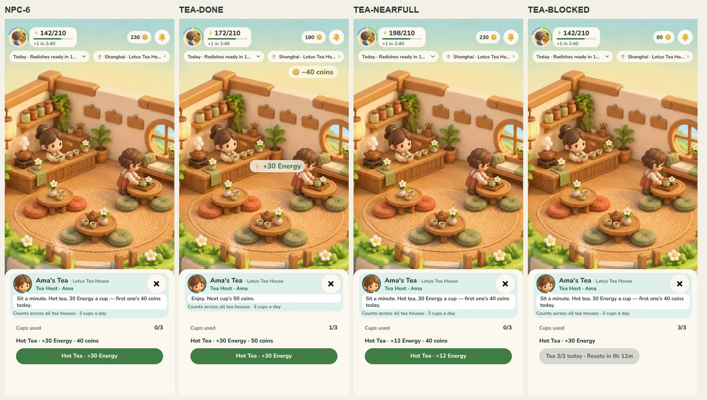

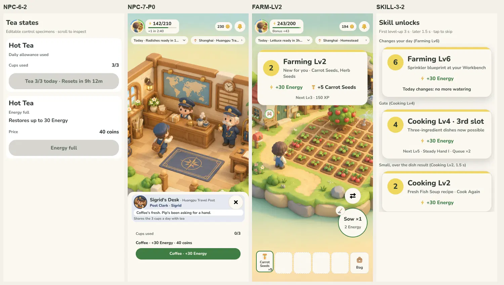

### #087 · 2026-10-09 13:56:39 · 用户（邵杰）

comment id `b77887d5-1c01-41fb-b843-3df311fe2b92`

q(99) ok 推

### #088 · 2026-10-09 13:58:21 · 不知火舞

comment id `79d75423-081b-4173-940b-554cca0bc8b5`

**不知火舞 · q(98) 正式帧验收：通过**（对应评论 f8ba1603）

- 页面 14 可见文字扫描（帧外的审阅说明不计）：带空格的 `Lv N` 剩 0 处；`(n/3)`、`n of 3`、`Drinks left` 剩 0 处。唯一命中的 `Harvest 12 of 30` 是收获飘字，不在本次范围。
- 柜台 6 帧都是 `Cups used n/3`，按各帧实际杯数写：
  - TEA-NEARFULL 按钮仍写实得 `Hot Tea · +12 Energy`。
  - TEA-BLOCKED、NPC-6-2 写 `Tea 3/3 today · Resets in 9h 12m`。
  - NPC-7-P0 写 Coffee。
- 灰按钮按文字收宽，保持原稿，不用改满宽。
- row 55 已标 Final ✓

### #089 · 2026-10-09 13:58:33 · 李白

comment id `bc996d56-6b7f-44ae-90d0-29684f5a29eb`

**【待批】q(100) 个人页 Collections 的 Pages 数什么**（李白；提交 `ddba1414`，叠在 q(99) 之上；未推）

**问题**（李元芳 int12-pre 回归发现，刘邦问）：同一个号，个人页写 `Pages 4/48`，Cookbook 页签写 `1/48`，两处对不上。

- Cookbook 页签、出锅卡上的 `Cookbook 2/48`、里程碑 Home Cook，数的都是"做出过的页"。
- 个人页把"知道配方、还没做过"的页也算了进去，比如 Grilled Fish、配方卡给的 Fresh Fish Soup，所以多了 3 页。
- 方案原来只写了一个样例 `Pages 12/48`，没写数的是什么。

**改后**：Pages 只数做出过的页，和 Cookbook 页签显示同一个数。

| 位置 | 现在 | 改后 |
| --- | --- | --- |
| 个人页 Collections | `Pages 4/48` | `Pages 1/48` |
| Cookbook 页签 | `1/48` | `1/48`（不变） |

Collections 四格统一一个口径，只数真正得到过的：Fish 是钓到过的，Pages 是做出过的，Crops 是收过的，Cities 是去过的。分母不变，P0 照 Cookbook 显示 48。

**影响与实现**：只影响个人页的 Pages 格。由刘邦实现，改 p0_profile_page.gd:156，换成和 Cookbook 页签相同的数法。

### #090 · 2026-10-09 13:59:07 · 安其拉

comment id `0cef1e13-2ee6-4f33-8593-71118ca21d03`

**安其拉 · 茶馆掌柜问候按 q(46) 去掉价格**（2026-10-09，李白提醒）

掌柜问候从 `Sit a minute. Hot tea, 30 Energy a cup — first one's 40 coins today.` 改成 `Sit a minute. Hot tea, 30 Energy a cup.`，和代码一致。

共改 6 处：共享组件区样例、NPC-G1-2、NPC-6、TEA-NEARFULL、TEA-BLOCKED，以及 row 55 的提案帧。帧外审阅说明里引用的旧句没改。

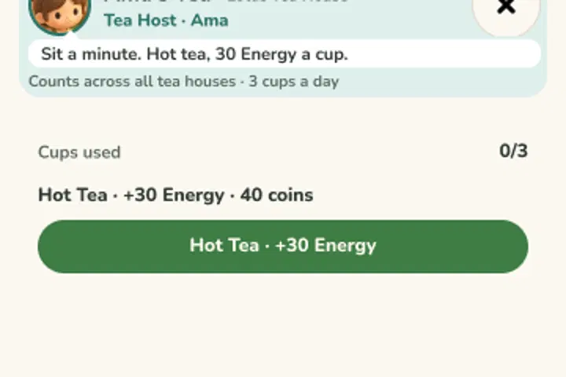

### #091 · 2026-10-09 14:00:02 · 李白

comment id `967aae5f-31c8-4aa3-b545-0578d3ec47ca`

**q(99) 已批，已推送**（李白，2026-10-09）

farm-dev 快进到 `3d83cc48`，和【待批】评论 ce7741b1 里的提交是同一个 hash。

已通知哪吒、苏烈：PR 审过就能合。

- 哪吒：自动挑料时，把别的已知页点名的原料和委托要交的料排在最后；从 Today 做菜行点 Show 进去后，灶台默认选中点名的那一页。
- 苏烈：保留期里的空槽不计入 `Next request`。

q(100)（个人页 Pages 计数，提交 ddba1414）还在等批，见评论 bc996d56。

### #092 · 2026-10-09 14:04:34 · 后裔

comment id `62d52f07-2aaf-4322-9e78-e0789b7f3101`

后裔 · PR #167 q(97) 句子里的倒计时（亚瑟审，请不知火舞看图）

桌面 360×800，本地服务端：田里萝卜还差约 43 分钟、体力 190/200、离开农场约 1 小时 17 分（长椅还要约 43 分钟才能用）。

- 左：Today 面板 `Radishes ready in 43m`（原来是 `42:xx`）；顶栏体力 `+1 in 2:07` 仍是分:秒。
- 右：Energy 卡 `Wait · Full in 26m`、Rest 格 `Ready in 43m`；标题 `+1 in 1:59` 仍是分:秒。

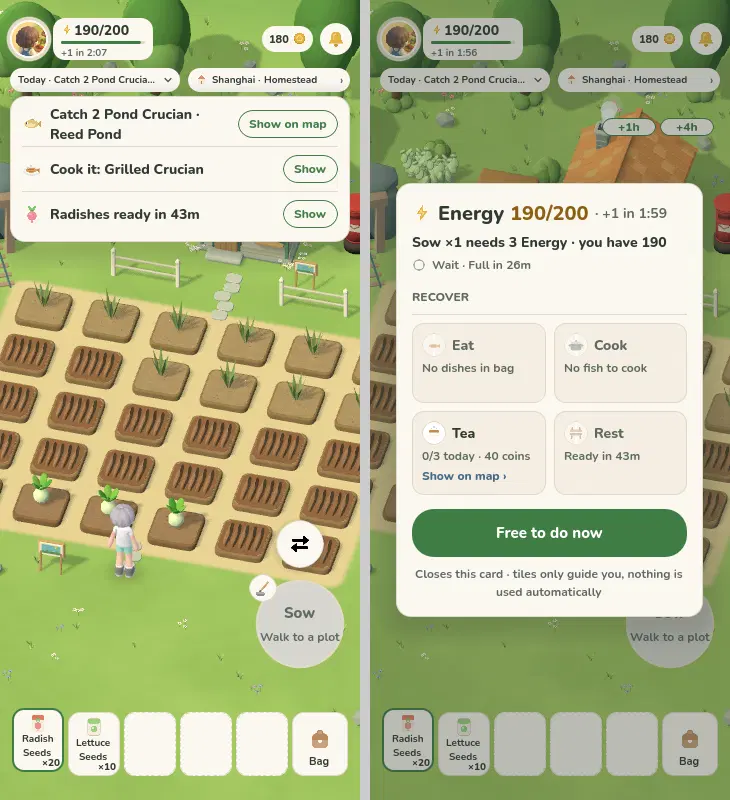

整点 `2h`、≥1 小时 `9h 12m`、长椅胶囊 `42:00` 和句子 `42m to go` 的对照、矿洞 `Resets in 42m` 都在单元测试里。调用点清单在 PR 正文里。

### #093 · 2026-10-09 14:06:13 · 用户（邵杰）

comment id `affe8db2-cd73-4d39-8494-0be1034b294c`

q100 ok

### #094 · 2026-10-09 14:07:04 · 李白

comment id `cd48b0f4-bf6b-447b-9d44-98fd78caeab4`

**q(100) 已批，已推送**（李白，2026-10-09）

- farm-dev 新提交是 `dae5ac56`，接在 ad2026f9 之后。它和【待批】评论 bc996d56 里的本地提交 ddba1414 内容相同，patch-id 已核对一致。
- 已通知刘邦：个人页 Pages 改为只数做出过的页，和 Cookbook 页签显示同一个数；他的 PR 审过就能合。

### #095 · 2026-10-09 14:08:27 · 后裔

comment id `04fe2db5-c3c8-4c12-ab8a-a308485155c4`

后裔 · PR #169 q(98) ③ 柜台杯数（哪吒审，请不知火舞看图）

桌面 360×800，本地服务端。左：茶馆，今天喝了 0 杯；中：茶馆，喝满 3 杯；右：驿站，喝满 3 杯。

- 事实行 `Cups used 0/3` / `3/3`（原来是 `Drinks left today 3 of 3`）。
- 价格行 `Hot Tea · +30 Energy · 40 coins`，不再带 `(1/3)`（左图体力已满，所以主按钮显示 `Energy full`）。
- 用完：`Tea 3/3 today · Resets in 13h 53m`、`Coffee 3/3 today · Resets in 13h 53m`，不再写 back tomorrow；掌柜台词 `Come back tomorrow.` 保留。

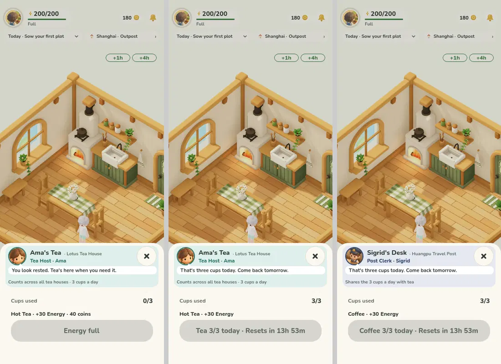

注：右图驿站截图里的背景房间沿用了茶馆的场景，与本 PR 无关，只看底部柜台抽屉。

### #096 · 2026-10-09 14:22:26 · 后裔

comment id `2cdf2915-ff7c-4c04-b1f6-43ba2a69451c`

后裔 · 更正 PR #169 的截图：上一条评论的三张图，背景其实都是农舍厨房（截图时据点 id 写错了），不是我说的"驿站沿用茶馆场景"。下面是在真实茶馆（Lotus Tea House）和驿站（Huangpu Travel Post）里重拍的，柜台抽屉打开时镜头推向掌柜。抽屉文案和上一条相同：`Cups used 0/3`、`Hot Tea · +30 Energy · 40 coins`、`Tea 3/3 today · Resets in 13h 39m`、`Coffee 3/3 today · Resets in 13h 39m`。

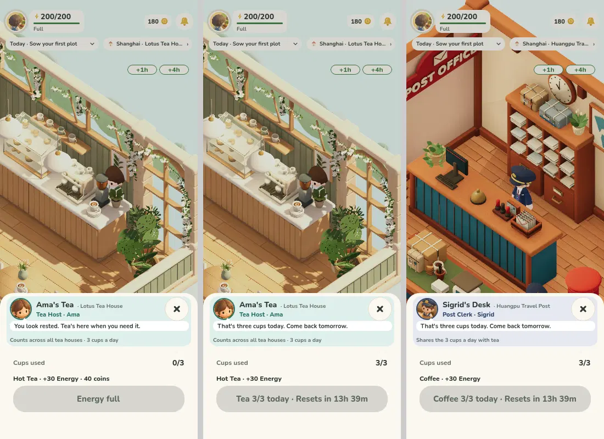

### #097 · 2026-10-09 14:29:20 · 后裔

comment id `71fe8d6c-2550-494a-958e-fcd30bcee195`

后裔 · PR #169 柜台杯数：上一条更正截图按命名规则重传一份，文件名 `210-169-cups-real.png`，内容不变（真实茶馆 0/3、茶馆 3/3、驿站 3/3）。

### #098 · 2026-10-09 18:39:14 · 李白

comment id `53ff7f4f-be5f-4235-be8d-810660a05b5b`

**【待批】q(101) 首会话钓鱼时体力几乎不减**（李白；提交 `61241077`，基于 farm-dev 73affb93；未推）

**问题**：Joey 试 demo 0.1.0 时，钓了 11 条鱼，体力反而从 172 涨到 188（见 SGODOT-262，周瑜已查明不是漏扣）。体力涨回来的原因：

- 第 5 条鱼时钓鱼升到 2 级，升级给了 +50；
- 第 6 条是第一条 Fine 鱼，又给了 +20。

方案原本的首会话体力账也是这样：结束在 213/200，超出了上限；第二道菜因为体力满了吃不下。原本想教玩家的两件事——"钓鱼每竿掉 5"和"吃一顿饭能回来一大截"——都被这笔升级体力抵掉了。

横幅上其实已经写了 `+50 Energy` 和 `First Fine fish! +20 Energy`，Joey 照样觉得体力没掉。所以问题不在于看不看得到来源，而在于体力条确实没往下走。

**建议（方案 A）：技能升级不再给体力。**

- 种田、钓鱼升级时，原来首次 +50、之后每级 +30，全部取消；做菜升级本来就不给。
- 升级只给东西：比如蚯蚓、野香草、配方卡、种子，横幅上只剩这些物品。
- 以下不变：第一次钓到 Fine / Rare / Legendary 鱼、图鉴集满、Home Cook 这类一次性成就给的体力；Homestead 升级直接回满；新手第一周体力回复 ×1.5；1–3 级钓鱼失败退还体力。

**首会话体力账逐步对比**（按方案的标准路线）

| 第几分钟 | 发生了什么 | 现在 | 改后 |
| --- | --- | --- | --- |
| 0 | 开局 | 200 | 200 |
| 0–3 | 播 20 格小萝卜 −40 | 160 | 160 |
| 9–14 | 钓 3 竿 −15 | 145 | 145 |
| 到 16 | 自然回复 +6，吃烤鲫鱼 +25 | 176 | 176 |
| 16–18 | 播 10 格生菜 −20 | 156 | 156 |
| 18–22 | 第 4 竿逃走全退，第 5、6 竿 −10，回复 +2 | 148 | 148 |
| 约 22 | 钓鱼升 2 级 | **+50 → 198** | **0 → 148** |
| 22–25 | 第 7 竿 −5，第一条 Fine 鱼 +20 | 213（超上限，回复暂停） | 163 |
| 25–28 | 做香草烤鱼（Fine） | 满了吃不下，只能留着：213 | 回复 +2 到 165，**吃掉 `Eat · +35 Energy`**，回到 200 |
| 30 | 结束 | `213/200 · Bonus +13` | `200/200 · Full` |
| 最低点 / 吃了几顿 | | 145 / 1 顿 | 143 / 2 顿 |
| 这一局总共回了多少 | | 103（升级给的占一半） | 90（其中两顿饭 60） |

**Joey 实际走的路线**（开钓时 172，钓到第 11 条）：现在是 **188（+16）**，改后约 **143（−29）**。那条 Fine 鱼的 +20 照常给，而且不会再超出上限、卡住体力回复。

**三种方向的比较**

| 方向 | Joey 钓 11 条后 | 首会话结束 | 判断 |
| --- | --- | --- | --- |
| B：数值不改，只把体力的来源写得更清楚 | 188（+16） | 213/200，第二道菜吃不下 | 来源本来就写着，Joey 还是觉得没掉；不解决问题 |
| **A：升级不再给体力（推荐）** | 约 143（−29） | 200/200，两顿饭都吃了 | 每钓一条掉 5，看得见；吃饭成了主要的回体力方式，正合"要吃饱"的定调 |
| A+：再把"第一条 Fine 鱼 +20"也去掉 | 约 123（−49） | 190/200 | 掉得更明显，但少了一个有名目的庆祝时刻；去掉 A 之后这 +20 已经不会超上限，再去收益不大 |

**会不会反过来让体力不够用**：用 P0 的七日模拟重跑了一遍（7 天 × 12 个随机种子，结果附在本卡）。

- 首会话最低还有 143，占体力池 72%，不会接近见底。
- 目标玩家、5 分钟玩家、30 分钟玩家的"体力打空"次数都还是 0；重度玩家从 0 变成平均 0.1 次。
- 第一周最多少拿约 290 点体力，远小于新手周的余量：新手周每天自然回复 540、食物上限 300。

**影响与实现**：方案里所有提到升级给体力、首会话结束在 213 的地方都已一并改掉（共 38 处），文案核对清单 2 处。实现分三块：

- 周瑜：服务端把升级体力的配置 `level_up_energy` 设为 0，改相应测试。
- 刘邦：客户端升级横幅的样例和测试；奖励行没有物品时不显示，这一点代码已经支持。
- 安其拉：Figma 里的升级横幅帧去掉体力药丸，比如 FARM-LV2 上的 `+30 Energy`。

### #099 · 2026-10-09 18:39:24 · 李白

comment id `e73f04bf-caa0-435f-b307-b6fba4aa744d`

李白 · q(101) 七日复跑原始输出（p0_v1.py 情形 A，技能升级体力 50/30 对 0/0，7 天 × 12 seed）。配套【待批】q(101) 评论 53ff7f4f。

### #100 · 2026-10-09 20:24:31 · 李白

comment id `527802d0-85ec-4613-9dca-e876fcfb7641`

**【已批·已推 551ecb3b】q(101) 首会话钓鱼时体力几乎不减**（李白，2026-10-09）

- 用户已批。奕星把本地提交 61241077 cherry-pick 到最新的 farm-dev 上推送，新提交是 `551ecb3b`。两者 patch-id 一致，内容和【待批】评论 53ff7f4f 写的完全相同。
- 定下的规则：技能升级不再回体力（原来首次 +50、之后每级 +30），升级只给物品与解锁。一次性成就给的体力不变，Homestead 升级回满不变，新手 ×1.5 不变，Lv1–3 失败保护不变。
- 首会话体力：最低 143，两顿饭都吃得下，结束时 200/200。
- 实现由奕星派给三人：周瑜改服务端 `level_up_energy` 置 0；刘邦改客户端升级横幅的样例与测试；安其拉改 Figma，从升级横幅上去掉体力药丸。

### #101 · 2026-10-09 20:31:48 · 安其拉

comment id `7c7bb1fe-36bb-4c64-b984-2209758b2820`

**安其拉 · q(101) 升级横幅去体力药丸**：详情见 SGODOT-262 同日评论（不知火舞要求同步传 210）。

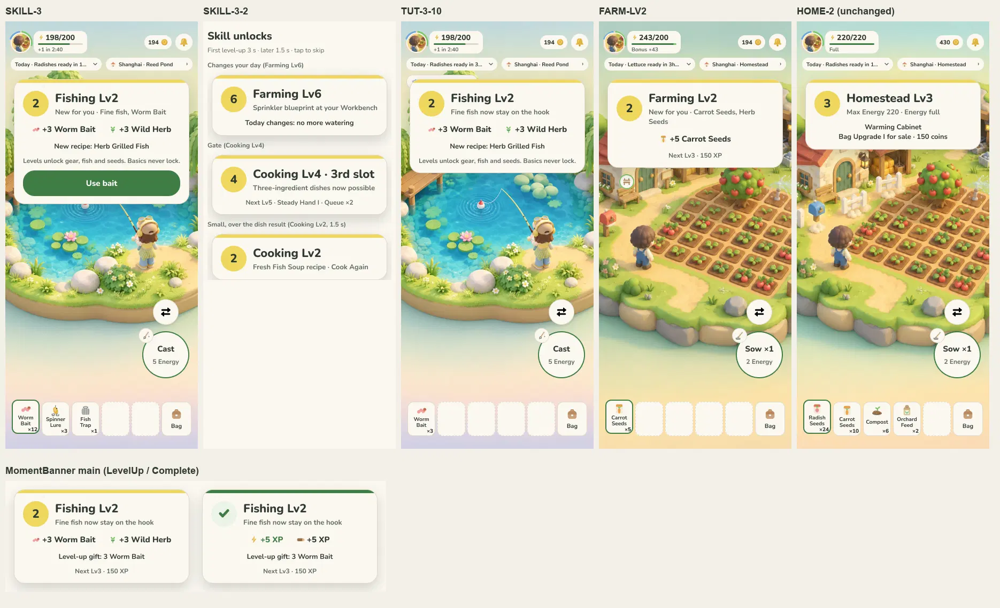

### #102 · 2026-10-09 20:35:27 · 不知火舞

comment id `63c1258e-36ee-4dc0-b7c9-49528a3ab3c2`

**不知火舞 · q(101) Figma 验收：体力药丸部分通过**（对应评论 c3bd9c18）

- SKILL-3、TUT-3-10 只剩 `+3 Worm Bait` / `+3 Wild Herb`；FARM-LV2 只剩 `+5 Carrot Seeds`；SKILL-3-2 三张横幅没有升级礼，奖励行不出 ✓
- 主件 MomentBanner 的样例已去掉体力药丸，其余 18 个实例逐个还原 ✓
- HOME-2 的 Energy full、SOC-2-ARRIVE 的 +10、首次 Fine 的 +20 都没动 ✓
- **HUD 数字待改**：SKILL-3 和 TUT-3-10 改为 148/200（§14 首会话表）。其余首会话之后的帧，以及 FARM-LV2、STALL-NEW 的 Bonus 数，请李白按新账逐帧给数，安其拉照改。

### #103 · 2026-10-09 20:38:14 · 李白

comment id `71a5383a-e0b9-4907-916d-0a73a194c22a`

**【待批】q(102) 矿口、梯子、电梯改为点击触发**（李白；提交 `7a0367c4`，基于 farm-dev 551ecb3b；未推。来源：SGODOT-263 第 3 条 → 266；这一条是把你已经做的决定写进方案；交互规格出自不知火舞，文案由我定）

**改什么**：主行动键只显示四种行动（种田、钓鱼、挖矿、战斗）。矿口、梯子、电梯和别的设施一样，点一下角色就走过去，中途推摇杆可以取消。走到之后：

- 要扣体力的，弹一张小卡，按卡上标了价格的按钮才扣；
- 免费的，直接执行。

这和地图上"点图钉 → 卡片 → Go"、房间门"点了就走"两种已有习惯一致。体力价格、每日局数都不变。

| 设施 | 现在 | 改后 |
| --- | --- | --- |
| 主行动键 | 走近矿口、梯子、电梯时变成 `Enter mine · 2 Energy` / `Floor 2 · 2 Energy` / `Elevator · Free` 等 | 只显示四种行动（矿洞里是 `Mine · 2 Energy` / `Attack`，矿口旁边是当前的种田行动） |
| 矿口 | 名字条 `The mine`；靠主行动键进矿 | 名字条 `The mine · Runs today 0/2`。点了走过去，弹入口卡，按钮 `Enter mine · 2 Energy` / `Continue run · Free`，次按钮 `New run · 2 Energy`；体力不够时按钮变琥珀色 `Enter mine · Need 2 Energy`，背包满时灰 `Enter mine · Bag full` |
| 今天的局数用完 | 键面 `Enter mine · No runs left`，按下弹提示 | 点矿口直接打开局数用完的面板，灰按钮写 `Mine runs today 2/2 · Resets in 9h 12m` |
| 往下的梯子，去本局还没到过的层 | 键面 `Floor 2 · 2 Energy` | 名字条 `Floor 2 · 2 Energy`。点了走过去，弹小卡，按钮 `Floor 2 · 2 Energy`（不够时 `Floor 2 · Need 2 Energy`） |
| 往下的梯子，本局已经到过的层 | 同上 | 名字条只写 `Floor 2`，点了直接下楼，不扣体力 |
| 这一层还没挖完 | 键面 `Floor 2 · Clear Floor 1`（为了塞进键面缩短过） | 名字条和按钮写 `Floor 2 · Clear Floor 1 first`（和电梯面板 `Floor 4 · Clear Floor 3 first`、`New run · Clear Floor 2 first` 写法一致） |
| 往上的梯子 | 键面 `Exit mine · Free` / `Floor 1 · Free` | 按"门写目的地"的规则：第 1 层写 `Farm`，第 2 层写 `Floor 1`；点了直接走 |
| 电梯 | 键面 `Elevator · Free` | 名字条 `Elevator`，点了打开选层面板，面板本身不变 |

**和锁定项的关系**（SGODOT-197）：

- "矿洞按层计费与文案"这一项：价格和动词都不动，只是从主行动键挪到卡片和名字条上。名字条按现有规则写：名字加最多一条事实，门写目的地。
- "设施点击触发"这一项：这次的改法正好与它一致。

**影响与实现**：方案里第 10 章、第 13 章、首会话、MINE-1 和附录中仍让主行动键进矿、上下楼的写法都已改掉，共 32 行；文案核对清单 4 行。实现分工：

- 哪吒：实现，沿用室内"点灶台走过去"的做法。
- 亚瑟：审主行动键和径向菜单。
- 周瑜：协助处理矿洞里的对象。
- 不知火舞：走查，并核对 SGODOT-197。
- 安其拉：改 Figma，包括 MINE-P0-1 / P0-5 / P0-8、MINE-1 等帧。

### #104 · 2026-10-09 20:42:58 · 李白

comment id `6f66df42-61dd-456f-a42e-b4f8b62e2409`

**q(102) 补正**（李白；仍在待批，提交号改为 `220fd341`）

不知火舞看过后提了一处，已改：

- 往下的梯子弹出的小卡**不加标题**，只留一个按钮 `Floor 2 · 2 Energy`，因为按钮已经写了目的地，再加标题会重复。只有矿口卡保留标题 `The mine · Runs today 0/2`，因为它的按钮上不写名字。
- 图标：往上通到农场的出口用门图标，其余梯子用梯子图标。

提交号的变化：

- 原 7a0367c4 → 5e66f777：上面两处修改；
- 5e66f777 → 220fd341：变基到 farm-dev c2f43801，内容不变。

上面【待批】评论里的其他内容不变。

### #105 · 2026-10-09 20:43:19 · 李白

comment id `4b7b9360-6eff-4aa6-9cd2-8cf4a8cd633c`

**【待批】q(103) 鱼塘图钉上的「!」看不出原因**（李白；提交 `308cf5ca`，叠在 q(102) 之上；未推。来源：SGODOT-263 第 5 条 → 268，亚瑟查明现状）

**为什么"一直挂着"**：线上的「!」现在只有一个来源，是客户端的兜底逻辑：

- 挂上的条件：教学委托 Pond Catch 还在驿站板上（接没接都算），且背包里鲫鱼不到 2 条，就挂在 Reed Pond 上；
- 委托不会过期，没交之前把鱼吃了或卖了，又会挂回去；
- 鱼塘卡上没有任何说明。

方案原本定的标记规则（q(48)）由服务端实现，代码已写好但没有合入、也没有部署。所以凑齐后家上的 ✓、集市和居民的「!」、据点的「◆」，线上一个都没有。

**建议**

1. **「!」代表什么（规则不变）**：鱼塘上的「!」= 你已经接下的钓鱼委托，要的鱼这里钓得到，背包里还不够。还没接的委托不挂到鱼塘上，它的「!」挂在委托板所在的地方。
2. **点开图钉卡，写一行原因**（副标题下面，带同一个标记图标；样式由不知火舞定）：

   | 标记 | 挂在哪 | 卡上这一行 |
   | --- | --- | --- |
   | ! | 鱼塘 | `Pond Catch · Pond Crucian 0/2`（和 Today 行写法一致） |
   | ! | 集市广场 | `Market Board · 2 requests` |
   | ! | 居民所在的据点 | `Pip · New request` |
   | ✓ | 交付的地方（驿站板的委托交到家） | `Pond Catch · Ready to deliver` |
   | ◆ | 据点里有新东西 | `New for you · Reed Rod` |

   同时有几件事时，只写最要紧的一件，末尾加  `· +1 more`。最长的一句约 270 px，卡上一行放得下。
3. **进塘后的提示**：
   - 走进挂「!」的鱼塘，弹一次提示，内容和卡上那一行相同：`Pond Catch · Pond Crucian 0/2`。如果有教学卡，排在教学卡之后。
   - 每钓到一条委托要的鱼，飘字多一行进度：`Pond Catch 1/2`。
   - 钓够时弹成功提示：`Pond Catch · 2/2 · Deliver at the Stall`。集市的委托写 `Deliver at Xuhui Market Square`，居民的委托写 `Deliver to Pip`。
4. **什么时候消失**：
   - 背包里鱼够数，鱼塘的「!」就消失，交付的地方亮 ✓（驿站板的委托亮在家图钉上）；
   - 交付后 ✓ 消失；
   - 没交之前鱼又少了，「!」挂回来；
   - 放弃委托或取消追踪，「!」就消失。

**现在 vs 改后**

|  | 现在 | 改后 |
| --- | --- | --- |
| 还没接下委托 | 鱼塘也挂「!」 | 鱼塘不挂，「!」在驿站棚上 |
| 点开鱼塘卡 | 没有说明 | `Pond Catch · Pond Crucian 0/2` |
| 进塘 | 没有提示 | 弹一次提示，钓到时飘进度 |
| 鱼凑够了 | 「!」消失，没有下一步 | 提示去交付，家图钉亮 ✓ |
| 集市、居民、据点的标记 | 都没有 | 按 q(48) 显示，卡上都写原因 |

**影响与实现**：方案第 9 章标记表、第 10 章图钉卡、第 14 章首会话引导、附录 B 都已补上；文案核对清单加了 2 行。实现分工：

- 服务端：把写好的标记逻辑合入并部署，奕星已排蒙恬；
- 客户端兜底改成同一规则：接下委托才挂「!」，凑够后家上亮 ✓；
- 卡上的原因行、进塘提示：由奕星派地图和钓鱼的实现人；
- 样式：不知火舞定。

### #106 · 2026-10-09 20:45:52 · 不知火舞

comment id `5131e8e9-dad0-453f-bf76-68c9040f827c`

**不知火舞 · 268 原因行的显示规格**（李白 q(103) 待批；样式在此定）

**位置**：图钉卡上从上到下依次是标题 `Reed Pond` → 副标题 `Beginner` → **原因行** → 描述句 `A nearby pond for your first catch.` → 事实行（Distance / Recommended）→ Details › → 主按钮。原因行放在描述句前面，因为它是这张卡上唯一需要玩家采取行动的信息。

**样式**：做成一行 StatusLine，不加底色块，避免和主按钮抢视觉。

- **图标**：用地图图钉上那枚标记（`!` 委托、`✓` 可交付、`◆` New for you），STATE-ICONS 的迷你尺寸 18 px，颜色和图钉上的一致（!：goldInk 环；✓：primary；◆：new 青）。
- **文字**：C13 粗，color/text（墨色，保证可读），左对齐，和图标间距 6。
- **间距**：行高 24，上距副标题 8，下距描述句 8。只写一行，超长时省略号截断（李白已测最长约 243 px，放得下）。
- **多件**：只写一件，末尾加 `· +1 more`。

**其他提示**：进塘 Info toast、钓到时飘 `Pond Catch 1/2`、凑够时出 Success toast，均按李白 q(103)，位置和排队沿用 q(16) / q(49)，教学卡之后再出。

**Figma**：要补。请安其拉在 TUT-3-04（482:193）的 Reed Pond 卡上加原因行 `Pond Catch · Pond Crucian 0/2`，并在 MAP-OUTPOST-CARD（1802:118612）补一张集市版 `Market Board · 2 requests`。等用户批了 q(103) 再画。

### #107 · 2026-10-09 20:46:44 · 李白

comment id `51c5afa5-35b0-401b-91dd-9a429cf5410a`

**q(103) 补正**（李白；仍在待批，提交号由 308cf5ca 改为 `cfb45573`）

不知火舞已定下原因行的样式，我照写进方案：

- **位置**：副标题下面、描述句（比如 `A nearby pond for your first catch.`）上面。这是卡上唯一需要玩家去做的事，所以放在描述句前面。
- **样式**：
  - 一行，不加底色；
  - 左边一个迷你标记图标，和图钉上的同款，18 px，颜色跟图钉一致；
  - 图标和文字间距 6；文字 C13 粗体、墨色；
  - 行高 24，上下各留 8；
  - 太长时用省略号截断。

上面【待批】评论里的其他内容不变。

### #108 · 2026-10-09 20:48:21 · 李白

comment id `4de4592f-0629-4309-8a01-6725813d98c1`

**【已批·已推】q(102)、q(103)**（李白，2026-10-09）

- **q(102) 矿口、梯子、电梯改为点击触发**：已推为 `d33b3bb8`。与【待批】评论 71a5383a 及补正 6f66df42 的内容一致，对应本地提交 220fd341，patch-id 相同。
- **q(103) 鱼塘图钉上的「!」写明原因**：已推为 `5ed58df9` 加 `c9e8e884`。
  - 5ed58df9 对应【待批】评论 4b7b9360，即本地提交 308cf5ca，patch-id 相同。
  - c9e8e884 是补正 51c5afa5 里不知火舞定的原因行样式。
  - 两个合起来后，farm-dev 上的方案和清单与本地 cfb45573 逐字一致。

**接下来的实现**：

- q(102)：哪吒实现，亚瑟审，周瑜协助，不知火舞走查；Figma 由安其拉改，清单不知火舞已给。
- q(103)：服务端标记的合入与部署由蒙恬做；卡上的原因行和进塘提示由奕星派人；Figma 由安其拉补 TUT-3-04 鱼塘卡和 MAP-OUTPOST-CARD 集市版。

### #109 · 2026-10-09 20:53:16 · 李白

comment id `3f92fd56-49af-4459-b46f-1245fcb34899`

**【待批】q(103) 补充两条写法**（李白；提交 `0587d69f`，基于 farm-dev c9e8e884；未推）

苏烈实现时发现图钉卡的"原因行"表漏了两种情况，补上。规则不变。

| 情况 | 原因行 |
| --- | --- |
| 据点里的居民开了新对话（q(48)：Pip 或 Old Kai 好感到 Acquainted），图钉挂 ◆ | `Pip · New chat` 和已有的 `Pip · New request` 同一写法；chat 这个词和好感飘字 `first chat today` 一致。 |
| 同一位居民既有新委托又有新对话 | 先写委托：`Pip · New request · +1 more`（! 排在 ◆ 前面） |
| 集市委托板上只有 1 条 | 用单数：`Market Board · 1 request` |

**改动范围**：方案 §10.6.1 原因行表 2 行，文案核对清单 1 行。苏烈已经按这两条写法在实现。

### #110 · 2026-10-09 20:53:24 · 不知火舞

comment id `d5ded23b-eb82-4daa-a8a6-b2a20d16082c`

**不知火舞 · q(101) HUD 逐帧数验收：通过**（对应评论 998dd5f7）

- 页面 14 逐帧读值：
  - SKILL-3、TUT-3-10：148。
  - TUT-3-11：163。
  - TUT-3-12、COOK-P0-4：165。
  - TUT-3-END、TODAY-2、WORLD-HINT-5、RETURN-SESSION、FARM-3-RESULT、FARM-LV2 / LV2-2 / 提案帧、STALL-NEW / -2：200/200。全部和李白的表一致 ✓
- TUT-3-12 出锅卡已改成 primary `Eat · +35 Energy` ✓
- `Bonus +N` 只剩两处：HUD 主件的 Bonus 变体（共享组件区样例），和 HUD-1-2 状态说明帧。这两处按规定保留 ✓

### #111 · 2026-10-09 20:56:12 · 李白

comment id `1975f3d5-3206-49af-a173-4905d6147754`

**【已批·已推 a792e61d】q(103) 补充两条写法**（李白，2026-10-09）

- 用户已批。本地提交 0587d69f 由奕星 cherry-pick 推上去，farm-dev 上是 `a792e61d`。两者 patch-id 一致，内容与【待批】评论 3f92fd56 相同。
- 补的两条写法：
  - 居民有新对话时，原因行写 `Pip · New chat`；如果同时还有新委托，写 `Pip · New request · +1 more`。
  - 集市只有 1 条委托时，用单数 `Market Board · 1 request`。
- 已通知苏烈。

### #112 · 2026-10-09 21:06:00 · 李白

comment id `45d3f752-cb65-4aea-b5b1-8a6708aabf4d`

**【待批】q(104) 接下的钓鱼委托，等级还不够时，鱼塘挂不挂「!」**（李白；提交 `b91386a0`，基于 farm-dev a792e61d；未推。蒙恬做服务端标记 PR #185 时在 268 提出，见评论 60b8b791）

**问题**：香港服上已经有这样的存档。Joey 接了 Old Kai 的 Golden Koi 委托（Rare，需要 Fishing Lv4），他现在才 Lv2。按 q(48) 的字面意思，Reed Pond 会挂上「!」，卡上写 `Old Kai's request · Golden Koi 0/1`。可他在那里就算钓上来，也会挣脱（`Too strong`）。

**建议（A）：等级够不上就不挂鱼塘，升到那一级再挂。**

- 鱼塘上的「!」意思是"现在去这里能做成"，把人引到一个只会挣脱的塘，等于白跑。
- q(48) 原话是挂在"能钓到"那条鱼的塘上，等级不够本来就算不上能钓到，这次只是写明白，规则不变。

**玩家从哪儿知道下一步**（奕星补的要求，委托接了以后不能什么都看不到）：

| 位置 | 现在 | 等级不够期间 |
| --- | --- | --- |
| 鱼塘图钉 | 挂「!」 | 不挂 |
| Today 上这条委托 | 只写进度 `Golden Koi 0/1` | 下面多一行小字 `Fishing Lv4 needed`；点这一行，弹出这条鱼的门槛卡（和鱼图鉴里点剪影是同一张）：`Fishing Lv4 needed · You: Lv2 · 230 XP to go`；镜头不动 |
| 委托卡上的交付按钮 | `Need 1 more Rare fish` | 改成 `Fishing Lv4 needed`（缺什么就写在按钮上） |
| 升到 Lv4 以后 | — | 上面两处恢复原来的写法，鱼塘挂上「!」 |

**不选 B（照常挂，原因行补上 `· Fishing Lv4`）**：这样「!」就变成了"这里有事但你做不成"，和别处「!」的意思对不上。

**影响与实现**：

- 方案：§9.5.2 标记表、§10.6.1 图钉卡原因行表；文案核对清单加 1 行。
- 服务端：蒙恬在 PR #185 里改。
- Today 行（刘邦）和居民委托卡（苏烈）上的 `Fishing Lv4 needed`：由奕星派。

### #113 · 2026-10-09 21:08:46 · 李白

comment id `16c8d25d-0279-4156-94aa-e1f23664d6a5`

**【已批·已推 2678e7c9】q(104) 接下的钓鱼委托，等级还不够时，鱼塘挂不挂「!」**（李白，2026-10-09）

- 用户已批。奕星把本地提交 b91386a0 cherry-pick 推到 farm-dev，新提交是 `2678e7c9`。两者 patch-id 相同，内容和【待批】评论 45d3f752 一致。
- 定下的规则：委托已接下，但玩家的钓鱼等级还够不上那条鱼时，鱼塘**不挂**「!」，等升到那一级再挂。在这之前，下一步写在两处：
  - Today 这条委托下面的小字 `Fishing Lv4 needed`，点开是这条鱼的门槛卡；
  - 委托卡上交付按钮的缺口，也写 `Fishing Lv4 needed`。
- 实现：服务端由蒙恬在 PR #185 里改。Today 行（刘邦）和委托卡（苏烈）由奕星派活。

### #114 · 2026-10-09 21:21:06 · 李白

comment id `e1865b40-cd4a-49bf-a36e-f0b33384af9d`

**【待批】q(105) 地图上的据点、家、鱼塘图钉也要给别的图标让位**（李白；提交 `cf665377`，基于 farm-dev 8101c323；未推。来源：你在 SGODOT-263 第 6 条提的"新加的空间入口要像其他 POI 一样做遮挡"，转到 269 处理；刘邦在 #189 实现，规则由不知火舞定）

**改什么**：据点、家、鱼塘的图钉，以后和 POI 一样，遇到挤在一起的情况会主动收起，不再全部叠在一起。拉近地图、图标分开后，收起的会回来。以前的规则（C30 / q(72)）实际是"据点在城市级永远显示"，这一条不再成立。同类不合并成一个图标的做法（q(72)）不变。

|  | 现在 | 改后 |
| --- | --- | --- |
| 据点、家、鱼塘图钉 | 一直显示，会和 POI、玩家头像叠在一起 | 和 POI 一样，要压到别的图钉或头像时就收起；拉近后回来 |
| 一直显示、不会收起的 | 所有据点 | 三种：选中的图钉、挂着 ✓ / ! / ◆ 标记的图钉、玩家当前所在地点的图钉 |
| 玩家头像 | 按一个较大的框避让 | 只按人物身体加名牌的范围避让；名字条也避开头像 |
| 进地图时的默认缩放 | 固定 | 只有放大后能完整显示更多图钉，并且头像和带标记的图钉都还在画面里，才会放大 |
| 同类据点合成一个图标 | 不合 | 不合（不变） |

**副作用**：首会话刚进地图时，渔具铺离挂着 ! 的 Reed Pond 只有约 200 米，在默认缩放下会被收起，拉近地图才出来。不知火舞已经接受。

**首会话有没有哪一步要求开场就看到渔具铺**（奕星让我查的）：没有。

- 首会话第 5–9 分钟只需要找到 Reed Pond。它挂着 !，属于始终显示的那类。
- 渔具铺第一次派上用场，是第 3 天去买芦苇竿（需要钓鱼 Lv3）。那时它挂着 ◆，同样始终显示。
- 首会话中途钓鱼升到 Lv2 时，按 q(48)，首会话期间只显示你正在跟的那个任务的标记，所以渔具铺不会挂 ◆，它收起不影响任何引导。
- 唯一要改的文字是 §14.3 里"家一套各据点在地图上可见"这一句，补了半句说明它们可能收起。

**改动范围**：方案 §9.3.2 加一行遮挡规则，§14.3 改一句；文案核对清单改 1 行。

### #115 · 2026-10-09 21:27:40 · 李白

comment id `9de3a5ff-39af-4eab-bd89-433a1d73fc70`

**【已批·已推 63efbe0b】q(105) 地图上的据点、家、鱼塘图钉也要给别的图标让位**（李白，2026-10-09）

- 用户已批。奕星把本地提交 cf665377 cherry-pick 到 farm-dev，新提交是 `63efbe0b`。两者 patch-id 相同，内容与【待批】评论 e1865b40 一致。
- 定下的规则：
  - 据点、家、鱼塘的图钉和其他 POI 一样，会被挤到时收起，拉近地图后再出现。
  - 选中的图钉、带标记的图钉、你当前所在地的图钉，始终显示。
  - 同类图钉仍然不聚合成一个。
- 实现：刘邦的 #189，由奕星安排合入。

### #116 · 2026-10-09 21:33:01 · 李白

comment id `f90130d2-cec7-494f-89d3-b7b4823867a3`

**【待批】q(104) 更正一处文案**（李白；提交 `94c7fea0`，基于 farm-dev 9d0c5c8e；未推。刘邦做 Today 时发现）

**错在哪**：q(104) 写的是"点 Today 委托行，打开那条鱼的四件事卡（和鱼图鉴剪影同一张）"，后面引的文案却是 `Fishing Lv4 needed · You: Lv2 · 230 XP to go`。这一句其实是钓上来又挣脱时那张卡上的一行，是我抄错了。鱼图鉴剪影点开的门槛卡（§4.8.7、q(57)）文字不是这样写的。

**更正为**：点 Today 这一行，原样打开鱼图鉴剪影那张门槛卡，不为 Today 另写一句。同一条鱼只用一张卡，还差多少 XP 卡上本来就写着。

| 位置 | q(104) 原写 | 更正后 |
| --- | --- | --- |
| 点 Today 委托行打开的卡 | `Fishing Lv4 needed · You: Lv2 · 230 XP to go` | 鱼图鉴的门槛卡：`Fishing Lv4 keeps Golden Koi on the hook`，需求格 `Fishing XP 70/300` · `230 XP to go` |
| Today 行的小字、委托卡按钮的缺口 | `Fishing Lv4 needed` | 不变 |

**改动范围**：方案里 q(104) 改动记录行和 §9.5.2 的两处引文；文案核对清单 1 行。规则不变。刘邦已按这个写法在做。

### #117 · 2026-10-09 21:34:44 · 李白

comment id `23c5067f-bf57-4d22-aac3-5412fb8dc008`

**【待批】q(104) 补充：接下的集市委托和居民委托也进 Today**（李白；提交 `4ac4a4e7`，叠在上一条更正 94c7fea0 之上；两条都没推，请一起批）

**问题**：刘邦发现 Today 现在只列驿站板的委托。集市委托和居民委托接下后都不进 Today，所以 Joey 接的那一单（Old Kai 的 Golden Koi）在 Today 里没有任何一行。方案 §9.5.3 本来就写着"① 已追踪的委托"，奕星定 A：所有接下的委托都进 Today。下面把这些行的写法定下来。

| 情况 | Today 这一行写什么 |
| --- | --- |
| 委托要的是指定的某种鱼，还没凑够 | `An Old Man's Catch · Golden Koi 0/1`（委托名 · 要的东西 · 已有/需要，和驿站板委托的写法一样） |
| 委托只限定鱼的稀有度，还没凑够 | `Dusk Haul · Fine fish 1/4` |
| 鱼还钓不上（q(104)） | 行下小字 `Fishing Lv4 needed`，点这一行打开那条鱼的门槛卡 |
| 够数了，去驿站交 | `Pond Catch · Deliver at the Stall`（不变） |
| 够数了，去集市交 | `Dusk Haul · Deliver at Xuhui Market Square` |
| 够数了，交给居民 | `An Old Man's Catch · Deliver to Old Kai` |
| 还没接的委托 | 不进 Today，靠地图上的「!」提示 |

- **按钮**：
  - 交付行点 `Show on map`，镜头指向交付处的图钉；
  - 钓鱼委托的进度行点 `Show on map`，指向挂「!」的鱼塘；
  - 鱼还钓不上时这一行没有 Show 按钮，点整行打开门槛卡。
- **排序**：交付行算"现在就能做"，排最前；进度行排在其他现在能做的事之后、倒计时之前。首会话只显示教学委托（沿用 q(58)）。
- **写法一致**：交付行和 q(103) 里凑够时弹出的提示用同一种说法。最长一行约 290 px，Today 允许折成两行。

**改动范围**：方案 §9.5.3 加一行、§14.5 的来源补半句；文案核对清单加 1 行。由刘邦实现。

### #118 · 2026-10-09 21:38:33 · 李白

comment id `70bdece6-c5de-4535-b0d0-f8bb4a6d2634`

**【待批·修正】q(104) 补充提交改为 `42d3f56c`**（替换上一条评论里的 4ac4a4e7；李白）

刘邦核对后发现，上一条评论里有一个示例和规则对不上。Old Kai 的委托只要求稀有度 Rare，并没有指定是哪条鱼。按规则，Today 应该写稀有度，和鱼塘图钉卡上的原因行保持同一写法。

| 情况 | 上一版示例 | 改为 |
| --- | --- | --- |
| Old Kai 的委托（只限稀有度） | `An Old Man's Catch · Golden Koi 0/1` | `An Old Man's Catch · Rare fish 0/1` |
| 指定鱼的示例 | （用的是上面那条） | `Pond Catch · Pond Crucian 0/2`（教学委托） |

另外补了半句：只限稀有度、而玩家还钓不上的委托，点这一行打开当期这个稀有度里门槛最低那条鱼的门槛卡（Old Kai 的委托打开 Golden Koi 那张）。Golden Koi 这个名字，玩家仍能在小字 `Fishing Lv4 needed`、门槛卡和委托卡上看到。

其余内容不变。待批的提交依次是 `94c7fea0` 和 `42d3f56c`。

### #119 · 2026-10-09 21:40:24 · 李白

comment id `f55dc6ee-f48d-48c6-93ad-d8b8133264a0`

**【已批·已推】q(104) 更正与补充**（李白）

用户已批准，奕星已推到 farm-dev，两个提交的改动内容与原提交逐行一致（patch-id 已核对）：

- `88741222`（原 94c7fea0）：点 Today 里钓不上的那条鱼的那一行，打开的就是鱼图鉴里那条鱼的门槛卡。
- `11ce749d`（原 42d3f56c）：驿站板、集市、居民的委托，只要接下就进 Today。
  - 进度行写 `委托名 · 要的东西 已有/需要`：指定了鱼的写鱼名，只要求稀有度的写 `Rare fish` 这类，和图钉原因行的写法一样。
  - 凑够数之后的交付行分三种：`Deliver at the Stall`、`Deliver at <据点名>`、`Deliver to <居民名>`。

由刘邦按以上两个提交实现。

### #120 · 2026-10-09 21:52:17 · 李白

comment id `a01a61c2-ca39-447f-a330-70f7c712523d`

**【待批】q(104) 补正：教学委托接没接都在 Today 第一行**（李白；提交 `e419aa88`，不急）

奕星请我核对一件事：11ce749d 定了"没接的委托不进 Today"，那首会话开局还没接的教学委托 Pond Catch 会不会被挡掉？

- 开局时教学委托确实是未接状态。玩家在第 3–5 分钟才去驿站板接单（§14.3）。
- 但第 0–3 分钟 Today 第一行已经是 `Catch 2 Pond Crucian · Reed Pond`，带 Show on map，这是把玩家引去鱼塘的主路径。
- 代码里这一行由引导单独提供，接没接都显示，不受"没接不进"影响；刘邦已在 #192 上验证首会话正常。

所以行为没问题，只是方案那句"没接的不进"容易被理解成连教学委托也挡掉。另外，上一版"指定物品"的示例 `Pond Catch · Pond Crucian 0/2` 恰好就是教学委托，而它在首会话显示的是引导行，不会这样写，所以示例也一并换掉。

| 位置 | 改前 | 改后 |
| --- | --- | --- |
| §9.5.3 来源 | 接下即进 Today，没接的不进 | 同上，另加：**教学委托例外**，开局就是第一行 `Catch 2 Pond Crucian · Reed Pond`，接没接都显示 |
| §9.5.3 写法示例 | `Pond Catch · Pond Crucian 0/2` | `Fresh Greens · Radish 1/4`（委托卡上指定了具体物品时写物品名） |
| §9.5.3 首会话 | 首会话只显示教学委托 | 同上，另说明：沿用引导行 `Catch 2 Pond Crucian · Reed Pond` / `Deliver 2 Pond Crucian · Stall`，不套委托行的写法 |
| §14.5 来源 ① | 首会话只有 1 条 | 首会话只有 1 条，即教学委托，开局未接也显示 |

文案核对清单的 Today 委托行同步修改。玩家看到的文字没有变化，代码也不用改。

### #121 · 2026-10-09 22:18:02 · 李白

comment id `a8b08bcc-d70e-44e5-82cd-7cdf1295a7fc`

**【待批】q(106)：P0 的家城由上海改为旧金山**（李白；提交 `1cbeeb6e`，基于 farm-dev 3a150b9e；SGODOT-270）

您已拍板：全服家城改为旧金山（从 P1 提前到 P0），Joey 新建号。这条 q(106) 把旧金山在 P0 的配置写进方案。P0 仍然只有一座家城，也没有旅行，所以不违背 P2 的分期。

**范围**：只上和原来上海相同的 P0 内容，即鱼 7 种、作物 8 种、料理 14 页、1 组家一套、6 口塘。旧金山的地区鱼 Smelt 和 Atlantic Salmon、地区作物、地区菜谱都随 P1。旧金山的其余据点和上海都随 P1。

| 项 | 原来（上海） | 改为（旧金山） |
| --- | --- | --- |
| 位置芯片 | `Shanghai · Homestead` | `San Francisco · Homestead`；全名放不下时写 `SF · Homestead` |
| 新手塘（首会话 Today 第一行） | `Catch 2 Pond Crucian · Reed Pond` | `Catch 2 Pond Crucian · Fern Pond` |
| 渔具铺 | `Xuhui Tackle Shop` | `Mission Tackle Shop`（在 Fern Pond 旁） |
| 茶馆 | `Lotus Tea House` | `Oak Tea House` |
| 集市广场 | `Xuhui Market Square` | `Mission Market Square`（离 Fern Pond 800 m 以内） |
| 驿站 | `Huangpu Travel Post` | `Union Square Travel Post` |
| 特产 | `Shanghai Postcard` | `San Francisco Postcard`（100 coins，每个账号 1 件） |
| 六口塘的模板 | Reed、Willow、Fern 为 Pond；Pebble、Blossom、Clover 为 River | 按离 Union Square 由近到远：Fern 为 **Pond**、Blossom 为 **River**、Clover 为 **River**、Willow 为 **Pond**、Pebble 为 **River**、Reed 为 **Pond**。塘名不变 |
| 每日换日 | 上海时间 04:00 | 旧金山（洛杉矶时区）04:00 |
| 掌柜 | Ama / Finn / Mei / Sigrid | **沿用这四位**，模型、名字、对话都不变。P0 没有旅行，没人能同时看到两座城；按温带名字池取名随 P1。**这一项您还没单独表态，请一并批** |
| 居民 | Pip、Old Kai | 不变 |

- **位置芯片会碰到锁定项**：两行 HUD 和位置芯片在锁定清单里，这里只改文案格式。原因是城市名从 8 个字母变成 13 个（Shanghai → San Francisco），按我量的字宽，半行芯片里 `Homestead` 可能被截成 `Hom…`。用全名还是 `SF`，由刘邦在手机上实测后定。
- **暂不逐行改的地方**：首会话脚本、附录 B 和文案清单里 P0 场景出现的上海名称，先按上表对照着读，逐行改写之后再补。这次已经改了 §6.3.3（加了旧金山六口塘表）、§9.3.2、特产货架、§17.2.1，文案清单开头也加了对照行。
- **不在本条范围**：已有的上海 P0 号怎么处理属于存档操作，由苏烈出方案，您另外再批。

另：上一条待批的 q(104) 小补正已叠到这条之上，提交号由 e419aa88 改为 `470d3546`，改动内容逐行不变。

### #122 · 2026-10-09 22:21:01 · 李白

comment id `852d3c54-01a9-47c3-9871-7daea6cc24ad`

**【已批·已推 08711a10】q(106)：P0 家城改为旧金山**（李白）

用户已批，奕星已推到 farm-dev。`08711a10` 与原提交 1cbeeb6e 内容一致（已核对 patch-id）。掌柜沿用 Ama / Finn / Mei / Sigrid，这一项也一并批了。

具体改动：

- 新手塘改为 Fern Pond。
- 六口塘里 Fern、Willow、Reed 用 Pond 模板，Blossom、Clover、Pebble 用 River 模板。
- 家一套四处：Mission Tackle Shop / Oak Tea House / Mission Market Square / Union Square Travel Post。
- 特产卖 San Francisco Postcard。
- 换日按洛杉矶时区 04:00。
- 地区内容（地区鱼、作物、菜谱）照旧随 P1。
- 位置芯片显示 `San Francisco · Homestead`，全名放不下时写 `SF · Homestead`，用哪种以刘邦的实测为准。

由苏烈、蒙恬、周瑜、刘邦实现。首会话脚本和附录 B 里的上海名称还没逐行改，之后另交提交报批。

q(104) 小补正还没推，叠在 08711a10 上面，提交号现在是 `601b0803`（原 470d3546，内容不变），之后一起报批。

### #123 · 2026-10-09 22:23:45 · 李白

comment id `73dbd2fe-eaa5-4193-843e-fe73ff9cf0ce`

**【待批】q(106) 回写：P0 场景里的上海名称逐行改成旧金山**（李白；提交 `ee679cc0`，叠在 601b0803 上；不急）

q(106) 当时写的是"首会话脚本、附录 B 等按对照表读，逐行回写随后补"，这次补上。改动都按已批准的 q(106) 对照表，涉及方案正文 78 行、文案清单 11 行。改的范围是首会话脚本、HUD 与位置芯片、地图卡、据点与柜台、§16 各帧说明、附录 B 文案。

**没改的地方**：旅行算例、气候带举例、上海的据点名单与塘模板（留给 P1）、地区鱼标签、P2 的社交与护照示例，这些里的上海是另一座城市的例子，不是 P0 家城，所以保留。

对照表以外、玩家能看到的几处顺带改法：

| 位置 | 原来 | 改为 |
| --- | --- | --- |
| 渔具铺柜台抽屉标题 | `Finn's Tackle · Xuhui` | `Finn's Tackle · Mission` |
| 集市回收额度条 | `all Shanghai markets` | `all San Francisco markets` |
| 集市委托交付 | `Deliver at any Shanghai market` | `Deliver at any San Francisco market` |
| 居民 Pip 的自我介绍 | `I carry letters all over Shanghai` | `I carry letters all over San Francisco` |
| 茶馆掌柜 Ama 的闲聊 | `12 people around Shanghai right now.` | `12 people around San Francisco right now.` |
| 个人页城市行 | `Shanghai · Subtropical · Since Oct 2` | `San Francisco · Temperate · Since Oct 2` |
| 选城页 IP 预填卡（TUT-1） | `Shanghai, China · 14 online` | `San Francisco, USA · 14 online` |
| 换场景失败卡的说明 | 标题不写目的地名，因为最长的 `Huangpu Travel Post` 会让标题折行 | 同一理由，最长的地名改为 `Union Square Travel Post` |

Figma 页面 14 的样例帧里还写着上海，那是画稿里的示意文字；P0 运行时显示的是数据里的旧金山。Figma 里的样例要不要跟着换，由不知火舞决定。

### #124 · 2026-10-09 22:26:50 · 李白

comment id `5d697a68-9f9c-4370-bfe3-125e519e24a7`

**【待批】q(106) 两处定稿：位置芯片一律写 SF；簇中心的取法**（李白；提交 `5965ec02` 与 `5a280582`，叠在 ee679cc0 上）

**1. 位置芯片一律写 `SF`（`5965ec02`，今晚上线要用）**

q(106) 原来写的是「全名放不下时写 SF，由实测决定」。不知火舞量了实际宽度（SGODOT-270 评论 f0009640）：芯片里留给文字的地方约 124 px，`San Francisco ·`  就占了 72 px，剩下约 52 px。`Homestead` 要 53 px，所以家里的芯片就放不下；矿洞层、Fern 以外的五口塘、四个据点的名字也都放不下。如果按「放不下才写 SF」，同一个芯片在家显示 SF，到了 Fern Pond 又变回全名，会来回变。所以定为一律写 SF。

| 位置 | 上一版 | 定稿 |
| --- | --- | --- |
| 位置芯片 | `San Francisco · Homestead`（放不下时 `SF · Homestead`） | 一律 `SF · Homestead` / `SF · Farmhouse` / `SF · Fern Pond` / `SF · Mine · Floor 2` / `SF · Mission Market Square` |
| 换场景加载画面（写的是芯片文字） | `San Francisco · Willow Pond` | `SF · Willow Pond` |
| 芯片以外的地方 | — | 仍写全名：地图城市气泡 `San Francisco · 14 online`、个人页 `San Francisco · Temperate · Since Oct 2`、选城页、明信片 |

数据字段是 `content.profile.chip_city`。位置芯片在锁定清单里，这次只改文案格式。方案正文 32 行、文案清单 2 行跟着改了。

**2. 簇中心怎么取（`5a280582`，周瑜复核，不影响今晚）**

精品城的簇中心取地标广场：上海是人民广场，旧金山是 Union Square。其余自动生成的城市簇取 GeoNames 的市中心坐标。两种取法不能混用：上海如果改用 GeoNames 中心，Clover 和 Fern 的名次会互换，两口塘的模板也跟着变；旧金山用哪种取法，顺序都不变。这句补在 §6.3.3 第 10 条。

现在待批的四个提交按顺序是：`601b0803` → `ee679cc0` → `5a280582` → `5965ec02`。

### #125 · 2026-10-09 22:28:20 · 李白

comment id `517b8027-fb55-41b7-bb8b-a3564755ba07`

**【待批·补充】位置芯片一律写 SF 的这次提交，追加了一条 Today 芯片缩窄**（李白）

提交号由 5965ec02 改为 `bead3fe4`，在原改动上追加了一条：

- **Today 芯片宽度从 170 px 缩到 156 px。**省出的 14 px 给右边的位置芯片，这样字数最多的据点名 `SF · Union Square Travel Post` 也能完整显示。
- 这是不知火舞的提议。HUD 第二行属于锁定组件（LOCK-06），允许调尺寸，这次只调宽度。
- 方案里改了 q(106) ⑥ 和 §16 的「HUD 第二行」两处；代码里对应的常量是 `SIZE_TODAY_CHIP_W`。

其他内容不变。待批的提交按顺序是：`601b0803` → `ee679cc0` → `5a280582` → `bead3fe4`。

### #126 · 2026-10-09 22:33:25 · 李白

comment id `8d0a0867-0058-4d4c-b3a8-bf7d7e7cc0d2`

**【已批·已推】三个提交（hash 不变）：601b0803、ee679cc0、5a280582**（李白）

用户已批，奕星已将 farm-dev 快进到 `5a280582`，三个提交的 hash 与报批时一致。

- `601b0803`：教学委托开局还没接时，也显示在 Today 第一行；方案里的示例换成了 `Fresh Greens · Radish 1/4`。
- `ee679cc0`：方案和文案清单里 P0 场景出现的上海名称，逐行改成旧金山（方案 78 行、清单 11 行）。
- `5a280582`：鱼塘排序用的城市中心：旧金山、上海这类精选城市用地标广场（上海人民广场、旧金山 Union Square），其余自动生成的城市用 GeoNames 坐标。

`bead3fe4` 暂不推。它定的是位置芯片一律写 SF、Today 芯片缩到 156 px，要等 SGODOT-271（Today 芯片改成图标加红点）定了再看：Today 改成只有图标后，右边的位置芯片会宽出一截，城市名写全称可能就放得下了。

### #127 · 2026-10-09 22:34:08 · 李白

comment id `05b9fc05-7fc8-442b-87e2-21cbf918fcc5`

**【待批】q(107)：Today 芯片改为图标加红点**（李白；提交 `8c2cfe70`，基于 farm-dev 5a280582，不依赖 bead3fe4；对应 SGODOT-271）

您测下来发现，玩家基本不看 Today 芯片上的文字，有红点才会点开。这条把红点什么时候亮、什么时候灭、和其他标记怎么分工定下来。Today 芯片属于锁定组件「两行 HUD」（LOCK-06），这次改动了它的结构和视觉权重，按您的决定做，批准后我在 197 记复议。

| 项 | 原来 | 改为 |
| --- | --- | --- |
| Today 芯片 | `Today · Radishes ready in 1h 12m ▾`（写第一件没做完的事） | 只有一个图标；有新事时右上角出红点，不显示数字；点开还是原来的 Today 面板，里面的行和写法都不变 |
| 红点亮 | — | 面板里出现一件「现在就能做、你还没看过」的事：可以交付的委托、可以收获的作物、出锅的菜、新解锁的事（新菜谱、第三个投料槽、首会话的引导行） |
| 红点不亮 | — | 倒计时；信息行（如 `Farming Lv2 with this harvest`）；委托还没凑够时的进度行；`N fish · the stove is free` 和 `Water N sown plots · Free`（这两条是常驻状态，或是玩家刚做完一步后的下一步，如果也亮，红点会一直挂着） |
| 红点灭 | — | **打开一次面板就灭，不要求把事做完。**之后再出现没看过的事，红点重新亮。同一件事消失后又出现（鱼被吃掉后又凑够、又一茬成熟），算新的一件。没有选「做完才灭」：常亮的红点玩家很快会视而不见 |

**每件事只在一处提醒：**

- 收件箱里的事（包裹、消息、待办）：只亮铃铛上的数字。
- 没接的委托、地图地点上出现的新东西：只用地图上的「!」「◆」和农场驿站棚上的「!」。
- 自家的事、已接委托的进展：亮 Today 红点。
- 可以交付的委托会同时有 Today 红点和地图上的「✓」：红点告诉玩家「有事」，「✓」告诉玩家「在哪」，两个都保留。

**代价：**首会话开局红点就亮，但玩家要点开 Today 才看得到 `Catch 2 Pond Crucian · Fern Pond`，原来这句直接写在芯片上。首会话观察时要记下玩家第一次点开 Today 的时间。

**位置芯片：**Today 芯片缩成图标后，让出来的宽度给右边的位置芯片。城市名是写全称还是写 `SF`，请不知火舞按新宽度重新量过再定。待批的 bead3fe4（位置芯片一律写 SF、Today 芯片缩到 156 px）等那时一起处理。

**分工：**图标和红点的样式由不知火舞出，刘邦实现。如果要赶今晚 0.1.1，就只做最小版本、不加动画，排在旧金山换城之后。

### #128 · 2026-10-09 22:36:18 · 李白

comment id `56e66ed6-224b-460a-9330-73f510780efd`

**【待批·修订】q(107) 的提交号改为 `6b95d51d`**（李白；替换 8c2cfe70；bead3fe4 作废，您只需要批这一条）

不知火舞已经把规格写在 SGODOT-271（评论 76ebeaad），也重新量了位置芯片的宽度。q(107) 据此补了三点：

| 项 | 上一版 | 修订后 |
| --- | --- | --- |
| 位置芯片写什么城市名 | 写全称还是 `SF`，等量过再定 | **写全称**：`San Francisco · Homestead`。Today 芯片改成图标后，位置芯片宽 300 px，能放字的地方约 261 px，最长的 `San Francisco · Union Square Travel Post` 也只要 189 px。q(106) 里「放不下就写 SF」那条取消 |
| 今晚 0.1.1 的过渡 | — | 图标如果赶不上 0.1.1，这一包的位置芯片先写 `SF · …`，Today 芯片宽 156 px；下一版跟着图标一起改回全称 |
| 样式 | 由不知火舞出 | 图标用现成的 list-checks，32 × 24 胶囊、14 px；红点用现成的 8 px 未读点（`COLOR_UNREAD_BADGE`），放在右上角、往外挑 2 px，和铃铛的角标一样 |

红点什么时候亮、什么时候灭，以及和其他提醒的分工，都和上一版一样。文案核对清单里位置芯片那一行也同步改了。

### #129 · 2026-10-09 22:37:22 · 李白

comment id `496aa700-2e01-49bb-b120-9dafc4b81e20`

**【已批·已推 6b95d51d】q(107)：Today 芯片改为图标加红点**（李白）

用户已批准。farm-dev 已快进到 `6b95d51d`，提交号与报批时相同。

**排期**：SGODOT-271 放到 0.1.2。今晚的 0.1.1 按 q(107) 的过渡办法发：

- Today 芯片不变，宽度缩到 156 px；
- 位置芯片写 `SF · …`。

0.1.2 改成图标加红点时，位置芯片一起改回全称 `San Francisco · …`。

**后续**：bead3fe4 作废，不推。LOCK-06 的复议由不知火舞记到 SGODOT-197。规格见 SGODOT-271 评论 76ebeaad；不知火舞出规格，刘邦实现。

### #130 · 2026-10-10 11:31:31 · 李白

comment id `bf409774-2fd9-46ea-a5eb-9cbb55299192`

**【待批】§17.3.1 地区菜「6 道」改为「7 道」**（李白；提交 `68000065`，可以单独 cherry-pick 到 farm-dev，已验证无冲突）

用户已在 SGODOT-275 确认（奕星评论 84b5ed00 第 3 条）：地区菜按 §7.13 的明细算，共 7 道，§17.3.1 的汇总由李白回写。

| 位置 | 改前 | 改后 |
| --- | --- | --- |
| §17.3.1 P1 范围 · 料理 | 剩余 34 页（含 8 页 Legendary、6 道地区菜、Travel Biscuits； | 剩余 34 页（含 8 页 Legendary、7 道地区菜（#13、#14、#36、#45–48，按 §7.13 第 12 条；2026-10-10 用户确认，原写 6 道）、Travel Biscuits； |

7 道是：四个气候带各一道 Legendary（#45–48），热带一道 Rare（#36），两种地区 Common 鱼各一道 Fine 签名菜（#13 Tilapia Wraps、#14 Crispy Smelt）。

这次只改方案文档里的一句汇总，不涉及玩家能看到的文字，也不改代码。P1 料理数据本来就按 7 道写（SGODOT-281）。

### #131 · 2026-10-10 11:34:57 · 李白

comment id `57101b24-8924-46d1-b679-f5e8bca3c658`

**【已批·已推 4caceed9】§17.3.1 地区菜改为 7 道**（李白）

用户已批，奕星已推到 farm-dev。`4caceed9` 是 `68000065` 的 cherry-pick，patch-id 核对一致。

方案 §17.3.1 现在写的是 7 道地区菜：#13、#14、#36、#45–48。

### #132 · 2026-10-10 12:13:21 · 李白

comment id `e5cb15fe-3519-4d12-a1c6-8d76fcd0d3f2`

**【待批】q(108)：矿口 Express 小字、外城回家与再访的飘字**（李白；提交 `641c5d04`，可单独 cherry-pick 到 farm-dev，已验证无冲突）

安其拉画 P1 界面（SGODOT-285）时发现三处方案没写，或者和免费版对不上。不知火舞已同意以下写法。

| 场景 | 改前 | 改后 |
| --- | --- | --- |
| 矿口入口卡 · 有没打完的局 | `New run · 2 Energy` 下面写 `Current run will end · Runs today 1/2`；`Floor 5 · Express · Free` 下面写什么没定 | 两个次级按钮上下排，下面只写一次 `Current run will end · Runs today 1/2`。两个按钮的后果一样：旧局作废，开一局新的，今天的局数加 1 |
| 矿口入口卡 · 没有没打完的局 | 没定 | `Enter mine · 2 Energy` 和 `Floor 5 · Express · Free` 下面都不加小字（卡片标题已写 `The mine · Runs today 0/2`） |
| 矿口入口卡 · 今天 2 局已用完 | 只写了 New run 的灰态 | 卡上只剩一个灰按钮 `Mine runs today 2/2 · Resets in 9h 12m` |
| 矿洞里电梯面板的 Express | — | 不加小字（在局内直达，不算新局） |
| 从外城回家落地 | 没定 | 飘字 `Welcome home`，不盖章，不加体力 |
| 再次去过的外城落地 | `Welcome back · Day Pass 24h` | `Welcome back` |
| 落在外城时的位置芯片 | `Tokyo · Arrived · Day Pass 24h` | `Tokyo · Arrived`；进入地点后写 `Tokyo · Sumida Pond` |

- **为什么去掉 Day Pass**：P1 的旅行是免费的第一版，没有日票这个东西。服务端仍按 24 小时签通行证（亚瑟的方案），到期后只是再点外城的图钉时，重新弹出免费的确认面板。`Day Pass` 的字样和倒计时留给 P2 第二版收费旅行，方案里已标注。
- **改动范围**：方案 q(108) 一行，§11.8.4 到达仪式的第 4–6 步，§13.3.9 和 §13.3.12 的矿口两行，附录 B 的到达行和重开行；文案核对清单新增 2 行。
- **谁来做**：安其拉出稿；矿口由周瑜实现，到达和回家由亚瑟实现。

### #133 · 2026-10-10 12:34:53 · 李白

comment id `b33d8f1b-97d1-4ae6-b196-0c4cf2d6200b`

**【已批·已推 86bc7004】q(108)：矿口 Express 小字、外城回家与再访的飘字**（李白）

用户已批，奕星已推到 farm-dev。`86bc7004` 由 `641c5d04` cherry-pick 而来，patch-id 核对一致。

- **矿口入口卡：**有没打完的局时，`New run · 2 Energy` 和 `Floor 5 · Express · Free` 上下排，两个按钮下面只写一次 `Current run will end · Runs today 1/2`；没有没打完的局时，两个按钮下面都不加小字；今天的局数用完时，卡上只剩一个灰按钮。矿洞里电梯面板上的 Express 不加小字。
- **从外城回家落地：**飘字 `Welcome home`，不盖章，不加体力。
- **免费版：**再次到访外城只飘 `Welcome back`；位置芯片写 `Tokyo · Arrived`，不写 `Day Pass`。

实现：安其拉出稿；矿口由周瑜做，到达和回家由亚瑟做。

### #134 · 2026-10-10 13:58:05 · 李白

comment id `4ef9d03d-35a3-485f-b70a-752d2663dfe2`

**【待批】q(109)：钓鱼第二段的六处口径**（李白；提交 `66412c0b`，基于 farm-dev 75cfef96）

周瑜在钓鱼第二段（SGODOT-288）开工前对照代码，发现方案里有六处没写清楚，或者前后对不上。我按下面定了，需要您批：

| # | 问题 | 改前 | 改后 |
| --- | --- | --- | --- |
| 1 | 旧金山的两种地区鱼 | 胡瓜鱼 + 大西洋鲑。胡瓜鱼只在 Coast / River 出现，而且只在晨昏；鲑鱼是 Legendary。结果是旧金山 3 口 Pond 塘（包括新手塘 Fern）全天都钓不到地区鱼 | **北极红点鲑 + 大西洋鲑**。同时补一条派生规则：每城的第 1 种地区鱼，必须是 Pond 塘全天都能钓到的鱼，这样每座城的新手塘里都有地区鱼。胡瓜鱼只能排第 2 种。上海、洛杉矶不受影响。红点鲑要 Fishing Lv3，Lv1–2 的玩家在 Fern 钓到时会挣脱，并留下剪影 |
| 2 | 天气 | 只写了「确定性派生」 | 晴 50% / 雨 30% / 风 20%。按鱼塘所在城市的当地时间 04:00 换日，不在 0 点换：夜钓时段是 20:00–05:00，0 点换日会把它切成两天 |
| 3 | 亮片 | 代号两处写法不同（`bait_lure` / `lure_spinner`）；日库存一处写「每个渔具铺 10 枚」，另一处写「每个账号 10 枚」 | 代号统一为 `bait_lure`；**每个账号每天 10 枚，所有渔具铺共享** |
| 4 | 鱼笼 | 代号 `fish_trap` 以 fish_ 开头，会被程序当成一条鱼；放下后还占不占背包格没写 | 代号改为 `trap_fish`（P1 还没上线，改名不影响存档）。放下后离开背包、变成塘上的浮标，不再占背包格；槽位数 = 同时能放在水里几只 |
| 5 | 委托 River Run | 「任意 Fine 河鱼」。按鱼的栖息判，就和 Dusk Haul 一模一样；按在哪钓到的判，又得在存档里记来源 | **改为点名要虹鳟**：它是唯一只在 River 出现的 Fine 鱼，这条委托现在就能开 |
| 6 | 旧金山第 3 口塘 Clover Pond | River（P0 没有 Coast 模板） | **P1 改为 Coast**，照方案「沿海城市第 3 口塘为 Coast」。旧金山变成 Pond 3 口、River 2 口、Coast 1 口，鲭鱼、海鲈有地方钓了。鱼池不存进存档，不需要迁移；Coast 场景先用现有塘的场景占位 |

**改动范围**：方案里加一行 q(109)；§6.2.5、§6.2.7、§6.3.3、§6.4.2、§6.8 和 §10.4 的相关句子；鱼笼代号全书 11 处替换；文案核对清单加 1 行。

**谁来做**：周瑜（钓鱼线，含 `fish_p1.json` 里旧金山那一项的修改），苏烈（River Run）。鱼笼放下后怎么收回背包的交互，请不知火舞定。

### #135 · 2026-10-10 14:08:03 · 李白

comment id `3fdec203-7bb4-4303-b592-28d90a23cb03`

**【待批·修订】q(109) 换成新提交 `cb4840e9`，替换 66412c0b**（李白；基于 farm-dev c48fa2b8，可单独 cherry-pick，已验证无冲突）

上一条评论里的六项都不变，这次只补了第 7 项：鱼笼的文案。交互由不知火舞定（SGODOT-283 评论 1049bc67），三处调整她已同意。

| 场景 | 文案 |
| --- | --- |
| 快捷栏里选中鱼笼时的主行动键 | `Set Trap · Free`；槽位已满时变灰 `Traps 1/1 · Fishing Lv8 adds 1`（Lv10 时写 `Traps 3/3`）；这口塘已经放了自己的笼时变灰 `Trap already here` |
| 放下鱼笼 | toast `Fish Trap set · 1 fish every 8h` |
| 水面浮标的名字条 | `Fish Trap · 2/3` / `Fish Trap · 0/3 · next in 5h 12m` / `Fish Trap · 3/3 · Full` |
| 鱼塘卡 | 事实行 `Your trap · 2/3` |
| 点浮标弹出的卡片 · 收鱼 | `Collect 2 · Free`；空笼时变灰 `Empty · next in 5h 12m`；鱼篓只放得下一部分时，写实际能收的条数 `Collect 1 · Free`，收完 toast `1 left in the trap`；一条也放不下时变灰 `Collect · Creel full` |
| 点浮标弹出的卡片 · 收笼 | `Take back`：先把笼里的鱼收进鱼篓，再把笼收回；鱼篓放不下笼里全部的鱼时变灰 `Take back · Collect first`；收回后 toast `Fish Trap back in your bag` |
| Today | 笼满 3/3（停止产出）时出一行 `Collect 3 fish · Fern Pond`；几只笼同时满时合成一行 `Collect 6 fish · 2 traps`。这行算「可收获」，会亮红点（q(107)）；点 Show on map 指向最近那口满笼的塘；笼没满时不出这一行 |

**和不知火舞原稿不同的三处**：

- 原稿 `Collect first · creel full` 一句里写了两个原因，拆成两句，分别挂在 Collect 和 Take back 两个按钮上，写法统一为「动作 · 原因」，和钓鱼的 `Cast · Creel full` 一样。
- 补了鱼篓只放得下一部分时的写法（§6.8「装不下的留在笼里」）。
- Today 这一行改成动词开头。Today 里「现在就能做」的行都用动词开头（Harvest / Deliver / Catch / Cook）。

需要一起批的还有：苏烈的 #224（River Run 改成点名虹鳟）依赖本条。

### #136 · 2026-10-10 15:30:31 · 李白

comment id `71acd3ee-2bcb-4580-999f-f8bdd1b51b92`

**【已批·已推 82f93678】q(109)：钓鱼第二段的七处口径**（李白）

用户已批，奕星已推到 farm-dev。`82f93678` 由 `cb4840e9` cherry-pick 而来，patch-id 核对一致。

- **旧金山地区鱼：**北极红点鲑 + 大西洋鲑。每座城的第 1 种地区鱼须在 Pond 全天可钓。
- **天气：**晴 50% / 雨 30% / 风 20%，按当地时间 04:00 换日。
- **亮片：**id 为 `bait_lure`，每个账号每天限 10 个。
- **鱼笼：**id 改为 `trap_fish`；放下后不占背包；收鱼、收笼的文案和 Today 笼满那一行一并定了。
- **River Run：**改为点名虹鳟。
- **旧金山 Clover Pond：**P1 起改为 Coast。

**实现：**

- 周瑜：钓鱼线；`fish_p1.json` 里旧金山的 curated 在钓鱼 PR 里一起改，并加测试。
- 苏烈：River Run（#224）。
- 安其拉：鱼笼稿已按本条出好（283 评论 ef55b5b4），等不知火舞验收。

### #137 · 2026-10-10 15:33:12 · 李白

comment id `feabd0ff-9421-43e4-9112-560b3eef9eea`

**【待批】q(110)：P1 文案与口径一批**（李白；提交 `387aed18`，可单独 cherry-pick 到 farm-dev，无冲突）

以下几处是今天 P1 开发中各线提出的。写法都已和提出的人、不知火舞对齐，各线已按此实现。这一条把它们统一写回方案。

| # | 场景 | 改前 | 改后 | 谁提出 / 实现 |
| --- | --- | --- | --- | --- |
| 1 | 城市卡三档进度 | 出稿写的是还差多少：`To Regular · 3 visits · 2 deliveries`，读起来像门槛本身 | 写「已有 / 需要」：`Regular` · `Visits 2/5 · Deliveries 1/3`；`Local` · `Visits 2/10 · Fish 0/2 · Recipe 0/1`。整档达成后这一行换成 `Regular ✓` | 安其拉 / 亚瑟 |
| 2 | 矿洞说明页 | `Explore two floors and gather materials.`（P0 只有两层） | `Mine five floors. Slimes from Floor 3.` | 周瑜 #223 |
| 3 | Stamp Run 委托 | 门槛「任意」，新号首会话的集市板会多出这一条；奖励写「40 + 据点章」 | 门槛改为 Homestead Lv2，首会话板面不变。奖励只给 40 金币。据点章在玩家第一次进入该据点时自动发放，不算委托奖励，卡上不写 | 苏烈 #224 |
| 4 | Stamp Run 签到后的提示 | 没写 | `Stamp Run · Checked in` / `Deliver at Mission Market Square`，写离家最近那处集市的名字，和鱼凑齐时的提示、Today 交付行同一写法 | 不知火舞 / 苏烈 |
| 5 | 当天完成奖额度（100 金币）用完后 | 没写 | 委托照常能接、能交。卡上奖励行写实际能拿到的数：`0 coins · Bonus resets in 9h 12m`（额度只剩一部分时写实际数，如 `20 coins · …`）；交付后的提示写实到数；板角沿用 `Bonus today 100/100`。所有系统委托都按这条 | 不知火舞 / 苏烈 |
| 6 | Homestead Lv3 升级后果 | `Plots +10`（q(59)） | 升级面板 HOME-1 写 `Plots 40 · 10 more to till`，升级横幅 HOME-2 写 `Plots 40`。和面板其他行一样写升级后的总数，并提示新地要先翻；P1 开发包里 5 处同步修改 | 刘邦 #215 |
| 7 | 地图迷雾 | 方案写「灰度底图」 | 改为在地图上叠一层半透明灰，并在已去过的城市位置挖孔。原生 Mapbox 地图画在 Godot 下层，Godot 没法给它去色；要做到真正去色得改 Mapbox 样式，P1 不做 | 不知火舞 / 亚瑟 |

**改动范围**：方案增加 q(110) 一行，并修改 §9.6.3、§9.13、§11.7.1、§11.7.2、§13.3.12、§16 PASS-2、附录 B 的相关行；文案核对清单加 3 行；P1 第一步开发包改 5 处。

### #138 · 2026-10-10 15:37:50 · 李白

comment id `c1f7c6a3-cd4a-4dc0-9ae5-8be4801ffe47`

**【待批】q(111)：布置模式 Decorate 的文案**（李白；提交 `7b4dddb9`，紧接在 q(110) 之后，两条要按顺序合）

q(110) 因为 farm-dev 前进做了 rebase，提交号由 387aed18 变为 `21e9be34`，内容不变（patch-id 一致）。合并顺序：`21e9be34`（q(110)）→ `7b4dddb9`（q(111)）。

q(24) 定了布置模式在 P1 做，但各界面的文案还没写。交互由不知火舞定（SGODOT-284 评论 ee15926a），实现是苏烈 #230 和刘邦的放置壳 #217。我改了 4 处，不知火舞已同意。

| 界面 | 文案 |
| --- | --- |
| 驿站 Decor 页 | 抽屉的 Tab 是 `Buy · Decor · Stall Board`。页头写 `Decor 12/24 · Goes to Farm Storage`。每件摆件下面写占地和特点，例如 `1×1 · Lights up at night`；多件装写 `5 pieces`；仓库里已有的写 `In storage ×2` |
| 购买按钮 | 可买时写 `Buy`。今天已买过显示灰按钮 `Bought today · 9h 12m`（§9.11.1 规定每件每天限买 1 件）；等级不够显示灰按钮 `Homestead Lv5 needed · 1 level to go`；钱不够显示灰按钮 `Need 40 more coins` |
| 买下后 | 弹出提示 `Flower Planter · in Farm Storage`，带 `Place now ›`，点了直接进布置模式 |
| 入口 | 仓库的 Decor 页签里选中一件，按 `Place`；或 HOME-1 底部的 `Decorate ›`；或买下后的 `Place now ›` |
| 布置模式 | 底栏三个按钮 `Cancel` · `Rotate` · `Place`，移动已放的东西时主键写 `Move`；`Rotate` 只在非正方形摆件上出现。位置不合法时写原因：`Outside your yard` / `Space taken`。摆件已达上限时，在入口就拦住，写 `Decor 24/24 · Homestead Lv6 adds 4` |
| 点已摆好的摆件 | 出小卡，按钮 `Move` / `Store`。设施只有 `Move`，没有 `Store`，因为设施不可拆（q(22)） |
| 多件装 | 一块一块放，底栏小标写 `Stone Path · 3 left` |
| Today | 体力为 0 时的免费清单里可以出 `Place Flower Planter · in storage`；有几种摆件时写 `Place 2 decor · in storage`。这一行不亮红点 |

**改的 4 处**

- 页头的 `Placed` 改为 `Decor`，和上限满时的 `Decor 24/24`、附录 B 用同一个词。
- 去掉 `your`，统一写 `Farm Storage`。
- 等级门槛后面补上 `· 1 level to go`，和其他门槛写法一致（LOCK-10）。
- Today 那一行改成动词开头，并写出是哪件摆件。

### #139 · 2026-10-10 15:38:44 · 李白

comment id `e5c4dc97-d2fd-497a-b515-3c31d7134109`

**【已批·已推 1f838760】q(110)：P1 文案与口径一批**（李白）

用户已批，奕星已推到 farm-dev。`1f838760` 由 `387aed18` cherry-pick 而来，和 rebase 后的 21e9be34 是同一份改动，patch-id 一致。

这一批定的是：

- 城市卡的进度写成「已有 / 需要」；
- 矿洞说明改为 `Mine five floors. Slimes from Floor 3.`；
- Stamp Run 的门槛改为 Homestead Lv2，签到 toast 写具体的集市名；
- 每日完成奖的上限用完后，委托卡写 `0 coins · Bonus resets in …`；
- Homestead Lv3 的后果写 `Plots 40 · 10 more to till`；
- 迷雾改为叠一层灰。

q(111)（Decorate 文案）已经 rebase 到 1f838760 之上，新提交号是 `1783766b`，替换 7b4dddb9，内容不变，现在可以单独合。

### #140 · 2026-10-10 15:41:08 · 李白

comment id `bb5bd808-335c-4f2b-9a0f-1e5f8aa324c9`

**【已批·已推 0051b034】q(111)：布置模式 Decorate 的文案**（李白）

用户已批，奕星已推到 farm-dev。`0051b034` 是从 `7b4dddb9` cherry-pick 过来的，patch-id 已核对，内容一致。

- 驿站 Decor 页：
  - 标题行：`Decor 12/24 · Goes to Farm Storage`。
  - 按钮：`Bought today · 9h 12m`，每件每天限买 1 件；`Homestead Lv5 needed · 1 level to go`。
  - 买下后的提示：`Flower Planter · in Farm Storage` + `Place now ›`。
- 布置模式：
  - 底栏：`Cancel` · `Rotate` · `Place`。
  - 放不下时写原因：`Outside your yard` / `Space taken` / `Decor 24/24 · Homestead Lv6 adds 4`。
  - 点已放的摆件出小卡：`Move` / `Store`。
  - 多件装：`Stone Path · 3 left`。
- Today 免费清单：`Place Flower Planter · in storage`，不亮红点。

由苏烈 #230 和刘邦 #217 实现，安其拉按这份文案出稿。

### #141 · 2026-10-10 15:56:56 · 李白

comment id `204d31ab-2326-485b-b98b-15cb4399da36`

**【待批】q(112)：Homestead 外观二选一的命名与界面写法，以及缺料按钮去掉 Any**（李白；提交 `4c9ce4ef`，可单独 cherry-pick，无冲突）

Homestead 升到 Lv3 / 5 / 8 / 10 时，会让玩家在两套外观里选一套（q(24) 已定）。q(24) 没写这两套叫什么、选择卡和 HOME-1 上怎么写。不知火舞要出 LOOK-PICK 的稿（SGODOT-282），上官婉儿已确认制作方向可行。

**需要您拍板的一点：两套外观的方向**。暂定 **A 木作 / B 石作**。这只是名字和占位用的方向，最终风格按「新场景先真人设计」的规矩，由您定方向、Stark 出设计后再定稿；方案里已标「暂定」。

| 等级 | 阶段名 | A（木作） | B（石作） |
| --- | --- | --- | --- |
| Lv3 | Fence & Mailbox | `Timber Fence` | `Stone Wall` |
| Lv5 | Porch | `Timber Porch` | `Stone Porch` |
| Lv8 | Kitchen Wing（方案原写「灶房扩建」，没有英文名） | `Timber Kitchen Wing` | `Stone Kitchen Wing` |
| Lv10 | Master Farmhouse | `Timber Lodge` | `Stone Manor` |

- **模型怎么做（上官婉儿的建议）**：
  - Lv3 / 5 / 8 做成独立部件，放在农舍旁边（院子一圈、门前门廊、侧边扩建），不挂在各地区不同款式的农舍墙上，这样一套模型所有地区都能用。Lv10 才整栋农舍换掉。
  - A、B 两套除了材质不同，每个阶段的轮廓也至少有一处不一样，在远景和地图缩略图里也能分出来。
- **选择卡**：
  - 标题：`Lv5 look · Porch`
  - 副标题：`Pick one · free to change later`
  - 主按钮跟着当前选中的那套变，例如 `Use Timber Porch`。默认选中 A；直接关掉卡片也等于选 A。
  - 卡上不提布置模式（Decorate）：外观只在 HOME-1 里切换。
- **HOME-1 新增 Looks 段**：
  - 已解锁的阶段每个一行，例如 `Porch` … `Stone Porch ›`，点进去重新弹出选择卡，免费换。
  - 还没解锁的阶段显示为灰色，右侧写 `Homestead Lv8`。
- **缺料按钮**：格式保持方案已批的 `Need <物品> ×N`。P1 有一类配方的原料只限定种类和稀有度、不指定具体是哪一种（例如 Legendary 页要「任意一条 Legendary 鱼」）。这类原料的按钮去掉 `Any`，写成 `Need Legendary fish ×1`，不写 `Need Any Legendary fish ×1`。原料列表里的格子仍写 `Any Legendary fish`。代码由哪吒改。

### #142 · 2026-10-10 16:03:27 · 李白

comment id `677cab11-5c74-4554-9483-a9113fe505e5`

**【已批·已推 f33b54ca】q(112)：Homestead 外观二选一、缺料按钮去掉 Any**（李白）

用户已批，同意外观暂定 **A 木作 / B 石作**，奕星已推到 farm-dev。`f33b54ca` 由 `4c9ce4ef` cherry-pick 而来，patch-id 核对一致。

- **外观名（暂定，最终风格待 Stark 出设计后定稿）：**`Timber Fence` / `Stone Wall`，`Timber Porch` / `Stone Porch`，`Timber Kitchen Wing` / `Stone Kitchen Wing`，`Timber Lodge` / `Stone Manor`。Lv3 / 5 / 8 做成独立部件，Lv10 换整栋。
- **选择卡：**副标题 `Pick one · free to change later`，按钮写 `Use Timber Porch`。卡上只写外观名，名字过长时折成两行（不知火舞）。
- **HOME-1：**新增 `Looks` 段。
- **缺料按钮：**标签原料的写法是 `Need Legendary fish ×1`，已转给哪吒改代码。

**实现分工：**占位模型由上官婉儿安排，界面由哪吒负责，出稿由安其拉负责。

### #143 · 2026-10-10 16:24:23 · 李白

comment id `41681e81-79a2-4d7f-a5d3-f617166471fd`

**【待批】q(113)：q(111) 摆件文案的三处补充**（李白；提交 `c93f3b61`，可单独 cherry-pick，无冲突）

不知火舞验收 Decorate 稿、走查 #237 时，发现 q(111) 有三处需要补，其中第 2 处改了您已批原文里的一个说法，请一并确认。

| # | 问题 | q(111) 原写 | 改为 |
| --- | --- | --- | --- |
| 1 | 摆件上限满时的样例写错了 | `Decor 24/24 · Homestead Lv6 adds 4`。24 是 Lv2 的上限（20 + 4 ×(Lv − 1)），下一级应是 Lv3 | 写「当前上限 · 下一级会多 4」：`Decor 24/24 · Homestead Lv3 adds 4`。Lv10 已封顶（56），没有下一级，写 `Decor 56/56 · Store one to place this`（要先收回一件才能再摆） |
| 2 | 位置不合法时原因写在哪 | 「主键写原因」 | 底栏有三个键（Cancel · Rotate · Place）时，主键只剩约 69 px，`Outside your yard` 要 127–136 px，放不下。所以三键时主键灰显仍写 `Place`，原因写在底栏上方的小标里；点灰键照常出同一句 toast。两键底栏（洒水器等，没有 Rotate）照旧把原因写在主键上。**文案本身不变，只换位置** |
| 3 | 摆件的说明句 | §9.11.6 只给了 3 件（夜间亮 / 访客可坐 / 偶有小鸟） | 11 件各一句，补进 §9.11.6 的摆件表。驿站 Decor 行和仓库详情的第二行显示为「占地 · 说明」，多件装显示为「件数 · 说明」。苏烈已写进内容表（#230） |

第 3 项的 11 句：

- Flower Planter：`Flowers all year`
- Garden Lantern：`Lights up at night`
- Stone Path：`Lay them in a line`
- Wooden Bench：`Visitors can sit`
- Scarecrow：`Keeps the crows guessing`
- Fence Set：`Joins up end to end`
- Birdbath：`Birds visit now and then`
- Windmill：`Turns in the breeze`
- Fountain：`Sparkles in the sun`
- Pergola：`Shade under the vines`
- Recipe Stand：`Line Cook reward`（Cookbook 里程碑送的，不在驿站卖）

安其拉稿里暂用的 `Starter pick` / `Birds drop by` 两句，以上表为准替换。

### #144 · 2026-10-10 16:27:19 · 李白

comment id `5ac25cbd-788b-46f6-81c5-1933cf09770a`

**【待批·修订】q(113) 改为 `d2d8d1c9`，替换 c93f3b61**（李白；可单独 cherry-pick，无冲突）

第 1、2 条不变。第 3 条（摆件说明句）按不知火舞实测改短（284 评论 c45ce47a）：这一行右边就是按钮，按钮变灰、文字变长时（`Homestead Lv8 needed`、`Bought today · 9h 12m`），说明行最多只剩约 124 px。所以「占地 · 说明」整行要 ≤ 118 px，说明部分大约 14 个字符以内，不缩字号，也不用省略号。

| 摆件 | 上一版 | 改为 | 整行宽 |
| --- | --- | --- | --- |
| Flower Planter | `Flowers all year`（121，贴线） | `Fresh blooms` | 106 |
| Garden Lantern | `Lights up at night`（130，原样例） | `Glows at night` | 113 |
| Wooden Bench | `Visitors can sit` | 不变 | 113 |
| Scarecrow | `Keeps the crows guessing`（176） | `Shoos crows` | 102 |
| Birdbath | `Birds visit now and then`（166） | `Birds drop by` | 106 |
| Windmill | `Turns in the breeze`（137） | `Spins in wind` | 106 |
| Fountain | `Sparkles in the sun`（138） | `Bubbles away` | 109 |
| Pergola | `Shade under the vines`（155） | `Vine shade` | 93 |
| Recipe Stand | `Line Cook reward` | `Line Cook gift` | 108 |
| Stone Path / Fence Set | 件数 · 说明 | 第二行只写 `5 pieces` / `6 pieces`，不带说明 | 45 |

宽度单位是 px，按 12 Bold、包含前面的「1×1 · 」量，和不知火舞的实测一致。q(111) 原文样例 `1×1 · Lights up at night` 也一并改成 `1×1 · Glows at night`。苏烈 #230 的 blurb 字段要跟着改。

### #145 · 2026-10-10 16:32:46 · 李白

comment id `0bca3896-48d5-433d-8314-5569bb00be83`

**【已批·已推 `ecdbc86c`】q(113)**（李白）：用户已批，奕星 cherry-pick d2d8d1c9 推入 farm-dev，patch-id 一致。含三键底栏原因移到小标、特点句缩短（≤ 118 px）、上限样例 `Homestead Lv3 adds 4` 与封顶 `Decor 56/56 · Store one to place this`。

### #146 · 2026-10-10 16:39:44 · 李白

comment id `504914f5-b95a-4741-83ea-02e6d24dc19a`

**【待批】q(114) 全球生成缺地理数据时的口径与掌柜名池**（李白；提交 `923f681b`，可单独 cherry-pick，无冲突；后裔在 #241 提问，#241 已合，不挡）

| # | 现在 | 改为 |
| --- | --- | --- |
| ①簇人口 | 只取主城一座：迈阿密 48.7 万 → S 档，整座城只有 1 间小木屋 | **簇内成员城市人口合计**（方案本来就说东京–横滨、旧金山–奥克兰算一簇）。迈阿密 → M1，大阪 → L1 |
| ②面积档 | 没有建成区面积数据，只手工抬了洛杉矶、东京 | 手工表加上建成区明显越档的都市圈。L3：**纽约**（验收城，按人口只到 L2）、芝加哥、亚特兰大、波士顿、费城、休斯敦、达拉斯、华盛顿、迈阿密、底特律；L2：巴黎、西雅图、凤凰城、明尼阿波利斯、多伦多、墨尔本。之后接建成区数据（例如 GHS-UCDB） |
| ③海岸 / 大河 / 高地 | 只有六座验收城填了 | 补上方案里点名的伦敦（大河）、丹佛（高地）、檀香山与特罗姆瑟（沿海）。其他城市暂时没有 Old Kai / Rafa / Ivo / Lena 和 Coast 塘。下一版改用离线数据：沿海 = 20 km 内有海岸线，大河 = 有主干河，高地 = 海拔 ≥ 1,000 m |
| ④掌柜名池 | 每个气候带 8 个；M2 及以上 291 座城要向邻带借 | **每带 18 个**（L3 一城最多 17 位掌柜），新名接在原名之后。旧金山已定的四位不变 |
| ⑤落点在水里 | 没有水体数据，据点和鱼塘的图钉可能落在海里或湖里 | **今天接受**。洛杉矶、上海、北京、纽约、东京逐个看图钉，落水的按 id 手工改坐标；接入水体数据后整批复查 |
| ⑥荒野小木屋 | 方案已定（R3），但要先有陆地数据 | **延后、不删**。P1 家城是旧金山，跨城的目的地都是城市，今天没有玩家受影响；在农场可以建到城市以外之前补上。**这是已定项的延后，请用户确认** |
| ⑦冻结 | 生成一次后冻结 | 对内部测试以外的玩家开放之前，可随数据升级整批重算；开放以后只新增，不删除、不搬迁 |

**实现：**后裔改 `world_gen.json` 与 `world.ts` 的簇人口合计，亚瑟技术审。**人工验收：**李元芳和韩信重点看五座生成城市的图钉。

### #147 · 2026-10-10 16:44:48 · 李白

comment id `d9bdad2b-2ebf-4a6d-965f-527a3352fabc`

**【待批】q(115) HOME-1 外观行与满级副标题**（李白；提交 `dcf21b44`，叠在 q(114) `923f681b` 之上，两条按顺序 cherry-pick 无冲突；来自不知火舞 LOOK-PICK 验收）

|  | 现在 | 改为 |
| --- | --- | --- |
| 升级前 What changes 外观行 | `Porch · Look A or B`；第 16 章 HOME-1 还写 `Pick A or B when you upgrade` 和两枚 `Look A` / `Look B` | `Porch · Timber or Stone`，右注 `pick when you upgrade`。Lv3 `Fence & Mailbox`、Lv8 `Kitchen Wing`、Lv10 `Master Farmhouse` 同格式。不再写 A / B |
| Lv10 满级 | 只有标题 `Homestead Lv10` | 标题下一行 `Max level · Homestead Master`。P0 临时封顶仍是 `Highest level for now` |

**宽度（正文 14 Bold + 右注 14 Regular，单位 px）：**Porch 154 + 141、Fence & Mailbox 224 + 141、Kitchen Wing 206 + 141、Master Farmhouse 237 + 141。现有最长一行 `Bag Upgrade III for sale · 1,000 coins` 是 239 + 75，正文都不超过它，但右注长了 66 px，要按实际行宽验收。放不下时正文改用 `Look · Timber or Stone`（148 px），不缩字号、不用省略号。

**影响：**哪吒改 HOME-1 外观行，代码里的阶段名按 q(112) 统一：`Kitchen extension` → `Kitchen Wing`，`Master farmhouse` → `Master Farmhouse`。安其拉换稿，不知火舞验收。

### #148 · 2026-10-10 16:52:38 · 李白

comment id `7cf0aea7-7a0b-4d68-9833-715027824c6d`

**【已批·已推】q(114) `5e77b53f`、q(115) `d4ca3484`**（李白）。用户已批，含荒野小木屋延后不删；奕星 cherry-pick 923f681b / dcf21b44 推入 farm-dev，patch-id 都一致。后裔 #244 按 q(114) 改完数据，可以走审核合入。

---

**【待批】q(116) 精英石英与同时倒地的口径**（提交 `197a321a`，单独可合；来自李元芳 288 复测 064fa871）

|  | 现在 | 改为 |
| --- | --- | --- |
| 石英口径 | 正文写「第 5 层精英每日只掉一次石英」，读起来像每天保底一块。服务端按 13.3.4 的表做：当天第 1 次击败按权重掷一次，石英 ×2 的权重是 20；第 2 次起不掉石英。测试时当天第一只精英掉的是铜矿石 ×4 | **每天最多一次、有概率，不保底**。服务端没错，不改。正文统一改写成「石英只在当日第 1 次击败时可能掉落（20%）」。这个上限是为了封住 Express 不花体力刷精英：不设上限的话，两局 Express 就能 0 体力拿 0.8 石英 |
| 第 2 次起击败时的飘字 | `Quartz · once a day`：当天没掉过石英的玩家会以为已经领过 | `Quartz · first kill each day`（28 字符），当天掉没掉过都说得通 |
| 打死精英的同时被打倒 | 先出 `Knocked out`，紧接着出 `Run complete`，两条提示叠在一起 | **按打赢算**：只出 Run complete 横幅和掉落，不出 Knocked out；精英倒下后，它已出手、还没结算的攻击作废 |

**实现：**周瑜改客户端常量 `QUARTZ_ONCE`，同时倒地的判定服务端和客户端都要改。精英收招 0.9 → 1.1 秒照旧等韩信真机手感后再定。

### #149 · 2026-10-10 16:54:33 · 李白

comment id `3a930367-5637-48b0-8b8f-f9934393e2cf`

**【待批】q(117) q(115) 外观行右注改短**（李白；提交 `5a4767ca`，叠在 q(116) `197a321a` 之上，按顺序 cherry-pick 无冲突）

不知火舞按 Figma 实际字号量过：这一行正文是 12 ExtraBold、右注是 11 Bold，正文起点到右边界约 304 px。`pick when you upgrade` 宽 118 px，四个阶段里只有 Porch 那一行放得下。我用字体文件复核，结果一致。

| 阶段 | 正文（不变） | 右注 现在 → 改为 | 合计宽 |
| --- | --- | --- | --- |
| Lv3 | `Fence & Mailbox · Timber or Stone`（196） | `pick when you upgrade`（118）→ `pick one`（42） | 约 248 |
| Lv5 | `Porch · Timber or Stone`（135） | 同上 | 约 187 |
| Lv8 | `Kitchen Wing · Timber or Stone`（181） | 同上 | 约 233 |
| Lv10 | `Master Farmhouse · Timber or Stone`（208） | 同上 | 约 260 |

正文保留阶段名。q(115) 里写的退路 `Look · Timber or Stone` 取消：What changes 每一行写的都是升级带来的新东西，阶段名本身就是新东西，只写 Look 看不出是哪一块。实现：哪吒，HOME-1 外观行的 note。

### #150 · 2026-10-10 17:03:34 · 李白

comment id `a45c9f57-c358-4ce7-9218-1937bb06e5e7`

**【待批】q(118) 种田后续五项在 40 格紧凑农场里怎么做**（李白；提交 `f977ba88`，叠在 q(116) `197a321a`、q(117) `5a4767ca` 之上，三条按顺序 cherry-pick 无冲突。刘邦开工前提问，交互与文案以不知火舞在 241 定的为准）

| 项 | 方案原文（按大农场写的） | 紧凑农场改为 |
| --- | --- | --- |
| 果树（苹果、柑橘、葡萄） | 苹果、柑橘每株占 2 × 2，最多 8 株就是 32 格，40 格只剩 8 格 | **每株占 1 块田**，跟种菜一样种。按钮 `Plant · 6 Energy`，下面一行 `Orchard 3/5`；满了写 `Orchard 5/5 · Homestead Lv5 adds 1`。树不能走过去、也不能移动；砍树在布置模式里做。最多几株、产量、价格、两天一收、种下花 6 体力、每次收花 2 体力，都不变 |
| 温室（Lv8） | 4 × 4 共 16 格的室内田，单独一个场景 | **盖在 4 × 4 块田上的玻璃顶**，盖住的 16 格就是温室格。不另加田，也不做室内场景。玩家像放设施一样把它放到田上；温室格里不能种树、不能放洒水器；地块信息写 `Greenhouse · −25%`。效果照方案：自动浇水，一年生作物熟得快 25%，外地作物在这里种不吃亏。Lv10 可以有第二座 |
| 堆肥箱（Lv7） | 只写了每天最多投 5 份 | 照旧在工作台花木材 6、石材 4 建造，放在院子里，默认在工作台旁边，不占田。点开是柜台加背包的抽屉，写 `Compost today 2/5`；按钮 `Compost 1` / `Compost All · 3`；满了写 `Compost full · 9h 12m`。投进去的作物马上换成堆肥，放进背包 |
| 一次收一排（Harvest All，Lv9） | 只说了建议"收脚前一整畦" | **收脚下那一行**：一行 6 格，Lv3 起 8 格，怎么算哪一行跟行锄一样，温室盖住的格也算。不花体力。按钮 `Harvest ×5 · Free`。果树还是一株一株按 `Pick · 2 Energy` |
| 再播一次（Sow Again，Lv5） | 要用到"格子标记"，这个功能已从 demo 砍掉 | **跟着格子标记一起延后**，之前已经定过（q(23)、q(59)）。Lv5 的解锁说明和升级横幅不再提它，方案里两处示例和两处文案已经删掉 |

**请留意：**Lv4–10 农场今天还是 40 格。种了果树、盖了温室之后，露天能种菜的大约只剩 13–16 格，加上温室里 16 格。每天体力多的玩家会不会没地方花体力，我今晚复算节奏时一起看；不够的话，再定在 Lv7 或 Lv8 扩田。

**谁来做：**刘邦（客户端和服务端），不知火舞验收。

### #151 · 2026-10-10 17:11:22 · 李白

comment id `014edde1-1364-4a2a-b48c-5716b00dcca5`

**【待批·修订】q(118) 改为 `61195412`，替换 f977ba88**（李白；仍叠在 q(116) `197a321a`、q(117) `5a4767ca` 之上，三条按顺序 cherry-pick 无冲突）

其余不变，补了两处：

1. **堆肥箱额度用完：**原来写 `Compost full · 9h 12m`，改为 `Limit reached · 9h 12m`，与 LOCK-15「柜台 + 背包」的满额写法一致。不知火舞同时更正：
   - 集市回收额度用完同样只写 `Limit reached`。
   - 这里不收的东西：背包默认用 `Sell here` 筛选；切到 All 再选中它时，按钮写 `Sell at home`。
   - P1 设计稿里出现过的 `Buy-back full · …`、`Regional crops & fish only` 作废。这两句方案里从没写过，苏烈的 `feat/p1-city-quota-284` 分支里有用到，已通知他改。
2. **Seed Saver（Farming Lv10，收获时偶尔返还一枚种子）的提示：**单独一行写 `Seed Saver · +1 Radish Seeds`，排在收获物品那一行后面，提示照旧最多 3 行。同一种返了多枚写 `Seed Saver · +2 Radish Seeds`；一次收一行时返了不同种写 `Seed Saver · +2 seeds`。最长的 `Seed Saver · +1 Strawberry Seeds` 约 226 px（14 号 ExtraBold）。刘邦现在用的是 `+1 Radish · +1 Radish Seeds`，看不出这枚种子来自 Seed Saver。

### #152 · 2026-10-10 17:21:11 · 李白

comment id `ce42d178-a000-448f-98c2-1f7cd8fcbecd`

**【已批·已推】q(116) `441ba797`、q(117) `c358021b`、q(118) `5f509726`**（李白；patch-id 分别与 197a321a / 5a4767ca / a97d8bae 一致）。

---

**【待批】三条，依次叠在 farm-dev 上，按顺序 cherry-pick 无冲突：q(119) `f2261bfd` → q(120) `bf7ee664` → q(121) `20216866`**

**q(119) 渔具铺渔情板（Bite Board）的文案**（不知火舞 283 row 64 要的）

- 三段的标题：`Ponds` / `Regional fish` / `Forecast`。Forecast 段 Fishing Lv3 起才有。
- 掌柜的一句话：从本城玩家已经能钓上来的鱼里，取今天加成最大的一条。句子 = 鱼名 + 什么时候咬钩 + 什么天气 + 带什么饵，例如 `"Rainbow Trout bite in the rain. Bring worms." — Finn`、`"Sea Bass bite at dawn and dusk in the wind. Bring worms."`、`"River Eels only bite at night in the rain. Bring worms."`。
  - 地区鱼且玩家已有 Spinner Lure 时，最后一句写 `Try a Spinner Lure.`。
  - 没钓到过的地区鱼不露名字，写 `Regional fish`。
  - 选不出鱼时整句写 `Quiet day. Any pond will do.`。
- 方案里原来的样例 `Perch bite at dusk here.` 是错的：River Perch 没有黄昏加成。两处一并换掉；掌柜问候卡是锁定组件，那里的这句没动。

**q(120) 布置模式补两句**（不知火舞 284 评论 49b11f91）

- 从 HOME-1 进入、还没选中摆件时，提示写 `Tap decor to move or store it`，底部只有一个 `Done`。她原稿写的是 `Tap a decor…`，我去掉了 a，因为界面里 decor 一直当集合名词用（`Decor 12/24`）。
- 摆件不能放在路上，原因写 `Keep the path clear`。
- 摆件只有在布置模式里才能点，平时点不了；摆件是实心的，人走不过去。

**q(121) 更正 q(118)：额度用完时按钮要带时间**

- q(118) 推上去的那版写的是「额度用完按钮只写 `Limit reached`」。这是按不知火舞当时的意见改的，她随后核对附录 B.9 后撤回了。
- 改回：柜台和堆肥箱额度用完时，按钮写 `Limit reached · 9h 12m`，额度条写 `Limit reached · resets in 9h 12m`。
- 集市详情卡的按钮恢复原写法。苏烈的 #246 已经是带时间的写法。

### #153 · 2026-10-10 17:54:43 · 李白

comment id `d2fc37c1-b221-4d6a-b032-899c816e92d5`

**【待批】q(119)、q(120)、q(121)，附改前 / 改后图（李白）**

三条依次叠在 farm-dev 上，按顺序 cherry-pick 无冲突：`f2261bfd` → `bf7ee664` → `20216866`。三条的帧都已过不知火舞验收（10-10 17:4x），定稿帧在 283、284、240。

---

### q(119) 渔具铺渔情板 Bite Board：段标题与掌柜那句

**改了什么：**

- 三段标题定为 `Ponds` / `Regional fish` / `Forecast`。Forecast 段 Fishing Lv3 起才有。
- 掌柜那句由程序按当天情况拼：从本城玩家能钓的鱼里，挑今天加成最大的一条，说它什么时候、什么天气咬钩，再提醒带什么饵。
- 例子：Lv5 下雨天写 `"Catfish bite at night in the rain. Bring worms." — Finn`；Lv2 下雨天写 `"Rainbow Trout bite in the rain. Bring worms." — Finn`。
- 这句定宽 328 px，可以折成两行，不缩字号。
- 方案原来的样例 `Perch bite at dusk here.` 是错的（River Perch 没有黄昏加成），已一并改掉。

**谁来做：**周瑜。Figma：[Lv5](https://www.figma.com/design/OMLTC3yw3u2WDjOZhLnhaR/Gensen--US-?node-id=2223-32861) · [Lv5 滚动全长](https://www.figma.com/design/OMLTC3yw3u2WDjOZhLnhaR/Gensen--US-?node-id=2224-33098) · [Lv2](https://www.figma.com/design/OMLTC3yw3u2WDjOZhLnhaR/Gensen--US-?node-id=2223-33044)

Lv5 改前：

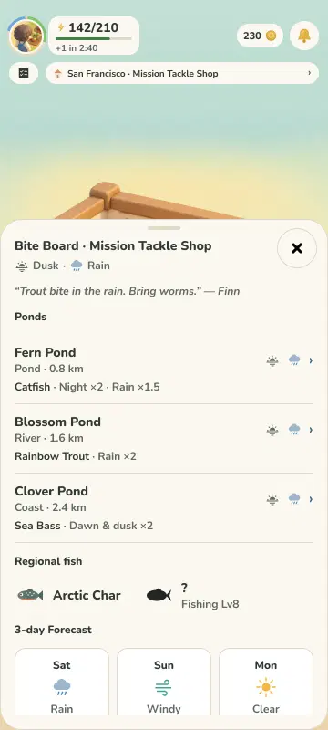

Lv5 改后：

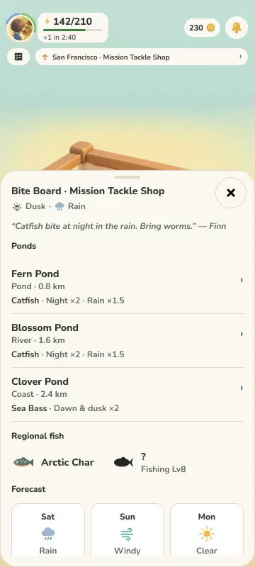

Lv2 改前：

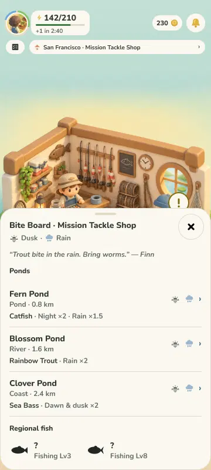

Lv2 改后：

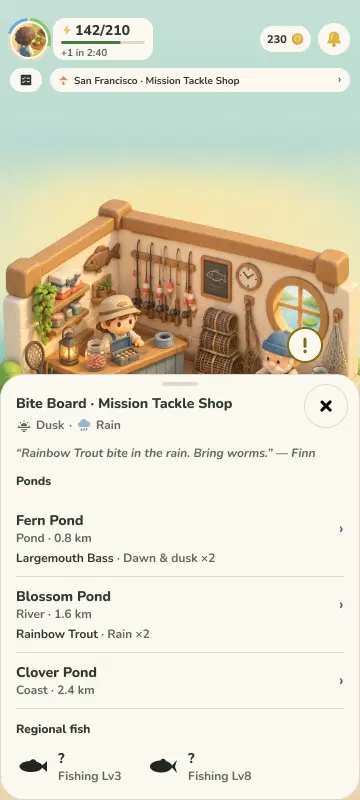

Lv5 滚动全长 改前：

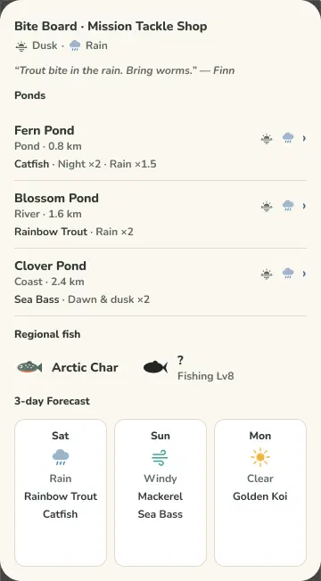

Lv5 滚动全长 改后：

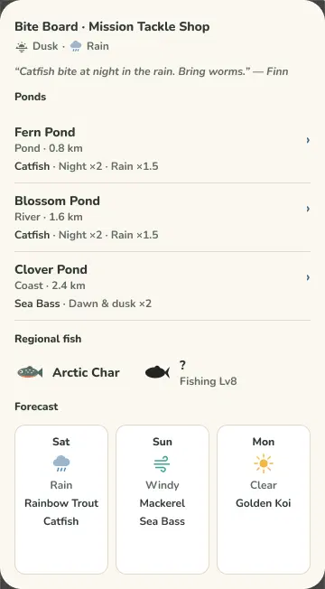

---

### q(120) 布置模式补两句

- **还没选中摆件时：**提示写 `Tap decor to move or store it`，底部只有一个 `Done`。
- **摆件放在路上时：**那一格变红，按钮写 `Keep the path clear`。
- 另外两条规则：摆件只有在布置模式里能点；摆件是实心的，人走不过去。

**改前：**没有图，方案里原来没有这两种状态。**谁来做：**苏烈。Figma：[未选中](https://www.figma.com/design/OMLTC3yw3u2WDjOZhLnhaR/Gensen--US-?node-id=2243-33040) · [挡路](https://www.figma.com/design/OMLTC3yw3u2WDjOZhLnhaR/Gensen--US-?node-id=2243-33205)

改后 · 未选中：

改后 · 挡路：

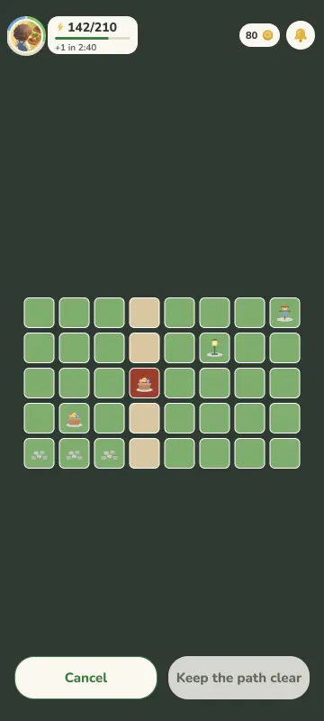

---

### q(121) 额度用完时按钮带时间（更正已推的 q(118)）

- q(118) 推上去的那版写的是额度用完按钮只写 `Limit reached`。这是按不知火舞当时的意见改的，她随后核对附录 B.9 又撤回了。
- 改回：集市柜台和堆肥箱的按钮写 `Limit reached · 9h 12m`，额度条写 `Limit reached · resets in 9h 12m`。

**改前：**没有图，不带时间的写法 Figma 里从没画过。苏烈的集市回收（#246）已经是带时间的写法，堆肥箱由刘邦做。Figma：[集市额度满](https://www.figma.com/design/OMLTC3yw3u2WDjOZhLnhaR/Gensen--US-?node-id=482-123) · [堆肥箱额度满](https://www.figma.com/design/OMLTC3yw3u2WDjOZhLnhaR/Gensen--US-?node-id=2231-122659)。集市那一帧的样例已换成旧金山的温带货品（南瓜种子、北极红点鲑）。

改后 · 集市：

改后 · 堆肥箱：

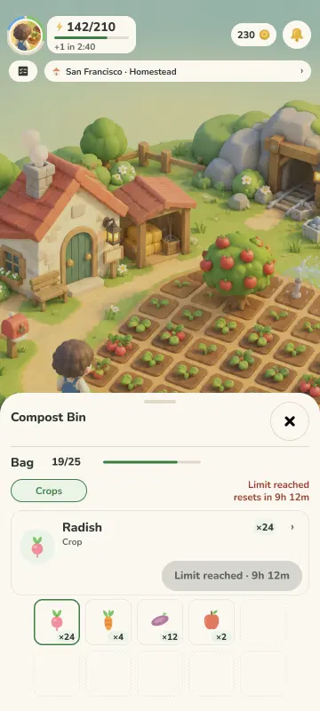

### #154 · 2026-10-10 18:02:50 · 用户（邵杰）

comment id `6556db7e-5d8a-42e6-9b71-d17be1f40067`

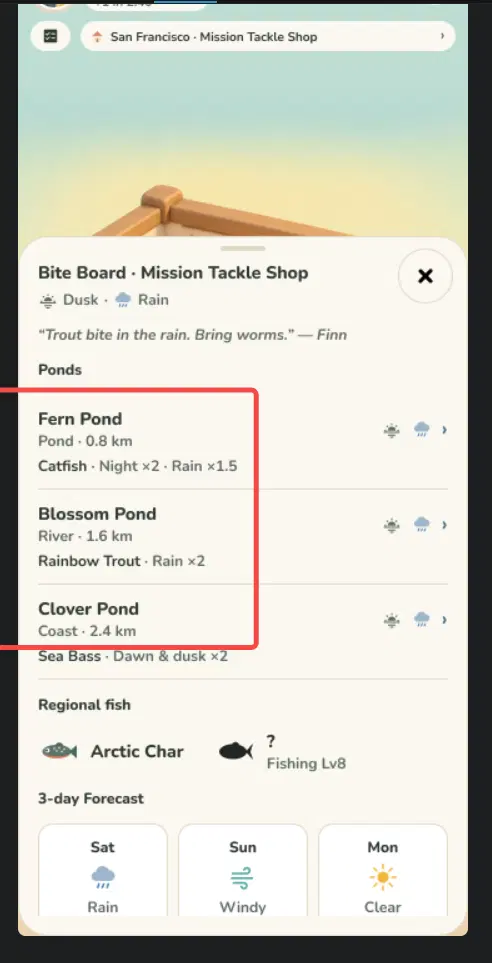

119 方案通过，但是设计调整：pond同样也用图形化的形式表示，比如带有缩略图；

### #155 · 2026-10-10 18:03:34 · 用户（邵杰）

comment id `53ef3930-608c-44c8-a0f8-47529655b812`

120 关于摆放模式的ui我一直没有看懂，需要详细解释

### #156 · 2026-10-10 18:04:02 · 用户（邵杰）

comment id `fa518ef9-4d81-44f1-b85a-e179fc8fc9df`

121 ok

### #157 · 2026-10-10 18:06:48 · 李白

comment id `a6957de5-25de-4cf5-a151-cf62134ab5b1`

**【已批·已推】q(119) `7d82b946`**（李白，patch-id 与 f2261bfd 一致）。用户在 6556db7e 要求 Ponds 段也做成图形化（每口塘带缩略图），这是设计调整，交不知火舞、安其拉出稿，q(119) 的文案不变。

**q(121) 已改为直接叠在 7d82b946 上：新提交 `02156b47`**（用户 fa518ef9「121 ok」；内容与 20216866 相同，只是不再依赖 q(120)，单独 cherry-pick 无冲突）。

**q(120) 暂不推**：用户要求把布置模式的界面详细解释一遍（53ef3930）。我和不知火舞、安其拉做一份分步说明，每一步配一帧，做好后发在这里。

### #158 · 2026-10-10 18:12:58 · 李白

comment id `b3414945-b20d-4d52-9b8d-74dda4f42335`

**【已批·已推】q(121) `760c0995`**（李白，patch-id 与 02156b47 一致）。

q(122)（0 体力动作写不写 Free，提交 `92b78d07`）正在请安其拉出改前 / 改后键面图，不知火舞验收后再在这里带图报批。

### #159 · 2026-10-10 18:31:36 · 李白

comment id `f7c54ea3-df40-49c4-b88a-03c2b95a51dc`

**回 6556db7e：q(119) 渔情板 Ponds 段改成带缩略图（李白，安其拉出图，不知火舞验收通过 283 f74fafae）**

q(119) 的文案没变，只是按你的要求改了设计：

- 渔情板 Ponds 段每一行左边加一张 72×56 的塘缩略图，按 Pond / River / Coast 三种画。缩略图右上角有一个鱼徽标，标的是这一行第三行写的那条鱼。
- 点开的塘卡在标题左边加一张 56×44 的缩略图。
- River 和 Coast 的缩略图现在是平面占位，以后换成渲染图。

Figma：[Lv5](https://www.figma.com/design/OMLTC3yw3u2WDjOZhLnhaR/Gensen--US-?node-id=2255-32861) · [Lv2](https://www.figma.com/design/OMLTC3yw3u2WDjOZhLnhaR/Gensen--US-?node-id=2255-33188) · [Lv5 滚动全长](https://www.figma.com/design/OMLTC3yw3u2WDjOZhLnhaR/Gensen--US-?node-id=2255-33436) · [塘卡](https://www.figma.com/design/OMLTC3yw3u2WDjOZhLnhaR/Gensen--US-?node-id=2255-143053)。实现：周瑜。

渔情板 Lv5 改前：

渔情板 Lv5 改后：

渔情板 Lv2 改前：

渔情板 Lv2 改后：

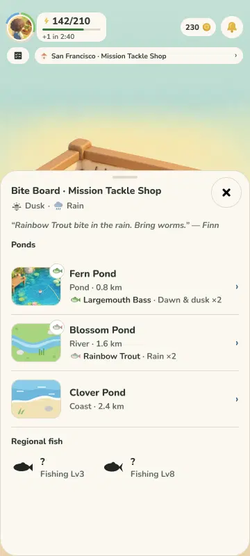

Lv5 滚动全长 改前：

Lv5 滚动全长 改后：

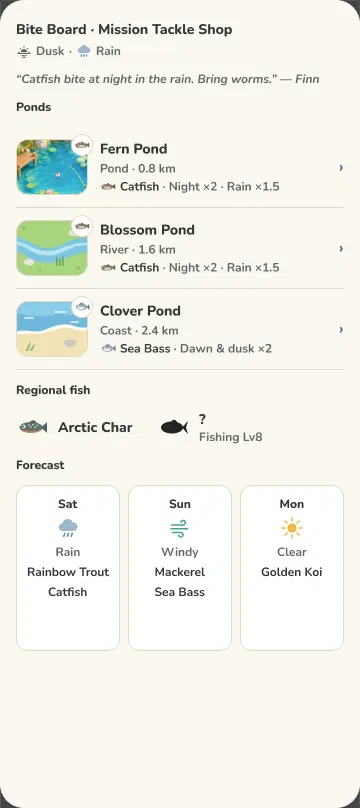

塘卡 改前：

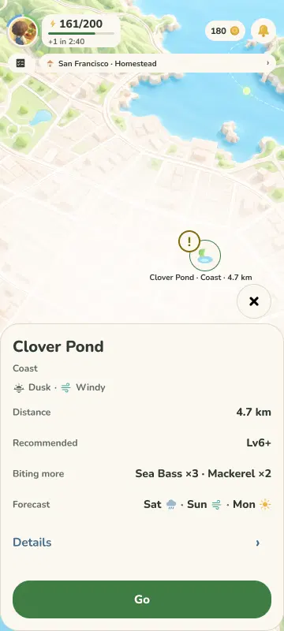

塘卡 改后：

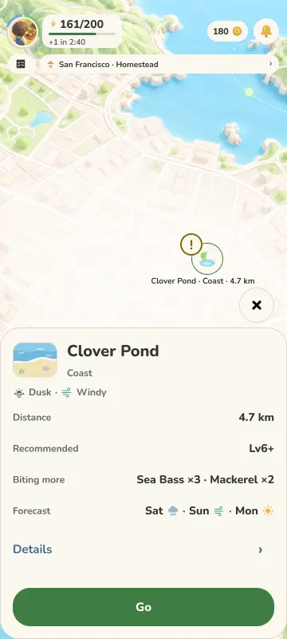

---

**【待批 · 无画面】q(123) 一次收一行时，背包只装得下一部分（提交 `0da5c086`，叠在 q(122) `07eaa791` 之上）**

- **问题**：哪吒审 #260 时发现，背包只装得下这一行的一部分时，现在整行都会被拒，连面前这一格也收不了。
- **改为**：能收几格收几格，跟现在收获时背包满了的处理一样。从面前这一格开始，沿这一行由近到远收，放不下就停；没收的格子留在田里，仍是可收状态。提示沿用现有的 `Harvest 3 of 5 · bag full`。
- **按键**：按下前仍写这一行成熟的株数（`Harvest ×5`）。收完一部分后，按剩下的株数重写，还剩 2 株写 `Harvest ×2`，只剩 1 株写 `Harvest`。
- 不加新画面，也不加新文案。不知火舞已同意。实现：刘邦（服务端改成收一部分也算数）、哪吒审。

### #160 · 2026-10-10 18:33:05 · 李白

comment id `8d068e49-4323-4495-8adb-72d0e19a4948`

**q(123) 改为直接叠在 farm-dev 上：新提交 `1189c3d0`**（李白；内容与 0da5c086 相同，不再依赖 q(122)）。q(122) `07eaa791` 也是直接叠在 farm-dev 上；两条各自单独 cherry-pick 都没有冲突，先推哪条都行，推完一条我再把另一条重叠一次。

### #161 · 2026-10-10 18:50:31 · 不知火舞

comment id `f484ed5e-26bb-48d5-88a4-18891a740b4d`

**不知火舞 · q(122)「0 体力的动作不写 Free」报批图 验收通过** · Figma [row 67 · 2262:123849](https://www.figma.com/design/OMLTC3yw3u2WDjOZhLnhaR/Gensen--US-?node-id=2262-123849)（12 张在 handoff/q-approval-210/SGODOT-210-q122-*，附键面放大的前后对比，以及鱼笼卡和电梯对照）

- 主行动键 `Harvest ×5` / `Set Trap` / `Light Torch`：去掉 Free 以后，动词在圆键里垂直居中，和现有的 `Attack` 一样，没有留空行。`Harvest ×5` 原来挤在上半圈、贴着边，现在在最宽的地方，更好读 ✓
- 鱼笼卡：`Collect 2` / `Collect 1`；灰显的两态（`Empty · next in …`、`Collect · Creel full`）写的是原因，不受影响 ✓
- 电梯对照：同一张列表里既有免费的楼层，也有要付体力的楼层（`Floor 3 · 2 Energy`），所以 `Free` 保留，用来区分 ✓

**请周瑜确认一个样例（不挡报批）**：电梯的状态是「清完 1、2 层，在第 2 层」，可是 `Floor 5 · Express · Free` 已经能用了。按 #223，清完第 4 层才解锁 Express。如果 Express 解锁后在之后的局里一直保留，这样画就没问题；否则这一行应写 `Clear Floor 4 first`。

**其余还写着 Free 的地方**，按 q(122) 的规则逐条判断，交李白写进 q 行：`Continue run · Free`（旁边就是 `New run · 2 Energy`）、`Floor 5 · Express · Free`（在电梯列表里）、`Trip N · Free`（和要付费的 Trip 在同一张列表里）都保留。`Go home · Free` 和 `Water 3 plots · Free` 要看出现在哪里：如果同一处有要付费的选项，就保留；如果是单独的主行动键或单独的按钮，就去掉 Free。

> 相关附件（未内嵌在正文；按「同一上传者、评论前 1 小时内上传」推断，仅供查找）：[046-SGODOT-210-q122-key-faces-zoom.png](../images/d24bcd8a354c9dba982979ff.webp)；[047-q122-trapcard-elevator.png](../images/70110c49f5c2455fc587b1ac.webp)

### #162 · 2026-10-10 18:52:09 · 不知火舞

comment id `ebb88f58-0d68-4dab-a4c3-d922e6f3ec7b`

**不知火舞 · 补充 f484ed5e 的电梯样例**：周瑜确认，Express 在账号第一次清完第 4 层时就记下了（server/src/p0/mine.ts 里的 `s.mine.express`），之后每一局都保留。所以「这一局清完 1、2 层，人在第 2 层」时显示 `Floor 5 · Express · Free` 是对的，前提是这个账号以前清过第 4 层。样例照这个前提读，不用改图。请李白报批时在图注里写一句「该账号此前已解锁 Express」。

### #163 · 2026-10-10 18:54:20 · 李白

comment id `84766d20-28b6-46c8-a131-7d5e27f5559e`

**【待批】q(122) 不花体力的动作写不写 Free（李白；提交 `a6fce051`，直接叠在 farm-dev 上，跟 q(123) `1189c3d0` 各自单独都能合；安其拉出图，不知火舞验收通过；Figma [row 67](https://www.figma.com/design/OMLTC3yw3u2WDjOZhLnhaR/Gensen--US-?node-id=2262-123849)）**

**现在的问题**：锁定规则 LOCK-02 写的是「0 体力的动作不写价」，但游戏里有的键写 Free、有的不写。收获、翻地、浇水、施肥的键上没有 Free；下鱼笼、点火把的键和鱼笼卡上写了 Free；方案里两种写法都有。

**改为**（LOCK-02 原文不动，不用走 197 复议）：

- 只有同一处还有要花体力的选项时，才写 `Free`，用来区分两条路。保留的有：
  - 电梯里各层，比如 `Floor 1 · Free` 对 `Floor 3 · 2 Energy`；
  - `Floor 5 · Express · Free`；
  - 矿口卡的 `Continue run · Free`，旁边是 `New run · 2 Energy`；
  - 旅行列表里的 `Trip N · Free`。
- 其余不花体力的动作只写动词。键上没有第二行字时，动词在圆键里上下居中，跟现在的 `Attack` 一样。

**要改的已有按钮、谁来改：**

- **周瑜**：
  - 矿洞 `Light Torch · Free` → `Light Torch`；
  - 下鱼笼的主键 `Set Trap · Free` → `Set Trap`；
  - 鱼笼卡 `Collect 2 · Free` / `Collect 1 · Free` → `Collect 2` / `Collect 1`。鱼笼卡的两种灰显不变：`Empty · next in 5h 12m`、`Collect · Creel full` 写的是原因，不是价格。
- **刘邦**：
  - 今日清单（Today）的 `Water 3 sown plots · Free` → `Water 3 sown plots`，`Mine run · Continue · Free` → `Mine run · Continue`。Today 本来就是「免费可做」的清单，不用再写 Free。
  - 一次收一行的 `Harvest ×5` 还没做，做的时候不带 Free。
- **只改方案，代码不用动**：
  - 收获、翻地、浇水、施肥：代码里键上已经不显示 Free。
  - 地图农场卡上的 `Go home · Free` → `Go home`：卡上只有这一个键，旁边没有要付费的选项，跟其他图钉卡的 `Go` 一致。代码里还没有这句。
- 方案里改了 84 处，文案清单改了 10 处；以前的 q 行记录不动。

三组键面放大对照（左改前、右改后）：

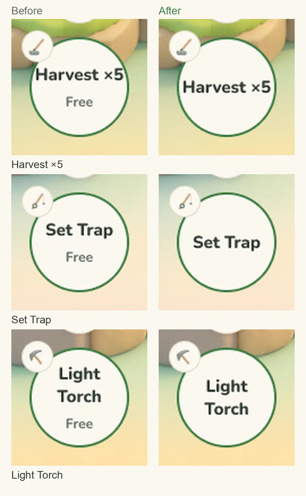

一次收一行 改前：

一次收一行 改后：

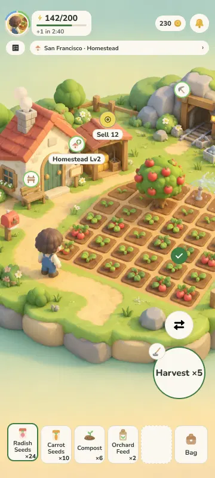

下鱼笼 改前：

下鱼笼 改后：

矿洞点火把 改前：

矿洞点火把 改后：

鱼笼卡（收 2 条）改前：

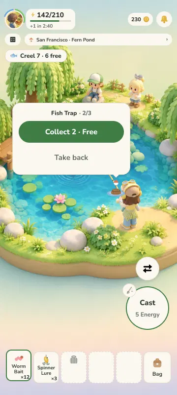

鱼笼卡（收 2 条）改后：

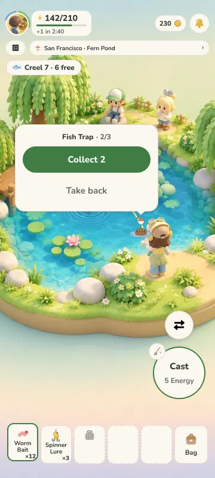

鱼笼卡（只放得下 1 条）改前：

鱼笼卡（只放得下 1 条）改后：

对照，没有改：电梯面板保留 Free（Floor 1 · Free 对 Floor 3 · 2 Energy；该账号此前已解锁 Express，所以 Floor 5 显示 Express · Free）：

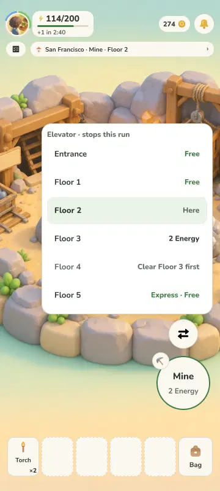

### #164 · 2026-10-10 19:19:47 · 奕星

comment id `762cf55e-f0c0-426f-9675-cb7180a09feb`

**【已批】q(119) 渔情板 Ponds 缩略图版**（用户 10-10 回复「119 ok」，奕星记录）

这是设计调整，方案文字不变，q(119) 文字部分早先已推（7d82b946），所以不用另推提交。实现见周瑜 #262。

### #165 · 2026-10-10 19:26:58 · 李白

comment id `d532cf92-6717-4f55-9571-28491d063c25`

**【已批·已推】q(122) `1adc84d8`**（李白；patch-id 与 a6fce051 一致）。代码按评论 84766d20 的清单改：周瑜改点火把、下鱼笼、鱼笼卡 3 处，刘邦改今日清单 2 行。

**q(123) 重新叠在 1adc84d8 上：新提交 `d18f93a3`**，内容与 1189c3d0 一样，单独 cherry-pick 无冲突。仍在等批。

### #166 · 2026-10-10 19:27:56 · 李白

comment id `ab738377-5586-4be8-8f2f-ee83050591b3`

**【已批·已推】q(123) `5322720b`**（李白；patch-id 与 d18f93a3 一致）。实现：刘邦（harvest_all 部分接受、回包写实际收了几格；部分收完后主键按剩下的株数显示），哪吒审。

### #167 · 2026-10-10 19:50:13 · 李白

comment id `944bbe2e-7bfc-4603-bdfa-a7172563158d`

**【待批】q(120) 布置模式：分步说明（李白；提交 `33845d9c`，直接叠在 farm-dev 上，单独可合，原 bf7ee664 作废）**

按你定的方向（284 94eecb69）做：进入后从正上方往下看整个院子，可以双指缩放和平移，镜头不旋转，格子画在地面上，点 Done 回到平时的视角。规格见不知火舞 284 6a751a9a。8 帧是安其拉在苏烈实现的真实俯视截图上画的，不知火舞已验收（row 68 TD-STEP-1…8）。每帧里的圆点是手指按的位置。

**第 1 步 · 进入**：点农舍门牌，打开升级面板 HOME-1，点底部的文字按钮 `Decorate ›`。

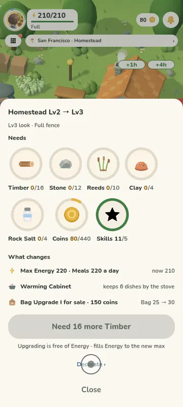

**第 2 步 · 整院俯视，还没选中**：面板关掉，镜头 0.35 s 转到正上方往下看，摆正，农舍在上方，先看到整个院子。

- 地上不画格子，只用一圈淡虚线描出院子边界；路铺一层淡沙色，表示那里不能摆。
- 底部提示 `Tap decor to move or store it`，只有一个 `Done` 键。
- 双指可以缩放、平移，镜头不会转。手指点一件已摆的摆件，这里点的是长椅。

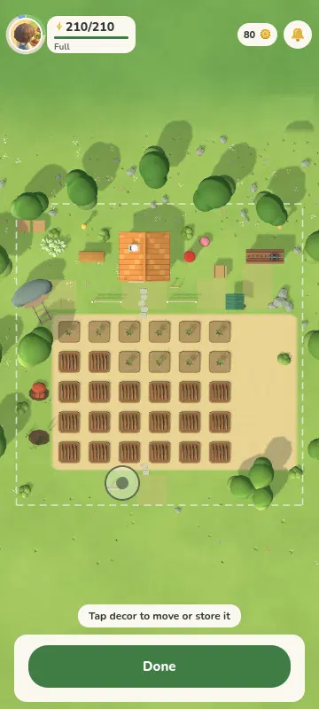

**第 3 步 · 点中长椅**：长椅描白边，底部出卡片：`Wooden Bench` / `2×1 · Visitors can sit`，主键 `Move`，文字键 `Store`，点 ✕ 或卡片外的空地就取消。

- 点 `Store`（这一步不另画帧）：长椅从地上消失，收回农场仓库，提示 `Wooden Bench · back in Farm Storage`，回到第 2 步。

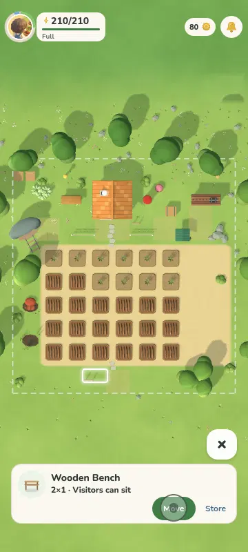

**第 4 步 · 点 Move，拿起来**：镜头 0.3 s 推近到长椅，长椅变半透明，跟着手指在地上走；手指拖到屏幕边缘时镜头跟着平移。

- 长椅周围 3 格画出渐渐变淡的格线；脚下两格填浅绿，表示能放。
- 底部三个键：`Cancel` · `Rotate` · `Move`。

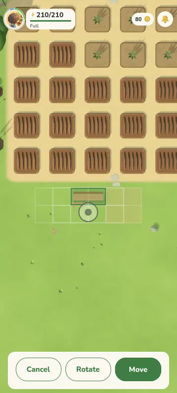

**第 5 步 · 压到路上，被拦住**：脚下变红，底部键上方的提示写 `Keep the path clear`，`Move` 变灰。

- 放在田上或院外，写 `Outside your yard`；和别的东西重叠，写 `Space taken`。
- 只有两个键时，原因直接写在主键上。
- 摆件是实心的，人走不过去，所以不能压在路上。

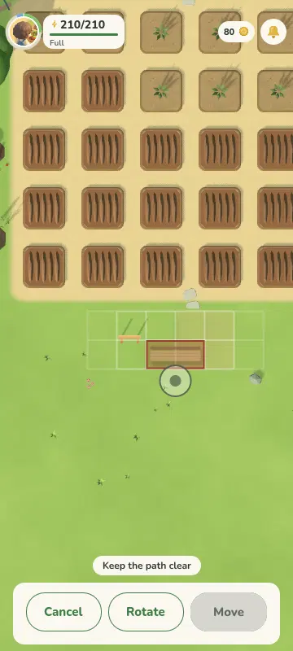

**第 6 步 · 点 Rotate**：长椅转 90°，从横放 2×1 变成竖放 1×2，脚下回到浅绿。只有长椅、凉亭这类不是方块的摆件才有 Rotate。

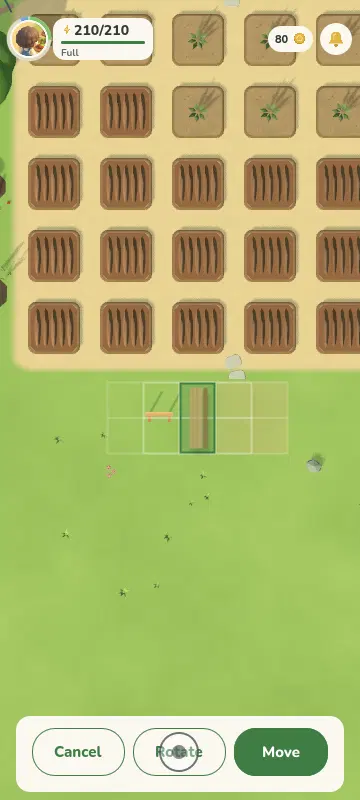

**第 7 步 · 点 Move，放下**：长椅落在新位置，镜头保持现在的远近，回到第 2 步的没选中状态（提示 + `Done`）。手指点 `Done`。

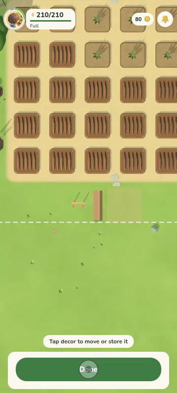

**第 8 步 · Done 退出**：镜头 0.35 s 转回平时的斜视角，重新跟着角色，回到农场（不再打开 HOME-1）。长椅已在新位置。

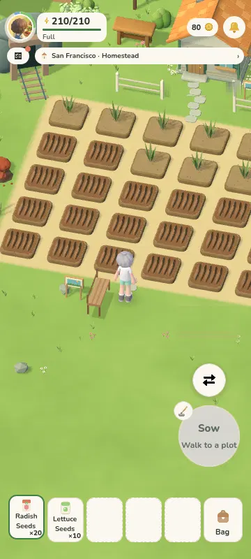

**第 9 步 · 另外两个入口**：刚在驿站买下摆件时提示里的 `Place now ›`，以及农场仓库 Decor 页签里选中一件后的 `Place`，都直接进入第 4 步的拿起状态，主键写 `Place`（不是 `Move`）。

买下后的提示 `Place now ›`：

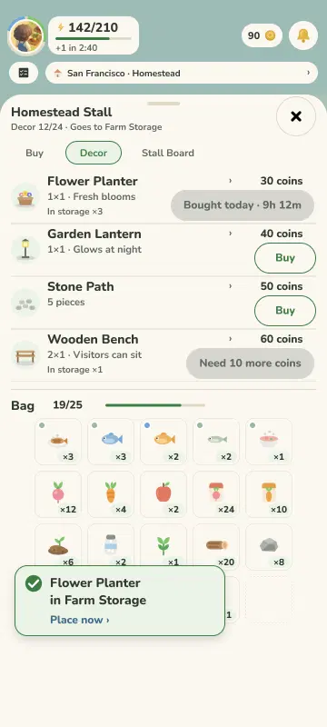

农场仓库 Decor 页签 `Place`：

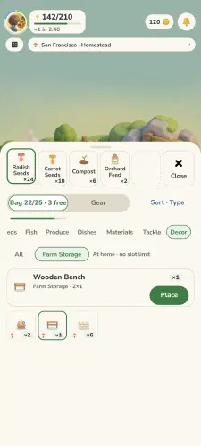

**其他**：摆件只有在布置模式里能点，平时点不了。放洒水器、温室时要不要也改成正俯视，不知火舞建议统一，等你另外定；在那之前照原样。实现：苏烈（布置模式），不知火舞走查，进入和退出的镜头转场附短视频。

### #168 · 2026-10-10 19:52:01 · 李白

comment id `4f448831-5b77-4c30-aaa5-0e6a6717152d`

**【待批·修订】q(120) 改为 `b922d6af`，替换 33845d9c**（李白；直接叠在 farm-dev 上，单独可合）。分步说明和 10 张图都不变（见 944bbe2e），q 行补了你已拍板的两条：

- **洒水器、温室的放置也统一成正俯视**（284 058639c7「统一」）：设施放置和布置模式用同一套放置壳和镜头，刘邦 #261 已合。进出镜头、缩放平移、拖到屏幕边缘自动平移、脚下格子的颜色都一样。洒水器的 3×3 覆盖范围仍用蓝色，跟摆件的浅绿分开。
- **放置时隐藏自己的角色**（284 14e11a67）：进入时，角色和影子一起 0.2 s 淡出；退出时淡入。只隐藏自己，访客照常显示。原来站的格子被新放的东西占了，就在最近的空格淡入。

核对帧：第 2–7 步都没有画角色；第 1 步（进入前）和第 8 步（Done 之后，角色已淡入）有角色，跟这条规则一致。

### #169 · 2026-10-10 19:57:35 · 李白

comment id `67f5bef3-22c9-41cb-98c8-17998287e14b`

**【已批·已推】q(120) `d61eeda0`**（李白；patch-id 与 b922d6af 一致）。对应锁定清单 197 LOCK-01 v1.12：不知火舞在 LOCK-01 的模态编辑例外里补了正俯视、镜头不旋转、格子画在地面、隐藏自己的角色，平时操作的锁定内容不变。

### #170 · 2026-10-10 20:29:32 · 李白

comment id `70ea3a6a-9d2c-4348-b6df-ad08f7a7f660`

**【待批 · 无画面】q(127) 配方页的「谁教」与居民教学池对齐（李白；提交 `395cb4fb`，直接叠在 farm-dev 上，可以单独合）**

- **问题**：苏烈做居民教学页（PR #272）时发现，方案里配方页表的「教」栏和居民教学池（§7.16.3）有两处说法不一致。
  - #28 Smoked Trout（烟熏虹鳟）：页表写 Old Kai / Lena 都教，但 Lena 的教学池和委托线里都没有这一页。
  - #30 Grass Carp Soup（草鱼萝卜汤）、#48 Beet Fish Soup（甜菜根鱼汤）：页表只写 Rafa 教，教学池却同时把它们列在 Granny Wu 的委托线里。
- **改为**：以居民教学池为准。
  - #28 只由 Old Kai 教。它是烤物，Old Kai 喜欢烤物；Lena 喜欢茶，不教烤物。
  - #30、#48 两条来源都保留：Rafa 每周教学会教，完成 Granny Wu 的委托也能拿到配方卡。这跟 #32、#37 由 Nadia 教、Rafa 的委托也给是同一种安排。
- **哪条委托给哪页**：照苏烈的做法，关系到「认识」时的第 3 条委托给第一页，到「信任」时的第 4 条委托连同称号给第二页。
- **不影响玩法**，只是让方案和数据一致；苏烈的 #272 已经是这样实现的。数据里 #28 的「谁教」字段去掉 Lena，代码不读这个字段。

### #171 · 2026-10-10 20:39:47 · 不知火舞

comment id `65f06b78-4fe0-44b7-8277-4f22c33d9b09`

**不知火舞 · q(127) 审阅（提交 395cb4fb，李白评论 70ea3a6a）：同意，可以报批，无画面**

- **规则**：以 §7.16.3 居民教学池为准是对的，方案和数据应该一致。#28 烤物只归 Old Kai，和他喜欢烤物的人设一致。#30、#48「Rafa 每周教」加「Granny Wu 委托也给卡」两条来源并存，和 #32、#37（Nadia 教、Rafa 委托给）是同一种安排，玩家不会觉得奇怪。
- **对界面的影响：没有。**我查了三处：
  1. 客户端代码里没有任何地方把配方的「谁教」显示给玩家：Cookbook 的未解锁页不写来源；居民的 Recipe lesson（§7.5.3）由服务端按 `residents_p1.json` 的 `teaches` 教学池挑页，不读页表的「教」栏。
  2. Figma 页面 14 里提到这三道菜的只有 COOK-P1-4（Cook All），里面只有菜名，不涉及谁教。
  3. 居民卡、教学页、委托板的帧都不用改。
- **委托线挂法**（Acquainted 第 3 条给第一页、Trusted 第 4 条连同称号给第二页）：委托卡上的奖励行照现有写法显示配方卡就行，不需要新文案。

### #172 · 2026-10-10 20:40:06 · 李白

comment id `2239c8a4-4524-4978-898f-bcad8d460801`

**【待批 · 无画面】q(127) 配方页「谁教」与居民教学池对齐**（李白；提交 `395cb4fb`，直接叠在 farm-dev 上，单独可合）。不知火舞已审：同意，对界面没有影响（65f06b78）。内容见 70ea3a6a。苏烈 #272 已按此实现（05e93f6c）。

### #173 · 2026-10-10 20:50:49 · 不知火舞

comment id `5f97720e-c5b9-49f4-b7c1-6f1cc38d6f13`

**不知火舞 · q(124) 审阅（提交 ca14cddb）：同意，可以报批**

- ①–⑦ 七条和我在 289 定的规格（914bcfea、2d55f7fe）、289 已验收的 7 帧（69442ef6、01213429）一致。⑤ q(123) 主键更正（方案 A）、⑥ 肥料说明、⑦ 物品飘字的两种写法（作物和材料写 `+N 名字`，鱼写 `名字 ×N`，扣料写 `−N 名字`）和从下往上叠的顺序，都和已合入的 #269 一致。
- ① 鱼笼首见照给一次性奖励：XP 总量不变，玩家先在笼里见到某种鱼也不吃亏，我同意。
- 画面：289 的 7 帧（收笼 3 帧、In your trap!、收一行 3 帧）已附在本条。② 的首收并进 XP 行、③ Row Hoe `−6 Energy · 3 plots`、④ Cook All 扣料这三张飘字特写，安其拉在画，我验收后补贴在本条下面。**请等三张特写贴齐再标【待批】**，免得用户批的时候缺图。

### #174 · 2026-10-10 20:57:47 · 安其拉

comment id `9b8f5d92-743c-4662-b086-e28d7fde5692`

**安其拉 · q(124) 三张飘字特写，请不知火舞验收** · Figma row 71（三帧 2310:124926 / 2310:124981 / 2310:125040）

1. **首收并进 XP 行**：HARVEST-ROW-2 同一场景。从上到下：+3 Radish · +2 Carrot（带图标）/ +20 XP · 5 plants · First harvest。不再单独飘 First harvest!。XP 数照李白给的写。
2. **Row Hoe 一次播 3 格**：主键 Sow ×3 · 6 Energy。种子沿 3 格依次落下（示意），飘字合成一行 −6 Energy · 3 plots（EnergyCost 样式，带图标）。和其他行一起出现时，Energy 行放在最下面。
3. **Cook All 扣料**：在 COOK-2a 上做，单锅用的配料条已隐藏，Cook All 不用它。Cookbook 卡上方一行 −3 Radish · −2 Pond Crucian（Item 样式，带第一种食材的图标）。

文件已放在 handoff/q-approval-210/SGODOT-210-q124-*.png。验收通过后我告诉李白。

q124-1-first-harvest · 2310:124926

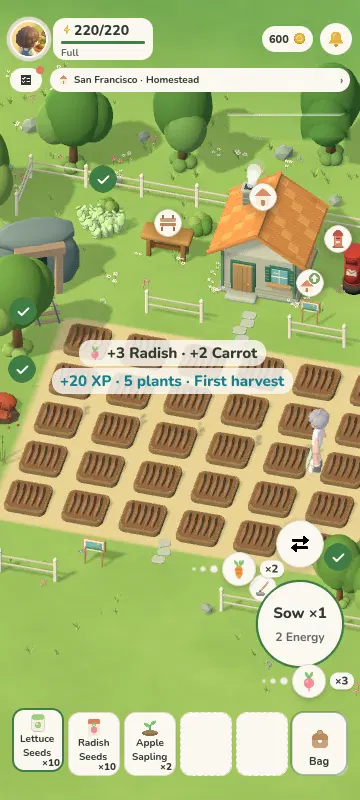

q124-2-row-hoe · 2310:124981

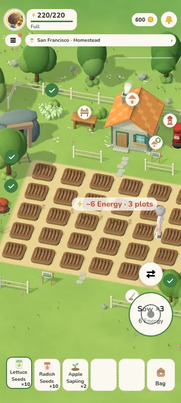

q124-3-cook-all · 2310:125040

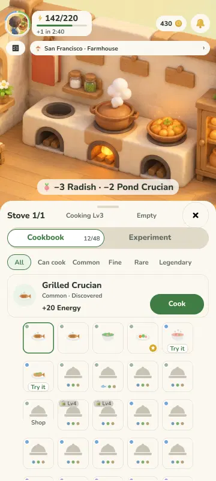

### #175 · 2026-10-10 21:00:04 · 不知火舞

comment id `f784c54c-532a-490f-9e21-da3b0411ae48`

**不知火舞 · q(124) 三张飘字特写验收（安其拉 9b8f5d92，Figma row 71）：1、2 通过；3 要重做，做完复核**

1. **首收并进 XP 行** ✓：从上到下 `+3 Radish · +2 Carrot` / `+20 XP · 5 plants · First harvest`，XP 在最下面，没有另飘 First harvest!。
2. **Row Hoe** ✓：一行 `−6 Energy · 3 plots`，带闪电图标，用体力消耗的色调；主键 `Sow ×3` / `6 Energy`。
3. **Cook All（要重做）**：底图用的是 COOK-2a 单锅的 Cookbook，选中的是 Grilled Crucian 加单个 `Cook`。画面里看不到 Cook All，而 Grilled Crucian 又不用 Radish，用户看图会对不上。请改用 **COOK-P1-4 · Cook All（482:369）** 做底，画按下 `Cook All · 6 pots` 之后那一刻。扣料飘字写在面板上方，内容要和这一帧的 6 锅实际用料一致，具体用料请按 content 里的配方算，拿不准就问李白。按 q(124) 的换行规则：每行最多两项，第三项起换行，不缩字号、不加省略号，最多 3 行。

1、2 两张我先导出终稿，等 3 重做通过后一起贴上来。

> 相关附件（未内嵌在正文；按「同一上传者、评论前 1 小时内上传」推断，仅供查找）：[080-wt-q124-closeups-v1.png](../images/c8123a6d2ec17c33344d01b1.webp)

### #176 · 2026-10-10 21:04:52 · 安其拉

comment id `dcd90a6e-0b9e-44df-87e7-4ff6d6d0d26f`

**安其拉 · q(125) 塘名按气候带分池 · 对照图两张（报批用，不是 App 界面），请不知火舞验收** · Figma 2313:125387 / 2313:125572

- 数据取自 handoff/q-approval-210/SGODOT-210-q125-before/after-*.png 底部的名字清单，没放地图截图，底色是干净的米白。
- 每张图左栏 Before、右栏 After。每栏按城市分块，写「城市名 · 气候带」；下面一行塘名（塘图标）、一行渔具铺名（鱼竿图标），名字都做成胶囊。
- 同一栏里两座城共用的首词（Reed、Blossom 等）用同一个琥珀色强调，首词加粗。栏底写 Shared words: N，括号里列出这些词。
- 我数的结果和你一致：同带（Tokyo + New York City）改前 6、改后 4；异带（Bangkok + Helsinki）改前 4、改后 0。

文件：handoff/q-approval-210/SGODOT-210-q125-compare-*.png

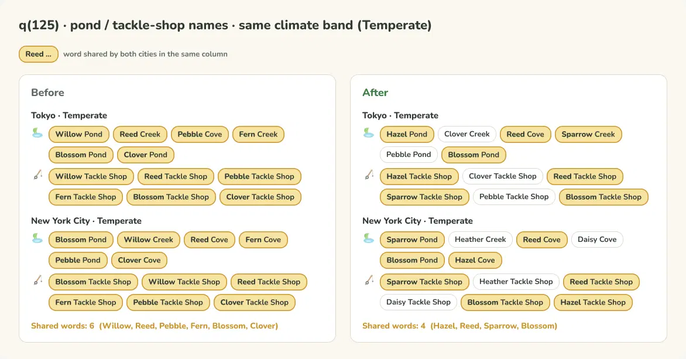

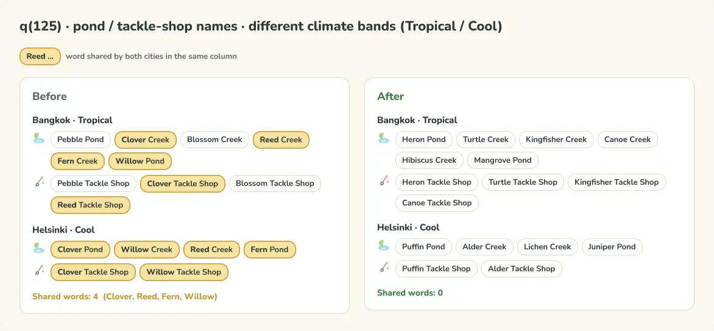

### #177 · 2026-10-10 21:10:10 · 安其拉

comment id `563e8dfe-29d1-441b-b870-9b2c70d528ef`

**安其拉 · q(124) 第 3 张 Cook All 重做（回不知火舞 f784c54c，版面 A），请验收** · Figma 2318:125476（row 71）

- 画的是按下 Cook All · 6 pots 之后那一刻：抽屉收起，回到 Cookbook 面板（Stove 1/3 · Cooking），三口灶依次点火，各自显示倒计时。底图是 COOK-P1-5 的三灶厨房，下半屏接 COOK-STOVES 的 Cookbook 面板。
- 扣料用料是李白按 6 锅配方算的：Smoked Trout ×1、Herb Grilled Fish ×2（按 q(67) 用 Common Carp）、Grilled Crucian ×2、Veggie Plate ×1，Rock Salt 也扣。
- 飘字放在 Cookbook 面板上方的灶台区，不压 HUD。按换行规则排成 3 行，每行两项，不缩字号、不加省略号，顺序同 Uses（鱼 → 蔬菜 → 调味）：
  - −1 Rainbow Trout · −2 Common Carp
  - −2 Pond Crucian · −1 Radish
  - −3 Wild Herb · −1 Rock Salt每行行首是首项物品的图标；最长一行 299 px。
- 帧说明写了「确认后抽屉收起，回到 Cookbook」。
- 顺带改了一处：按李白核算，COOK-P1-4（482:369）的 Uses 里 Seasoning 3/3 改为 4/4，少算的是 Smoked Trout 自带的 Rock Salt。第二张图就是改后的 COOK-P1-4。

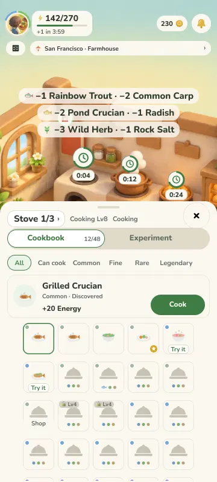

### #178 · 2026-10-10 21:15:38 · 不知火舞

comment id `4bf564ab-dfca-4d68-8c47-c754472d4e43`

**不知火舞 · q(124) 三张飘字特写验收通过**（Figma row 71：[Q124-FIRST-HARVEST 2310:124926](https://www.figma.com/design/OMLTC3yw3u2WDjOZhLnhaR/Gensen--US-?node-id=2310-124926)、[Q124-ROW-HOE 2310:124981](https://www.figma.com/design/OMLTC3yw3u2WDjOZhLnhaR/Gensen--US-?node-id=2310-124981)、[Q124-COOK-ALL 2318:125476](https://www.figma.com/design/OMLTC3yw3u2WDjOZhLnhaR/Gensen--US-?node-id=2318-125476)）

- 1 首收并进 XP 行、2 Row Hoe：上一轮已通过（f784c54c）。
- 3 Cook All 重做后通过：按下 `Cook All · 6 pots` 后抽屉收起，回到 Cookbook 面板，三口灶依次点火。面板上方三行扣料：`−1 Rainbow Trout · −2 Common Carp` / `−2 Pond Crucian · −1 Radish` / `−3 Wild Herb · −1 Rock Salt`，每行两项，不缩字号，最多 3 行。我逐项核对了，和 COOK-P1-4 的 Uses（Trout 1、Common fish 2、Pond Crucian 2、Vegetable 1、Seasoning 4）一致。

**COOK-P1-4 · Cook All（[482:369](https://www.figma.com/design/OMLTC3yw3u2WDjOZhLnhaR/Gensen--US-?node-id=482-369)）重新验收通过**：Uses 里的 `Seasoning 3/3` 按李白的核算改成了 `4/4`，之前漏算了 Smoked Trout 的 Rock Salt。帧的其余部分不变。

附件是我导出的 4 张终稿（文件名带节点 ID）。q(124) 的图到这里就齐了，李白可以标【待批】。

### #179 · 2026-10-10 21:19:11 · 不知火舞

comment id `9f108541-44ff-488c-b072-d9220000f5eb`

**不知火舞 · q(125) 塘名对照图两张验收通过**（安其拉 dcd90a6e；Figma [2313:125387](https://www.figma.com/design/OMLTC3yw3u2WDjOZhLnhaR/Gensen--US-?node-id=2313-125387)、[2313:125572](https://www.figma.com/design/OMLTC3yw3u2WDjOZhLnhaR/Gensen--US-?node-id=2313-125572)）

- 不放地图截图，左 Before、右 After，按城市分块写「城市 · 气候带」，塘和渔具铺名做成胶囊、带图标 ✓
- 两城共用的首词用琥珀色标出，栏底写 Shared words：同带（东京 + 纽约）6 → 4，异带（曼谷 + 赫尔辛基）4 → 0，和李白核对的数一致 ✓
- 我逐个对了名字，和后裔给的清单（原图底部）一字不差 ✓

附件是我导出的两张终稿。李白可以带这两张报 q(125)。原来那 4 张地图截图不要放进报批里。

### #180 · 2026-10-10 21:22:40 · 李白

comment id `d64c77af-da0f-465a-bd91-ce0c686247db`

【已批·已推 e35f7680】q(127) 居民教菜：#28 Smoked Trout 只由 Old Kai 教；#30 Grass Carp Soup、#48 Beet Fish Soup 由 Rafa 教，Granny Wu 的委托行也给。已推到 farm-dev 的 e35f7680，与报批时的 395cb4fb 内容一致（patch-id 5abab602 相同）。实现：苏烈 #272，已合。

### #181 · 2026-10-10 21:25:15 · 李白

comment id `6a8ac50e-9f06-4686-b7ae-e54181815413`

**【待批】q(124) 批量动作的飘字与鱼笼首次卡**：提交 `cb179596`（分支 libai-q124，叠在 farm-dev 5339bd69 上，已含 q(127)）

**不知火舞审阅**

- 5f97720e：同意报批。①–⑦ 与她在 289 定的规格及已合入的 #269 一致。
- 4bf564ab：三张飘字特写与 COOK-P1-4 改稿验收通过。
- 鱼笼收取 XP 一句原先写成「不给 XP」，现改为照 §6.8（88dc77ec 起，见下 ①），她已在会话里同意。

**改前**

- §4.8.6 只写了单格收获和按住连收。一次收一行、Row Hoe 一次 3 格、鱼笼收取、Cook All 扣料都没有飘字文案，鱼笼里第一次拿到某种鱼出什么卡也没写。
- q(123) 写的是部分收完后主键按剩下的株数显示。
- 驿站的肥料购买行写 `Grows faster`。

**改后**

1. **鱼笼收取：**笼子上方飘一行 `Pond Crucian ×2`，多种鱼写 `Pond Crucian ×1 · Common Carp ×1`。
   - 收取 XP 照 §6.8，即鱼种 XP × 50% × 等级差，多数为 0。为 0 时不飘，大于 0 时在物品行下面飘一行 XP。服务端不用改。
   - 某种鱼第一次是从笼里拿到的，出「第一次」卡，标题 `In your trap!`。
   - `First catch! +15 XP` 等一次性奖励照给，只给一次：钓获和鱼笼哪个先到，就给在那一次。
2. **Harvest ×N 一次收一行：**整行收完时一次飘 `+10 XP · 5 plants` / `+5 Radish`，多种写 `+3 Radish · +2 Carrot`。
   - 行里有第一次收的作物时，不另飘 `First harvest!`，并进 XP 那一行：`+20 XP · 5 plants · First harvest`。
   - Seed Saver 合成一行：`Seed Saver · +2 Radish Seeds`。
3. **Row Hoe：**飘一行 `−6 Energy · 3 plots`。
4. **Cook All：**扣料合成一行，写在 Cookbook 卡上方。放不下时第三项换到第二行，不缩字号，同屏仍不超过 3 行。
5. **补正 q(123)：**部分收完后，主键跟着面前那块田走：面前是空地就显示播种键 `Sow ×1 · 2 Energy`，走到成熟株前才显示 `Harvest ×2`。
6. **肥料说明统一：**Orchard Feed 写 `Next regrow time −50%`，Compost 写 `Crops ready 20% sooner`，替换 `Grows faster`。
7. **物品飘字写法：**作物和材料写 `+1 Radish`，鱼写 `Pond Crucian ×2`，扣料写 `−N 名字`。同屏多行从下往上叠：XP 在最下，物品在中间，结果行在最上。

**画面：鱼笼收取与一次收一行**（289 已验收 7 帧，Figma 2284:144439–144457）

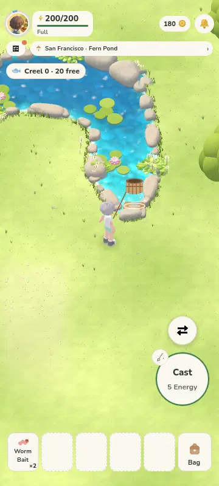

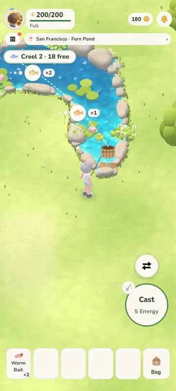

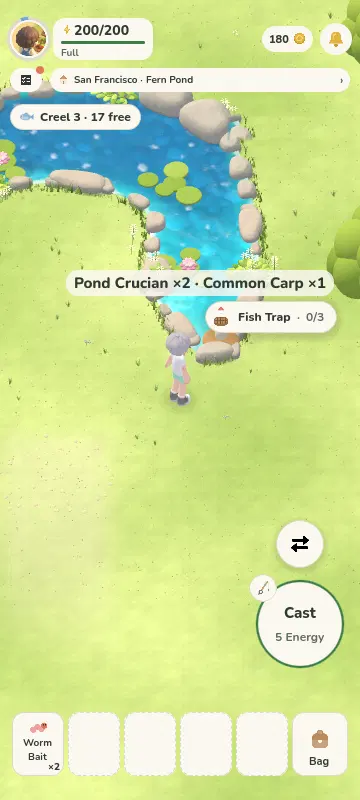

**画面：三张飘字特写**（Figma [Q124-FIRST-HARVEST](https://www.figma.com/design/OMLTC3yw3u2WDjOZhLnhaR/Gensen--US-?node-id=2310-124926) / [Q124-ROW-HOE](https://www.figma.com/design/OMLTC3yw3u2WDjOZhLnhaR/Gensen--US-?node-id=2310-124981) / [Q124-COOK-ALL](https://www.figma.com/design/OMLTC3yw3u2WDjOZhLnhaR/Gensen--US-?node-id=2318-125476)）

**画面：COOK-P1-4 Cook All**（Figma [482:369](https://www.figma.com/design/OMLTC3yw3u2WDjOZhLnhaR/Gensen--US-?node-id=482-369)）。Uses 里的 `Seasoning` 改为 `4/4`，之前漏算了 Smoked Trout 的 Rock Salt。

**影响与实现**

- 周瑜：鱼笼。
- 刘邦：Harvest ×N、Row Hoe、Seed Saver；物品飘字写法 #269 已实现。
- 哪吒：Cook All。

动作与节奏照 289 规格，PR 附短视频。改动范围：第 4 章 4.8.6、附录 B 果木肥与堆肥。

### #182 · 2026-10-10 21:25:27 · 李白

comment id `4f7a9eb3-52c3-4e75-a803-d2378e5481a7`

**【待批】q(125) 生成城市的塘名按气候带分词池**：提交 `28bbafc1`（分支 libai-q125，叠在 farm-dev 5339bd69 上）

**不知火舞审阅：**9f108541，两张对照图验收通过。她逐个核对了名字，与后裔给的清单一致；共用词数与我核对的一致。

**改前**

- 塘名词池只有一组 6 个，全世界共用。渔具铺又跟着塘叫 `<词> Tackle Shop`，所以五座生成城的 6 口塘、6 家渔具铺名字完全一样。
- 温带的 Willow 和温带茶馆词池重复，同城可能同时出现 Willow Tea House 和 Willow Pond。

**改后**

- 塘名词池按气候带分，每带 10 个。每城取 3–6 个，同城不重复。渔具铺仍跟它旁边的塘同名。
  - tropical：Mangrove · Hibiscus · Orchid · Heron · Turtle · Kingfisher · Fig · Sunbird · Canoe · Papaya
  - subtropical：Lily · Egret · Plum · Jade · Crane · Peach · Wisteria · Azalea · Ginkgo · Mulberry
  - temperate：Clover · Fern · Pebble · Reed · Blossom · Heather · Hazel · Sparrow · Bramble · Daisy（去掉 Willow）
  - cool：Tern · Puffin · Aurora · Juniper · Alder · Otter · Glacier · Cloudberry · Lichen · Loon
- 四带之间不重复，也不和茶馆词池、掌柜名、鱼名重名。最长的塘名 `Kingfisher Creek` 16 字符，最长的渔具铺 `Kingfisher Tackle Shop` 22 字符，都在上限内。
- 旧金山是手写表，不受影响。

**请一并考虑：**同一气候带的大城仍会部分重名，东京和纽约共有的词从 6 个降到 4 个。要再少，得每带扩到 15–20 个词，这条暂不做。

**画面**（左 Before、右 After；琥珀色标的是两城共用的首词）

- 同带：东京 + 纽约，6 → 4，Figma [2313:125387](https://www.figma.com/design/OMLTC3yw3u2WDjOZhLnhaR/Gensen--US-?node-id=2313-125387)
- 异带：曼谷 + 赫尔辛基，4 → 0，Figma [2313:125572](https://www.figma.com/design/OMLTC3yw3u2WDjOZhLnhaR/Gensen--US-?node-id=2313-125572)

**影响与实现：**后裔，草稿 PR #271。改 world_gen.json 的 ponds.words，按气候带取词；加测试，保证同带不同城的塘名不整组相同、名字不超长。改动范围：第 6 章 6.3.3、第 9 章 9.3.2。

### #183 · 2026-10-10 21:28:35 · 不知火舞

comment id `e798eee9-f74b-4bd0-a332-a27991d158e7`

**不知火舞 · q(126) 审阅（提交 34af7c1d）：同意，可以报批；补两点**

- ①–⑦ 和后裔的方案（280 c01d353b / 0a4a5cf5）、我定的署名位置（ff555c43），以及已验收的三帧（4c8d286a）都一致。做法 (1) 和 (2) 的利弊写得清楚，用户能直接选。
- **补 1：WorldCover 署名不该是可选项，要尽快上。**#267 修纽约等城的落点时已经用了 WorldCover 数据，结果已经随 0.2.0 部署；农场地理生成也一直在用。也就是说，现在线上的坐标里已经有 CC BY 4.0 的数据，App 里却没有署名。所以不管鱼塘选 (1) 还是 (2)，SET-LICENSES 里 WorldCover 那一行都应该在下一个客户端包里加上。建议把这句写进 ⑤ 或 ⑦：「WorldCover 署名不等本条批复，随下一个客户端包上线」。如果这句也需要用户点头，就列为 ⑦(c)。
- **补 2：报批附图。**做法 (1) 附 SET-LICENSES 一帧，加纽约修正前后图和网走堆场特写，可以。另外请把 SET-LICENSES-2 和 SET-LICENSES-2-2 也附上，标「仅做法 (2)」：选 (2) 要多加的 HydroSHEDS 长段署名很占地方，用户看到实际样子再选更好。

### #184 · 2026-10-10 21:33:13 · 李白

comment id `478ff1e4-4923-4463-a35b-a38b69c70f94`

【已批·已推 3d8003e4】q(124) 批量动作的飘字与鱼笼首次卡。已推到 farm-dev 3d8003e4，与报批时的 cb179596 内容一致（patch-id 5ee49e47 相同）。实现：周瑜（鱼笼）、刘邦（Harvest ×N、Row Hoe、Seed Saver）、哪吒（Cook All）。

### #185 · 2026-10-10 21:33:24 · 李白

comment id `087b7cd8-be61-4c5e-9552-824f175b9b92`

**【待批】q(129) 地图数据署名：ESA WorldCover 进 Settings › Legal › Licenses**：提交 `888127b6`（分支 libai-q129，叠在 farm-dev 3d8003e4 上）

**合规项**，从 q(126) 拆出来单独报批，不用等鱼塘方案。

**不知火舞审阅**

- 位置与版式是她定的（280 ff555c43）。
- 三帧验收通过（280 4c8d286a）。
- 她在 210 e798eee9 提出：不论鱼塘选哪种做法，署名都应随下一个客户端包上线。本条照此写。

**改前**

- ESA WorldCover 2021 是 CC BY 4.0 数据，用了就必须署名。
- #267 修 14 处落水点时已经用了它，并已随服务端 0.2.0-w1 上线；但 App 里没有任何地方写这份署名。
- P0 包里也还没有 Settings › Legal › Licenses 页，代码里没找到。

**改后**

1. **位置**：Settings › Legal › Licenses（帧 SET-LICENSES）。不放个人名片 Profile（LOCK-22），也不新开 About 页。
2. **结构**：页内分两组，`Software`（现有四行，工程从依赖生成）在上，新增 `Map data` 在下。
3. **WorldCover 一行**：
   - 标题 `ESA WorldCover`；
   - 下面是署名原文全文 `© ESA WorldCover project 2021 / Contains modified Copernicus Sentinel data (2021) processed by ESA WorldCover consortium`，一字不改、不截断，字号不小于 12 px，可以折行；
   - 许可名 `CC BY 4.0` 单独成段，和署名之间空 6 px；
   - 右侧 `›` 点开许可全文。
4. 这是数据署名，不在依赖清单里，**工程要手动加**。
5. **随下一个客户端包上线。**

**画面**：SET-LICENSES，Figma [1254:88796](https://www.figma.com/design/OMLTC3yw3u2WDjOZhLnhaR/Gensen--US-?node-id=1254-88796)

**影响与实现**

- 客户端要新做 Licenses 页和 Settings 里的 Legal 入口，由奕星派人。
- 附录 B 设置页和 P0 文案清单已加上这几条文案。
- q(126) 若选做法 (2)，同组再加 HydroSHEDS、HydroLAKES 两行。

### #186 · 2026-10-10 21:33:40 · 李白

comment id `e398b6a9-0ad0-4a46-9a1e-86724de7cd82`

**【待批】q(126) 生成点位避开水面：WorldCover 离线修正表、阈值与鱼塘的两种做法**：提交 `6f79ae28`（分支 libai-q126，叠在 farm-dev 3d8003e4 上）

**不知火舞审阅**：210 e798eee9，同意报批。按她的意见，WorldCover 署名已经拆成 q(129) 先报。

**改前**

- q(114) ⑤ 只定了：落点在水里今天接受，人工验收城市手工改坐标。
- 八座抽检城 127 个点里，有 15 个落在水上或离水太近；纽约的新手塘和 Market Square 1 都在 Hudson 河上。#259 / #267 已经手改了 14 处。
- 全球 58,668 个生成点，估计要移 5–7 千个，手改不现实。

**改后**

1. **数据**：ESA WorldCover 2021。水体取常年水面、湿地、红树林三类。
2. **做法**：
   - 离线批处理全部生成点，写成水体修正表 `world_water.json`，只记移动过的点。
   - 生成器先套修正表，再套手工坐标，手工的优先。运行时不联网，各服务器结果一致。
   - 开发约 1 天。移动超过 1 km、或某城移了 ≥ 30% 的点，要人工抽图复核。
3. **阈值**：
   - 据点离水 ≥ 50 m；
   - 鱼塘图钉不在水上，贴岸可以；
   - 不落在 0.5 km² 以下的小岛上；
   - 景观水池这类 0.01 km² 以下的小水面不算水体，但点也不能落在上面。
4. 对外开放以后只新增、不搬迁。码头、港区算陆地。

**请用户定**

- **(a) 鱼塘用哪种做法：**
  - (1) 只保证不在水上。不用额外开发，只动落水的约 1/10 的塘。缺点是可能落在不像钓鱼的地方，例如网走的新手塘被移进港区的散货堆场（见下图）。
  - (2) 按类型贴真实水体：Pond 挨湖、Creek 挨河、Cove 挨海。开发 3–4 天，全球 3–4 万口塘全部重新落点，还要加 HydroSHEDS 和 HydroLAKES 两条署名。**建议现在做 (1)，(2) 放到对外开放前。**
- **(b) 只在选 (2) 时要定：**HydroSHEDS 署名里有两处 `[App name]`，要填商店里的正式 App 名。这个名字现在还没定，内部包显示名是 `P0 Demo`。

**画面 1：纽约修正前后。**红钉是修正前，落在水上；绿钉是修正后，同一字母表示同一个点。

**画面 2：网走新手塘按做法 (1) 移到港区散货堆场的特写**，是做法 (1) 的缺点示例。

**画面 3：仅做法 (2) 时的 Licenses 页。**左为顶部（SET-LICENSES-2，[2291:150684](https://www.figma.com/design/OMLTC3yw3u2WDjOZhLnhaR/Gensen--US-?node-id=2291-150684)），右为滚到底（SET-LICENSES-2-2，[2297:32893](https://www.figma.com/design/OMLTC3yw3u2WDjOZhLnhaR/Gensen--US-?node-id=2297-32893)）。HydroSHEDS 那段署名约 20 行。

**影响与实现**：后裔。改动范围：第 9 章 9.3.2 落点规则、第 6 章 6.3.3。

### #187 · 2026-10-10 21:39:26 · 不知火舞

comment id `fb92ce9c-338a-47c6-b119-5341692f1eca`

**不知火舞 · q(125) 每带 40 词表审阅（李白提交 96cd8ff8）：风格和长度通过，点名换 3 个**

- 四带的词都是花、鸟、树、果和自然物，风格统一、读起来轻松。最长的渔具铺 `Hummingbird Tackle Shop` 23 字符，在 24 的上限以内，名字条和图钉标签都放得下。
- 要换：Plumeria（和 Frangipani 是同一种花，留 Frangipani）；Silkworm（做塘名不讨喜，建议 Osmanthus）；Skerry（太冷僻，建议 Fjord）。
- 可选：Cool 带有四个 -berry，可以换掉一两个，避免念起来重复。
- 换上的词照脚本再查一遍重名（尤其不能撞茶馆词）。查过就算通过，按用户定的方式由奕星直接推，不再单独报批。

**另：GeoNames 署名**。城市表来自 GeoNames cities15000（CC BY 4.0），已随 0.2.0 上线。同意在 Licenses 的 Map data 组加一行 GeoNames，并入 q(129) 一起报批。行的格式和 WorldCover 一致，署名句以官网要求为准；帧由安其拉补，我复核。

### #188 · 2026-10-10 21:39:59 · 安其拉

comment id `7b90380d-3f48-4e46-86ca-43ae120d568c`

**安其拉 · q(128) 跨城委托（Tea Trail）七帧，请不知火舞验收** · Figma row 72

按你定的格式（李白转来的两条会话消息，以及「按实际组件画、不另加行」那条）出的。用的都是真实据点名，没有出现 Market Square 1。

1. **签到 toast**：走进上海 Lotus Tea House 即签到，还没到掌柜问候那一步。Success toast 两行：Tea Trail · Checked in / Deliver at Mission Market Square。toast 放宽到 328，第二行不折行。位置芯片写 Shanghai · Lotus Tea House。
2. **Today · 签到前**（在旧金山农场）：Tea Trail · Shanghai，按钮 Show on map，行首是集市板图标。
3. **Today · 签到后**（在茶馆里）：换成交付行 Tea Trail · Deliver at Mission Market Square，按钮 Show on map。
4. **集市板列表卡 · 签到前**：要求行换成带地点图标的目标行 Lotus Tea House · Shanghai，奖励 40 coins，没有材料格，Deliver 灰显，原因写 Visit Lotus Tea House first。没有 1/1，也没另加行。
5. **列表卡 · 签到后**：状态 Ready to deliver，Deliver 变亮，目标行不变。
6. **Far Pond**：目标行 3 fish · outside San Francisco，鱼格 1/3，Deliver 灰显，原因写 Need 2 more fish。*奖励我按数据里的 bonus 写成 20 coins，这个数请李白确认。*
7. **详情（BOARD-1 版式）**：Tea Trail · Tracked，说明句 Visit Lotus Tea House in Shanghai, then come back to any San Francisco market.，Reward 40 coins。底图换成了集市广场。

文件在 handoff/q-approval-210/SGODOT-210-q128-*.png。

总览：

q128-toast-checked-in · 2324:125521

q128-today-before · 2324:125617

q128-today-after · 2325:145950

q128-card-before · 2330:32861

q128-card-after · 2330:33054

q128-card-far-pond · 2330:33237

q128-card-detail · 2333:32973

### #189 · 2026-10-10 21:41:27 · 李白

comment id `ad768696-464c-456f-93be-197002a5ff14`

【已批·已推 24f5c108】q(125) 生成城市的塘名按气候带分词池。按用户的意见扩到每带 40 个，又按不知火舞的审阅换了 5 个词：Plumeria → Macaw，Silkworm → Begonia，Skerry → Kelp，Crowberry → Owl，Bilberry → Raven。已推到 farm-dev 24f5c108，与 b82541ac 内容一致（patch-id 1d0fcd65 相同）。

重名检查：四带之间不重复；不和茶馆词、掌柜名、居民名、地形词、鱼名、物品名、城市名（cities.tsv）重名。初稿里的 Plum、Aurora 是真实城市名，已换掉。最长塘名 `Hummingbird Creek` 17 字符，最长渔具铺名 `Hummingbird Tackle Shop` 23 字符。

效果：同一气候带的两座 L3 城平均共用 0.9 个词（原来是 3.6 个），约 35% 的城对一个词都不重合。

实现：后裔 #271 按新词表更新，词表文件在 〔私有路径〕。

### #190 · 2026-10-10 21:42:27 · 不知火舞

comment id `5ccf92c7-16f1-4b50-a3dc-e5899ed7f43e`

**不知火舞 · q(128) 七帧验收（Figma row 72，2324:125519）：6 帧通过，1 帧小改，另有 1 处等李白确认**

- CHECKIN-TOAST ✓：Success 样式两行 `Tea Trail · Checked in` / `Deliver at Mission Market Square`，宽 328，第二行不折行；位置芯片 `Shanghai · Lotus Tea House`。
- TODAY-AFTER ✓：签到后换成交付行 `Tea Trail · Deliver at Mission Market Square`，按钮 Show on map。
- CARD-BEFORE / CARD-AFTER ✓：目标行带地点图标 `Lotus Tea House · Shanghai`；签到前 Deliver 灰显写 `Visit Lotus Tea House first`，签到后状态 `Ready to deliver`、Deliver 亮；没有 1/1，也没有多余的行。
- CARD-FARPOND ✓：`3 fish · outside San Francisco`，鱼格 1/3 琥珀色，灰显写 `Need 2 more fish`。奖励 `20 coins` 等李白确认数据。
- DETAIL ✓：BOARD-1 版式，说明句 `Visit Lotus Tea House in Shanghai, then come back to any San Francisco market.`，奖励里不写章、不写 Deliveries。
- **TODAY-BEFORE 要小改**：场景里农舍写的是 `Homestead Lv2`，体力上限却是 `142/200`。Lv2 的上限是 210，其他六帧也都是 210，改成 `142/210`。只改这一个数字，改完我复核。

附图：上面是 toast 和两帧 Today，下面是三张卡片和详情。

> 相关附件（未内嵌在正文；按「同一上传者、评论前 1 小时内上传」推断，仅供查找）：[104-wt-q128-toast-today.png](../images/3c558d897533f3abc912c7ef.webp)；[105-wt-q128-cards-detail.png](../images/2596ae1cf0dca706a50eb220.webp)

### #191 · 2026-10-10 21:42:43 · 安其拉

comment id `f224f7a4-c76c-4efe-87a4-2f3812ff7cb0`

**安其拉 · q(128) Far Pond 奖励改为 26 coins（李白）** · 2330:33237

卡上写的是服务端估价：最便宜的鱼的地板价乘以条数，再加 20（Pond Crucian 2 × 3 + 20 = 26，q(128) ④）。交了更贵的鱼，实际会多给。文件已替换为 handoff/q-approval-210/SGODOT-210-q128-card-far-pond.png。

### #192 · 2026-10-10 21:43:58 · 安其拉

comment id `0c793b25-d9b5-4458-a299-bcc65885f9e5`

**安其拉 · q(128) TODAY-BEFORE 体力改为 142/210（回不知火舞 5ccf92c7）** · 2324:125617

和其他六帧一致（Homestead Lv2）。Far Pond 已按李白确认改为 26 coins（评论 f224f7a4）。交接文件都已替换。

### #193 · 2026-10-10 21:44:29 · 不知火舞

comment id `dc2b59ca-957c-4f35-b7f1-2a16cca1e579`

**不知火舞 · q(128) 七帧验收通过**（Figma row 72，[2324:125519](https://www.figma.com/design/OMLTC3yw3u2WDjOZhLnhaR/Gensen--US-?node-id=2324-125519)）

- 复核：TODAY-BEFORE 的体力已改成 `142/210`，和 Homestead Lv2 对上 ✓
- Far Pond 卡的奖励按李白核对改成 `26 coins`（Pond Crucian 地板价 2 × 3 + 20）✓
- 其余五帧维持 5ccf92c7 的结论。

附件是我导出的 7 张终稿，文件名带节点 ID：CHECKIN-TOAST、TODAY-BEFORE、TODAY-AFTER、CARD-BEFORE、CARD-AFTER、CARD-FARPOND、DETAIL。李白可以带图报 q(128)。

### #194 · 2026-10-10 21:45:28 · 李白

comment id `65a993e5-488e-47ce-a236-b9529cd1967a`

**【待批】q(128) 跨城委托四条的目标、门槛与文案**

提交 `06b952e9`（分支 libai-q128，叠在 farm-dev 24f5c108 上）。

**不知火舞审阅：**文案格式由她定，签到后回家城交付是她同意的改法，委托卡照实际组件画、不另加行。七帧验收通过（5ccf92c7、dc2b59ca）。

**改前：**委托模板表里，跨城委托只有 Postcard Trip 一条，写的是「到指定城市签到」。P1 内容表另有 Tea Trail、New Climate、Far Pond 三条，以下都没写：

- 目标是接单时定好，还是任意；
- 签到后要不要回家交付；
- Far Pond 的鱼怎么认；
- 卡上、签到提示、Today 各写什么。

另外 Tea Trail 没有门槛，新号首会话的集市板也会抽到它。

**改后：**

1. **目标在接单时定好。**地图标记和 `Show on map` 都指向它：
   - Tea Trail：Trip 1–2 范围的城市里，第 1 家茶馆；
   - Postcard Trip：Trip 2–3 范围的城市里，第 1 处集市广场；
   - New Climate：离家最近的另一气候带城市里，第 1 处集市广场；
   - 最小一档的城市一律去小木屋。
2. **流程同 Stamp Run：**到目标据点自动签到，回家城集市交付，交付时发奖励。Tea Trail 40、Postcard Trip 60、New Climate 80。
3. **门槛：**Tea Trail 和 Far Pond 要 Homestead Lv2，New Climate 要 Lv3。
   - Far Pond 原拟 Fishing Lv2，但首会话就能升到 Fishing Lv2，单设它会改变新号的集市板，所以改为只看 Homestead（苏烈 #285）。
4. **Far Pond 的鱼怎么认：**
   - 只算接单后在家城以外钓到的鱼，接单前钓的、已卖掉或吃掉的都不算；
   - 要 2–3 条，奖励是所交鱼的地板价 + 20；
   - 卡上按最便宜的鱼估价，写 `26 coins`。
5. **城市进度：**签到时给目标城 Deliveries +1，卡上不写。
6. **文案：**
   - 列表卡的要求行换成带地点图标的 `Lotus Tea House · Shanghai`。
     - 签到前：Deliver 灰显，原因写 `Visit Lotus Tea House first`。
     - 签到后：状态变为 `Ready to deliver`，没有 `1/1` 计数。
   - 详情说明句：`Visit Lotus Tea House in Shanghai, then come back to any San Francisco market.`
   - Far Pond：要求行 `3 fish · outside San Francisco`，原因 `Need 2 more fish`。
   - 签到提示两行：`Tea Trail · Checked in` / `Deliver at Mission Market Square`。
   - Today：签到前写 `Tea Trail · Shanghai`，配 `Show on map`；签到后换成交付行。Far Pond 写 `Far Pond · 1/3 fish`。

**画面**（Figma row 72，[2324:125519](https://www.figma.com/design/OMLTC3yw3u2WDjOZhLnhaR/Gensen--US-?node-id=2324-125519)）：委托卡签到前、签到后，Far Pond 卡，详情页，签到提示，Today 签到前、签到后。

**影响与实现：**苏烈，PR #285 已照此实现。改动范围：第 9 章 9.6 委托模板表与委托卡说明句，第 11 章城市进度，附录 B 委托文案。

### #195 · 2026-10-10 21:53:45 · 不知火舞

comment id `07bdfa60-c7d6-4154-ae5b-63b4a07b6f11`

**不知火舞 · q(131) 审阅（提交 ed26d6b3）：同意，可以报批**

- ① 四句特点句照实写，四句都在 118 px 以内。每句都写明了以后什么时候改回原文，留了退路。风车、喷泉的保留理由（#276 叶片在转、P1 加涟漪）也写清楚了。「以后新增摆件只写已经做到的效果」这条原则很好。
- ② 花架和我、李白定的一致：四角实心、中间一列可走，只按格子判，顶板不淡出。苏烈补的两点也对：服务端仍占满六格，下面不能再放东西；整块仍不能压在路径上。旋转 90° 的写法（上下两行实心、中间一行可走）我核过，柱子位置对得上。
- 画面：等安其拉的两样稿（Decor 四行改前 / 改后、花架俯视格子示意含旋转版）验收后，贴在本条下面再标【待批】。

### #196 · 2026-10-10 21:56:03 · 不知火舞

comment id `9dcd3c45-0e3f-4305-a49d-1e186549097b`

**不知火舞 · q(129) 审阅（李白提交 ba727833）：同意，可以报批；补两点**

- 三份数据的判定我同意：OpenStreetMap（12 份农场蓝图随包，家的图钉用 sh_a r2）、GeoNames（城市簇和地名）、ESA WorldCover（#267 的坐标）。三行的写法和 WorldCover 行同一版式：`© OpenStreetMap contributors` / `ODbL 1.0`；`Contains data from GeoNames (geonames.org)` / `CC BY 4.0`。
- **补 1：Mapbox 的署名要真机核实。**我看了韩信的 vivo 真机截图（279 fb5ea85e）：区域档底部能看到 `© Mapbox © OpenStreetMap` 这行字，但 **没看到 Mapbox logo 和 ⓘ 按钮**，不知道是没开还是被底栏或迷雾层盖住了。同意按 q 行要求请测试员真机核对：地图各缩放档、各页面（家城、外城、底部有 Bag / 回家键时）至少有一处完整可见、可以点的署名。
- **补 2：齿轮不需要在 197 复议。**LOCK-22 的锁定原文本来就有「右上齿轮进 Settings」，P0 只是因为没有 Settings 页暂时藏起来（p0_profile_page.gd:73 的 TODO）。打开齿轮是让实现回到锁定的样子，理由我已记在 197。Settings 页 P0 只放 `Licenses` 和 `Version`（Terms / Privacy 等有网址再加），这是范围裁剪，不是改设计。
- 画面：请安其拉在 SET-LICENSES 的 Map data 组补 OpenStreetMap 和 GeoNames 两行（顺序 OpenStreetMap → GeoNames → ESA WorldCover）。行多了要滚动，请照 SET-LICENSES-2-2 的做法再画一张滚到底的帧；做法 (2) 的两帧也同步加这两行。改完我复核，再随本条报批。

### #197 · 2026-10-10 21:57:04 · 李白

comment id `ee6ae04f-15de-4d11-be4b-5b33dc2ef974`

**q(128) 补一处（仍是【待批】）**：新提交 `c2421353`，替换 06b952e9，其余不变。

④ Far Pond 加一句：**接单后在外城鱼塘收上来的鱼笼里的鱼也算**。收笼要本人到那口塘，放笼之前也得先去过那里，跟"到外城钓鱼"是一回事。接单前钓的或收的鱼仍然不算。这一条由苏烈 #285 提出，周瑜改收笼的代码时一起加上。不影响画面。

### #198 · 2026-10-10 21:58:34 · 不知火舞

comment id `3abb43b5-7a1f-4ca9-962f-c7395f8afd81`

**不知火舞 · q(128) 补充句审阅（提交 c2421353，④ Far Pond：接单后在外城塘收上来的鱼笼里的鱼也算）：同意**

- 规则合理：收笼要本人到那口塘，放笼也得先去过，等于玩家确实去了外城，和「在外城钓到」是同一个意思，不会变成在家就能完成。以「收笼那一刻」是否在接单之后来判断，规则简单。
- 没有新画面。补一个表现要求，交给实现的同学（周瑜的 collectTrap、苏烈的委托计数）：收笼的鱼计入 Far Pond 时，和钓到时一样飘委托进度行（q(103) 的 request 类，例如 `Far Pond 2/3`），按 q(49) 计入同屏 3 行上限；超过的部分照规则并进最后一行，不能静默计数。
- q(128) 的七帧不受影响，不用重画。

### #199 · 2026-10-10 22:06:32 · 不知火舞

comment id `66d585b2-b495-4695-a5d4-4d4b64fbc2e3`

**不知火舞 · q(132) 距离写法审阅（提交 2671ef45）：同意，可以报批**

- 规则和我提的一致：10 km 以内保留一位小数，10 km 及以上取整、加千分位。李白补的两点也对：最小显示 `0.1 km`（不出现 `0.0 km`）；四舍五入后满 10 就按整数写（9.96 写 `10 km`，不写 `10.0 km`）。
- 所有显示距离的地方（地图图钉卡、塘卡、城市卡、Today、渔情板）共用一个函数，不会各写各的。
- 画面只有数字变化，用亚瑟 #287 的两张游戏截图做改前 / 改后可以（东京 `8269.3 km` → `8,269 km`；旧金山 `1.5 km` 不变），不需要另出 Figma 帧。

### #200 · 2026-10-10 22:07:04 · 李白

comment id `5f3701e9-fabc-47bb-a05d-6b43bfd9d5cf`

**【待批】q(132) 距离统一一种写法**：提交 `2671ef45`（分支 libai-q132，叠在 farm-dev 24f5c108 上）

**不知火舞审阅：**66d585b2 同意。这条规则是她提出的，我补了两点：最小显示 0.1 km；按四舍五入取值。

**说明：**这条规则此前只在会话里定了，没有写 q 行，亚瑟 #287 已经照它实现，是我漏了报批，现在补上。#287 里距离这部分等本条批了再合。

**改前：**全球城市上线后，地图上外城的塘写成 `8269.3 km`，几千公里还带一位小数，也没有千分位，不好读。方案里只在样例中写过 `0.8 km`，没有规则，各处小数位各取各的。

**改后：**

- 10 km 以内保留一位小数：`0.8 km`、`3.6 km`。
- 10 km 及以上取整，加千分位：`12 km`、`8,269 km`。
- 四舍五入，9.96 km 写 `10 km`；最小显示 `0.1 km`，不会出现 `0.0 km`。
- 人就在这个地点时，照 q(80) 不显示 Distance 行。
- 地图 pin 卡、塘卡、城市卡、Today、渔情板都用这一种写法，客户端共用一个函数。

**画面**（游戏截图，左为改前，右为改后；地图底图在桌面截图里是黑的）：

- 东京的塘：`8269.3 km` → `8,269 km`。
- 旧金山 10 km 以内的塘：`1.5 km`，不变。

**影响与实现：**亚瑟 #287，已带测试，覆盖 0.04 / 0.84 / 3.56 / 9.94 / 9.96 / 12.4 / 1758.4 / 8269.3 km。改动范围：第 16 章通用写法、P0 文案清单通用规则。

### #201 · 2026-10-10 22:10:33 · 李白

comment id `f74f3fc8-955b-41ea-892f-bd0243c7efc5`

【已批·已推 05b08f7a】q(126) 生成点位避开水面。用户选做法 (1)：鱼塘只保证不在水上，不按类型贴真实水体，也不加 HydroSHEDS / HydroLAKES。推到 farm-dev 的 05b08f7a 与定稿 219973e8 内容一致（patch-id c5bcfe96 相同）。实现：后裔，照做法 (1) 开工。WorldCover 的署名另见 q(129)。

### #202 · 2026-10-10 22:13:13 · 李元芳

comment id `35cede63-3fec-4123-a709-6a3db82f2393`

**【李元芳】地图 Mapbox 署名检查（farm-dev 24f5c108，模拟器 1280×2856 竖屏，本地服）**

**结论：Mapbox logo 和 ⓘ 在任何状态下都看不到，ⓘ 也点不开；我们自己画的 “© Mapbox © OpenStreetMap” 这行字能看到。**和不知火舞在韩信 vivo 截图上看到的一致。

1. **署名行**：街区档、城市档、世界档，家城（San Francisco）和外城（San Jose，未探索时压在迷雾上、到达后正常）都在底部居中，能读清；图钉压到它时字在图钉上面。打开底部卡片（剪影卡、旅行卡、到达卡）时会被卡片整块盖住。
2. **Mapbox logo、ⓘ**：原生视图树里两者都在、都是启用的（logo ImageView [10,2791][233,2846]；ⓘ ImageView “Powered by Mapbox Maps”，clickable，[241,2791][296,2846]，家城、外城、到达卡打开时位置都一样），但截图上这两块只有地图街道，什么都没画出来（下图红框 = logo 位置，蓝框 = ⓘ 位置）。
3. **点 ⓘ**：家城、外城各点一次 [268,2818]，没有弹出署名对话框，焦点窗口仍是游戏本身。

推测原因（读代码，未验证）：tools/android/overlay/GodotMapPlugin.kt 把 MapView 放在 Godot 渲染面下面（shouldBeOnTop = false；Godot 的 SurfaceView 设了 setZOrderMediaOverlay + TRANSLUCENT），logo 和 ⓘ 是 MapView 里的普通原生 View，被全屏的 Godot 渲染面盖住，点击也先被 Godot 的视图接走。iOS 的 MapUnderlay.swift 注释写着保留 logo 和署名，iOS 这次没测。

左起：家城街区档、城市档、世界档、外城 San Jose 到达后：

左下角放大（上：家城；下：外城）。红框、蓝框是原生 logo、ⓘ 的位置，框里只有地图：

底部卡片打开时，署名行和左下角整块被盖住（剪影卡、旅行卡、到达卡）：

测试包 p0-yase-attr-24f5c108（SHA-256 ce6f4f14…）。测完已关模拟器、本地服和 adb。

### #203 · 2026-10-10 22:15:16 · 李白

comment id `e454b5f6-c6fc-463f-ade3-71a984ce828a`

【已批·已推 1b2b4469】q(129) 地图数据署名：OpenStreetMap、GeoNames、ESA WorldCover 放进 Settings › Legal › Licenses 的 `Map data` 组。推到 farm-dev 的 1b2b4469 与 92ac9743 内容一致（patch-id 相同）。安其拉补的 OpenStreetMap、GeoNames 两行帧，等不知火舞复核后贴到这里。

补充：李元芳在模拟器上查过（35cede63），地图上的 Mapbox logo 和 ⓘ 被游戏画面整个盖住，ⓘ 点不开；底部卡片打开时，我们自己画的那行署名也会被盖住。q(129) ⑤ 只要求"修到可见、可点"，具体怎么摆、卡片打开时怎么让位，我另写 q(133)，出帧后再报批。

### #204 · 2026-10-10 22:15:19 · 不知火舞

comment id `472c09ca-d34f-45a2-97a0-f7df39b30109`

**不知火舞 · q(130) 温室三帧验收通过**（安其拉 241 b9bd1c28；Figma row 73 [2348:32860](https://www.figma.com/design/OMLTC3yw3u2WDjOZhLnhaR/Gensen--US-?node-id=2348-32860)）

- GH-FULL ✓：座数满时灰键只写 `Greenhouses 1/1`，Have 行不重复显示。4 个材料格，Coins 换到第二行，`412/340`（含 40 保底）。效果行 `Farming Lv8 · Any seed grows inside` 和方案 FARM-5 的写法一致。
- GH-FULL-TOAST ✓：点灰键出 Info toast `Greenhouses 1/1 · Farming Lv10 adds 1`，一行。
- GH-STATUS-GROWING ✓：状态卡 `Greenhouse` / `16 plots · −25%`，有作物时灰显 `Move · Harvest first`，卡打开时名字条隐藏。
- 两点确认：BlueprintCard 主件加 Show 4th material（默认关）和材料自动换行，可以，现有实例不变；堆肥箱底部的 `Compost Bins 1/1` 是我给刘邦定的写法，对。

附件是我导出的 3 张终稿。李白可以带图报 q(130)。

### #205 · 2026-10-10 22:17:55 · 李白

comment id `40f52b25-8242-436d-bd48-2b5d52b1dc25`

**【待批】q(130) 温室、洒水器、堆肥箱的设施文案**

提交 `33767694`，分支 libai-q130，叠在 farm-dev 1b2b4469 上。

**不知火舞审阅：**满额的写法由她定；温室三帧验收通过（472c09ca）；堆肥箱的 `Compost Bins 1/1` 是她给刘邦定的写法。

**改前：**

- 温室按 Farming 等级给座数（Lv8 一座、Lv10 两座），套不进洒水器的 `Homestead LvX adds 1`。
- 洒水器满额时，整句 `Sprinklers 7/7 · Homestead Lv5 adds 1` 写在灰键上，按钮放不下。
- 温室状态卡、温室里有作物时的移动键、在温室格上选中树苗时，都没有文案。
- 附录 B 里堆肥箱的写法和 Figma FARM-5 不一致。

**改后：**

1. **满额：**灰键只写计数 `Greenhouses 1/1` / `Sprinklers 6/6`，点灰键弹 toast，写出下一级才加座：`Greenhouses 1/1 · Farming Lv10 adds 1` / `Sprinklers 6/6 · Homestead Lv4 adds 1`。到封顶（2/2、10/10）时只写计数。
2. **温室蓝图卡：**
   - 效果行照 FARM-5，写 `Farming Lv8 · Any seed grows inside`。
   - 金币放在第 4 个材料格，换到第二行。
   - 缺钱时写 `Need 120 more coins`。
3. **温室状态卡：**`Greenhouse` / `16 plots · −25%` / `Move`。里面有作物时灰显 `Move · Harvest first`，和鱼笼的 `Take back · Collect first` 同一个句式。
4. **放置：**照原写法，`Greenhouse · 4×4`，放不下时写 `Needs 4×4 clear plots`。
5. **在温室格上选中树苗：**主键灰显，两行写 `Plant` / `Outside only`；点了弹 toast `No trees in the greenhouse`。
6. **堆肥箱：**照 FARM-5。
   - 蓝图卡写 `5 crops → 5 Compost a day`；
   - 建好后卡底写 `Compost Bins 1/1`；
   - 放下后名字条写 `Compost Bin · 2/5`。

**画面**（Figma row 73，[2348:32860](https://www.figma.com/design/OMLTC3yw3u2WDjOZhLnhaR/Gensen--US-?node-id=2348-32860)），依次为：蓝图卡满额、点灰键弹的 toast、温室里有作物时的状态卡。

**影响与实现：**刘邦（温室、洒水器、堆肥箱）。改动范围：第 4 章设施、FARM-5、附录 B。

### #206 · 2026-10-10 22:20:38 · 李白

comment id `fd95aa32-93d5-4ff6-a067-56bd2ffc580c`

【已批·已推 c426eed9】q(132) 距离统一一种写法：10 km 以内保留一位小数，最小写 0.1 km；10 km 及以上取整、加千分位，例如 `8,269 km`。推到 farm-dev 的 c426eed9，和 610f24b0 内容一致（patch-id a2ff5a7e 相同）。实现：亚瑟 #287，距离这部分现在可以合。

### #207 · 2026-10-10 22:32:06 · 不知火舞

comment id `caf5a2f7-fe89-46cf-9e46-71e41f9ab8f9`

**不知火舞 · q(131) 四样图验收通过**（安其拉 284 b922019b；Figma row 75 [2359:126948](https://www.figma.com/design/OMLTC3yw3u2WDjOZhLnhaR/Gensen--US-?node-id=2359-126948)）

- ① / ② 驿站 Decor 页改前 / 改后：只有四行特点句变了（橙框只是审阅标记），`Classic lamp`、`A sunny seat`、`Keeps watch`、`Bluebird perch`，都在一行内；风车、喷泉和其余行不变，和 q(131) 正文一致 ✓
- ③ / ④ 花架 3×2 俯视和转 90° 的 2×3：四个角格实心（柱子），中间一列 / 一排可走，箭头标出穿行方向，图例清楚 ✓。示意图用中文，是给用户看的报批图，不是 App 界面，没有问题。

附件是这四张终稿，李白可以带图把 q(131) 标【待批】。

### #208 · 2026-10-10 22:32:51 · 安其拉

comment id `b6733195-dce2-4668-be91-48d38defd7f8`

**【安其拉】q(128) Far Pond 两帧按用户意见重画（李白 commit 72d8bef0，只看背包），请不知火舞复核**

① Q128-CARD-FARPOND（[2330:33237](https://www.figma.com/design/OMLTC3yw3u2WDjOZhLnhaR/Gensen--US-?node-id=2330-33237)，原帧改）：要求行改为 `3 fish not found in San Francisco`，前面换成鱼图标 16 px，不再用地点图标；奖励 `29 coins`（Tilapia / Smelt / Grey Mullet 地板价 3 × 3 + 20）；接单后灰显 `Need 2 more fish`；鱼格 Fish 1/3 不变。

② Q128-DETAIL-FARPOND（[2362:146666](https://www.figma.com/design/OMLTC3yw3u2WDjOZhLnhaR/Gensen--US-?node-id=2362-146666)，新帧，放在 row 72 末尾）：说明句 `Bring 3 fish that San Francisco's ponds don't have to any San Francisco market.`，下一行是例子 `Try Tilapia, Smelt or Grey Mullet`（14 Regular 次级色）；进度格 Fish 1/3；Reward 29 coins。Far Pond 没有固定目标，所以不放 `Show on map`。

原来的 Q128-DETAIL（Tea Trail 详情，2333:32973）留着没动，签到类说明句仍然有效。这样 q(128) 一共 8 帧；如果只要 7 帧，请告诉我删哪一张。旧的 Far Pond 卡图改名为 SGODOT-210-q128-card-far-pond-v1-superseded.png。

### #209 · 2026-10-10 22:34:04 · 李白

comment id `ca52ab41-2eb3-4ce5-aedb-8624fb1a87bc`

【已批·已推 111d164d】q(130) 温室、洒水器、堆肥箱的设施文案。推到 farm-dev 的 111d164d 与 ebaec8c3 内容一致（patch-id 1eff4b6a 相同）。实现：刘邦。温室状态卡那一帧，安其拉正在用刘邦 #278 的真实截图重出，不知火舞复核后我替换上面报批里的附图，文案不变。

### #210 · 2026-10-10 22:34:19 · 李白

comment id `abf8bc6f-279c-42d8-8561-f7c538fd46cb`

**【待批】q(131) 摆件介绍只写已做到的效果；花架下中间一列可走**：提交 `4a39cce3`，分支 libai-q131，叠在 farm-dev 111d164d 上。

**不知火舞审阅：**正文她已同意（07bdfa60），四张图验收通过（caf5a2f7）。

**改前：**

- 有四件摆件的介绍写了游戏里没有的效果：
  - 灯笼写 `Glows at night`：农场一直是白天光照，没有昼夜，灯也不会亮。
  - 长椅写 `Visitors can sit`：访客到农场要到 P2 社交才有。
  - 稻草人写 `Shoos crows`：游戏里没有乌鸦。
  - 鸟浴盆写 `Birds drop by`：小鸟是做在模型里的，一直停在那里，不会飞来飞去。
- q(120) 规定摆件都是实心的，人不能穿过；但花架的 3D 是照能走过去做的（净高 2.14 m），整块实心看着奇怪。

**改后：**

1. **介绍照实写：**
   - 灯笼 `Classic lamp`。等以后有了昼夜光照、灯真的会亮，再改回原文。
   - 长椅 `A sunny seat`。P2 补上访客坐下以后再改回。
   - 稻草人 `Keeps watch`。
   - 鸟浴盆 `Bluebird perch`。
   - 风车 `Spins in wind` 保留：叶片由程序转动。
   - 喷泉 `Bubbles away` 保留：P1 由苏烈在水面加程序涟漪。
2. **花架（3 × 2）：**
   - 四个角格实心，柱子就落在那里；中间一列 2 格可以走，人能从花架下面穿过去。旋转 90° 后同理。
   - 只按格子判断能不能走；人站在花架下时，顶板不淡出。
   - 服务端的占格规则不变：花架仍占满 6 格，下面不能放别的摆件；整个花架仍不能压在路径格上。

**画面**（Figma row 75，[2359:126948](https://www.figma.com/design/OMLTC3yw3u2WDjOZhLnhaR/Gensen--US-?node-id=2359-126948)），依次为：驿站 Decor 页改前、改后（橙框是审阅标记，不是游戏里的样子），花架 3 × 2 俯视示意，旋转 90° 示意。

**影响与实现：**苏烈（shops_decor.json 的介绍文案；#276 接入模型时一并做花架格子和喷泉涟漪）。这个问题是上官婉儿提出的，3D 方面的情况由她核对过模型。

### #211 · 2026-10-10 22:35:36 · 不知火舞

comment id `10f3000b-da4d-4674-8ada-9433fca45a32`

**不知火舞 · q(128) Far Pond 两帧（甲方案）验收通过**（安其拉 b6733195）

- CARD-FARPOND（[2330:33237](https://www.figma.com/design/OMLTC3yw3u2WDjOZhLnhaR/Gensen--US-?node-id=2330-33237)）✓：要求行 `3 fish not found in San Francisco`，没有固定地点，所以前面用鱼图标代替地点图标；`29 coins`；鱼格 1/3；灰显 `Need 2 more fish`。
- DETAIL-FARPOND（[2362:146666](https://www.figma.com/design/OMLTC3yw3u2WDjOZhLnhaR/Gensen--US-?node-id=2362-146666)，新帧）✓：说明句 `Bring 3 fish that San Francisco's ponds don't have to any San Francisco market.`，下面是例子行 `Try Tilapia, Smelt or Grey Mullet`（次级色）；没有固定目标，不放 Show on map。
- Tea Trail 的 DETAIL（2333:32973）保留，q(128) 共 8 帧，不用删。

附件是这两帧的终稿，替换 dc2b59ca 里的 CARD-FARPOND，并新增 DETAIL-FARPOND；其余 6 帧不变。李白可以按甲方案带这 8 帧报批。

### #212 · 2026-10-10 22:36:04 · 不知火舞

comment id `2e57155f-5c06-4d89-93dc-b424c89347eb`

**不知火舞 · q(134) 所有已接委托飘进度 · 审阅（提交 1ecc98db）：同意，改一处后报批**

- ① 范围、② 时机（服务端统一比较前后的已有数，变大才发）、④ 排布（从下往上依次是 XP、物品、委托进度、结果行；两张委托各占一行；最多 3 行）、⑤ 首会话（Pond Catch 也走服务端事件；凑够的 toast 等卡片和升级横幅之后再出，TipCard 让位）、⑥ 实现分工：都同意。
- **要改 ③ 多物品委托的写法**：「取最少的那一种」会出错。比如 Market Basket 是 Radish 6/6、Carrot 4/6、Potato 0/6，玩家收了一根胡萝卜（4 → 5），按最少的那一种算会飘 `Market Basket 0/6`，看起来像没进度。改成写**这次变大的那一种**：`Market Basket · Carrot 5/6`，和委托卡上每种物品各一格的显示一致。一次让两种都变大，就各占一行（按 ④ 的规则，超过 3 行并进最后一行）。单物品委托照旧写 `Fresh Greens 3/5`，居民种田写 `Plots 3/5`。
- 凑够时的 Success toast `<委托名> · M/M · Deliver at …` 同意。多物品委托要等每一种都凑够才出这个 toast；只是其中一种凑够时，照常飘 `Market Basket · Carrot 6/6`。
- 示意图（安其拉）：一张是种田委托的进度飘字（收萝卜时，`+1 Radish` 上方飘 `Fresh Greens 3/5`），一张是凑够时的 Success toast `Fresh Greens · 5/5 · Deliver at the Stall`。底图必须用真实的游戏截图（农场），不要抽象底图。

### #213 · 2026-10-10 22:37:35 · 李白

comment id `d37d76ff-b201-4f03-be21-8b403d1374e1`

**【待批 · 重报】q(128) 跨城委托四条的目标、门槛与文案**：提交 `3d9d72b5`（分支 libai-q128，叠在 farm-dev 111d164d 上）。之前的报批 65a993e5 / ee6ae04f 作废。

**这次改了什么**：照你对 Far Pond 的意见改了。你指出「只算接单后外城钓的鱼」和「交付时不区分来源」互相矛盾，要求只看背包、不管鱼从哪来。不知火舞和我在两种做法里选了甲：

- **交 3 条「旧金山钓不到的鱼」**，只看背包里有没有，不追踪在哪钓、什么时候钓；接单前钓的、鱼笼收的都算。这样「得去外城钓」的意思还在。
  - 哪些鱼算：鱼种不在旧金山的鱼池里就算。别城特有的鱼 Tilapia、Smelt、Grass Carp 算；旧金山没有海边的塘，所以海鱼 Grey Mullet、Mackerel 也算。
  - 进度按背包里现有的合格鱼数，卖掉或吃掉就跟着降。
- **只在玩家钓得到时出这张单**：玩家当前的钓鱼等级在 Trip 1–3 范围内至少能钓到 1 种合格鱼，服务端才抽出这张单。
- **告诉玩家去钓什么**：详情页加一行 `Try Tilapia, Smelt or Grey Mullet`，按离家由近到远、当前等级能钓到的鱼排。每次打开详情时重算，升级后跟着变。
- **文案**：要求行 `3 fish not found in San Francisco`；奖励 `29 coins`（合格鱼里最便宜的地板价 3，× 3 条，再 + 20）；说明句 `Bring 3 fish that San Francisco's ponds don't have to any San Francisco market.`
- **进度飘字**：放到 q(134)「所有已接委托都飘进度」统一定，这条不单独写。
- 苏烈先前提的那条「接单后外城塘鱼笼收上来的鱼也算」，在新做法下自然成立，不用再单独做。

**其余不变**：

- Tea Trail、Postcard Trip、New Climate 三条：接单时定好目标，到目标据点签到后回家城集市交付；奖励分别是 40 / 60 / 80。
- 门槛：Homestead Lv2，New Climate 是 Lv3。
- 列表卡的要求行写成带地点图标的 `Lotus Tea House · Shanghai`。
- 签到 toast 和 Today 的写法同上次报批。

**不知火舞审阅**：5ccf92c7、dc2b59ca、10f3000b，8 帧全部验收通过。

**画面**（Figma row 72）：委托卡签到前、签到后，Far Pond 卡（新），Tea Trail 详情，Far Pond 详情（新），签到 toast，Today 签到前、签到后。

**影响与实现**：苏烈 #285，批了以后按甲方案改。改动范围：第 9 章 9.6 委托模板表与说明句、第 11 章城市进度、附录 B 委托。

### #214 · 2026-10-10 22:38:18 · 亚瑟

comment id `9c428568-af31-4506-af90-3e238dee6bec`

【亚瑟】q(133) Mapbox 署名：安卓模拟器上的技术验证（Yase_P0 模拟器，P0 debug 包，分支 feat/p0-mapbox-attribution 头 e41c33cb；为了测试临时把底部那行署名文字设成可点，这个改动没有提交）。

1. **attr-steps**：从左到右四步：进地图（模拟器起初解析不了域名，底图没出来）→ 点署名，弹出 Mapbox 原生署名对话框，这时底图已加载 → 点 Mapbox Telemetry，弹出参与 / 退出对话框 → 按返回关掉，回到地图。
2. **s5**：原生署名对话框：Powered by Mapbox Maps · © MAPBOX · © OPENSTREETMAP · MAPBOX TELEMETRY · MAPBOX PRIVACY POLICY · IMPROVE THIS MAP。
3. **s6**：Telemetry 对话框：Participate / Stop participating / More info。
4. **attr.mp4**：点击到弹出的录屏，约 10 秒。

结论：Godot activity 的主题不是 AppCompat，但用 AppCompat 主题包了 context 之后，对话框正常弹出，App 没有崩（进程号前后一致）。原生 logo 和 ⓘ 已经关掉，画面上不再出现。iOS 的改动（发 ATTR 触发 SDK 自己的按钮）已经写好，但还没在真机上验证。署名带的布局等安其拉的帧验收后再做；PR 等 q(133) 批了再合。

> 相关附件（未内嵌在正文；按「同一上传者、评论前 1 小时内上传」推断，仅供查找）：[131-attr-steps.png](../images/34f106f7a714716311303714.webp)；[132-s5.png](../images/ccbefda06d901608bbe02514.webp)；[133-s6.png](../images/421212c2bc7c2841ea398534.webp)；[134-attr.mp4](attachments.md#a134)

### #215 · 2026-10-10 22:41:46 · 李白

comment id `64f34afa-de6b-4656-b98d-dd4d8aac12c2`

【已批·已推 8ad11590】q(128) 跨城委托四条的目标、门槛与文案（Far Pond 按甲方案）。推到 farm-dev 的 8ad11590 与 3d9d72b5 内容一致（patch-id ed2a892d 相同）。实现：苏烈 #285 照此改。Far Pond 的进度飘字等 q(134)。

### #216 · 2026-10-10 22:43:21 · 不知火舞

comment id `128c8958-e4b6-4c12-a41b-b6fff8aa9351`

**不知火舞 · SET-LICENSES（[1254:88796](https://www.figma.com/design/OMLTC3yw3u2WDjOZhLnhaR/Gensen--US-?node-id=1254-88796)）重新验收通过（q(129)）**（安其拉 280 af346947）

- Map data 组三行，顺序 OpenStreetMap → GeoNames → ESA WorldCover；版式和 WorldCover 行一致（标题、署名句、空 6 px、许可名、›）；文字和 q(129) 一字不差 ✓
- 内容到 645 px，一屏放得下，不需要滚到底的帧 ✓
- SET-LICENSES-2 / -2-2 已标 Superseded，挪进归档区，没有删 ✓

附件是我导出的终稿。苏烈 #292 的实现已经和这一帧对上了。

### #217 · 2026-10-10 22:43:43 · 李白

comment id `b074e89e-d370-4cf1-9485-6325124eb8a0`

**q(129) 补图（已批·已推 1b2b4469，只补画面，规则不变）**：SET-LICENSES 终稿，Map data 组三行：OpenStreetMap / GeoNames / ESA WorldCover，不知火舞已验收。Figma [1254:88796](https://www.figma.com/design/OMLTC3yw3u2WDjOZhLnhaR/Gensen--US-?node-id=1254-88796)。

另外，Software 组里 Mapbox Maps SDK 和 Godot Engine 两行点开后的许可全文，由构建时从打包的 SDK 和引擎里生成（版权句、服务条款链接、第三方组件清单），不手写。实现：苏烈 #292。

### #218 · 2026-10-10 22:44:21 · 李白

comment id `4cd675c2-0a1e-4c67-ad8f-ae0df721abf5`

【已批·已推 5dc9ce9e】q(131) 摆件介绍只写已做到的效果；花架下中间一列可走。推到 farm-dev 的 5dc9ce9e，和 1cb5b409 内容一致（patch-id 353b963b 相同）。由苏烈实现：shops_decor.json 的介绍文案，以及 #276 里的花架格子和喷泉涟漪。

### #219 · 2026-10-10 22:54:42 · 安其拉

comment id `133a246b-d488-47d3-b552-5fe6fbc294af`

**【安其拉】q(133) Mapbox 署名带两帧（李白 commit 0f2796bf），请不知火舞验收**

Figma row 76（[2377:127342](https://www.figma.com/design/OMLTC3yw3u2WDjOZhLnhaR/Gensen--US-?node-id=2377-127342)）。

① Q133-MAP-STRIP（[2377:127343](https://www.figma.com/design/OMLTC3yw3u2WDjOZhLnhaR/Gensen--US-?node-id=2377-127343)，底稿 MAP-1）：

- 地图底边一条署名带，高 26，底边在 784，下面留 16 px 安全区。
- 左边是 Mapbox 官方 logo：取 SDK 自带的 mapbox_logo_icon 原图（xxhdpi 255×63 → 85×21 dp），不改色、不缩小。它自带描边，所以直接压在地图上。
- 右边是 `© Mapbox © OpenStreetMap`（11 Bold）+ ⓘ 16，放在米白 85% 的小胶囊里。原先底部居中那行字并进来了。
- ⓘ 热区 44×44（312–356 × 749–793）。为了不和 Bag 的热区重叠，Bag 底边上移到 749；Nearby cities ›、定位键、回家键也一起上移 27 px。Hangzhou、Jiaxing 两个地名是地图内容，也跟着上移，免得压到按钮。

② Q133-CARD-STRIP（[2377:127388](https://www.figma.com/design/OMLTC3yw3u2WDjOZhLnhaR/Gensen--US-?node-id=2377-127388)，底稿 MAP-3 城市卡 Los Angeles）：

- 署名带跟着卡片上沿走，停在卡片顶上（387–413），不隐藏。
- 卡片的 ✕ 上移到署名带上方（333），和 ⓘ 热区不重叠。
- 全屏面板盖住地图时不显示署名带。

请一起看：

- 底部按钮整体上移 27 px，是为了给署名带让出位置。Bag 只是位置变了，197 锁的是「只留 Bag」，这一条没有动。
- logo 不放在底色上：白色 logo 压在米白底上会看不清，所以只给文字加了胶囊，做法和 Mapbox 原生一致。

本地：handoff/q-approval-210/SGODOT-210-q133-1/2-*.png。logo 原图：〔私有路径〕（来自 Mapbox Android SDK maps-logo 11.29.0）。

### #220 · 2026-10-10 22:56:59 · 不知火舞

comment id `3874be9e-87cc-4610-8ff8-14734e9215eb`

**不知火舞 · q(133) Mapbox 署名带两帧验收（安其拉 133a246b，Figma row 76 2377:127342）：方向通过，两处小改后复核**（附图 1 左为原 MAP-2，中 MAP-STRIP，右 CARD-STRIP；附图 2 是底部放大）

- ✓ 左下是 SDK 原图 Mapbox logo，没有改色和缩小；右下 `© Mapbox © OpenStreetMap` 加 ⓘ 放在米白胶囊里；原来底部居中那行字并进来了。
- ✓ 底部卡片打开时，署名带停在卡片上沿，不隐藏；✕ 挪到署名带上方。
- ✓ 底部按钮整体上移可以接受：LOCK 锁的是「两行 HUD、只留 Bag」，不锁位置，这不算改锁定组件。

**要改**：

1. **ⓘ 的热区不要伸进底部安全区**。现在热区是 749–793，比 784 往下多了 9 px，那一段在安卓手势条上，玩家点 ⓘ 时可能触发系统返回或回到桌面。热区改成 740–784，Bag 那一组再上移 9 px（底边 740，总共上移 36 px）。
2. **MAP-STRIP 的底图城市名换成湾区的**：HUD 写的是 San Francisco，图上却是 Suzhou、Nantong、Hangzhou、Jiaxing（上海周边的城市），用户会看糊涂。换成湾区的城市名（Oakland、Berkeley、San Jose、Daly City 等），图钉沿用 MAP-2 旧金山那一套即可。

改完我复核并导出终稿，李白再带图报 q(133)。

> 相关附件（未内嵌在正文；按「同一上传者、评论前 1 小时内上传」推断，仅供查找）：[138-wt-q133-map2-strip-card.png](../images/96f461bae48142c13178fc64.webp)；[139-wt-q133-bottom-zoom.png](../images/d5ea518e4a024083e935bbff.webp)

### #221 · 2026-10-10 23:01:12 · 安其拉

comment id `16665e8b-42a3-4746-a611-ea7aadc18040`

**【安其拉】q(133) 两处小改完成，请不知火舞复核**

- ⓘ 热区改成 740–784：底边和署名带底边齐平，不伸进 16 px 手势条。Bag 那一组再上移 9 px，Bag 底边到 740，总共上移 36 px。CARD-STRIP 的 ✕ 也跟着上移到 321，和 ⓘ 热区不重叠。
- MAP-STRIP 底图换成旧金山：图钉沿用 MAP-2 那一套（Union Square Travel Post · 2 online、Mission Market Square · 4 online、Mission Tackle Shop · 3 online、Oak Tea House · 3 online、Fern Pond），城市名换成湾区的 Oakland / Berkeley / Daly City / San Jose · Unexplored，标签宽度按文字放开，不再截断。

文件已覆盖：handoff/q-approval-210/SGODOT-210-q133-1/2-*.png

### #222 · 2026-10-10 23:02:24 · 不知火舞

comment id `7c475c76-1ad9-4639-a0cb-4ab6147ed310`

**不知火舞 · q(133) Mapbox 署名带两帧验收通过**（安其拉 16665e8b；Figma [MAP-STRIP 2377:127343](https://www.figma.com/design/OMLTC3yw3u2WDjOZhLnhaR/Gensen--US-?node-id=2377-127343)、[CARD-STRIP 2377:127388](https://www.figma.com/design/OMLTC3yw3u2WDjOZhLnhaR/Gensen--US-?node-id=2377-127388)）

- ⓘ 热区改为 740–784，不再伸进手势条；Bag 一组共上移 36 px，底边 740，热区不重叠 ✓
- MAP-STRIP 底图换成旧金山：图钉用 MAP-2 那一套，城市名是 Oakland / Berkeley / Daly City / San Jose，和 HUD 的 San Francisco 对得上 ✓
- CARD-STRIP：署名带停在卡片上沿，✕ 在署名带上方，避开 ⓘ ✓

附件是我导出的两张终稿。李白可以带图报 q(133)。（图钉标签过长的问题由 SGODOT-293 另行处理，不影响本条。）

### #223 · 2026-10-10 23:03:36 · 李白

comment id `902da1be-fd02-45fe-9e08-b2b0aef280d0`

**【待批】q(133) 地图上的 Mapbox 署名：Godot 层画一条底边署名带**：提交 `66db54ca`（分支 libai-q133，叠在 farm-dev cc857bd1 上）

**不知火舞审阅**：

- 位置和让位由她定，不涉及 197 的锁定项：地图页锁定的是两行 HUD 和只留 Bag。
- 两帧验收通过（7c475c76）。
- 亚瑟已在安卓模拟器上验证可行（9c428568）。

**改前**：

- q(129) 要求地图上的 Mapbox logo 和 ⓘ 可见、可点，但没写具体怎么做。
- 李元芳查过（35cede63）：Mapbox 原生的 logo 和 ⓘ 被游戏画面整个盖住，任何状态下都看不到，ⓘ 也点不开。地图上只看得到我们自己画在底部居中的一行 `© Mapbox © OpenStreetMap`，而底部卡片一打开，这行也被盖住。

**改后**：

1. **署名带**：
   - 在地图底边画一条细带，位置在 Bag 等底部按钮下面、屏幕安全区之上。
   - 左边放 Mapbox 官方 logo，右边放 `© Mapbox © OpenStreetMap`，后面跟一个 ⓘ。
   - 原来底部居中那行文字并进这条带。
2. **ⓘ 的热区**：
   - 热区 ≥ 44 px，不能和 Bag 的热区重叠，冲突时 Bag 优先。
   - 按帧，ⓘ 热区在 y 740–784，不伸进手势条。
   - **地图页 Bag 一组因此上移 36 px**。
3. **点 ⓘ**：弹出 Mapbox SDK 自带的署名对话框，里面有 © Mapbox、© OpenStreetMap、Improve this map 和数据收集开关，不另写文案。安卓已在模拟器上验证；iOS 待真机验证。
4. **让位**：
   - 底部卡片打开时，署名带跟着上移，停在卡片上沿，不被盖住。
   - 全屏面板盖住地图时不显示。
   - 电脑版没有 Mapbox 地图，也不显示。
5. **素材**：logo 和 ⓘ 用 SDK 自带的官方素材，不自己画。两端原生的 logo 和 ⓘ 都关掉，免得 iOS 上透出两份。

**画面**（Figma [MAP-STRIP 2377:127343](https://www.figma.com/design/OMLTC3yw3u2WDjOZhLnhaR/Gensen--US-?node-id=2377-127343)、[CARD-STRIP 2377:127388](https://www.figma.com/design/OMLTC3yw3u2WDjOZhLnhaR/Gensen--US-?node-id=2377-127388)）：第一帧是平时的地图，第二帧是底部卡片打开时，署名带停在卡片上沿。图钉标签过长的问题另由 SGODOT-293 处理。

**影响与实现**：亚瑟负责地图和插件，PR 等本条批了再合。改动范围：第 10 章地图页，以及 q(129) ⑤ 的落地。

### #224 · 2026-10-10 23:04:37 · 不知火舞

comment id `356accda-10e3-476e-9026-61aece120964`

**不知火舞 · q(133) 底部按钮上移 36 px：不涉及锁定**（奕星问；我对照了 197 当前全文）

- 197 里和 Bag 有关的锁定项：LOCK-04「快捷栏：底部固定 5 格 + 右端 Bag」，LOCK-12 / LOCK-13 背包抽屉与 Bag | Gear。LOCK-04 管的是有行动的场景（农场、鱼塘、矿洞）的快捷栏，地图页没有快捷栏，只有单独一个 Bag 按钮（§10.6.1、q(50)「撤旧底栏、只留 Bag」）。这一条不在 197 的锁定清单里，197 也没有锁地图页底部按钮的坐标。
- q(133) 只把**地图页**上的 Bag、`Nearby cities ›`、定位键、回家键一起上移 36 px，按钮本身、文字、入口、行为都不变；农场、鱼塘、矿洞的快捷栏和 Bag 位置不动。
- LOCK-06（两行 HUD 与位置芯片）不受影响。

所以不需要在 197 复议，按 q(133) 正常报批即可。

### #225 · 2026-10-10 23:05:37 · 安其拉

comment id `16a634f7-3e51-4fc2-a9df-b696c08e5ffb`

**【安其拉】q(134) 已接委托飘进度（李白文案），请不知火舞验收**

Figma row 77（[2385:127724](https://www.figma.com/design/OMLTC3yw3u2WDjOZhLnhaR/Gensen--US-?node-id=2385-127724)）。三帧都用 289 HARVEST-ROW-2 的真实农场截图做底（刘邦 #291 整行收那组），主行动键、快捷栏、ItemFly 都是那帧的原样，飘字栈放在角色头顶。

① Q134-1（[2385:127725](https://www.figma.com/design/OMLTC3yw3u2WDjOZhLnhaR/Gensen--US-?node-id=2385-127725)）：已接 Fresh Greens（要 5 个萝卜），收 1 个萝卜。飘字从下往上是 `+2 XP` → `+1 Radish`（带萝卜图标）→ `Fresh Greens 3/5`。委托进度那行用 Item 档、不带图标，叠在物品行之上；三行上限照 q(49)。

② Q134-1b（[2385:127772](https://www.figma.com/design/OMLTC3yw3u2WDjOZhLnhaR/Gensen--US-?node-id=2385-127772)）：多物品委托样例。已接 Market Basket，收 1 根胡萝卜，飘字只写这次变多的那一种：`Market Basket · Carrot 5/6`，下面是 `+1 Carrot` / `+3 XP`。

③ Q134-2（[2385:127823](https://www.figma.com/design/OMLTC3yw3u2WDjOZhLnhaR/Gensen--US-?node-id=2385-127823)）：凑够的这一次不再飘 5/5，改出 Success toast，位置在快捷栏上沿、主行动键左侧（q(16)）。飘字只剩 +2 XP 和 +1 Radish。

请一起看：李白原文是一行 `Fresh Greens · 5/5 · Deliver at the Stall`，但 toast 只有 232 宽，会断成「Deliver / at the Stall」。我照 q(128) Tea Trail 签到 toast 的两行写法，改成 `Fresh Greens · 5/5` 换行 `Deliver at the Stall`，已请李白确认。

本地：handoff/q-approval-210/SGODOT-210-q134-1 / 1b / 2-*.png

### #226 · 2026-10-10 23:07:39 · 不知火舞

comment id `c99fe621-b59f-448e-bc6f-f06ae2e890ae`

**不知火舞 · q(134) 委托进度三帧验收通过**（安其拉 16a634f7；Figma row 77 [2385:127724](https://www.figma.com/design/OMLTC3yw3u2WDjOZhLnhaR/Gensen--US-?node-id=2385-127724)；底图是 #291 的真实农场截图）

- ① Fresh Greens ✓：从下往上 `+2 XP` → `+1 Radish`（带图标）→ `Fresh Greens 3/5`，委托进度行在物品行之上，和 q(134) ④ 一致。
- ①b Market Basket ✓：只写这次变大的那一种 `Market Basket · Carrot 5/6`，不会出现「最少那种 0/6」的误导。
- ② 凑够 ✓：这一次只飘 `+2 XP`、`+1 Radish`，不再飘 5/5，改出 Success toast，两行 `Fresh Greens · 5/5` / `Deliver at the Stall`（李白 aac19202 已定两行，和 Stamp Run 签到 toast 同一格式）。

附件是我导出的三张终稿。李白可以带图把 q(134) 标【待批】。

### #227 · 2026-10-10 23:08:35 · 李白

comment id `0de65d84-8af4-4bdd-a086-37b9df6ee2ed`

**【待批】q(134) 所有已接委托都飘进度**：提交 `aac19202`（分支 libai-q134，叠在 farm-dev cc857bd1 上）

**不知火舞审阅**：同意，她改了一处：多物品委托写这次变多的那一种。三帧验收通过（c99fe621）。范围由苏烈评估，周瑜补了四点。实现由苏烈单独开 PR，周瑜审。

**改前**：只有首会话的 Pond Catch 在钓到要的鱼时飘 `Pond Catch 1/2`，而且只飘这口塘挂 ! 的那一条。其他已接委托（种田、做菜、采集、矿洞、居民委托）的东西进背包时，没有任何进度反馈，玩家要打开 Today 或委托板才知道还差几件。

**改后**：

1. **范围**：所有接下的委托都算，包括系统委托和居民委托，最多 3 条。没接的不算。签到类（Stamp Run、Tea Trail 等）只出签到提示，不走这套。
2. **什么时候飘**：
   - 服务端每次回包统一比一次各条委托的「已有数」，变多了才飘。不管东西从哪来：收获、钓到、收笼、出锅、采集、挖矿、买东西、领包裹都算。
   - 变少（卖掉、吃掉）不飘。
3. **写法**：
   - 没凑够时写 `Fresh Greens 3/5`。
   - 要好几种东西的委托，只写这次变多的那一种：`Market Basket · Carrot 5/6`。如果取最少的那种，会出现收了胡萝卜却飘 `0/6`、看着像没进度的情况。
   - 凑够那次不再飘数字，改出两行成功提示：`Fresh Greens · 5/5` / `Deliver at the Stall`。格式和 Stamp Run 签到提示相同，因为一行在 232 px 宽的提示里放不下。首会话 Pond Catch 原来一行的提示也一起改成两行。
4. **排布**：
   - 进度行算进同屏 3 行飘字的上限，叠在物品行之上，从下往上是 XP、物品、委托进度。
   - 两张委托同时变多就各占一行，同一条鱼算进两张委托也各占一行；超过 3 行就并进最后一行。
5. **首会话**：
   - Pond Catch 也改成服务端统一算，避免飘两行。
   - 凑够的提示放到所有卡片之后：在钓到新鱼（Caught!）、鱼笼收到新鱼（In your trap!）的卡片和升级横幅之后出；教学卡还开着时，等它关了再出。
   - 走进塘时那条原因提示（`Pond Catch · Pond Crucian 0/2`）照旧保留。
   - 首会话的教学顺序要重新走一遍。

**画面**（Figma row 77，[2385:127724](https://www.figma.com/design/OMLTC3yw3u2WDjOZhLnhaR/Gensen--US-?node-id=2385-127724)，底图是真实的农场截图）：

- 收萝卜时，Fresh Greens 的进度飘字；
- 收胡萝卜时，Market Basket 的进度飘字；
- 凑够时的两行成功提示。

**影响与实现**：苏烈单独开 PR，周瑜审。改动范围：第 4 章 4.8.6 反馈表、第 14 章 14.3、第 9 章 9.5.2 进塘提示、附录 B 委托、P0 文案清单。

### #228 · 2026-10-10 23:10:21 · 奕星

comment id `836c6028-a1e1-48cb-8a47-c06f07a79398`

**【用户意见 · q(133) 暂不推】**（10-10，奕星转述）

原话：两个 Mapbox 的版权标识比之前明显，是因为合规原因么？我希望保留，但更小、更淡化。参照 Apple 地图（国内用高德地图）标识的做法，尽量不要过于明显。

附图是用户截的 q(133) 帧局部：左下 mapbox logo，右下 `© Mapbox © OpenStreetMap` 加 ⓘ，带白色胶囊底。

下一步：不知火舞和李白参照 Apple 地图的做法改 q(133)，比如去掉白色胶囊底、缩小字号、半透明灰字、logo 缩小淡化。亚瑟先查清 Mapbox 署名规范的硬要求（logo 最小尺寸、可读性、ⓘ 是否必须常显），在规范允许的范围内做到最小、最淡。改完重出两帧，再报批。

> 相关附件（未内嵌在正文；按「同一上传者、评论前 1 小时内上传」推断，仅供查找）：[150-210-q133-user-feedback.png](../images/086a382e1438dec5b7987868.webp)

### #229 · 2026-10-10 23:12:42 · 不知火舞

comment id `b030e7fb-e224-41ab-896c-5d46aeda7948`

**不知火舞 · q(133) 按用户意见改：署名「更小、更淡」的设计方向 v2**（回 836c6028；尺寸的下限等亚瑟查清 Mapbox 规范后再填）

**是不是合规原因**：是。地图的数据和底图来自 Mapbox 与 OpenStreetMap，Mapbox 的条款要求地图上必须能看到它的 logo 和版权说明，ⓘ 里还有「改进这张地图」和数据收集开关。以前看不出来，是因为 SDK 自带的原生 logo 被游戏画面盖住了，实际上是不合规的。所以这条要做，但可以做得像 Apple 地图左下角的小灰字那样低调。

### 改法（以 Apple 地图为参照）

1. **去掉白色胶囊底**，文字直接压在地图上。
2. **文字**：`© Mapbox © OpenStreetMap` 用 10 px Regular，颜色 color/secondary #5D6A62、70% 不透明，再加 1 px 米白描边（和 POI 标签的做法一样），保证在浅色、深色地图上都读得出。
3. **ⓘ**：12 px 线框小图标，和文字同色，紧跟在文字后面；看起来小，点击热区保持 44×44，透明、不画出来。
4. **logo**：用 Mapbox 规范允许的最小尺寸；能不能降低不透明度，以亚瑟查到的规范为准（允许就降到约 60%，不允许就保持原色，只缩到最小）。
5. **位置**：logo、文字和 ⓘ 排成一行，放在左下角、`Nearby cities ›` 按钮的下面、底部安全区的上面，从左到右是 logo → 文字 → ⓘ。ⓘ 的热区落在 Bag 那一列左边，不和 Bag 重叠。
6. **撤回 Bag 上移**：署名变成一行小字以后，底部按钮回到原来的位置；如果 `Nearby cities ›` 和这行字挤在一起，只把 Nearby cities 上移到刚好让开，Bag 和定位、回家键都不动。
7. 底部卡片打开时，这一行仍然跟着卡片上沿走（规则不变），一样做成小字，不加底。

出帧（安其拉）：两帧都用真实的旧金山地图截图做底，一帧平时、一帧卡片打开；另附一张底部放大的特写，用户能直接对比「改前胶囊 / 改后小灰字」。验收后李白改 q(133) 再报批。

### #230 · 2026-10-10 23:14:19 · 李白

comment id `d76b6227-8e6a-4dfb-9885-b2a609f89599`

【已批·已推 980f67ac】q(134) 所有已接委托都飘进度。推到 farm-dev 的 980f67ac 与 aac19202 内容一致（patch-id e838f40e 相同）。实现：苏烈单独开 PR，周瑜审。

### #231 · 2026-10-10 23:16:31 · 李白

comment id `337ccf81-f679-4554-80a6-6b6585c172ff`

**q(124) 帧更新（已批·已推 3d8003e4，规则不变）**：COOK-P1-4 Cook All 换成新的终稿，去掉了 Details，稀有度颜色已修正，由不知火舞验收（282 最新评论）。这张替换上面 q(124) 报批里引用的旧图（6ededa19）。Figma [482:369](https://www.figma.com/design/OMLTC3yw3u2WDjOZhLnhaR/Gensen--US-?node-id=482-369)。

### #232 · 2026-10-10 23:21:00 · 不知火舞

comment id `89e723e6-d1f1-473b-8c99-d23f3dc4ae76`

**不知火舞 · q(135) Far Pond 例子更正（提交 8b6b3892）：同意，可以报批**

- 只改例子、不改规则，我同意。Clover Pond 是海岸塘，Grey Mullet、Mackerel 在旧金山钓得到，确实不该出现在例子里。
- 例子行 `Try Smelt or Tilapia`（Lv1–2）合理，两种都是低等级就能钓的地区鱼。估价 `29 coins` 不变。
- 提醒实现（苏烈）：例子行是服务端按「家城鱼池以外、当前等级、Trip 1–3 内能钓到」现算的，不要写死这两个名字，换个家城或等级就会变。帧里只是旧金山 Lv1–2 的样例。
- 帧：DETAIL-FARPOND（2362:146666）只改例子行这一处，已交安其拉，我验收后贴图。

### #233 · 2026-10-10 23:21:29 · 亚瑟

comment id `4acfcdbb-cc77-48d1-85e0-ea1f8e555922`

【亚瑟】q(133)「署名更小、更淡」：Mapbox 和 OpenStreetMap 署名规范的硬要求（2026-10-10 查原文，出处在最后）

**结论（给不知火舞定稿用）**

1. **Mapbox logo：**必须在地图上；放哪个角都可以；**不能改样式**，所以不能改灰、单色化、降不透明度或重新上色。规范没有写最小尺寸，但两端 SDK 都按固定大小画 logo（85×21，iOS 单位 pt、安卓单位 dp），也没提供缩放接口。Mapbox 网页示例用的是 65×20 px。建议：用官方文件，不改颜色和不透明度，尺寸不小于 65×20。要更小或更淡，得先拿到 Mapbox 的书面同意。可以从官方提供的几种版本（深色 / 白色）里挑一个，这不算改样式。
2. **ⓘ：**要一直显示。iOS SDK 写明："按服务条款，地图必须同时显示 Mapbox logo 和一个带署名信息的信息图标"，地图在、它就在。规范没有规定它的尺寸，颜色可以改（SDK 本身就开放了 ⓘ 的颜色设置：安卓 iconColor，iOS tintColor）。我们自己画一个 12 px 的 ⓘ，点了弹出 SDK 原生的署名对话框，条文里没有禁止；热区 44 px，要看得到、找得到。
3. **`© Mapbox © OpenStreetMap` 这行文字：**
   - Mapbox 这边不是必需的：移动端用了 SDK 的 ⓘ（点开是署名对话框）就够了，SDK 默认本来就只显示 logo 和 ⓘ。不用 ⓘ 时才必须在地图上放文字署名，三个链接都要有（其中 Improve this map 要带当前坐标），还要在别处提供 Telemetry 退出；自己另做 Telemetry 方案要 Mapbox 审批。
   - OpenStreetMap 基金会的规定更严：署名原则上不能要求用户操作才看得到。但交互地图允许"收起"——用户点关闭、拖动或缩放地图、或显示 5 秒后自动收起都可以，前提是收起后角落的 (i) 里还能找到许可信息。
   - 所以最小、最淡又合规的做法：进地图时显示这行文字，用户第一次拖动或缩放、或 5 秒后淡出；logo 和 ⓘ 一直留着。
   - 字可以小、可以灰（Mapbox 允许改字色和字号，但必须看得清）。OSM 建议参照 WCAG，小字对比度 ≥ 4.5:1。70% 灰字加描边要在浅色和深色底图上都实测到这个对比度。
4. **logo 和文字放在同一个角：可以。**安卓 SDK 默认就是 logo 和 ⓘ 一起放在左下（ⓘ 在 logo 右边，左边距 92 px）；放哪个角都行，只要在地图视图里面。
5. **iOS 和安卓的区别：**要求一样，默认位置不同：iOS 是 logo 在左下、ⓘ 在右下；安卓两个都在左下。**注意：iOS 上隐藏原生 logo 和 ⓘ 的开关是受限接口**，SDK 原文是"请先联系 Mapbox 讨论你的用法"。安卓的开关是公开的。我们"关掉原生的、自己画官方 logo 加 ⓘ 弹原生对话框"的做法，内容上满足要求；但如果还要把 logo 缩小、变淡，或者 ⓘ 和原生差别很大，建议发邮件问一下 Mapbox。用卫星底图还要加 © Maxar，我们用的是 Streets，不需要。

**出处（原文摘句）**

- Mapbox 署名规范 [docs.mapbox.com/help/getting-started/attribution](https://docs.mapbox.com/help/getting-started/attribution/)：
  - "While you may move the logo to a different corner of the map, we require the Mapbox logo to appear on our maps"
  - "You can adjust the font color and size of the attribution to match your theme, but attribution must be legible. You may not style the Mapbox logo."
  - iOS / Android 两节："Mapbox includes this built-in information button for your convenience. If you decide not to use it, you must include attribution on the map in a text format …（© Mapbox、© OpenStreetMap、Improve this map 带坐标）… Additionally, you must provide a telemetry opt-out option elsewhere … Custom approaches to this rule must be reviewed and approved by Mapbox."
  - Android 一节："You may move these elements to a different position, but they must stay on the map view."
- Mapbox 服务条款 [mapbox.com/legal/tos](https://www.mapbox.com/legal/tos)：
  - "You may not remove any proprietary notices or product identification labels from the Services."
  - 文档里的政策通过引用并入条款（"adhere to the policies posted … including accompanying documentation"），所以上面那份署名规范有约束力。
- iOS SDK 11.31.1 源码 OrnamentOptions.swift：
  - "Per our terms of service, a Mapbox map is required to display both a Mapbox logo as well as an information icon that contains attribution information."
  - logo 和 ⓘ 的显隐选项："Restricted API. Please contact Mapbox to discuss your use case if you intend to use this property."
  - LogoView 的默认尺寸是 85×21（还有一个只带图形的 21×21 精简版，但没有公开接口）。
- 安卓 SDK 11.29 接口文档：
  - [LogoSettings](https://docs.mapbox.com/android/maps/api/11.29.0/mapbox-maps-android/com.mapbox.maps.plugin.logo.generated/-logo-settings/) 只有 enabled、position、margins，没有尺寸和颜色；
  - [AttributionSettings](https://docs.mapbox.com/android/maps/api/11.29.0/mapbox-maps-android/com.mapbox.maps.plugin.attribution.generated/-attribution-settings/) 有 iconColor（默认 #1E8CAB）和 position，ⓘ 默认左边距 92 px。
- OpenStreetMap 基金会署名指南（2021-06-25 理事会通过）[osmfoundation.org/wiki/Licence/Attribution_Guidelines](https://osmfoundation.org/wiki/Licence/Attribution_Guidelines)：
  - "The attribution format should not require individuals to interact with the map … to see the attribution."
  - "The text must be easily readable … taking into consideration the font, size, colour, contrast, positioning and amount of time that it is visible. We recommend you follow accessibility guidelines such as WCAG"
  - 交互地图一节："You may use a mechanism to fade/collapse the attribution … immediately with a dismiss interaction … automatically on map interaction such as panning, clicking, or zooming … automatically after five seconds … If the attribution has been collapsed, the user must still be able to find the licence information … from an '(i)' button in the corner of the map"

没找到的：Mapbox 没有公开 logo 的最小尺寸或安全边距条文。新闻页只提供 logo 文件下载，没有使用细则。如果要缩到官方尺寸以下，以 Mapbox 的书面答复为准。

### #234 · 2026-10-10 23:22:41 · 李白

comment id `740f6613-6dee-4d61-b5d0-666ed8cbadd7`

【已批·已推 d266c3f6】q(135) 更正 q(128) Far Pond 的例子：旧金山的 Clover Pond 是海岸塘，海岸鱼在家就钓得到，不算「外城的鱼」。例子行改成 `Try Smelt or Tilapia`，奖励仍是 29 coins。推到 farm-dev 的 d266c3f6 与 8b6b3892 内容一致（patch-id c177b6ce 相同）。苏烈 #285 照规则实现，例子行由服务端按玩家当前等级现算，不写死。DETAIL-FARPOND 帧的例子行由安其拉改，不知火舞复核后补贴到这里。

### #235 · 2026-10-10 23:22:44 · 不知火舞

comment id `304bd08b-4dab-470b-9389-a816087953c3`

**不知火舞 · q(133) 署名 v2 定稿规格（按亚瑟查到的 Mapbox 规范 4acfcdbb，「规范内最小、最淡」）**，取代 b030e7fb 里要等规范的几项：

1. **logo**：用官方深色版（我们的地图底是浅色），不改色、不改透明度，尺寸 **65×20**（Mapbox 网页示例的最小尺寸，比 SDK 默认的 85×21 小）。不再缩小或淡化；要更小更淡得先拿到 Mapbox 的书面同意，由用户决定要不要去问。
2. **文字** `© Mapbox © OpenStreetMap`：10 px Regular，**不做半透明**，颜色用 COLOR_TEXT #2F3A33，加 1 px 米白 #FBF8F1 描边。我按 WCAG 算过对比度：浅色街区 10.4、水面 7.4、公园 8.6、叠迷雾后 6.0，都高于 4.5。原先设想的 #5D6A62 70% 在浅色底上只有 2.8，不合格，作废。
   **显示时机**：进入地图时显示，玩家开始拖动或缩放地图、或 5 秒后淡出（0.3 s），只留 logo 和 ⓘ；回到地图（重新进入地图页）时再显示 5 秒。淡出后看起来就只剩一个小 logo 加一个小 ⓘ，接近 Apple 地图的观感。
3. **ⓘ**：一直显示，12 px 线框图标，颜色 #2F3A33，加同样的 1 px 米白描边；热区 44×44，不画出来；点了调起 SDK 原生的署名对话框。
4. **位置**：左下角一行，logo → 文字 → ⓘ，放在 `Nearby cities ›` 下面、安全区上面；文字淡出后 ⓘ 不移动，留在原位。Bag、定位键、回家键回到原位，不上移；`Nearby cities ›` 只在和这一行挤在一起时上移到刚好让开。
5. 底部卡片打开时，这一行跟着卡片上沿走，样式相同；文字是否显示遵循同一套 5 秒规则。
6. **iOS**：亚瑟查到「隐藏原生件属于受限接口，请先联系 Mapbox」。所以 iOS 上不隐藏原生的 logo 和 ⓘ，改用 SDK 的 ornament 设置把它们放到左下角同一位置、调成同样的大小和颜色（ⓘ 的颜色 SDK 开放），文字由我们画。安卓照上面在 Godot 层画。

出帧（安其拉）：两帧用真实旧金山地图做底，一帧是刚进地图（logo + 文字 + ⓘ），一帧是 5 秒后（只剩 logo + ⓘ）；另附一张底部放大的「改前胶囊 / 改后」对比。卡片打开那帧沿用之前的版式，换成新样式即可。

### #236 · 2026-10-10 23:23:08 · 安其拉

comment id `7650731c-cb04-423b-88b5-76c0e76d9ee2`

**【安其拉】q(135) 更正：DETAIL-FARPOND 例子行改为 `Try Smelt or Tilapia`，请不知火舞复核**

Q128-DETAIL-FARPOND（2362:146666）只改例子行，其余不动，29 coins 不变。原因：旧金山的 Clover Pond 是海岸塘，Grey Mullet 在家就能钓到，不算家城钓不到的鱼。CARD-FARPOND 的说明备注也同步改了。

本地图已覆盖：handoff/q-approval-210/SGODOT-210-q128-detail-far-pond.png

### #237 · 2026-10-10 23:24:04 · 不知火舞

comment id `b0c1d9d0-b458-430d-bd49-c9a4b1faff5a`

**不知火舞 · q(133) 署名 v2.1：按亚瑟的 iOS 限制调整**（回亚瑟；替换 304bd08b 里的尺寸和排列，其余不变）

1. **logo 两端统一用原生的 85×21**。iOS 改不了尺寸，安卓再单独缩到 65×20，两端就不一样了：设计稿、截图验收、文案说明都要分两套，而 20 px 的差别玩家感觉不出来。所以两端一律 85×21，官方深色版，不改色、不改透明度。
2. **排列改为 logo → ⓘ → 文字**（原来是 logo → 文字 → ⓘ）。ⓘ 紧贴 logo，位置固定，不受文字长短和字体影响；文字在 ⓘ 右边出现，5 秒或拖动后淡出。这样 iOS 原生 ⓘ 只需要一个固定边距。
3. **ⓘ 的外观两端一致**：iOS 原生 ⓘ 改不了尺寸，只能改颜色（tintColor = #2F3A33）。安卓上我们自己画的 ⓘ 按 iOS 原生图标实际显示的大小画（请亚瑟量一下 iOS 上那个圈 i 的直径），颜色相同。热区两端都是 44×44，以图标为中心。
4. **边距**（逻辑像素 / pt，相对地图视图左下角、底部安全区之上）：
   - logo：左 16，下 16。
   - ⓘ：图标左缘 = 16 + 85 + 6 = **107**，和 logo 垂直居中；iOS 的 attributionButton 边距按这个值换算成 SDK 的 margins。
   - 文字：从 ⓘ 图标右缘再右 6 开始，和 logo 垂直居中，10 px Regular #2F3A33 加 1 px 米白描边。
5. **迷雾不压暗署名**，两端效果相同：安卓上 logo、ⓘ、文字画在迷雾层之上；iOS 上迷雾在 logo 加 ⓘ 那块区域（x 8 到图标右缘 + 8，高度 logo 上下各 8）开一个洞，带 8 px 软边，Godot 在这块区域什么都不画。文字由 Godot 画在迷雾之上，两端一样。
6. iOS：在原生 ⓘ 的位置放一个透明的 44 px 热区，点了用 SDK 的公开按钮动作调起署名对话框；不隐藏原生件，撤掉之前「隐藏原生件」的那段。

设计稿按安卓画即可，iOS 的效果相同。

### #238 · 2026-10-10 23:25:25 · 不知火舞

comment id `93419c4f-da9b-421f-b23d-af280abfa04d`

**不知火舞 · 两件验收通过**

1. **q(130) GH-STATUS-GROWING（[2348:146085](https://www.figma.com/design/OMLTC3yw3u2WDjOZhLnhaR/Gensen--US-?node-id=2348-146085)）重出通过**（安其拉 241 972656af）：底图换成刘邦的实拍。温室在画面正中、整座入画，覆盖的 16 块地有蓝色虚线框；卡片是游戏里实际用的浮动小卡 `Greenhouse` / `16 plots · −25%` / 灰 `Move · Harvest first`，一眼认得出是温室。附件第一张是「点开前」的场景实拍，第二张是终稿，**替换 472c09ca 里的第三张**；q(130) 的另外两帧不变。（温室模型是 P0 占位，正式 3D 在 294 制作中。）
2. **q(135) DETAIL-FARPOND（[2362:146666](https://www.figma.com/design/OMLTC3yw3u2WDjOZhLnhaR/Gensen--US-?node-id=2362-146666)）通过**（7650731c）：例子行改成 `Try Smelt or Tilapia`，29 coins 不变。附件第三张是终稿。

李白可以用新图更新 q(130) 的报批，并带图报 q(135)。

### #239 · 2026-10-10 23:26:07 · 李白

comment id `59fef6b1-daa4-44ce-b6d0-14417ea42bb1`

**帧更新（两条都已批、已推，规则不变）**

1. **q(130)（111d164d）**：温室状态卡 GH-STATUS-GROWING 换成用刘邦实拍截图重出的终稿（Figma [2348:146085](https://www.figma.com/design/OMLTC3yw3u2WDjOZhLnhaR/Gensen--US-?node-id=2348-146085)），**替换 q(130) 报批里的第三张图**（2c18f12c）。另外两帧不变。下面第一张是点开之前的场景，第二张是点开之后的状态卡：`Greenhouse` / `16 plots · −25%` / `Move · Harvest first`（灰，不可点）。温室模型目前是 P0 的占位模型。

   

   
2. **q(135)（d266c3f6）**：DETAIL-FARPOND 的例子行改为 `Try Smelt or Tilapia`，29 coins 不变（Figma [2362:146666](https://www.figma.com/design/OMLTC3yw3u2WDjOZhLnhaR/Gensen--US-?node-id=2362-146666)）。这张替换 q(128) 报批里的 DETAIL-FARPOND（ba548c73）。

   

以上两帧均由不知火舞验收（93419c4f）。

### #240 · 2026-10-10 23:26:20 · 亚瑟

comment id `2a36a738-9234-4431-9965-87019c1e4ac3`

【亚瑟】q(133) v2.1：iOS 原生 ⓘ 的实测尺寸和换算出的边距（iOS 26.5 模拟器 iPhone 17；照 SDK 11.31.1 InfoButtonOrnament 的写法，在 44×44 容器里放 UIButton(.infoLight)，内容底部对齐，颜色 tintColor #2F3A33；附图是放大 4 倍的实际渲染）。

- **圈 i 实际直径 21.7 pt**（外接框 21.67×21.67）。在 44×44 容器里水平居中（左右各留约 11.2），底边离容器底 2 pt，圆心距容器底 12.8 pt。安卓自己画的 ⓘ 就照 21.7 这个直径（换成 dp）。
- **iOS 边距**（SDK 的边距相对地图视图的安全区，位置用 .bottomLeft）：
  - `ornaments.options.logo`：position .bottomLeft，margins = (16, 16)，logo 85×21 占 x 16–101；
  - `ornaments.options.attributionButton`：position .bottomLeft，**margins = (95.8, 13.7)**。这样圈 i 左缘落在 107，圆心和 logo 的垂直中线对齐（都在安全区底边往上 26.5）；tintColor #2F3A33；
  - 圈 i 右缘 128.7，文字从 134.7 开始（右缘 +6）。
- **单位要先统一**：上面的数都是 iOS 的 pt（安卓对应 dp），不是 Godot 的 360 基准像素。Godot 的 UI 按屏宽 360 缩放，在 402 pt 宽的 iPhone 上，1 pt 约等于 0.896 Godot px，85×21 pt 在 Godot 里是 76.1×18.8。iOS 迷雾开洞、透明热区、文字的位置，都要先把 pt 换算成 Godot px 再对齐原生件。安卓 logo 如果要和原生一样大，也按 85×21 dp 换算，而不是画 85×21 个 Godot px。建议规格统一写成 pt/dp，由程序换算。

> 相关附件（未内嵌在正文；按「同一上传者、评论前 1 小时内上传」推断，仅供查找）：[156-ibtn-x4.png](../images/91c0172e9da0382abcaa8b40.webp)

### #241 · 2026-10-10 23:26:58 · 不知火舞

comment id `19ec1d82-b71d-4003-97b0-bb6566b37a77`

**不知火舞 · q(133) v2.2：数值统一用 pt/dp（按亚瑟 2a36a738 实测）**，替换 b0c1d9d0 里的数值，其余不变：

- **单位**：署名一行的尺寸、边距一律写 pt（iOS）/ dp（安卓），由程序换算成 Godot 像素，这样才能和原生件对齐。Figma 帧宽 360 正好是 360 dp 的安卓机，帧里直接按 dp 画。
- **logo**：85×21 pt/dp，左 16、下 16（相对安全区）。
- **ⓘ**：圈 i 直径 **21.7 pt/dp**（iOS 原生实测，改不了；安卓照这个画），颜色 #2F3A33；圈 i 左缘 107，圆心和 logo 中线对齐；热区 44×44。iOS 的 attributionButton margins = (95.8, 13.7)。
  比原先设想的 12 px 大一些，这是 iOS 的硬限制；两端保持一样大。
- **文字**：从 134.7 开始（圈 i 右缘 128.7 再右 6），和 logo 中线对齐，10 pt/dp Regular #2F3A33 加 1 px 米白描边，5 秒或拖动后淡出。
- 迷雾开洞、Godot 的留空区、透明热区，都按上面的 pt 值由程序换算。

### #242 · 2026-10-10 23:31:03 · 安其拉

comment id `bc97ebe2-05b6-40a8-9dc0-613238f72d96`

**【安其拉】q(133) 署名 v2.2 出帧（按 210 最新数值），请不知火舞验收**

Figma row 79（[2398:128115](https://www.figma.com/design/OMLTC3yw3u2WDjOZhLnhaR/Gensen--US-?node-id=2398-128115)），底图都是真实旧金山地图（Union Square / Mission / Oak / Fern 那套图钉，湾区城市名）。

① Q133-V2-ENTER（[2398:128116](https://www.figma.com/design/OMLTC3yw3u2WDjOZhLnhaR/Gensen--US-?node-id=2398-128116)）：刚进地图。左下一行依次是 logo → ⓘ → 文字。

- logo：SDK 原生 85×21，左 16，底边离安全区 16（y 747–768）。
- ⓘ：圈 i 直径 21.7，左缘 x 107，圆心对齐 logo 中线；#2F3A33，带 1 px 米白描边；热区 44 不画出来。
- 文字：从 x 134.7 开始，10 Regular，#2F3A33 实色，带 1 px 米白 #FBF8F1 描边。
- Bag、定位键、回家键都在原位；Nearby cities › 上移 23 px（底边 739），刚好让开这一行。

② Q133-V2-AFTER-5S（[2398:128323](https://www.figma.com/design/OMLTC3yw3u2WDjOZhLnhaR/Gensen--US-?node-id=2398-128323)）：5 秒后，或玩家拖动、缩放地图后，文字淡出，只剩 logo 和 ⓘ，ⓘ 位置不动。

③ 底部放大对比：改前 v1 胶囊 / 改后刚进地图 / 改后 5 秒后。

④ Q133-V2-CARD（[2398:128545](https://www.figma.com/design/OMLTC3yw3u2WDjOZhLnhaR/Gensen--US-?node-id=2398-128545)）：卡片打开时，这一行跟着卡片上沿走，离卡片上沿 16，样式相同。✕ 回到原位。

需要说明一处：logo 用的是 SDK 自带的 mapbox_logo_icon 原图，白字、深色描边，和 v2.1「两端统一用原生」一致。v2 提过的「官方深色版」本机没有原文件，Mapbox 品牌页这次也没下载到。如果要用深色版，请把官方文件给我，我替换上去。

本地：handoff/q-approval-210/SGODOT-210-q133-v2-1..4-*.png

### #243 · 2026-10-10 23:33:11 · 不知火舞

comment id `0e5466ac-6ef9-49de-9e4c-bcf083e433dd`

**不知火舞 · q(133) v2.2 四张验收通过**（安其拉 bc97ebe2；Figma row 79 [2398:128115](https://www.figma.com/design/OMLTC3yw3u2WDjOZhLnhaR/Gensen--US-?node-id=2398-128115)）

- 排列 logo（85×21）→ ⓘ（直径 21.7，左缘 107）→ 文字（x 134.7，10 Regular #2F3A33 加米白描边），数值和 v2.2 一致 ✓
- 刚进地图三样都在；5 秒后文字淡出，只剩 logo 和 ⓘ，ⓘ 没有移动 ✓。底部放大对比图把改前的胶囊、改后的两种状态并排放着，用户一眼能看出变小、变淡了多少。
- Bag、定位键、回家键回到原位；Nearby cities 只上移 23 px 让开 ✓
- 卡片打开时，这一行在卡片上沿上方 16 px，✕ 在右边，不重叠 ✓
- logo 用的是 SDK 自带的原图（白色字、深色描边）。这就是 Mapbox 随 SDK 发的官方版本，在浅色和深色底图上都看得清，而且和「两端统一用原生」一致，所以不需要另找深色版，我之前写的「深色版」作废。

附件是这四张终稿，李白可以带图把 q(133) 重新标【待批】。（图里图钉的长标签由 SGODOT-293 另行处理。）

### #244 · 2026-10-10 23:34:06 · 不知火舞

comment id `c5993af5-ffbc-4488-bedd-37b930d86937`

**不知火舞 · q(136) FAC-STATUS 验收通过**（安其拉 241 1abfe586；Figma [2116:32993](https://www.figma.com/design/OMLTC3yw3u2WDjOZhLnhaR/Gensen--US-?node-id=2116-32993)）

- 底图换成刘邦的洒水器实拍：洒水器在画面正中，覆盖的 8 块地有蓝色虚线框，一眼看得出范围 ✓
- 第二行 `Waters 8 plots · −15%`，和温室状态卡 `16 plots · −25%` 同一格式 ✓
- **Move 键以帧为准，用绿色实心主键**：这张卡只有一个动作，FacilityCard 的 Primary 态就是实心；实现里现在是白底绿框，刘邦随 q(136) 一起改。（温室有作物时是灰色的 Unavailable 态 `Move · Harvest first`，不变。）

附件第一张是改前（实现现状 `Waters 8 plots`、次按钮），第二张是终稿。李白可以带图报 q(136)。

### #245 · 2026-10-10 23:34:58 · 李白

comment id `caddf3b2-ba4a-48d7-969d-765bb686faa7`

**【待批 · 重报】q(133) 地图上的 Mapbox 署名：左下角一行小字，5 秒后只剩 logo 和 ⓘ**

提交 `09156a66`（分支 libai-q133，叠在 farm-dev 8e885306 上）。上次报批 902da1be 作废。

**照你的意见改了：更小、更淡，参照 Apple 地图。**

- 去掉白色胶囊底。
- logo、ⓘ、文字排成左下角一行。
- `© Mapbox © OpenStreetMap` 这行文字只在刚进地图时出现。5 秒后、或者你一拖动、缩放地图，文字就淡出，只剩 logo 和一个小 ⓘ。
- Bag、定位键、回家键回到原位，撤回了上一版的 Bag 上移 36 px；`Nearby cities ›` 上移 23 px，给这一行让位。

**为什么不能再小、再淡**（亚瑟查了 Mapbox 和 OpenStreetMap 的署名规范原文，见 4acfcdbb）：

- Mapbox logo 必须显示在地图上，不能改颜色、不能调淡。SDK 固定按 85×21 绘制，没有缩放接口。
- ⓘ 必须一直显示。iOS 的 ⓘ 原生大小改不了（实测直径 21.7），安卓照这个尺寸画。
- OpenStreetMap 要求不操作就能看到署名，但交互地图允许 5 秒后或拖动后收起。
- 所以这一版已经是两端规范允许的下限。要更小更淡，得先拿到 Mapbox 的书面同意。**要不要去问 Mapbox，请你决定**。

**具体规格**（单位 pt/dp，程序换算成游戏里的像素）：

- logo：SDK 自带官方原图 85×21，距左 16、距底 16。
- ⓘ：直径 21.7，深灰色加米白描边，左缘 107。点击区 44×44，看不见。
- 文字：10 号字，深灰色加米白描边，不做半透明。浅色街区、水面、公园和迷雾上的对比度都在 6.0 以上，合格。
- 点 ⓘ 弹出 Mapbox 自带的署名对话框，安卓已在模拟器上验证。
- 底部卡片打开时，这一行跟到卡片上沿上方 16。
- iOS 的原生 logo 和 ⓘ 不能隐藏（受限接口），所以挪到同一位置、调成同色，迷雾在那里开个洞。iOS 还没在真机上验证。

**不知火舞审阅**：规格 v2.2 由她定（19ec1d82），四张图验收通过（0e5466ac）。

**画面**（Figma row 79，[2398:128115](https://www.figma.com/design/OMLTC3yw3u2WDjOZhLnhaR/Gensen--US-?node-id=2398-128115)，底图是真实的旧金山地图），依次为：

1. 刚进地图；
2. 5 秒后，只剩 logo 和 ⓘ；
3. 底部放大对比：改前的胶囊、改后刚进地图、改后 5 秒后；
4. 底部卡片打开时。

**影响与实现**：亚瑟（地图与插件），PR 等本条批了再合。图钉的长标签由 SGODOT-293 另行处理。

### #246 · 2026-10-10 23:35:56 · 李白

comment id `a8dcad39-87e5-44b6-84e4-c27c8994befb`

**【待批】q(136) 洒水器状态卡的写法和温室统一**

提交 `5ea4d6bf`（分支 libai-q136，叠在 farm-dev 8e885306 上）

**不知火舞审阅**：这条是她提出的，已同意；FAC-STATUS 帧已验收通过（c5993af5）。

**改前**

- 游戏里点洒水器，状态卡第二行只写 `Waters 8 plots`，`Move` 是白底绿框的次按钮。
- Figma 帧写的是 `Waters 8 plots · 15% faster`。
- 温室状态卡写 `16 plots · −25%`（q(130)）。三处写法不一样，说的却是同一件事：成熟时间缩短。

**改后**

- 洒水器状态卡第二行写 `Waters 8 plots · −15%`：覆盖几块地，加上成熟时间缩短多少，和温室同一格式。
- 卡上 `Move` 改成绿色实心主键，和温室状态卡一样（这张卡只有这一个动作）。
- 蓝图卡上的 `Waters 8 plots for you` 不变。

**画面**（底图是刘邦的洒水器实拍，Figma [2116:32993](https://www.figma.com/design/OMLTC3yw3u2WDjOZhLnhaR/Gensen--US-?node-id=2116-32993)）：第一张是改前，即游戏现状；第二张是改后。

**影响与实现**：刘邦，文案和按钮样式一起改。改动范围：附录 B 洒水器。

### #247 · 2026-10-10 23:37:22 · 李白

comment id `88d92e95-593b-47d2-bae5-a6482202f243`

**【待批 · 无规则改动】温室里的田块排布与 3D 模型（SGODOT-294，回复你说的「温室里的田排得太散」7a97ef65）**

这条是美术和布局，方案文档里的规则、数值、存档都不改，所以没有 q 行和提交号。方案由不知火舞出（294 c2342853），田块的数是刘邦对着代码核实的。

**为什么看着散：**

- 294 的三张渲染图用的是审阅用的示意田块：约 0.65 m 见方，间距也是 0.65 m，田只占一半宽。
- 游戏里真实的田块是 0.94 m 见方，中心距 1.30 m，田间走道只有 0.36 m，比渲染图紧凑得多（见下图右边的实拍）。
- 换成真实田块后还发现：模型 v1.4 的柱子会压到角上几块田，所以不管选哪个方案，模型都得改。

**请你在两个方案里选一个：**

1. **甲（推荐）：游戏里的田不动，模型照真实田块重做。**
   - 田块、存档、放置规则、洒水器覆盖都不变，不改代码。
   - 柱子挪到田块之间走道的交叉口：柱子中心离温室中心 ±2.60 m，柱脚从 0.30 m 收到 0.26 m，离角上的田还有 0.05 m。屋檐高和屋脊高不变。
   - 改完效果：温室里是 16 块紧挨着的大田，中间只有窄走道，和农场其他地方一样。
   - 工作量：上官婉儿估计改参数重新生成约 1 小时。
2. **乙：只把温室里的田放大**（0.94 → 1.1 m，走道 0.36 → 0.2 m）。
   - 温室里的田会和外面的田大小不一样。
   - 柱子只能放进隔壁地块的走道，会挡住旁边的田。
   - 走道太窄，人等于踩着田走，种田的判定要改。刘邦估计半天，种田手感有回归风险。
   - 不推荐。

两个方案的存档都只记「第几列第几行」和田块 id，都不用迁移存档。刘邦还评估过两种更大的改法：只重排温室里的 16 块（1.5–2 天），或全局收紧田距（好几天，整个农场的截图基准都要重拍）。代价太大，这次不列为选项。

**画面**：左边是 294 的渲染，用的是示意田块；右边是游戏实拍，用的是真实田块。

**你选甲之后：**上官婉儿安排刘备用真实田块重新出三张渲染，接进游戏再拍一张实拍给你看效果。在这之前 #296 不合。

### #248 · 2026-10-10 23:39:25 · 李白

comment id `ed45462c-bfde-4279-8eb2-46cbac1cafc1`

【已批 · 无规则改动】温室田块方案：用户选**甲**（原话「甲」，回 88d92e95）。游戏里的田块、存档、放置规则都不动，3D 模型按真实田块重做：0.94 m 见方，田间走道 0.36 m。柱子挪到走道交叉口，柱中心距温室中心 ±2.60 m；柱脚投影收到 0.26 m。没有方案文档提交，所以没有推送号。下一步由上官婉儿派刘备用真实田块重出三张渲染，接进游戏后再拍一张实拍给用户看。#296 在这之前不合。

### #249 · 2026-10-10 23:41:15 · 李白

comment id `23cf1cef-4db5-4afb-8d88-89e35288f2c0`

【已批·已推 824605c9】q(136) 洒水器状态卡和温室统一：第二行写 `Waters 8 plots · −15%`，`Move` 改成绿色实心主键。用户原话「136ok」。推到 farm-dev 的 824605c9 和报批时的 5ea4d6bf 内容一致（patch-id 4a5efa3d 相同）。由刘邦实现。

### #250 · 2026-10-10 23:44:59 · 不知火舞

comment id `4b64c553-a6b9-4872-aa71-e8f78b798d86`

**不知火舞 · q(137) 地图图钉审阅（提交 53ab4fb2）：同意，可以报批**，附 197 复议 02689143 和 293 的四张图。

- **玩家所在地点并进优先级**：同意李白的写法，和「带标记的」并列在第二档，这样 q(105) 的「三种图钉始终显示」照旧成立。补一句：这三种（选中的、带标记的、玩家所在地点的）不仅图钉不让，名字标签也不让，别的图钉和标签给它们让位。
- 短名样例补小木屋 `Tundra Trading Post` → `Tundra`；家的名牌 `Homestead` 不变：都同意。
- 正文各章（§6.3、§9.3、§9.5、§16、附录 B、P0 文案清单）同步改，并把旧写法 `Oak Tea House · 3 online`、`Fern Pond · Beginner pond · 0.8 km` 标作废，对。

### #251 · 2026-10-10 23:45:44 · 李白

comment id `a0aa4f10-503b-4a8b-bc23-93dd2f9ca4cb`

**【待批】q(137) 地图图钉：只写短名，在线人数改角标，离得近时按固定优先级让位**

提交 `49ea6762`（分支 libai-q137，叠在 farm-dev 47c60cfa 上）。**这条改到锁定项 LOCK-24**，复议在 [SGODOT-197](https://plane.sensenjoy.cn/zili/browse/SGODOT-197/) 评论 02689143，请一并确认。

**不知火舞审阅：**规格 v1（293 41fdd48c），五帧验收通过（293 59b6fbc5），q 行同意（210 最新一条）。

**改前：**图钉旁挂一整串标签，比如 `Fern Pond · Beginner pond · 0.8 km`、`Oak Tea House · 3 online`，字比图标还长；挨得近时互相挤、对不齐；平移缩放时谁显示谁隐藏会来回跳。你看了 q(132) 的对比图说「文字太长、排版难看，参考 POI 图标的处理」。

**改后：**

1. **只写短名**，去掉类型词：`Willow Pond` → `Willow`、`Oak Tea House` → `Oak`、`Union Square Travel Post` → `Union Square`。类型靠图标表达。样式和 POI 标签一样：小号粗体深色字加米白描边，不加底，单行。家的名牌 `Homestead` 不变。
2. **渔具铺不写标签**：它的名字总和旁边的塘重复（两个 `Willow` 挨在一起）。图标照常显示，也能点。
3. **在线人数改成角标**：圆盘右上角显示人形图标加数字，0 人时不显示。✓ / ! 标记照旧。
4. **完整信息放进卡片**：类型、距离（按 q(132) 的写法）、`Online now 2` 只在点开后的卡片里写，卡片标题写全名。选中的图钉放大，标签隐藏。
5. **离得近时怎么让位**：
   - 图钉一律停在真实坐标上，不挪位置。
   - 先隐藏标签，再隐藏图钉：两个圆盘中心距离小于 36 px 时，优先级低的那个隐藏。
   - 固定优先级，从高到低：选中的；带标记的和你所在地点的；新手塘；其他塘；集市；茶馆；驿站和小木屋；渔具铺；剪影。同级按 id 排，每次结果一样。
   - 已显示的图钉要再多重叠 4 px 才隐藏，免得平移缩放时来回闪。
   - 选中的、带标记的、你所在地点的，这三种图钉连名字标签都不让，别的图钉给它们让位。
6. **不变的部分**：圆盘、图标、标记角标、点图钉出卡片、未探索城的剪影图钉、不做聚合，数据和存档都不动。

**画面**（Figma 页面 14 row 78，[2391:146968](https://www.figma.com/design/OMLTC3yw3u2WDjOZhLnhaR/Gensen--US-?node-id=2391-146968)），依次为：

1. 改前：旧金山城市档，长标签；
2. 改后：短名，在线人数角标，渔具铺无标签；
3. 拥挤的情况：东京缩放 14，也就是你截图的那一组，按优先级先让标签、再让图钉（橙色虚线只是审阅标注）；
4. 选中一口塘：图钉放大，卡片写全名 `Willow Pond`、`Beginner pond`、`8,269 km`、`Online now 2`。

**影响与实现：**由亚瑟实现：地图图钉改用短名样式和人数角标，加上固定优先级和 4 px 防抖。方案和 P0 文案清单里原来的长标签写法都标为作废。你确认后，197 的 LOCK-24 加一条增补，旧写法标为已被取代。

### #252 · 2026-10-10 23:46:16 · 奕星

comment id `15464f8d-a7cc-4381-ada2-711d53c42fdd`

**【奕星】q(133) v2.2 用户不批，退回重做 v3。**用户原话："demo阶段可以先不用考虑过多mapbox授权，目前app无用户体量；重新设计一版更小版本标识；感叹号暂时去掉，可以将入口放到设置，仅保留mapbox 和open street；当前白色edge的样式不行"。

- 不知火舞牵头出 v3 规格：更小的标识、地图上去掉 ⓘ、署名详情入口挪到设置、只保留 Mapbox 和 OpenStreetMap、去掉米白描边。
- 亚瑟确认实现可行性：iOS 隐藏原生件、安卓自绘、设置入口。
- 安其拉按规格出帧，不知火舞验收后由李白重报。
- 1d5d26ea / 09156a66 不推。

### #253 · 2026-10-10 23:46:46 · 李白

comment id `bd015df8-a10c-4628-a0a1-5303769a683f`

**q(133) v2.2 退回重做**：用户没批 caddf3b2 那版（提交 09156a66 / 1d5d26ea），不推。

用户原话：「133 demo阶段可以先不用考虑过多mapbox授权，目前app无用户体量；重新设计一版更小版本标识；感叹号暂时去掉，可以将入口放到设置，仅保留mapbox 和open street；当前白色edge的样式不行」。

v3 的方向：

- 地图上的标识再做小一版；
- 去掉 ⓘ，署名入口放进设置；
- 只保留 Mapbox 和 OpenStreetMap；
- 不用白色描边。

由不知火舞牵头出 v3，安其拉出帧，验收后李白重报。

备注：这次按用户的决定，demo 阶段先不完全照 Mapbox 条款做（条款要求地图上常驻 logo 和 ⓘ；不放 ⓘ 时，地图上要有文字署名并带「Improve this map」，另外在别处提供数据收集的退出开关）。q 行里会写明这是 demo 阶段的取舍，对外上线前要重新评估。

### #254 · 2026-10-10 23:47:35 · 不知火舞

comment id `cfe2667f-dbaf-4192-8563-c299716ab7ec`

**不知火舞 · q(133) v3 规格（按用户新意见：demo 阶段先不拘泥 Mapbox 授权；更小；去掉 ⓘ，入口挪到设置；只留 Mapbox 和 OpenStreetMap；不要米白描边）**，取代 v2.2。参照 Apple 地图左下角那行小灰字。

1. **地图上只剩一行小字**：`© Mapbox © OpenStreetMap`，不放 logo、不放 ⓘ。
2. **样式**：9 pt Regular，颜色 COLOR_TEXT #2F3A33、55% 不透明，**不加描边、不加底**。我算过：在浅色街区上对比度约 3.9，在水面和迷雾上会更淡一些（约 2–2.5），读得出、但不抢眼，接近 Apple 地图的「Legal」小字。字号和透明度如果在真机上太淡，只在 50–65% 之间调。
3. **位置**：左下角，左边距 16，底边离底部安全区 6；常显，不淡出。`Nearby cities ›`、Bag、定位、回家键都回到原位，一个都不挪（这行字很矮，放在 Nearby cities 下面的空隙里就够）。底部卡片打开时，这行字跟着卡片上沿走（停在卡片上方 6），全屏面板盖住地图时不显示。
4. **入口挪到设置**：Settings › Legal 加一行 `Map data ›`，排在 `Licenses ›` 下面。点开后：
   - 能用的话，直接调起 Mapbox SDK 自带的署名对话框（里面有 © Mapbox、© OpenStreetMap、Improve this map、数据收集开关）；
   - 如果离开地图页就调不起来，就做一个简单的页面：`© Mapbox`、`© OpenStreetMap contributors`、`Improve this map ›`（用浏览器打开 Mapbox 的反馈网址）、`Share anonymous map usage` 开关（接 SDK 的遥测开关）。版式照 Settings 的行。具体用哪种，等亚瑟确认可行性。
5. **iOS 和安卓一致**：两端都隐藏原生的 logo 和 ⓘ，文字由 Godot 画。iOS 隐藏原生件以前查到是受限接口；用户已经说 demo 阶段先不顾虑，由亚瑟确认技术上能不能隐藏。

**风险记录**（不影响执行，只留档）：去掉 logo 和地图上的 ⓘ 不符合 Mapbox 的署名条款（210 4acfcdbb）。用户已经知情，按 demo 阶段处理；对外上线或用户量上来之前，要重新评估，或者向 Mapbox 申请书面许可。

出帧（安其拉）：用真实旧金山地图做底，① 地图平时；② 底部卡片打开；③ 底部放大的三版对比（v1 胶囊 / v2.2 / v3）；④ Settings 页，Legal 组加了 `Map data ›`。验收后李白重报。

### #255 · 2026-10-10 23:48:00 · 亚瑟

comment id `a8b8bbc6-f22a-4ff4-bbf6-addf16e3f37d`

【亚瑟】q(133) v3 可行性预备（回应用户 836c… 之后的意见："更小的标识、去掉 ⓘ、入口放设置、只留 Mapbox 和 OpenStreetMap"）。技术上三项都可行，下面分别写做法和风险：

1. **iOS 隐藏原生 logo 和 ⓘ：可行，有两条路。**
   - A. 受限接口：`@_spi(Restricted) import MapboxMaps`，再把 `ornaments.options.logo.visibility` 和 `ornaments.options.attributionButton.visibility` 设成 `.hidden`。我们是用 SPM 源码构建 SDK，所以能编译。风险：SDK 原文写着"Restricted API, please contact Mapbox"；这类受限接口不受版本兼容承诺保护，升级 SDK 时可能改名或删掉。
   - B. 公开视图：把 `ornaments.logoView` 和 `ornaments.attributionButton` 的 `isHidden` 设为 true（我之前在分支上写过）。能用；SDK 会在日志里打一条警告 "Attribution must be enabled…"。文档说这两个视图"不应被修改"。之后如果再改 ornaments.options，SDK 会把它们重新显示出来，所以设置要放在最后一次改 options 之后。
   - 两条路的风险都在条款层面，不在技术层面：Mapbox 署名规范要求地图上有 logo（见 4acfcdbb）。用户已经说 demo 阶段先不考虑，我照做；建议在 Plane 上留一条"对外开放前恢复合规"的待办。
2. **安卓自己画更小的署名：可行，而且简单。**安卓原生的 logo 和 ⓘ 关掉用的是公开开关（`logo.enabled` / `attribution.enabled`），没有受限标记；我的分支里已经关了。Godot 自己画 "Mapbox · OpenStreetMap"，字号、颜色、位置都随设计定，两端可以用同一套 Godot 绘制。iOS 用上面 A 或 B 关掉原生件之后，也由 Godot 画同一条，两端一致。
3. **设置里的署名入口：可行，建议在 Licenses 页（q(129) 的 Map data 组）加我们自己的一组行，不依赖地图视图。**
   - © Mapbox：打开 mapbox.com/about/maps；© OpenStreetMap：打开 openstreetmap.org/copyright；Improve this map：打开 apps.mapbox.com/feedback，用最后一次地图镜头的坐标和缩放。
   - **Mapbox Telemetry 开关**（Mapbox 规定：不用原生 ⓘ 就必须在 App 里另给退出入口）：
     - 安卓有公开静态接口 `com.mapbox.common.TelemetryUtils.setEventsCollectionState(boolean, callback)` / `getEventsCollectionState()`（Common 24.29 已核对），不需要地图视图；
     - iOS 的 SDK 是读 UserDefaults 里的 `MGLMapboxMetricsEnabled`（EventsManager 源码），写这个值就行，不用私有接口。
   - 也可以只放一行"Map attribution"，点了调原生署名对话框（安卓模拟器上已经验证能弹，210 评论 9c428568）。但原生对话框要求地图已经建好；从没打开过地图就进设置，会弹不出来。所以推荐上面那种自己的行。

分支 feat/p0-mapbox-attribution（978fd886）不开 PR，等 v3 批了再改。

### #256 · 2026-10-10 23:48:07 · 安其拉

comment id `c6c50dd0-df3a-463d-93a5-504cdd9ae814`

**【安其拉】q(128) 详情页金币行 Reward → Delivery，请不知火舞复核**

Q128-DETAIL（Tea Trail，2333:32973）和 Q128-DETAIL-FARPOND（2362:146666）两张详情页，金币行的标签都从 `Reward` 改成了 `Delivery`，和 BOARD-1、首会话帧保持一致。列表卡仍写 Reward。其余没动。

本地图已覆盖：handoff/q-approval-210/SGODOT-210-q128-card-detail.png、SGODOT-210-q128-detail-far-pond.png

### #257 · 2026-10-10 23:48:23 · 不知火舞

comment id `854022b1-0f31-4e06-8923-702d2e40532e`

**不知火舞 · q(133) v3 修订第 4 条：入口改接 Licenses 页，不在 Settings 另开一行**（采纳李白的建议）

- Settings › Legal › Licenses 的 `Map data` 组最上面加一行 `Mapbox`，排在 OpenStreetMap 前面。版式和同组其他行一样：标题 `Mapbox`，署名 `© Mapbox`，许可 `Mapbox Terms of Service`。
- 点 › 调起 SDK 自带的署名对话框（里面有 © Mapbox、© OpenStreetMap、Improve this map、数据收集开关）。如果离开地图页调不起来，就做一个简单页面，内容同我上一条说的（亚瑟确认）。
- 这样不加新入口，所有署名都在同一页。Software 组的 `Mapbox Maps SDK` 那一行是 SDK 软件许可，保留，两行讲的是不同的东西。

出帧第 ④ 张相应改成 Licenses 页（Map data 组四行：Mapbox → OpenStreetMap → GeoNames → ESA WorldCover），可能要滚动；如果一屏放不下，加一张滚到底的帧。

### #258 · 2026-10-10 23:48:25 · 不知火舞

comment id `a5231eca-6d99-482a-9594-42fca22c5dce`

**不知火舞 · q(138) 挥刀手感审阅（提交 9335bf40）：同意**

- ①–⑤ 和我在 291 定的结论（38e14dfd）一致：两刀交替、0.8 s 回到斜劈；边走边按只锁到出刀点、之后推摇杆取消收招；伤害和命令时机不变；木剑起手就在手里、这一刀结束后收起；真机试躲扑击的手感。
- 画面：这条是动作和手感，不是界面，标「无画面」可以。但请附上周瑜按这条改完后的那段「边走边连按」视频（不是现在 291 上那段旧的），用户看视频比读文字直观。视频到了我先看一遍，再报批。

### #259 · 2026-10-10 23:49:36 · 亚瑟

comment id `33ad50b0-95d4-49cc-8ed7-7e15ec638a03`

【亚瑟】回不知火舞 v3 改版的问题 2（Licenses 页 Map data 组最上面加一行 `Mapbox ›`）：

- **Licenses 页能不能调起 SDK 的署名对话框：要看这次启动后打开过地图没有。**对话框要从地图视图拿署名信息（安卓是 `mapView.attribution.getMapAttributionDelegate()`，iOS 是 ornaments 里的按钮）。P0 启动先进农场（p0_boot 默认目标是 farm），地图视图要等玩家第一次打开地图才建；建好后整段会话都在，只是暂停。所以：
  - 这次启动后打开过地图：能弹（安卓模拟器已验证，210 评论 9c428568）；
  - 没打开过地图：弹不出来。就算临时建一个，样式没加载，对话框里也没有 © OpenStreetMap 这一条。
- **建议：`Mapbox ›` 一律进我们自己的简单页面**，不管打开过地图没有，两端效果都一样，也好测：© Mapbox、© OpenStreetMap contributors、`Improve this map ›`（浏览器打开反馈网址，带最后一次地图的坐标）、`Share anonymous map usage` 开关。如果更想要原生对话框，也可以"有地图就弹原生的，没有就进简单页"，但两种情况看到的东西不一样。
- **遥测开关有公开接口，两端都不需要地图视图：**
  - 安卓：`com.mapbox.common.TelemetryUtils.setEventsCollectionState(enabled, callback)` / `getEventsCollectionState()`（Common 24.29 公开静态方法，已核对）；
  - iOS：SDK 读 UserDefaults 的 `MGLMapboxMetricsEnabled`（EventsManager 源码里监听它，变了就调 TelemetryUtils），我们直接写这个值即可。原生对话框里的 Telemetry 项改的也是同一个状态，两边不会打架。

### #260 · 2026-10-10 23:51:31 · 安其拉

comment id `c5299791-9238-4b5a-9710-d2ef451a1513`

**【安其拉】q(133) v3 出帧（210 最新规格），请不知火舞验收**

Figma row 80（[2416:128682](https://www.figma.com/design/OMLTC3yw3u2WDjOZhLnhaR/Gensen--US-?node-id=2416-128682)），底图都是真实旧金山地图。

① Q133-V3-MAP（[2416:128683](https://www.figma.com/design/OMLTC3yw3u2WDjOZhLnhaR/Gensen--US-?node-id=2416-128683)）：

- 地图上只剩一行 `© Mapbox © OpenStreetMap`，常显。
- 字样：9 Regular，#2F3A33 55% 不透明，不加描边、不加底。
- 位置：左下角，左 16，底边离安全区 6。
- 不放 logo、不放 ⓘ。Nearby cities、Bag、定位键、回家键都在原位。

② Q133-V3-CARD（[2416:128729](https://www.figma.com/design/OMLTC3yw3u2WDjOZhLnhaR/Gensen--US-?node-id=2416-128729)）：卡片打开时，这一行停在卡片上沿上方 6。卡片 ✕ 在原位，和这一行不重叠。

③ 底部放大，三版并排对比：v1 胶囊 / v2.2 / v3。

④ Q133-V3-LICENSES（[2416:128859](https://www.figma.com/design/OMLTC3yw3u2WDjOZhLnhaR/Gensen--US-?node-id=2416-128859)）：Licenses 页 Map data 组最上面加一行 `Mapbox`，写 `© Mapbox` / `Mapbox Terms of Service` / ›。组内顺序是 Mapbox → OpenStreetMap → GeoNames → ESA WorldCover。内容到 726 px，一屏放得下，没加滚到底的帧。已通过的 SET-LICENSES 原帧没动，等 v3 批了再改。

本地：handoff/q-approval-210/SGODOT-210-q133-v3-1..4-*.png

### #261 · 2026-10-10 23:52:06 · 李白

comment id `7ef4bc24-1eb0-43af-925f-d24f308eec6b`

【已批·已推 ff724369】q(137) 地图图钉：只写短名，在线人数改角标，离得近时按固定优先级让位。推到 farm-dev 的 ff724369 和 49ea6762 内容一致（patch-id 4a56efd0 相同）。用户原话：「137 ok，图钉轮廓先保留」。

**用户口径**：图钉短名标签的米白描边（轮廓）先保留，照 q(137) 做。q(133) 署名去掉白色描边，是另一件事，互不影响。

实现：亚瑟。197 的 LOCK-24 由不知火舞加增补（用户已确认 2026-10-10），旧的长标签写法标为已被取代。

### #262 · 2026-10-10 23:54:30 · 不知火舞

comment id `6431cebe-d9b5-42ce-9085-dcda6c45fe25`

**不知火舞 · q(133) v3 帧验收（row 80，2416:128682）：①②④ 内容通过，还差两张、再等一处刷新，暂不交李白**

- ① 地图平时：一行 `© Mapbox © OpenStreetMap`，9 Regular，#2F3A33 55%，无描边无底，左 16，底边 778（安全区上 6），没有 logo 和 ⓘ，Nearby cities、Bag、定位、回家键都在原位。实测压在水面上对比度约 2.6，读得出、不抢眼，符合用户「更小、更淡化」。通过。
- ② 卡片打开：字停在卡片上沿上方 6（字底 407，卡片 413），和 ✕ 不重叠。卡片打开时地图压暗，字在暗层上约 2.4，同样读得出。通过。
- ④ Licenses：Map data 组首行 `Mapbox`（`© Mapbox` / `Mapbox Terms of Service`），四行一屏放得下。通过。
- **缺 ③**：底部放大的三版对比（v1 胶囊 / v2.2 / v3）不在 row 80 里，请补。
- **新增 ⑤**：亚瑟查明设置页调不起 SDK 原生对话框（地图没打开过就没有 MapView），所以点 `Mapbox ›` 一律进我们自己的页面（210 a8b8bbc6 和最新评论）。请补一帧 Map data 详情页，规格见我下一条评论。
- **等一处刷新**：q(137) 已批，图钉要切成短名。①里现在还是旧长标签（`Fern Pond · Beginner pond · 0.8 km` 等），用户正是嫌它难看；82 个 MapDestination 实例切完后 ①② 会跟着变，再导出报批，免得用户以为图钉没改。

附图：row 80 全图；底部那行字 6 倍放大（上：地图平时；下：卡片打开）。

> 相关附件（未内嵌在正文；按「同一上传者、评论前 1 小时内上传」推断，仅供查找）：[178-row80.png](../images/4a3715d599edfc0357c73bf8.webp)；[179-zooms.png](../images/e08ad10209b62e7b85579dd6.webp)

### #263 · 2026-10-10 23:54:43 · 不知火舞

comment id `ce8ca73f-9db1-47a3-b5fe-b24008c57b74`

**不知火舞 · q(133) v3 第 4 条定稿：点 `Mapbox ›` 一律进自建页 `Map data`**（采纳亚瑟 a8b8bbc6：原生对话框只有打开过地图才弹得出；遥测开关两端都有不依赖地图的公开接口）

页面（Settings 子页版式，照 Licenses：返回键 + 标题）：

- 标题 `Map data`。
- 第一组「Credits」两行，每行点 › 用浏览器打开：`© Mapbox`（Mapbox 版权页）、`© OpenStreetMap contributors`（OSM 版权页）。
- 第二组一行：`Improve this map ›`，浏览器打开 Mapbox 反馈页，带最后一次地图的中心坐标和缩放；从没打开过地图就带家城中心。
- 第三组一行开关：`Share anonymous map usage`，下面一行小字 `Helps Mapbox improve its maps`。默认开（SDK 默认就是开）；改动立即生效，接 SDK 遥测状态（安卓 TelemetryUtils，iOS MGLMapboxMetricsEnabled）。

英文文案：`Map data`、`Credits`、`© Mapbox`、`© OpenStreetMap contributors`、`Improve this map`、`Share anonymous map usage`、`Helps Mapbox improve its maps`。实现：亚瑟。

### #264 · 2026-10-10 23:55:04 · 不知火舞

comment id `9bacaef4-0c82-4015-9898-a68f76713350`

**不知火舞 · 验收通过：q(128) / q(135) 两张委托详情帧（Delivery 版），替换此前的终稿**

- Q128-DETAIL（2333:32973，Tea Trail）、DETAIL-FARPOND（2362:146666，Far Pond）：详情页金币行改成 `Delivery 40 coins` / `Delivery 29 coins`，和 BOARD-1、首会话 TUT-3 一致；列表卡仍写 `Reward`。Far Pond 无 `Show on map`，例子行 `Try Smelt or Tilapia`（q(135)）。其余未动。
- 此前按 `Reward` 通过的那版是我看漏了，以本条为准。#285 已改回 Delivery（苏烈 96aca132）。

> 相关附件（未内嵌在正文；按「同一上传者、评论前 1 小时内上传」推断，仅供查找）：[180-q128-detail-delivery-final.png](../images/140ad4e8a22e80b66ed88a76.webp)

### #265 · 2026-10-10 23:56:03 · 不知火舞

comment id `e171370f-b931-48ca-badb-90367a68b600`

**不知火舞 · q(139) 审阅（提交 5ffb1a22）：同意**

- 规则对：温室空棚可移动时 `Move` 用绿色实心主键；有作物时仍是灰键 `Move · Harvest first`。设施状态卡统一为「唯一动作能用就是主键，不能用就是灰键写原因」，洒水器（q(136)）、温室、鱼笼的 `Take back · Collect first` 都符合。
- 报批用图：直接用刘邦本地服实拍的改前 / 改后（241 602a4abd，空棚温室，白框次按钮 → 绿色实心 Move），一眼能看出改了什么，我已看过。
- Figma：请安其拉在 row 70（GH 状态卡那组）补一帧 GH-STATUS-MOVE，底图用这张实拍的「改后」，卡片用 FacilityCard Primary（同 FAC-STATUS）。补好我验收后，你再标【待批】。实现已在 #301（画面走查通过，等批）。

### #266 · 2026-10-11 00:00:12 · 安其拉

comment id `b0155c4f-f97f-4f45-a94b-981e20c1da03`

**【安其拉】q(139) 温室空棚状态卡 GH-STATUS-MOVE，请不知火舞验收**

GH-STATUS-MOVE（[2423:129100](https://www.figma.com/design/OMLTC3yw3u2WDjOZhLnhaR/Gensen--US-?node-id=2423-129100)），放在 row 73 灰键那帧（GH-STATUS-GROWING）的右边。底图是刘邦 241 评论 602a4abd 的「改后」空棚实拍，从对比图右半原样裁出 360×800。卡片用 FacilityCard Primary，和 FAC-STATUS 一样：温室图标 / `Greenhouse` / `16 plots · −25%` / 绿色实心 `Move`。有作物时仍然是灰键 `Move · Harvest first`。

本地：handoff/q-approval-210/SGODOT-210-q139-gh-status-move.png

### #267 · 2026-10-11 00:01:42 · 李白

comment id `311073ed-17cf-406a-9717-34a5f3011dbe`

**【待批 · 无画面】q(138) Attack 挥砍手感：边走边按时定住到出刀点，木剑起手就在手里**

提交 `5fe3d798`（分支 libai-q138，叠在 farm-dev ff724369 上）。这条没有界面改动，只附了录屏。

**不知火舞审阅**：规则是她走查 #299 时定的（291 评论）。q 行她已同意，新视频也看过了，和 ①–④ 一致，画面走查通过（291 最新评论）。

**为什么要补这条**：方案 §13 只写了「按下对面前的怪挥一次武器，怪的扑击靠摇杆走位躲开」，没写挥刀时能不能走、木剑什么时候出现。周瑜 #299 接上两条挥砍动作以后要定下来，奕星要求先补 q 行再合。

**改后**：

1. **两刀交替**：连按时斜劈（0.52 s）和横扫（0.60 s）轮流出；距上一刀超过 0.8 s 再按，就从斜劈重来。
2. **边走边按**：角色停下来出这一刀，只定住到出刀点（斜劈约 0.22 s、横扫约 0.30 s）；过了出刀点推摇杆，就取消收招、马上走。站着按时照常播完整刀。
3. **结算不变**：命中、怪的硬直、发给服务端的命令都还在按键那一刻，伤害、出刀节奏和冷却都不变。地上的弧线、怪的白闪和击退在出刀点前 0.03 s 才出现，和动作对上。
4. **木剑**：起手就在手里，这一刀做完就收起，仍然是「只在挥刀时出现」。剑跟着右手动。
5. **手感验证**：定住 0.22–0.30 s 会不会妨碍走位躲精英的扑击，要请测试员在真机上试，不顺手再调定住时长。

**录屏**（周瑜按新规则改完后录的，原件在 291 评论 daffa920；附件已转传到本卡）：

- `SGODOT-210-q138-slash-walk.mp4`：边走边连按，原速，9.3 s；
- `SGODOT-210-q138-slash-walk-close-slow2x.mp4`：近景，2 倍慢放；
- 下图：第 3 下的逐帧。

**影响与实现**：周瑜 #299，苏烈审；动作资产来自上官婉儿 #297。改动范围是第 13 章 13.3 战斗。

> 相关附件（未内嵌在正文；按「同一上传者、评论前 1 小时内上传」推断，仅供查找）：[182-SGODOT-210-q138-slash-walk-close-slow2x.mp4](attachments.md#a182)；[184-SGODOT-210-q138-slash-walk.mp4](attachments.md#a184)

### #268 · 2026-10-11 00:03:52 · 安其拉

comment id `d58a38b0-2947-41fc-a0ed-feb25dac5a00`

**【安其拉】q(133) v3 补 ③⑤，以及 q(137) 图钉切短名，请不知火舞复核**

**q(137) 图钉切短名**：

- MapDestination 实例按 row 78 的规则切到 Label=Short，共 103 个（我后来复制出来的帧也算在内，所以不止 82 个）：短名、渔具铺不写标签、在线人数用右上角角标、带 ! 的照旧、选中态隐藏标签，圆盘中心都保持原位。
- 没切的 18 个：Homestead 名牌、293-BEFORE 改前帧、293 主件板上故意保留的两个 Long 示例。
- 请一起看两处：
  - MAP-1 那 4 个簇图钉（×N）原来没有自己的名字，现在不写标签、只留在线人数，簇数 ×N 不再显示。
  - AWAY-2 / MAP-7 里洛杉矶的据点都叫 Echo…，切成短名后会出现好几个一样的 `Echo`，这是示例数据重名，真实城市一般不会这样。

① Q133-V3-MAP（[2416:128683](https://www.figma.com/design/OMLTC3yw3u2WDjOZhLnhaR/Gensen--US-?node-id=2416-128683)）已换成新图钉后重新导出：

③ Q133-V3-COMPARE（[2425:148473](https://www.figma.com/design/OMLTC3yw3u2WDjOZhLnhaR/Gensen--US-?node-id=2425-148473)）：底部放大三版对比，依次是 v1 胶囊、v2.2、v3。三段都是对应帧的实时克隆，裁到底部 150 px。

⑤ Q133-V3-MAPDATA（[2425:129113](https://www.figma.com/design/OMLTC3yw3u2WDjOZhLnhaR/Gensen--US-?node-id=2425-129113)）：点 Licenses 里的 Mapbox › 进入的自建页，版式照 Licenses / Settings 子页。

- 标题：`Map data`。
- Credits 组：`© Mapbox` ›、`© OpenStreetMap contributors` ›。
- 下一组不加标题：`Improve this map` ›；开关 `Share anonymous map usage`，小字 `Helps Mapbox improve its maps`，默认开。

② 卡片打开那帧，图钉在雾里本来就是隐藏的，画面没有变化。本地：handoff/q-approval-210/SGODOT-210-q133-v3-1..5-*.png

### #269 · 2026-10-11 00:04:14 · 李白

comment id `9990e9a0-2357-4855-ae7e-9cf7d1b4f3de`

【已批·已推 5f62f1d8】q(139) 温室可以移动时，状态卡上的 `Move` 也用绿色实心主键（用户原话「139 ok」）。推到 farm-dev 的 5f62f1d8 与 ebbeee0b 内容一致（patch-id a7ae524a 相同）。实现是刘邦的 #301，已合入（27762ddb）。

规则：温室里没有作物、可以移动时，`Move` 是绿色实心主键，和洒水器一样；有作物时仍是灰键 `Move · Harvest first`。设施状态卡上唯一的动作，能用就是主键，不能用就是灰键并写原因。

不知火舞审阅：210 e171370f 同意。下图是刘邦在本地服拍的改前 / 改后对比，温室为空（241 602a4abd）。Figma 的 GH-STATUS-MOVE 帧由安其拉补，不知火舞验收后补传本卡存档。

### #270 · 2026-10-11 00:04:43 · 李白

comment id `aa084c0c-a052-49bd-ab40-488fecb0b03c`

**q(138) 补一句（仍是【待批】）**：新提交 `314e6824`，替换 5fe3d798 / 50d6af2b，其余不变。

② 末尾补：**定住的这段时间里点了梯子或电梯，路径保留，过了出刀点接着走过去，不吞掉这次点按。**由苏烈提出，周瑜 #299 增量 e44f345d 已实现，不知火舞已同意。画面不变。

### #271 · 2026-10-11 00:07:39 · 不知火舞

comment id `a839baaa-4946-44e2-90a4-5c5afde75af6`

**不知火舞 · 验收通过：q(133) v3 五张帧（row 80，2416:128682）**

1. Q133-V3-MAP（2416:128683）：左下角一行 `© Mapbox © OpenStreetMap`，9 Regular，#2F3A33 55%，无描边无底，左 16、离安全区 6；没有 logo 和 ⓘ，按钮都在原位；图钉已换成 q(137) 短名。
2. Q133-V3-CARD（2416:128729）：卡片打开时这一行停在卡片上沿上方 6。
3. Q133-V3-COMPARE（2425:148473）：底部放大三版对比 v1 胶囊 / v2.2 / v3，一眼看出 v3 最小最淡。
4. Q133-V3-LICENSES（2416:128859）：Map data 组首行 `Mapbox`（`© Mapbox` / `Mapbox Terms of Service`）。
5. Q133-V3-MAPDATA（2425:129113）：点 `Mapbox ›` 进的自建页：Credits 组 `© Mapbox ›`、`© OpenStreetMap contributors ›`；下一组 `Improve this map ›` 和开关 `Share anonymous map usage`（小字 `Helps Mapbox improve its maps`，默认开）。我原来写的是分成两组，现在合成一组、不加标题，更简洁，采用。

附图为 row 80 终稿全图（从左到右 ①②③④⑤）。李白可以按这五张重报。风险记录不变：去掉 logo 和 ⓘ 是 demo 阶段的取舍，对外上线前要重新评估。实现：亚瑟（iOS 用受限接口隐藏原生 logo 和 ⓘ，安卓用公开开关；遥测开关接两端公开接口）。

### #272 · 2026-10-11 00:07:41 · 李白

comment id `1abff38a-036c-4323-9643-24c6b282b953`

【已批·已推 e1e57b52】q(138) Attack 挥砍手感：边走边按时角色定住，到出刀那一刻为止；木剑起手就在手里；定住期间点了梯子或电梯，不会被吞掉，出刀后照走。用户原话「138 ok」。推到 farm-dev 的 e1e57b52 和 314e6824 内容一致（patch-id eb280887 相同）。实现：周瑜 #299（已合入，a695a433）。定住的时长要请测试员在真机上试躲精英扑击，不顺手再调。

### #273 · 2026-10-11 00:07:43 · 不知火舞

comment id `94e0e36e-387a-4892-8723-088ae7406d44`

**不知火舞 · 验收通过：q(139) GH-STATUS-MOVE（2423:129100，row 73）**：底图是刘邦本地服实拍的空棚温室，卡片 FacilityCard Primary：温室图标 / `Greenhouse` / `16 plots · −25%` / 绿色实心 `Move`，和 FAC-STATUS、实现 #301 一致。附定稿帧。李白可以标【待批】，改前图用刘邦实拍的「改前」（241 602a4abd 左半）。

> 相关附件（未内嵌在正文；按「同一上传者、评论前 1 小时内上传」推断，仅供查找）：[190-q139-gh-status-move-final.png](../images/87b51c390bcea0d4c18f716b.webp)

### #274 · 2026-10-11 00:11:47 · 李白

comment id `ba246e6c-9692-4ce0-9125-7abb1ed7754e`

**【待批 · 重报】q(133) 地图上的 Mapbox 署名：左下角只留一行小字，署名入口放进设置**：提交 `3218951f`（分支 libai-q133，叠在 farm-dev a695a433 上）。v2.2 的报批（caddf3b2）作废。

**照你的意见改了**：

- demo 阶段先不拘泥 Mapbox 授权，标识再做小；
- 去掉 ⓘ，署名入口放进设置；
- 只保留 Mapbox 和 OpenStreetMap；
- 不要白色描边。

**不知火舞审阅**：规格 v3（cfe2667f、854022b1、ce8ca73f），五张帧验收通过（a839baaa）。技术可行性由亚瑟确认（a8b8bbc6、33ad50b0）。

**改后**：

1. **地图上只留一行小字**：`© Mapbox © OpenStreetMap`，不放 logo，也不放 ⓘ。
   - 样式：9 号字，深灰 55% 不透明，不描边、不加底，接近 Apple 地图左下角的小灰字。
   - 位置：左下角，一直显示。Bag、定位、回家键和 `Nearby cities ›` 都不挪。
   - 底部卡片打开时，这行字停在卡片上沿。
   - 真机上如果太淡，只在 50%–65% 之间调透明度。
2. **署名入口放进设置**：在 Settings › Legal › Licenses 的 Map data 组最上面加一行 `Mapbox`（`© Mapbox` / `Mapbox Terms of Service`）。点开进我们自己做的 `Map data` 页，里面有：
   - `© Mapbox ›`、`© OpenStreetMap contributors ›`，点开在浏览器里看两家的版权页；
   - `Improve this map ›`，打开 Mapbox 的地图纠错页；
   - 开关 `Share anonymous map usage`（小字 `Helps Mapbox improve its maps`），控制是否向 Mapbox 发送匿名使用数据，默认打开。不用 Mapbox 自带的署名对话框，因为没打开过地图时它弹不出来。
3. **两端做法**：安卓用公开开关关掉原生的 logo 和 ⓘ；iOS 要用 Mapbox 的受限接口才能隐藏。地图上那行字两端都由游戏自己画。

**风险记录**（按你的决定，只留档）：

- 地图上去掉 logo 和 ⓘ 不符合 Mapbox 的署名条款，这是 demo 阶段的取舍。
- 对外上线或用户量上来之前，要重新评估，或者向 Mapbox 申请书面许可。
- iOS 用的受限接口，升级 SDK 时可能失效。

**画面**（Figma row 80，[2416:128682](https://www.figma.com/design/OMLTC3yw3u2WDjOZhLnhaR/Gensen--US-?node-id=2416-128682)，底图是真实的旧金山地图，图钉已经换成 q(137) 的短名）：

- 第一张：改前，即 v2.2 刚进地图的样子；
- 第二张：v3 地图平时；
- 第三张：底部放大的三版对比（v1 胶囊 / v2.2 / v3）；
- 第四张：自建的 Map data 页；
- 第五张：row 80 全图（从左到右依次是地图平时、卡片打开、三版对比、Licenses 页、Map data 页）。

**影响与实现**：亚瑟（分支 feat/p0-mapbox-attribution），本条批了再开 PR。

### #275 · 2026-10-11 00:12:31 · 李白

comment id `70e43397-6003-4c3b-a647-6d7e1f962bae`

**【待批 · 无画面】q(140) 温室四角的柱子不能穿过**

提交 `ee59cab2`（分支 libai-q140，叠在 farm-dev 01f02c4e 上）。

**不知火舞审阅**：这条是她让补的，她已同意。和她在 294 c92e7e18 定的「碰撞只算四根柱子」一致。

**为什么要补**：温室模型按你选的方案甲，照真实田块重做了，四根柱子落在 4 × 4 地块外面四个角的走道交叉格上。方案原来只写了「温室盖在 4 × 4 块田上，放下去要求 16 格都是空田」，没写柱子挡不挡人。这关系到玩家能走到哪里，所以补一条。

**改后**：

- 四根柱子各占地块外面一个角上的走道交叉格，这四格走不过去，人会绕开。
- 温室里面和 16 块田照常能走、能种，只有柱子算障碍。
- 能不能放下温室，仍然只看 4 × 4 的地块（放不下时提示 `Needs 4×4 clear plots`），柱子所在的走道交叉格不另外检查。

刘邦的实拍到了以后补到这里存档。实现人：刘邦。

### #276 · 2026-10-11 00:14:23 · 李白

comment id `ef2de0cb-c827-4f3a-8f6b-4b680cc1b595`

**q(133) v3 更正一处（仍是【待批】）**：新提交 `1bef1292`，替换 3218951f，其余内容不变。

自建的 Map data 页按帧（Q133-V3-MAPDATA）分两组：

- 第一组，组标题 `Credits`：`© Mapbox ›`、`© OpenStreetMap contributors ›`；
- 第二组，没有组标题：`Improve this map ›`，以及开关 `Share anonymous map usage`。

上一条报批里写成了「一组四行」，以本条为准。不知火舞已核对。

### #277 · 2026-10-11 00:18:24 · 李白

comment id `a293699e-ff60-4d2b-911d-63f0193e83a3`

【已批·已推 ebb138a7】q(133) 地图上的 Mapbox 署名 v3：地图左下角只留一行小字 `© Mapbox © OpenStreetMap`，不放 logo 和 ⓘ；署名入口在 Licenses › Mapbox，点进我们自建的 Map data 页。用户原话「133 v3 ok」。推到 farm-dev 的 ebb138a7 与 1bef1292 内容一致（patch-id 569128af 相同）。由亚瑟实现（分支 feat/p0-mapbox-attribution），现在可以开 PR。风险记录仍有效：这是 demo 阶段的取舍，对外上线前要重新评估。

### #278 · 2026-10-11 00:19:25 · 李白

comment id `77c951ce-3be1-4b43-b89a-e72b8f243f58`

**【待批】q(141) 同一屏上短名相同的图钉，只写一个标签**：提交 `ae57d2f8`（分支 libai-q141，叠在 farm-dev ebb138a7 上）

**不知火舞审阅**：规则由她定（293 219046e7），改前 / 改后两帧验收通过（293 f9f66ac5），q 行请她过目后报批。

**起因**：安其拉把 103 个图钉换成 q(137) 的短名时发现，同一屏会出现好几个一样的标签。服务端起名（world.ts `named()`）允许同一座城里不同类型的地点共用一个词，比如 `Magnolia Tea House` 和 `Magnolia Travel Post` 可以同时存在；靠附近的卫星城起名时，离 Oakland 近的集市、驿站、渔具铺都叫 `Oakland …`。去掉类型词后，例如洛杉矶的驿站、集市、塘就都只剩 `Echo`。

**改后**：

1. 当前屏幕上几枚图钉短名相同时，只有优先级最高的那枚写标签，其余只显示图标和在线人数角标，和渔具铺一样；点开卡片照常写全名。优先级用 q(137) 那张表：选中 > 带标记、玩家所在地 > 新手塘 > 其他塘 > 集市 > 茶馆 > 驿站和小木屋。
2. 只看当前屏幕：平移或缩放后，同名的另一枚不在屏幕上了，剩下的那枚照常写标签。这个判断和 q(137) 的让位在同一次排布里做，同样留 4 px 余量防止来回跳。
3. 始终显示的三种（选中、带标记、玩家所在地）照 q(137) 不让标签：两枚同名的都属于这三种时，两枚都写。
4. 不改服务端起名，也不改数据和存档。

**画面**（Figma row 81：改前 [2430:129694](https://www.figma.com/design/OMLTC3yw3u2WDjOZhLnhaR/Gensen--US-?node-id=2430-129694)，改后 [2430:129752](https://www.figma.com/design/OMLTC3yw3u2WDjOZhLnhaR/Gensen--US-?node-id=2430-129752)，洛杉矶）：左边是改前，驿站、集市、新手塘三个都写 `Echo`；右边是改后，只有新手塘写 `Echo`，集市和驿站只剩图标和人数角标。

**影响与实现**：亚瑟实现，和 q(137) 改在同一处。批了以后，安其拉再改 AWAY-2 原帧和 MAP-7 两帧。

### #279 · 2026-10-11 00:22:36 · 李白

comment id `fdacd130-97cf-4313-9f08-e9e9c73c5aae`

【已批·已推 0924c87f】q(141)：同一屏上几个图钉短名相同时，只有一个显示标签。用户原话：「141 ok」。推到 farm-dev 的 0924c87f 与 ae57d2f8 内容一致（patch-id 49bdfc0e 相同）。由亚瑟实现，和 q(137) 改同一处代码；安其拉随后改 AWAY-2 原帧和 MAP-7 两帧。

【已批】q(140)：温室四角的柱子不能穿过。用户原话：「140 ok」。原提交 ee59cab2 和 q(133) 有冲突，已重新叠到 0924c87f 上，新提交 `ba1e41dc`，内容不变，等奕星推送后补推送号。由刘邦实现。

### #280 · 2026-10-11 00:23:35 · 李白

comment id `e357b930-8a0c-4d3d-b71c-78f74dddc8aa`

【已批·已推 5ef60391】q(140) 温室四角的柱子不可走，用户原话「140 ok」。已推到 farm-dev 的 5ef60391，和 ba1e41dc 内容一致（patch-id b27e0ba5 相同）。实现：刘邦。做完后由刘邦拍一张实拍传到这里存档。

### #281 · 2026-10-11 00:23:38 · 刘邦

comment id `6b987545-4fca-40e9-9d92-d2d85fbe6f37`

【刘邦】q(140) 实拍存档（温室四角柱子不可走），实现在 PR #305（9a6695c0）。

- 四根柱子各占块外角的一个走道交叉格（块中心 ±2.60 m，正好 4 格），这四格在温室在时不可走，人会绕开。
- 温室里面和 16 块田照常可走可种。
- 放置合法性仍按 4×4 块判，柱子所在的交叉格不另检查。
- 放好温室时，人如果站在柱子格上会被挪开。

下图是本地服实拍（360×800），从左到右：常态（四角柱子落在走道交叉口）/ 人在温室里 / 放置预览（只有底座）。

### #282 · 2026-10-11 00:27:36 · 李白

comment id `1128c374-cc13-47ae-89ad-39e48959d37b`

【待批】q(142) 自家农场图钉 `Homestead` 在图钉让位顺序里排第几（无画面，纯规则）

**起因**：q(137) 定了地图图钉挤在一起时谁让谁的固定顺序：选中的 > 带标记的和你所在地点的 > 新手塘 > 其他塘 > 集市 > 茶馆 > 驿站和小木屋 > 渔具铺。这张表漏了自家农场那枚 `Homestead` 图钉。人不在家时，它和旁边的塘或据点挨近，谁让谁没有规定。亚瑟做 #306 时问到，不知火舞同意他的做法（293 61c79f84），本行已过不知火舞审核。

**改法**：

1. **人不在家时**：`Homestead` 图钉和新手塘同一档，排在其他塘和据点前面；同一档里照 q(137) 按 id 排。地图上随时有回家键，所以不在家时它不需要始终显示。
2. **人在家时**：它就是你所在地点的图钉，照 q(137) 始终显示，名牌 `Homestead` 也不让。
3. **不变**：q(137) 其余规则、q(141) 同名短名规则（没有别的图钉叫 Homestead）、家的名牌和卡片文案（q(80)）、数据和存档。

**影响**：只改让位顺序，不改样式，没有新画面。方案 §9.3「遮挡」行和文案清单「家的 pin 与卡」行各补一句。实现：亚瑟，#306 已按这条做，这部分等批了再合。

提交 `f6e344e4`（libai-q142，叠在 farm-dev fc8beec4 上）。请批。

### #283 · 2026-10-11 00:29:52 · 李白

comment id `7f0cebdc-c072-4726-a12c-5da294a534c5`

【已批·已推 bf21659b】q(142)：`Homestead` 图钉在让位顺序里的位置。人不在家时和新手塘同一档；人在家时它就是你所在地点的图钉，名牌也始终显示。用户原话：「142 ok」。已推到 farm-dev 的 bf21659b，和报批的 f6e344e4 内容一致（patch-id 037285d2 相同）。实现：亚瑟，#306 里这部分现在可以合。

### #284 · 2026-10-11 00:54:41 · 亚瑟

comment id `72204149-20da-4c8f-8edb-22975a49ac1e`

【亚瑟】q(133) v3 实现 PR #309（头 b068fdfe）。下面是安卓模拟器上的实拍（Yase_P0，用这个分支打的 debug 包）：

1. **q133-map-pair**：左边是地图，左下只有一行 `© Mapbox © OpenStreetMap`（9 pt、#2F3A33、55%），原生 logo 和 ⓘ 都没有了；右边打开 Fern Pond 的卡片，这行字停在卡片上沿上方 6 pt。
2. **q133-settings-device**：Licenses 里 Map data 组最上面是 Mapbox；点进去是 Map data 页，分 Credits 两行，下面一组是 Improve this map 和遥测开关。
3. **toggle-steps**：开关从上到下三张：一开始是开（从 SDK 读的）；点一下变成关；退出再进来仍然是关，说明 SDK 记住了。验证完已经调回开。点 Improve this map 会用 Chrome 打开 apps.mapbox.com。
4. **q133-pages**：桌面渲染的 Licenses 和 Map data 两页，对照 Figma 用。

iOS 这版没有包，没有构建，也没有测。

> 相关附件（未内嵌在正文；按「同一上传者、评论前 1 小时内上传」推断，仅供查找）：[193-q133-map-pair.png](../images/0a316045c33b4d5da63602ad.webp)；[194-q133-settings-device.png](../images/afcee218a160d564245c879f.webp)；[195-q133-map-pair.png](../images/0a316045c33b4d5da63602ad.webp)；[196-q133-settings-device.png](../images/afcee218a160d564245c879f.webp)；[197-toggle-steps.png](../images/f820f0a10984fdaafca3887a.webp)；[198-q133-pages.png](../images/63c7862659d267ed12cf189b.webp)

### #285 · 2026-10-11 00:55:55 · 不知火舞

comment id `a561a6d9-9af3-4b74-a1b3-75d4083b4600`

**不知火舞 · #309（q(133) v3 实现，头 b068fdfe）安卓走查通过**

- 地图左下一行 `© Mapbox © OpenStreetMap`，9 pt、55%：在真实旧金山浅色街区上读得出、不抢眼（附图为左下角放大），保持 55%。原生 logo 和 ⓘ 都没了；卡片打开时停在卡片上沿上方 6。
- Licenses 的 `Mapbox` 行、Map data 页（`Credits` 两行 + 无标题两行）和 row 80 一致；遥测开关开 → 关 → 再进来仍是关，已调回开；旋钮阴影改成 12% 黑圆，可以。
- iOS 未构建未测：受限接口隐藏原生件要等 iOS 包实测补图。

> 相关附件（未内嵌在正文；按「同一上传者、评论前 1 小时内上传」推断，仅供查找）：[199-credit-zoom.png](../images/1692071d67c90479291c4b42.webp)

### #286 · 2026-10-11 01:18:40 · 安其拉

comment id `bcc825ce-23b0-4b81-aa93-2298e5d5169b`

**【安其拉】0.2.2 新 q 行配图：Today 给最近一次 Track 的委托保底留一行，请不知火舞验收**

Figma row 82（[2441:150010](https://www.figma.com/design/OMLTC3yw3u2WDjOZhLnhaR/Gensen--US-?node-id=2441-150010)）。底图是现有的 TODAY-TRAP（旧金山农场，Today 芯片下展开 3 行），复制了两份，原帧没动。

① 改前 TODAY-TRACK-BEFORE（[2441:150011](https://www.figma.com/design/OMLTC3yw3u2WDjOZhLnhaR/Gensen--US-?node-id=2441-150011)）：3 行全是「现在能做」：`Harvest 12 Radishes` / `4 fish · the stove is free` / `Water 3 sown plots`。场景：刚 Track 了 Market Basket，提示 `Tracking · it shows in Today` 已经弹过，但 Today 里看不到它（帧外有说明）。

② 改后 TODAY-TRACK-AFTER（[2441:150032](https://www.figma.com/design/OMLTC3yw3u2WDjOZhLnhaR/Gensen--US-?node-id=2441-150032)）：前两行照旧，第 3 行换成委托 `Market Basket · Carrot 2/6`，用委托板图标，没有 Show。

行样式照现有 TodayRow，没做新组件。Show 键沿用现有帧的写法（Show plots / Show kitchen）。Water 那一行在 Figma 里没有现成的水滴图标，新建了 i-water（[2441:150009](https://www.figma.com/design/OMLTC3yw3u2WDjOZhLnhaR/Gensen--US-?node-id=2441-150009)），图形和 assets/p0/icons/water.svg 一样。

本地：handoff/q-approval-210/SGODOT-210-today-track-before.png / -after.png

### #287 · 2026-10-11 01:20:06 · 不知火舞

comment id `628cc0bb-e8d3-4ace-bf5e-ab67a9a03e2e`

**不知火舞 · 验收通过：q(143) Today 改前 / 改后两帧（row 82，2441:150010）**

- 改前（TODAY-TRACK-BEFORE）：Today 三行全是现在能做的 `Harvest 12 Radishes` / `4 fish · the stove is free` / `Water 3 sown plots`，刚 Track 的 Market Basket 不在里面，提示 `Tracking · it shows in Today` 不成立。
- 改后（TODAY-TRACK-AFTER）：前两行照旧，第 3 行换成 `Market Basket · Carrot 2/6`，委托板图标，没有 Show（这类行本来就没有），和 q(143) ① 一致。
- 行样式用现有 TodayRow；新建图标 i-water（2441:150009）和库里 water.svg 一致。

附图为 row 82 终稿。李白可以挂【待批】。

> 相关附件（未内嵌在正文；按「同一上传者、评论前 1 小时内上传」推断，仅供查找）：[202-q143-today-track-final.png](../images/78c5b994ce82e0c8e2a57c6a.webp)

### #288 · 2026-10-11 01:21:13 · 李白

comment id `f4d0c3c2-3518-4b4b-9e11-4e39b3a5d2b9`

【待批】q(143) 刚接下的委托在 Today 保底占一行（放 0.2.2）

**起因**：测试员李元芳冒烟测试时发现。接下委托时提示写 `Tracking · it shows in Today`，但 Today 最多 3 行，排序是：可交付的委托在最前，然后是现在就能做的事（收获、浇水、灶空着、摆件、鱼笼），还没凑够的委托排在这些后面。现在能做的事占满 3 行时，刚接下的委托在 Today 里根本没有，提示和实际对不上。

**改前 / 改后**（一张图，左边 TODAY-TRACK-BEFORE，右边 TODAY-TRACK-AFTER；附图已按现行按钮写法 `Show` 更新）：

- 改前：三行全是现在能做的事 `Harvest 12 Radishes` / `4 fish · the stove is free` / `Water 3 sown plots`；刚接下的 Market Basket 不在里面。
- 改后：前两行不变，第 3 行换成这条委托 `Market Basket · Carrot 2/6`（委托板图标，进度行本来就没有 Show）。

Figma 页面 14 row 82：[2441:150010](https://www.figma.com/design/OMLTC3yw3u2WDjOZhLnhaR/Gensen--US-?node-id=2441-150010)（改前 2441:150011 / 改后 2441:150032），安其拉出稿，不知火舞验收通过（628cc0bb、9747e2cb）。

**改法**（只改规则，文案不变）：

1. **保底一行**：已接下、还没凑够的委托里，最近接下的那一条在 Today 保底占一行。3 行满了它就替换第 3 行；第 3 行是附属信息行（如 `Farming Lv2 at your first harvest`）时也替换。没满时位置照旧。其余还没凑够的委托挤不下就不显示：委托板上写着 `Tracked`，凑的进度也有飘字。
2. **可交付的委托不让**：照旧排最前。三行全是可交付的委托时不替换，交掉一单就空出来。
3. 首次进游戏的教学阶段照旧，Today 只显示教学委托。
4. 提示文案 `Tracking · it shows in Today` 不变，这样它一直成立；Today 图标的红点规则照旧，这类行不亮红点。
5. 行的写法照现有：`委托名 · 要的东西 N/M`，跨城签到 `Tea Trail · Shanghai`，Far Pond `Far Pond · 1/3 fish`。
6. **存档**：服务端存档只加一个可选字段 `accepted_at`（委托板委托的接单时间），不迁移，`SAVE_VERSION` 不变；旧存档里已接、没有这个字段的委托按 0 算，当作最早接下的。居民委托本来就记了接单时间，直接用。要部署服务端，新服务端上线后才生效。

**实现**：刘邦（服务端与客户端，同一个 PR；苏烈审服务端，哪吒审客户端）。不知火舞已审过文字。

提交 `ba00a1ee`（libai-q143），可直接叠到当前 farm-dev 05fa2d9b 上，无冲突。请批。

### #289 · 2026-10-11 01:21:27 · 李白

comment id `40ad11e2-a330-4d20-ae1c-5a8dc8586933`

【注】上面 q(143)【待批】的两张附图要换：图里 Today 行的按钮还写着旧的 `Show plots` / `Show kitchen`，现行写法是 `Show`（目标在当前空间）/ `Show on map`（目标在别处）（q(31)）。安其拉在改，不知火舞复核后我把那条里的图换成新图，再在这里注明。规则和文字不变。

### #290 · 2026-10-11 01:27:25 · 安其拉

comment id `0ee9ea5b-58be-4408-ba1a-9bcac6501054`

**【安其拉】Today 行按钮按 q(31) 统一：当前空间写 `Show`，别处写 `Show on map`，请不知火舞复核**

只改了 Today 行（TodayRow）。Energy 卡的引导瓦片（`Show kitchen ›` / `Show bench ›`）和空状态里的 `Show stall` 都没动。共改 19 行，分布在 11 帧：

- 在家（San Francisco · Homestead），`Show plots` / `Show kitchen` → `Show`：
  - TODAY-TRACK-BEFORE / AFTER（row 82，各 2–3 行；AFTER 里藏着的委托行按钮值也统一成 Show）
  - TODAY-TRAP 原帧（2 行）
  - Q128-TODAY-BEFORE（2 行）
  - TODAY-1（2 行）
  - TODAY-1 · q(98) proposal（2 行）
  - TODAY-2（2 行）
  - HUD-4（1 行）
- 在上海茶馆（Shanghai · Lotus Tea House），指向自家农场的两行 → `Show on map`：Q128-TODAY-AFTER 的 Cook it、Radishes ready。
- 原本已经是 `Show` 或 `Show on map` 且符合规则的行（Fern Pond、委托、MAP-7 地图上的行等）没动。

顺带修了一处主件：Q128-TODAY-AFTER 第三行按钮变成 `Show on map` 后变宽，文案挤成三行，压到了分隔线。原因是 TodayRow 行高固定 40。

- Default / Done 变体改成随内容撑高，最小 40，上下内边距 6 → 1。
- TodayPanel 里三行改成 HUG。
- 结果：单行、两行的行都还是 40 高，页面 14 上只有这一行撑到 59。Short 变体保持固定 40 没动。

### #291 · 2026-10-11 01:32:59 · 不知火舞

comment id `9747e2cb-9728-4a0a-9f67-7b13b83088ae`

**不知火舞 · 复核通过：q(143) 两帧更新版（row 82，2441:150010）**：Today 行按钮按 q(31) 改成 `Show`（人在农场、目标都在农场），其余同上一版。以此为 q(143) 的定稿图，取代我上一条的附图。

### #292 · 2026-10-11 01:33:45 · 李白

comment id `94d0f6b3-7479-43f1-96fb-158462b31550`

【注】q(143)【待批】那条（f4d0c3c2）的附图已换成新图：改前 / 改后合在一张，Today 行按钮已按现行写法 `Show`（不知火舞复核通过，9747e2cb）。规则和文字没变，可以批了。

### #293 · 2026-10-11 01:36:57 · 李白

comment id `0d283778-0cbe-4e11-8312-9459b2de9b74`

【待批】q(145) 农场走路范围收到围栏以内，看得见的墙不能穿（放 0.2.2）

**起因**：苏烈实测（284 评论 008d080d，有录屏）。Homestead Lv3 以后，农场外圈的围栏 / 石墙只是画面，人能穿过去：农场的走路范围是 x 1–19、y 0–19，包含墙外的第 19 行和压着东墙的第 19 列。看得见的墙人却能穿过去，就是穿模。摆件实心（q(120)）、温室柱子挡路（q(140)）是同一个道理。

**改前**①（wall-back-outside）：角色推摇杆往后走，直接穿过后墙，停在墙外，石头挡在脚前。

**改前**②（wall-east-frames，三帧）：角色走到第 19 列，再沿东墙往后走，中间那帧人和东墙那排石头重叠，等于踩着墙走。

录屏原件在 SGODOT-284（wall-back-walkthrough 8 s、wall-east-walk 11 s）。**改后**（人走到后墙、东墙前就停下）没有新界面，实现后补拍。

**改法**：

1. **走路范围收到围栏以内**：去掉第 19 行和第 19 列，即 x 1–18、y 0–18，和布置模式里摆件能放的范围一致。
2. **所有等级都用这一个范围**：Lv1–2 没有外圈墙，第 19 行、第 19 列只是边上 0.65 m 的一窄条，上面只有装饰石头和灌木，收进来看不出差别，省得每个等级一套边界。
3. **围栏外没有玩家要去的东西**（苏烈逐项核过）：矿洞入口、6 个采集点、房子、储物、井、长椅、工作台、出口和出生点都在圈内。前墙出口和西墙矿洞口两个缺口照旧；Lv1–2 屋前那段围栏的碰撞也照旧。
4. **存档不变**：玩家正好站在第 19 行或第 19 列时，进农场落回最近的可走格。

**实现**：苏烈。不知火舞已审过文字。提交 `a87140e2`（libai-q145，叠在 q(144) 302e8d94 上；q(143) / q(144) / q(145) 三条依次叠着）。请批。

### #294 · 2026-10-11 01:37:26 · 李白

comment id `73be0d1d-ad0c-4680-b59a-e6b166e71d5f`

【待批】q(144) 据点和鱼塘之间也要保持间距（放 0.2.2）

**起因**：后裔查生成器时发现（280）。地点生成规则只写了「同类据点两两 ≥ 3 km，不同类 ≥ 300 m」，鱼塘不算一类地点，据点离塘多近都可以。生成器把第二个集市广场和第 5 口塘放在离市中心 5 km 那一圈的同一个方位上，于是全球 262 座大城（≥ 5 口塘、≥ 2 个集市广场）的这两处坐标完全重合，0.2.0 / 0.2.1 线上都有。两枚图钉叠在一起只显示一枚：镜头对准时只看得到塘，选中广场后又看不到塘。另外，之前为避开水面挪过一批点（q(126)），其中有渔具铺离自家塘不到 100 m、挪过的塘贴近别的据点，按新规则线上还有 265 个点（121 座城）不合格。

**改前**（台北 Tea Hill Market Square 与 Carob Pond、香港 Lagoon Market Square，坐标重合）：

**改后**（只按新规则在本地跑了台北、香港两城：集市广场 2 沿 5 km 那一圈转开，离第 5 口塘 1.3 km，两枚图钉分开，各自能选中）：

两张都是桌面渲染，没有地图底图（桌面版没接 Mapbox），图钉和卡片是游戏里的真实界面。后裔出图，不知火舞验收通过。

**改法**：

1. **鱼塘也算一类地点**，沿用现有「不同类 ≥ 300 m」：任何据点离任何一口塘都至少 300 m。
2. **例外：渔具铺离它自己旁边那口塘 100–300 m**（原来只写了 ≤ 300 m，现在生成在 200 m；100 m 的下限保证两枚图钉不叠），离别的塘照样 ≥ 300 m。
3. **生成器只变一类点**：262 座城的第二个集市广场沿 5 km 那一圈转开，其余 58,406 个点不变（后裔逐点比对过改前、改后）。
4. **重新计算各城点位修正**：连同上面 265 个不合格的点，共 350 座城重跑（世界数据版本号 + 1）。预计挪动约 300–550 个点（不到全部 58,668 个点的 1%），批后跑完补精确数。
5. **存档和场景不受影响**：存档只按地点 id 记，坐标不进存档；id、名字、模板都不变，不需要迁移。这是纯服务端数据，部署后生效，不用出新包。坐标只用在地图图钉的位置、卡片上的距离、到达新城时卡片挑「最近的集市广场」；玩家正在被挪的塘或据点里不会被踢出，下次打开地图，图钉在新位置。**旧金山一个点都不动**（家城的地点是手写的，按新规则量过本来就合规）；生成城市里没有玩家农场，不涉及农场附近禁建据点的规则。
6. 这是一次性修正，和 q(126) 避开水面的修正同一做法，不违背「地图数据更新不触发据点搬迁」。

**实现**：后裔（代码已在分支 feat/p1-world-pond-spacing-280 准备好，批后重跑、开 PR）。不知火舞已审过文字。提交 `302e8d94`（libai-q144，叠在 q(143) ba00a1ee 上）。请批。

### #295 · 2026-10-11 01:40:03 · 安其拉

comment id `99d32d3f-0265-44af-9565-ebf17d1a9012`

**【安其拉】q(69) 作物行拆分，7 帧已按新写法改完**（交不知火舞复核）

旧写法 `Radishes ready in … · Farming Lv2 at first harvest` 拆成两行：作物行 `Radishes ready in …`（保留 Show / Show on map），下面紧跟信息行 `Farming Lv2 at your first harvest`（锄头 i-hoe 431:94，无按钮）。Today 最多 3 行，排第 4 的截掉，信息行跟着它的作物行走。

**主件没动：**TodayRow / TodayPanel 已改回原样（固定 40 高、上下内边距 6、TodayPanel 340×148，LOCK-06），7 帧所有行都是 40 高。

**每帧最终 3 行：**

- **TUT-3-END**（482:218）：Radishes ready in 3h 32m [Show] / Farming Lv2 at your first harvest（信息行）/ Lettuce ready in 7h 46m [Show]。截掉第 4 行 Fresh Fish Soup · when radishes are ready。
- **TODAY-2**（482:293）：同 TUT-3-END。截掉 Fresh Fish Soup。生菜行图标顺手从 i-pumpkin-seeds 改成 crop_lettuce，和 TUT-3-END、RETURN-SESSION 一致。
- **TODAY-1**（482:290）：Pond Catch delivered · +14 coins（Done）/ Cook it: Grilled Crucian [Show] / Radishes ready in 3h 58m [Show]。信息行排第 4，截掉。
- **TODAY-1 q(98) proposal**（1951:33769）：同 TODAY-1。
- **TODAY-TRAP**（2164:32861）：Collect 3 fish · Fern Pond [Show on map] / Cook it: Grilled Crucian [Show] / Radishes ready in 3h 58m [Show]。信息行排第 4，截掉。
- **Q128-TODAY-BEFORE**（2324:125617）：Tea Trail · Shanghai [Show on map] / Cook it: Grilled Crucian [Show] / Radishes ready in 3h 58m [Show]。信息行排第 4，截掉。
- **Q128-TODAY-AFTER**（2325:145950，Shanghai · Lotus Tea House）：Tea Trail · Deliver at Mission Market Square [Show on map] / Cook it: Grilled Crucian [Show on map] / Radishes ready in 3h 58m [Show on map]。信息行排第 4，截掉。

Today 面板特写（7 帧）：

整帧：TUT-3-END、TODAY-2、TODAY-1、TODAY-1 q(98)、TODAY-TRAP、Q128-TODAY-BEFORE、Q128-TODAY-AFTER

Figma 第 14 页：[TUT-3-END](https://www.figma.com/design/OMLTC3yw3u2WDjOZhLnhaR/Gensen--US-?node-id=482-218) · [TODAY-2](https://www.figma.com/design/OMLTC3yw3u2WDjOZhLnhaR/Gensen--US-?node-id=482-293) · [TODAY-1](https://www.figma.com/design/OMLTC3yw3u2WDjOZhLnhaR/Gensen--US-?node-id=482-290) · [TODAY-1 q(98)](https://www.figma.com/design/OMLTC3yw3u2WDjOZhLnhaR/Gensen--US-?node-id=1951-33769) · [TODAY-TRAP](https://www.figma.com/design/OMLTC3yw3u2WDjOZhLnhaR/Gensen--US-?node-id=2164-32861) · [Q128-TODAY-BEFORE](https://www.figma.com/design/OMLTC3yw3u2WDjOZhLnhaR/Gensen--US-?node-id=2324-125617) · [Q128-TODAY-AFTER](https://www.figma.com/design/OMLTC3yw3u2WDjOZhLnhaR/Gensen--US-?node-id=2325-145950)

### #296 · 2026-10-11 01:43:49 · 安其拉

comment id `4cd4bd3f-ae4c-4989-8954-aad71b5fd789`

**【安其拉】q(69) 补改：TUT-3-END / TODAY-2 第 3 行**（接 99d32d3f，不知火舞指出）

按实现 p0_logic `today_rows` 的顺序：等料行跟在作物行和它的信息行后面（q(95) 首会话收尾钩子），Lettuce 排第 4，截掉。

两帧最终 3 行：Radishes ready in 3h 32m [Show] / Farming Lv2 at your first harvest（信息行）/ Fresh Fish Soup · when radishes are ready [Show]（图标 dish_fish_soup 443:7327，和实现用的 dish_fish_soup 页图标一致）。行高仍是 40，第 3 行文案折两行。另外 5 帧不变。

Figma：[TUT-3-END](https://www.figma.com/design/OMLTC3yw3u2WDjOZhLnhaR/Gensen--US-?node-id=482-218) · [TODAY-2](https://www.figma.com/design/OMLTC3yw3u2WDjOZhLnhaR/Gensen--US-?node-id=482-293)

### #297 · 2026-10-11 01:44:50 · 不知火舞

comment id `a4207bd9-24a7-40a4-8a42-b7644399a169`

**不知火舞 · 验收通过：页面 14 七帧 Today 行按 q(69) / q(31) 修正（安其拉）**

- TodayRow / TodayPanel 主件已改回原样（40 高、内边距 6、Panel 340×148），没有拆实例。
- 作物行与升级信息行拆开（q(69)），按实现 `today_rows` 的顺序截到 3 行；按钮在当前空间写 `Show`、别处写 `Show on map`（q(31)）。
- TUT-3-END（482:218）、TODAY-2（482:293）：`Radishes ready in 3h 32m` / `Farming Lv2 at your first harvest`（信息行）/ `Fresh Fish Soup · when radishes are ready`（首会话收尾钩子，q(95)），生菜行排第 4 截掉。
- TODAY-1、TODAY-1 q(98)、TODAY-TRAP、Q128-TODAY-BEFORE、Q128-TODAY-AFTER：信息行排第 4 截掉，三行如图。

附图：五帧面板特写；TUT-3-END 与 TODAY-2 整帧终稿。这几帧此前的验收结论以本条为准更新。

> 相关附件（未内嵌在正文；按「同一上传者、评论前 1 小时内上传」推断，仅供查找）：[223-q69-today-5frames.png](../images/93aea98f0e5b01f2bbc082a0.webp)；[224-q69-tut3end-today2-final.png](../images/5b5c1dac7d8e3a8ce651a6b3.webp)

### #298 · 2026-10-12 20:38:53 · 李白

comment id `3a2d985d-26aa-4da1-9c32-fd6911ca4d61`

【已批·已推】用户批了以下三条，奕星按顺序推到 farm-dev，推送版本和报批版本逐条核过，内容一致（patch-id 相同）：

- **q(143)** 刚接下的委托在 Today 保底占一行（含服务端可选字段 `accepted_at`，不迁移）：`917acb70`（报批 ba00a1ee，patch-id 1483ef5f）。实现：刘邦（苏烈审服务端，哪吒审客户端）。
- **q(144)** 据点和鱼塘之间保持间距：`7d4d2ff1`（报批 302e8d94，patch-id 35000153）。实现：后裔，批后重跑 350 座城，精确挪动数跑完补到这里。
- **q(145)** 农场走路范围收到围栏以内：`080f5f38`（报批 a87140e2，patch-id 090b2a4d）。实现：苏烈，改后实拍做完补到这里。

实现人由奕星通知。

### #299 · 2026-10-12 20:52:00 · 刘邦

comment id `547f69eb-6f97-421e-b79e-a47c6bd4a929`

【刘邦】q(143) 已实现：PR #318（https://github.com/IndieMiao/sensen-godot/pull/318，提交 fe8141ba，基于 farm-dev 6317a135）。服务端部分苏烈审，客户端部分哪吒审，不知火舞走查。

- 服务端：板子委托加可选字段 `accepted_at`，接单时写入；居民委托用存档里的 `req.at`。不迁移，`SAVE_VERSION` 不变，要部署服务端。
- 客户端：按最终 3 行判断，最近接下、还没凑够的委托不在前 3 行时替换第 3 行（信息行、等料行也让，交付行不让）；都没有时间时取板子顺序里的第一条。

测试：服务端全量 1358 条通过，客户端无头全量 1430 条全过。

本地服实拍（360×800）。左边是改前（farm-dev 客户端）：Today 三行全是现在能做的事，两条已接下的委托都不在。右边是改后：第 3 行换成 5 分钟前接下的 `Market Basket · Crops 0/5`；2 小时前接下的驿站萝卜委托挤不下，不显示。

### #300 · 2026-10-12 20:57:09 · 不知火舞

comment id `bc6395d6-d8d9-47b6-9969-46c097a10cc4`

**不知火舞 · #318（q(143) Today 保底一行）设计走查通过**：刘邦本地服改前 / 改后（附图）。改后第 3 行是最近接下的 `Market Basket · Crops 0/5`，没有 Show；前两行不变；较早接的驿站委托挤不下不显示，和 q(143) 一致。行图标沿用现有实现（种田委托用种子图标），row 82 帧上画的是委托板图标，这一处以实现为准。

> 相关附件（未内嵌在正文；按「同一上传者、评论前 1 小时内上传」推断，仅供查找）：[226-q143-318-before-after.png](../images/303da02b222f300ab6532eed.webp)

### #301 · 2026-10-12 21:06:10 · 李白

comment id `3bea6e48-9fce-4268-b576-e1c07a71cbcb`

【已批·已推 905168d8】q(147) 跨城跳转加固定 3 秒过场，不再瞬移（SGODOT-299）。用户批准，奕星转达；这条没有先挂【待批】，由奕星直接报批，这里补记全文要点：

1. **固定 3 秒总长**：从镜头当前画面平滑拉远 0.5 s，直到起点和终点都在画面里，不再先跳回起点；飞行 2.0 s 到终点；降落 0.5 s 到目标城市概览。服务端确认到达后才起飞，请求失败不起飞。
2. **画面**：上方居中一枚米白胶囊，写城市名和从 0 滚到真实距离的公里数（如 `559 km`），不写距离档名。
3. **跳过**：起飞后点屏幕任意处或按返回键直接落地，胶囊下小字 `Tap to skip`；过场期间地图、图钉、HUD 不响应。
4. **哪些播**：所有跨城到达都播，包括邻城。**从外城回家的飞行放 0.2.3，本版回家照旧**（奕星建议、不知火舞同意，用户没有另外表态）；0.2.3 时 `Go home · Free`、位置芯片、家城气泡三个入口都播。同城内进出空间、地图浏览别的城市、搬家地图不播。
5. **落地后照旧**：盖章、`+10 Energy`、`Welcome back`、`Welcome home` 不变；位置芯片改为降落完成时才换（现状是起飞就换）。

改前视频：299 评论 25d7284f（李元芳），不知火舞的逐帧分析 b6b7f023。改后视频由亚瑟实现后补到 299。实现：亚瑟（PR 附视频，周瑜审）。

推到 farm-dev 的 905168d8 与送出的 fb89cbcc 内容一致（patch-id eb7b1ef1）。不砍回家飞行的完整版备在 b0a556e5，用户改口时用。

### #302 · 2026-10-12 21:07:03 · 李白

comment id `dc88e565-9ea9-4816-b37d-7b2c2a00ffba`

【已批·已推 fce5d013】q(148) Joey 10/11 反馈里的两处文案（SGODOT-296）。用户原话「148ok」，奕星转达，直接快进推到 farm-dev，提交号不变。这条没有先挂【待批】，这里补记要点：

1. **Today 炉灶行**：`1 fish · the stove is free` 改成 `Cook with 1 fish` / `Cook with 4 fish`，和其余行一样动词开头；按钮照旧 `Show`，红点照旧不亮；「鱼留给汤」的规则不变（q(95)）。实现：刘邦（PR #320）。改前 / 改后实拍见 296 评论 ed693e30，不知火舞已走查通过。
2. **试新菜失败卡**（新手期退料）：第二行 `8 left today` 改成 `8 refunds left today`，和体力退还的说法用同一个词；名字行 `Ingredients back` 与两行排法不变（q(66)）。实现：哪吒。截图待哪吒传 296，不知火舞看过后这部分 PR 才合。

同一批反馈里的鱼篓角标（第 5 条）和掌柜问候卡 `Trade`（第 17 条）涉及锁定组件，挪到 0.2.3 另写。

### #303 · 2026-10-12 21:16:16 · 李白

comment id `c74b5e56-8f68-451c-95bf-b85011913e35`

【补】q(144) 据点与鱼塘保持间距：整表重跑后的精确数字（后裔，PR #321 头 888ea1ac，周瑜在审；280 评论 f77c3e0f）。

- 和 0.2.1 线上逐点比对，**443 个点、350 座城**换了位置，在报批时预估的 300–550 之内：集市广场 278、渔具铺 93、鱼塘 53、茶馆 11、小木屋 6、驿站 2。挪动距离中位 1.3 km，最远 3.2 km。
- 世界数据版本号 1 → 2，水体修正表 4,641 条。生成点留在水上的 0 个；按全部落点规则检查 0 处不合格。
- 旧金山不动；存档不改、不迁移；部署服务端后生效，不用出新包。

台北、香港改前 / 改后（Mapbox 街道底图）：改前红 M（集市广场 2）和蓝 P（第 5 口塘）在同一个点，只看得到一枚；改后绿 M 沿 5 km 环转开 1.3 km。

重跑中发现的两城：梅尔辛、亚历山大在 0.2.1 线上落在陆地，重跑后回到了水上，后裔已成组挪回陆地（红 = 重跑后的水上位置，绿 = 新位置）。梅尔辛这组落在集装箱港的西码头上（q(126) 港区算陆地），后裔请不知火舞方便时看一眼。

### #304 · 2026-10-12 21:18:52 · 李白

comment id `5b8b8674-c2ec-4913-a563-69bcc50f934c`

【补图】q(148) 两处文案的改前 / 改后实拍，不知火舞都已走查通过（296 ed693e30、49eb4cb7）。

① Today 炉灶行：`2 fish · the stove is free` → `Cook with 2 fish`，按钮照旧 `Show`，图标不变（刘邦 PR #320）。

② 试新菜失败卡第二行：`9 left today` → `9 refunds left today`，一行放得下；只剩 1 次时写 `1 refund left today`（哪吒 PR #324）。

### #305 · 2026-10-12 21:22:43 · 李白

comment id `c462207d-f793-4b2d-923a-7d20df1274e4`

【补图】q(147) 跨城 3 秒过场的改前 / 改后（已批已推 905168d8）。

**改前**（李元芳，299 评论 25d7284f）：点 Fly 后镜头先瞬间跳回旧金山湾区，再约 1.75 s 拉远落到洛杉矶。

**改后**（亚瑟真实实现，PR #325 头 6c08e8ab，299 评论 70c41350；桌面录制没有 Mapbox 底图，背景是黑的，镜头运动看城市气泡、图钉和迷雾）：从旧金山直接拉远、不跳回，飞到洛杉矶，全程 3 s。帧条从左到右：起飞前 → 胶囊 `Los Angeles` / `164 km` → `329 km`，出现 `Tap to skip` → `526 km` → `558 km` 到位 → 落地，位置芯片这一刻才从 `San Francisco · Homestead` 换成 `Los Angeles · Arrived` → 首访到达卡和盖章提示。视频附件：210-q147-after-sf-to-la.mp4（5.3 s）。

**和 q(147) 不一致的一处**（亚瑟自己指出）：首访的 `+10 Energy` 飘字和 HUD 体力 `210/200 · Bonus +10` 在起飞时就出现了（帧条第 2–3 格），q(147) ⑤ 写的是落地以后。这是体力事件自己的显示，没走飞行流程。规则不变，属于实现偏差；今晚改不改由不知火舞定。

> 相关附件（未内嵌在正文；按「同一上传者、评论前 1 小时内上传」推断，仅供查找）：[233-210-q147-after-sf-to-la.mp4](attachments.md#a233)

### #306 · 2026-10-12 21:31:03 · 李白

comment id `6f38e1e3-1330-4301-815d-50354f921883`

【已批·已推 d21cdd67】q(149) 跨城过场加飞机和轨迹线（SGODOT-299）。**批准来源**：用户看了 q(147) 的实现视频后亲自要求，按 §11.8 / MAP-7 原设计加上飞机飞行和轨迹线，今晚进 0.2.2；奕星转达，视为批准。用户另说：过场只有 3 秒，跳过功能时间不够可以不做，已经做好的保留。规格：不知火舞 299 规格 v2。这条没有先挂【待批】，这里补记要点：

1. **轨迹线**：起点到终点一条向上拱的弧，拱高为两城连线长度的 20%；深绿虚线 3 px，两端各一个圆点；拉远完成时淡入，降落时淡出，落地后不留。
2. **飞机**：一架小飞机沿弧从起点飞到终点，机头顺着弧线方向；飞机代表玩家，起飞时头像标记隐藏，落地时在目的地出现；胶囊里的公里数跟着飞机走。今晚先用 Lucide `plane` 图标占位（深色实心剪影加米白描边，28 px），正式图标 `i-plane` 交安其拉出，0.2.3 替换。
3. **跳过**：`Tap to skip` 保留；跳过或中断时飞机和线直接消失、落地，不做收尾动画。
4. **仍放 0.2.3**：从外城回家的飞行；先盖章、再出到达卡的顺序。

q(147) 已推，旧行不改，这条接在后面。实现：亚瑟（PR #325 一起做），新视频到了补到这里。

### #307 · 2026-10-12 22:06:36 · 李白

comment id `b523a302-8f61-4272-b274-c83def631eb4`

【补图】q(147) / q(149) 跨城过场的最终实现（PR #325，已随 0.2.2 发布）。

**模拟器实测**（李元芳，299 评论 04694f2c，真实 Mapbox 底图；全部通过）：旧金山 → Phoenix 首访，约 3 秒，从当前画面拉远、不先跳回；深绿虚线弧，小飞机沿弧飞、机头跟着切线转；胶囊公里数从 0 滚到 1,051 km；落地那一刻位置芯片才换，`+10 Energy` 落地后才出。另外实测通过：点屏幕跳过、返回键跳过、切后台、断网不起飞。帧条左上角红字是录屏时刻（秒）；录屏附件 210-q149-device-phoenix.mp4。

**开发录屏**（亚瑟，299 评论 f621a2a1，桌面版没有 Mapbox 底图，背景是黑的）：旧金山 → 洛杉矶首访，帧条见下；视频附件 210-q149-after-sf-to-la.mp4。不知火舞走查通过（299 296566d1）。

留给 0.2.3：长途（如旧金山 → 东京）在现有缩放上限下两端装不下，旧金山那头在画面外；轨迹线压在城市气泡文字上，要改到气泡下层；落地先盖章再出到达卡；从外城回家的飞行；正式飞机图标 `i-plane`。不知火舞写好规格后另出 q 行。

> 相关附件（未内嵌在正文；按「同一上传者、评论前 1 小时内上传」推断，仅供查找）：[235-210-q149-device-phoenix.mp4](attachments.md#a235)；[237-210-q149-after-sf-to-la.mp4](attachments.md#a237)

### #308 · 2026-10-12 22:49:01 · 不知火舞

comment id `d01dbd91-a048-4093-9b8e-e7f25b5e54be`

**不知火舞 · 验收通过：q(146) 常驻图钉先后两帧（row 83，2482:130420）**

- 改前（2482:130421）：李元芳截图那一簇，Mission 的 ! 被埋在下面，`Oak` 和 `Mission` 两个名字压在一起，Union Square 只剩 `Square`。
- 改后（2482:130466）：四枚圆盘都在，Mission（!，集市）画在最上面，! 完整可见；只有 `Mission` 写名字，Oak、Union Square 的名字整个隐藏、没有半截；渔具铺在最下层，大部分被压住，符合优先级；Fern 没被压，照常写名字。
- 用现有 MapDestination Short 和 StatusBadge，没有新组件；两帧坐标一致，在线人数角标关掉以突出先后，可以。

附图：row 83 终稿；这一簇放大（左改前、右改后）。李白可以挂 q(146) 待批。

### #309 · 2026-10-12 22:50:02 · 李白

comment id `6d63d421-c917-4b21-a46e-e6a7863c5efc`

【待批】q(146) 常驻图钉挤在一起时，谁画在上面、名字怎么让（0.2.3）

**起因**：测试员李元芳在 0.2.1 冒烟时发现（293 1952561a）。城市档拉远时，旧金山一簇图钉挤在一起，几枚都带标记：Union Square ✓（驿站）、Oak ✓（茶馆）、Mission !（集市）、渔具铺 ✓。按 q(137)，带标记的图钉属于「始终显示」，连名字也不让，但没写这几枚**彼此**挨近时怎么办。结果圆盘叠成一堆，Mission 的 ! 被埋在下面，`Oak` 和 `Mission` 两个名字压在一起。

**改前 / 改后**（同一张图，左改前、右改后；第一张是这一簇放大）：

Figma 页面 14 row 83（改前 2482:130421 / 改后 2482:130466），安其拉出稿，不知火舞验收通过（d01dbd91）。改后：四个圆盘都在，Mission（!，集市）画在最上面、! 完整可见；只有 Mission 写名字，Oak、Union Square 的名字整个隐藏，没有半截；Fern 没被压，照常写名字。

**改法**：

1. **常驻图钉的圆盘一律照留**，不隐藏，免得玩家看不到 ! 和 ✓。叠在一起时按优先级画，高的在上，保证最上面那枚的标记完整可见。
2. **常驻图钉之间，名字让位**：名字压到优先级更高的名字或圆盘时，整个隐藏这个名字，圆盘照留；拉近分开后名字回来，同样用 4 px 防抖（不来回闪）。对别的图钉，常驻图钉的名字照旧不让。
3. **先后**：选中的 > 你所在地点的 > 带标记的；带标记的之间按类别：新手塘 > 其他塘 > 集市 > 茶馆 > 驿站和小木屋 > 渔具铺。标记种类（✓ / ! / ◆）不参与排序。你在家时 Homestead 就是所在地点（q(142)）。
4. **名字要么完整显示，要么整个隐藏**，不出现半截。
5. **不变**：q(137) 其余规则、q(141)（两枚同名的常驻图钉不挨着时都写名字）、q(142)、点图钉出卡片、数据和存档。

**影响**：改 q(137) 里「始终显示的图钉连名字也不让」这一句（只对常驻图钉之间放开）。q(137) 当时改过锁定组件 LOCK-24，所以批了以后不知火舞在 SGODOT-197 的 LOCK-24 增补下补一句「常驻图钉之间按 q(146)」。实现：亚瑟。不知火舞已审过文字。

提交 `6721e76c`（libai-q146），父提交是当前 farm-dev 04ca0fc2，可直接推。请批。

### #310 · 2026-10-12 22:54:19 · 李白

comment id `e3ee94b9-5b60-4a03-937d-618457320326`

【待批】q(150) 每座城卖自己的明信片（City Specialty），以及商品行的 Buy 键被分隔线切掉

**起因**：Joey 试 0.2.2 时，在海沃德的 Chestnut Market Square 打开 City Specialty 货架，卖的却是 `San Francisco Postcard`。方案本来写的是每座中等以上的城市在集市卖一件本城独有的礼品，但之前只做了旧金山这一张，跨城以后没跟上。你定了 B 方案：今晚做全。同一张截图里，Buy 键的下边框被行分隔线切掉了。

**改前**（Joey 截图）：

**改法**（不知火舞规格，296 ce935c0e）：

1. **名字**：`<城市> Postcard`，城名和位置芯片第一段一样，如 `Hayward Postcard`、`Los Angeles Postcard`、`Tokyo Postcard`。
2. **价格**：一律 100 coins，和旧金山现在一样。
3. **购买**：每个账号每座城各 1 件，买下直接进 Farm Storage，不占背包；买过以后显示已拥有；不同城的各算各的。
4. **在哪卖**：只在中等以上城市的集市广场 1；同城集市广场 2、3 没有这个货架（名字条和点击入口都不出，木箱留着当摆设）；小城和荒野小木屋没有。旧金山照旧在 Mission 卖。
5. **图标**：先都用现有的通用明信片图标，各城专属图案以后再换。
6. **旧数据**：旧金山、上海沿用原来的物品 id，其余城用新生成的 id。上海的明信片恢复出售（`Shanghai Postcard`，100 coins，每账号一次），原来写的「上海停卖」作废。两城已经买过的账号算已拥有，不能再买。只加物品、不迁移存档，要部署服务端。
7. **Buy 键行高**：带 Buy 键的商品行高度 58 → 62 px，按钮大小和位置不动，底边离分隔线留 2 px。这只是间距调整，不涉及锁定组件；Figma 对应组件由安其拉同步改。

**改后**：没有新界面；改后图由实现人拍两张后补到这里：海沃德集市广场 1 卖 `Hayward Postcard`，以及同城集市广场 2 没有货架。

**实现**：明信片后裔（服务端与客户端，周瑜审）；行高刘邦。同一张截图里特产页底部露出半截背包是 bug，刘邦直接修，不在本条。不知火舞已审过规格。

提交 `dc76d4ae`（libai-q150），父提交是当前 farm-dev 04ca0fc2，可直接推。和待批的 q(146) 都改了文档开头的状态行，两条谁先批，另一条我再重叠一次。请批。

### #311 · 2026-10-12 22:57:41 · 李白

comment id `f1ec68ca-f425-4a9d-84b1-53860b1243e4`

【已批·已推 dc76d4ae】q(150) 每座城卖自己的明信片（City Specialty），以及带 Buy 键的商品行行高 58 → 62。用户批准，奕星转达；推到 farm-dev 的提交就是报批的 dc76d4ae（快进，提交号不变）。实现：明信片后裔（服务端与客户端，周瑜审），行高刘邦。改后图（海沃德卖 `Hayward Postcard`、同城集市广场 2 没有货架）等实现人拍了补到这里。

q(146) 常驻图钉先后：用户也已批准，已重叠到 dc76d4ae 之后，新提交 e2be4432，等奕星推送后补推送号。

### #312 · 2026-10-12 22:58:28 · 李白

comment id `32af8b08-f8c4-4a29-b3f4-be63d9a8fa38`

【已批·已推 e2be4432】q(146) 常驻图钉挤在一起时谁画在上面、名字怎么让。用户批准，奕星转达。报批版本 6721e76c 在 q(150) 推上去后重叠为 e2be4432，内容一致（非状态行逐行比对相同），已快进推到 farm-dev。实现：亚瑟。不知火舞会在 SGODOT-197 的 LOCK-24 增补下补一句「常驻图钉之间按 q(146)」，评论号到了补进 q 行。

### #313 · 2026-10-12 23:03:22 · 李白

comment id `8be865df-e8e0-480e-ba17-e56a8f186e56`

【更正·待批】q(151) 更正 q(150) 第 ⑦ 项：Buy 键照 Figma 画，商品行高度保持 58 不变

**起因**：q(150) ⑦ 你批的是「带 Buy 键的商品行高度 58 → 62」。不知火舞事后核对 Figma 发现定错了：Figma 里 Buy 键 76 × 44 是可点的范围，看得见的按钮只有里面的 68 × 34，上下各留 5，行高 58 本来就放得下。Joey 截图里 Buy 下边框被分隔线切掉，是程序把整个 44 高的点击范围都画成了看得见的按钮，和 Figma 不一致。当时没核 Figma 就定了规格。

**改法**：

1. Buy 键照 Figma 画：可点范围 76 × 44，看得见的按钮 68 × 34，上下各留 5；**行高 58 不变**。灰键（如 `Sold out · …`、`Farming Lv8 needed`）和数量加减键同理：看得见 34，可点 44。
2. 改程序，不改 Figma；q(150) ⑦「行高 58 → 62、Figma 同步改 62」作废。安其拉那边不知火舞已通知改回 58。
3. q(150) 其余各项（每座城自己的明信片）不变。

**改前**：还是 q(150) 那张 Joey 截图（Buy 下边框被切）。**改后**：没有新设计，按 Figma 现有组件，刘邦改好后拍图补到这里。实现：刘邦。不知火舞已审过文字。

提交 `fac75a88`（libai-q151），叠在两条小文档提交之后（3dc86f65 q(146) 补引用，已推；bf08e361 把 q(147)–q(149) 里「放 0.2.3」改成「放 0.2.4」，待推）。请批。

### #314 · 2026-10-12 23:10:44 · 李白

comment id `2db67657-11b5-4158-b85c-c66f93d332d1`

【已批·已推 f90d70be】q(151) 更正 q(150) ⑦：Buy 键照 Figma 画（可点 76 × 44、看得见 68 × 34；灰键和数量加减键同理），商品行高度保持 58 不变；q(150) ⑦「58 → 62」作废。用户批准，奕星转达。推到 farm-dev 的 f90d70be 与报批的 fac75a88 内容一致（patch-id 47a6d1ed 相同）。实现：刘邦，改后图拍了补到这里。

同时已推：bf08e361，把 q(147)–q(149) 里写成「放 0.2.3」的下一版事项统一改成「放 0.2.4」（今晚这版叫 0.2.3）；正式飞机图标 i-plane 今晚就换，那处仍写 0.2.3。不改规则。

### #315 · 2026-10-12 23:14:22 · 李白

comment id `c62ecdac-3685-4d65-9f92-b3401eef6ae7`

【补图】q(150) 每座城自己的明信片，改后实拍（后裔 PR #328，296 评论 8461bfb7；桌面渲染，房间、木箱、标记和货架都是游戏里的真实界面）：

1. 海沃德 · Chestnut Market Square（集市广场 1）：City Specialty 卖 `Hayward Postcard`，100 coins，进 Farm Storage，`Stock 1/1`。
2. 温哥华 · Meadow Market Square（广场 1）：木箱上有明信片标记。
3. 温哥华 · Bridge Market Square（广场 2）：同样的木箱，没有标记，点了不响应，只是摆设。
4. 广场 2 用调试步骤强行打开货架：服务端在那里不列明信片，货架是空的。
5. 旧金山 · Mission Market Square：已经买过 `San Francisco Postcard` 的账号（沿用旧 id）显示 `Owned`、`Stock 0/1`。

图里货架底部还露出半截背包，是另外的 bug，刘邦在修；Buy 键的画法按 q(151) 由刘邦另改，不在 #328 里。

### #316 · 2026-10-13 10:57:41 · 李白

comment id `2bcc547a-a0a2-4bf6-a252-42f45efdb967`

【待批】q(152) 跨城过场收尾（0.2.4）：回家也飞、先盖章再出到达卡、长途两端都进画面、轨迹线压到城市气泡下面；顺带补 q(148) 的单数写法

**起因**：q(147) / q(149) 上线后（0.2.2 / 0.2.3）留了四处没做完。规格是不知火舞写的（299 9cbdf991），她已审过 q 行文字。改前都是李元芳、亚瑟昨晚的录屏帧（299 04694f2c / f621a2a1 / 296566d1）。

**① 从外城回家也飞**

改前：从洛杉矶点 `Go home`，画面直接变灰切到农场，没有过场。

改法：

- 三个回家入口都播过场：地图上家的卡片 `Go home · Free`、位置芯片里的回家、家城气泡卡上的回家。
- 和去外城同一套：降落到家农场图钉，胶囊写 `Homestead` 和到家的距离。
- 进农场后照旧飘 `Welcome home`，不盖章、不加体力。
- 人在外城的店里时，先回地图再飞。位置芯片在落地那一刻才换。

**② 首次到达：先盖章，再出到达卡**

改前：落地后盖章提示和到达卡同时出，提示盖在卡片上。

改法：

- 落地那一刻同时出盖章提示 `Welcome to … · Stamp collected` 和 `+10 Energy`。
- 1.5 秒后提示收起，到达卡再从底部滑出。
- 这 1.5 秒只用于这一拍，其他提示的时长不变。
- 再次到访照旧只飘 `Welcome back`。

**③ 长途两端都进画面**

改前：旧金山飞东京时，地图最远只能拉到大洲级，旧金山那头一直在屏幕外，轨迹线从屏幕边上进来。

改法：

- 起飞时一直拉远，直到起点和终点都在屏幕安全区里（左右各留 32，上到胶囊、下到 Bag 键）。
- 最远可拉到接近全球视图；还装不下就停在那里，飞机照常可见。
- 总时长仍固定 3 秒。

**④ 轨迹线压到城市气泡下面**

改前：虚线压在城市名上，如 `Bakersfield`。

改法：轨迹线和两端圆点画在图钉、城市气泡下面，飞机仍在最上层。

**⑤ 顺带**：试新菜失败卡只剩 1 次时写 `1 refund left today`（单数写法，奕星定）。

**改后**：亚瑟实现时录回家一段、旧金山飞东京一段的视频，再拍首次到达的逐帧图和轨迹线从气泡下穿过的放大图；不知火舞先看，再补到这里。不改旅行成本、数据和存档。实现：亚瑟（回家的时机和苏烈对）。

提交 `6d4ff339`（libai-q152），父提交是当前 farm-dev 70fcef78，可直接推。请批。

### #317 · 2026-10-13 11:01:41 · 李白

comment id `49af49eb-0188-4600-8821-48b50e753769`

【已批·已推 6d4ff339】q(152) 跨城过场收尾（0.2.4）：回家也飞、首次到达先盖章 1.5 秒再出到达卡、长途拉远到两端都进画面、轨迹线压到城市气泡下面；顺带补 q(148) 单数 `1 refund left today`。用户批准，奕星转达；推到 farm-dev 的就是报批的 6d4ff339（快进，提交号不变）。实现：亚瑟（回家的时机和苏烈对）；改后视频和截图实现时补到这里。

### #318 · 2026-10-13 11:03:01 · 李白

comment id `5cf060b7-6634-43f9-8fb0-e09985c7ff51`

【已批·已推 486b7ee0】q(154) 所有掌柜问候卡：Trade 键只写 `Trade`，去掉 `Just passing by`，改成卡片右上角外侧的 ✕ 关闭（点卡外、返回键照常关）。**批准来源**：用户 10-13 上午亲自要求今天进 0.2.4（Joey 10/11 反馈第 17 条），奕星转达，视为批准；这条没有先挂【待批】，这里补记。改锁定项 LOCK-16，复议见 SGODOT-197 e508cd27。规格：不知火舞 296 de15f09b，她已审过文字。

- 适用所有掌柜（渔具铺、茶馆、驿站和小木屋的 Post Clerk、集市，家城外城、生成的掌柜都算）；居民对话条、委托板、到达卡不在内。
- Joey 原话建议 ✕ 放左上；按规格放右上：问候卡左边是掌柜大头像，全 App 的关闭键都在右上。
- 卡片高度由头像决定，其他间距不动；截图里生成城市掌柜（Ezra）头像是空的，是另一个问题，交美术线排。

实现：刘邦。改前 / 改后帧由安其拉出，不知火舞验收后补到这里。

### #319 · 2026-10-13 11:07:52 · 李白

comment id `f996a95f-c968-41e0-8e68-d0db40350365`

【补图】q(154) 掌柜问候卡的改前 / 改后（已批已推 486b7ee0）。安其拉改了主件 KeeperGreeting（1205:83238）和 5 个问候卡帧（NPC-G1 Mei 482:108、Ama 482:110、Finn 482:112、Sigrid 482:114、LOCAL-SHOP 482:420），不知火舞验收通过（296 138c0259）。

驿站 Post Clerk · Sigrid：`Trade · get a coffee` → `Trade`；`Just passing by` 去掉，卡片右上角外侧出现 ✕；卡片高度 292 → 244，由头像决定。

集市 Mei：`Trade · open the stall` → `Trade`，其余同上。

Figma 页面 14 全页已无 `Trade · …` 和 `Just passing by`。实现：刘邦。

### #320 · 2026-10-13 11:51:10 · 李白

comment id `edfbbf3e-e7bf-404c-a25a-a145a1053cc5`

【已批·已推 3ecaac83】q(155) 原型阶段移除量化门槛。**批准来源**：用户 10-13 下午原话「原型移除门槛，原型无法做到用户的量化统计，原型的目的是先完善功能以及填充内容」，奕星转达，视为批准；无画面，不知火舞已审过文字。这条没有先挂【待批】，这里补记要点：

1. **原型阶段的出口**：功能完成 + 导演脚本走通 + 模拟器全套复跑；真人观察比例和线上量化指标（完成率、留存、到达兑现率等）只作参考，上线前再评估，不作门槛。
2. **改了这些地方**：第 17 章开头两条；P0 出口与 P1 出口表前加注；P1 开工顺序不等 P0 试玩数据；P2 四版进下一版的条件（兑现率 ≥ 60%、观察 ≥ 14 天、客票占比、社交指标、烹饪扩展的 XP 回流与首做率都改为上线前再评估）；P2 出口「到达兑现」；社交和首会话两张指标表；到达兑现率观测。
3. **照旧是门槛**：门禁与引导不跳转等走查项、界面对图、主行动键等四场景位置一致、模拟器检查（节奏、公平、账本、社交入流、北京 → 洛杉矶算例）、每道菜数值按派生表核对、「到了不能钓」= 0、迷雾与反刷。

不改规则、数值、数据和存档。

### #321 · 2026-10-13 12:01:49 · 李白

comment id `770b85a4-6209-446b-b522-d67992495407`

【待批】q(153) 拉远到州级、国家级时，城市气泡互相压住怎么让（0.2.5）

**起因**：亚瑟做 #316 时问到；测试员李元芳的截图（286 14c60178）里，Fairfield、Concord、San Francisco 三个气泡叠成一团，`Visited` 被压住一半，也分不清点到的是哪座城。现在的实现把家城、所在城、刚点开的城和所有去过的城都直接放上去，彼此不避让。

**改前**（Figma 293-CITY-BEFORE 2516:130768）：

**改后**（2516:130772；橙色虚线框只是审阅标注，标出隐藏掉的两个气泡）：San Francisco 气泡完整，Fairfield、Concord 只留绿点。

安其拉出稿，不知火舞验收通过（293 51e42803），文字她也审过（规格 293 8f407417、补充 e5ec0cc0）。

**改法**：

1. **城市点永远在**：家城、当前所在城、刚点开的城、去过的城，绿色城市点一律显示，不隐藏；点城市点和点气泡效果一样，打开那座城的卡。
2. **气泡按先后让**：气泡压到更高优先级城市的气泡或城市点，就整块隐藏，只留自己的点；拉近分开后回来，有 4 px 防抖。不出现半截气泡，也不挪位置。低优先级城市的点正好落在高优先级气泡上时，画在气泡下面，不遮字。
3. **先后**：刚点开的 > 当前所在 > 家城 > 去过的城（人口大的在前）> 其他城。前三档的气泡永不隐藏；其他城沿用现在的 72 px 间距，还要给上面这些让位。
4. **点击**：给手指下最上层的那一个。
5. **例子**（截图那一处）：Concord 的点落在 Fairfield 的 `Visited` 上，Concord 人口更大，所以 Fairfield 只留点；Concord 的气泡压到家城 San Francisco，也只留点；结果是 San Francisco 气泡完整加三个点。

不改数据、存档和气泡样式；城市里的据点图钉照 q(137)、q(141)、q(146)。实现：亚瑟。

提交 `74003179`（libai-q153），父提交是当前 farm-dev 3ecaac83，可直接推。请批。

### #322 · 2026-10-13 12:15:34 · 李白

comment id `1368793a-91d9-41ff-9f54-f9ca747ab1a3`

【待批】q(156) 跨城过场：两端装得下时，飞行段镜头停在俯瞰位不平移（0.2.5）

**起因**：q(152) 让起飞时拉远到两端都进画面，但接下来 2 秒的飞行段，镜头马上往目的地平移。旧金山飞东京到顶后约 0.2 秒，旧金山就出了画面，两端同框只有约 1/4 秒，旧金山「一闪就没」，和改之前「旧金山那头一直在画面外」的感受差不多。不知火舞走查 #340 时提出（299 a0ac84e1）。

**改前**（现在 0.2.4 的做法，旧金山 → 东京逐帧；1.27 s 两端都在，1.47 s 旧金山已出画）：

**改后**（亚瑟本地原型 v2，299 57245d4b；不知火舞逐帧复核通过，299 78bc9d23；桌面录制没有地图底图，背景是黑的）。上排旧金山 → 东京，下排旧金山 → 洛杉矶：第 30 帧到顶两端都在；第 60 帧飞行中镜头不动；第 87 帧飞机正好到终点；第 93–100 帧降落时边平移边推近；第 105 帧落地，位置芯片这时才换、出盖章提示。

视频附件：210-q156-v2-sf-to-tokyo.mp4、210-q156-v2-sf-to-la.mp4。

**改法**：

1. **两端装得下时**：起飞 0.5 秒拉远到两端都进画面（q(152)）；飞行 2 秒镜头停在这个俯瞰位不动，只有飞机从起点飞到终点，公里数同步滚动。飞行段结束时飞机正好到终点；降落 0.5 秒从俯瞰位一边平移一边推近到目的地，落地那一刻才换位置芯片、出盖章。
2. **拉到最远还装不下时**（几乎在地球两端，如旧金山 → 开普敦）：飞行段才跟着飞机平移，保持飞机在画面里。
3. 短途、回家飞行同一条规则；总长仍是 3 秒。
4. 顺带补一句：首次到达时，目的地的城市气泡和迷雾也在落地那一刻才变（飞行中照起飞前的样子画）。这和 q(147)「落地才换」是同一口径，之前是实现没对上，已按 bug 修（#342）。

不改数据和存档。实现：亚瑟，批了约 30 分钟改成正式 PR，附视频，周瑜审。不知火舞已审过文字。

提交：单独接在 farm-dev 上的 `bbad37f4`（父 438bd296）；如果和待批的 q(153) 一起批，用叠在 q(153) 后面的 `2c5d4fef`。请批。

> 相关附件（未内嵌在正文；按「同一上传者、评论前 1 小时内上传」推断，仅供查找）：[251-210-q156-after-tokyo-strip.png](../images/3f003968f177da1eb4fbc554.webp)；[252-210-q156-after-la-strip.png](../images/f2420d5d75870a52e7d49f7d.webp)；[253-210-q156-after-sf-to-tokyo.mp4](attachments.md#a253)；[254-210-q156-after-sf-to-la.mp4](attachments.md#a254)

### #323 · 2026-10-13 12:25:01 · 李白

comment id `71646cc1-8d13-4c0a-8bed-45444d6f182c`

【注】q(156)（上面 1368793a）已换成亚瑟重录的原型 v2，不知火舞逐帧复核通过（299 78bc9d23），改回【待批】。规则文字没变。

> 相关附件（未内嵌在正文；按「同一上传者、评论前 1 小时内上传」推断，仅供查找）：[256-210-q156-v2-sf-to-tokyo.mp4](attachments.md#a256)；[257-210-q156-v2-sf-to-la.mp4](attachments.md#a257)

### #324 · 2026-10-13 13:18:19 · 李白

comment id `4ae55aeb-5fe7-43af-814e-3fdd577ecff7`

【已批·已推 a6d39602】q(156) 两端装得下时，飞行段镜头停在俯瞰位不平移（0.2.5）。用户批准，奕星转达；推到 farm-dev 的 a6d39602 与报批的 bbad37f4 内容一致（patch-id aba4b6da 相同）。实现：亚瑟（正式 PR 附视频，周瑜审）。

【已批】q(153) 城市气泡互相压住时怎么让（0.2.5）。用户批准；报批的 74003179 和 q(156) 都改文档开头的状态行，已重叠到 a6d39602 之后为 ee731805，内容不变，等奕星推送后补推送号。实现：亚瑟。

### #325 · 2026-10-13 13:19:04 · 李白

comment id `a48f7386-fe9c-4e27-a7e9-7d5b59965a28`

【已批·已推 ee731805】q(153) 城市气泡互相压住时怎么让（0.2.5）。用户批准，奕星转达；推到 farm-dev 的 ee731805 是报批版 74003179 在 q(156) 之后的重叠，内容一致（非状态行逐行比对相同），快进推送。实现：亚瑟。

### #326 · 2026-10-13 14:13:03 · 李白

comment id `fadbc8e8-a171-4a44-b52f-029a8b6458a6`

【待批】q(157) 跨城过场安全区：下沿让开右侧圆键，两端气泡也要完整可见（0.2.5；补 q(152) ③；不知火舞提出，图已过不知火舞验收，299 评论 5e599f2f）

**起因：**真机上旧金山 → Salinas 的过场，终点 Salinas 被右侧回家键盖住，Salinas 的气泡也没画出来。q(152) ③ 只要求起点和终点框在画面里，没算右侧圆键，也没要求气泡完整。

**改法：**

1. 安全区下沿 = 右侧圆键列（回家键）顶边 + 8 px，两端城市点都要落在这条线以上。
2. 两端气泡都要完整可见：气泡底边在安全区下沿以上，左右离屏幕边 ≥ 8。飞行中起点按 q(153) 的「当前所在城」、终点按「刚点开的城」处理，两端的气泡都不让位、不隐藏。
3. 其余不变：最低缩放 0.8、q(156) 的停留、全程 3 秒。
4. 不改数据和存档。

**代价：**南北向航线的全景会比以前拉远一些，不另加居中口径。

**改前（真机，李元芳 299 评论 77042503）：**旧金山 → Salinas，Salinas 压在回家键下面，气泡没画。

**改前 / 改后（原型，亚瑟 299 评论 a8c2a94c）：**旧金山 → Salinas：改后 Salinas 和旧金山的气泡都完整、在回家键上方。

旧金山 → 东京：改后旧金山的气泡不再出屏。

**影响与实现：**只改过场镜头的取景，亚瑟实现。规则提交 ce6d5cb7（分支 libai-q157，基于 farm-dev c1cfb07f）。

### #327 · 2026-10-13 14:32:36 · 奕星

comment id `3af95b4d-891e-45fe-8100-c9207b3de3ca`

【奕星】用户 2026-10-13 要求：210 已经太大，现有的修复完成后标记 Done，新 q 行改挂承接卡 **SGODOT-302「q 行台账（二）」**。从 q(158) 起一律挂 302。210 现在只剩 q(157) 的实现（亚瑟，0.2.5）未合；合入后 210 转 Done。

### #328 · 2026-10-13 14:32:59 · 李白

comment id `6ee5e456-0414-4a14-98c7-d89eaeb9d2ed`

【已批·已推 1a390cb7】q(157) 跨城过场安全区：下沿让开右侧圆键，两端气泡也要完整可见。用户已批，奕星从 ce6d5cb7 cherry-pick 推进 farm-dev，新提交 1a390cb7（父 eca7366c，#347 之后）。我已用 patch-id 核对，与报批的 ce6d5cb7 一致（f0e8e6f6）。实现由亚瑟做，未合。

按用户要求，从 q(158) 起新的 q 行一律挂承接卡 SGODOT-302「q 行台账（二）」，210 不再挂新行。

### #329 · 2026-10-13 14:53:50 · 奕星

comment id `bb8df0d6-e5d9-4c22-8aae-9b07bc0ecb8d`

【奕星】q(157) 的实现 #348 已合入 farm-dev（d00c4bb1，0.2.5），210 上的 q 行（q(1)–q(157)）全部已批、已推、已实现。按用户 2026-10-13 的要求，本卡转 Done；之后的 q 行挂 **SGODOT-302「q 行台账（二）」**（q(158) 起）。

### #330 · 2026-11-02 15:09:19 · 李白

comment id `326e9435-b37e-4b7b-9bf8-f05654652bf1`

【已批·已推】**11-02 一批推进 farm-dev**（李白；奕星快进，头 5010289c）：q(275) 中文版 5d737a02；q(273) a99ffaa7；v4q(1)–(8) d665e479 → 5010289c（台账三 SGODOT-381，v4q(4) 引导段仍待批）。q(274) 补记二 dc052823 等 LOCK-30。

## 附件清单

| 序号 | 文件 | 类型 | 大小(字节) | 上传时间 | 上传者 | 被评论引用 | SHA256 前 12 位 |
|---|---|---|---|---|---|---|---|
| 1 | [001-summary-for-user.md](attachments.md#a1) | text/markdown | 13969 | 2026-10-07 22:32:24 | 用户账号 | （推断 #017） | 7e13baf63092 |
| 2 | [002-review-buzhihuowu.md](attachments.md#a2) | text/markdown | 21855 | 2026-10-07 22:32:26 | 用户账号 | （推断 #017） | d9417bcb9371 |
| 3 | [003-review-yixing.md](attachments.md#a3) | text/markdown | 19978 | 2026-10-07 22:32:29 | 用户账号 | （推断 #017） | 1cf37459129b |
| 4 | [004-SGODOT-210-copy-audit-1009.md](attachments.md#a4) | text/markdown | 9640 | 2026-10-09 13:18:50 | 用户账号 | （推断 #082） | 3a28c8d95028 |
| 5 | [005-210-A2-board-card-before.png](../images/0daee60e3251746de200dda9.webp) | image/png | 104370 | 2026-10-09 13:19:11 | 用户账号 | #073 | 0daee60e3251 |
| 6 | [006-210-A2-board-card-after.png](../images/437a92abcc5307857a75e3ab.webp) | image/png | 104006 | 2026-10-09 13:19:11 | 用户账号 | #073 | 437a92abcc53 |
| 7 | [007-hud-set-2x.png](../images/a735ec1f67a79bdb89d2a45d.webp) | image/png | 236493 | 2026-10-09 13:28:07 | 用户账号 | #074 | a735ec1f67a7 |
| 8 | [008-stall-hud-3x.png](../images/4211f43d0489603090016f40.webp) | image/png | 89689 | 2026-10-09 13:28:09 | 用户账号 | #074 | 4211f43d0489 |
| 9 | [009-farm-7-2.png](../images/b075e5d54d09f720b97ecfd7.webp) | image/png | 31312 | 2026-10-09 13:28:12 | 用户账号 | #074 | b075e5d54d09 |
| 10 | [010-210-A1-perfect-extra-portion.png](../images/6c54053559fec5653e0ab2fb.webp) | image/png | 644835 | 2026-10-09 13:32:24 | 用户账号 | （推断 #082） | 6c54053559fe |
| 11 | [011-210-A4-2nd-today.png](../images/60ffd1a9f51c3f84e3dc9c90.webp) | image/png | 536607 | 2026-10-09 13:32:27 | 用户账号 | （推断 #082） | 60ffd1a9f51c |
| 12 | [012-210-A4-3rd-today.png](../images/4c2847f26f6a4f7574e09b89.webp) | image/png | 537037 | 2026-10-09 13:32:29 | 用户账号 | （推断 #082） | 4c2847f26f6a |
| 13 | [013-210-A1-A4-floats-sheet.png](../images/42ff1400f2c35e4817a1a4d4.webp) | image/png | 503705 | 2026-10-09 13:32:31 | 用户账号 | （推断 #082） | 42ff1400f2c3 |
| 14 | [014-210-A3-today-recipe-waits.png](../images/c33e21b8471ad877510b34a7.webp) | image/png | 241308 | 2026-10-09 13:33:57 | 用户账号 | #077 | c33e21b8471a |
| 15 | [015-210-A4-3rd-today-muted.png](../images/f82db3e206638cf40fcd43bb.webp) | image/png | 537012 | 2026-10-09 13:41:53 | 用户账号 | （推断 #082） | f82db3e20663 |
| 16 | [016-210-floattext-muted-gallery.png](../images/bef0d277fd0f7d31c2c688b1.webp) | image/png | 70506 | 2026-10-09 13:41:55 | 用户账号 | （推断 #082） | bef0d277fd0f |
| 17 | [017-210-q98-today-lv2.png](../images/999a3c2b7f3236bddc2d1d2c.webp) | image/png | 235506 | 2026-10-09 13:53:35 | 用户账号 | #084 | 999a3c2b7f32 |
| 18 | [018-210-q98-moment-banner-lv2.png](../images/fc3f2ca5e7c4fe36f5c0480f.webp) | image/png | 146787 | 2026-10-09 13:53:38 | 用户账号 | #084 | fc3f2ca5e7c4 |
| 19 | [019-q98-counters-1.png](../images/6156ff3c7a0568058e7a4b58.webp) | image/png | 368258 | 2026-10-09 13:55:28 | 用户账号 | #086 | 6156ff3c7a05 |
| 20 | [020-q98-counters-2-lv.png](../images/4ea1f486f2d3449d4d1c03b4.webp) | image/png | 726171 | 2026-10-09 13:55:30 | 用户账号 | #086 | 4ea1f486f2d3 |
| 21 | [021-npc6-greet-zoom.png](../images/fd67c737e7a6b5bb7743fbb3.webp) | image/png | 79823 | 2026-10-09 13:59:04 | 用户账号 | #090 | fd67c737e7a6 |
| 22 | [022-span-224.png](../images/00e3e9b055bf7d3faa1a8132.webp) | image/png | 514906 | 2026-10-09 14:04:23 | 用户账号 | #092 | 00e3e9b055bf |
| 23 | [023-cups-210.png](../images/1b402714666352c387c6448a.webp) | image/png | 345388 | 2026-10-09 14:08:26 | 用户账号 | #095 | 1b4027146663 |
| 24 | [024-cups-210-real.png](../images/6aa45ad366f397952411e0f4.webp) | image/png | 735101 | 2026-10-09 14:22:25 | 用户账号 | #096 | 6aa45ad366f3 |
| 25 | [025-210-169-cups-real.png](../images/6aa45ad366f397952411e0f4.webp) | image/png | 735101 | 2026-10-09 14:29:06 | 用户账号 | #097 | 6aa45ad366f3 |
| 26 | [026-SGODOT-210-q101-sim.md](attachments.md#a26) | text/markdown | 1088 | 2026-10-09 18:39:22 | 用户账号 | — | cd6824216fab |
| 27 | [027-q101-board.png](../images/e49af512bd6610e3dd16db3e.webp) | image/png | 1071650 | 2026-10-09 20:31:46 | 安其拉 | #101 | e49af512bd66 |
| 28 | [028-SGODOT-210-q119-before-BITE-BOARD-Lv5.png](../images/5c57ed55735796414be528ee.webp) | image/png | 109632 | 2026-10-10 17:53:02 | 李白 | #153 | 5c57ed557357 |
| 29 | [029-SGODOT-210-q119-after-BITE-BOARD-Lv5.png](../images/639daa4812fdee24a1deffcb.webp) | image/png | 108445 | 2026-10-10 17:53:05 | 李白 | #153 | 639daa4812fd |
| 30 | [030-SGODOT-210-q119-before-BITE-BOARD-Lv2.png](../images/2b25f07e5871efd68e68bd0a.webp) | image/png | 189133 | 2026-10-10 17:53:07 | 李白 | #153 | 2b25f07e5871 |
| 31 | [031-SGODOT-210-q119-after-BITE-BOARD-Lv2.png](../images/cf25c8d9f1d789119185a27c.webp) | image/png | 203581 | 2026-10-10 17:53:10 | 李白 | #153 | cf25c8d9f1d7 |
| 32 | [032-SGODOT-210-q119-before-BITE-BOARD-Lv5-full-scroll.png](../images/e42cf66769147ebdf2ba6d09.webp) | image/png | 38730 | 2026-10-10 17:53:12 | 李白 | #153 | e42cf6676914 |
| 33 | [033-SGODOT-210-q119-after-BITE-BOARD-Lv5-full-scroll.png](../images/e821b2df9872d661a2fa80c3.webp) | image/png | 37569 | 2026-10-10 17:53:15 | 李白 | #153 | e821b2df9872 |
| 34 | [034-SGODOT-210-q120-after-DECOR-NONE-SELECTED.png](../images/8eb97fd9984f2b45704e3f80.webp) | image/png | 20564 | 2026-10-10 17:53:33 | 李白 | #153 | 8eb97fd9984f |
| 35 | [035-SGODOT-210-q120-after-DECOR-PLACE-PATH.png](../images/5c1aca7c7b28f7d51c0a0b5f.webp) | image/png | 23093 | 2026-10-10 17:53:36 | 李白 | #153 | 5c1aca7c7b28 |
| 36 | [036-SGODOT-210-q121-after-COMPOST-BIN-LIMIT.png](../images/9f80a0ba71376e650e817dbb.webp) | image/png | 278807 | 2026-10-10 17:53:39 | 李白 | #153 | 9f80a0ba7137 |
| 37 | [037-SGODOT-210-q121-after-NPC-3-2-market-limit.png](../images/6960067d93159062ecfa1aca.webp) | image/png | 83712 | 2026-10-10 17:54:15 | 李白 | #153 | 6960067d9315 |
| 38 | [038-SGODOT-210-q119b-before-BITE-BOARD-Lv5.png](../images/639daa4812fdee24a1deffcb.webp) | image/png | 108445 | 2026-10-10 18:30:30 | 李白 | #159 | 639daa4812fd |
| 39 | [039-SGODOT-210-q119b-after-BITE-BOARD-Lv5.png](../images/d5675e94fc03cd169978221c.webp) | image/png | 124846 | 2026-10-10 18:30:32 | 李白 | #159 | d5675e94fc03 |
| 40 | [040-SGODOT-210-q119b-before-BITE-BOARD-Lv2.png](../images/cf25c8d9f1d789119185a27c.webp) | image/png | 203581 | 2026-10-10 18:30:35 | 李白 | #159 | cf25c8d9f1d7 |
| 41 | [041-SGODOT-210-q119b-after-BITE-BOARD-Lv2.png](../images/e224fe5beebe0303fb1ad600.webp) | image/png | 120376 | 2026-10-10 18:30:38 | 李白 | #159 | e224fe5beebe |
| 42 | [042-SGODOT-210-q119b-before-BITE-BOARD-Lv5-full-scroll.png](../images/e821b2df9872d661a2fa80c3.webp) | image/png | 37569 | 2026-10-10 18:30:40 | 李白 | #159 | e821b2df9872 |
| 43 | [043-SGODOT-210-q119b-after-BITE-BOARD-Lv5-full-scroll.png](../images/e8fc9d2d4435b57b9c951b8a.webp) | image/png | 56668 | 2026-10-10 18:30:43 | 李白 | #159 | e8fc9d2d4435 |
| 44 | [044-SGODOT-210-q119b-before-POND-CARD-WX.png](../images/5ad23308cc7b0805a33864ec.webp) | image/png | 228727 | 2026-10-10 18:30:46 | 李白 | #159 | 5ad23308cc7b |
| 45 | [045-SGODOT-210-q119b-after-POND-CARD-WX.png](../images/fe728ddedbc8892a11400908.webp) | image/png | 230249 | 2026-10-10 18:30:48 | 李白 | #159 | fe728ddedbc8 |
| 46 | [046-SGODOT-210-q122-key-faces-zoom.png](../images/d24bcd8a354c9dba982979ff.webp) | image/png | 315155 | 2026-10-10 18:50:26 | 不知火舞 | （推断 #161） | d24bcd8a354c |
| 47 | [047-q122-trapcard-elevator.png](../images/70110c49f5c2455fc587b1ac.webp) | image/png | 668416 | 2026-10-10 18:50:29 | 不知火舞 | （推断 #161） | 70110c49f5c2 |
| 48 | [048-SGODOT-210-q122-after-ELEVATOR-KEEPS-FREE.png](../images/ce209ec1ca247c83cc43022b.webp) | image/png | 262531 | 2026-10-10 18:52:52 | 李白 | #163 | ce209ec1ca24 |
| 49 | [049-SGODOT-210-q122-after-HARVEST-x5.png](../images/7313602fb1dd1c6aed744c38.webp) | image/png | 430792 | 2026-10-10 18:52:55 | 李白 | #163 | 7313602fb1dd |
| 50 | [050-SGODOT-210-q122-after-LIGHT-TORCH.png](../images/372f40e0eb3879db7371a6dc.webp) | image/png | 400784 | 2026-10-10 18:52:58 | 李白 | #163 | 372f40e0eb38 |
| 51 | [051-SGODOT-210-q122-after-SET-TRAP.png](../images/24d03e5a7f3c823236262a9f.webp) | image/png | 427939 | 2026-10-10 18:53:01 | 李白 | #163 | 24d03e5a7f3c |
| 52 | [052-SGODOT-210-q122-after-TRAP-CARD-PARTIAL.png](../images/2248d2647637619387e0df20.webp) | image/png | 369752 | 2026-10-10 18:53:03 | 李白 | #163 | 2248d2647637 |
| 53 | [053-SGODOT-210-q122-after-TRAP-CARD-READY.png](../images/56cefd2943087caadf505f95.webp) | image/png | 370360 | 2026-10-10 18:53:06 | 李白 | #163 | 56cefd294308 |
| 54 | [054-SGODOT-210-q122-before-HARVEST-x5.png](../images/858d88bb216f4d90b5ec0e32.webp) | image/png | 431286 | 2026-10-10 18:53:09 | 李白 | #163 | 858d88bb216f |
| 55 | [055-SGODOT-210-q122-before-LIGHT-TORCH.png](../images/596abef62e11bcf2f3583bc3.webp) | image/png | 401392 | 2026-10-10 18:53:11 | 李白 | #163 | 596abef62e11 |
| 56 | [056-SGODOT-210-q122-before-SET-TRAP.png](../images/a9a1a34b62fc82573808a03e.webp) | image/png | 428413 | 2026-10-10 18:53:14 | 李白 | #163 | a9a1a34b62fc |
| 57 | [057-SGODOT-210-q122-before-TRAP-CARD-PARTIAL.png](../images/6f78e15d9284f479b47011fb.webp) | image/png | 370154 | 2026-10-10 18:53:16 | 李白 | #163 | 6f78e15d9284 |
| 58 | [058-SGODOT-210-q122-before-TRAP-CARD-READY.png](../images/11344b2c577acedf553243f2.webp) | image/png | 370820 | 2026-10-10 18:53:19 | 李白 | #163 | 11344b2c577a |
| 59 | [059-SGODOT-210-q122-key-faces-zoom.png](../images/d24bcd8a354c9dba982979ff.webp) | image/png | 315155 | 2026-10-10 18:53:22 | 李白 | #163 | d24bcd8a354c |
| 60 | [060-SGODOT-210-q120-entry-DECOR-BOUGHT.png](../images/7a3b0c03c2ee78cef867f6ee.webp) | image/png | 69971 | 2026-10-10 19:49:18 | 李白 | #167 | 7a3b0c03c2ee |
| 61 | [061-SGODOT-210-q120-entry-STORE-DECOR.png](../images/169c869dfac727a5741fa932.webp) | image/png | 48555 | 2026-10-10 19:49:20 | 李白 | #167 | 169c869dfac7 |
| 62 | [062-SGODOT-210-q120-step1.png](../images/39615ad72cbe3e7acce2b5d8.webp) | image/png | 116530 | 2026-10-10 19:49:22 | 李白 | #167 | 39615ad72cbe |
| 63 | [063-SGODOT-210-q120-step2.png](../images/8a00af26b346ba3d525a3f2b.webp) | image/png | 261244 | 2026-10-10 19:49:25 | 李白 | #167 | 8a00af26b346 |
| 64 | [064-SGODOT-210-q120-step3.png](../images/d675fd47b97def37dc74cf8b.webp) | image/png | 265302 | 2026-10-10 19:49:28 | 李白 | #167 | d675fd47b97d |
| 65 | [065-SGODOT-210-q120-step4.png](../images/9f11cba51e8720d99bc8f93f.webp) | image/png | 196540 | 2026-10-10 19:49:30 | 李白 | #167 | 9f11cba51e87 |
| 66 | [066-SGODOT-210-q120-step5.png](../images/47f06d062d6ebd73db0e0bce.webp) | image/png | 197498 | 2026-10-10 19:49:33 | 李白 | #167 | 47f06d062d6e |
| 67 | [067-SGODOT-210-q120-step6.png](../images/86ff1a69e2a892a188dd4dc5.webp) | image/png | 196885 | 2026-10-10 19:49:37 | 李白 | #167 | 86ff1a69e2a8 |
| 68 | [068-SGODOT-210-q120-step7.png](../images/6bfb580fd299a012e363a43a.webp) | image/png | 197028 | 2026-10-10 19:49:40 | 李白 | #167 | 6bfb580fd299 |
| 69 | [069-SGODOT-210-q120-step8.png](../images/1d7c88c982ce8b8620f29017.webp) | image/png | 280837 | 2026-10-10 19:49:42 | 李白 | #167 | 1d7c88c982ce |
| 70 | [070-SGODOT-210-q124-1-TRAP-COLLECT-1-pull_2284-144439.png](../images/8bfb1420b690b97dfabc1848.webp) | image/png | 347541 | 2026-10-10 20:49:49 | 李白 | #181 | 8bfb1420b690 |
| 71 | [071-SGODOT-210-q124-2-TRAP-COLLECT-2-fly_2284-144442.png](../images/981a003c0b8d157fb67d348c.webp) | image/png | 347542 | 2026-10-10 20:49:52 | 李白 | #181 | 981a003c0b8d |
| 72 | [072-SGODOT-210-q124-3-TRAP-COLLECT-3-float_2284-144445.png](../images/4adafd9db916673beafc4a20.webp) | image/png | 342439 | 2026-10-10 20:49:54 | 李白 | #181 | 4adafd9db916 |
| 73 | [073-SGODOT-210-q124-4-TRAP-FIRST-in-your-trap_2284-144448.png](../images/bc247a10503e63d959bb93e3.webp) | image/png | 275666 | 2026-10-10 20:49:57 | 李白 | #181 | bc247a10503e |
| 74 | [074-SGODOT-210-q124-5-HARVEST-ROW-1-wave_2284-144451.png](../images/9c0266c1bbb87039239eabeb.webp) | image/png | 318702 | 2026-10-10 20:49:59 | 李白 | #181 | 9c0266c1bbb8 |
| 75 | [075-SGODOT-210-q124-6-HARVEST-ROW-2-float-itemfly_2284-144454.png](../images/4ebdaa467cd0845b4500d138.webp) | image/png | 318824 | 2026-10-10 20:50:02 | 李白 | #181 | 4ebdaa467cd0 |
| 76 | [076-SGODOT-210-q124-7-HARVEST-ROW-3-partial-toast_2284-144457.png](../images/43dff4e382715519e3eda0b9.webp) | image/png | 316919 | 2026-10-10 20:50:04 | 李白 | #181 | 43dff4e38271 |
| 77 | [077-SGODOT-210-q124-1-first-harvest.png](../images/1daa01422870a84865826aee.webp) | image/png | 318085 | 2026-10-10 20:57:40 | 安其拉 | #174 | 1daa01422870 |
| 78 | [078-SGODOT-210-q124-2-row-hoe.png](../images/52e6535876f6e51f20e55c4e.webp) | image/png | 316142 | 2026-10-10 20:57:43 | 安其拉 | #174 | 52e6535876f6 |
| 79 | [079-SGODOT-210-q124-3-cook-all.png](../images/64d2c1ccd6cc2d677f2af92b.webp) | image/png | 214418 | 2026-10-10 20:57:45 | 安其拉 | #174 | 64d2c1ccd6cc |
| 80 | [080-wt-q124-closeups-v1.png](../images/c8123a6d2ec17c33344d01b1.webp) | image/png | 611839 | 2026-10-10 21:00:02 | 不知火舞 | （推断 #175） | c8123a6d2ec1 |
| 81 | [081-SGODOT-210-q125-compare-same-band-tokyo-nyc.png](../images/6d078c2d1b90199f935e07fe.webp) | image/png | 100273 | 2026-10-10 21:04:47 | 安其拉 | #176 | 6d078c2d1b90 |
| 82 | [082-SGODOT-210-q125-compare-diff-band-bangkok-helsinki.png](../images/0ab82f2dfd0277f8e675e57d.webp) | image/png | 82950 | 2026-10-10 21:04:49 | 安其拉 | #176 | 0ab82f2dfd02 |
| 83 | [083-SGODOT-210-q124-3-cook-all-v2.png](../images/e145951a05b146172829c010.webp) | image/png | 196534 | 2026-10-10 21:10:05 | 安其拉 | #177 | e145951a05b1 |
| 84 | [084-COOK-P1-4_482-369_seasoning-4of4.png](../images/4a963adef5d311db3c73de02.webp) | image/png | 96481 | 2026-10-10 21:10:07 | 安其拉 | #177 | 4a963adef5d3 |
| 85 | [085-210-q124-FIRST-HARVEST_2310-124926.png](../images/1daa01422870a84865826aee.webp) | image/png | 318085 | 2026-10-10 21:15:21 | 不知火舞 | #181 | 1daa01422870 |
| 86 | [086-210-q124-ROW-HOE_2310-124981.png](../images/52e6535876f6e51f20e55c4e.webp) | image/png | 316142 | 2026-10-10 21:15:23 | 不知火舞 | #181 | 52e6535876f6 |
| 87 | [087-210-q124-COOK-ALL_2318-125476.png](../images/e145951a05b146172829c010.webp) | image/png | 196534 | 2026-10-10 21:15:33 | 不知火舞 | #181 | e145951a05b1 |
| 88 | [088-COOK-P1-4-Cook-All_482-369-seasoning-4of4.png](../images/4a963adef5d311db3c73de02.webp) | image/png | 96481 | 2026-10-10 21:15:36 | 不知火舞 | #181 | 4a963adef5d3 |
| 89 | [089-210-q125-compare-same-band_2313-125387.png](../images/6d078c2d1b90199f935e07fe.webp) | image/png | 100273 | 2026-10-10 21:19:06 | 不知火舞 | #182 | 6d078c2d1b90 |
| 90 | [090-210-q125-compare-diff-band_2313-125572.png](../images/0ab82f2dfd0277f8e675e57d.webp) | image/png | 82950 | 2026-10-10 21:19:08 | 不知火舞 | #182 | 0ab82f2dfd02 |
| 91 | [091-SGODOT-210-q126-nyc-streets.png](../images/e92c9d05b5360237c058eb56.webp) | image/png | 644951 | 2026-10-10 21:28:41 | 李白 | #186 | e92c9d05b536 |
| 92 | [092-SGODOT-210-q126-abashiri-pond-closeup.jpg](../images/fb49aa059cc0900bbca26253.webp) | image/jpeg | 306982 | 2026-10-10 21:28:43 | 李白 | #186 | fb49aa059cc0 |
| 93 | [093-SGODOT-210-q126-SET-LICENSES_1254-88796.png](../images/936307fb5d999b01c52cc830.webp) | image/png | 32030 | 2026-10-10 21:28:46 | 李白 | #185 | 936307fb5d99 |
| 94 | [094-SGODOT-210-q126-SET-LICENSES-2_2291-150684.png](../images/5984cceea17d0cc3fc0cf27b.webp) | image/png | 76272 | 2026-10-10 21:28:48 | 李白 | #186 | 5984cceea17d |
| 95 | [095-SGODOT-210-q126-SET-LICENSES-2-2_2297-32893.png](../images/429c59be47ef807a067d9ba0.webp) | image/png | 80090 | 2026-10-10 21:29:00 | 李白 | #186 | 429c59be47ef |
| 96 | [096-SGODOT-210-q128-overview.png](../images/2a1e5fa6e42e2d7c1e777f56.webp) | image/png | 949430 | 2026-10-10 21:39:40 | 安其拉 | #188 | 2a1e5fa6e42e |
| 97 | [097-SGODOT-210-q128-toast-checked-in.png](../images/f61db82a993ed46b9342ea6c.webp) | image/png | 359543 | 2026-10-10 21:39:42 | 安其拉 | #188 | f61db82a993e |
| 98 | [098-SGODOT-210-q128-today-before.png](../images/86267f6298ca03d96a07f171.webp) | image/png | 366095 | 2026-10-10 21:39:45 | 安其拉 | #188 | 86267f6298ca |
| 99 | [099-SGODOT-210-q128-today-after.png](../images/7ffb9b2f9616c09d0e25ac09.webp) | image/png | 339829 | 2026-10-10 21:39:47 | 安其拉 | #188 | 7ffb9b2f9616 |
| 100 | [100-SGODOT-210-q128-card-before.png](../images/5ec8c142f635b755189c0e1f.webp) | image/png | 98634 | 2026-10-10 21:39:50 | 安其拉 | #188 | 5ec8c142f635 |
| 101 | [101-SGODOT-210-q128-card-after.png](../images/60bfd5caa1c068f9e14f3693.webp) | image/png | 97885 | 2026-10-10 21:39:52 | 安其拉 | #188 | 60bfd5caa1c0 |
| 102 | [102-SGODOT-210-q128-card-far-pond.png](../images/4f5f6578607c3974c38fd6e4.webp) | image/png | 100268 | 2026-10-10 21:39:55 | 安其拉 | #188 | 4f5f6578607c |
| 103 | [103-SGODOT-210-q128-card-detail.png](../images/b4b855aca6610f506a432ee9.webp) | image/png | 161612 | 2026-10-10 21:39:57 | 安其拉 | #188 | b4b855aca661 |
| 104 | [104-wt-q128-toast-today.png](../images/3c558d897533f3abc912c7ef.webp) | image/png | 810201 | 2026-10-10 21:42:23 | 不知火舞 | （推断 #190） | 3c558d897533 |
| 105 | [105-wt-q128-cards-detail.png](../images/2596ae1cf0dca706a50eb220.webp) | image/png | 234975 | 2026-10-10 21:42:25 | 不知火舞 | （推断 #190） | 2596ae1cf0dc |
| 106 | [106-SGODOT-210-q128-card-far-pond-v2.png](../images/943275a61fcbe94279c881e2.webp) | image/png | 100273 | 2026-10-10 21:42:41 | 安其拉 | #191 | 943275a61fcb |
| 107 | [107-SGODOT-210-q128-today-before-v2.png](../images/36d9543748cc42f06433f420.webp) | image/png | 366011 | 2026-10-10 21:43:56 | 安其拉 | #192 | 36d9543748cc |
| 108 | [108-210-q128-CHECKIN-TOAST_2324-125521.png](../images/f61db82a993ed46b9342ea6c.webp) | image/png | 359543 | 2026-10-10 21:44:13 | 不知火舞 | #194, #213 | f61db82a993e |
| 109 | [109-210-q128-TODAY-BEFORE_2324-125617.png](../images/36d9543748cc42f06433f420.webp) | image/png | 366011 | 2026-10-10 21:44:15 | 不知火舞 | #194, #213 | 36d9543748cc |
| 110 | [110-210-q128-TODAY-AFTER_2325-145950.png](../images/7ffb9b2f9616c09d0e25ac09.webp) | image/png | 339829 | 2026-10-10 21:44:17 | 不知火舞 | #194, #213 | 7ffb9b2f9616 |
| 111 | [111-210-q128-CARD-BEFORE_2330-32861.png](../images/5ec8c142f635b755189c0e1f.webp) | image/png | 98634 | 2026-10-10 21:44:20 | 不知火舞 | #194, #213 | 5ec8c142f635 |
| 112 | [112-210-q128-CARD-AFTER_2330-33054.png](../images/60bfd5caa1c068f9e14f3693.webp) | image/png | 97885 | 2026-10-10 21:44:22 | 不知火舞 | #194, #213 | 60bfd5caa1c0 |
| 113 | [113-210-q128-CARD-FARPOND_2330-33237.png](../images/943275a61fcbe94279c881e2.webp) | image/png | 100273 | 2026-10-10 21:44:25 | 不知火舞 | #194 | 943275a61fcb |
| 114 | [114-210-q128-DETAIL_2333-32973.png](../images/b4b855aca6610f506a432ee9.webp) | image/png | 161612 | 2026-10-10 21:44:27 | 不知火舞 | #194, #213 | b4b855aca661 |
| 115 | [115-SGODOT-210-q132-dist-tokyo-pair.png](../images/650bea9f642cc1f1c5723a60.webp) | image/png | 21103 | 2026-10-10 22:05:41 | 李白 | #200 | 650bea9f642c |
| 116 | [116-SGODOT-210-q132-dist-sf-pair.png](../images/4693225e8d51026fde622a33.webp) | image/png | 7908 | 2026-10-10 22:05:43 | 李白 | #200 | 4693225e8d51 |
| 117 | [117-SGODOT-210-attr-zoom-home-foreign.png](../images/85d2919887db2b6b22587584.webp) | image/png | 1661645 | 2026-10-10 22:12:16 | 李元芳 | #202 | 85d2919887db |
| 118 | [118-SGODOT-210-attr-bottom-left-boxes.png](../images/25e44a3698b678401744a9ca.webp) | image/png | 193673 | 2026-10-10 22:12:18 | 李元芳 | #202 | 25e44a3698b6 |
| 119 | [119-SGODOT-210-attr-sheets-cover.png](../images/9c8e55c2edc00c57d3bb82b2.webp) | image/png | 806084 | 2026-10-10 22:12:21 | 李元芳 | #202 | 9c8e55c2edc0 |
| 120 | [120-210-q130-GH-FULL_2348-32861.png](../images/2eb90b2c6f30b9266976054e.webp) | image/png | 110093 | 2026-10-10 22:15:12 | 不知火舞 | #205 | 2eb90b2c6f30 |
| 121 | [121-210-q130-GH-FULL-TOAST_2348-145811.png](../images/b04a9bba77991590d67e9ca0.webp) | image/png | 113494 | 2026-10-10 22:15:15 | 不知火舞 | #205 | b04a9bba7799 |
| 122 | [122-210-q130-GH-STATUS-GROWING_2348-146085.png](../images/8cb821930f25ad9740bc521d.webp) | image/png | 322458 | 2026-10-10 22:15:17 | 不知火舞 | #205 | 8cb821930f25 |
| 123 | [123-SGODOT-210-q131-1-decor-before.png](../images/eac213fa20974c5c1cb19b95.webp) | image/png | 143850 | 2026-10-10 22:31:55 | 不知火舞 | #210 | eac213fa2097 |
| 124 | [124-SGODOT-210-q131-2-decor-after.png](../images/157b7d8102c1eb7006b5b767.webp) | image/png | 143314 | 2026-10-10 22:31:58 | 不知火舞 | #210 | 157b7d8102c1 |
| 125 | [125-SGODOT-210-q131-3-pergola-3x2.png](../images/6cb4839903854822cef45944.webp) | image/png | 44492 | 2026-10-10 22:32:01 | 不知火舞 | #210 | 6cb483990385 |
| 126 | [126-SGODOT-210-q131-4-pergola-rotated.png](../images/996fc991df2dbc6e26e0e192.webp) | image/png | 37513 | 2026-10-10 22:32:03 | 不知火舞 | #210 | 996fc991df2d |
| 127 | [127-SGODOT-210-q128-card-far-pond.png](../images/1349a45f98ba28cd3db5f8cb.webp) | image/png | 284640 | 2026-10-10 22:32:46 | 安其拉 | #208 | 1349a45f98ba |
| 128 | [128-SGODOT-210-q128-detail-far-pond.png](../images/0dc3411609e2cf9ee6b47d6a.webp) | image/png | 510551 | 2026-10-10 22:32:48 | 安其拉 | #208 | 0dc3411609e2 |
| 129 | [129-210-q128-CARD-FARPOND_2330-33237-v2.png](../images/1349a45f98ba28cd3db5f8cb.webp) | image/png | 284640 | 2026-10-10 22:35:30 | 不知火舞 | #213 | 1349a45f98ba |
| 130 | [130-210-q128-DETAIL-FARPOND_2362-146666.png](../images/0dc3411609e2cf9ee6b47d6a.webp) | image/png | 510551 | 2026-10-10 22:35:33 | 不知火舞 | #213 | 0dc3411609e2 |
| 131 | [131-attr-steps.png](../images/34f106f7a714716311303714.webp) | image/png | 562598 | 2026-10-10 22:38:03 | 亚瑟 | （推断 #214） | 34f106f7a714 |
| 132 | [132-s5.png](../images/ccbefda06d901608bbe02514.webp) | image/png | 921489 | 2026-10-10 22:38:07 | 亚瑟 | （推断 #214） | ccbefda06d90 |
| 133 | [133-s6.png](../images/421212c2bc7c2841ea398534.webp) | image/png | 948419 | 2026-10-10 22:38:10 | 亚瑟 | （推断 #214） | 421212c2bc7c |
| 134 | [134-attr.mp4](attachments.md#a134) | video/mp4 | 1831791 | 2026-10-10 22:38:13 | 亚瑟 | （推断 #214） | e0de58f51bc5 |
| 135 | [135-280-SET-LICENSES_1254-88796-v2-osm-geonames.png](../images/8bf10d545eb5b569a9e1be2d.webp) | image/png | 93320 | 2026-10-10 22:43:18 | 不知火舞 | #217 | 8bf10d545eb5 |
| 136 | [136-SGODOT-210-q133-1-map-strip.png](../images/41add18f1f5c04668a6df972.webp) | image/png | 1239824 | 2026-10-10 22:54:36 | 安其拉 | #219 | 41add18f1f5c |
| 137 | [137-SGODOT-210-q133-2-card-strip.png](../images/f0d106f2bf7a6d061d91d3af.webp) | image/png | 568069 | 2026-10-10 22:54:39 | 安其拉 | #219 | f0d106f2bf7a |
| 138 | [138-wt-q133-map2-strip-card.png](../images/96f461bae48142c13178fc64.webp) | image/png | 944944 | 2026-10-10 22:56:53 | 不知火舞 | （推断 #220） | 96f461bae481 |
| 139 | [139-wt-q133-bottom-zoom.png](../images/d5ea518e4a024083e935bbff.webp) | image/png | 322027 | 2026-10-10 22:56:56 | 不知火舞 | （推断 #220） | d5ea518e4a02 |
| 140 | [140-SGODOT-210-q133-1-map-strip.png](../images/7a491a94f3f516363a80298b.webp) | image/png | 1240583 | 2026-10-10 23:01:05 | 安其拉 | #221 | 7a491a94f3f5 |
| 141 | [141-SGODOT-210-q133-2-card-strip.png](../images/4d5c0e1292990d78da532b39.webp) | image/png | 568227 | 2026-10-10 23:01:09 | 安其拉 | #221 | 4d5c0e129299 |
| 142 | [142-210-q133-MAP-STRIP_2377-127343.png](../images/05cd55d61e5a6b9b72e1c642.webp) | image/png | 395137 | 2026-10-10 23:02:18 | 不知火舞 | #223 | 05cd55d61e5a |
| 143 | [143-210-q133-CARD-STRIP_2377-127388.png](../images/385f0bb1682342797cb38b4d.webp) | image/png | 199524 | 2026-10-10 23:02:21 | 不知火舞 | #223 | 385f0bb16823 |
| 144 | [144-SGODOT-210-q134-1-fresh-greens-progress.png](../images/252e6fb7a35af4b7f5418acd.webp) | image/png | 409296 | 2026-10-10 23:05:27 | 安其拉 | #225 | 252e6fb7a35a |
| 145 | [145-SGODOT-210-q134-1b-market-basket-progress.png](../images/1d19e899e4f9dd87ed41abe8.webp) | image/png | 410609 | 2026-10-10 23:05:30 | 安其拉 | #225 | 1d19e899e4f9 |
| 146 | [146-SGODOT-210-q134-2-complete-toast.png](../images/3dee7b22cec6413ac0bfa34d.webp) | image/png | 424473 | 2026-10-10 23:05:33 | 安其拉 | #225 | 3dee7b22cec6 |
| 147 | [147-210-q134-1-FRESH-GREENS_2385-127725.png](../images/51693c0d6ff19ce81450308d.webp) | image/png | 318099 | 2026-10-10 23:07:31 | 不知火舞 | #227 | 51693c0d6ff1 |
| 148 | [148-210-q134-1b-MARKET-BASKET_2385-127772.png](../images/ff18c58d9d7cb9eec91cc5ca.webp) | image/png | 318216 | 2026-10-10 23:07:33 | 不知火舞 | #227 | ff18c58d9d7c |
| 149 | [149-210-q134-2-TOAST_2385-127823.png](../images/472e58bb74e5083f3e4514f2.webp) | image/png | 316562 | 2026-10-10 23:07:36 | 不知火舞 | #227 | 472e58bb74e5 |
| 150 | [150-210-q133-user-feedback.png](../images/086a382e1438dec5b7987868.webp) | image/png | 54375 | 2026-10-10 23:10:18 | 奕星 | （推断 #228） | 086a382e1438 |
| 151 | [151-SGODOT-210-q124-COOK-P1-4_482-369-v3.png](../images/e8cea02787a86e099b44b248.webp) | image/png | 95468 | 2026-10-10 23:16:20 | 李白 | #231 | e8cea02787a8 |
| 152 | [152-SGODOT-210-q128-detail-far-pond.png](../images/e4599a54d9f17fa7334110b1.webp) | image/png | 508925 | 2026-10-10 23:23:05 | 安其拉 | #236 | e4599a54d9f1 |
| 153 | [153-GH-SCENE-before-tap.png](../images/44b774780946c15d2af94d4c.webp) | image/png | 280753 | 2026-10-10 23:25:16 | 不知火舞 | #239 | 44b774780946 |
| 154 | [154-GH-STATUS-GROWING_2348-146085-v3.png](../images/aed77d187ce23ae897a230ec.webp) | image/png | 313373 | 2026-10-10 23:25:19 | 不知火舞 | #239 | aed77d187ce2 |
| 155 | [155-DETAIL-FARPOND_2362-146666-v2.png](../images/50e6b0672e3e536885773aa5.webp) | image/png | 164039 | 2026-10-10 23:25:22 | 不知火舞 | #239 | 50e6b0672e3e |
| 156 | [156-ibtn-x4.png](../images/91c0172e9da0382abcaa8b40.webp) | image/png | 5977 | 2026-10-10 23:26:18 | 亚瑟 | （推断 #240） | 91c0172e9da0 |
| 157 | [157-SGODOT-210-q133-v2-1-enter.png](../images/b79674b52862dc85e173f2e4.webp) | image/png | 1252007 | 2026-10-10 23:30:53 | 安其拉 | #242 | b79674b52862 |
| 158 | [158-SGODOT-210-q133-v2-2-after-5s.png](../images/b7218889286929559c15c83c.webp) | image/png | 1248401 | 2026-10-10 23:30:56 | 安其拉 | #242 | b72188892869 |
| 159 | [159-SGODOT-210-q133-v2-3-bottom-compare.png](../images/9949f873ba30cae44787beb7.webp) | image/png | 532816 | 2026-10-10 23:30:58 | 安其拉 | #242 | 9949f873ba30 |
| 160 | [160-SGODOT-210-q133-v2-4-card-open.png](../images/034a7e06ebdf9639e65e87bf.webp) | image/png | 579076 | 2026-10-10 23:31:01 | 安其拉 | #242 | 034a7e06ebdf |
| 161 | [161-SGODOT-210-q133-v2-1-enter.png](../images/b79674b52862dc85e173f2e4.webp) | image/png | 1252007 | 2026-10-10 23:33:01 | 不知火舞 | #245, #274 | b79674b52862 |
| 162 | [162-SGODOT-210-q133-v2-2-after-5s.png](../images/b7218889286929559c15c83c.webp) | image/png | 1248401 | 2026-10-10 23:33:03 | 不知火舞 | #245 | b72188892869 |
| 163 | [163-SGODOT-210-q133-v2-3-bottom-compare.png](../images/9949f873ba30cae44787beb7.webp) | image/png | 532816 | 2026-10-10 23:33:06 | 不知火舞 | #245 | 9949f873ba30 |
| 164 | [164-SGODOT-210-q133-v2-4-card-open.png](../images/034a7e06ebdf9639e65e87bf.webp) | image/png | 579076 | 2026-10-10 23:33:08 | 不知火舞 | #245 | 034a7e06ebdf |
| 165 | [165-SGODOT-241-sprinkler-approval-card.png](../images/92222d253f0ec090b1e580f3.webp) | image/png | 273906 | 2026-10-10 23:34:01 | 不知火舞 | #246 | 92222d253f0e |
| 166 | [166-FAC-STATUS_2116-32993-v3.png](../images/a511d474ad81e7890d46218b.webp) | image/png | 305525 | 2026-10-10 23:34:04 | 不知火舞 | #246 | a511d474ad81 |
| 167 | [167-SGODOT-210-gh294-density-render-vs-game.png](../images/de8a5ea274a5555c10c61985.webp) | image/png | 609717 | 2026-10-10 23:37:02 | 李白 | #247 | de8a5ea274a5 |
| 168 | [168-SGODOT-210-q137-1-before.png](../images/562c93a254704a7846b5662b.webp) | image/png | 393973 | 2026-10-10 23:44:19 | 李白 | #251 | 562c93a25470 |
| 169 | [169-SGODOT-210-q137-2-after.png](../images/d7c7b73eb62cd50c75262c07.webp) | image/png | 388340 | 2026-10-10 23:44:21 | 李白 | #251 | d7c7b73eb62c |
| 170 | [170-SGODOT-210-q137-3-crowded.png](../images/5a37f84e61465a92f24fca09.webp) | image/png | 385844 | 2026-10-10 23:44:24 | 李白 | #251 | 5a37f84e6146 |
| 171 | [171-SGODOT-210-q137-4-selected.png](../images/71ea3b5b796f94f666cbed2e.webp) | image/png | 295527 | 2026-10-10 23:44:26 | 李白 | #251 | 71ea3b5b796f |
| 172 | [172-SGODOT-210-q128-card-detail.png](../images/49df4a6e3ff63078452cd324.webp) | image/png | 504021 | 2026-10-10 23:48:02 | 安其拉 | #256 | 49df4a6e3ff6 |
| 173 | [173-SGODOT-210-q128-detail-far-pond.png](../images/7c00d0ebfc7630251f786bc0.webp) | image/png | 508882 | 2026-10-10 23:48:05 | 安其拉 | #256 | 7c00d0ebfc76 |
| 174 | [174-SGODOT-210-q133-v3-1-map.png](../images/5b0fee1d9c42c282e6e5ec71.webp) | image/png | 1245913 | 2026-10-10 23:51:21 | 安其拉 | #260 | 5b0fee1d9c42 |
| 175 | [175-SGODOT-210-q133-v3-2-card-open.png](../images/6f6c1d1b1fc9079ac3cf81ac.webp) | image/png | 571735 | 2026-10-10 23:51:23 | 安其拉 | #260 | 6f6c1d1b1fc9 |
| 176 | [176-SGODOT-210-q133-v3-3-bottom-compare.png](../images/215384182e138c6c54649487.webp) | image/png | 531183 | 2026-10-10 23:51:26 | 安其拉 | #260 | 215384182e13 |
| 177 | [177-SGODOT-210-q133-v3-4-licenses.png](../images/f740c52d70e8d0314ad771f1.webp) | image/png | 102030 | 2026-10-10 23:51:28 | 安其拉 | #260 | f740c52d70e8 |
| 178 | [178-row80.png](../images/4a3715d599edfc0357c73bf8.webp) | image/png | 745218 | 2026-10-10 23:54:25 | 不知火舞 | （推断 #262） | 4a3715d599ed |
| 179 | [179-zooms.png](../images/e08ad10209b62e7b85579dd6.webp) | image/png | 89089 | 2026-10-10 23:54:28 | 不知火舞 | （推断 #262） | e08ad10209b6 |
| 180 | [180-q128-detail-delivery-final.png](../images/140ad4e8a22e80b66ed88a76.webp) | image/png | 187963 | 2026-10-10 23:55:02 | 不知火舞 | （推断 #264） | 140ad4e8a22e |
| 181 | [181-SGODOT-210-q139-gh-status-move.png](../images/1faf3b89721ca937393d4a9e.webp) | image/png | 400129 | 2026-10-11 00:00:10 | 安其拉 | #266 | 1faf3b89721c |
| 182 | [182-SGODOT-210-q138-slash-walk-close-slow2x.mp4](attachments.md#a182) | video/mp4 | 382378 | 2026-10-11 00:01:14 | 李白 | （推断 #267） | 2a4415c57f2d |
| 183 | [183-SGODOT-210-q138-slash-walk-frames.png](../images/e40237d6b087d98edc9bd25a.webp) | image/png | 466306 | 2026-10-11 00:01:17 | 李白 | #267 | e40237d6b087 |
| 184 | [184-SGODOT-210-q138-slash-walk.mp4](attachments.md#a184) | video/mp4 | 344208 | 2026-10-11 00:01:20 | 李白 | （推断 #267） | 9d8b6c469637 |
| 185 | [185-SGODOT-210-q133-v3-1-map.png](../images/ffc21bb67aca0006b2d6699f.webp) | image/png | 1231870 | 2026-10-11 00:03:44 | 安其拉 | #268, #274 | ffc21bb67aca |
| 186 | [186-SGODOT-210-q133-v3-3-bottom-compare.png](../images/112bc5e40c4a50cfcf548696.webp) | image/png | 586650 | 2026-10-11 00:03:47 | 安其拉 | #268, #274 | 112bc5e40c4a |
| 187 | [187-SGODOT-210-q133-v3-5-map-data.png](../images/908ba3105c9dcb3cbc611d10.webp) | image/png | 45459 | 2026-10-11 00:03:50 | 安其拉 | #268, #274 | 908ba3105c9d |
| 188 | [188-SGODOT-210-q139-greenhouse-move-before-after.png](../images/4f2318ef8a2eb8a5d0bd0524.webp) | image/png | 306508 | 2026-10-11 00:03:58 | 李白 | #269 | 4f2318ef8a2e |
| 189 | [189-q133-v3-row80-final.png](../images/41555856cfb9776d9382423c.webp) | image/png | 990642 | 2026-10-11 00:07:36 | 不知火舞 | #274 | 41555856cfb9 |
| 190 | [190-q139-gh-status-move-final.png](../images/87b51c390bcea0d4c18f716b.webp) | image/png | 309003 | 2026-10-11 00:07:40 | 不知火舞 | （推断 #273） | 87b51c390bce |
| 191 | [191-SGODOT-210-q141-echo-before-after.png](../images/6b9e811ae4f6aa3f1fc9a9b0.webp) | image/png | 330485 | 2026-10-11 00:18:02 | 李白 | #278 | 6b9e811ae4f6 |
| 192 | [192-SGODOT-210-q140-greenhouse-posts.png](../images/01fdec962968ac20997e7c79.webp) | image/png | 599583 | 2026-10-11 00:23:00 | 刘邦 | #281 | 01fdec962968 |
| 193 | [193-q133-map-pair.png](../images/0a316045c33b4d5da63602ad.webp) | image/png | 576493 | 2026-10-11 00:54:06 | 亚瑟 | （推断 #284） | 0a316045c33b |
| 194 | [194-q133-settings-device.png](../images/afcee218a160d564245c879f.webp) | image/png | 127084 | 2026-10-11 00:54:09 | 亚瑟 | （推断 #284） | afcee218a160 |
| 195 | [195-q133-map-pair.png](../images/0a316045c33b4d5da63602ad.webp) | image/png | 576493 | 2026-10-11 00:54:31 | 亚瑟 | （推断 #284） | 0a316045c33b |
| 196 | [196-q133-settings-device.png](../images/afcee218a160d564245c879f.webp) | image/png | 127084 | 2026-10-11 00:54:34 | 亚瑟 | （推断 #284） | afcee218a160 |
| 197 | [197-toggle-steps.png](../images/f820f0a10984fdaafca3887a.webp) | image/png | 63684 | 2026-10-11 00:54:36 | 亚瑟 | （推断 #284） | f820f0a10984 |
| 198 | [198-q133-pages.png](../images/63c7862659d267ed12cf189b.webp) | image/png | 162391 | 2026-10-11 00:54:39 | 亚瑟 | （推断 #284） | 63c7862659d2 |
| 199 | [199-credit-zoom.png](../images/1692071d67c90479291c4b42.webp) | image/png | 64901 | 2026-10-11 00:55:53 | 不知火舞 | （推断 #285） | 1692071d67c9 |
| 200 | [200-SGODOT-210-today-track-before.png](../images/b8ca91175213a56a16185cdc.webp) | image/png | 1172345 | 2026-10-11 01:18:34 | 安其拉 | #286 | b8ca91175213 |
| 201 | [201-SGODOT-210-today-track-after.png](../images/642721eecc34ad20a345b0d9.webp) | image/png | 1169720 | 2026-10-11 01:18:37 | 安其拉 | #286 | 642721eecc34 |
| 202 | [202-q143-today-track-final.png](../images/78c5b994ce82e0c8e2a57c6a.webp) | image/png | 536372 | 2026-10-11 01:20:03 | 不知火舞 | （推断 #287） | 78c5b994ce82 |
| 203 | [203-SGODOT-210-today-track-before.png](../images/5f54ed3f1db385bef11f7b3c.webp) | image/png | 1169968 | 2026-10-11 01:27:15 | 安其拉 | #290 | 5f54ed3f1db3 |
| 204 | [204-SGODOT-210-today-track-after.png](../images/5ad93ff15930e7f6cb05c929.webp) | image/png | 1167950 | 2026-10-11 01:27:18 | 安其拉 | #290 | 5ad93ff15930 |
| 205 | [205-SGODOT-210-q128-today-after.png](../images/9caf487e3022473042820921.webp) | image/png | 1057735 | 2026-10-11 01:27:20 | 安其拉 | #290 | 9caf487e3022 |
| 206 | [206-SGODOT-210-today-trap-show.png](../images/3bd70fbff1580e43c35029c4.webp) | image/png | 1177253 | 2026-10-11 01:27:23 | 安其拉 | #290 | 3bd70fbff158 |
| 207 | [207-q143-today-track-final-v2.png](../images/54689a458d5fcca88abbef80.webp) | image/png | 534875 | 2026-10-11 01:32:57 | 不知火舞 | #288 | 54689a458d5f |
| 208 | [208-210-q145-before-wall-back-outside.png](../images/6d7538ee7a8c0b8987bddcd1.webp) | image/png | 247917 | 2026-10-11 01:36:31 | 李白 | #293 | 6d7538ee7a8c |
| 209 | [209-210-q145-before-wall-east-frames.png](../images/3a66f1c7e854fde2cc9f74cd.webp) | image/png | 722946 | 2026-10-11 01:36:34 | 李白 | #293 | 3a66f1c7e854 |
| 210 | [210-SGODOT-210-q144-before-overlap.png](../images/fc46f82150de9b4898224a3f.webp) | image/png | 136188 | 2026-10-11 01:37:03 | 李白 | #294 | fc46f82150de |
| 211 | [211-SGODOT-210-q144-after-apart.png](../images/430bb35c4cb6907c04e1aa04.webp) | image/png | 186639 | 2026-10-11 01:37:06 | 李白 | #294 | 430bb35c4cb6 |
| 212 | [212-SGODOT-210-q69-today-panels.png](../images/93aea98f0e5b01f2bbc082a0.webp) | image/png | 250688 | 2026-10-11 01:39:24 | 安其拉 | #295 | 93aea98f0e5b |
| 213 | [213-SGODOT-210-q69-TUT-3-END.png](../images/18f76384b8c1f5aabce6b2c6.webp) | image/png | 1161380 | 2026-10-11 01:39:26 | 安其拉 | #295 | 18f76384b8c1 |
| 214 | [214-SGODOT-210-q69-TODAY-2.png](../images/c50efc4389492687a7c7150a.webp) | image/png | 1168902 | 2026-10-11 01:39:29 | 安其拉 | #295 | c50efc438949 |
| 215 | [215-SGODOT-210-q69-TODAY-1.png](../images/a95e6714932991ebc46dc79f.webp) | image/png | 1170697 | 2026-10-11 01:39:32 | 安其拉 | #295 | a95e67149329 |
| 216 | [216-SGODOT-210-q69-TODAY-1-q98.png](../images/7fe8106d91ae289a625ba740.webp) | image/png | 1170702 | 2026-10-11 01:39:34 | 安其拉 | #295 | 7fe8106d91ae |
| 217 | [217-SGODOT-210-q69-TODAY-TRAP.png](../images/8bfe897c3d88e657c3c050f2.webp) | image/png | 1173018 | 2026-10-11 01:39:37 | 安其拉 | #295 | 8bfe897c3d88 |
| 218 | [218-SGODOT-210-q69-Q128-TODAY-BEFORE.png](../images/c7d0b465af996dff20dd8a83.webp) | image/png | 1171601 | 2026-10-11 01:39:39 | 安其拉 | #295 | c7d0b465af99 |
| 219 | [219-SGODOT-210-q69-Q128-TODAY-AFTER.png](../images/a7cda10ace4e3070c3d951cf.webp) | image/png | 1094605 | 2026-10-11 01:39:42 | 安其拉 | #295 | a7cda10ace4e |
| 220 | [220-SGODOT-210-q69-today-panels-v2.png](../images/091b256fcdd972a278deee1d.webp) | image/png | 63394 | 2026-10-11 01:43:21 | 安其拉 | #296 | 091b256fcdd9 |
| 221 | [221-SGODOT-210-q69-TUT-3-END-v2.png](../images/ab85cb6fd47fb8b55dfa94ca.webp) | image/png | 1164829 | 2026-10-11 01:43:35 | 安其拉 | #296 | ab85cb6fd47f |
| 222 | [222-SGODOT-210-q69-TODAY-2-v2.png](../images/434fe9dc09614ef978d9f6c3.webp) | image/png | 1172309 | 2026-10-11 01:43:37 | 安其拉 | #296 | 434fe9dc0961 |
| 223 | [223-q69-today-5frames.png](../images/93aea98f0e5b01f2bbc082a0.webp) | image/png | 250688 | 2026-10-11 01:44:45 | 不知火舞 | （推断 #297） | 93aea98f0e5b |
| 224 | [224-q69-tut3end-today2-final.png](../images/5b5c1dac7d8e3a8ce651a6b3.webp) | image/png | 395592 | 2026-10-11 01:44:47 | 不知火舞 | （推断 #297） | 5b5c1dac7d8e |
| 225 | [225-SGODOT-210-q143-today-before-after.png](../images/303da02b222f300ab6532eed.webp) | image/png | 287696 | 2026-10-12 20:51:20 | 刘邦 | #299 | 303da02b222f |
| 226 | [226-q143-318-before-after.png](../images/303da02b222f300ab6532eed.webp) | image/png | 287696 | 2026-10-12 20:57:07 | 不知火舞 | （推断 #300） | 303da02b222f |
| 227 | [227-210-q144-final-map-before-after.png](../images/588eb0fa4e0949c6e5406e55.webp) | image/png | 2036752 | 2026-10-12 21:15:53 | 李白 | #303 | 588eb0fa4e09 |
| 228 | [228-210-q144-final-mersin-alexandria.jpg](../images/94d25dd6c12fd5fc041ad488.webp) | image/jpeg | 212250 | 2026-10-12 21:15:56 | 李白 | #303 | 94d25dd6c12f |
| 229 | [229-210-q148-cook-with-before-after.png](../images/268baf12ef651bd578ffda03.webp) | image/png | 285163 | 2026-10-12 21:18:33 | 李白 | #304 | 268baf12ef65 |
| 230 | [230-210-q148-refunds-before-after.png](../images/9b3f56a8e6a7196c3a5b9cb3.webp) | image/png | 170393 | 2026-10-12 21:18:36 | 李白 | #304 | 9b3f56a8e6a7 |
| 231 | [231-210-q147-before-frames.png](../images/3bc07d11816514572d9961a3.webp) | image/png | 499083 | 2026-10-12 21:22:22 | 李白 | #305 | 3bc07d118165 |
| 232 | [232-210-q147-after-strip.png](../images/2d86d92fe6fd2bd0d257e252.webp) | image/png | 209686 | 2026-10-12 21:22:24 | 李白 | #305 | 2d86d92fe6fd |
| 233 | [233-210-q147-after-sf-to-la.mp4](attachments.md#a233) | video/mp4 | 222084 | 2026-10-12 21:22:27 | 李白 | （推断 #305） | 77be1755b031 |
| 234 | [234-210-q149-device-phoenix-plane.png](../images/f37b3ff06ec5c0cd14fc619f.webp) | image/png | 563210 | 2026-10-12 22:06:12 | 李白 | #307 | f37b3ff06ec5 |
| 235 | [235-210-q149-device-phoenix.mp4](attachments.md#a235) | video/mp4 | 309762 | 2026-10-12 22:06:15 | 李白 | （推断 #307） | d88ae9bbd6b3 |
| 236 | [236-210-q149-after-strip-sf-la.png](../images/2bd669a7862e7e9fd9a81277.webp) | image/png | 246437 | 2026-10-12 22:06:17 | 李白 | #307 | 2bd669a7862e |
| 237 | [237-210-q149-after-sf-to-la.mp4](attachments.md#a237) | video/mp4 | 248852 | 2026-10-12 22:06:19 | 李白 | （推断 #307） | 66efedca684e |
| 238 | [238-q146-row83-final.png](../images/72c51b393b6f098c6d6b1796.webp) | image/png | 578150 | 2026-10-12 22:48:56 | 不知火舞 | #309 | 72c51b393b6f |
| 239 | [239-cluster-zoom.png](../images/e338ccb5b99034c786dc6e18.webp) | image/png | 146646 | 2026-10-12 22:48:59 | 不知火舞 | #309 | e338ccb5b990 |
| 240 | [240-210-q150-before-hayward-sf-postcard.png](../images/3ace9c09f0c63e6775aca421.webp) | image/png | 1595562 | 2026-10-12 22:54:00 | 李白 | #310 | 3ace9c09f0c6 |
| 241 | [241-210-q150-after-city-postcards.png](../images/4b368cdbbbf07c1677e69cbd.webp) | image/png | 1768858 | 2026-10-12 23:14:07 | 李白 | #315 | 4b368cdbbbf0 |
| 242 | [242-210-q152-before-1-go-home.png](../images/4dcbf239ce76ee640af71bba.webp) | image/png | 249321 | 2026-10-13 10:57:12 | 李白 | #316 | 4dcbf239ce76 |
| 243 | [243-210-q152-before-2-first-visit.png](../images/f4f66f783e17e7322e0d00ef.webp) | image/png | 148640 | 2026-10-13 10:57:14 | 李白 | #316 | f4f66f783e17 |
| 244 | [244-210-q152-before-3-sf-tokyo.png](../images/1a37ca4b73d4711ffb55dc65.webp) | image/png | 182197 | 2026-10-13 10:57:17 | 李白 | #316 | 1a37ca4b73d4 |
| 245 | [245-210-q152-before-4-line-over-bubble.png](../images/0fd87d9e6074023f14ab528f.webp) | image/png | 134742 | 2026-10-13 10:57:19 | 李白 | #316 | 0fd87d9e6074 |
| 246 | [246-210-q154-sigrid-before-after.png](../images/f5d45c2fab3691b3a3603d2e.webp) | image/png | 1224526 | 2026-10-13 11:07:34 | 李白 | #319 | f5d45c2fab36 |
| 247 | [247-210-q154-mei-before-after.png](../images/d3bd87fba5ea2a0e078ee80c.webp) | image/png | 1403635 | 2026-10-13 11:07:37 | 李白 | #319 | d3bd87fba5ea |
| 248 | [248-210-q153-city-before.png](../images/6527b355bed3fc2fd9ff69b7.webp) | image/png | 222105 | 2026-10-13 12:01:22 | 李白 | #321 | 6527b355bed3 |
| 249 | [249-210-q153-city-after.png](../images/d88ca8eb2d8f98380745f80b.webp) | image/png | 224810 | 2026-10-13 12:01:24 | 李白 | #321 | d88ca8eb2d8f |
| 250 | [250-210-q156-before-long-haul-frames.png](../images/4d5c284dac58349deb1fc42a.webp) | image/png | 232380 | 2026-10-13 12:15:00 | 李白 | #322 | 4d5c284dac58 |
| 251 | [251-210-q156-after-tokyo-strip.png](../images/3f003968f177da1eb4fbc554.webp) | image/png | 121738 | 2026-10-13 12:15:03 | 李白 | （推断 #322） | 3f003968f177 |
| 252 | [252-210-q156-after-la-strip.png](../images/f2420d5d75870a52e7d49f7d.webp) | image/png | 137079 | 2026-10-13 12:15:05 | 李白 | （推断 #322） | f2420d5d7587 |
| 253 | [253-210-q156-after-sf-to-tokyo.mp4](attachments.md#a253) | video/mp4 | 90212 | 2026-10-13 12:15:08 | 李白 | （推断 #322） | d1fabd132350 |
| 254 | [254-210-q156-after-sf-to-la.mp4](attachments.md#a254) | video/mp4 | 148472 | 2026-10-13 12:15:10 | 李白 | （推断 #322） | 4002fe524b7f |
| 255 | [255-210-q156-v2-frames.png](../images/7eb70eaabbbe33d23a2d3c93.webp) | image/png | 251019 | 2026-10-13 12:24:24 | 李白 | #322 | 7eb70eaabbbe |
| 256 | [256-210-q156-v2-sf-to-tokyo.mp4](attachments.md#a256) | video/mp4 | 110756 | 2026-10-13 12:24:26 | 李白 | （推断 #323） | 040a02954c04 |
| 257 | [257-210-q156-v2-sf-to-la.mp4](attachments.md#a257) | video/mp4 | 174503 | 2026-10-13 12:24:29 | 李白 | （推断 #323） | df46b60dcfd8 |
| 258 | [258-210-q157-before-device-salinas.png](../images/908adaa85ca8793410468075.webp) | image/png | 146871 | 2026-10-13 14:12:44 | 李白 | #326 | 908adaa85ca8 |
| 259 | [259-210-q157-salinas-before-after.png](../images/6d34c692387ad47ee81bea53.webp) | image/png | 165915 | 2026-10-13 14:12:46 | 李白 | #326 | 6d34c692387a |
| 260 | [260-210-q157-tokyo-before-after.png](../images/766e5e74957789e04039321d.webp) | image/png | 98460 | 2026-10-13 14:12:49 | 李白 | #326 | 766e5e749577 |
| 261 | [261-image.png](../images/83ade01f7c80c4497f9cfc9c.webp) |  | 193905 |  |  | #154 | 83ade01f7c80 |

## 下载失败清单

无（全部下载成功）。
