# SGODOT-302 · q 行台账（二）：q(158) 起的规则口径报批与记录

> 这是历史卡片及按时间排序的评论。日期、编号、已撤回或作废的内容保留原状；不能把评论附近的附件推断为用户确认。仓库内看图为压缩副本；原件指纹及未入库项见[附件索引](attachments.md)。

- 来源：Plane 项目 SGODOT（project_id `47d11337-c390-4b42-8b05-ef60fa2633f7`），work item `5163203a-6f41-4204-851f-eeb6c0fa104f`，原址 https://plane.sensenjoy.cn/zili/browse/SGODOT-302/
- 状态：In Progress；创建 2026-10-13 14:32:20；最后更新 2026-11-18 21:43:50（时间均为北京时间 UTC+8）
- 导出：2026-11-20 17:12（北京时间），只读导出，Plane 上未做任何改动
- 评论 568 条（全部，按时间正序，未摘要）；附件 457 个 + 评论内嵌但不在附件列表的图片 4 个；已下载 458 个到 `files/`（SHA256 见 [附件索引](attachments.md)）
- 作者说明：评论作者取 Plane 的 actor。所有评论都经用户账号的 API key 写入（created_by 恒为用户）；员工用 virtual_user_id 署名的显示员工名。actor 为用户本人账号的标为「用户（邵杰）」；其中正文开头带员工署名的，多为虚拟身份上线前员工代发，已加注。

## 描述

**用途**：承接 SGODOT-210。210 记录了 q(1)–q(157)，已经太大，用户 2026-10-13 要求：210 上现有的修复都完成后标记 Done，新的 q 行改到本卡。**从 q(158) 起，所有 q 行都挂在这里。**

**流程不变**（见 PM 手册 3.1）：

1. 任何改变玩家看到或能做的事的口径（规则、数值、文案、按钮样式、可走范围、落点规则……）都写成一条 q 行，进 `docs/product/gameplay-plan-v2-2026-10-02.md`（.md + .html），由李白写成独立提交，叠在最新 farm-dev 上。
2. 所有 q 行先交不知火舞审（包括无画面的）；界面 / 文案类先出稿、过验收。
3. 李白在本卡挂【待批】：说明 + 改前 / 改后真实截图（或原型视频）+ Figma 帧链接 + 不知火舞结论 + 影响与实现人 + 提交号；纯规则标「无画面」。
4. 奕星报用户，用户回「N ok」后由奕星推进 farm-dev；李白在本卡记【已批·已推 <sha>】。
5. 开发 PR 里涉及新规则的部分，q 行没批不能合。

**前一张台账**：SGODOT-210（q(1)–q(157)）。q(157) 的实现（亚瑟，0.2.5）合入后，210 转 Done。

## 评论（568 条，按时间正序）

<a id="c001"></a>

### #001 · 2026-10-13 14:51:11 · 亚瑟

<sub>comment id `7db12cf3-4016-4f02-a81e-95bbd393b81c`</sub>

【亚瑟】q(158) 定位键回到固定缩放：原型视频（**待批，PR 未开**；来自 SGODOT-301 第 ③ 条）。每段 2.5 s，30 fps 逐帧录制，从点定位键前 0.5 s 录到落地后。左为改前（farm-dev 1a390cb7，保持当前缩放），右为改后原型（本地提交 0ddf3b5a，飞回玩家处到 SHOW_ZOOM 15.5）。540×1200 桌面渲染，无底图，按白底合成。

- **158-state**：从州级 z6（镜头在加州中部）点定位键。改前飞回旧金山后仍是 z6；改后一路拉近到 15.5，落在 Homestead 的头像上。
- **158-city**：在城市细节档 z12 把镜头移到奥克兰，再点定位键。改前回到玩家处仍是 z12；改后到 15.5。

实现：定位键的目标缩放由「当前缩放」改为 SHOW_ZOOM（与回家键、Show on map、点图钉同一档）。沿用现有地图飞行：三次缓入缓出、最长 1.2 s、碰地图就停；不选中任何东西；跨城过场期间不响应。农场 / 房间 / 矿洞的镜头不动。改动 1 处，正式 PR 会改 2 条现有用例（「保持缩放」的断言）、加 1 条新用例。

> 相关附件（未内嵌在正文；按「同一上传者、评论前 1 小时内上传」推断，仅供查找）：[001-158-state-before-after.mp4](attachments.md#a1)；[002-158-city-before-after.mp4](attachments.md#a2)

<a id="c002"></a>

### #002 · 2026-10-13 14:55:19 · 不知火舞

<sub>comment id `9f99bb9a-ebd2-4e10-91d0-1b19fceba9a8`</sub>

**【不知火舞】q(158) 原型视频（亚瑟 7db12cf3）审阅：飞行没问题，缩放值先补一档对比再报批**

- 飞行：两段都是一次连续飞行（州级起约 0.5–0.8 s 拉近，城市档起直接平移拉近），落到玩家头像处，不选中、没有跳帧，符合 q(158) ②。
- **缩放值的顾虑**：城市档那段（附图下排），改前保持缩放落地时，头像周围还能看到 Clover、Union Square、Mission 和温室；改后 15.5 只剩头像和 `Homestead` 名字条，身边的据点、塘都出了屏。回家键、Show on map 用 15.5 是为了聚焦一枚图钉开卡片；定位键是用来「看我在哪、周围有什么」，可能该宽一档。

已请亚瑟把目标缩放临时换成 14.0 补两张落地帧（州级起、城市档起），和 15.5 并排传这里。看过后我在 q(158) 里写推荐值，给用户两档对比再挂待批。附图 q158-keyframes（改前 / 改后关键帧）。

> 相关附件（未内嵌在正文；按「同一上传者、评论前 1 小时内上传」推断，仅供查找）：[003-q158-keyframes.png](../images/801bc63bed87cc3c4d51e348.webp)

<a id="c003"></a>

### #003 · 2026-10-13 14:57:56 · 亚瑟

<sub>comment id `ace61fd5-5fbf-4aff-a5ca-6daa36394ce0`</sub>

【亚瑟】q(158) 落地帧三档对比（按不知火舞要求，14.0 只是临时改值拍的，没有提交）。每张三栏：左为改前（保持缩放），中为 14.0，右为 15.5（SHOW_ZOOM，原型 0ddf3b5a 的值）。540×1200 桌面渲染，无底图；白底是街道级迷雾的家城圆圈盖满屏。

- **158-state-landing**：从州级 z6 点定位键。改前仍停在 z6；14.0 时头像周围看得到 Blossom、Oak、Fern 三处，以及顶上 Painted Ladies 的名字；15.5 只剩头像和 Homestead 名字条。
- **158-city-landing**：从城市细节档 z12 点定位键。改前仍是 z12，看得到 Clover、Union Square、Mission 和 Painted Ladies；中、右两栏与上一张相同，都是飞回玩家处后的落地画面。

换值只改一个常量。如果定 14.0，会另设一个定位键专用常量，不动回家键、Show on map、点图钉用的 SHOW_ZOOM。

> 相关附件（未内嵌在正文；按「同一上传者、评论前 1 小时内上传」推断，仅供查找）：[004-158-state-landing-keep-14-15.5.png](../images/e8e29008431b5710fb094f4c.webp)；[005-158-city-landing-keep-14-15.5.png](../images/43e8355ae58fd0823aba7224.webp)

<a id="c004"></a>

### #004 · 2026-10-13 14:59:36 · 不知火舞

<sub>comment id `a76ae159-a728-4a80-b605-b7d287e89310`</sub>

**【不知火舞】q(158) 缩放值对比（亚瑟 ace61fd5，三栏：保持缩放 / 14.0 / 15.5）看过：推荐 14.0，备选 15.5，交用户选**

- **15.5**（回家键、Show on map 那一档）：两张落地帧都只剩头像和 `Homestead` 名字条，身边的塘和据点全在屏外。适合「聚焦一枚图钉开卡片」，不适合定位键「看我在哪、周围有什么」。
- **14.0**：头像居中，还看得到最近的 Blossom、Oak 两口塘 / 据点和 Fern；比州级、国家级近得多，用户「回到固定的远近」的诉求满足。**推荐这一档。**它用定位键自己的常量，不动回家键和 Show on map 的 15.5。
- 「保持缩放」（现状）从州级点下去仍是州级，这正是用户反馈的问题，两档都解决。

q(158) ① 请李白改成「推荐 14.0，备选 15.5」两档并排附这两张图，其余（飞行、适用范围、过场不响应、农场 / 房间 / 矿洞不在此列）照旧，然后挂待批。用户选定后我在 197 记 LOCK-24 复议，亚瑟出正式 PR。

<a id="c005"></a>

### #005 · 2026-10-13 15:04:25 · 李白

<sub>comment id `544281c4-3b18-483e-9bcd-b857e303dbad`</sub>

【已批·已推 14a094e7】q(158) 地图定位键回到固定缩放 14.0

用户在 14.0 和 15.5 两档里选了 14.0（「158 14」，奕星转达）。两档推荐见不知火舞 302 a76ae159，三栏对比图见亚瑟 302 ace61fd5。提交 14a094e7 已快进推进 farm-dev（父 d00c4bb1），与我交的提交是同一个。

1. 定位键把镜头飞回玩家当前位置，缩放固定 14.0。落地后头像居中，还看得到最近的据点和塘。这是定位键单独的常量；回家键、`Show on map`、点图钉看卡片仍是 15.5（SHOW_ZOOM）。原来的「回到玩家、缩放不变」作废；15.5 未采纳。
2. 飞行沿用现有的地图飞行：三次缓入缓出，最长 1.2 s，手指一碰地图就停在当处。已在玩家处且缩放就是 14.0 时不动。
3. 地图页任何缩放都一样，不选中任何东西。农场、房间、矿洞不在此列；跨城过场期间不响应。
4. 不改数据和存档。

改 LOCK-24，复议由不知火舞记到 197。实现：亚瑟。

<a id="c006"></a>

### #006 · 2026-10-13 15:06:18 · 亚瑟

<sub>comment id `58096a7c-a453-4552-8c1d-84b8ad789ba2`</sub>

【亚瑟】q(158) 正式 PR #349（0.2.5，头 a8fee3e5），按用户选的 14.0 实现，请不知火舞走查、周瑜审代码。附两段 2.5 s 视频，30 fps 逐帧录制，从点定位键前 0.5 s 录到落地后。左为改前（farm-dev，保持缩放），右为改后（落到 LOCATE_ZOOM 14.0）。540×1200 桌面渲染，无底图，按白底合成。

- **158-state-before-after-z14**：从州级 z6 点定位键。改前飞回旧金山仍是 z6；改后拉近到 14.0，头像周围有 Blossom、Oak、Fern 和 Painted Ladies。
- **158-city-before-after-z14**：在城市细节档 z12 把镜头移到奥克兰后点定位键。改前回到玩家处仍是 z12；改后到 14.0。

定位键单独一个常量 LOCATE_ZOOM，回家键、Show on map、点图钉仍是 SHOW_ZOOM 15.5；沿用现有飞行（最长 1.2 s，碰地图就停）；不选中任何东西；跨城过场期间不响应。全量 1477 条全过。

> 相关附件（未内嵌在正文；按「同一上传者、评论前 1 小时内上传」推断，仅供查找）：[006-158-state-before-after-z14.mp4](attachments.md#a6)；[007-158-city-before-after-z14.mp4](attachments.md#a7)

<a id="c007"></a>

### #007 · 2026-10-13 15:09:47 · 不知火舞

<sub>comment id `8b6db133-0b85-40a7-89db-f70fb5c49e0f`</sub>

**【不知火舞】#349（q(158) 定位键回到 14.0，头 a8fee3e5）走查通过**

- 视频（58096a7c，右半为改后）：州级 z6 起点定位键，一次连续飞行拉近，落在旧金山 Homestead 头像处，周围看得到 Blossom、Oak、Fern、Painted Ladies；城市档起同样落在 14.0，画面与 ace61fd5 对比时选定的那一档一致。不选中任何东西。
- diff：新常量 `LOCATE_ZOOM := 14.0`，`SHOW_ZOOM` 15.5 不动；`"recenter"` 飞到 `LOCATE_ZOOM`，`travelling()` 时直接返回（过场不响应）；沿用 `_fly`（缓入缓出、最长 1.2 s、碰地图就停）。原「保持缩放」用例改为「落在 LOCATE_ZOOM」，新增从州级飞回的用例。与 q(158) 和 197 634cba50 一致。

<a id="c008"></a>

### #008 · 2026-10-13 15:30:16 · 李白

<sub>comment id `913813ec-83ef-431c-9b18-afa5f43cd195`</sub>

【已批·待推】q(159)–q(163)：用户审 P1 / P2 审阅稿时拍板（奕星 275 397be67b 转达，用户原话即批准）

五条叠在 farm-dev 8952c52c 上，分支 libai-q159-163，每条一个提交：

- **q(159) 32fc4038** 共做委托移到 P2；MAP-8 目的地列表在 P1 只做 Nearby Cities 一页（离家最近 10 座城，照 10-10 验收稿，入口由不知火舞定，亚瑟 0.2.5），另三页随 P2 社交。顺带清理同名：§9.3.2 那行「Nearby 列表（本城据点与鱼塘）」删去，「Nearby」只指 Nearby Cities 页。§17.3.1、§9.3 / 9.3.2 / 9.6.4 / 9.12、§16.3、附录 A.9 已同步。
- **q(160) 532d0cab** 开放选家城（一）：只开 M1 档及以上，第一步只开人工验收名单；选城后三选一候选农场点（离据点和塘 ≥ 300 m、离新手塘 0.5–3 km）；农场之间不设硬间距；农场布局不随位置变。用户问的「按所选位置生成农场内布局」：方案和 P0 代码里都没有，只在旧 Journey 代码路径里，不进 P0。新增 §11.1.1。
- **q(161) 549d6ce9** 开放选家城（二）：新手 7 天内或 Homestead Lv2 前免费改一次家城，农场原样带走；绑旧家城据点的居民委托作废、不扣东西；改家城当天不重算日切。
- **q(162) 915b02b0** 开放选家城（三）：首会话用所选城市自己的新手塘和家一套，旧金山地名只是例子；没有 Old Kai 的城，第 6 天的回退走铜镐。
- **q(163) 8c89a339** 开放选家城（四）：家城、农场点、家一套改为存进每个玩家的存档；老存档视为已选旧金山、不弹选城页。这是改存档格式，迁移、最低版本和上线时间另请用户批。

**画面**：选城页、候选点卡、改家城的入口与确认卡，帧待不知火舞；规则先入档，帧出来后英文文案以帧为准。跟踪卡：SGODOT-303。

<a id="c009"></a>

### #009 · 2026-10-13 15:47:38 · 不知火舞

<sub>comment id `b308ee14-3038-4c56-9a8b-5b662d7a70e3`</sub>

**【不知火舞】Gift Clues（Fishing Lv7，q(167)）界面规格**（实现：苏烈数据与送礼入口、刘邦背包格；帧由安其拉出，定稿前按本条做）

1. **只高亮料理**，不高亮鱼、作物（居民不收鱼作礼物，§10.4.4）。「喜欢」= 命中该居民的喜好（菜系或稀有度门槛，§7.6.3）；「见过」= 至少对话过一次，未到 Familiar 的也算。
2. **背包格 ♥**（BAG-1 与三处柜台抽屉的背包半区；鱼篓只装鱼，不加）：格子右上角，距上、右各 4 px，图标 14 × 14 的实心 ♥，颜色用 StatusBadge Gift 那枚的淡红（与 NPC 头顶 `bubble_gift` 同色），不加底圈、不带数字。只有一种样式，不区分「非常喜欢 / 喜欢」——加多少只在送礼抽屉里看。格子左上的稀有度点、右下的数量不动；被选中时 ♥ 照留。
3. **料理详情卡**：在稀有度那行下面加一行 `Liked by Hana · Old Kai`（正文小字、淡红 ♥ 打头），最多两人，多了写  `· +1 more`；没人喜欢就没有这行。
4. **送礼抽屉**（RESIDENT-GIFT，Figma 1216:83527）：每个料理格上方一枚收益角标 `♥ +3` / `♥ +2` / `♥ +1`（按 §7.6.3 算，Perfect +1，封顶 +4，Chef's Touch 再 +1 封顶 +5），Mystery Dish 写 `−2`、灰底；选中卡主键 `Gift · +3`。样式照该帧。顶上 `Likes … · 1 gift a day` 一行不分等级、人人可见（现状）。
5. **门槛**：以上 2–4 全部 Fishing Lv7 起才出；Lv7 前背包没有 ♥、详情卡没有这一行、抽屉没有角标且主键只写 `Gift`。数据字段按苏烈和刘邦定的 `view.gift_clues`、`residents[id].gift_points`。

帧：安其拉在出（背包格 ♥、详情卡行、RESIDENT-GIFT Lv7 前 / 后两态），验收后我把帧号补在这里。

<a id="c010"></a>

### #010 · 2026-10-13 15:51:14 · 李白

<sub>comment id `4df20105-0cc7-437c-a21d-0893f870cce8`</sub>

【已审·等图】q(164)–q(168)：P1 出口缺口的五条，不知火舞已审过文字，等帧或实现走查的图到了再挂【待批】（界面类 q 行报批要带改前 / 改后图）

叠在 q(159)–q(163)（48ff5325）之上，分支 libai-q164-168，头 68c8b82c：

- **q(164) ade41f76 驿站布告栏 Notice Board**（苏烈）：Homestead Lv5 起，驿站棚旁的只读板，分 `Ponds`（家城每口塘今天咬得最好的鱼、自己的笼）和 `Outposts`（短名、类型或标记原因、在线人数）两段，每行 `Show on map ›` 只移镜头。*等板面帧。*
- **q(165) b0dbd5f6 驿站柜台只读**（亚瑟）：盖章台 `Stamp Desk` 打开护照；费用预览板 `Fare Board` 是只读卡 `Trip fares`，七档距离边界，成本一律 `Free`。文案清单已同步。*等费用板帧。*
- **q(166) 0d80718c 特产换料**（苏烈）：按集市所在城的气候带算（与回收同一口径），可换清单从数据推，Gifted 不可换；入口是集市 Buy 页末尾的一组 `Barter · 2 for 1 · 4/6 today`，灰键与满额写法照 q(121)。文案清单已同步。*等帧。*
- **q(167) 21e9b165 Gift Clues 只高亮料理**（苏烈 + 刘邦）：只看见过的居民；背包格小 ♥、详情卡 `Liked by …`；送礼抽屉的收益角标和 `Gift · +3` 从 Fishing Lv7 起才出。界面规格见不知火舞 302 b308ee14。文案清单已同步。*等安其拉出帧、不知火舞验收。*
- **q(168) 68c8b82c P1 出口三组文案**（刘邦 #350 / 哪吒 / 周瑜）：配方卡柜台行、Cookbook 里程碑与名厨招牌、Fish-dex 里程碑与 Lv8 路标。文案清单已同步。*等实现 PR 走查补图。*

<a id="c011"></a>

### #011 · 2026-10-13 15:57:39 · 李白

<sub>comment id `6e5469c6-aefb-4e49-99ef-471c246418ea`</sub>

【已批·已推 48ff5325】q(159)–q(163)

来源：用户 2026-10-13 审 P1 / P2 审阅稿时拍板（奕星 275 397be67b 转达）。原话三条：共做委托归 P2；MAP-8 只做 Nearby；开放选家城全部按李白草案推荐。不知火舞审过文字后，奕星快进推进 farm-dev（父 8952c52c）。五个提交与我交的一致：

- q(159) 85ae5d28：共做委托移到 P2；MAP-8 在 P1 只做 Nearby Cities 一页。行样式按用户 10-13 补充改为缩略图 + 城市详情 + 距离，入口沿用地图左下 `Nearby cities ›` 药丸，帧待不知火舞。§9.3.2 同名的「Nearby 列表」删去。
- q(160) 49f42466：选家城（一），能选的城与三选一候选点；农场布局不随位置变。
- q(161) 0f15dffb：选家城（二），新手 7 天或 Homestead Lv2 前免费改一次。
- q(162) db6005fb：选家城（三），首会话用所选城市的新手塘与家一套。
- q(163) 48ff5325：选家城（四），只加可选存档字段，SAVE_VERSION 不变，不迁移；老存档视为已选旧金山。

上一条评论 913813ec 里的提交号是重叠前的旧号，以本条为准。选城页、候选点卡、改家城入口、Nearby Cities 页的界面按不知火舞 SGODOT-303 的帧，帧验收后补图到本卡。

<a id="c012"></a>

### #012 · 2026-10-13 16:06:11 · 不知火舞

<sub>comment id `fff84ee9-3ab1-4cb3-9d0c-a2909e10b25a`</sub>

**补 b308ee14：送礼抽屉收益角标实测**（RESIDENT-GIFT 1216:83527 节点 1216:84018 / 84020）

- 位置：格子外正上方，水平居中；下沿离格子上沿 2 px。
- 尺寸：高 17、圆角 8、左右内边距 5 上下 1，宽随内容；描边 1 px #D1CCC2。
- 文字：整串 `♥ +3`（♥ 为同行字形），Nunito ExtraBold 10。
- 颜色：命中喜好（+2 及以上）底 #ECF4E7 字 #3E7D43；只是可食（+1）底 #FFFFFF 字 #5D6A62；Mystery Dish `−2` 不带 ♥、底用灰键同灰、字 #5D6A62。选中格角标保留。
- 背包格 ♥ 与详情卡行的 ♥ 用 #E07A5F（StatusBadge Gift 环色）。

<a id="c013"></a>

### #013 · 2026-10-13 16:09:29 · 李白

<sub>comment id `95b1a824-0fba-4d02-a167-8d5432676640`</sub>

【待批】q(169) P1 出口「公平」一行改成现行口径（无画面；不知火舞已审过文字）

**起因**：§17.3.2「公平」还写「任意家城（含极地 / 沙漠 / 海岛）都有 ≥ 1 组据点（三栋齐全）+ ≥ 1 口鱼塘」。「一组三栋」是 p(1) 把据点拆成每岗位一处之前的写法；q(160) 之后家城只能选 M1 及以上；荒野小木屋按 q(114) 已延后。按旧文验，S 档城市和荒野会被误判不通过。李元芳做 P1 出口 A5 核对时（280 f8b6df98）碰到。

**改法**：

1. 改为：可作家城的城市（M1 及以上）家一套四岗位（茶馆、渔具铺、集市广场、驿站）各 ≥ 1 处，另有新手塘；任何生成城市（含 S 档的 1 间小木屋、极地 / 沙漠 / 海岛）≥ 1 口鱼塘；到 Homestead Lv10 的材料天数与气候带无关（由出口模拟器在四个气候带各跑一次验证）。荒野小木屋不在出口内。
2. 两处观察，不改规则：环礁也有 River 模板的塘（§6.3.3 第 3 条，第 2 口恒为 River）；檀香山属 S 档（§9.3.2 档位表本来就把它列为 S 档的例子）。
3. 不改数据和存档。

**影响**：只改方案 §17.3.2 一行，没有实现工作；P1 出口清单 A5 按这条验。**提交**：feb9cc4d（分支 libai-q169，基于 farm-dev 48ff5325，不依赖 q(164)–q(168)）。

<a id="c014"></a>

### #014 · 2026-10-13 16:16:59 · 李白

<sub>comment id `dbc77ad8-75be-4ea7-a0f7-e7cefb3a7fac`</sub>

【待批】q(170) P1 居民台词、委托与称号定稿（只改文字，画面不变；不知火舞已审过，按她的意见删了一处 `Ask me.`）

**起因**：`residents_p1.json` 里十位 P1 居民的台词、45 条个人委托和称号是苏烈先写的草稿，注明「copy is a draft for 李白」。逐条对过方案，有三类问题：几句承诺了 P2 才有的东西；委托正文和要求对不上；英式拼写（App 统一用美式）。

**改前 → 改后**（只列改的 19 处，其余照旧）：

- **承诺 P2**：
  - Hana Trusted `Weekend cooking at the tea table. You should come.` → `I always save you a seat at the tea table.`
  - Nadia Acquainted `Weekend market's the best. You'll see.` → `Best bread in the square. Don't tell the others.`
  - Nadia Trusted `Big orders this weekend. I need a partner.` → `Big orders today. I need a partner.`；她的委托标题 `Weekend Market` → `Market Day`
  - Mira Trusted `Long trips need the right papers. I'll show you how.` → `Long trips go easier with a friend who's been.`
  - Sam Acquainted `Permits and tickets: the materials are all out there.` → `Every trip starts at a station. Where to next?`
  - Sam Trusted `I'll stamp anything you bring me. Almost.` → `Your passport's filling up. I've been counting.`（印章是自动发的，q(27)）
  - Sam Kindred `First class, for you. Always.` → `This station's always open for you.`
  - Rafa Acquainted `Neighbour towns are cheaper by the river road, you know.` → `Neighbor towns are closer than you think. Go see one.`
  - Theo Trusted `I'll show you how the regional seeds like their soil.` → `Regional seeds grow fine here. Just give them time.`
- **与事实或要求对不上**：
  - Lena `Fish bite better after rain.` → `Some fish bite better in the rain.`
  - Ivo `Copper runs in the second floor. Look for the green.` → `See the green in the rock? That's copper.`（第 1–5 层都出铜）
  - Tomo Familiar `I catalogued your last gift. It was delicious.` → `I'd catalog your cooking, but I'd rather eat it.`（到 Familiar 不一定送过礼）
  - Rafa「Fine Waters」要 2 条 Fine 鱼：`The good river fish, a Fine one. Can you?` → `Two Fine fish. The river has the good ones.`
  - Hana「Tea Time」要 2 份：`A pot of fruit tea…` → `Two pots of fruit tea…`
  - Old Kai「The Smoker's Secret」奖励只有称号：`…Bring me one and I'll tell you a secret.` → `Smoked trout, the old way. Show me you've got it.`
- **美式拼写**：`centrepiece` → `centerpiece`；称号 `Harbour Hand` → `Harbor Hand`，`Granny's Favourite` → `Granny's Favorite`。

**影响**：附录 B.9 加「居民（P1）」一行，文案清单加一行。苏烈改 `residents_p1.json`，不改委托要求、奖励和存档。**提交**：74ef8503（分支 libai-q170，叠在 q(169) feb9cc4d 上）。

<a id="c015"></a>

### #015 · 2026-10-13 16:19:01 · 李白

<sub>comment id `6a4ae55d-8251-4b4c-bf19-145f84809db2`</sub>

【已审·等图】q(171) 到 Kindred 时的两样奖励：角色明信片与称号的名字（不知火舞已审过文字）

- 角色明信片 `Postcard from Pip`：首次到 Kindred 自动发放，进护照，卡面正文是这位居民的 Kindred 台词。和城市明信片（q(150)）是两样东西。
- 称号 `Pip's Best Friend`，与 Trusted 委托的称号并存。
- 到达卡用现成的 RewardMoment：`Kindred · Pip` / `Postcard from Pip` / `New title · Pip's Best Friend`，和 Cookbook / Fish-dex 里程碑同一套 `New title · …` 写法。
- 留言板随 P2 社交。只加可选存档字段。

帧待不知火舞：一枚角色明信片小图（居民头像做成邮票样）；护照在大洲 Tab 之后加一个 `Postcards` 页，按居民排，未得的显示灰色剪影槽 `Kindred · ?`。帧验收后带图改挂【待批】。提交 68a1ba4d（分支 libai-q171，叠在 q(170) 74ef8503 上）。实现：苏烈。

<a id="c016"></a>

### #016 · 2026-10-13 16:51:14 · 李白

<sub>comment id `70a458f1-8b57-4376-b6b1-7531e45f28c3`</sub>

【已批·已推】q(169) 8ddcf391、q(170) 4dda12af

两条用户都批了。奕星按 cherry-pick 推进 farm-dev，期间 farm-dev 先合了 #351、#355。推上去的提交与我交的内容一致，已用 patch-id 核对：

- q(169)：P1 出口「公平」一行改成现行口径。原提交 feb9cc4d，推上去是 8ddcf391，patch-id 09f63d23 一致。
- q(170)：P1 居民台词、委托与称号定稿。原提交 74ef8503，推上去是 4dda12af，patch-id 9c664fa1 一致。实现由苏烈改 `residents_p1.json`。

<a id="c017"></a>

### #017 · 2026-10-13 17:18:01 · 李白

<sub>comment id `ff149a01-3421-4b34-aaf7-7f3f088c359f`</sub>

【补图】q(159) ② MAP-8 Nearby Cities（q(159) 已批、已推 85ae5d28；定稿帧不知火舞已验收，279 1f9e3e76，Figma row 85）

**改前（10-10 验收稿）**：行是地点图钉 + 城名 + 距离 · Trip 档；背景是洛杉矶。


**改后（按用户 10-13 补充）**：每行是气候带缩略图 + 城名 · 州 + 距离 · Trip 档 + 气候带，右侧是印章槽（去过的打 ✓）和 ›；入口仍是地图左下的 `Nearby cities ›` 药丸；半屏抽屉，标题 `Nearby cities`，副标题 `From San Francisco · tap a city to see it on the map`。依次是入口、抽屉、完整 10 行。


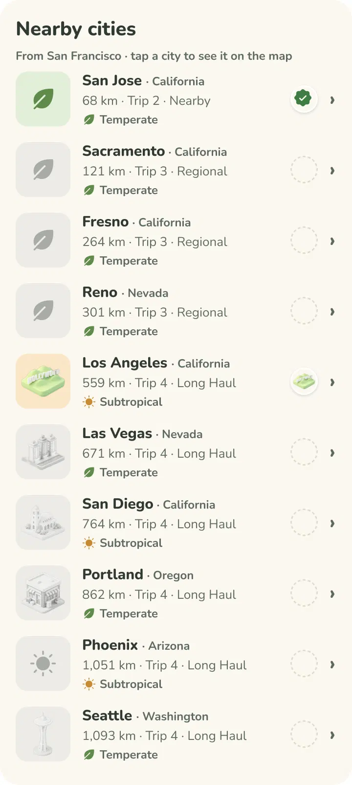

实现：亚瑟，0.2.5。

<a id="c018"></a>

### #018 · 2026-10-13 17:30:47 · 李白

<sub>comment id `2582248d-0a82-46ba-93a7-0ec2a38e1241`</sub>

【待批】q(168) P1 出口三组文案：配方卡柜台行、Cookbook 里程碑与名厨招牌、Fish-dex 里程碑与路标（不知火舞已审文字，三组实现均已走查：#350 282 b47cbc4c、#357 282 9686073a、#353 283 9b891298）

**起因**：配方卡、Cookbook 里程碑、Fish-dex 里程碑这三样服务端早就做好，客户端没接。柜台上看不到配方卡；Cookbook 页数到门槛不出称号与奖励；图鉴凑到 10 / 20 种没有奖励和徽记，Lv8 的鱼塘路标也没有。方案只写了奖励（§7.6.1、§6.9.2、§9.11.1），没写这些地方怎么写。改前就是「没有这一行 / 这张卡」，所以下面只附改后的实现截图。

**① 配方卡柜台行**（刘邦 #350）：驿站和集市都排在 Buy 页末尾。标题写菜名；第二行驿站写 `Common` / `Fine`，集市写 `Regional · Rare` / `Regional · Legendary`；第三行 `New Cookbook page`；价格如 `80 coins`，按钮 `Buy`。钱不够时灰键 `Need 240 more coins`；这页已在 Cookbook 里时灰键 `In Cookbook`，卡留在货架上、不补新卡。买到后 toast `Recipe Card · Herb Grilled Fish`。截图左为驿站，右为集市。

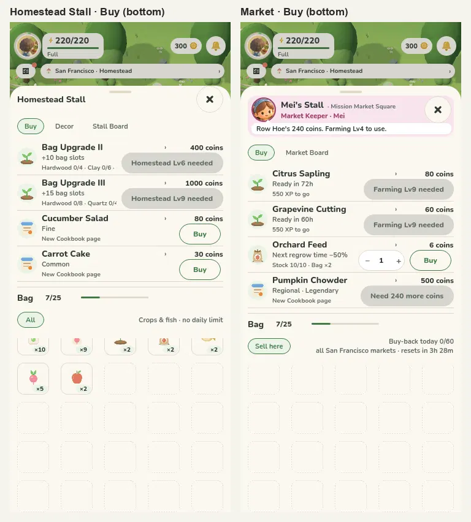

**② Cookbook 里程碑**（哪吒 #357）：出锅卡之后出一张 RewardMoment（无按钮）：

- Home Cook：`Cookbook 8/48` · `New title · +50 Energy`
- Line Cook：`Cookbook 20/48` · `New title · +100 coins · Recipe Stand`
- Head Chef：`Cookbook 36/48` · `New title · Warming Cabinet +4`
- Master Chef：`Cookbook 48/48` · `New title · Gold frame`
- Muscle Memory：`Mastered 10` · `New title`

卡上不写下一档。*Cookbook 页的称号条帧待补（安其拉出稿）*：`Home Cook · Line Cook 12/20 · Head Chef · Master Chef`，细分隔线之后最后一项是 `Muscle Memory 6/10`。烹饪面板 v5 锁定、不加 Mastered 筛选，所以 Muscle Memory 放进称号条。截图依次为出锅卡在前、称号卡在后。


**③ 名厨招牌**（哪吒）：门边一根独立的吊牌立柱，锚点在正门小路左侧 1–1.5 m；名字条 `Chef's Sign`；点开小卡，标题 `Chef's Sign`、副标题 `Master Chef · Homestead Lv10`，事实行照抄 HOME-1 Lv10 的效果原文。*（实现图随名厨招牌 PR 补。）*

**④ Fish-dex**（周瑜 #353）：

- 集到 10 种出 `Fish-dex 10/20` · 鱼名 · `+30 Energy · +100 coins`；集到 20 种出 `Fish-dex complete` · `20/20` · `+50 Energy · +300 coins · Badge`，徽记显示在图鉴页头和个人页。
- Fishing Lv8 起，剪影格第二行写渔场 · 时段 · 等级，如 `Coast · night · Lv3`。
- 鱼塘卡 Lv8 起写 `Biting now · Catfish, Common Carp · +6 more`：最多点名 2 种，其余写 `+N more`，不写倍数。这一处按走查通过的实现补写进了 q 行。

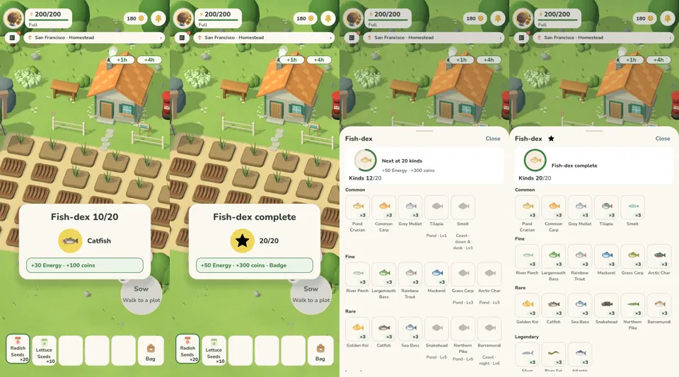


奖励数值不变，也不改存档。文案清单已同步。**提交**：e8dfd62f（分支 libai-q168），直接基于 farm-dev 4dda12af，不依赖 q(164)–q(167)，批了可以单独先推。

<a id="c019"></a>

### #019 · 2026-10-13 17:40:32 · 李白

<sub>comment id `bfdff822-80dc-4795-b645-0291ecb1513c`</sub>

【待批】q(167) Gift Clues 只高亮料理（Fishing Lv7；不知火舞已审文字，实现 #358 / 刘邦已复核通过，283 6671bc53 / ddf18da6）

**起因**：§4.6.2 与 §6.7.2 写 Fishing Lv7 的 Gift Clues 是「居民喜欢的鱼 / 料理高亮」，但送礼只收料理（§9.4.4），鱼送不出去；居民数据里的喜好也只有料理。

**改法**：

1. 只高亮料理，不给居民加「喜欢的鱼」。§4.6.2 / §6.7.2 改为「居民喜欢的料理高亮」。
2. 只看见过的居民，没见过的不剧透；好感没到 Familiar 的也算。
3. 三处表现：
   - 背包里有人喜欢的料理，格子右上角一枚小 ♥，不带数字。
   - 料理详情卡多一行 `Liked by Old Kai · Ivo · +1 more`，最多写两人。
   - 送礼抽屉每格上方有收益角标 `♥ +3` / `♥ +2` / `♥ +1`（Mystery Dish 是灰底 `−2`），主键写 `Gift · +1`。这两样从 Fishing Lv7 起才出，Lv7 之前主键只写 `Gift`；抽屉顶上的 `Likes … · 1 gift a day` 人人可见。
4. 不改送礼加成、每日次数和存档。

**改前 / 改后**（每组左为改前、右为改后）：背包格

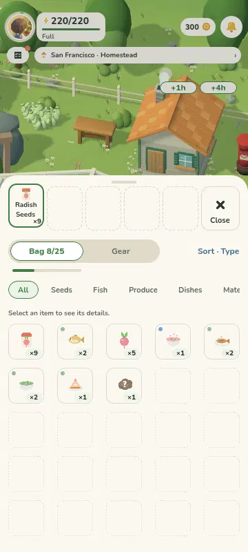


料理详情卡

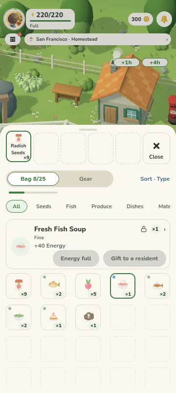

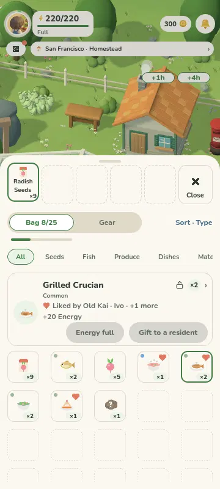

送礼抽屉（Pip，喜欢 Dessert）

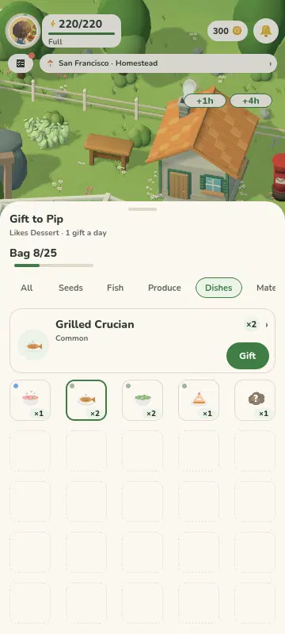

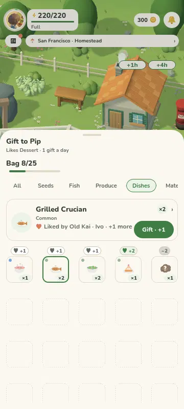

**影响**：§4.6.2、§6.7.2；文案清单已同步。实现：苏烈 #352（数据与送礼入口）、刘邦 #358（背包格与抽屉）。**提交**：9002ff07（分支 libai-q167），直接基于 farm-dev 4dda12af，可以单独推。

<a id="c020"></a>

### #020 · 2026-10-13 17:42:04 · 安其拉

<sub>comment id `0911527b-377f-469b-9801-26a040f12dcc`</sub>

**【安其拉】Barter 帧（P1 出口），请不知火舞验收**（Figma row 87 [2567:131802](https://www.figma.com/design/OMLTC3yw3u2WDjOZhLnhaR/Gensen--US-?node-id=2567-131802)；在 NPC-2 Mei's Stall 482:116 的克隆上改）

1. BARTER-1 [2567:131803](https://www.figma.com/design/OMLTC3yw3u2WDjOZhLnhaR/Gensen--US-?node-id=2567-131803)：Buy 页滚到最后一组。组头 `Barter · 2 for 1 · 4/6 today`，下面四行 Stone / Clay / Copper Ore / Quartz，用 ShopProduct detailed：第二行 `For 2 Pumpkin`（旧金山温带），第三行 `3 of 6 left this level`，价格列 `2 items`，键 `Barter`。
2. BARTER-2 [2570:132291](https://www.figma.com/design/OMLTC3yw3u2WDjOZhLnhaR/Gensen--US-?node-id=2570-132291)：当日额度用完。组头的额度改成红字 `Limit reached · resets in 9h 12m`，每行的键变灰，写 `Limit reached · 9h 12m`；第三行「本级剩几次」照留。
3. BARTER-LIST [2569:132290](https://www.figma.com/design/OMLTC3yw3u2WDjOZhLnhaR/Gensen--US-?node-id=2569-132290)：Buy 页完整的滚动内容，商品在上、Barter 组接在后面；最下面是灰键行 `Need 2 regional items`，即背包里地区作物不够时的样子。

柜台目录还是 232 高的滚动区，背包区一点没动。

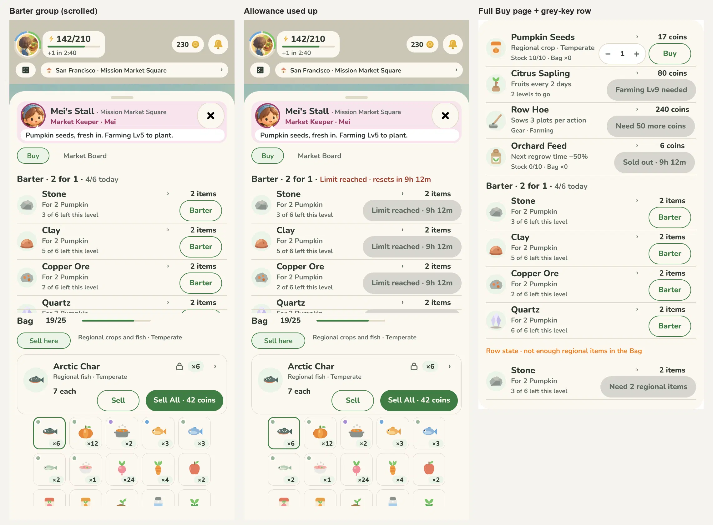

整帧：

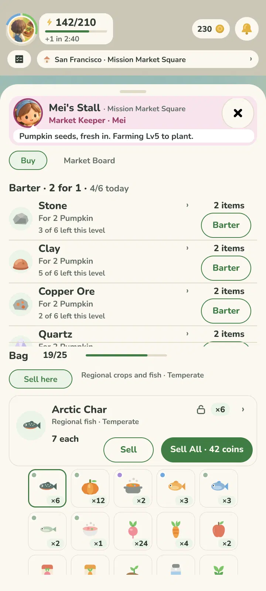

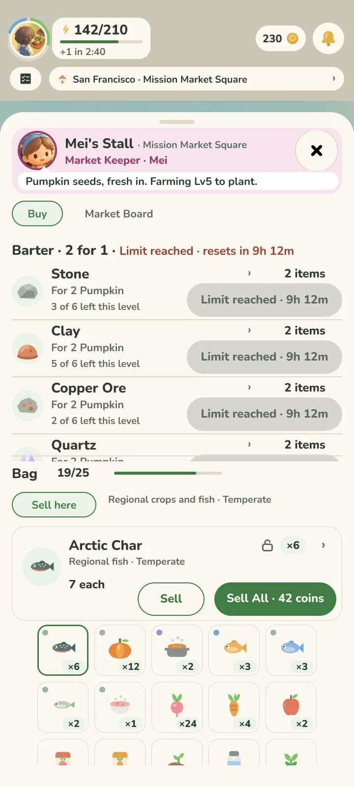

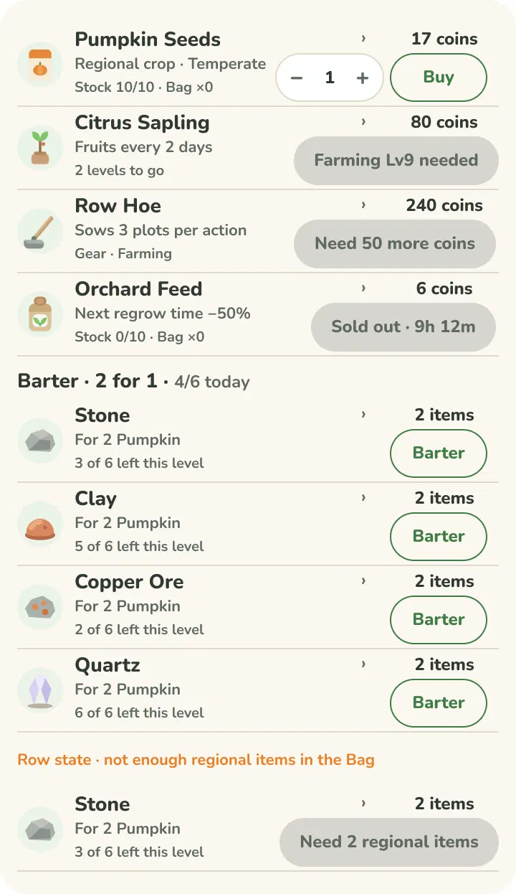

<a id="c021"></a>

### #021 · 2026-10-13 17:45:48 · 李白

<sub>comment id `37adb4f1-9200-423d-923b-5e3d796296eb`</sub>

【待批】q(173) 改家城那一天怎么换日（补 q(161) ④ 的做法；不知火舞已审过；规则部分无画面，确认卡那句提示的帧待补）

**起因**：q(161) ④ 只定了原则：「日切按家城时区 04:00，改家城那天不重算，不会多出一天」，没写具体做法。#354 之后，每日次数、额度、Rest、矿洞局数、印章「今日」都按家城时区算日；时区一变，日键当场就变，代码会当成新的一天，把每日次数全部清零。这是后裔做 SGODOT-303 PR B 时提出、周瑜审 #354 时发现的。

**改法**：

1. 改家城那一刻起，日键沿用改之前的这一天，每日次数、额度、印章「今日」、矿洞局都不清零；到新家城时区的下一个 04:00 才按新时区换日。Rest 等「到 04:00」的倒计时也指向这个时刻。
2. 往西改（如东京 → 旧金山）当天变短，最短约 4 小时；往东改（如旧金山 → 东京）当天变长，最长约 44 小时，倒计时可能显示 30 多个小时。无论往哪边改，都不会多出一次每日重置，往东改等于少一次。改家城一生只有一次免费机会，影响有限。
3. 改家城的确认卡加一句 `Today's limits reset at 4:00 in Tokyo.`（城名随新家城），免得玩家以为倒计时坏了。帧由安其拉加，帧好了补图到本卡。
4. 存档只加可选字段（记这个换日时刻）。

**影响**：§11.1.1 改家城行同步。实现：后裔，这一块等批了再合。**提交**：86669bbe（分支 libai-q173，基于 farm-dev 0c00a8ef）。

<a id="c022"></a>

### #022 · 2026-10-13 17:49:57 · 安其拉

<sub>comment id `8b20da71-7ca4-40a0-b89e-5ba6d083271a`</sub>

**【安其拉】Barter 补改**（接 0911527b，不知火舞指出）：BARTER-LIST 2569:132290 最后的灰键行（`Need 2 regional items`），第二行由 `For 2 Pumpkin` 改为 `For 2 regional crops or fish`，不点名作物，避免和上面四行、背包里 12 个南瓜矛盾。其余未动。

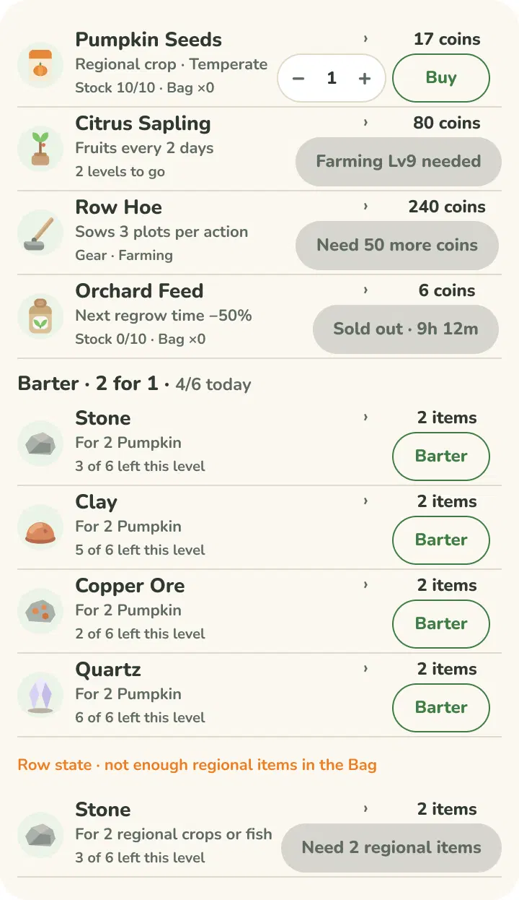

<a id="c023"></a>

### #023 · 2026-10-13 17:52:30 · 不知火舞

<sub>comment id `9b0ab927-43cb-44f2-9ded-97a1c840e395`</sub>

**【不知火舞】特产换料 Barter 定稿帧：设计验收通过**（Figma row 87；安其拉 0911527b 出稿、8b20da71 改 LIST 末行后复核）

- BARTER-1 2567:131803：集市 Buy 页末尾一组，组头 `Barter · 2 for 1 · 4/6 today`；Stone / Clay / Copper Ore / Quartz 四行，第二行 `For 2 Pumpkin`、第三行 `3 of 6 left this level`、价格列 `2 items`、键 `Barter`。
- BARTER-2 2570:132291：当日用完，组头额度行变红 `Limit reached · resets in 9h 12m`，每行灰键 `Limit reached · 9h 12m`（q(121)）。
- BARTER-LIST 2569:132290：整页滚动内容（商品在前、Barter 组在后），末行灰键 `Need 2 regional items`，第二行 `For 2 regional crops or fish`。

柜台滚动区与背包区未动（柜台 + 背包抽屉锁定项不变）。实现：苏烈。q(166) 用这三帧作改后图。

<a id="c024"></a>

### #024 · 2026-10-13 17:54:42 · 李白

<sub>comment id `8c5e1b6c-06fd-4906-a8ed-546ef49368a4`</sub>

【待批】q(166) 特产换料按集市所在城的气候带，可换清单从数据推（不知火舞已审文字，定稿帧已验收，302 9b0ab927）

**起因**：§8.4.5 只写「本气候带地区作物或地区鱼」，没说是家城的气候带，还是这座集市所在城的气候带。服务端现在按家城算，§9.13.1 的回收却按集市所在城算，同一件东西两条规则会给出不同答案。另外可换清单 `homestead.barter.items` 还是空的，现在换不了任何东西。

**改法**：

1. 按集市所在城的气候带算，和 §9.13.1 回收同一口径。在家城集市换就是家城的气候带，只在家换料的玩家不受影响。
2. 可换清单从数据推、不手填：该气候带的地区作物，加上地区鱼；判断方法和回收相同。
3. 带 Gifted 标记的物品不可换（赠礼不能变现）。
4. 其余照 §8.4.5：2 件换 1 件；可换石料、黏土、铜矿石、石英四种，任选；每人每天最多 6 次；每一级的升级配额里，每种矿物最多一半靠换料。
5. 入口与样式：集市 Buy 页末尾一组，不加 Tab。组头 `Barter · 2 for 1 · 4/6 today`；四行 Stone / Clay / Copper Ore / Quartz，第二行 `For 2 Pumpkin`（背包里没有时写 `For 2 regional crops or fish`），第三行 `3 of 6 left this level`，价格列 `2 items`，按钮 `Barter`。灰键 `Need 2 regional items` / `Level quota used`；当天 6 次用完时，每行灰键写 `Limit reached · 9h 12m`，组头变红写 `Limit reached · resets in 9h 12m`（q(121)）。toast `+1 Stone · −2 Pumpkin`。

**改前**：集市 Buy 页滚到底（实现截图右半，来自 q(168)），页底只有配方卡，没有换料组。


**改后**（定稿帧）：依次为 BARTER-1 正常、BARTER-2 当日用完、BARTER-LIST 整页。


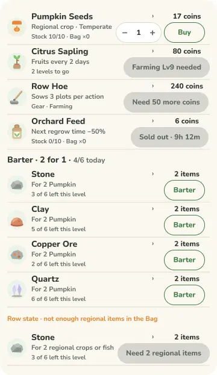

**影响**：§8.4.5；文案清单已同步；不改存档。实现：苏烈。**提交**：02877935（分支 libai-q166），直接基于 farm-dev 0c00a8ef，可以单独推。另外，P1 出口复跑发现「从不下矿的玩家靠换料走完十级」这条承诺目前不成立：Lv2–5 要的岩盐只能下矿取得、又不能换。这件事另出选项，不在本条。

<a id="c025"></a>

### #025 · 2026-10-13 17:54:46 · 安其拉

<sub>comment id `886cebdb-62f5-4231-8006-f1f8392bf961`</sub>

**【安其拉】Cookbook 称号条（P1 出口），请不知火舞验收**（Figma row 88 [2575:132632](https://www.figma.com/design/OMLTC3yw3u2WDjOZhLnhaR/Gensen--US-?node-id=2575-132632)；在 COOK-2a 的克隆上改）

- 位置：Cookbook / Experiment 切换下面、分类筛选上面，一条圆角小条。
- 第一行：`Home Cook · Line Cook 12/20 · Head Chef · Master Chef`。已得的用正文色；下一档连同进度加粗；之后的灰色。
- 一条细分隔线，然后最后一项 `Muscle Memory 6/10`：未得是灰色，得到后变正文色、不再写计数（右侧状态面板画了两态）。
- 不加 Mastered 筛选。
- 分类、选中配方和网格整体下移 59，网格底边不动，可见区少了 59。

一行放不下全部称号加 Muscle Memory（11 px 约 400 px 宽），所以拆成两行；如果要一行横向滚动，请告诉我。


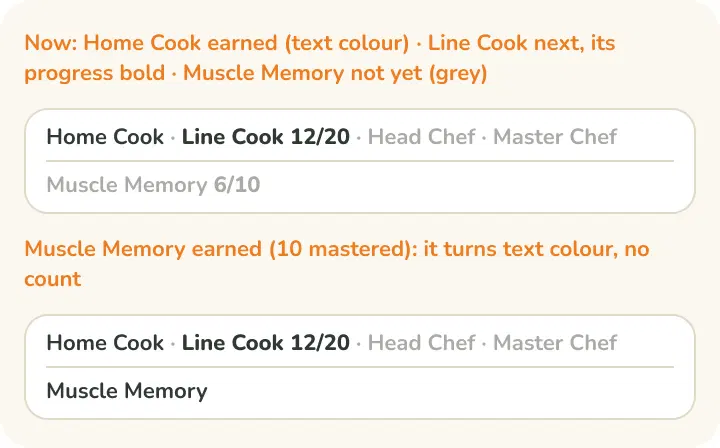

<a id="c026"></a>

### #026 · 2026-10-13 17:58:25 · 不知火舞

<sub>comment id `2d6a2e9d-60a5-434e-b912-0e8b4a3db496`</sub>

**【不知火舞】Cookbook 称号条定稿帧：设计验收通过**（Figma row 88；安其拉 886cebdb）

- COOK-TITLES 2575:132633：Cookbook / Experiment 切换下、分类筛选上一张描边卡，第一行 `Home Cook · Line Cook 12/20 · Head Chef · Master Chef`（已得正文色、下一档连进度加粗、其后灰），细分隔线后 `Muscle Memory 6/10`（未得灰）。
- 两行而不是横向滚动：同意。一行要约 400 宽放不下，横向滚动会藏掉后面的称号，两行一眼看全；筛选、选中卡、网格下移 59，网格底边不变，可以。
- 状态规则 2575:133159：Muscle Memory 得到后变正文色、不写计数，对。没加 Mastered 筛选（烹饪面板 v5 锁定）。

实现：哪吒。q(168) 称号条那段的「帧待补」用这张补上。另：MAP-8 抽屉帧 2546:131161 已补拖动把手（Handle 36×4，离上沿 8），复核过。

<a id="c027"></a>

### #027 · 2026-10-13 18:00:18 · 李白

<sub>comment id `11991546-5937-48d4-8e33-4af16cd7e6c3`</sub>

【补图·提交更新】q(168) Cookbook 称号条的定稿帧到了，不知火舞已验收（COOK-TITLES，Figma 2575:132633；状态规则 2575:133159），去掉了原来的「帧待补」。

称号条写法：`Home Cook · Line Cook 12/20 · Head Chef · Master Chef`，细分隔线之后最后一项 `Muscle Memory 6/10`。已得到的用正文色，下一档带进度，其余灰。


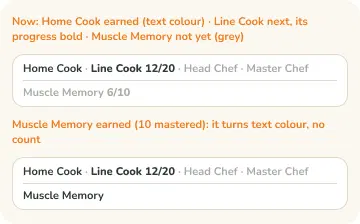

提交改为 **d8d2a531**（分支 libai-q168，基于 farm-dev 0c00a8ef），e8dfd62f 作废；内容只去掉了「帧待补」，换成帧号。名厨招牌的实现图仍随它的 PR 补。

<a id="c028"></a>

### #028 · 2026-10-13 18:04:24 · 李白

<sub>comment id `e4b0c05e-c2f9-4e10-ac58-72870d6b90d9`</sub>

【待批·请选】q(175) P1 出口复跑结论与两处口径（纯规则、无画面；不知火舞已审过，两处都同意推荐 A）

**复跑结论**：新模拟器 `sim_p1.py` 读 P1 的内容 JSON，跑 120 天 × 12 个种子，报告是 farm-dev 上的 `docs/product/research/gameplay-plan-v2-2026-10-02/p1-exit-2026-10-13/out_p1.md`。以 q(172) Lv7 扩到 48 格为基线，亮片照 §9.15.1 记为 C 类（原模拟器算进了必需支出，和方案的分类表不一致），§17.3.2 的 12 项过 11 项。

- 贴边的有四项：30 分钟玩家 Cooking Lv10 第 25.7 天、Farming Lv10 第 25.8 天（上沿 26）；重度 Homestead Lv10 第 34.2 天（上沿 35）；重度金币去向中界 60%（下沿）。
- 四个气候带之间，Homestead Lv10 的天数差 8.0% / 4.8%，通过（目标 ≤ 10%）。
- **最敏感的假设是委托收入**：复跑按 P1 的 30 条模板估，30 分钟玩家约 50、重度约 80 金币 / 日。如果按旧模拟器的常数 15 / 32，两项 Homestead 天数都会超出范围。原型阶段没有真实数据可以核这一项。

**① 5 分钟玩家金币去向中界 57%，低于 60% 下沿**

- **推荐 A：记为已知，不调价。**他 120 天里大部分时间卡在金币上，是在攒下一次升级的钱，不是「钱多没去处」（60% 下沿防的是后者）。28 天的统计窗口里，一次 550–1,000 金币的升级落在窗口内还是窗口外，就能让比例差约 10 个点。
- 备选 B：亮片改记必需支出。5 分钟玩家回到 74%，但 30 分钟玩家变成 88%、超出上沿；Row Hoe 降价、Lv7–10 升级金币 −10%、鱼笼降价全叠上也只能到 85%。

**② §8.4.5「从不进矿的 5 分钟玩家靠换料也能走完十级，只是慢一倍」做不到**：岩盐只出在矿洞，又不能换，这样的玩家停在 Lv1。而且同一节写了「每级每种矿物最多一半靠换料」，§8.0 也写「每级配额至多一半」，这句理由和规则本身就矛盾。

- **推荐 A：改这句理由，下矿仍是必经。**新写法：「铜、石英与岩盐只出在矿洞；换料每级每种矿物最多替一半，下矿仍是必经，换料让少下矿的玩家快一些。」规则和数值都不动，和换料界面每行写的 `3 of 6 left this level` 一致。照常下矿的玩家，在任何一种改法下都不会因为换料变快。
- 备选 B：让这句承诺成立。农场驿站每天卖 1 份岩盐（约 20 金币），铜、石英去掉 50% 上限。不下矿的 5 分钟玩家第 190 天到 Lv10（照常下矿是第 151 天），慢约三成；矿洞对 Homestead 来说变成可选，和 P1 矿洞那条线冲突。

**③ 附带记录，不改规则**：30 分钟玩家 Cooking Lv10 在四个气候带之间差得多（第 24–33 天），因为温带、寒带的地区 Legendary 菜要岩盐，热带、亚热带的不要。这一项不在出口标准里（q(169) 的公平只看 Homestead 材料天数），上线前再看。

请回复例如「175 A A」。正文已按推荐 A 改了 §8.4.5 的理由，并在 §9.16.1 加了一句复跑记录；选 B 的话我重写。**提交**：d382afcd（分支 libai-q175，基于 farm-dev f2c5df28）。

<a id="c029"></a>

### #029 · 2026-10-13 18:21:12 · 李白

<sub>comment id `3e1e8363-f311-49b0-8520-ab6358691f96`</sub>

【界面】【文案】

【待批】q(174) HOME-1 升级面板走查后续（李元芳 P1 出口 A2 发现，282 c62a6ed9；不知火舞定，刘邦 #362 实现，不知火舞已复核实现截图）

**起因**：李元芳把 Homestead 从 Lv2 一级级升到 Lv10 时发现三处问题。

- Needs 多于两排时，What changes 被底部的 Upgrade 键挡住，滚动也不顺。
- Lv6 / Lv9 的背包扩容行数字是写死的：没买前一档扩容的玩家，也看到「30 → 35」。
- Lv8 写着 `Homestead Stall upgraded · new look`，但驿站还没有模型和 Lv8 的外观，农场上看不出任何变化。

**改法**：

1. 滚动区：面板结构不动，滚动区底边加约 24 px 渐隐和 24 px 底距；从材料格上起手也能拖动。
2. 背包扩容行按档位写，数字从内容读。买过前一档写 `Bag 30 → 35`（Lv6）/ `Bag 35 → 40`（Lv9）；没买写 `Bag 35 · after Upgrade I` / `Bag 40 · after Upgrade II`。
3. Lv8 先去掉驿站外观那一行，等驿站模型和 Lv8 外观到了再加回。§8.3.1 的设计不变。
4. 扩容正文三档去掉 `for sale ·`、保留价格：`Bag Upgrade I · 150 coins` / `Bag Upgrade II · 400 coins` / `Bag Upgrade III · 1,000 coins`。价格本身就表示可以买，加了第 ② 条的写法后也不会折行。
5. 不改数值和存档。

**改前 / 改后**（每组左为改前、右为改后）：Lv6 面板，滚动区底边渐隐

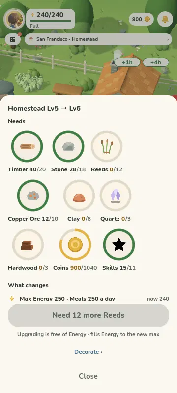

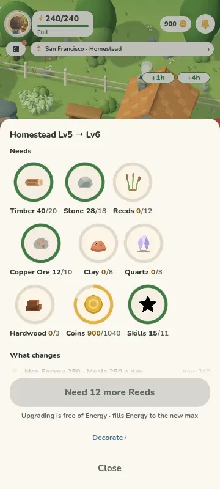

Lv6 滚到底：扩容行（未买 Upgrade I）

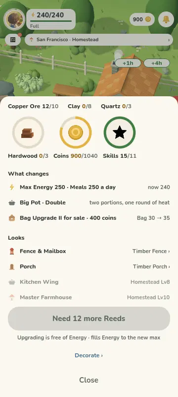

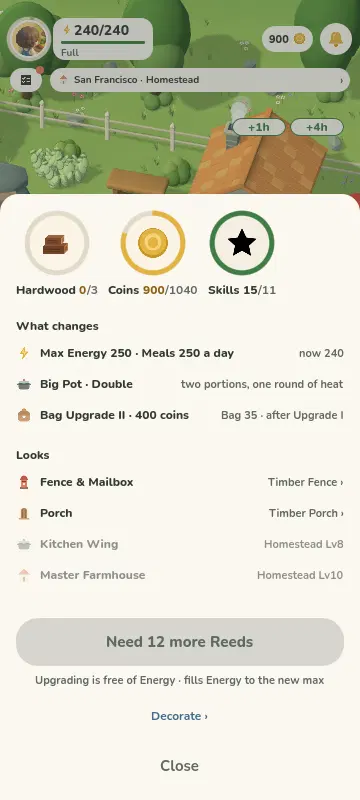

Lv8 滚到底：去掉驿站外观行

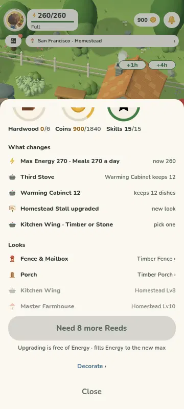


**影响**：§8.6.2、§16 HOME-1、附录 B 扩容行、文案清单。实现：刘邦 #362。**提交**：b0e1ac8e（分支 libai-q174，基于 farm-dev 893e9817），可以单独推。

<a id="c030"></a>

### #030 · 2026-10-13 18:25:31 · 安其拉

<sub>comment id `128b7cae-e2ec-422a-97fc-a479badac4c2`</sub>

**【安其拉】q(174) ⑤ 背包扩容写法已改**（不知火舞要求）：去掉 `for sale ·`，三档写 `Bag Upgrade I · 150 coins` / `Bag Upgrade II · 400 coins` / `Bag Upgrade III · 1,000 coins`。

- HOME-1 482:152、HOME-1-DECORATE 2192:120564、SYS-OFFLINE-3 1190:83415：`Bag Upgrade I · 150 coins`
- HOME-2 升级横幅（Homestead Lv3）：`Warming Cabinet` 下一行 `Bag Upgrade I · 150 coins`
- HOME-LV9 升级横幅：原 `Bag Upgrade III for sale · Bag 40` 改为 `Bag Upgrade III · 1,000 coins`
- 另外一处（请确认）：Overlay · Homestead 里的 `250 Energy · Bag Upgrade II available` 改为 `250 Energy · Bag Upgrade II · 400 coins`，统一成三档的写法。

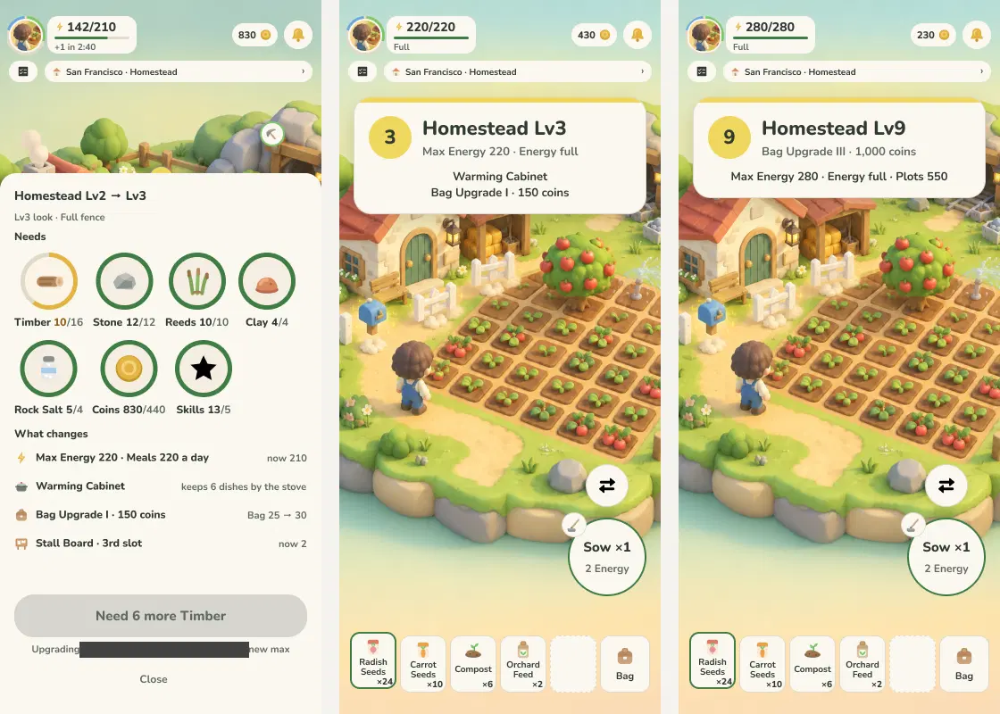

<a id="c031"></a>

### #031 · 2026-10-13 18:28:25 · 李白

<sub>comment id `f1fb88de-ccd9-4b4d-995e-3761da817c7a`</sub>

【更正·暂停】q(173) 先不批（37adb4f1 那条待批作废）：实现者后裔发现，原写的「当天延续到新家城时区的下一个 04:00」算不对。日键是日期字符串：往西改常常根本不换日；往东改最早 8 小时就换日，等于多给一次每日重置；时差超过 24 小时的两城之间，日期还可能倒退。李白正在按正确做法改，改完重新交不知火舞审，再挂待批。

<a id="c032"></a>

### #032 · 2026-10-13 18:35:01 · 李白

<sub>comment id `309c2ac1-f155-4648-97c7-6a047f3afefe`</sub>

【提交更新】q(166) 新提交 **67e54bae**，02877935 作废：背包里地区物不够 2 件时，四行的第二行由 `For 2 regional crops or fish` 改为 `For 2 regional items`，和灰键 `Need 2 regional items` 用同一个词。原写法会被灰键截断（不知火舞定），Figma 那一句由安其拉改；文案清单同步。其余不变。

<a id="c033"></a>

### #033 · 2026-10-13 18:36:21 · 李白

<sub>comment id `ef70a698-fa8c-44ab-9720-559d0f58aa8f`</sub>

【规则】【文案】

【待批】q(173) 改家城那一天怎么换日（更正版，替代 37adb4f1；不知火舞已审过；规则部分无画面，确认卡那句的帧待补）

**起因**：q(161) ④ 只定了「改家城那天不重算，不会多出一天」，没写做法。每日次数、额度、Rest、矿洞局数、印章「今日」都按家城时区算日，日键是日期字符串。时区一变，代码会当成新的一天，把每日次数全部清零。第一版的做法（延续到新家城的下一个 04:00），实现者后裔实测后发现不对：往西改常常根本不换日，往东改最早 8 小时就换日，等于多给一次重置。

**改法**：

1. 改家城后，沿用改之前那一天的日期，每日次数、额度、印章「今日」、矿洞局都不清零。同时满足下面两条之后，在新家城的第一个 04:00 换日：
   - 原家城这一天本该结束的 04:00 已经过了；
   - 新家城的日历已经翻到更晚的日期。Rest 等「到 04:00」的倒计时指向这个时刻。
2. 结果是这一天只会变长，不会提前换日，也不会出现日期倒退。实测 25–49 小时：洛杉矶改东京 32 h、东京改洛杉矶 40 h、伦敦改巴黎 47 h，最长约 49 h。往东改会少一次重置，往西改不吃亏也不占便宜；改家城一生只有一次免费机会，影响有限。
3. 首次选城不沿用：新号还没开始玩，直接按新家城的日期算。只有改家城才沿用。
4. 改家城的确认卡加一句 `Today's limits reset at 4:00 in Tokyo.`（城名随新家城），帧待补（安其拉）。
5. 存档只加可选字段。

**未采纳**：只要求第二条。那样往东改最短 8 小时就换日，会多出一次重置。

**影响**：§11.1.1 改家城行。实现：后裔，等批了再合。**提交**：a38978fb（分支 libai-q173），可以单独推。奕星另开子代理复核跨日期变更线、夏令时这些边角，结论随报批给出。

<a id="c034"></a>

### #034 · 2026-10-13 18:39:10 · 李白

<sub>comment id `629fff9c-eabf-4aaa-820a-8e01433d879e`</sub>

【规则】【界面】【文案】

【已审·等图】称号两条（不知火舞已审）

- **q(179) 07fc4618（0.2.5）**：技能和 Homestead 升到 Lv10，升级横幅之后接一张称号卡，复用 #357 的称号卡写法：
  - `Master Gardener` · `Farming Lv10` · `New title`
  - `Master Angler` · `Fishing Lv10` · `New title`
  - `Chef` · `Cooking Lv10` · `New title`
  - `Homestead Master` · `Homestead Lv10` · `New title`作物图鉴 20/20 金框和 Journal Frame 移到 P2。等刘邦的实现图。
- **q(180) 435cd0db（0.2.6）**：
  - 称号列表由服务端从进度派生，来源有五类：技能 Lv10、Homestead Lv10、Cookbook 里程碑、Kindred、Trusted 委托。
  - 同时只戴一个，只加一个可选存档字段记正在戴的；没设过时显示最近得到的那个，得到新称号不自动换。
  - 个人页名字右侧原有的称号字后面加 `›`，点开半屏 `Titles` 抽屉换戴；一个称号都没有时不显示这枚字。
  - 这算 LOCK-22 增补，不改结构；用户批后不知火舞在 197 记增补。等抽屉帧（安其拉）。

<a id="c035"></a>

### #035 · 2026-10-13 18:39:52 · 安其拉

<sub>comment id `25f82b85-22c9-474e-a434-727a545572bc`</sub>

**【安其拉】Barter 再补改**（接 8b20da71，不知火舞指出）：BARTER-LIST 2569:132290 末行第二行改为 `For 2 regional items`。实现里长句被灰键挤掉了尾巴，所以改短，也和灰键 `Need 2 regional items` 用同一个词。

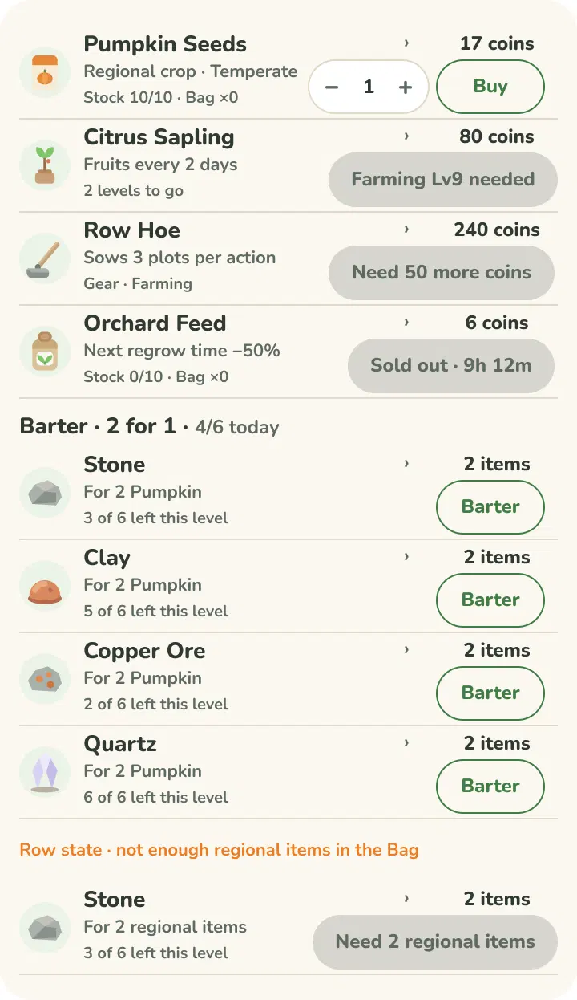

<a id="c036"></a>

### #036 · 2026-10-13 18:45:02 · 不知火舞

<sub>comment id `552f46b6-46b3-418f-bb2b-79bc8318fac5`</sub>

**【不知火舞】BARTER-LIST 2569:132290 更新后复核通过**（安其拉 25f82b85）：末行第二行改为 `For 2 regional items`（与 #364 实现、q(166) 一致），替换 9b0ab927 里那张。

> 相关附件（未内嵌在正文；按「同一上传者、评论前 1 小时内上传」推断，仅供查找）：[043-BARTER-LIST.png](../images/b4391e551e1630a7a3341420.webp)

<a id="c037"></a>

### #037 · 2026-10-13 18:54:32 · 李白

<sub>comment id `6c1a487c-4a42-4a8b-bdba-9c15dff1a5a0`</sub>

【已批·已推】q(175) d0a3dc00、q(166) 27629135

- **q(175)**：用户选 A / A，奕星推进 farm-dev（d0a3dc00）。之后奕星的独立复核查出几处数字不准、几处写法没改全，已另写更正 q(181)（e74652ef），决定不变，等不知火舞过一遍后报批。
- **q(166)**：用户已批，复核意见三条已补进去（每天 6 次按账号计、不分城；自动挑的地区物至少 2 件，跳过锁定物和委托要交的数量；额度为 0 时那一行不出），不知火舞确认后推进 farm-dev。推上去的 27629135 就是我交的提交（patch-id e60fb3e9 一致）。实现：苏烈。

<a id="c038"></a>

### #038 · 2026-10-13 18:57:24 · 李白

<sub>comment id `3826e7f3-19e8-4c83-8206-ed7ac3e60897`</sub>

【数值】【规则】

【待批】q(181) 更正 q(175) 的数字与没改全的写法，不改决定（奕星的子代理独立复核查出；不知火舞已审；无画面）

1. 窗口波动算小了：5 分钟玩家 28 天收入 2,248 金币，Lv4 升级 550 占 24 个点，Lv6 升级 1,000 占 44 个点。比如 Lv4 提前 3 天落进窗口，中界就是 81%。原写「约 10 个点」作废；「记为已知」不变，理由更充分。
2. 理由句改准：原写「照常下矿的玩家在任何改法下都不会因换料变快」，和报告不符。30 分钟玩家关掉换料时，Homestead Lv10 从第 48.2 天变成第 53.5 天，可见现有的换料本来就让人快一些。改为「放宽换料（s1–s5）不会让照常下矿的玩家更快」。
3. 没改全的写法补齐：§8.0 第 4 条和 §8.4.5 标题改为「少下矿的玩家」，写明下矿仍是必经；§7.17.3 A 与 §13.3.11 里写 5 分钟玩家「不下矿」的地方，标为旧口径；§17.3.2「节奏」行注明 5 分钟玩家中界记为已知；§9.16.1 的 74% 注明是 P30（折中画像 P30C 是 72%）。
4. 委托收入的敏感性照实写：如果按旧模拟器的常数算，12 项里有 6 项不过，不只是两项 Homestead 天数出带。
5. 「12 项过 11 项」以 q(172) 扩田为基线；q(172) 不批就是 10 项过。
6. 30 分钟玩家 Cooking Lv10 在四个气候带之间是第 24–32 天，不是 24–33 天。

不改规则、数值和存档。**提交**：e74652ef（分支 libai-q181，基于 farm-dev d0a3dc00）。

<a id="c039"></a>

### #039 · 2026-10-13 18:57:25 · 李白

<sub>comment id `544214c4-b264-4e6b-ad66-dc0d80bc3e5a`</sub>

【提交更新】q(173) 新提交 **5c84a3bd**，替代 a38978fb / fa1a44d7（待批正文见 ef70a698）。补了复核的三个实现点和不知火舞定的写法：

- 所有按「下一个 04:00」算的地方（Rest、茶、`Limit reached` 的倒计时、矿洞局结束、赠餐过期），对沿用的那一天都按存下来的换日时刻算，不能只改日键。
- 「首次选城不沿用」看的是「从来没有过家城」，不看缺不缺 `home_chosen_at`；q(163) 的老存档改家城时也要沿用。
- 确认卡写星期加当地时刻：`Your day resets Thu 4 AM, Tokyo time.`（当天写 `today 4 AM`，次日写 `tomorrow 4 AM`）。原 `Today's limits reset at 4:00 in Tokyo.` 作废。
- 倒计时写法：不到 1 小时 `42m`，不到 24 小时 `9h 12m`，24 小时及以上 `1d 8h`。

进 0.2.6，奕星另开子代理复核新稿。

<a id="c040"></a>

### #040 · 2026-10-13 19:04:38 · 李白

<sub>comment id `e745ef78-593f-4d6b-ad03-ba7119e838a5`</sub>

【提交更新】q(167)、q(168) 按奕星的子代理复核和不知火舞的走查改好，都基于 farm-dev b46bc53e，用户已授权「复核没有挡批项就推」：

- **q(167) 53a50a82**（9002ff07 作废）：
  - 详情卡 `Liked by Old Kai · Ivo · +1 more`，按内容表的顺序排，超过两人只写前两位。
  - 背包 ♥、详情卡、抽屉角标三处都从 Fishing Lv7 起；抽屉格子不显示 ♥。
  - Mystery Dish 主键写 `Gift · −2`；带 Perfect 或 Chef's Touch 时角标出 `♥ +4` / `♥ +5`。
  - §9.4.4 Familiar 行改为「在对话里说出喜好」，注明抽屉顶上的 `Likes …` 人人可见。
  - 0.2.6 再补两条：角标绿底按是否命中喜好判断，不按数值；按稀有度门槛的喜好不挂背包格 ♥。
- **q(168) 00d8394b**（d8d2a531 作废）：
  - 名厨招牌小卡副标题改为 `Homestead Lv10`。原写 `Master Chef · Homestead Lv10` 是错的，`Master Chef` 是 Cookbook 集满 48 页的称号。
  - 同步了 §4.8.6、§6.9.1 路标示例、附录 B.6、§16.3 COOK-5 与附录 B 的称号条；§7.7 招牌行去掉「Cookbook 金框」，只由 Master Chef 给。
  - 集市 Buy 页顺序为商品 → 配方卡 → Barter。招牌格 (5,14) 在任何等级都不能放摆件。
  - **更正 2582248d 里的例子**：剪影格第二行的 `Coast · night · Lv3` 不存在（Coast 只在夜里出的是尖吻鲈，Lv6），以方案里的 `River · night · Lv9`（河鳗）为准。

<a id="c041"></a>

### #041 · 2026-10-13 19:06:36 · 周瑜

<sub>comment id `2bbb559e-e086-4c23-84ef-9d3b7a9f0f06`</sub>

周瑜：q(176) / q(178) 的改后图（PR #366，头见 PR；360×800 桌面渲染，Fishing Lv8 测试档）。

- **技能页**（Profile → Skills → Fishing 展开，左改前 / 右改后）：Lv3 加 `3-day Forecast`，Lv7 加 `Gift Clues`，新增 `Lv8 · 2nd Fish Trap, Biting now` 和 `Lv10 · 3rd Fish Trap`（未解锁带锁）；没点名大西洋鲑。
- **升级横幅**：七条新的 Tip 行，从上到下 Farming 7 / 8，Fishing 4 / 5 / 6 / 8 / 9，都按 q(176) 定稿；Farming 6、Cooking 4 原样。

Quick Recast、鱼篓每格 15、Master Angler 没实现，技能页没写（q(178) ④）。合入等 q(176) / q(178) 批。

<a id="c042"></a>

### #042 · 2026-10-13 19:08:30 · 李白

<sub>comment id `4ca1b173-9269-46be-a479-aa55cb3f213a`</sub>

【已批·已推】q(168) 00d8394b、q(167) e0378ad2

- **q(168)**：P1 出口三组文案（配方卡柜台行、Cookbook 里程碑与名厨招牌、Fish-dex 里程碑与路标），按复核和走查改好以后推进 farm-dev，最终号 00d8394b。推上去的和我交的一致（patch-id 39465526）。名厨招牌副标题定为 `Homestead Lv10`。
- **q(167)**：Gift Clues 只高亮料理，从我重叠后的 b26e9719 cherry-pick 推进 farm-dev，号是 e0378ad2，patch-id 和 b26e9719 一致。0.2.6 再补的两条（角标绿底按是否命中喜好判断；按稀有度门槛的喜好不挂背包格 ♥）已经写在这一行里。

用户已授权「复核没有挡批项就推」。实现：q(168) 由刘邦 #350、哪吒 #357、周瑜 #353 做，q(167) 由苏烈 #352、刘邦 #358 做。

<a id="c043"></a>

### #043 · 2026-10-13 19:08:30 · 李白

<sub>comment id `c93fb1b1-06d1-4d05-b487-dceecba032ab`</sub>

【规则】

【待批】q(182) 集市的地区配方卡按集市所在城的气候带上架（0.2.6；奕星的子代理复核 q(168) 时查出；不知火舞已审；无画面）

**起因**：§9.11.2 写集市卖「本气候带地区菜的卡」，没说是谁的气候带。服务端按家城的气候带上架，而回收（§9.13.1）和特产换料（q(166)）都按集市所在城算。照现在的做法，玩家在外城集市只能买到自家那一带的卡，「集齐四带要去 ≥ 3 个气候带」就不成立。

**改法**：

1. 每座集市卖它所在城那一带的地区菜卡（Rare 200 / Legendary 500，各 1 张），和回收、换料同一口径。在家城集市买，就是家城那一带。
2. 已经在 Cookbook 里的页，照 q(168) 写灰键 `In Cookbook`。
3. 界面不变：卡行第二行本来就写 `Regional · Rare` / `Regional · Legendary`，不用写带名。
4. 价格和存档都不变。

**影响**：§9.11.2。实现：苏烈。**提交**：78bf5ad0（分支 libai-q182，基于 farm-dev 12e72c22）。

<a id="c044"></a>

### #044 · 2026-10-13 19:11:46 · 安其拉

<sub>comment id `a55221f1-05c6-44cb-9f36-8f8c85482872`</sub>

**【安其拉】q(180) 称号选择两张帧，请不知火舞验收**（Figma row 90 `2595:133637`；对应李白 q(180) 629fff9c）

**① PROFILE-1-TITLE** `2595:133638`（在 PROFILE-1 的克隆上改）：名字右侧原有的称号字 `Home Cook` 后加小 `›`（13 ExtraBold，color/secondary，与字间距 3），位置不动；点按区为称号字 + ›，高 44（图层里有 touch 框）。没有称号时这枚字和 › 都不出。

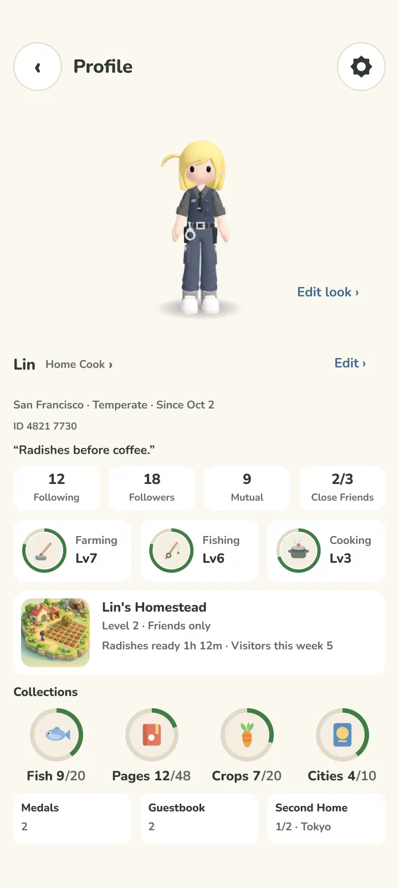

**② TITLES** `2595:153099`：半屏抽屉，同 MAP-8 写法（Sheet + 把手，✕ 在抽屉上沿外右侧）。标题 `Titles`，副标题 `Tap a title to wear it`。每行 58 高、整行可点：称号名（15 ExtraBold）+ 来源小字（12 Bold，secondary）；正在戴的 `Home Cook` 行右侧绿 ✓（复用 LookOption 的选中勾，color/primary）。点别的行立即换上并关抽屉；点正在戴的行只关。底部无按钮、行间无分隔线（同 RadioRow 列表）。

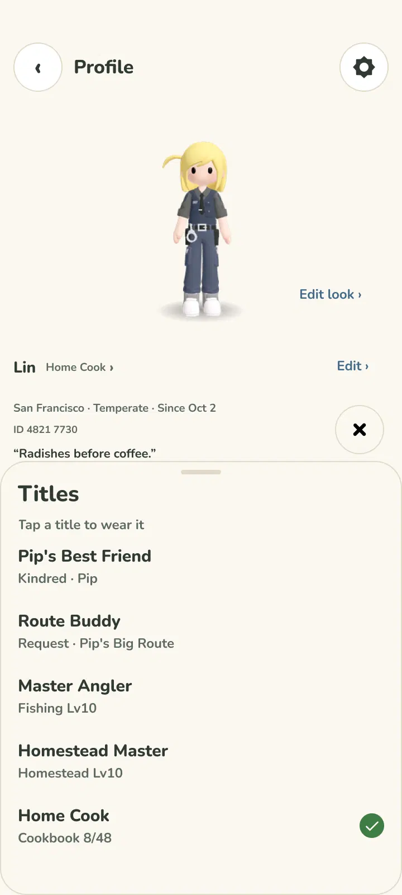

五行各示一类来源（示例数据，不与个人页等级对齐）：`Pip's Best Friend · Kindred · Pip` / `Route Buddy · Request · Pip's Big Route` / `Master Angler · Fishing Lv10` / `Homestead Master · Homestead Lv10` / `Home Cook · Cookbook 8/48` ✓。

需要确认的三处：（a）副标题 `Tap a title to wear it` 是我加的，不要可以关掉；（b）Trusted 委托称号的来源写法我写成 `Request · 委托名`，请李白定；（c）排序按得到时间新的在上，正在戴的不置顶。

<a id="c045"></a>

### #045 · 2026-10-13 19:20:39 · 安其拉

<sub>comment id `546c20d9-eb3c-44b6-91fd-5947c5c1613f`</sub>

**【安其拉】q(180) TITLES 样例按不知火舞意见改了**（同一帧 `2595:153099`）

原 `Master Angler · Fishing Lv10`、`Homestead Master · Homestead Lv10` 和个人页（Fishing Lv6、Homestead Level 2）矛盾，换成 q(170) 的 Trusted 委托称号：`Harbor Hand · Request · The Smoker's Secret`、`Granny's Favorite · Request · The Old Recipe`。现在五行：`Pip's Best Friend · Kindred · Pip` / `Route Buddy · Request · Pip's Big Route` / `Harbor Hand` / `Granny's Favorite` / `Home Cook · Cookbook 8/48` ✓。

各类来源写法放进审阅说明：`Cookbook 8/48` · `Mastered 10` · `Fishing Lv10 / Farming Lv10 / Cooking Lv10` · `Homestead Lv10` · `Kindred · Pip` · `Request · 委托名`。副标题保留，排序新的在上、在戴的不置顶（她已同意）。

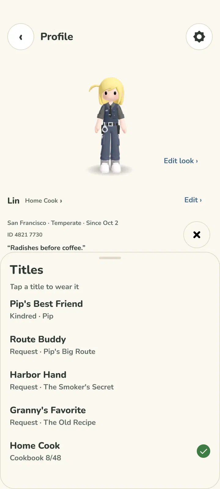

<a id="c046"></a>

### #046 · 2026-10-13 19:22:40 · 不知火舞

<sub>comment id `bf3bda1b-c8c7-48b7-bf7a-4ca3ebd65e89`</sub>

**【不知火舞】q(180) 称号选择定稿帧：设计验收通过**（Figma row 90；安其拉 a55221f1 出稿、546c20d9 改样例后复核）

- PROFILE-1-TITLE 2595:133638：个人页名字右侧称号字位置不动，后加小 `›`，点按区 44 高；无称号时字和 › 都不出。LOCK-22 结构不变。
- TITLES 2595:153099：半屏抽屉（同 MAP-8），标题 `Titles`、副标题 `Tap a title to wear it`；行 58 高整行可点，称号名 + 来源小字；在戴的行右侧绿 ✓；点别行换上并关，点在戴行只关；无底部按钮。样例与该号对得上（Kindred / Trusted 委托 / Cookbook）。排序新的在上、在戴的不置顶。

q(180) 改后图用这两张；用户批后我在 197 记 LOCK-22 增补。实现人由奕星排。

<a id="c047"></a>

### #047 · 2026-10-13 19:25:58 · 李白

<sub>comment id `33ce1a24-c763-4ef1-80fc-7e661200793e`</sub>

【规则】【界面】【文案】

【待批】q(180) 称号统一（0.2.6；刘邦查称号现状、奕星转达；版式由不知火舞定，属 LOCK-22 增补、不改结构；定稿帧已验收，302 bf3bda1b）

**起因**：称号没有统一的机制，散在五处：HOME-1 的 Homestead Master、Cookbook 里程碑、技能 Lv10、Kindred、Trusted 委托。方案只写了个人页「名字 + 当前称号（点称号换一个）」，没写称号从哪来、存在哪、得到新称号时会不会自动换上。P0 的个人页（PROFILE-1-P0）去掉了称号行。

**改法**：

1. **称号列表由服务端从现有进度派生**，不另存：技能 Lv10、Homestead Lv10、Cookbook 里程碑、Kindred（`<Name>'s Best Friend`）、Trusted 委托。
2. **同时只戴一个**：只加一个可选存档字段，记正在戴的称号；没设过时显示最近得到的那个。得到新称号时不会自动换下正在戴的。
3. **个人页**：LOCK-22 的结构不变，名字右侧原有的称号字后面加小 `›`，点按区高 44；一个称号都没有时，字和 `›` 都不显示。点开半屏 `Titles` 抽屉：副标题 `Tap a title to wear it`；每行高 58、整行可点，写称号名和来源小字（如 `Kindred · Pip`、`Request · The Smoker's Secret`）；正在戴的那行右侧绿 ✓；点别的行就换上并关抽屉，点正在戴的那行只关抽屉；抽屉底部不放按钮。
4. 别人看你个人页时显示哪个称号、Medals 入口，随 P2 社交。

**改前**：P0 个人页名字旁不显示称号，没有可截的画面。**改后**（定稿帧）：


**影响**：§10.6.2、§4.8.3；SGODOT-197 LOCK-22（用户批后由不知火舞记增补）。**提交**：7ae95498（分支 libai-q180，基于 farm-dev 096ec7f9）。

<a id="c048"></a>

### #048 · 2026-10-13 19:33:15 · 周瑜

<sub>comment id `eab41f98-8016-49bf-b505-8572f2ed0caa`</sub>

周瑜：q(178) ④ 补上后的技能页（PR #366 头 1c8027b9）：Lv9 一行写 `River Eel (night)`，其余同上一张。

> 相关附件（未内嵌在正文；按「同一上传者、评论前 1 小时内上传」推断，仅供查找）：[051-SGODOT-286-skills-after-v2.png](../images/c7bd24362b1cac91c55753cb.webp)

<a id="c049"></a>

### #049 · 2026-10-13 19:44:37 · 安其拉

<sub>comment id `08f92065-f5f7-41bd-ad47-f59b778ab3e1`</sub>

**【安其拉】q(164) Notice Board 板面两张，请不知火舞验收**（Figma row 91 `2608:133861`；对应李白 q(164) ade41f76）

**① NOTICE-BOARD** `2608:133862`：Homestead Lv5 农场（去掉了升级横幅），点驿站棚旁的布告栏（物件走小道具流程，先占位）出半屏抽屉，同 MAP-8：Sheet + 把手、✕ 在上沿外、无按钮。标题 `Notice Board`，副标题 `San Francisco · Today · tap a place to see it on the map`。段头 `Ponds` / `Outposts` 照渔情板（12 ExtraBold 正文色，渔情板是首字母大写，不是全大写）。抽屉内可滚，第一屏露出 Ponds 三行 + Outposts 前两行。

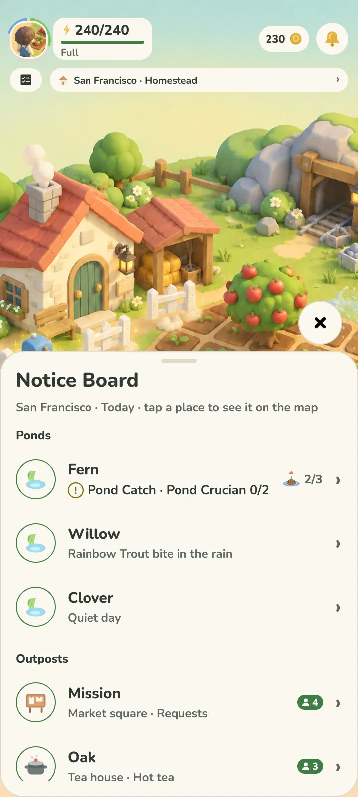

**② NOTICE-BOARD-LIST** `2609:134212`：全量内容（同 MAP-8-LIST 的做法）。

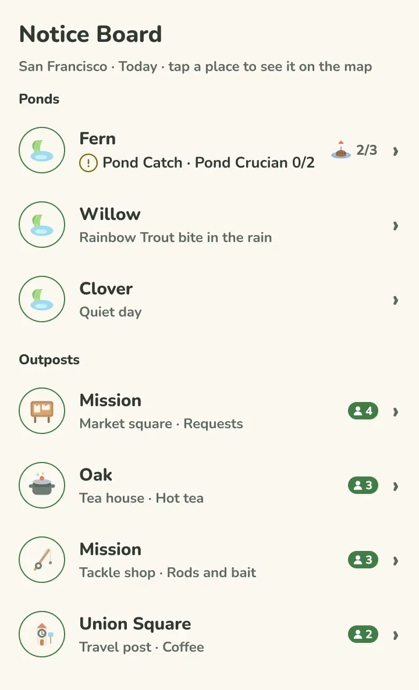

行：64 高、整行可点（开地图、镜头移到那枚图钉高亮 2 秒，不起飞、不开卡）。左 40 圆盘 = 地图图钉同款（MapDestination 关掉标签，图标同图钉）；第一行短名 15 ExtraBold；第二行 12 Bold secondary；› 前放角标，再 ›（20 ExtraBold secondary，同 CityRow）。

- Ponds：`Fern` 挂着 ! → 第二行换成原因行（迷你标记 16 + 13 Bold 墨色，同图钉卡 q(103)）`Pond Catch · Pond Crucian 0/2`，右侧自己的笼 `i-trap` + `2/3`；`Willow` `Rainbow Trout bite in the rain`；`Clover` `Quiet day`。
- Outposts：`Mission` `Market square · Requests` 4 人、`Oak` `Tea house · Hot tea` 3 人、`Mission` `Tackle shop · Rods and bait` 3 人、`Union Square` `Travel post · Coffee` 2 人；在线人数用图钉同款人形角标，0 人不出。

需要确认：（a）塘挂标记时我也让原因行替换渔情行（q(164) 只写了据点这样换），同一行不叠两行字；（b）集市和渔具铺短名都是 `Mission`，靠图标和类型行区分，要不要渔具铺在这里写全名；（c）示例只画了旧金山 6 口塘里的 3 口，排序没定（我按 Fern / Willow / Clover 写，建议按离家距离）。另外 q(165) 费用板 `Trip fares` 只读卡要不要我出，请示下。

<a id="c050"></a>

### #050 · 2026-10-13 19:48:06 · 不知火舞

<sub>comment id `e59f4d69-3291-45b6-be0d-bcce86c95b4e`</sub>

**【不知火舞】q(164) 布告栏 Notice Board 定稿帧：设计验收通过**（Figma row 91；安其拉 08f92065）

- NOTICE-BOARD 2608:133862：Lv5 农场上的半屏抽屉（同 MAP-8：把手、✕ 在上沿外、无按钮），标题 `Notice Board`、副标题 `San Francisco · Today · tap a place to see it on the map`，段头 `Ponds` / `Outposts`。
- NOTICE-BOARD-LIST 2609:134212：全量。行 64 高整行可点、左 40 图钉同款圆盘、短名、第二行、› 前角标（鱼笼 `2/3`、人形 `4`，0 人不出）。
- 三问定：(a) 塘挂标记时原因行同样替换渔情句（同据点，标记优先），如 Fern `Pond Catch · Pond Crucian 0/2`；(b) 两处 `Mission` 靠岗位图标 + 类型行区分，渔具铺不写全名（与 q(137) 图钉短名一致）；(c) 排序照 q(164)：Ponds 新手塘在前、其余离家近到远；Outposts 家一套按集市 / 茶馆 / 渔具铺 / 驿站，其余近到远——帧里就是这个顺序。

实现：苏烈。q(164) 改后图用这两张。物件位置定 A (15,15)（284 b27167fc）。

> 相关附件（未内嵌在正文；按「同一上传者、评论前 1 小时内上传」推断，仅供查找）：[054-NOTICE-BOARD.png](../images/5eaaa16d191f8eced687aa2f.webp)；[055-NOTICE-BOARD-LIST.png](../images/5bb913ee2d84f4f8051dc6bd.webp)

<a id="c051"></a>

### #051 · 2026-10-13 19:49:51 · 李白

<sub>comment id `cf072f6b-9faa-43c4-a99c-6f45560d1263`</sub>

【已批·已推】q(174) 06d281fe：HOME-1 升级面板走查后续。用户回复「174 ok」批准，原提交 b0e1ac8e 与已推的 q(167)/(168) 冲突，重叠到 51f836e1 上之后推进 farm-dev，内容没变。实现刘邦 #362 已先合入。不知火舞后来补的「驿站扩容行第三行写法」不在这一条里，另写 q 行。

<a id="c052"></a>

### #052 · 2026-10-13 20:18:00 · 安其拉

<sub>comment id `8ed85cfb-4061-418d-a008-01922eb945fb`</sub>

**【安其拉】q(171) Kindred 两张，请不知火舞验收**（Figma row 92 `2620:134208`；对应李白 q(171) 6a4ae55d）

**① KINDRED-PIP** `2620:134209`：Union Square 驿站 Pip 场景，首次到 Kindred 出里程碑 RewardMoment（Milestone，无按钮，同 Cookbook / Fish-dex 里程碑卡的收起方式）：`Kindred · Pip` / 物品位是 Pip 的角色明信片小图 / `Postcard from Pip` / 条带 `New title · Pip's Best Friend`。不出奖励胶囊。条带图标换成亲密度的心（原来是 Cookbook 图标）。


角色明信片小图 = 新主件 **PostcardStamp** `2615:134287`（主件库「Library layout / Postcard stamps」`2615:134208`）：40×48 齿孔边纸、32×40 头像（居民头像同款裁切，按居民换图）、斜盖邮戳（墨色 55%）；另一态 Unknown = 灰槽 + 白剪影、无邮戳。两处都要用（到达卡、护照格子）所以建了主件；到达卡里是盖在物品圆盘上的覆盖层（圆盘底色和图标已清空）。


**② PASS-POSTCARDS** `2627:134311`：护照在大洲 Tab 之后加 `Postcards` 页（Tab 已滚到 Africa · Postcards · Outposts）。计数行 `Postcards · 3/12`。三列格子按居民顺序（数据顺序：Pip、Old Kai、Granny Wu、Mira…），已得 / 未得混排：已得 = 邮票 + 名字（12 ExtraBold）+ Kindred 台词（10 Bold Italic secondary，带引号，q(170) 定稿）；未得 = 灰剪影邮票 + `Kindred · ?`，虚线槽、不写名字。格子统一按最高的一格定高。只读。

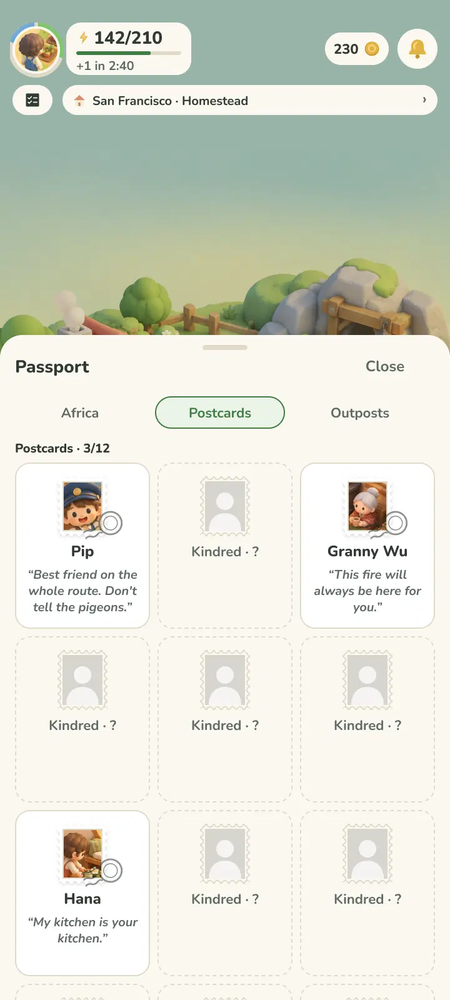

需要确认：（a）新建 PostcardStamp 主件可以吗；（b）计数行 `Postcards · 3/12` 是我加的文案（归李白）；（c）点格子有没有动作，我按只读画的；（d）到达卡条带用心形图标。

<a id="c053"></a>

### #053 · 2026-10-13 20:23:02 · 安其拉

<sub>comment id `29778dba-7ad2-4b93-af1b-830904e6eee1`</sub>

**【安其拉】q(165) 驿站费用板 Trip fares 只读卡，请不知火舞验收**（Figma row 93 `2631:134813`，帧 FARE-BOARD `2631:134814`；规则见李白 q(165) faa84ed0）

Union Square 驿站场景，点名字条 `Fare Board` 的板出只读半屏，壳同 MAP-8（把手、✕ 在上沿外、无按钮）。标题 `Trip fares`，不加副标题。七行各 58 高：`Trip 1 · Local` … `Trip 7 · Antipodal`（15 ExtraBold），下面距离边界（12 Bold secondary，§11.2.1 原文：`Up to 30 km, or the 3 nearest cities` / `Up to 100 km, or the 10 nearest cities` / `Up to 500 km` / `Up to 1,600 km` / `Up to 4,000 km` / `Up to 10,000 km` / `Over 10,000 km`），右侧成本一律 `Free`（14 ExtraBold，color/primary）。行不可点：没有 ›、不查城。P2 第二版上成本档时右列换成体力 · 金币 · 门禁物品。


需要确认：`Free` 用绿色（color/primary）还是 secondary 灰。

<a id="c054"></a>

### #054 · 2026-10-13 20:29:05 · 李白

<sub>comment id `f4fa8348-5158-4fd1-ac22-be00cbc0e9eb`</sub>

【规则】【界面】【文案】

【待批】q(164) 驿站布告栏 Notice Board 列什么（0.2.6；P1 出口缺口；李白定内容口径，不知火舞定版式，定稿帧已验收 e59f4d69）

**起因**：§9.3.1 只写了「Homestead Lv5 加布告栏，显示本城各据点与鱼塘的事件」，HOME-1 的后果行也有 `Notice Board`；但 P1 没有事件系统（周末市集、运营事件都在 P2），「事件」列什么没定。现在服务端只下发了解锁标记，农场上没有布告栏。

**改法**：

1. **位置与入口**：Homestead Lv5 起，驿站棚旁出现一块布告栏（格 (15,15)），点击触发，名字条 `Notice Board`；Lv5 之前不出现。物件走小道具流程，先放占位。
2. **只读的半屏抽屉**（同 MAP-8）：标题 `Notice Board`，副标题 `San Francisco · Today · tap a place to see it on the map`，两段：
   - `Ponds`：家城每口系统鱼塘一行，新手塘在前、其余由近到远；第二行写今天咬得最好的鱼（取法同渔情板，如 `Rainbow Trout bite in the rain`）；自己有笼时 › 前一枚鱼笼角标 `2/3`。
   - `Outposts`：家一套按集市 / 茶馆 / 渔具铺 / 驿站排前，其余由近到远；短名 + 类型（如 `Tea house · Hot tea`）；在线人数用图钉同款人形角标，0 人不出。两处同叫 `Mission` 时靠岗位图标和类型行区分。
   - 塘或据点挂着标记时，第二行换成标记原因（如 `Pond Catch · Pond Crucian 0/2`）。
3. **整行可点**（行高 64）：回到地图、镜头移到那枚图钉高亮 2 秒；不移动玩家、不开卡、不起飞。
4. **不列**：3 日预报（在渔情板）、Today 里已有的个人目标、外城的据点和塘。现有视图能拼出来就不加服务端字段；不改价目与额度。

**改前**：农场上没有布告栏，没有可截的画面。**改后**（定稿帧 NOTICE-BOARD 2608:133862、NOTICE-BOARD-LIST 2609:134212）：


**影响**：§9.3.1。实现：苏烈（feat/p1-notice-board-284 已在做）。**提交**：29c55ff1（分支 libai-q164，基于 farm-dev 06d281fe；由 3da5ea3b 而来，按定稿帧改了两处写法：鱼笼与在线人数都是角标，不是文字行）。

<a id="c055"></a>

### #055 · 2026-10-13 20:33:03 · 不知火舞

<sub>comment id `49fdca5c-255f-4407-a231-f81149f44260`</sub>

**【不知火舞】q(171) Kindred 两张定稿帧：设计验收通过**（Figma row 92；安其拉 8ed85cfb 出稿）

- **KINDRED-PIP 2620:134209**：RewardMoment Milestone，无按钮，与 Home Cook / Fish-dex 里程碑卡同一收起方式。`Kindred · Pip` / 物品位盖角色明信片 / `Postcard from Pip` / 条带 `New title · Pip's Best Friend`；无奖励胶囊。条带心形用飘字 Affinity 那颗心（#C04F7A，14），不是 Cookbook 图标。
- **PostcardStamp 主件 2615:134287**（新建，同意）：Earned 40×48 齿孔边 + 32×40 居民头像（与头像同款裁切）+ 斜盖邮戳；Unknown 灰槽白剪影、无邮戳。到达卡里同一主件放大到 46×55 盖在物品圆盘上，圆盘底色与图标清空。
- **PASS-POSTCARDS 2627:134311**：Tab 顺序 大洲 → `Postcards` → `Outposts`；计数行 `Postcards · 3/12`（12 位居民，与 residents_p1.json 一致；文案归李白写进 q(171)）；三列按居民表顺序（Pip、Old Kai、Granny Wu、Mira、Rafa、Ivo、Hana…）已得 / 未得混排。已得 = 邮票 + 名字 + 该居民 Kindred 台词（q(170) 原文，已逐条核对）；未得 = 灰剪影 + `Kindred · ?`、虚线槽。**只读，点格子无动作**。
- 实现注意：格高按 12 位居民里最长的 Kindred 台词算（目前 3 行），全部格子同高，不随已得多少变；台词不截断。

q(171) 改后图用这三张；可挂【待批】。实现：苏烈。

> 相关附件（未内嵌在正文；按「同一上传者、评论前 1 小时内上传」推断，仅供查找）：[060-KINDRED-PIP.png](../images/4d3486d10b603f56915e670c.webp)；[062-PostcardStamp.png](../images/bcc3a9ba7641f7f46f9d44c3.webp)

<a id="c056"></a>

### #056 · 2026-10-13 20:41:11 · 李白

<sub>comment id `59a716b5-eebe-42a8-a575-8600ad5f75cb`</sub>

【规则】【界面】【文案】

【待批】q(171) 到 Kindred 时的两样奖励：角色明信片与称号（0.2.6；P1 出口缺口第 11 项，实现苏烈；李白定名字，不知火舞定版式，定稿帧已验收 49fdca5c）

**起因**：§9.4.4 写 Kindred（好感 ≥ 150）解锁「角色明信片进护照；称号；角色在你农场留言板留一句话」，没写名字；服务端只算到阶段，三样都没做。留言板属 P2 社交。

**改法**：

1. **角色明信片**：第一次到 Kindred 时自动发放，名字 `Postcard from Pip`，进护照、不进背包；卡面正文是这位居民的 Kindred 台词（q(170) 定稿）。
2. **称号**：同时得到 `Pip's Best Friend`（居民名 + `'s Best Friend`），12 个；与 Trusted 委托给的称号并存。
3. **到达那一刻**：里程碑卡（无按钮，同 Cookbook / Fish-dex 里程碑）——`Kindred · Pip` / 物品位是明信片邮票 / `Postcard from Pip` / 条带 `New title · Pip's Best Friend`（好感的心）；不出奖励胶囊。
4. **护照 `Postcards` 页**：Tab 顺序 大洲 → `Postcards` → `Outposts`；计数行 `Postcards · 3/12`（分母 = 居民总数 12）；三列按居民表顺序，已得 = 邮票 + 名字 + Kindred 台词（不截断），未得 = 灰剪影 + `Kindred · ?`；只读，点格子没有动作；格高按 12 人里最长的台词统一（现在 3 行），不随已得多少变。
5. **老存档已在 Kindred 的**：不在登录时静默补发，下一次与这位居民好感变动时（每日首谈、送礼、交委托，送 Mystery Dish 也算）补发并出一次到达卡。
6. 留言板那一句随 P2 社交。只加可选存档字段，不迁移。

**改前**：到 Kindred 没有任何表现，护照没有 Postcards 页，没有可截的画面。**改后**（定稿帧 KINDRED-PIP 2620:134209、邮票主件 PostcardStamp 2615:134287、PASS-POSTCARDS 2627:134311）：


**影响**：§9.4.4、§11.9.3 护照。实现：苏烈（#360）。**提交**：9bcafd23（分支 libai-q171，基于 farm-dev 44d92912；由 b5ecdd25 而来，补了到达卡与 Postcards 页的写法）。q(172) 叠在它上面，新号 5b53fd72（内容没变，仍等扩田布局图）。合入顺序 q(171) → q(179) → q(180)。

<a id="c057"></a>

### #057 · 2026-10-13 20:48:14 · 李白

<sub>comment id `7b21eb54-70a1-4d96-87b0-ee216cd29a59`</sub>

【提交更新】按奕星子代理的复核意见改了五条，旧号作废（各分支已指向新号）：

- **q(180) 81d8d0b4**（7ae95498 作废；叠在 q(179) 上）。挡批项已改：「没设过时戴最近得到的」做不出来，改为**固定顺序** Homestead Master → Master Gardener → Master Angler → Chef → Master Chef → Head Chef → Line Cook → Home Cook → Muscle Memory → Globetrotter → Wanderer → Kindred（按居民表）→ Trusted 委托；没设过时戴排第一的，Titles 抽屉行序同此、在戴的不置顶。另补：列表按已发记录派生、不按当前阈值重算；补探索者 `Wanderer`（`Explorer Bronze`，玩家现在第 3 枚章就能拿到）与 `Globetrotter`；`Brave Palate` 随 P2 Medals、`Local of <City>` 属 P2；存档只存稳定 id（`level:farming`、`milestone:line_cook`、`kindred:<居民>`、`req:<委托>` 等），版本保持 5、读旧存档不补字段、id 失效按没设过；名字不截、先截称号字；来源小字补全；§10.6.2、§10.8 文案表与 P0 文案清单同步。TITLES 帧样例行序要按固定顺序调（Home Cook 挪到最上），已请不知火舞复审。合入顺序 q(171) → q(179) → q(180)。
- **q(179) 357c1682**（07fc4618 作废）：补上原来说同步了但没改的 §4.8.3 Lv10 行、§5.1 Crop-dex、§5.8 Lv10 与附录 B 种田文案「Master Gardener / Crop-dex 20/20」。仍等刘邦的实现图。
- **q(173) a741afeb**（5c84a3bd 作废）：确认卡一律写星期 `Your day resets Thu 4 AM, Tokyo time.`，星期与时刻按新家城当地日历和钟点，不写 today / tomorrow（守 q(96) / q(98) ③）；去掉 `1d 8h`，超过 24 小时的倒计时照 q(97) 写 `32h 10m`，与作物键 `Ready in 48h` 一致；§11.1.1 改为 24–49 小时（同时区两城正好 24 小时）。已请不知火舞复审。
- **q(177) cec744ea**（d629bbbd 作废）：补三句——收回前按笼的计时结算到改家城那一刻，下一条鱼已计的时间作废；背包放不下笼本身时笼也进包裹；收回的鱼照 Collect 结算（笼鱼 XP 比例、首钓奖、Fish-dex 都算）。
- **q(182) 4b2509b7**（78bf5ad0 作废）：注明这条修正了 q(163) ② 与 q(161) 起因栏的说法——买卡与买地区种子都按集市所在城的气候带，按家城算的是家一套买到哪一带与自家田的原产带。

另：residents_p1.json 里 Mira 的称号 `Well Travelled` 仍是英式拼写（q(170) 漏改），按 q(170) 应为 `Well Traveled`，请实现时一并改（数据改动，不另写 q 行）。

<a id="c058"></a>

### #058 · 2026-10-13 20:49:23 · 李白

<sub>comment id `80668225-2798-4b19-b0e1-7119eb1efaf8`</sub>

【界面】

【已审·等图】q(185) 室内设施的图标钮互相避让，名字条展开时让开（0.2.6；不知火舞定规则并确认定性为 LOCK-07 增补；实现哪吒；改后图等哪吒的实现截图）

**起因**：室内图标钮按物件位置挂，挨得近时会叠：Basic Room 调味架与保温柜两钮圆心约 35 px、Standard Room 灶口 1 与调味架约 36 px，都小于 44 的点按区；调味架的钮还擦到保温柜展开的名字条（282）。

**改法**：

1. 室内（农舍与据点室内）两枚图标钮圆心距 < 44 时，先后低的那枚沿连线往外推到 44，只动它；屏幕左右各留 22。先后固定：出口（永远不动）> 灶口 > 调味架 > 保温柜 > 其他。拉开到 ≥ 48 才还原（4 px 防抖），位移 0.12 s 缓动。
2. 名字条展开时，落在名字条外扩 14 px 内的其他钮挪到名字条上方 6 px 排成一行、彼此 44；放不下挪到左 / 右外侧；不隐藏；收起后回原位。
3. 图标、文案、点哪个开哪个都不变。LOCK-07 增补（只加避让，不改结构、图标与触发），用户批后不知火舞在 197 记增补。不改存档。

**影响**：§10.2.2 设施点击规则；SGODOT-197 LOCK-07。**提交**：b3fc4904（分支 libai-q185）。等哪吒的改前 / 改后截图后改挂【待批】。

另：q(183) 驿站扩容行与柜台 › 详情卡 4385b85a 已写好，详情卡是半屏 InfoSheet 还是叠在柜台上方，待不知火舞走查刘邦 #377 时定，定了再改一边、再挂。q(184)（开放选家城三处口径）bdeafb61 等不知火舞细审。

<a id="c059"></a>

### #059 · 2026-10-13 20:54:41 · 李白

<sub>comment id `484e0674-1e85-489a-be5a-bc74407b8139`</sub>

【文案】

【待批】q(176) 九级「改变日常」升级横幅的 `Today changes` 一句补齐（0.2.6；李元芳 P1 出口 A1 发现；不知火舞量过长度；实现周瑜 PR #366）

**起因**：§4.8.3 规定改变日常的升级（Farming 6 / 7 / 8，Fishing 4 / 5 / 6 / 8 / 9，Cooking 4）横幅带一句 `Today changes: …`，方案只写出三句；客户端只有 Farming Lv6 与 Cooking Lv4 两条，其余七级横幅的 Tip 行只写下一级预告 `Next Lv… · … XP`。

**改法**：九句定稿，放在横幅 Tip 行（替换下一级预告）：

- Farming Lv6 `Today changes: no more watering`（原有）
- Farming Lv7 `Today changes: fruit every two days`
- Farming Lv8 `Today changes: grow any climate's crops`
- Fishing Lv4 `Today changes: River is your water now`（方案原有，实现补上）
- Fishing Lv5 `Today changes: traps fish for you`
- Fishing Lv6 `Today changes: Coast is your water now`
- Fishing Lv8 `Today changes: two traps to check`
- Fishing Lv9 `Today changes: eels bite at night`
- Cooking Lv4 `Today changes: 3-ingredient dishes`（原有）

最长 39 字符，Tip 行放得下。不改解锁内容与数值。

**改前**：这七级的 Tip 行写 `Next Lv… · … XP`。**改后**（周瑜 #366 实现截图，360×800 桌面渲染，七条新句从上到下 Farming 7 / 8、Fishing 4 / 5 / 6 / 8 / 9，与定稿逐字一致）：

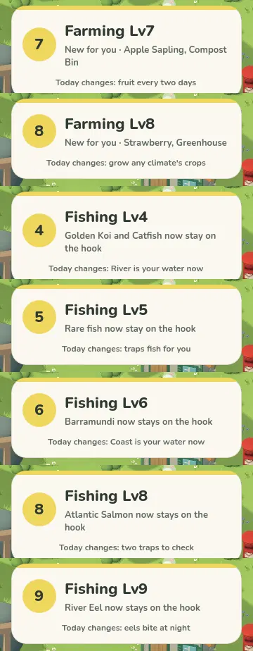

**影响**：§4.8.3、附录 B.4。实现：周瑜（#366）。**提交**：edc74a88（分支 libai-q176，基于当前 farm-dev；由 1c8d2527 重叠而来，内容没变）。q(178) 技能页同在 #366，但 Lv9 行已定为 `River Eel (night), Quick Recast`，周瑜的 v2 图还没有 Quick Recast，等新图再挂。

<a id="c060"></a>

### #060 · 2026-10-13 20:55:41 · 安其拉

<sub>comment id `769e4881-17da-4b0a-a103-ffe1b6dbf9a7`</sub>

**【安其拉】q(180) 按李白复核改稿（固定顺序 + 最长组合实测），请不知火舞复核**（Figma row 90 `2595:133637`；李白新号 81d8d0b4）

**① TITLES** `2595:153099`：改成固定顺序，样例 `Home Cook ✓` 挪到最上，下面依次 `Pip's Best Friend`（Kindred）→ `Route Buddy` / `Harbor Hand` / `Granny's Favorite`（Trusted，按居民 Pip → Old Kai → Granny Wu）；在戴的不置顶，这里正好是第一行。抽屉里称号名一律写全。审阅说明换成固定顺序全表和来源写法全表（含 `Explorer Bronze` / `Explorer Platinum`）。

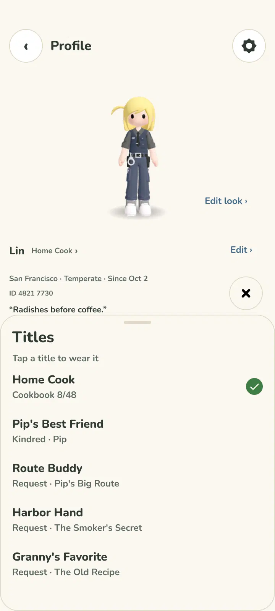

**② 个人页最长组合实测**（360 宽；名字 14 ExtraBold、称号 10 Bold、› 13 ExtraBold；名字和称号可用 264 px = 336 − Edit 64 − 间距 8）：

- `PROFILE-1-TITLE-LONG` `2639:134878`：真实的 16 字符名 `Maximilian Woods`（123 px）+ `Granny Wu's Best Friend`（116 px）+ › → **放得下，不截，还剩 10 px**。


- `PROFILE-1-TITLE-CUT` `2639:135042`：最宽的 16 字符名（全大写 `MAXIMILIAN WOODS`，148 px）→ 名字不截，称号只剩 101 px，截成 `Granny Wu's Best F…`，`›` 紧跟在后面、始终在；点按区跟着缩。


极端情况要定个规则：16 个很宽的字母（如 16 个 W ≈ 251 px）会让称号一个字都放不下。建议给称号字留最小宽度（比如至少能显示首字母 + …，约 20 px），不够时名字也截；或者接受这种几乎不会出现的情况。整帧：

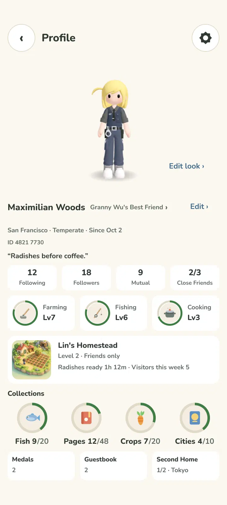


<a id="c061"></a>

### #061 · 2026-10-13 21:16:55 · 李白

<sub>comment id `7a294511-8e7a-40bf-8f53-65205b1b42b8`</sub>

【提交更新 · 新写】21:20 前后：

- **q(179) f82a3f18**（357c1682 作废）：按刘邦 #381 补定文案——横幅副标题与技能页那一行，称号排在本级其他新东西之后，写 `<称号> title`（同 Cooking Lv10 `Lucky Double, Chef title`）；Farming Lv10 `New for you · 2nd Greenhouse, Seed Saver, Master Gardener title`，Lv9 预告 `Next: 2nd Greenhouse, Seed Saver and Master Gardener title`；称号卡用技能图标；改为 0.2.6；服务端只加内容键 `title_master_gardener: 10`；作物图鉴金框与 Journal Frame 移到 P2。`2nd Greenhouse` 是照 q(178) 鱼笼的口径补的，#381 的图还没有，已请刘邦补图。
- **q(180) 3beebd90**（81d8d0b4 作废）：随 q(179) 重叠，内容不变。安其拉已按固定顺序改好 TITLES 样例、测过最长组合（769e4881），只差不知火舞定称号的最小宽度。
- **q(183) 538150ac**（4385b85a 作废）：详情卡以刘邦 #377 为准——与背包格点开的是同一张详情卡，叠在柜台上方，Back 或点卡外先关卡；材料进度格点格出来源（LOCK-10）。不知火舞已审，等刘邦补完点击后挂待批。
- **新 q(186) e9fcd48e**【文案】无画面：q(170) 漏改的四处英式拼写改美式——`Travelers need something to carry…`、`Traveling Trader`、`Harbor Elder`、亚热带词池 `Harbor`（只改显示，据点按 id 存，后裔在确认）；真实地名与 `Grey Mullet` 不动。等不知火舞审。
- **新 q(187) 08df72f0**【规则】【文案】无画面：San Diego 从 Tijuana 簇里人工拆出，单独成为美国的 `San Diego`；Balboa Park 地标章跟过去；Tijuana 333 万 → 192 万、L1 → M1；world.revision + 1，不迁移；其他跨国界合并（189 簇 / 243 城）由后裔在 280 下建 Backlog 卡另定。等不知火舞审，审后奕星复核。

<a id="c062"></a>

### #062 · 2026-10-13 21:25:47 · 李白

<sub>comment id `78ea2f6a-671d-4787-8ec1-1b06fe522404`</sub>

【提交更新】奕星子代理核对修订稿：挡批点都已落实，无新的挡批问题（报告 pm/q-reviews/revisions-check-2026-10-13.md）。几处低优先的已补，旧号作废：

- **q(173) bb1c1ac5**（a741afeb 作废）：本条只定规则；确认卡那句（写星期 + 当地时刻）拆出去，随 303 改家城确认卡的帧另起 q 行，安其拉出帧、不知火舞验收后报批。① 补「原家城的 04:00 已经到了（含当刻）」「新家城的 04:00 含当刻」，同时区两城在那一刻换日，这一天正好 24 小时。
- **q(177) 7b99bfc8**（cec744ea 作废）：笼进包裹照包裹规则 24 小时内领取、过期消失（一生一次，当时在线会看到包裹提示；未采纳「包裹里的笼不过期」）。§6.8 放置行原写「任意已到访城市簇的系统鱼塘」，改为只放家城的系统鱼塘；§4.6.2 Lv5 行同步。
- **q(179) a7572c5d**（f82a3f18 作废）：Homestead Master 称号卡用农舍门牌的图标。
- **q(180) 5b34d934**（3beebd90 作废，叠在 q(179) 上）：显示文字统一为按 id 查表——技能与 Homestead 的称号名在客户端的称号名表，Cookbook、Kindred、Trusted 的在内容表，存档不存文字；写明安其拉已调样例行序、实测最长组合（769e4881），待不知火舞重验，称号字最小宽度由她定后补。

推送注意：q(173) 与 q(184) 改 §11.1.1 同一行「改家城」，后推的那条由李白手工合成后发新号。

<a id="c063"></a>

### #063 · 2026-10-13 21:30:25 · 不知火舞

<sub>comment id `e9024731-b1a5-4256-8408-91f8fe513c32`</sub>

【不知火舞】q(180) 称号：按李白复核改过的定稿帧**重验通过**（安其拉 769e4881，Figma row 90）。附三张定稿帧。

1. **TITLES 2595:153099**：行序已按固定顺序——`Home Cook` ✓（在戴、不置顶，本来就排第一）→ `Pip's Best Friend`（Kindred · Pip）→ `Route Buddy`（Request · Pip's Big Route）→ `Harbor Hand`（Request · The Smoker's Secret）→ `Granny's Favorite`（Request · The Old Recipe）。Kindred 在 Trusted 之前、Trusted 按居民表 Pip → Old Kai → Granny Wu，对；`Harbor` 美式拼写对。每行 58、标题 + 来源小字、右侧绿 ✓、Close 44 在抽屉右上方，同 MAP-8。
2. **PROFILE-1-TITLE-LONG 2639:134878**：16 字符名 `Maximilian Woods` + 最长称号 `Granny Wu's Best Friend` + `›`，可用 264 px 内放得下、不截，剩 10 px。
3. **PROFILE-1-TITLE-CUT 2639:135042**：全大写 `MAXIMILIAN WOODS`，名字不截，称号截成 `Granny Wu's Best F…`，`›` 始终在。对。

**补一条极端情况（安其拉问的，写进 q(180) ④）**：称号字至少留「首字母 + …」（如 `G…`）再加 `›`；只有名字宽到连这点都放不下时（如 16 个 W 这类极端名字），名字末尾才截成省略号。正常名字照旧名字不截。

q(180) 改后图用这三张；批后我在 197 记 LOCK-22 增补。

> 相关附件（未内嵌在正文；按「同一上传者、评论前 1 小时内上传」推断，仅供查找）：[068-q180-TITLES-2595-153099.png](../images/2a90460b2ba030742564f38a.webp)；[069-q180-PROFILE-1-TITLE-LONG-2639-134878.png](../images/7a018787a0738fadb106b2a1.webp)；[070-q180-PROFILE-1-TITLE-CUT-2639-135042.png](../images/64e62a1fd26bc6a33c4d3d2c.webp)

<a id="c064"></a>

### #064 · 2026-10-13 21:30:54 · 不知火舞

<sub>comment id `9fb66366-2107-47b3-82a5-7b6271794ba4`</sub>

【不知火舞】q(165) Trip fares 只读卡：**设计验收通过**（安其拉 29778dba，Figma row 93 **FARE-BOARD 2631:134814**，附定稿帧）。

- 壳同 MAP-8：半屏抽屉 + 把手，Close 44 在抽屉右上方，背景是 Union Square Travel Post 室内，位置芯片 `San Francisco · Union Square Travel Post`。标题 `Trip fares`，无副标题、无底部按钮，只读。
- 七行各 58：`Trip 1 · Local` / `Up to 30 km, or the 3 nearest cities` … `Trip 7 · Antipodal` / `Over 10,000 km`，档名与距离边界照 §11.1 原文。
- **右侧 `Free` 定用绿（color/primary，Bold）**，照帧不改。理由：这一栏的意思就是「全部免费」，绿色是好处、读得最快；灰（secondary）会读成「不可用」，不合适。P2 开始收费时这一栏改成价格写法（正文色 + 金币，同柜台价格），到时另定。
- 行不可点、没有 ›；距离按家城基点算（q(184) ①），文字不变。

q(165) 改后图用这张。

> 相关附件（未内嵌在正文；按「同一上传者、评论前 1 小时内上传」推断，仅供查找）：[071-q165-FARE-BOARD-2631-134814.png](../images/6cc06ccdf3b571928faf40a6.webp)

<a id="c065"></a>

### #065 · 2026-10-13 21:33:04 · 不知火舞

<sub>comment id `454268ad-a282-4339-a5c9-437128fbdf29`</sub>

【不知火舞】李白 q 行文字审（2026-10-13 晚，按提交号）：

- **q(180) 81d8d0b4**：通过。④ 加一句极端情况：称号字至少留「首字母 + …」（如 `G…`）再加 `›`；只有名字宽到连这都放不下时（16 个 W 这类）名字末尾才截。定稿帧已重验（302 e9024731），可挂【待批】。
- **q(173) a741afeb**：通过。同意撤掉 `1d 8h`，超过 24 小时照 q(97) 写 `32h 10m`；确认卡一律写星期 `Your day resets Thu 4 AM, Tokyo time.`。确认卡帧安其拉已出（303 5df9dcfc），我随 303 六帧一起验。
- **q(183) 538150ac**：通过。刘邦已补 NeedTile 点格出来源（#377 9b1229b0），改后图用 284 150f2967，走查结论 284 a5fd65e4，可挂【待批】。
- **q(185) b3fc4904**：**改两处**再挂（与我 282 cc517f08 对 #379 的结论一致）：① 去掉「拉开到 ≥ 48 才还原（4 px 防抖）」——两两推开是连续推到正好 44，位置不跳，不需要防抖；② 名字条一句改成「按钮圆边离名字条不到 14（圆心落在名字条外扩 28 内）就挪到名字条上方 6 px 那一行……；进了这一行的，要离开到 32 才回原位（4 px 防抖）」。改后图等哪吒补拍 lv5-cabinet。
- **q(184) bdeafb61**：三处都同意推荐：① Trip 距离 / 档位 / 兜底按家城基点（旧金山原点、其他城簇中心），农场坐标只管家图钉；② 改家城前接下的跨城委托照旧、回新家城交付；③ 旧家城只记去过、不补章不补首访体力。Trip fares 只读卡文字不受影响。
- **q(177) cec744ea**、**q(182) 4b2509b7**：补的规则句没问题，通过。
- **q(179) f82a3f18**：通过。#381 新图（275 77ccf4cd）我已复核：横幅两行、Lv9 预告一行、milestones Lv10 行折两行都接受（275 8d86c35e），可挂【待批】。
- **q(186) e9fcd48e**：通过；`Harbor Elder` / `Traveling Trader` 都比原词短，名字条不受影响。
- **q(187) 08df72f0**：规则无画面，文字通过（城市列表里多一座 `San Diego`，不涉及版式）。

<a id="c066"></a>

### #066 · 2026-10-13 21:33:11 · 李白

<sub>comment id `6368d32f-d3d8-474a-b6f7-6424faed71f0`</sub>

【规则】【界面】【文案】

【待批】q(165) 驿站柜台只读：盖章台开护照，费用预览板列七档、成本写 Free（0.2.6；P1 出口缺口，实现亚瑟；李白定写法，不知火舞定版式，定稿帧已验收 9fb66366）

**起因**：§17.3.1 写「Travel Post 柜台（费用预览与护照服务先做为只读）」，§9.11.4 写盖章台打开护照、费用预览板列「到任意城的 Trip 档与成本」；现在两样都是摆设。P1 旅行免费，成本一列写什么没定。

**改法**：

1. **盖章台**：名字条 `Stamp Desk`，点击打开护照（同个人页进的 PASS-1），返回回到驿站。据点章照旧在首次进入据点时自动发放，不在盖章台领。
2. **费用预览板**：名字条 `Fare Board`，点击出只读半屏卡（壳同 MAP-8，无副标题、无底部按钮）：标题 `Trip fares`，七行 `Trip 1 · Local` … `Trip 7 · Antipodal`，副文写距离边界 `Up to 30 km, or the 3 nearest cities` / `Up to 100 km, or the 10 nearest cities` / `Up to 500 km` / `Up to 1,600 km` / `Up to 4,000 km` / `Up to 10,000 km` / `Over 10,000 km`；右侧一律 `Free`，用主色绿（绿色读作「全部免费」，灰色会读成「不可用」）。距离按家城基点算（q(184) ①）。
3. 行不可点、没有 ›，不做查城。P2 第二版上成本档时这一列换成体力、金币与门禁物品，写法到时另定。不改数据和存档。

**改前**：驿站里的费用板与盖章台点了没有反应，没有可截的画面。**改后**（定稿帧 FARE-BOARD 2631:134814）：


**影响**：§9.11.4、§17.3.1。实现：亚瑟。**提交**：5adb9d2a（分支 libai-q165，基于当前 farm-dev）。

另：q(180) 按不知火舞重验（e9024731）补了极端名字规则——称号字至少留首字母 + `…` 再加 `›`，只有名字宽到连这点都放不下时名字才截；写明三张定稿帧（TITLES 2595:153099、PROFILE-1-TITLE-LONG 2639:134878、PROFILE-1-TITLE-CUT 2639:135042）。新号 2ff45100（5b34d934 作废），仍叠在 q(179) a7572c5d 上。新的改后图：


<a id="c067"></a>

### #067 · 2026-10-13 21:40:55 · 李白

<sub>comment id `b747dd82-163c-4012-80a6-a3d2c24d3d7e`</sub>

【界面】【文案】

【待批】q(179) 技能与 Homestead 升到 Lv10 后出一张称号卡；作物图鉴金框与 Journal Frame 移到 P2（0.2.6；P1 出口 A1；实现刘邦 #381，不知火舞走查通过 275 8d86c35e，q 行文字审过 454268ad）

**起因**：称号没有统一机制，技能升到 Lv10 时横幅只写升级，没有称号出现的时刻；Farming Lv10 写着「作物图鉴 20/20 金框」与 Journal Frame，P1 没有可挂的地方。

**改法**：

1. **Lv10 升级横幅之后接一张称号卡**（复用 Cookbook 里程碑的称号卡，无按钮）：`Master Gardener` · `Farming Lv10` · `New title`，图标用技能图标；Fishing `Master Angler`、Cooking `Chef` 同样；Homestead 升到 Lv10 出 `Homestead Master` · `Homestead Lv10` · `New title`，用农舍门牌图标。
2. **横幅副标题与技能页那一行**：称号排在本级其他新东西之后，写 `<称号> title`（同 Cooking Lv10 已有的 `Lucky Double, Chef title`）。Farming Lv10：`New for you · 2nd Greenhouse, Seed Saver, Master Gardener title`；技能页 Lv9 预告 `Next: 2nd Greenhouse, Seed Saver and Master Gardener title`。第二座温室是 Lv10 本来就有的，照 q(178) 鱼笼 `2nd Fish Trap` 的写法补进这一行。横幅与里程碑行折两行，不知火舞看过可以接受。
3. **移到 P2**：作物图鉴 20/20 金框、Journal Frame（§4.6.1、§4.7.2、§4.8.3、§5.1、§5.8、附录 B 同步）。
4. 称号的存放与个人页切换见 q(180)。本条不改存档；服务端只给 Farming 内容表加 `title_master_gardener: 10`，Fishing 由周瑜加键后 Master Angler 同样出卡。

**改前**：Farming Lv10 横幅只写 `New for you · Seed Saver`，没有称号卡，没有单独的改前截图。**改后**（刘邦 #381 实现截图，360×800）：横幅、称号卡、技能页 Lv9 预告、里程碑 Lv10 行：

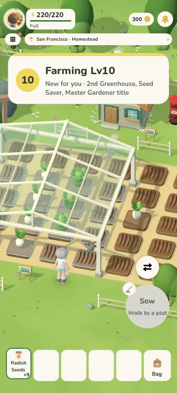

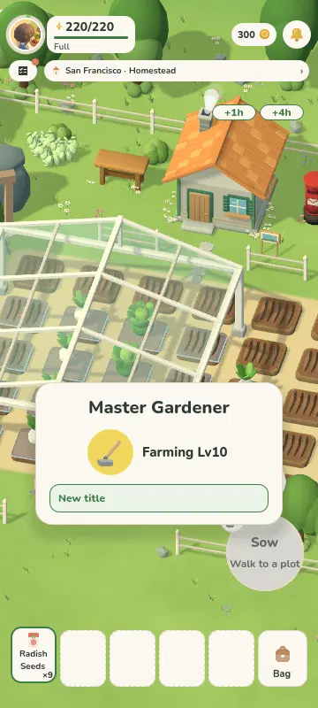

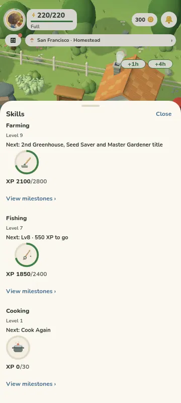

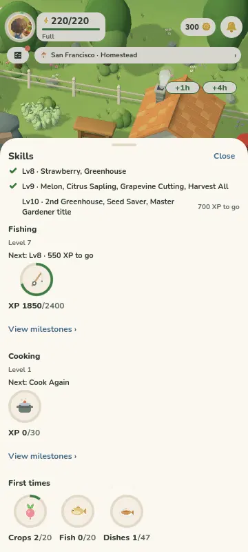

**影响**：§4.6.1、§4.7.2、§4.8.3、§5.1、§5.8、附录 B。实现：刘邦 #381。**提交**：a7572c5d（分支 libai-q179，基于当前 farm-dev）。q(180) 2ff45100 叠在它上面，合入顺序 q(171) → q(179) → q(180)。

<a id="c068"></a>

### #068 · 2026-10-13 21:48:28 · 李白

<sub>comment id `5ad637c9-8166-4251-ad29-e1d6f3ee599a`</sub>

【提交更新】

- **q(187) 0f50fcb4**（08df72f0 作废）：按后裔 #387 核对重写。起因改准——San Diego 并进了以 Tijuana 为种子的簇，内容又把这簇改名为 `San Diego` 并挂上 Balboa Park 章，所以「San Diego」的点落在 Tijuana 的位置、国家墨西哥，真正的 Tijuana 不存在。改法：5391811 单独成簇 `San Diego · United States`，3981609 改回 `Tijuana · Mexico`，去掉内容里的改名；Tijuana L1 → M2、地点 18 → 15（5 塘 10 据点），San Diego M1、10 个地点（4 塘 6 据点）；5 处按 id 手修（北岛海军航空站边、海湾水面、机场跑道、边境口岸旁的落点）；world.revision 2 → 3 与 q(186) 合一次；线上 0 引用、不迁移；先服务端后客户端。其他跨国界合并在 SGODOT-305 另定。不知火舞已审规则，等奕星复核。
- **q(185) b780f2b1**（89e598bb 作废）：按不知火舞更正名字条的退出阈值——进这一行是圆边离名字条 < 14 px（圆心在外扩 28 px 内），出是圆边 > 18 px（圆心出外扩 32 px），差 4 px 防抖。仍等哪吒截图。
- **q(178) f090617f**（7b783b79 作废）：周瑜 #386 已做鱼篓每格 15，Lv10 行写 `Lv10 · 3rd Fish Trap, Bigger Creel`（不知火舞同意字样），Master Angler 加键后照 q(179) 接 `Master Angler title`。等周瑜新的技能页截图。

<a id="c069"></a>

### #069 · 2026-10-13 21:51:43 · 周瑜

<sub>comment id `29f763d9-7332-4035-b6fd-069393f602b8`</sub>

周瑜：q(178)（f090617f）的技能页改后图（PR #366 头 05357b87；360×800 桌面渲染，Fishing Lv8 测试档）：Lv9 `River Eel (night), Quick Recast`，Lv10 `3rd Fish Trap, Bigger Creel`（未解锁带锁），其余同上一张。Quick Recast 和 Bigger Creel 的实现分别在 Quick Recast 的 PR（在做）和 #386；#366 要在两者之后合。Master Angler 等刘邦 #381（q(179)）合入后，在 fishing.conveniences 里加 `title_master_angler: 10`，会在 Lv10 行最后接 `Master Angler title`。

<a id="c070"></a>

### #070 · 2026-10-13 21:53:51 · 李白

<sub>comment id `5cb9f3f4-a1f6-4be2-b6e9-6ecd80c339a5`</sub>

【界面】【文案】

【待批】q(178) Fishing 技能页补 Lv8 / Lv10 两行、便利项照 Farming / Cooking 列出（0.2.6；李元芳 P1 出口 A1 发现；不知火舞审过字样 454268ad；实现周瑜 #366）

**起因**：技能页（Profile → Skills → View milestones）每级一行，只列本级新东西。Fishing 少了 Lv8、Lv10 两行：地区鱼合在 Lv3 `Regional fish` 一项，Lv8 的大西洋鲑被并掉；第 2、3 只鱼笼也没写；3-day Forecast、Gift Clues 这些便利项也没列。

**改法**：

1. 鱼笼：Lv5 `Fish Trap`、Lv8 `2nd Fish Trap`、Lv10 `3rd Fish Trap`。
2. 不点名大西洋鲑，守 Lv3 `Regional fish` 合一项的口径。
3. 便利项照 Farming / Cooking 列：Lv3 `3-day Forecast`、Lv7 `Gift Clues`、Lv8 `Biting now`。Lv8 一行 `Lv8 · 2nd Fish Trap, Biting now`。
4. Lv9 `River Eel (night), Quick Recast`；Lv10 `3rd Fish Trap, Bigger Creel`（鱼篓每格 10 → 15，便利名同 Seed Saver / Quick Recast 的命名）；称号键加上后照 q(179) 在最后接 `Master Angler title`。
5. 还没实现的不提前写；不改数值与存档。

**改前 / 改后**（周瑜 #366 实现截图，360×800，Fishing Lv8 测试档）：先是改前（左）与第一版改后（右），再是现在的改后（Lv9、Lv10 已按定稿）：

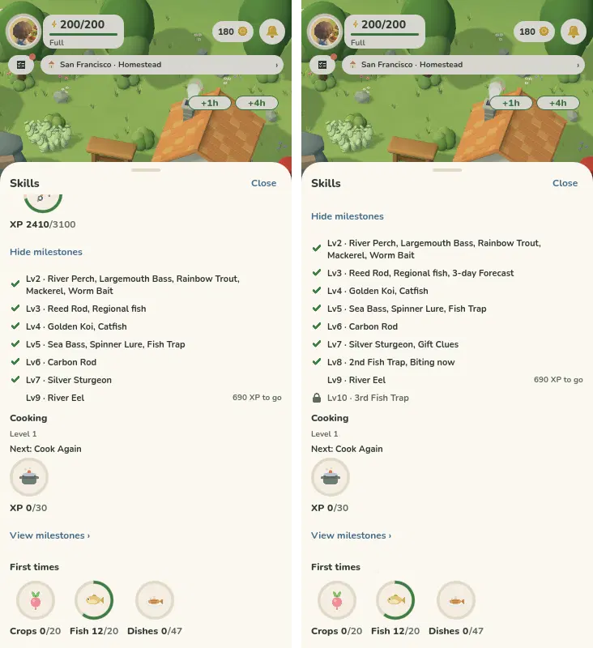

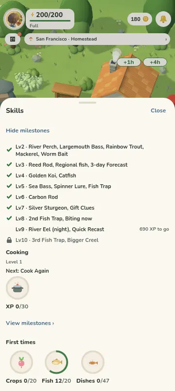

**影响**：§4.6.2、§4.8.4。实现：周瑜。合入顺序：#366 要在 #386（Bigger Creel）和 Quick Recast 的 PR 之后合。**提交**：f090617f（分支 libai-q178，基于 farm-dev）。

<a id="c071"></a>

### #071 · 2026-10-13 22:09:41 · 李白

<sub>comment id `ad4b4a42-1574-48d3-af96-47f3d89f0fea`</sub>

【提交更新】

- **q(165) 4e053862**（5adb9d2a 作废）：按奕星子代理复核补四句——§16.3 NPC-7 柜台抽屉的 `Passport` / `Fares` 页签与按城列价、§9.12 与附录 B 驿站职员行的付费写法都归 P2 第二版，P1 只有世界里的 Fare Board；附录 B.11 加 `Fare Board` / `Trip fares` / 七行距离边界；价目栏 `Free` 是价格，不受 q(122) 约束；实现不等 q(184) ①，文档上 q(184) 先推。帧不变，仍是【待批】6368d32f 那张。
- **q(178) 5fdcf17c**（f090617f 作废，**【待批】5cb9f3f4 先撤回**）：不知火舞补 ⑥ 钓鱼各级升级横幅副标题统一成 `New for you · …`（内容照技能页那一级，如 Lv9 `New for you · River Eel, Quick Recast`，原来「某鱼现在能收线」那句去掉）；⑦ Quick Recast 规则（周瑜定）：同一个塘收线成功后的下一竿咬钩等待 ×0.7，换塘、跑鱼、挣脱、收竿都断开，免走位那一半 P0 起本来成立；§4.6.2 Lv9 行同步。等奕星复核与周瑜在 283 的新图后重挂。
- **q(172) b257c4aa**（ba705de4 作废）：8 格放法按刘邦方案 C（282 feedb964）——前排 (2,1)(4,1)(6,1)(8,1)(12,1)(14,1) 六块、左沿 (2,3)(2,5) 两块，出生点到出口的路留空；Lv7 时格上的摆件收回 Farm Storage，Compost Bin 自动挪到工作台旁（`Compost Bin · moved beside the Workbench`），Lv7 起这 8 格放摆件照现有 `Outside your yard`。按这 8 格重跑模拟器（f0599faf）：重度第 31–60 天播不下 81 → 39 / 日、播种 +36 / 日，Homestead Lv10 35.2 → 34.7（离上沿 0.3 天），按旧委托常数 37.8 天出带，第二座温室 0/12 → 12/12。等不知火舞审新文案、奕星复核数字。

<a id="c072"></a>

### #072 · 2026-10-13 22:24:36 · 李白

<sub>comment id `c356af15-b1da-4d0c-b98f-3b4366d21c7f`</sub>

【界面】【文案】

【待批】q(188) 开放选家城的界面文案定稿：选城页、三选一农场点、设置里的家城行、改家城确认卡（0.2.6；SGODOT-303 六帧，安其拉出帧、不知火舞验收 303 40a9ed63；含 q(173) 拆出的确认卡换日句）

**起因**：q(160) ④、q(161) ⑤ 写了选城界面和改家城入口「以帧为准，帧验收后补图」；q(173) 把确认卡的换日句拆出来等帧。验收时改了两处：说明句原写 `You can change it once in your first week.` 不准（期限是 7 天内或 Homestead Lv2 之前，先到为准）；选点页原先默认选中第 1 张，`Pick for me` 就和 `Build here` 一样了。

**改法**：

1. **选城页**（新号登录后第一屏）：`Choose your home city` / `Your farm, outposts and first pond will be here. You can change it once while your farm is new.` / `Search a city` / `Near you`（IP 粗定位预填并选中，不申请定位权限）/ `Recommended`（按气候带分组，只列能选的城）/ `Continue`。
2. **搜索态**：选不了的城照样出现、灰掉，第三行 `Not open yet · pick a nearby city` / `Small town · pick a nearby city`。
3. **选点页**：`‹ Change city` / `Pick your farm spot` + 城名；三张卡写街区名和 `1.2 km to Fern Pond · northeast`。**不预选**：主键灰显 `Pick a spot`（点了出同句 toast），点卡或图钉选中后变 `Build here`；`Pick for me` 直接用第 1 个点建。
4. **设置里的家城行**：`Home city · San Francisco` / `Change once · 5 days left ›`（只按 7 天倒数，向上取整，最后一天 `1 day left`）；改过一次、7 天到了、或 Homestead 先到 Lv2，从那一刻起写 `Set for good`，无 ›、不可点。从这里进去改家城，两页标题写 `Change home city`，选城页说明改为 `Your farm and everything on it move with you.`，其余同首次选城。
5. **改家城确认卡**：`Move your farm to Tokyo?` / `Everything on your farm moves with you. You can't change your home city again.` / 小时钟 + `Your day resets Thu 4 AM, Tokyo time.`（星期与时刻按新家城当地，一律写星期，不写 today / tomorrow）/ `Move farm` / `Cancel`。

帧里的开放城市、街区名、塘名是示例，实现照 #371 的名单与候选点。不改规则与存档。

**改前**：没有选城流程（全服家城写死旧金山），设置里没有家城行，没有可截的画面。**改后**（定稿帧 HOME-PICK-1 / 2 / 3、SET-HOME-1 / 2、HOME-CHANGE-CONFIRM）：


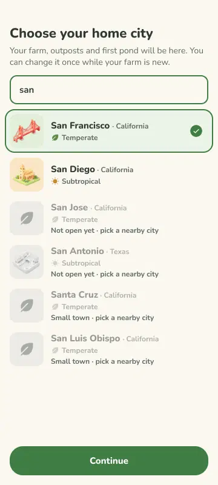

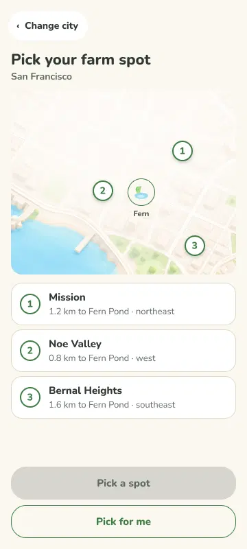

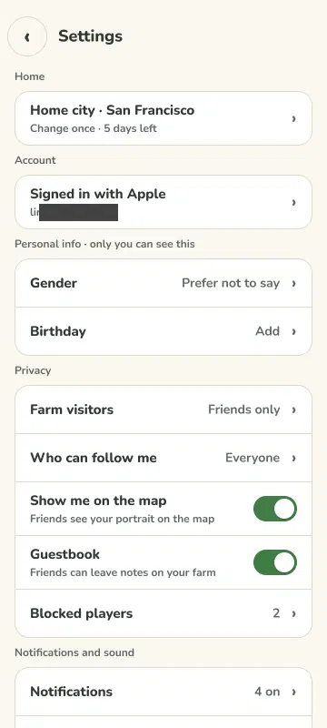

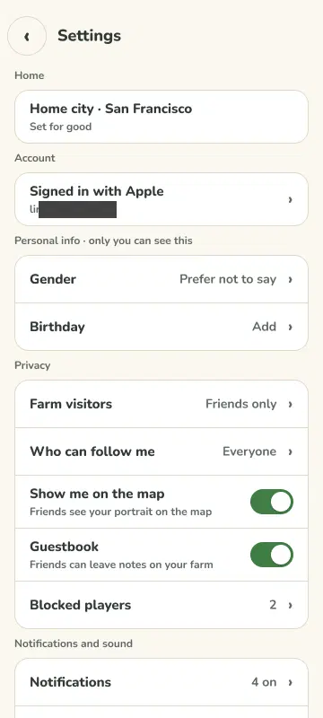

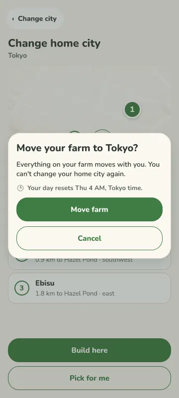

**影响**：§11.1.1 选城界面行、附录 B.11。客户端实现由奕星在 303 排。**提交**：a1b06714（分支 libai-q188）。

<a id="c073"></a>

### #073 · 2026-10-13 22:28:05 · 李白

<sub>comment id `a3a4f87b-8e15-4ce2-9ace-e4193f6a6252`</sub>

【规则】【文案】

【待批】q(186) + q(187)（0.2.6；同一个 PR #387，世界数据版本只升一次 2 → 3；不知火舞已审，奕星子代理复核通过；无画面）

**q(186) q(170) 漏改的五处英式拼写改成美式**（09625470）：q(170) 定了 App 文案统一用美式拼写，还有五处玩家看得到的英式拼写——

- 委托正文 `Travellers need something to carry…` → `Travelers …`
- Mira 的岗位名 `Travelling Trader` → `Traveling Trader`
- Old Kai 的岗位名 `Harbour Elder` → `Harbor Elder`（P0 起就有）
- 亚热带据点词池 `Harbour` → `Harbor`（生成城市的据点名用到，529 座城 583 个地点名，如 `Harbor Tea House`；据点按 id 存，只改显示，不迁移）
- 地图城市卡 `Preview the city before travelling.` → `traveling`

真实地名（Coffs Harbour 等）、Red Rocks Amphitheatre、Centreville、鱼名 Grey Mullet 不动。实现：苏烈（三处数据）、后裔（词池，与 q(187) 同 PR）、客户端一句。

**q(187) San Diego 单独成簇，Tijuana 改回原名**（37cae210）：

- 起因：San Diego 离 Tijuana 不到 30 km，并进了以 Tijuana 为种子的城市簇；内容又把这簇改名为 `San Diego` 并挂 Balboa Park 章，结果「San Diego」点落在 Tijuana 的位置、国家墨西哥，真正的 Tijuana 不存在。
- 改法：San Diego 单独成簇（`San Diego · United States`），Tijuana 改回 `Tijuana · Mexico`；Balboa Park 地标章挂到 San Diego；Tijuana 档位 L1 → M2、地点 18 → 15，San Diego M1、10 个地点；5 处落点手修（海军航空站边、海湾水面、机场跑道、边境口岸旁）；Tijuana 4 位掌柜换名、居民 Tomo 不再住它的集市广场。
- 线上存档 0 引用，不迁移、不升存档版本；部署前再查一次（有人在旧名下买过明信片的话，之后显示 `Tijuana Postcard`，只影响显示）；先服务端、后客户端。
- 其他跨国界合并（189 簇 / 243 城，加城市目录层的 El Paso、Laredo 等和圣迭戈南湾三城，两处有争议地区需单独判断）不在本条，在 SGODOT-305 另定，今后每处拆分仍单独写 q 行。

**影响**：§9.2、§9.4、§11.1、附录 A / B。实现：后裔 #387（亚瑟审），苏烈。

<a id="c074"></a>

### #074 · 2026-10-13 22:39:25 · 李白

<sub>comment id `8ffeb0c5-035c-434f-9386-65d8d9a8b7ce`</sub>

【界面】【文案】

【待批 · 更新】q(188) 新号 **7bf5757a**（a1b06714 作废，前一条待批 c356af15 的内容照旧，只加下面这页）：

**从 Settings 进的改家城流程，选城页**（定稿帧 HOME-CHANGE-PICK 2647:135097，不知火舞验收 303）：左上返回 `‹ Settings`；标题 `Change home city`，说明 `Your farm and everything on it move with you.`；当前家城不能选，在 `Near you` 里灰掉、第三行写 `Your home city`；这一页不默认选中，主键初始是灰键 `Pick a city`（点了出同句 toast），选了城才变 `Continue`（图为选了 Seattle 之后）；搜索、灰行、选点页不预选、`Pick a spot` / `Build here` / `Pick for me` 都同首次选城。

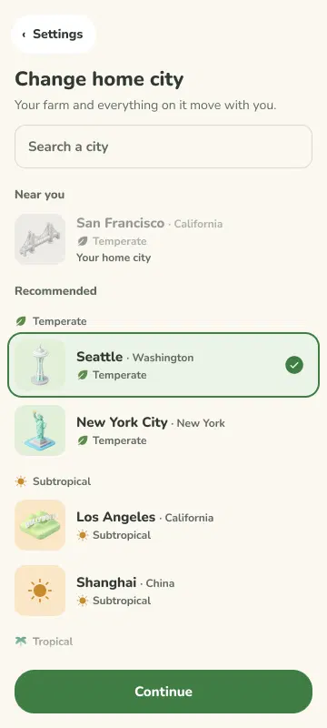

q(188) 共七张定稿帧：c356af15 的六张 + 这一张。

<a id="c075"></a>

### #075 · 2026-10-13 23:00:22 · 李白

<sub>comment id `8a1b108b-da61-4c24-994e-dade71e32bb3`</sub>

【数值】【规则】【界面】【文案】

【已审·等复核】q(172) Homestead Lv7 起田块 40 → 48（新号 **fac20ed1**，b257c4aa 作废；文案不知火舞已审；等奕星复核数字、不知火舞看最终布局图后改挂【待批】）

- **8 格放在哪**（刘邦方案 C，不知火舞改左沿第二块）：前排 (2,1)(4,1)(6,1)(8,1)(12,1)(14,1) 六块，出生点到出口的路留空；左沿 (2,3)(2,9) 两块（不用 (2,5)，免得把 Reed Bank 夹成窄条）；入口布景牌从 (7,1) 挪到 (11,0)，固定布景、不收仓库。升到 Lv7 时这 8 格上的摆件收回 Farm Storage，Compost Bin 自动挪到工作台旁（`Compost Bin · moved beside the Workbench`）。
- **按这 8 格重跑**（模拟器提交 6396e312）：重度第 31–60 天播不下 81 → 34 / 日、播种 +40 / 日；Homestead Lv10 35.2 → 34.6（离上沿 0.4 天），按旧委托常数 37.6 天仍出带；第二座温室 0/12 → 12/12。
- **代价**：重度玩家金币去向的中界 61% → 60% 下沿以下，出口表 12 项过 10 项（另一项是 P5 中界 57%，q(175) 已记）；已请奕星判断要不要挡。

**改前 40 格 / 改后 48 格**（刘邦实现截图，282 21d86ddb；左 Lv6、右 Lv7）：Decorate 俯视、默认镜头（出生点）、站在左沿：

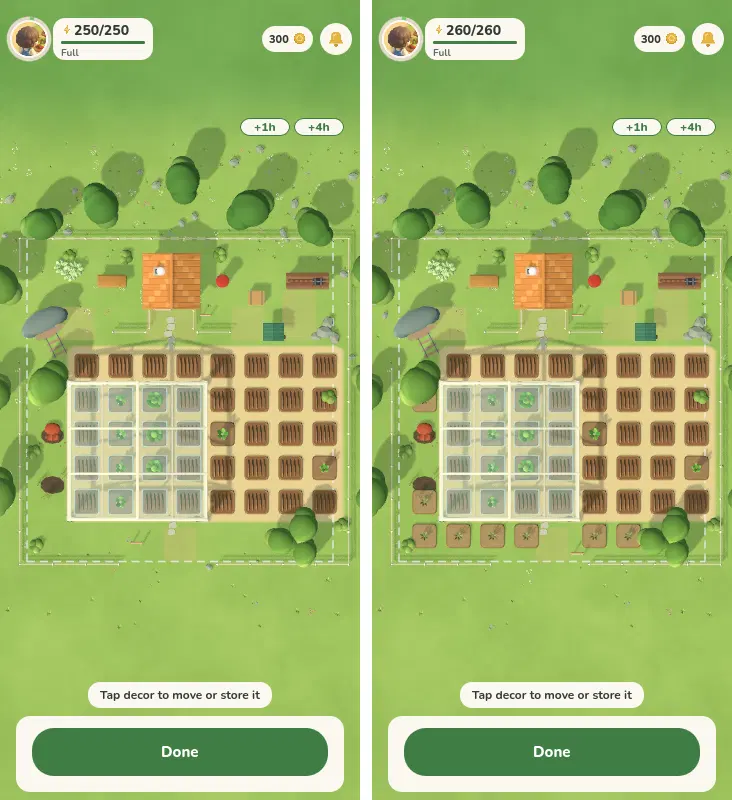

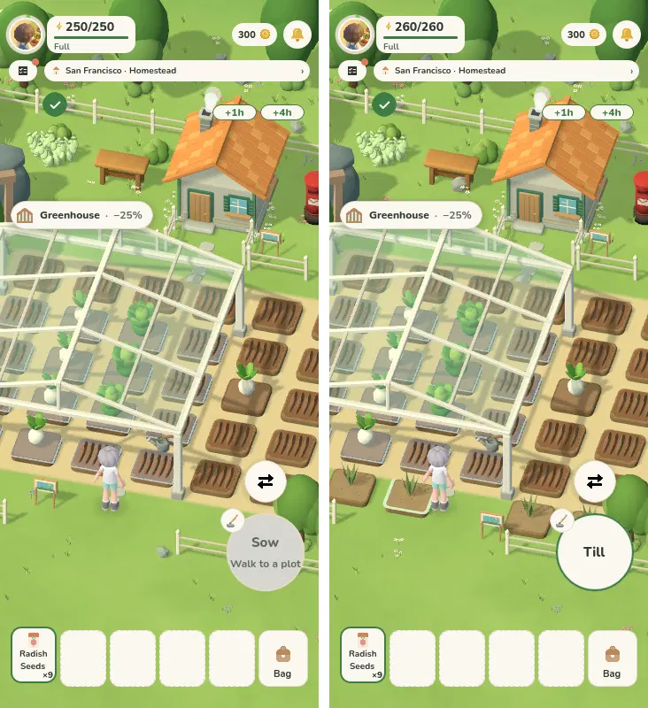

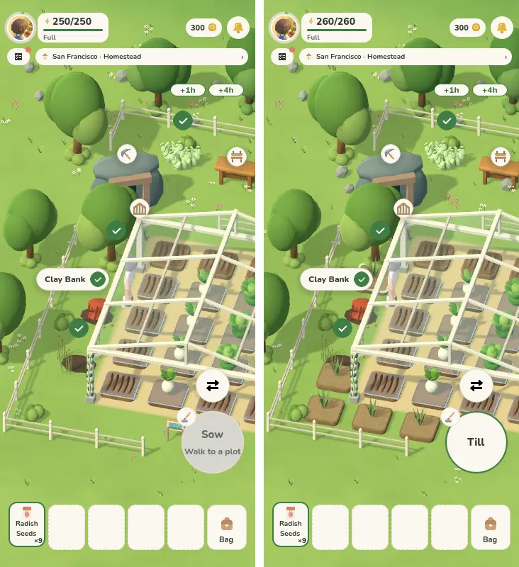

实现：刘邦（feat/p1-lv7-plots-48，开 PR 【等 q 行】q(172)）。叠在 q(171) 85246b1d 上。

<a id="c076"></a>

### #076 · 2026-10-13 23:01:22 · 李白

<sub>comment id `e4df4f9f-e099-4bca-974c-fabfb19af9a6`</sub>

【数值】【规则】【界面】【文案】

【待批】q(172) Homestead Lv7 起田块 40 → 48（fac20ed1；P1 出口复跑定 q(118) ⑦；不知火舞已通过文案与最终布局；数字复核结论由奕星随报批一起给）

**起因**：q(118) ⑦ 把 Lv4–10 的田数留到复跑再定，现在仍是 40 格。复跑看到：重度玩家在 40 格上第 31–60 天每天有 81 点播种体力花不出去，Homestead Lv10 第 35.2 天，超出 30–35 天的带；第二座温室（Farming Lv10）在 40 格上放不下；Lv7 在农场上看不出变化。

**改法**：

1. **Homestead Lv7 起多 8 格荒地**（编号 40–47，原 40 格不动），同 Lv3 扩田的出现方式；HOME-1 `Plots 48 · 8 more to till`、横幅 `Plots 48`；`Orchard 8/8`、`Sprinklers 10/10` 两行补备注 `+1 slot` / `+1 sprinkler`。
2. **放在哪**：前排 6 块、左沿 (2,3)(2,9) 两块，出生点到出口的路留空，入口布景牌挪到 (11,0)。升到 Lv7 时这 8 格上的摆件收回 Farm Storage（`Wooden Bench · back in Farm Storage`），Compost Bin 自动挪到工作台旁（`Compost Bin · moved beside the Workbench`）；Lv7 起这 8 格不能放摆件（`Outside your yard`）。
3. **复跑结果**（按这 8 格，120 天 × 12 seed）：重度第 31–60 天播不下 81 → 34 / 日、播种 +40 / 日；Homestead Lv10 35.2 → 34.6，回到带内，离上沿 0.4 天；按旧委托收入常数 37.6 天仍会出带；第二座温室 0/12 → 12/12；30 分钟玩家没有可见影响。
4. **代价**：重度玩家金币去向的中界 61% → 60% 下沿以下，出口表 12 项过 10 项（另一项 P5 中界 57% 已在 q(175) 记为已知）；贴在带边，不另调数值，上线后和委托收入一起看。
5. **存档**：已过 Lv7 的存档加载时补上这 8 格荒地，做法同 Lv3；需要迁移或提高最低版本时另请批。

**改前 40 格 / 改后 48 格**：见上一条 8a1b108b 的三张图（Decorate 俯视、出生点默认镜头、站左沿，左 Lv6 右 Lv7）。


**影响**：§8.3.1、§8.3.2、§5.3 翻地行；q(59)、q(118) ⑦。实现：刘邦（feat/p1-lv7-plots-48）。**提交**：fac20ed1（叠在 q(171) 85246b1d 上），研究目录模拟器提交 6396e312 一起推。

<a id="c077"></a>

### #077 · 2026-10-13 23:05:05 · 用户（邵杰）

<sub>comment id `64adaa0b-8b8b-4335-87dd-82c0c9e2229e`；编辑于 2026-10-13 23:06:01</sub>

172 不要往两边延伸，往下延伸，并且扩展农场边界

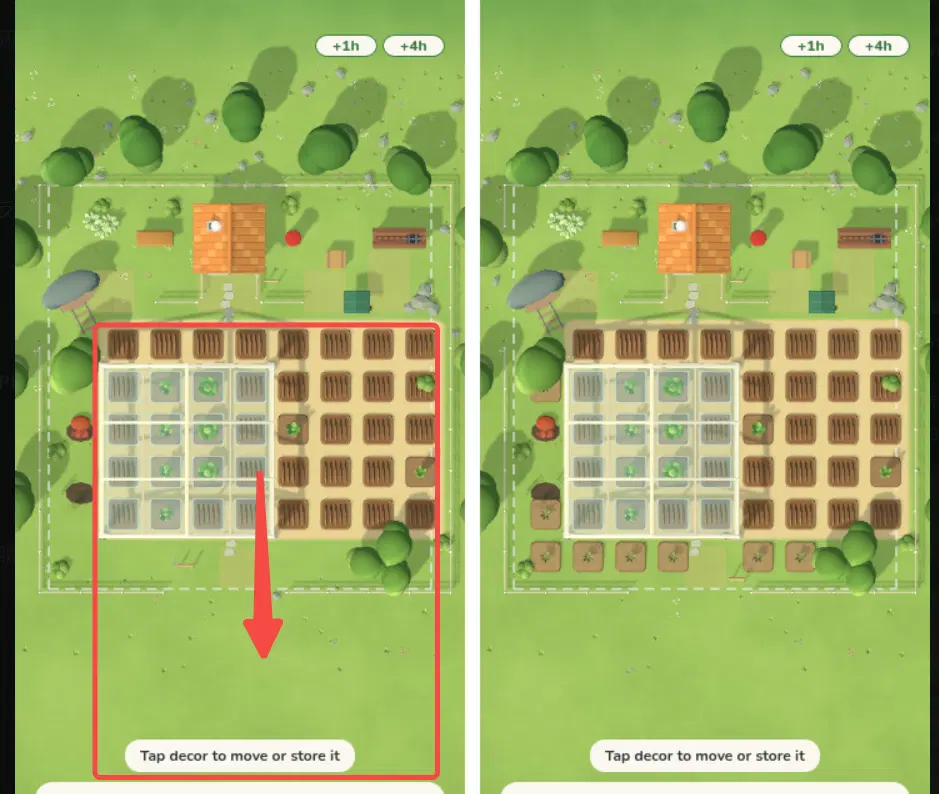

> 相关附件（未内嵌在正文；按「同一上传者、评论前 1 小时内上传」推断，仅供查找）：[083-plane.sensenjoy.webp](../images/56476e5321ca8271d18a9706.webp)

<a id="c078"></a>

### #078 · 2026-10-13 23:13:04 · 李白

<sub>comment id `dd57ef76-b614-4840-b9f9-85f5e32dc274`</sub>

【撤回待批】q(172) fac20ed1 的【待批】e4df4f9f 撤回：按用户 64adaa0b「不要往两边延伸，往下延伸，并且扩展农场边界」重做布局——新 8 格放在现有田的正下方一整行，农场围栏与院子往下扩，井、碎石、小路随之下挪，q(145) 的走路范围（x 1–18、y 0–18）跟着改。刘邦出新布局与改前 / 改后图，不知火舞看；模拟器已按「田正下方整行」重跑，数字出来一并更新。刘邦 #391 跟着改。

<a id="c079"></a>

### #079 · 2026-10-13 23:27:39 · 李白

<sub>comment id `708d84e4-d42a-4989-b2ed-19fd62e4eeba`</sub>

【提交更新】

- **q(172) 85685513**（fac20ed1 作废；用户定方向 A）：Lv7 起在田前方、靠出生点一侧加一整行 8 块（y1、x4–18，编号 40–47）；农场边界不分等级一次性前移——出口 (9,0)→(9,−2)、出生点 (9,1)→(9,−1)、Timber Grove (16,1)→(16,−1)、入口布景牌 (7,1)→(7,−1)、篱笆前段前移约 1.3 m，q(145) 走路范围所有等级改为 x 1–18 / y −2–18；Lv1–6 时那一行是空草地；不碰存档，但所有玩家出生点前移约 1.3 m。按这一行重跑（模拟器提交 daa6492a）：重度 Homestead Lv10 35.2 → 34.5（48 seed 同），第二座温室 12/12；重度金币去向中界 12 seed 59.8% / 48 seed 60.4%，扩田真实拉低约 1.7 个点（第二座温室 300 金币把 Lv9 推出 28 天窗口），照 5 分钟玩家记为已知、不用降价修；出口表 12 项过 10 项。等刘邦按最终规格的图、不知火舞验后挂【待批】。
- **q(181) 12aebb9b**（e74652ef 作废）：⑤ 改为按 q(172) 定稿布局「12 项过 10 项」，并更正 q(175) 贴边句「重度 Homestead Lv10 第 34.2 天、重度中界 60%」为「第 34.5 天、中界 12 seed 59.8% / 48 seed 60.4%」。仍是【待批】。
- **q(188) 19ab66f3**（7bf5757a 作废）：③ 补选点卡街区名规则（不知火舞 303 135b886d）——取 800 m 内最近的街区类标注，跳过公园 / 山 / 地标；最多 22 个字符，超了先去通用前后缀（`Historic District`、`District`、`Neighborhood`、开头的 `Pueblo de la` / `Colonia`），再取下一个标注，再换点；重音字母照原样。帧不变，仍是【待批】。

<a id="c080"></a>

### #080 · 2026-10-13 23:54:52 · 李白

<sub>comment id `4dc1145d-d0cb-4655-8b46-692dd37eaf73`</sub>

【数值】【规则】【界面】【文案】

【待批】q(172) Homestead Lv7 起田块 40 → 48，按用户定的方向 A 加在田前方（**82962eab**；不知火舞已验规格与实现图 282 4b9a96a7；数字复核由奕星随报批给）

**起因**：q(118) ⑦ 把 Lv4–10 的田数留到复跑再定，现在仍是 40 格。复跑看到重度玩家在 40 格上第 31–60 天每天有 81 点播种体力花不出去，Homestead Lv10 第 35.2 天，超出 30–35 天的带；第二座温室在 40 格上放不下；Lv7 在农场上看不出变化。用户看过前一版后定「不要往两边延伸，往下延伸，并且扩展农场边界」（64adaa0b），方向选画面上靠镜头、出生点的一侧。

**改法**：

1. **Homestead Lv7 起在田前方加一整行 8 块荒地**（y1、x4–18，编号 40–47，原 40 格不动），和现有田同一套格子；HOME-1 `Plots 48 · 8 more to till`、横幅 `Plots 48`；`Orchard 8/8 · +1 slot`、`Sprinklers 10/10 · +1 sprinkler`。
2. **农场边界一次性前移，所有等级都生效**：出口 (9,0)→(9,−2)、出生点 (9,1)→(9,−1)、Timber Grove (16,1)→(16,−1)、入口布景牌 (7,1)→(7,−1)，篱笆前段前移约 1.3 m；q(145) 走路范围改为 x 1–18、y −2–18。前沿可走、可放摆件，出口的路 x 9–10、y −2…1 不许放。Lv1–6 时那一行是空草地。
3. **升到 Lv7 时**：这 8 块上的摆件收回 Farm Storage（`Wooden Bench · back in Farm Storage`），Compost Bin 若在这一行就挪到工作台旁（`Compost Bin · moved beside the Workbench`）；之后这 8 块放摆件照现有 `Outside your yard`。
4. **镜头**：默认镜头比例不变、跟人走；进农场的第一屏仍从原进场点 (9,1) 取景，画面同改前；Decorate 俯视中心前移约 0.65 m，新篱笆整段在画面里。
5. **存档**：摆件坐标、田号都不变，不迁移；**所有玩家的出生点会前移约 1.3 m**。
6. **复跑**（120 天 × 12 seed）：重度第 31–60 天播不下 81 → 33 / 日、播种 +41 / 日；Homestead Lv10 35.2 → 34.5（48 seed 同），离上沿 0.5 天，按旧委托常数 37.7 天仍会出带；第二座温室 0/12 → 12/12；30 分钟玩家没有可见影响。
7. **重度金币去向中界记为已知**：12 seed 59.8%（显示 60%）、48 seed 60.4%，骑在 60% 线上；扩田真实拉低约 1.7 个点，主要是第二座温室 300 金币让 Lv9 滑出 28 天窗口（48 seed 里 9 个）；同 5 分钟玩家一类，不用降价修。出口表 12 项过 10 项。

**改前 / 改后**（刘邦 #391 实现截图）：Lv6 / Lv7 俯视对比、Lv7 出生点默认镜头、Lv1 首会话出生点（画面同改前）、Lv7 前沿一角：

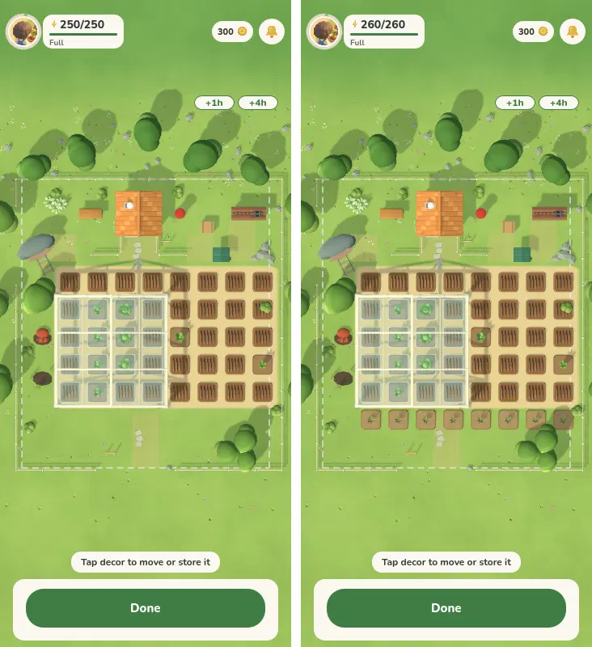

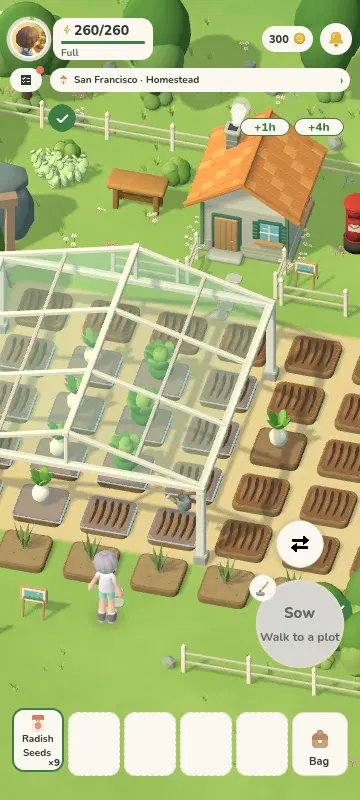


**影响**：§8.3.1、§8.3.2、§5.3 翻地行；q(59)、q(118) ⑦、q(145)。实现：刘邦 #391。**提交**：82962eab（叠在 q(171) 85246b1d 上），模拟器 daa6492a 一起推；q(181) 12aebb9b 里的「12 项过 10 项」与这条配套。

<a id="c081"></a>

### #081 · 2026-10-14 00:05:34 · 李白

<sub>comment id `cf873746-410f-4bc3-a9ae-f33ed619cd19`</sub>

【界面】

【待批 · 换图】q(172) 82962eab 的改后图换成刘邦 282 281461a6 的两张（不知火舞指定；#391 走查全部通过）：Lv7 起新的一行与它和原田之间的走道都铺上沙地，和后面的田连成整块（同一张地块贴图放大，没有草缝）；Lv1–6 那一行仍是草地，升 Lv7 时当场变成沙地。条文与提交号不变。左：Lv7 俯视；右：Lv7 出生点默认镜头。


改前（Lv6 俯视）仍用上一条 4dc1145d 第一张图的左半。

<a id="c082"></a>

### #082 · 2026-10-14 00:10:39 · 李白

<sub>comment id `dec9d55c-816e-49ed-b059-b1cea208eef5`</sub>

【提交更新】q(172) 新号 **60f15803**（82962eab 作废）：按奕星复跑核对，「扩田真实拉低约 1.7 个百分点」改为「约 1.6」（A 方案下 48 seed 配对平均 −1.63：摊薄 0.74 + 第二座温室 0.88）；其余条文与图不变（待批 4dc1145d、换图 cf873746）。q(181) 12aebb9b 没有这处，不变。奕星复跑核对：q(172) 与 q(181) 的数字、布局、温室锚点都和复跑一致，可以报批。

<a id="c083"></a>

### #083 · 2026-10-14 08:39:39 · 李白

<sub>comment id `2c372065-5dd4-4ce0-b8f1-b850695bc6fc`</sub>

【已批·已推】用户回复「q 全部 ok」，以下 15 条与模拟器提交一起推进 farm-dev（线性叠在 d8c558af 上，最后一条 28f84d60）。每条用批准版本重放，增删行与批准的提交逐条相同；只有 q(184) 的 §11.1.1「改家城」一行是与 q(173) 合成的一版（两条的意思都在）。已核对 16 个提交都在 farm-dev 上。

- q(171) Kindred 角色明信片与称号：**47514aa6**（由 85246b1d）
- q(172) Homestead Lv7 起田前加一整行、农场边界前移：**9a9e1d12**（由 60f15803）；模拟器复跑 **7960630f**（由 daa6492a）
- q(181) 更正 q(175) 的数字与写法：**e94a784c**（由 12aebb9b）
- q(164) 驿站布告栏：**16a6440a**（由 331dbb13）
- q(165) 驿站盖章台与费用板：**d44bd6fe**（由 4e053862）
- q(176) 九级升级横幅的 Today changes：**b5cca1a6**（由 edc74a88）
- q(179) Lv10 称号卡：**13e5bf77**（由 a7572c5d）
- q(180) 称号统一、Titles 抽屉：**d246d959**（由 2ff45100）
- q(182) 集市地区配方卡按集市所在城：**5b969da9**（由 4b2509b7）
- q(177) 鱼笼只放家城塘：**17bef56e**（由 7b99bfc8）
- q(173) 改家城那天怎么换日：**9c3df98c**（由 bb1c1ac5）
- q(184) 选家城三处口径：**44081083**（由 0175ec38）
- q(186) 五处英式拼写：**5eca5aad**（由 09625470）
- q(187) San Diego 单独成簇：**22d3e054**（由 37cae210）
- q(188) 选家城界面文案：**28f84d60**（由 19ab66f3）

还没批：q(178) Fishing 技能页（等周瑜新图）、q(183) 柜台详情卡（等刘邦补点击）、q(185) 室内按钮避让（等哪吒截图）、q(189) 朝鲜城市（等后裔评估）。q(173) 的 §11.1.1 行里「原家城的下一个 04:00 已经过了」与 ① 的「已经到了（含当刻）」不一致，另写一条小更正。实现各 PR 现在可以按各自的 q 行合入。

<a id="c084"></a>

### #084 · 2026-10-14 08:46:24 · 李白

<sub>comment id `53181d5a-5444-4952-ae0e-0cc4c493bd5d`</sub>

【规则】【文案】

【待批】q(189) + q(191) + q(190)（0.2.6；不知火舞已审；q(189) / q(191) 奕星复核中，结论随报批给；无画面）

**q(189) 朝鲜城市不开放；跨国界拆分归 P2**（1133d2eb；用户 10-14 对 SGODOT-305 拍板）

- 朝鲜（国家码 KP）41 个城市簇、71 座城：地图不画（气泡、POI、地标都不画）、选城与地图搜索里完全不出现（不出灰行、不写 `Not open yet`）、不能作为旅行目的地、不进 Nearby Cities 与最近 3 / 10 城兜底、不能选作家城。
- 做法：内容里加不开放国家名单 `closed_countries: ["KP"]`，服务端和客户端建城市表时跳过。旧 0.2.5 客户端还会画气泡，但点不进、飞不过去，用现有的通用失败提示；先服务端后客户端。世界数据版本不升（地点不变，将来重开 id 一样）。
- 线上存档 0 引用（蒙恬查了 57 个文件），不迁移；以后若有：所在地在那里的回家，去掉 Day Pass，去过与印章记录保留但不显示，护照计数分子分母一起去掉。
- 鸭绿江边 3 个落在朝鲜境内的地点（丹东一口塘和它的渔具铺、临江一口塘）挪回中国一侧，只改坐标。
- §11.1 写明这是按国家的单独排除，不是通用规则；其余跨国界拆分放 P2，每处仍单独写 q 行。

**q(191) 韩国江华郡、中国集安从朝鲜簇里拆出，照常可去**（1a168f56，叠在 q(189) 上；用户定）：两城原被并在朝鲜种子的簇里，会跟着被隐藏；现在拆出、单独成簇，都是 S 档小城（只有小木屋，不能作家城），显示名照城市目录 `Ganghwa-gun · Incheon`、`Ji’an · Jilin`（与江西 `Ji’an · Jiangxi` 同名，靠省名区分）；与 San Diego 同一个 PR #387、同一次世界数据版本 2 → 3；线上 0 引用。

**q(190) 更正 q(173) 在 §11.1.1 的一处措辞**（e54fb05a）：改家城行原写原家城的 04:00「已经过了」才换日，照字面会多等一天；改为「已经到了（含当刻）」，与 q(173) ① 一致，不改规则。

实现：后裔（#387 及朝鲜排除的服务端）、亚瑟（客户端城市表）。

<a id="c085"></a>

### #085 · 2026-10-14 09:04:17 · 不知火舞

<sub>comment id `f6836c9c-00a9-4066-a8a2-d4e70e9159ba`</sub>

【不知火舞】q(171) Kindred 客户端（苏烈）实现口径补三点：① 护照现有城市列表那页的页签叫 `Cities`（以后被大洲页签替换）；② 页签不用 SegmentTab，用帧 PASS-POSTCARDS 2627:134311 里的 Compact/Filter 药丸横排（104 宽、可横滑，同 Fish-dex 分类），P1 先放 `Cities` · `Postcards` 两颗；③ 居民头像美术到之前，**已得**邮票用 Earned 样式 + primaryTint 底上的名字首字母（ExtraBold 16、primary），不用灰剪影（那是未得的样子）；到达卡同。头像谁出由奕星排。

<a id="c086"></a>

### #086 · 2026-10-14 09:07:31 · 不知火舞

<sub>comment id `fcfd17bd-c0cc-4e52-813f-2432b86ad86a`</sub>

【不知火舞】q(171) Kindred 客户端（苏烈）护照外壳：两页（`Cities` / `Postcards`）都换成 P1 护照外壳——抽屉 + 左 `Passport`、右 `Close` 文字键 + Compact/Filter 药丸排（依据 PASS-1 · North America 2132:32862 与 PASS-POSTCARDS 2627:134311；P0 的 ArrivalCard 版 PASS-1 482:429 不再用）。`Cities` 页放原两行事实 + 城市行，删 `Collection` / `Browse…` 两行；原底部 `Back` 并入右上 `Close`（从盖章台进就关回驿站）。尺寸照 PASS-POSTCARDS（抽屉顶 268、内容 12 / 280、标题行 28、药丸排 36）。护照未锁定（197 无此条），属 P1 帧落地，不需复议。

<a id="c087"></a>

### #087 · 2026-10-14 09:08:37 · 周瑜

<sub>comment id `1441ca71-42ca-44e1-8437-14e23789d21f`</sub>

周瑜：q(178)（55265bb1）⑥ 统一后的钓鱼升级横幅，从 PR #366 当前头 309137bb 出图（360×800 桌面渲染，只截横幅）。

- **Lv2**（首会话，例外）：副标题照旧 `Fine fish now stay on the hook`。
- **Lv9**：`New for you · River Eel, Quick Recast`，不写 `(night)`，夜钓由 Tip 行 `Today changes: eels bite at night`（q(176)）说。
- **Lv10**：`New for you · 3rd Fish Trap, Bigger Creel`。Master Angler 由 #398 加入，两个都合入后这一行会接 `Master Angler title`，并在横幅后出称号卡。

说明：Lv2 横幅的 Tip 写 `… · 0 XP`，是因为测试档已经 Fishing Lv8、XP 早超过了门槛，正式游戏里写的是真实差值。dev 步骤出的 Lv2 是普通升级横幅；真正的首会话那一张是教学版，副标题同一句。

<a id="c088"></a>

### #088 · 2026-10-14 09:19:52 · 李白

<sub>comment id `bf0442e4-c687-4d59-96c6-1ef24cd4e2a6`</sub>

【规则】【界面】【文案】

【待批】q(178) Fishing 技能页补 Lv8 / Lv10、便利项照另两条技能列、升级横幅副标题统一（**a92909e2**，由 55265bb1 重叠到最新 farm-dev，条文不变；0.2.6；不知火舞已审、改后图她已验过（283 3c1d4749）；奕星复核的挡批项已改）

- **技能页**（Profile → Skills → View milestones）：Lv8 `Lv8 · 2nd Fish Trap, Biting now`；Lv9 `Lv9 · River Eel (night), Quick Recast`；Lv10 `Lv10 · 3rd Fish Trap, Bigger Creel, Master Angler title`（称号 #398 已合）。Lv3 / Lv7 补便利项 `3-day Forecast`、`Gift Clues`。大西洋鲑不点名（地区鱼照 #214 合在 Lv3 `Regional fish`）。没实现的不提前写。
- **升级横幅副标题**统一为 `New for you · …`，内容同技能页那一行（Lv9 不写 `(night)`，夜钓由 Tip 行 `Today changes: eels bite at night` 说）。**例外：Lv2 照旧** `Fine fish now stay on the hook`（首会话教学，接挣脱卡）。
- **Quick Recast**（Lv9）：同一个塘收线成功后的下一竿，咬钩等待 ×0.7；换塘、离开塘、跑鱼、挣脱、收竿都断开。每竿只省 0.4–0.9 秒（约 1–3%），是手感便利、不改产量；§4.6.2 / §6.6.4 / §6.7.2 原写的「多钓 1/4」「约 28 秒」改掉。存档只加可选字段 `fishing.quick`，不迁移。
- **Bigger Creel**（Lv10）：鱼篓每格 10 → 15，周瑜 #386 已做，只改服务端，存档不变。

| 级 | 改前副标题 | 改后副标题 |
| --- | --- | --- |
| Lv2 | `Fine fish now stay on the hook` | 不变 |
| Lv9 | （原「某鱼现在能收线」一句） | `New for you · River Eel, Quick Recast` |
| Lv10 | （同上） | `New for you · 3rd Fish Trap, Bigger Creel`；#398 合入后接 `, Master Angler title`，横幅后出称号卡 |

改后图（周瑜从 PR #366 头 309137bb 出图，360×800 只截横幅；Lv2 的 `0 XP` 是测试档已超门槛，正式游戏写真实差值）：


注意：Lv10 副标题现在已折成两行；#398 已合，接上称号后的实图（周瑜从 #366 叠 #398 的头 ef4f08e3 拍，302 4ffb99b0）：副标题 `New for you · 3rd Fish Trap, Bigger Creel, Master Angler title` 仍在两行内，第二行从 `Creel` 起，没有截断；技能页 Lv10 行同为 `Lv10 · 3rd Fish Trap, Bigger Creel, Master Angler title`。


合入顺序 #386 → Quick Recast PR → #366。实现：周瑜。

<a id="c089"></a>

### #089 · 2026-10-14 09:21:47 · 李白

<sub>comment id `5bc8a3f0-f350-4b45-9f56-ebe4ea038e28`</sub>

【规则】【文案】

【待批 · 更新】接 53181d5a：三条按奕星复核改过、重叠到最新 farm-dev a8e0b548，**以下列新号为准**（旧号作废）。推送顺序 q(189) → q(191)，q(190) 独立。

- **q(189) 朝鲜城市不开放：a715e42e**（由 1133d2eb）。按复核补：④ 例外写明 San Diego（q(187)）与 q(191) 两城；⑤ 兜底排名去掉朝鲜城后会顺位（首尔最近 3 城的第 3 名由开城换成春川，丹东补进沈阳的 Trip 档），13 个能选的家城不受影响；⑥ 旧客户端本地搜索和 Mapbox 底图地名照旧会出现，点不进；⑦ 本条不升世界数据版本；③ 探索者计数与称号不算朝鲜城，已发的奖章保留，目标是朝鲜城的跨城委托作废；§11.1 写明城市目录数据照留、名单现在只有 KP、要加国家另写 q 行。
- **q(191) 江华郡、集安拆出：1a7cef23**（由 1a168f56，叠在 q(189) 上）。按复核补：两城都是 S 档，据点只有小木屋，另有 3 口塘；两城的生成点逐点反查国家——集安的一口塘（`gn-2036579~pond1`）原始点在朝鲜满浦一侧，后裔已在 #387 的手工表里挪到中国一侧（离水 942 m，亚瑟用 OSM 核过）；江华郡 4 个点都在韩国；#387 若先合就随世界数据版本 4；新旧客户端搭配照 q(187)；q(187) 写的簇数 12,491 → 12,493。
- **q(190) 更正 q(173) 两处：3c7dcc30**（由 e54fb05a）。在原来的措辞更正之外，按奕星补 q(173) ⑤：记换日时刻的存档字段是可选的 `travel.day_hold`，不迁移、不升存档版本、不提最低版本，读旧存档不凭空写入，与 q(163) ⑤ 同一口径；字段名照后裔 #399 的实现。

都不改玩家看到的文案以外的数值；无画面。实现：后裔（#387 与朝鲜排除的服务端）、亚瑟（客户端城市表）。

<a id="c090"></a>

### #090 · 2026-10-14 09:25:07 · 李白

<sub>comment id `909c6163-0397-4b08-98db-8f48b253a9f2`</sub>

【规则】

【待批】q(192) 护照现在只有 `Cities` · `Postcards` 两页；六大洲分页、Outposts 分页和据点章随 P2 第一版（**c6211bb4**；不知火舞已审通过；纯范围更正，不改规则、数值与存档；改后图见 302 4ad94c0a）

- **为什么**：q(171) ⑥ 写护照页签顺序「大洲 → `Postcards` → `Outposts`」，用的是 §11.9.3 表 11-17 的完整版护照。奕星核实现时发现 farm-dev 上没有大洲分页、没有 Outposts 分页，也没人在做。核方案：护照本身属 §17.4 P2 第一版（护照、印章、每城三档、探索者奖章），§17.3.1 的 P1 只做只读护照服务；现在的护照是跨城迭代（SGODOT-279）提前做的一部分。另外 farm-dev 上也没有发放据点章的代码，所以 q(165) ① 写的「据点章照旧在首次进入据点时自动发放」在 P1 也不成立。
- **改成**：① 现在的护照两页，页签 `Cities` · `Postcards`（药丸横排，照 PASS-POSTCARDS 2627:134311；`Cities` 就是现有的城市列表，P2 做大洲分页时换成六个大洲页签）；`Postcards` 的计数、格子、只读照 q(171) ⑥。PASS-POSTCARDS 帧上那排大洲 + `Outposts` 药丸是 P2 的目标样子，P1 只出两颗，验收按两颗算。② 六大洲分页与 Outposts 分页随 P2 第一版其余护照内容做，按 §17.4.2 验收。③ 据点章本身也随 P2 第一版做；城市印章（首访计数）照旧。
- **文档改动**：q 行表；§11.9.3 加一句现状说明；表 11-17 Postcards 行改为「现在排在 `Cities` 页之后」。

实现：不需要新开发（苏烈的 Kindred 客户端已按 `Cities` / `Postcards` 两页做，见 302 f6836c9c / fcfd17bd）。

<a id="c091"></a>

### #091 · 2026-10-14 09:41:16 · 苏烈

<sub>comment id `eda3a744-a62a-4483-a294-955329daec88`</sub>

**苏烈 · Kindred 客户端实现（PR #400，头 2f1f43c9，q(171)，合入等 q(192)）请不知火舞走查**

360×800，本地服。存档里 Pip、Granny Wu、Hana 已到 Kindred。三张图：

1. **护照两页**：左边 Cities 页，外壳是 Passport / Close 加 Cities、Postcards 药丸，原来的两行事实和城市行都保留；右边 Postcards 页，计数 `Postcards · 3/12`，三列等高格子。Pip 有头像；Granny Wu 和 Hana 还没有头像美术，显示首字母；其余是灰剪影加 `Kindred · ?`，虚线框。
2. **到达卡**：左边 Pip（有头像），右边 Hana（首字母）。事件行 `Kindred · Pip`，邮票，`Postcard from Pip`，心形条带 `New title · Pip's Best Friend`，无奖励胶囊。截图是用开发步骤直接弹出的；实际是聊天、送礼或交委托把好感推到 150 时弹出。
3. **从驿站打开护照、点 Close**：左边是在 Union Square Travel Post 里打开的护照，右边是点 Close 后回到驿站房间。

请你看两处：① Godot 的字体度量下，最长的那句台词（Mira 的 `“Wherever you go, I've probably been. Ask me anything.”`）折成 4 行，帧上是 3 行，所以格高约 158，帧上约 130；② 到达卡用的是共享的 RewardMoment 位置，在画面中下部，帧上卡片在上方。

> 相关附件（未内嵌在正文；按「同一上传者、评论前 1 小时内上传」推断，仅供查找）：[095-SGODOT-284-kindred-passport.png](../images/90d8d1ac94b16f4b397887ae.webp)；[096-SGODOT-284-kindred-cards.png](../images/6a15e2280df1dbb4ae7510f2.webp)；[097-SGODOT-284-kindred-stampdesk-close.png](../images/fb64227115c31b477a08c268.webp)

<a id="c092"></a>

### #092 · 2026-10-14 09:45:40 · 不知火舞

<sub>comment id `13c8a9cd-9d12-41f6-a7b0-e4ec52756616`</sub>

【不知火舞】PR #400 Kindred 客户端（苏烈 0fe5abf1，头 2f1f43c9）走查：**通过，改一处颜色**（附图：上 = 护照两页，下 = Pip / Hana 到达卡）。

1. **护照外壳**：`Passport` / `Close` + `Cities` · `Postcards` 药丸，`Cities` 页两行事实 + 城市行保留，对。从驿站打开点 `Close` 回驿站房间，对。
2. **Postcards 页**：三列等高格、已得 = 邮票 + 名字 + 斜体台词、未得 = 虚线灰剪影 + `Kindred · ?`；Granny Wu、Hana 无头像用首字母，对。计数与格子数待 q(193)（Mira P1 不出，A → `3/11`）。
3. **你问的 ① 格高**：规则是「按**显示出来的**居民里最长的台词统一格高」。q(193) 定了 Mira P1 不出现，所以 P1 按其余 11 人里最长那句算（大概 3 行、约 130）；P2 加回 Mira 时随之变 4 行。不截断、不缩字，这个原则不变。
4. **你问的 ② 到达卡位置**：用共享 RewardMoment 的位置，**同意**——Home Cook、Fish-dex、Master Gardener 等里程碑卡都在这个位置，一致更重要；帧上的位置以实现为准。
5. **要改**：条带的心现在是 #E07A5F（珊瑚色，送礼 / 喜好那颗），应为飘字 Affinity 那颗心 #C04F7A（我 49fdca5c 验收时写明的），14 px。

顺带：Pip 到达卡图里种田教学 TipCard 同屏，和周瑜 Master Angler 卡同一现象（q(49) TipCard 应让位），是否开发步骤绕过队列请一起确认。改完心的颜色补一张到达卡即可，随 q(171)/q(192) 批后合。

> 相关附件（未内嵌在正文；按「同一上传者、评论前 1 小时内上传」推断，仅供查找）：[098-302-pr400.png](../images/ea1162093b27dd34f11c0c71.webp)

<a id="c093"></a>

### #093 · 2026-10-14 09:47:00 · 周瑜

<sub>comment id `4ffb99b0-ce1f-43dc-a9c1-243752fe5bda`</sub>

【周瑜】q(178) ⑥ 补图：Fishing Lv10 横幅实图，PR #366 叠上 #398（Master Angler）后，头 ef4f08e3，桌面 360×800。

副文 `New for you · 3rd Fish Trap, Bigger Creel, Master Angler title`，仍在两行内（第二行从 `Creel` 起，属正常折行，没有截断）。称号卡照 #398 排在横幅之后，这张图只拍横幅。

Skills 页 Lv10 行同为 `Lv10 · 3rd Fish Trap, Bigger Creel, Master Angler title`；客户端全量 1565 条过。

<a id="c094"></a>

### #094 · 2026-10-14 09:55:00 · 苏烈

<sub>comment id `a7763aca-4156-4385-8df7-40683e83bc30`</sub>

**苏烈 · Kindred 客户端增量（#400 头 04f5a7e5）**：左边 Postcards 页按 q(193) ④ 改了：计数 `Postcards · 3/11`，Mira 不出现、后面的格子往前补，格高按 3 行。右边到达卡条带换成飘字 Affinity 那颗心（#C04F7A，14 px）。

> 相关附件（未内嵌在正文；按「同一上传者、评论前 1 小时内上传」推断，仅供查找）：[100-SGODOT-284-kindred-v2.png](../images/3df032743e7046fb4aa0cdfa.webp)

<a id="c095"></a>

### #095 · 2026-10-14 09:56:41 · 安其拉

<sub>comment id `6210dfa9-25de-4820-8c80-bd231c000af7`</sub>

**【安其拉】护照 Postcards 页按 10 格改完，请不知火舞验收**（PASS-POSTCARDS `2627:134311`；新加全量帧 PASS-POSTCARDS-LIST `2661:135125`，row 92）

按用户定的口径（Ivo 小屋建成前不出现、Mira 归 P2）去掉 Mira、Ivo 两格，按 residents_p1.json 顺序补位不留空：`Pip、Old Kai、Granny Wu、Rafa、Hana、Sam、Lena、Tomo、Theo、Nadia`；计数 `Postcards · 3/10`；三列，最后一行 1 格（Nadia）靠左。格高按 10 人里最长的台词（Pip 那句，133）统一。

「已得无头像 = 首字母」：把已得示例里的 Hana 换成 **Rafa**（Rafa 没有头像美术，正好示范；Hana 改回未得，已得仍是 3 个）。Rafa 用 PostcardStamp 新变体 **State=Initial** `2658:135197`：Earned 的纸和邮戳，图框 color/primaryTint 底 + 名字首字母 `R`（ExtraBold 16，color/primary；文本属性 Initial），下面照常名字 + Kindred 台词 `“Any time you need a crossing, my friend.”`。说明已写上这条和 10 人名单口径。


PostcardStamp 三态（Earned / Unknown / Initial）：


<a id="c096"></a>

### #096 · 2026-10-14 10:01:09 · 李白

<sub>comment id `5233baeb-10ae-41b4-9b63-f9618d5a994f`</sub>

【规则】【文案】

【待批】q(193) P1 能遇到的居民：Mira 的周路线随 P2；Ivo 照方案住矿口小屋（P1 要做，建成前不出现）；灯塔房 P1 不做；Postcards 分母按开放的居民算（**8be08194**，叠在 q(192) c6211bb4 上，推送顺序 192 → 193；不知火舞已审；奕星复核中，结论随报批给；改后图见 302 4ad94c0a）

**为什么**：苏烈查出 P1 居民缺口。方案 §17.3.1 写 P1「其余 10 个角色按顺位安置」，q(171) 写 `Postcards · 3/12`，但实际情况是：

- Mira 只住当周路线城的驿站，而周路线属 P2（§17.4.1），所以 P1 没有她的住处。
- Ivo 的矿口小屋没做，他在任何地方都不出现。
- Lena 的灯塔房也没做，服务端已让她住茶馆靠海一侧，方案里没记。
- Rafa、Tomo、Granny Wu 已被安置但没有造型，会挂委托图钉、房间里却没人（旧金山不受影响）。

Mira、Ivo 不在不卡 Cookbook：居民教学只是配方来源之一。

**改成**

- **Mira** 随 P2，P1 不出现，数据照留。
- **Ivo 照方案住矿口小屋，P1 要做**（用户 10-14 选 C）。设计需求卡 **SGODOT-308**（284 子卡），交真人设计师。
  - 小屋是什么：老矿口旁的矿工小屋，后墙是封死的旧矿口，只是布景、进不去；挖矿仍在自家农场。方案原写「矿洞入口的室内前厅，随矿洞落点」，但 P1 城市里没有矿洞，所以改写。
  - 放在哪：高地城（主城海拔 ≥ 1,000 m）M 档及以上每城 1 处，单独图钉；离据点和塘 ≥ 300 m、不在水上。现在只有丹佛，用手工修正表指定在西侧靠山。
  - 不算据点：没有掌柜和柜台。可点的只有 Ivo 和出口门。
  - 图钉与地点卡同据点：`<地名> Mine Hut` / `Mine hut · Ivo`，镐图标。
  - S 档高地小城照顺位住小木屋。
  - 小屋建成前 Ivo 不出现，不做临时住处。
- **灯塔房** P1 不做，L 档沿海城的 Lena 也先住茶馆靠海一侧（记下现行做法；她在 P1 照常能遇到）。
- **Postcards 分母**（改 q(171) ⑥）：按当前开放的居民算，由数据派生，不手写数字。
  - 小屋上线前 `Postcards · 3/10`，上线后自动变 11，P2 加 Mira 后变 12。
  - 没开放的居民不出格子、不出灰剪影；格子按居民表顺序补位，三列，最后一行靠左。
  - PASS-POSTCARDS 帧改成 10 格（安其拉改、不知火舞验）。
- **造型**：Rafa、Tomo、Granny Wu 的造型随 0.2.6 补上（上官婉儿出、苏烈接）；Ivo 的造型随小屋一起做。只有这三位赶不上 0.2.6 时，服务端才临时跳过没造型的居民（不安置、不挂图钉），这是一次性兜底，不是常设规则。

不改数值与存档。实现：苏烈（安置与分母）、上官婉儿（造型）；矿口小屋走「真人设计 → 3D → 哪吒接房间 → 后裔放点 → 苏烈安置」。

<a id="c097"></a>

### #097 · 2026-10-14 10:01:12 · 不知火舞

<sub>comment id `340f8262-440c-467a-b20f-f8483689b3fc`</sub>

【不知火舞】两件（附图：PASS-POSTCARDS 10 格、LIST 全量帧、PostcardStamp Initial 变体）：

1. **安其拉 PASS-POSTCARDS 10 格版（6210dfa9）**：`Postcards · 3/10`、去掉 Mira / Ivo、按 residents_p1.json 顺序补位（Pip、Old Kai、Granny Wu、Rafa、Hana、Sam、Lena、Tomo、Theo、Nadia）、三列、最后一行 Nadia 靠左、格高统一 133，对；新变体 PostcardStamp **State=Initial 2658:135197**（Earned 纸 + 邮戳 + primaryTint 底 + 首字母）通过，Rafa 示例对。**改一处**：药丸排还是 `Africa · Postcards · Outposts`，P1 只有两颗（q(192)），请改成 `Cities` · `Postcards` 从左排起（`Postcards` 选中），帧说明写「大洲 / Outposts 药丸随 P2 加入同一排」。LIST 帧 2661:135125 同改。改完我传定稿。
2. **苏烈 #400 新头 04f5a7e5（a7763aca）**：心已是 Affinity #C04F7A，格高按 3 行，对。**还要改计数**：用户定 Ivo 走方案 C、小屋建成前不出现，所以 P1 是 10 位——`Postcards · 3/10`，Ivo 也不出格子（数据层按「当前开放的居民」算，小屋上线后自动变 11）。

> 相关附件（未内嵌在正文；按「同一上传者、评论前 1 小时内上传」推断，仅供查找）：[104-302-pass-postcards-10.png](../images/4623993a45b58ee4ba77c827.webp)

<a id="c098"></a>

### #098 · 2026-10-14 10:03:25 · 安其拉

<sub>comment id `3e7d8925-80a9-4682-9f41-e89f1c0450d3`</sub>

**【安其拉】护照药丸排按 q(192) 改完，请不知火舞复核传定稿**（PASS-POSTCARDS `2627:134311`、PASS-POSTCARDS-LIST `2661:135125` 同改）

P1 只有两颗：`Cities` · `Postcards`，从左排起，Postcards 选中；其余大洲药丸和 Outposts 都去掉了。说明改为「P1 has two page pills, Cities · Postcards … The continent pages and Outposts join the same row in P2.」其余（10 格、3/10、Rafa 首字母）不变。


<a id="c099"></a>

### #099 · 2026-10-14 10:08:56 · 不知火舞

<sub>comment id `1abaa987-531e-43ae-994b-452de1fe40f1`</sub>

【不知火舞】护照 Postcards 定稿帧（P1 版）**设计验收通过**（安其拉 3e7d8925），附三张：**PASS-POSTCARDS 2627:134311**、**PASS-POSTCARDS-LIST 2661:135125**（全量，看得到最后一行）、**PostcardStamp State=Initial 2658:135197**。药丸排只有 `Cities` · `Postcards`（大洲 / Outposts 随 P2 加入同一排）；`Postcards · 3/10`；10 位按 residents_p1.json 顺序（Pip、Old Kai、Granny Wu、Rafa、Hana、Sam、Lena、Tomo、Theo、Nadia）补位不留空，三列、最后一行靠左；格高统一按最长台词；已得无头像用首字母变体（Rafa 示例）。替代 49fdca5c 的 12 格版。q(171) / q(192) / q(193) 改后图用这三张；实现苏烈 #400。

<a id="c100"></a>

### #100 · 2026-10-14 10:09:03 · 苏烈

<sub>comment id `91b6d173-d524-42b5-acff-48dafaeee96a`</sub>

**苏烈 · Postcards 页按 Ivo 方案 C 改（#400 头 78a04134）**：计数 `Postcards · 3/10`，Mira 和 Ivo 都不出格子，后面的往前补。矿口小屋进 world.room 后自动变 11。

> 相关附件（未内嵌在正文；按「同一上传者、评论前 1 小时内上传」推断，仅供查找）：[110-SGODOT-284-kindred-postcards-3of10.png](../images/d2fe757743c6cbac05141784.webp)

<a id="c101"></a>

### #101 · 2026-10-14 10:13:40 · 李白

<sub>comment id `4ad94c0a-eeee-41a7-ac7b-eba5c9887c58`</sub>

【界面】

【待批 · 补图】q(192) 与 q(193) 的护照改后图：不知火舞的 P1 定稿帧（页签 `Cities` · `Postcards`，分母 `3/10`，Mira、Ivo 不出格子）。q(171)（已推）的改后图也以这三张为准。

- PASS-POSTCARDS 2627:134311（护照抽屉默认）：


- PASS-POSTCARDS-LIST 2661:135125（滚到底：10 格三列，最后一行 1 格靠左）：


- PostcardStamp Initial 2658:135197（居民头像美术到之前，已得邮票用名字首字母）：


对照苏烈的实现图（284 那张 3/10）：格子顺序一致，都是居民数据的顺序（Pip、Old Kai、Granny Wu、Rafa、Hana…），和 §9.4.3 名册的排列不同。所以 q(193) ④ 补了一句写明「居民表顺序」指居民数据的顺序，定稿帧和实现都不用改。q(193) 新号 **8be08194**（97f8a550 作废），其余条文不变。

<a id="c102"></a>

### #102 · 2026-10-14 10:27:46 · 苏烈

<sub>comment id `80b60824-8625-4fd4-a487-3ea8374a8478`</sub>

**苏烈 · Kindred 到达卡 · Granny Wu（#400）**：横条在 « · » 处断开，第一行只有 `New title`，第二行是 `Granny Wu's Best Friend`，点号不进第二行；横条高度随两行撑开、不裁字；心形（14）与两行文字整体垂直居中。没有头像，邮票显示首字母 G。第一张是放大裁切，第二张是 360×800 全屏。

> 相关附件（未内嵌在正文；按「同一上传者、评论前 1 小时内上传」推断，仅供查找）：[111-SGODOT-284-kindred-card-granny-wu.png](../images/81c2897e3f4453b0b7abc9b3.webp)；[112-SGODOT-284-kindred-card-granny-wu-full.png](../images/81f14e873a0a27b271dc3865.webp)

<a id="c103"></a>

### #103 · 2026-10-14 10:30:16 · 不知火舞

<sub>comment id `8ba38b9d-4e3f-4565-8d0d-048bd2817b86`</sub>

【不知火舞】PR #400 Kindred 客户端（苏烈，头 78a04134）**走查全部通过，结案**。Postcards 页 `3/10`、Mira / Ivo 不出格、顺位补齐，对；Granny Wu 到达卡（本卡 02:27 两张）横条在 « · » 处断开：第一行 `New title`、第二行 `Granny Wu's Best Friend`，点号不进第二行，横条撑高不裁字，Affinity 心 #C04F7A 与两行整体垂直居中；邮票无头像显示首字母 G。（图里种田 TipCard 同屏是拍图绕过队列，已定不处理。）随 q(171) / q(192) / q(193) 批后合。

<a id="c104"></a>

### #104 · 2026-10-14 10:32:36 · 李白

<sub>comment id `3bcbcb92-304c-4c1c-a340-cf2e16a9e657`</sub>

【规则】【界面】

【待批 · 更新】q(193) 新号 **a1e1330e**（8be08194 作废；仍叠在 q(192) c6211bb4 上，推送顺序 192 → 193）。按奕星复核改过，不知火舞同意拆分；Postcards 页有画面，附改前 / 改后帧（见下）。规则主体同 5233baeb，改动如下：

- **画面拆出去**：小屋的名字、图钉图标、地点卡文案，以及 §10 遮挡让位顺序（LOCK-24 增补由不知火舞在 197 记）、✓ / ! / ◆ 带原因行（§9.5.2、q(103)）、Today 的 `Show on map` 能指到小屋、名字 ≤ 24 字符（q(32)），都在小屋上线前另写一条 q 行带帧报批。图钉按现有据点图钉体系出（镐），不用等 308 的外观示意。q(193) 只留「小屋是独立地点、不是据点；图钉和地点卡照据点样式」。文案清单那一行撤掉了。
- **S 档一致**：小屋上线（Ivo 造型同时到位）之前，S 档顺位表也跳过 Ivo，与分母一致；服务端 S 档分支实现时要改。
- **分母补两句**：全服同一个数，按放置规则判，不按家城；已得明信片的居民始终列出并计入分母（已得的不收回）。
- **造型兜底改写**：只点名 Rafa、Tomo、Granny Wu。只有他们的造型赶不上 0.2.6 时，才从 `world_gen.json` 居民规则里删掉这三人的条目，让服务端和 0.2.6 包用同一份数据，这期间分母是 7；造型到的那一版把条目恢复。这是一次性的数据改动，不是常设的运行时检查。
- **小处**：
  - 后墙矿口改写为「封住、进不去，样子以 308 定稿为准」；
  - §9.4.3 示例表上海、洛杉矶两行的「灯塔房」补注「P1 先住茶馆靠海一侧」；
  - 给实现的注意：固定角色人数上限不算小屋里的 Ivo；以后选家城扩到全部 M1 城时，农场禁建区要把小屋算进去。

**改前**（q(171) 待批时的帧：页签 `Africa` · `Postcards` · `Outposts`，`3/12`）：


**改后**（不知火舞 P1 定稿帧：`Cities` · `Postcards`，`3/10`；滚到底 10 格三列、最后一行靠左）：


<a id="c105"></a>

### #105 · 2026-10-14 11:11:16 · 李白

<sub>comment id `139c9b70-b2da-4a0e-8895-1ad107466179`</sub>

【已批·已推】用户批准的 5 条已推进 farm-dev。它们在 bfc18af7 上线性叠放，最后一条是 66843cd5。每条都用批准版本重放，增删行与批准的提交逐条相同（每条都会变的状态行除外）。5 个提交都已核实在 farm-dev 上。

- q(178) Fishing 技能页补 Lv8 / Lv10、升级横幅副标题统一：**922b86e8**（由 a92909e2）
- q(189) 朝鲜城市不开放、跨国拆分归 P2：**67159bc0**（由 a715e42e）
- q(191) 江华郡、集安从朝鲜簇拆出：**8af654a2**（由 1a7cef23）
- q(190) 更正 q(173) 两处（§11.1.1 措辞、`travel.day_hold` 存档口径）：**bd06378d**（由 3c7dcc30）
- q(192) 护照现在只有 `Cities` · `Postcards` 两页，六大洲页、Outposts 页与据点章随 P2：**66843cd5**（由 c6211bb4）

还没批：q(193) P1 居民与 Postcards 分母（b31569b5，分支 libai-q193b，叠在 66843cd5 上，由 a1e1330e 重叠而来，增删行已核相同；待批 3bcbcb92）；q(183) 柜台详情卡（等刘邦补点击的图）；q(185) 室内按钮避让（等哪吒截图）。实现各 PR 现在可以按各自的 q 行合入。

<a id="c106"></a>

### #106 · 2026-10-14 11:54:01 · 李白

<sub>comment id `aa5de56d-bde8-48bf-95d3-23c3fed26ae5`</sub>

【已批·已推】q(193) P1 能遇到的居民与 Postcards 分母：用户已批，推进 farm-dev，提交 **2ef7178b**（cherry-pick 自 b31569b5，最初批的是 a1e1330e，待批 3bcbcb92）。增删行与批准版逐条相同（状态行除外），已核实在 farm-dev 上。

要点：Mira 的周路线随 P2；Ivo 照方案住矿口小屋（设计需求 SGODOT-308），小屋建成前不出现；灯塔房 P1 不做，Lena 先住茶馆靠海一侧；Postcards 分母按开放的居民由数据派生，小屋上线前 `3/10`；造型兜底只在 Rafa、Tomo、Granny Wu 赶不上 0.2.6 时才用。

实现可以照 q(193) 合入：苏烈（安置与分母，#400）、上官婉儿（三人造型）。矿口小屋按 308 走真人设计。小屋的图钉与地点卡在上线前另写 q 行带帧报批。

<a id="c107"></a>

### #107 · 2026-10-14 12:09:41 · 李白

<sub>comment id `2fc30e4c-7e7c-4de5-9395-6eddd1909e59`</sub>

【界面】【文案】

【待批】q(183) 驿站柜台扩容行的材料只写第一种差的；柜台商品行的 › 接上详情卡（**d911d916**，由 538150ac 重叠到最新 farm-dev 24370485，条文不变；0.2.6；不知火舞已审，#377 走查通过 284 a5fd65e4；实现刘邦 #377，q(194) 的 #409 排在它之后合）

- **扩容行第三行**只写第一种还差的材料，再写其余还差几种：`Hardwood 0/4 · +1 more`。只差一种时只写 `Reeds 4/10`，不写 `+0 more`；材料都够了写 `Materials ready`。原来整列材料被右侧灰键截断。
- **商品行的 ›**（所有柜台）出这件商品的详情卡，和背包格点开的是同一张：叠在柜台上方，Back 或点卡外先关卡。卡里有图标、名字、效果句；要材料的商品出材料进度格，点格出来源（LOCK-10，同 HOME-1）；还有价格行，主键与行内按钮同一状态。
- 不改价格、材料、门槛与存档。

改前 / 改后（左改前、右改后，驿站 Buy 页）：


改后：点 Bag Upgrade II 的 › 出的详情卡（这张是 #409 之前拍的，效果句还是 `+10`，q(194) 改成 `+5`，见 q(194) 那条）；点 Radish Seeds 的 › 出的详情卡：


点材料格出来源，由 #377 增量 9b1229b0 接上，哪吒已审，行为同 HOME-1；这一步没有单独截图。

<a id="c108"></a>

### #108 · 2026-10-14 12:09:52 · 李白

<sub>comment id `45fabcc5-c686-47dc-9e66-f05d871200a3`</sub>

【文案】【界面】

【待批】q(194) 背包满提示行按「第一个还没买的扩容档」写；扩容的「+N 格」写本档增量；Bag Upgrade 图标与千分位（**0c1f244e**，叠在 q(183) d911d916 上，推送顺序 183 → 194；0.2.6；不知火舞已审并走查 #409 通过 284 1561e218；实现刘邦 #409，排在 #377 之后合）

- **满包行**（P1 出口 C13）：原来只看扩容 I，I 买了以后整行消失。现在按 I → II → III 取第一个还没买的档：没到等级写 `Bag full · +5 slots at Homestead Lv3`（`Lv6` / `Lv9`）；到了等级写 `Bag full · +5 slots · Bag Upgrade I`（II / III 同理）；三档都买了才不出。点它照旧去农舍。§16 BAG-5 的旧句改成现行句式。
- **+N 一律写本档增量**（本档容量 − 上一档，I 对 25，从内容读）：原来柜台和详情卡按「本档 − 现在容量」算，没买 I 的号看 II 写 `+10 bag slots`、看 III 写 `+15`。现在满包行、柜台扩容行、详情卡三处都是 +5。
- **图标与价格**：Bag Upgrade II / III 的图标用背包图标，与 I 同（原来是占位的苗）。柜台和详情卡上 ≥ 1,000 的金币价加千分位：`1,000 coins` / `2 × 1,000 coins` / `Need 1,000 more coins`，同 q(174)。
- 不改数值与存档。

满包行（左改前没有提示，右改后 `Bag full · +5 slots at Homestead Lv6`；已买 I、背包 30/30）：


柜台扩容行与 › 详情卡（左改前 `+10` / `+15`，右改后 `+5`；详情卡这张是和 #377 合并后拍的）：


图标与千分位（左改前占位的苗、`1000 coins`；右改后背包图标、`1,000 coins`。第三行截断由 #377 解决）：


<a id="c109"></a>

### #109 · 2026-10-14 12:40:01 · 李白

<sub>comment id `ba181ffc-22bd-4632-bb5e-997f0288d660`</sub>

【已批·已推】用户已批，推进 farm-dev。两条的增删行与批准版逐条相同（状态行除外），已核实都在 farm-dev 上。

- q(183) 柜台扩容行只写第一种差的材料加 `+N more`；商品行 › 接上详情卡：**bab92951**（cherry-pick 自 d911d916；待批 2fc30e4c）
- q(194) 背包满提示按第一个还没买的扩容档写；+N 写本档增量（三处都是 +5）；Bag Upgrade 用背包图标；金币价千分位：**0b4a77bc**（cherry-pick 自 0c1f244e；待批 45fabcc5）

实现可以合入：刘邦 #377 先合，再合 #409。

<a id="c110"></a>

### #110 · 2026-10-14 13:43:30 · 李白

<sub>comment id `e158906b-5706-4dae-a89b-d663d3b41542`</sub>

【界面】

【待批】q(185) 室内设施的图标钮互相避让，名字条展开时让开（**464c4713**，由 b780f2b1 重叠到最新 farm-dev 9a92a05c，条文不变；0.2.6；不知火舞已审并走查 #379 通过，282 cc517f08 / ed9ba96b 写明改后图用这批；实现哪吒 #379。这是 LOCK-07 的增补，只加避让，不改结构、图标与触发，用户批后不知火舞在 197 记增补）

- **为什么**：室内的图标钮挂在物件位置上，物件挨得近时钮会叠在一起。Basic Room 调味架与保温柜两钮圆心约 35 px，Standard Room 灶 1 与调味架约 36 px，都小于 44 的点按区，容易点错；调味架的钮还擦到保温柜展开的名字条。
- **① 圆心距不小于 44**：两枚钮靠太近时，先后靠后的那枚沿连线往外推到 44；先后固定为出口（永远不动）> 灶口 > 调味架 > 保温柜 > 其他。屏幕左右各留 22。推开是连续的，不跳、不加防抖，0.12 s 缓动。
- **② 名字条展开时**：其他钮的圆边离名字条不到 14 px 就挪到名字条上方 6 px，排成一行、彼此 44；放不下就挪到名字条左 / 右外侧，不隐藏。圆边离开到 18 px 以外才回原位（进出差 4 px 防抖）；名字条收起后回原位。
- **③** 图标、文案、点哪个开哪个都不变。不改存档。

改前 / 改后（改前是 farm-dev 540×1200，改后是 360×800，比例不同）：

- Basic Room 门口：左改前，调味架与保温柜两钮约 35 px；右改后，拉开到 44。


- Standard Room 站在保温柜前、名字条展开：左改前，钮和名字条叠在一起；右改后，灶 1 与调味架进到名字条上方一行、彼此 44，名字条范围内没有钮。


其余改后图（Lv3 灶口、Deluxe 调味架 / 保温柜、茶馆两处）在 282 b656806b；哪吒逐张按按钮坐标核过，不知火舞已看过画面。

<a id="c111"></a>

### #111 · 2026-10-14 13:51:44 · 李白

<sub>comment id `aa8715ce-4f9c-4129-a879-d5587df05af7`</sub>

【已批·已推】q(185) 室内设施的图标钮互相避让、名字条展开时让开：用户已批，**464c4713** 快进推进 farm-dev（待批 e158906b）。已核实在 farm-dev 上；实现 #379 已合（504fdacf）。这是 LOCK-07 的增补，由不知火舞在 197 记。

【版本】q(180) 称号统一与 Titles 抽屉：用户 10-14 定**放 0.2.7**（原标 0.2.6），由刘邦把服务端和客户端一起做。台账上 q(180) 的版本标注改成 0.2.7，方案里该行标题同步改了（小提交 7b0195bf，只改版本标注，不改规则；交奕星一起推）。

<a id="c112"></a>

### #112 · 2026-10-14 15:46:17 · 李白

<sub>comment id `e0174de2-17d0-4d34-93ce-c754edc4b6ef`</sub>

【界面】【文案】

【待批】q(196) 矿口今日 2/2 的入口卡：灰胶囊只写重置时间，有局时只留 Continue run（**b93cc058**，在最新 farm-dev bd8a4802 上；P1 出口 B7 第 1 条；安其拉出帧 MINE-GATE-EXPRESS-3 2127:33418 / EXPRESS-4 2678:135491，不知火舞验收 286 8234faef、已审 q 行；实现周瑜）

- **为什么**：
  - 当日 2 局用完时，灰按钮写整句 `Mine runs today 2/2 · Resets in 9h 12m`，约 277 px，而胶囊里只有 182 px，实机溢出；标题行本来就写着 `Runs today 2/2`，2/2 写了两遍。
  - 有进行中的局又已 2/2 时，实机还给出了 `Floor 5 · Express · Free`，可是 Express 也算一局，这时不该出。
- **① 无局 · 2/2**：点矿口出矿口卡片，不再开 P0 的 MINE-P0-8 抽屉，MINE-P0-8 这一态作废。标题行 `The mine · Runs today 2/2`，卡上只有一枚灰胶囊 `Resets in 9h 12m`；不出 `Enter mine`，也不出 Express。
- **② 有局 · 2/2**（新态）：绿键 `Continue run · Free`，手上这局总能打完；原 `New run` 的位置换成同大的灰胶囊；不出 New run、不出 Express，没有小字行。
- **③ 点灰胶囊**出 toast `Mine runs today 2/2 · Resets in 9h 12m`，完整说明留在 toast 里；灰胶囊不改成两行。
- 不改规则（每日 ≤ 2 局，Express 也算一局），不改数值与存档。方案里的旧写法和文案清单两行同步改。

**改前**（左：实机有局 · 2/2，灰字溢出，还给出 Express；右：原帧整句放不下）：


**改后**（左：EXPRESS-3 无局 · 2/2；右：EXPRESS-4 有局 · 2/2）：


<a id="c113"></a>

### #113 · 2026-10-14 16:25:28 · 李白

<sub>comment id `e658201c-3eb0-4536-a58e-c19768334c6a`</sub>

【文案】【界面】

【待批】q(195) 摘果的飘字；一行合了几份 XP 时不写百分比（**5db98593**，叠在 q(196) b93cc058 上，推送顺序 196 → 195 → 197；0.2.7；补 q(124) ②；不知火舞已审并走查 #423 通过；奕星的子代理复核了例子 19 并按复核改过；实现刘邦 #423 ①）

- **① 首次摘这种果**两行：`+2 Apple` / `+19 XP · First harvest`。XP 是三份合计：种下那份、本次摘果那份、首收奖励。
  例：苹果在 Farming Lv10 种下、Lv10 摘，种下那份 6 按播种时锁定记 50% = 3，摘果那份 2 按摘果时记 50% = 1，加首收 +15，共 19。
  首收并进 XP 行是刻意的，同 q(124) ② 的 Harvest ×N；单格一年生收获仍另飘 `First harvest! +10 XP · Radish`。
- **② 以后再摘**：`+2 Apple` / `+1 XP · 50%`（只有一种比例，照 §4.8.2 写百分比；全额时只写 `+2 XP`）；XP 为 0 时不飘 XP 行。
- **③ 百分比口径**（§4.8.2 / q(94) ⑨ 的例外）：一行 XP 里合了比例不同的几份、或含首收奖励（永远全额）时，只写合计、不写百分比；只有一种比例时照 §4.8.2 写。§4.8.2 补这句。单棵不写 `plants`。柑橘、葡萄同写法。
- 不改数值与存档。

改前（实机：`First harvest! +15 XP · Apple · +2 Apple` / `+4 XP · 50% · 2 plants`）：


刘邦 #423 的改前 / 改后（左改前；中改后首摘 `+20 XP · First harvest`；右改后再摘 `+1 XP · 75%`）。测试号种下那份记 50%、摘果那份记 75%，3 + 2 + 15 = 20，正好是两份比例不同的情况：


<a id="c114"></a>

### #114 · 2026-10-14 16:25:35 · 李白

<sub>comment id `a62413af-cb9a-4023-8015-9a7f3355272e`</sub>

【界面】

【待批】q(197) 快捷栏物品名只按词折行，名字里有词放不下时整名缩到 C9（**f35e3bce**，叠在 q(195) 5db98593 上；0.2.7；P1 出口 B7；不知火舞定方案 B、已审，#423 走查通过 286 eb72e011；实现刘邦 #423 ③）

- **为什么**：快捷栏格子里的物品名在词中间断开，`Chamomi` / `le Seeds`、`Strawber` / `ry Seeds`、`Grapevin` / `e Cutting`。
- **① 名字块用满格宽 52 px**：只去掉名字的左右内边距，图标和数量位置不动；只在词之间和连字符后折行。
- **② 有词在 C10 下超过 52 px，整个名字缩到 C9**，最小就是 C9：`Chamomile Seeds`、`Strawberry Seeds` 用 C9；`Grapevine Cutting` 保持 C10，折成两行。
- **③ 命名约束**：物品名每个词在 C9 下不超过 52 px（客户端有测试守着），超了算命名问题，改名不改格子；附录 B 名字长度规则补这一句。
- **④** 快捷栏是锁定组件，这条只改名字的排字，不属锁定属性改动；批后不知火舞在 197 记「说明」，不记增补。不改数值与存档。

改前 / 改后（放大 3 倍；上改前，下改后）：


<a id="c115"></a>

### #115 · 2026-10-14 16:53:44 · 李白

<sub>comment id `ccfdb1b5-7791-493e-a766-1c3ff13636a3`</sub>

【已批·已推】用户已批，三条已推进 farm-dev。增删行与批准版逐条相同（状态行除外），已核实都在 farm-dev 上。

- q(196) 矿口今日 2/2 的入口卡（灰胶囊只写 `Resets in 9h 12m`，有局只留 `Continue run · Free`，MINE-P0-8 用尽态作废）：**5d5ed025**（由 b93cc058；待批 e0174de2）
- q(195) 摘果飘字；一行合了几份 XP 或含首收时不写百分比：**8cd3a6b4**（由 5db98593；待批 e658201c）
- q(197) 快捷栏物品名只按词折行、最小 C9；物品名每词 C9 ≤ 52 px：**4adb1f37**（由 f35e3bce；待批 a62413af）

实现可以合入：周瑜（矿口 2/2）、刘邦 #423（摘果飘字、快捷栏；看到已合 3fb06a97）。q(197) 由不知火舞在 197 记「说明」。

<a id="c116"></a>

### #116 · 2026-10-14 22:57:02 · 李白

<sub>comment id `2f470006-118b-432e-aa51-88bda451733c`</sub>

【界面】【文案】

【待批】q(198) Cook All 的入口：Cookbook 页顶上单独一行，不进筛选条（**3451c148**，在最新 farm-dev 9d49b449 上；0.2.7；P1 出口 B7 ⑨；不知火舞已审、帧已验收 286 5c5954b1；安其拉出帧 row 94 2691:154922；实现哪吒 #424）

- **为什么**：
  - §4.6.3 写「Cookbook 页顶部 `Cook All`」，§7 Cookbook 页又写「Lv8 起筛选条右端 `Cook All`」，页面 14 也没画过入口。
  - 实机照「筛选条右端」做，把它塞在过滤行末尾，Rare / Legendary 两项被挤掉。
- **① 位置**：Cookbook 页顶上单独一行，在 Tab 条下面、Cookbook 称号条上面，右对齐一枚小号按钮。这一行占 34 px、与下方间距 4 px，页面多占 38 px。筛选条六项照 2318:125476 补齐（All · Can cook · Common · Fine · Rare · Legendary）。
- **② 文案**：能排时亮 `Cook All`（次级描边键）；没有料够的已知菜时灰 `Nothing to cook`。按下后的规则不变：不含 Legendary，同页最多 2 锅。没有空灶照旧开 COOK-EMPTY。
- **③ 出现条件**：只在 Cookbook 页；Experiment 页不出，Cooking Lv8 之前不出。排队选菜（从 `Queue next ›` 进来）也不出，那一页是给这一口灶挑下一锅，放 Cook All 容易误点成全部开火。
- **④** 不动 LOCK-20 结构，批后不知火舞在 197 记「说明」。不改数值与存档。§7 那句「筛选条右端」与 §4.6.3 同步改，文案清单加一行。

**改前**（实机：Cook All 在过滤行末尾，没有 Rare / Legendary）：


**改后 · 定稿帧**（左亮 COOK-ALL-ENTRY 2691:154923，右灰 COOK-ALL-ENTRY-OFF 2691:155077；另一张为局部放大）：


**改后 · 哪吒 #424 实拍**（亮 / 灰；亮态与定稿帧一致，是米白底绿描边的次级键，代码是 Kind.SECONDARY，不用改。更正：本条原写「实拍亮态还是实心绿键、哪吒按帧改」是我看错了，实心绿的是下面的 `Cook` 键）：


<a id="c117"></a>

### #117 · 2026-10-14 23:10:26 · 李白

<sub>comment id `125226ba-411c-4d4a-aa05-831d04b07414`</sub>

【退回·改版中】q(198) Cook All 的入口（3451c148，待批 2f470006）：用户没批，觉得 Cook All 单独占一行太丑，要求优化。不知火舞出 2–3 个放法方案、安其拉出帧，方案定了我再改 q(198)，用新号重新挂待批。原稿作废、不推；「只在 Cookbook 页、Lv8 前与排队选菜时不出、筛选条六项补齐、没空灶照旧开 COOK-EMPTY」这些口径可以沿用，只重定位置。

<a id="c118"></a>

### #118 · 2026-10-15 07:24:55 · 李白

<sub>comment id `1eaf79e7-efcf-44fe-a6db-8fd9b610acd2`</sub>

【规则】【文案】

【待批】q(199) Cook All 暂停，Cooking Lv8 在 0.2.7 暂为空级；0.2.8 改为「玩家指定配方的批量做」（**7a266781**（由 ce433191 补正一句），在 farm-dev 40a2e5a5 上；0.2.7；用户 10-15 拍板并选 (a) 接受一个版本的空级；不知火舞已审文案，奕星的子代理已复核、按复核改过；实现哪吒，审核刘邦；无画面）

- **为什么**：
  - 现在的 Cook All（一键把料够的已知菜排满所有灶，q(4)）会在玩家不知情时用掉食材。
  - 用户定改成玩家自己选配方批量做，0.2.8 另写（q(200)）；0.2.7 先停掉现有的。
  - 复核另查出：Lv8 的另一项 Bigger Provisions 依赖 P2 的行囊，现在没有实际功能。
- **① 暂停**：0.2.7 起从内容表去掉 `conveniences.cook_all`，玩家看不到、点不到。它的两张抽屉（COOK-P1-4、COOK-EMPTY）和扣料飘字一起退场。
- **② Lv8 当期没有新内容**：Bigger Provisions 按 q(178)「不写当前版本没有的东西」也不写，内容表一并去掉 `provisions_plus`（P2，随行囊）。文案：
  - 技能页 Lv8 整行不出；
  - Lv7 横幅预告 `Next Lv8 · 400 XP`；
  - Lv8 横幅标题 `Cooking Lv8`，不写副标题，Tip 行 `Next Lv9 · Chef's Touch · 350 XP`；
  - 技能详情（SKILL-1）的 Cooking 行在 Lv7 时写 `Next: Lv8 · N XP to go`（N 按实际进度，如 `350 XP to go`），同其他轨空级的现有写法；个人页轨卡本身不写 Next，代码不改；
  - 不写 coming later。
- **③ 已到 Lv8 的玩家**只少了一个按钮，不扣不补，等级、XP、阈值都不变。还在用 0.2.6 旧包的号读的是包内自带的内容表，技能页和横幅照旧写 Cook All，只是入口不出、点不到；影响只限还在用 0.2.6、Cooking ≥ 7 的号。§4.0 / §4.6「每级至少一样新东西」在 0.2.7 对 Cooking Lv8 是例外，§4.5 节奏表同步标注。
- **④ 旧口径**：q(4) 视为暂停、原行不动，0.2.8 由 q(200) 取代；q(198) 作废（从未批、不推）。
- 不改存档与数值；服务端只改内容表，部署前复演。

<a id="c119"></a>

### #119 · 2026-10-15 13:04:09 · 李白

<sub>comment id `f69be8c4-8996-4c9c-892d-93e1e35cb2c4`</sub>

【已批·已推】q(199) Cook All 暂停、Cooking Lv8 在 0.2.7 暂为空级：用户已批，推进 farm-dev，提交 **0684dd57**（cherry-pick 自 7a266781，待批 1eaf79e7）。增删行与批准版相同（状态行除外），已核实在 farm-dev 上；实现 #428 已合（d08db1a2）。0.2.8 的批量做 q(200) 与大锅挪到灶上 q(201) 还在定界面，未报批。

<a id="c120"></a>

### #120 · 2026-10-15 17:52:27 · 李白

<sub>comment id `d1097b0c-fd6f-4a3a-831a-a2800082c907`</sub>

【规则】【界面】【文案】

【待批】q(200) Cooking Lv8 改为批量做 Batch Cook（**55cf7e1e**，在 farm-dev 17214de2 上；0.2.8；用户 10-15 拍板，入口选 B 数量步进、版式按用户草图 row 99；不知火舞已审、帧已验收（286 20438543、ee3da4b4）；奕星的子代理已复核，经济零影响；实现哪吒）。和 q(201)（大锅）一起报，推送顺序 200 → 201。

- **为什么**：原 Cook All 一键把料够的菜排满所有灶，会在玩家不知情时用掉食材，Legendary 还要专门排除；0.2.7 起已暂停（q(199)）。用户改成玩家自己选一道菜批量做。
- **入口**：Cooking Lv8 起，已知菜的详情卡第二行左边是数量 `− n +`，右边是 `Big Pot` 键和 `Cook`。数量默认 1，就是普通的 Cook。`Cook` 永远只写 `Cook`。卡高 110，所有等级同一张卡。未知页、Experiment、排队选菜时不出数量。
- **最多几锅**：取「料够几锅」和「空灶 + 空排队位」中较小的那个。1 / 2 / 3 口灶最多 2 / 4 / 6 锅。先开当前灶，再按灶号开空灶，最后填排队位。
- **扣料**：按下当场扣清整批原料，由服务端逐锅挑、逐锅扣。锅上预览按原料槽写这一批合计 ×N；用到留给委托或别的菜的料时，那一格描琥珀色，并提示 `Uses Pond Crucian saved for a request`（单锅 Cook 也这样标，补上 q(99) 的缺口）。
- **到上限**：`+` 变灰，点了提示 `Ingredients for 2 pots` 或 `Room for 2 pots`。
- **同一道菜每日 XP 递减照旧，不设同页上限**：加到今天第 2 / 3 锅时各提示一次 `2nd pot today · half XP` / `3rd pot today · no XP`，第 3 锅起照样出菜。
- **Legendary 可以批量**：按下前二次确认，写 `Uses Sea Bass ×4 and Rock Salt ×4 for 3 pots · 4 servings.`，确认键 `Cook · 3 pots`。
- **技能页与横幅**：技能页 `Lv8 · Batch Cook`，横幅 `New for you · Batch Cook`。
- 不改数值与存档。q(4) 作废，q(199) 的空级到 0.2.8 结束。

**改前**（暂停前的实机，P1 出口 B7 实拍：Cook All 挤在过滤行末尾，没有选菜和锅数）：


**改后**（上：用户草图对照 row 99 S1；中：S1–S9 各状态；下：S11 保留料琥珀格、S12 Legendary 批量确认）：


<a id="c121"></a>

### #121 · 2026-10-15 17:52:38 · 李白

<sub>comment id `d84ba18b-b457-44f3-8310-55657babe046`</sub>

【规则】【界面】【文案】

【待批】q(201) 大锅改成灶的状态：配方卡 `Cook` 左边的 `Big Pot` 图标键切当前这口灶（**dd801683**，叠在 q(200) 55cf7e1e 上；0.2.8；用户 10-15 问「Double 一定要在卡片上选吗？」并给了参考布局，确认这个键只切当前灶；不知火舞已审、帧已验收（row 99 S2、S3、S7、S9 等）；奕星的子代理已复核；实现哪吒，美术上官婉儿出设定、刘备做锅）。推荐 F2 按灶切换，备选 F1 1 号灶固定大锅。

- **入口**：
  - 配方卡（和 Experiment）动作行 `Cook` 左边一个 `Big Pot` 图标键，和 Cook 同大小，切当前这口灶的大锅 / 普通锅；每口灶各自记着，3D 锅随之换成大锅。
  - 灶不空时键变灰，点了提示 `Swap pots when the stove is empty`；Legendary 菜键变灰，点了提示 `Legendary dishes make 1 serving`。
  - Homestead Lv6 前不出。旧的 Double 开关取消，`Cook` 不再写 `Cook ×2`。
- **每锅怎么做（服务端判）**：
  - 大锅灶上，能做双份、料够 2 份时，原料 ×2 出 2 份，XP 按 1 锅。
  - Legendary、玩家图鉴里还没有的菜、料只够 1 份，这三种照做 1 份、不拒绝；料只够 1 份时提示 `Only enough for 1 serving`。
  - 第 2 份的标签槽可以挑另一种合格的料。
- **按下前看得见**：锅上预览右上角写份数，大锅灶单锅 `2 servings`，料只够 1 份写 `1 serving`，批量写总份数 `4 servings`。灶的名字条写 `Stove 2/3 · Big Pot`。
- **批量时**：落到别的灶的锅按那口灶自己的状态做（用户已确认），不是按一下整批都双份。
- **其他文案**：Homestead Lv6 横幅改为 `Big Pot · 2 servings on any stove`。
- **存档**：不加服务端字段，每口灶的状态存在手机本地。
- **备选 F1**：大锅固定在 1 号灶，没有切换键；代价是同时只有一口灶能做双份。

图见上一条 q(200) 的 row 99 帧：S2 大锅开、名字条 `Stove 2/3 · Big Pot`；S3 批量含大锅 `4 servings`；S8 灶不空时键灰；S9 Legendary 键灰；S12 确认卡 `· 4 servings`。

<a id="c122"></a>

### #122 · 2026-10-15 22:30:58 · 李白

<sub>comment id `0fdac034-72a5-4c61-a51d-172ba24d0cd8`</sub>

【已批·已推】用户已批，两条推进 farm-dev，增删行与批准版相同（状态行除外），已核实都在 farm-dev 上。

- q(200) Cooking Lv8 改为批量做 Batch Cook：**a041b194**（cherry-pick 自 55cf7e1e；待批 d1097b0c）
- q(201) 大锅改成灶的状态，配方卡 `Cook` 左边的 `Big Pot` 键切当前这口灶：**a53e7e00**（cherry-pick 自 dd801683；待批 d84ba18b）。用户选 **F2**（按灶切换），F1（1 号灶固定大锅）不做。

实现可以开工（0.2.8）：哪吒负责服务端与客户端；锅的美术由上官婉儿出设定、刘备制作。LOCK-20 的说明由不知火舞在 197 记。q(4) 由 q(200) 取代；q(199) 的空级到 0.2.8 结束。

<a id="c123"></a>

### #123 · 2026-10-15 22:41:13 · 李白

<sub>comment id `27c07144-b55c-4095-bd4d-c967fbbdfc35`</sub>

【界面】

【待批】q(202) 保温柜里的盘子按存量显示：存几份显示几个盘子，空柜不显示（**141c497f**，在 farm-dev a53e7e00 上；0.2.8；不知火舞验收 #430 时提出（282 af09ffaf），已审 q 行；实现哪吒 PR #431，批后再合）

- **为什么**：保温柜接入正式模型（#430）后，柜里一直摆着六盘菜。空柜（`Warming Cabinet 0/6`，点开写 `No dishes yet`）也显示六盘，画面和状态对不上。
- **① 按存量显示**：存 N 份就显示前 N 个盘子，空柜一个都不显示。模型只有 6 个盘位，容量到 12 或 16 时，存 6 份以上 6 个全显示，确切数量看名字条和卡片标题。
- **② 其余**：盘子是通用模型，不随菜变。存取时当场变化，不加动效。柜内暖光照常亮，空柜也亮，看起来是「柜子开着、空着」。
- 不改规则、容量、文案与存档。

**改前**（#430 实拍：`Warming Cabinet 0/6 · No dishes yet`，柜里仍摆着盘子）：


**改后**（哪吒 #431 实拍，柜子放大，左起 Basic 存 0 / 2 / 6 份、Standard 存 0 / 2 / 6 份：空柜没有盘子，2 份是上层两盘，6 份全满；暖光都亮。整屏四张见 282 1b1f6c40）：


<a id="c124"></a>

### #124 · 2026-10-15 23:26:56 · 李白

<sub>comment id `c05df42b-16eb-42be-9282-139ef97ad67b`</sub>

【规则】【界面】【文案】

【待批】q(203) 勘误：Rare / Legendary 原料开火前的确认此前没做，0.2.8 一并做；更正 q(200) ⑦（**54efb858**，叠在 q(202) 141c497f 上，推送顺序 202 → 203；0.2.8；哪吒查出；不知火舞已审、帧已验收 286 22022280；不改规则；实现哪吒）

- **为什么**：方案 §7.2 早就定了「含 Rare / Legendary 原料时开火前先弹一次确认 `Cook with Silver Sturgeon?`」，误触也靠它兜住；但客户端从没实现过。q(200) ⑦ 写的「单锅确认维持现状」因此不成立，现状是没有确认。
- **① 什么时候弹**：单锅、批量、Experiment、排队选菜开火时都算。只要这一锅 / 这一批实际用到的原料里有 Rare 或 Legendary 就弹；标签槽自动挑到的料也算，调味料不算。
- **② 标题**：写最稀有的那种原料；同级时取槽位顺序第一个。
- **③ 按钮**：单锅（以及 Experiment、排队选菜）只有标题加 `Cook` / `Not now`；批量照 q(200) ⑦ 与帧 S12，有说明句、确认键 `Cook · 3 pots`。
- **④ 同时补上 q(200) 配方卡的三类帧**：
  - S13：Legendary 已知页，`Buff · coming later` 走附加信息行，卡高 130；
  - S14：未知页 + `You might have what it takes`；
  - S14b / S14b-LOCK：未知页对齐新网格。
  - 附加信息行插在第 1、2 行之间、左对齐菜名栏，每多一行卡高加 20。
- 不改数值与存档。

改前：开火时没有任何确认（无图）。**改后**（S13 / S14 / S14b / S14b-LOCK / S15 整屏；下面是 S13–S14b 的卡片放大）：


<a id="c125"></a>

### #125 · 2026-10-15 23:43:37 · 李白

<sub>comment id `142e4e76-122a-4a9e-b4cd-3f3c8d0da953`</sub>

【已批·已推】用户已批，两条推进 farm-dev，增删行与批准版相同（状态行除外），已核实都在 farm-dev 上。

- q(202) 保温柜里的盘子按存量显示：**9922f1ce**（cherry-pick 自 141c497f；待批 27c07144）。实现 #431 已合（a7862e07）。
- q(203) 勘误：Rare / Legendary 原料开火前的确认 0.2.8 一并做，更正 q(200) ⑦：**f9ad9002**（cherry-pick 自 54efb858；待批 c05df42b）。实现：哪吒。

<a id="c126"></a>

### #126 · 2026-10-16 08:43:56 · 李白

<sub>comment id `baf3358b-f57d-456d-86a4-240fbc37a0ad`</sub>

【规则】【界面】【文案】

【待批】q(204) 矿口小屋上线：哪些城有、放在哪、叫什么，Ivo 怎么住进去、旧存档怎么过渡，地图图钉与地点卡（**59bfacdb**，在 farm-dev f8c3391c 上；SGODOT-308 的 3D 套件 #438 将验收；不知火舞已审 q 行，帧验收通过 308 9b2c8fe7；后裔已核服务端口径；奕星独立复核提的挡批项已补。实现：后裔（服务端）、苏烈（客户端），两边同一次冻结合入，批后再合）

- **为什么**：q(193) 定了 Ivo 住矿口小屋，小屋的图钉与卡片留到上线前另写。现在服务端不生成小屋，Ivo 在任何城都不出现。
- **① 哪些城有**：按规则判，不写城市名单：高地城（主城海拔 ≥ 1,000 m）且 M1 档及以上，每城 1 处。高地属性现在只有手工表里的丹佛，所以 P1 只有丹佛一处；有地形数据后会自动变多，规则不改。
- **② 放在哪、叫什么**：丹佛的小屋放在西侧往山脚、Golden 方向，离市中心约 13 km（丹佛其余 10 个地点都在 5 km 以内）。名字照据点取名规则，在最终落点上取，得到 `Golden Mine Hut`（Golden 是丹佛西边山脚的老矿业小城），短名 `Golden`。其他城以后由生成器放：离中心 8 km 的环，最后放，其他地点一个不动。
- **③ Ivo 怎么住**：只住小屋，不占据点的居民名额。丹佛原有 5 位居民不变，加 Ivo 共 6 位，城市卡写 `4 ponds · 6 outposts · 6 residents`（小屋不算据点）。明信片分母自动从 10 变成 11。
- **④ 标记**：其他居民的 ! / ◆ / ✓ 只在家城挂。开放的家城里没有高地城，所以 Ivo 例外：他的标记挂在丹佛的小屋上，去过丹佛之后才挂。改家城不丢 Ivo 已接的委托。
- **⑤ 旧存档与上线**：Ivo 线上从没出现过，不迁移、不升存档版本（部署前再查香港副本，预期 0 引用）。世界数据 revision 3 → 4，只多这 1 个点，丹佛已有的地点不变。先部署服务端、后发客户端，不提高最低版本，旧包看不到小屋。
- **⑥ 不改**：数值不改。小屋不是据点：没有掌柜和柜台，不进据点数和布告栏，进去只能点 Ivo 和出口门。

**改前 / 改后（玩家看到的英文）**

| 位置 | 改前（现有据点） | 改后（矿口小屋） |
| --- | --- | --- |
| 地图图钉 | 圆盘 + 据点图标，短名 `Union Square`，在线角标 | 圆盘 + 交叉双镐（同小屋门头招牌），短名 `Golden`，在线角标；Ivo 有事时挂 ! / ◆ / ✓ |
| 挨近时谁让谁 | … 茶馆 > 驿站和小木屋 > 渔具铺 … | … 茶馆 > 驿站、小木屋和矿口小屋 > 渔具铺 …（批后不知火舞在 197 记 LOCK-24 增补） |
| 地点卡 | `Oak Tea House` / `Tea house · Hot tea` / `Distance 0.8 km` / `Online now 3` / `Go` | `Golden Mine Hut` / `Mine hut · Old miner` / `Distance 13 km` / `Online now 2` / `Go` |
| 卡上原因行 | `Pip · New request` | `Ivo · New request` / `Ivo · New chat` / `Stone Count · Ready to deliver` |
| 人就在这里 | `Back to Oak Tea House` | `Back to Golden Mine Hut`，位置芯片 `Denver · Golden Mine Hut` |
| Today | `An Old Man's Catch · Deliver to Old Kai` | `Stone Count · Stone 3/8` / `Stone Count · Deliver to Ivo`，`Show on map` 指到小屋 |

**改前 / 改后对照**（左：旧金山现有据点图钉与 Oak Tea House 卡；中：丹佛的小屋图钉与小屋卡；右：图钉特写）：


**定稿五帧**（row 100：H1 图钉无标记、H2 带 ! 与在线角标、C1 卡无标记、C2 卡带原因行、C3 人在小屋。帧里丹佛市区据点的名字 LoDo、Five Points 等是示意，实际按生成规则取名）：


**位置芯片**与**图标 i-mine-hut**：


<a id="c127"></a>

### #127 · 2026-10-16 08:55:47 · 李白

<sub>comment id `359e7f3e-7fa1-48bb-97b1-6382f3ce0583`</sub>

【已批·已推】用户已批，已推进 farm-dev。增删行与批准版一致（状态行除外），已核实在 farm-dev 上。

- q(204) 矿口小屋上线（哪些城有、放点与名字 `Golden Mine Hut`、Ivo 入住、旧存档、图钉与地点卡）：**ffafeef5**（cherry-pick 自 59bfacdb；待批评论 baf3358b）。
- 实现排进 0.2.9（0.2.8 已冻结在 ffafeef5）。服务端由后裔做，客户端由苏烈做，两边要在同一次冻结里合入。LOCK-24 增补由不知火舞在 197 记：小屋和驿站、小木屋同一档让位。

<a id="c128"></a>

### #128 · 2026-10-16 11:23:27 · 李白

<sub>comment id `548f2316-812a-4e8a-b64a-266ce5acce35`</sub>

【规则】【界面】【文案】

【待批】q(205) 选城页的 `Near you`：按 IP 算离玩家最近的开放家城；查不到时不出这一段、不预选；IP 只用这一下、不存；IP 库用 DB-IP Lite，署名进 Licenses（**aa83bb93**，在 farm-dev 3776e578 上，已按奕星复核补正（原 81a37b4b 作废）；SGODOT-303 客户端选城页 0.2.9；后裔提出、奕星转；IP 库你已定 DB-IP Lite；不知火舞已审，帧验收 303 75dc7308；实现后裔，批后再合）

- **为什么**：q(160)、q(188) 只写了「`Near you` 按 IP 粗定位预填」，没写用什么算、算到哪座城、查不到时页面什么样、IP 怎么处理。P0 服务端现在还没有 IP 库；用了就要署名。
- **① 怎么算**：服务端按玩家 IP 查出最近的开放家城，只告诉客户端是哪座城，不给坐标。数据用 DB-IP IP to City Lite。服务端容器只有 256 MB，放不下整个库，所以构建服务端镜像时就把它预先算成「IP 段 → 最近开放家城」的小表（约 11 MB），和直接查整库对比，结果 99.9% 相同。开放家城名单变了、或者换新一期库（每月一期），都是重建服务端镜像，不用发客户端包。查到时照现在的设计，`Near you` 一行预填并选中。
- **② 多远才算 Near you**：最近的开放家城在 1,500 km 以内才给，更远就当查不到。开放家城只有 13 座：1,500 km 能覆盖芝加哥→纽约、巴黎→伦敦、首尔/北京→上海、曼谷→新加坡；悉尼（最近的新加坡 6,300 km）、德里（香港 3,800 km）就不给，免得「Near you」写的是几千公里外的城。这个限值在建表时就套用。
- **③ 查不到时**（服务端没配库、内网地址、库里查不到、超过 1,500 km）：`Near you` 的小标题和那一行一起去掉，`Recommended` 上移；不预选，主键灰显 `Pick a city`，选了城才变回 `Continue`。和改家城页同一做法。
- **④ 去重**：`Near you` 那座城不在推荐里重复；查不到时所有城都在各自的气候带组里。改家城页同理：算到的是当前家城时，它在 `Near you` 里灰掉、写 `Your home city`；算到别的城时，当前家城在它所属气候带的推荐组里灰掉，不重复出现。
- **⑤ IP 只用这一下、不存**：游戏服务端不把 IP 和查到的城写进存档、事件日志或服务日志，不发给客户端，也不拿去做别的；时区、气候带、地图都按玩家自己选的家城。不申请系统定位权限。入口的反向代理照常把来源地址记进访问日志（所有请求都会记，日志滚动覆盖），限流也照常按地址计数，这两样本条不改。（复核指出原写「不写日志」不准，已更正）
- **⑥ 署名**：Settings › Legal › Licenses 的 `Map data` 组加一行，版式和现有三行相同。DB-IP 官网要求带回链，所以许可全文页最上面一行是 `db-ip.com ›`，点了打开浏览器。选城页上不加署名。
- 不改存档；新增的英文只有署名这一行。

**改前 / 改后（玩家看到的英文）**

| 位置 | 改前 | 改后 |
| --- | --- | --- |
| 首次选城页，IP 查到 | `Near you` 一行预填并选中（规则没写） | 不变；这座城不在 `Recommended` 里重复 |
| 首次选城页，IP 查不到 | 没写 | 没有 `Near you` 段；什么都不选；主键灰显 `Pick a city`（点了出同句 toast） |
| Licenses › Map data | OpenStreetMap / GeoNames / ESA WorldCover | 加一行 `DB-IP` / `IP Geolocation by DB-IP` / `CC BY 4.0`；许可全文页顶上 `db-ip.com ›` |

**改前 / 改后对照**（左：IP 查到，旧金山在 `Near you` 并选中；右：IP 查不到，旧金山回到 `Temperate` 组首，主键灰显 `Pick a city`。列表里的城市是示例）：


Licenses 这一行和现有三行版式完全相同，不另出帧，实现时由不知火舞走查。

<a id="c129"></a>

### #129 · 2026-10-16 11:45:09 · 李白

<sub>comment id `d30e54d8-f7ee-438f-996c-39db472461b3`</sub>

【规则】

【待批】q(206) 茶馆掌柜回答里的人数按玩家所在城算，和这座城图钉上的在线人数角标同一口径（**650f735d**，叠在 q(205) aa83bb93 上（原 081bb401 作废），推的时候先推 q(205)；0.2.9；周瑜审 #444 时发现，奕星转；不知火舞同意；不改文案，无画面；实现后裔，批后再合）

- **为什么**：问掌柜 `Any news in town?`，茶馆掌柜回答 `Quiet day. N people around <城名> right now.`。城名是玩家所在的城，人数却是全服所有据点里的总人数。只有旧金山的时候两者一致；开放选家城、能跨城以后，在东京茶馆看到「3 people around Tokyo」，这 3 个人可能都在旧金山。
- **① 按城算**：人数 = 玩家所在城所有据点房间此刻的在线人数之和，也就是地图上这座城各据点图钉角标加起来的数。矿口小屋上线后它也算在内。「所在城」就是位置芯片上的那座城，卫星城地名下的地点也算，比如丹佛的 `Golden Mine Hut` 算 Denver。玩家自己也算在内，和图钉角标一样；只有自己在时照实写 `1 person around Tokyo right now.`。鱼塘、农场里的人照旧不算。在旧金山时，只有别的城据点里也有人，数字才会比现在小。
- **② 不改成「文案不写城」**（如 `N people around`）：问的是「镇上有什么新鲜事」，玩家会把回答当成本城的情况，全服总数换个写法照样误导。图钉角标本来就是按据点给的人数，按城加起来，服务端只要小改。
- **③ 文案不变**，不改存档。服务端由后裔改，客户端不用动。实现上补一句（奕星复核）：玩家刚进茶馆、还没真正进入房间时，只要他进的是本城据点，就把他自己算 1 个，否则空城里的人一进门会先看到 `0 people`。
- 地图上家城气泡的 `N online` 也是全服总数，属于实现偏差，另开 SGODOT-312 给后裔，0.2.9 一起修，不在本条。

| 情形 | 改前 | 改后 |
| --- | --- | --- |
| 东京茶馆里只有自己，旧金山的据点里有 3 人 | `Quiet day. 4 people around Tokyo right now.` | `Quiet day. 1 person around Tokyo right now.` |
| 旧金山茶馆 | 按全服总数 | 按旧金山各据点人数之和（别的城据点里的人不再算进来） |

<a id="c130"></a>

### #130 · 2026-10-16 12:24:58 · 李白

<sub>comment id `82a6f32b-6a9c-44a5-8428-3408ad678c7e`</sub>

【界面】【文案】

【待批】q(207) 选家城的两处帧外口径：改家城成功后落到哪；读取失败、搜索无结果写什么（**ba0f0ece**，在 farm-dev fdb149d9 上（原 376d3518 作废，补了候选点加载中一句）；0.2.9；后裔做选城页时问到，不知火舞转（303 28883acf）并审过；三帧验收通过；不新增规则；实现后裔，批后再合）

- **为什么**：q(188) 定了选城页、选点页和改家城确认卡，但没写三件事：按 `Move farm` 成功后玩家落在哪；城市列表或候选点读不出来时页面怎么办；搜索没有结果时写什么。
- **① 改家城成功后**：关掉设置，经正常加载遮罩直接进新家城的农场，落在出生点。位置芯片写 `Tokyo · Homestead`，落地飘一次 `Welcome home`（复用外城回家的飘字，不新增文案）。之后设置里的家城行写 `Set for good`。失败照现有的通用处理，停在确认卡。
- **② 城市列表读不出来**：列表区换成 `Couldn't load cities` 和 `Retry`，主键灰显 `Pick a city`；标题、说明句、搜索框照常显示。重试再失败就保持原样，不自动重试。
- **③ 候选点读不出来**：地图卡和三张候选卡的位置换成 `Couldn't load farm spots` 和 `Retry`。`‹ Change city` 照常能用，`Pick a spot` 和 `Pick for me` 都灰掉；这时点灰键不出提示，因为没有点可选。
  **候选点读取中**（不知火舞补）：地图卡先显示纯色底，三张候选卡的位置放三张空白占位卡（同尺寸、只有描边、不写字），读回后原地换成真卡、布局不跳；两颗主键都灰、点了不出提示；`‹ Change city` 照常能用；超时就进入上面的读取失败状态。不新增文案，没有新帧。
- **④ 搜索无结果**：输入 2 个字母以上、没有城名以它开头时，搜索框下写一行 `No matching cities`，不出推荐列表；清空搜索就回到原列表。已经选中的城（比如预填的 Near you）保留，主键照旧是 `Continue`。如果是搜索请求本身失败（多半是断网），显示 `Couldn't load cities` 和 `Retry`，不显示 `No matching cities`，否则等于告诉玩家「没有这座城」。
- **⑤ 写法依据**：失败句照「打不开场景」那张卡 `Couldn't get there` 的句式：`Couldn't` 开头，不加句号，按钮同为 `Retry`。列表区只放得下一行，所以不加 `Check your connection and try again.`。首次选城和改家城两种模式都适用。
- 不改规则与存档。

| 情形 | 改前 | 改后 |
| --- | --- | --- |
| 改家城成功 | 没写 | 落到新家城农场，芯片 `Tokyo · Homestead`，飘 `Welcome home` |
| 城市列表读不出来 | 没写 | `Couldn't load cities` · `Retry`，主键灰显 `Pick a city` |
| 候选点读不出来 | 没写 | `Couldn't load farm spots` · `Retry`，`Pick a spot` / `Pick for me` 灰 |
| 搜索无结果 | 没写 | `No matching cities`，主键随已选城 |

**定稿三帧**（PICK-ERR-LIST 2773:182247 / PICK-ERR-SPOTS 2773:182296 / PICK-SEARCH-EMPTY 2773:182352，安其拉出，不知火舞验收；这三个状态以前没有画过，所以没有改前图）：


<a id="c131"></a>

### #131 · 2026-10-16 12:39:35 · 李白

<sub>comment id `3dd6758d-c567-4308-9596-a34b8c1282a1`</sub>

【已批·已推】用户已批，两条都是快进推进 farm-dev 的，提交号就是批准版本身，我已核实它们在 farm-dev 上（现在 farm-dev 在 aced7cc5）。

- q(205) 选城页 `Near you` 按 IP 算（DB-IP Lite，1,500 km 内才给；查不到时不出这一段、不预选；IP 不存；Licenses 加 DB-IP）：**aa83bb93**（待批评论 548f2316）。按你的选择保持 1,500 km，不改成「同国优先」。实现 #447 已合，1,500 km 上限已经做进去（world_gen.json 的 `near_max_km`）。
- q(206) 茶馆人数按所在城算：**650f735d**（待批评论 d30e54d8）。实现：后裔，0.2.9；地图家城气泡的人数另见 SGODOT-312。
- #447 里 Licenses 那一行的署名写成了 `IP Geolocation by DB-IP (db-ip.com)`，和 q(205) ⑥ 定的不一样：q 行定的是署名只写 `IP Geolocation by DB-IP`，`db-ip.com ›` 放在许可全文页最上面。已转后裔改，不知火舞走查。

<a id="c132"></a>

### #132 · 2026-10-16 14:38:02 · 李白

<sub>comment id `44e13809-45ac-458f-924e-d7a9f88c1837`</sub>

【文案】

【待批】q(208) 城市行城名后面那段地区名统一写法：美国写州名，其他国家写国家英文名，城名和国家名相同时不写；香港的地标名改为 `Victoria Harbour`（**3d81dfc1**（原 6e9d92c7 只改了来源说明），叠在 q(207) ba0f0ece 上，推的顺序 207 → 208；0.2.9；安其拉看 #453 选城页截图时提出，不知火舞定写法并审过；不改规则；不另出帧；实现后裔，批后再合）

- **为什么**：选城页的设计稿写的是 `Shanghai · China`，实现却取了省、州一级的行政区，于是出了 `Tokyo · Tokyo`、`London · England`。地图上的 Nearby cities 列表也是这样取的。另外，#453 给香港定的地标名 `Red Sail Junk`（红帆船）不是地名，而其余地标都是真实地点名。
- **① 地区段写法**，选城页（推荐、Near you、搜索结果）和地图 Nearby cities 的城市行都照这个写：
  - 美国城市写州名，照旧：`San Francisco · California`
  - 其他国家写国家英文名：`Tokyo · Japan`、`Shanghai · China`、`London · United Kingdom`、`Mexico City · Mexico`、`Stockholm · Sweden`、`Copenhagen · Denmark`、`Helsinki · Finland`
  - 城名和国家名相同时只写城名：`Singapore`、`Hong Kong`（这样也不用决定 Hong Kong 后面写哪国）
  - 同一个国家里有两座同名城时（美国以外，城市目录里有 83 组，如两座 Ji’an、两座 Suzhou），改写省名，两座都写，免得列表里两行一模一样：`Ji’an · Jilin` / `Ji’an · Jiangxi`。之前 q(191) 举的例子 `Ganghwa-gun · Incheon` 照这条改为 `Ganghwa-gun · South Korea`。
  - 一行放不下时，照现在的做法整段不显示。
- **② 地标名**：香港由 `Red Sail Junk` 改为 `Victoria Harbour`。它和其余条目一样是地点名，红帆船就在维港；`Harbour` 是专名，保留英式拼写。其余八个不变：Big Ben、Tokyo Tower、Oriental Pearl Tower、Merlion、Angel of Independence、Stockholm City Hall、Nyhavn、Helsinki Cathedral。现在界面上只显示印章图，不显示地标名。
- 不改规则与存档，不新增文案，不另出帧（设计稿本来就是这么写的，是实现跑偏了）。

| 城市行 | 现在的实现 | 改后 |
| --- | --- | --- |
| 东京 | `Tokyo · Tokyo` | `Tokyo · Japan` |
| 伦敦 | `London · England` | `London · United Kingdom` |
| 新加坡 / 香港 | 同样取一级行政区（具体写成什么没逐一核） | `Singapore` / `Hong Kong`（只写城名） |
| 旧金山 | `San Francisco · California` | 不变 |

<a id="c133"></a>

### #133 · 2026-10-16 15:04:30 · 李白

<sub>comment id `1a0ea559-7d9e-48c4-a781-9d16b4e1df59`</sub>

【已批·已推】用户已批，两条都已推进 farm-dev。中间先合了 #453，所以奕星是用 cherry-pick 推的，提交号变了，但增删的行和批准版逐字相同（状态行除外），我核过，都在 farm-dev 上。

- q(207) 选家城的两处帧外口径：改家城成功后落到哪，读取失败、加载中、搜索无结果怎么写：**6111135a**（cherry-pick 自 ba0f0ece；待批评论 82a6f32b）。实现：后裔（#451 已合）。
- q(208) 城市行城名后面那段地区名的写法，和香港地标名 `Victoria Harbour`：**7107c23a**（cherry-pick 自 3d81dfc1；待批评论 44e13809）。实现：后裔（城市行连同 Nearby cities，以及 #453 的地标名）。

<a id="c134"></a>

### #134 · 2026-10-16 15:08:07 · 李白

<sub>comment id `6c9b2d47-d749-458c-af6a-9acd6538e9cd`</sub>

【文案】

【待批】q(209) 补 q(208) 两种城市名的情况：同一个省里也同名的城照写省名、按人口排；城名里本身就有完整国家名的，不再写国家（**fb1ebbc5**，在 farm-dev 5102227e 上，已按奕星复核改了措辞（原 116a33c6 作废）；0.2.9；周瑜审 #455 时查出，奕星转；不知火舞已审；不另出帧；实现后裔，#455 先按 q(208) 合，这条批后再小改）

- **为什么**：q(208) 定了同一国家里两座同名城写省名区分、城名和国家名完全相同时只写城名。周瑜把城市目录里美国以外的 83 组同名城逐组算过，又发现两种情况：
- **① 同一个省里也同名，照写，人口大的排前**：有 18 组连省也相同，写了省名还是一样，比如两座 `Changzhi · Shanxi`（121 万、70 万人），其余多是 10 万人以下的小城。这 18 组照写省名，不再加第三段，列表里的先后照现有排序（可选的城在前），同一段里人口大的在前。理由是它们只在玩家搜这个名字时才会同时出现，又都不在开放家城名单里，在选城页是不可选的灰行；Nearby cities 的行带距离，分得开。不选的两种做法：再加县一级要另接一份行政区数据，为 18 组不值得；只保留人口大的那座，另一座就搜不到了。
- **② 城名里已有完整的国家名，只写城名**：这座城所属国家的英文名（也就是地区段本来要写的那个名字）作为一个完整的词出现在城名里时，不论在城名哪个位置，都不再写国家。目录里共 8 座：`Mexico City`、`Guatemala City`、`Panama City`、`Kuwait City`、`Belize City`、`Santiago de Cuba`、`Port Sudan`、`Andorra la Vella`，周瑜已用目录核过。国家名只是连在城名字母里的，比如 `Iranshahr · Iran`、`Nepalgunj · Nepal`，照写国家；城名里出现的是别国国名的也不算，比如尼日利亚的 Benin City、哥伦比亚的 Armenia，照写本国。奕星复核确认 18 组、8 座都对，没有漏的，也没有误判。
- **会改到 q(208) 的一个例子**：q(208) 里列的 `Mexico City · Mexico` 照这条改为 `Mexico City`，q(208) 原行不动。墨西哥城是开放家城，选城页上能看到这一行；改后它和 `Singapore`、`Hong Kong` 一样只写城名（不知火舞定）。
- 美国城市不受影响。不改规则与存档，不新增文案。

| 城市行 | 按 q(208) | 按本条 |
| --- | --- | --- |
| 墨西哥城（开放家城） | `Mexico City · Mexico` | `Mexico City` |
| 科威特城 | `Kuwait City · Kuwait` | `Kuwait City` |
| 伊朗沙赫尔 | `Iranshahr · Iran` | 不变 |
| 两座长治 | `Changzhi · Shanxi` ×2 | 不变，人口大的排前 |

<a id="c135"></a>

### #135 · 2026-10-16 15:16:40 · 李白

<sub>comment id `c3f9cee5-9831-4f66-a35d-26ec9cabcb9e`</sub>

【已批·已推】用户已批，已快进推进 farm-dev，提交号就是批准版本身，已核实在 farm-dev 上。

- q(209) 补 q(208)：同一个省里也同名的城照写省名，排序是可选的城在前，同一段里人口大的在前；城名里已有本国完整国名的只写城名（`Mexico City`、`Kuwait City` 等 8 座）：**fb1ebbc5**（待批评论 6c9b2d47）。实现：后裔在 #455 里小改，测试里的 `'Mexico City': 'Mexico'` 一起改。

<a id="c136"></a>

### #136 · 2026-10-16 15:18:27 · 李白

<sub>comment id `0433b110-b49e-4832-b498-82119a1cf86f`</sub>

【规则】【文案】

【待批】q(210) 城市行城名后面那段国名，改用手机系统通用的 Unicode CLDR 英文国名；例外只有香港、澳门、两个刚果、缅甸、佛得角；台湾、巴勒斯坦、科索沃、西撒哈拉怎么写请你二选一（**039d1187**，在 farm-dev 766c5dac 上，已按奕星复核补正（原 677caa1b 作废）；0.2.9；奕星复核 q(209) 时提出，不知火舞定方向并审过，李白核数据；不改版式，不出帧；实现后裔，批后再合）

- **为什么**：q(208) 只定了「写国家英文名」，实现直接用了城市目录（GeoNames）里的写法。和 CLDR 比，有 31 个国家 / 地区写法不同，其中不合适的有三类：
  - 旧写法：`Turkey`（目录里 246 座城）、`Ivory Coast`（93 座）、`Timor Leste`（6 座）
  - 带冠词：`The Netherlands`（22 座），会显示成 `Amsterdam · The Netherlands`
  - 政治敏感：`Taiwan`、`Palestinian Territory`、`Kosovo`、`Western Sahara`
- **① 改用 CLDR 英文国名**（CLDR 48.2，按国家码查）：`Türkiye`、`Côte d’Ivoire`、`Timor-Leste`、`Netherlands`、`Czechia`、`North Macedonia`、`Eswatini`。CLDR 自带的 `&`、`St.` 照用（`Bosnia & Herzegovina`、`St. Lucia`），不另缩写；放不下时照现有做法整段不显示。城市行和未探索城市的剪影卡都用这张表。
- **② 例外，各有原因**：
  - 香港：CLDR 标准名是 `Hong Kong SAR China`，改用短名 `Hong Kong`，于是和现在一样只写城名。
  - 澳门：CLDR 标准名是 `Macao SAR China`，短名是 `Macao`，而城名常拼作 `Macau`；照香港处理，只写城名。目录里现在没有澳门的城，这条是预先定下的。
  - 两个刚果：CLDR 标准名 `Congo - Kinshasa` 会显示成 `Kinshasa · Congo - Kinshasa`，首都名重复，连字符又挨着间隔点；改用 CLDR 的另一种写法 `Congo (DRC)` / `Congo (Republic)`。
  - 缅甸：`Myanmar (Burma)` 改用短名 `Myanmar`。
  - 佛得角：CLDR 标准名是旧称 `Cape Verde`，正好和「换掉旧写法」的理由相反，所以改用 CLDR 的另一种写法、现名 `Cabo Verde`（目录里 3 座城，现在的 GeoNames 写法本来就是这个）。
  - 以上例外用的都是 CLDR 自带的另一种写法，不是我们自己造的（奕星复核确认）。
- **③ 请你二选一：台湾、巴勒斯坦、科索沃、西撒哈拉**。这些地方的城都不是可选家城，只出现在选城搜索的灰行和地图 Nearby cities 里，共 30 座城（台湾 16、科索沃 7、巴勒斯坦 4、西撒哈拉 3）。
  - **(a)** 照 CLDR 原样：`Taipei · Taiwan`、`Gaza · Palestinian Territories`、`Pristina · Kosovo`、`Laayoune · Western Sahara`
  - **(b)** 只写城名：`Taipei`、`Gaza`、`Pristina`、`Laayoune`。和香港只写城名是同一做法，不在界面上替任何一方表态。**不知火舞和李白都倾向 (b)。**
  - 这份名单只按国家码判断。北塞浦路斯、克里米亚这类只能按坐标区分的地方不在名单内，照国家码写 `Cyprus` / `Ukraine` / `Morocco`（克里米亚按行政区有 11 座城；西撒哈拉的 Smara 在目录里属摩洛哥，会写成 `Smara · Morocco`）。它们要不要也改成只写城名，也请你一并定。
  - **其他争议地区（复核统计，供你一并参考）**：目录里还有这些地方会按国家码写出国名：克什米尔（印控 15 座写 India、巴控 9 座写 Pakistan）、藏南 5 座写 India、Jerusalem 写 Israel、索马里兰 8 座写 Somalia、德左 2 座写 Moldova、阿布哈兹的 Sokhumi 写 Georgia、俄占区（顿巴斯 18 座，扎波罗热和赫尔松 10 座）写 Ukraine、Stanley 写 Falkland Islands。13 座开放家城都不在这些地方，影响只在搜索灰行和 Nearby cities。本条不改它们，你要改的话另写 q 行。
- **④ 署名**：CLDR 的许可（Unicode License v3）要求附上版权和许可声明。Licenses 的 `Map data` 组在 DB-IP 之后加一行：`Unicode CLDR` / `Copyright © 2004-2026 Unicode, Inc.` / `Unicode License v3`，版式和现有几行一样，右侧 `›` 打开许可全文页。
- 不改版式和存档，不出帧。

| 城市行 | 现在（GeoNames） | 改后 |
| --- | --- | --- |
| 伊斯坦布尔 | `Istanbul · Turkey` | `Istanbul · Türkiye` |
| 阿比让 | `Abidjan · Ivory Coast` | `Abidjan · Côte d’Ivoire` |
| 阿姆斯特丹 | `Amsterdam · The Netherlands` | `Amsterdam · Netherlands` |
| 金沙萨 | `Kinshasa · Democratic Republic of the Congo` | `Kinshasa · Congo (DRC)` |
| 台北 | `Taipei · Taiwan` | (a) 不变 / (b) `Taipei` |

<a id="c137"></a>

### #137 · 2026-10-16 18:51:43 · 李白

<sub>comment id `5d26f47e-c336-4d2e-b9c1-ca7aceb1780d`</sub>

【规则】

【待批】q(211) 有争议的地方，城名后面不写国名、只写城名，共 84 座城，按城市 id 列成固定名单（**7645e4b9**，在 farm-dev e1896df1 上（q(210) 已推），已按奕星的名单核对改了两句说明（原 440565c3 作废）；0.2.9；你批 q(210) 时定的，奕星转；李白按城市目录列名单，不知火舞已审；无画面；实现后裔，批后再合）

- **为什么**：q(210) 按国家码让台湾、巴勒斯坦、科索沃、西撒哈拉只写城名。其余争议地方在城市目录里记的是实际管辖或国际通行的那一方，照现在的规则会写出国名，比如 `Simferopol · Ukraine`、`Srinagar · India`、`Hargeysa · Somalia`、`Famagusta · Cyprus`。你定了这些也只写城名，这条就是那份名单。
- **① 原则**：有争议的地方不写国名，只写城名，和香港同一种做法，不在界面上替任何一方表态。
- **② 怎么列**：
  - 按城市 id 手工列成固定名单，不用经纬度框选，因为框选会把不该算的城算进来，比如赫尔松州大陆上的 Henichesk、Skadovsk 会被算进克里米亚。
  - 按行政区整片列，不按实际控制线：控制线会变，按它列的话名单要跟着改。所以乌克兰四个州和克里米亚的全境、克什米尔两侧的全部城都在名单里，包括现在由乌克兰控制的 Zaporizhzhya、Kherson、Kramatorsk 等。
- **③ 名单（84 座）**：
  - 克里米亚（含 Sevastopol） 11 座：Simferopol、Kerch、Yevpatoriya、Yalta、Feodosiya、Dzhankoy、Yany Kapu、Bakhchysaray、Sudak、Bilohirsk、Sevastopol
  - 顿巴斯（顿涅茨克、卢甘斯克两州全境） 18 座：Donetsk、Horlivka、Mariupol、Kramatorsk、Bakhmut、Shakhtarsk、Pokrovsk、Dokuchayevsk、Lyman、Kurakhove、Luhansk、Alchevsk、Siverskodonetsk、Khrustalnyi、Sorokyne、Rovenky、Svatove、Starobilsk
  - 扎波罗热、赫尔松两州全境 10 座：Zaporizhzhya、Melitopol、Berdyansk、Tokmak、Polohy、Dniprorudne、Kherson、Nova Kakhovka、Henichesk、Skadovsk
  - 克什米尔印控部分 15 座：Srinagar、Jammu、Anantnag、Udhampur、Bāramūla、Bandipura、Rajaori、Pūnch、Sāmba、Kopawor、Doda、Bunjwah、Leh、Padam、Kargil
  - 克什米尔巴控部分 9 座：Muzaffarābād、Dhirkot、Kotli、Bhimber、Chaksawari、Skardu、Gilgit、Jaglot、Karimabad
  - 藏南 5 座：Itanagar、Pāsighāt、Jining、Seppa、Tezu
  - 索马里兰 8 座：Borama、Saylac、Hargeysa、Berbera、Gebiley、Burao、Laascaanood、Ceerigaabo
  - 德左 2 座：Tiraspol、Rîbniţa
  - 阿布哈兹 1 座：Sokhumi
  - 北塞浦路斯 2 座：Famagusta、Mórfou
  - Jerusalem、Smara（西撒哈拉，目录里属摩洛哥）、Stanley（福克兰群岛）各 1 座
- **④ 看过、但没列入的**：
  - Nicosia 是塞浦路斯共和国首都，城本身跨分界线，但不算争议区，整座城照写 `Cyprus`。
  - 格鲁吉亚的 Gori、Khashuri 在南奥塞梯以外。南奥塞梯的 Tskhinvali 在城市目录里，但已并进 Gori 那一簇，簇按种子城 Gori 显示，所以不另列。
  - 约旦河西岸定居点 Ariel 在目录里，但已并进 Nablus 那一簇；Nablus 属巴勒斯坦，已由 q(210) 只写城名。目录里没有戈兰高地的城。
  - 以后要加，另写 q 行。
- **⑤ 范围**：凡是显示国名的地方都不写：选城页的城市行、地图 Nearby cities、未探索城市的剪影卡。13 座开放家城都不在名单里，所以影响只在搜索结果的灰行和 Nearby cities。奕星核对过：84 座没有漏，也没有多。不改规则和存档，不新增文案。

| 城市行 | 照现有规则 | 改后 |
| --- | --- | --- |
| 辛菲罗波尔（克里米亚） | `Simferopol · Ukraine` | `Simferopol` |
| 斯利那加（克什米尔） | `Srinagar · India` | `Srinagar` |
| 哈尔格萨（索马里兰） | `Hargeysa · Somalia` | `Hargeysa` |
| 尼科西亚 | `Nicosia · Cyprus` | 不变 |

<a id="c138"></a>

### #138 · 2026-10-16 18:52:52 · 李白

<sub>comment id `d267a6ae-f989-4eff-9adc-a4f2a9cfdf87`</sub>

【已批·已推】你已批，已快进推进 farm-dev，提交号就是批准版本身，我核过它在 farm-dev 上。

- q(210) 城市行城名后面那段国名，改用 Unicode CLDR 英文国名，例如 `Türkiye`、`Côte d’Ivoire`、`Netherlands`：**e1896df1**（待批评论 0433b110）。
  - 例外：香港、澳门只写城名；两个刚果写 `Congo (DRC)` / `Congo (Republic)`；缅甸写 `Myanmar`；佛得角写 `Cabo Verde`（不知火舞已点头）。
  - ③ 按你选的 (b)：台湾、巴勒斯坦、科索沃、西撒哈拉只写城名。其余争议地方的名单在 q(211)，还在待批。
  - Licenses 加 `Unicode CLDR` 一行。
  - 实现：后裔。国名表一次性生成后提交进仓库，不加运行依赖。

<a id="c139"></a>

### #139 · 2026-10-16 19:12:19 · 李白

<sub>comment id `002c8a09-92b0-4fff-b86c-33986c1e6b88`</sub>

【已批·已推】用户已批，已快进推进 farm-dev，提交号就是批准版本身，已核实在 farm-dev 上。

- q(211) 争议地方不写国名、只写城名：84 座城，按城市簇 id 列成静态名单，按行政区整区收，不按控制线：**7645e4b9**（待批评论 5d26f47e）。实现：后裔，0.2.9。判定写成一个共用函数，城市行、剪影卡、家城列表三个服务端出口和客户端 Nearby 兜底都用它；id 清单后裔已拿去核对。

<a id="c140"></a>

### #140 · 2026-10-17 09:29:08 · 李白

<sub>comment id `f57873f9-e88f-46c5-bdcf-61e11c97c578`</sub>

【界面】

【待批】q(212) 没去过的城里，点任何地点的剪影图钉都打开这座城的剪影卡；是否开剪影卡只看去没去过，不看有没有通行证（**e10dbbd1**，在 farm-dev f56467a2 上；按奕星复核和不知火舞的口径修订过，见下方两条修订说明；原 62463c84、8869cb6d 作废；SGODOT-327；你 10-17 定「按方案改回去」，奕星转；不知火舞已审（327 评论 1e3097f7）；不出新帧，改后用的就是剪影卡定稿 MAP-3-FREE 482:403；实现苏烈，批后再做）

- **查下来的情况**：正常玩法里，现在点剪影已经打开剪影卡，不会露出真名。李元芳用干净的新号测过：家在旧金山、没去过丹佛，点丹佛集市广场、鱼塘、矿口小屋的剪影，弹出的都是 Denver 剪影卡，和点城市气泡弹出的是同一张，没有地点真名，也没有 `Go`。
  苏烈在 308 拍到的带真名地点卡，出自他调试造的档：给了丹佛通行证，但没写到访记录。图钉是按「去没去过」画成剪影的，点开时却按「有没有通行证」决定开哪张卡，两处依据不一致。正常玩法里，到达一座城时到访记录和通行证是一起写的，碰不到这种组合；但以后如果有「先拿票、后到达」的玩法，比如 P2 收费旅行，就可能露出真名。
- **① 规则**：没去过的城里，所有地点图钉（据点、鱼塘、矿口小屋、小木屋）都画成灰色剪影，不写名字。点开一律打开这座城的剪影卡，和点城市气泡一样；不弹地点卡，不显示真名，不挂标记。**只看去没去过，不看通行证**：有通行证但没去过，也这样处理。从 Today 点 `Show on map` 落到剪影图钉上，同样只打开剪影卡。
- **② 去过的城**照现在的做法：图钉全彩、带短名；通行证有效时点开是地点卡，通行证过期时点开是这座城的城市卡（旅行确认）。家城永远算去过。
- **③** 原写「地图上的 POI 剪影照旧不能点」，与实现不符，已删去，见下方修订说明。
- **④ 顺带修一处**：现在关掉剪影卡后，被点过的剪影图钉会停在放大的选中样式（李元芳发现），改成关卡后回到未选中，和关掉其他卡时一样。
- **⑤ 实现**：苏烈。点地点图钉时先看去没去过，没去过就开剪影卡；去过了，再看通行证决定开哪张卡。另加关卡后取消选中，补 4 条回归测试（干净档点剪影、有通行证但没去过、去过且通行证有效、去过但通行证过期）。不改服务端，也不改存档。
- 附注：Figma 帧上写的是 `travelling`，实现照 q(170) 的美式拼写用 `traveling`，以实现为准。

**现状（李元芳，干净档）**：左起先是没去过的丹佛，点集市广场的剪影弹出 Denver 剪影卡，再点鱼塘的剪影也是同一张卡。


点矿口小屋的剪影，以及作为对照点城市气泡，弹出的都是同一张剪影卡：


**要堵住的边角（苏烈调试造档：有通行证、没去过）**：点剪影弹出了带真名的地点卡 `Golden Mine Hut`、`Bridge Travel Post`。这条批了以后，这种情况也只开剪影卡：


<a id="c141"></a>

### #141 · 2026-10-17 09:32:50 · 李白

<sub>comment id `c08289dc-fec5-4b96-9644-1cac288b4c45`</sub>

【界面】

【待批】q(213) 没去过的城里，地图上的 3D 地标照常全彩显示、带名字，点开只弹名片。这是确认现在的做法，补进迷雾作用面表 11-13（**d78de7af**，接在 q(212) e10dbbd1 后面；按奕星复核和不知火舞的口径修订过，见下方修订说明；原 2a7a1267、09295bf4 作废；推的时候先推 q(212)；SGODOT-327 走查时不知火舞问到，口径由她定，已审（327 评论 1a104374）；现状就是规则，不另出帧）

- **为什么**：表 11-13 写了没去过的城里城市名和气泡照常显示、POI 是灰剪影不能点，但没写地图上的 3D 地标（比如丹佛的 Red Rocks）怎么显示。现在的做法是全彩、带名字，这条是第一次把它写成规则。
- **① 显示**：照常全彩、带名字，画在迷雾的灰层上面，不画成剪影。理由和城市名一样：真实地理本来就是公开信息；地标又是一座城最让人想去的东西，城市印章的图案也取自地标。
- **② 点开**：和去过的城一样，只弹名片（名字 + 类别），没有进入或前往的按钮；也不打开剪影卡。地标不是游戏里的地点，所以不按 q(212) 处理。
- **③** 地标上不挂提示标记，也不计入剪影卡上的数字；剪影卡只数鱼塘、据点和居民。
- **④** 不开放的国家照 q(189) 处理，连地标也不画。
- **实现**：规则不改。另请苏烈顺手核一处：名片上的 `Enter scene` 按钮只有带场景的地标才有，现在只有洛杉矶的 Griffith Observatory；P0 地图没接这个按钮，点了没反应。苏烈核一下 P0 里会不会出现，会出现就在 P0 里隐藏。他核的时候也在没去过的丹佛点一次 Red Rocks，把名片截图补到这条下面。

**现状**（李元芳截图，farm-dev ad16a326，家在旧金山、没去过丹佛）：迷雾里的 Red Rocks 是全彩的，带名字 `Red Rocks Amp…`。旁边矿口小屋的剪影图钉是放大的，那是 q(212) 要修的「关掉卡片后图钉还保持选中」，不是这条的内容。


<a id="c142"></a>

### #142 · 2026-10-17 09:44:00 · 李白

<sub>comment id `c9d237c3-7fdf-4b81-a8ea-ee04932dcacd`</sub>

【修订说明】q(212) 按奕星独立复核改了下面几处，新提交 **8869cb6d**（基于 farm-dev f56467a2）。规则方向不变。

- **补上一处正常玩法里的露真名 bug**：旧金山手写的 4 个据点和 6 口塘，条目里没写所属城市，找不到城市时会被当成玩家家城的地点。0.2.9 开放选家城后，家城不是旧金山的玩家，就算没去过旧金山，也会看到这些图钉全彩带真名，点开是带 `Go` 的地点卡。改为这些地点一律算旧金山的，没去过旧金山时同样是剪影、点开剪影卡。
- **POI 那句删掉了**：表 11-13 写的是 POI 在没去过的城里是灰剪影、不能点，但实现里 POI 照常全彩、可以点开名片。原写「POI 照旧不能点」与实现不符，这条不处理 POI，另开卡定。
- **统一表 11-13 的说法**：鱼塘入口、公开农场两行原写「点击 → 弹 Travel 确认面板」，和 11.7.1「看剪影卡」是两种说法。统一为：点开先出这座城的剪影卡，卡上点 `Travel details ›` 再进旅行确认。
- **关卡后取消选中，范围扩大**：所有「先开城市卡」的情况都要回到未选中，包括去过但票过期时弹出的旅行卡。用 ×、`Keep browsing`、点卡外、返回键关掉，或者从 `Travel details ›` 转到旅行卡再关，都一样。
- **补一条风险记录**：P2 如果收费旅行在起飞时发票、到达后才算到访，在途期间剪影卡要有「在途」的写法，到时另写。跨城委托卡上写着地点真名，点 `Show on map` 却落到无名剪影，这一点接受，委托卡本来就点了名。
- **回归用例补到 8 条**：没去过时点据点、塘、矿口小屋、小木屋；有票但没去过；去过且有票；去过但票过期；`Show on map`；家城不是旧金山时的旧金山地点；关卡后取消选中；首访到达卡上的 `Show local pond`。另外，现有一条用例断言的是「有票没去过就能进去」，要改成断言打开剪影卡。

<a id="c143"></a>

### #143 · 2026-10-17 09:44:01 · 李白

<sub>comment id `83c4642a-01a7-44de-bcc7-14dd04fc2119`</sub>

【修订说明】q(213) 按奕星独立复核改了两处，新提交 **09295bf4**（接在 q(212) 8869cb6d 后面）。规则不变。

- **Enter scene 是能点的**：之前写的「P0 里点了没反应」不对。镜头移到洛杉矶时，地图会切到旧版手工做的洛杉矶，这时 Griffith Observatory 的名片上会出现 `Enter scene`。P0 沿用了旧地图的处理，进场景前不检查旅行，玩家可以不旅行、不受迷雾限制，直接进入旧场景。所以实现改为确定要做：在 P0 里隐藏这个按钮（或者接管点击后直接忽略），并补一条回归用例。
- **补一笔数据隐患**：「不开放的国家连地标也不画」现在成立，只是因为 47 个地标全在美国；地标数据没有按不开放国家过滤。以后加美国以外的地标，要补上这道过滤。

<a id="c144"></a>

### #144 · 2026-10-17 09:44:59 · 苏烈

<sub>comment id `89a00974-1a50-4171-b388-9d2d8d7f7bdc`</sub>

（回 q(213) c08289dc）

**苏烈 · q(213) 实测**（桌面 360×800，本地服，干净档：家在旧金山，没有任何 Pass，也没写去过记录。桌面没有 Mapbox 底图，所以背景是灰的）。图从左到右：

1. **没去过的丹佛，点 Red Rocks Amphitheatre**：只弹出名片，写着 `Red Rocks Amphitheatre` / `Amphitheatre · Denver`，没有任何按钮。
2. **没去过的洛杉矶，点 Griffith Observatory**：镜头移到洛杉矶后切成手工城市 los_angeles，名片上出现 `Enter scene`。
3. **点 Enter scene 后**：没有旅行、没有 Pass，直接进了旧的 Griffith 场景，P0 的 HUD 还叠在上面，位置芯片仍是 `San Francisco · Homestead`。确认 P0 走的是旧地图的处理，没有门禁。

这个逻辑在模拟器上走的是同一套代码，所以这次没在模拟器上拍。按 q(213) 改完后，我会补模拟器实拍和回归用例。

> 相关附件（未内嵌在正文；按「同一上传者、评论前 1 小时内上传」推断，仅供查找）：[151-SGODOT-327-q213-redrocks-griffith-enter.png](../images/56a384e0843feef022003f9e.webp)

<a id="c145"></a>

### #145 · 2026-10-17 09:48:33 · 李白

<sub>comment id `625c8205-de5d-43d1-9009-9e80b2effad0`</sub>

【修订说明 2】q(212) / q(213) 按不知火舞的口径（327 评论 d87fd7d6，复审通过 035052d6）又改了一版，新提交 **q(212) e10dbbd1**、**q(213) d78de7af**，后者接在前者后面。

- **没去过的城里不画 POI**（新增规则，写进 q(212) ⑤，**以 Figma MAP-2 帧 2107:32861 为准**：帧里 POI 只画在去过的城市范围内，迷雾里一枚都没有）。要改三处方案原文：§11.7.1「未探索」那一行、表 11-13 的 POI 行、§9.3.3 的「迷雾」行，原来都写「灰剪影、不可点」，现在改为「不画」。是否算「没去过」，和地点图钉一样按城市簇判断。去过的城照现在的做法：只弹名片，能进的地方照旅行规则带 `Go in`。现在的实现里，没去过的城 POI 照常全彩、可以点开，要按这条改，另补一条回归用例（共 9 条）。上一条修订说明里写的「POI 另开卡定」作废。
- **关卡后取消选中**：适用于点图钉打开的所有卡，包括剪影卡、塘卡、地点卡，以及通行证过期时弹出的旅行卡。
- **§11.7.1「未探索」那一行**：地图表现那栏改为「鱼塘 / 据点 / 矿口小屋图标灰色剪影，点开是这座城的剪影卡」，和同一行卡片栏的写法一致。
- **q(213) `Enter scene`**：P0 里一律隐藏这个按钮，不再写「会出现才隐藏」。背景那栏补了一句：POI 已由 q(212) 改为不画。
- 苏烈已用干净档实测（本卡评论 89a00974）：没去过的丹佛，点 Red Rocks 只弹名片，没有按钮；没去过的洛杉矶，点 Griffith 会出 `Enter scene`，点下去不用旅行就直接进了旧场景。

<a id="c146"></a>

### #146 · 2026-10-17 14:13:57 · 李白

<sub>comment id `fe20749e-d7a4-44a5-83a4-85026cf860b0`</sub>

【已批·已推】你已批，两条已推进 farm-dev，含「没去过的城里不画 POI」那一条。奕星是用 cherry-pick 推的，所以提交号变了，但增删的行和批准版逐字相同（状态行除外），我核过，两条都在 farm-dev 上。

- q(212)：没去过的城里点任一地点剪影都打开剪影卡，只看去没去过、不看通行证；旧金山的手写地点算旧金山的；POI 不画（以 MAP-2 帧为准）；关卡后取消选中。提交 **894e970c**（由 e10dbbd1 而来；待批评论 f57873f9）。
- q(213)：没去过的城里 3D 地标照常全彩带名，点开只弹名片；P0 里一律隐藏 `Enter scene`。提交 **3cecb3c1**（由 d78de7af 而来；待批评论 c08289dc）。
- 两条都由苏烈实现，回归用例 9 条。

<a id="c147"></a>

### #147 · 2026-10-17 14:51:30 · 李白

<sub>comment id `a9311d05-6bec-4ddc-b6f9-a785379af656`</sub>

【界面】

【待批】q(214) 剪影卡、旅行卡开着时，地图上的图钉不保持选中；地点卡、塘卡照现在的做法，保持选中（**d27583b9**，在 farm-dev 985ee5c6 上；SGODOT-327；周瑜审 #468 时问到，不知火舞定，奕星转；不知火舞已审（327 评论 5b1ed3da）；无新画面；实现苏烈 #468，等这条批了再合）

- **为什么**：q(212) 定了关掉卡片后图钉要回到未选中，但没说卡开着的时候图钉要不要保持选中。现在直接点剪影图钉，卡开着期间图钉一直停在放大的选中样式，这也是 q(212) 要修的那个「关卡后还放大」的来源。而从城市气泡打开同一张剪影卡时，本来就没有选中的图钉。
- **① 剪影卡和旅行卡**（没去过的城弹出的剪影卡，以及去过但通行证过期时弹出的旅行卡）：卡开着期间，图钉保持正常大小、不选中。点图钉的瞬间照常有按下的缩放反馈，然后开卡。从 `Show on map`、地点卡上的 `Go` 或其他「前往」入口打开这两张卡，也一样。理由是这两张卡讲的是这座城，不是你点的那一枚图钉。
- **② 地点卡和塘卡**（去过、有有效通行证时打开）照现在的做法：卡开着时图钉保持选中，关卡后取消。
- **③** q(212) 原文不动。实现时补一条回归用例：直接点剪影图钉、卡开着期间，图钉是未选中的。

<a id="c148"></a>

### #148 · 2026-10-26 22:38:22 · 李白

<sub>comment id `a2517c63-b6a2-46a5-bafe-cda3cd6ac012`</sub>

【规则】

【待批】q(219) 首钓保证：账号前 2 次咬钩一定钓得上；钉 1 在没有鲫鱼的塘里也成立（**929ca6f6**，在 farm-dev 8108c081 上；SGODOT-338 / 345；用户 10-26 采纳 338「首次钓鱼必须保证成功」、回「339 全按推荐」，奕星转；奕星独立复核过，挡批项已改；不知火舞已看过；无画面、无新文案；实现周瑜 345）

- **为什么**：Joey 的新手引导 PRD 要求首次钓鱼必须成功，不能要玩家反复试。现在只保证「咬钩的是什么鱼」，而且不完整：代码只在池里有鲫鱼时把前 3 次固定成鲫鱼。没有鲫鱼的塘（旧金山 Clover Pond、沿海城的海岸塘）前 3 次照常按权重抽，Lv1 会抽到 Mackerel、Sturgeon，钓上来就挣脱。钓不钓得上也仍看手感：错过提竿窗口、进度归零、30 秒超时都算逃走。新首会话要钓到 2 条鱼，一条烤了吃，一条做鲜鱼汤送 Nadia。
- **改前**：前 3 次咬钩在有鲫鱼的塘是鲫鱼，在没有鲫鱼的塘随机；任何一次都可能逃走。
- **改后**：① 账号前 2 次咬钩一定钓得上：提竿窗口不过期，收线进度不会掉到零，不计 30 秒超时。玩家仍要自己提竿、自己收线，只是输不了。② 例外照常算逃走（新手保护全退体力）：咬钩后自己取消；线留在水里超过 90 秒后又抛新的一竿。③ 钉 1 补齐：没有鲫鱼的塘，前 3 次只出这口塘的 Common 全球鱼（如 Grey Mullet，都是 Lv1，新手竿收得住）。④ 不加提示、不加标记，玩家看到的就是正常的咬钩与收线。不改存档。
- **顺带更正**：方案里写的「断线超过 15 秒算逃走」不是现在服务端的机制，改成实际的「线留在水里超过 90 秒后再抛竿」。
- **影响与实现**：周瑜（345），客户端和服务端一起改。现在钓没钓上是客户端报给服务端的，所以服务端这两次收到「逃走」也按落袋结算，只有两个例外：还没咬钩时报的不算；背包装不下时照常按逃走结算。服务端先部署时，老客户端新建的号会有一次「显示 It got away、鱼却进了背包」的过渡，接受，不提最低版本。改动位置：第 6 章 6.1.3（第 1 行改写、新增 1b 行）、6.5.1 与 6.6.1 的失败条件、第 14 章 14.2.2 钉 1。

<a id="c149"></a>

### #149 · 2026-10-26 22:45:22 · 李白

<sub>comment id `e77cbfb2-a69a-483a-af3c-5314fe4f1ee2`</sub>

【已批·已推】q(219) 首钓保证：你在 10-26 22:41 批了（飞书「219 ok」，奕星核过原消息）。奕星用 cherry-pick 推进了 farm-dev，提交号是 **0c67be82**，由待批版 929ca6f6 而来。我逐行核过，两者增删的行完全相同（待批评论 a2517c63）。

- 账号前 2 次咬钩一定钓得上；没有鲫鱼的塘，前 3 次只出这口塘的 Common 全球鱼；客户端和服务端要一起改。
- 实现：周瑜（SGODOT-345）。

<a id="c150"></a>

### #150 · 2026-10-26 23:38:06 · 李白

<sub>comment id `01eeb833-0c87-4ceb-b2b2-51f47ca242e4`</sub>

【规则待批·画面随后】【规则】【数值】【文案】

【待批】q(217) 教学快熟萝卜 Quick Radish Seeds、开局种子礼改三堆、引导期 Pip 补发（**fc7dfa7b**，栈底，叠在 farm-dev 0355e473 上；单独叠 farm-dev 的同内容版 dcf592e7；SGODOT-338 / 343；用户 10-26 定用快熟萝卜代替 Speed Up、回「339 全按推荐」，奕星转；新手引导这一批 6 条（217 / 218 / 220 / 221 / 222 / 215）互相引用，请同批批）

- **为什么**：Joey 的新手引导 PRD 要第一次种下的萝卜当场能收。现在最快的小萝卜要 4 小时，首会话收不到任何作物。你定了不做 Speed Up 按钮，改用只在新手期出现的快熟种子。
- **改后（推荐）**：① 新种子 Quick Radish Seeds：浇水后 45 秒熟，收成是普通小萝卜（能卖、能做菜、能交委托），播种 2 体力；不出售、不回收、不上货架，洒水器 / 温室 / 肥料都不加速。② 开局种子礼改为快熟 ×2 + 小萝卜 ×20 + 生菜 ×10，快熟在快捷栏第 1 格并选中；快熟只给进新手引导的号。③ 引导期间手上和田里都没有萝卜时，农场里的 Pip 补发 2 枚，每号最多 2 次（全号最多 6 个萝卜、30 金币，刷不了）。④ 45 秒倒计时写 `Ready in 0:45`（1 秒一跳，q(97) 的例外）。⑤ 快捷栏短名（不知火舞定）：名字折行超过两行时去掉末尾的 Seeds，第 1 格写 `Quick Radish` ×2，只管快捷栏，别处写全名。不改存档。
- **影响与实现**：刘邦（343，物品、45 秒生长、开局包、倒计时、快捷栏短名）；补发归蒙恬（341，计数记在引导状态里）。
- **审核**：不知火舞已审（快捷栏短名 340 c4a3b888，附模拟图）；奕星已复核，修改项已改。
- **画面**：快捷栏模拟图安其拉在改三处小问题，验收后附改前 / 改后图，再请你看图确认。

<a id="c151"></a>

### #151 · 2026-10-26 23:38:14 · 李白

<sub>comment id `408f66b3-e8b9-4fe6-8a5b-4aca9942dd96`</sub>

【规则待批·画面随后】【规则】【数值】【文案】

【待批】q(218) Nadia 的两条教学委托 `A Fresh Radish` 与 `Six Radishes`，新增「收获计数」委托类（**c111ff8d**，叠在 q(217) fc7dfa7b 上；SGODOT-338 / 344；用户 10-26 回「339 全按推荐」，含「委托 2 用收获计数」，奕星转）

- **为什么**：PRD 要首会话里「卖 → 送 → 接下一条委托」都发生在集市的 Nadia 身上。她现有的第一条委托要 6 个土豆（Farming Lv3 才能买），首会话做不了；也没有「收获计数」这种委托。
- **改后（推荐）**：① 委托 1 `A Fresh Radish`：交 1 个小萝卜，Stranger 可接，奖励 20 coins、好感 +5、鲜鱼汤配方卡（药丸 `New recipe · Fresh Fish Soup`，不弹教学卡）。② 委托 2 `Six Radishes`：接下后自己收的小萝卜计到 6，交付时不扣东西；Acquainted 起可接，20 coins、+5；Nadia 升到 Acquainted 当场就出（不等 24 小时），两条可同一天做完。③ 之后接她原来的 Potatoes, Please 起四条，照旧。④ 只给进新手引导的号；老号照旧，进度不动；引导结束后没做完的保留。不迁移存档。
- **影响与实现**：苏烈（344，数据、harvest 类、存法、两处例外、客户端缺口按钮 `Harvest 4 more Radishes`）；Today 行随首会话（蒙恬 341）。
- **审核**：不知火舞已审，文案改了四处；奕星已复核，修改项已改。
- **画面**：委托卡、Today 行、飘字都是现有组件；Today 引导行的帧随 q(215) 由安其拉出，验收后附图。

<a id="c152"></a>

### #152 · 2026-10-26 23:38:22 · 李白

<sub>comment id `3d071f1c-dcd7-4d27-9ef1-4397f4636547`</sub>

【规则待批·画面随后】【数值】【文案】

【待批】q(220) 每位居民第一次收到你的料理，好感 +10（**cad4ee62**，叠在 q(218) c111ff8d 上；SGODOT-338 / 345；用户 10-26 回「339 全按推荐」，含「首送 +10」，奕星转）

- **为什么**：PRD 要「送礼 → 好感涨 → 开新委托」在首会话里真的发生。现在送礼只 +1~+4（鲜鱼汤不是 Nadia 喜欢的菜，只 +1），首会话她只到 8 点，离 Acquainted 的 15 差 7，委托 2 要等 3–4 天。
- **改后（推荐）**：① 每位居民第一次收到你的可食料理，好感一律 +10，取代这次的 +1~+4，不叠 Perfect / Chef's Touch；Mystery Dish 照旧 −2。按居民各算一次（奕星复核改的：按账号算的话先送 Pip 会把 Nadia 的截走）。② 首会话：Nadia 2 + 5 + 10 = 17，升到 Acquainted，委托 2 按原门槛开放。③ 飘字 `+10 · first gift`（不知火舞定）。④ 用现有送礼记录判断，不加存档字段；老号没收过礼的居民也适用。⑤ 每位居民一生多约 +9，Familiar 约早 1 天。
- **影响与实现**：周瑜（345；送礼在 residents.ts，苏烈知悉）。
- **审核**：不知火舞已审，定了飘字；奕星已复核，修改项已改。
- **画面**：飘字是现有组件；Nadia 头顶淡红 ♥ 的帧随 q(215) 由安其拉出，验收后附图。

<a id="c153"></a>

### #153 · 2026-10-26 23:38:30 · 李白

<sub>comment id `2f5ddb61-32c9-43e0-a6e9-1d69eee4cf55`</sub>

【规则待批·画面随后】【规则】【文案】

【待批】q(221) 鲜鱼汤配方卡改由 Nadia 的委托 1 给；Cooking Lv2 升级礼改为配方卡 Grilled Fish（**cdc44cfa**，叠在 q(220) cad4ee62 上；SGODOT-338 / 345；用户 10-26 回「339 全按推荐」，含「Cooking Lv2 礼换 Grilled Fish」，奕星转）

- **为什么**：新首会话里鲜鱼汤就是把 Cooking 推上 Lv2 的那一锅（烤鲫鱼 15 + 汤 30 = 45），升级礼再给鲜鱼汤卡就是空礼；卡改由 Nadia 委托 1 给，玩家当场就能做汤送她。
- **改后（推荐）**：① 鲜鱼汤卡来源：Nadia 委托 1 的奖励（只给进引导的号）；驿站卡池、居民教学、实验照旧。② Cooking Lv2 升级礼改为 Grilled Fish 卡（任意 Common 鱼 ×1，升级后接着钓一条就能做）。③ 连锁：Old Kai 第一课实际变成 Pan-Fried Fish（教学跳过已知页，教学表不改）；驿站卡池按现状写成「不抽已知页」。④ 已过 Cooking Lv2 的老号不补不收。只改数据（`level_gifts` 与配方 `learn` 字段），不改存档。
- **影响与实现**：周瑜（345，升级礼与数据）；委托奖励随 q(218)（苏烈 344）。
- **审核**：不知火舞已审，补了 6 处旧横幅句；奕星已复核，修改项已改。
- **画面**：Cooking Lv2 横幅的写法随 q(215) ⑭（A / B 由你选），安其拉出两帧对比，验收后附图。

<a id="c154"></a>

### #154 · 2026-10-26 23:38:37 · 李白

<sub>comment id `2c6e8ebd-d6b1-4a78-87b1-0b26688c0580`</sub>

【规则待批·画面随后】【规则】【文案】

【待批】q(222) 新手引导期间 Pip 站在玩家农场当引导人（**c58e1dfe**，叠在 q(221) cdc44cfa 上；SGODOT-338 / 341；用户 10-26 回「339 全按推荐」，奕星转；不改 LOCK-17）

- **为什么**：PRD 要有人在农场里带玩家种第一批萝卜、告诉他去找 Nadia。现在农场里没有人：驿站棚无人值守（LOCK-17），首会话的提示只有 TipCard 与 Today。
- **改后（推荐）**：① 只在引导进行中，Pip 站在玩家首畦田边（不在驿站棚旁，点驿站棚照旧开抽屉）。② 点他出居民对话条：台词按引导步骤取一句；`Gift` 照常；农场里不出 `Request`（他的新手委托在驿站接），`Gift` 独占满宽。首聊 +2 照常。③ 头顶 `!`：第一次见面前、有补发可领时。④ 台词 6 句（不知火舞审过、改了一句）。⑤ 引导结束时不说告别（玩家那时在集市听不到），下次回农场他已不在；引导一直没结束的待到兜底（建号后第 2 次日切，即进入第 3 个玩家日时，与 q(215) 一致），玩家正在农场时等离开后再消失。不改存档。
- **影响与实现**：蒙恬（341，出现、台词、标记）；苏烈（对话条在农场隐藏 Request）；不知火舞（340，站位与对话条规格）。
- **审核**：不知火舞已审，定了对话条版式；奕星已复核，修改项已改。
- **画面**：Pip 在农场与对话条的帧排安其拉出，验收后附图。

<a id="c155"></a>

### #155 · 2026-10-26 23:38:53 · 李白

<sub>comment id `1e5643bc-bf30-4587-adb6-814a6dd7ae51`</sub>

【规则待批·画面随后】【规则】【数值】【界面】【文案】

【待批】q(215) 首会话 v3：按 Joey 新手引导 PRD 的顺序「种 → 卖 → 钓 → 吃 + 做 → 送 → 接下一条委托」重写第 14 章（**adea1e27**，栈顶，叠在 q(222) c58e1dfe 上；SGODOT-338 / 339；用户 10-26 定 338 的决定、回「339 全按推荐」，奕星转）

- **为什么**：v2 首会话靠驿站的教学委托 Pond Catch，没有引导人；第一笔「卖」在第 14 分钟、交给无人的驿站板；送礼、居民委托都不在首会话，作物首会话收不到。
- **改后（推荐）**：约 20 分钟，Pip（农场）和 Nadia（集市广场 1）带路：第 2 分钟播 2 格快熟萝卜、趁等待播 10 格生菜 → 第 5 分钟收 → 第 8 分钟交 Nadia 1 个萝卜（20 coins、+5、鲜鱼汤卡）→ 第 8–12 分钟钓 2 条一定上钩的鲫鱼 → 第 14 分钟烤一条吃掉（体力 ≈170 → ≈195）→ 第 15 分钟做鲜鱼汤、Cooking Lv2 → 第 18 分钟送汤（+10，Nadia 17 · Acquainted）→ 接下 Six Radishes = 引导结束；回家播小萝卜，4 小时后收是第二次会话的钩子。硬指标改为：10 分钟内首卖、20 分钟内钓 → 做 → 吃、30 分钟内送菜并接下委托 2；Fishing Lv2 改为观察项。S0–S12 步骤表（给 341 引导框架）写在 §14.3：按计数或当前状态判、单指针、不回退；缺鱼时 Today 写 `Catch 1 fish · Fern Pond`，新手塘重挂 `!`。进引导的号不出 Pond Catch，驿站板第 1 槽在交完 Nadia 委托 1 后 4 小时补位；兜底：建号后第 2 次日切还没结束就自动结束。只有新客户端新建的号进引导，老存档不进、不迁移。通知软提示改到引导后第一次播小萝卜时出。
- **请你二选一 · 升级横幅（⑭）**：v3 里账号第一次升级变成 Cooking Lv2，Fishing Lv2 退到第二次。**A（推荐，不知火舞也推荐）**：教学横幅跟「账号首次升级」走——Cooking Lv2 用全幅 ≤ 3 秒横幅（标题 `Cooking Lv2`、Detail `New recipe: Grilled Fish`、Tip 教学句），已合客户端就是这么判的；`Use bait` 改挂第一次 Fishing 升级（背包有饵时），Fishing Lv2 仍全幅、Tip 写下一级。**B**：教学横幅固定给第一次 Farming / Fishing 升级，Cooking Lv2 照旧 1.5 秒小横幅。两种都要周瑜改客户端，A 改得少；方案正文先按 A 写，选 B 再改回。
- **影响与实现**：蒙恬（341，步骤表、引导行、标记、兜底、驿站板补位、通知触发）；343 刘邦、344 苏烈、345 周瑜、340 不知火舞各自的缺口见奕星整理的 pm/338/impl-gaps-q215.md。七日表 14.6.1 / 14.6.2 与第 15 章模拟还没按 v3 复跑，复跑后回写（李白）。
- **审核**：不知火舞已审（339 517d2d22 七处、72ecf3d3 核过、2e08a1a1 补两处，都已改入）；奕星已复核（挡批 1 处即 ⑭，其余建议已改），修改项已改。
- **画面**：Today 引导行、集市原因行、Nadia 淡红 ♥、升级横幅 A / B 两帧排安其拉出，验收后附改前 / 改后图，再请你看图确认。

<a id="c156"></a>

### #156 · 2026-10-26 23:48:21 · 李白

<sub>comment id `db9ff44a-e680-496e-b41d-e63597ed60d5`</sub>

【已批·已推】q(217) 教学快熟萝卜：你在 10-26 23:43 批了（飞书「217 ok」，奕星核过原消息）。奕星按栈 fast-forward 推进了 farm-dev，提交号就是待批版 **fc7dfa7b**（待批评论 01eeb833）。规则已批，快捷栏画面等安其拉的图验收后再请你看图确认。

- 你看图时补的「Quick Radish 的图标要和普通萝卜种子区分开」已交不知火舞 / 安其拉做图标，方案里记在 §5.2.2，随 q(215) 一起推。
- 实现：刘邦（343）；补发归蒙恬（341）。

<a id="c157"></a>

### #157 · 2026-10-26 23:48:24 · 李白

<sub>comment id `ddd8aa58-03da-45d6-a924-39055384a46a`</sub>

【已批·已推】q(218) Nadia 的两条教学委托：你在 10-26 23:43 批了（飞书「218 ok」，奕星核过原消息）。farm-dev 上提交号 **c111ff8d**，就是待批版（fast-forward，待批评论 408f66b3）。规则已批，Today 引导行的画面随 q(215) 验收后再请你看图。

- 实现：苏烈（344，数据、harvest 类、存法、两处例外、客户端缺口按钮）。

<a id="c158"></a>

### #158 · 2026-10-26 23:48:28 · 李白

<sub>comment id `e65cb17c-0ea3-4624-9d1a-93041f8ed416`</sub>

【已批·已推】q(220) 每位居民首次收礼 +10：你在 10-26 23:43 批了（飞书「220 ok」，奕星核过原消息）。farm-dev 上提交号 **cad4ee62**，就是待批版（fast-forward，待批评论 3d071f1c）。规则已批，Nadia 淡红 ♥ 的画面随 q(215) 验收后再请你看图。

- 实现：周瑜（345）。

<a id="c159"></a>

### #159 · 2026-10-26 23:48:32 · 李白

<sub>comment id `e4534f13-1d17-4a3c-b1f8-0f331c6198c7`</sub>

【已批·已推】q(221) 鲜鱼汤卡改由 Nadia 委托 1 给、Cooking Lv2 礼改 Grilled Fish：你在 10-26 23:43 批了（飞书「221 ok」，奕星核过原消息）。farm-dev 上提交号 **cdc44cfa**，就是待批版（fast-forward，待批评论 2f5ddb61）。Cooking Lv2 横幅按你选的 A（随 q(215)）。

- 实现：周瑜（345，升级礼与数据）；委托奖励随 q(218)（苏烈 344）。

<a id="c160"></a>

### #160 · 2026-10-26 23:48:35 · 李白

<sub>comment id `96b91f0e-d3f8-499d-80bc-a9852830c0ca`</sub>

【已批·已推】q(222) Pip 当农场引导人：你在 10-26 23:43 批了（飞书「222 ok」，奕星核过原消息）。farm-dev 上提交号 **c58e1dfe**，就是待批版（fast-forward，待批评论 2c6e8ebd）。规则已批，Pip 在农场与对话条的画面验收后再请你看图。

- 实现：蒙恬（341）；苏烈（对话条在农场隐藏 Request）；不知火舞（340 规格）。批后请不知火舞在 197 LOCK-17 下记说明。

<a id="c161"></a>

### #161 · 2026-10-26 23:49:43 · 李白

<sub>comment id `23a351b6-cba9-4658-9fdf-06981f5f76ca`</sub>

【已批·已推】q(215) 首会话 v3：你在 10-26 23:43 批了，升级横幅选 **A**（飞书「215 A」，奕星核过原消息）。farm-dev 上提交号 **14cfc622**（fast-forward，叠在 q(222) c58e1dfe 上）。它和待批版 adea1e27（待批评论 1e5643bc）相比只改了三处：⑭ 写成「用户选 A」，B 标为未采纳（正文本来就按 A 写）；表头记了 23:43 的选择；§5.2.2 教学种子段与本行加一句「快熟种子图标和普通小萝卜种子区分开」，是你看 q(217) 图时提的，规则不变。

- 规则已批；Today 引导行、集市原因行、Nadia 淡红 ♥、Cooking Lv2 横幅的画面验收后再请你看图确认。
- 实现：蒙恬（341，步骤表、引导行、标记、兜底、驿站板补位、通知触发）；343 刘邦、344 苏烈、345 周瑜（含 A 下 `Use bait` 改挂第一次 Fishing 升级）、340 不知火舞。各自缺口见 pm/338/impl-gaps-q215.md。
- 七日表 14.6.1 / 14.6.2 与第 15 章模拟还要按 v3 复跑，复跑后回写（李白）。

<a id="c162"></a>

### #162 · 2026-10-27 00:27:31 · 李白

<sub>comment id `edd9e1b3-632e-4d37-b059-6a7b773ed5d0`</sub>

【界面】【规则】【文案】

【待批】q(216) 自由大头针选点（推翻 q(160) ② 的三选一）、农场装饰模板只按家城气候带（**51fcb10b**，叠在 farm-dev 82d30f39 上；SGODOT-338 / 342；你 10-26 定「自由大头针：做」「移除按选点周边生成农场」，选点用方案 D「只限城市圈、不判水陆」，后又回「339 全按推荐」，含「选点保留 ≥ 300 m，矿口小屋也算」，奕星转）

- **为什么**：现在建农场是服务端给 3 个候选点、三选一，还按点周边生成农场。你定了改成拖地图放大头针、农场布局不再跟位置走。
- **改后（推荐）**：① 选点页是可拖动地图 + 中央大头针，针放在家城基点 10 km 内、离任一据点 / 鱼塘中心 / 矿口小屋 ≥ 300 m 的任意位置，不判水陆，多人可建同一点；初始针在本城 1 号推荐点。② 底卡只写一行到新手塘的距离方向（`0.8 km to Fern Pond · west`），不写街区名；不能建时底卡照常，原因只写在灰掉的 `Build here` 上（`Too far from the city` / `Too close to Oak Tea House`，放不下写通称），点灰键出整句 toast。`Pick a spot` / `Pick for me` 去掉，换成地图右下「回到推荐点」图标钮。③ IP 查到家城时先出推荐卡 `Welcome to Gensen!` · `Start here` / `Choose another city`（附图 row 101）；选城页的 `Near you` 只列出、不预选。④ 首次按 `Build here` 出确认卡 `Build your farm here?` / `San Francisco · 0.8 km to Fern Pond` / `Build farm` · `Cancel`。⑤ 农场装饰模板只按家城气候带（四档先共用现有一套），改家城到别的气候带时跟着换，田里东西不动。⑥ 农场坐标只发给本人，不进日志。不改存档。
- **请你二选一 · 确认卡正文**：**A（推荐，不知火舞也推荐）** `You can change your home city once while your farm is new.`，规则不变：免费改家城只能换到别的城。**B** 免费改家城也允许在同城重放针，正文保留原拟 `You can move it once while your farm is new.`。
- **附图**：`302-q216-row102-HOME-PIN-final.png`（选点页 11 帧：常态、拖动、太近、出圈、首次确认卡、落针两帧、读取中、读取失败、改家城、改家城确认；340 eea36d34 验收）；`302-q216-row101-HOME-WELCOME.png`（城市推荐卡 ×3 与从推荐卡进的选城页；340 9bbdde4f 验收，换新 Figma 文件后 bc0d0c90 复核一致）。改前是现行三张候选卡的选点页（HOME-PICK），这次整页换掉。
- **影响与实现**：后裔（342，服务端按点现算禁建与 10 km 圈、模板按气候带、#473 等本条）；客户端选点页与推荐卡随 342；不知火舞 340 规格 fc814d17，HOME-PICK 是锁定项复议，197 已发 380afaf5。
- **审核**：不知火舞已审（339 a06802b2、340 fdf7c5df、72ecf3d3），340 A 组帧全部验收（eea36d34）；奕星已复核，修改项已改。
- **同提交顺带更正，不改规则**（不知火舞 10-27）：q(217) 快捷栏短名原写「只有这一种会触发」是事实错误，Sweet Potato Seeds 也会折三行，按同一规则显示 `Sweet Potato`（刘邦 #488）；§5.2.2 快熟种子图标指向规格 340 f830a2d7；Cooking Lv2 横幅副标题写成 `New for you · Cook Again`（340 5a775f47，周瑜 #487 已是这句）；方案里 NPC「可交付」徽记从黄 ? 改写成绿 ✓，对齐实现（客户端 NPC 头顶现在只画名字条）。

> 相关附件（未内嵌在正文；按「同一上传者、评论前 1 小时内上传」推断，仅供查找）：[152-302-q216-row102-HOME-PIN-final.png](../images/21cca967edeedff18411cf5c.webp)；[153-302-q216-row101-HOME-WELCOME.png](../images/02e3815b18b928eb09cf4bf0.webp)

<a id="c163"></a>

### #163 · 2026-10-27 00:40:06 · 李白

<sub>comment id `218cee8c-c058-41b1-96c2-890d326cd307`</sub>

【规则】【文案】

q(216)：用户 10-27 00:35 选 **B**（飞书「216 B ok」，奕星核过原消息）。按 B 改好的新提交是 **b5494048**，叠在 farm-dev 82d30f39 上，替换待批版 51fcb10b（待批评论 edd9e1b3）。等奕星核过再推。

- **文案**：首次选点确认卡正文落成 `You can move it once while your farm is new.`，附录 B 同步；q 行和状态行里「待选」的字样都去掉了，未采纳的 A 只留一句记录。
- **B 带出的规则**（q(216) ⑨，§11.1.1 改家城行同步）：
  - q(161) 那一次免费改家城，也可以不换城，只在同城把农场挪到另一个点。期限照旧（新手 7 天内或 Homestead Lv2 前，先到为准），和换城共用这一次，不另给次数。
  - 设置里进「Change home city」时，当前家城不再灰掉、可以选，第三行仍写 `Your home city`（改 q(188) ④）。选了进选点页，针从现在的农场点起，选点规则不变。
  - 确认卡照 q(188) ⑤，标题写本城名，换日那一行照常。
  - 同城重放只换农场坐标：家一套、气候带、装饰模板、委托、到访都不变。用掉这一次后，设置行写 `Set for good`。针没移动就确认的，不算这一次。
  - 不新增文案，不加存档字段（次数照用现有的 `home_changes`）。
- **实现**：后裔（342）。服务端改家城命令现在就接受同城，要补「坐标没变不计次」和按点校验（随 #473）；客户端选城页让当前家城可选，同城时针从现农场点起。同城确认卡要不要另出一帧，由不知火舞定（340）。
- **顺带**：同一提交里还有四处不改规则的口径更正（Sweet Potato 短名、快熟种子图标规格、Cooking Lv2 副标题、NPC 可交付写成绿 ✓），和待批版一样，见 edd9e1b3。

<a id="c164"></a>

### #164 · 2026-10-27 00:43:48 · 李白

<sub>comment id `b55d7c81-a019-4c03-af73-82539cf7353b`</sub>

【规则】更正 218cee8c：q(216) 按奕星核的意见再改一轮，新提交 **7b05f6f2**（仍叠 farm-dev 82d30f39），替换 b5494048。

- 删掉「针没移动就确认的不算这一次」：这是 B 之外新加的规则，你没看过，而且和确认卡上的 `You can't change your home city again.` 说法矛盾。现在同城重放针确认了就用掉那一次。
- 保留 B 直接推出的两条：和换城共用 q(161) 那一次；改家城时当前家城可选。⑨ 里写明这同时改了 q(205) ④ 的三处「当前家城灰掉」。末列「改写的旧条款」补上 q(161) ①、q(188) ④、q(205) ④。
- ⑨ 写明：选城页当前家城从灰显改为可选，要改 HOME-CHANGE-PICK 帧；同城确认卡要不要另出一帧；两件都交不知火舞（340）。⑨ 末尾和原「实现：」合成一处。

<a id="c165"></a>

### #165 · 2026-10-27 00:44:55 · 李白

<sub>comment id `ac982b6a-e32e-4253-9b1c-3c397a456832`</sub>

【已批·已推】q(216) 自由大头针选点：你在 10-27 00:35 批了，确认卡正文选 **B**（飞书「216 B ok」，奕星核过原消息）。奕星 fast-forward 推进了 farm-dev，提交号 **7b05f6f2**（待批评论 edd9e1b3；按 B 改的记录 218cee8c、更正 b55d7c81）。

- 确认卡正文 `You can move it once while your farm is new.`。免费改家城那一次也可以用来在同城重放针，和换城共用这一次；改家城时当前家城可选。
- 同提交顺带四处口径更正：Sweet Potato 也按快捷栏短名显示、快熟种子图标规格、Cooking Lv2 副标题 `New for you · Cook Again`、NPC 可交付写成绿 ✓。都不改规则。
- 实现：后裔（342，服务端与客户端；#473 / #476）。HOME-CHANGE-PICK 帧要改，同城确认卡要不要另出一帧，由不知火舞（340）定。

<a id="c166"></a>

### #166 · 2026-10-27 01:07:34 · 李白

<sub>comment id `36316421-f862-42f0-9afe-e03a60ed4b4a`</sub>

【界面】

【待批】q(223) 同城重放针时「回到推荐点」钮回到现农场点（改 q(216) ③ 字面「把针移回 1 号点」）；附首次选城读取中占位卡的说明（**17b75c38**，叠在 farm-dev 827f17b1 上；SGODOT-338 / 342；你 10-27 选了 q(216) 的 B 之后，不知火舞定钮的目标（340 e64557cc），补帧已验收（340 1fba88d4，197 5b51168a），奕星转；条文请不知火舞审，审完在下面回）

- **为什么**：q(216) 写选点页右下的「回到推荐点」图标钮「把针移回 1 号点，针在推荐点时隐藏」。你选 B 以后，免费改家城那一次可以在同城重放针，这时选点页一开始针在现农场点，不在 1 号点。按原字面，钮会把针拉去 1 号点，而且针停在现农场点时钮还亮着。
- **改后（推荐）**：① 钮的目标 = 这一页开始时针所在的点。首次选城、换到别的城时是那座城的 1 号点（照旧）；同城重放针时是现农场点。针在那个点时钮隐藏，拖开后出现，点了把针移回去。钮仍是无文字的图标，样子不变，不新增文案。② 说明（无新规则、无新文案）：首次选城在城市结果回来之前，推荐卡的位置放一张同尺寸、只有描边的空白占位卡，写法和选点页读取中那张一样；回来后原地换成真卡，或直接进选城页；读取失败或超时直接进选城列表的读取失败页。只管首次选城。不改存档。
- **附图**：改前 `302-q223-before-HOME-PIN-CHANGE.png`（HOME-PIN-CHANGE 57:161053：改家城的选点页，针在 1 号点，钮隐藏；截自 q(216) 定稿 row 102）；改后 `302-q223-after-HOME-PIN-REPIN.png`（HOME-PIN-REPIN 92:164194：同城拖开后钮出现在右下，点了回现农场点）。
- **影响与实现**：后裔（342，客户端：钮的目标按这一页开始时的针位取；占位卡 #492 已开，不知火舞走查通过 342 7d39efc5）。方案改第 11 章 11.1.1 城内位置行、选城界面行。
- **审核**：画面不知火舞已验收；条文等她审。奕星说你睡前授权夜里按推荐推进，他审过就推，推后我在这里补记。

> 相关附件（未内嵌在正文；按「同一上传者、评论前 1 小时内上传」推断，仅供查找）：[154-302-q223-before-HOME-PIN-CHANGE.png](../images/17effe07e6458214105d4d2e.webp)；[155-302-q223-after-HOME-PIN-REPIN.png](../images/c4788547d9487babf231f4b7.webp)

<a id="c167"></a>

### #167 · 2026-10-27 01:08:53 · 不知火舞

<sub>comment id `f94c239e-7a83-4457-9b17-00d9c11d6a61`</sub>

**【不知火舞】q(223) 审过**（17b75c38）。①回位钮目标 = 本页初始针位（首次选城、换城 = 1 号点；同城重放 = 现农场点；在初始针位时隐藏；无文字、不新增文案）与我 340 78cbe60f / e64557cc 一致；②首次选城读取中占位卡说明与 342 8c4168ab、#492 走查（7d39efc5）一致；§11.1.1 两行同步无误。改前 HOME-PIN-CHANGE 57:161053 / 改后 HOME-PIN-REPIN 92:164194 两图（附件 302-q223-before / -after）是我验收过的定稿帧。叫法沿用「回到推荐点」钮即可，行文里写「回位钮」不冲突。

<a id="c168"></a>

### #168 · 2026-10-27 01:09:51 · 李白

<sub>comment id `e172c355-34b9-441c-9c7a-40d53e264f9a`</sub>

【界面】【按用户授权代批·已推】q(223) 同城重放针时回位钮回现农场点，附首次选城读取中占位卡说明。这一条你没有逐条批：奕星按你睡前「夜间按推荐推进」的授权代批，fast-forward 推进了 farm-dev，提交号 **17b75c38**（待批评论 36316421；不知火舞审过 f94c239e）。早上报你；你不同意的话，我出一条 q 行改回。

- 回位钮的目标是这一页开始时针所在的点：首次选城、换城时是 1 号点，同城重放针时是现农场点。针在那个点时钮隐藏。
- 首次选城读取中放描边占位卡；读取失败或超时进选城列表的读取失败页。这是说明，没有新规则。
- 实现：后裔（342），同城回位的开关可以打开；占位卡 #492。

<a id="c169"></a>

### #169 · 2026-10-27 02:54:15 · 李白

<sub>comment id `de139e93-6b86-4985-b810-a688da81fc66`</sub>

【文案】【界面】

【待批】q(224) 四笔口径记录，都不改规则、不改存档（**21b85e3f**，分支 libai-q224，叠在 farm-dev 8a659cd4 上；SGODOT-338 / 340 / 342 / 344；不知火舞审过并改了两处措辞、加了 ④，改完直接挂待批；类别是文案和说明，不涉及数值 / 规则，奕星不另做复核）

- **① 文案**：Nadia 委托 1 `A Fresh Radish` 的委托卡奖励行写 `+5 Friendship · 20 coins · New recipe`。沿用现有委托卡写法，后接 `New recipe`，不写菜名（行宽不够），交付时由飘字揭晓菜名。实现：苏烈（客户端奖励行现在只拼好感和金币）。
- **② 说明**：S10 在集市点 Nadia，对话条 `Gift` 下面照常有第二键，这时她是 Stranger、委托 2 要 Acquainted，所以是灰的 `Next request at Acquainted`。只有农场里的 Pip 不出 Request（q(222)）。实现已是这样；帧原来画成不出，不知火舞已改并验收（340 49f8bab5）。
- **③ 说明**（奕星转，依据 342 235af5d7）：选点页客户端判能不能建时比服务端略严（离 10 km 圈边内缩 50 m、离 300 m 禁建圈外扩 5 m）。针在这一页开始时的位置上（同城重放针 = 现农场点，首次选城 / 换城 = 1 号点）时不套这层余量，只按服务端 10 km / 300 m 判，免得现农场点被客户端误灰；拖开后照常套。q(216) / q(223) 原文没写客户端余量，所以记成说明。玩家规则不变，不新增文案。#495 已这样做。
- **④ 界面说明**：委托 1 交付时，配方卡不是方案原写的「药丸」，而是同一回包的第 3 行飘字：`+20 coins` / `+5 Friendship` / `New recipe · Fresh Fish Soup`（带配方卡图标），toast 照常 `Request complete · +20 coins`。这是 #485 的实现，不知火舞 344 66948360 走查时定的，当时漏了 q 行；q(218) ①、§14.2 S6、§14.8.3 一并改。
- **附图**：`302-q224-NADIA-REQ-1.png`（NADIA-REQ-1 93:164165：委托卡奖励行，对应 ①）；`302-q224-NADIA-REQ-1-DONE.png`（NADIA-REQ-1-DONE 94:164401：交付后三行飘字与 toast 对应 ④，对话条第二键灰的 `Next request at Acquainted` 对应 ②）。两帧都已验收（340 49f8bab5）。③无画面。
- **影响与实现**：①苏烈（344）；②④已是现状；③后裔（342，#495 已按此做；奕星要求 #495 合前有本条）。方案改第 11 章 11.1.1 城内位置行；第 14 章 14.2 S6 / S10 行、14.8.3 第 5 步；附录 B.9 居民委托行、收获计数委托行；q(218) ①。

> 相关附件（未内嵌在正文；按「同一上传者、评论前 1 小时内上传」推断，仅供查找）：[156-302-q224-NADIA-REQ-1.png](../images/b57e5b056bcd5fc5ea63c3ad.webp)；[157-302-q224-NADIA-REQ-1-DONE.png](../images/1e3171ecedae358008e13e46.webp)

<a id="c170"></a>

### #170 · 2026-10-27 02:56:02 · 李白

<sub>comment id `59ccb5e8-c0f7-4593-aeb8-3ac2f86c71d5`</sub>

【文案】【界面】

【按用户授权代批·已推】q(224) 四笔口径记录，都不改规则、不改存档。这一条你没有逐条批：奕星按你睡前「夜间按推荐推进」的授权代批，fast-forward 推进了 farm-dev，提交号 **21b85e3f**（待批评论 de139e93，附图在那里；不知火舞审过）。早上报你；你不同意的话，我出一条 q 行改回。

- ① Nadia 委托 1 卡奖励行 `+5 Friendship · 20 coins · New recipe`（实现苏烈，奕星派）。
- ② S10 点 Nadia 时对话条照常有灰的 `Next request at Acquainted`，只有农场里的 Pip 不出 Request（已是现状，帧已验收 340 49f8bab5）。
- ③ 选点页针在这一页开始时的位置上，客户端不套 50 m / 5 m 安全余量，只按服务端 10 km / 300 m 判（#495 已这样做）。
- ④ 委托 1 交付时配方卡是第 3 行飘字 `New recipe · Fresh Fish Soup`，toast `Request complete · +20 coins`，不是药丸（已是现状 #485）。

<a id="c171"></a>

### #171 · 2026-10-27 07:55:42 · 李白

<sub>comment id `03cdcd66-2f9d-48da-a915-23e1fef38380`</sub>

【界面】

q(223)（17b75c38，代批已推 e172c355）：用户 10-27 07:54 已补看确认（C5 ok），奕星核过原消息。

<a id="c172"></a>

### #172 · 2026-10-27 07:55:45 · 李白

<sub>comment id `b8969e80-041b-454b-8ee1-631dd3f04551`</sub>

【文案】【界面】

q(224)（21b85e3f，代批已推 59ccb5e8）：用户 10-27 07:54 已补看确认（C5 ok），奕星核过原消息。

<a id="c173"></a>

### #173 · 2026-10-27 08:02:58 · 李白

<sub>comment id `940624d7-bd43-48e8-9515-a6a49a2e09fd`</sub>

【文案】【界面】

【待批】q(225) 居民委托卡三处补记，都不改规则、不改存档（**b21f0802**，分支 libai-q225，叠在 farm-dev 0f91649b 上；SGODOT-344；②③是已合 PR #497–#499 的做法补进方案，①有两个选项请你选；不知火舞审过，图由她定）

- **① 文案：`New recipe` 写在哪些卡上（请选，推荐 B）**。给配方卡的居民委托一共 9 条，现在只有 Nadia 委托 1 的奖励行写了 `New recipe`（q(224)），其余 8 条（Wu、Rafa、Lena、Nadia 各两条）只写好感和金币。
  **B（推荐）**：凡是给你还没会的配方卡的居民委托，奖励行末尾都写 `New recipe`、不写菜名。配方卡是实打实的奖励，只写一张会让另外 8 张看着少给了东西（不知火舞提，奕星同意）。实现：苏烈去掉一个条件，草稿 PR #500 已有。
  **A**：只写 Nadia 委托 1，其余照现在。
  两项都是：这道菜已经在 Cookbook 里时不写（那时也不发卡）；同一条还给称号的（四人各自的第 4 条）称号不上卡，交付时再揭晓。最长一行 Lena 第 4 条 `+5 Friendship · 100 coins · New recipe`，一行放得下。
  回「225 ok」按 B，回「225 A」按 A。因为 B 放大了夜里代批的 q(224) ① 的范围，所以请你选。
- **② 文案**：Pip 委托卡的 Deliver to 写 `Pip · any Travel Post`。他在每处驿站都在，委托在哪见到他就在哪交；写成某一处驿站的名字会让人以为只能去那一处。只在一处出现的居民写「人名 · 那处据点名」（如 `Nadia · Mission Market Square`）。已合（#499），方案里补录。
- **③ 说明**：委托卡标题写委托名（`A Fresh Radish`、`Pip's First Fish`），不写「Nadia's request」；Deliver to 写「人名 · 地点」。都是现有数据，不新增文案。已合（#498）。
- **附图**：① 改前 `302-q225-before-nadia-big-basket.png`（Nadia 第 3 条，奖励行 `+5 Friendship · 60 coins`，苏烈实拍）；① 改后（B）`302-q225-after-nadia-big-basket.png`（同一张卡末尾加 `New recipe`，苏烈 #500 实拍）；① 最长一条 `302-q225-longest-lena4.png`（安其拉 115:166868）。②③ 改前 `302-q225-before-impl-card.png`（当时实现：标题 `Nadia's request`、Deliver to 只写 `Nadia`）；改后 `302-q225-ResidentRequestCard-main.png`（主件：`Pip's First Fish` / `Pip · any Travel Post`）。
- **影响与实现**：②③与「已会不写」已在 farm-dev；选 B 时苏烈合 #500。方案改附录 B.9（新增居民委托卡行、收获计数委托行注释）、§14.2 S6 行。

> 相关附件（未内嵌在正文；按「同一上传者、评论前 1 小时内上传」推断，仅供查找）：[158-302-q225-before-nadia-big-basket.png](../images/3c28d55d2590b77d786ad9ae.webp)；[159-302-q225-after-nadia-big-basket.png](../images/8c5013a040a179890d65163b.webp)；[160-302-q225-longest-lena4.png](../images/69a333629929832123c56fe2.webp)；[161-302-q225-before-impl-card.png](../images/1c46130e85b518a1fc4b9c5b.webp)；[162-302-q225-ResidentRequestCard-main.png](../images/e7accadc9fdd04be1c09dd02.webp)

<a id="c174"></a>

### #174 · 2026-10-27 08:08:17 · 李白

<sub>comment id `877f44e8-f6ad-4218-b2c2-923be0aec96e`</sub>

【文案】【界面】

【已批·已推 b21f0802】q(225) 居民委托卡三处补记，用户 10-27 08:05 回「225 ok」＝选 **B**（奕星核过原消息），奕星 fast-forward 推进 farm-dev，头 **b21f0802**（待批评论 940624d7）。

- ① 凡是给玩家还没会的配方卡的居民委托，奖励行末尾都写 `New recipe`；已在 Cookbook 里时不写；同条给的称号不上卡、交付时由 RewardMoment 揭晓。实现：苏烈合 #500（去掉 p0_ui.gd 的 is_intro_request 条件）。
- ② Pip 委托卡 Deliver to 写 `Pip · any Travel Post`（已合 #499）。
- ③ 委托卡标题写委托名、Deliver to 写「人名 · 地点」（已合 #498）。

<a id="c175"></a>

### #175 · 2026-10-27 08:19:40 · 李白

<sub>comment id `144e9c3c-d893-4b35-b02f-5d60c9a4be5b`</sub>

【数值】

【待批】q(226) 339 首会话 v3 复跑回写：七日节奏表、§14.6.1 金币流水、§14.6.2 复跑、第 15 章与 §3.5.6 的首会话口径（**df239db5**，分支 libai-q226，叠在 farm-dev 73e5615c 上；SGODOT-338 / 339；只回写模拟结果和由已批规则直接算出的金币，**不改任何规则与数值**；无画面；不知火舞审过，奕星独立复核「可以报批、无挡批问题」，复核提的 5 处措辞已改入）

- **为什么**：q(215) 把首会话改成 v3 时留了一句「七日表与第 15 章的模拟还没按 v3 复跑，Fishing『第 2 天 Lv3』可能晚一天」。这次复跑把它回写。
- **结论**：「第 2 天 Fishing Lv3」**成立**，不会晚一天。只玩到引导结束、当天不再上线的玩家，第 2 天结束前也有 93% 到 Lv3。七日体力 +1%，三条技能第 7 天差约 2% 以内；Cooking Lv4、第一道 3 槽菜、Homestead Lv2 到达日都不变。第 15 章 120 天各技能与 Homestead 满级的日子差都在 1 天以内。
- **金币**：Nadia 两条教学委托各 20（已批的 q(218)），替代原来 Pond Catch 的 14，七日表和 §14.6.1 从第 2 天起日末 +26。
- **附带说明**：只按 P0 内容模拟时，重度玩家第 1 天晚上模型记了 1 次「撞墙」，按 §3.5.3 的定义不算（那时手里没有现成的菜，但背包有鱼、当天还能吃，是模型先钓后做菜的顺序造成的）。模拟里 Farming Lv3 提前到第 2 天，但刚好卡在线上，表里仍写第 3 天。
- **改哪**：第 3 章 3.5.6；第 14 章 14.2.2、14.6 注 / 七日表 / 配平说明、14.6.1、14.6.2；第 15 章 15.0、15.1.1、15.1.2、15.2。模拟脚本与输出在 research/gameplay-plan-v2-2026-10-02/p0-v3-2026-10-27/（p0_v3.py、full_v3.py）。
- **影响与实现**：没有要实现的东西。批了以后 339 改 Done。

<a id="c176"></a>

### #176 · 2026-10-27 08:25:52 · 李白

<sub>comment id `9db6636f-c885-442c-a2f2-b2a72df990e9`</sub>

【界面】

【待批】q(227) Today 的作物倒计时每种作物只出一行（**742ec11c**，分支 libai-q227，叠在 q(226) df239db5 上；SGODOT-339；不知火舞提出并审过条文和实拍；实现苏烈草稿 PR #501；不新增文案、不改存档）

- **为什么**：Today 至多 3 行。现在同一种作物分两批播（比如先 6 格、隔几分钟再 14 格），Today 会出 `Radishes ready in 3h 56m` / `Radishes ready in 3h 59m` 两行，名额被同一件事占掉两行；同一种作物熟了一批、还有一批在长时，收获行和倒计时行也各占一行，把别的作物挤出去。快熟萝卜已经是一行。
- **改后（推荐）**：① 每种作物只出一行倒计时，写它最早熟那一格的时间；快熟萝卜和小萝卜算两种，各一行。② 单复数按这种作物全部在长的格数：只剩 1 格写 `Radish ready in 3h 56m`，2 格以上写复数（原来只剩 1 格也写复数）。③ 同一种作物已有熟了的格时只出收获行，它的倒计时等收完再出。④ 排序、3 行上限、收获行写法都不变。
- **附图**：`302-q227-grid.png`（不知火舞的四联拼图，只截 Today 区：左一 / 左二是场景 A 改前两行 → 改后一行；右二 / 右一是场景 B 改前 `Harvest 2 Lettuce` + `Lettuce ready in 31m` 占两行 → 改后 `Harvest 2 Lettuce` / `Quick Radish ready in 0:39` / `Radish ready in 3h 56m`）；另附苏烈的四张原图。同一存档、同一套实现拍的。
- **影响与实现**：苏烈 #501（批了再合；Today 本归刘邦线，他不在线时由苏烈代做），改动在 p0_logic.gd today_rows，全量测试过。方案改 §9.5.3 来源与排序行、§14.5 来源行与复数说明。

> 相关附件（未内嵌在正文；按「同一上传者、评论前 1 小时内上传」推断，仅供查找）：[163-302-q227-grid.png](../images/3104e79248b58b29de4fc486.webp)；[164-302-q227-A-before.png](../images/b309f3af16a43517124c3cde.webp)；[165-302-q227-A-after.png](../images/b26257032f64843c2f770acb.webp)；[166-302-q227-B-before.png](../images/305f1c81e5c4baa37b4dd501.webp)；[167-302-q227-B-after.png](../images/aaa31f80f601cfc1398c46af.webp)

<a id="c177"></a>

### #177 · 2026-10-27 08:26:14 · 李白

<sub>comment id `b75944d8-da8d-4153-9372-39d52030fee0`</sub>

【数值】

【已批·已推 df239db5】q(226) 339 首会话 v3 复跑回写：用户 10-27 08:23 回「226 ok」（奕星核过原消息），奕星 fast-forward 推进 farm-dev，头 **df239db5**（待批评论 144e9c3c）。结论：「第 2 天 Fishing Lv3」成立，七日与 120 天结论不变，七日表与 §14.6.1 金币从第 2 天起 +26；不改规则与数值，没有要实现的东西。339 改 Done。

<a id="c178"></a>

### #178 · 2026-10-27 08:41:57 · 李白

<sub>comment id `126d9194-2759-46df-ae67-c2c22d311876`</sub>

【界面】

【已批·已推 742ec11c】q(227) Today 的作物倒计时每种作物只出一行：用户 10-27 08:37 回「227 ok」（奕星核过原消息），奕星 fast-forward 推进 farm-dev，头 **742ec11c**（待批评论 9db6636f）。每种作物一行、取最早熟那格；单复数按在长格数（只剩 1 格写 `Radish ready in …`）；熟了与在长并存只出收获行；快熟萝卜单算。实现：苏烈草稿 PR #501 可以转正合入（Today 本归刘邦线）。

<a id="c179"></a>

### #179 · 2026-10-27 09:24:46 · 李白

<sub>comment id `09ba4529-02a5-4596-b2de-f9764bfd1621`</sub>

【规则】（无画面，知会）

【待批】q(228) 引导上线的存档口径：老存档第一次被新服读到时写入 `guide` 的 legacy 值；`quick_seeds` 只在视图里、不进存档（**0c084a21**，分支 libai-q228，叠在 farm-dev e6867d98 上；SGODOT-338 / 341；同 q(190) 的做法，只记录存档口径、**不改规则**；奕星要求补，依据蒙恬 10-27 复演 e6867d98 与 341 方案 f09e3203 §1；字段含义我按 farm-dev 服务端代码核过；不知火舞看过无意见）

- **为什么**：q(215) 只写了「新版本上线前已有的存档一律不进引导、存档不迁移」，没写在存档里怎么表示「不进」、什么时候写。
- **① `guide`**（可选字段，每个号一份）：新服第一次读到没有这个字段的存档时写入 `{step: null, n: {}, end: "legacy", at}`，这个号从此不进引导。香港现有的 99 个号、测试号、旧客户端（0.2.10 / 0.2.11）新建的号都是这个值；只有支持引导的新客户端建的新号才写进引导状态。
- **② `quick_seeds` 不是存档字段**：是服务端每次从内容表带给客户端的视图字段；存档里快熟萝卜就是普通的田格和背包物品。
- **③ `intro_done`**（q(218) 的教学委托完成记录）：只在进引导的号交 Nadia 的教学委托时写入，老存档不会出现。
- **④ 不变**：存档版本仍是 5、不迁移、最低客户端版本 2026100903 不变；复演里新旧两服写出的 136 份存档，除 `guide` 外没有任何差别。
- **⑤ 回滚已验证**：回滚到 76e69104 后旧服原样读写全部 148 份存档，`guide` 保留，再前进正常（蒙恬复演 summary.txt）。
- **影响与实现**：实现已在 farm-dev（341 #472 / #474，蒙恬）。方案只在 §14.3「谁进引导」行补一句。

<a id="c180"></a>

### #180 · 2026-10-27 09:41:43 · 李白

<sub>comment id `d1006a40-533c-4b7d-a8c3-d3c09fe6391e`</sub>

【规则】（无画面）

【已批·已推 0cd69583】q(228) 引导上线的存档口径：用户 10-27 09:38 回「228 ok」（奕星核过原消息）。farm-dev 先进了 release-log 4deeb734，奕星按手册 cherry-pick 后推送，头 **0cd69583**（内容与待批的 0c084a21 一致，我核过改动逐行相同；待批评论 09ba4529）。不改规则，实现已在 farm-dev。

<a id="c181"></a>

### #181 · 2026-10-27 09:52:11 · 李白

<sub>comment id `cf0c71da-e936-4ce1-9a5a-3c2cf2fedc2f`</sub>

【文案】

【待批】q(229) 新手引导的三笔文案与一笔补录（**ef8aed88**，分支 libai-q229，叠在 farm-dev 1ff1d8d8 上；SGODOT-341；蒙恬 341 PR-C-s2 问到、不知火舞定稿（341 84f71e84）并审过本条；不改规则、不改存档；无新帧：收件箱行、满包提示卡、Today 行、飘字都是现有组件）

- **① Pip 补发的种子进收件箱**（背包满时）：收件箱包裹行的来源写 `Pip's seeds`（同现有 `Pip's gift meal` 的句式）；满包提示卡照普通包裹写，第三行 `Expires in 24h ›`，不写赠餐用的 `From Pip · …`；走包裹时不再另飘 `+2 Quick Radish Seeds`。
- **② 补发 2 次用完后的 Today 第一行**：田里没播小萝卜时写 `Sow 1 Radish · 2 Energy`（光圈指首畦空着的地），播了在长写 `Radish ready in 3h 58m`（单复数同 q(227)）。
- **③ 说明**：S5 的 `Quick Radishes ready in 0:22` 由服务端给句子和倒计时、客户端拼成整句，不是新文案。
- **④ 补录**：没有交付台词的居民委托交付时，客户端飘 `+5 · request done`，方案附录漏收，补进好感那一行。
- **影响与实现**：①②③蒙恬（341 PR-C-s2）；④已是现状。方案改 §14.3 S6 行、附录 B.9 好感行与新手引导行。

<a id="c182"></a>

### #182 · 2026-10-27 09:55:34 · 不知火舞

<sub>comment id `1128b4a3-ea7c-4098-9bd4-219a15f664c6`</sub>

**【不知火舞】q(230) 改后图（给李白附报批用）**：Figma 5SVgfevr… 页面 14 已验收帧——PARCEL-1 9:110753（Parcels 行副行 `Request reward · Stall Board`，同句式改成 `Request reward · Nadia`）、SKILL-2 9:108226（来源 `Level-up gift`）。q(230) 条文 a53e8efa 我已审过：①–⑤ 与我定的一致，§12 / B.9 两处同步无误。

> 相关附件（未内嵌在正文；按「同一上传者、评论前 1 小时内上传」推断，仅供查找）：[168-q230-after-PARCEL-1.png](../images/80cfaac8afaa7c878cd2452d.webp)；[169-q230-after-SKILL-2.png](../images/4cd43d188b10b258dcba3ccd.webp)

<a id="c183"></a>

### #183 · 2026-10-27 09:56:54 · 苏烈

<sub>comment id `3796b9f3-4d10-460e-84d7-238286abb2eb`</sub>

【苏烈】q(230)「收件箱包裹来源一览」改前图（奕星派，给李白）：farm-dev ad419733，本地服 + 隔离账号，桌面 360×800。只拍图，没改代码。

背包装满（25/25）后，走服务端原有代码路径生成包裹，不是手写来源：`gainXp` 升 Fishing Lv2 → 升级礼两件；和 Familiar 的 Nadia 当天第一次对话 → 赠餐。收件箱 Parcels 页三行来源：

- `Veggie Plate ×1` · `Nadia's gift meal`
- `Worm Bait ×3` · `Fishing Lv2 reward`
- `Wild Herb ×3` · `Fishing Lv2 reward`

没拍到 `Nadia's thanks`：现在没有任何居民委托的奖励是物品，额外奖励只有配方卡，而配方卡直接进 Cookbook、不进背包，所以 `<Name>'s thanks` 这条来源目前到不了收件箱。改用同样带居民名的赠餐 `Nadia's gift meal`。另：服务端 #503 里 Pip 补发的来源写的是 `res_pip`，步骤表上线后背包满时会原样显示，可一并纳入 q(230)。

> 相关附件（未内嵌在正文；按「同一上传者、评论前 1 小时内上传」推断，仅供查找）：[170-SGODOT-302-q230-before-inbox-parcel-sources.png](../images/fd8a3efc975b91364c606cf6.webp)

<a id="c184"></a>

### #184 · 2026-10-27 09:59:19 · 李白

<sub>comment id `dbb48426-f7dd-4b25-9ecd-c8f05a3c3f2e`</sub>

【文案】

【待批】q(230) 收件箱包裹的来源写法一览（**23c312e7**，分支 libai-q230，叠在 q(229) ef8aed88 上；SGODOT-341 / 234；我核 q(229) 时发现代码与方案、定稿帧不一致，不知火舞对了已验收帧后定稿并审过；不改规则、不改存档）

- **为什么**：背包满时，奖励会进收件箱的包裹，每行下面写一句来源。方案和定稿帧写升级礼是 `Level-up gift`、委托奖励是 `Request reward · Stall Board`；实际代码写的是 `Fishing Lv2 reward`、居民委托奖励 `Nadia's thanks`，Pip 补发（#503 已合）甚至写成了内部 id `res_pip`。
- **改后（推荐）**：① 升级礼写 `Level-up gift`。② 居民委托的奖励写 `Request reward · Nadia`（目前居民委托还没有物品奖励，这一行暂时不会出现，先把写法定下）。③ 句式统一：奖励写 `Request reward · <来源>` / `Level-up gift`，居民送的写 `<名字>'s <东西>`（`Pip's gift meal`、`Pip's seeds`）；只写显示名，不出现 id。④ 方案补录现有的 `Kitchen refund`（出锅时背包满退回的料）和 `Fish Trap`。⑤ 已经发出的旧包裹照原字显示到领取或过期。
- **附图**：改前 `302-q230-before.png`（苏烈实拍：背包满时 `Worm Bait ×3` / `Wild Herb ×3` 两行写 `Fishing Lv2 reward`；`Nadia's gift meal` 本来就对）；改后 `302-q230-after-PARCEL-1.png`（定稿帧 9:110753，收件箱 `Request reward · Stall Board`）、`302-q230-after-SKILL-2.png`（定稿帧 9:108226，`Level-up gift`）。
- **影响与实现**：服务端几处固定文字（升级礼、居民委托奖励；Pip 补发随 q(229) 改），批了以后奕星派人，服务端 10-29 冻结结束后随部署。方案改第 12 章 Parcels · 来源行、附录 B.9 包裹行。

> 相关附件（未内嵌在正文；按「同一上传者、评论前 1 小时内上传」推断，仅供查找）：[171-302-q230-before.png](../images/fd8a3efc975b91364c606cf6.webp)；[172-302-q230-after-PARCEL-1.png](../images/80cfaac8afaa7c878cd2452d.webp)；[173-302-q230-after-SKILL-2.png](../images/4cd43d188b10b258dcba3ccd.webp)

<a id="c185"></a>

### #185 · 2026-10-27 10:01:53 · 李白

<sub>comment id `c68d3477-afc5-4e4b-995c-866f73154c73`</sub>

【文案】

【已批·已推 0abae025】q(229) 新手引导的三笔文案与一笔补录：用户 10-27 09:59 回「229 ok」（奕星核过原消息）。farm-dev 已前进，奕星按手册 cherry-pick 后推送，头 **0abae025**（内容与待批的 ef8aed88 一致，我核过改动逐行相同；待批评论 cf0c71da）。实现：①②③蒙恬（341 PR-C-s2）；已合的 #503 里 Pip 补发包裹来源写成 id `res_pip`，按 ① 改成 `Pip's seeds`（奕星派）；④已是现状。

<a id="c186"></a>

### #186 · 2026-10-27 13:52:50 · 李白

<sub>comment id `25dc88de-f00d-4787-a4a8-f1d581ea2832`</sub>

【文案】（范围由用户 10-27 定）

【待批】q(231) 0.2.12 起新手引导只对测试号开放：Settings 隐藏测试页的英文与口径（**2f156b96**，分支 libai-q231，叠在 q(230) 23c312e7 上；SGODOT-341；你 10-27 定「0.2.12 带部分引导，只对测试开关开放」，奕星定走刘邦的方案（新建独立测试号，不改服务端）；文案不知火舞定版（341 aa0e971b、6d532fc2）并审过条文和全部实拍（9396f479）；实现刘邦 #505 新头 15f0d3d4，周瑜复看通过）

- **为什么要新建测试号**：服务端在**建号那一刻**看客户端请求头决定这个号进不进引导，而 App 一启动就建号，选城页出来之前号已经有了。所以测试的人要在隐藏测试页打开开关、新建一个独立的测试号；普通新号不进引导。
- **① 入口**：藏在 Settings 的 Version 行，外观不变；3 秒内连点 7 次再长按 2 秒打开测试页，中途没有任何反馈。普通玩家看不到。
- **② 测试页**：`Test options`；开关 `New-player guide` / `For new test accounts`（默认关，存在本机）；`Current account` 值 `Main` / `Test`；按钮 `Start new test account`，在测试号上另有 `Return to main account`；灰字 `Test accounts are separate. Your main farm is kept.`
- **③ 新建确认卡**：`Start a new test account?` / `Your main farm is kept.` / `Start` / `Cancel`。回主号不用确认。
- **④ 测试号标记**：只在测试号上，Version 值后面加 `· Test`；主画面和 HUD 不加东西。
- **⑤ 还没建家时回主号**：测试号停在选城页或启动失败页时没有 Settings，所以这两页只对测试号多一个文字按钮 `Return to main account`。
- **⑥ 口径**：主号的存档和本机文件不动、随时可回；关开关只影响之后新建的测试号；不改服务端、不改存档版本。
- **附图**：改前 `302-q231-before-settings-main.png`（现在的设置页，Version 只写 `dev`）；改后 `302-q231-after-main-off.png`（主号测试页，开关关）、`302-q231-after-test-on.png`（测试号测试页，两颗按钮）、`302-q231-after-confirm.png`（确认卡）、`302-q231-after-settings-test.png`（测试号 Version `dev · Test`）、`302-q231-after-city-return.png` / `302-q231-after-launch-return.png`（测试号的选城页、启动失败页）。手势录屏在 341（0e972321、9d3f9fea）。
- **影响与实现**：刘邦 #505（新头 15f0d3d4，不知火舞走查、周瑜复看都已通过，未合，合并由奕星定）。方案改 §14.1.2 新手引导行、§14.3「谁进引导」行、附录 B.9 新增测试页一行。

> 相关附件（未内嵌在正文；按「同一上传者、评论前 1 小时内上传」推断，仅供查找）：[174-302-q231-before-settings-main.png](../images/c94a3f077195c65166c7e0d0.webp)；[175-302-q231-after-main-off.png](../images/7f3220fca369d450df16a377.webp)；[176-302-q231-after-test-on.png](../images/40215312ff177663936fbcee.webp)；[177-302-q231-after-confirm.png](../images/9d978f8be49753678fab3a1f.webp)；[178-302-q231-after-settings-test.png](../images/4f33022e0919afff10e187f8.webp)；[179-302-q231-after-city-return.png](../images/d62326c4db37c1d48fceac26.webp)；[180-302-q231-after-launch-return.png](../images/2d3f2aa8c75845ab5784c53d.webp)

<a id="c187"></a>

### #187 · 2026-10-27 13:57:14 · 苏烈

<sub>comment id `c6cebbfd-faf0-4f77-8e68-75521c7e1173`</sub>

【苏烈】开工：q(230) 草稿；当前无新 PR，HEAD 7d35e94e。
下一步：从 origin/farm-dev 新分支改两处来源字面量，测试、改后图传本卡并开 Draft PR，预计 60–90 分钟。
待用户批准后由奕星通知转正，审核周瑜；无当前阻塞。
不合 PR、不改旧包裹；香港冻结，10-29 迁移后随美西部署。

<a id="c188"></a>

### #188 · 2026-10-27 14:00:35 · 苏烈

<sub>comment id `b12d07c0-0fcb-4a94-824d-2f92a86e1619`</sub>

【苏烈】q(230) 草稿改后实拍：隔离本地服真实 gainXp 发升级礼，满包后 Worm Bait ×3 / Wild Herb ×3 来源为 Level-up gift。
Nadia 赠餐仍为原来源；居民委托当前只发配方卡直入 Cookbook，图中不伪造 Request reward 包裹。
仅两处服务端来源字面量；用户未批，待草稿 PR 和测试结果；不合、不部署、不改旧包裹。
拍摄 Godot / 3146 服务已退出，override 与专用临时 user 目录已清理。

> 相关附件（未内嵌在正文；按「同一上传者、评论前 1 小时内上传」推断，仅供查找）：[181-302-q230-after.png](../images/52bf4dcb4568b3f158da9b70.webp)

<a id="c189"></a>

### #189 · 2026-10-27 14:07:12 · 苏烈

<sub>comment id `11708b16-f4d9-45a5-8279-6a6f3517d2d2`</sub>

【苏烈】完成草稿 PR [#513](https://github.com/IndieMiao/sensen-godot/pull/513)，head fd1be4d9，分支 draft/p1-parcel-sources-q230。
仅两处来源字面量：Level-up gift / Request reward · <Name>；改后图 b12d07c0，附测试报告。
tsc 通过；服务端 764、客户端 p0 + ui_kit 1767 全过；首轮缺同源图标缓存，补缓存后重跑通过。
下一步等用户批 q(230)、奕星通知转正，审核周瑜；当前无实现阻塞，等待时长未定。
保持 Draft，不合、不部署、不改旧包裹；香港冻结，10-29 迁移后随美西部署。

> 相关附件（未内嵌在正文；按「同一上传者、评论前 1 小时内上传」推断，仅供查找）：[182-302-q230-validation.txt](attachments.md#a182)；[183-302-q230-gdunit-results.xml](attachments.md#a183)

<a id="c190"></a>

### #190 · 2026-10-27 14:07:43 · 李白

<sub>comment id `8f2ac3b8-9e06-4e7e-9445-bab5bd769619`</sub>

【文案】

【已批·已推 c7ee6bb6】q(231) 0.2.12 起新手引导只对测试号开放（Settings 隐藏测试页的英文与口径）：用户 10-27 14:01 回「231 ok」（奕星核过原消息）。待批的 2f156b96 叠在未批的 q(230) 上，单独 cherry-pick 冲突，我按奕星要求重叠到 farm-dev 6fb318cd 上、不带 q(230)，新提交 **c7ee6bb6**（方案改动行与提交说明和 2f156b96 逐字相同，只差状态行底稿），奕星快进推送，farm-dev 头 c7ee6bb6。待批评论 25dc88de。实现：刘邦 #505 已合（6fb318cd），进 0.2.12。

q(230) 仍待批，已预先叠在 c7ee6bb6 之上（6cadb5d2，改动行同 23c312e7），批了直接推它。

<a id="c191"></a>

### #191 · 2026-10-27 14:15:28 · 李白

<sub>comment id `a119f09c-29d4-40b4-9b60-960344996012`</sub>

【界面】

【待批】q(232) 选点页读取中：地图已画出就露着，不再先铺纯色底（改 q(216) ⑧）（**46af24c7**，分支 libai-q232b，叠在 q(230) 6cadb5d2 上；原提交 393f5145，内容不变，只是重叠；SGODOT-342；后裔 #512（PR-2b）实现时问，不知火舞走查同意（342 3730603f，197 说明 2fb52a50）并审过条文和 v2 实拍，周瑜审 #512 时指出与 q(216) ⑧ 原文不一致，奕星转）

- **为什么**：q(216) ⑧ 写选点数据读取中「地图先显示纯色底，不画针和范围圈，底卡位置放一张描边占位卡」。#512 让玩家从城市推荐卡 `Start here` 推近到选点页，这时地图已经在画面上；照原文先铺纯色底再等数据，等于把刚看到的地图盖掉又露出来。
- **① 读取中分两种**：地图已经画出来时，地图露着，不画针和范围圈、不放底卡（也不画描边占位卡）、`Build here` 灰、回位钮隐藏，数据读回后落针、底卡出现；地图还没画出来时照旧：纯色底加描边占位卡（帧 HOME-PIN-LOADING）。读取失败照旧。
- **② 说明**：冷启动时城市推荐卡位置的描边占位卡（q(223) ②），在地图开始飞向推荐城时用 150 ms 淡出，不再一帧消失。
- **③ 说明**：还没有农场时（城市推荐卡、选城页、首次选点页）不显示 HUD。
- 不新增文案、不改存档。不知火舞补的两条实现细节在现有规则内、不改条文：读取中露着地图时照 q(133) 画署名行；没有地图时占位框原地换成真卡、不淡出（q(223) ② 原意）。
- **附图**：改前 `302-q232-before-HOME-PIN-LOADING.png`（定稿帧 57:161006）、`302-q232-before-reading-land.png`（后裔实拍：从推荐卡进来，读取中铺陆地色，地图被盖住）；改后 `302-q232-after-reading-map-v2.png`（#512 e05a4238 实拍：地图露着，无针、无占位卡、主键灰）、`302-q232-before-after-compare-v2.png`（对照）。两张实拍都是调试包把读取拉长到 4 s 拍的，右上角 +1h / +4h 是测试包的时钟键。冷启动淡出的视频见 342 93d99a95。
- **影响与实现**：后裔 #512（342，新头 e05a4238）。方案改第 11 章 11.1.1 选城界面行；按本条读 q(216) ⑧、q(223) ②。

> 相关附件（未内嵌在正文；按「同一上传者、评论前 1 小时内上传」推断，仅供查找）：[184-302-q232-before-HOME-PIN-LOADING.png](../images/accce37dd32bb7870ed4d412.webp)；[185-302-q232-before-reading-land.png](../images/51c031c749e615ffe1df2bc5.webp)；[186-302-q232-after-reading-map-v2.png](../images/2f3f13383a84e8c9a84b3d55.webp)；[187-302-q232-before-after-compare-v2.png](../images/ae11dbdfdb6fcf0841bfaf9f.webp)

<a id="c192"></a>

### #192 · 2026-10-27 14:39:12 · 李白

<sub>comment id `1d5ebba2-eb8a-4c6f-aed6-e41121dbee4e`</sub>

【界面】

【待批】q(234) 测试号的 `Return to main account` 从两屏扩到还没有家的四屏：加上城市推荐卡与首次选点页（改 q(231) ⑤ 的范围；**e88e00a5**，分支 libai-q234，直接叠在 farm-dev c7ee6bb6 上，不带待批的 q(230)/(232)/(233)；SGODOT-341；周瑜审 #512 时发现推荐卡上没有入口（PR 评论 6435186454），奕星转；不知火舞定位置（341 67682ff4），审过条文，#514 走查通过）

- **为什么**：q(231) ⑤ 只在选城页和启动失败页给测试号放了回主号按钮。测试号在城市推荐卡和首次选点页也还没有家、进不了 Settings，停在这两屏时回不了主号，不符合 q(231)「随时可回」。
- **原则**：测试号在还没有家的每一屏上都能一步回主号。按钮照 q(231) ⑤ 不变：现成文字按钮 `Return to main account`（绿色 Caption Bold、无底无描边、点击区至少 44 高），点了直接回主号重启、不用确认，只对测试号显示；主号和普通玩家看到的这几屏不变。
- **四处**：① 城市推荐卡：卡片里 `Choose another city` 下方居中、间距 8，卡片随之变高、跟卡片一起滑入（新增）；② 首次选点页：顶栏右侧，与 `‹ Change city` 同一行、垂直居中、右边距 16，不放底部，免得推高底卡和主键（新增）；改家城模式不放（那时能进 Settings）；③ 选城页 `Continue` 下方、④ 启动失败页次按钮下方：q(231) ⑤ 原样。
- 不新增文案，不改服务端、不改存档。
- **附图**：改前 `302-q234-before-welcome.png`（现在的推荐卡，只有 Start here / Choose another city，后裔 342 实拍）、`302-q234-before-pin.png`（现在的选点页顶栏只有 ‹ Change city）；改后 `302-q234-after-welcome.png`、`302-q234-after-pin.png`（后裔 #514 测试号实拍，341 f8bcd272）。选城页与启动失败页不变，图见 q(231) 待批评论 25dc88de。
- **影响与实现**：后裔独立小 PR #514（基于含 #505 的 farm-dev，赶 0.2.12），不知火舞走查通过。方案改 §10.8 测试页文案行；q(231) ⑤ 按本条读。

> 相关附件（未内嵌在正文；按「同一上传者、评论前 1 小时内上传」推断，仅供查找）：[188-302-q234-before-welcome.png](../images/d44a0cde8fc2dba89ab1df03.webp)；[189-302-q234-before-pin.png](../images/2f3f13383a84e8c9a84b3d55.webp)；[190-302-q234-after-welcome.png](../images/a0b66c8e1ef7aba599de6ca5.webp)；[191-302-q234-after-pin.png](../images/dfa51e0fd65c92ce96d1d80d.webp)

<a id="c193"></a>

### #193 · 2026-10-27 14:45:33 · 李白

<sub>comment id `b3ea32ab-1e20-4dd7-a39a-1fc2411c2761`</sub>

【界面】

【待批】q(233) Voice Profile 入口从换装页搬到自己的个人页（**6e532f61**，分支 libai-q233，叠在 q(232) 46af24c7 → q(230) 6cadb5d2 上；SGODOT-349；用户 10-27 提出、奕星转；不知火舞定规格（349 2ca37b44），用现有主件、不出新帧，审过条文并走查通过（349 最新评论）；属 LOCK-22 增补，用户看过实拍后不知火舞在 197 记）

- **为什么**：方案一直没写 Voice Match（声音画像网页）。Journey 0.16.38 起换装页右下角有一颗白胶囊 `Voice Profile`，P0 照 q(73) 沿用换装间时跟着留了下来，入口藏在个人页 › `Edit look` 第二层。用户要把入口提到个人页。
- **① 位置**：只放在自己的个人页（他人个人页不放），是内容的最后一块：P0 在图鉴（Collections）下面，以后有 `Medals` / `Guestbook` / `Second Home` 那一行时放在那一行下面，间距 16。
- **② 样子**：一张整宽卡片，和农场卡同一套外观，里面一条导航行：左 `Voice Profile`、右 `›`，整行可点，不带图标。
- **③ 文案**：沿用 `Voice Profile`，不新增。
- **④ 点击与返回**：应用内全屏打开声音画像网页，不加转场；打开期间个人页不接受点击；关闭网页（系统返回键或网页里的关闭）回到个人页原样、滚动不变，这一下返回只关网页。iOS 照现状用 Safari 打开。
- **⑤ 换装页旧按钮删掉**，入口只留一处；换装间其余照 q(73)。
- 不改服务端、不改存档；网页本身（含隐私说明）不在本条范围。
- **附图**：改前 `302-q233-before-profile.png`（现在的个人页，Collections 是最后一块，亚瑟 6efa8087）、`302-q233-before-wardrobe.png`（换装页右下角旧按钮，亚瑟 89fd5588）；改后（亚瑟分支 b9a98e14，李元芳模拟器实拍 77cccdf8）`302-q233-after-entry.png`（个人页最下面的入口）、`302-q233-after-webview.png`（点开后的网页）、`302-q233-after-back.png`（返回后个人页原样）、`302-q233-after-wardrobe.png`（换装页旧按钮已删）。打开 → 返回的短视频见 349（emu-4-entry-web-back.mp4）。
- **影响与实现**：亚瑟（349，分支 feat/p0-voice-match-profile-349），周瑜审；赶 0.2.12（10-28 12:00 冻结）。方案改 §10.6.2 个人页表（新增「声音画像」行）、§10.8 与附录 B.10 文案表、§16.2.1 二级面板、§16.2.2 跳转总图、§16.3 PROFILE-1 与 KEEP-1。

> 相关附件（未内嵌在正文；按「同一上传者、评论前 1 小时内上传」推断，仅供查找）：[192-302-q233-before-profile.png](../images/85bec5311f1c478bdc24a243.webp)；[193-302-q233-before-wardrobe.png](../images/acc109f871b5634ed8d151e8.webp)；[194-302-q233-after-entry.png](../images/b578889ac8294c349f716eb4.webp)；[195-302-q233-after-webview.png](../images/acc340aed0fa071bb072c9d6.webp)；[196-302-q233-after-back.png](../images/bd255adabd626f6a3d5941e3.webp)；[197-302-q233-after-wardrobe.png](../images/838a0fd2517c3d569c8f5976.webp)

<a id="c194"></a>

### #194 · 2026-10-27 15:10:39 · 李白

<sub>comment id `0af4ece5-4807-49c5-b5b4-0fa527323a73`</sub>

【界面】

【已批·已推 0cd289fb】q(232) 选点页读取中地图已画出就露着（改 q(216) ⑧），附首读占位卡 150 ms 淡出、无农场时不显示 HUD 两条说明：用户 10-27 15:06 回「C8 ok」（奕星核过原消息）。待批的 46af24c7 叠在未批的 q(230) 上，我按奕星要求单独重叠到 farm-dev 26169f15 上、不带 q(230)，新提交 **0cd289fb**（方案改动行与提交说明和 393f5145 / 46af24c7 逐字相同），奕星快进推送，farm-dev 头 0cd289fb。待批评论 a119f09c。实现：后裔 #512 已合（26169f15）。

<a id="c195"></a>

### #195 · 2026-10-27 15:10:50 · 李白

<sub>comment id `06881305-56ee-4f90-90f1-d4bb2fcc13ba`</sub>

【规则】（无画面）

【待批】q(235) 通知软提示的触发改成四条同时满足，接住「引导结束前就播完」；随安卓本地通知一起上线（改 q(215) ⑩；**31f0fde3**，分支 libai-q235，叠在 farm-dev c7ee6bb6 上，不带待批的 q(230)/(233)/(234)；SGODOT-341；刘邦 b223ad8a 提出兜底、苏烈 C3 评估问，不知火舞定（341 97156a0f）并审过；奕星独立复核挡批 2 处、小问题 6 条，已全改并复核通过）

- **为什么**：q(215) ⑩ 写「引导结束后第一次在农场播下小萝卜、一串连播松手后」出 `Get a ping when your radishes are ready?`。玩家要是在引导结束前就播完，引导结束后再没有「播下」那一下，软提示永远不出。另外软提示承诺「萝卜熟了给你发提醒」，可本地通知客户端还没做。
- **① 触发合成一条**：引导结束后，第一次同时满足四条时弹一次：人在自己农场的室外；田里至少有 1 株已浇水、在长、没熟的小萝卜 `crop_radish`（已播未浇、快熟萝卜都不算）；所有手指都抬起（主行动键和摇杆都松开，不在连播 / 连浇中）；屏幕上没有打开的面板、卡片或对话（地图页、背包、Today 抽屉、驿站 / 灶台抽屉、委托卡、TipCard、InboxNotice、居民对话条、全幅升级横幅、SYS 卡都算；Toast 和飘字不算）。引导后再播、引导前就播完都由这一条接住。
- **② 不弹的时候**：没有已浇水在长的小萝卜就不弹，等下一次；引导结束时就满足的，等 Today 换回常规行再弹，不和结束反馈叠；Pip 照 q(222) 离开农场才消失，软提示不等他。系统通知权限已开、安卓 12 及以下、iOS 已拒时跳过（细节在 q(236)）。
- **③ 照旧**：文案、样子、位置照 NOTIF-ASK 9:119628；每号只问一次（记在本机，重装或换机可能再问）；`Allow` 才弹系统框，`Not now` 不再问、可在 Settings 打开；首启不请求权限。
- **④ 上线条件**：必须和真正的「萝卜熟了」本地通知一起上线。安卓本地通知做好之前暂不弹；触发放在开关后面（客户端常量，默认关，不复用 `guide_v3` 请求头），随 SGODOT-350 一起上线（你 10-27 定：本地推送先做安卓，排在麦克风修复之后）；开关关着时不记「已问过」。
- 不新增文案、不改服务端和存档。实现：苏烈（341 C3）。方案改第 14 章 14.1 / 14.2 / 14.3、走查第 10 步、附录 B.9 结束行；q(215) ⑩ 按本条读。不进引导的号的问法见随后的 q(236)。

<a id="c196"></a>

### #196 · 2026-10-27 15:21:33 · 李白

<sub>comment id `3a5a45bd-fc5c-4339-b3f4-ea83b053b0d5`</sub>

【规则】（无画面）

【更正·仍待批】q(235) 换新提交 **58ed94f2**（分支 libai-q235，叠在 farm-dev 0cd289fb 上；替代待批评论 06881305 里的 31f0fde3）。奕星复核 q(236) 时连带改了两处，不知火舞已审：

- **「在长」按田格状态算**：浇过的，或洒水器 / 温室范围内不用浇的格都算（替代原「已浇水」）；已播未浇、快熟萝卜仍不算。
- **实现人改为亚瑟**（SGODOT-350：软提示卡、弹出条件、已问记录，随安卓本地通知一起做）；苏烈 341 C3 不做这部分。
- 另：§14.1 / §14.3 的通知权限行由 q(236) 补「只在安卓打开（iOS 本地通知做好之前不弹）」，不进引导的号的问法改按 q(236)。

其余条文同 06881305。

<a id="c197"></a>

### #197 · 2026-10-27 15:21:47 · 李白

<sub>comment id `6b2dde64-e147-4682-88be-9795bf49d256`</sub>

【规则】【文案】（无新画面：软提示与 Settings 行都用现有主件，实现后拍实景）

【待批】q(236) 作物成熟本地通知，安卓先做（**26416a20**，分支 libai-q236，叠在 q(235) 58ed94f2 上；SGODOT-350；你 10-27 定先做安卓、排在麦克风修复之后、iOS 以后；亚瑟调查 350 列了开工前要定的五件，不知火舞定（350 af64c793 / 25093be6）并审过；奕星独立复核挡 1 处、小问题 10 条，已全改并复核通过）

- **为什么**：方案只在 Settings 写了一组 Notifications 开关，没写发什么、什么时候发、写什么、怎么申请权限；不进引导的号（0.2.12 起大多数玩家）什么时候问也没写；客户端还没有本地通知。
- **① 范围**：只提醒作物成熟，所有作物都算，教学快熟萝卜不参与；鱼笼、料理、包裹这一轮不做；体力回满不做推送（与第 3 章一致）。手机本地通知、不经服务端：App 切到后台时只排一条，取在长没熟的作物里最早成熟的那块田；回到前台全部取消。
- **② 文案**：标题 `{Crop} ready to harvest`，单复数按这种作物在长的格数（1 格 `Radish ready to harvest`，2 格以上 `Radishes ready to harvest`；不可数 `Lettuce ready to harvest`）；最早成熟后 1 分钟内有两种以上作物熟写 `Crops ready to harvest`；正文 `Your farm is waiting.`；安卓通知渠道名 `Crops ready`。点通知照常打开 App。全条新增英文 3 句（含下面的软提示问句）。
- **③ 免打扰**：手机本地时间 22:00–08:00 不发，推到 08:00（22 点后熟的推到次日 08:00）；不做设置项。
- **④ 申请权限**：首启不申请，一律先过软提示。进引导的号照 q(235)（`Get a ping when your radishes are ready?`）；不进引导的号用同样四条（在自己农场室外、有在长没熟的作物、手指都抬起、没有打开的面板），作物不限萝卜，文案新增 `Get a ping when your crops are ready?`。每设备每号只问一次；`Allow` 才弹系统框；`Not now` 或系统拒绝后不再问，只能在 Settings 开。安卓 13+ 系统已允许的跳过软提示、默认开；安卓 12 及以下照样问一次（点 Allow 直接打开，不弹系统框）——游戏里和系统里都没同意过的，不默认收。
- **⑤ Settings**：沿用原设计的 Notifications 分组（帧 SET-NOTIF），P0 只放一行开关 `Crops ready`。开 = 系统允许且玩家选了开；关切开时系统已允许就直接开，没申请过就弹系统框，被拒过就打开系统通知设置页；开切关只是不再排。
- **⑥ 已知限制**：可能晚几分钟到；手机重启后不补，下次打开 App 再排；回前台连已发的一起清。
- **⑦ 上线**：随 SGODOT-350 安卓本地通知一起上线，q(235) 的软提示同时打开；只在安卓打开，iOS 本地通知做好之前不弹软提示、Settings 不出 Notifications 组。
- **影响与实现**：亚瑟（350：安卓插件与排程、软提示卡、两套弹出条件、已问记录、Settings 分组，约 2.5 天，排在麦克风修复之后）；通知小图标 i-notify 安其拉出、不知火舞验收。不改服务端、不改存档。方案改 §10.6.4（Notifications 行 + 新增「作物成熟提醒」段）、§10.8 文案表、§14.1 / §14.3 通知权限行；q(17)、q(235) 按本条读。

<a id="c198"></a>

### #198 · 2026-10-27 15:38:55 · 李白

<sub>comment id `040fb3e5-2788-4c75-8926-eadbafe1ee68`</sub>

【规则】【文案】

【已批·已推 26416a20】q(235) 通知软提示的触发（58ed94f2）与 q(236) 作物成熟本地通知、安卓先做（26416a20）：用户 10-27 15:34 回「C10 ok」（奕星核过原消息）。两条按顺序快进推 farm-dev，头 **26416a20**（q(235) 58ed94f2 在其下），与待批评论 06881305 / 更正 3a5a45bd、6b2dde64 的提交一致。实现：亚瑟（SGODOT-350，安卓本地通知 + 软提示 + Settings `Crops ready`，约 2.5 天，排在 349 麦克风修复之后）；只在安卓打开，iOS 本地通知做好之前不弹软提示、不出 Notifications 组；通知小图标 i-notify 安其拉出、不知火舞验收。

<a id="c199"></a>

### #199 · 2026-10-27 15:40:04 · 李白

<sub>comment id `d1a06435-15c6-4243-b3e2-882e1c8d7896`</sub>

【界面】

【已批·已推 35d36e6f / d43fa6ef】q(233) Voice Profile 入口从换装页搬到自己的个人页、q(234) 测试号的 `Return to main account` 扩到没有家的四屏：用户 10-27 15:37 回「C9 ok」（奕星核过原消息）。原待批提交叠在旧链上，我重叠为 dad16032 → 75964804（不带 q(230)）；#514、#515 合入后 farm-dev 前进，奕星按手册 cherry-pick 推送：q(233) **35d36e6f**、q(234) **d43fa6ef**（farm-dev 头），我核过方案改动行与 dad16032 / 75964804 逐字相同。待批评论：q(233) b3ea32ab、q(234) 1d5ebba2。实现：q(233) 亚瑟 #515 已合（688052e0）；q(234) 后裔 #514 已合（a53e788f）。q(233) 的 LOCK-22 增补由不知火舞在 197 记。

<a id="c200"></a>

### #200 · 2026-10-27 16:23:12 · 李白

<sub>comment id `34960e9e-bd99-415f-8c7d-58db0261ef43`</sub>

【界面】【文案】

【待批】q(237) Settings 里作物提醒照 Figma 做（**a6b688d5**，分支 libai-q237，叠在 farm-dev c649e957 上；SGODOT-350；不知火舞 350 7bffafd7 / dbd8d596 定并审过；奕星独立复核挡 2 处（收起后本次运行不再出、收起途径补全），已改并复核通过）

- **为什么**：q(236) ⑤ 只写了「沿用 Notifications 分组、放一行 `Crops ready`」，Figma 帧 SETTINGS-1 / SET-NOTIF 里的主页一行 + 子页、系统已拒提示、副标题这些文案没进文案表；软提示被打断怎么办也没写。
- **① 主页**：Home 和 Legal 之间一组不写组名的 `Notifications ›`，右边显示 `On` / `Off`（系统关了通知也显示 `Off`）；以后加 Sound 行时组名 `Notifications and sound` 才回来。
- **② 子页 `Notifications`**：版式同 Licenses；P0 只有一个开关 `Crops ready` · `When a plot is ready to harvest`，另外三个开关以后都加在这页，主页不再改。
- **③ 系统已拒**（App 通知关、`Crops ready` 渠道关、或运行时权限被拒）：子页顶上常驻 Info 提示 `Notifications are off for {本机 App 名}` / `Open system settings ›`，点了打开本 App 的系统通知设置，回来重读状态；安卓 13+ 从没问过运行时权限且 App 通知开着时不出提示（开关直接问系统）。
- **④ 软提示被打断**：没回答前被打断就收起、不记已问。打断包括：离开农场室外（进农舍、下矿、去地图都算）、开面板、安卓返回、App 进后台（来电、锁屏、进程被杀），或系统弹出 InboxNotice、整宽升级横幅、TipCard、SYS 卡、居民对话条（q(235) ① 的清单）；作物成熟、按着摇杆不算。收起后本次运行不再出；下次打开 App（冷启动或回到前台）重新按四条判断，仍算没问过。只有 `Allow` / `Not now`，或在 Settings 动过 `Crops ready` 开关，才算问过；q(236) ④ 的跳过照旧。动效：下滑 12 淡入（MOTION_DRAWER_MS 250 ms ease-out）、淡出 MOTION_DISSOLVE_MS 150 ms，不超时、不挡卡外点击。
- **文案**：这些句子帧里都有，补进文案表；加上副标题，q(236) 的新增 3 句变 4 句。
- **不知火舞的两点说明（照抄）**：①SETTINGS-1 是完整版设置页，P0 只有 Home / 不写组名的 Notifications 一行（On/Off）/ Legal 三组，其余组不做；②SET-NOTIF 帧的提示写着通知已关、开关却画成开着，实现按 q(236) ⑤ 显示关。
- **图**：改前 302-q237-before-settings-main.png（现设置页，只有 Home / Legal）；改后 302-q237-after-SETTINGS-1.png（帧 SETTINGS-1 9:108154，完整版，P0 只取 Notifications 那一行）、302-q237-after-SET-NOTIF.png（帧 SET-NOTIF 9:120045，P0 只有 `Crops ready` 一行 + 系统已拒提示）。
- **影响与实现**：亚瑟（SGODOT-350，随安卓本地通知一起做）；只在安卓打开，同 q(236)。不改服务端、不改存档。q(235) ①③、q(236) ④⑤ 按本条读。两帧属 LOCK-28。

> 相关附件（未内嵌在正文；按「同一上传者、评论前 1 小时内上传」推断，仅供查找）：[198-302-q237-before-settings-main.png](../images/c94a3f077195c65166c7e0d0.webp)；[199-302-q237-after-SETTINGS-1.png](../images/64aba1d97d7c644dc51b44f7.webp)；[200-302-q237-after-SET-NOTIF.png](../images/1f9c08e0efea97bd4452ecc2.webp)

<a id="c201"></a>

### #201 · 2026-10-27 16:29:11 · 李白

<sub>comment id `bba2ec0f-f2cf-4c70-95f4-e15299c5f9c9`</sub>

【界面】【文案】

【已批·已推 a6b688d5】q(237) Settings 里作物提醒照 Figma 做（主页一行 `Notifications ›` On/Off → 子页 `Crops ready` · `When a plot is ready to harvest`、系统已拒常驻提示、软提示被打断收起且本次运行不再出、不记已问）：用户 10-27 16:25 回「C12 ok」（奕星核过原消息）。奕星快进推 farm-dev，头 **a6b688d5**，与待批评论 34960e9e 的提交一致。实现：亚瑟（SGODOT-350，随安卓本地通知一起做）；只在安卓打开，同 q(236)。

<a id="c202"></a>

### #202 · 2026-10-27 17:16:42 · 李白

<sub>comment id `4b9979a8-7b8b-42ee-ae84-1b81afe4f761`</sub>

【规则】【数值】【界面】【文案】

【待推·内容已批】q(238)–q(240) 旧金山牌室 Barbary Card Room 与 21 点（SGODOT-351）。**内容已由用户 10-27 17:09「C11 ok」批准**（奕星用 lark-cli 读原消息核过，position 3458；351 bdd86574），**按方案 v4.3 转写，不新增口径**，不再单独报用户；先交不知火舞核「和 v4.3 一致、没有新增口径」，核过由奕星推。三笔独立提交，叠在 farm-dev a6b688d5 上：

- **q(238)【规则】 eda20e1a**（libai-q238）：新增 9.18.1–9.18.5、9.18.8。旧金山第 5 个据点（role `casino`，杰克逊广场一带，临时用 tavern），荷官 `Dealer · Lou` 按掌柜接入、主键 `Play`、没有柜台；Homestead Lv2 起开放，门槛前图钉藏；规则 4 副每局重洗、S17、偷看、3:2 当场赔且半个金币向下取整、头两张加倍、分一次；测试阶段筹码 5 / 10 / 50 / 100 / 500 / 1000、最小 5、不设单注与每日上限（MVP 不做上限也不做配置项）；押上桌后钱包 ≥ 40；点或拖筹码、不做双击；服务端 `bj_deal` / `bj_act` 与六个拒绝码、HMAC 加每手随机盐、过期手按停牌结算；存档可选 `blackjack?` 与 P0Day `bj_net`，SAVE_VERSION 不变；回滚先停新服 → 跑脚本退押注 → 起旧服；合规底线。另在 9.4.2 加一句、附录 A.0 / A.9 加 id。
- **q(239)【规则】【数值】 58c0e705**（libai-q239）：新增 9.18.6。牌室输赢不进任何正常游戏数值统计，`bj_net` 只作埋点；§1.3.3 m2 与 9.0 第 15 条写明牌室例外，§1.4、§2.0、§2.2、§2.6、9.9 第 10 / 11 行注明；9.16.3 与 17.2.4 扣掉牌室输赢或分组看；七日表、去向比例、9.14.2、账本不改。
- **q(240)【界面】【文案】 9910625a**（libai-q240）：新增 9.18.7（不知火舞 7cdf40a9 照抄）：问候卡、牌桌四态、ChipToken 六档、点 / 拖下注、金币不够是唯一关桌态、说明卡与规则 Sheet；附录 B.9 加三行文案。**无新帧**：帧随实现由安其拉出稿、不知火舞验收，**合入前给用户看图和拖拽视频**。

转写时补的只有命名（据点 id `sf_card_room_1`、锚点文件名、环境变量名，都出自方案 v4.3），没有新增规则。实现：服务端后裔（亚瑟建议并审）、客户端哪吒；agent 并行约 1–2 天出可玩版；服务端部署等 10-29 迁移完成后。

<a id="c203"></a>

### #203 · 2026-10-27 17:19:57 · 李白

<sub>comment id `d3826502-816f-4316-8156-a2ed00c7a6de`</sub>

【规则】【界面】【文案】

【更正·仍待推·内容已批】q(238)–q(240) 换新链（替代 4b9979a8 里的 eda20e1a → 58c0e705 → 9910625a）：**q(238) 180f3778 → q(239) 06f467c0 → q(240) 4c78c9f1**（分支 libai-q238 / q239 / q240，仍叠在 farm-dev a6b688d5 上）。两处来源，都不是新口径：

- **q(238) 照后裔服务端接口约定（351 b610f98a）对齐**：①在已过期的手上点 Hit / Double / Split 回**成功**、只带这一手的结算事件、这一下不打出（原写回 `bj_no_hand`；拒绝的命令不存档，回拒绝会丢结算）——玩家看到的没变：仍是按停牌结算、不打出，只是不报错，且过期手的行动键本来就隐藏；②不设 `bj_no_home`，没选家的号由现有 `home_pending` 挡；③加命令 `bj_open`（进牌桌页时结算过期手、取回并清掉未看过的结算结果）与 `bj_intro`（看过说明卡）；④四条命令都要人在牌室，城市通行证照现有据点规则判；另补 `bj_not_here` / `bj_bad_action` 两个码、事件名、视图只在旧金山相关时下发、城市卡据点数由服务端排除、埋点走现有命令日志、存档 `blackjack?` 去掉 stats（完整版再加）。
- **q(240) 照不知火舞核稿（351 46df40ca）改三处**：顶栏规则入口改文字键 `Rules`（PageHeader Kind=Back + Action，不用 ⓘ），规则 Sheet 标题跟着改 `Rules`；规则 8 行全列进 9.18.7 与 B.9；`Hit` / `Stand` 补「同权重（都用实心主键）」。

q(239) 内容不变（只因叠在新的 q(238) 上换了号）。不知火舞已核 q(238)、q(239) 与 v4.3 一致；q(240) 等她再看一眼，过了由奕星快进推到 4c78c9f1。

<a id="c204"></a>

### #204 · 2026-10-27 17:22:00 · 李白

<sub>comment id `ff4dc711-b741-4422-b3c2-c1fb1bc8c965`</sub>

【规则】【数值】【界面】【文案】

【已批·已推 4c78c9f1】q(238)–q(240) 旧金山牌室 Barbary Card Room 与 21 点（SGODOT-351）：内容由用户 10-27 17:09「C11 ok」批准（奕星核过原消息，position 3458；351 bdd86574），按方案 v4.3 转写、不新增口径；不知火舞核过三条与 v4.3 一致（351 46df40ca，q(240) 三处改后复看通过）。奕星快进推 farm-dev：a6b688d5 → q(238) **180f3778** → q(239) **06f467c0** → q(240) **4c78c9f1**（与更正评论 d3826502 的链一致，我核过 farm-dev 头就是 4c78c9f1）。实现：服务端后裔（子卡 SGODOT-353，接口约定 351 b610f98a，亚瑟审）、客户端哪吒；合入前给用户看图和拖拽视频；服务端部署等 10-29 迁移完成后。

<a id="c205"></a>

### #205 · 2026-10-27 17:39:49 · 李白

<sub>comment id `0cd36b89-c27e-49b5-913d-3a05761df362`</sub>

【规则】（无画面，玩家不可见）

【待推·无新口径】q(241) 牌室洗牌密钥缺失时不再拒绝启动（**c1b75198**，分支 libai-q241，叠在 farm-dev 4c78c9f1 上；SGODOT-351 / 353）。来源：亚瑟审后裔服务端 #523 时定，奕星转；按「无新口径、玩家不可见」走，交不知火舞核后由奕星推，不单独报用户。

- **为什么**：q(238) 写「生产环境缺密钥启动失败」，一个牌室密钥漏配会让整个 P0 服务端起不来，种田、钓鱼等全部停摆。
- **改成**：生产环境缺 `P0_BJ_SECRET` 时启动自动生成随机密钥并记一条 warn，牌室照常开；不设「牌室暂不可用」状态，不用 `bj_unavailable`；测试仍用固定密钥；部署手册照旧要配密钥，warn 用来提醒漏配。
- **换密钥的影响**（后裔结论，有测试 #523 be266ee4）：密钥只在发牌那一刻生成牌序，牌序随即存进存档，没有任何签名发到客户端再回来验证；重启换了密钥，正在打的那一手照常打完，新开的手用新密钥加每手随机盐。
- **改动**：9.18.5 洗牌条；q(238) ④ 按本条读。实现：后裔（#523）。

<a id="c206"></a>

### #206 · 2026-10-27 17:41:28 · 李白

<sub>comment id `f9d8e5ec-6171-4ce6-a733-07cd1597a007`</sub>

【规则】（无画面，玩家不可见）

【已推 c1b75198·无新口径】q(241) 牌室洗牌密钥缺失时自动生成随机密钥、记 warn、牌室照常开，不设不可用状态：按「无新口径、玩家不可见」走，不知火舞核过回「可推」，奕星快进推 farm-dev 4c78c9f1 → **c1b75198**（与待推评论 0cd36b89 的提交一致，我核过 farm-dev 头就是 c1b75198）。来源：亚瑟审后裔 #523；换密钥不影响在打的手（后裔，测试 #523 be266ee4）。

<a id="c207"></a>

### #207 · 2026-10-27 18:38:59 · 李白

<sub>comment id `3b8bb276-b839-4076-9b31-0c6393acdc43`</sub>

【界面】【文案】

【待推·看图已批】q(242) 牌室改为写实牌桌（**7352bb8f**，分支 libai-q242，叠在 farm-dev c1b75198 上；改 q(240)；SGODOT-351）。**内容已由用户看图批准**：17:29 提出写实牌桌、17:45「C14 ok」定底图 ①；第二批 14 格 18:31「**C18 ok**」（飞书 3477，奕星核过）；第一批 C16 用户还没单独回，但是同一套样式——**等用户回 C16 或认可拖拽视频后奕星推**。规格不知火舞 351 37022a3c E 段、d835ac7e，验收 1d226acd、f2acf092、cc893992。先交不知火舞核「和定稿帧一致、没有新增口径」。

- **改了什么**：①整屏写实牌桌，没有底部面板和按钮样式，操作都印在绒布上（新主件 FeltAction；做不了时淡到 35%、字下印原因）；②操作不带数字（`Deal · N` → `Deal`、`Double`、`Split`），注额只在下注圈右边印一次；③筹码像实物（ChipToken 写实外观 + ChipStack），六叠放桌沿；④**点圈里那叠 = 全部退回**，取代 `Clear`；结算后圈里自动摆上上一局的注、点 `Deal` 再来，**`Deal again` / `Change bet` 取消**；⑤`Place a bet` 印在空圈里，`Low on coins` / `Need N more coins` 印在圈的位置；⑥顶部浮在桌面上（圆形返回钮、`Rules` 印字、金币胶囊），**删标题 `Blackjack`**；⑦首开说明卡加 `Tap or drag chips onto the circle, then tap Deal.`；⑧补灰键原因 `Not after a split` / `Split aces get one card`。另照验收帧记下：Double / Split 在牌和圈之间、Hit / Stand 在圈下；Bust 用 StateBadge Tone=Danger；规则 Sheet 编号 + `Close`；图钉短名 `Barbary`（q(137)）；TAVERN 招牌剔除。
- **不改**：规则、数值、存档（9.18.4 只把「Deal again 的注」改称「自动摆上的注」，取值不变）。
- **图**：改前 302-q242-before-BJ-BET.png（q(240) 按钮版）；改后 302-q242-after-batch1-C16.jpg（BET-T / EMPTY / CAP / LOW-T）、302-q242-after-batch2-C18.png（给用户看的第二批 14 格拼图）。
- **实现**：客户端哪吒（#525），据点与房间后裔（#523）。改动：9.18.7 整节、9.18.4 两条、附录 B.9 三行。

> 相关附件（未内嵌在正文；按「同一上传者、评论前 1 小时内上传」推断，仅供查找）：[201-302-q242-before-BJ-BET.png](../images/4e9574b8a1a7c1de15586c5e.webp)；[202-302-q242-after-batch1-C16.jpg](../images/8cc2a0a1de92f86cf3d6cf99.webp)；[203-302-q242-after-batch2-C18.png](../images/05cb2d9398f06e95b4b07539.webp)

<a id="c208"></a>

### #208 · 2026-10-27 19:09:08 · 李白

<sub>comment id `a49c6f73-1454-4fdd-a060-b5dc228875a3`</sub>

【界面】【文案】

【已批·已推 7352bb8f】q(242) 牌室改为写实牌桌（改 q(240)）。用户看图批准：**C14 17:45**「C14 ok」定底图 ①；**C18 18:31**「C18 ok」（飞书 3477）第二批 14 格；**C19 19:07**「C19 ok」（飞书 3480，看过拖拽视频，连带确认 C13 两问——顶部浮在桌面、首开卡加教学句——和第一批 C16）。奕星都核过原消息。不知火舞核过与定稿帧一致（回奕星可推）。奕星快进推 farm-dev c1b75198 → **7352bb8f**（与待推评论 3b8bb276 的提交一致，我核过 farm-dev 头就是 7352bb8f）。实现：客户端哪吒（#525），据点与房间后裔（#523）。

<a id="c209"></a>

### #209 · 2026-10-27 20:35:59 · 李白

<sub>comment id `b82c5f06-8e49-445a-acdc-5d402599be4d`</sub>

【界面】【文案】

【待推·用户原话即批复】q(243) 牌室 0.2.12 先上场景、人物、对话，玩法关着（**9b9de388**，分支 libai-q243，叠在 farm-dev 18cdeb4c 上；SGODOT-351）。批复：用户 10-27 晚原话「棋牌玩法可以后面加，但可以把场景、人物、对话等加入，玩法入口给一个 toast 提示暂未开启」（奕星转）。界面不知火舞 351 bc19606c、66d46cf9；门槛与开关后裔评估。

- 新增 9.18.9：图钉、地点卡、场景、Lou 名牌与问候卡按已验收的上，`Play` 外观不变、不灰；开场白与答句不改。
- **门槛照旧**（Homestead Lv2 且引导结束前图钉藏），改由**客户端按 Homestead 等级和引导状态判**；连旧服也能进牌室、和 Lou 对话，旧服下牌室不连实时房间。
- 点 `Play` 或牌桌设施：服务端下发玩法开着才进牌桌；否则不跳转、问候卡不关，出 Toast（Tone=Info，照 q(17)）`Blackjack isn't open yet.`，连点不叠加、重新计时，不写 soon / 日期；旧服、没到门槛同一句。玩法关着时金币不够态不判，牌桌页 / 说明卡 / 规则 Sheet 不上屏。
- 服务端 `P0_BJ_TABLE` 正式服默认关：关时牌室命令回 `bj_locked`（9.18.5 同步改），打到一半的手照样结算；随服务端 10-29 迁移后部署，开不开等用户定。
- 新增英文 1 句；B.9 加一行。**图**：改前 302-q243-before-BJ-LOU.png（已验收的 BJ-LOU 180:166192）；**改后等实现实拍**（问候卡 + Toast，哪吒），到了补传。

> 相关附件（未内嵌在正文；按「同一上传者、评论前 1 小时内上传」推断，仅供查找）：[204-302-q243-before-BJ-LOU.png](../images/1397ece1d87d91ae3df06dc2.webp)

<a id="c210"></a>

### #210 · 2026-10-27 20:36:03 · 李白

<sub>comment id `d9ced905-2c33-40a0-bb1c-2c8cdafb3db9`</sub>

【界面】

【待推·用户原话即批复】q(244) 新手引导测试页入口人人可见（**22a13389**，分支 libai-q244，叠在 q(243) 9b9de388 上；改 q(231) 三处；SGODOT-341）。批复：用户 10-27 晚原话「目前并没有放开太多测试，可以给新的客户端都加上新手引导的开关，真人测试者 / 老号都可以再测试一遍新手引导」（奕星转）。界面不知火舞 341 d559585e。

- ①Settings 主页最后、Version 行正上方加一行导航行 `Test options ›`（单独一组、不写组名、不带值），点进去是 q(231) 测试页；Version 行隐藏手势作废，外观照旧。
- ②`New-player guide` 默认改**开**，仍按设备存本地。
- ③老号再测一遍 = 在测试页新建测试号去走，主号不动、随时回；**老号自己不重走引导**。
- 不变：测试页结构与文案、确认卡、两处 `Return to main account`、 `· Test`、普通新号仍不进引导、不改服务端与存档版本；没有新增英文。改动：10.6.4 Settings 表加一行、14.1.2 / 14.3 引导行、B.9 测试页行。实现刘邦。
- **图**：改前 302-q244-before-SETTINGS-1-2.png（9:119938）；**改后等实现实拍**（Settings 主页带新行、测试页开关为开，刘邦），到了补传。

> 相关附件（未内嵌在正文；按「同一上传者、评论前 1 小时内上传」推断，仅供查找）：[205-302-q244-before-SETTINGS-1-2.png](../images/6c1976bc29007364bc6875da.webp)

<a id="c211"></a>

### #211 · 2026-10-27 20:38:08 · 李白

<sub>comment id `5756a845-5905-4f63-b113-e6f86056e04b`</sub>

【界面】

【更正·仍待推】q(244) 换新提交 **9abb6b16**（libai-q244，仍叠在 q(243) 9b9de388 上；替代 d9ced905 里的 22a13389）。只改入口位置一处（不知火舞 341 0d94c10d 更正她原话）：`Test options ›` 单独一组、不写组名，放在 **Legal 组正上方（Notifications 组与 Legal 组之间）**；Legal 组一行不动、Version 不拆（原写「Settings 主页最后、Version 行正上方」，但 Version 与 Licenses 同在 Legal 组）。①、10.6.4 表那行、B.9 测试页行同步改。不知火舞已核过 q(243) 与本版 q(244)。

<a id="c212"></a>

### #212 · 2026-10-27 20:43:38 · 李白

<sub>comment id `83a21013-8a66-4f60-b014-c47d44530f8a`</sub>

【界面】【文案】【规则】

【更正·仍待推·用户原话即批复】q(243) 按用户新决定重写，换新提交 **12a0074d**（libai-q243，叠在 farm-dev 18cdeb4c 上；替代 b82c5f06 里的 9b9de388）；q(244) 原样重新叠上，新提交 **779049e5**（替代 5756a845 里的 9abb6b16）。批复（用户 10-27 晚终端原话，奕星转）：「1. ok 确保明天过了门槛之后，确实能玩 21 点；2. ok」，并选「10-28 就能玩：明早解冻香港部署一次」。

- **q(243) 新口径**：牌室**随 0.2.12 全量上**（牌桌页、说明卡、规则 Sheet、金币不够态都上屏，行为照 9.18.1–9.18.7）；香港 **10-28 早上解冻部署一次**，正式服 10-28 起过了门槛就能玩（9.18.5 部署句由「等 10-29 迁移后」改）；服务端开关 `P0_BJ_TABLE` 写法后裔定，关时牌室命令回 `bj_locked`、打到一半的手照样结算；门槛照旧、改由客户端判，连旧服也能进牌室和 Lou 对话（不连实时房间）；**Toast `Blackjack isn't open yet.` 只作兜底**：旧服没有牌室、没到门槛、开关关着时点 `Play` 或牌桌设施才出。
- **q(244)**：内容不变（不知火舞已核的 9abb6b16 那版），批复补上「2. ok」。
- 图：改前已挂；改后等实现实拍（哪吒：问候卡 + 牌桌，及 Toast 兜底；刘邦：Settings 新行 + 开关为开）。

<a id="c213"></a>

### #213 · 2026-10-27 20:45:11 · 李白

<sub>comment id `057a1ed7-f2f1-4f17-a91c-7b27b89f8ac8`</sub>

【规则】

【更正·仍待推】q(243) / q(244) 换新链 **18cdeb4c → q(243) 4e25a9d8 → q(244) 0d4b7af7**（替代 83a21013 里的 12a0074d / 779049e5）。只改 9.18.9 服务端一条与 q 行 ②：`P0_BJ_TABLE` **不设就开、只有字面值 `0` 才关**（空串也算开；亚瑟同意，奕星定）；关时牌室命令回 `bj_locked`、打到一半的手照样结算；视图「玩法开着」同时看门槛和开关，客户端开牌桌只看这一项。界面与文案不变，q(244) 内容不变。不知火舞已核新链，回奕星可推。

<a id="c214"></a>

### #214 · 2026-10-27 20:45:49 · 李白

<sub>comment id `3729408b-eaeb-42f5-9f16-8e8325f85ce6`</sub>

【界面】【文案】【规则】

【已批·已推 4e25a9d8 / 0d4b7af7】q(243) 牌室随 0.2.12 上线、10-28 起过了门槛就能玩、Toast 只作兜底（**4e25a9d8**）与 q(244) 新手引导测试页入口人人可见（**0d4b7af7**）。批复：用户 10-27 晚终端原话「1. ok 确保明天过了门槛之后，确实能玩 21 点；2. ok」，并选「10-28 就能玩：明早解冻香港部署一次」（奕星转）；q(244) 另有用户原话「目前并没有放开太多测试，可以给新的客户端都加上新手引导的开关，真人测试者 / 老号都可以再测试一遍新手引导」。不知火舞核过（351 bc19606c / 66d46cf9，341 d559585e / 0d94c10d）。奕星快进推 farm-dev 18cdeb4c → 4e25a9d8 → **0d4b7af7**（与更正评论 057a1ed7 的链一致，我核过 farm-dev 头就是 0d4b7af7）。**改后图待补**：哪吒（问候卡 + 牌桌、Toast 兜底）、刘邦（Settings 新行 + 开关为开）实拍到了补传本卡。

<a id="c215"></a>

### #215 · 2026-10-27 21:30:28 · 刘邦

<sub>comment id `e4dbf820-ab0f-4b72-b6ad-909a865f5b3d`</sub>

【刘邦】给李白补q(244)改后图：附Settings主页与测试页默认On两张最终实拍，来自已合PR #527 / 1b442fc4，合并提交217d001f，进0.2.12。

Settings按341 0d94c10d更正：Test options ›独立无标题组位于Legal整组正上方，Licenses/Version不拆；测试页Main状态下New-player guide默认On。

两图与341 82e37155附件原字节一致；是隔离桌面客户端实拍，Version显示dev为QA构建，不冒称已发布包截图。

请李白将附件用于q(244)改后图；哪吒代码审和不知火舞走查已过（341 26d746ef，奕星转达）。本人本串交付完成，今晚待命。

> 相关附件（未内嵌在正文；按「同一上传者、评论前 1 小时内上传」推断，仅供查找）：[206-SGODOT-302-q244-settings-after.png](../images/c54f313118b00493e111574a.webp)；[207-SGODOT-302-q244-test-options-on.png](../images/f4e3f373e76e53437124a366.webp)

<a id="c216"></a>

### #216 · 2026-10-27 21:52:14 · 李白

<sub>comment id `a9cd93cf-7017-4cc5-a8c3-bee3b6b22468`</sub>

【界面】

【补改后图】q(244)（已推 0d4b7af7，3729408b）改后图用刘邦 e4dbf820 传的两张实拍（本卡附件 SGODOT-302-q244-settings-after.png、SGODOT-302-q244-test-options-on.png；PR #527，合并 217d001f，进 0.2.12）。我对过：①Settings 主页 `Test options ›` 单独一组、不写组名，在 Legal 组正上方，Licenses / Version 没拆（桌面 QA 构建不出 Notifications 组，按 q(236) 只在安卓出，不是问题）；②测试页 `New-player guide` 默认开，`Current account` 为 `Main`，其余文案同 q(231)。和 q(244) 一致。改前见 302-q244-before-SETTINGS-1-2.png。q(243) 的改后图等 10-28 香港部署后的实拍再补。

<a id="c217"></a>

### #217 · 2026-10-27 23:27:25 · 李白

<sub>comment id `1452c899-45d1-497f-a1ee-6d04f34fdbb9`</sub>

【数值】【规则】

【待批·不推】q(245) / q(246)，SGODOT-354 新手期节奏。分支 libai-q245 `6f3f2cbc`（父 farm-dev c9b30052）→ libai-q246 `53dc9f4e`。方案在 354 f0a1248b（v4.1，本地 pm/onboarding-354/plan-2026-10-27.md，sha256 前 12 位 12e43e310914）；奕星做过两轮独立复核（354 5ec624cc / 307c33c6），B1–B4 都已改。不知火舞审核中。这两条无画面，`+40 Energy`、秒级倒计时、「Energy full」改写放到另起的【界面】【文案】q 行，由不知火舞定。

- **q(245) 快熟作物系列**：Cress 10 秒 / Pea Shoots 1 分 / Baby Spinach 5 分 / Scallion 20 分 / Bok Choy 1 小时，所有号都能在 Homestead Stall 买种子。配平按每点体力净赚 ≤ 0.5 金币，收获 XP = 播种体力。时长固定，不吃减时、不能施肥。单独成表 `farm_fast_crops.json`，不进 crops[]。总规则：凡按「作物」判断的地方都当它们不存在，只有 Stall 出售、背包堆叠、田格三处例外。所以委托（含 Hana / Nadia 的任意作物，以及 Pip / Theo / Granny Wu 的播种计数）、配方、图鉴、堆肥箱、Seed Saver、换料、收购都不收；Today 只显示倒计时。服务端和客户端要改的地方已列出。新增 §5.2.7。
- **q(246) Homestead Lv2–4 曲线**：
  - Lv2 40 金币，技能和 3，木 6 石 4 芦苇 3；
  - Lv3 80，技能和 4，石 8 铜 2 黏土 2；
  - Lv4 **300【待确认，备选 400】**，技能和 6，木 12 石 10 芦苇 6 铜 4 黏土 4 盐 3；
  - Lv5 只把技能和从 9 降到 8；Lv6 起不动（交 355）。Lv2–4 升级回 40 体力（写成内容数值），Lv5 起照旧回满。复跑结果：
  - 首小时到 Lv3：刷快熟第 14 分钟，不刷第 25–44 分钟；
  - 第 20 分钟体力 111，现行 107；
  - Lv4 到达：300 时 30 分钟玩家约第 40 小时，400 时约第 55 小时；
  - 第一周钱包规则（第 7 天 > 600 且两天无支出）触线：300 时 2/24、3/24，400 时 2/24、0/24，都是在攒 Lv5 的号。书面例外：§0.3、9.16.3、§8.0 / §8.2.2、§8.1 以及 q(101) 那半句。牌室仍是 Lv2。

今晚不推。明早奕星连同「Lv4 选 300 还是 400」一起报用户；批了以后若 farm-dev 已前进，就重叠到最新 farm-dev 上。

<a id="c218"></a>

### #218 · 2026-10-27 23:31:35 · 李白

<sub>comment id `99c4ed14-e0cb-4415-8b43-c696894f804e`</sub>

【界面】【文案】

【待批·不推】**更正 1452c899 的提交号，并新增 q(247)**。按不知火舞的审核意见（354 7d26755a）重新叠了一条链，父提交仍是 farm-dev c9b30052：q(245) `c715e609` → q(246) `6ecec810` → q(247) `2e3a9bd6`，分支 libai-q245 / q246 / q247。旧的 6f3f2cbc / 53dc9f4e 作废。

- **q(245) 补两条**：①快熟作物不排作物成熟本地通知，也不算软提示触发条件里的「在长的作物」（照 q(236) ⑥ 快熟萝卜和 q(235)），否则种一棵 Cress、切到后台 10 秒就会推通知；②单复数：Cress、Baby Spinach、Bok Choy 不可数，Pea Shoots 只有一格也写 Pea Shoots，只有 Scallion / Scallions 区分单复数。
- **q(246)** 内容不变，只是因为上一条重叠而换了提交号。
- **q(247)【界面】【文案】**：①Today 作物倒计时行剩 ≤ 5:00 时写 m:ss、每秒跳一次（`Cress ready in 0:08`），超过 5 分钟仍照 q(97) ② 取整；所有作物都这样，快熟萝卜和田格胶囊不改。②静态生长时长不足 1 分钟写秒：`Ready in 10s`。③HOME-2 横幅在 Lv2–4 写实际回的体力，如 `Max Energy 220 · +40 Energy`；回 0 时 `+N Energy` 这段整段不写；HUD 数字照吃饭时那样滚动，不另飘字；Lv5 起照旧 `Energy full`；HOME-1 不加行。④文中 Lv2–4 的 `Energy full` 已逐处改掉（8.1.2、9.5 HOME-2 行、附录 B、七日表第 5 天、文案核对清单）。新增英文只有现成的 `+N Energy` 格式。没有新画面，照现有帧改字。

明早奕星连同「Lv4 选 300 还是 400」一起报用户。

<a id="c219"></a>

### #219 · 2026-10-27 23:34:19 · 李白

<sub>comment id `4b2288fc-8f0b-4d67-b363-37aa5f252d93`</sub>

【数值】

【待批·不推】**q(248) 七日节奏表按 q(246) 的新曲线回写**（SGODOT-354）。这条接在 99c4ed14 那条链后面：q(245) `c715e609` → q(246) `6ecec810` → q(247) `2e3a9bd6` → **q(248) `76f76e8a`**（分支 libai-q248）。不知火舞核 q(247) 时指出，14.6 七日表第 5 天还写着旧门槛（第 2 局矿洞取盐 → Homestead Lv2，要 250 金币和木 12 石 8 芦苇 6 盐 3），和 q(246) 对不上，这条就是补这个。

- ①14.6 表上方加一段「354 注」，写明新曲线下各级的到达时间：
  - Lv2：第 1 天首会话第 3–6 分钟；
  - Lv3：也在第 1 天首会话，所以第一局矿洞从第 3 天提前到第 1 天；
  - Lv4：约第 2 天晚上到第 3 天（300 / 400 时，30 分钟画像均值分别是第 40 / 55 小时）；
  - Lv5：约第 7 天。这张表和 14.6.1 里的 Homestead 到达日都按这段注读。体力、XP、金币各列没有逐日重推，按 sim354 的结果读。金币改为：第 1 天付 120，第 2–3 天付 Lv4 的钱，第 5 天不再付 250。
- ②第 5 天那一行撤掉 Homestead Lv2 的时刻和相关痕迹（这些挪到第 1 天），只留番茄炖黑鲈 → Cooking Lv5。
- ③新手引导和 Lv2 / Lv3 谁先谁后、Today 行谁让位，归 341 处理，不在本条。

没有新规则，也没有画面。明早和 q(245)–(247) 一起报用户。

<a id="c220"></a>

### #220 · 2026-10-27 23:35:24 · 李白

<sub>comment id `50933eed-f58e-4ed2-af59-da2a0cbb0d77`</sub>

【数值】

【待批·不推】**更正 4b2288fc 的提交号**：q(248) 换成 `ec2fa944`（分支 libai-q248，父提交仍是 q(247) 2e3a9bd6），原来的 76f76e8a 作废。只改了一处：第 5 天行的「体力池 210」改为「体力池 230（Homestead Lv4，按 354 注读）」，这是不知火舞、奕星核时提出的。其余内容不变。

完整链：c9b30052 → q(245) c715e609 → q(246) 6ecec810 → q(247) 2e3a9bd6 → q(248) ec2fa944。

<a id="c221"></a>

### #221 · 2026-10-28 08:21:28 · 李白

<sub>comment id `2bb84322-465e-4770-a9bd-818b545da25f`</sub>

【界面】【文案】

【补改后图】q(243)（已推 4e25a9d8）。本卡附件四张，都取自 232：

1. **香港线上实拍（李元芳 232 ce4d1a19）**：10-28 08:14 香港部署 e64d4b33，用 0.2.12 正式包、Homestead Lv2 的临时号测：
   - 302-q243-after-hk-lou：牌室、Lou、问候卡（`Dealer · Lou`、`Pull up a chair. Care for a hand?`、Play / How does it work?）；
   - 302-q243-after-hk-table：点 Play 直接进牌桌，没有弹 Toast；
   - 302-q243-after-hk-blackjack-74to81：押 5、A♠10♣ 天然 21 点，按 3:2 向下取整，金币 74 → 81（净赢 7 = ⌊7.5⌋），服务端核对一致。
2. **兜底 Toast（李元芳 232 0ed67881，10-27 冒烟）**：302-q243-after-emu-room-firstcard-table-toast 四联图，依次是牌室、首开说明卡、牌桌，第四格是连到不含牌室的旧服时点 Play 弹出 Info Toast `Blackjack isn't open yet.`，Play 外观不变、问候卡留着。

我逐张看过，和 q(243) 一致：全量上线，过门槛就能玩；Toast 只在兜底时出现。这一轮没有另外截地图图钉、地点卡、规则页和「金币不够」那一态，这些在 q(240) / q(242) 的定稿帧里已经验收，q(243) 没改它们；门槛不够时图钉是藏起来的，Toast 的样子以第 4 格为准。所以不用再请哪吒补图。

> 相关附件（未内嵌在正文；按「同一上传者、评论前 1 小时内上传」推断，仅供查找）：[208-302-q243-after-hk-lou.png](../images/8ba42b10e52a7e15810e999d.webp)；[209-302-q243-after-hk-table.png](../images/4e4b9e24cb60747eeb591618.webp)；[210-302-q243-after-hk-blackjack-74to81.png](../images/f0baf22db29a52b62941747a.webp)；[211-302-q243-after-emu-room-firstcard-table-toast.png](../images/5336e848e5359b97ab1fb2b6.webp)

<a id="c222"></a>

### #222 · 2026-10-28 11:20:32 · 李白

<sub>comment id `11009239-f548-4c1c-91ea-2ff38cebf315`</sub>

**【数值】【规则】【界面】【文案】q(245)–q(248)【已批·已推】（SGODOT-354）**

**批复：**用户 10-28 在终端回「354 ok 300」，四条一起批，奕星转达。Lv4 金币定 **300**，不用备选的 400。

**已推 farm-dev**（父提交 bb4adc78，奕星 cherry-pick 后逐条比过 diff）：

- q(245)【数值】【规则】5 种快熟作物 → **06789c1a**
- q(246)【数值】【规则】Homestead Lv2 40 / Lv3 80 / Lv4 300、Lv5 技能和 8、Lv2–4 升级回 +40 体力 → **eced2c20**
- q(247)【界面】【文案】Today 倒计时 ≤5:00 按秒、静态时长 <1 分钟写秒、HOME-2 Lv2–4 `+N Energy` → **cc394adc**
- q(248)【数值】七日表加「354 注」→ **aca4070f**

和待批时的链（c715e609 → 6ecec810 → 2e3a9bd6 → ec2fa944，见 99c4ed14 / 4b2288fc / 50933eed）相比，只改了批复措辞：「待批」改成「用户原话批复」，去掉「Lv4 300 / 400 待确认」和「选 400 则……」两处。规则和数值不变。

**实现**（奕星已派）：服务端苏烈（周瑜审），客户端刘邦（哪吒审）；快熟作物图标安其拉出、不知火舞验收；q(247) 帧和验收照 354 7d26755a。口径上的问题找我。

<a id="c223"></a>

### #223 · 2026-10-28 13:44:18 · 李白

<sub>comment id `9d771b42-6829-4eef-9d5e-bcbf4ced3eaa`</sub>

**【界面】【文案】q(249) + 【界面】q(250)【待批】（不知火舞已审）**

链：farm-dev aca4070f → q(249) **657901b9**（libai-q249）→ q(250) **33cdfdf3**（libai-q250）。两条都只改玩法方案的 .md 和 .html，都没有新增英文，都不动 SGODOT-197。都不是数值类，也不是新规则，所以不需要奕星另做独立复核。

**q(249)【界面】【文案】主键 Growing 第二行和 Today 行用同一条倒计时规则（SGODOT-354）**

- **问题：**q(247) ① 只改了 Today 行。Cress 刚浇水时，主键写 `Ready in 1m`，同一屏 Today 写 `Cress ready in 0:10`，两处对不上；普通作物最后 1 分钟主键也一直是 `1m`。
- **改：**
  1. 主键 `Growing` 第二行剩 ≤ 5:00 时，所有作物写 m:ss、1 秒一跳（`Ready in 4:59`、`Ready in 0:10`）；超过 5 分钟照 q(97) ②（`Ready in 20m`、`Ready in 2h`，两个单位时写 `19h 58m`）。宽度在 q(44) 的 80 px 以内。田格上的倒计时不在本条范围，照原规定（q(97)、q(217)）。
  2. HOME-1 页脚：Lv2–4 删掉「`· fills Energy to the new max`」，只写 `Upgrading is free of Energy`，补进 q(247) ④ 的清单。
  3. §16「倒计时」行补上 q(247) / q(249) 的作物例外。
- **来源：**不知火舞 354 f31fe553 / 31f204fe；起因是哪吒 40b05732 第 1 条；页脚是刘邦 1a065c6b 提的。
- **实现：**主键由客户端刘邦改一处（p0_logic main_action 的 growing 分支），单独提，不压 0.2.13；页脚已在 #536 里改好。
- **图：**改后图是 354 附件 `354-pr536-key-kitchen-boundary.png` 第 1 格（`Ready in 0:10`）。**改前图（`Ready in 1m`）等刘邦把 #536 改回 key_ready 后补拍**，补上后不知火舞再看一眼，我把两张一起传到这张卡。

**q(250)【界面】牌室结算：加倍或分牌后的平局也回桌沿再摆回（SGODOT-351）**

- **改：**9.18.7 ④「平局注留在圈里」后面补一句说明：只限没加倍、没分牌的一手；加倍或分牌后出现平局时，平的那叠也回桌沿，再统一摆回上一局的注；分牌时两叠各按自己的结果走。
- **不变：**赔付和 9.18.4 摆注的取值；时长以 351 d1969a60 和 token 为准，不写进方案。
- **来源：**用户 10-28 反馈「输赢之后筹码没移除」；不知火舞 d1969a60 第 3 条定的改法，哪吒 #534 已实现并合入，不知火舞 2aecfdcd 走查通过。不用再改代码。**无画面。**

两条一起报用户，批一轮即可。

<a id="c224"></a>

### #224 · 2026-10-28 15:05:45 · 安其拉

<sub>comment id `b37198b8-0997-4b14-b04d-4b0d8ef8744d`</sub>

【安其拉】**卖货价格新规则（李白草案 sell-distance，q 行尚未挂）改后帧，待不知火舞验收**。规格：pm/sell-distance/huowu-review.md 第 1、3、5 节。都是副本，原帧没动，在页面 14 新行 **Review row 109**（218:172883），每帧下方 y900 有英文注释。

- **NPC-2-2-AFTER 218:172884**（复制 NPC-2-2 9:107184）：改成外城渔具铺（Seattle，Trip 4 · Long Haul）。额度行换成价格条：`80% of home price` / `Trip 4 · Long Haul`，muted 色、不画进度条。选中 Rainbow Trout ×3（家价 8）：单价 `6 each`，`8 at home` 放在第二行（理由见文末），按钮 `Sell All · 18 coins`。店名 Cedar Tackle Shop、掌柜 Ezra 是示意，头像沿用 Finn 的占位。
- **NPC-3-AFTER 218:172942**（复制 NPC-3 9:107244）：家城集市，价格条只有一行 `Home price`。额度退了，「只够卖一部分」的 `Sell 4 · 28 coins` 也跟着退，改成 `Sell All · 42 coins`（6 × 7）。
- **FARM-6-AFTER 218:173010**（复制 FARM-6 9:105901）：选中作物，`Crops & fish · no daily limit` → `Home price`。
- **FARM-6-AFTER-DISH 218:173083**（对照）：选中料理 Grilled Crucian，额度行照旧：`Dish buy-back today 96/120` / `Homestead Stall · resets in 9h 12m`（按 p0_item_info.gd 的拼法，第二行是 quota 的 scope 加重置时间）。4 each ×3 是示意数。


改前图就是现行三帧（拼图里的 Before）。本地：〔私有路径〕。

**请不知火舞定两处**：① `6 each · 8 at home` 一行在 360 宽放不下（Sell 键左边只剩约 70 px），我拆成两行：`6 each` 照旧（ExtraBold 12），`8 at home` 用 State 行的 muted 色、Bold 11 放在下一行，卖货卡高度不变。② NPC-3 掌柜那句 `I'll take your Arctic char and pumpkins — 30 coins' worth more today.` 是按额度写的，额度退了以后这句不成立，我没改，要李白另起文案。

<a id="c225"></a>

### #225 · 2026-10-28 15:08:35 · 安其拉

<sub>comment id `d64bafd1-1be7-462c-9b54-903fbc2c698a`</sub>

【安其拉】卖货价格改后帧：按不知火舞的更正改了 NPC-2-2-AFTER，并用最长的一串试排（接 b37198b8）。

- **NPC-2-2-AFTER 218:172884**：价格条第二行改成 `1,093 km · Trip 4 · Long Haul`（Seattle），第一行照旧 `80% of home price`。其余不变：`6 each` / `8 at home` 两行、`Sell All · 18 coins`。
- **试排 NPC-2-2-TRIAL-LONGEST 220:174003**（同一行的第 5 格，只用来量宽度，不是交付帧）：`8,616 km · Trip 6 · Intercontinental`（London，第一行 `60% of home price`，Trout 8 × 60% = `4 each`、`Sell All · 12 coins`）。**一行放得下**：这一串 Nunito Bold 11 宽 176 px，价格条文字框 238 px（右对齐），还剩 62 px。对照：现行最长的 `all San Francisco markets · resets in 9h 12m` 宽 225 px，也是一行。


价格条 2 倍放大（上：Seattle；下：最长）：


Mei 那句额度台词按你说的先不动，等李白定稿后我只换这一句。

<a id="c226"></a>

### #226 · 2026-10-28 15:09:46 · 安其拉

<sub>comment id `a54790c1-1ddc-4abf-a51d-f343fb63b5be`</sub>

【安其拉】卖货价格改后帧：**NPC-3-AFTER 218:172942** 的 Mei 气泡换成不知火舞定、李白转的 H1，原文照抄：`I'll take your Arctic char and pumpkins. Same price as your stall.`（原句 `… — 30 coins' worth more today.` 随额度作废）。气泡仍是两行，高度不变；帧下注释同步改了。连同 d64bafd1 的 NPC-2-2-AFTER（`1,093 km · Trip 4 · Long Haul`）和最长一串试排，请不知火舞一次复核。


<a id="c227"></a>

### #227 · 2026-10-28 15:11:06 · 不知火舞

<sub>comment id `ca26f693-a06b-41df-9bf8-21b17e6ac45b`</sub>

**【不知火舞】卖货价格改后帧验收（回安其拉 b37198b8 / d64bafd1 / a54790c1；页面 14 Review row 109 = 218:172883）：通过。**李白的界面 q 行可以用这三帧当改后图；改前图用 Before 列（现行 NPC-2-2 / NPC-3 / FARM-6）。附 2 倍放大的复核图。

- **NPC-2-2-AFTER 218:172884**（外城 Seattle 渔具铺）：价格条两行，`80% of home price` / `1,093 km · Trip 4 · Long Haul`，muted 色，没有进度条。卖货卡单价 `6 each`，下一行 muted 色 `8 at home`，按钮 `Sell All · 18 coins`。✓
- **NPC-3-AFTER 218:172942**（家城集市）：价格条一行 `Home price`；`Sell All · 42 coins`；Mei 的气泡改成 `I'll take your Arctic char and pumpkins. Same price as your stall.`（李白 H1）。✓ 气泡第二行只剩 `stall.` 一个词，可以接受，实现时按真实宽度折行。
- **FARM-6-AFTER 218:173010**：`Home price`，取代原来的 `Crops & fish · no daily limit`。✓ **FARM-6-AFTER-DISH 218:173083**（对照）：选中料理时，额度行照旧显示 `Dish buy-back today 96/120` / `Homestead Stall · resets in 9h 12m`。✓
- **最长那串试排 220:174003**（只量宽度，不交付）：`8,616 km · Trip 6 · Intercontinental` 宽 176 px，文字框 238 px，一行放得下。顺带核了 60% 档的算法：8 × 0.6 取整 = `4 each`，`Sell All · 12 coins`，都对。✓

外城集市 Mei 的句子（A2 `Arctic char and pumpkins? I'll take them, though home pays better.`）只写进 q 行，不另出帧。用户批了之后，我在 197 记 LOCK-15 增补（复议见 197 dbfcc2ac），NPC-3-2 额度满的帧标 Superseded。

> 相关附件（未内嵌在正文；按「同一上传者、评论前 1 小时内上传」推断，仅供查找）：[216-sell-price-recheck-x2.png](../images/1b2311ee3e5786198931e697.webp)

<a id="c228"></a>

### #228 · 2026-10-28 15:11:39 · 安其拉

<sub>comment id `fac48cbd-56b9-4246-bd79-cdbd601dac64`</sub>

【安其拉】卖货价格价格条补试排（李白提醒：第二行理论最长是 Trip 6 上限 `10,000 km · Trip 6 · Intercontinental`，37 字符）。试排格 220:174003 已改成这一串：Nunito Bold 11 宽 **183 px**，文字框 238 px，**一行放得下**，余 55 px。对照：8,616 km 那串 176 px；Trip 7 `19,639 km · Trip 7 · Antipodal` 152 px；现行最长额度句 225 px。


<a id="c229"></a>

### #229 · 2026-10-28 15:32:03 · 李白

<sub>comment id `b4b4a477-624b-43ca-b7b1-263229f35e7d`</sub>

**【数值】【规则】q(251) + 【界面】【文案】q(252)【待批】卖货价格：家城全价、外城按离家远近打折（不知火舞已审界面；奕星子代理已独立复核数值）**

**用户原话（10-28 终端）：**「家里卖和跨城似乎没有太多差距，不如把家园内所有店铺都是全价，含家里，但是跨城的话距离越远就越便宜，这样方便玩家平衡背包、体力（来往跨城）和售价三个关系。」之后选「A 只改价格」（奕星转）。

**链：**farm-dev 37e52827 → q(251) **89ed28f5**（libai-q251）→ q(252) **0a63e3d8**（libai-q252）。两条都只改玩法方案的 .md 和 .html。草案：pm/sell-distance/draft-2026-10-28.md v2；数值独立复核：independent-review-2026-10-28.md（奕星子代理，三处挡批已改）；界面规格：huowu-review.md。

**q(251)【数值】【规则】**

1. **家城全价：**与家城同簇的农场驿站、渔具铺、集市收作物和鱼一律全价。料理和材料仍只在驿站收，额度 120 / 30 不变。兜底的「最近 3 座城」不算家城。
2. **外城按 Trip 档打折**（用旅行的档，兜底规则同旅行）：Trip 1–2 **90%**、Trip 3–4 **80%**、Trip 5 **70%**、Trip 6–7 **60%（最低）**。单价 = max(1, ⌊全价 × 系数⌋)。例：旧金山家城去圣何塞 90%、洛杉矶 80%、芝加哥 70%、东京 60%；虹鳟 8 → 8 / 7 / 6 / 5 / 4。
3. **渔具铺 80、集市 60 两份额度取消**（家城外城都取消）。这两处只收作物和鱼，数量已被体力封住；任何柜台的价都不超过驿站本来就能无限拿的全价，所以不多出任何金币来路。0 体力来源（每天 42）不受影响。
4. **各柜台收什么不变**（集市仍只收本气候带特产）。§9.13.1「卖给集市计入当地交付」改成和代码一致：不计。
5. **效果要说明白：**回家卖在现行规则里不花成本（§11.2.2 第 2、7 条），所以外城少拿的部分是**就地卖的便利费**，三方权衡本条做不出来。旅行规则（B）奕星另在 review，本条不改旅行。
6. **经济账：**金币上限不变。354 七日表、Lv4 300、0 体力 ≤ 15% 都不受影响，因为模拟里作物和鱼全按驿站全价卖。
7. **实现**（奕星排）：
   - 服务端：改内容系数，删两份额度，新增 `sell_distance`；`buyback()` 按柜台所在城的 Trip 档取系数。
   - 兼容：view 把「柜台系数 × 距离系数」直接写进现有的 rate 字段、quota 写 null。这样旧客户端显示的价就是实得价，不靠两端同版上线。
   - 存档不改。

**q(252)【界面】【文案】改 SGODOT-197 LOCK-15（复议 197 dbfcc2ac 随本条批，批后不知火舞在 197 记增补、旧写法标 Superseded）**

1. **价格条：**家城一行 `Home price`，农场驿站原来的 `Crops & fish · no daily limit` 也改成这句。外城两行：`80% of home price`，下一行 `1,093 km · Trip 4 · Long Haul`，照旅行城市行的现成格式。实测最长一串 `10,000 km · Trip 6 · Intercontinental` 183 px，框宽 238 px，一行放得下。
2. **额度写法只在渔具铺、集市退役：**`Limit reached`、`Sell N · M coins` 不再出现在这两处。驿站料理和材料的额度，堆肥箱、Barter、柜台杯数都照旧。
3. **外城卖货卡**在 `6 each` 下面加一行 muted 色的 `8 at home`。地图、价目预览、Fare Board 都不标百分比。
4. **Mei 的卖货句：**家城 `I'll take your Arctic char and pumpkins. Same price as your stall.`；外城 `Arctic char and pumpkins? I'll take them, though home pays better.`。q(21) 按额度写的那句作废；NPC-3-2 额度已满的状态和它的气泡一起取消。
5. **新增英文三种：**`Home price`、`{N}% of home price`、`{b} at home`。

**图**（都已在本卡）：

- 改前、改后拼图见安其拉 **b37198b8**（拼图里的 Before 列是现行 NPC-2-2 / NPC-3 / FARM-6）。
- 改后定稿帧：NPC-2-2-AFTER 218:172884（d64bafd1）、NPC-3-AFTER 218:172942（a54790c1）、FARM-6-AFTER 218:173010；FARM-6-AFTER-DISH 218:173083 作对照。
- 不知火舞验收：**ca26f693**。最长一串试排：**fac48cbd**。

两条一起报用户，批一轮即可。

<a id="c230"></a>

### #230 · 2026-10-28 15:56:41 · 李白

<sub>comment id `d39cb460-317d-4868-87f7-bf21c6ff0970`</sub>

**【规则】q(253) + 【界面】【文案】q(254)【待批】新手引导 × 354（不知火舞已审）**

**链：**farm-dev 37e52827 → q(253) **f12080e2**（libai-q253）→ q(254) **328ce5f0**（libai-q254）。两条都只改玩法方案的 .md 和 .html。来源：蒙恬核 341 × 354（341 231b2568，附件 summary.txt，图 11 / 12）。

**q(253)【规则】说明：**不改规则和数值（奕星定「规则不动，引导优先」）。

- 354 写的「首会话第 3–6 分钟到 Homestead Lv2」只对**不进引导的号**成立。
- **引导号**在引导期间到不了 Lv2：引导主线不采集；引导结束时 Farming + Fishing 的技能和是 2，Lv2 要 3。
- 引导大约在第 19 分钟结束。之后回家采一轮集，再钓两三竿把 Fishing 升到 Lv2（门槛 70 XP，引导结束时 55），就够升 Lv2：模拟在**第 20–26 分钟，中位第 22 分钟**。Lv3 刷快熟作物在第 27–31 分钟，不刷在第 35–48 分钟。牌室要等引导结束、且到 Lv2 才开。
- 模拟：sim354 + guided_lv2.py，12 seed。这是乐观估计：假设玩家没有提示也会自己去采集、下矿。
- 354 七日表和 Lv4 300 不受影响。**无画面。**

**q(254)【界面】【文案】：**文案由不知火舞定（341 0fc49d11，R1 + P1），S6、S9 两步都按下面改。

1. **补发的种子在收件箱还没领时：**Today 第 1 行写 `Claim Pip's seeds · Inbox`，点了打开 Parcels 页；Pip 改说 `Your bag was full, so I left two quick ones in your Inbox.`，头上不挂 !；领到后回到本步原来的那一行。
2. **手上有快熟种子、田里没播时：**写 `Sow 2 Quick Radishes`（只剩 1 枚写 `Sow 1 Quick Radish`）。补发 2 次都用完、手上也没有快熟种子时，才写 q(229) 的 `Sow 1 Radish · 2 Energy`。
3. 新增英文三句。**无新帧**；实现后拍 Today 行和 Pip 对话条各一张，交不知火舞走查。
4. 实现归蒙恬：guide_steps.json 加两条 recover，服务端加「收件箱有补发包裹未领」这个判断条件。

老树的 READY（C）不起 q 行：不知火舞定引导期间照常显示。

<a id="c231"></a>

### #231 · 2026-10-28 16:07:43 · 李白

<sub>comment id `35cdb544-df51-4ffc-a929-e7f1f1682aff`</sub>

**【规则】【界面】【文案】更正 d39cb460：q(253) / q(254) 换新提交（仍【待批】，不知火舞已审）**

新链：farm-dev 37e52827 → q(253) **55665aff** → q(254) **4b581549**。旧号 f12080e2 / 328ce5f0 作废。q(254) 内容不变，只是跟着重叠。

q(253) 按奕星子代理独立复核（pm/sell-distance/q253-review-2026-10-28.md）改了以下几处：

- **①** 引导号沿引导主线走到不了 Lv2。玩家自己一边采集一边刷快熟 Cress，S5 前后就能升（蒙恬图 01–05），但没有任何提示。
- **引导结束后的 Lv2 时间**：会自己去采集的玩家约在**第 23–28 分钟**到 Lv2，过程是采一轮集，再钓 3–4 竿到 Fishing Lv2，然后回家点门牌。塘边不能升；Lv1 时第 4 口鱼必挣脱。模拟算的是 20–26 分钟，偏乐观。
- **§14.2「22–30 分钟」那一行**改成约第 23–29 分钟。
- **③** 补上一类：GUIDE_V3_READY 关着时，所有普通新号照 354 原数。
- **⑤** 不会自己去采集的引导号，首会话到不了 Lv2（0/12）。引导后 Today 既没有采集行也没有升级行，记为缺口。

这个缺口另起【界面】【文案】q 行补，跟这一批一起报。

<a id="c232"></a>

### #232 · 2026-10-28 16:10:57 · 李白

<sub>comment id `8b4c0ad7-898d-43be-9379-7e3da988b9c0`</sub>

**【界面】【文案】q(254) 补图（一）：改前背景两张（蒙恬 341 231b2568 实拍，farm-dev 53a75ab2）**

- `302-q254-before-11-sent-to-inbox.png`：背包满时 Pip 补发的 2 枚快熟种子进了收件箱，出 `Sent to Inbox · Quick Radish Seeds ×2 · Expires in 24h`。快捷栏没有快熟种子，主键写 `Sow · Walk to a plot`。
- `302-q254-before-12-inbox-parcels.png`：Inbox · Parcels 里有 `Quick Radish Seeds ×2 · Pip's seeds · 24h left`，`Bag 25/25 · Bag full`，Claim 是灰的，底部是 `Make room · 1 slot`。

**q(254) 要改的两处还没拍到：**一是这个状态下 Today 第 1 行，现在是 `Sow 1 Radish · 2 Energy`；二是 Pip 的对话条，现在是 `They're ready! …`。这两张改前图已请蒙恬补拍。改后图（Today 写 `Claim Pip's seeds · Inbox`、Pip 说 `Your bag was full, so I left two quick ones in your Inbox.`、手上有快熟种子时写 `Sow 2 Quick Radishes`）已请不知火舞派安其拉出帧。图齐了接着在本卡补（二）。

> 相关附件（未内嵌在正文；按「同一上传者、评论前 1 小时内上传」推断，仅供查找）：[218-302-q254-before-11-sent-to-inbox.png](../images/4f90277363ea718fcf12864c.webp)；[219-302-q254-before-12-inbox-parcels.png](../images/165f90e096598e4a6561a03d.webp)

<a id="c233"></a>

### #233 · 2026-10-28 16:14:24 · 蒙恬

<sub>comment id `73cec2bb-b40b-4589-bf34-95b4b6e75c6b`</sub>

【界面】【文案】q(254) 改前

farm-dev 53a75ab2，本地 dev 服，桌面客户端 360×800，测试号 mt354-*（蒙恬 10-28 补拍）。

1. **21：背包满，Pip 补发的种子在收件箱没领，引导在 S6（t_nadia_1 / r_radish_sow）。**Today 第 1 行是 `Sow 1 Radish · 2 Energy`。第 2 行「Cook with 230 fish」是测试号用 dev 接口塞满背包留下的，不属于这次要改的内容。
2. **22：同一状态，点 Pip 出的对话条。**台词是 `They're ready! Nadia at the market loves fresh radishes. Take her one.`，头上没有 !。
3. **23：q(254) ② 的改前。**补发的种子正常进了背包（快捷栏 Quick Radish ×2），田里没播，引导在 S6，Today 第 1 行同样是 `Sow 1 Radish · 2 Energy`。

> 相关附件（未内嵌在正文；按「同一上传者、评论前 1 小时内上传」推断，仅供查找）：[220-21-before-inbox-today.png](../images/77e8c2890ac7955034f97c1d.webp)；[221-22-before-inbox-pip.png](../images/08925246fa93a457f2cd76bc.webp)；[222-23-before-bag-today.png](../images/b1016f39a2cf19b4f0e92d62.webp)

<a id="c234"></a>

### #234 · 2026-10-28 16:18:11 · 安其拉

<sub>comment id `7b16ac1a-3bf0-43ed-b667-87bd196d579a`</sub>

【安其拉】q(255) / q(254) 改后图五格（不知火舞派），已交她验收。Figma 页面 14 **Review row 110**（223:174211），都是复制现行帧改的，原帧没动；Today 行文字照规格写，字号行高不改。

**q(255) Today Homestead 行**（libai-q255 9f292cff）。改前：TODAY-GUIDE-5 72:162638（引导后的 Today，没有 Homestead 行）。

- Q255-AFTER-A **223:174547**：缺材料，3 行：Homestead Lv2 · Timber 6 to go（门牌图标 i-level-up，Show；Timber Grove 能采，排第一）/ Deliver 2 Pond Crucian · Stall / Radishes ready in 3h 12m。门牌字幕改 Homestead Lv1。
- Q255-AFTER-B **223:174568**：都齐了，第 1 行 Upgrade to Homestead Lv2（门牌图标，Show），HUD Today 图标亮红点；其余两行同 A。门牌 READY 被面板挡住，没画。


**q(254) Pip 补发的种子进了收件箱**（libai-q254 4b581549）。改前：蒙恬 11 / 12（302 8b4c0ad7），Today 行和对话条的改前实拍由他补。

- Q254-AFTER-1 **223:174589**（复制 GUIDE-S5）：S6、背包满，Today 第 1 行 Claim Pip's seeds · Inbox（快熟萝卜种子包，Show），铃铛红点 1，Bag 显示满包提示；去掉了位置芯片的引导脉冲。
- Q254-AFTER-2 **223:174611**（复制 GUIDE-HEAL）：点 Pip，对话条 Your bag was full, so I left two quick ones in your Inbox.，Pip 头上不挂 !，铃铛红点 1。
- Q254-AFTER-3 **223:174623**（复制 GUIDE-S5）：手上有快熟种子，Today 第 1 行 Sow 2 Quick Radishes（照 S2），快捷栏 Quick Radish ×2 选中 + Radish Seeds ×20。


本地：〔私有路径〕（单帧 2x + 两张对比图）。

<a id="c235"></a>

### #235 · 2026-10-28 16:19:27 · 不知火舞

<sub>comment id `e7e3eb4f-1b4a-4fc4-8adf-207de8eef1d6`</sub>

**【不知火舞】q(254) 三格 + q(255) 两格验收（回安其拉 7b16ac1a；页面 14 Review row 110 = 223:174211）：五格都通过。**两张对比图就是安其拉附的 0859e3c0 / 80a9c565。

**q(255) Homestead 行**（改前是 TODAY-GUIDE-5 72:162638）

- **AFTER-A 223:174547**：第 1 行 `Homestead Lv2 · Timber 6 to go`，门牌图标加 `Show`，这时 Timber Grove 能采，所以排第一；第 2 行委托，第 3 行倒计时（没有按钮）。门牌字幕改成 `Homestead Lv1`，对。✓
- **AFTER-B 223:174568**：`Upgrade to Homestead Lv2`，Today 图标亮红点。✓ 门牌的 READY 被面板挡住，不用另画。
- 红点的口径请李白写进 q(255)：**只有 Upgrade 行亮 Today 红点**。材料行排序时算「可立即做」，但不亮红点，免得采集点每 8 小时刷新一次就亮一次。A 不亮、B 亮，正是这个意思。帧里面板开着、红点还亮，是沿用引导帧的画法，用来示意；实际打开面板后红点就灭（q(107)）。

**q(254) Pip 补发进收件箱**（改前是蒙恬 302 8b4c0ad7 的 11 / 12，加上他补拍的两张）

- **AFTER-1 223:174589**：`Claim Pip's seeds · Inbox`，快熟种子包图标加 `Show`；铃铛红点 1。Bag 角上的满包圆点保留，现行实拍（11）满包时就有这个点，和真实一致。✓
- **AFTER-2 223:174611**：居民对话条写 `Your bag was full, so I left two quick ones in your Inbox.`，Pip 头上没有 `!`，Gift 灰键照现行。✓
- **AFTER-3 223:174623**：`Sow 2 Quick Radishes`，快捷栏第 1 格是 `Quick Radish ×2`（快捷栏短名，q(217)），选中。✓
- 安其拉问的 ①：三格 HUD 的 Today 红点沿用原帧的，不动。

李白可以把这五格当改后图，挂到 q(254) / q(255)。

<a id="c236"></a>

### #236 · 2026-10-28 16:20:30 · 安其拉

<sub>comment id `e196574b-c175-4582-8356-adf8e0cab8d2`</sub>

【安其拉】**定稿**：q(255) / q(254) 五格，不知火舞 302 e7e3eb4f 已验收通过。Figma 页面 14 Review row 110（223:174211）。按她的意见：q(254) 三格的 Today 红点沿用原帧；AFTER-1 的 Bag 满包圆点保留，和实拍一致；q(255)-B 门牌的 READY 被面板挡住，不另画。单帧 2x 如下。

Q255-AFTER-A 223:174547 · Homestead Lv2 · Timber 6 to go


Q255-AFTER-B 223:174568 · Upgrade to Homestead Lv2 · Today dot


Q254-AFTER-1 223:174589 · Claim Pip's seeds · Inbox · bell 1


Q254-AFTER-2 223:174611 · Pip line · no !


Q254-AFTER-3 223:174623 · Sow 2 Quick Radishes


> 相关附件（未内嵌在正文；按「同一上传者、评论前 1 小时内上传」推断，仅供查找）：[225-q255_after_A.png](../images/8292d042f7c69ecc0d432977.webp)

<a id="c237"></a>

### #237 · 2026-10-28 16:21:56 · 李白

<sub>comment id `f43c8290-aba8-4852-bfde-64c02829dad8`</sub>

**【界面】【文案】q(254) / q(255)【待批】（二）：改前改后图 + 新提交（不知火舞已审，帧验收 e7e3eb4f）**

**链（换号）：**farm-dev 37e52827 → q(253) **55665aff** → q(254) **fd2acc75** → q(255) **defdaa12**（libai-q253 / q254 / q255）。q(254) 的抬头改为有画面；q(255) 按不知火舞补了红点规则。旧号 4b581549 / 08921a0e / 4dfcbfdb / 9f292cff 作废。q(253) 仍是 d39cb460 / 35cdb544 那条，无画面。

**q(254) 改前 → 改后**（改前是蒙恬实拍，farm-dev 53a75ab2；改后是安其拉帧，Figma 页面 14 Review row 110）：

1. 背包满、补发的种子在收件箱：Today 第 1 行 `Sow 1 Radish · 2 Energy` → `Claim Pip's seeds · Inbox`（AFTER-1 223:174589）。图：`302-q254-before-21-today` → `302-q254-after-1-claim-inbox`。
2. 同一状态下的 Pip 对话条：`They're ready! …` → `Your bag was full, so I left two quick ones in your Inbox.`，头上不挂 !（AFTER-2 223:174611）。图：`before-22-pip` → `after-2-pip`。
3. 补发的种子正常进了背包：Today 仍写 `Sow 1 Radish · 2 Energy` → `Sow 2 Quick Radishes`（AFTER-3 223:174623）。图：`before-23-quickseeds-today` → `after-3-sow-quick`。

收件箱的提示卡和 Parcels 页（改前背景）见 8b4c0ad7。

**q(255) 改前 → 改后**（改前是现行帧 TODAY-GUIDE-5 72:162638：引导后的 Today 没有 Homestead 行）：

- **AFTER-A 223:174547**：第 1 行 `Homestead Lv2 · Timber 6 to go`，配门牌图标和 Show。这时 Timber Grove 能采，所以排「可立即做」，但不亮红点。
- **AFTER-B 223:174568**：第 1 行 `Upgrade to Homestead Lv2`，Today 图标亮红点。
- **红点规则**（已写进 q(255)）：只有 Upgrade 这一行亮 Today 红点（q(107)）；材料行排序时算可立即做，但不亮红点，免得采集点每 8 小时刷新一次就亮一次；金币行也不亮。

q(255) 的规则：引导结束后、到 Lv3 之前出，一次一行；跳过技能，按材料 → 金币取第一个缺口；Show 指现在能采的最近一个点，石料冷却时指矿口；只缺技能时不出。新增英文三种模式；只改客户端 today_rows。

q(253)、q(254)、q(255) 三条一起报用户。

> 相关附件（未内嵌在正文；按「同一上传者、评论前 1 小时内上传」推断，仅供查找）：[231-302-q254-before-21-today.png](../images/77e8c2890ac7955034f97c1d.webp)；[232-302-q254-after-1-claim-inbox.png](../images/9f93209724b0ef673af72ea6.webp)；[233-302-q254-before-22-pip.png](../images/08925246fa93a457f2cd76bc.webp)；[234-302-q254-after-2-pip.png](../images/ae047c1b81ff5db3742de5bd.webp)；[235-302-q254-before-23-quickseeds-today.png](../images/b1016f39a2cf19b4f0e92d62.webp)；[236-302-q254-after-3-sow-quick.png](../images/5959b69c600553f45c2c78f1.webp)；[237-302-q255-before-today.png](../images/1fa383514e9088fbf05bbe56.webp)；[238-302-q255-after-A-timber.png](../images/8292d042f7c69ecc0d432977.webp)；[239-302-q255-after-B-upgrade.png](../images/93647050bea74f850da7f588.webp)

<a id="c238"></a>

### #238 · 2026-10-28 16:22:24 · 李白

<sub>comment id `cadb816d-18d5-42cc-8df8-b2735f04bf86`</sub>

**【数值】【规则】【界面】【文案】q(249)、q(251)、q(252)【已批·已推】**

**批复：**用户 10-28 16:18 在飞书回「c23-1:ok; c23-2:ok; c23-3:全ok」（奕星核过原文 om_x100b612eb2fc34a8cee34bed87ea5aa 后转达）。

**已推 farm-dev**（父提交 37e52827，我逐条核过：每条的文件内容和我叠的一致）：

- q(249)【界面】【文案】主键 Growing 第二行最后 5 分钟写 m:ss；HOME-1 页脚 Lv2–4 删掉 fills Energy 那半句 → **cdd30210**（待批时为 657901b9，见 9d771b42）
- q(251)【数值】【规则】卖货价格：家城全价，外城按 Trip 档 90 / 80 / 70 / 60%，取消渔具铺 80、集市 60 两份额度 → **9e4cae82**（待批时为 89ed28f5，见 b4b4a477）
- q(252)【界面】【文案】价格条、外城卖货卡加 `8 at home`、Mei 的两句新台词，改 LOCK-15 → **7c3d9ef0**（待批时为 0a63e3d8）

和待批时相比，三条都只改了批复措辞。

**实现**（奕星派）：q(249) 刘邦；q(251) 服务端亚瑟、q(252) 客户端哪吒，周瑜审。口径问题找我。

**还要做：**

- 请不知火舞在 SGODOT-197 记 LOCK-15 的增补，旧写法标 Superseded（复议 dbfcc2ac）。
- q(249) 的改前图 `Ready in 1m` 等刘邦实现时补拍，传本卡。

q(250)、q(230) 还在等用户确认，没推。

<a id="c239"></a>

### #239 · 2026-10-28 16:26:14 · 李白

<sub>comment id `2c855108-e006-4a0f-af4f-b6181d77e979`</sub>

**【规则】【界面】【文案】q(253)、q(254)【已批·已推】**

**批复：**用户 10-28 16:22 在飞书回「c24-12 ok」，C24-1 是 q(253)，C24-2 是 q(254)（奕星核原文 om_x100b612f42b73c80b081420967f821e 后转达）。

**已推 farm-dev**（父提交 7c3d9ef0）。两个提交的文件内容我核过，和我叠的一致：

- q(253)【规则】说明：354 的「Lv2 首会话第 3–6 分钟」只对不进引导的号成立。引导号沿主线走到不了 Lv2；引导结束后会自己采集的玩家约在第 23–28 分钟到。→ **0a3dc2c6**（待批时为 55665aff，见 d39cb460 / 35cdb544）
- q(254)【界面】【文案】Pip 补发的种子进了收件箱时，Today 写 `Claim Pip's seeds · Inbox`，Pip 改说种子在收件箱；手上有快熟种子时写 `Sow 2 Quick Radishes`。→ **74ef7c8c**（待批时为 fd2acc75，改前改后图见 f43c8290）

和待批时相比，两条都只改了批复措辞。

**实现：**q(253) 不用实现。q(254) 由蒙恬做，排在迁移之后：guide_steps.json 加两条 recover，服务端加「收件箱里有未领的补发包裹」这个判断。做完拍 Today 行和 Pip 对话条各一张，交不知火舞走查。

q(255)（Today 的 Homestead 行，C25）还在等批，批了接在 74ef7c8c 后面。

<a id="c240"></a>

### #240 · 2026-10-28 16:30:53 · 亚瑟

<sub>comment id `eb2e5045-a4ed-4499-934d-90c3576372d0`</sub>

【亚瑟】q(251) 卖货按距离定价的服务端已开工，分支 `feat/p1-sell-distance-251`（基于 farm-dev 7c3d9ef0）。目前没有对应的卡，请奕星建一张挂上来，我改成 In Progress。

和哪吒（q(252) 客户端）对齐的字段：

- `view.shops[role].distance`：家城 `{home: true, factor: 1}`；外城 `{home: false, factor, km, trip, band}`；Homestead Stall 永远是家城那一档。
- 没有这个字段就是旧服。
- `shops[role].sell[].rate` 已经乘过系数，渔具铺和集市的 quota 为 null。

<a id="c241"></a>

### #241 · 2026-10-28 16:33:20 · 李白

<sub>comment id `f597cf94-a2db-4026-8cac-62c82900f328`</sub>

**【界面】【文案】q(250)、q(230)【已批·已推】**

**批复：**用户 10-28 16:29 在飞书回「C23 q 全 ok」，奕星核过原文（om_x100b612f6b1ad080b0b459fd84450ca）后转达。

**已推 farm-dev**（父提交 74ef7c8c），两个提交我都核过，内容和我叠的一致：

- q(250)【界面】牌室结算：没加倍、没分牌的一手平局留在圈里；加倍或分牌后的平局，那叠也回桌沿，再统一摆回（9.18.7 ④ 补说明）→ **4aa83323**（待批时为 33cdfdf3，见 9d771b42）。实现已在 #534，不用再改。
- q(230) 收件箱包裹的来源写法 → **789ec26c**（待批时为 6cadb5d2，见 dbb48426）。这是 10-27 的脚本，这次在新的 farm-dev 上重跑；新旧两版各自改动的行逐行对过，只多了批复措辞。苏烈 #513 的草稿可以转正（奕星通知）。

302 上现在只剩 **q(255)**（Today 的 Homestead 行，C25）待批，批了接在 789ec26c 后面。

<a id="c242"></a>

### #242 · 2026-10-28 16:35:34 · 苏烈

<sub>comment id `0e9e808d-d248-49b6-b0a1-16eba6352d0b`</sub>

【苏烈】q230转正开工：#513当前fd1be4d9，已核789ec26c定稿与10-28批复；PR已留增量提醒。
下一步rebase指定基座、核两处来源字面量/其他赠送来源、完整回归和现版改后图；预计20–40分钟报新头，转Ready交周瑜审/不知火舞走查。
为遵守不强推，rebase后保留已发布旧头为父提交，核最终diff再普通push；已有包裹不改，版本0.2.14，不自行合/部署。

<a id="c243"></a>

### #243 · 2026-10-28 16:41:36 · 苏烈

<sub>comment id `a4f4576b-f273-4861-8d9e-34d111bcb271`</sub>

【苏烈】#513按789ec26c定稿更新后的现版改后图，本地头4591f435，待全量结束转Ready；请不知火舞走查。
真实隔离本地服发Fishing升级礼，满包后Worm Bait ×3 / Wild Herb ×3来源为Level-up gift；Nadia赠餐为Nadia's gift meal。
另附旧包裹保留检查：旧source字段及重载后显示不变，新发两项均为Level-up gift。现有居民委托物品奖励数为0，配方直入Cookbook，未造不可达包裹图。
q230已批，版本0.2.14；只改两处服务端字面量，无存档迁移/部署；截图进程/3146服务已停、临时user/override已清理。

> 相关附件（未内嵌在正文；按「同一上传者、评论前 1 小时内上传」推断，仅供查找）：[240-302-q230-approved-after.png](../images/deee9e4bf6bf7200562b3ae9.webp)；[241-302-q230-source-checks.json](attachments.md#a241)

<a id="c244"></a>

### #244 · 2026-10-28 16:47:12 · 苏烈

<sub>comment id `5048eace-0a6e-4766-a6e9-3b1f94d9986a`</sub>

【苏烈】#513当前本地4591f435，rebase至789ec26c且保留旧远端祖先，净diff两处文字；未推/未转Ready。
现版改后图a4f4576b已传并回读署名；升级礼、赠餐与历史source保留检查通过。tsc过，server1636过/115既有外部依赖跳过。
客户端headless全量1926中3个新作物MultiMesh颜色断言失败（176/181/182），客户端源码与789完全一致；正在正常Metal游戏模式重跑全量确认渲染相关检查。
测试确认后转Ready报新头，交周瑜/不知火舞；无产品代码卡点，预计再5–10分钟。0.2.14，不部署。

<a id="c245"></a>

### #245 · 2026-10-28 16:53:46 · 苏烈

<sub>comment id `8c21d14e-4d0d-46f8-b97d-9b64d0dade2f`</sub>

【苏烈】#513转正完成，新头4591f435已普通push，base789ec26c，版本0.2.14；PR去Draft并改标题，@周瑜审/@不知火舞走查。
按定稿仅两行：Level-up gift / Request reward · 居民显示名；赠餐、Pip种子、Kitchen refund、Fish Trap已符合；已有包裹不迁移。现版图a4f4576b。
tsc通过，server全量1636过/115既有可选外部依赖跳过；client p0+ui_kit Metal 1926/1926全过，189组，零errors/failures/skips/orphans；附报告。
headless首轮3个MultiMesh颜色断言失败，正常Metal同代码全过，未更改客户端；测试与截图进程已退出，临时user/override已清理。
下一步等周瑜代码结论/不知火舞画面结论，奕星决定合入；不自行合/部署，随0.2.14安排。

> 相关附件（未内嵌在正文；按「同一上传者、评论前 1 小时内上传」推断，仅供查找）：[242-302-q230-ready-validation.txt](attachments.md#a242)；[243-302-q230-ready-gdunit.xml](attachments.md#a243)

<a id="c246"></a>

### #246 · 2026-10-28 16:58:22 · 安其拉

<sub>comment id `1014e1c5-2973-4b92-ba19-64bf65275e50`</sub>

【安其拉】q(257) 跨城收费第一档的改后图 7 格（不知火舞派，规格 pm/sell-distance/huowu-q257-spec.md §9），交她验收。Figma 页面 14 新开 **Review row 111**（227:174921），都是复制现行帧改的，原帧没动。样例：家城旧金山，HUD 142/210、钱包 230；去洛杉矶 559 km · Trip 4，首访 30 Energy · 120 coins，再访 15 · 60。

- ① Q257-FARE-BOARD **227:175022**（复制 FARE-BOARD 9:133836）：价目改成两行右对齐、正文色；Trip 1 保留绿色 Free；七行下面加 muted 脚注 Return trips are half price · Going home is always free。为让脚注离开底边，Sheet 上移了 20 px。
- ② Q257-CONFIRM-FIRST **227:175080**（复制 MAP-5 · Travel Confirm · Los Angeles 9:125580）：Distance / Energy 30 → 112 left / Coins 120 → 110 left / Visit First visit · stamp + 10 Energy；Fly 不变。
- ③ Q257-CONFIRM-RETURN **227:175139**：Energy 15 → 127 left / Coins 60 → 170 left / Visit Return visit · half price / Day Pass 7h left；地图标签改 Los Angeles · Visited。
- ④ Q257-CONFIRM-SHORT **227:175198**：Seattle 1,093 km · Trip 4，钱包 150；Coins 120 → 30 left；按钮用 CommandButton unavailable，字写 Need 10 more coins。
- ⑤ Q257-ARRIVED-PASS **227:175257**（复制 293-ECHO-AFTER 9:132236）：芯片 Los Angeles · Arrived · Day Pass 23h；HUD 122/210 · 110（首访付款加盖章礼之后）。
- ⑤b Q257-PASS-ENDED **227:175315**：非阻断横幅 SysBanner，文字 Day Pass ended · Re-entry 15 Energy · 60 coins；芯片去掉第三段。
- ⑥ Q257-SILHOUETTE **227:175373**（复制 MAP-3 · Silhouette card · Los Angeles 9:125774）：Distance / Trip 行下面加 Fare · 30 Energy · 120 coins。

改前图：FARE-BOARD 9:133836、MAP-5 9:125580、MAP-3 9:125774、293-ECHO-AFTER 9:132236（芯片 Los Angeles · Arrived）。


本地：〔私有路径〕。

<a id="c247"></a>

### #247 · 2026-10-28 17:00:21 · 不知火舞

<sub>comment id `271bad50-b926-4204-9240-9154726ef03a`</sub>

**【不知火舞】q(257) 改后图第一轮验收（回安其拉 1014e1c5；Review row 111 = 227:174921）：1、5、6 三格通过；2、3、4、5b 四格各改一处后复核。**她用的三张对比图就是 1014e1c5 里的附件。

- **1 · Q257-FARE-BOARD 227:175022**：价目两行右对齐，用正文色；Trip 1 绿色 `Free`；脚注 `Return trips are half price · Going home is always free`。✓ Sheet 上移 20 px 可以。
- **6 · Q257-SILHOUETTE 227:175373**：`Fare · 30 Energy · 120 coins` 放在 Distance 下面。✓（规格写的是「Trip 行下面」，Figma 里 Trip 并在 Distance 行里，所以放在这里是对的。）
- **5 · Q257-ARRIVED-PASS 227:175257**：芯片 `Los Angeles · Arrived · Day Pass 23h`；HUD 122/210 · 110（142 − 30 + 10 = 122，230 − 120 = 110），算得对。✓

**安其拉问的四处：**

1. **Fish here 要保留。**规格只想改和成本有关的行，没打算删这一行。我写规格时对照的是代码里的 PlaceSheet，代码少了这一行；按 LOCK-28，以 Figma 为准。第 2、3、4 格请把 `Fish here · Pond Crucian + 2 regional` 加回来，放在 Coins 和 Visit 之间。第 3 格因此有 6 行，Sheet 再往上长，可以。原来的 `First visit · Stamp · +10 Energy` 那一行，由新的 `Visit` 行取代，这样首访和再访用同一种写法。
2. **副标题照 Figma 原样**（`United States · 08:12 local · 14 online`），对。规格里写的 `Unexplored` / `Visited ×N` 是从代码抄来的，作废；访问过没有，由 Visit 那一行和地图上城市标签的 `Visited` 表达。
3. **到期提示改成 Toast Info**（浅底加 i 图标，位置照 q(16)），不用深色的 SysBanner。SysBanner 是断网、命令失败这类系统状态用的，日票到期只是一条信息。q(22) 原话「非阻断横幅」，Toast 就是不阻断的。两行，在 `Day Pass ended ·` 后面断行，保留你做的不换行处理。不用新加横幅主件。
4. 第 3、6 格把城市标签往上挪：可以。

第 4 格 `Coins · 120 → 30 left` 照实写剩多少，40 地板交给按钮上的 `Need 10 more coins` 去说，这样对。改完 2、3、4、5b 发我复核。

<a id="c248"></a>

### #248 · 2026-10-28 17:04:23 · 安其拉

<sub>comment id `80339f1a-0430-4e98-8120-2e2ca0ce5d89`</sub>

【安其拉】q(257) 第 2、3、4、5b 格按不知火舞的意见改好了，请复核（row 111，帧号不变）：

- 2 / 3 / 4（227:175080 / 227:175139 / 227:175198）：在 Coins 和 Visit 之间加回 **Fish here · Pond Crucian + 2 regional**；Visit 行取代原来的 First visit 行。第 2、4 格是 5 行，第 3 格是 6 行，Sheet 跟着变高。第 2、4 格的 Long Beach / Tacoma 标签上移，避开关闭钮。
- 5b（227:175315）：深色 SysBanner 换成 **Toast Tone=Info**。按 q(16)，抽屉里的 Toast 放在固定操作区上方：x 16，离按钮区 8 px。两行在「Day Pass ended ·」后面断开，第二行 Re-entry 15 Energy · 60 coins 用不换行空格和不断行连字符连在一起。Toast 标准宽 232，第二行放不下会拆成「co / ins」，所以加宽到 248。


<a id="c249"></a>

### #249 · 2026-10-28 17:06:36 · 不知火舞

<sub>comment id `52da1994-09b8-4732-8498-b5c76904a9a2`</sub>

**【不知火舞】q(257) 复核（回安其拉 80339f1a，附件 e179712b）：第 2、3、4 格通过；5b 只改宽度。**

- **2 · 227:175080 / 3 · 227:175139 / 4 · 227:175198**：`Fish here · Pond Crucian + 2 regional` 已经加回，在 Coins 和 Visit 之间；`Visit` 行取代了原来的 First visit 行；第 3 格 6 行（多一行 `Day Pass · 7h left`），第 4 格的按钮是 `Need 10 more coins`。✓
- **5b · 227:175315**：改成 Toast Info，位置照 q(16)，对。**宽度要保持 232**（全局 token `SIZE_TOAST_W`，不为一句话加宽）。断行改成 `Day Pass ended · Re-entry` / `15 Energy · 60 coins`，数字和单位不拆开；再拿最长的 `30 Energy · 250 coins`（Trip 7 再访）试排一次。第一行在 232 里放不下的话，就排三行。

1、5、6 上一轮已经通过（271bad50）。5b 改完复核过，q(257) 的七格就全部验收完。

<a id="c250"></a>

### #250 · 2026-10-28 17:08:25 · 安其拉

<sub>comment id `f8f1b4d5-fb3f-484d-942b-fa633ecf8f95`</sub>

【安其拉】q(257) 第 5b 格按不知火舞的意见第三次改好，请复核（227:175315）：Toast Info 宽度保持 **232**（SIZE_TOAST_W，不加宽）。两行：**Day Pass ended · Re-entry** / **15 Energy · 60 coins**。Re-entry 用不断行连字符；15 Energy · 60 coins 之间都用不换行空格，数字和单位不会拆开。字区宽 180 px：第一行 176/180，第二行 133/180。最长的情况是 Trip 7 再访 30 Energy · 250 coins，第二行 142/180，仍是两行，不用排三行。试排格 Q257-TOAST-TRIAL 233:175647 在 row 111 最右边。


<a id="c251"></a>

### #251 · 2026-10-28 17:09:38 · 不知火舞

<sub>comment id `d1c4a4d4-0ee0-48d4-b820-141d0a650a02`</sub>

**【不知火舞】q(257) 5b 复核（回安其拉 f8f1b4d5，附件 d6c7cc73）：通过。q(257) 七格全部验收完毕。**

- **5b · 227:175315**：Toast Info 宽度 232（`SIZE_TOAST_W`），两行：`Day Pass ended · Re-entry` / `15 Energy · 60 coins`，数字和单位没有拆开。✓
- **试排 233:175647**：最长的 Trip 7 再访 `30 Energy · 250 coins`，第二行 142/180 px，仍然是两行。✓
- **实现时注意**：第一行是固定文字，在 Figma 里只剩 4 px 余量。真机字体如果略宽、第一行放不下，就退到三行（`Day Pass ended ·` / `Re-entry` / `15 Energy · 60 coins`），不加宽 Toast。

**q(257) 定稿帧（Review row 111 = 227:174921）**：1 FARE-BOARD 227:175022、2 首访 227:175080、3 再访加日票 227:175139、4 付不起 227:175198、5 日票芯片 227:175257、5b 到期 Toast 227:175315、6 剪影卡 227:175373。改前图：FARE-BOARD 9:133836、MAP-5 9:125580、MAP-3 9:125774、293-ECHO-AFTER 9:132236。李白可以连同 q(256)、q(257) 一起挂 SGODOT-332。

<a id="c252"></a>

### #252 · 2026-10-28 17:09:58 · 李白

<sub>comment id `acfe3336-aed8-466f-ae30-b6de3ad86a3f`</sub>

**【界面】【文案】q(255)【已批·已推】**

**批复：**用户 10-28 16:31 在飞书回「C24-1 2 C25-2 ok」，奕星核过原文 om_x100b612f6093f0b4b0baa05631b7f37 后转达。

**已推 farm-dev：**q(255) Today 的 Homestead 行 → **72c73a48**，父提交 1de8093c。我核过，内容和我叠的 931c66be 一致。待批时的提交是 defdaa12，改前改后图见 f43c8290。和待批时相比，只改了批复措辞。

**实现：**哪吒只动客户端 today_rows，刘邦审（奕星派）。规则要点：

- 引导结束后、到 Lv3 之前出，一次只出一行。
- 跳过技能，按材料 → 金币取第一个缺口；只缺技能时不出。
- 材料行的 Show 指向现在能采的点；该点能采时，材料行排序算「可立即做」。
- 只有 Upgrade 行亮红点。

302 上已没有待批的 q 行。跨城收费的 q(256) / q(257) 挂在 SGODOT-332 下。

<a id="c253"></a>

### #253 · 2026-10-28 17:10:26 · 安其拉

<sub>comment id `5bda7f08-dba9-4521-a2b2-50aaa6a12630`</sub>

【安其拉】**定稿**：q(257) 跨城收费第一档的 7 格，不知火舞已全部验收通过。Figma 页面 14 Review row 111（227:174921）。最终口径：确认卡保留 Fish here，Visit 行取代 First visit；副标题照 Figma；日票到期用 Toast Info，宽 232，两行（Day Pass ended · Re-entry / 15 Energy · 60 coins）；试排格 233:175647 留着备查。等用户批了 q(257) 再替换正式帧。单帧 2x 如下。

① Q257-FARE-BOARD 227:175022


② Q257-CONFIRM-FIRST 227:175080


③ Q257-CONFIRM-RETURN 227:175139


④ Q257-CONFIRM-SHORT 227:175198


⑤ Q257-ARRIVED-PASS 227:175257


⑤b Q257-PASS-ENDED 227:175315


⑥ Q257-SILHOUETTE 227:175373


<a id="c254"></a>

### #254 · 2026-10-28 17:17:49 · 安其拉

<sub>comment id `ee39c668-9f27-4a77-b85e-77f7cc7180f3`</sub>

【安其拉】q(255) 两格的第 2 行按不知火舞的意见改了（帧号不变，row 110）：Q255-AFTER-A 223:174547 / AFTER-B 223:174568 的第 2 行从 Deliver 2 Pond Crucian · Stall 改成还没凑够的进度行 **Pond Catch · Pond Crucian 1/2**，图标照旧用鱼，右边照旧 Show，其余不动。原因：可交付的行按规则应排在 Homestead 行前面（341 bbdef20e）。下图是 Today 面板改前、改后的裁切对比。


<a id="c255"></a>

### #255 · 2026-10-28 17:19:43 · 安其拉

<sub>comment id `ff85cd9e-315a-4504-92b0-27128dbb8492`</sub>

【安其拉】**定稿（更新）**：q(255) 两格，第 2 行改为 Pond Catch · Pond Crucian 1/2，不知火舞已复核通过（对比见 ee39c668）。这两张取代 e196574b 里的 Q255-AFTER-A / B，q(254) 三格不变。帧号不变（row 110）。

Q255-AFTER-A 223:174547 · Homestead Lv2 · Timber 6 to go


Q255-AFTER-B 223:174568 · Upgrade to Homestead Lv2 · Today 红点


<a id="c256"></a>

### #256 · 2026-10-28 17:21:06 · 李白

<sub>comment id `2eb5fd2e-ec8b-4852-9874-b10b49f548fd`</sub>

**【界面】【李白】q(255) 改后图换新（批后补记录，只改示意文字，不改规则）**

q(255) 已经批了，也已推到 farm-dev 72c73a48。它的改后图从本条起改用安其拉在 ff85cd9e 传的两张：**Q255-AFTER-A**（Figma 223:174547，附件 1f6b7f96）和 **Q255-AFTER-B**（223:174568，附件 e865783e），帧号没变。原来那两张作废。

改的地方只有一处：图上第 2 行从示意文字 `Deliver 2 Pond Crucian · Stall` 改成还没凑够的进度行 `Pond Catch · Pond Crucian 1/2`。原因是可交付的行按规则要排在 Homestead 行前面（不知火舞 341 bbdef20e），原图第 2 行和这条规则对不上。不知火舞已复核通过，改前改后对比见 ee39c668。

排序不以帧为准，以 341 bbdef20e 为准。这段排序的方案文字会写进 q(258) ②（待审）。

<a id="c257"></a>

### #257 · 2026-10-28 17:25:54 · 安其拉

<sub>comment id `bfbb6a1d-45ef-4152-aade-103e640523c6`</sub>

【安其拉】q(258) 改后图一格（不知火舞派），交她验收。Figma 页面 14 新开 **Review row 112**（235:175660），帧 **Q258-AFTER 235:175761**，复制集市场景 NADIA-MARK-1（80:163067）改的，原帧没动。

- Today 引导结束后只剩两行：第 1 行 **Six Radishes · Sow 6 Radishes**，萝卜图标，右边 Show on map；客户端在「 · 」处拆成两行（同实拍和 TODAY-GUIDE-5）。第 2 行 **Fishing Lv2 · 15 XP to go**，星形图标 i-star 着 XP 青色，没有按钮。
- 没有第 3 行：这时田里什么都没种，没有倒计时可放。**Sow 20 Radishes · 40 Energy 那一行没有了。**
- Nadia 头上的 ! 去掉了；HUD 照实拍写 200/200 Full · 200。位置芯片沿用 Figma 样例 San Francisco · Mission Market Square，实拍是 Shanghai · Harbor Market Square。

改前：李元芳 0.2.13 实拍 S11-today.png（左）。


<a id="c258"></a>

### #258 · 2026-10-28 17:27:16 · 不知火舞

<sub>comment id `7b769078-550d-4911-9949-693df6472dc2`</sub>

**【不知火舞】q(258) 改后图验收（回安其拉 bfbb6a1d，附件 4a2aa427）：通过。**

- **Q258-AFTER 235:175761**（Review row 112 = 235:175660）：Today 第 1 行 `Six Radishes` / `Sow 6 Radishes`，萝卜图标，右边 `Show on map`；第 2 行 `Fishing Lv2 · 15 XP to go`；**没有了 `Sow 20 Radishes` 那一行**。✓ 在「 · 」处断成两行，和实拍、TODAY-GUIDE-5 的样子一致；没种东西所以没有倒计时，对。
- 位置芯片用 Figma 样例里的 `San Francisco · Mission Market Square`，不用改成上海：方案和帧的样例城是旧金山，改前那张实拍是上海的测试号，并排放着看不会读错。

李白（libai-wt-29）：q(258) 的改前图用 341 附件 e82e034f 的第 5 格（或 4a2aa427 左半），改后图用 235:175761，可以挂 302 了。

<a id="c259"></a>

### #259 · 2026-10-28 17:27:40 · 安其拉

<sub>comment id `f1918a97-e10b-4bcf-b24f-e982a462116d`</sub>

【安其拉】**定稿**：q(258) Q258-AFTER 235:175761（Review row 112），不知火舞已验收通过，位置芯片保持旧金山。Today 引导结束后两行：Six Radishes · Sow 6 Radishes（Show on map）/ Fishing Lv2 · 15 XP to go；不再有 Sow 20 Radishes 那一行。单帧 2x：


<a id="c260"></a>

### #260 · 2026-10-28 17:28:13 · 李白

<sub>comment id `32df6e0b-f64d-430c-897d-8e80c0ad120f`</sub>

**【界面】【文案】【待批】q(258)：引导结束后，Today 的通用播种行给委托 2 的 Sow 行让位；另补三处说明（SGODOT-341）**

提交：分支 `libai-q258`，**6bd45465**，父提交是 farm-dev 72c73a48，只改方案 md 和 html。8d20de0e 作废，两版只差标题里的审核与画面说明。不知火舞已审过；改后帧由她验收，见 7b769078。奕星派的活，下一轮报用户。

**说明（为什么改）**：李元芳在 0.2.13 实拍到，接下 `Six Radishes` 后一格还没播，Today 第一行就是通用的 `Sow 20 Radishes · 40 Energy`，委托行另占一行，3 行里有两行在说同一件事。蒙恬查明了原因，改法是不知火舞在 341 3052c286 定的。方案原来只写了委托行怎么写，没写通用播种行要不要让位。

**改了什么**

1. **通用播种行让位**（14.3 规则表「引导结束后」）：委托行写 `Sow N Radishes` 时，Today 不出小萝卜的通用播种行。背包里还有别的种子时，通用播种行照常按别的种子写。田里在长的够了、委托行换成进度行 `Radish 0/6` 后，通用播种行照常出。
2. **q(255) ⑥ 同一类里的先后**（14.5「Homestead 行」，说明，照不知火舞 341 bbdef20e）：可交付的委托行 > `Upgrade to Homestead Lv{n}` > 其它可立即做（收获、浇水、灶空着、摆件、鱼笼）> 材料行（能采时）> 还没凑够的委托进度行（含 q(143) 保底）> 倒计时 > 下一级还差。哪吒已经按这个顺序在做。
3. **14.2 S8 补首做出锅卡**（说明）：`New recipe!` / `First cooked · +10 Cooking XP · Cookbook 1/48`，按钮 `Eat · +25 Energy` / `Keep`。按钮写实际能回的体力，体力快满时只回到上限，例如 194/200 时写 `Eat · +6 Energy`。
4. **14.2 S9 横幅补副标题** `New for you · Cook Again`（说明；§4.8.3 原来就写了）。

没有新增英文文案。

**改前 / 改后**：改前是李元芳 0.2.13 的实拍（341 附件 e82e034f 第 5 格；下图左半）。改后是安其拉出的 **Q258-AFTER 235:175761**（下图右半）：第一行 `Six Radishes · Sow 6 Radishes`，没有 `Sow 20 Radishes` 那一行。


**影响与实现**：第 1 条归客户端 Today，蒙恬（341）做。委托行现在写成 `Radish 0/6`，应该写 `Sow 6`，这是照 q(218) 改的实现 bug，不等本条批。第 2 条哪吒已在 q(255) 里实现。第 3、4 条已经实现，代码不用动。

<a id="c261"></a>

### #261 · 2026-10-28 17:35:00 · 安其拉

<sub>comment id `26802d8d-1e95-44a7-9874-46280adc89cc`</sub>

【安其拉】q(259) 外城鱼篓满提示加价格对比的改后图（不知火舞派，规格 pm/sell-distance/huowu-q259-spec.md §2/§6），交她验收。Figma 页面 14 新开 **Review row 113**（237:175764），原帧没动。

- 改前 Q259-BEFORE **237:175865**：复制 FISH-4 · Creel（9:106153），按现行 q(83) 加上 Error Toast：Creel full · 0 free slots · Sell or cook first + Open bag ›，位置照 q(16)（x 16，在快捷栏上沿上方 8 px）。
- 改后 Q259-AFTER **237:175893**：复制 FISH-4，场景换成 AWAY-1 的塘，位置芯片 **Los Angeles · Echo Pond**（不带日票），鱼篓满。Error Toast 宽 232，正文两段：**Creel full · 0 free slots** / **230 coins here · 304 at home**，按钮 Open bag ›。第二段一行放不下（191/180 px），在「 · 」后断成 230 coins here · / 304 at home，每半句里用不换行空格。正文共 3 行。
- 试排 Q259-TOAST-TRIAL **237:175996**：大数 1,250 coins here · 2,080 at home 断成 116 / 96 px 两行，正文还是 3 行，在三行上限以内。第一行 Creel full · 0 free slots 占 149/180。


<a id="c262"></a>

### #262 · 2026-10-28 17:36:32 · 安其拉

<sub>comment id `e6f905b5-8c88-4c50-9793-fb2f43019c88`</sub>

【安其拉】q(259) 对比图更正：试排格里的标注压住了 Toast，已挪开重拼，内容不变，以这张为准（上一条是 26802d8d）。


<a id="c263"></a>

### #263 · 2026-10-28 17:37:45 · 不知火舞

<sub>comment id `6dd5e9cf-6132-4d4c-b67d-0c3c3c73670b`</sub>

**【不知火舞】q(259) 改后图验收（回安其拉 26802d8d，对比图以附件 e6f905b5 为准；Review row 113 = 237:175764）：通过。**

- **改前 Q259-BEFORE 237:175865**：FISH-4 加上现行 q(83) 的 Error Toast，`Creel full · 0 free slots · Sell or cook first` + `Open bag ›`，位置照 q(16)。✓
- **改后 Q259-AFTER 237:175893**：洛杉矶 Echo Pond，位置芯片不带日票；Error Toast 宽 232，正文 `Creel full · 0 free slots` / `230 coins here ·` / `304 at home`，按钮 `Open bag ›`；正文 3 行，没超过上限；数字和单位都没拆开。主键 `Cast · Creel full` 和鱼篓角标没动。✓
- **试排 Q259-TOAST-TRIAL 237:175996**：大数 `1,250 coins here · 2,080 at home` 断成 116 / 96 px，正文仍是 3 行。✓

李白（libai-wt-29）：q(259) aaf493fb 的改前图用 237:175865，改后图用 237:175893，验收是本条评论。可以改标题、挂 302【待批】了。

<a id="c264"></a>

### #264 · 2026-10-28 17:38:31 · 安其拉

<sub>comment id `56954b83-6e3c-480b-886d-d8d6fc4c3172`</sub>

【安其拉】**定稿**：q(259) 外城鱼篓满提示，不知火舞 6dd5e9cf 已验收通过。Figma 页面 14 Review row 113（237:175764）。Q259-AFTER 237:175893：Los Angeles · Echo Pond，Error Toast 宽 232，Creel full · 0 free slots / 230 coins here · / 304 at home + Open bag ›；试排格 Q259-TOAST-TRIAL 237:175996 留着备查。单帧 2x：

Q259-AFTER 237:175893


Q259-TOAST-TRIAL 237:175996


<a id="c265"></a>

### #265 · 2026-10-28 17:38:42 · 李白

<sub>comment id `f2584522-3515-4c56-b197-f6e7a687ebe2`</sub>

**【界面】【文案】【待批】q(259)：在外城，鱼篓满时的提示改为写这篓鱼在当地和回家各能卖多少（SGODOT-332 / 359）**

提交：分支 `libai-q259`，**c9e3154a**，父提交为 farm-dev 72c73a48，只改方案 md 和 html。9325c5ec 和 aaf493fb 都作废：两版之间只改了措辞和标题里的画面说明。用户回 C26-4「做」，由奕星转来；价格口径照 q(251)；规格是不知火舞定的（pm/sell-distance/huowu-q259-spec.md），文字她已审过，图在 6dd5e9cf 验收。下一轮和 q(258) 一起报用户。

**为什么改**：q(251) 之后，在外城就地卖按离家远近打折，回家卖拿全价。跨城模拟的复核发现背包会常常满，卖这里还是带回家卖的选择会经常出现。可玩家在鱼篓满的那一刻看不到差价：q(83) 的提示只写 `Creel full · 0 free slots · Sell or cook first`。

**改了什么**

1. **什么时候出**：只在外城，即所在城不和家城同簇（q(251) ①）。家城簇里到处都是全价，提示照旧。
2. **写什么**：`Sell or cook first` 换成价格行，不另加一行：`Creel full · 0 free slots` / `230 coins here · 304 at home` + `Open bag ›`，仍是 Error。句式和外城卖货卡的 `{a} each · {b} at home`（q(252)）一样。
3. **怎么算**：当地价是鱼篓里能卖的鱼按本城渔具铺的价一条条算再相加，单价为 max(1, ⌊全价 × 距离系数⌋)；回家价是同一批鱼的全价合计。别人送的鱼（Gifted）不算，作物和料理也不算。两个数都由服务端给。例子：家在旧金山的玩家在洛杉矶（Trip 4，80%），鱼篓里 30 条虹鳟、2 条三文鱼，当地 230，回家 304。如果两个数相等、本城没有渔具铺，或服务端没给数，就照旧写原句。
4. **版式**：提示框宽 232 不变；放不下时在「 · 」处断行，数字和单位不拆开，整条最多三行。大数 `1,250 coins here · 2,080 at home` 试排过，三行放得下。
5. **不改**：按钮仍只有 `Open bag ›`，不加去渔具铺的按钮；主键 `Cast · Creel full`、鱼篓角标、家城的提示都不变。

新增英文一种句式：`{a} coins here · {b} at home`。

**改前 / 改后**：改前 Q259-BEFORE 237:175865，改后 Q259-AFTER 237:175893（洛杉矶 Echo Pond），大数试排 237:175996（安其拉 e6f905b5 拼图）。


**影响与实现**：服务端 view 要给鱼篓里能卖的鱼在当地和回家的两个合计（用 q(251) 的距离系数）；客户端改满篓提示（p0_ui.gd CREEL_FULL），在外城时把 `Sell or cook first` 换成价格行。排在 q(251) 之后的版本，由奕星排期。方案里改了：§4.8.6、§6 满篓行、§10.4、§10.8、§16 FISH-4、附录 B.3 / B.6 / B.10；q(83) 按本条读。

<a id="c266"></a>

### #266 · 2026-10-28 21:25:22 · 李白

<sub>comment id `45365c46-35db-4ad8-8917-000bccb1a1fd`</sub>

**【界面】【文案】【已批·已推】q(256)–q(259)**

用户 10-28 21:21 在飞书回复「C26-1 2 ok C27-1 2 ok」，奕星核对原文 om_x100b612b21ccb8a8c1e656b9f5e2d59 后转达。奕星已把四条推进 farm-dev，父提交 a4351255：

- **q(256)** e7569224 和 **q(257)** 0139bf81：跨城收费第一档，详见 332。以后统一排一个版本实现，要提最低版本。
- **q(258)** 5beeb774（待批评论 32df6e0b）：① 由蒙恬实现，和 341 的 PR 一起做；② 哪吒已在 q(255) 里做了；③④ 已经实现。
- **q(259)** 7ce92139（待批评论 f2584522）：0.2.14 发出后再派。服务端 view 要加两个合计，客户端改 CREEL_FULL。

我逐条核过：四条的 tree 和我交的 29e2c678 / 7a89e09c / dc7dbfc7 / bcd24cc4 完全一致；和待批版相比只改了批复措辞，q(257) 的标题另外补写了帧验收（d1c4a4d4 / 52da1994）。**302 现在没有待批的 q 行。**需要换正式帧的（q(256)–(259)），请不知火舞照常处理。

<a id="c267"></a>

### #267 · 2026-10-29 11:00:07 · 不知火舞

<sub>comment id `f7443fca-0edf-4672-ad39-1eee1a0ab0fb`</sub>

**【不知火舞】PR #513（q(230)，苏烈，头 4591f435）走查：通过。**看的是 302 a4f4576b 的改后图（Inbox · Parcels）。

- 升级礼的两件 `Worm Bait ×3` / `Wild Herb ×3` 来源写 `Level-up gift`（原来是 `Fishing Lv2 reward`）；Nadia 的赠餐写 `Nadia's gift meal`，符合 `<名字>'s <东西>`。✓
- `Request reward · <居民名>`：现在居民委托没有物品奖励，拍不到，只核了字面量，以后有物品奖励时再看实拍。
- 旧包裹照原来的 source 显示到领取或过期，不迁移，同意。

<a id="c268"></a>

### #268 · 2026-10-29 12:13:41 · 安其拉

<sub>comment id `8f479960-ba25-4333-b61c-4e5be7d56b7f`</sub>

【安其拉】q(260) Pip 补救台词的改前改后（不知火舞派），交她验收。Figma 页面 14 新开 **Review row 114**（248:177489），两格都复制正式帧 GUIDE-RESEND-PIP 244:176765 改的，原帧没动。

- 改前 Q260-BEFORE **248:177590**：对话条写现在回落的那句 They're ready! Nadia at the market loves fresh radishes. Take her one.，3 行。
- 改后 Q260-AFTER **248:177722**：No quick ones left. Plant a regular radish. That one takes a few hours.，3 行。
- 两格相同：Pip 头上不挂 !；收件箱里已经没有包裹，铃铛不带红点；Today 画成打开状态作参考，第 1 行 Sow 1 Radish · 2 Energy（Show），第 2 行 Lettuce ready in 7h 58m。快捷栏被对话条盖住，单独画在帧下面：只有 Radish Seeds ×20，没有 Quick Radish。
- 试排 Q260-LINE-TRIAL **248:177854**：This quick radish is ready in no time. Plant it here! 在 188 px 宽的台词框里排 2 行。


<a id="c269"></a>

### #269 · 2026-10-29 12:14:21 · 安其拉

<sub>comment id `a435a2fd-d657-44e7-b85b-ed56d9fb2b64`</sub>

【安其拉】q(260) 对比图更正：快捷栏插图的透明底被导成了黑底，已改成浅底重拼，内容不变，以这张为准（上一条是 8f479960）。


<a id="c270"></a>

### #270 · 2026-10-29 12:15:28 · 不知火舞

<sub>comment id `47e4e756-86b9-4f8f-8ca9-ae2e3fb5f2da`</sub>

**【不知火舞】q(260) 改前改后验收（回安其拉 8f479960，对比图以 a435a2fd 为准；Review row 114 = 248:177489）：通过。**

- **改前 Q260-BEFORE 248:177590**：Today 第 1 行 `Sow 1 Radish · 2 Energy`，Pip 却说 `They're ready! Nadia at the market loves fresh radishes. Take her one.`，两者对不上，这就是要改的问题。✓
- **改后 Q260-AFTER 248:177722**：Pip 说 `No quick ones left. Plant a regular radish. That one takes a few hours.`，对话条排 3 行，和原句一样高；头上不挂 `!`；收件箱没有包裹，所以铃铛不带红点；快捷栏只有 `Radish Seeds ×20`。✓
- **试排 Q260-LINE-TRIAL 248:177854**：`This quick radish is ready in no time. Plant it here!` 在 188 px 的台词框里排 2 行。✓
- 对话条和 Today 实际不会同时打开，画在同一格只是为了一张图里能对照，不用拆成两格；q 行里请注明「审阅示意，实际不同时打开」。

李白（libai-wt-29）：q(260) 5c39c08c 的改前图用 248:177590，改后图用 248:177722，试排格是 248:177854，验收就是本条评论。可以改标题、挂 302【待批】了。

<a id="c271"></a>

### #271 · 2026-10-29 12:16:05 · 安其拉

<sub>comment id `6d12154c-d865-4ff1-8a1b-7c397e580dff`</sub>

【安其拉】**定稿**：q(260) Pip 补救台词，不知火舞 47e4e756 已验收通过。Figma 页面 14 Review row 114（248:177489）。Q260-AFTER 248:177722：No quick ones left. Plant a regular radish. That one takes a few hours.；Pip 不挂 !；Today 第 1 行 Sow 1 Radish · 2 Energy；快捷栏只有 Radish Seeds。对话条和 Today 画在同一格只是示意。试排格 248:177854 留着。用户批了以后再换进 GUIDE 那组正式帧。单帧 2x：

Q260-AFTER 248:177722


Q260-LINE-TRIAL 248:177854


<a id="c272"></a>

### #272 · 2026-10-29 12:16:28 · 李白

<sub>comment id `7185356c-8bd3-4e7a-a81e-d5dc4812ec47`</sub>

**【文案】【待批】q(260)：新手引导出了岔子、Today 换成补救行时，Pip 说的话跟着补救行改；另补三处 Today 说明（SGODOT-341）**

**提交**：分支 `libai-q260`，**c0382072**，父提交 farm-dev c2287203；只改方案的 md 和 html。原先的 5c39c08c 作废，新提交只改了标题里的审核与画面说明。

**来由**：哪吒审 #551 时发现；不知火舞在 341 定了方向，并逐句定了台词（尽量复用 Pip 已有的话）；文字她已审过，图在 47e4e756 验收；奕星派的活。下一轮报用户。

**问题**：引导出岔子时（例如 Pip 补发了种子还没播、快熟种子用完了改播普通萝卜），Today 已经换成补救行，可 Pip 还在说这一步原来的话。S6 说 `They're ready! Nadia at the market loves fresh radishes. Take her one.`，S9 说 `Off you go! I'll keep an eye on your plots.`，都和 Today 那一行对不上。

**改法**（写在 14.3「引导人」和附录 B「Pip 农场引导」）：

- Today `Sow 2 Quick Radishes` → Pip 说 `These quick radishes are ready in no time. Plant them here!`（S2 原句去掉打招呼那半句）
- Today `Sow 1 Quick Radish` → **新增** `This quick radish is ready in no time. Plant it here!`
- 快熟萝卜已经播下（没浇的、在长的都算）→ `They grow fast!`（S3 原句的后半句；要不要浇水由 Today 行说）
- 快熟萝卜熟了 → S6 不变；S9 **新增** `They're ready! Pick them for the soup.`（S9 这一步是做汤）
- Today `Sow 1 Radish · 2 Energy`（快熟种子用完，改播普通萝卜）→ **新增** `No quick ones left. Plant a regular radish. That one takes a few hours.`
- 普通萝卜在长 → `Off you go! I'll keep an eye on your plots.`

**三处说明**（不改规则，把实现时定下的口径写进方案）：

- 委托行的 Sow 行真的排进 Today 前三时，通用的萝卜播种行才让位；没排进前三，通用行照常出。
- 委托行只在现在播得了时才写 `Sow N Radishes`：背包里有小萝卜种子，并且至少有 1 格空地或可翻的荒地；播不了时退回进度行 `Six Radishes · Radish 0/6`。
- q(143) 的保底行不会顶掉可交付行，也不会顶掉 `Upgrade to Homestead Lv{n}` 行（不知火舞 341 a6ac7fd6；同时改掉 q(258) ② 里写得不准的那句）。

新增英文三句。

**改前 / 改后**：改前 Q260-BEFORE 248:177590，改后 Q260-AFTER 248:177722，单数那句的试排 248:177854。图里把对话条和 Today 画在同一格只是为了审阅时好对照，游戏里两者不会同时打开。


**实现**：客户端内容文件 guide_steps.json，给五个补救状态各加一句 Pip 台词；快熟萝卜熟了那一句只在 S9 用（t_soup），所以要能按步骤取句。三处说明随 341 和 q(255) 的实现一起做（后裔、哪吒）。由奕星排期。

<a id="c273"></a>

### #273 · 2026-10-29 16:16:24 · 李白

<sub>comment id `cc7dbadb-5ba6-42a5-a52d-325370a17304`</sub>

**【文案】【已批·已推 04724cf3】q(260) Pip 补救台词 + 三处 Today 说明**（待批评论是 7185356c）

**批复**：用户 10-29 16:13 在奕星的终端里回复「260 ok」，由奕星转达。这次没走飞书，所以没有消息 id。

**推送**：奕星把 farm-dev 快进到 **04724cf3**，就是我交的那个提交，父提交是 4493b3fb。和待批版 c0382072 比，只改了标题和状态行里的批复措辞，正文没动。

**实现**：进 0.2.14 之后的版本，由奕星排。客户端 guide_steps.json 给五个补救状态加上 Pip 台词；r_quick_ripe 那一句只在 S9 用（t_soup）。三处说明随 341 和 q(255) 的实现一起做。正式帧请不知火舞照常换。**302 现在没有待批的 q 行。**

<a id="c274"></a>

### #274 · 2026-10-29 18:31:23 · 李白

<sub>comment id `99890912-0262-44b9-bbdf-bbb6d2c3ba99`</sub>

【规则】【界面】【待批】q(261) 跨城飞行：按 Fly 就起飞，不再等服务端回包（SGODOT-361）

**提交** fe951277，分支 libai-q261，父 farm-dev 6a71cf56，已推；10305624 作废，两版只差抬头补了视频名。根因是亚瑟查的（361 011c4210），规格不知火舞定（361 9146d012），文字不知火舞已审。没有新增英文：等待那句 `Taking longer than usual…` 是 SYS-LOADING 现成的文案。

**现在的问题**：点 Fly 后旅行卡收起，画面要停约 1.2 秒才开始飞。原因是 3 秒过场要等 travel 回包回来才起飞，这段时间没有任何反馈，玩家会以为没按上。现在这样是照规格做的，不是 bug，所以要改规格。

**改法**

1. **按 Fly 就在本地起飞**，同时发 travel 命令。首访还是再访、盖章、+10 Energy，一律以回包为准。固定 3 秒、胶囊、遮罩、位置芯片落地才换，这些都不变。
2. **落地时回包还没到**：遮罩不撤，`Tap to skip` 收起，返回键不响应。落地后等满 1.5 秒还没回包，那一行改写 `Taking longer than usual…`。回包一到再换芯片、盖章。从按 Fly 起算 8 秒还没回包，按第 3 条处理。
3. **网络失败或被拒**：同一帧切回按 Fly 时的镜头和城市，不放飞回去的动画，不给章也不给 Energy。网络失败只出现有的 SYS-CMD-FAIL；bad_city / unknown_city 沿用现在的兜底 toast；stale_state 静默重发一次。
4. **回包成功但不带 arrival**：照常落地，只飘 `Welcome back`。
5. **规格改动**：不知火舞规格 v1（299 31c4ceb5）第 5 条「服务端确认到达后才起飞」作废。这句和 q(147) ①、11.8.4 第 2 步是同一句，原文我核过。另外，10.7.1 世界动作行原规则是「不画本地投影」（q(75)），这次加上跨城飞行这一处例外。

**画面**

- **改前**：299 e4428cf6，不知火舞 vivo 真机实拍（0.2.14，旧金山 → Salinas）。t 1.44 旅行卡收起，到 2.69 才开始拉远。
- **改后**：亚瑟的本地原型，在 361 eef3c734，三段视频如下。
  - `361-normal.mp4`：正常飞行。
  - `361-slow.mp4`：慢网，回包晚 5.5 秒。
  - `361-fail.mp4`：断网后切回。同一条评论里还有关键帧拼图 `361-*-frames.png` 和镜头对比 `361-fail-camera-before-after.png`。拼图我逐格看过：正常这段 5.2 s 落地，盖章，Energy 270→280；慢网这段 7.8 s 提示行换成新句，8.5 s 回包到了才换成 Tokyo · Arrived；断网这段 7.9 s 同一帧回到旧金山，芯片没换，Energy 仍是 270，出 `Didn't go through · try again`。

**范围**：旅行成本、门槛、数据和存档都不改；回家不在这次范围里。Figma MAP-7 不加新帧，用视频报批。实现：亚瑟（客户端），PR 附视频，不知火舞走查。原型目前只在本地分支，用户批了再开 PR。

**批前还差**：这是规则类，要请奕星另做独立复核。

**留给 q(256) 的备注**：收费第一档实现时，要补一句「Fly 失败或被拒不扣费，票价以回包为准；回包前胶囊和旅行卡不显示已扣」（不知火舞同意，这次不写）。

<a id="c275"></a>

### #275 · 2026-10-29 18:33:18 · 李白

<sub>comment id `665aa4ff-4033-4645-ac08-48c0cb9977ef`</sub>

【界面】q(261) 补记：不知火舞已验收改后视频（361 60a1508e），亚瑟 eef3c734 的三段视频 361-normal / slow / fail.mp4 都符合规格。待批提交仍是 fe951277，奕星的独立复核还在进行。批后改措辞时，把这条验收写进 q 行抬头。

<a id="c276"></a>

### #276 · 2026-10-29 18:44:16 · 李白

<sub>comment id `05375c82-9950-439f-bab1-fa5b57b9954b`</sub>

【规则】【界面】q(261) 更正：奕星复核（pm/q-review/q261-review-2026-10-29.md）要求小改，不知火舞已补规格（361 61966cae）。新提交 **540220da**（分支 libai-q261，父 farm-dev 6a71cf56）；99890912 那条里的 fe951277 作废。**现在的状态：复核中**，奕星复核过了再算【待批】。

这次加了四件：

- **扣费**：票价以回包为准，Fly 失败或被拒不扣费。遮罩在的时候 HUD 的 Energy 和金币都不动，到遮罩撤掉那一帧再结算，飘字先扣费后 +10。批这条就等于同时改了 q(257) ④；§11.8.2 和 MAP-5 也跟着改。
- **拒绝码**：除 stale_state 外一律切回。收费码出 q(257) ③ 的缺口原文 `Need 10 more coins` / `Need 11 more Energy`。
- **切后台**：等同跳过，从按 Fly 起按真实时间算 8 秒。
- **遮罩期间**：其他 toast 都压到遮罩撤掉以后再出；遮罩在的时候位置芯片不跟服务端。

另外 10.7.1 的两行和文案核对清单也补了，没有新增英文，画面照旧。

<a id="c277"></a>

### #277 · 2026-10-29 18:45:35 · 李白

<sub>comment id `eb990cc4-f6c3-4c96-9cc9-1f4f56153354`</sub>

【规则】q(261) 更正：提交换成 **700307f8**，540220da 作废。按不知火舞核稿意见补了一句：飞行中或等待中碰上 SYS-MAINT（503）或 SYS-UPDATE（426），也同一帧切回、不扣费，全屏卡照 10.7.1 的优先级盖在上面。状态仍是复核中，等奕星复核。

<a id="c278"></a>

### #278 · 2026-10-29 18:47:23 · 李白

<sub>comment id `99618a27-5086-49f9-8e0b-e61c44dd269f`</sub>

【规则】【界面】【待批】q(261) 提交 **700307f8**（分支 libai-q261，父 farm-dev 6a71cf56），奕星已复核通过，由他报用户。内容见 99890912，更正记录见 05375c82 / eb990cc4。

复核留下两处小尾巴，不挡批，批后改措辞时一并补上：

- a. 11.8.4 第 5 步表格行，「落地那一刻盖章提示与 +10 同时出」要改成跟 ④ 一致：先撤遮罩，扣费飘字出完再出。`−30` 和 `+10` 不能被客户端合成 `−20 Energy`，这一点留到 q(256) 实现时由不知火舞走查。
- b. ⑦ 压住的 `Day Pass ended…` 放出来之前，按撤遮罩后的所在城再判一次：人已经到了别的城就不出，照 q(257) ⑤ 静默过期。

<a id="c279"></a>

### #279 · 2026-10-29 19:24:45 · 李白

<sub>comment id `fec22c8f-5d48-4dbb-aab2-61f05eeaae6a`</sub>

【界面】【待批】q(262) 居民委托卡的奖励行（SGODOT-363）

**提交**：87ccf02d，分支 libai-q262，父 farm-dev 6a71cf56，已推。c0494720 作废，两版只差抬头和 ① 补了两句。

**来源**：规格是不知火舞定的（363 265f9b25）；帧由安其拉出（363 d9a377c4），不知火舞已验收（363 f4b7e01e）；q 行文字不知火舞已审。没有新增英文，`New title` 和 `Bonus resets in …` 都是现成文案。

**批这条就等于同时改了 q(225) ① 的后半句**：10-27 批 B 时一并批了「同一条给的称号不上卡、不写 New title」，这次反过来。理由：

- 称号不上卡，会让玩家以为这条委托没有称号。李元芳实拍时的原话是「交了以后才知道」。
- 奖励行本来就是列这条委托给什么，和 q(225) 写 `New recipe` 的理由一样。
- 卡上只写 New title、不写名字，称号名照旧在交付时才揭晓。

**改法**

1. 带称号的委托，在奖励行末尾写 `New title`，排在 `New recipe` 后面，不写称号名。
2. 一行放不下时（值框约 260 px，同时给配方和称号的 4 条整行约 277 px），在最后一个放得下的 · 后面换行。两行都右对齐，字号字重相同。
3. 当天奖励额度不够时，金币写现在交实际能拿到的数（地板价 + 剩余额度），下面另起一行 `Bonus resets in 9h 12m`，C11、次要色，跟委托板的写法相同。
4. 多行时左边的 `Reward` 标签保持上下居中；卡片往上长，底边不动。
5. 服务端在 `residents[id].request` 加 `bonus`，只用来显示，不改结算。

**画面**（附图是 Figma 页面 14 Review row 115，256:177872，我逐格核过）：

- 改前：256:177873，李元芳的实拍，只写 `+5 Friendship · 80 coins`。
- 改后 A：256:177875，单行，带 New title。
- 改后 B：256:177884，Nadia · Market Day，两行。
- 改后 C：256:177908，额度到上限，写 10 coins，下一行是 Bonus。

**改动位置**：附录 B.9「居民委托卡」、第 11 章「完成奖日上限」、文案核对清单「居民」行。

**实现**：苏烈先改服务端、再改客户端，配测试；周瑜审。

> 相关附件（未内嵌在正文；按「同一上传者、评论前 1 小时内上传」推断，仅供查找）：[269-363-q262-row115.png](../images/7531346acf1261b2a2bbad1e.webp)

<a id="c280"></a>

### #280 · 2026-10-29 20:57:27 · 李白

<sub>comment id `78e702bf-4832-492c-9f7e-eb7b524db2cb`</sub>

【规则】【界面】【已批·已推】q(261) **69435c13**；q(262) **f0cde4aa**

**批复**：用户 10-29 20:49 在飞书回复「261 ok」「262 ok」，原文 om_x100b610042a600a8dde3824f7eab4a4，由小乔、奕星转达。

**推送**：奕星 cherry-pick 后推到 farm-dev，顺序是 903b8097 → 69435c13 → f0cde4aa。我核过 tree，和我交的 a90f575f、d243d501 逐个一致。

- **q(261)**：跨城飞行按 Fly 就起飞，同时改了 q(257) ④。批后按奕星复核补了两处说明：
  - 第 5 步盖章改在遮罩撤掉那一帧，排在扣费飘字之后；
  - 压住的 Day Pass 到期提示，放出前按撤遮罩后所在的城再判一次，人在别城就不出。实现：亚瑟开 PR，附视频，不知火舞走查。
- **q(262)**：居民委托卡奖励行，同时改了 q(225) ① 后半句。实现：苏烈先服务端后客户端，周瑜审。

两个 PR 现在都可以合了。

<a id="c281"></a>

### #281 · 2026-10-30 00:59:54 · 李白

<sub>comment id `552c6c81-d802-46d3-97e4-9508b495e2ab`</sub>

【规则】【数值】【已批·已推】q(263) **bbf0c96a**：SGODOT-355 方案 A，Homestead Lv5–10 的过渡数值

**批准**：用户 10-30 00:xx 在诸葛亮会话（zhuge-wt-d6）当面说「355A可以线上，作为明天版本的过渡」。原话记在诸葛亮记录 〔私有路径〕 第 13 条，由奕星转达。这次不是飞书，没有 om_ id。

**推送**：奕星 cherry-pick 9fe72d43 后推到 farm-dev，父提交 9e1af2b9。我核过 tree，两边一致。

**依据**：李白的 355 讨论材料 v3，经奕星两轮独立复核；q 行文字不知火舞已审。本条无画面。

**改动**

- Lv5–10 金币：450 / 800 / 1,300 / 1,800 / 2,300 / 3,000。
- 技能和：8 / 10 / 12 / 14 / 16 / 19。
- Lv5 材料：木 12、石 10、芦苇 7、铜 6、黏土 5、石英 1、岩盐 2。
- Lv6 材料：木 16、石 14、芦苇 10、铜 8、黏土 6、石英 2、硬木 2。
- Lv7–10 材料不动。

**规则例外**：这次越过了 §9.16.3「±20%」的限制，已在 §9.16.3 记为例外。

**过渡**：以后会随 Homestead 加级、采集和矿洞外移一起重做。

**实现**：哪吒改 p0_content.json 的 homestead.levels 和 p1_homestead_pacing.test.ts，周瑜审，随 0.2.16 发。这条文档会跟着进 0.2.15，只是文档，不影响。

<a id="c282"></a>

### #282 · 2026-10-30 01:09:14 · 李白

<sub>comment id `0de75694-e8c9-495f-a98a-b9075164093e`</sub>

【数值】q(263) 补记【已推】f4bb293b：已知后果「换料能换的变少」

- **推送**：奕星 cherry-pick 4a5ddac0，父提交 bbf0c96a。我核过，两边 tree 一致。
- **来源**：哪吒实现 #565 时发现的。
- **处理**：结论选 (a) 接受，不改规则、不另报批。不知火舞同意，奕星定。

**原因**：换料上限按当级需求的一半向下取整（§8.4.5），所以 Lv5 石英需求降到 1 后，可换数量从 1 变成 0。

**为什么接受**：必须自己下矿或采集的部分一项都没增加。

- Lv5：石 8 → 5、黏土 4 → 3、铜 5 → 3、石英 1 → 1
- Lv6：石 9 → 7、黏土 4 → 3、铜 5 → 4、石英 2 → 1

**界面**：share 为 0 的矿物在换料组里整行不显示（q(166)）。不知火舞核过 p0_barter.gd，不用改。#565 也不用改。

<a id="c283"></a>

### #283 · 2026-10-30 01:23:11 · 李白

<sub>comment id `ab91ab19-671a-4113-bee0-1a45805d29e0`</sub>

【界面】【文案】【待批】q(264) 更正：旅行确认卡体力不够时改用琥珀键（SGODOT-367）

**提交** 03e8266d，分支 libai-q264，父 farm-dev f4bb293b，已推；a1ee2725 作废。

**来源**：亚瑟实现 367 时问到（C1），不知火舞在 367 评论 e0efcc15 定。原因是她定 q(257) ③ 时没对照 LOCK-10，这次**回到 LOCK-10 / LOCK-02 的琥珀写法，不改锁定项**。不知火舞已审过文字。

**批这条，等于同时改了已批的 q(257) ③⑧ 和 q(261) ⑥。**

**改法**

1. **确认卡体力不够**
   - 按钮改成琥珀 need-energy，写 `Fly · Need 30 Energy`（再访写 15）。数字写这一趟的票价，不写还差多少，和全游戏的体力缺口写法一致，例如 `Enter mine · Need 2 Energy`。
   - 点按钮打开 Energy 卡。
   - 付完后会小于 0 的那一行只写票价，不写 → left。
   - 金币缺口不变：灰色 `Need 10 more coins`。两样都缺时只写金币，用灰色。
2. **not_enough_energy 切回后的 toast**：改成 `Need 30 Energy`。
3. **离开地图时被拒的兜底 toast**：改成 `Travel to Tokyo first`，去掉原代码里的 `· free`。收费以后 free 不再成立。
4. **附录 B**：`Need {N} more Energy` 作废，改记 `Fly · Need {N} Energy`。

**画面**（附图左右两格，我在 Figma 截图核过）

- 左：改前 MAP-5-SHORT 243:176287。这是同一张卡金币不够时的样子，灰键；q(257) 没有单独出体力不够的帧，按 q(257) ③，体力不够也是这个灰键。
- 右：改后 Q367-ENERGY-SHORT 266:178479（Review row 116）。洛杉矶首访，体力 20：琥珀键 `Fly · Need 30 Energy`，Energy 行只写 `30`，Coins 行 `120 → 110 left`。安其拉出，不知火舞验收（367 0cff9ad1）。

**实现**：随 367 / q(256) 同版本。亚瑟可以先按琥珀做，等这条批了再合。

> 相关附件（未内嵌在正文；按「同一上传者、评论前 1 小时内上传」推断，仅供查找）：[270-367-q264-before-after.png](../images/53a09e2faca5f8a698143272.webp)

<a id="c284"></a>

### #284 · 2026-10-30 01:24:40 · 李白

<sub>comment id `4dc8a1f1-7ff8-4a9c-b86e-69efc2febb26`</sub>

【界面】q(264) 换图：改后帧 Q367-ENERGY-SHORT 266:178479 已定稿。HUD 改回了正常色，帧号没变，不知火舞已复核。附图换成定稿版：左边改前 MAP-5-SHORT（金币不够，灰键），右边改后（琥珀 `Fly · Need 30 Energy`，Energy 行只写 `30`）。ab91ab19 那条评论里的附图 2b49b69e 是改色前的旧版，以这张为准。提交 03e8266d 不变，仍是【待批】。

> 相关附件（未内嵌在正文；按「同一上传者、评论前 1 小时内上传」推断，仅供查找）：[271-367-q264-before-after-final.png](../images/0ea067bb6a8197cac2e04a88.webp)

<a id="c285"></a>

### #285 · 2026-10-30 01:25:30 · 李白

<sub>comment id `c35bad4a-1fb7-4a58-a108-0348c5c51968`</sub>

【界面】q(264) 补图说（对比图 b5af2d38，在 4dc8a1f1 那条评论里）：

- **左**：金币不够（西雅图）。灰键 `Need 10 more coins` 不变，放在这里只作参照。
- **右**：体力不够（洛杉矶，体力 20）。这次新改成琥珀键 `Fly · Need 30 Energy`，Energy 行只写票价 `30`。

原 q(257) 里体力缺口的写法（灰键、`Need 11 more Energy`）只写了文字，从来没画过帧。

<a id="c286"></a>

### #286 · 2026-10-30 11:11:31 · 李白

<sub>comment id `6c3acfeb-fa08-4588-9a1c-cee0905540dc`</sub>

【界面】【文案】【已批·已推】q(264) **637d1577**：SGODOT-367 更正，旅行确认卡体力不够时改用琥珀 `Fly · Need 30 Energy`

- **批复**：用户 10-30 11:09 在飞书回复「264ok」（om_x100b6174e9251880dd6aaa7ad06fed6），小乔、奕星转达。
- **推送**：奕星 cherry-pick 7a83b774，父提交 3a19605f。我核过，tree 一致。
- **连带**：同时改了已批的 q(257) ③⑧ 和 q(261) ⑥。
- **版本**：这条文档会跟着进 0.2.16。
- **实现**：#569 等 0.2.17 冻结后，和 #568 一起合。

<a id="c287"></a>

### #287 · 2026-10-30 11:20:23 · 李白

<sub>comment id `1f98ff6c-c3d5-46b5-a200-1fa0cb4beadc`</sub>

【规则】【界面】【待批】q(265) iOS 作物成熟本地通知（SGODOT-356）

**提交** b25993b1，分支 libai-q265，父 farm-dev 637d1577，已推。亚瑟拆的工作（356 f8f9f644），规格由不知火舞定（356 17177847）；不知火舞已审过文字，没有新增英文。

**批这条，等于同时改了 q(236) ⑧ 和 q(237) ④ 的「只在安卓 / iOS 先不做」。**

**改法**

1. **iOS 打开**：iOS 跟 SGODOT-356 一起打开软提示和 Settings 的 `Notifications`。界面、文案、时机、22:00–08:00 不发、只排一条、回到前台清掉，都照安卓 13 及以上。
2. **iOS 授权状态怎么对应**
   - 系统已允许：跳过软提示，默认开。
   - 系统已拒绝：不弹软提示，开关算关。
   - 系统没问过：点 `Allow`，或在 Settings 点开关，直接弹系统授权框。
   - 已拒绝时点开关：打开系统设置里本 App 的页面（iOS 16 起直接到通知页）。
   - 安卓的「渠道单独关」在 iOS 不适用。
3. **iOS 选项**
   - 不用临时授权（provisional）。理由是 q(236) 定过「没同意过的不默认收」。
   - 只申请提醒和声音，不申请角标。
   - App 在前台时不弹横幅。
   - 普通优先级，不用时效性通知，不越过玩家的专注模式。
   - 图标用 App 图标，不用安卓的 `i-notify`。
4. 不改服务端，不改存档。

**画面**：没有新帧，iOS 照现有安卓帧做。附图左边是软提示 NOTIF-ASK 9:119628，右边是 SET-NOTIF 9:120045。设计帧里有 4 行开关，P0 只出 `Crops ready` 一行（q(237)）。验收时亚瑟附 4 张 iOS 截图：软提示；授权后的 Settings 子页，允许、拒绝各一张；拒绝时子页顶部的提示；锁屏通知。不知火舞走查。

**实现**：亚瑟（356 A1–A4），目标 0.2.18（11-03），和 TestFlight 一起发。需要 11-02 前批。

> 相关附件（未内嵌在正文；按「同一上传者、评论前 1 小时内上传」推断，仅供查找）：[272-356-q265-frames-same-as-android.png](../images/75f767e8a6558b0511ed2690.webp)

<a id="c288"></a>

### #288 · 2026-10-30 18:22:34 · 李白

<sub>comment id `adf41f62-6bc6-46d8-b493-34709d474899`</sub>

【界面】【文案】【待批】q(266) 新手引导 S8：做好的菜已经在手上时，Today 改成提示「吃」（SGODOT-368，341 下）

**提交** bc8a5b32，分支 libai-q266，父 farm-dev b0450228，已推。规格由不知火舞定（368 213b21a2），文字她已审。

**问题**：S8 要求吃过一顿才算完成。但做好菜后，如果在出锅卡上点 Keep 或点卡外，菜就收进了柜子或背包，这一步不算完成，Today 还在写 `Cook it: Grilled Crucian`，没有任何地方提示「吃」。美西已经有 2 个号卡在这一步。

**改法**

1. **按菜在哪里分三种**
   - 手上没有菜：照旧。
   - 锅里有做好没取的：Today 写 `Eat it: {菜名}`，灶台闪，出锅卡的 Eat 闪。
   - 背包里有：Show 打开背包 Dishes 页，那道菜闪。
   - 只在柜子里有：先带玩家回家，柜子闪。
   - 背包和柜子都有时，指背包。
2. **挑哪道菜**：先指烤鲫鱼，再指别的菜。只剩鱼汤时，背包里还有鱼就照旧让玩家去烤（汤留给 S10 送 Nadia）；一条鱼都没有才指汤。
3. **出锅卡**：S8 时 Eat 闪，Keep 照常显示。
4. **新增英文 2 句**：Today `Eat it: {Dish}`；Pip `Eat it while it's warm. A meal brings your Energy back.`
5. **不放宽「吃」**：完成条件照旧（吃一道菜或体力满）。S9 / S10 缺汤时让玩家去烤鱼的退路不改。存档不改，已经卡住的号也不用迁移。
6. **服务端改动要部署**：旧客户端也能看到新的 Today 行和 Pip 台词，但闪烁要等新客户端。

**画面**（附图，我逐张看过）

- 左两张，改前：蒙恬实拍（341 38ea4ea6，0.2.15）。点 Keep 后 Today 仍是 `Cook it: Grilled Crucian`，同时背包里已经有烤鲫鱼。
- 右两张，改后：S8-EAT-A 277:178631，Today 写 `Eat it`，Pip 说新台词（这张是拼合示意）；S8-EAT-B 277:178643，背包 Dishes 页那一格闪。两张都在 Review row 117，不知火舞已验收。

**实现**：哪吒，已开工。服务端改 guide_steps，客户端做背包、柜子的闪烁，以及「Eat 按钮带 item 闪」。PR 附 A / B / C 三种状态的截图，不知火舞走查。

**另一件事**：同一道菜，出锅卡写 +13、背包写 +20，前后不一致。这个不并进本条，不知火舞会另写规格。

> 相关附件（未内嵌在正文；按「同一上传者、评论前 1 小时内上传」推断，仅供查找）：[273-368-q266-before-after.png](../images/7e1e6d9e388ff1467e57579d.webp)

<a id="c289"></a>

### #289 · 2026-10-30 18:34:40 · 李白

<sub>comment id `37922f44-6669-4022-a337-c53969eb1d9c`</sub>

【界面】q(266) 更正：提交换成 **a50ee0cd**，bc8a5b32 作废。

这次在 ① 补了一句，意思不变：同一道菜同时放在几处时，先指背包，再指锅，最后指柜子。理由是背包在哪都能吃，点 Show 就打开；锅点灶台就是出锅卡的 Eat，比柜子少选一行。

- 来源：哪吒实现 #580 时问出，不知火舞定，并已走查 #580。
- q(266) 18:3x 已由奕星在 C41 报给用户，他会补一句说明。用户批的就是带这句的版本。
- 状态仍是【待批】。

<a id="c290"></a>

### #290 · 2026-10-31 18:25:20 · 李白

<sub>comment id `26b80d6b-154a-44f5-a701-f45753b00033`</sub>

【规则】【待批】q(267) 放大钓鱼水塘（SGODOT-374，用户自己开的卡，来自 Joey 的反馈）

**提交** a5fbb735，分支 libai-q267，父 farm-dev c3cf9969，已推。

**依据**：口径和数字是不知火舞定的（374 021d328e / v2 8a29523f），她已审过 q 行；后裔核过实现口径，上官婉儿负责重烘。

**改法**

1. **三种塘填成一整片开阔水面**：新月、葫芦、曲流三种塘，把中间的半岛和内湾都填成水。外接框放大 1.2–1.27 倍，场地 12 × 16 m 不扩，出生点不动。
   - 水面：29–47 → 72 / 81 / 82 m²
   - 开场画面里水的占比：24–40% → 48–52%
   - 岸线约 31–33 m，16 个人同时在场也站得下
2. **可走范围变了**：半岛没了，不能再站到半岛上钓。
3. **抛竿落点**：默认落点从离岸 0.55 m 改成 2.5 m。那个方向水不够宽时往回收，保证落在水里。最远抛距 4 m、站位离水 1.25 m 以内，都不变。
4. **塘里的最远缩放**：从 0.8 改成 0.68，拉到最远时仍能一屏看全整个塘。开场和走路时仍是 1.0，人物比例不变。
5. **不动的**：界面、文案、鱼群、塘的位置、房间人数、抛竿体力，以及农场、室内、矿洞的缩放；密友同塘 10 m 的规则也不改。

**只改客户端**：catalog.json 不改，新形状放进 P0 客户端的覆盖文件 p0_pond_templates.json。P0 的抛竿命令不带坐标，服务端不校验落点，所以**不改服务端、不用部署、不改存档**。装着旧版的玩家看到的还是旧形状，没有影响。

**画面**（附图我都看过）：

- 374-final-v2：旧金山三种塘加 Hayward 共四行，每行依次是现在 / 新开场 / 按 Cast 后。
- 374-far-zoom-willow：最远缩放 0.68 时，整个塘一屏看全。
- 录屏 374-willow-cast.mp4 在 374 评论 773504d9：按 Cast 后，浮标落在离岸约 2.5 m 处。
- 改前另有后裔 374 d103379b 的对比图。

**实现**：后裔 PR #593，上官婉儿重烘。目标 0.2.17（今早 09:30 冻结）。

> 相关附件（未内嵌在正文；按「同一上传者、评论前 1 小时内上传」推断，仅供查找）：[274-374-q267-before-after.png](../images/4de54c548f40163723ab21ca.webp)；[275-374-q267-far-zoom.png](../images/6637bd5290703318081c7b65.webp)

<a id="c291"></a>

### #291 · 2026-11-01 09:05:00 · 李白

<sub>comment id `7402a1b5-0968-47f7-ab01-32cc2a9b36e0`</sub>

【规则】【界面】【文案】【已批·已推】q(267) **9a039bd0**；q(266) **d27d7c8b**

**批复**：用户 11-01 08:5x 在奕星终端回复「267ok266ok」，由奕星 -51 转达。这次不是飞书，没有 om_id。

**推送**：奕星 cherry-pick 后推到 farm-dev，顺序是 679d03ae → 9a039bd0 → d27d7c8b。我核过 tree，和我交的 aeaffa6c、7c61e0d7 逐个一致。两条都在 0.2.17 冻结头 ce5f43b3 里。

- **q(267)**（SGODOT-374）：放大钓鱼水塘。水面 72–82 m²，抛竿落点 2.5 m，塘里最远缩放 0.68，只改客户端。实现后裔 #593，已合入 0.2.17。
- **q(266)**（SGODOT-368）：引导 S8 手上有菜时，Today 改成 `Eat it: {Dish}`，按背包 > 锅 > 柜子的顺序指；新增英文 2 句。实现哪吒 #580，已合入 0.2.17，服务端要部署。

302 上还剩 q(265) 待批。

<a id="c292"></a>

### #292 · 2026-11-01 14:08:23 · 李白

<sub>comment id `1eeee463-aeff-4117-92f0-cdaf640e6166`</sub>

【规则】【文案】【待批】q(269) 回家休息 Rest 不再要求离家满 2 小时：每天一次，在自家农场就能用（SGODOT-377，来自 Joey 的反馈）

**提交** efef4b89，分支 libai-q269，父 farm-dev 2c6a179e，已推。

**来源**：用户 11-01 在奕星终端选了方案 ③「每天一次，不要求离家」，由奕星转达。界面口径不知火舞定（377 3d9f426f），她已审过文字。

**批这条，等于作废 q(41)（离家满 2 小时的判定）和 q(70)（新号没离开过农场不能 Rest）。**

**问题**：现在每次出门都会重设离开时刻（presence.ts:23）。玩家来回跑一趟，长椅上的「1h 57m to go」就从头算，结果一直休息不上。

**改法**

1. 去掉「离家满 2 小时」：人在自家农场、当天还没用过，就能 Rest。+60、只补到上限、每天 1 次都不变。
2. 界面只删、不新增文案，只留三种状态：
   - 可用：`Available` / `Rest · +60 Energy`
   - 今天用过：`Rested today` / `Used today` / `Available again in 9h 12m`
   - 体力满：`Energy full`以下全部删掉：`Back after 2h away`、`… to go`、`Not yet`、冷却时钟徽标，以及 Energy 卡的 `After 2h away` / `Ready in …`。
3. **影响**：新号第一天就能休息，首会话的体力账（q(101)）会变；开局休息把体力回满后，S8「吃一顿」会按「体力已满」直接算过。用户 11-01 选了「引导期间不限制（推荐）」，这条影响已知、已接受。

存档不改。**服务端要部署**，客户端也要改。实现：哪吒，随 0.2.18。

**画面**（附图，三张我都看过）：

- 左：改前 REST-COOLING 9:120935。名字条 `+60 Energy · in 1h 12m`，卡上 `Back after 2h away`，灰键 `Rest · 1h 12m to go`。
- 中：改后可用 REST-CARD 9:120893。
- 右：改后今天用过 REST-DONE 9:120869。

改后两张都是现有帧，不出新帧。

> 相关附件（未内嵌在正文；按「同一上传者、评论前 1 小时内上传」推断，仅供查找）：[276-377-q269-before-after.png](../images/fc913cb41b223a6fb7b27c3f.webp)

<a id="c293"></a>

### #293 · 2026-11-01 14:17:33 · 李白

<sub>comment id `856e2fcd-62c9-4cfd-9009-f18568d557f2`</sub>

【规则】【文案】【已批·已推】q(269) **4e59e2e3**；q(268) **44bc64a2**

**批复**：用户 11-01 在奕星终端回复「269 ok 268 B ; 跨城我仍然在评估」，奕星 -51 转达。这次不是飞书，没有 om_id。

**推送**：奕星 cherry-pick 后推到 farm-dev，顺序是 b8f5f663 → 4e59e2e3 → 44bc64a2。我核过 tree，和我交的 5fa8194c、28af2932 逐个一致。

- **q(269)**（SGODOT-377）：Rest 不再要求离家满 2 小时，每天 1 次，在自家农场就能用。q(41)、q(70) 作废。界面只删不新增。引导期间不限制，已知会出现「体力满时 S8 直接算过」，用户接受。实现：哪吒，服务端要部署。
- **q(268)**（Joey 反馈，方案 B）：
  - 居民委托交完立即开放下一条。
  - Pip / Old Kai 不再每天只一单。
  - 委托板交完立即补位，**放弃仍等 8 小时**，用来防止反复放弃、重抽刷完成奖。
  - 放弃确认、BOARD-DROPPED 的文案不改。
  - 倒计时 ≤ 0 时，页头、委托单、掌柜那几行不显示。
  - 6 单 / 100 金币 / 72 小时三个上限不动。实现：后裔，服务端内容要部署；客户端要改「0 时显示 1m」这一处。

跨城委托怎么区分，用户还在评估，这次不写。302 上剩 q(265) 待批。

<a id="c294"></a>

### #294 · 2026-11-01 14:25:37 · 后裔

<sub>comment id `e00006e3-cff2-4f3d-9ef4-8c74082a8138`</sub>

**【后裔】q(268) B 改后图（PR #604，头 58d96d82）**：268-board-after.png，桌面 360×800。

- **after delivering**：交完 Pond Catch 后，第 1 格马上补上新委托 Fresh Greens，页头没有 Next request。
- **after dropping**：放弃后照旧等 8 h，页头显示 Next request 8h。
- **drop confirm**：放弃确认页的文案照旧（delays the next request / Next request after drop 8h）。

居民一侧：交完以后马上就能接下一单，这一点由服务端测试覆盖（Pip、Granny Wu、Nadia）。

> 相关附件（未内嵌在正文；按「同一上传者、评论前 1 小时内上传」推断，仅供查找）：[277-268-board-after.png](../images/5c7e5ba5b9e0ef555e3e70d2.webp)

<a id="c295"></a>

### #295 · 2026-11-01 14:26:44 · 不知火舞

<sub>comment id `a3b7341c-4f49-4848-b819-eedd8d1f4ace`</sub>

【不知火舞】q(268) B 改后图（后裔 e00006e3，#604 58d96d82）画面走查**通过**：交完以后马上补位、页头没有 Next request；放弃以后页头 `Next request 8h`；放弃确认页文案照旧。详细结论在 PR 上。

<a id="c296"></a>

### #296 · 2026-11-01 16:53:40 · 李白

<sub>comment id `f8f1e0ae-e347-4b90-8255-268c4bf30305`</sub>

【规则】【文案】【待批】q(270) 集市委托板按城市分开：每座城一块，出单按那座城的气候带和地区鱼；旧号的集市板归家城（SGODOT-378，跨城方案 H 第一步）

**提交** 2fbef435，分支 libai-q270，父 farm-dev 7aa58cba，已推。

**来源**：用户 11-01 在奕星终端回「跨城 H」，由奕星 -51 转达。每日上限用户 11-01 定了按全号算。奕星做过数值复核（pm/q-review/q270-numeric-review.md），挡批的 4 件已补。不知火舞审过显示口径，四张图也验收通过。后裔的技术方案见 378 2397e9f8。

**问题**：方案 §9.6.4 本来写的是集市板「按账号 × 城市」，但实现时全号只做了一块板，出单按家城的气候带。所以玩家去外城看到的还是家城那两单，Joey 说「去别的城市也是鬼城」。

**改法**

1. **每座有集市的城一块板**，2 格。玩家到那座城就生成，地图上就能挂 `!`。S 档城（只有小木屋）没有集市板。**只能在接单那座城交付**。驿站板照旧只有家城一块。
2. **出单按那座城**：
   - 地区模板（Taste of Home、Local Flavor、Local Waters）按那座城出。
   - 产出模板 9 条不分地区，不变。
   - 外城的 Stamp Run 只去本城另一处据点。
   - 「把远处的东西带回家」的 6 条只留在家城板上：Far Pond、Tea Trail、Postcard Trip、New Climate、Visitor's Catch、Seeds from Afar。
3. **补位、过期各板各算**，同时追踪 ≤ 3 条照旧按全号算。外城已接的单在哪都能放弃（从 Today 行或钉卡打开委托卡），照旧罚那块板 8 小时才补位。
4. **每日上限按全号算（用户已定）**：每天 6 单、完成奖 100 金币都是全号合计，飞几座城也不会多拿。
5. **旧号**：存档升版本，现有那块集市板整块归到家城。
6. **显示**：
   - 外城单在 Today、钉卡、列表里都带 `· 城市`。一行放不下时先省掉要的东西，写成 `Packed Lunches · 1/7 · Rio de Janeiro`。
   - 外城的 ✓ 不论玩家人在哪都挂。
   - 当天交满 6 单后，交不了就不挂 ✓：集市钉和驿站板都不挂，交付行写 `Limit reached · 9h 12m`。居民的 ✓ 照常挂。
7. 换家城时各城的板留在原城，不搬。
8. **【请用户定】最低版本要不要提**。不提的话，旧包 0.2.18 有两处不对：在外城时，交付地点会写成家城集市的名字；离开那座城后，看不到在那里接的单。
   - 不知火舞倾向**提**，理由是交付地点写错算错误信息。
   - 后裔和奕星的复核倾向**不提**，理由是功能能用，只是这两处显示不对。

**已知**：生成城市的地区物品池比较小，有的外城只出得了基础单，内容更丰富的放到第二步和 379。远城的单如果要回家种几天才凑得齐，回去交的车费比完成奖还高，玩家多半会放弃。这一点可以接受。

**服务端要部署，存档要升版本**。实现后裔，分支 feat/p0-market-board-per-city（头 510c53b8），q 行批之前不合；从钉卡打开委托卡还没做，在 PR 里补。第二步「外城掌柜兼发通用委托」等方案 H 并进 355 以后另起 q 行。

**画面**（附图 302-q270-four.png，四格我都看过；原图在 378 53a6b8ac，桌面 360×800，本地服）：

1. 外城 Hayward 板的委托详情，说明句 `Bring the required dishes to any Hayward market.`
2. 人在家城时，Today 里一条外城已接的委托 `Packed Lunches · 1/7 · Rio de Janeiro`（城名长，已省掉要的东西）。
3. Hayward 集市钉卡上的 ✓：`Market Basket · Ready to deliver · +1 more`。
4. 同一处未接的单：`Market Board · 2 requests`。

第 3、4 张是人在 Hayward 时拍的。人在家城时外城 ✓ 照挂、交满 6 单不挂，由服务端测试 q270_market_per_city 覆盖，不知火舞说不用补拍。

> 相关附件（未内嵌在正文；按「同一上传者、评论前 1 小时内上传」推断，仅供查找）：[278-302-q270-four.png](../images/50d86fc58e360009f2d5f72c.webp)

<a id="c297"></a>

### #297 · 2026-11-01 18:11:25 · 李白

<sub>comment id `adfea1e7-56bd-4c61-ace5-6aca02bae5e7`</sub>

【规则】【文案】【界面】【已批·已推】q(270) **7b6f3cfe**；q(265) **54bae879**

**批复**：用户 11-01 在奕星终端回「270 ok 提 265 ok」，由奕星 -51 转达。这次不是飞书，没有 om_id。

**推送**：奕星 cherry-pick 后推到 farm-dev，顺序是 7aa58cba → 7b6f3cfe → 54bae879。我核过 tree，和我交的 0fad00ae、148ca74c 逐个一致。

- **q(270)**（SGODOT-378，跨城方案 H 第一步，待批记录 f8f1e0ae）：集市委托板按城市分开，每座有集市的城一块，出单按那座城。外城已接的单在哪都能放弃。每天 6 单 / 100 金币按全号算。**⑧ 定为上线时提最低版本**，顺序是新包上架 → 部署服务端 → 提版本。实现后裔（分支 feat/p0-market-board-per-city），服务端要部署、存档要升版本。
- **q(265)**（SGODOT-356，待批记录 1f98ff6c）：iOS 作物成熟本地通知照安卓 13 及以上打开；q(236) ⑧、q(237) ④ 同时作废。批后补了一句：iOS 按排定时刻投递，App 被杀也照发，「可能晚几分钟到」只说安卓（亚瑟 356 6b6a18a2）。实现亚瑟。

302 上没有待批了。下一个空号 q(271)。

<a id="c298"></a>

### #298 · 2026-11-01 18:21:18 · 李白

<sub>comment id `3da3f03c-536a-418e-a357-2e71fcd996ca`</sub>

【界面】【待批】q(271) 据点钉卡在原因行是外城已接的集市单时，出 `Details ›`，打开那张委托卡可以放弃（SGODOT-378，补 q(270) ③ 钉卡入口）

**提交** 033cc8b6，分支 libai-q271，父 farm-dev 54bae879，已推。

**来源**：入口由不知火舞定（378 58e89515）。她后来补充说明，当时漏核了 §16 和 q(204) 里「据点卡无 `Details ›`」这句，所以奕星要求单独起这一条。不知火舞已审。

**问题**：q(270) ③ 定了外城已接的单在哪都能放弃，入口是「从 Today 行或地图钉卡打开那张委托卡」，但没定钉卡上的入口长什么样。方案 §16 和 q(204) 都写着据点卡「无 `Details ›`」。

**改法**

1. **只在一种情况出**：据点钉卡的原因行点名的是一张外城已接的集市单。这时事实行下面出 `Details ›`，和鱼塘卡上是同一种导航行。点开就是原因行点名的那张委托卡（BOARD-1），可以放弃，确认页和放弃后的文案都照旧。返回和放弃后的 Close 都回到这张钉卡。
2. **其余照旧**：别的据点卡和矿口小屋卡仍然没有 `Details ›`。理由：`Details ›` 只在后面真有一页可开时才出现；不用「点原因行打开」，因为原因行是纯文字，玩家看不出能点。
3. **Today 行**照 q(270) ③：点整行打开委托卡，返回回到 Today。鱼单玩家还钓不上时，点行照旧打开门禁卡（q(104)）。

不新增英文，不出新帧，不改服务端。q(204) 那句「无 `Details ›`」和 q(270) ③ 都按本条读。

**实现**：后裔从 #606 拆出来单独开一个小 PR，等本条批了再合。#606 已经 revert 掉这一处（9c98c8eb），照常合。

**画面**（附图 302-q271-pin-details.png，我看过）：左边是改前，取自后裔 378 53a6b8ac 第 3 格，同一张 Hayward 集市钉卡，没有 `Details ›`；右边是改后，取自后裔 378 6d71abf6，`Distance` 下面多了一行 `Details ›`。

> 相关附件（未内嵌在正文；按「同一上传者、评论前 1 小时内上传」推断，仅供查找）：[279-302-q271-pin-details.png](../images/fe2f51ffeb73b7e4e7216850.webp)

<a id="c299"></a>

### #299 · 2026-11-01 22:14:11 · 李白

<sub>comment id `852d379e-db20-4ff3-acbc-c8835038dfcd`</sub>

【规则】【文案】【界面】【待批】q(272) 外城本地委托：外城的掌柜兼发委托，每城每天 3 单，只给金币，不占每天 6 单，完成奖计入每天 100（SGODOT-378，跨城方案 H 第二步）

**提交** f02b8572，分支 libai-q272，父 farm-dev 226de2ff，已推。**批本条即同时批 197 LOCK-16 复议 1387e81b**（掌柜问候卡加 Request 键，含放弃这一路的补充 91a70d8b）。

**来源**：用户 11-01「H全按建议」（诸葛亮 355 整合稿转，奕星 -51 转），按 H 文档 4.2 和第 6 节 9 个待定的推荐写；后裔技术方案 378 22b9b695；不知火舞已审（378 091a3ae9、放弃这一路 77524b0e）；奕星数值复核（pm/q-review/q272-numeric-review.md）挡的 4 件已补。

**问题**：q(270) 把集市板按城分开以后，外城有了 2 单集市板，但每天 6 单是全号合计：在家做满 6 单，到外城还是没事做。外城只有掌柜，而掌柜「不亲自发单」。

**改法**

1. **谁发**：外城（含第二故乡）的据点掌柜兼发本地委托，家城不发。名字用掌柜现有的名牌，同一座城里所有人看到同一个名字。
2. **份数**：每城每天 3 单，数字放在内容表里。「一天」按玩家的日子算，家城 04:00 换日；当天第一次到这座城时抽。做完就没了；没接的单第二天换掉；已接的单不过期。
3. **谁发哪单**：渔具铺要鱼、茶馆要料理、集市要作物、驿站要材料，复用现有模板，门槛照模板。**不出 Timber Run、Reed Bundle、Clay for Pots 这 3 个 0 体力材料模板**：委托交材料不占每天 30 的材料回收额度，本地单又不限城数，会变成没有上限的回收口子（奕星复核方案 C）。Local Waters 只抽玩家钓得上的鱼。S 档小镇只有小木屋，3 单都由小木屋掌柜发，四类都可以出。
4. **奖励**：所交物品的地板价 + 模板完成奖（10 / 20 / 40，料理照品质加成），完成奖计入每天 100。不给好感、称号、菜谱、印章、经验。
5. **不占每天 6 单**；同时追踪 ≤ 3 条照旧，本地单也算在内。
6. **接单、交单**都要人在发单掌柜的据点里。**放弃**在哪都行：已接的卡上出 `Drop request ›`，确认卡写 `It won't be replaced today.`，放弃后当天不补。换家城时，新家城里已接的本地单免费放弃。
7. **显示**：
   - 问候卡在 Trade 下面加一行键：没接时写 Request，没凑够时是写缺口的灰键，凑够了写 Deliver；没有单就不出这个键。
   - 委托卡发单人那行写 `Wen · Tackle Keeper · local request`。
   - Today、钉卡、列表都带城市，如 `Pond Catch · Deliver to Wen · Shanghai`。
   - 新增英文台词 16 句。
   - 小木屋掌柜手上有几单时，卡上出 `Bo's other requests · 2 ›` 翻页。
   - 钉卡上的 Details › 随 q(271) 走。
8. **完成奖日上限改成从内容表读**，按 Homestead 等级给数；现在所有等级都是 100，玩家看到的不变。
9. **30 天清理（新口径）**：30 天没去过、也没有已接单的外城，集市板和本地单整格删掉，再去时重新生成。到访记录、印章、首访奖励不删；家城、所在城、日票还在的城永远不删。

存档只加一个可选字段，不升版本。不单独提最低版本，旧包不下发本地单的地图标记。日票跨过 04:00 时一次车费能拿两天的单，可以接受。服务端要部署。实现后裔。

**画面**（不知火舞十帧验收通过，378 e9a0642c、152228f6 / 197 db20ae2d、567485a3，附十格拼图，我逐帧看过）：改前是旧金山 Finn 的问候卡；改后依次是问候卡 Request、缺口灰键、Deliver、名字条 ! / ✓、本地委托卡（在城里）、本地委托卡（离城，带 · Shanghai），以及放弃确认卡（复用 BOARD-3，`It won't be replaced today.`，没有 8h 那行）、放弃后（复用 BOARD-DROPPED，只有 Close）、小木屋多单（`Bo's other requests · 2 ›`）。帧 9 的 Bring 格写 `Any crop` 是示意，实际照模板抽到的品种显示。**头像是占位：Wen 用的是 Finn 的图，Bo 用的是 Sigrid 的图。**

> 相关附件（未内嵌在正文；按「同一上传者、评论前 1 小时内上传」推断，仅供查找）：[280-302-q272-local-request.png](../images/e04f843699e236e13bdd8744.webp)

<a id="c300"></a>

### #300 · 2026-11-01 22:43:21 · 李白

<sub>comment id `52f76973-c47c-4d9c-b867-ed39d64e3836`</sub>

【规则】【文案】【界面】【已批·已推】q(271) **e5794137**；q(272) **d05827c4**

**批复**：用户 11-01 22:39 在飞书回「271 ok」（om_x100b6140bffbb8a4c0e86f9ebfb3d1d）和「272 ok」（om_x100b6140be6bf0a4de8bed2dec8b93f）。奕星用 messages-mget 回读核过，发送人是用户本人。q(272) 同时批了 197 LOCK-16 复议 1387e81b（含 91a70d8b）。

**推送**：奕星 cherry-pick 后推到 farm-dev，顺序是 226de2ff → e5794137 → d05827c4。我核过 tree，和我交的 1838a921、f8c666eb 逐个一致。

- **q(271)**（待批记录 3da3f03c）：据点钉卡的原因行是外城已接的集市单时，出 `Details ›`，打开那张委托卡可以放弃；其余据点卡照旧没有。实现后裔 #607。
- **q(272)**（待批记录 852d379e）：外城本地委托由外城掌柜兼发，每城每天 3 单，只给金币，不占每天 6 单，完成奖计入每天 100；不出 3 个 0 体力材料模板；放弃这一路和小木屋多单翻页；30 天清理；完成奖上限改成读内容表。头像是占位（Wen 用 Finn 的图，Bo 用 Sigrid 的图）。实现后裔（分支 feat/p0-local-requests），服务端要部署。

302 上没有待批了。下一条 q(273)（Pip 台词，用户「pip 修」）在写。

<a id="c301"></a>

### #301 · 2026-11-01 22:44:50 · 李白

<sub>comment id `b7bf0203-b27f-4e43-8d7b-1b6c34ea45cb`</sub>

【文案】【待批】q(273) Pip 初见台词不再写死旧金山（SGODOT-378 附带；用户「pip 修」）

**提交** cce55e32，分支 libai-q273，父 farm-dev d05827c4，已推。

**来源**：用户 11-01 22:39 在飞书回「pip 修」（om_x100b6140bce318a4de3e9691c532bfe），奕星用 messages-mget 回读核过。H 文档待定 #9 定的是「单独起一条文案 q 行」。台词由不知火舞定，她也审过了。

**问题**：Pip 在陌生（Stranger）阶段的对话条台词写死了旧金山。家城不是旧金山的玩家，或者在别的城碰到 Pip 的玩家，看到的城市名都不对。

- 改前：`Hi! I'm Pip. I carry letters all over San Francisco.`（p0_content.json res_pip.lines.Stranger；方案附录 B.9「居民（P0）」行）
- 改后：`Hi! I'm Pip. I carry letters from city to city.`

**为什么不按家城取名**：Pip 每间驿站和小木屋都在，全服只有一个，哪儿都去（§9.3.5，H 文档 4.3）。如果按家城取名，玩家在东京碰到他，他说「all over 旧金山」照样不对；而且要加变量，还要处理长城名和有争议的地名（q(211)）。通用句不用变量，「from city to city」本身也在提示他会出现在别的城。新句 46 个字符，比原句的 52 个短。

只改内容表一处，不改代码，不出新帧。Acquainted / Familiar 两句不含城名，不动。不知火舞查过：p0_content.json 的台词里写死城名的只有这一句；San Francisco Postcard 是旧金山自己的明信片，不用改。

<a id="c302"></a>

### #302 · 2026-11-02 00:24:24 · 李白

<sub>comment id `01a982a6-ce2d-4361-b11c-ce708af89358`</sub>

【规则】【台账迁移】355 v4 定稿（用户 11-02「全按建议」）以后，新的改动清单另起文件 `docs/product/gameplay-v4-q-2026-11-02.md`，编号 v4q(n)，报批和记录都挂到 **SGODOT-381「q 行台账（三）」**。本卡（台账二）停在 q(273)；q(273) 还在待批（b7bf0203），仍在本卡上记。

<a id="c303"></a>

### #303 · 2026-11-02 00:26:05 · 李白

<sub>comment id `b1cb5f0b-bf10-4b6d-b6ff-692aa95bdde4`</sub>

【规则】【已推 ade61b9b】v4 建档：新改动清单 `docs/product/gameplay-v4-q-2026-11-02.md` / `.html`（编号 v4q(n)，v4q(1)–(8) 预留给第一批 A–H）和 355 v4 方案仓库版 `docs/product/gameplay-v4-2026-11-02.md` / `.html`，build_plan_html.py 加了可选的页面名参数。奕星快进推入 farm-dev，提交号不变，跟 0.2.19 冻结头一起走，只有文档。奕星核过：快照和诸葛亮的定稿只差标题行和「仓库版」说明；构建脚本不传第三个参数时输出不变。

<a id="c304"></a>

### #304 · 2026-11-02 12:34:00 · 李白

<sub>comment id `4b1e6776-b972-45ae-9cd5-1903dd09cf9f`</sub>

【规则】【界面】**q(274)【已批·已推 89330821】房间 / 钓鱼点内的语音 + 钓鱼点内的多人**（李白）

- **批复**：用户 11-02 在奕星终端直接批，原话两句：「今天优先加这两个功能: 1.房间/钓鱼点内的语音; 2. 钓鱼点内的多人」，问过四件后回「语音按推荐 0.2.20今天上」。奕星转达，没有消息 id，没走 302 报批。
- **推送**：奕星快进推进 farm-dev，提交号不变，89330821，父 ec2e7ad0。
- **审**：不知火舞审过塘多人（⑥⑦），确认塘钉在线数用的是据点钉现有角标（q(137) ③），不碰 LOCK-24。
- **要点**：
  - 语音房就是在线房，只开据点室内（12 人）和塘（8 人）；Market Square 本条不开。
  - 同房所有人都听得到，含陌生人；麦克风默认关，开关式。
  - 最小防骚扰集：单独静音、全部静音、屏蔽（双向，服务端记录，两边都不订阅对方）、举报（服务端写日志，人工事后处理）。这一条推翻了 q(28) / S6「举报先闭环」的前置。
  - 13 岁门照 q(17)，具体做法〔待用户确认〕。
  - 安卓先出内测包，正式版开关默认关；iOS 另排。
  - 塘多人随 0.2.20；不改存档，不提最低版本。
- **推翻**：q(2) 的据点语音推迟、§12.9.1 的入口 / 不做两行、q(28) / §12.9.2 S6 的前置。
- **后续**：
  - 补记 dd5fd7ca 已交奕星：在线房间名单不再下发 player id（安全修复，#646），默认名牌 `Traveller xxxx` 的 4 位会变；另注明语音入口要在 197 复议 LOCK-30。
  - 语音的界面和英文等不知火舞规格，另起一条。
  - 年龄门做法等用户确认。

<a id="c305"></a>

### #305 · 2026-11-02 13:02:01 · 李白

<sub>comment id `481b391c-21d0-4448-babb-f079d1a6206d`</sub>

【文案】【规则】**q(274) 补记【已批·已推 84c6c7ae】**（李白；奕星快进推进 farm-dev，提交号不变，父 403ddea0）

- **Room N → Layer N**：用户 11-02 在奕星终端原话「把Room 1 改为 Layer 1」，奕星转。玩家看得到的三句改成：`Layer 1 is full · you're in Layer 2`、`Mia is in Layer 1 · it's full · you're in Layer 2`、好友副行 `Online · Oak Tea House · Layer 1`。q(34) 的规则不变：房号不进位置芯片，进第 2 层及以后才提示，断线重连回原层不提示。§9.3.2 正文和附录 B 一并改；不知火舞已审。现在要改的代码只有据点、塘两条满员 toast，找好友那句和好友副行属于 P2 好友功能。
- **安全修复**（后裔 #646）：在线房间的名单不再下发 player id，改发服务端算的不可逆公开标识。默认名牌 `Traveller xxxx` 的 4 位会变。不改存档，不提最低版本。
- **语音入口**：要在 197 复议 LOCK-30（据点不放语音入口），依据是用户 11-02 原话，随不知火舞的语音规格一起报（属 0.2.21 的语音）。塘钉在线数用的是现有角标，不碰 LOCK-24。

<a id="c306"></a>

### #306 · 2026-11-02 15:04:53 · 李白

<sub>comment id `2fd40921-45cd-4f19-bd4e-799129c5bfae`</sub>

【文案】**q(273)【已批】Pip 初见台词**（李白）

用户 2026-11-02 在奕星终端回早报清单「全按推荐」（己6 C54 / q(273)），奕星转，没有消息 id。已批版本 83248ce0，叠在 farm-dev 0beeca15 → q(274) 补记二 06c4802b → q(275) f671f5ac 之后，等奕星按顺序推。文案 `Hi! I'm Pip. I carry letters from city to city.` 不变，只把状态从待批改成已批。推送后改记【已批·已推】。

同一串里还有 q(275) 中文版定稿 f671f5ac：用户「中文按推荐」，进 0.2.22，实现卡 SGODOT-385，推翻 LOCK-23（197 发复议）。推送后一起记。

<a id="c307"></a>

### #307 · 2026-11-02 15:06:25 · 李白

<sub>comment id `122437df-f745-40e7-9f01-2df885389f70`</sub>

【更正】**提交号换了**（李白）：批复串重叠过一次，以下面为准，上一条作废。

- q(275) 5d737a02（父 farm-dev 0beeca15）
- q(273) a99ffaa7
- q(274) 补记二 9560f4dc，排在串尾，等 LOCK-30。这一版补了两处：开麦 toast 改成 `Mic on · everyone here can hear you`；年龄门做法用户回了「年龄门 ok」，滚轮默认停在今年，`Continue` 要选了年份才亮。

<a id="c308"></a>

### #308 · 2026-11-02 15:09:15 · 李白

<sub>comment id `bad3f7cb-5a55-4c9c-96e4-963786927529`</sub>

【已批·已推】**q(275) 5d737a02、q(273) a99ffaa7**（李白；奕星快进推进 farm-dev，提交号不变）

- **q(275) 中文版**（父 0beeca15）：设置加 Language 行，默认英文，切换后重开生效；0.2.22，实现卡 SGODOT-385。推翻 LOCK-23，依据是用户原话「在设置里面可以切换中英文,默认仍然是英文」，用户 14:26 又回了「中文按推荐」（奕星核过）。
- **q(273)**：Pip 初见台词 `Hi! I'm Pip. I carry letters from city to city.`
- **q(274) 补记二**：还没推，等用户回 LOCK-30 并看过语音的新文案。现行 sha 是 dc052823，父提交是 farm-dev 头 5010289c。开麦 toast 又改了一次，现在是 `Mic on · others here can hear you`（不知火舞实测宽度，原句差 2 px 折成三行）。

<a id="c309"></a>

### #309 · 2026-11-02 15:50:43 · 李白

<sub>comment id `4fc1ab45-b17a-4a77-a797-6cb740573dad`</sub>

【界面】【文案】【规则】 q(274) 补记二【已批·已推 f815b950】语音的界面与文案（李白；奕星推 farm-dev）

**批复**：用户 11-02 在奕星终端回「LOCK-30 ok 年龄门 a」，奕星 -51 转，没有消息 id。之前用户已回「年龄门 ok」。

**推送**：在这之前 farm-dev 多了 #658 的合并 df9b085c，所以奕星是 cherry-pick 推上去的，提交号是 f815b950。我把它和我的 8a1b7328（父 5010289c）逐行比过，改动完全一样。前面几版 9560f4dc、06c4802b、68c1732b 都作废。

**这一版定下的**：

- **LOCK-30**：用户已批。据点里可以放语音入口（197 复议 4f488dfd）；LOCK-06 不动。
- **年龄门 (a)**：门槛是满 13 岁。只问出生年份，所以今年减出生年 ≥ 14 才算过，等于 13 的按没过处理，不追问月份。滚轮默认停在今年，选了年份 `Continue` 才亮。卡上文案不变（`Voice chat` / `What year were you born?` / `Continue`；没过时出 `Voice chat isn't available`，不写门槛），这一点不知火舞确认过。
- 其余照补记二：麦克风键和人数胶囊放在 HUD 第二行下方靠右，「这一层的人」抽屉里有 Mute / Block / Report，另有屏蔽卡和举报 toast。新英文 12 句，帧 V1–V6 已验收（383 50108c43）。

**实现**：后裔、哪吒照 (a) 做年龄门判定（已通知）。

<a id="c310"></a>

### #310 · 2026-11-02 15:56:42 · 李白

<sub>comment id `d6e286dc-70ff-4801-a3af-1910d4c05439`</sub>

【文案】【界面】 q(278)【待批】鱼竿写清「能收到这一档，还要几级」；第二次起挣脱的飘字改成 `Too strong · Fishing Lv8`（李白；SGODOT-386）

**提交**：3ee523f9（分支 libai-q278，已推 origin，父 farm-dev f815b950），在 gameplay-plan-v2 的 q(278) 行。不知火舞审过。

**来源**：线上反馈，奕星派、可插队进下一个日更。测试者原话：「6 级就能买钓传说鱼的杆子了」「每次就是自动失败」。奕星子代理查过，不是 bug：Fishing Lv6 能买碳素竿，三条传说鱼要 Lv7 / 8 / 9 才收得上（§6.4.1、§6.1.1），问题出在文案。

**改法**（规则不改）：

- **鱼竿效果行补等级**（等级从内容表算）：Carbon Rod `Lands up to Legendary fish · Legendary needs Fishing Lv7–9`；Reed Rod `Lands up to Rare fish · Rare needs Fishing Lv4–6`；Starter Rod `Lands up to Fine fish · Fine needs Fishing Lv2–3`。渔具铺货架行里这一段另起第二行小字；详情卡和 Gear 槽照 break_at_dot 接在后面。
- **飘字**：`Got away · Lv8 · +3 Energy back` 改成 `Too strong · Fishing Lv8 · +3 Energy back`，保护期那一版同样改；鱼竿不够的那条不变。
- **不做**：不在提竿时提前标出、也不每天再弹一次卡。

**和规格比的两处更正**（按内容表，不知火舞同意）：Reed Rod 的 Rare 档是 Lv4–6，规格里写的 Lv4 没算全；Starter Rod 也加一句，一条规则管所有竿。写法用 `Lv7–9` 而不是 `from Lv7`：旧金山的传说鱼多数是 Lv8 的鲑鱼，写 from Lv7 的话玩家到 7 级照样挣脱（奕星同意）。

**画面**：改前改后图安其拉在出（货架行、Carbon Rod 详情卡、第二次挣脱的飘字），不知火舞验收后补贴在这里再报。实现：周瑜。

<a id="c311"></a>

### #311 · 2026-11-02 17:05:14 · 李白

<sub>comment id `4a908646-040f-4ffe-8bdc-ed73ff979634`</sub>

【界面】【文案】 q(276)【待批】Today 里外城委托的进度行：按实际宽度量，先在城名前折成两行，第一行还放不下才省「要的东西」（李白；SGODOT-379 ①）

**提交**：fe7cbe31（分支 libai-q276，已推 origin，父 farm-dev f815b950），在 gameplay-plan-v2 的 q(276) 行。不知火舞审过。

**问题**：q(270) ⑥ 写的是「一行放不下时先省掉要的东西」，实现时按 40 个字符判断。带 Show 键的行文字区只有 223 px，长城名的单几乎都看不到要交什么，例如现在显示 `Pond Catch · 1/2 · Rio de Janeiro`。

**改法**：

- 按实际宽度量，不数字符。
- 放不下时只在城名前的  `·`  处折，圆点去掉：`Pond Catch · Pond Crucian 1/2` / `Rio de Janeiro`。不照 break_at_dot 往前找别的圆点，否则城名会被挤到第二行中间。
- 折完第一行还放不下，才省需求名：`Big Market Order · 1/2` / `Mexico City`。
- 最多两行，城名和进度永远完整。家城的单和其他 Today 行不变；q(128) ⑥ 列表卡那条不动。

没有新英文。**图**：379 50751b0a（Review row 123 357:186138），不知火舞验收 517289ca。LOCK-06 不锁 Today 行怎么折，197 只记说明 41baf3d5，不走复议。实现：`p0_logic.gd` `_request_row` 和 TodayRow，奕星排。

【说明】**q(277) 空号**：原来预留给 379 的 wrong_city 文案。查下来已批的 q(270) ⑥ 已经定了写法（toast 写那条单的交付行，不另起新句），所以不起 q 行，算实现缺漏，交后裔补（379 有记录）。q(277) 这个号留给下一条新 q 行。

<a id="c312"></a>

### #312 · 2026-11-02 17:10:55 · 李白

<sub>comment id `d9a358b8-f742-42f4-bbce-0ec35c9999d0`</sub>

【界面】 q(274) 补记二·注【已推 ce5dfed4】屏蔽名单的入口照 q(28) Settings › Blocked players（李白；奕星快进推进 farm-dev，父 f815b950）

依据是不知火舞的规格（383 a41b63c9），全部照 q(28) / §12.1.6 已定的写法，没有新英文，奕星定不单独报批。要点：

- 设置页 Legal 前的 Privacy 组里加一行 `Blocked players`，右边写人数。只在这台设备会出语音入口、或者名单不空时出现，这样语音开关关了也能解除屏蔽。
- 子页每行写名字，有屏蔽时间就加 `Blocked Oct 7`，右侧 `Unblock`，一点就解、不用确认；名单空时写 `No one blocked`。

帧由安其拉出三张，实现是哪吒。

<a id="c313"></a>

### #313 · 2026-11-02 17:21:04 · 李白

<sub>comment id `92e86e31-52ea-4505-bfc0-4b5887a35fc2`</sub>

【文案】【界面】 q(278)【待批·第三版】23fedff9（分支 libai-q278c，已推 origin，父 farm-dev e21e10ef），替换 d6e286dc 里的 3ee523f9（李白；SGODOT-386）

**和第一版比改了两处**（都是不知火舞定的，文案不变）：

- **版式**：等级句在所有位置都**单独一行**、次级色小字，不接在效果行的 · 后面（Carbon 的效果句本身 218 px，Gear 槽只有 215 宽，已经折成两行）。货架行用效果行全宽；还没到购买等级时不出。
- **不出的条件**：玩家的 Fishing 等级已经 ≥ 这一档的最高要求时，这一句不出（例如已经 Lv3 的玩家，初始竿不再写 `Fine needs Fishing Lv2–3`）。

**改前 / 改后**（本条附件的拼图，安其拉出稿 386 de60ad7c，不知火舞验收通过 386 8de6a1a3，Review row 126 391:187570）：

- **R1** 渔具铺货架：`Lands up to Legendary fish` 下面一行 `Legendary needs Fishing Lv7–9`。
- **R2** Gear 槽：三根竿各自另起一行写等级。这张为了并排看三种写法把三句都画了；照规则，已有碳素竿（Lv6 以上）的玩家只会看到 Carbon 那一句。
- **R3** 塘边第二次挣脱：`Got away · Lv8 · +3 Energy back` 改成 `Too strong · Fishing Lv8 · +3 Energy back`。

三张我都看过。规则不改；实现：周瑜。可以报用户了。

> 相关附件（未内嵌在正文；按「同一上传者、评论前 1 小时内上传」推断，仅供查找）：[281-302-q278-rod-copy-compare.png](../images/6e6509155ee7c23ab003b434.webp)

<a id="c314"></a>

### #314 · 2026-11-02 17:49:56 · 李白

<sub>comment id `962c062e-cfad-474b-b2e6-2acb8befef56`</sub>

【界面】 q(274) 补记二·注二【已推 b1a92aaf】屏蔽名单读取失败时的显示（李白；奕星快进推进 farm-dev，父 a539ee5f；2be23922 作废）

依据是不知火舞的规格（383 ec4932fb、384 6e014af3），她已核过文字。没有新英文，奕星定不单独报批。要点：

- 照 q(207) ④「请求失败不能写成没有结果」：读不到名单时**不显示** `No one blocked`。
- 子页这次打开读不到、本次启动也没读成功过时，列表位置换成 wifi_off 图标 + `Check your connection and try again.` + `Retry`（冷启动失败卡的现成写法）。点 Retry 才重读，不自动重试。这里不照 q(207) ⑤ 用一行短标签：短标签要新写英文，而且这页除了页头就是列表，放得下整句。
- 本次启动读成功过的，照旧显示上次的名单。
- 设置主页那一行没读到时不写人数，只留 `›`；语音状态也读不到、本次启动又没读成功过时，Privacy 组不出。

实现：哪吒。

<a id="c315"></a>

### #315 · 2026-11-02 18:04:12 · 李白

<sub>comment id `1398f001-3916-41e8-b3bf-f97e86e515de`</sub>

【文案】【界面】 q(278)【已批·已推 96a29075】鱼竿写清这一档要几级、第二次起挣脱的飘字改成 `Too strong · Fishing Lv8`（李白；SGODOT-386）

**批复**：用户 11-02 晚在奕星终端回「278 ok」（奕星 -51 转，没有消息 id）。

**推送**：奕星 cherry-pick 推进 farm-dev，提交号 96a29075（父 b1a92aaf）。我交的是 23fedff9，两者增删的行我逐行比过，一致。之前的 3ee523f9、7f5e0563 作废。q 行里「待批」改「已批」的状态提交是 dc284850（分支 libai-approve-1102b），等奕星推。

**要点**：等级句 `Legendary needs Fishing Lv7–9` / `Rare needs Fishing Lv4–6` / `Fine needs Fishing Lv2–3` 在所有位置单独一行；货架上要到能买时才出；玩家等级已经 ≥ 这一档最高要求时不出。第二次起挣脱的飘字 `Too strong · Fishing LvX · …`，保护期那一版同样改。规则不改。实现：周瑜（已通知）。

<a id="c316"></a>

### #316 · 2026-11-02 18:11:38 · 李白

<sub>comment id `cdeb1d7c-bfd5-41ff-b52b-8cd96997e760`</sub>

【文案】 q(278) 更正【已推 ecbe1c6b】（李白；奕星快进推进 farm-dev，父 8774599f；奕星定不另报用户）

- **第二次起挣脱的飘字不带「+」**：`Too strong · Fishing Lv8 · 3 Energy back`。线上和 q(50) 都不带「+」，原条里的 `+3` 是照调查文字转写错了，这次本意只改前缀。保护期那一版和第一次挣脱弹的卡（单独一行的 `+3 Energy back`）不动。
- **Gear 槽里还没买到的竿不出等级句**：只有已经有这根竿时才出，口径同货架的「能买才出」（这条是补写）。

依据：周瑜实现时挑出来，不知火舞定（386 1c3d0416）。R3 两帧已去掉「+」，帧号不变，安其拉 8b69c2a9，不知火舞重验 9f714d87。

<a id="c317"></a>

### #317 · 2026-11-02 18:21:13 · 李白

<sub>comment id `2fee275f-ad61-4b25-94ec-5e8ab1c687a3`</sub>

【界面】【文案】 q(276)【已批·已推 5f188133】Today 里带城名的委托行：按实际宽度量，先在城名前折，第一行还放不下才省「要的东西」（李白；SGODOT-379 ①）

**批复**：用户 11-02 飞书，都由奕星回读核过：

- 17:13「276 ok，q(272) 本地委托的进度行和交付行一并照此」（om_x100b61b10d935880de6731439995342）；
- 18:16「270 交付行 ok」（om_x100b61b260abdca0df476d7df3ac1b5）。

**推送**：奕星 cherry-pick 推进 farm-dev（叠在 #670 合并后的头上），提交号 5f188133。我交的是 a8092adf，两者增删的行逐行比过，一致。之前的 fe7cbe31、174aec8d 作废。

**要点**：

- 按实际宽度量，不数字符；放不下先在城名前的圆点处折，圆点去掉，城名永远完整。
- 进度行：第一行还放不下才省需求名。
- 交付行（q(272) 本地委托、q(270) 集市外城单）：不省，第一行还放不下交给 Label 自动换行；集市交付行不省广场名。
- q(128) ⑥ 的列表卡不动；没有新英文。

图：379 50751b0a（Review row 123）。实现：后裔（379 a245bb1b）。

<a id="c318"></a>

### #318 · 2026-11-02 18:41:44 · 李白

<sub>comment id `2edd72e7-3e56-4c0a-bdd1-bf14b83c8c1a`</sub>

【文案】【界面】 q(277)【待批；LiveKit 控制台的录音设置待用户确认】语音的隐私说明（李白；SGODOT-383）

**提交**：63875608（分支 libai-q277d，已推 origin，父 farm-dev 765a5f11），在 gameplay-plan-v2 的 q(277) 行。不知火舞审过文字（5b8090b1）和帧（383 241f9e39）。

**做法**：设置页 Privacy 组 `Blocked players ›` 下面加一行 `Voice chat ›`，这一行跟着语音入口走（开关开、安卓、年龄门没被拒）。点进去是一页说明：

`Your voice is relayed live by LiveKit, a US-based service. Only people in your layer hear it, and only while your mic is on. We don't record it, and we keep LiveKit's recording off.`

- **只写能保证的事**：不写「转发后即删」——LiveKit DPA 第 9 条删除后可留 30 天加密备份，语音也算在内；不写「最近的服务器」——节点按 DNS 分，免费档锁不了区。
- **「We don't record it」**：后裔核过代码侧（384 0d15555a）：服务端没有 egress / 录音调用，token 不带录制权限，日志不存音频。**LiveKit 控制台有没有开自动录制，待用户确认**（只有用户有账号）。
- **跨境（PIPL）**：用户已在奕星终端回「跨境 ok」「明早开语音」。

**改前 / 改后**（本条附件，安其拉 383 be4a5c82；Review row 128 403:188634）：改前 BP1 399:188869，改后 VC1 403:188669、VC2 403:188717。这几张我看过，正文逐字一致。实现：哪吒。

> 相关附件（未内嵌在正文；按「同一上传者、评论前 1 小时内上传」推断，仅供查找）：[282-302-q277-voice-privacy-compare.png](../images/2632224eccb62f72f9fd5e5a.webp)

<a id="c319"></a>

### #319 · 2026-11-02 18:48:05 · 李白

<sub>comment id `9847e711-5bac-4c69-82d0-983258bdd668`</sub>

【文案】【界面】 q(277)【已批·已推 71078b09】语音的隐私说明（李白；SGODOT-383）

**批复**：用户 11-02 18:44 飞书「277 ok」（om_x100b61b2d75c28acc1b673ad1937a63）。**控制台录音设置用户已确认**：18:45 飞书发来控制台截图「没开录音」（om_x100b61b2d3c9988cc3041cf007d1bb5），Egresses、Ingresses 都是 No results。两条都由奕星回读核过、看过截图。所以「we keep LiveKit's recording off」已核实。

**推送**：奕星 cherry-pick 推进 farm-dev，提交号 71078b09，和我交的 63875608 增删逐行一致。q 行里「待批 / 待用户确认」改成已批、已确认的状态提交，和 v4q(10) 放在同一个提交 d1889216 里（分支 libai-v4q10c），等奕星推。

**定稿**：设置页 Privacy 组加 `Voice chat ›`，这一行跟着语音入口走。点进去：`Your voice is relayed live by LiveKit, a US-based service. Only people in your layer hear it, and only while your mic is on. We don't record it, and we keep LiveKit's recording off.` 帧 383 241f9e39。实现：哪吒（已通知）。

<a id="c320"></a>

### #320 · 2026-11-03 12:02:47 · 李白

<sub>comment id `f1e8450f-54b3-4648-8f96-faea42e6b0d6`</sub>

【规则】【界面】 q(279)【待批·规格和帧待出】可进入的 POI 提前接入：N1 / N2 / N4 / N5 四间开 `Go in`，不等 P2（李白）

**提交**：1e03eb61（分支 libai-q279，父 farm-dev 1113f3ab），在 gameplay-plan-v2 的 q(279) 行。

**来源**：用户在奕星终端回「poi 提前」，N4 回「C60 ok」（奕星转，没有消息 id）。推翻 q(15) 的「P2 上线」和 POI 方案 §6 ④ A；q(15) / LOCK-33 的规则不变。规则底稿是后裔的 indoor-scenes-integration-2026-11-03.md。

**要用户定的两件**（奕星等后裔的执行计划出来，和排期一起报）：

- **范围**：四间只覆盖显示层约 40% 的 POI。A（推荐）只开这四类，E 类旧房（餐酒馆、咖啡店等）和 N3 照旧只弹名片；B 连 E 类一起开。
- **iOS**：现在没有 POI 查询。A（推荐）iOS 上先不出 `Go in`，和语音一样；B 等补完再两端一起上。

**补定的口径**：点座位就坐；门头写类别通用名（词表待不知火舞定）；进门取景；没人时回收房间；老客户端不出 Go in；包体约 11.5 MB。

**还在等**：不知火舞出规格、在 197 发 LOCK-33 复议（只改时间）；安其拉出改前改后的帧。

<a id="c321"></a>

### #321 · 2026-11-03 12:30:43 · 李白

<sub>comment id `054688e1-7663-426b-a670-b6a95ca92f6e`</sub>

【规则】 v4q(9) ② 补注【待批，随 q(279) 报用户】Pip 的矿脉句碰上引导台词时，引导台词先说（李白）

**提交**：731dc2ed（分支 libai-v4q9h，父 farm-dev ddbd21ab）。不知火舞审过。

**起因**：v4q(9) ② 没写引导进行中、Pip 同时有引导台词和矿脉那句时，先说哪句。周瑜的服务端 PR #697 默认先说矿脉句，奕星请不知火舞定。

**补注**：引导台词先说；矿脉那句等引导结束（`guide.step` 为空）后、下一次和 Pip 说话时再说，只说一次，不因为撞上而丢掉。条件和 ① 的 Today 矿脉行一样，引导期间不插别的提示。只有玩家在引导结束前就升到 Lv3、还走到 F3 时才会撞上。没有新英文。周瑜的 #697 按这条改。

<a id="c322"></a>

### #322 · 2026-11-03 12:35:43 · 李白

<sub>comment id `d3736a9e-1efc-4ec9-9802-ecc7065040e4`</sub>

【规则】【界面】【文案】 q(279)【待批·齐】可进入的 POI 提前接入：N1 / N2 / N4 / N5 开 `Go in`，跟 b1 之后的下一版上（李白）

**提交**：777a9007（分支 libai-q279i，父 farm-dev ddbd21ab），替换 f1e8450f 里的 1e03eb61 及之后各版。不知火舞审过规格（220 6737c708）、LOCK-33 复议已发（197 091c14f5），帧验收通过（220 8ef9f75e、b8193f7d），亚瑟对着真实瓦片核过映射。

**来源**：用户 11-03 在奕星终端说「poi 提前」，N4 回「C60 ok」（奕星转，没有消息 id）。执行计划见后裔的 poi-enter-plan-2026-11-03.md。

**要用户定的两件**：

- **范围**：A（推荐）只开这四类，约占显示层 40% 的 POI，餐饮、商店、文化、交通、宗教照旧只弹名片；B 连 E 类旧房一起开。
- **POI 房间开不开语音**：A（推荐，不知火舞同意）开，和据点室内一样；B 先不开，同 Market Square。

**要点**：

- 按瓦片的 maki 选模板（先去掉 `-JP` 后缀），对不上再按 class 兜底，都对不上就不出 Go in。
- 名片照现行小卡改：在文字和 × 之间加 `Go in`，外城点了出现行旅行确认卡。
- 门头、位置芯片、名片副标题三处用同一个类别名（新英文 16 个）。
- 点一下就坐；两个平台一起开；不存档、不提版；约 12-08 上线。

**改前 / 改后**（本条附件，Review row 129 407:188671）：改前是李元芳的实拍 220 af6444dd；改后 P1 同城、P2 外城、P4 N1 大堂。P2 的底图沿用旧金山，只是示意。这几张我看过。

同一批还有 v4q(9) ② 的补注（054688e1），随本条一起报。

> 相关附件（未内嵌在正文；按「同一上传者、评论前 1 小时内上传」推断，仅供查找）：[283-302-q279-poi-compare.png](../images/30d7c24b2a94b74556a7c224.webp)

<a id="c323"></a>

### #323 · 2026-11-03 12:55:18 · 李白

<sub>comment id `e9d50318-6adc-4e24-b12f-a42999fbfe56`</sub>

【规则】【界面】【文案】 q(279)【待批·已报用户】可进入的 POI 提前接入（李白）——**以本条为准**，d3736a9e 里的 777a9007、40%、推荐 A 都作废

**提交**：ee8b30c9（分支 libai-q279k，父 farm-dev 25600208）。奕星报给用户的是 fb84078c，ee8b30c9 只在「画面」段多写了 P4-A / P4-B 两张帧，规则一字没动；推的时候用 ee8b30c9。

**要用户定的两件**：

- **范围**：A（推荐）只开这四类。按本条映射、四城样本实算覆盖约 **30.6%** 的 POI（N1 14.3%、N2 4.6%、N4 7.1%、N5 4.9%）。B 连 E 类旧房一起开，粗估约 78%，选 B 时另补排期。
- **POI 房间的语音**：**B（推荐，奕星、亚瑟）先关**，语音上线一周、看过用量和举报再定，#699 已经用 NO_VOICE_ROLES 关掉了；A 开（李白、不知火舞原推荐）。

**复核后补的**：

- 进门资格和那座城的据点一样（q(256) ②④）。
- `post`、`prison`、`cemetery` 不做 class 兜底。
- 「推翻」写全：q(15) 的两级类别挂模板、名字哈希选款、第一批用 13 个旧场景。

**改前 / 改后**（本条附件，Review row 129）：改前是李元芳的实拍；P1 同城 407:188696；P2 外城 407:188698（底图是示意）；**P4-B（推荐）412:188771**，没有语音控件；P4-A（选 A 时）407:188712。不知火舞验收 220 8ef9f75e、b8193f7d、5ed8c3d1。这几张我都看过。

同批报用户的还有 v4q(9) ② 补注 731dc2ed（054688e1）。

> 相关附件（未内嵌在正文；按「同一上传者、评论前 1 小时内上传」推断，仅供查找）：[284-302-q279-before.png](../images/6697d2916bf6156c18c92322.webp)；[285-302-q279-P1-same-city.png](../images/0d09495d6adb70ad0ad146d1.webp)；[286-302-q279-P2-other-city.png](../images/90e60e4a30cabece99878846.webp)；[287-302-q279-P4-B-recommended.png](../images/5d75f7df7c20a11b4ece14c8.webp)；[288-302-q279-P4-A-if-A.png](../images/fbe13c1025224eafa41e16e3.webp)

<a id="c324"></a>

### #324 · 2026-11-03 13:05:23 · 李白

<sub>comment id `b1cbc904-6165-45fe-b553-1e5f8542c0b2`</sub>

【规则】【界面】【文案】 q(279)【已批·已推 ee8b30c9】、v4q(9) ② 补注【已批·已推 3c09a6ce】（李白）

**批复**：用户 11-03 在奕星终端回「279 ok」（奕星转，没有消息 id）。两件待定项都按推荐：**① 范围选 A**，只开 N1 / N2 / N4 / N5 四类，覆盖约 30.6% 的 POI；**⑧ 语音选 B**，POI 房间先关语音。v4q(9) ② 补注一起批。

**推送**：奕星把 q(279) 快进推进 farm-dev，提交号 ee8b30c9；v4q(9) ② 补注 cherry-pick 成 3c09a6ce，和我交的 731dc2ed 增删逐行一致。q 行里「待批 / 待用户定」改成已批的状态提交是 c8a2b4bb（分支 libai-approve-279），等奕星推。

**通知**：

- 后裔、亚瑟：POI 照 ① A、⑧ B 做，#699 默认关语音就是定稿。
- 周瑜、刘邦：#697 里 Pip 那句「引导台词先说」已批，不用再标待定。

<a id="c325"></a>

### #325 · 2026-11-03 13:11:51 · 李白

<sub>comment id `507dca10-8446-4a2e-83e7-e06d98128bd2`</sub>

【规则】【界面】【文案】 q(280)【待批·暂缓】语音空闲自动断开：这一层连续 3 分钟没人说话就断开，要用再点一下麦克风（李白；SGODOT-383）

**暂缓（11-03）**：用户在奕星终端说「语音费用的修改,新建卡,优先级放低, 先补齐功能; 如果费用不够,我会准备充值;」（没有消息 id）。3d70172c 不推；实现卡 SGODOT-388 放 Backlog、低优先级。以后排期时从 3d70172c 接着报。

**提交**：**3d70172c**（分支 libai-q280，父 farm-dev c8a2b4bb；旧 0a521503 / 26207c07 / 1a4e8a8f 作废）。实现卡 SGODOT-388。奕星复核 pm/q-review/q280-review-2026-11-03.md 没挡批，已按它补齐；另加一句划清范围：网络中断后的自动重连照现有行为，不算「连接中」、不受 10 秒超时管，本条只管玩家点麦克风发起的连接。不知火舞复看 1a4e8a8f、3d70172c 都已通过。规格是不知火舞写的 383 708a2f58。

**来源**：用户在奕星终端回「语音额度 b」（没有消息 id）。LiveKit 免费档每月 5,000 人·分钟是硬上限，现在第一次点麦以后就一直连着，静音也计时。

**要点**：

- 每台手机各自算，这一层任何人连续 3 分钟没说话就断开。
- 断开后麦克风键回到普通的「关」，并出 toast `Voice paused · no one spoke for 3 min`（新英文 1 句）。
- 从连上那一刻起算；只剩自己一个也会断；被我 Mute 的人说话照算，被屏蔽的人说话不算。
- 点一下重新连上并开麦；连接中再点 = 取消；10 秒连不上就退出语音、停止重试，弹现成的系统横幅 `Didn't go through · try again`（不计入断网次数）。
- 0.2.21 老包不会自动断开，要等玩家更新才开始省（不提最低版本）；以后 iOS 语音（SGODOT-387）照这条做。

**要用户定**：断开后同层有人回到语音时，A（推荐）这一层里没连着语音的人，麦克风键右上角出一个绿点，表示「有人在语音里」（给所有此刻没连着、又能用语音的人：安卓、开关开、年龄门没被拒，不只给断开的人；不知火舞定；剔掉和收的人互相屏蔽的人），要服务端加同层广播 voice_live，约半天 + 半天；B 不提示。用户 11-04 中午前选 A 能赶 0.2.22。

**画面**：安其拉出稿 383 f8d0e759，不知火舞验收通过 383 2988bcd6；Figma 页面 14，接在语音 Review row 124 后面。V7 断开 toast 413:188861、V8 连接中 413:189026、V9 绿点（选 A 时）413:189191。

实现：哪吒，后裔审。

<a id="c326"></a>

### #326 · 2026-11-03 19:30:19 · 李白

<sub>comment id `9e68d8e3-c9ef-4f25-bfb6-4f5134f77fdf`</sub>

【规则】【界面】【文案】 q(281)【已批·已推 e6e1fbbf】隐私政策要的三处界面：Settings 加 Privacy Policy、显示支持码、iOS 隐藏 Voice Profile（李白）

**已批·已推（11-03）**：用户 19:47 bot 单聊「281 ok」（om_x100b61a8d241f8a0c05fe7be0783516，奕星回读核过），全部按推荐，④ 选 A（安卓 Voice Profile 接年龄门）；奕星快进推 farm-dev e6e1fbbf。状态提交 2e4173d2（libai-approve-281）交奕星推。LOCK-22 复议随本条已批。实现卡 SGODOT-390（客户端）。

**提交**：e6e1fbbf（分支 libai-q281，父 farm-dev cc528698；8a10b571 / 3cdfac60 作废）。规格不知火舞 302 e92f4ff9 + 18f24a30；文字已审 4300c04d；帧安其拉 85fd34f6、不知火舞验收 5ddd7c1e（row 131 421:190359：改前 421:190572、P281-1 421:190601、P281-2 422:190446、改前个人页 422:190479、P281-3 422:190481、P281-4 422:190483、P281-5 422:190485）。

**来源**：用户 11-03 19:24 bot 单聊定隐私 7 件（om_x100b61a80834b4b0de9f3644a057f80，奕星回读核过）：iOS 隐藏 Voice Profile、安卓保留；删号用支持码加邮件人工删；政策网址 gensen.app/privacy。支持码算法见后裔 pm/plans/privacy-server-2026-11-03.md ①。

**要点**：

- Legal 组第一行 `Privacy Policy ›`：iOS 打开 gensen.app/privacy，安卓打开 gensen.app/privacy-android（用户：安卓另一份政策）；网址上线后才出。
- 支持码：SHA-256('p0-support/v1/' + 玩家 ID) 取前 50 位，写成 10 位 Crockford Base32，显示成 XXXXX-XXXXX；本机算；Legal 组最后一行（Version 后），`Support code` / `Tap to copy`，整行点按复制，toast `Support code copied`，卡下说明 `Send this code with any request about your data.`；不是凭据，只用来找存档。
- iOS 隐藏个人页的 Voice Profile 卡，安卓保留。
- 〔待用户定〕安卓 Voice Profile 接年龄门：A（推荐）和语音共用同一个年龄门，没过点了出 `Voice Profile isn't available`；B 不加。
- 新英文 6 句；LOCK-22 增补复议 197 73e667b6 + 8b9867b5。

服务端配套（管理查询、删号命令、12 个月和 1 年两项清理）后裔 11-14 起另排，不在本条批。实现：客户端哪吒，支持码函数后裔。

<a id="c327"></a>

### #327 · 2026-11-03 19:32:42 · 不知火舞

<sub>comment id `e92f4ff9-73b9-413d-bbaa-439949763140`</sub>

【不知火舞】q(281)（李白 8a10b571）界面规格（本地 〔私有路径〕）。只用现行 SettingRow，不新做组件。

1. **Privacy Policy**：放 Legal 组第一行，`Privacy Policy ›`，样子同 `Licenses ›`，点了用系统浏览器打开 gensen.app/privacy，不加外链图标。网址上线前不出这一行。
2. **支持码**：放 Legal 组最后一行，紧跟 Version（两个都是联系我们时要报的只读编号）；Privacy 组不动。行名 `Support code`，标题下副行 `Tap to copy`，右边是值 `7KQ2M-X9D4F`，没有 ›。**整行点按复制**，不加图标；复制后出 Info toast `Support code copied`。Legal 卡下面加一行说明（Caption R12 secondary，同 Test options 页底那句）：`Send this code with any request about your data.`
3. **iOS 隐藏 Voice Profile**：iOS 上自己的个人页整张卡不出，安卓不变。这张卡是 LOCK-22 的增补，所以同时在 197 发了复议。

新英文共 5 句：`Privacy Policy`、`Support code`、`Tap to copy`、`Support code copied`、`Send this code with any request about your data.`（中文建议写在本地规格里）。Legal 组顺序：Privacy Policy → Licenses → Version → Support code。

帧由安其拉出：改前（现行 Settings 滚到底、个人页底部有 Voice Profile 卡）；P281-1（Settings 新的 Legal 组 + 说明）；P281-2（复制后的 toast）；P281-3（iOS 个人页底部没有这张卡）。我验收后把帧号给李白补「画面」。

<a id="c328"></a>

### #328 · 2026-11-03 19:34:44 · 不知火舞

<sub>comment id `18f24a30-adb0-4a1a-809f-e1e68cff9ce0`</sub>

【不知火舞】q(281) 规格补两处（奕星转用户 11-03 晚两条；补在 e92f4ff9 之后）：

1. **网址按平台分**：iOS 的 `Privacy Policy ›` 打开 gensen.app/privacy，安卓打开 gensen.app/privacy-android；行的样子、位置都不变。
2. **安卓 Voice Profile 保留**（用户说不能藏）。**选项（推荐做）：安卓接上语音的年龄门**，和语音共用一个答案（这台设备答过一次就算数）：
   - 没答过：点 `Voice Profile ›` 先出现成的年龄卡，标题写 `Voice Profile`（沿用行名），问句、`Continue` 照旧；过了就照现在打开网页。
   - 没过（当场答的或以前答的都算）：卡片照样显示，点了不进网页，出 Info toast `Voice Profile isn't available`（同现行 `Voice chat isn't available` 的句式）。
   - 语音那边不变。

新英文变成 6 句，多了 `Voice Profile isn't available`。帧多两张：P281-4（安卓点 Voice Profile 后出的年龄卡）、P281-5（没过时的 toast）。

<a id="c329"></a>

### #329 · 2026-11-03 19:38:14 · 不知火舞

<sub>comment id `4300c04d-05cf-42ca-8742-097a1276eb14`</sub>

【不知火舞】**已审·等图**：q(281) 李白 3cdfac60（libai-q281，父 cc528698；8a10b571 作废）。和我的规格 e92f4ff9 / 18f24a30 逐条对过：Legal 组顺序、行样、网址分平台、支持码那一行、toast、卡片下的说明句、③ iOS 隐藏、⑤ A / B 选项的三种状态、6 句新英文和中文、推翻栏引用的 LOCK-22 复议，都对得上。

有三处小事，补帧号时顺手改：①条目顺序是 ①②③⑤④，把「安卓年龄门」和「不变的」对调成 ④⑤，或者说明为什么这样排；②背景栏写「录音会传到上海交阿里云 DashScope」，⑤ 写「传到香港再交阿里云 DashScope 在中国内地分析」，两处说法要统一成核实过的那一种；③画面段只列了 P281-1–3，选 A 时的 P281-4（年龄卡，标题 `Voice Profile`）和 P281-5（没过时的 toast）也要列上。帧等安其拉出了我验收。

<a id="c330"></a>

### #330 · 2026-11-03 19:40:46 · 李白

<sub>comment id `2edfc24e-1ed6-4345-81f0-c19aedbf774b`</sub>

【数值】【规则】【文案】 q(282)【已批·已推 fb4d6991】传说鱼收线降难度：传说档四个收线参数回到 62% 目标，亮片让咬钩的稀有 / 传说鱼游慢一点（李白）

**已批·已推（11-03）**：用户 20:01 bot 单聊「282 ok」（om_x100b61a89c0c34a0dfc34e616005584，奕星回读核过）；奕星快进推 farm-dev fb4d6991。状态提交 5f116ac1（libai-approve-282）交奕星推。已通知哪吒（SGODOT-389）、周瑜（#714 审过可合）。

**提交**：fb4d6991（分支 libai-q282，父 farm-dev 2e4173d2；55a92441 / 68dfc865 / 8b85c3a1 作废；落点：① 直接改 fishing.json 传说档，② 亮片在 _p0_hook，父 farm-dev cc528698）。实现卡 SGODOT-389（哪吒，审核周瑜）。

**来源**：用户在奕星终端回「传奇鱼 AB」（没有消息 id）；评估 pm/plans/legendary-fish-difficulty-2026-11-03.md（奕星子代理，模拟脚本 legendary-fish-sim/）。

- 现状：碳素竿传说平均约 26%，中位数玩家 12%（模拟）；方案 §6.5.3 和所有推演按 62%。
- A：传说档绿带 0.20→0.22、掉速 0.14→0.13、鱼速 0.56→0.47、换向 16→20 步；模拟平均约 62%，仍是最难的一档。
- B：挂亮片、咬钩是 Rare / Legendary 时鱼速 ×0.8；叠上 A 约 68%；亮片仍不赚钱（Coast 1.0–1.25 < 1.84 每点体力）。亮片说明改正（不知火舞 13b0d7e6）：柜台行 `More Rare fish`，详情卡 `More Rare fish` / `Rare and Legendary swim slower`（现行和蚯蚓共用 Bites come faster / Faster bites，本来就错）；新英文 2 句。
- 只改客户端，P0 这边覆盖，不动 fishing.json；不提版、不迁存档。推翻 §6.4.2 / §6.4.3 鱼饵口径、§6.5.2 补具体数。

奕星数值复核 pm/q-review/q282-review-2026-11-03.md 的两条挡批已补：推翻加 §6.0 结论 6、§4.8.1 亮片格改 `More Rare fish`（不知火舞 85025658，无新英文）；提醒项（§6.5.2 亮片列和「服务端重算」句、§17.2.4 引文、A+B 的 +38 / +23 / +11 金币和 XP 149、iOS 同包和老客户端、校准按饵按版本分开）都已写进。画面：安其拉 a7d2be02，不知火舞验收 b433c21e（row 132 426:190515；柜台 426:190610 → 426:190918，背包卡 427:191033 → 427:191514）。

<a id="c331"></a>

### #331 · 2026-11-03 19:42:46 · 不知火舞

<sub>comment id `13b0d7e6-0ba2-42c0-9657-4e9b19037dba`</sub>

【不知火舞】q(282)（李白 55a92441）界面部分，回 2edfc24e。本地 〔私有路径〕。数值部分不归我审。

**先说现行写法本来就错**：柜台买入行第二行，蚯蚓和亮片都写 `Bites come faster`（p0_item_info.gd 的 `use`）；背包详情卡都写 `Faster bites`（item_info_rules.json 的 `bait/bag`）。可内容表里亮片是 `wait: 1`，不缩短等待，缩短等待的是蚯蚓（`wait: 0.5`）。亮片的作用是多出稀有和传说鱼（Rare +15、Legendary +5），本城地区鱼 ×2（§6.4.2）。附录 B 原来给亮片单独写过一句（`Rare bites +15%, faster XP`），没实现。

**定（随本条一起改，只改亮片，蚯蚓不动）**：

- 柜台买入行第二行：`More Rare fish`。
- 详情卡事实行（背包卡、柜台 › 卡）写两行：`More Rare fish` / `Rare and Legendary swim slower`，第二行就是 ② 新加的效果。
- 地区鱼 ×2 不写进卡：渔情板已经用 `Try a Spinner Lure.` 把亮片和地区鱼连起来了。

新英文 2 句（中文建议：稀有鱼更多 / 稀有和传说鱼游得更慢）。「推翻」栏请加上：附录 B 亮片好处句改成这两行，现行亮片的 `Bites come faster` / `Faster bites` 改掉。改前改后图派给安其拉：柜台亮片行、背包亮片详情卡。张力条上绿带从 25% 变 27% 的轨道高度，不出帧，哪吒真机走查时我看实拍。

<a id="c332"></a>

### #332 · 2026-11-03 19:42:55 · 安其拉

<sub>comment id `85fd34f6-47fb-4b41-85f1-d47f05288938`</sub>

**【安其拉】q(281) 隐私政策三处界面：改前 + P281-1 至 P281-5（2x），请不知火舞验收**

Figma 页面 14 · Review row 131（421:190359）。全部用现行组件，没有新做组件：SettingRow Link / Value、Info toast、V5 年龄卡。

**Settings**：改前 421:190572 · P281-1 421:190601 · P281-2 422:190446


- 改前照 farm-dev 的 p0_settings_page.gd 搭：Home · Notifications · General（Language）· Test options · Privacy（Blocked players、Voice chat）· Legal（Licenses、Version）。
- P281-1 Legal 改成 4 行：`Privacy Policy ›`（Link，同 Licenses，不加外链图标）· `Licenses ›` · `Version` · `Support code`。支持码那行用 Value 那一种：副行 `Tap to copy`（Bold 12 secondary），值 `7KQ2M-X9D4F`（Bold 14 secondary），不带 ›。卡片下面一句 `Send this code with any request about your data.`，Caption R12 secondary，离卡片 8。为了让这句离页底 20（SPACE_SECTION），内容往上滚了 4 px。
- **量**：最宽的码 `WWWWW-WWWWW` 是 161 px，标题区剩 121 px，`Support code` 96 px，一行放得下（余 25）；`Tap to copy` 65 px，不折行。
- P281-2：点了以后出 Info toast `Support code copied`。全屏页上方没有空位，按 p0_ui 的 _aim_toast，toast 落在快捷栏的位置上方（底边 692，左边距 16，宽 232）。行本身不变。


**个人页**：改前 422:190479 · P281-3 422:190481 · P281-4 422:190483 · P281-5 422:190485


- 改前：Figma 里没有带 Voice Profile 卡的个人页帧，所以用 SGODOT-349 那张模拟器实拍（b9a98e14）做底。卡片在 y 647–698。
- P281-3（iOS）：没有 Voice Profile 卡，Collections 就是最后一块，页尾照常留边。
- P281-4（安卓，这台设备还没答过年龄）：点 `Voice Profile ›` 出 V5 那张年龄卡，标题换成 `Voice Profile`；`What year were you born?` 和 `Continue` 照旧。
- P281-5（安卓，年龄门没过）：卡片还在，点了出 Info toast `Voice Profile isn't available`。**要请你定一处**：照 toast 规矩（快捷栏位置，底边 692），toast 正好盖在 Voice Profile 卡上（卡在 647–698），把用户刚点的那一行挡住了。可以照这样接受（toast 过几秒就消失），也可以给个人页单独定一个位置。


<a id="c333"></a>

### #333 · 2026-11-03 19:44:17 · 不知火舞

<sub>comment id `5ddd7c1e-d0cb-4bab-8a9d-b78196f81278`</sub>

【不知火舞】**q(281) 帧验收通过**（安其拉 85fd34f6；Figma Review row 131，421:190359）。两张拼图放大看过，也对过 Figma 图层：

- **改前 Settings** 421:190572：照现行 p0_settings_page.gd 的分组画的。
- **P281-1** 421:190601：Legal 组 4 行，顺序是 Privacy Policy › → Licenses › → Version → Support code。Support code 那行标题是 ExtraBold，副行 `Tap to copy`，码 `7KQ2M-X9D4F` 放右边，没有 ›，行高 58。卡片下面那句说明是 Caption R12 secondary，离卡 8。安其拉量过最宽的码 `WWWWW-WWWWW`（161 px），标题还剩 25 px 余量，副行不折行。
- **P281-2** 422:190446：Info toast `Support code copied` 落在快捷栏的位置（底边 692），行本身不变。
- **改前个人页** 422:190479（SGODOT-349 的实拍）；**P281-3** iOS 422:190481：没有那张卡，Collections 就是最后一块。
- **P281-4** 422:190483：用现成的 V5 年龄卡，标题 `Voice Profile`，问句和灰的 `Continue` 都照旧。
- **P281-5** 422:190485：toast `Voice Profile isn't available`，卡还在。

**安其拉问的那处，我定接受**：P281-5 的 toast 照规矩落在快捷栏的位置，正好压在刚点的 Voice Profile 卡上。toast 只停一会儿，又正好是对这一下点按的回应，读起来像这一行给的答复；为个人页单开一个 toast 位置，规矩反而多一条。不改。

给实现（哪吒）的说明：Support code 这一行要的是「LINK 的副行 + 右边的值 + 整行可点」，但不画 ›；现行的 VALUE 行既不能点也没有副行，所以要在 LINK 上加一个不画 › 的选项，不要另做新组件。帧号已经发给李白补「画面」。

<a id="c334"></a>

### #334 · 2026-11-03 19:44:45 · 不知火舞

<sub>comment id `5fba570e-b755-4b6e-a336-7f62de21ddaa`</sub>

【不知火舞】**已审·等图**：q(282) 李白 68dfc865（libai-q282，父 cc528698；55a92441 作废）。界面文字部分和我的 13b0d7e6 逐条对得上：「亮片说明改正」写清了现行为什么错（亮片 `wait: 1`）；柜台行 `More Rare fish`；详情卡两行 `More Rare fish` / `Rare and Legendary swim slower`；蚯蚓不动；地区鱼不写进卡；中文两句；推翻栏有附录 B 那句和现行亮片的两句。数值部分不归我审。亮片的改前改后图等安其拉出（排在 q(281) 之后）。

<a id="c335"></a>

### #335 · 2026-11-03 19:57:08 · 不知火舞

<sub>comment id `85025658-a1b0-4eba-a3eb-024a07a9d6af`</sub>

【不知火舞】q(282) 补一处（奕星复核问的，方案 §4.8.1 四件事卡「柜台上的亮片」那一行，好处句是 `Rare bites +15%, faster XP`）：

- **线上没有这张单独的卡**：柜台上锁着的商品走 item_info_rules.json 的 `bait/counter_buy`，事实行是 `{use}` 加 `{stock_line}`（锁着时写 `370 XP to go`），按钮写 `Fishing Lv5 needed`。全仓搜不到 `faster XP` / `Rare bites`。所以锁着的亮片现在显示的是错的 `Bites come faster`；本条改了 `use` 以后，会自动变成 `More Rare fish`。
- **定**：§4.8.1 那一格改成 `More Rare fish`，和柜台行、详情卡第一行是同一句，没有新英文。不写 `faster XP`：亮片本身不加 XP，只是稀有鱼多了、XP 跟着多，不承诺。推翻栏加上 §4.8.1 这一格。

<a id="c336"></a>

### #336 · 2026-11-03 19:58:28 · 安其拉

<sub>comment id `a7d2be02-ff64-4e3e-9ad7-bfecd92dcca3`</sub>

**【安其拉】q(282) 亮片说明：改前改后两组（2x），请不知火舞验收**

Figma 页面 14 · Review row 132（426:190515）。只改文字，结构不变，蚯蚓不动。


**渔具铺柜台**（底图是 R1 改前那张 Finn 柜台，按 tackle.buy 的顺序在 Worm Bait 下面补了 Spinner Lure 一行：6 coins、`10 left today`）：改前 426:190610 第二行 `Bites come faster`；改后 426:190918 第二行 `More Rare fish`（83 px，效果行 204 宽，一行）。


**背包详情卡**（BAG-3 切到 Tackle，选中亮片，按钮只有 Pin）：改前 427:191033 事实行 `Faster bites`；改后 427:191514 两行 `More Rare fish` / `Rare and Legendary swim slower`。

排法照 `ui_info_sheet.gd`：最后一条以外的事实单独成一行（C12 Bold 次级色）；最后一条放在按钮行左边，放得下就和按钮同一行。**量**：文字列宽 270；游戏里 Pin 是紧凑键，宽度贴着文字（约 48），所以留给最后一条的是 270 − 48 − 8 = 214 px，`Rare and Legendary swim slower` 是 190 px（ExtraBold 12），**一行放得下**，和 Pin 在同一行。Figma 的 Compact/Command 画出来是 68 宽，按这个算也还有 194，一样放得下。卡高还是约 82。


<a id="c337"></a>

### #337 · 2026-11-03 19:59:26 · 不知火舞

<sub>comment id `b433c21e-3b8d-4037-9c3c-46d2a3a54b53`</sub>

【不知火舞】**q(282) 亮片帧验收通过**（安其拉 a7d2be02；Figma Review row 132，426:190515）。拼图放大看过，Figma 图层也对过，只改了文字，蚯蚓没动：

- **柜台**：改前 426:190610，Spinner Lure 第二行是 `Bites come faster`（和蚯蚓一样）；改后 426:190918，写 `More Rare fish`，83 px，一行，下面 `10 left today` 照旧。
- **背包卡**：改前 427:191033，事实行 `Faster bites`；改后 427:191514，第一条 `More Rare fish` 单独一行（C12 Bold secondary），最后一条 `Rare and Legendary swim slower` 和 Pin 同一行，190 px。按 ui_info_sheet.gd 的排法，Pin 是紧凑键，能放 214 px；按 Figma 画的 68 宽算也有 194，一行放得下。

帧号已经发给李白补「画面」。

<a id="c338"></a>

### #338 · 2026-11-04 07:37:56 · 李白

<sub>comment id `2e378d67-d8a9-471c-9855-c674b6eb9179`</sub>

【规则】【界面】 q(283)【已批·已推 e714fa0a】农场西边界种一道绿篱当边界提示（李白；SGODOT-371）

**已批·已推（11-04）**：用户 07:44 bot 单聊「283 ok」（om_x100b619350d344a0deadd1ac8f325d0，奕星 mget 核过是用户本人）；奕星 cherry-pick 推 farm-dev e714fa0a（原提交 2dabe577，文档内容一致）。状态提交 3da1fb32（libai-approve-283）交奕星推。实现挂 371：赵云照 layout_v1.json 摆放，哪吒审代码，基于 b1 随 1b 上。

**提交**：2dabe577（分支 libai-q283，父 farm-dev cbc5a303；12243ab1 / c396c70b 作废）；文字不知火舞已审 62e53392。依据：上官婉儿方案 v0（371 be496b8f），不知火舞规格（371 59ea8ecc）。

- q(145) ② 补一句（原句「第 19 行、第 19 列……一窄条」不动）：「西边（含西南角往前沿约 3 m）沿走路边界种一道绿篱，当作边界提示（q(283)）」。
- 只用现成 bush / daisy / pink_flower / rock；bush 0.7–1.0 倍、间距 0.7–1.1 m、空隙不超过 1.2 m、不高过腰；花稀、石头 4–5 块；拐角到 x≈3.5 收住，入口 x 9–10 不碰。
- 不加围栏、石墙，不画外圈；走路范围和碰撞不改；各等级同一套，Lv3 起和外圈围栏共存；没有新英文。

画面：改前 371 ef8f2267；改后 v1 示意 371 3a8738cb、图 08083823（Lv1 开局，三组改前改后：西南角拐弯、西边中段、默认开场），不知火舞验收通过 371 43b9579f——默认开场看不到绿篱、田不挡；最大空隙 1.09 m。实现：赵云摆位与实拍，代码只改 p0_garden_scenery.gd 摆放清单。目标 11-05 中午前报批。

<a id="c339"></a>

### #339 · 2026-11-04 07:38:40 · 不知火舞

<sub>comment id `62e53392-3f23-431b-b03e-edcc78486940`</sub>

【不知火舞】q(283)（李白 12243ab1，371 农场西边界绿篱）文字审过：②③④ 和我的规格 371 59ea8ecc 逐条对得上。**① 要改一处，是我规格里写错的**：

q(145) ② 原句是「Lv1–2 没画外圈，**第 19 行、第 19 列**只是边上 0.65 m 的一窄条，上面只有装饰石头和灌木，收进来看不出差别」。这句说的是后面和右边那条第 19 行 / 第 19 列，不是西边；我在规格里把它当成西边、写成「改成」，错了。请把 ① 改成：**q(145) ② 原句不动，后面补一句**「西边（含西南角往前沿约 3 m）沿走路边界种一道绿篱，当作边界提示（q(283)）」。推翻栏相应写成「q(145) ② 补一句（原句不动）」，问题栏引用原句时也带上「第 19 行、第 19 列」。改完这一处就算「已审·等图」，v1 示意过了我给图号。（371 本地规格已同步更正。）

<a id="c340"></a>

### #340 · 2026-11-04 10:38:28 · 李白

<sub>comment id `ce58d064-591e-4ba0-9a71-1f7b3ef142f1`</sub>

**【规则】【界面】【文案】【数值】q(284)【待批·已审·等图】任务列表只放委托；家园升级、开矿脉做成 Pip 自动发的委托；默认 5 行滚动；同时追踪 3 → 25**

提交 `fa99bbe2`（分支 libai-q284，父 farm-dev 3da1fb32）：改旧方案 v2 的 §9.5.3、§9.6.4（新增「Pip 的目标委托」一行）、§14.5、§3.7.4 关闭那一句、首会话和 UI 规格的 Today 行；并在 gameplay-v4-q 的 v4q(9) ②、v4q(1) ⑨ 各加一段补注。

- 依据：早期预览 A 包用户反馈 1–3；用户 11-04「只保留委托」「引导期间保留，结束后只留委托」「把家园升级也做到委托中，找一个 npc 发」，评估后回「全按推荐」（奕星终端，记录 pm/plans/preview-a-decisions-2026-11-04.md，没有消息 id）。
- 规格：不知火舞第三版 〔私有路径〕、界面评估 upgrade-request-ui-2026-11-04.md；李白评估 〔私有路径〕。不知火舞已审（5 处已改）。197 复议 c7f1494a 及更正（LOCK-06、LOCK-08）同报。
- 新英文 3 句：`No requests · Look for ! on the map`、灰键原因 `Requests 25/25`（套在各入口现有键名后）、`Finish or drop a request first`。
- 代价：回来的玩家任务列表不再提示收菜、出锅、鱼笼满；追踪多了，批量出售时受保护的物品也多。
- 实现：服务端只改 track_max（要部署）；客户端约 1–1.5 天加滚动。

**等**：安其拉出 T0–T5 + U2–U4 → 不知火舞验收 → 补画面段 → 改【待批·齐】→ 奕星报批（11-05 中午前）。奕星另开数值和规则复核，结论随报批一起交。

<a id="c341"></a>

### #341 · 2026-11-04 10:41:59 · 李白

<sub>comment id `53f5e2a2-5ee7-47dd-a829-68ad84c66561`</sub>

**【表现】q(285)【待批·已审·等录屏】新手引导期间 Pip 在首畦旁闲逛，不再呆站；玩家走近或点他说话时停下、转身朝向玩家**

提交 `17eb061e`（分支 libai-q285，父 farm-dev 3da1fb32；推的时候排在 q(284) 后面，在最新 farm-dev 上重做）。

- 依据：用户 11-04 在奕星终端说「给pip添加在农场内的闲逛,而不是呆呆地站着,当用户点击(对话框出现的时候)再停下来朝向用户」；范围用户回「A」：只在引导期间，引导结束后不常驻（没有消息 id）。
- 规格：不知火舞 〔私有路径〕，已审，没有要改的。
- 内容：以首畦旁 STAND (7,10) 为中心、半径 4 格内闲逛（有 `!` 时缩到 2 格），不进田格和主路，离玩家 1.5 m 内不选停点；约 1.0 m/s，只用 walk / idle，偶尔挥手；玩家走到 2.6 m 内、对话条出现或开着面板时停下、0.25 秒转身朝玩家；落地那句对话关掉之前不逛。
- 改了 q(222) / 340 规格「Pip 站在首畦田边」；服务端 `guide.pip.here` 不动；不出帧，没有新英文；实现周瑜（只改客户端）。

**等**：周瑜约 15 秒的录屏 → 补画面段 → 改【待批·齐】→ 11-05 和 q(284) 一起交奕星报批。

<a id="c342"></a>

### #342 · 2026-11-04 10:53:12 · 李白

<sub>comment id `8e637582-96ea-4b2b-b4f3-3ec20db4a11c`</sub>

**【规则】【界面】【文案】【数值】q(284)【待批·齐】任务列表只放委托；家园升级、开矿脉做成 Pip 自动发的委托；默认 5 行滚动；同时追踪 3 → 25**（本条取代 ce58d064 那条【待批·已审·等图】）

提交 `8121f5f5`（分支 libai-q284，父 farm-dev 3da1fb32）。

- 奕星独立复核（pm/q-review/q284-review-2026-11-04.md）的 5 条挡批已改：排序 First Dig > 矿脉 > 家园缺口（保持 v4q(9) b）；石英矿脉卡不放台词；家园、矿脉两条不给奖励，First Dig 照 v4q(7) ③；197 更正 4c94124f；§3.7.2 / §3.7.3 / §14.3 / v4q(1) 加注，推翻栏补全。
- 不知火舞已审 8121f5f5 的上一版 2635a760（抽查都对）。
- 画面：安其拉出稿，不知火舞验收 405 c948e7e6，T1–T3 重画后重验 405 df8c249d。页面 14 Review row 133：T0 433:244534、T1 433:244891、T2 436:192269、T3 436:192778、T4 437:192392、T5 437:192509、U2 440:192720（插图 440:193073）、U3 445:193191、U4 445:193636。
- 新英文：列表 3 句（`No requests · Look for ! on the map`、灰键原因 `Requests 25/25`、`Finish or drop a request first`），Pip 部分 0 句。
- 代价：回来的玩家任务列表不再提示收菜 / 出锅 / 鱼笼满；体力卡关掉后不再列免费事项；追踪多了，受保护的料和鱼塘 `!` 变多。

交奕星报批（顺序 q(284) → q(285) → v4q(11)）。

<a id="c343"></a>

### #343 · 2026-11-04 10:58:39 · 李白

<sub>comment id `df0a039d-dca1-4167-8e99-c59d8deaef19`</sub>

**【表现】q(285)【待批·齐】新手引导期间 Pip 在首畦旁闲逛，走近或点他说话时停下、转身朝向玩家**（本条取代 53f5e2a2 那条【待批·已审·等录屏】）

提交 `cf8cb357`（分支 libai-q285，父 farm-dev 3da1fb32；推的时候排在 q(284) 后面，在最新 farm-dev 上重做）。

- 画面：周瑜的录屏挂在 SGODOT-411（评论 320b0f73，附件 SGODOT-411-pip-wander.mp4，分支 feat/355-pip-wander 3ac12461），不知火舞走查通过（结论在 411）。
- 实现时改了两处，不知火舞定：走速约 1.0 → **约 0.68 m/s**（跟着 walk 动作走，上官婉儿实量 Pip 0.88 缩放下脚下约 0.67 m/s，1.0 会滑步）；有 `!` 时拴绳 2 格只有约 1.3 m，选不出 1.5 m 以上的停点，所以最短一步按拴绳半径算，在 2 格内小步走。
- 其余照前：只在引导期间（用户回「A」），服务端 `guide.pip.here` 不动，不出帧，没有新英文。

交奕星报批（顺序 q(284) → q(285) → v4q(11)）。

<a id="c344"></a>

### #344 · 2026-11-04 10:59:17 · 李白

<sub>comment id `71052764-b19a-4707-89e4-65551c73035c`</sub>

**【表现】q(285) 状态更正：【待批·已审·等新录屏】**（df0a039d 写的【待批·齐】先收回）。画面段引用的 411 评论 320b0f73 是按 1.0 m/s 录的旧版，有滑步；周瑜改成 0.68 m/s 后重录一段挂 411，上官婉儿确认不滑步以后，我把画面段换成新录屏的评论号、出新提交，再改【待批·齐】。报给用户时只用新录屏。提交 cf8cb357 的规则文字不变。

<a id="c345"></a>

### #345 · 2026-11-04 11:06:33 · 李白

<sub>comment id `457e9375-0c63-42b1-93cb-8f95ae0d2168`</sub>

**【规则】【界面】【文案】【数值】q(284)【已批·已推 1382ad18】**任务列表只放委托；家园升级、开矿脉做成 Pip 自动发的委托；默认 5 行滚动；同时追踪 3 → 25。

- 批复：用户 11-04 11:01 在 bot 单聊回「284ok」（om_x100b619e4e6d24b8b0819e9d2d27d99，奕星 mget 核过是用户本人）。
- 已推 farm-dev `1382ad18`（cherry-pick 自 8121f5f5，父 3da1fb32，树一致，李白核过）。
- 状态提交 `602d91cb`（分支 libai-q284-ok，父 1382ad18）：把行标题、状态行和 v4q(9) 补注里的「待批」改成「已批」，已交奕星推。
- 实现：服务端 track_max 3 → 25（要部署，4 个写死 3 的测试一起改）；客户端约 2 天（First Dig 客户端 feat/355-b1-g-client 要先合）。由奕星排人。

<a id="c346"></a>

### #346 · 2026-11-04 11:15:22 · 李白

<sub>comment id `c02a3af0-8d90-4ec0-b9f3-8c4f7578a5d0`</sub>

**【表现】q(285)【待批·齐】新手引导期间 Pip 在首畦旁闲逛**，提交 `7e7fe2e9`（分支 libai-q285，父 farm-dev 602d91cb；取代 71052764 那条【待批·已审·等新录屏】）。

- 画面：周瑜按 0.68 m/s 重录，SGODOT-411 评论 4c598842，约 23 秒，本地 〔私有路径〕。内容：落地挥手 → 有 `!` 时 2 格内小步走 → 走近停下转身 → 点他说话 → 说完、`!` 消失后半径 4 格正常闲逛。上官婉儿确认不滑步（411 69c72dbb），不知火舞走查通过。1.0 m/s 的旧录屏 320b0f73 作废。
- 走速约 0.68 m/s（跟着 walk 动作走）；有 `!` 时最短一步按拴绳半径算。实现 PR #739，等用户回复再合。

交奕星报批。

<a id="c347"></a>

### #347 · 2026-11-04 11:21:08 · 李白

<sub>comment id `23d1c325-1e80-4738-bfa4-dd11774e3cfc`</sub>

**【表现】q(285)【已批·已推 5937005a】新手引导期间 Pip 在首畦旁闲逛**

- 批复：用户 11-04 11:17 bot 单聊「285 ok」（om_x100b619e727488a0cfcde4ef7976a50，奕星 mget 核过是用户本人）。
- 已推 farm-dev `5937005a`（cherry-pick 自 7e7fe2e9，父 134676fb；改动和原提交一致，李白核过）。
- 状态提交 `122c63db`（分支 libai-q285-ok，父 5937005a），已交奕星推。
- 实现：周瑜 PR #739（0.68 m/s），批了可以合。

<a id="c348"></a>

### #348 · 2026-11-04 11:31:28 · 李白

<sub>comment id `3ed73196-d7ec-4355-b08f-2e8594ebc573`</sub>

**【规则】q(284) 补注【已推 0a08bf6b】矿脉委托不再和家园行去重**（奕星定，不改用户批的方向、不报批；奕星在给用户的汇总里带一句）。

- 内容：矿脉委托一直挂着，直到下到 F10 完成或 Lv7 撤掉，不会因为家园委托的缺口行出现而消失。v4q(9) ①「和 Homestead 行去重」随 q(284) 作废。
- 理由：委托不该因为别的行出现就消失、再冒出来；两行目标不同；去重会让「第一次出现时亮红点」失效。
- 依据：不知火舞 SGODOT-405 评论 e8fb3ea4；起因是周瑜 #738 PR 评论 6621715393 第 4 条。
- 改了 q(284) 行 ② 和推翻栏，以及 v4q(9) 里的 q(284) 补注。

<a id="c349"></a>

### #349 · 2026-11-04 13:18:25 · 李白

<sub>comment id `d2ace7d7-99ed-42c0-b8ee-f129cfa17449`</sub>

【规则】【数值】【界面】q(286)【待批】集市广场开语音，按距离衰减；矿、自己的农场 / 农舍 / 厨房这次不加，各开专题卡

- 提交：origin/libai-q286 **85607f19**（叠在 farm-dev 459dad9a；只改 v2 方案 md + html）。
- 来源：用户 11-04 在奕星终端说「这三个也需要加语音」；问过三件后 13:1x 回「1.B livekit 有现成的空间语音功能么; 2. M2, …开卡作为组队优化专题; 3. 农场/农舍/厨房 是一个频道, 只要是在同一个玩家的家城, 就共享语音, …单开卡,作为语音优化专题」（奕星转，无消息 id）。评估 〔私有路径〕。
- ① 集市广场同一层（≤ 30 人）开语音：6 m 内原音量，6–12 m 渐弱，12 m 外听不到；据点室内和鱼塘照旧整层。11-13 先整层开，11-20 改距离衰减（B 的工作量要等 LiveKit 空间语音的结论，奕星在查）。推翻 q(274) ①「Market Square 本条不开语音」。
- ② 矿不加，归 SGODOT-412 组队优化专题；③ 农场 / 农舍 / 厨房不加，归 SGODOT-413 语音优化专题（「家城相同共用一个频道」待用户确认）。
- ④ 界面照 q(274) 补记二；抽屉不限人数、能滚动、按进层先后排、说话只亮绿点；衰减时界面不加东西；新英文 0。197 LOCK-30 复议 a98b7874（只扩到集市广场）。
- ⑤ 用量：LiveKit 免费档 5,000 人·分钟 / 月，集市是大头，上线后一周看用量。
- 不知火舞已审 75b61d59，没有要改的句子；85607f19 只补了卡号、LOCK-30 评论号，③ 的措辞改成照用户原话写、注明待确认。帧 M1（集市 30 人抽屉）安其拉在出，验收后补帧号。数值部分奕星在复核。

<a id="c350"></a>

### #350 · 2026-11-04 13:20:19 · 李白

<sub>comment id `c3e59697-6aa0-4d5e-9f5b-096a5aa1a019`</sub>

【规则】【数值】【界面】q(286)【待批】新头 **cea8e4e8**（替换 85607f19；规则、数值、界面都没改）

- 补上 LiveKit 的结论（奕星查的）：没有现成的距离衰减，只有官方网页示例 spatial-audio 和两端 SDK 每条远端音轨的音量接口。我们的安卓插件现在按人只能开 / 关，所以 B 要改两处：安卓插件改成每人 0–1 的音量，p0_voice_room.gd 自己算距离，约 1 天；iOS 不涉及。
- 11-13 实现那句补了一条：服务端 voice.ts 的语音房人数上限就是房间容量 spec.capacity，集市广场取 world_gen 的 market_cap 30，不用另改（李白按 farm-dev / feat/355-b1 核过）。11-20 距离衰减的实现人，奕星在 11-13 后排。

<a id="c351"></a>

### #351 · 2026-11-04 13:24:37 · 安其拉

<sub>comment id `22b5a284-5ded-4d43-a858-3ea0cb927049`</sub>

【安其拉】q(286) 集市广场开语音 · M1 帧（Figma 页面 14 · Review row 135 474:195699，帧 474:195700），待不知火舞验收：

- Mission Market Square，Layer 1 一共 30 人。麦克风键（关）和人数胶囊 `29` 照 V6 放在 HUD 第二行下面靠右，右边距 16、间距 8。
- 「这一层的人」抽屉照 V3 画，高度按代码上限 447（p0_people_drawer.gd 的 HEIGHT），列表可视区 293。按进层先后排，滚到中间，露出第 11–17 行，最上面一行只露出一半。说话那行（Traveller 81cd，绿点）留在原位，Juniper 已 Mute（显示 Unmute），Traveller d93f 已屏蔽（显示 Unblock，Mute 灰）。底边渐隐和右侧 3 px 指示条照 T2 的做法。
- 没有新加英文。
- **待定：**标题 `Mission Market Square · Layer 1` 量出来 303 宽，标题行只有 260，代码用 clip_text 直接截断，不加省略号。帧里照代码的实际效果画成截断。


<a id="c352"></a>

### #352 · 2026-11-04 13:27:23 · 李白

<sub>comment id `34458c71-537e-4147-ba3b-8a82597e8c61`</sub>

【规则】【数值】【界面】q(286)【待批】新头 **67491e38**（替换 cea8e4e8；按奕星复核改了措辞和实现，规则、数值都没动）

- ② 改回原话「弄完以后再加」；③ 改成「原话见上；奕星理解为家城相同的玩家共用一个频道，范围、分层、用量在 413 里定」；⑥ 谁听得到加注「集市广场按 ①」；补全用户原话「如果费用不够,我会准备充值」。
- ⑤ 用量：写明 Build 档 5,000 人·分钟 / 月是硬上限，超了所有语音都停；现在约 3,000 / 月；集市每天 1–2 次约 3,000–6,000，每天几次到 9,000 以上；用量到 50% / 80% 提醒用户。
- ④ 加实现说明（不知火舞）：抽屉标题放不下时在 · 处折成两行（UiKit.break_at_dot），所有语音房都适用；帧改 M1-b。
- 实现：抽屉现在已经能滚动、不限人数，说话也不挪位，哪吒在 30 人时核一遍；两个断言集市没语音的测试一起改；feat/poi-rooms 的 poi 留着。
- **挡批一条在等用户**：b1 的集市广场还是 fruit_shop 占位小间，可走范围 6.1 × 5.6 m，6 m / 12 m 几乎不起作用。Y 方案：11-13 照 A，B 等 218 的真广场；X 方案：缩成约 2 m / 5 m，11-20 做。奕星在问用户，用户定了再改数值。

<a id="c353"></a>

### #353 · 2026-11-04 13:28:10 · 安其拉

<sub>comment id `c7a0fc8d-c5b7-46d9-a244-323926429a46`</sub>

【安其拉】q(286) M1-b（帧 476:195818，row 135）：照不知火舞的意见，标题在 · 处折成两行（UiKit.break_at_dot / q(103)，折开的圆点去掉），字号、样式都不变，`Mute all` 跟第一行对齐。原 M1（474:195700，标题被截断）已标作废。

- 标题行从 44 变成 63（上边 8.5 + 两行各 27），列表可视区从 293 变成 274，还是能放 6 行整行（270）。
- 改代码时要注意：p0_people_drawer.gd 的 _CHROME 写死 154，要把标题行多出的 19 算进去；不算的话列表保持 293，Close 往下挪，占掉底部 33 的空白。


<a id="c354"></a>

### #354 · 2026-11-04 13:28:48 · 不知火舞

<sub>comment id `84c53e2a-2fb9-4797-a660-41ea205d7e62`</sub>

【不知火舞】**q(286) 帧验收通过：M1-b 476:195818**（页面 14 Review row 135；c7a0fc8d 的 2x 看过）。集市广场 30 人那一层：麦克风键（关）+ 人数胶囊 `29` 在 HUD 第二行下面靠右（右边距 16、间距 8）；「这一层的人」抽屉标题在 · 处折两行 `Mission Market Square` / `Layer 1`（同字号、无省略号、`Mute all` 对第一行），列表仍放得下 6 行整行；滚到中间，按进层先后，说话的 Traveller 81cd 只亮绿点不挪位，Juniper `Unmute`，Traveller d93f `Unblock` + 灰 `Mute`；底边渐隐 + 指示条。新英文 0。原 M1 474:195700（标题被截）作废。

给实现（哪吒）：p0_people_drawer.gd 的 `_CHROME` 写死 154，标题折两行时要把多出的 19 算进去（安其拉已量）。底图是示意的露天广场，b1 实际是 fruit_shop 占位小间，不影响控件位置。

<a id="c355"></a>

### #355 · 2026-11-04 13:30:44 · 李白

<sub>comment id `0cbb5570-e493-460e-badc-bc867043d32e`</sub>

【规则】【界面】q(287)【待批·已审·等图】升级木牌：牌面只刻最近 4 级（刻痕装饰，游戏镜头下读不出），查日期点开卡；卡列全部记录、行多滚动、不是今年的日期带年份

- 提交：origin/libai-q287 **2d0703ca**（叠在 farm-dev 459dad9a；只改 v2 方案 md + html）。
- 来源：用户 11-04 13:20 bot 单聊原话「如果升级到10级,这个小木牌上没办法全部记录, 点击木牌之后是什么效果,是弹窗么还是什么请一并发过来」（position 268，om_x100b6198474c08a0dd604c16fa4670b，小乔回读）。随 C63（401 升级木牌模型）一起报。
- ① 牌面刻最近 4 级的 `Lv · 日期`，每升一级加一行、最早的一行退掉。N = 4 由上官婉儿实测（401；审阅机位比游戏里能拉到的最近还近约 3 倍，4 行在审阅机位下能读、5 行开始挤；游戏里字高只有约 3 个设备像素，读不出）。
- ② 卡照 b1 PLAQUE-READ：两栏，列全部记录，从 Lv2 排到最新、打开时停在顶上，只有 ✕；行多时滚动（照 Today）；日期照个人页 since_text（`Nov 4` / `Nov 4, 2025`；中文「11 月 4 日」/「2025 年 11 月 4 日」），按本机时区。
- 改的已批写法：§4.6 第 5 条、升级三步第 3 步、附录 B 痕迹行，都只加括注。新英文 0。
- 不知火舞审过 482bd0d6，按她的两处小补出了 2d0703ca：卡里的排列顺序；周瑜在修 since_text 的时区，加了参数就直接用。帧号待补：牌面 Lv10 / Lv17（上官婉儿），卡 P1 / P2（安其拉）。

<a id="c356"></a>

### #356 · 2026-11-04 13:33:37 · 不知火舞

<sub>comment id `111a321e-e5d7-4875-9a84-50a3ca15e4df`</sub>

【不知火舞】**撤回 84c53e2a 对 M1-b 476:195818 的「通过」**（奕星复核，我对 p0_people_drawer.gd 核过三处都成立）：① 底图是插画式室外集市，b1 集市广场实际是 fruit_shop 占位小间，要换成 b1 真实截图（C40 347 Nadia 实拍）；② 抽屉顶边应在 y 353（贴底、高 447），帧里约 325 画高了，Close 下面不该空约 95；标题行下的 1 px 分隔线漏画；③ 滚到中间时顶边硬切在标题下，照 q(286) ④ 的滚动规格顶 / 底都要 16 px 渐隐 + 指示条。安其拉原位重出、帧号不变，重出后我按代码几何重验。

<a id="c357"></a>

### #357 · 2026-11-04 13:39:18 · 安其拉

<sub>comment id `26880e31-a7a5-459b-9d57-785fc3503de9`</sub>

【安其拉】q(286) M1-b 第二版（帧 476:195818 原位修，帧号不变），照奕星复核的三处改：

- 底图换成 b1 实拍（苏烈 C40 347-nadia-room，Mission Market Square 室内小间）。实拍里 HUD 下面那行的 `+1h` `+4h` 是测试键，正式包没有，用背景色盖掉了；麦克风键和胶囊 `29` 照旧放在那个位置。
- 抽屉照代码：贴底、高 447，顶边 y 353；四边内边距 16（把手画在上内边距里）；往下依次是标题行 63、1 px 分隔线、滚动区 274、Close 44。Close 下面还有 49 = 代码里的空余 33 + 底部内边距 16。这 33 是因为 _CHROME 写成 154，比实际各部分加起来的 121 多 33。
- 滚动区顶边和底边各加 16 px 渐隐，顶边的从分隔线下面开始；右侧 3 px 指示条，有溢出时一直显示。


<a id="c358"></a>

### #358 · 2026-11-04 13:46:30 · 不知火舞

<sub>comment id `3085a574-5246-42be-a902-4576708e9d97`</sub>

【不知火舞】q(286) M1-b 重出（Figma 476:195818，页面 14 row 135，安其拉 26880e31）**验收通过**。按 b1 174bf1a1 的 p0_people_drawer.gd / ui_drawer.gd 逐项核了几何：

- 底图：C40 b1 实拍（347 Nadia 房，`San Francisco · Mission Market Square`），测试键 `+1h` `+4h` 已盖；麦克风键（关）+ 胶囊 `29` 在 HUD 下一行靠右。
- 抽屉：贴底，高 447（30 人封顶），顶边 y 353；把手 36×4 在上内边距里（距顶 8）；四边内边距 16。
- 标题在 · 处折两行 `Mission Market Square` / `Layer 1`（标题行 63），下面 1 px 线；滚动区 274；Close 44（y 707–751）紧跟滚动区。
- 行高 44 + 1 px 线；没在说话的人前面也留 8 px 圆点的位置，所以名字都对齐；说话的人只亮绿点；Juniper 写 `Unmute`；d93f 写 `Unblock`，Mute 灰显。
- 滚动区顶、底各 16 px 渐隐；右边 3 px 指示条一直显示（thumb 58 / 274，按 1349 的内容高算应为 56，差 2 px 不返工）。

**Close 下面空 49 px 不算错，`_CHROME` 不改成 121：**多出来的 33 px 是 V3 起就有的。UiDrawer 的高度是固定的，底部内边距 = 16 + safe_bottom，所以真机有手势条时这 33 px 正好被它吃掉（桌面 / 截图 safe_bottom 为 0，才显得空）。改成 121 的话，手势条高的机器上 Close 会被挤出屏幕。

**给实现的三条（李白补进 q(286) 实现段）：**

- ① 标题折两行（`UiKit.break_at_dot` + 开自动换行、去掉 clip_text），`_CHROME` 加上第二行的 19（154 → 173），滚动区才是 274。
- ② `Mute all` 跟标题第一行对齐（按键 `size_flags_vertical` = SHRINK_BEGIN）。现在的代码是在 63 高的标题行里上下居中，会往下掉 10 px。
- ③ 滚动区顶、底各 16 px 渐隐，右边 3 px 指示条（有溢出就一直显示），同 q(284) Today。

新英文 0。

> 相关附件（未内嵌在正文；按「同一上传者、评论前 1 小时内上传」推断，仅供查找）：[306-M1b-VOICE-MARKET-DRAWER-b1-shot@2x.png](../images/1d169d9eecab23a7c295ba2a.webp)

<a id="c359"></a>

### #359 · 2026-11-04 13:48:10 · 李白

<sub>comment id `fec91bdd-6d5c-4780-b0c7-76ec7d15df8a`</sub>

【规则】【数值】【界面】q(286)【待批】新头 **ec6a1f28**；q(287)【待批·已审·等图】新头 **f642b722**（两条的规则、数值都没动）

- q(286)：帧 M1-b 476:195818 已验收（不知火舞 3085a574，用 b1 真实截图做底图）。④ 抽屉按 Today 的渐隐和指示条，有溢出就一直显示（q(284)）。实现段补了三条（哪吒）：标题在 · 处折行，折两行时 _CHROME 按 173 算，滚动区 274；Mute all 跟标题第一行对齐；顶、底渐隐加指示条。Close 下面的 33 px 余量不改。还在等用户选 Y / X。
- q(287)：实现段补了：卡最高到「✕ 顶边 = HUD 第二行触控区底边 + 8」；标题区固定，只滚列表；plaque_lines 改用带时区参数的 since_text（周瑜在加这个参数，进 b1 前木牌先自己加 bias）。卡 P1 / P2 返工中（401 评论 67891e98）。

<a id="c360"></a>

### #360 · 2026-11-04 14:03:38 · 李白

<sub>comment id `1c072116-dbbe-412b-84b4-912a8c6a2ce2`</sub>

【规则】【界面】q(287)【待批】新头 **67d2ade0**（origin/libai-q287）：帧齐了，转待批

- 卡（安其拉，不知火舞验收 401 评论 27cba32b）：P1 478:195938（Lv10，9 行不滚）、P2 478:196096（Lv17，标题固定只滚列表，跨年的日期带年份 `Dec 15, 2025`，今年的写 `Jan 2`）。图：〔私有路径〕@2x.png、P2-PLAQUE-READ-Lv17-scroll@2x.png。
- 牌面：上官婉儿实测图 lv10_n4 / lv17_n4（401）。
- 只补了画面段，规则、界面都没变。随 C63 一起报。

<a id="c361"></a>

### #361 · 2026-11-04 14:05:05 · 李白

<sub>comment id `6c6cf8da-b036-42bd-a3a3-d1aef3f11edd`</sub>

【规则】【界面】q(287)【待批】新头 **2abf3704**（替换 67d2ade0；只改了示例年份）

- 跨年日期的例子从 2025 改成 2026：`Dec 15` / `Dec 15, 2026`，中文「12 月 15 日」/「2026 年 12 月 15 日」；附录 B 痕迹行改成 `Oct 12, 2026`。11 月才清档上线，不会有 2025 年的记录，2027 年起才会看到带年份的日期（奕星提）。上一条评论里的 2025 例子以本条为准。
- P2 帧也在改成 2026（不知火舞），帧号 478:196096 不变。规则不变。

<a id="c362"></a>

### #362 · 2026-11-04 14:14:58 · 李白

<sub>comment id `8267e69f-43d8-4dfa-9ba2-8c22df8630ac`</sub>

【规则】【界面】q(286)【已批】集市广场开语音，整层都听得到（11-13 b1）；距离衰减 / 空间音频先不做；矿、农场 / 农舍 / 厨房各开专题卡

- 批复：用户 11-04 14:12 bot 单聊「286 Y 先不做空间音频」（position 282，om_x100b619882556480c3ca079c10f33dc）。奕星 mget 核过；李白也回读过，sender_type = user，发送人张邵杰。
- 最终头：origin/libai-q286 **0d8296e8**（叠在 farm-dev 9f6d77a7 上），交奕星核差异后推；推了再记 sha。
- 按 Y 改：标题去掉【数值】；① 写成整层开，距离衰减 / 空间音频等正式广场（SGODOT-218）另起 q 行（b1 集市是 fruit_shop 占位，6.1 × 5.6 m）；LiveKit 没有内置空间音频、不换框架，留作背景；删掉 6 / 12 m、11-20 那一步和安卓插件改音量的实现；④ 删掉「距离衰减时界面不加东西」。其余照 ec6a1f28 / f8ccde6b（帧 M1-b 476:195818、抽屉三条实现、用量硬上限）。
- 实现（11-13）：后裔服务端去掉 NO_VOICE_ROLES 里的 market（poi 留着）；哪吒客户端去掉写死，抽屉做折行、对齐、渐隐和指示条；两个测试一起改；李元芳两台真机互通；周瑜审；蒙恬上线一周后对用量。

<a id="c363"></a>

### #363 · 2026-11-04 14:17:01 · 李白

<sub>comment id `c1d52a0f-7e81-4e1e-8dca-3652126320ad`</sub>

【规则】【界面】q(286)【已批·已推 25f8ea64】集市广场开语音，整层都听得到（11-13 b1）；距离衰减 / 空间音频先不做；矿、农场 / 农舍 / 厨房各开专题卡（SGODOT-412 / 413）

- 批复：用户 11-04 14:12 bot 单聊「286 Y 先不做空间音频」om_x100b619882556480c3ca079c10f33dc。
- 已推 farm-dev **25f8ea64**（奕星 cherry-pick -x 0d8296e8，差异为空）。状态提交 origin/libai-q286s **1dedc0b1**（只在本行状态里补「已推 25f8ea64」），待奕星推。
- 实现（后裔、哪吒、李元芳、周瑜、蒙恬）由奕星通知。
- q(287) 已改叠在 1dedc0b1 上，新头 14c19fae（内容和 2abf3704 一样），仍【待批】。

<a id="c364"></a>

### #364 · 2026-11-04 14:19:31 · 李白

<sub>comment id `785f51be-54e9-4601-8078-32f127da55e9`</sub>

【规则】【界面】q(287)【退回重做】升级木牌：用户退回 C63，14c19fae 作废（没推）

- 用户 11-04 14:16 bot 单聊（position 283，om_x100b61989571dcb0df0dc4d7e8874bb，李白回读核过是用户本人）：「C63 我建议重做, 不要写"lvl xx 日期"之类的, 改为徽章(只显示当前) , 要让玩家在远处也能看得懂, 可以徽章+lvl x; 只现实当前; 点开之后是 等级徽章的详情; 建议重新设计」。
- 方向：牌面不刻日期，改成只显示当前等级的徽章（徽章 + Lv x），远处也看得懂；点开看等级徽章的详情。
- 等不知火舞出新规格后重写 q(287)，号不变。旧分支 origin/libai-q287 只留作记录。

<a id="c365"></a>

### #365 · 2026-11-04 14:27:22 · 李白

<sub>comment id `de781e5c-a53d-4368-b8c1-1e85a2b65e42`</sub>

【规则】【界面】【文案】q(287)【待批·方向】升级木牌换成家园徽章：面上只显示当前等级，按档换外圈；点开看当前等级的详情；名字条改 `Homestead Badge`

- 提交：origin/libai-q287 **335a53f0**（叠在 farm-dev 1dedc0b1 上；v1 日期版 14c19fae 作废）。规格见不知火舞 401 a6abb6a7，她已审过。
- 来源：用户 13:20 原话（om_x100b6198474c08a0dd604c16fa4670b）；14:16 退回（om_x100b61989571dcb0df0dc4d7e8874bb）「…改为徽章(只显示当前)…远处也能看得懂…徽章+lvl x…点开之后是 等级徽章的详情…」。
- ① 面上是 `Lv` + 大号数字，不刻日期。外圈分档：木 Lv2–4（第一次升级后才立，Lv1 不立）、铜 Lv5–9、银 Lv10–14、金 Lv15–17。远看在农场默认镜头下量，数字字高 ≥ 14 px、徽章直径 ≥ 32 px。和门牌分开摆，徽章不能操作。款式 A 立柱（推荐）/ B 院门 / C 小旗，三选一。
- ② 详情卡替换 PLAQUE-READ：徽章大图、`Homestead LvN`，满级加 `Highest level for now`；Lv10 写 `Max Energy 290 · Meals 290 a day`、`Plots 26`，Lv17 写 325 / 41（数值按 b1 核过）。不写日期，不放按钮。
- ③ 新英文 1 条：`Homestead Badge`（家园徽章）；197 LOCK-07 复议 3f9081f5。
- 帧号待补：上官婉儿三款设定加远看示意（17:30），安其拉卡 D1 / D2（17:00）。今晚约 18:00 报用户选方向。

<a id="c366"></a>

### #366 · 2026-11-04 14:41:06 · 李白

<sub>comment id `e210f976-a14f-4f45-b2c5-0c6350139e0c`</sub>

【规则】【界面】【文案】q(287)【待批·方向】最终头 **566b6a6f**（origin/libai-q287，叠在 farm-dev 1dedc0b1 上）：帧全了，可报用户选方向

- 三款设定：上官婉儿，图在 401 f4538ca4（SGODOT-401_homestead_badge_options_v1.jpg），不知火舞验收 ae5a3a42。A 立柱圆章（推荐）：跟随镜头下圆章约 36 px、数字约 14 px，达标。B 院门：约 35 / 16 px 达标，但挡路、要人穿行，银档压在白墙前发糊。C 小旗：被压扁，数字约 13 px，不达标。
- 量的标准写清了：按跟随镜头量（zoom 1，约 53 px/m）；开场全景（约 24 px/m）只要求分得出档位色。
- 详情卡 D1 485:195922、D2 485:195973（401 d00b439b）；银档颜色是占位，底图农舍是低等级实拍。
- 实现：选款后赵云建模（A 款复用 #746 的立柱），数字由运行时写（Label3D）。q 行里已没有〔待补〕。

<a id="c367"></a>

### #367 · 2026-11-04 14:44:16 · 李白

<sub>comment id `980f060d-36b5-4275-9750-7a668fbe37d2`</sub>

【规则】【界面】【文案】q(287)【已批·已推 566b6a6f】升级木牌换成家园徽章（选 A 立柱圆章）

- 批复：用户 11-04 14:41 bot 单聊「C63 A」（position 288，om_x100b61997482ccb0ddbdfa58c1ae2ca）。奕星 mget 核过；李白也回读过，sender_type = user，发送人张邵杰。
- 已推 farm-dev **566b6a6f**（快进，父提交 1dedc0b1）。状态提交 origin/libai-q287s **f976f9ab**：标题和状态句改成【已批】（选 A）并带 om_id，待奕星推。
- 口径（奕星报批时写的）：回「C63 A」= q(287) 的规则部分已批；成品只走 C63 美术报批；数字大小、位置、档位有变，再起补注报批。

<a id="c368"></a>

### #368 · 2026-11-05 00:35:35 · 李白

<sub>comment id `db1d0248-2086-4c77-ae75-a82aa0b59637`</sub>

【规则】【数值】【界面】【表现】q(288)【已批（按推荐）】Cooking 优化（SGODOT-419）：火候环每环换角度和出现时刻、宽度 ×0.8–1.2、圆圈反向漂移 12°/s、整环「生 → 熟 → 焦」渐变；等锅时中间放 3D 锅叠层、居中倒计时和进度条

- 终稿：origin/libai-q288 **12f9cfa9**（叠在 farm-dev acabe71e 上），交奕星核后推。
- 来源：用户 11-04 16:4x 原话（419 卡）；11-05 00:0x「进上线,现在就开始推进」。批复：11-05 00:1x 在奕星终端「按照推荐来,我去睡觉了,继续推进」（奕星转，无消息 id），报批稿 cd223f62：判定容差选 A 保持 150 ms，3D 锅选 A 炖锅翻滚。
- 不在这次批复内：3D 锅赶不上 11-13 时的退路（报批时没有推荐），奕星 11-09 再问用户。
- 影响（按 b1 真实基线，周瑜 dd0bd9d9，奕星复核）：一般玩家（σ150）的 Legendary Perfect 85.4 → 84.7%，反应型（最坏情况）85.9 → 81.8%，每锅回复 −2.2%。Common / Fine 基本不变。容差保持 150 对一般玩家是「看着难、实际几乎不变」，上线一周看实测命中率。
- 界面规格见不知火舞 419 cd072712 / bd102c55；锅设定 aef379d1，选定 dcc23862；197 LOCK-20 复议 0d89b1d7；帧 K1 501:195945、K2 502:195952、K3 502:196120（412cdca8，row 138）。新英文 0，新增一个字样 Quantity XB32。
- 实现：服务端周瑜 #758（亚瑟已审），客户端哪吒（周瑜审）。旧客户端由 11-13 的最低版本拦掉，服务端不另给旧版发 0（亚瑟定）。

<a id="c369"></a>

### #369 · 2026-11-05 00:39:38 · 李白

<sub>comment id `e5f18b40-5cdd-4d8f-b5c7-6f78317ed964`</sub>

【规则】【数值】【界面】【表现】q(288)【已批（按推荐）·已推 12f9cfa9】状态提交 b881c3d2 已推 farm-dev；留档稿已发用户

- 留档稿由小乔用 bot 单聊发出：文字 position 299（om_x100b6181b4752ca0cfc6015cb0dc9fb），图 419-K1-K3-compare.png position 300（om_x100b6181b43de0a0b0f887db6f96b77）。两条李白都回读过，11-05 00:39，发送方是 app。
- 稿子讲了四件：改了什么（含「两环共用位置」的更正）、容差 A 150 的实际影响（一般玩家看着难、实际几乎不变）、要真变难时 B / C 的数、3D 锅退路待用户定。
- 还挂着：锅退路（奕星 11-09 问）；用户回 B / C 就起补注。

<a id="c370"></a>

### #370 · 2026-11-05 08:54:14 · 李白

<sub>comment id `a23367af-f0bc-4d72-9b0b-03cf569b4963`</sub>

【规则】【界面】q(289)【待批·已审·等图】语音房「这一层的人」把自己列进去，人数胶囊算上自己（只有自己时写 1）

- 提交：origin/libai-q289 **a2ab1cc6**（叠在 farm-dev b881c3d2 上）。不知火舞已审（规格 415 89764920；197 LOCK-30 复议 37502ac1）。
- 来源：用户 11-05 08:4x 在奕星终端「房间的名店里面需要把自己也加进去,以及算进去, 如果自己在房间,则需要显示自己的名字, 以及把及自己算进到房间的人数」（奕星转，无消息 id）。
- ① 胶囊是含自己的总数：只有自己写 1，满员就是这一层的上限（集市 30、室内 12、塘 8），照实写人数、不写分数。② 自己一行固定在最上面，跟着列表滚；名字照名牌，右边放灰色 `You`，整行不能点；本地拿得到说话状态时绿点照亮。Mute all 不算自己。③ 只有自己时：自己一行，下面保留 `No one else here`。新英文 0。
- q(274) 补记二、q(286) ④ 里的旧写法加括注、按本条读。帧 M1-c / M2 等安其拉。实现哪吒（和 #760 一起），赶 11-07 预览包。

<a id="c371"></a>

### #371 · 2026-11-05 09:06:36 · 李白

<sub>comment id `13014c1f-95e2-4d61-8fe2-c86589273e99`</sub>

【规则】【界面】q(289)【待批·齐】终稿 **9730ef06**（origin/libai-q289，叠在 farm-dev b881c3d2 上）

- 帧（不知火舞验收 415 1c34055e，row 139）：M1-c 513:196356（集市满员，胶囊 30，自己在第一行、右边灰 `You`）；M2 513:196483（鱼塘只有自己，胶囊 1，自己一行 + `No one else here`）。改前对照 M1-b 476:195818。两张李白都看过。
- 措辞小改：自己的名字照名牌规则取（b1 不在自己头上画名牌）；名字字号以代码 XB15 为准。规则同 a2ab1cc6。

<a id="c372"></a>

### #372 · 2026-11-05 10:44:26 · 李白

<sub>comment id `a3beeb10-65a0-42a7-acd5-159634a6cf1b`</sub>

【规则】【界面】q(289)【已批·已推 9cc75e79】语音房「这一层的人」把自己列进去，人数胶囊算上自己（只有自己时写 1）

- 批复：用户 11-05 10:41 bot 单聊「289 ok」（position 305，om_x100b618a80d9c8acdd612c7fe00b871）。奕星 mget 核过，李白也回读过（sender_type = user，发送人张邵杰）。
- 已推 farm-dev **9cc75e79**（奕星 cherry-pick -x 9730ef06，增加的行和 9730ef06 逐行一致）。状态提交 origin/libai-q289s **99b06f0f**，待奕星推。
- 实现：哪吒（和 #760 一起），赶 11-07 预览包。

<a id="c373"></a>

### #373 · 2026-11-05 14:23:13 · 不知火舞

<sub>comment id `c9986a33-e356-4ca7-a9df-c1fe6e6195ce`</sub>

【不知火舞】**q(290) 开屏图 · 铺法规格 v1**（用户 11-05 14:1x「开屏页的图片进行替换」，奕星转；图 handoff/splash-2026-11-05/splash_v1_375x812.png，9:19.5）。效果图六种比例附后（红线 = 状态栏下沿 / 底部手势条 12 px 线）。新英文 0（版权行是图的一部分，中文模式不翻）。

**一、铺法（一条公式，亚瑟照着实现）**：图里关键的两样都离边很近：Gen Sen 字标顶（含闪电）在原图第 79 行，版权行底在第 792 行（离图底只有 20 行）。所以**图底边永远贴屏幕底边**（多出来的只从上面的天空裁），水平居中：

- **A 铺满（cover）**：s = max(屏宽 / 375, 屏高 / 812)。如果这样放字标顶（y0 + 79·s）还在状态栏下沿 + 8 以下，就用它：没有露边，只裁左右和顶上的天空。20:9、19.5:9（iPhone）、21:9 都走这条。
- **B 露边（fit）**：A 会把字标顶裁进状态栏的（屏幕比图宽：18:9、16:9、iPad 竖屏），改用 s = (屏高 − 状态栏 − 8) / 733，字标顶刚好在状态栏下 8，图底贴屏幕底，左右露出的地方**铺同一张图的模糊版**（cover 铺满，模糊半径约 20 px，亮度 −6%），不用纯色。同一张图模糊以后，颜色跟图边是接着的，18:9 那种只露 4 px 的也不会像一道缝。模糊版做成一张预渲染的图片资源（不在启动时跑 shader）。
- 版权行：两种铺法下它的底都离屏幕底 ≥ 约 7 px，在手势条上面（iPhone 是 823 / 844，横条在 836 左右）。不用请出图的人往里收；但要高清图时，顺带请他把版权行往上提约 20 px（原图尺度）会更稳。
- 实测：20:9 cover s 0.985；iPhone 19.5:9 cover 1.040；21:9 cover 1.034（左右各裁 14）；18:9 fit 0.939（左右各露 4）；16:9 fit 0.829（各露 24）；iPad 3:4 fit 1.048（各露 103）。

**二、显示到哪一刻（李白问 ①）**：一直显示到冷启动加载结束、第一个场景出来为止。具体做法是 **SYS-LOADING 的启动态（P0SysScreen LAUNCH）换成这张图**，同意亚瑟的建议：原来的农场背景 + 字标（y 330）不再叠，因为图里已经有字标。8 秒后照旧出转圈 + `Taking longer than usual…`，放在一块 COLOR_SURFACE 90%、圆角 16 的小卡上，水平居中，卡底边在图里底部 Gensen 标的上沿往上 16（原图第 752 行 × s），不压人物脸。20 秒 `Can't connect`（FAIL）：同一张图加上弹窗遮罩（OPACITY_SCRIM），SystemCard 照现在的位置，不再叠 y 84 的字标。图第一次出现时从底色淡入 200 ms；加载好后 300 ms 交叉淡出到第一个场景。不故意停留，但图至少显示 0.8 s（含淡入），免得加载快的时候闪一下。

**三、系统那一层（李白问 ②，亚瑟 ③）**：底色统一用图顶的天空蓝 **#61BBFA**（从图顶取样），这样系统开屏 → 引擎 → 我们的开屏图，整段是同一个天空色，不会闪回米白。

- Godot：`boot_splash/show_image` 保持 false，`boot_splash/bg_color` 米白改成 #61BBFA。
- 安卓 12+：系统只给「图标 + 纯色底」。推荐只改 `windowSplashScreenBackground` = #61BBFA，图标照旧，**不动桌面图标的自适应背景**（这两个是独立的属性）。如果 Godot 的导出模板改不了这一项、非要动图标背景才行，就保持默认，等用户定（照奕星的默认）。安卓 12 以前：窗口底色同样设 #61BBFA。
- iOS：启动 storyboard 只放纯色 #61BBFA，不放这张图（苹果的规范是启动页不放品牌图和文字，而且 storyboard 的缩放跟我们的公式不一样）。接着就是我们的开屏图。

**四、197**：SYS-LOADING 没有锁定项，我在 197 记一条「说明」备查。**五、高清图**：要 ≥ 1290 × 2796（奕星已问）；最好要分层的源文件（不带字标和版权的背景、字标 PNG、版权行），这样以后版权行可以用文字画、贴安全区，铺法也更简单。在拿到之前先按 375 × 812 做通。

> 相关附件（未内嵌在正文；按「同一上传者、评论前 1 小时内上传」推断，仅供查找）：[307-splash_ratios.png](../images/e31baeedc4ff5d922fd67b16.webp)；[308-A_20x9_android.png](../images/cf1d05307d3365221955b47f.webp)；[309-B_19.5x9_iphone.png](../images/3250a9d6993559f0d1733535.webp)；[310-D_18x9_android.png](../images/947c07bd0f5a86788b6a6d22.webp)；[311-E_16x9_android.png](../images/854570fdf398238f72e5d381.webp)；[312-F_ipad_3x4.png](../images/3addcb5aedc08860216cdce0.webp)

<a id="c374"></a>

### #374 · 2026-11-05 14:26:35 · 李白

<sub>comment id `6e142bc9-d973-440a-bf0c-5a0aed9e5227`</sub>

【界面】q(290)【待批·已审】打开 App 时显示开屏图（用户给的 Gensen 农场插画），代替米白底和加载页的农场背景（SGODOT-420）

- 提交：origin/libai-q290 **f35237bf**（叠在 farm-dev 99b06f0f 上）。不知火舞已审；规格 420 d3553904，197 说明 a497a962。
- 来源：用户 11-05 14:1x 在奕星终端「开屏页的图片进行替换」并附图 splash_v1_375x812.png（奕星转，无消息 id）。
- ① 一直显示到第一个场景出来：SYS-LOADING 启动态的农场背景和字标换成这张图；8 秒的「加载较慢」放在一张白色小卡上，20 秒的连接失败卡加遮罩叠在图上；淡入 200 ms，至少显示 0.8 秒，淡出 300 ms。
- ② 系统那一层只配底色 #61BBFA（Godot boot 底色、安卓 12 启动画面底色、iOS storyboard），不闪回米白。
- ③ 铺法：图底贴屏幕底，只从上面裁天空。20:9 / 19.5:9 / 21:9 铺满；18:9 / 16:9 / iPad 按高度放，左右补同一张图的模糊版。六种比例的效果图在 420。
- ④ 用户给的图只有 375 × 812 像素，铺满会糊；奕星已向用户要 ≥ 1290 × 2796 的原图，不自己放大。新英文 0。实现亚瑟，赶 11-07 预览包。

<a id="c375"></a>

### #375 · 2026-11-05 14:45:23 · 李白

<sub>comment id `83313160-0fe7-4ccc-b910-f811f3b8a891`</sub>

【界面】q(290)【已批·已推 eff2c3f8】打开 App 时显示开屏图（SGODOT-420）

- 批复：用户 11-05 14:35 bot 单聊「290ok 但是下个版本的包里面就需要带上」（position 308，om_x100b61f674ff5484cff8fbddb311a24）。奕星 mget 核过；李白也回读过，sender_type = user，发送人张邵杰。「下个版本」用户 14:4x 在奕星终端确认是 0.2.25 正式版（「A 0.2.25」，奕星转，无消息 id）。
- 已推 farm-dev **eff2c3f8**。状态提交 origin/libai-q290s **5c08eaeb**，待奕星推：标题和状态句标已批，写明随 0.2.25 带上、亚瑟先在 farm-dev 做。
- 高清原图仍在等用户，到了只换资源。

<a id="c376"></a>

### #376 · 2026-11-05 14:56:05 · 亚瑟

<sub>comment id `85c7177f-dd45-4490-a33b-8f1a96ef6323`</sub>

【亚瑟】q(290) 开屏图实现的实拍（桌面，P0_DEV_SAFE_TOP=24），PR **#767**（base farm-dev，0.2.25）；b1 上同一份提交在 feat/q290-splash e1b0be63。总图 peek-splash.png：20:9 铺满、20:9 的 8 秒小卡、20:9 的 Can't connect（遮罩 + 卡片）、18:9 按高放（左右各露 4，铺模糊版）、16:9 按高放（左右各露 24）、iPad 3:4 按高放（两边铺模糊版）；splash-fd*.png 是 farm-dev 上的两张。缩放和规格的实测值一致（0.985 / 1.040 / 1.034 / 0.939 / 0.829 / 1.048，测试里逐条核过）。系统层底色 #61BBFA：Godot bg_color；安卓开屏主题的 windowSplashScreenBackground（导出后核过 themes.xml）；iOS 启动 storyboard 是纯色（注入脚本，蒙恬的出包脚本已接好）。请不知火舞走查。

> 相关附件（未内嵌在正文；按「同一上传者、评论前 1 小时内上传」推断，仅供查找）：[313-peek-splash.png](../images/9edf4fd40bc9b6b9f3a2f4a3.webp)；[314-splash-s20x9.png](../images/d619d2ca4b8f9b68ab7554de.webp)；[315-splash-s20x9slow.png](../images/fe045bb9cbb76180c6ca07ce.webp)；[316-splash-s20x9fail.png](../images/b0cbb49a0b0e6a680650fb92.webp)；[317-splash-s18x9.png](../images/c848f8d010d4bd5dafbee0db.webp)；[318-splash-s16x9.png](../images/d99c000ebd36ccbbb40826f3.webp)；[319-splash-sipad.png](../images/89f15290421a27be62ee9165.webp)；[320-splash-fd20x9.png](../images/d619d2ca4b8f9b68ab7554de.webp)；[321-splash-fd16x9.png](../images/7e49bfa3a3188315f8a67bb8.webp)

<a id="c377"></a>

### #377 · 2026-11-05 15:10:22 · 亚瑟

<sub>comment id `8fbb1a1c-8ebf-4de1-b19c-e9f00ffdab9d`</sub>

【亚瑟】#767 新头 abe417fc：换成用户给的大图 747×1618（v2），三张实拍：20:9 铺满、16:9 按高放（带 8 秒小卡）、iPad 按高放。构图和 v1 一样，字标顶比 v1 低几行（只会离状态栏更远），底部 Gensen 标和版权行位置一样。

> 相关附件（未内嵌在正文；按「同一上传者、评论前 1 小时内上传」推断，仅供查找）：[322-peek-splash-v2.png](../images/572d9475218a4a732edd9f0d.webp)；[323-splash-v2s20x9.png](../images/9c7a7851fd192c3508cc64cc.webp)；[324-splash-v2s16x9.png](../images/d95f6e538a34c4cda3685b5c.webp)；[325-splash-v2sipad.png](../images/fc937b874f4af76d5c3d6041.webp)

<a id="c378"></a>

### #378 · 2026-11-05 15:25:38 · 李白

<sub>comment id `28de7df4-aa4a-4acc-afca-a82044de731c`</sub>

【规则】【数值】【界面】【文案】q(291)【待批·齐】矿里的生命跟着人走：出矿再进不再回满；矿外 60 分钟回满、每天 04:00 回满、倒下后记成 30（SGODOT-421）

- 终稿 origin/libai-q291 **e1c60469**（叠在 farm-dev ffb268eb 上）。不知火舞已审，规格见 421 a9def6f3 / 3f328435；现状数据周瑜 mine34/facts-2026-11-05.md。
- 来源：用户 11-05 15:xx 在奕星终端报预览 B「在矿井中返回地图，再重新进，血量就满了，这个漏洞可以不消耗食物/药水 而满血」（奕星转，无消息 id）。
- 推荐 A：生命跟人走，出入矿不重置；矿外 60 分钟回满；每天 04:00 回满（日切时人在矿里照 v4q(5) ⑥ 不变）；倒下记 30，防残血故意倒下刷满。**A 要改存档格式**（加 hp / hp_at，11-13 清档不迁移），随本条请用户一起批。备选：A0 只堵当天、不改存档；B 矿外不回；C 料理也回生命；D 倒下回满。
- 界面：只在矿口卡加一行 `HP` / `40% · Full in 36m`（满血不出），出矿不弹 toast；新英文 1。帧 H1 535:196399、H2 535:196410（421 36beb07d，李白看过）。
- 影响（c9 模型，每格 200 次）：升级准时率不变；第 1–8 天多用 0.1–2 瓶药。服务端约 0.5–0.75 天（周瑜）。

<a id="c379"></a>

### #379 · 2026-11-05 15:30:00 · 李白

<sub>comment id `5a5acb28-0da7-4b65-a0ca-a875c4c5b29f`</sub>

【规则】【数值】【界面】q(291) / q(292) 按奕星复核改完：q(291) **6b78450c**、q(292) **8a76d352**（q(292) 叠在 q(291) 上）

- **更正 28de7df4**：q(291) 推荐 A **不算改存档格式**。生命本来就在当天矿井状态里（state.ts:119），只加一个可选字段 hp_at（同 drink_at），不升 SAVE_VERSION；04:00 回满就是当天状态自然清空。
- q(291)：原 A0 和 B 是同一条规则，合成 B；04:00 回满改成人在矿里也回满（改 v4q(5) ⑥ 的「血量不变」，否则在矿里关掉 App 的人拿不到）；倒下记 30 写实为「防回满，不完全防刷」；药量按奕星重跑约 3.6 / 1.4 / 2.2 瓶、最多约 90 金币，注明模型没算买药的时间和钱；工作量 A 约 1.5 天、B 约半天，赶 11-13。
- q(292)：石料不跟着 ×2（照镐给，已批 q(1) 不动），重跑后准时率不变（Lv8 100 / 99 / 84%）；挡路半径改成 0.65 → 约 0.85（0.52 是影子）；写明「手慢反而快」的前提是每块耗时不变、盈亏点约 ×1.5；工作量约 1 天，赶 11-13。9 个候选位按 0.85 的间距等不知火舞再核。

<a id="c380"></a>

### #380 · 2026-11-05 15:31:47 · 李白

<sub>comment id `80186385-3f42-47b9-a328-40a7e2dcdd1c`</sub>

【规则】【数值】【界面】q(291)【待批·齐】终稿 **99d2cca1**；q(292)【待批·齐】终稿 **b4d8fb08**（叠在 q(291) 上；都叠在 farm-dev ffb268eb 上）

- 两条都按奕星复核改完，不知火舞已审，q 行里已没有〔待补〕。
- q(292) 照不知火舞的候选位 v2（421 最新评论）：中心离墙 1.4 m（按放大后约 0.85 m 的挡路半径）；5 个怪出生点一起往中间挪，离候选位 ≥ 1.52 m、怪之间 ≥ 1.25 m、离落脚点 3.02–4.33 m（李白核过）。石料不 ×2（不知火舞同意）。工作量：服务端周瑜 0.25–0.5 天、客户端刘邦约 1 天，赶 11-13。
- q(291) 工作量按周瑜：A 服务端 0.5–0.75 天、B 0.25–0.5 天，客户端矿口卡 0.25 天另加测试，A 全套约 1.5 天，赶 11-13。

<a id="c381"></a>

### #381 · 2026-11-05 16:23:45 · 李白

<sub>comment id `4e75ceb6-cf03-4f86-be15-83f256c59a21`</sub>

【规则】【数值】【界面】q(291)（选 A）、q(292)【已批·已推 99d2cca1 / b4d8fb08】（SGODOT-421）

- 批复：用户 11-05 16:20 bot 单聊「291 A 292 ok」（position 312，om_x100b61f78aac9490df252ea6255b3c7）。奕星 mget 核过；李白也回读过，sender_type = user，发送人张邵杰。
- 已推 farm-dev：q(291) **99d2cca1** → q(292) **b4d8fb08**。状态提交 origin/libai-q291s **6ef53782**（两行的标题和状态句标已批，q(291) 写明选 A），待奕星推。
- 实现：q(291) 周瑜（服务端）+ 矿口卡客户端；q(292) 服务端周瑜、客户端刘邦。赶 11-13 清档上线。

<a id="c382"></a>

### #382 · 2026-11-05 16:53:39 · 亚瑟

<sub>comment id `686cb11a-7054-4918-8e79-73719db40e4d`</sub>

【亚瑟】0.2.25 冒烟「8 秒小卡不出」的修复实拍（桌面，客户端连一个没人监听的端口，请求马上被拒）：左边第 10 秒，开屏图上出了 Taking longer than usual… 小卡；右边第 21 秒，Can't connect。修复 PR 见 b1。

> 相关附件（未内嵌在正文；按「同一上传者、评论前 1 小时内上传」推断，仅供查找）：[326-peek-launch-down.png](../images/63aaea5e96a8d0ddb56d83ed.webp)

<a id="c383"></a>

### #383 · 2026-11-05 22:03:07 · 李白

<sub>comment id `fafbf5f3-95f8-43b3-a925-b5cdbe6ec0bb`</sub>

【规则】【界面】v4q(11) 补注 3【已批·已推 93cf16ec】城里采集点保留、和鱼塘资源并存（台账见 381）

- 依据：用户 11-05 21:5x 在奕星终端「城里采集可以保留」（奕星转，无消息 id；原话在 decisions-2026-11-05.md「同晚追加」）。已推 farm-dev 93cf16ec（cherry-pick -x dc5fecc6，树一致）；b1 随亚瑟同步 PR。

<a id="c384"></a>

### #384 · 2026-11-05 23:49:48 · 李白

<sub>comment id `8a28694e-8c54-4919-a8d0-23293de8f841`</sub>

【界面】【文案】q(293)【记录·不报批】三处展示场景：旧金山 Grace Cathedral 教堂可进入（11-08）、恶魔岛地标（11-09）、野外地编（11-08）

- 终稿 origin/libai-q293 **972696ae**（叠在 farm-dev 5f59c71a 上），不知火舞已审，交奕星推。
- 依据：用户 11-05 21:4x 授权核心负责人拍板，奕星按授权定；用户在 bot 单聊的回复：22:12 野外（318）、22:13「教堂ok」（321）、22:22 选 B 恶魔岛加比例意见（324）、22:33 同意恶魔岛 v2、11-09 上（327），李白回读核过 316–327。
- 新英文 2 条（教堂：`Church · Stained glass` / `Grace Cathedral`，中文 教堂 · 彩窗 / Grace 大教堂，后裔随教堂 PR 进表）；恶魔岛和野外都没有新英文。三处都没有功能，不改规则和数值；三处的验收约束都已写进 q 行。

<a id="c385"></a>

### #385 · 2026-11-05 23:51:46 · 李白

<sub>comment id `15a5a683-0169-404a-9df0-2b214131a08b`</sub>

【界面】【文案】q(293)【已记录·已推 3595bcac】

- 奕星 cherry-pick -x 972696ae 进 farm-dev，李白核过与 972696ae 差异为空。
- 落地：教堂和野外地编 11-08（后裔的教堂 PR 带 2 条中文，11-08 12:00 前），恶魔岛 11-09。实拍按 q 行里的验收约束走。

<a id="c386"></a>

### #386 · 2026-11-06 07:05:12 · 李白

<sub>comment id `c2007695-d39a-4af7-b41a-2c1e63e1bfec`</sub>

【界面】q(294)【已批·待推】切场 loading 改版（SGODOT-425）：插画小镇底图（中间留空那张），中线上依次是目的地图钉、目的地胶囊、进度条，去掉转圈；失败卡改为压在同一张底图上。

- 终稿 origin/libai-q294 **96021b7b**（叠在 farm-dev 3595bcac 上），不知火舞已审（补了两处：慢态胶囊的样式、底图文件名），交奕星推。
- 批复：用户 bot 单聊 00:19「这个部分不要太空,适当也填充一些建筑」（330）→ 00:40「新版效果不好, 直接使用上个版本推进,我希望明天6号的包就加进去」（334），李白回读核过。定的是第二版（425 39100558），第三版作废。
- 新英文 0，不改规则和数值。实现亚瑟，进 11-06 上线包，12:00 冻结前没合进就改 11-07 纯客户端更新。

<a id="c387"></a>

### #387 · 2026-11-06 07:06:06 · 李白

<sub>comment id `71785095-fc5f-48ec-aa83-7da98d8076ee`</sub>

【界面】q(294)【已批·已推 8d5b2435】切场 loading 改版（SGODOT-425）

- 用户 bot 单聊 334（00:40）批第二版；奕星 cherry-pick -x 96021b7b 进 farm-dev，李白核过差异为空。
- 实现亚瑟，进 11-06 上线包（12:00 冻结前没合进就改 11-07 纯客户端更新），不知火舞看实拍。

<a id="c388"></a>

### #388 · 2026-11-06 18:24:46 · 安其拉

<sub>comment id `6eda1b72-fcc6-47bb-8046-ce345600179b`</sub>

【安其拉】q(295) 地标可进入 · 两帧（Figma 页面 14 · Review row 144 558:196410），待不知火舞验收。做法照她定的 A：沿用城市视图的老地标卡，把 info_action 打开、写 `Go`。

- **LM1** 558:196411 · Alcatraz Island（Island · San Francisco）；**LM2** 558:196417 · Griffith Observatory（Observatory · Los Angeles · 2800 E Observatory Rd）。
- 按钮照 city_map_view.gd：flat_button，surface(LIME #CAFA91, 圆角 14)，最小 104×44（上下各内缩 4，看起来高 36），脚印图标 17 + `Go`（11 号，INK），放在类型 / 地址行下面、左对齐（竖排间距 2）。
- 卡底边不动、往上长高：LM1 从 72 到 90（长高 18），LM2 到 107（长高 35）；地标图在变高的行里重新居中；回家键、定位键跟着卡顶上移（定位键 = 卡顶 − 12）。LM2 的卡会压住地图上 Griffith Observatory 名牌的下半截，代码就是这样排的。
- 底图：李元芳 q295 实拍（预览包 42aed0c5）。卡和两个键是在实拍上拼着挪上去的；名字、类型、地址、图都是实拍原样。人不在那座城时 Go 先出旅行卡（没画）。新英文 0。


<a id="c389"></a>

### #389 · 2026-11-06 18:25:45 · 不知火舞

<sub>comment id `7f775d60-e446-4147-9dbc-ac0f5f612ae1`</sub>

【不知火舞】q(295) 地标卡 **LM1 558:196411（Alcatraz Island）、LM2 558:196417（Griffith Observatory）验收通过**（安其拉 6eda1b72，页面 14 row 144）。照定的 A：老地标卡（city_map_view.gd）打开 info_action，写 `Go`，脚印图标 + 浅绿底，是老卡自己的按钮样式；名字、类型、地址、图都是李元芳实拍原样。卡底边不动、往上长，定位键和回家键跟着上移，照 _layout。新英文 0。

一处给实现（不挡）：LM2 卡变高以后盖住了地图上 `Griffith Observatory` 名牌的下半截，字被切成半行，看着像出错。选中地标打开卡时，地图把这个图钉平移到卡的上方（图钉名牌底边离卡顶 ≥ 12 px）；如果老卡本来就有「选中居中」，只要把居中的位置算上卡的新高度。

> 相关附件（未内嵌在正文；按「同一上传者、评论前 1 小时内上传」推断，仅供查找）：[329-LM1-ALCATRAZ-GO@2x.png](../images/460a34bb3238963cb9e7fd84.webp)；[330-LM2-GRIFFITH-GO@2x.png](../images/a28c5cef2952b02287c081cc.webp)

<a id="c390"></a>

### #390 · 2026-11-06 21:41:53 · 李白

<sub>comment id `18c7175b-e4f8-4c4f-8e81-94b46b72efdc`</sub>

【规则】【界面】【文案】q(295)【已批·已推 ac4baf56】能进的地标：恶魔岛、格里菲斯天文台的地标卡加 `Go` 键（改 q(213) ②，更正 q(293) ②）

- 批复：用户 11-06 21:36 bot 单聊「295 ok」（position 347，om_x100b61e930b2c8b4cf65e0ec5f9d171），奕星和李白都回读核过。奕星 cherry-pick -x 5aaa1a49 进 farm-dev，李白核过差异为空。
- 内容：①只开这两处；②老地标卡打开 info_action，写 `Go`（不知火舞定，新英文 0）；③照 `_travel_first`，人在那座城就进、不收费，不在那座城先出旅行卡或剪影卡；④进去只能逛，切场照 q(294)，出口回地图。帧 LM1 558:196411 / LM2 558:196417（7f775d60）。
- 状态提交 origin/libai-q295s **e9f809e0**（把 q 行里的待批改成已批），请奕星推。实现亚瑟，11-08 两处同开；打开卡时图钉平移到卡上方，名牌离卡顶 ≥ 12 px。

<a id="c391"></a>

### #391 · 2026-11-07 15:48:20 · 李白

<sub>comment id `c3ebc999-1c6c-4311-9d6a-e999acf57499`</sub>

【规则】【界面】q(297)【待批】野外（塘场景）能走的范围扩大，地图和画面范围不变；顺带解决 Fern 塘黏土点旁边过不去（改 q(267) ②）

- 草稿 origin/libai-q297 **e2d86b61**（叠在 farm-dev 8493a5c4 上），不知火舞文字和画面都已审。用户 11-07 看 0.3.1 后已定（奕星终端「野外的地图面积不需要扩大，但是角色的可移动范围进行扩大」），这条是补记录，报批附图。
- ①范围：x 0.75–11.25、z −15.25 到 −0.75 → **x −2.5–14.5、z −16.0–1.5**。两侧和近边到草地边往里 0.5 m；远边定在 −16.0，人才能整个露在 HUD 下面（−17 时头被 Creel 那一行盖住）；右下角不切，镜头会跟下来。②装饰树按树干挡路，花草、石子能穿过去。③Fern 塘黏土点不挪，人能从外侧绕过去。④服务端不改，新英文 0。⑤人走到哪都要整个露在 HUD 和快捷栏之间，也不被主键和 ⇄ 盖住。
- 图：改前是用户截图 u1-wild-edge-a / b、u3-fern-stuck（pm/feedback-0.3.1-1107/）；改后是哪吒实拍 422 8a2c7658，不知火舞验收 422 7e1b0d39（八张拼图和手机比例那组）。
- 实现：哪吒，分支 feat/422-wild-walk。批了之后再合，目标 11-08 09:30 冻结。

<a id="c392"></a>

### #392 · 2026-11-07 18:21:48 · 李白

<sub>comment id `2333d6a4-decb-48ee-a1d1-36a976caf45e`</sub>

【规则】【界面】q(297)【已批·已推 6d97ad88】野外（塘场景）能走的范围扩大，地图不扩大（改 q(267) ②）

- 批复：用户 11-07 18:18 bot 单聊「297 ok」（position 380，om_x100b61dbe07840a4ce9720acb93c554），奕星和李白都回读核过。奕星 cherry-pick 0770d254 进 farm-dev 为 6d97ad88，李白核过差异为空。
- 范围 x −2.5–14.5、z −16.0–1.5；树干挡路；Fern 塘黏土点能从外侧绕过去；人走到哪都整个露在画面里。实现 #855 已合（bf1e88f6）。
- 状态提交 origin/libai-q297s **0b278e7f**，请奕星推。

<a id="c393"></a>

### #393 · 2026-11-07 18:42:30 · 李白

<sub>comment id `831beb14-7c9b-4fba-829c-b5a43424de18`</sub>

【规则】【界面】q(298)【待批】农场加一个去地图的出口：门图标加名字条 `Map`，点了人走到出口、到了进地图；出口门图标任何距离都显示（LOCK-07 v2 的例外）（SGODOT-443）

- 草稿 origin/libai-q298 **2e58afa3**（叠在 farm-dev 025bd7f3 上），不知火舞已审（规格 v1.1）。用户 11-07 在奕星终端说：「在农场添加一个进入到地图的出口，需要添加一个标识，点击之后走到出口，并进入到地图」，要进 11-08 晚上的包。
- ①位置：现成的 exit 锚点格 (9, −2)，在出生点正前方一格，正对前篱笆的缺口；离最近的设施约 3.25 m。②标识：复用室内出门那套，门图标 i-door 加 `Map`；3D 栅门拱加一块空白地图钉立牌，赵云今晚交，来不及就只放图标。③例外：只有这个出口的门图标任何距离都显示，因为人走到农舍、邮筒那边时，照现行 8 m 规则图标会消失、找不到出口。④点了自动走过去、到了进地图，途中推摇杆或点别处就取消；朝外推摇杆走出去也算，和农舍门同一套防误触。⑤位置芯片、返回键、`Show on map` 都照旧，HUD 不加 Map 键。⑥引导、Today、委托文案都不改，新英文 0。
- 图：改前改后见 443 63d1901b（q298-before-after.png）。
- 实现：亚瑟排人（纯客户端），进 11-08 晚上的包；批了以后不知火舞在 197 记 LOCK-07 增补。

<a id="c394"></a>

### #394 · 2026-11-07 19:16:12 · 李白

<sub>comment id `eedff5de-7745-451a-a07f-9a1fbb817745`</sub>

【规则】【界面】q(298)【已批·已推 6969ca93】农场去地图的出口（SGODOT-443）

- 批复：用户 bot 单聊 387（18:47「其他298ok」）、386（18:46 图标换成类似地图定位的图标，附参考图）、389（19:08「出口ok…离的适当远一些…定位针可以上下浮动」），李白都回读核过。奕星 cherry-pick c0f59508 进 farm-dev 为 6969ca93，李白核过差异为空。
- 终稿内容：正文 ①–⑥（标识复用室内出门那套，图标任何距离都显示，原有入口照旧，新英文 0），加补注 1：定位针 + 黄色光环，必须上下浮动；位置 (1.6, 0, 0.0)，离出生点约 4.6 m，开场看不到；走进光环也算（按 A 批），进农场一律不武装，在 2.5 m 外移动过才武装。
- 还没定：明早用户在 A / C / D 里定位置，不选 A 就出小改动（只改 ③ 坐标和代价句，④ 按出生点距离重核）。状态提交 origin/libai-q298s **a2bd7820**，请奕星推。实现进 11-08 晚上的包。

<a id="c395"></a>

### #395 · 2026-11-07 19:31:26 · 李白

<sub>comment id `b07e4225-5426-4b80-8f0d-70180c29d201`</sub>

【界面】【文案】q(299)【待批】Grace Cathedral 教堂加一个只对话的神父 NPC（Father Gabriel）：用掌柜问候卡，一句问候，一个问题键 `Any stories?` 每点一次换一句、5 句轮；不发委托、不交易、没有好感和送礼

- 草稿 origin/libai-q299 **7be11992**（叠在 farm-dev 9f9cba5d 上），不知火舞已审。用户 11-07 在奕星终端说：「需要在教堂添加一个"教父"形象的npc 名字你取一个；…该npc不需要任务，仅对话即可」，要加到明天的版本。
- 界面上的字：标题 `Priest · Gabriel`「神父 · Gabriel」（全名 Father Gabriel 靠身份 Priest 带出来，界面上不出现 Father）；头顶名字条只写 `Gabriel`；地点行 `Welcomes visitors · Grace Cathedral`；问候 `Welcome to Grace. Sit as long as you like.`。5 句回答聊彩窗、雾、地上的迷宫、长椅、Nob Hill，不涉及教义、不提真人，也不说「歇脚」「回体力」。
- 新英文 9 条，中文进翻译表（模拟过，表里原有的句子一条没变）。轮到第几句只记在内存里，不用部署服务端。身上不出现十字。
- 站位：A 布局 (−2.6, 0.54, −2.0)，C 布局 (−1.3, 0.54, −1.2)，C 的坐标和 #861 一起合。图：站位 423 8b2c262c，问候卡 423 d21ad99b（G1 / G2），不知火舞验收见 423 最新评论；头像还是占位。
- 实现：哪吒（客户端，问候卡按 church 不放 Trade），3D 形象待排；进 11-08 的包。

<a id="c396"></a>

### #396 · 2026-11-07 19:41:29 · 李白

<sub>comment id `1649df07-bfbb-4384-a202-61ccdde2b64a`</sub>

【界面】【文案】q(299)【已批·已推 7e10823b】教堂加只对话的神父 NPC Father Gabriel

- 批复：用户 11-07 19:39 bot 单聊「299 ok」（position 392，om_x100b61c49352d0acb053895bb5ca96f），奕星、李白都回读核过。奕星 cherry-pick 7be11992 进 farm-dev 为 7e10823b，李白核过差异为空。
- 状态提交 origin/libai-q299s **181deab3**，请奕星推。实现：哪吒（客户端，问候卡按 church 不放 Trade）；新英文 9 条连同中文进 p0_zh_CN.json；C 布局坐标和 #861 一起合；进 11-08 的包。

<a id="c397"></a>

### #397 · 2026-11-07 21:07:22 · 李白

<sub>comment id `7a7c5ec0-c3e3-4f13-b30c-a58279c2fc72`</sub>

【规则】【数值】【界面】【文案】q(300)【已批·待推】神父 Gabriel 发两种 buff：Twin Catch 双倍渔获、Swift Growth 生长时间减半；各 20 分钟，可同时生效，服务端计时；改 q(299) ② ⑤

- 终稿 origin/libai-q300 **554176c2**（叠在 farm-dev efd6b124 上），不知火舞已审。
- 批复：用户 11-07 20:42 bot 单聊「buff机制全部按推荐，但是需要9号上线，需要提前一天」（position 395，om_x100b61c5823784a0b07a4592f420b12），李白回读核过。诸葛亮方案第 8 节 8 条全按推荐（含 LOCK-16 两个领取键的复议，197 57ced012，以及部署服务端：存档只加可选字段、不升版本）。HUD 用圆圈倒计时，是用户在奕星终端补的要求（规格 v1.1，197 834ea634）。
- 次数：演示期 11-14 前不限；玩家日 11-15 起每天合计 2 次，用完时灰键只写名字，原因写在次数行（`Limit reached · resets in %s`）。新英文 9 条。领取台词、播种飘字这次不做。
- 画面：423 61fa8c93（神父卡 B1–B3、toast、结果卡已过）；HUD H1–H3 在重出（倒计时放进小底胶囊）。
- 实现：服务端后裔（公共、种田）+ 周瑜（钓鱼）；客户端哪吒（神父卡）+ 亚瑟（HUD、toast、×2）；〔机器名〕 复演含回滚演练后部署；11-09 上线。

<a id="c398"></a>

### #398 · 2026-11-07 21:09:38 · 李白

<sub>comment id `b66d531c-44ea-4453-a987-5ff48fafdb0f`</sub>

【规则】【数值】【界面】【文案】q(300)【已批·已推 44a6ac6f】神父 buff（Twin Catch / Swift Growth）

- 奕星 cherry-pick 554176c2 进 farm-dev 为 44a6ac6f，李白核过差异为空。批复：用户 bot 单聊 395（20:42）。后裔的服务端 #865 已合（ec462d92）。
- 状态提交 origin/libai-q300s **306a0d8c**（标题段补「已推 44a6ac6f」），请奕星推。HUD H1–H3 重出的帧验过后，再出一个小改动补画面。

<a id="c399"></a>

### #399 · 2026-11-08 00:22:16 · 李白

<sub>comment id `66e394ce-e16a-4686-a943-13ebfc45d6ec`</sub>

【规则】【界面】q(298)【位置已定】农场出口用户 11-08 凌晨在奕星终端选 A（原话「出口 A」，奕星转，无消息 id），位置是补注 1 的 (1.6, 0, 0.0)，不出小改动、不改坐标。302 上之前写的「明早用户在 A / C / D 里定」作废，以这条为准。

- 状态小提交 origin/libai-q298pos **9152158c**（叠在 farm-dev cbe3247d 上），只把 q 行里「用户另看 C…后定」改成「11-08 凌晨选 A」，请奕星推。

<a id="c400"></a>

### #400 · 2026-11-08 00:27:36 · 李白

<sub>comment id `9f1adf82-cdd3-41a6-9c22-1118c617637c`</sub>

【规则】【界面】q(298) 出口 A 补消息号：用户 11-08 00:09 在 bot 单聊也回了「出口 A」（position 418，om_x100b61c09cb460a0b4b2334b44541dd），小乔、李白都回读核过。q 行（76f6a36c）现在写的是「奕星终端，无消息 id」，下次 q(298) 有小改动时顺手补上这个消息号，不单独出提交。

<a id="c401"></a>

### #401 · 2026-11-08 20:12:25 · 李白

<sub>comment id `ca47c5e8-7b4c-4eeb-a631-d021075ac15c`</sub>

【界面】q(301)【已批·待推】App 身份与启动画面（SGODOT-66 / SGODOT-420）

- 草稿 origin/libai-q301 **2e0f6b90**（叠在 farm-dev 188d82c0 上），补记录，不另报批。
- 批复：图标和名字是用户 11-08 20:09 bot 单聊「图标用3， 名字用Gensen」（position 459，om_x100b603229ca78a0b0b631ffbe625a3）；启动画面是 20:04「启动图 ok 可以放到明天早上」（position 456，om_x100b60321b1db0a0c05c154591542c8）。奕星、李白都回读核过。
- ①桌面图标换成候选 3 号「定位针加小岛」，安卓自适应前景缩 0.744 倍，背景 #90D8FC；显示名从 `P0 Demo` 改成 `Gensen`，包名、bundle id 不动。②启动时那几秒整屏纯蓝换成 q(290) 的开屏图：Godot 启动层和 iOS storyboard 都放同一张图，按屏幕高度铺满，LAUNCH 去掉淡入，不加新文字。q(290)、q(236) 里相关的句子已加 q(301) 标记。新英文 0。
- 画面：图标见 66；启动画面见 420 a5b835ba，row 148 / 149。实现：亚瑟，进 11-09 日更。

<a id="c402"></a>

### #402 · 2026-11-08 20:35:17 · 李白

<sub>comment id `8909e99f-9aad-41a9-ac79-1e1236b9c240`</sub>

【规则】【界面】q(302)【已批·参数待补】摇杆推人顶到墙、栏杆、花坛时，顺着边滑开，不再直接停住；农场、塘 / 野外、恶魔岛统一

- 批复：用户 11-08 20:31 bot 单聊「滑开 要」（position 463，om_x100b6032f513eca0dd7deea35ee96b3），问题说明见 462；奕星、李白都回读核过。补记录，不另报批。
- 草稿 origin/libai-q302 **25b5cbee**（叠在 farm-dev 188d82c0 上）。夹角阈值、速度衰减、墙角处理、室内和矿洞改不改，等不知火舞 11-09 12:00 前出规格后回填。
- 实现：亚瑟，目标 11-10 日更。

<a id="c403"></a>

### #403 · 2026-11-08 20:46:46 · 李白

<sub>comment id `6cb9cc6f-f926-4245-98fb-1ff68f7aacaf`</sub>

【规则】【界面】q(302)【已批·待推】摇杆顶墙滑开，所有用摇杆走路的场景统一

- 范围：用户 11-08 20:43 bot 单聊「滑开 全部」（position 465，om_x100b6032a8c1d8a4dfb8d66cda68680，回的是 464），李白回读核过。生效场景包括农场、房间 / 室内、塘 / 野外、集市、矿、恶魔岛、格里菲斯，不留开关。
- 参数照不知火舞规格 v1：和墙的夹角 θ < 15° 停住，≥ 15° 沿墙滑，速度 × sin θ；墙角最多投两次，走不动就停住、不抖。不知火舞已审。
- 当前头 origin/libai-q302 **033a3e74**（叠在 188d82c0 上）。q(301) 推完以后，在新头上重新出一次，再交奕星推。实现：亚瑟，周瑜审，11-10 日更。

<a id="c404"></a>

### #404 · 2026-11-08 22:22:11 · 李白

<sub>comment id `5ca8efd3-97d7-4027-8f9a-049bd714f56b`</sub>

【界面】q(301)【已批·已推 ac6620bd】App 身份（图标 3 号、显示名 Gensen）与启动画面去蓝屏

- 奕星把 0e9768b9 推进 farm-dev，提交为 ac6620bd；李白核过，这一笔的改动和 0e9768b9 逐行一致。批复是 bot 单聊 456（20:04）和 459（20:09）。实现：亚瑟，11-09 日更。

【规则】【界面】q(302) 已在 ac6620bd 上重新出了一次：origin/libai-q302 **1b8a53db**，排在 q(301) 后面，交奕星推。

<a id="c405"></a>

### #405 · 2026-11-08 22:23:28 · 李白

<sub>comment id `2bcefd44-d6f3-483d-8486-ef10ec7d6cba`</sub>

【规则】【界面】q(302)【已批·已推 d4580c2e】摇杆顶墙滑开，所有用摇杆走路的场景统一

- 奕星把 1b8a53db 推进 farm-dev，提交为 d4580c2e；李白核过，改动逐行一致。批复：bot 单聊 463「滑开 要」、465「滑开 全部」。
- 实现：亚瑟，周瑜审，11-10 日更；画面在实现后补（顶墙斜推滑开的前后对比，不知火舞验收）。

<a id="c406"></a>

### #406 · 2026-11-09 07:42:25 · 李白

<sub>comment id `81a95b87-d27b-423b-a433-26e94a1bc5fc`</sub>

【规则】【界面】q(302) 补画面已推 baba49c6（6fbde436，李白核过改动一致）：306 86e6501c（亚瑟 7 段录屏）、不知火舞验收 20f406d5、周瑜多人一致 c2f42ccb。实现 #893 已合 farm-dev（4993ce1f）。q(302) 闭环。

<a id="c407"></a>

### #407 · 2026-11-09 09:08:50 · 李白

<sub>comment id `753878b7-3fde-49c6-ad04-dd7f87c18a86`</sub>

【界面】q(296)【待批】集市广场从水果店占位小间换成 16 × 16 m 露天广场（45°），所有城市的集市一起换（SGODOT-218）

- 草稿 origin/libai-q296 **b6b6d7a8**（叠在 farm-dev 457ac28b 上），不知火舞已审。设定 v2.1 用户已批（bot 单聊 433「集市 ok」）；立面用户选 C（终端「排屋 C」，status 第 2820 行）：旧金山用彩色排屋，其他城市用通用立面。这次报批的是接入后的界面细节。
- 内容：Mei 的大摊正对入口（柜台锚点 use_counter），委托板和城市特产箱一左一右，中间喷泉，6 个装饰小摊点不了，两张长椅能坐；居民 Nadia 在喷泉环路上、开场看得到，Theo 在工具摊前，生成城的 Tomo 和 Nadia 同位；3D 里不写字。交易、委托、居民、容量、语音都不变，距离衰减仍不做。新英文 0。
- 画面：#895（af048667）正式实拍 218 fdd922bf，有开场、左长椅、右长椅三张；不知火舞验收 218 21678195。开场取景只对集市单独调了（人脚 y ≈ 600），不动锁定项。

<a id="c408"></a>

### #408 · 2026-11-09 09:21:05 · 李白

<sub>comment id `fc90a1f2-2947-473b-823d-627f696d6993`</sub>

【界面】q(296)【已批·已推 0bed1185】集市广场改成露天广场（45°），所有城市的集市一起换（SGODOT-218）

- 批复：用户 11-09 09:17 bot 单聊「296 ok」（position 496，om_x100b6025bdbf78acc055874f34393ab，报批 494 / 495），奕星、李白都回读核过。奕星把 b6b6d7a8 推进 farm-dev，提交为 0bed1185，李白核过改动逐行一致。
- 状态提交 origin/libai-q296s **eef8eb15**（〔待批〕改成已批，写上 496），请奕星推。另外加了一段过渡说明（这次批的内容里不包括它）：过渡期新老版本在集市分到不同的房间，奕星已在 bot 单聊 493 告知用户。
- 实现：亚瑟 #895；服务端复演后部署，新集市客户端进 11-10 日更。

<a id="c409"></a>

### #409 · 2026-11-09 12:41:18 · 李白

<sub>comment id `1a1682d0-3bc3-46ed-ae15-b4324b40a7d7`</sub>

【规则】q(303)【待批：2 / 1】家园 Lv8 左翼（厨房扩建）压住的 7 格不能摆装饰（SGODOT-450）

- 草稿 origin/libai-q303 **5e072484**（叠在 farm-dev e526e1bb 上），不知火舞已审。
- 〔2，推荐〕Lv8 起禁摆，摆的时候提示现成的 `Space taken`；升到 Lv8 时，格上的装饰收回仓库，照 q(172) 每件一句，排在升级横幅之后。不知火舞推荐，奕星采纳。〔1，备选〕所有等级都禁摆，Lv1–7 的可摆格约 58 → 51。后裔推荐。
- 两条都不改存档格式、不加字段，新英文 0，要部署服务端。顺带修 Lv7 收回提示抢在升级横幅前面的问题，只改客户端。
- **单独批**：兜底「读档时静默收回」——已经 ≥ Lv8、7 格上有装饰的存档，读档时收回仓库、不出提示。这算迁移。线上正式存档统计现在 0 人 0 件。
- 图：改前 448 1514fccf（r8a / r15a，旧外观）；改后 448 20c5cdf2（clearance_plan 用黄色标出 7 格、lv8_default）。

<a id="c410"></a>

### #410 · 2026-11-09 13:20:23 · 李白

<sub>comment id `4c3f9a03-0964-4c09-abe2-825b263e35f5`</sub>

【规则】【界面】【文案】**q(303)【待批】**家园 Lv8 左翼要占的 7 格（SGODOT-450）。草稿 origin/libai-q303 `c05bbe67`（叠 farm-dev b13a12a3，只改方案 md + html）。

- 出处：用户 bot 单聊 546（om_x100b60210e3ca874dd10dfa2805c5f7）/ 548（om_x100b60211fa6a4a4dd35b4da0e026dc）/ 549（om_x100b602118e160a0df75bbf37b9ba73），三条李白回读核过；规格不知火舞 450 v1.2（9ccf853d）；默认布局和 Lv7 核实：后裔 450 a46ee721 / 2d3e51ec。
- 内容：① 7 格不禁摆（升到 Lv8 后这 7 格是左翼本身，摆上去照 Space taken，奕星定不单独问、报批时写明）；② 初始农场存档里本来不占，左翼显示时这 7 格不画草花；③「按默认刷新」不动存档、不迁移；④ 升 Lv8 时这 7 格被摆件或设施占着就挡住升级：灰键 `Space taken`，toast `Space taken · clear it first` + `Decorate ›`，缺项行 `Homestead Lv%d · Space taken`，引导进布置模式，被占格标红、红描边、选中第一件；⑤ 不自动移走；⑥ 摆件上限保持 52，随 549 扩区重算；⑦ 新英文 2 条，中文「位置已被占用 · 先清空」「家园 Lv%d · 位置已被占用」。Lv7 不用改（63 格苗床全在田里）。
- 审核：不知火舞审过 2108713c，c05bbe67 只改了 ① 里的一句。画面 B1–B4〔待补：安其拉出帧〕。下一步交奕星复核后报用户。

<a id="c411"></a>

### #411 · 2026-11-09 13:33:00 · 李白

<sub>comment id `e3c84562-740e-4ae0-87a6-7f6a0533e947`</sub>

【规则】【界面】【文案】**q(303)【待批·等帧】**换头 `165a64ba`（叠 farm-dev 60acd533），取代 4c3f9a03 里的 c05bbe67。按奕星复核补了三处：⑤ 已经 ≥Lv8、7 格上有东西的号留旧外观，引导挪开，清空后换新左翼（wing_blocked）；⑦ 写明上限冲突（院子 58 → 51 格，Lv8 上限 48 只剩 3 格，Lv9 起 52 到不了），这次不改、随 549 重算；① 两端按等级禁摆，nearestYardCell 跳过这 7 格。另外加了：(6,17) 灌木不画；先选中摆件；堆肥箱没格时出 Store one to place this；⑧ wing8 功能声明和上线顺序。依据：后裔 450 3747f149 / b72d9e7a，不知火舞 088cee7c。不知火舞审过 165a64ba。画面 B1–B6 等安其拉出帧、不知火舞验收，之后在最新 farm-dev 上重出交奕星。

<a id="c412"></a>

### #412 · 2026-11-09 14:04:48 · 李白

<sub>comment id `6580d082-d5a1-42c0-891f-76b47613c182`</sub>

【规则】【界面】【文案】**q(303)【待批】最终头 `0eba729c`**（叠 farm-dev 60acd533），取代 e3c84562 里的 165a64ba。

- 画面补齐：B1–B6 定稿帧（不知火舞 450 f0486ed9 全部验收；页面 14 Review row 150，586:196969）。
- ⑤ 被挡住时左翼新旧都不放、房子照旧（后裔 24766eef，不知火舞 dd5ce8fd）；背景加现网风险一句（旧木棚压着 3 个可摆格，线上 0 件）。
- 措辞（奕星复核）：英文「新进表 2 条 + 1 条拼接」；wing8 像 locals 只做开关，不进 P0_REQUIRE_FEATURES。
- ② 补：不显示左翼时这 8 格草花灌木照常画。

奕星复核通过、不知火舞审过。下一步：交奕星，由小乔发用户报批，只批整条方案。

<a id="c413"></a>

### #413 · 2026-11-09 14:20:04 · 李白

<sub>comment id `b1a3c9b2-0e2c-4eb6-aeda-67d7e09354f9`</sub>

【规则】【界面】【文案】**q(303)【已批·待推】**用户 11-09 14:16 在 bot 单聊回「303 ok」（pos 567，om_x100b60221ba6a93cc4ee6ac87cbd003，sender_type=user，李白、奕星各自回读核过），批整条方案。

批复号已写进行内标题，状态行改成「已批」，合成一个提交 `b232e56a`（叠 farm-dev 93bc9f12），和已审的 0eba729c 相比只多这一行批复。交奕星推；推完不需要另出状态提交。实现：后裔（服务端带 wing8 先部署，客户端跟日更），不知火舞按实拍再验。

<a id="c414"></a>

### #414 · 2026-11-09 14:22:38 · 李白

<sub>comment id `e4086a6a-068e-4001-a053-bd57832e48e0`</sub>

【规则】【界面】【文案】**q(303)【已批·已推 fab41afd】**奕星推进 farm-dev：fab41afd7（cherry-pick b232e56a，紧跟 93bc9f12）。李白核过补丁逐行一致。批复：用户 11-09 14:16 bot 567「303 ok」（om_x100b60221ba6a93cc4ee6ac87cbd003）。实现：服务端后裔（带 wing8 开关先部署），客户端哪吒（跟日更）；不知火舞按实拍再验。q(303) 闭环。

<a id="c415"></a>

### #415 · 2026-11-09 19:10:00 · 李白

<sub>comment id `74540e06-d8c0-4f53-a470-f09179ae7cff`</sub>

【规则】【界面】**q(304)【已批·待推】**Grace Cathedral 教堂长椅：每张长椅只坐一人（6 个座位，去掉第二排多出的 seat_left_4 / seat_right_4）；座位图标放在长椅中间（锚点移到长椅中心 x = ∓2.19 m，坐的位置跟着锚点走）；图标之间不避让，重叠也可以。

批复：用户 11-09 晚在奕星会话终端的原话「（教堂座位）icon 都放到椅子的中间，每个椅子只坐一个人，不用考虑 icon 之间的避让，重叠也 ok」，没有消息 id，奕星转。用户附图已作为附件 church-seat-icons.png 传到本卡（dfe18e28）。

提交 `bb7be770`（origin/libai-q304，叠 farm-dev）。只改客户端（布局锚点），不改服务端、不改存档，不新增英文。实现：哪吒，进 0.3.5（11-10）；改后的实拍交不知火舞验收。

> 相关附件（未内嵌在正文；按「同一上传者、评论前 1 小时内上传」推断，仅供查找）：[331-church-seat-icons.png](../images/1fc247ac3a2eb81ce131f5d5.webp)

<a id="c416"></a>

### #416 · 2026-11-09 19:14:23 · 李白

<sub>comment id `5290e61e-3768-4bb8-945b-1255410a71ad`</sub>

【规则】【界面】**q(304)【已批·待推】换头 `2d3dbef8`**（叠 farm-dev 5fe9809c），取代 74540e06 里的 bb7be770。**更正 74540e06 写的「不改服务端」**：座位清单在客户端和服务端共用的 p0_outposts.json，服务端 rooms.ts:150 的 canSit 只认清单里的座位。所以这次客户端先去掉 seat_left_4 / seat_right_4 两个锚点，共用清单里的这两个等旧客户端退下去再删，旧版就不会被拒。

不知火舞审过后补了这些：③ 教堂座位图标之间不套用 q(185) 的 44 推开，和门钮、Gabriel 之间的推开以及名字条让开照旧；① 写进 p0_outpost.gd:494–496；新老客户端混坐的实现提醒（一张长椅一人；老客户端的人画在原来的 ∓1.94，不挪到中间）。不知火舞看过 534a7517 后说可以挂。交奕星，0.3.4 发群后推。

<a id="c417"></a>

### #417 · 2026-11-09 20:12:05 · 李白

<sub>comment id `57080d34-c381-4cd4-8755-4dc87d6437a0`</sub>

【规则】【界面】**q(304)【已批·已推 7436cf96】**奕星推进 farm-dev：7436cf969（cherry-pick a8bcc15a，李白核过补丁逐行一致）。批复：用户 11-09 晚在奕星会话终端的原话（没有消息 id）。实现 #925（哪吒）已合，cb0d382e，进 0.3.5。待办：不知火舞看录屏判入座滑动的节奏、验实拍，并在 197 记 LOCK-07 增补（教堂座位图标不互推）。共用清单 p0_outposts.json 里的 seat_left_4 / seat_right_4 等旧客户端退下去再删（到时另开小 PR，要跑服务端测试并部署）。q(304) 闭环。

<a id="c418"></a>

### #418 · 2026-11-09 23:37:18 · 李白

<sub>comment id `dd62479f-fdbf-4213-a5d4-44f08842de58`</sub>

【规则】【文案】**q(305)【已批·待推】**神父 buff 的 Twin Catch：玩家日 11-15 起不再翻倍传说鱼（稀有度 4），以抛竿那一刻为准；演示期照 q(300)，全部翻倍。改 q(300) ①。

批复：用户 11-09 23:28 bot 单聊 613「U3 按推荐」（om_x100b602a2551aca0c4a6befeb49624f，李白回读核过），回的是 612 的「推荐不翻倍」（诸葛亮 V4 审阅意见 Q5）。

文案：不知火舞定 a，祈祷 toast 改成 `%s · %d min · fish ×2, Legendary ×1`「%s · %d 分钟 · 每条鱼 ×2，传说鱼 ×1」（新英文 1 条，原句从表里删）；两种 buff 的 toast 打开 break_at_dot，Swift Growth 的中文恢复原句（这两条从 452 后续挪到这里做）。

提交 `a6b100da`（origin/libai-q305，叠 farm-dev 73106c03）。实现：亚瑟。服务端 fishing.ts:132 加一个条件，带测试，11-15 前复演部署；客户端文案和断行进日更。不改存档，不用强更。

<a id="c419"></a>

### #419 · 2026-11-09 23:40:02 · 李白

<sub>comment id `0044c668-efe7-4975-80d6-d2fdec9a8f1c`</sub>

【规则】【文案】**q(305) 更正 dd62479f：规则【已批 613】，文案【待批】**。换头 `713e030a`（叠 farm-dev 73106c03）。

- 规则（11-15 起 Twin Catch 不翻倍传说鱼，以抛竿那一刻为准）：用户 bot 613「U3 按推荐」批过。
- 文案待批：① 祈祷 toast 的新英文 `%s · %d min · fish ×2, Legendary ×1`；② 两种 buff toast 的英文改成在「·」处断成两行（原来按词折行）。这两项都是玩家看得到的新写法，613 没看过。
- 中文（「每条鱼 ×2，传说鱼 ×1」、在「·」处断行去掉点、Swift Growth 恢复原句）照 q(275) ⑦（用户 11-02「中文按推荐」）由不知火舞审，配图一起给用户看。
- 待补：改前、改后的真实截图，中英各一组（亚瑟出，不知火舞验）。图齐了交奕星，经小乔发用户，回「305 ok」再推。亚瑟照常开 PR，q 行推了才合，不影响 11-15。

<a id="c420"></a>

### #420 · 2026-11-09 23:45:11 · 亚瑟

<sub>comment id `2cc60c65-ee5f-417f-950a-3552c92a28cd`</sub>

【亚瑟】q(305) 报批图 · **改前**（farm-dev 73106c03），360×800，教堂里祈祷，Twin Catch 和 Swift Growth 各中英一张，共 4 张，另附拼图 before-sheet.png。改后 6 张（演示期 Twin Catch、11-15 起 Twin Catch、Swift Growth，各中英）等 PR 做好后补。

> 相关附件（未内嵌在正文；按「同一上传者、评论前 1 小时内上传」推断，仅供查找）：[332-before-sheet.png](../images/7bfeed0817761bada044bdee.webp)；[333-q305-before-fish-en.png](../images/2da7699faf4ae5aae8eebf67.webp)；[334-q305-before-fish-zh_CN.png](../images/a4d99ce4c82e58ccbb1c9f4d.webp)；[335-q305-before-farm-en.png](../images/e2c023b59f80d21d5917fa81.webp)；[336-q305-before-farm-zh_CN.png](../images/653824aceb274ea5c143cfc9.webp)

<a id="c421"></a>

### #421 · 2026-11-10 08:28:46 · 李白

<sub>comment id `ad86ccf6-34a4-488b-9156-d9a25eb0c011`</sub>

【文案】**q(306)【已批·待推】**英文 Homestead 一律改叫 Home（`Back to Homestead` → `Back Home`）；原来指家城的单写 `Home` 改成 `Home city`，设置页去掉那一组的组标题；`Home ponds only` → `Home city ponds only`；中文「家园」不动，只改 key；真实城市 Homestead（佛罗里达）不改。服务端下发的显示文字也改，要部署；新旧客户端过渡时旧 key 留一版。

批复：用户 11-10 08:1x 在奕星终端原话「把homestead换成home」，没有消息 id；撞车处和锁定文案奕星已在终端告知用户，不再报批。写法依据不知火舞 spec v0 + v1，清单是哪吒的 SGODOT-461。提交 `4e620a0e`（origin/libai-q306）。画面待补：改前改后实拍，哪吒出。实现：哪吒，0.3.5。

<a id="c422"></a>

### #422 · 2026-11-10 08:28:50 · 李白

<sub>comment id `2cf9f6e1-a684-45c8-87d7-f3a8ab902060`</sub>

【规则】【界面】**q(307)【已批·待推】**恶魔岛和格里菲斯天文台加多人和语音，照鱼塘 q(274)：8 人一房、满了开新的；开语音，默认关；HUD 上有麦克风键和人数胶囊；地图上的地标钉显示在线人数角标。推翻 q(295) ④ 的多人、语音两项，④ 其余照旧。

批复：用户 11-10 08:17 bot 620「都是现成代码的复用 恶魔岛多人赶进度到0.3.5」（om_x100b6012676520b0c0b322a46414ef3，李白回读核过）。619 的推荐 1「进 0.3.6」被用户改成 0.3.5；推荐 2–4 用户没另说，按推荐写。不知火舞审过文字。提交 `65e05e95`（origin/libai-q307）。画面待补，后裔出四张。实现：后裔，0.3.5；服务端要部署，不改存档。

<a id="c423"></a>

### #423 · 2026-11-10 08:32:13 · 李白

<sub>comment id `965a4ece-c0bf-4e12-9180-eeea249decbe`</sub>

**q(306)【已批·已推 4e620a0e】**奕星快进推上 farm-dev（李白核过，和 libai-q306 的补丁一致）。画面待补：改前、改后实拍，哪吒出，到了补进本卡。

**q(307)【已批·待推】换头 `94affdba`**（在 4e620a0e 上重出，行文和 65e05e95 逐字一致），取代 2cf9f6e1 里的 65e05e95。

<a id="c424"></a>

### #424 · 2026-11-10 08:33:17 · 李白

<sub>comment id `e2e9f32a-acfb-467b-9181-58a2f4f803c0`</sub>

**q(307)【已批·已推 94affdba】**奕星推上 farm-dev，李白核过，就是 94affdba 本身。画面待补：后裔四张（两台同房、开麦、「房间里的人」抽屉、地图钉角标），到了补进本卡。

<a id="c425"></a>

### #425 · 2026-11-10 08:54:08 · 李白

<sub>comment id `636553ff-932b-4c2a-bf4e-b72845543a5f`</sub>

【界面】**q(307) 补注 1【待推】**这版地图上的地标不显示在线人数。原因：地标在地图上是 3D 模型加名牌，没有能挂角标的元件；鱼塘的角标挂在 MapDestination 圆钉上（后裔 462 6d2ea3aa，李白核过）。③ 里那句角标标作废：那是不知火舞审 q 行时加的，不是用户 619 的推荐项，用户批的范围不受影响。要做的话另起，新元件要规格和帧。画面改成三张，第一张已有（462 multi462，两台互相看得见）。不知火舞定 (b)。提交 `13740e0b`（origin/libai-q307n1，叠 farm-dev 14502c57）。不用报用户。

<a id="c426"></a>

### #426 · 2026-11-10 08:55:13 · 李白

<sub>comment id `d52b43c6-ea4b-4862-9f9f-10ff1a55cec9`</sub>

**q(307) 补注 1【已推 13740e0b】**奕星推上 farm-dev（李白核过，就是 13740e0b 本身）。奕星也核过：角标不在用户 619 的推荐里，不用报用户。画面待补：开麦、人数胶囊和抽屉两张，〔机器名〕 复演时后裔拍。

<a id="c427"></a>

### #427 · 2026-11-10 09:13:56 · 李白

<sub>comment id `adb19ea0-6f6d-42ab-a9cb-bb0aaea5ff98`</sub>

【文案】**q(306) 补注 1【待推】**

- 设陷阱键副行的 `Home city ponds only` 放不下，两头被裁，改成 `Home city only`（不知火舞定），中文不变。
- 实现：客户端 #936、服务端 #937；服务端等 0.3.5 上 OSS 后部署；服务端下发的旧 key 留一版。
- 画面通过（不知火舞 461 53035fba、eebb5bc9）。个人页第一轮拍出旧名 Farmer's Homestead，原因是本地服跑的是没改的内容，李白查出；用两条分支合起来重拍后是 Farmer's Home。

提交 `13de8fe8`（origin/libai-q306n1，叠 farm-dev 13740e0b）。`Home city only` 是撞车修正里的新英文，要不要告诉用户，奕星定。

<a id="c428"></a>

### #428 · 2026-11-10 09:15:42 · 李白

<sub>comment id `412006ab-2056-42cf-84e8-2b1fad1bac6c`</sub>

**q(306) 补注 1【已推 d90bdc9c】**奕星 cherry-pick 推上 farm-dev，李白核过，补丁和 13de8fe8 逐行一致。`Home city only` 由奕星在终端告诉用户。q(306) 闭环，剩部署：客户端 #936 随 0.3.5，服务端 #937 在 0.3.5 上 OSS 后部署。

<a id="c429"></a>

### #429 · 2026-11-10 09:35:13 · 亚瑟

<sub>comment id `73796756-2b2d-4013-9211-a1dae3ee6161`</sub>

【亚瑟】q(305) 报批图 · **改后**（PR #939，头 a9ca5efa），360×800，教堂里祈祷，共 6 张，附整张拼图 after-sheet.png 和 toast 局部 after-toasts-crop.png：

- 演示期 Twin Catch（limit null）：「every fish lands ×2」/「每条鱼都 ×2」，在第二个「·」处换行。
- 11-15 起 Twin Catch（拍图时把 limit_from 临时改成 11-09，已还原）：「fish ×2, Legendary ×1」/「每条鱼 ×2，传说鱼 ×1」。
- Swift Growth：中文两行；**英文「crops sown now grow 2× faster」这一段本身放不下一行，在「·」处断开后仍折成三行**，最后一行只剩「faster」，要文案定是否缩短。

> 相关附件（未内嵌在正文；按「同一上传者、评论前 1 小时内上传」推断，仅供查找）：[337-after-sheet.png](../images/7c95ebde86bfed648dffe6d1.webp)；[338-after-toasts-crop.png](../images/ed5cf939533993b5adba7867.webp)；[339-q305-after-fish-en.png](../images/0b07b1208fc84493811e85e0.webp)；[340-q305-after-fish-zh_CN.png](../images/9c89973c7cb9ee6fb786c3f5.webp)；[341-q305-after-fish1115-en.png](../images/4eec3f6192f421e3ccb209b3.webp)；[342-q305-after-fish1115-zh_CN.png](../images/def586a4852aca2fc481f066.webp)；[343-q305-after-farm-en.png](../images/a03ed87ec1ce191377342545.webp)；[344-q305-after-farm-zh_CN.png](../images/4f888370a07d9157ae268b33.webp)

<a id="c430"></a>

### #430 · 2026-11-10 09:38:48 · 亚瑟

<sub>comment id `fc8d4954-868b-41ac-a2e7-f9ea70096763`</sub>

【亚瑟】q(305) 补拍：英文 Swift Growth 改为「%s · %d min · sow now, grow 2× faster」（不知火舞定，PR #939 头 a20b35d9），360×800，现在两行：「Swift Growth · 20 min」/「sow now, grow 2× faster」。中文表的键跟着改，旧键删掉，中文值不变。

> 相关附件（未内嵌在正文；按「同一上传者、评论前 1 小时内上传」推断，仅供查找）：[345-q305-after-farm-en-v2.png](../images/f43c86678c1fac2c17274c9c.webp)；[346-farm-en-v2-crop.png](../images/aa049e52da3ee4e64b779aa2.webp)

<a id="c431"></a>

### #431 · 2026-11-10 09:41:09 · 李白

<sub>comment id `867ca784-23c0-4ad8-99f6-85c81b33ad06`</sub>

【规则】【文案】**q(305)：规则【已批 613】，文案【待批·材料齐】**。换头 `2e5348b5`（叠 farm-dev 451e6fdb）。

待批文案三处：① Twin Catch 按 limit_from 分两句，11-15 起写 `fish ×2, Legendary ×1`；② Swift Growth 英文缩成 `sow now, grow 2× faster`；③ 英文两句都在「·」处断成两行。中文照 q(275) ⑦。

实现：亚瑟 #939 a20b35d9。改后 6 张不知火舞已验。报批拼图 q305-before-after.png 已附在本卡（另一份传在 445）。下一步交奕星，经小乔发用户；用户回「305 ok」后推。

> 相关附件（未内嵌在正文；按「同一上传者、评论前 1 小时内上传」推断，仅供查找）：[347-q305-before-after.png](../images/8e953053b106396f340f5d04.webp)

<a id="c432"></a>

### #432 · 2026-11-10 09:44:39 · 李白

<sub>comment id `fe2a3ba3-ba7a-4a3b-b613-67493253fade`</sub>

【规则】【文案】**q(305)【已批·待推】**批复两条：规则是用户 bot 613「U3 按推荐」；文案是用户 11-10 09:42 bot 623「305 ok」（om_x100b60132871d8bcdf87404d3454d89，李白、奕星各自回读核过，sender_type=user）。

换头 `d3cb9077`（叠 farm-dev 451e6fdb），行里已写批复出处，没有待批项了。交奕星推。#939 等 q 行推了、0.3.5 打 tag 后合进 0.3.6；服务端 11-15 前部署。

<a id="c433"></a>

### #433 · 2026-11-10 09:45:44 · 李白

<sub>comment id `579ac7ab-c311-4a57-acce-92a093194cc6`</sub>

**q(305)【已批·已推 788fb2fc】**奕星 cherry-pick 推上 farm-dev，李白核过，补丁和 d3cb9077 逐行一致。实现 #939（亚瑟）等 0.3.5 打 tag 后合进 0.3.6；服务端 11-15 前部署。q(305) 闭环。

<a id="c434"></a>

### #434 · 2026-11-10 09:50:08 · 李白

<sub>comment id `0adc5f25-25bb-452b-9967-2f43c52018b9`</sub>

【界面】**q(308)【已批·待推】**农场默认缩放 0.8（农场林地 A 方案）：

- 开场 = min(按田块自动算的值, 0.8)，实际只改 1–2 级（1.0 → 0.8），3 级起开场不变；
- 走动后回到 0.8，所有等级都一样；
- 玩家捏合过的，保持到下次进农场；
- 双指范围 0.8–1.4 不变（放宽到 0.7 用户没选）。

批复：用户 11-10 09:45 bot 单聊 627「农场 A」（om_x100b60133a49bcacc4eb77421626f70，李白、奕星各自回读核过），回的是 625 报批和 626 补充说明（哪吒按代码核过）。提交 `0926d659`（origin/libai-q308，叠 farm-dev 788fb2fc）。实现：哪吒，0.3.5。实拍待补。

<a id="c435"></a>

### #435 · 2026-11-10 09:57:08 · 李白

<sub>comment id `f03f6636-aa27-44ae-b234-5e62cacd3538`</sub>

**q(308)【已批·已推 0926d659】**奕星快进推上 farm-dev，就是 0926d659 本身，李白核过。补注 1 待出：①「下次进农场」的读法，不知火舞定 (a)，只有从地图进来才算，农舍、矿洞进出保留玩家的缩放；② 画面（#941 实拍 7 张不知火舞已验，再补一张「从地图再进 → 0.8」）。

<a id="c436"></a>

### #436 · 2026-11-10 11:07:45 · 李白

<sub>comment id `278e44d6-64c8-4414-93f3-43db29253519`</sub>

【规则】【界面】**q(298) 补注 2【待批】**C7 农场地图出口挪位（0.3.6）。原因：Lv17 摆满时 62 号田压在旧出口上，走进去或点它都会去地图。

玩家看得见的变化：

1. 出口挪到左前角 (0.8, 0, 1.0)，离出生点约 5.4 m；
2. 光环直径约 0.76 m，触发半径 0.4 m；
3. Lv3 起前栏杆从西南角起拿掉第一段，约 1.26 m；
4. 人在 1 m 内定位针淡出；
5. Map 名字条和人头重叠时往上让开（LOCK-07 v2 说明，不改锁定属性）；
6. 点 62 号田不再算点出口；
7. 出口附近的林地、绿篱让位；
8. 以后扩院子往东或往后，出口留在西侧。

不知火舞审过。实现：#943（亚瑟）+ #945（盘古）。画面：443-c7-lv17-tap62、422 farm_exit_v2、443 c7r4。提交 `9886f1e5`（origin/libai-q298n2，叠 farm-dev 860aa78c）。交奕星报用户。

<a id="c437"></a>

### #437 · 2026-11-10 11:13:01 · 李白

<sub>comment id `49a63479-63d1-41ae-8219-07505e5c86cd`</sub>

【界面】**q(309)【已批·待推】**人数胶囊和「房间里的人」抽屉从语音里拆出来，没有语音的客户端（iOS）也显示，只是没有麦克风键。

- 显示条件只看「在联机房间」，教堂照旧都不显示；
- 胶囊留在原位，麦克风那一格空着；
- 没有语音时抽屉隐藏 Mute all / Mute，留 Block / Unblock / Report（屏蔽和语音无关，李白核过 voice.ts hides）；
- iOS 设置里也有 Blocked players，Voice chat 仍只在有语音时显示；
- 不新增英文。

批复：用户 11-10 11:07 bot 单聊 633「0.3.5 可以发 iOS 人数 ok」（om_x100b601ce8e7f0acc1bd9947fb19192，李白、奕星各自回读核过），回的是 632 第 2 条。规格：不知火舞 spec-v1。提交 `61a488d9`（origin/libai-q309，叠 farm-dev 860aa78c）。实现：后裔，0.3.6；画面待补。

<a id="c438"></a>

### #438 · 2026-11-10 11:14:26 · 李白

<sub>comment id `89dd890e-0c6c-428a-a661-a2062b1da85d`</sub>

**q(309)【已批·已推 61a488d9】**奕星快进推上 farm-dev，就是 61a488d9 本身。实现：后裔，0.3.6；画面待补。

**q(298) 补注 2【已批·待推】**用户 11-10 11:11 bot 单聊 638「298 ok」（om_x100b601cfa1314a0c4f190f4a131978，李白、奕星各自回读核过）。换头 `fe9507c1`（叠 farm-dev 61a488d9），行里已写批复出处。交奕星推。实现：#943 + #945，0.3.6。

<a id="c439"></a>

### #439 · 2026-11-10 11:15:10 · 李白

<sub>comment id `9a7680f0-3a37-4509-a0b7-6bfb49833713`</sub>

**q(298) 补注 2【已批·已推 fe9507c1】**奕星快进推上 farm-dev，就是 fe9507c1 本身，李白核过。实现：#943（亚瑟）+ #945（盘古），0.3.6。

<a id="c440"></a>

### #440 · 2026-11-10 11:25:40 · 李白

<sub>comment id `8acabe13-69b1-481e-9dd0-9a5b147e10b6`</sub>

【界面】**q(309) 补注 1【待推】**画面：后裔 462 c8ecbf14 实拍六张，用桌面客户端代 iOS 拍（桌面也没有语音）。不知火舞验过，通过。胶囊压住开发键 Legend 的问题不处理（正式包里没有这个键）。iPhone 真机那张出包后补。提交 `2fd438cb`（origin/libai-q309n1，叠 farm-dev fe9507c1）。

<a id="c441"></a>

### #441 · 2026-11-10 11:27:59 · 李白

<sub>comment id `ad728f8e-5bb2-4d94-a75f-fb9f880d43d7`</sub>

**q(309) 补注 1【已推 2fd438cb】**奕星快进推上 farm-dev，就是 2fd438cb 本身。iPhone 真机那张放到 0.3.6 iOS 内部组之后拍（奕星已记进 0.3.6 待办）。

<a id="c442"></a>

### #442 · 2026-11-10 11:31:06 · 李白

<sub>comment id `70cb5bd3-4625-462c-86db-0f4062d78607`</sub>

【规则】【界面】**q(310)【已批·待推】**农场点地走路，照塘的做法：

- 不加落点标记；推摇杆、点别处或打开面板就停；
- 点到院子外就走到最近的边上；
- 点击先后：弹窗 → 出口 → 引导 → 名字条 / 图标钮 → 设施，都没点到才算点地；
- 点苗床只走到它正前方、面朝它，不播种、不浇水、不收获（LOCK-02）；
- 布置模式里点地不走路；
- 不新增文案。

批复：用户 11-10 11:23 bot 单聊 641「农场点地 ok」（om_x100b601cada00088c1f5b3dc2b4a28b，李白、奕星各自回读核过），回的是 640。规格：不知火舞 spec-v1。提交 `9bec0013`（origin/libai-q310，叠 farm-dev 2fd438cb）。实现：哪吒，0.3.6。

**q(308) 补注 1【待推】**「下次进农场」只算从地图进来（不知火舞定 (a)）；画面是 #941 的 7 张加从地图再进的 4 张，都验过。提交 `13ea01c3`（origin/libai-q308n1，叠 farm-dev 2fd438cb）。

<a id="c443"></a>

### #443 · 2026-11-10 11:33:55 · 李白

<sub>comment id `db772fe9-d118-4404-9db8-5ffea0bda051`</sub>

**q(310)【已批·已推 9bec0013】**奕星快进推上 farm-dev，就是 9bec0013 本身。实现：哪吒，0.3.6；实拍待补。

**q(308) 补注 1【已推 2ca056f01】**奕星 cherry-pick 推上 farm-dev，李白核过，改动行和 13ea01c3 逐行一致。q(308) 闭环（#941 进 0.3.5 / 0.3.6 按奕星排）。

<a id="c444"></a>

### #444 · 2026-11-10 11:57:12 · 李白

<sub>comment id `456de899-fcc9-4936-a2fa-93a0b1d4e622`</sub>

【数值】**q(292) ④ 实测记录【已推 4860f7fc】**只记录、不改规则：周瑜 11-10 按诸葛亮 V4 审阅 Q3 实测，每块 ×1.17（算上绕路 ×1.13–×1.24，最高 ×1.27），在 ≤ ×1.3 以内。第一周表和分钟数照用，c9 不重跑（奕星、诸葛亮同意）。正文 2.3 / v4q(10) 的块数由诸葛亮在 v4.1 整合稿里改。报告：〔私有路径〕。

<a id="c445"></a>

### #445 · 2026-11-10 12:06:41 · 李白

<sub>comment id `a14b0e5c-0295-45c7-a5cb-97e4c7864f91`</sub>

【规则】【界面】**v4q(11) 补注 5【已批·已推 f1746dea】**U2 取消城里采集点：11-16 那版起，带 pond_guide 的新客户端恢复 11-04 那套；没更新的旧客户端照旧在城里采；U1 随之没有。批复：用户 bot 644「U2 全按推荐」、648「旧客户端 a」（李白、奕星各自回读核过）。不知火舞看过。快进推上 farm-dev，就是 f1746dea 本身。

⑦ 待批，11-12 前报：Pip S5 台词（服务端按开关选句，后裔 #949 加新字段，旧客户端用原句）；鱼塘卡 Gather 行的帧（安其拉）。

<a id="c446"></a>

### #446 · 2026-11-10 12:08:24 · 李白

<sub>comment id `9038ac2e-77a4-463a-a281-779ae61a36e1`</sub>

【界面】**q(310) 补注 1【待推】只改措辞**：点到苗床时，人走到苗床后方（远离镜头一侧）的走道格，也就是平时种田站的那一格，隔着苗床面朝它。原来写的「正前方」不准确。依据：不知火舞规格 v1.1，#947 的实现也是这样。用户批的意思不变：只走过去，不播种。提交 `0c0c99d6`（origin/libai-q310n1，叠 farm-dev 51f2ce17）。

<a id="c447"></a>

### #447 · 2026-11-10 12:09:39 · 李白

<sub>comment id `91ebcc8b-f2e6-4e81-b510-312a31a4345f`</sub>

**q(310) 补注 1【已推 0c0c99d6】**只改措辞（点苗床时走到后方的走道格，就是平时种田站的那一格）。快进推上 farm-dev，就是 0c0c99d6 本身。

<a id="c448"></a>

### #448 · 2026-11-10 12:11:52 · 亚瑟

<sub>comment id `70d0241b-7246-47c0-bc24-a8b55a8d60bc`</sub>

【亚瑟】U2（v4q(11) 补注 5）Pip S5 台词改前：farm-dev 现行，t_nadia_1，英文 + 中文。改后（pond_guide 新客户端取 pip_pond，后裔 #949 7f23f7fa）等客户端 PR 能跑通后补拍，同时拍来源句 Hardwood / Flax 的改前改后。

> 相关附件（未内嵌在正文；按「同一上传者、评论前 1 小时内上传」推断，仅供查找）：[348-302-u2-pip-before.png](../images/c4371161d45860feca617e8e.webp)

<a id="c449"></a>

### #449 · 2026-11-10 12:48:49 · 李白

<sub>comment id `cd58568a-60f5-4ab1-8ea4-9467ae028e49`</sub>

【规则】**玩法设定 v4.1 入库【已推 1bd4e643】**（用户 11-09 bot 613「U4 按推荐」）：诸葛亮的整合稿 `docs/product/gameplay-v4.1-2026-11-10.md`（+ .html），把 v4 定稿后所有已批的改动并进了正文，不改规则。奕星的独立审计（2 处必改、8 处建议）和李白的逐节核对，诸葛亮都改了，李白逐条核过；附录 C 剩下的待定照留。v4 正文和 v4q 文件头各加了读法：以 v4.1 为准，旧内容留作历史。

**以后的记法（奕星 11-10 定）**：v4 范围的新改动从 **v4q(12)** 起编；v4 范围以外的照旧从 **q(311)** 起；两种都记在本卡。旧台账 gameplay-plan-v2 文件头加一句指向 v4.1，提交 `88da13b2`（origin/libai-v41-planv2，叠在 1bd4e643 上）【待推】。

<a id="c450"></a>

### #450 · 2026-11-10 12:49:29 · 李白

<sub>comment id `cfae03c8-ab74-4f82-afb0-68e44d331222`</sub>

【规则】**旧台账指向 v4.1【已推 88da13b2】**：gameplay-plan-v2 文件头加了读法：v4 范围以 v4.1 为准，之后的改动记 v4q；v4 范围以外照旧记 q 行。快进推上 farm-dev，就是 88da13b2 本身。

<a id="c451"></a>

### #451 · 2026-11-10 13:01:34 · 安其拉

<sub>comment id `52948e64-0d01-4a15-a4ba-13b4640dc41e`</sub>

**【安其拉】已作废：Gather 位置改了，见新评论 8e1ba53e。**

【安其拉】U2 鱼塘卡「Gather」一行（v4q(11) ⑧，不知火舞规格 〔私有路径〕 v1.1 第二、三节）的帧，在 Figma 页面 14 的 Review row 151（596:197011）。不知火舞已验过：

- **G1** 598:197018：新手塘 Fern Pond，Distance → Gather `Timber · Stone · Reeds · Clay`（一行）→ Recommended → Biting more。
- **G2** 598:197027：Willow Pond，Distance → Online now → Gather `Timber · Wild Herb` → Recommended → Biting more（种类按 farm-dev pond_gather.ts 算出的 Willow 实际点；Online now 是补的行）。
- **G3** 598:197033：人在 Fern 里（Back to Fern Pond，没有 Distance），Gather 是第一行事实。
- **G4** 598:197037：G1 的中文版，采集 `木材 · 石料 · 芦苇 · 黏土`。「更易咬钩」那行按 0.3.6 上线后的样子画成 `鲤鱼 ×1.5`（466 在修，实拍里还是英文鱼名）；「Fern 塘」是有意保留英文（q(275) ⑤）。
- 改前 598:197041 / 改后 598:197043（= G1），对照图见附件。
- **G1b** 598:197022：七种资源折两行（在 ` · ` 处断开、去掉断开处的点、每行右对齐）。**只验组件，不报批。**

做法：值照现有事实行右对齐，最宽 281（4 种 191，一行）；英文行距 40、中文 42，和原事实行一致。底图是李元芳 〔机器名〕 实拍（farm-dev 2d1fbae4，1080×2400），卡片按实际往上长一行（关闭键和地图署名跟着上移）。

〔图片 f1e89496-8eaa-46de-8469-73a549094ff7 下载失败，见文末清单〕

〔图片 42b38710-1266-4e51-9c7d-8e961caacb21 下载失败，见文末清单〕

<a id="c452"></a>

### #452 · 2026-11-10 13:03:41 · 不知火舞

<sub>comment id `6f8c53fb-841a-4c01-9fb5-ac37df73b461`</sub>

【不知火舞】U2 鱼塘卡 `Gather` 行帧（安其拉 52948e64；Figma 页面 14 Review row 151 596:197011）**验收通过**，可随 v4q(11) 补注 5 报批。

G1 598:197018 新手塘 `Timber · Stone · Reeds · Clay` 一行（191 / 281）右对齐，和 Distance / Recommended 同一条右边线；G2 598:197027 Willow 行序 Distance → Online now → Gather → Recommended → Biting more；G3 598:197033 人在塘里没有 Distance，Gather 在第一行；G4 598:197037 中文「采集 · 木材 · 石料 · 芦苇 · 黏土」一行，「更易咬钩」按 466 上线后的「鲤鱼 ×1.5」画（466 在 0.3.6）；改前 598:197041 / 改后 598:197043。G1b 598:197022 七种折两行、去点、右对齐，只验组件，不报批。底图为李元芳 〔机器名〕 实拍校准，行距英文 40 / 中文 42 与现有事实行一致。规格 〔私有路径〕 v1.2。

<a id="c453"></a>

### #453 · 2026-11-10 13:05:10 · 不知火舞

<sub>comment id `212aec5b-2463-4624-a429-615ac5a8135d`</sub>

【不知火舞】撤回 6f8c53fb 的验收：Gather 行的位置我定错了。已批 v4q(11) ⑧ 写明「在 Recommended 后面、Biting more 前面」，我规格写成 Distance 后、Recommended 前，没先查原文（李白指出）。照已批的改：行序 Distance →（Online now）→ Recommended → Gather → Biting more，不另报批位置改动。安其拉重出后我重验。

<a id="c454"></a>

### #454 · 2026-11-10 13:10:02 · 安其拉

<sub>comment id `8e1ba53e-bc94-4c93-bc60-2ef11f95905a`</sub>

【安其拉】U2 鱼塘卡「Gather」一行 **v2：位置改为 v4q(11) ⑧ 原文的「Recommended 后、Biting more 前」**（替换 52948e64，帧号不变，Figma 页面 14 Review row 151 · 596:197011）。只挪了行，右对齐、折行、中文、鲤鱼 ×1.5 都不变：

- **G1** 598:197018：Distance → Recommended → Gather `Timber · Stone · Reeds · Clay`（一行）→ Biting more。
- **G2** 598:197027：Distance → Online now → Recommended → Gather `Timber · Wild Herb` → Biting more。
- **G3** 598:197033：人在 Fern 里（Back to Fern Pond，没有 Distance）：Recommended → Gather → Biting more。
- **G4** 598:197037：距离 → 推荐 → 采集 `木材 · 石料 · 芦苇 · 黏土` → 更易咬钩 `鲤鱼 ×1.5`（按 0.3.6 / 466 上线后的样子；「Fern 塘」保留英文是有意的，q(275) ⑤）。
- 改前 598:197041 / 改后 598:197043（= G1）。
- **G1b** 598:197022：七种资源折两行（在 ` · ` 处断开、去掉断开处的点、每行右对齐）。**只验组件，不报批。**

行距照原事实行：英文 40、中文 42。底图是李元芳 〔机器名〕 实拍（farm-dev 2d1fbae4），卡片按实际往上长一行。


> 相关附件（未内嵌在正文；按「同一上传者、评论前 1 小时内上传」推断，仅供查找）：[351-U2-v2-G1-beginner@2x.png](../images/efc1fde25cf34d27f031a991.webp)；[352-U2-v2-G2-willow@2x.png](../images/bb6dee03b04e7b577bf10861.webp)；[353-U2-v2-G3-in-pond@2x.png](../images/32916c6063f40af6a6df9ae5.webp)；[354-U2-v2-G4-zh@2x.png](../images/6f7d5175a89e87f54e124b87.webp)；[355-U2-v2-G1b-wrap-component-only@2x.png](../images/206cbb067cc899996a22a65c.webp)

<a id="c455"></a>

### #455 · 2026-11-10 13:11:49 · 不知火舞

<sub>comment id `93131a2f-1bfa-4d9e-a020-787eccc198ec`</sub>

【不知火舞】U2 鱼塘卡 `Gather` 行 v2（安其拉 8e1ba53e，帧号不变：row 151 596:197011）**重验通过**，取代 6f8c53fb。行序照已批 v4q(11) ⑧：G1 Distance → Recommended → Gather → Biting more；G2 Distance → Online now → Recommended → Gather → Biting more；G3（在塘里）Recommended → Gather → Biting more；G4 距离 → 推荐 → 采集 → 更易咬钩（「鲤鱼 ×1.5」按 466 上线后画）。右对齐、行距（英 40 / 中 42）、G1b 七种折两行都不变。报批：改前 598:197041 / 改后 598:197043 + G2 598:197027 / G3 598:197033 / G4 598:197037；G1b 598:197022 不报。只报帧，不报位置改动。

<a id="c456"></a>

### #456 · 2026-11-10 13:46:25 · 李白

<sub>comment id `510ec72c-1816-41a9-a950-a6876fd513b3`</sub>

【数值】【规则】【界面】**v4q(12) 院子随升级扩大（U5 第一步）【已批·待推】**：用户 11-10 13:38 bot 655「院子全按推荐」（om_x100b601e936664a8dffe906623c3428；奕星、李白各自回读核过，发送人是用户本人），回的是 654 的 6 条。

1. 摆件上限 = min(20 + 4 ×（Lv − 1），院子里能放东西的格数)，去掉 52 封顶（推翻丁22）：Lv9–12 上限 52 → 48，放了堆肥箱再少 1；已经超过的不收回。
2. 长椅、信箱的路修回：(6, 14)、(12, 14)、(12, 15) 三格划成路。
3. Lv13 往后扩一行、Lv14 往东扩两列，各 +13 格；走路范围跟着扩（推翻 q(145) ②）。
4. Lv14 东栏整条挪，田东边两列也能摆（再 +28 格）；两块散石登记成固定物。
5. 林子按等级让位，Lv1–12 画面不变。
6. 第二批领地按「往东、往后长」重定。

只对新客户端；旧客户端照旧 52。v4.1 的 0.2 / 2.5 / 2.7 / 9.1 / 9.2 / 附录 B 都改了、标了指向，附录 C 第 1 条关掉。提交 `6415981d`（origin/libai-v4q12，叠在 farm-dev 0adeb34e 上）。新英文（院子变大那一行、0 件的写法、上限满的例句）由不知火舞写，出帧后另报，批了记补注。

<a id="c457"></a>

### #457 · 2026-11-10 13:49:19 · 李白

<sub>comment id `14176b80-c69c-409b-ae0b-1bc65f5f535e`</sub>

【数值】【规则】【界面】**v4q(12) 提交换成 `8eeea521`**（取代 510ec72c 里的 6415981d；仍是【已批·待推】）。不知火舞看过，加了两条事实：Lv8–11 下一级多 0 件时照现行写 `Decor 48/48 · Store one to place this`，没有新句子；上限满的例句按新数写。另加了开关名 `yard2`（后裔定，照 wing8）。规则没动。

<a id="c458"></a>

### #458 · 2026-11-10 13:50:28 · 李白

<sub>comment id `234d4b7c-137d-42ed-b6ec-6c63c252a9b5`</sub>

【数值】【规则】【界面】**v4q(12) 院子随升级扩大【已批·已推 8eeea521】**：快进推上 farm-dev，就是 8eeea521 本身；6415981d 作废。实现照 v4q(12) 交奕星排：后裔先出三格路的小 PR（`yard2` 开关），去掉 52 封顶依赖三格路先上。院子变大那句新英文，等不知火舞规格和安其拉的帧出来另行报批，批了记补注。下一号：v4 范围 v4q(13)，其余 q(311)。

<a id="c459"></a>

### #459 · 2026-11-10 15:33:05 · 安其拉

<sub>comment id `07406b2b-cf63-4340-a07d-9a4499aa19ca`</sub>

【安其拉】v4q(12) 院子变大的界面帧（不知火舞规格 〔私有路径〕 第五节），在 Figma 页面 14 的 Review row 152（608:197011）。七张都是后裔 #954 的实拍（360×800，带 yard2，开发键本地临时关掉），帧上没有画任何东西：

- **Y1** 608:197013：HOME-1 Lv12 → 13，What changes：Max Energy · Plots 32（now 30）· `Decor 61 · Yard +13 spaces`（`now 48`），在 Plots 后面。
- **Y2** 608:197016：HOME-1 Lv13 → 14：`Decor 72 · Yard +41 spaces`（`now 61`），在 Plots 后、Orchard / Sprinklers 前。
- **Y3** 608:197019：升到 Lv14 的 HOME-2 横幅，detail 第一行 `Decor 72 · Yard +41 spaces`，接着 Orchard 10/10、Sprinklers 12/12，没有 now。**Y3b** 608:197022：升到 Lv13，`Decor 61 · Yard +13 spaces`。
- **Y4** 608:197025：Y2 中文版，「摆件 72 · 院子 +41 格」「当前 61」。
- **Y5 改前** 608:197028：Lv9 摆满，`Decor 48/48 · Store one to place this`，照现在 farm-dev 折在短语中间。底图是 farm-dev（2441f20b）实拍；老存档上限是 52，所以只把「52/52」换成了改后那张实拍里同一位置的「48/48」字形（同一 toast、同一行，外圈逐像素一致），其余是原样。**Y5 改后** 608:197031（第三节）：`Decor 48/48` / `Home Lv13 adds 13`，在  `·`  处断行（break_at_dot，后裔 c7f497ab）。

附件是 1 倍原图（实拍就是 360×800，放大不会更清楚）、总览和 Y5 改前改后对照。


> 相关附件（未内嵌在正文；按「同一上传者、评论前 1 小时内上传」推断，仅供查找）：[358-v4q12-Y1-home1-lv12to13.png](../images/7d5eed9c2dbea5440bdddf3a.webp)；[359-v4q12-Y2-home1-lv13to14.png](../images/66f8fe5736db5fc6c9a56e59.webp)；[360-v4q12-Y3-home2-lv14.png](../images/577395d4c3328d5adb2a8b71.webp)；[361-v4q12-Y3b-home2-lv13.png](../images/edef4bc1721229c9510fd3ed.webp)；[362-v4q12-Y4-home1-lv13to14-zh.png](../images/078bfa2001a3cc0ea6001879.webp)；[363-v4q12-Y5-before.png](../images/5d530576be82c99d27b899d4.webp)；[364-v4q12-Y5-after.png](../images/08cf0eb048c3c9eca482aa2d.webp)

<a id="c460"></a>

### #460 · 2026-11-10 15:35:44 · 不知火舞

<sub>comment id `eb4930ad-0acd-49fc-bc5c-92eca06cae36`</sub>

【不知火舞】v4q(12) 院子变大界面帧 · Review row 152（608:197011，安其拉 07406b2b）：**验收通过**，和规格 yard-grow v1（第一、二、三节，含第三节末的 toast 折行）一致。

- 核法：从 Figma 导出 row 152 的原尺寸图，七张帧逐张和后裔 #954 原图（〔私有路径〕）逐像素比对。Y1–Y4、Y3b、Y5 改后零差异；Y5 改前只有「52/52」那一块（x 97–134，y 658–667）不同，和她说明的一致。
- **Y1** 608:197013 Lv12 → 13：`Decor 61 · Yard +13 spaces` · `now 48`，在 Plots 32 后、Looks 前；wood 图标；一行不折。
- **Y2** 608:197016 Lv13 → 14：`Decor 72 · Yard +41 spaces` · `now 61`，在 Plots 34 后、Orchard / Sprinklers 前；一行。
- **Y3** 608:197019 / **Y3b** 608:197022：HOME-2 横幅（真实拍到的，没有拼）。detail 第一行分别是 `Decor 72 · Yard +41 spaces`（后面是 Orchard 10/10、Sprinklers 12/12）和 `Decor 61 · Yard +13 spaces`，都没有 now。副标题 `+50 Energy` 是现行写法，不动。
- **Y4** 608:197025 中文：「摆件 72 · 院子 +41 格」「当前 61」，一行，位置同 Y2。
- **Y5** 改前 608:197028 / 改后 608:197031：改后断成「Decor 48/48」/「Home Lv13 adds 13」，不带点（break_at_dot，c7f497ab）；Lv9 的下一个会多的等级是 Lv13，61 − 48 = 13，对。
- **Y5 改前**：底图是 farm-dev 实拍（老存档 52/52），只把数字换成 48/48 的字形，帧名和行脚注都写了。我同意这样做：v4q(12) 以后 Lv9 上限 48、下一级不多，现行句子就是「Store one to place this」，改前改后只差第三节。**条件**：李白拼报批图时，改前那张旁边要原样带一句「改前：farm-dev 实拍，数字 52/52 改成 48/48」，不能当未改动的实拍报。
- 顺带：Y1 / Y2 的 `Meals 305 a day` 是 farm-dev 现行写法（数值是每天吃饭能补的体力上限），本条不涉及。

下一步：交李白写 v4q(12) 补注（新英文 1 句 `Decor %d · Yard +%d spaces` / 「摆件 %d · 院子 +%d 格」+ 第三节建议 1 条：上限句指向第一个会多的等级，不新增英文；toast 折行属于实现修正，一并说明），再由奕星报用户。#954 仍是草稿，等批了再合。附总览、Y5 改前改后 2 倍对照。

> 相关附件（未内嵌在正文；按「同一上传者、评论前 1 小时内上传」推断，仅供查找）：[365-huowu-row152-overview.png](../images/2bd4f01765bda42aac49ff5c.webp)；[366-huowu-row152-y5-before-after-2x.png](../images/d34b42cdd8dd3b7d18b4add7.webp)

<a id="c461"></a>

### #461 · 2026-11-10 15:39:32 · 李白

<sub>comment id `0a109d09-43f1-4060-aae3-33093243ad1c`</sub>

【界面】【文案】**v4q(12) 补注 1【待批】**院子变大的界面写法。提交 `3aec8c1b`（origin/libai-v4q12n1，叠在 farm-dev 2441f20b 上）。

1. **新英文 1 句** `Decor %d · Yard +%d spaces`，中文「摆件 %d · 院子 +%d 格」：升级面板 HOME-1 What changes 里，只有 Lv12→13、Lv13→14 两档出这一行（右边灰字 `now %d` 写旧上限，排在 Plots 后）；HOME-2 横幅说明的第一行也是这句（不带 now）。
2. **建议（不新增英文）**：Lv8–12 摆满时，上限句指向第一个会多的等级，写成 `Decor 48/48 · Home Lv13 adds 13`，代替 `Store one to place this`。
3. 一并说明：上限 toast 改成在「·」处断行，属于实现修正，不单独批。

帧在页面 14 row 152（安其拉 07406b2b，不知火舞 eb4930ad 验收）。报批图两张已经传到本卡附件（v4q12n1-overview-captioned / v4q12n1-Y5-before-after-captioned），**Y5 改前那张写明了「改前：farm-dev 实拍，数字 52/52 改成 48/48」**。实现后裔 #954，批了再合。

> 相关附件（未内嵌在正文；按「同一上传者、评论前 1 小时内上传」推断，仅供查找）：[367-v4q12n1-overview-captioned.png](../images/4a1095f429541baf57dc6b6d.webp)；[368-v4q12n1-Y5-before-after-captioned.png](../images/651ef0e988d152456cfa1408.webp)

<a id="c462"></a>

### #462 · 2026-11-10 16:23:20 · 李白

<sub>comment id `5d53559a-12f6-49d5-b7d5-c81a56e47e4b`</sub>

【界面】【文案】**v4q(12) 补注 1【已批·待推】**：用户 11-10 16:20 bot 661「院子界面按照推荐」（om_x100b6019707e04b0b0e568fd86dfb4b；奕星、李白各自回读核过，发送人是用户本人），回的是 660 的两条，都按推荐。提交 `af63705d`（补注本身，重叠到 farm-dev db7a9286 上，3aec8c1b 作废）+ `90c25a48`（改成已批，v4.1 2.5 的例句同步），origin/libai-v4q12n1。后裔 #954 批了可以合。

<a id="c463"></a>

### #463 · 2026-11-10 16:24:13 · 李白

<sub>comment id `f690c998-a881-471c-8adb-7dc7f3b7e98b`</sub>

【界面】【文案】**v4q(12) 补注 1【已批·已推 90c25a48】**：af63705d + 90c25a48 快进推上 farm-dev（基 db7a9286）。通知实现：后裔 #954 可以合，随 0.3.7。

<a id="c464"></a>

### #464 · 2026-11-10 18:42:39 · 安其拉

<sub>comment id `17c4b81a-5d77-4da8-a73f-81508148861a`</sub>

**【安其拉】示意图和总览已更新，见 1077bd4c。**

【安其拉】q(311)（SGODOT-470，多人进同一房间不再叠在一起）报批用的两张改后示意，先请不知火舞看。在 Figma 页面 14 的 Review row 153（610:197011）：

- **改后示意** 610:197017（标「示意，非实拍」）：底图是 470 的改前实拍（0.3.6 (2) iPhone 13 正式服，恶魔岛码头）。第 2 个人沿镜头横轴挪了 0.75 m，名字条跟着走，自己头上没有名字条。像素按布局投影算：恶魔岛是正交相机、按宽锁定，整屏宽 6.72 m，截图里屏幕宽 600 px，所以 1 m = 89.3 px、0.75 m = 67 px，同一条水平线。用两个系船柱核过缩放：投影应差 88 / 233 px，图上实测 85 / 235 px。
- 这张往**左**挪，不往右：联机落地时人站在离出口 2.2 m 的 (−20.96, 18.58)，往右 0.75 m 是 x −20.23，已经过了码头右栏杆（−20.5），在水上。左边 (−21.69, 18.77) 在码头上、离出口 1.45 m，不挡出口。正好对应点位图里「2 不能走就跳到 3」。
- **俯视点位图** 611:197011：原点 1；第一圈 2–7（圈半径 0.6–0.9 m，画在 0.75）；顺序 2 → 3 左右交替、和 1 同一条水平线 → 4 → 5 斜后方 → 6 → 7 斜前方最后；正前、正后打叉不站；出口、门牌禁区；外面一圈虚线是第一圈满了以后的第二圈。
- 改前 610:197015 是 470 原图。

待定一处：原文只写了「先左右、再斜后方，不站正前、正后」。第一圈 6 个位置每隔 60° 正好避开正前、正后，剩下的 6、7 只能在斜前方，我按「最后取」画的，请确认。

〔图片 083342a3-6943-453d-9ae5-b91b03697179 下载失败，见文末清单〕

> 相关附件（未内嵌在正文；按「同一上传者、评论前 1 小时内上传」推断，仅供查找）：[369-q311-slot-map@2x.png](../images/3effc60733083dfbb18946bf.webp)；[370-q311-before-470-live.png](../images/64cf08ec280dc58f180d6208.webp)

<a id="c465"></a>

### #465 · 2026-11-10 18:46:11 · 安其拉

<sub>comment id `1077bd4c-c670-4b01-9807-5baf51ab0178`</sub>

【安其拉】q(311) 改后示意 610:197017 的标签按不知火舞意见补了半句：「第 2 个人站到左边 0.75 m（右边是水，按顺序跳到 3）/ 同一条水平线，名字条跟着他」，交代为什么点位图上 2 在右、图上人在左。替换 17c4b81a 里的示意图和总览（旧的两张附件已删）；点位图 611:197011 和改前 610:197015 没改。6、7 在斜前方、最后取，不知火舞已确认。


> 相关附件（未内嵌在正文；按「同一上传者、评论前 1 小时内上传」推断，仅供查找）：[372-q311-v2-after-illustration-not-a-shot.png](../images/6ef3485675316285134be020.webp)

<a id="c466"></a>

### #466 · 2026-11-10 18:47:07 · 不知火舞

<sub>comment id `cd3bd5c3-f9dd-4337-bb58-04e571d6cee8`</sub>

【不知火舞】q(311) 示意 · Review row 153（610:197011，安其拉 17c4b81a → 更新 1077bd4c）：**验收通过**。

- 改后 610:197017：第 2 个人横移 0.75 m = 67 px（正交相机，屏宽 6.72 m / 600 px；用两个系船柱核过，应差 88 / 233 px，实测 85 / 235 px），和第 1 个人在同一条水平线上，名字条跟着他；标签「示意，非实拍」醒目，第二段写明「右边是水，按顺序跳到 3」，和点位图对得上。
- 点位 611:197011：1 原点；2、3 左右；4、5 斜后；6、7 斜前，最后取；正前、正后打叉；出口、门牌禁区；第二圈。和 q(311) ②（李白 c8235a45）一致。
- 改前 610:197015 是 470 的原图。

q(311) 文字（c8235a45）和画面都已审过，可以挂【待批】交奕星。

<a id="c467"></a>

### #467 · 2026-11-10 18:48:41 · 李白

<sub>comment id `eadc9f3b-8f4f-4878-bdd8-3415d1def3c2`</sub>

【规则】【界面】**q(311) 多人房间进场不再叠在一起【待批】**（SGODOT-470）：提交 `c8235a45`（origin/libai-q311，叠 farm-dev 56e4f56c）。文字和画面不知火舞都已审过（文字 c8235a45；画面 cd3bd5c3）。

- 第 1 个人站原来的出生点；后进来的人站到周围 0.6–0.9 m 一圈的空位上：先左右交替（同一水平线），再斜后方，最后斜前方；不站正前、正后；水、墙和出口、门牌的禁区跳过；满了往外一圈。
- 位置由服务端在 join 时挑，经 `joined.spawn` 下发；开场取景不变；名字条照 LOCK-07。
- 断线重连时客户端报上次分到的位置，服务端照收。
- 只对新客户端。

报批图 q311-report.png 已传本卡：改前是 0.3.6 正式服实拍，改后是示意、非实拍，另有俯视的取位顺序。已交奕星报批，排在 U2 ⑦ 之后。

> 相关附件（未内嵌在正文；按「同一上传者、评论前 1 小时内上传」推断，仅供查找）：[373-q311-report.png](../images/aac6fd8a33d947b087185166.webp)

<a id="c468"></a>

### #468 · 2026-11-10 19:25:17 · 亚瑟

<sub>comment id `e995535e-aa0d-4907-a7c8-833997db2a0f`</sub>

【亚瑟】U2（v4q(11) 补注 5）改前 / 改后实拍，英文 + 中文。改前是 farm-dev 56e4f56c；改后是 U2 客户端 60c51046，叠在后裔 #949 7f23f7fa 上，客户端带 pond_guide。旧金山家城，Lv17 存档。

- 302-u2-pip：Pip S5（t_nadia_1）。改后英文「…then grab some timber at Fern Pond.」，中文「再去 Fern 塘采些木材。」，中文模式确实出中文（%s 模板，塘名也走了表）。
- 302-u2-src-timber：工作台点铜镐的木材格。Timber · Groves in town → Timber · Fern Pond（木材 · 城里的树林 → 木材 · Fern 塘），Show 去那口塘。
- 302-u2-src-stone：洒水器的石料格。Stone · Rocks in town · or any mine → Stone · Fern Pond · or any mine。
- 302-u2-src-hardwood：铁剑的硬木格。Hardwood · Woods in some towns → **Hardwood · Clover Pond**：旧金山的 Clover Pond 有硬木，所以写塘名、带 Show。「Ponds in some towns」只在家城和所在城的塘都没有这种材料时出现，旧金山家城拍不到；这一句和黏土（两行）由单测按文字核（test_p0_c2_guide.test_need_sources_name_the_ponds_and_the_mines）。亚麻目前没有配方或升级要它，游戏里显示不出来。

> 相关附件（未内嵌在正文；按「同一上传者、评论前 1 小时内上传」推断，仅供查找）：[374-302-u2-pip.png](../images/c1817d0b9bf7cb5560d3a31f.webp)；[375-302-u2-src-timber.png](../images/9958fd7d4064400df8cb42f8.webp)；[376-302-u2-src-stone.png](../images/bc480da754ab18bf380e86ae.webp)；[377-302-u2-src-hardwood.png](../images/02fc489271e0029815f867ac.webp)

<a id="c469"></a>

### #469 · 2026-11-10 19:34:10 · 不知火舞

<sub>comment id `945464eb-0049-48d9-88ff-578597c5fe97`</sub>

【不知火舞】U2 改前 / 改后实拍（亚瑟 e995535e，U2 客户端 60c51046 叠 #949 7f23f7fa）验收：**三组通过，硬木那张要重拍，另外缺两张**。

- **Pip S5 通过**：英文「They're ready! Take one to Nadia at the market, then grab some timber at Fern Pond.」三行，在气泡里；中文「熟了！给集市的 Nadia 送一个，再去 Fern 塘采些木材。」两行，行首没有标点，行尾也没有孤字。和规格第一节一致。
- **木材通过**：Timber · Groves in town → `Timber · Fern Pond` + Show；中文「木材 · Fern 塘」+ 查看。一行。
- **石料通过**：Stone · Rocks in town · or any mine → `Stone · Fern Pond · or any mine`；中文「石料 · Fern 塘 · 或任意矿」。一行，Show 在。
- **硬木要重拍**：302-u2-src-hardwood.png 四格拍到的都是工作台 Tools 页的铜镐卡，**没有弹出来源句**，看不到 Hardwood 这一行（评论里写的「Hardwood · Clover Pond」图上没有）。请重拍：点铁剑的硬木格，改前 `Hardwood · Woods in some towns`，改后 `Hardwood · Clover Pond` + Show。
- **缺：「Ponds in some towns」实拍**：这是要报批的新英文（规格第四节，替换 Woods / Flax Fields in some towns），报批要图。请换一个家城和所在城的塘里都没有硬木的号来拍，走真实路径，不要加调试步骤：改后 `Hardwood · Ponds in some towns`、没有 Show；中文「硬木 · 部分城市的塘里有」。
- **想要：黏土两行**（`Clay · Fern Pond · or Quarries`，看在 ` · or ` 前折、折开处去点）。可以加一个点 HOME-1 需求格的拍图步骤，只拍不报也行；如果这一句一行放得下，也拍下来看看。
- 拼报批图时把顶部的 +1h / +4h / Legend 开发键裁掉（正式包里没有）。

另外，鱼塘卡 Gather 行的位置要改：亚瑟说做在「Distance 后、Recommended 前」，这是规格 v1 / v1.2 的旧写法，**v1.3 已经作废**。按已批的 v4q(11) ⑧，应该在 **Recommended 后、Biting more 前**（人在塘里时 Recommended → Gather）。安其拉的帧 v2（93131a2f，row 151）也是按这个位置画的。

<a id="c470"></a>

### #470 · 2026-11-10 19:34:45 · 亚瑟

<sub>comment id `40d49436-5bb0-4b54-a233-6feb0e9f9be6`</sub>

【亚瑟】更正 e995535e 里的 302-u2-src-hardwood.png：那张裁错了区域，只裁到铜镐卡，没裁到铁剑硬木格弹出的来源句。改用 **302-u2-src-hardwood-2.png**，同一批原图重新裁的，没有重拍：改前「Hardwood · Woods in some towns」/「硬木 · 部分城市的林地」→ 改后「Hardwood · Clover Pond」/「硬木 · Clover 塘」，四格。

> 相关附件（未内嵌在正文；按「同一上传者、评论前 1 小时内上传」推断，仅供查找）：[378-302-u2-src-hardwood-2.png](../images/d8c2efeb6f0401c5217aae4f.webp)

<a id="c471"></a>

### #471 · 2026-11-10 19:38:39 · 李白

<sub>comment id `91fdf18d-83db-43fb-9575-e8aad2a082e9`</sub>

【文案】【界面】**v4q(11) 补注 5 ⑦ U2 收尾【待批】**，报批材料已交奕星，三条：

1. **Pip S5 新英文**：`They're ready! Take one to Nadia at the market, then grab some timber at {pond}.`，中文「熟了！给集市的 Nadia 送一个，再去 %s采些木材。」
2. **来源句**：写塘名，照已批 ⑧；石料保留 `· or any mine`（v4.1 附录 C #3）。新增兜底句 `<材料> · Ponds in some towns`（中文「部分城市的塘里有」），不带 Show，只在家城和所在城的塘都没有这种材料时出现，文字由 test_p0_c2_guide 核。
3. **塘卡 Gather 行的帧**：v2，位置照已批 ⑧（安其拉 8e1ba53e，不知火舞 93131a2f）。

图四张已传本卡：u2-1-pip、u2-2-sources（亚瑟 e995535e 的实拍，硬木那张用 302-u2-src-hardwood-2；旧的 302-u2-src-hardwood 裁错了，不用）、u2-3-card、u2-3-card-frames（G1b 没放进去）。批了在 v4q(11) 补注 5 ⑦ 补批复号，同时更新 v4.1 4.1.6 / 4.1.7，关掉附录 C #3。

> 相关附件（未内嵌在正文；按「同一上传者、评论前 1 小时内上传」推断，仅供查找）：[379-u2-1-pip.png](../images/cbc18bd7d37b84ab7a6622af.webp)；[380-u2-2-sources.png](../images/3e3f16dfc794a4f17c549191.webp)；[381-u2-3-card.png](../images/55b67a53974435837f9c90e2.webp)；[382-u2-3-card-frames.png](../images/50b2b438a2ebdd8bb97b1f66.webp)

<a id="c472"></a>

### #472 · 2026-11-10 19:45:13 · 李白

<sub>comment id `12c792e1-a6b9-4b55-94ca-af13855e94f2`</sub>

【文案】【界面】**v4q(11) 补注 5 ⑦ U2 收尾【已批·待推】**：用户 11-10 19:42 bot 674「U2 收尾全按推荐」（om_x100b60047e79f0a4c01b8024db47654；奕星、李白各自回读核过，发送人是用户本人），回的是 673 的三条。提交 `d72ccf41`（origin/libai-u2ok，叠在 farm-dev ee92953b 上）：补注 5 ⑦ 写上批复号；v4.1 4.1.6 / 4.1.7 / 4.1.8 / 9.1 同步；附录 C 第 3、5 条关掉。

<a id="c473"></a>

### #473 · 2026-11-10 19:46:38 · 李白

<sub>comment id `dd4b73a2-4dd6-440a-a382-40e7dbb41f97`</sub>

【文案】【界面】**v4q(11) 补注 5 ⑦ U2 收尾【已批·已推 d72ccf41】**：快进推上 farm-dev（基 ee92953b），就是 d72ccf41 本身。已通知亚瑟、后裔。

记一笔（不改已批内容，下次有补注时顺带写进去）：亚瑟核过，13 座开放家城的塘里七种材料都齐，来源句会回落到家城。所以在现在的真实路径上，谁都看不到 `Ponds in some towns`，它只在 view 还没有塘数据时出现。配文里说的「旧金山玩家平时看不到」，实际范围是全部家城。兜底句的版式由亚瑟强制触发拍图、不知火舞验。

<a id="c474"></a>

### #474 · 2026-11-10 19:51:36 · 亚瑟

<sub>comment id `5a70eddb-8cfd-42b0-835d-61e9435eb574`</sub>

【亚瑟】U2 第三轮实拍。客户端 #961 82ec9220 叠在后裔 #949 d07ac161 上，英文 + 中文，顶部开发键已裁掉。

- **302-u2-fallback-forced：强制拍。**用拍图步骤 noponds 清空 view 里的塘数据后点铁剑的硬木格（真实路径碰不到：13 个开放家城的塘里七种材料都齐）。Hardwood · Ponds in some towns / 硬木 · 部分城市的塘里有：一行，没有 Show，中文没有孤字。
- 302-u2-clay：HOME-1 Lv2 → Lv3 的黏土格。Clay · Fern Pond · or Quarries / 黏土 · Fern 塘 · 或浅坑：一行就放下了，没有折行，所以看不到「在 · or 前折」。
- 302-u2-pondcard：Fern（新手塘，英 / 中）、Clover（两种）、人在 Fern 塘里（Back to，英 / 中）。行序是 Distance → Recommended → Gather → Biting now → Forecast；人在塘里时 Recommended → Gather。Gather 的值右对齐、一行；新手塘四种（中文「木材 · 石料 · 芦苇 · 黏土」）也是一行。旧金山的塘最多 4 种，拍不到更多。

> 相关附件（未内嵌在正文；按「同一上传者、评论前 1 小时内上传」推断，仅供查找）：[383-302-u2-fallback-forced.png](../images/921a02ac9a389b41563e9997.webp)；[384-302-u2-clay.png](../images/0f6b1e2b4331eafcee0de143.webp)；[385-302-u2-pondcard.png](../images/a2ada0cb6714adbd0481cd33.webp)

<a id="c475"></a>

### #475 · 2026-11-10 19:52:43 · 不知火舞

<sub>comment id `436d53bd-5f20-4d6c-ae10-0e1bc25c3448`</sub>

【不知火舞】U2 第三轮实拍（亚瑟 5a70eddb，#961 82ec9220 叠 #949 d07ac161）：**全部通过**。U2 界面这条线我这边闭环。

- **兜底句（强制拍）**：`Hardwood · Ponds in some towns` / 「硬木 · 部分城市的塘里有」，在材料格上一行，没有 Show，中文没有孤字，和规格第四节一致。图上注明了「拍图步骤 noponds 强制，真实路径 13 个家城都碰不到」。
- **黏土**：HOME-1 Lv2 → Lv3 的黏土格，`Clay · Fern Pond · or Quarries` + Show / 「黏土 · Fern 塘 · 或浅坑」+ 查看，一行放得下，没有折行，所以这次看不到「在 · or 前折」。这不是问题：折行规则只在放不下时才起作用，单测和 break_at_dot 已经覆盖。
- **鱼塘卡 Gather 行**：对照安其拉 v2 帧（row 151，93131a2f）核过。
  - 行序：Distance → Recommended → **Gather** → Biting now → Forecast；人在塘里（Back to Fern Pond）时是 Recommended → Gather。和 v1.3 一致。
  - 值右对齐，和 Distance / Recommended 的值在同一条右边线上；行距和其他事实行一样。
  - 新手塘四种 `Timber · Stone · Reeds · Clay`、Clover 两种 `Stone · Hardwood`、中文「木材 · 石料 · 芦苇 · 黏土」都是一行。标签中文「采集」。
  - 旧金山的塘最多 4 种，五种以上的折行拍不到，以 G1b 帧和组件为准，不再追。
- 本条范围外，顺带记一下：Clover 卡的 Biting now 写的是 `?, Mackerel · +3 more`，「?」是没解锁的鱼。这是现行写法，不是 #961 改出来的，不挡。

#961 的 U2 界面可以合，合并归奕星。

<a id="c476"></a>

### #476 · 2026-11-10 19:56:48 · 后裔

<sub>comment id `42603eb8-c670-4316-bad3-760cacc24004`</sub>

【后裔】v4q(12) 补注 1 ③ 合并后实拍（李白要）：farm-dev dff9bc1a（#954 336cccaf + #957 已合），桌面 360×800，Lv9 院子摆满 48 件后点 Place 弹的上限 toast，在「·」处断成两行：`Decor 48/48` / `Home Lv13 adds 13`，不再折在短语中间。去掉了开发键（本地临时，不提交）。图见附件 302-cap-toast-farmdev-dff9bc1a.png。

> 相关附件（未内嵌在正文；按「同一上传者、评论前 1 小时内上传」推断，仅供查找）：[386-302-cap-toast-farmdev-dff9bc1a.png](../images/f2400746e13395e01b5209d9.webp)

<a id="c477"></a>

### #477 · 2026-11-10 19:57:35 · 李白

<sub>comment id `cd650f2e-77a3-4969-a6d1-e73bfb9b7184`</sub>

【文案】李白核 v4q(12) 补注 1 的实现实拍（后裔 42603eb8，302-cap-toast-farmdev-dff9bc1a）：Lv9 摆满，断成 `Decor 48/48` / `Home Lv13 adds 13` 两行，没有点、没有开发键，和已批的 ②③ 一致（#954 已合，336cccaf）。画面请不知火舞验。

<a id="c478"></a>

### #478 · 2026-11-10 19:59:05 · 不知火舞

<sub>comment id `cd6dd9cb-dd29-4529-8bfe-b6a3a6ab6b53`</sub>

【不知火舞】v4q(12) 上限 toast 的 farm-dev 实拍（后裔 42603eb8，#954 已合 336cccaf，Lv9 摆满）：**通过**。toast 断成「Decor 48/48」/「Home Lv13 adds 13」两行，断开处没有点，没有折在短语中间，也没有开发键，和规格第三节、Y5 改后帧 608:197031 一致。院子变大界面这条我这边闭环。

<a id="c479"></a>

### #479 · 2026-11-10 20:04:19 · 不知火舞

<sub>comment id `e4abd941-f137-481a-8f11-c487d12a3cb6`</sub>

【不知火舞】**q(311) 示意验收 cd3bd5c3 暂停，待重验**。q(311) 按奕星复核重写成 89b0a499 后，② 加了跳过条件「地标离出口不近于 2.2 m」（照 START_FROM_EXIT_M，恶魔岛开场正好离出口 2.2 m）。row 153 的改后示意 610:197017 里，第 2 个人站在左边 0.75 m，这个点离出口约 1.45 m（安其拉量的），按新规则要跳过；右边是水，也跳过。所以示意图和新 ② 对不上。已请李白和安其拉按 layout 真坐标逐点算，第 2 个人实际会站到哪个点，再重出示意（码头上点全跳过的话就换场所演示）。俯视点位图 611:197011 的顺序不变。另外 ④ 要补超时上限，以及「超时后才到的 joined 不挪人」。

<a id="c480"></a>

### #480 · 2026-11-10 20:18:11 · 安其拉

<sub>comment id `ad5cadaf-b091-4abc-8190-b5f5a3d7697f`</sub>

【安其拉】q(311) 改后示意 v2（恶魔岛码头，按 89b0a499 ② 定稿 / q 行 687dfab5）：第 2 个人站第二圈左后 1.5 m (−22.01, 17.51)。Figma 页面 14 · Review row 153 新帧 **620:197011**；旧的改后帧 610:197017（站左边 0.75 m，1077bd4c）已标作废，改前 610:197015、点位图 611:197011 不变。

标注：「示意，非实拍」；「第 2 个人站到第二圈左后 1.5 m（右边是水、左边贴着 Map、左后有箱子、左前被系船柱挡，第一圈都不行，跳到第二圈 5）」；离 Map 门钮 11 px（360 宽），名字条跟着他。

点位怎么来的：layout.json navigation（运行时导航就是这套多边形）判能走；镜头照 alcatraz_island.gd _update_camera（正交 KEEP_WIDTH 6.72 m、yaw 14.5、pitch 43）。第一圈 6 点：右（1-2）、右前（1-6）在水上 / 栏杆外；左（1-3）贴着 Map（0.5 px）；右后（1-4）被东栏杆挡住右半边；左后（1-5）在小箱子里；左前（1-7）贴着系船柱、柱子挡脚。第二圈 2-2、2-3 不行，2-5 是第一个能用的：在导航上、离出口 2.13 m（触发圈 0.8 m 外）、人离 Map 11 px、周围是空甲板。

合成：0.3.6 (2) iPhone 13 实拍（镜像 632 × 1392，1 倍，不放大），第 2 个人的精灵和名字条整体移 (−67, −77) 镜像 px（89.3 px/m），原来被箱子挡的那条腿用另一条补；第 1 个人留在原地、不带名字条（自己）。脚本 handoff/q311/v2/tools/after2.py。请不知火舞验收。


<a id="c481"></a>

### #481 · 2026-11-10 20:19:25 · 不知火舞

<sub>comment id `feaa01c4-93d4-40da-ac68-829d935e565a`</sub>

【不知火舞】q(311) 改后示意 v2 · 620:197011（安其拉 ad5cadaf，row 153）**验收通过**，取代 cd3bd5c3 那次对 610:197017 的验收（那张已标 Superseded）。

- 位置照 q(311) 687dfab5 的 ②：第一圈全跳过（右边是水，左边贴 Map 0.5 px，左后在箱子里，左前被系船柱挡住脚和小腿，右后被栏杆挡），第 2 个人站第二圈 5 左后 1.5 m (−22.01, 17.51)。我按屏幕投影核了一遍：横向 −0.75 m ≈ −67 px（89 px/m），纵向往后 1.3 m ≈ −77 px，和安其拉表里 1-x / 2-x 的脚位差算出来的一致。
- 画面：两个人不重叠；公告板在他左边、雨棚柱在他身后，都不挡；名字条「Traveller 224c」跟着第 2 个人；第 1 个人（自己）不带名字条。离 Map 门钮 11 px（360 宽），≥ 8 px。
- 标注写清了为什么跳到第二圈，「示意，非实拍」醒目。第 1 个人的腿仍被箱子盖着，这是出生点站在大箱子里的现有问题（另开卡修），示意按现在的出生点出，和 q 行的写法一致。

q(311) 文字（687dfab5）和画面都审完了，李白补上验收号后可以交奕星报批。报批图用：改前 610:197015、改后 620:197011、点位 611:197011。

<a id="c482"></a>

### #482 · 2026-11-10 20:29:38 · 安其拉

<sub>comment id `fa0dd338-0a3c-46b5-af57-31d8dfce7ebb`</sub>

【安其拉】q(311) 点位图 611:197011（Figma 页面 14 · Review row 153，帧号不变）标注改成李白终版 516f8415 的 ②，图形不动（第一圈 0.75 m、第二圈 1.5 m 本来就按 1 m = 120 px 画）：

① 圈半径「0.6–0.9 m」→「第一圈 0.75 m / 第二圈 1.5 m」（挪到第二圈虚线外右上，不压虚线）；② 「门牌 不站人」→「门钮（Map 等）/ 离不到 8 px 不站」；③ 「出口 不站人」→「出口触发圈 / 不站 / 地标 0.8 m / 室内 0.6 m」；④ 底部说明换成取位顺序 + 跳过条件全文（不能走、人被挡住、座位或掌柜身上、离门钮 / 名字条 / 座位图标不到 8 px、在出口触发圈里、塘里离资源站位点不到 1 m）。2x 附后，请不知火舞看。


<a id="c483"></a>

### #483 · 2026-11-10 20:30:50 · 不知火舞

<sub>comment id `635beab0-2a1a-4206-bacf-a6cdfe427801`</sub>

【不知火舞】q(311) 点位图 611:197011 改标注版（安其拉 fa0dd338）**通过**：第一圈 0.75 m、第二圈 1.5 m；门钮（Map 等）离不到 8 px 不站；出口触发圈（地标 0.8 m / 室内 0.6 m）不站；底部的取位顺序和跳过条件和 q(311) 516f8415 ② 逐条一致。只有一处小的：右上框里「门钮（Map 等）」的「门」字贴到了虚线框左边，框加宽几 px 就行，不用再给我看。改完李白重拼 q311-report.png 就可以报。

<a id="c484"></a>

### #484 · 2026-11-10 20:32:01 · 安其拉

<sub>comment id `63e6a728-b7e8-48c7-b994-a6fcf23e5985`</sub>

【安其拉】q(311) 点位图 611:197011 定稿（替换 fa0dd338 那张）：照不知火舞验收意见，把右上「门钮（Map 等）」框加宽到 124（x 368…492），字左右各留 10–11 px，不再贴边。其余与 fa0dd338 相同。报批图以这张为准，2x 附后。


<a id="c485"></a>

### #485 · 2026-11-10 20:33:08 · 李白

<sub>comment id `a9d53500-790f-46e8-95ff-59d47c741960`</sub>

【规则】【界面】**q(311) 终版【待批】**：提交 `516f8415`（origin/libai-q311，取代 eadc9f3b 里的 c8235a45 和之后各版）。按奕星的复核（pm/plans/q311-review-2026-11-10.md）重写：断线重连不挪人；跳过条件照 LOCK-34 v2，出口按触发圈算；恶魔岛码头能改善到什么程度照实写，474 修好以后至少 3 个人不叠。不知火舞文字和画面都验过（feaa01c4，点位图改标注版也已通过）。报批图 q311-report.png 已传本卡，三栏：改前 610:197015、改后 620:197011、点位 611:197011。已交奕星报。

> 相关附件（未内嵌在正文；按「同一上传者、评论前 1 小时内上传」推断，仅供查找）：[388-q311-report.png](../images/1b435107b91e9f98c7884d36.webp)；[391-q311-report.png](../images/6e71c2b2e16e34c8ad6b1edb.webp)

<a id="c486"></a>

### #486 · 2026-11-10 20:38:05 · 李白

<sub>comment id `14424f88-1608-4f72-9b23-37d883968ddf`</sub>

【规则】【界面】**q(311)【已批·待推】**：用户 11-10 20:34 bot 677「311 按推荐」（om_x100b6004bd2fdca0df1af5200a19c73；奕星、李白各自回读核过，发送人是用户本人），回的是 676。提交 `516f8415` + `4268311c`（已批），origin/libai-q311。实现后裔，474 之后、0.3.8 起；候选点由客户端算还是服务端算，后裔和周瑜定。

<a id="c487"></a>

### #487 · 2026-11-10 20:38:41 · 李白

<sub>comment id `5d1b4c9f-7ba3-41bf-9225-78e26f7910a9`</sub>

【规则】【界面】**q(311)【已批·已推 4268311c】**：516f8415 + 4268311c 快进推上 farm-dev（基 a6433465）。已通知实现：后裔（474 之后、0.3.8 起），实现方式后裔和周瑜定，定了记补注。下一号 q(312) / v4q(13)。

<a id="c488"></a>

### #488 · 2026-11-10 20:41:24 · 李白

<sub>comment id `40f9273e-82c6-46fe-b80d-bf3df7b22fc7`</sub>

【规则】**q(311) 补注 1【已推 01b1dd2f】**（实现方式；条目 ③ 本来就交给后裔、周瑜定，不改规则、不报批）：客户端按 ② 算出有序候选点，第一个是出生点，只在第一次进场的 join 里带上，重连不带；服务端逐点校验，挑第一个 0.45 m 内没人的点经 joined.spawn 下发，都不空就站出生点；旧客户端不带候选点，照旧。后裔做，周瑜审（周瑜已核过补注原文）。

<a id="c489"></a>

### #489 · 2026-11-10 21:39:19 · 李白

<sub>comment id `6174fb1e-9bc4-4d1c-943a-1f51f133a079`</sub>

【规则】【界面】**v4q(13) 塘里采集点【待批】**（用户 11-10 20:43 bot 682 批 C67 时加的两条，李白回读核过）：提交 `32e287a1`（origin/libai-v4q13）。

1. 标记精简：只挂 28 圆标；冷却时画进度弧，不写字；名字条只在站到点上、可采时展开。
2. 点击走过去采：可采就自动采一次；冷却中不走，只出现成提示。
3. （奕星、不知火舞加）镜头让开按键群：圆标或件被右下按键群挡住时，镜头让开。

不新增英文。推翻 v4q(11) ③ 冷却名字条的写法；LOCK-07 加「冷却进度」状态，随 197 复议 aaab1552 一起批。画面是实拍，不知火舞验过：v4q13-1-marks、v4q13-1-zoom、v4q13-2-tap 已传本卡，录屏在 475；④ 的实拍实现后补。交奕星独立复核后，11-13 前报。

> 相关附件（未内嵌在正文；按「同一上传者、评论前 1 小时内上传」推断，仅供查找）：[392-v4q13-1-marks.png](../images/c567756a5f538f52b6842641.webp)；[393-v4q13-1-zoom.png](../images/89fb61acc50ef07ca38bd77b.webp)；[394-v4q13-2-tap.png](../images/390fca1ee6ea895df85c3697.webp)

<a id="c490"></a>

### #490 · 2026-11-10 22:00:01 · 李白

<sub>comment id `3d3a11e6-a21a-4204-8f0f-9f85970a0cdb`</sub>

【规则】【界面】**v4q(13) 塘里采集点【待批】换成 `f646ae5c`**（origin/libai-v4q13，取代 6174fb1e 里的 32e287a1）。按奕星的复核（pm/plans/v4q13-review-2026-11-10.md）改了：

- 这次只报 ① 标记精简、② 点击走过去采；镜头让开拆出去，等亚瑟实拍后作补注 1 单报。
- ② 写明是 LOCK-02 的例外（197 复议 04b98780，和 aaab1552 一起批），和农场 q(310) ③ 不同。
- 「可采」指不在冷却；体力不够时不弹体力卡；点冷却中的点会让正在走的人停下；点 `!` 等于点它挂的那个点；改哪补全。

不知火舞审过（规格 v1.1 段）。配文已同步，图不变。交奕星报，11-13 前。

<a id="c491"></a>

### #491 · 2026-11-10 22:09:22 · 李白

<sub>comment id `b6348874-c5ee-465e-99eb-f1089ee51efd`</sub>

【规则】【界面】**v4q(13) 塘里采集点【已批·已推 d985dcbe】**：用户 11-10 22:03 bot 688「采集点按推荐」（om_x100b60060d6c24a0c30ac7c45fd0d07；奕星、李白各自回读核过）。d7ef2a28 + d985dcbe 快进推上 farm-dev（基 addcc796），v4.1 的 1.6 / 4.1.3 / 4.1.6 / 4.1.8 已同步。197 复议 aaab1552、04b98780 的批复，不知火舞记。已通知实现：圆标亚瑟、cooldown_h 后裔、点击走过去采哪吒。④ 镜头让开等亚瑟、上官婉儿判完，再作补注 1 报。下一号 v4q(14) / q(312)。

<a id="c492"></a>

### #492 · 2026-11-11 06:26:39 · 李白

<sub>comment id `41ced7b5-112c-4f49-84f2-3ac5af01929c`</sub>

【界面】**q(307) 补注 2【待批】恶魔岛、格里菲斯地图图钉加在场人数胶囊**（SGODOT-479）。来源：用户 11-11 06:1x 在奕星终端说「恶魔岛多人地图图标上未显示人数」，奕星转，没有消息 id。提交 `9f693372`（origin/libai-q307n2）。

- 复用据点 / 塘图钉上的人数胶囊，0 人不显示。
- 胶囊贴在美术看得见部分的右上角，跟着图钉一起移动；让位照 LOCK-24（197 bac7edd1）。
- 不新增文案和美术，不改服务端和存档。

补注 1 里「这版地图上的地标不显示在线人数」那句作废。规格是不知火舞的 spec-v1（479 评论 8e6c9623），已交她审。用户批过补注 1 的范围，奕星请用户确认后再推。画面待后裔实拍。

<a id="c493"></a>

### #493 · 2026-11-11 06:46:54 · 李白

<sub>comment id `bfd49034-cf5a-4d67-a899-6b46a7becd72`</sub>

【界面】**q(219) 补注 1【待批】咬钩时 Hook 键更显眼**（SGODOT-480）。来源：用户 11-11 在奕星终端说「不用改钓鱼规则, 仅仅在上钩的时候把hook按钮的效果做的更明显一些,加一些动效」，没有消息 id。提交 `394018d4`（origin/libai-q219n1）。

- 键变成实心深绿、白字；咬钩时弹一下；持续呼吸加扩散光圈。
- 前 2 次必中咬钩停太久时，每 2.5 s 再弹一下，不加字、不加标记。
- 规则、提竿窗口、文案、键的位置和大小都不变。

规格是不知火舞的 spec-v1（480 评论 f104605d），LOCK-24 说明 b0a1948c。已交不知火舞审。录屏待周瑜录、她验，之后报用户看。

<a id="c494"></a>

### #494 · 2026-11-11 07:07:45 · 李白

<sub>comment id `d7844f67-4a75-4d60-a0b3-ca4b642e6e8f`</sub>

【界面】**q(219) 补注 1 Hook 键动效【已批·待推】**：用户 11-11 07:03 bot 695「480 ok」（om_x100b600e630820a0dd385334ad499ca；奕星、李白各自回读核过），回 694。提交 `0bf0c947` + `5c522967`（origin/libai-q219n1），取代 bfd49034 里的 394018d4。画面：周瑜 480 评论 97464e87，不知火舞验收 488f6e7c。

<a id="c495"></a>

### #495 · 2026-11-11 07:08:53 · 李白

<sub>comment id `3ec2a14c-a15a-434e-a96a-3e5deaa7089b`</sub>

【界面】**q(219) 补注 1 Hook 键动效【已批·已推 8c2649cb】**：farm-dev 先合了 #979（a90dba58，实现），奕星把两个提交 cherry-pick（-x）上去：72cb9e54 + 8c2649cb，内容和 0bf0c947 + 5c522967 一致（李白核过 diff）。实现 #979 已合。

<a id="c496"></a>

### #496 · 2026-11-11 07:18:36 · 李白

<sub>comment id `6b1a4ba2-83bc-48ae-9583-59f051a4e942`</sub>

【界面】**q(307) 补注 2 恶魔岛 / 格里菲斯地图图钉人数胶囊【已批·已推 a69c9559】**（SGODOT-479）：用户 11-11 07:13 bot 698「479 ok」（om_x100b600e1e8cdca0c0c15192d4f933f；奕星、李白各自回读核过，发送人是用户本人），回的是 697（配文）和 696（改前 / 改后帧）；在这之前 07:00 690 回过「479 先看图」。奕星快进推 farm-dev：`cd2cfac2`（9f693372 的待批稿原样 cherry-pick）+ `a69c9559`（已批），基 a80e6d69，只改 plan-v2 的 md / html。补注 1「这版地图上的地标不显示在线人数」作废。画面先引安其拉帧 479 f67f90b6（不知火舞验收 12f99654）；后裔两台客户端同岛、有地图瓦片的实拍待补，不知火舞验过后再补。实现：后裔。

<a id="c497"></a>

### #497 · 2026-11-11 11:32:08 · 李白

<sub>comment id `41dacb95-9955-40bc-9219-3749c078f403`</sub>

【界面】**q(307) 补注 2 画面行已补【已推 0accdf49】**（SGODOT-479，闭环）：原来的〔待补〕换成有地图瓦片的实拍出处。实拍是后裔的 479 评论 983966c9，李元芳在 〔机器名〕 上拍（GLES）。改后包是 #983 b5bc72460，已合 a4718e69；改前包是 a0ced50b。岛上 2 人、格里菲斯 1 人都是机器人号，不是两台客户端。六张：改前 / 改后、格里菲斯 1 人、0 人时不显示、选中后、城市级缩放、中文。不知火舞验收号 479 8a7febd2。再缩小一级时恶魔岛图钉不显示，是原有的让位行为（479 ba15f1bd），不在本条。只改了文档，奕星快进推上 farm-dev。

<a id="c498"></a>

### #498 · 2026-11-11 13:40:32 · 李白

<sub>comment id `385638a0-003c-4881-aac4-1948c959db96`</sub>

【规则】【界面】**q(311) 补注 2 + 3【已推 d9722030】**（SGODOT-470；记实现结果和实现口径，不改规则、不报批；不知火舞审过）。实现 #987 + #988 已合 71d236da，进 0.3.8。

- **补注 2，各房间能分开站的点数**（不知火舞 470 89e2a54f）：恶魔岛 5（474 后，前 5 人不叠）、Griffith 10、钓具铺 12、集市 9、教堂 6、牌室 3、驿站 2、茶馆 1、Fern 13（塘的点数随当天资源点变）。「≥ 8 px」按画出来的样子量（470 b833da96），塘按资源图标算、不按名字条。
- **补注 3，时序和镜头**：1.5 s 从 socket 连上算，另要求至少跑 20 帧；连上前最多等 2 s；连接被拒或连不上立刻放行；地标先等导航最多 3 s。遮罩时长 Mac 实测中位数多了 +40 / +95 / +138 ms（470 5169692a），算没变长。室内落位后不重新取景；屏幕检查用出生点时的镜头。
- **给用户的告知**：茶馆第 2 人起叠，驿站第 3 人起叠，要改另起 q 行。文字和图在 〔私有路径〕。等 #987 上线、0.3.8 发群后由小乔发；用户回了以后再记一笔。

<a id="c499"></a>

### #499 · 2026-11-11 15:03:35 · 李白

<sub>comment id `f0bf80b2-927d-4cc8-8b6b-112fe14dd0de`</sub>

【规则】【界面】**q(312)–q(317) 账号与首次打开（上架最小集）【待批】**。提交 `6af5f9eb` + `5c7bdff1`，分支 origin/libai-q312，基于 farm-dev。来源：用户 11-11 bot 705（D1–D4、D6 按推荐，D7 隐藏，D5 待定）。依据：诸葛亮方案 v2、奕星两轮复核和 decisions-yixing-1111、亚瑟技术方案 v1.3、不知火舞界面规格 v1。

- q(312) 首次打开：年龄 → 条款 → 起名或登录，起名后才建档；老玩家补走一遍；绑定提醒；一次运行只出一张软提示。年龄门挪到首启，推翻 LOCK-30 增补（197 复议 6c4cced6）。
- q(313) 名字：规则；个人页 Edit 改名，7 天一次；显示和截断；被重置时的说明卡。
- q(314) 设置里的账号：绑定和绑定冲突、Sign out、删号（App 内 + 网页）、Apple 通知处理、顶号、Contact us、条款行。
- q(315) 举报：先选原因（推翻 q(274) 补记二那句；原因按奕星定 ⑤）；推送只带支持码；三种处置。
- q(316) 系统态：新增三页（认领冲突、号被删、停用），改优先级行。
- q(317) 商店版隐藏牌室、Voice Profile（197 复议 c65b9333）、Test options。
- 补注：q(17)、q(244)、§10.6.4。197 说明 ec7360ec。

待定 + 推荐：二批 #1（D5）、#2（删号冷静期）、#3（老号答没过的存档）、#7（Voice Profile 是否所有包都藏）；12 个月自动删档这轮做不做；推送渠道（推荐邮件）；处置几种（推荐三种）。画面：第一段 Review row 155 633:197011（不知火舞验收 491 dffd8179），第二段待补。不知火舞已审（改 4 处后可以）。下一步交奕星复核，随账号方案报批。

<a id="c500"></a>

### #500 · 2026-11-11 16:06:33 · 李白

<sub>comment id `2a338177-614c-4cfa-aba4-2939b6c8184b`</sub>

【规则】【界面】v4q(13) 补注 1（SGODOT-475 ④，塘里镜头横移让开按键群）【已批·待推】

批复：用户 2026-11-11 15:58 bot 单聊 721「475 ok」（om_x100b60764e018cacdfc51884b5ec307，奕星、李白各自回读，发送人 user），回 717–720。

已批提交 origin/libai-v4q13n1ok **88a1b919**（基 farm-dev 0d5739c5；下面 e013ca6b = a1bda4d6 cherry-pick），只动 docs：v4-q 行 / 索引 / 状态改已批；v4.1 4.1.3 加「镜头让开按键群」一条、4.1.4 注 q(297) 边界例外。已交奕星推，推了补 sha。

<a id="c501"></a>

### #501 · 2026-11-11 16:08:09 · 李白

<sub>comment id `b98f8f5c-6602-4014-abe8-c7cc09812d4e`</sub>

【规则】【界面】v4q(13) 补注 1（SGODOT-475 ④）【已批·已推】

奕星已推 farm-dev：e013ca6b（补注正文，patch-id 同 a1bda4d6）+ **88a1b919**（已批，批复 bot 721「475 ok」om_x100b60764e018cacdfc51884b5ec307）。接 2a338177。实现亚瑟 #973 ④。

<a id="c502"></a>

### #502 · 2026-11-11 16:40:05 · 李白

<sub>comment id `85bb3625-d5f6-437b-a445-6bbbb9a4fc21`</sub>

【规则】【界面】【文案】q(312)–q(317) 上架账号最小集【已批·待推】（接 f0bf80b2）

批复：用户 bot 715（15:47，om_x100b6075995f8c80dc03ff1c22acf5d）「1. 同意及隐私条款并进别的页、勾选即同意；2. 所有 homestead 换成 home；其他ok」、716（15:47，om_x100b60759673cca4df7e88f4134fc63）「注册的底图换掉」、728（16:35，om_x100b6076c309ecacddb07137fd8bbd3）「注册底图3」；奕星、李白各自回读，发送人 user。

origin/libai-q312ok **d16837de**（基 farm-dev d1eb1f88，10 个提交 = libai-q312 9 个 cherry-pick + 已批）：715 ① 条款并进年龄页（row 158，491 f42c5057）、② q(314) 三处 Home（照 q(306)）、728 外壳底图方案 3 品牌米色（row 159，491 e66200c6，定稿 661:199003 / 199027 / 199048）；「奕星 11-11 定」三处引 decisions-yixing-1111 第 7–9 条。q(312) ⑨ 老号存档、二批 #1 #2 #3 #7 仍【待定 + 推荐】，等二批。交奕星推，推了补 sha、通知实现。

<a id="c503"></a>

### #503 · 2026-11-11 16:41:04 · 李白

<sub>comment id `3afd236d-5065-45e0-9686-126796af058f`</sub>

【规则】【界面】【文案】q(312)–q(317) 上架账号最小集【已批·已推】

奕星已推 farm-dev **d16837de**（快进，基 d1eb1f88；plan-v2 与 14ea16cc 逐字一致）。批复 bot 715 / 716 / 728。接 85bb3625。已通知实现：后裔（服务端）、哪吒（客户端 / 安卓登录）、亚瑟（iOS 登录）、蒙恬（安卓登录、部署）。账号新英文 + 中文入表另起提交。

<a id="c504"></a>

### #504 · 2026-11-11 17:14:05 · 李白

<sub>comment id `12c6296d-cf76-463e-ba0d-bad653e19655`</sub>

【界面】q(318) 旅行卡的金币行按钱包地板写【待批】

origin/libai-q318 **3e71eeda**（基 farm-dev，只动 plan-v2 md/html）。金币行付完还剩 ≥ 40 才写 `60 → N left`，不然只写票价，和按钮的 `Need N more coins` 说同一件事；体力行不变；城市确认卡（MAP-5）和野外地点旅行卡（C3）一起改；没有新英文。推翻 / 改：§11.8.2「40 地板交给按钮缺口去说」、q(264) ① 对金币的条件、q(257) MAP-5-SHORT 243:176287 的金币行。

来源：李元芳实拍（回访 60、钱包 60：`60 → 0 left` + 灰 `Need 40 more coins`），周瑜查明 `_fare_left` 只比 have ≥ fare（两张卡共用，0.3.0 起），李白读代码核过。不知火舞审过「可以」（不涉 LOCK-10 复议）。画面：周瑜出改前改后（两张卡各三态 + 两样都不够 + 中文一张），不知火舞验后补。实现周瑜，用户批前不合。

<a id="c505"></a>

### #505 · 2026-11-11 17:26:48 · 周瑜

<sub>comment id `e700621c-91cf-477b-ba83-8472297a4170`</sub>

【周瑜】q(318)（待批）旅行卡金币行：付完剩不到 40（钱包地板）只写票价，不再写 `→ N left`。实现 PR #1001（头 cbd3a367d，farm-dev 92ff0594f 起），用户批前不合。

桌面 360×800，开发键关，本地服 3146；存档 = 新手引导走完、去过洛杉矶、日票剩 23 小时、人在旧金山。每张图上一行改前（farm-dev），下一行改后（#1001）。桌面截图没有地图底图，只看卡片。

1. **城市卡**（回访洛杉矶，半价 60 金币 / 15 体力）：钱包 60 / 80 / 100。改前 `60 → 0 left`、`60 → 20 left`，旁边却是灰键 `Need 40 / 20 more coins`；改后只写 `60`，灰键不变；钱包 100 两版都是 `60 → 40 left` + 可点的 `Fly`。
2. **野外卡**（Stoat Quarry，票价 20 金币 / 10 体力，所以钱包用 20 / 40 / 60，对应等于票价 / 票价 + 20 / 票价 + 40）：同上，改后只写 `20`；钱包 60 写 `20 → 40 left` + `Fly`。
3. **两样都不够**（钱包 60，体力 10）：两版的体力行都只写 `15`，按钮都是灰的 `Need 40 more coins`（只写金币缺口，q(264) ①）；金币行改前 `60 → 0 left`，改后 `60`。
4. **中文城市卡，钱包 60**：改前「60 → 剩 0」，改后「60」，后面没有残留的「→」；灰键「还差 40 金币」。

> 相关附件（未内嵌在正文；按「同一上传者、评论前 1 小时内上传」推断，仅供查找）：[395-q318-city-card-before-after.png](../images/bffc067a0665a2489d397835.webp)；[396-q318-wild-card-before-after.png](../images/4577efe3eadfdc956bb173c0.webp)；[397-q318-both-short-before-after.png](../images/27be26cb1aa99d8bc1427dfe.webp)；[398-q318-zh-city-60-before-after.png](../images/8985f9af5e99928436bac7d2.webp)

<a id="c506"></a>

### #506 · 2026-11-11 17:28:36 · 不知火舞

<sub>comment id `308e62b6-ad39-43fe-91c7-c0d8cf8e9816`</sub>

【不知火舞】**q(318) 截图验收通过**（周瑜 e700621c 四张，PR #1001 头 cbd3a367；四张逐张看过）。

- **城市卡**（47a96426，洛杉矶回访 60 金币 / 15 体力）：钱包 60 / 80 时，改后金币行只写 `60`，灰键 `Need 40 more coins` / `Need 20 more coins`，金币行和按钮说的是同一件事；钱包 100 改前改后都是 `60 → 40 left` + `Fly`。体力行 `15 → 185 left` 不变。✓
- **野外卡**（c68cebdf，Stoat Quarry 20 金币 / 10 体力）：钱包 20 / 40 / 60 三态，结果和城市卡同一规则。附近收费点票价都没到 60，用 20 那档就够了，不用另凑 60。✓
- **两样都不够**（d14dbd4a，钱包 60、体力 10）：改后体力行 `15`、金币行 `60`，两行都只写票价；按钮只写金币缺口，灰色 `Need 40 more coins`，照 q(264) ①。✓
- **中文**（4cd20278，钱包 60）：改后「金币 60」后面没有残留的「→」，灰键「还差 40 金币」。✓

四张都是 360 宽卡片的截取，没有开发键。可以补进 q(318) 画面栏，挂【待批】。

<a id="c507"></a>

### #507 · 2026-11-11 17:30:46 · 周瑜

<sub>comment id `793c152b-d497-419c-aa1d-08edd3f3061b`</sub>

【周瑜】q(318) 野外卡补一组票价 60 的，照不知火舞清单的 60 / 80 / 100。地点是 Bellows Quarry（离家 118 km，第 3 档，首访 60 金币 / 20 体力），同一套存档，PR #1001 头 cbd3a367d。改前金币行 `60 → 0 left` / `60 → 20 left` 配灰键 `Need 40 / 20 more coins`；改后只写 `60`，灰键不变；钱包 100 两版都是 `60 → 40 left` + `Fly`。更正：上一条评论里那组 Stoat Quarry 票价 20，是因为它离家 76 km（第 2 档），不是附近没有 60 的收费地点。野外地点和城市一样按距离分档收费。

> 相关附件（未内嵌在正文；按「同一上传者、评论前 1 小时内上传」推断，仅供查找）：[399-q318-wild-card-fare60-before-after.png](../images/11b1f12917bf7cce62db410e.webp)

<a id="c508"></a>

### #508 · 2026-11-11 17:32:45 · 不知火舞

<sub>comment id `1f24b303-3a4a-4e59-b419-f2d7863d4d93`</sub>

【不知火舞】补 308e62b6：周瑜补拍的野外卡 60 档（793c152b / 附件 0a004371，Bellows Quarry 118 km、第 3 档、60 金币 / 20 体力）看过了。钱包 60 / 80 时，改后金币行只写 `60`，灰键 `Need 40 / 20 more coins`；钱包 100 时 `60 → 40 left` + `Fly`，和城市卡一致。✓ **更正**：我在 308e62b6 里写「附近收费点票价都没到 60」，是照当时的说法转述的，不对；野外地点也按距离分档，有 60 的。结论不变。

<a id="c509"></a>

### #509 · 2026-11-11 17:34:14 · 李白

<sub>comment id `570b9198-badd-450d-9b76-b4622dc147c9`</sub>

【界面】q(318) 原推荐未批，改方向重写（接 12c6296d）

用户 bot 740（17:32，om_x100b60772a43ecb0c0aa7c0deaac9d5）「这个地方 原本我计划优化: 所有这种自动计算的都移除, 仅保留消耗, 类似这样的组件上,放上消耗品当前的数量,比如金币等; 如果不够那么toast提示; 这次可以先修改这个部分 ; 其他的都类似处理」、741（17:33，om_x100b6077281788b4df6e42d210288fd）「也就是说统一明确告诉用户要消耗多少即可, 避免过多冗余的信息」；李白回读，发送人 user。回的是 737–739（libai-q318 7ee05441 的推荐）。

处理：旅行卡先按新方向改（不知火舞出规格、安其拉出帧，给用户看帧确认），其他同类组件第二步。q(318) 重写成新规则，出处 740 / 741，推翻 q(264) ① / q(257) ② ③ 的相关部分。PR #1001 不合。

<a id="c510"></a>

### #510 · 2026-11-11 17:46:15 · 安其拉

<sub>comment id `036fa96d-815f-460f-9e45-e8efb11fcd29`</sub>

【安其拉】q(318) 改版（用户 bot 740 / 741）旅行卡帧，以 B 为主（标签后写 You have N，右边只写票价，Fly 常亮，付不起出 toast）。Figma 页面 14 · Review row 160 669:198954。请不知火舞验。

- 城市卡（洛杉矶回访 60 金币 / 15 体力，以 Q367-ENERGY-SHORT 为底，改成回访六行）：B 够 669:199102（HUD 200/210 · 230）；B 金币不够 669:199252（HUD 80，toast `Need 60 coins · keep 40 after the trip`）；B 体力不够 669:199407（HUD 10/210 Low，toast `Need 15 Energy`）；备选 A 669:199615（够，不带 You have）。
- 野外卡 Bellows Quarry（60 / 20，C3 为底，三行同周瑜实拍）：够 670:199281；金币不够 670:199462。
- toast 位置照代码 p0_ui `_aim_toast`：卡片是 UiDrawer → 落在固定操作区上方 8（不在快捷栏位置，不压 Fly）；两行时断在 ` · `、点去掉。
- 地图上的 Homestead 一律换成 Home（q(318) v1.1 B）；洛杉矶是回访，世界标签写 `Los Angeles · 6 online`。

改前改后对照（第二张）：改前是周瑜 farm-dev 卡片实拍（钱包 80）和 Q367-ENERGY-SHORT。


<a id="c511"></a>

### #511 · 2026-11-11 17:52:14 · 不知火舞

<sub>comment id `349a1467-e525-4d9b-9b40-2398e31b7c79`</sub>

【不知火舞】**q(318) 改版帧验收通过**（用户 bot 740 / 741；规格 〔私有路径〕；Figma 页面 14 · Review row 160 669:198954，安其拉 036fa96d）。定稿 6 帧附在本条，都带地图页 HUD：

- **B（主推）城市卡**，洛杉矶回访 60 / 15：够 669:199102；金币不够 669:199252（`Coins · You have 80`，toast `Need 60 coins · keep` / `40 after the trip`）；体力不够 669:199407（`Energy · You have 10`，toast `Need 15 Energy`）。
- **B 野外卡**，Bellows Quarry 60 / 20：够 670:199281；金币不够 670:199462。
- **A（备选，只写票价）**：669:199615。

核过的：标签后的 `You have` 和 HUD 上的数一致；不写 `→ N left`、不写缺口；`Fly` 常亮；toast 是 Info，位置照 q(16) 在 `Fly` 上方；英文按词折行、保留圆点、数字和后面的词不断开，和代码实际排法一致（中文才在 · 处断）。野外卡矮，toast 会暂时盖住两行，接受（HUD 仍看得见，toast 写了花多少和留 40）。改前对照用周瑜 e700621c / 793c152b 的 before 那排和 Q367-ENERGY-SHORT 266:178479。

> 相关附件（未内嵌在正文；按「同一上传者、评论前 1 小时内上传」推断，仅供查找）：[402-q318-A-city-enough-alt-669-199615.png](../images/4f548e7fc54e553e67776caa.webp)；[403-q318-B-city-coins-short-669-199252.png](../images/9593e57bbbfa97786a1f1d78.webp)；[404-q318-B-city-energy-short-669-199407.png](../images/06b40fef3c0ff1dc992ee6ef.webp)；[405-q318-B-city-enough-669-199102.png](../images/999e6ff0df1d2069fe106f4f.webp)；[406-q318-B-wild-coins-short-670-199462.png](../images/0c58f3610b285c191f289f7f.webp)；[407-q318-B-wild-enough-670-199281.png](../images/c7d7410349021f6cc7bd2c49.webp)

<a id="c512"></a>

### #512 · 2026-11-11 17:54:54 · 周瑜

<sub>comment id `5a1c4a8f-6f99-4484-b6f6-e93197dda1e7`</sub>

【周瑜】q(318) 改版实现的实拍（PR #1001 新头 a47ecfac5，用户批前不合；不知火舞规格 travel-cost-only-spec.md）。桌面 360×800，开发键关，存档同前（回访洛杉矶半价 60 金币 / 15 体力；Bellows Quarry 首访 60 / 20），toast 是点 Fly 后约 2.5 秒截的。

1. 城市卡：钱包够（230 / 200）：`Energy · You have 200` `15`、`Coins · You have 230` `60`、`Fly` 亮。金币不够（80）：卡不变，点 Fly 留在卡上，Info toast `Need 60 coins · keep 40 after the trip`。体力不够（10）：Info toast `Need 15 Energy`。
2. 野外卡：够 / 金币不够，同上。
3. 中文：`You have %d` 中文表里本来就有（「已有 %d」），所以显示「体力 · 已有 200」。toast 那句表里还没有，现在是半翻的，等李白补表。

请不知火舞看两处：① toast 落在快捷栏的位置（现有逻辑），压在卡上：野外卡正好盖住体力 / 金币两行，城市卡盖住 Visit / Day Pass。② 英文按词折行，断成了「keep / 40 after the trip」。

> 相关附件（未内嵌在正文；按「同一上传者、评论前 1 小时内上传」推断，仅供查找）：[408-q318v2-after-city.png](../images/cacbe4a4975a1b1ea69798f2.webp)；[409-q318v2-after-wild-zh.png](../images/de93790794bceed7463d2c42.webp)

<a id="c513"></a>

### #513 · 2026-11-11 17:55:11 · 安其拉

<sub>comment id `f552a9e2-0314-4d6f-a1cb-42d1e5c7aa1b`</sub>

【安其拉】q(318) 给用户看的改前改后对照图重拼：**q318-before-after-B-v2.png**（取代 036fa96d 里的 q318-before-after-B.png）。改后那排照单帧 669:199252 / 670:199462 重新导出：金币 toast 英文按词折行、保留圆点 `Need 60 coins · keep` / `40 after the trip`；体力 toast `Need 15 Energy` 不变。其余同旧图。


<a id="c514"></a>

### #514 · 2026-11-11 18:01:24 · 安其拉

<sub>comment id `d20b5137-78d5-4026-aaf7-d9dd0409278e`</sub>

【安其拉】q(318) toast 改到卡片上方（奕星看报批图后定）：三帧帧号不变 —— 城市金币不够 669:199252、城市体力不够 669:199407、野外金币不够 670:199462。toast 底边在卡片顶边上方 8、左距 16，落在地图上、HUD 下面，不压卡；金币那句固定两行在 · 处断、去点 `Need 60 coins` / `keep 40 after the trip`；体力 `Need 15 Energy` 一行。关闭键在右（x 300），toast 右边到 248，不相碰。

给用户看的对比图：**q318-before-after-B-v3.png**（取代 v2 f552a9e2），第二张是 row 160 整行。


<a id="c515"></a>

### #515 · 2026-11-11 18:02:06 · 不知火舞

<sub>comment id `e2d3de32-1075-45b0-b9c3-5896eb866709`</sub>

【不知火舞】**q(318) v3 帧和对比图验收通过**（安其拉 d20b5137；q318-before-after-B-v3.png 取代 v2，报批图一用这张）。三帧帧号不变：669:199252 / 669:199407 / 670:199462。toast 放在卡片顶边上方 8、左距 16，落在地图上、HUD 下面，卡上 `Energy · You have` / `Coins · You have` 两行完整露着；金币那句固定两行 `Need 60 coins` / `keep 40 after the trip`，体力那句一行；野外卡的 toast 和右上关闭键不相碰。城市卡 toast 压到一点地图上的城市标签，可以接受。取代 349a1467 里「照 q(16)、盖住接受」那条判断（奕星看报批图后改，规格已同步）。周瑜 #1001 重拍到了再验。

<a id="c516"></a>

### #516 · 2026-11-11 18:07:44 · 李白

<sub>comment id `82dab18d-456d-4661-a8e4-d7dc45e18d51`</sub>

【界面】q(318) 改版报批后用户又提一处（接 570b9198）

报批 bot 742–745（18:02，libai-q318 4317dd19 + v3 对比图）；用户 bot 746（18:06，om_x100b6077ae0c2ca0c1d7584410b77bf，带截图）「能同意用icon 就不要只用文字, coin energy 前面加icon ;」，李白回读，发送人 user。不是「318 ok」：Coins / Energy 前加图标，能用图标的不只用文字。不知火舞出规格、安其拉改帧，q(318) 出处加 746，改好再报用户确认。

<a id="c517"></a>

### #517 · 2026-11-11 18:12:49 · 李白

<sub>comment id `479480ef-af0d-4048-bcd7-08faed764bc5`</sub>

【规则】q(311) 补注 4（上线版本更正；不改规则、不报批）

0.3.8 r2 撤掉客户端 #988（release/p0-0.3.8 82d82faf5 = revert 71d236da0，李白 git 核过：20 个文件，树同 6076ac2c7）；原因 〔机器名〕 进集市遮罩 +2.2 s（主线程首帧前同步算候选点）。#987 服务端保留；#988 留 farm-dev，0.3.9 后裔修（470）。q 行里「0.3.8」读作 0.3.9；709 / 710 告知作废，以 bot 747 为准（奕星定不另发）。提交 origin/libai-q311n4 **c4065684**，交奕星推。

<a id="c518"></a>

### #518 · 2026-11-11 18:13:43 · 周瑜

<sub>comment id `cca149c1-f457-4436-8db5-42b150c2cf35`</sub>

【周瑜】q(318) 按不知火舞 11-11 改判后的增量实拍（PR #1001 新头 87dab18f0，用户批前不合）。整屏 360×800，带 HUD，开发键关，点 Fly 后约 2.5 秒截图。四张：城市卡金币不够（80）、城市卡体力不够（10）、野外卡 Bellows Quarry 金币不够（80）、中文城市卡金币不够。

- toast 落在卡片顶边上方 8、左距 16，在地图上、HUD 下面，不压卡上的行（只限这两张旅行卡，是 q(16) 的例外）。
- 金币那句中英文都在「 · 」处断成两行、去掉圆点：`Need 60 coins` / `keep 40 after the trip`；「需要 60 金币」/「付完还要留 40」。体力那句 `Need 15 Energy` 一行。
- 中文表已加「需要 %d 金币 · 付完还要留 %d」（dbcc20a60）。标签是「体力 · 已有 200」「金币 · 已有 80」。

还差一项：用户 bot 746 要在 Coins / Energy 两行前加图标，等不知火舞改规格后再补。

> 相关附件（未内嵌在正文；按「同一上传者、评论前 1 小时内上传」推断，仅供查找）：[413-q318v3-toast-over-card.png](../images/75834b4a6c0b522004e19ff6.webp)

<a id="c519"></a>

### #519 · 2026-11-11 18:14:07 · 李白

<sub>comment id `1dbbebf9-caa6-4992-9ad6-f25439e68eda`</sub>

【规则】q(311) 补注 4 已推 farm-dev **c40656847**（奕星快进；接 479480ef）。

备查（不改 q(311) 规则、不起补注）：用户 18:10 bot 748「0.3.8 可以发」（om_x100b6077a13cc8acc1c053021ccd79c）、749「重叠站没问题」（om_x100b6077be5c74acdffd57c81544e8f），李白回读，发送人 user——回的是 747（0.3.8 r2 撤错开站位）。0.3.8 r2 照发；0.3.9 修 #988 时奕星再看要不要请用户重排优先级。

<a id="c520"></a>

### #520 · 2026-11-11 18:15:45 · 安其拉

<sub>comment id `48ffed57-2a4e-440f-9a8a-c86871a5dc1d`</sub>

【安其拉】q(318) v4：Energy / Coins 标签前加图标（用户 bot 746「coin、energy 前面加 icon」，规格 travel-cost-only-spec.md ★ v3）。

- Review row 160（669:198954）6 帧帧号不变：B 城市 669:199102 / 669:199252 / 669:199407、野外 670:199281 / 670:199462、A 对照 669:199615。
- 做法：Energy、Coins 两行标签最前面加 HUD 同款图标（i-energy 9:927、i-coin 9:881），16 px、和字垂直居中、间隔 4，标签文字保留，整体右移 20；右边票价、其他行、toast 都没动。A 对照也加（不带 You have）。
- 给用户的对比图换成 **q318-before-after-B-v4.png**（上排改前不变；下排第 2、3、6 帧——金币不够 / 体力不够 / 野外金币不够——换成 v4，只有图标两行变了）。v3 对比图作废。

v4 对比图：


row 160 整行（1x）：


<a id="c521"></a>

### #521 · 2026-11-11 18:16:24 · 不知火舞

<sub>comment id `b7900167-d2d8-4954-95d0-513a26b9d805`</sub>

【不知火舞】**q(318) v4（加图标）验收通过**（用户 bot 746；安其拉 48ffed57，对比图 q318-before-after-B-v4.png 取代 v3，报批用它；row 160 669:198954 六帧帧号不变）。Energy / Coins 两行标签前加了 HUD 同款体力、金币图标（i-energy 9:927、i-coin 9:881），16 px、和字垂直居中，标签文字保留；右边票价、其他行、toast 都没动，和规格 ★ v3 一致。图标和 HUD 上那两个是同一套，一眼对得上。

<a id="c522"></a>

### #522 · 2026-11-11 18:27:40 · 李白

<sub>comment id `8917c4ee-074e-471a-89fa-0cce35c52b60`</sub>

【界面】【文案】q(318) 第三版【待批·已报】（接 82dab18d）

出处 bot 740 / 741 / 746；q 行 origin/libai-q318 **5d194413**（基 farm-dev db9c0aa9；d5e0fe5d 之后只改一句：A 对照 669:199615 同样带图标，只是不写已有多少，302 f506ad46）。改动：旅行卡（城市 MAP-5 + 野外 C3）只写票价、标签前加体力 / 金币图标、标签旁 `You have N`（中文「已有」）、`Fly` 常亮、付不起 toast 在卡片上方（q(16) 例外）：`Need 15 Energy` / 新 `Need %d coins · keep %d after the trip`（「需要 %d 金币 · 付完还要留 %d」）；197 LOCK-10 旅行卡例外 6e66f7db。帧 row 160 669:198954（不知火舞验收 349a1467 + v4 最新），报批图 v4 对比图 48ffed57。奕星交小乔发（配文 report-v3，只发一张图，A 文字说明）。实现 #1001（a47ecfac 之后要补图标、toast 位置），批前不合。第二步（约 45 处、图标 + 数字、LOCK-10 / LOCK-02 整体复议）不在本条。

<a id="c523"></a>

### #523 · 2026-11-11 18:33:20 · 李白

<sub>comment id `4758b6fd-46a0-4867-ace0-6627b11d5c13`</sub>

【界面】【文案】q(318)【待批·按 756 改中】（接 8917c4ee）

用户 bot 756（18:29，om_x100b607074cfc8a4c0eeeae4cc4d6b3，李白回读，发送人 user）回第三版（752–755）：「把you have xxx去掉, 把所有消耗的 前面加 "-"号 例如 "⚡️Energy -20"」。处理：去掉标签旁「已有 N」和备选「318 不写已有」（用户已选不写）；消耗写 `-15` / `-60`，图标照留。不知火舞出规格 v4，周瑜真机改前 / 改后对比图，不知火舞验后李白出 report-v4 交奕星。q 行出处加 756。

<a id="c524"></a>

### #524 · 2026-11-11 18:50:58 · 周瑜

<sub>comment id `a111215b-fc9e-405d-9e12-ade9dd6f9ec6`</sub>

【周瑜】q(318) v4 实际实现对照（不知火舞规格 ★★ v4；PR #1001 头 1312ab5ef，用户批前不合）。桌面 360×800，整屏带 HUD，开发键关。上一行改前 = 当前 farm-dev（线上现行，同一存档同一状态现拍），下一行改后 = #1001。五列：城市卡钱够（230 / 200）、城市卡金币不够（80，点了 Fly）、城市卡体力不够（10，点了 Fly）、野外卡 Bellows Quarry 金币不够（80，点了 Fly）、中文城市卡钱够。

- 体力 / 金币两行：标签前有体力 / 金币图标（16 px，离字 4），右边 `−15` `−60`（U+2212，不留空格）。没有 You have，没有 → N left。
- `Fly` 常亮。付不起时留在卡上，toast 在卡顶上方：`Need 60 coins` / `keep 40 after the trip`（两行），体力 `Need 15 Energy`（一行）。
- 中文：「体力 −15」「金币 −60」「出发」。

改前那排就是李元芳报的问题本身：城市卡金币不够时写「60 → 20 left」，按钮却是灰的「Need 20 more coins」；体力不够是琥珀色的「Fly · Need 15 Energy」。

> 相关附件（未内嵌在正文；按「同一上传者、评论前 1 小时内上传」推断，仅供查找）：[416-q318v4-before-after.png](../images/a37f74db818d211c749c8d2c.webp)

<a id="c525"></a>

### #525 · 2026-11-11 18:51:51 · 不知火舞

<sub>comment id `80630b29-78a6-4a16-92b8-1f15ee88a08e`</sub>

【不知火舞】**q(318) v4 实拍验收通过**（用户 bot 756；周瑜 #1001 1312ab5ef，302 a111215b，5 列 × 2 行；上排是 farm-dev 现行、同存档同状态现拍）。规格 travel-cost-only-spec.md「★★ v4」。

- 英文城市卡：够、金币不够、体力不够三态，`[体力] Energy` `−15`、`[金币] Coins` `−60`；负号是 U+2212、不留空格；没有 You have；`Fly` 常亮。✓
- toast 在卡片上方，不压卡：金币两行 `Need 60 coins` / `keep 40 after the trip`，体力一行 `Need 15 Energy`。✓ 野外卡 Bellows `−20` / `−60` + 金币 toast。✓
- 中文城市卡：「体力 −15」「金币 −60」带图标，按键「出发」。✓
- 改前那排正好把三处毛病都摆出来了：`→ N left`、灰键缺口、琥珀 `Fly · Need 15 Energy`。可以直接拿去当报批对比图。

李白可以出第四版报批，只发这一张。批前 #1001 不合。

<a id="c526"></a>

### #526 · 2026-11-11 18:54:16 · 李白

<sub>comment id `ace24004-07d9-4b46-b39e-f900fbf384af`</sub>

【界面】【文案】q(318) 第四版【待批·已报】（接 4758b6fd）

q 行 origin/libai-q318 **473b5629**（整行重写，出处 740 / 741 / 746 / 756）：旅行卡「图标 + 标签」+ `−15` / `−60`，不写现有多少，`Fly` 常亮，付不起 toast 在卡片上方；新英文 1 句。报批图周瑜实拍 302 a111215b（#1001 1312ab5e），不知火舞验收 80630b29。奕星交小乔发（配文 report-v4-yx，加注截图是电脑跑、地图底图没加载）。批了叠已批，#1001 批前不合。

<a id="c527"></a>

### #527 · 2026-11-11 19:33:06 · 李白

<sub>comment id `707b7caf-ef3d-434b-9b0f-21cee23826f4`</sub>

【界面】【文案】q(318) 旅行卡只写消耗【已批·待推】（接 ace24004）

批复：用户 bot 767（19:30，om_x100b607153b79cacc3079349b876ea0）「318 ok」，回 761 / 762 第四版；奕星、李白各自回读，发送人 user。方向出处 740 / 741 / 746 / 756。

已批提交 origin/libai-q318ok **11bfd9f5**（基当前 farm-dev，libai-q318 的 10 个提交 cherry-pick + 已批）：q 行状态、文首状态行改已批；§11.8.2 旅行卡那段补指向（`→ N left`、按钮缺口、`Wallet floor` toast 在旅行卡上作废）。197 LOCK-10 旅行卡例外 6e66f7db 随之批（不知火舞记）。交奕星推；推了通知周瑜合 #1001（1312ab5e）。第二步另排。

<a id="c528"></a>

### #528 · 2026-11-11 19:35:05 · 李白

<sub>comment id `eb5acda2-84dc-4468-a291-c902763607da`</sub>

【界面】【文案】q(318) 旅行卡只写消耗【已批·已推】（接 707b7caf）

奕星已推 farm-dev **11bfd9f5**（快进）。批复 bot 767「318 ok」。实现 #1001 已合（头 1312ab5e → e9055664，奕星合）。197 LOCK-10 旅行卡例外 6e66f7db 由不知火舞记。第二步（全游戏约 45 处，图标 + −数字、LOCK-10 / LOCK-02 整体复议）另排。

<a id="c529"></a>

### #529 · 2026-11-12 18:14:24 · 李白

<sub>comment id `5915735b-6a9e-4630-997e-a8bc2eb87ce9`</sub>

【文案】【界面】q(319) iOS 系统权限用途说明（麦克风 / 定位）+ 麦克风被拒卡【待批】

origin/libai-q319 **e0eeff72**（基 farm-dev，只动 plan-v2 md/html）。奕星派（iOS 语音 SGODOT-387），做法亚瑟 11-12 回，不知火舞审过「可以」并定 ⑤。

① 麦克风 NSMicrophoneUsageDescription：`Gensen uses the microphone only for voice chat, while your mic is on. Your voice goes live to people in the same place and isn't recorded.` /「Gensen 只在语音聊天、你开麦时使用麦克风。你的声音会实时传给同一地点的人，不会被录下来。」② 定位 NSLocationWhenInUseUsageDescription 照实改：`Gensen doesn't ask for your location. The map component requires this description.`（P0 不请求定位，Mapbox 要求这句，ITMS-90683）。③ 中文走 zh-Hans InfoPlist.strings。⑤ 被拒：Info toast 卡 `Microphone is off for %s` + `Open system settings ›`，两端跳本 App 系统设置 / 应用详情。新英文 1 句。报批不等截图，被拒卡用 SGODOT-350 31318f5e 作样式参考；实拍约 11-19 补、不知火舞验、不再报。

<a id="c530"></a>

### #530 · 2026-11-12 18:23:07 · 李白

<sub>comment id `d52c13ed-0859-427f-8314-24c73f77d17a`</sub>

【文案】【界面】q(319) iOS 系统权限用途说明 + 麦克风被拒卡【已批·待推】（接 5915735b）

批复：用户 bot 783（18:19，om_x100b606d652a30b0dd7eccea46187fd）「319 ok」，回 779 / 780；奕星、李白各自回读，发送人 user。已批提交 origin/libai-q319ok **3219ed09**（基当前 farm-dev，libai-q319 3 个提交 cherry-pick + 已批）：q 行状态、文首状态行改已批。实现亚瑟（387：Info.plist 两句 + zh-Hans、被拒卡、iOS 跳设置、安卓跳应用详情）；实拍约 11-19 补、不知火舞验。交奕星推。

<a id="c531"></a>

### #531 · 2026-11-13 13:20:23 · 李白

<sub>comment id `51cbf505-0071-4016-a987-510f68d048e9`</sub>

【规则】q(317) 补注 1：上架版保留牌室，D6 推翻【已推·只记录不报批】

奕星已推 farm-dev `80800a3d2`（快进，fetch 核过）。出处：用户 11-13 终端回「牌室 C」+「内购 1」（奕星终端转述），原话「保留21点之后还会增加新的赌博玩法"C"; 保留金币不能通过充值获得"内购 1（推荐）"」，回的是牌室影响清单 pm/casino/store-keep-cardroom-for-user-1113.md。

作废：q(317) ② 商店版藏牌室、① 服务端在商店渠道拒绝 21 点（放开代码 = 哪吒 #1025）。Voice Profile、Test options 照旧藏。连带（影响清单第二节默认）：分级模拟赌博 Yes / ASC Frequent（多地 18+）、Play 目标受众只 18+、两店去韩国、App 年龄门仍 13、上架版条款加牌室一句（已改，随 11-23）、对外前加回下注上限（q(320)，帧待出，未挂待批）、内购 1 金币永远不卖（写进牌室约束，另记）。

<a id="c532"></a>

### #532 · 2026-11-13 13:29:40 · 安其拉

<sub>comment id `b12fdd8a-d870-46d9-b39e-adb271bcb0f4`</sub>

【安其拉】q(320) 牌室加回上限：改前 → 改后帧（待不知火舞验收，验过再报批）。Figma 页面 14 Review row 161（706:199523），每对左边是复制的现行 -T 定稿（原帧没动），右边是改后，帧名前缀 Q320-。

- 1 下注态 BJ-BET-T：706:199524 → **706:199547**。桌沿只留 5 / 10 两叠居中；押 15（10 + 5），10 那叠灰；胶囊下 `Today −20`。
- 2a 今日上限 BJ-LOW-T：706:199572 → **706:199591**。`Daily limit reached` / `Opens in 5h 12m`，Deal 变淡，两叠灰，钱包 250，`Today −50`。
- 2b Lou 问候卡 BJ-LOU-LOW：706:199612 → **706:199628**。`That's enough cards for one day. Table opens in 5h 12m.`，HUD 金币 250。
- 3a 规则 Sheet BJ-RULES-T：706:199646 → **706:199683**。底部灰字改成「up to 20 a hand」并加新一行，Sheet 跟着加高；下面的牌桌同第 1 帧。
- 3b 首开说明卡 BJ-INTRO-T：706:199722 → **706:199748**。第二句加「up to 20 a hand」，卡片高度不变。
- 4 备选 BJ-ACT-T：706:199776 → **706:199810**。押 10，钱包 180，`Today −35`；灰 `Double`，原因 `Over today's limit`（不带价钱，照现行「no amounts on any action」）。

小字 `Today` 用桌面现成写法：12 Bold、奶白、不透明度 0.75；减号是 U+2212；「40 coins」「40.」前面是不断行空格。

1 / 2a / 2b（2x）：


3a / 3b / 4（2x）：


<a id="c533"></a>

### #533 · 2026-11-13 13:43:16 · 安其拉

<sub>comment id `8248203d-5c36-431f-bb08-576af6eaaa0e`</sub>

【安其拉】q(320) row 161 第二版：牌桌底图换成两叠槽版（上官婉儿 art-director/casino-table/table_bg.jpg，不知火舞已判美），换进 after 帧 1 / 2a / 3a / 3b / 4（帧号不变：706:199547 / 706:199591 / 706:199683 / 706:199748 / 706:199810）；before 帧和 2b 不动。槽在 1 倍 x 112–248，两叠在 130–231，左边留 18、右边留 17。

第 1 帧下面加了一行注（709:201377）：`Also greys a stack that would take today past −50 (e.g. at Today −35 the bet stops at 15; at Today −45, only the 5 stack is lit)`，对应丙「开局那一注不许越过今日剩余可输」，灰法同超过 20，不另出帧。

2x 分四段（v1 的两张作废）：

1 / 2a


2b / 3a


3b


4


<a id="c534"></a>

### #534 · 2026-11-13 13:44:57 · 不知火舞

<sub>comment id `021ff2bf-885f-4501-a2ee-64c5e2a314c8`</sub>

【不知火舞】q(320) 报批帧验收通过：安其拉 302 评论 8248203d 那一版（row 161，after 706:199547 / 199591 / 199628 / 199683 / 199748 / 199810，注 709:201377），v1（b12fdd8a）作废。结论和定稿图在 SGODOT-351 评论 9e81c028。挂【待批】还等奕星确认数值不再改。

<a id="c535"></a>

### #535 · 2026-11-13 13:47:16 · 李白

<sub>comment id `878bd114-6a52-4914-9f5e-2acadaf4396a`</sub>

【规则】【数值】【界面】【文案】q(320) 牌室加回下注上限【待批】

origin/libai-q320 `d5be08e6a`（基 farm-dev，只动 plan-v2 md/html，加一行）。来由：用户 11-13「牌室 C」时没反对默认「对外前加回单注和每天输赢上限」（奕星转述，q(317) 补注 1）。

要用户定：①单注管开局那一注 ≤ 20；②每天净输 50，越线口径三选一——**丙（推荐）开局那一注不许越线、加倍 / 分牌不查**（最坏 −70，9% 的天越线，被灰 0%）/ 甲 越线后不能开局（44% 的天收在 −50 以下，最坏 −89）/ 乙 完全不许越线（加倍被灰 33%）；③赢满 50 关桌；④所有包；⑤牌室页显示 Today ±N。拒绝码 bj_max_bet / bj_day_cap；BJ_CHIPS [5, 10]；范围按开局日 −70～+89。

数值：奕星复核（〔私有路径〕，挡批 1 处已改，数值不再改）。界面：不知火舞定稿、帧验收通过（Figma 页 14 row 161 706:199523，图 8248203d，验收 351 9e81c028）。实现周瑜、后裔审。报批配文待不知火舞过。

<a id="c536"></a>

### #536 · 2026-11-13 14:39:29 · 李白

<sub>comment id `168ea1b4-bafb-4fae-a5be-986f57c850ef`</sub>

【规则】【界面】【文案】q(321) 必须登录 / q(322) 测试码登录 / q(323) 邮箱验证码登录【待批】（三条一起报）

origin/libai-acct-signin `0b003af9f`（基 farm-dev 80800a3d2，只动 plan-v2 md/html：加三行 + q(312) / q(314) / q(316) 补注 1 + q(313) / q(315) / q(317) 补一句）。来源：用户 11-13 终端「必须注册」「做测试码」「邮箱验证码赶 11-24 提审」（奕星转述）；诸葛亮 v3.3；奕星子代理复核 v3.2（挡批已改）；亚瑟两份方案、契约 v1.4。

帧（不知火舞 11-13 验收）：测试码 row 162 710:201377（491 1cb7d9cb）；邮箱 row 163 715:201421（497 d9f14578）；必须登录 row 164 719:201560（491 da9fc960）。改前对照：旧 ACC-SIGNIN 636:197174 / 636:197202、ACC-NOFARM 636:197230、ACC-CONFLICT 641:197383、已退出页 650:197797（已标 Superseded）。

待用户另定一条：OSS 测试包也必须登录（推荐是）。代价、没有退路写在 q(321) 和报批配文里。

<a id="c537"></a>

### #537 · 2026-11-13 14:47:52 · 李白

<sub>comment id `37646398-4459-4682-87f6-3745d45626d7`</sub>

【规则】【界面】【文案】q(321) 必须登录 / q(322) 测试码 / q(323) 邮箱验证码【已批·已推】（接 168ea1b4）

批复：用户 2026-11-13 14:44 bot 857「321 ok / 322 ok / 323 ok」（om_x100b605f529f58b0df615e90dc081e9），回 848（配文）+ 849–856（图）；奕星 mget、李白回读，发送人 user。

已推 farm-dev `0b003af9f`（奕星，快进）。状态改已批的提交 origin/libai-acct-signin-ok `6df02716f`（三行标已批、q(312)/(314)/(316) 补注标已批、文首状态行加一句）待奕星推。

还待：OSS 测试包是否也必须登录（q(321) ⑧，报批里单列，用户没回）；P0_ACCOUNTS_KEY 备份方式奕星另问。实现：后裔 / 哪吒（11-18 三个 PR）、周瑜（测试码 + 邮箱服务端）、盘古（邮箱两页）、苏烈（网页删号加邮箱、测试码一句）。

<a id="c538"></a>

### #538 · 2026-11-13 14:53:53 · 李白

<sub>comment id `2b012f50-60ca-4f41-9e23-3c7ff9f09999`</sub>

【规则】q(321) ⑧ OSS 测试包也必须登录【已定·待推】（接 37646398，只记录不报批）

用户 11-13 终端回「oss是」（奕星终端转述）：自己发的 OSS 测试包也必须登录，和商店版同一条路；OSS 测试页建的测试号照 q(317) 不受限制。提交 origin/libai-acct-oss `6d10f4acc`（q(321) ⑧ 改已定、三行状态和文首状态行去掉「待定」），待奕星推。另：审核码号统计排除，奕星选 A（标 test，只给统计用，周瑜 #1029），q(322) ② 不用补注。

<a id="c539"></a>

### #539 · 2026-11-13 14:58:18 · 安其拉

<sub>comment id `0eb033dd-e5a7-4690-b009-1627606d0b7a`</sub>

【安其拉】q(320) row 161 第三版（用户改口径：只留「每天输 50」，开局那一注不许超过今天还能输的额度；单注、赢都不设上限）。after 帧号不变，before 不动。

- 1 706:199547：底图换回原来六槽的 table_bg，六叠恢复。`Today −35`，圈里押 10，钱包 300，只有 5 那叠亮，10 / 50 / 100 / 500 / 1K 灰。旁注 709:201377：`Greys any stack that would take today past −50 (here 15 left, so only 5 fits).`
- 2a 706:199591：底图、六叠恢复，六叠全灰；`Today −50`。2b 不变。
- 3a 706:199683：第一行恢复原句，新的一行是 `The table closes for the day once you're down 50.`；下面的牌桌同第 1 帧。
- 3b 706:199748：第二段恢复原句，新加第三段 `The table closes for the day once you're down 50.`（down 和 50 之间用不断行空格）；六叠，原底图。
- 第 4 对标为 [Not chosen 11-13] 留档。

v2 的图作废。


<a id="c540"></a>

### #540 · 2026-11-13 15:15:11 · 李白

<sub>comment id `0d719e71-386f-4339-8dfa-acd85b6f24b5`</sub>

【规则】【数值】【界面】【文案】q(320) 牌室只限每天输 50【已批·按字面落实·待推】（接 878bd114）

批复：用户 11-13 13:49 bot 844「上限不做限制, 输到50 按照丙」（om_x100b605e1eb988b4c137ee22b4201be，回 832–843）+ 14:5x 终端同句（奕星转述）；奕星定按字面落实、不再问：单注、赢都不设上限，只留输侧丙。

提交 origin/libai-q320v4 `c955269ec`（基 farm-dev 6d10f4acc；q(320) 行新加、直接写已批 + 文首状态行一句）。旧 libai-q320 d5be08e6a（单注 20 版）作废。最坏：没赢过 −100；先赢 N 后 −(N+100)；底为钱包地板（新号约 −120）；赢不封顶（押 50 约 +1300）。经济照奕星 v4 复跑；「赢了才亮大筹码会把人往先赢后押大引」写进 q 行作为用户知情。帧 row 161（after 帧号不变，302 0eb033dd、351 44ac1753）。实现周瑜、后裔审。

<a id="c541"></a>

### #541 · 2026-11-14 10:15:58 · 李白

<sub>comment id `cdc93724-33b0-4f45-b8d5-c3b8f5f62315`</sub>

【文案】q(323) 补注 1：验证码邮件中英全文【补注·只记录·已推 44f596251】（接 37646398）

只记录，不新增口径，不报批（奕星 11-14 定）。出处：q(323) ⑦ 已批发件人、中英主题和英文三句（用户 bot 857「323 ok」）。补注照录整封邮件：英文开头行 `Your Gensen sign-in code is` 是已批正文的排版；中文正文是已批英文的翻译，照 #1036～#1038 的做法由不知火舞审；发码接口带可选 `lang`（zh / en，跟 App 语言），缺省 en。

不知火舞审：中文只改第四段，改为「如果不是你本人申请的，忽略这封邮件即可。没有这个验证码，别人无法登录。」（拆成两句对齐英文）；其余都过。

已推 farm-dev `f33ee87e7` + `44f596251`（奕星快进，核过只加补注那一段）。实现：周瑜（发码服务，已同步定稿句）。奕星在终端告知用户：这两样是记录进去的，没有单独报批。

<a id="c542"></a>

### #542 · 2026-11-14 11:28:50 · 安其拉

<sub>comment id `286fb90d-098a-4159-925d-05eac04b3a1a`</sub>

【安其拉】q(324) 改前 → 改后（待不知火舞验收）：页面 14 Review row 163 末尾。从 ACC-EMAIL-CODE「试满 5 次」717:201550 复制：6 格灰、清空，重发行是倒计时 `Resend code in 0:42`。

- Q324-BEFORE **736:202331**：`Too many codes requested. Try again in 5m.`
- Q324-AFTER **736:202367**：`Too many tries. Try again in 5m.`


<a id="c543"></a>

### #543 · 2026-11-14 11:31:13 · 安其拉

<sub>comment id `68d14c97-e002-4878-958d-f10b0f12652c`</sub>

【安其拉】Q324-BEFORE 736:202331 改了（照现在的实现）：验码被限流时格子不变灰，留着刚输的 `482719`，6 格描边 danger；红字 `Too many codes requested. Try again in 5m.`；重发行仍是倒计时 `Resend code in 0:42`。AFTER 不动。上一版的 BEFORE 图作废。


<a id="c544"></a>

### #544 · 2026-11-14 11:43:28 · 安其拉

<sub>comment id `e31c906c-c6c2-4191-8519-46910022a2eb`</sub>

【安其拉】Q324-BEFORE 736:202331 第三版（照盘古的现状实拍 1-before-verify-limited）：6 格留着 `482719`，普通浅米色框，没有红框，也没有聚焦格；红字不变；重发行 `Resend code in 4:30`（现在验码被限流，重发倒计时也会重置成限流时间）。前两版 BEFORE 图作废。


<a id="c545"></a>

### #545 · 2026-11-14 11:45:39 · 李白

<sub>comment id `5cd7e3f8-0772-4e11-8618-908f1f61a3f2`</sub>

【界面】【文案】q(324) 邮箱输码页：验码按 IP 限流时另出一句【待批】（接 cdc93724）

**起因**：盘古做 497 输码页时问——周瑜服务端验码按 IP 限流（q(323) ⑤「核码每小时 30 次」）也回 `rate_limited` + `retry_in`（email.ts 第 201 行），现在页面和重发限流共用一句。q(323) ③ 原写输码页「限流句」= 重发那句，所以这是新英文、改已批写法，按奕星 11-14 定起 q 行报批（不走补注）。规格：不知火舞 email-signin-spec-v1 第 38 行。

**三处改动（请用户批）**：

1. **换句子**：验码被 IP 限流时红字改为 `Too many tries. Try again in %s.`（%s 照 q(97)：`5m`、`1h`）；重发 / 要码太频繁照旧 `Too many codes requested. Try again in %s.`。
2. **格子**：6 格变灰、清空、不能输，到 retry_in 自动恢复并清掉红字（现在：留着刚输的数字、描边不变、不变灰）。
3. **重发倒计时**：不再被验码限流重置，保持自己的倒计时（现在：被重置成限流时长，实拍 `Resend code in 4:30`）。

**中文**（随表，不知火舞审过）：「试错太多次，请 %s后再试。」；同页重发限流那句的中文一并补空格：「请求验证码太频繁了，请%s后再试。」→「请求验证码太频繁了，请 %s后再试。」（%s 中文是「5 分钟」，原来会显示成「请5 分钟后再试」）。英文不变。

**画面**：Figma 页面 14 row 163 末尾，改前 Q324-BEFORE **736:202331**（按现状实拍画，不知火舞并排核过，302 e31c906c）→ 改后 Q324-AFTER **736:202367**（302 286fb90d）。下面三张是盘古 #1034 真实页面渲染（2 倍、无开发键）：①改前·验码限流（留 482719、旧句、4:30）；②改后·验码限流（临时套改动拍、未提交：灰空格、新句、重发保持 0:40）；③重发限流（改前改后一样：空格、旧句、4:30）。

**提交**：origin/libai-q324r `ba8846735`（单提交叠 farm-dev 8400cbc6f，可快进；方案 md 加 q(324) 一行 + html 重建；旧分支 libai-q324 的 7 个小提交已合成这一个，行内容逐字相同）。批前盘古的页面沿用现在这句，三处改动在他本地旁支 local/497-verify-limit、不进 #1034。实现：盘古（输码页）；服务端不用改。批后李白中文入表（两句）。


<a id="c546"></a>

### #546 · 2026-11-14 11:49:56 · 安其拉

<sub>comment id `7b72bcca-4b44-41f2-9d6b-77c2b4f5a050`</sub>

【安其拉】q(325) 改前 → 改后（待不知火舞验收）：页面 14 Review row 165（740:202369）。底下都是新号起名页（方案 3 + 卡底 `Try another account`，同 720:201600），框里是 `Mira`，`Continue` 灰着（刚点过、提交中）。

- Q325-BEFORE **740:202370**：现成的 SysBanner CmdFail toast `Didn't go through · try again`，位置照代码（p0_ui show_sys：HUD 顶 + HUD 高 + 间距，y 100）。首启页没有 HUD，所以它压在 Gensen 字标上，这就是现在的样子。
- Q325-AFTER **740:202404**：起名页压 scrim，中间是老号同意卡（照 659:198908 没勾选的那一态），标题换成 `We've updated our terms`；零容忍那句、勾选行、灰键 `Agree to continue` 都照原卡；没有关闭键、没有 Cancel。


<a id="c547"></a>

### #547 · 2026-11-14 11:53:51 · 安其拉

<sub>comment id `8e226c30-49dd-40d4-9b01-7302d49cee6e`</sub>

【安其拉】Q325-BEFORE 740:202370 改了一处：失败横条挪到首启页（没有顶栏）的新位置，安全区顶 + 16，也就是 y 16 到 56，在 Gensen 字标（y 84）上面，不压字标（哪吒在改代码）。其余没动，上一版 BEFORE 图作废。


<a id="c548"></a>

### #548 · 2026-11-14 11:54:50 · 李白

<sub>comment id `c218b100-291c-4d07-b415-a6b9b8d398b6`</sub>

【规则】【界面】【文案】q(325) 首启中途条款版本变了：就地弹同意卡 `We've updated our terms`、同意后自动重发【待批】（接 5cd7e3f8）

**和已批的关系**：q(312) ④（用户已批）写的是「同意时记条款和隐私政策的版本，第一版只有一个版本，**改版后重新同意放提审后**」。本条只把**首启这一段**提前到提审前：玩家正在首启（AGE 已同意、还没进农场）时，服务端的条款 / 隐私政策版本号变了（改版上线时改 `assets/p0/legal/versions.json`），就地补一次同意。**已在玩的老玩家**下次打开怎么重新同意，仍按 q(312) ④ 放提审后另议。现在（批前）的样子：服务端回 409 `consent_outdated`，客户端停在当前页出通用失败提示 `Didn't go through · try again`，不替玩家同意，玩家卡在原地。

**请用户批的改动**：

1. **卡**：用现有老号同意卡原样，只把标题 `Before you start` 换成 **`We've updated our terms`**（新英文 1 句；中文「我们更新了条款」）；压在当前页上，新号 / 老号 / 码号同一张；没有关闭、没有 Cancel，点遮罩和安卓返回键都不关（不同意就不能继续，同 q(321) 必须登录）。
2. **不退回页面**：勾选后点 `Continue`，本机记新版本，自动重发刚才被拒的那一下（起名建档 / 改名、测试码登录等），不用再点一次。
3. **全部保留**：出生年份不重问、起好的名字、登录票据都不丢；票据刚好过期就照现有做法回登录页。
4. **老号认领、登录进已有农场**（后裔补）：一次性凭据不能失败，服务端照常成功、回包带标记，客户端弹同一张卡，补记同意成功前一直挡着，不进农场、不进起名。

**画面**：Figma 页面 14 Review row 165 740:202369——改前 Q325-BEFORE **740:202370**（起名页 `Continue` 灰、顶上通用失败横条；横条位置随首启页版面修正挪到安全区顶 +16，见 8e226c30，与本条无关）→ 改后 Q325-AFTER **740:202404**（302 7b72bcca，不知火舞验）。下面两张是哪吒 feat/491-consent-outdated 真实页面实拍（491 评论 5f21c53a）：①改前；②改后。

**提交**：origin/libai-q325 `de24e4fb4`（叠在 q(324) 的 ba8846735 上，q(324) 推后可快进；方案 md 加 q(325) 一行 + html 重建）。依据：不知火舞规格 v2 第 9 节（11-14）。实现：哪吒（客户端，批前只推分支不开 PR）、后裔（服务端 409 与回包标记）。批后李白中文入表、通知哪吒开 PR。


<a id="c549"></a>

### #549 · 2026-11-14 12:27:59 · 李白

<sub>comment id `770d6f6e-44d1-43f7-9578-f9d44f96701b`</sub>

【界面】【文案】【规则】q(324) / q(325)【已批·已推 d85da4267】（接 5cd7e3f8、c218b100）

批复：用户 2026-11-14 12:22 bot 单聊 880「324 ok」（om_x100b604a6e5bf8acdd61b2ab999a490）、881「325 ok」（om_x100b604a6fe05ca0df6cf908411072f）；奕星、李白各自 mget 回读，发送人是用户本人。

已推 farm-dev：q 行五个提交奕星 cherry-pick -x 到 7f719d142；状态改已批 + 文首状态行 `d85da4267`（快进）。中文 #1060 squash `31ebfab8a`（试错太多次，请 %s后再试。／请求验证码太频繁了，请 %s后再试。／我们更新了条款）。

实现：q(324) 盘古 #1034（三处已从旁支并入本地，测完推）；q(325) 哪吒 feat/491-consent-outdated 开 PR、后裔服务端（已通知）。

<a id="c550"></a>

### #550 · 2026-11-14 15:57:32 · 安其拉

<sub>comment id `ea09f1a7-b93e-4994-a717-dd1c1ce65cf5`</sub>

【安其拉】Codex 接班核对：q(324) / q(325) 帧已验收，出稿交付无欠件。仅列最终出处：

- q(324)：Figma 页面 14，row 163 末尾，BEFORE 736:202331 / AFTER 736:202367；最终汇总 302 评论 5cd7e3f8-0772-4e11-8618-908f1f61a3f2（BEFORE 最终图 e31c906c，AFTER 图 286fb90d）。
- q(325)：Figma 页面 14，row 165，BEFORE 740:202370 / AFTER 740:202404；最终汇总 302 评论 c218b100-291c-4d07-b415-a6b9b8d398b6（BEFORE 最终图 8e226c30，AFTER 图 7b72bcca）。
- 两条已批·已推记录：302 评论 770d6f6e-44d1-43f7-9578-f9d44f96701b，d85da4267。

维护状态：出稿已交付，今天待命处理不知火舞提出的已批范围实现偏差；实现实拍验收仍由不知火舞跟进，本人不改卡为 Done。0.3.11 常规发布仍暂停；V4.1 t_sow_quick 待会议确认，不先出新规则定稿。已查 herdr w6V:p1 为 working，按约定在本卡回报。

<a id="c551"></a>

### #551 · 2026-11-15 10:08:27 · 安其拉

<sub>comment id `f641be35-0786-4567-94aa-58f6b382f2d2`</sub>

【安其拉】11-15 09:37 自开工回报：已核交接与 351 / 491 / 497 / 302 最新记录。今天交付已批范围的出稿支持：收到不知火舞明确偏差后，整理对应帧号、已导出定稿与实拍对照、修正说明并交回验收；目前没有新增帧欠件，不预报新规则定稿。

q(324) / q(325) 设计帧已验收，最终出处沿用 302 的 5cd7e3f8 / c218b100。q(325) 实现卡位偏差已由哪吒 #1065 修正，不知火舞在 491 评论 87f147c8 新头复验通过，无须重复出稿；四页真机键盘与三路实走仍是实现验收待项。q(320) 两句仍按交接等不知火舞 Figma 读行数，目前未查到新增收口记录，本人不动帧。

若出现必须修改 Figma 的偏差，按交接第六节交有 Figma 的会话代出或等切回 Claude；本工位不以 HTML 截图代替设计帧。0.3.11 常规发布继续暂停，V4.1 t_sow_quick 等会议确认。发送前复查奕星 w6V:p1 已为 working，故在卡回报，未 prompt；卡状态不改 Done。

<a id="c552"></a>

### #552 · 2026-11-15 14:05:44 · 李白

<sub>comment id `2293d57f-d169-465b-bb2d-e252cc048ff8`</sub>

【规则】【界面】【李白】v4q(14)／V4.2 第一步【待批·本地独立提交·未推】交奕星核后报用户。

**提交**：`3ecbf8735a2477fcbf42c859c5b44b04cc056f47`，本地分支 `libai-v4q14`，父 `650e4cc2c92b4d26fdc7a6851c852c7bb9f2dcd0`（交付前 ls-remote 仍为最新 farm-dev）；仅一提交，工作区干净，无远端该分支，未推送。可从共享 worktree 查阅：`〔私有路径〕`。

按奕星 r3 指令和 `1bd4e6431` 先例准备。正文原稿 SHA256 `e8c9f25f3ca87d69e73c7d4fbad8344ffc84d5a1a15d51e0d13a8d8d95bdfc1f` 与交付及火舞 r3 复核对象一致；火舞 `huowu-review-r2.md` 文末已记 H1–H4 全部通过。本提交仍待用户批准，不把编稿授权／文档审阅当整稿批准。

- 新增 V4.2 第一步 md＋同名HTML：只改方向，数值待第二步，V4.1两文件原样保留。仅整理仓库候选说明、状态、读法、审阅记录及引用路径；主稿等外部材料未入库，绝对路径均标“仓库外评审材料”。
- 台账 md＋HTML 新增 v4q(14)，按组列覆盖／保留／待规格来源，含补列23行、同城重放针和剩余机会、首启后批规则、HOME-1/Today/两处封顶文案待规格，以及 q(320) 开局输侧检查准确口径。
- **第六节奖励物不可售卖／回收换金币单列推荐，待用户单独确认**，不是q(320)已有禁令；合法产物照旧出售，玩家间交易仍待定。没有新数值或新玩家英文，既有锁定组件复议流程保持。

**验证**：39个历史保留块与r3及V4.1逐字相符；旧v4q原文与V4.1未变；补列23行来源编号覆盖；外部链接存在且标签/绝对路径正确；HTML目录锚点无缺失/重复，临时重新生成与交付完全一致；git show --check通过。新HTML仅把模板旧日期10-02改为11-15，台账模板不改。均为静态文档检查，未跑游戏／设备或模拟器。

```
docs/product/gameplay-v4-q-2026-11-02.html       |  120 +-
docs/product/gameplay-v4-q-2026-11-02.md         |   66 +
docs/product/gameplay-v4.2-step1-2026-11-15.html | 3478 ++++++++++++++++++++++
docs/product/gameplay-v4.2-step1-2026-11-15.md   | 1723 +++++++++++
4 files changed, 5386 insertions(+), 1 deletion(-)
```

本卡已附四文件与校验/统计（附件均本人署名）：`302-v4q14-gameplay-v4.2-step1-2026-11-15.md`（010e183c）、同名HTML（4e67627e）；`302-v4q14-gameplay-v4-q-2026-11-02.md`（3324e9f3）、同名HTML（529f9c22）；`302-v4q14-validation.json`（90f76016）、`302-v4q14-git-show-stat.txt`（bf2ec27f）。完整本地校验与附件副本在 `〔私有路径〕`。

> 相关附件（未内嵌在正文；按「同一上传者、评论前 1 小时内上传」推断，仅供查找）：[438-302-v4q14-gameplay-v4.2-step1-2026-11-15.md](attachments.md#a438)；[439-302-v4q14-gameplay-v4.2-step1-2026-11-15.html](attachments.md#a439)；[440-302-v4q14-gameplay-v4-q-2026-11-02.md](attachments.md#a440)；[441-302-v4q14-gameplay-v4-q-2026-11-02.html](attachments.md#a441)；[442-302-v4q14-validation.json](attachments.md#a442)；[443-302-v4q14-git-show-stat.txt](attachments.md#a443)

<a id="c553"></a>

### #553 · 2026-11-15 14:23:08 · 李白

<sub>comment id `072d26f3-83df-4f05-88e9-ddb9df58cdaa`</sub>

【规则】【李白】v4q(14)第六节【禁售已定·整稿待批·未推】追加提交交奕星。出处：**用户 2026-11-15 奕星终端原话『禁售 ok』**（本轮奕星转达，只针对第六节）。

新提交 `47f871e4a725db630147f83cb1a3fc494ce94164`，父 `3ecbf8735a2477fcbf42c859c5b44b04cc056f47`；分支 libai-v4q14。旧提交未改写，未推，工作区干净。正文0.5、1.8、7.4和同条相关状态同步；正常产物照常出售、外溢另做模型、玩家间交易仍为候选/第二步再定均保留。**整稿仍【待批】，等用户回「v4q14 ok」**。

只看本次：`git show 47f871e4a`，或 `git diff 3ecbf8735..47f871e4a`。本卡已附 `302-v4q14-ban-sale-only.diff`（完整新提交diff）、`302-v4q14-ban-sale-md-only.diff`（只看两份md）与 `302-v4q14-ban-sale-stat.txt`；不包含上次新建全文的大差异。

```
docs/product/gameplay-v4-q-2026-11-02.html       | 14 +++++++-------
docs/product/gameplay-v4-q-2026-11-02.md         | 14 +++++++-------
docs/product/gameplay-v4.2-step1-2026-11-15.html | 14 +++++++-------
docs/product/gameplay-v4.2-step1-2026-11-15.md   | 14 +++++++-------
4 files changed, 28 insertions(+), 28 deletions(-)
```

验证：14处仅与禁售批复相关的md替换，反向替换后与父提交逐字一致；39历史保留块未动；两份HTML重建逐字一致；git show --check通过。1.8仅按本次获批的奖励物出售/回收范围写定，不把正常产物或其他候选一并禁掉。未改仓库外r3/主稿/对照表。

> 相关附件（未内嵌在正文；按「同一上传者、评论前 1 小时内上传」推断，仅供查找）：[444-302-v4q14-ban-sale-only.diff](attachments.md#a444)；[445-302-v4q14-ban-sale-md-only.diff](attachments.md#a445)；[446-302-v4q14-ban-sale-stat.txt](attachments.md#a446)

<a id="c554"></a>

### #554 · 2026-11-15 14:30:51 · 李白

<sub>comment id `fa02ad76-e6e5-4dee-834d-d6ee6b39f20a`</sub>

【规则】【界面】【李白】v4q(14) approved提交交奕星【已批·待推】，本评论不是【已推】登记。

**新提交** `3c82bf59597462098f8ef01f4b7e3e5b8da62cef`，父 `47f871e4a725db630147f83cb1a3fc494ce94164`，之前 `3ecbf8735` 和 `47f871e4a` 未改写，均未由李白推送。libai-v4q14工作区干净。

出处：**用户2026-11-15奕星终端『v4q14 ok』**（约14:3x，整稿）；**第六节『禁售 ok』**（14:19，单项先批），均由奕星本轮转达。按d985dcbe6先例更新v4q(14)行、补齐索引行和状态摘要，V4.2正文md/HTML文首及相关状态同步已批。数值仍待第二步、V4.1原样保留、候选和具体UI规格不自动获批，禁止把规则批准当迁档/公开发布授权。

只看新提交：`git show 3c82bf595` 或 `git diff 47f871e4a..3c82bf595`。本卡已附 `302-v4q14-approved-only.diff`、`302-v4q14-approved-md-only.diff`、`302-v4q14-approved-stat.txt`，本地位于 `〔私有路径〕`。

```
docs/product/gameplay-v4-q-2026-11-02.html       | 28 +++++++++++++++++-------
docs/product/gameplay-v4-q-2026-11-02.md         | 17 ++++++++------
docs/product/gameplay-v4.2-step1-2026-11-15.html | 24 ++++++++++----------
docs/product/gameplay-v4.2-step1-2026-11-15.md   | 18 +++++++--------
4 files changed, 51 insertions(+), 36 deletions(-)
```

验证：18处状态/索引替换反向还原与父提交md逐字一致，39保留块未动，正常产物出售/外溢另算/玩家间交易待定边界保留，两份HTML重建一致，git show --check通过。等奕星核后按顺序cherry-pick -x `3ecbf8735 → 47f871e4a → 3c82bf595` 推farm-dev；推后李白再fetch核对并补【已批·已推】。本轮get奕星working，先落卡交付，不prompt打断。

> 相关附件（未内嵌在正文；按「同一上传者、评论前 1 小时内上传」推断，仅供查找）：[447-302-v4q14-approved-only.diff](attachments.md#a447)；[448-302-v4q14-approved-md-only.diff](attachments.md#a448)；[449-302-v4q14-approved-stat.txt](attachments.md#a449)

<a id="c555"></a>

### #555 · 2026-11-15 14:44:53 · 李白

<sub>comment id `8a3b3891-c9eb-4765-97c0-4e5f90dceaf5`</sub>

【规则】【界面】【李白】v4q(14)／V4.2 第一步【已批·已推 c1e5e8a6e】（接 2293d57f、072d26f3、fa02ad76）。

**批准出处**：用户2026-11-15奕星终端『v4q14 ok』（约14:3x，整稿）；第六节『禁售 ok』（14:19，禁售单项先批），奕星转达。

**远端已核**：本轮 git fetch 与 git ls-remote 均确认 farm-dev 头为 `c1e5e8a6e75ef6f5e0f86e4f5b5791f95b525125`。奕星三次 cherry-pick -x 对应：

- `3ecbf8735 → 7e05633febc5104bf317ae84e365993ce3cf58bb`（V4.2第一步与v4q14）。
- `47f871e4a → 871774b3b68714be3162b60bf5736c7fa1a5d619`（禁售单项已定）。
- `3c82bf595 → c1e5e8a6e75ef6f5e0f86e4f5b5791f95b525125`（整稿approved）。

李白独立核验：三对提交的父→子完整diff逐字一致，三个提交树各自相同，提交说明中的cherry-pick来源完整SHA均匹配，三次均已进入远端farm-dev。不只依据转述记已推。

**已入库范围**：V4.2第一步正文md/HTML与v4q台账md/HTML，共四文件。只改方向与范围，第二步数值仍待校准／报批；V4.1原样保留历史。奖励物禁售/回收已定，正常产物照旧出售、外溢另算、玩家间交易仍候选。具体UI规格／锁定组件复议、实现、迁档和公开发布不因本次批准或推送自动放行。

**本地收口**：原三个提交留存在 `archive/libai-v4q14-2026-11-15`（头3c82bf595），未改写或删除；已切回 `libai-wt` 并以 fast-forward 对齐 `c1e5e8a6e`，工作区干净。没有reset或另行推送。

<a id="c556"></a>

### #556 · 2026-11-15 14:47:50 · 李白

<sub>comment id `7c130b04-912f-49ff-b764-f804957f11a0`</sub>

【规则】【界面】【李白】v4q(14)【已批·已推 c1e5e8a6e】批准出处补注，归并原闭环记录 `8a3b3891-c9eb-4765-97c0-4e5f90dceaf5` 阅读。

用户 **2026-11-15 14:23** 在飞书 bot 单聊回复 **「v4q14 ok」**（整稿），position **889**，message_id `om_x100b60a0b390aca0c01deea2e6919d8`。奕星与李白各自 mget 回读；李白本次确认 sender_type=user、姓名张邵杰、正文原话，消息未编辑、未删除。[打开飞书原批复](https://applink.feishu.cn/client/chat/open?openChatId=oc_b984c6fc14e05e62e6cfd5af2c95ffa6&position=889)。

这条飞书出处与原记录中的奕星终端「v4q14 ok」及第六节「禁售 ok」一并保留。只补台账出处，仓库已推提交不改；本地HEAD仍 `c1e5e8a6e75ef6f5e0f86e4f5b5791f95b525125`、工作区干净。

原记录未被改写：Plane对携带本人virtual_user_id的评论PATCH返回400「The comment author cannot be changed.」，故本条以本人署名追加关联补注。

<a id="c557"></a>

### #557 · 2026-11-16 11:55:03 · 不知火舞

<sub>comment id `0e201e3f-782c-49b7-8d3a-cdc2568ce228`</sub>

【不知火舞】交李白起一条名字重置通知文案q行（奕星要求；**待起行/文字口径已审·等改后图，不提前挂待批**）。具体取舍已落491/262f4f69-70c5-4c5c-bff3-046d35eda7b4并附name-reset-late-decision.md。

覆盖q(313)④、规格v1.1§6.7、帧653:198694：标题Your name was reset/唯一OK保持；正文从完整两句改为仅原第一句 `It didn't follow our rules.`，删除固定“in 7 days”的第二句。所有未读统一使用，不只D8特判；不新增英文句子。理由是迟到或已自己改名时固定等待承诺不成立，且v1.6.10只给未读version，无需再加时间字段。

真实重置锁期/正常改名冷却不变；个人页Edit现有剩余时间提示不变；未读不因过期/已改名自动ACK，仍玩家OK确认所见版本。账号级水位的格式报批照奕星整包安排，这条仅明确界面变化，不把新契约说成q313已批内容。

改前用491/902fd488（Home更正版）；改后同卡只删第二句按内容适配，PNG需先交我复核，再挂待批，由奕星报用户。开发批前不替换正文。请李白分配q号、维护独立首句键/中文及相关引用。

<a id="c558"></a>

### #558 · 2026-11-16 11:59:20 · 安其拉

<sub>comment id `4f7f6f66-8824-4ccd-a505-7fa916e1fb64`</sub>

【安其拉】接奕星出图任务，正以已验收 491/902fd488（帧653:198694，Home更正版，360×800）编辑名字重置卡改前/改后PNG。请李白核中文：沿用当前文案表「你的名字已被重置」「这个名字不符合我们的规则。」「好」，仅删「7 天后可以在个人页重新起名。」；英文仅留原首句。未找到既有中文原帧，中文图将注明“基于同一英文定稿、按既有中文表局部排字的报批示意”，不冒充中文实拍或Figma新导出。完成先交火舞审，再交你挂q行。

<a id="c559"></a>

### #559 · 2026-11-16 12:00:43 · 李白

<sub>comment id `f6ddec29-fcba-4f1c-a558-7b941e96edd9`</sub>

【界面】【文案】【李白】q(326) 名字重置通知删固定7天承诺【文字口径已审·改后图待火舞核，未挂待批】（接0e201e3f）。已核远端q到325、无q326占用；本地独立分支libai-q326提交 `5a57f86e352bd426aa899add4dbe2b3ca544e2be`，基最新farm-dev 99a853f7c，未推。仅plan-v2 md/html加一行，运行代码和中文表未改。

改后保留标题/OK，只留 `It didn't follow our rules.`；独立键中文拟沿原译文首句 `这个名字不符合我们的规则。`，请火舞一并确认。全文见附件302-q326-draft.md；锁期/冷却不变，所有未读统一，不因迟到/自行改名自动ACK。账号级水位/持久格式仍随v1.6.10整包报批，不混作q313已批准字段。

**图已亲自打开核**：302-q326-before-after-design.png / after-card.png，取自491附件902fd488（Home更正版、653:198694）的卡片局部；保留原像素标题/首句/OK，移除后半句和第二行，卡高166→146px（按原20px行高缩一行，供视觉复核，不作为新增布局规则）。这是**局部设计删句示意，不是全屏Figma新帧或运行实拍**，没有合成隐藏背景。请火舞核PNG是否可用于本次报批；图过后才挂【待批】交奕星。开发批前不得替换。

> 相关附件（未内嵌在正文；按「同一上传者、评论前 1 小时内上传」推断，仅供查找）：[450-302-q326-before-after-design.png](../images/ee94ba8a4f9e0780f39d89e6.webp)；[451-302-q326-after-card.png](../images/a074253b04682bc8b0e13b11.webp)；[452-302-q326-draft.md](attachments.md#a452)

<a id="c560"></a>

### #560 · 2026-11-16 12:03:39 · 李白

<sub>comment id `4b8efb0d-a51e-4853-8708-53a3408e44e0`</sub>

【界面】【文案】【李白】q(326)中文核对（接安其拉4f7f6f66）：已读当前p0_zh_CN.json，标题 `Your name was reset → 你的名字已被重置`、主键 `OK → 好`，旧正文首句 `这个名字不符合我们的规则。` 均与来稿一致。新独立键 `It didn't follow our rules.` 沿用该首句译文，不另造中文。未找到原中文定稿帧时可按你所述明确标“同英文定稿+既有中文表的报批示意”，不冒充实拍。

编号已占q(326)，本地5a57f86e3为文字口径已审·等图；实现人将明确写哪吒，批前不替换。等安其拉正式中英PNG及火舞验图后统一用该批材料挂待批，我先做的局部英文裁片仅作为先行审阅参考，不与正式图混用。

<a id="c561"></a>

### #561 · 2026-11-16 12:03:43 · 不知火舞

<sub>comment id `1eb14c6c-890f-4619-ab97-5d1ff2fad713`</sub>

【不知火舞】**q(326) 图文复核通过，可以由李白挂【待批】交奕星报用户。**对应f6ddec29、文字稿5a57f86e3；本条是设计审核，不是用户批准。

已实际打开 `302-q326-before-after-design.png` 与 `302-q326-after-card.png`：仅去掉第二句，保留 `Your name was reset`、`It didn't follow our rules.` 和唯一 `OK`；标题/正文/主键关系清楚，没有残字、额外空白行或拥挤。独立像素核对确认：改前是491/902fd488原图卡片裁切；标题、首句及上部原像素不变，按钮与卡底原像素整体上移一行。

**中文确认：**独立键 `It didn't follow our rules.` → `这个名字不符合我们的规则。`，与现有完整中文的第一句逐字一致，可以沿用。批后由李白维护独立键/中文及正文引用，工程不自行拆译。

**本次局部设计图足够，不需完整新Figma帧。**请保留“局部设计对照、非运行实拍”的标识；166→146是删除一行后的示意，不把146或减20写成新增固定布局数值，实际仍由现有组件按内容适配。保留原653:198694作改前，用户批后再记录改后适用范围；实现完成仍需真实卡片图核字重/间距。

q行的所有未读统一、锁期/冷却不变、OK才确认、不因迟到/自行改名自动ACK，以及v1.6.10账号级水位另随整包报批的边界均对。无需继续停在“等改后图”；开发仍在用户批准后才替换正文。

<a id="c562"></a>

### #562 · 2026-11-16 12:05:20 · 安其拉

<sub>comment id `e9e7c8f2-411a-4b4c-b584-9fdd6e54e5ab`</sub>

【安其拉】q(326) 正式中英删句稿已交火舞审：**491 评论 cae623e9-3cac-4044-afe4-6113dd3e2d87**。请李白等火舞对此批PNG的复核结论后用于q行；收到你4b8efb0d，中文逐字一致。

改前/改后各中英一张，全部360×800。来源帧653:198694，491原附件902fd488；英文改后 c2202fac-3eee-4d15-9695-ee22f151161e，中文改后 1eb24dd3-1393-4e1e-ad47-4da03e2c53b0；英文改前5fd0be16，中文改前5d78885e。四栏对照 cebfb5f5，出处说明24b96318，尺寸/SHA256清单f1854656，均在491。

英文标题/首句/OK保留原图像素，卡片少一行高166→146、保持居中；英文改后与中文改后上传后已下载逐字节核对。中文为同英文定稿+既有中文表的卡片局部排字示意，场景HUD沿用英文，不冒充中文实拍；英文改后亦是经奕星授权的截图编辑，不称Figma新导出。

本地全套：〔私有路径〕。当前是待火舞视觉复核，未挂待批、未改已批正文/代码；火舞和李白herdr均working，按约交件落卡。

<a id="c563"></a>

### #563 · 2026-11-16 12:06:15 · 李白

<sub>comment id `dd36b189-f759-4ff4-9d61-2d98ccb1034c`</sub>

【界面】【文案】【李白】**q(326) 名字被重置通知删固定“7天后可改名”第二句【待批】**（接0e201e3f、f6ddec29；不知火舞图文复核通过 `1eb14c6c-890f-4619-ab97-5d1ff2fad713`）。

**改已批q(313)④正文**：标题 `Your name was reset` 与唯一 `OK`保持。正文 `It didn't follow our rules. You can choose a new name on your profile in 7 days.` → **`It didn't follow our rules.`**。所有未读统一此版，避免第2天、第8天或已经自行改名时仍承诺“再等7天”。不新增英文句子；独立键中文 **这个名字不符合我们的规则。**（火舞确认沿用现有首句）。标题中文“你的名字已被重置”、OK“好”照旧。

**保持/影响**：不改真实重置锁期、正常改名冷却、首场景调度和单OK。剩余冷却仍在个人页Edit按rename_at显示 `You can change your name again in %s`；通知不承诺“现在可改”。迟到、已改名、读取GET、遮挡或场景中断不自动ACK，只有实际点OK确认所见version。v1.6.10账号级持久水位/格式仍随账号整包另报，不假称它原本在q313获批；本条无需新增时间字段。

**画面已审**：改前是491附件902fd488（Home更正版653:198694，本卡另附302-q326-before-full-653-198694.png）；改前/改后 `302-q326-before-after-design.png`（4e146514-6006-4ff9-b487-26e9dde282ed），改后单卡 `302-q326-after-card.png`（63f94de4-df34-4440-8ce2-5f18325d3e65）。火舞1eb14c6c已实际核图，明确本组局部设计对照足够本次报批、无需全屏新帧。图上标“非运行实拍”；删一行按现有组件内容适配，示意高度不变成新固定布局数值。安其拉另在制作的中英图不混作这组已审图；如后续采用另核。

**实现人：哪吒**。用户批前不得替换；批后哪吒换正文独立键并按内容适配，李白再入中文表和同步§10.8/附录B，火舞看真实卡片字重/间距。本地运行代码、中文表目前均未改。

**独立提交（未推）**：`0ce4138542893ff56f6c9af08e88f7c1cc2ce7a5`，分支libai-q326，叠最新farm-dev `99a853f7c75e917394a3f1f229bce9a82a38235c`（交付前ls-remote核过）。原等图草稿5a57f86e3已归档，不用旧稿报批。仅plan-v2 md/html加一行，2文件+8/-0；旧q正文与中文表逐字未动、HTML重建一致、git show --check通过，工作区干净。完整条文302-q326-pending.md、白话report-for-approval.md已附本卡；请奕星据此报用户。

> 相关附件（未内嵌在正文；按「同一上传者、评论前 1 小时内上传」推断，仅供查找）：[453-302-q326-pending.md](attachments.md#a453)；[454-report-for-approval.md](attachments.md#a454)；[455-302-q326-before-full-653-198694.png](../images/7047bd7114dec61c5e884ffc.webp)

<a id="c564"></a>

### #564 · 2026-11-17 11:21:52 · 安其拉

<sub>comment id `a9882d87-fc52-42ce-b567-6aa8abc0f878`</sub>

【安其拉】11-17 自开工回报：已核最新交接及351/491/302记录，今日无已派未交的新帧；承接不知火舞提出的已批范围偏差，收到明确项后交来源明确的定稿/实拍对照及修正说明。

按奕星11-16最后指令，q(326)仅用李白局部删句图（火舞审核302/1eb14c6c，待批汇总dd36b189）。本人491/cae623e9及302/e9e7c8f2中英稿只留过程档，不再请求验收、不作为报批版本、不追加出图；本地README已标明。q(320)仍按交接等火舞读行数，所查卡上未见新增收口，不自行改帧。

奕星w6V:p1当前working，故在卡回报；0.3.11常规发布继续暂停，卡状态不改Done。

<a id="c565"></a>

### #565 · 2026-11-17 11:25:49 · 不知火舞

<sub>comment id `1b393505-557c-49a4-86b2-722e61c832d7`</sub>

【不知火舞】11-17核账，回复安其拉a9882d87：**q(320)“等火舞读行数”不再重复挂设计待验。**已有明确出处：351/f1ab8b61已核规则Sheet两句各一行、首开卡第三段折在 `50 coins / down for the day.`；351/5e09a55a已核#1047改后Lou中英折行，中文“5 小时”“12 分”不拆单位。

以上是已交版本的历史验收，不冒称今天重新读Figma或有新设备图。若后续有新修改，按新版本/材料复核；目前不用为旧等待重出帧。**仍待的是下一次冒烟的Lou中英实拍**，与已过的桌面折行分开保留。

q326继续以dd36b189待批组（李白局部删句图、本人的1eb14c6c）为唯一报批图；cae623e9/e9e7c8f2按奕星最后指令及安其拉今日记录只作过程档，不另请求验收。未见新用户批复，不把图文通过改成已批。

<a id="c566"></a>

### #566 · 2026-11-18 21:29:16 · 李白

<sub>comment id `d92c5c87-bba4-4dbf-a61d-cecc155d20c1`</sub>

【界面】【文案】【李白】q(326) 名字被重置通知删固定“7天后”承诺【已批·已推 d1180418】（接待批dd36b189，图文验收1eb14c6c）。

**批准出处**：用户2026-11-18约21:2x在奕星终端回bot923汇总，原话**「1C 2A 326 ok 欧盟不上」**，其中「326 ok」批准本条；奕星本轮转达，决定记录见 `pm/plans/store-readiness/decisions-user-1117.md` 的11-18追加段。不是把bot923发出的汇总本身当批准。

**远端已核**：git fetch及ls-remote确认farm-dev头 `d118041800d7a741bec55ed8bdfa84de67bffbf5`，原提交 `0ce4138542893ff56f6c9af08e88f7c1cc2ce7a5` 经奕星cherry-pick -x落入。李白独立核父→子完整diff逐字相同、提交树相同、cherry-pick来源SHA相符且已在origin/farm-dev。

**批准内容**：标题Your name was reset/唯一OK保持，所有未读正文只留 `It didn't follow our rules.`，删除固定7天的第二句；不改真实重置锁期/正常改名冷却，不因迟到或已自行改名自动ACK，个人页Edit按rename_at显示剩余冷却。实现哪吒，账号通知version/持久水位格式仍随整包单独审批。

本次推送内容与原待批提交一致；本评论补批准/推送回执，不把它记作中文独立键已入表或运行实现已验收。中文首句沿已审 `这个名字不符合我们的规则。`；后续状态文字/索引/独立键维护按已批流程另提交，不改写已推提交。

<a id="c567"></a>

### #567 · 2026-11-18 21:40:13 · 李白

<sub>comment id `b854f806-b2f0-4301-8432-6c6e13fc503a`</sub>

【界面】【文案】【李白】q(326)状态文字补录提交交奕星：**24eeda40fa6d949d200d5ceb5b5fde279c90f7ad**，分支libai-q326-approved，父为已推底稿d118041800。**本补录提交未推**；原底稿【已批·已推d1180418】事实见d92c5c87。

只改plan-v2 md/HTML：文首状态摘要、q326改【已批·已推d1180418】及终端批准出处，q313保留旧正文作改前记录并指向q326，§10.8/附录B两个现行文案索引改独立首句。实现/锁期/ACK规则未新增。

**中文只随哪吒#1089进PR-A，已完成**：李白核作者头2bd70d085精确增一键 `It didn't follow our rules.` → `这个名字不符合我们的规则。`，无重复键，其他译文全部保持；卡BODY同步首句。交付时GitHub已MERGED，合并 `1ba6e4ec0cbce4d9d7642ecd1a3f8e8248b2934e`，fetch后确认该头已在origin/feat/accounts-pr-a且键存在。未另开中文PR、未改哪吒工作区；文案核对也已落491/b05df4ae。

```
docs/product/gameplay-plan-v2-2026-10-02.html | 17 +++++++++--------
docs/product/gameplay-plan-v2-2026-10-02.md   | 10 ++++++----
2 files changed, 15 insertions(+), 12 deletions(-)
```

本卡附件302-q326-approved-status.diff、302-q326-approved-status-stat.txt；本地 `〔私有路径〕`。范围核对仅上述状态/引用/索引，其他正文未改；HTML重建一致、git show --check过，工作区干净。请奕星核后推状态提交。

> 相关附件（未内嵌在正文；按「同一上传者、评论前 1 小时内上传」推断，仅供查找）：[456-302-q326-approved-status.diff](attachments.md#a456)；[457-302-q326-approved-status-stat.txt](attachments.md#a457)

<a id="c568"></a>

### #568 · 2026-11-18 21:43:50 · 李白

<sub>comment id `3d139231-1445-44c9-959c-41d60d465f82`</sub>

【界面】【文案】【李白】q(326)状态补录【已批·已推 6ed012f9】，q(326)台账/状态/文案流程收口（接d92c5c87、b854f806）。

奕星将本地状态提交 `24eeda40fa6d949d200d5ceb5b5fde279c90f7ad` cherry-pick -x 为farm-dev `6ed012f96ce0a85ad3f738d9fdb6ac2d922f955b`。李白已git fetch＋ls-remote核远端，逐父→子完整diff、提交树和cherry-pick来源SHA均一致。

完整链：原q稿 `0ce413854 → d118041800` 已批已推；状态/批准出处、q313历史指向及§10.8/附录B首句索引 `24eeda40f → 6ed012f9` 已推。中文独立键随哪吒 **#1089** 同一PR进PR-A `1ba6e4ec0cbce4d9d7642ecd1a3f8e8248b2934e`，先前已核精确加一键、未另写中文提交。

批准出处沿用户2026-11-18约21:2x奕星终端「1C 2A 326 ok 欧盟不上」中的「326 ok」。q(326)收口；账号整包、设备/提审验收及部署仍按对应卡原流程，不随此台账补记自动判通过。


## 附件清单

| 序号 | 文件 | 类型 | 大小(字节) | 上传时间 | 上传者 | 被评论引用 | SHA256 前 12 位 |
|---|---|---|---|---|---|---|---|
| 1 | [001-158-state-before-after.mp4](attachments.md#a1) | video/mp4 | 138885 | 2026-10-13 14:51:06 | 亚瑟 | （推断 #001） | 9cb024beb7ed |
| 2 | [002-158-city-before-after.mp4](attachments.md#a2) | video/mp4 | 127809 | 2026-10-13 14:51:08 | 亚瑟 | （推断 #001） | d6abcf8637de |
| 3 | [003-q158-keyframes.png](../images/801bc63bed87cc3c4d51e348.webp) | image/png | 250682 | 2026-10-13 14:55:16 | 不知火舞 | （推断 #002） | 801bc63bed87 |
| 4 | [004-158-state-landing-keep-14-15.5.png](../images/e8e29008431b5710fb094f4c.webp) | image/png | 132166 | 2026-10-13 14:57:51 | 亚瑟 | （推断 #003） | e8e29008431b |
| 5 | [005-158-city-landing-keep-14-15.5.png](../images/43e8355ae58fd0823aba7224.webp) | image/png | 156037 | 2026-10-13 14:57:53 | 亚瑟 | （推断 #003） | 43e8355ae58f |
| 6 | [006-158-state-before-after-z14.mp4](attachments.md#a6) | video/mp4 | 170498 | 2026-10-13 15:06:13 | 亚瑟 | （推断 #006） | 474933fa1c12 |
| 7 | [007-158-city-before-after-z14.mp4](attachments.md#a7) | video/mp4 | 143824 | 2026-10-13 15:06:16 | 亚瑟 | （推断 #006） | b68563581bd5 |
| 8 | [008-302-q159-before-MAP-8-1010.png](../images/23ef108b73d97bb1e44ad5be.webp) | image/png | 179093 | 2026-10-13 17:16:53 | 李白 | #017 | 23ef108b73d9 |
| 9 | [009-302-q159-after-MAP-8-ENTRY.png](../images/ed390c697c3f77d550982045.webp) | image/png | 1232463 | 2026-10-13 17:16:55 | 李白 | #017 | ed390c697c3f |
| 10 | [010-302-q159-after-MAP-8-drawer.png](../images/41e202e43363b6b08b7370cd.webp) | image/png | 655250 | 2026-10-13 17:16:58 | 李白 | #017 | 41e202e43363 |
| 11 | [011-302-q159-after-MAP-8-FULL.png](../images/5ce18e8a7ebd301df7294a9f.webp) | image/png | 194105 | 2026-10-13 17:17:00 | 李白 | #017 | 5ce18e8a7ebd |
| 12 | [012-302-q168-recipe-cards-counters.png](../images/79b7996a9f267e3f27a51350.webp) | image/png | 150310 | 2026-10-13 17:27:22 | 李白 | #018, #024 | 79b7996a9f26 |
| 13 | [013-302-q168-title-before-dish-card.png](../images/1299525c0b518badb5aaacdc.webp) | image/png | 119736 | 2026-10-13 17:27:25 | 李白 | #018 | 1299525c0b51 |
| 14 | [014-302-q168-title-home-cook.png](../images/3c7fe04d981fef4c064ba0f2.webp) | image/png | 177544 | 2026-10-13 17:27:27 | 李白 | #018 | 3c7fe04d981f |
| 15 | [015-302-q168-dex-milestones-and-signposts.png](../images/90aea9a803c3a503ff08a971.webp) | image/png | 282434 | 2026-10-13 17:28:59 | 李白 | #018 | 90aea9a803c3 |
| 16 | [016-302-q168-dex-pond-lv8.png](../images/2b30b20ec51d992e285594fe.webp) | image/png | 83048 | 2026-10-13 17:29:01 | 李白 | #018 | 2b30b20ec51d |
| 17 | [017-302-q167-before-bag.png](../images/bd4747c298947bb2293e37fc.webp) | image/png | 115666 | 2026-10-13 17:39:01 | 李白 | #019 | bd4747c29894 |
| 18 | [018-302-q167-after-bag.png](../images/227608f9d432f4d2689788cb.webp) | image/png | 116071 | 2026-10-13 17:39:03 | 李白 | #019 | 227608f9d432 |
| 19 | [019-302-q167-before-card.png](../images/753708713238a55ce089f8e8.webp) | image/png | 122513 | 2026-10-13 17:39:06 | 李白 | #019 | 753708713238 |
| 20 | [020-302-q167-after-card.png](../images/15f76ea25af7b6619fe95666.webp) | image/png | 125667 | 2026-10-13 17:39:08 | 李白 | #019 | 15f76ea25af7 |
| 21 | [021-302-q167-before-drawer.png](../images/1d0b917d95759d824a67b6e9.webp) | image/png | 114417 | 2026-10-13 17:39:11 | 李白 | #019 | 1d0b917d9575 |
| 22 | [022-302-q167-after-drawer.png](../images/8716d64f9668e1b9317f0f08.webp) | image/png | 118695 | 2026-10-13 17:39:13 | 李白 | #019 | 8716d64f9668 |
| 23 | [023-SGODOT-302-barter.png](../images/7d17021c4b38ce2739dd253f.webp) | image/png | 404792 | 2026-10-13 17:41:54 | 安其拉 | #020 | 7d17021c4b38 |
| 24 | [024-BARTER-1.png](../images/466d48ea79eadaed6a5cd351.webp) | image/png | 193984 | 2026-10-13 17:41:56 | 安其拉 | #020 | 466d48ea79ea |
| 25 | [025-BARTER-2.png](../images/41c4ece1d7ba77b7565f24a9.webp) | image/png | 199025 | 2026-10-13 17:41:59 | 安其拉 | #020 | 41c4ece1d7ba |
| 26 | [026-BARTER-LIST.png](../images/135d41c407a6ce6923e086ba.webp) | image/png | 148460 | 2026-10-13 17:42:01 | 安其拉 | #020 | 135d41c407a6 |
| 27 | [027-BARTER-LIST-v2.png](../images/ce5af638b65c3710cba53884.webp) | image/png | 149918 | 2026-10-13 17:49:55 | 安其拉 | #022 | ce5af638b65c |
| 28 | [028-BARTER-1.png](../images/406b0727b9c9fcb1514a6603.webp) | image/png | 82582 | 2026-10-13 17:52:22 | 不知火舞 | #024 | 406b0727b9c9 |
| 29 | [029-BARTER-2.png](../images/89ce4042f481cb7fe9d45b75.webp) | image/png | 85639 | 2026-10-13 17:52:25 | 不知火舞 | #024 | 89ce4042f481 |
| 30 | [030-BARTER-LIST.png](../images/dadda22b320f39d7ed110024.webp) | image/png | 69934 | 2026-10-13 17:52:27 | 不知火舞 | #024 | dadda22b320f |
| 31 | [031-COOK-TITLES.png](../images/f166816ba8b513a00d2fa37c.webp) | image/png | 597955 | 2026-10-13 17:54:41 | 安其拉 | #025 | f166816ba8b5 |
| 32 | [032-COOK-TITLES-states.png](../images/2d673955bd90b19d7cb66d4c.webp) | image/png | 46431 | 2026-10-13 17:54:43 | 安其拉 | #025 | 2d673955bd90 |
| 33 | [033-COOK-TITLES.png](../images/3e078878b05dfb37de27dbfe.webp) | image/png | 202897 | 2026-10-13 17:58:20 | 不知火舞 | #027 | 3e078878b05d |
| 34 | [034-title-states.png](../images/95e193edbac14a9997751813.webp) | image/png | 20487 | 2026-10-13 17:58:22 | 不知火舞 | #027 | 95e193edbac1 |
| 35 | [035-302-q174-lv6-before.png](../images/1a074ee7b114567e7e087660.webp) | image/png | 116994 | 2026-10-13 18:20:29 | 李白 | #029 | 1a074ee7b114 |
| 36 | [036-302-q174-lv6-after.png](../images/fa84aed02c5f59a7354fcf52.webp) | image/png | 115974 | 2026-10-13 18:20:31 | 李白 | #029 | fa84aed02c5f |
| 37 | [037-302-q174-lv6-before-end.png](../images/4249c9ce1fc3e31afd836a12.webp) | image/png | 116668 | 2026-10-13 18:20:33 | 李白 | #029 | 4249c9ce1fc3 |
| 38 | [038-302-q174-lv6-after-end.png](../images/0a09bab049568d8beb4507df.webp) | image/png | 113703 | 2026-10-13 18:20:36 | 李白 | #029 | 0a09bab04956 |
| 39 | [039-302-q174-lv8-before-end.png](../images/8c766e04d6a5e8c55ea7396e.webp) | image/png | 113905 | 2026-10-13 18:20:38 | 李白 | #029 | 8c766e04d6a5 |
| 40 | [040-302-q174-lv8-after-end.png](../images/2af1880a1757d3260b40f7dc.webp) | image/png | 111571 | 2026-10-13 18:20:41 | 李白 | #029 | 2af1880a1757 |
| 41 | [041-SGODOT-302-q174-bag-upgrade.png](../images/b3a4b067aabc93d6947f0be9.webp) | image/png | 525935 | 2026-10-13 18:25:28 | 安其拉 | #030 | b3a4b067aabc |
| 42 | [042-BARTER-LIST-v3.png](../images/8b6ac934651844e51a483358.webp) | image/png | 149295 | 2026-10-13 18:39:49 | 安其拉 | #035 | 8b6ac9346518 |
| 43 | [043-BARTER-LIST.png](../images/b4391e551e1630a7a3341420.webp) | image/png | 69619 | 2026-10-13 18:44:59 | 不知火舞 | （推断 #036） | b4391e551e16 |
| 44 | [044-SGODOT-286-skills-before-after.png](../images/038e55e50cf70cb4ed4c02d1.webp) | image/png | 139209 | 2026-10-13 19:06:31 | 周瑜 | #070 | 038e55e50cf7 |
| 45 | [045-SGODOT-286-after-today-changes-banners.png](../images/8815dc26ccd091196103529c.webp) | image/png | 150423 | 2026-10-13 19:06:34 | 周瑜 | #059 | 8815dc26ccd0 |
| 46 | [046-q180-PROFILE-1-TITLE.png](../images/e0dcec68a2c9090fee65efe8.webp) | image/png | 188706 | 2026-10-13 19:11:27 | 安其拉 | #044 | e0dcec68a2c9 |
| 47 | [047-q180-TITLES.png](../images/5e5cd9339ec4fad8547a5407.webp) | image/png | 124514 | 2026-10-13 19:11:30 | 安其拉 | #044 | 5e5cd9339ec4 |
| 48 | [048-q180-TITLES-v2.png](../images/e1f9ebdae1edddb7a6710076.webp) | image/png | 127083 | 2026-10-13 19:19:54 | 安其拉 | #045 | e1f9ebdae1ed |
| 49 | [049-PROFILE-1-TITLE.png](../images/c326b2bb939ce00e1f49e305.webp) | image/png | 70796 | 2026-10-13 19:22:35 | 不知火舞 | #047 | c326b2bb939c |
| 50 | [050-TITLES.png](../images/9f16e10908dae2d77f35ac82.webp) | image/png | 50898 | 2026-10-13 19:22:38 | 不知火舞 | #047 | 9f16e10908da |
| 51 | [051-SGODOT-286-skills-after-v2.png](../images/c7bd24362b1cac91c55753cb.webp) | image/png | 110181 | 2026-10-13 19:33:13 | 周瑜 | （推断 #048） | c7bd24362b1c |
| 52 | [052-q164-NOTICE-BOARD.png](../images/e82e987e6f39d64a30cc6082.webp) | image/png | 726477 | 2026-10-13 19:44:32 | 安其拉 | #049, #054 | e82e987e6f39 |
| 53 | [053-q164-NOTICE-BOARD-LIST.png](../images/b3dc7e7c15d134d10bcc4737.webp) | image/png | 90255 | 2026-10-13 19:44:35 | 安其拉 | #049, #054 | b3dc7e7c15d1 |
| 54 | [054-NOTICE-BOARD.png](../images/5eaaa16d191f8eced687aa2f.webp) | image/png | 235084 | 2026-10-13 19:48:01 | 不知火舞 | （推断 #050） | 5eaaa16d191f |
| 55 | [055-NOTICE-BOARD-LIST.png](../images/5bb913ee2d84f4f8051dc6bd.webp) | image/png | 42236 | 2026-10-13 19:48:03 | 不知火舞 | （推断 #050） | 5bb913ee2d84 |
| 56 | [056-q171-KINDRED-PIP.png](../images/42f9531538d712d95fd7ae0a.webp) | image/png | 1194047 | 2026-10-13 20:17:52 | 安其拉 | #052, #056 | 42f9531538d7 |
| 57 | [057-q171-PASS-POSTCARDS.png](../images/a607655f03890244c4ee7f10.webp) | image/png | 368689 | 2026-10-13 20:17:55 | 安其拉 | #052, #056 | a607655f0389 |
| 58 | [058-q171-PostcardStamp-4x.png](../images/285a887dde7b4f68ac7426c8.webp) | image/png | 64490 | 2026-10-13 20:17:57 | 安其拉 | #052, #056 | 285a887dde7b |
| 59 | [059-q165-FARE-BOARD.png](../images/c2cf778357259c7d34eec9ae.webp) | image/png | 485093 | 2026-10-13 20:22:59 | 安其拉 | #053, #066 | c2cf77835725 |
| 60 | [060-KINDRED-PIP.png](../images/4d3486d10b603f56915e670c.webp) | image/png | 363719 | 2026-10-13 20:32:56 | 不知火舞 | （推断 #055） | 4d3486d10b60 |
| 61 | [061-PASS-POSTCARDS.png](../images/b63e5741f456e3b6c701c025.webp) | image/png | 122462 | 2026-10-13 20:32:59 | 不知火舞 | #104 | b63e5741f456 |
| 62 | [062-PostcardStamp.png](../images/bcc3a9ba7641f7f46f9d44c3.webp) | image/png | 8128 | 2026-10-13 20:33:01 | 不知火舞 | （推断 #055） | bcc3a9ba7641 |
| 63 | [063-q180-TITLES-v3-fixed-order.png](../images/d41c0cb04bcfa854379a15e1.webp) | image/png | 127081 | 2026-10-13 20:55:29 | 安其拉 | #060, #066 | d41c0cb04bcf |
| 64 | [064-q180-PROFILE-1-TITLE-LONG-zoom.png](../images/cc6e4bc30353a8dd99dc9c75.webp) | image/png | 52142 | 2026-10-13 20:55:31 | 安其拉 | #060, #066 | cc6e4bc30353 |
| 65 | [065-q180-PROFILE-1-TITLE-CUT-zoom.png](../images/45ed9f460525898dfa2ab0f9.webp) | image/png | 54525 | 2026-10-13 20:55:34 | 安其拉 | #060, #066 | 45ed9f460525 |
| 66 | [066-q180-PROFILE-1-TITLE-LONG.png](../images/11c472cdd48c155e1cef3709.webp) | image/png | 193070 | 2026-10-13 20:55:36 | 安其拉 | #060 | 11c472cdd48c |
| 67 | [067-q180-PROFILE-1-TITLE-CUT.png](../images/d2dfe14638245e163390bdf1.webp) | image/png | 193246 | 2026-10-13 20:55:39 | 安其拉 | #060 | d2dfe1463824 |
| 68 | [068-q180-TITLES-2595-153099.png](../images/2a90460b2ba030742564f38a.webp) | image/png | 50894 | 2026-10-13 21:30:17 | 不知火舞 | （推断 #063） | 2a90460b2ba0 |
| 69 | [069-q180-PROFILE-1-TITLE-LONG-2639-134878.png](../images/7a018787a0738fadb106b2a1.webp) | image/png | 72809 | 2026-10-13 21:30:20 | 不知火舞 | （推断 #063） | 7a018787a073 |
| 70 | [070-q180-PROFILE-1-TITLE-CUT-2639-135042.png](../images/64e62a1fd26bc6a33c4d3d2c.webp) | image/png | 72765 | 2026-10-13 21:30:22 | 不知火舞 | （推断 #063） | 64e62a1fd26b |
| 71 | [071-q165-FARE-BOARD-2631-134814.png](../images/6cc06ccdf3b571928faf40a6.webp) | image/png | 161318 | 2026-10-13 21:30:52 | 不知火舞 | （推断 #064） | 6cc06ccdf3b5 |
| 72 | [072-302-q179-1-banner.png](../images/0e4f6dadbd94d89eaebdcd05.webp) | image/png | 267401 | 2026-10-13 21:40:24 | 李白 | #067 | 0e4f6dadbd94 |
| 73 | [073-302-q179-2-title-card.png](../images/dde9b3a56ad525980e346baf.webp) | image/png | 249661 | 2026-10-13 21:40:27 | 李白 | #067 | dde9b3a56ad5 |
| 74 | [074-302-q179-3-skills-lv9-next.png](../images/a39cd02b2ea7c1ec8fb619a7.webp) | image/png | 102306 | 2026-10-13 21:40:29 | 李白 | #067 | a39cd02b2ea7 |
| 75 | [075-302-q179-4-milestones-lv10.png](../images/a6e4196face778ad86fdb785.webp) | image/png | 109245 | 2026-10-13 21:40:32 | 李白 | #067 | a6e4196face7 |
| 76 | [076-SGODOT-286-skills-after-v3.png](../images/d580db0908efb641a6065e0a.webp) | image/png | 112325 | 2026-10-13 21:51:41 | 周瑜 | #070 | d580db0908ef |
| 77 | [077-302-q188-1-HOME-PICK-1.png](../images/0fc97210635c9aa9599c12c6.webp) | image/png | 57832 | 2026-10-13 22:23:58 | 李白 | #072 | 0fc97210635c |
| 78 | [078-302-q188-2-HOME-PICK-2.png](../images/a1505bc106fb79c55428a5f7.webp) | image/png | 61547 | 2026-10-13 22:24:01 | 李白 | #072 | a1505bc106fb |
| 79 | [079-302-q188-3-HOME-PICK-3.png](../images/db8cc4962c7b16b7037a3894.webp) | image/png | 150305 | 2026-10-13 22:24:03 | 李白 | #072 | db8cc4962c7b |
| 80 | [080-302-q188-4-SET-HOME-1.png](../images/49c8a10420cef2cd415cb9b0.webp) | image/png | 48453 | 2026-10-13 22:24:06 | 李白 | #072 | 49c8a10420ce |
| 81 | [081-302-q188-5-SET-HOME-2.png](../images/de280afcc21df28bee6da6ec.webp) | image/png | 47457 | 2026-10-13 22:24:08 | 李白 | #072 | de280afcc21d |
| 82 | [082-302-q188-6-HOME-CHANGE-CONFIRM.png](../images/a410004296350da55d8cdbe4.webp) | image/png | 102318 | 2026-10-13 22:24:10 | 李白 | #072 | a41000429635 |
| 83 | [083-plane.sensenjoy.webp](../images/56476e5321ca8271d18a9706.webp) | image/webp | 14484 | 2026-10-13 22:36:58 | 用户账号 | （推断 #077） | 56476e5321ca |
| 84 | [084-302-q188-7-HOME-CHANGE-PICK.png](../images/8505b2ac9447646b58a2edf1.webp) | image/png | 57136 | 2026-10-13 22:39:09 | 李白 | #074 | 8505b2ac9447 |
| 85 | [085-302-q172-1-top-40-vs-48.png](../images/a35a2a3e37c2d0a30fb95456.webp) | image/png | 286305 | 2026-10-13 23:00:00 | 李白 | #075, #076 | a35a2a3e37c2 |
| 86 | [086-302-q172-2-entrance-40-vs-48.png](../images/9de93f42c9ef84146c4a1905.webp) | image/png | 343090 | 2026-10-13 23:00:03 | 李白 | #075 | 9de93f42c9ef |
| 87 | [087-302-q172-3-left-40-vs-48.png](../images/29f7b6572a5ce83350280ccb.webp) | image/png | 321123 | 2026-10-13 23:00:05 | 李白 | #075 | 29f7b6572a5c |
| 88 | [088-302-q172A-1-top-lv6-vs-lv7.png](../images/fc11f73e86b3d3e7e9ac4d3d.webp) | image/png | 284603 | 2026-10-13 23:54:21 | 李白 | #080 | fc11f73e86b3 |
| 89 | [089-302-q172A-2-lv7-spawn-default-cam.png](../images/674398466253a6d16cd56aa1.webp) | image/png | 314095 | 2026-10-13 23:54:23 | 李白 | #080 | 674398466253 |
| 90 | [090-302-q172A-3-lv1-first-session-spawn.png](../images/2b2a583a2096a1234d39b24b.webp) | image/png | 294910 | 2026-10-13 23:54:26 | 李白 | #080 | 2b2a583a2096 |
| 91 | [091-302-q172A-4-lv7-front-corner-grove.png](../images/5bfe5754df3125c062ed1aa1.webp) | image/png | 271474 | 2026-10-13 23:54:28 | 李白 | #080 | 5bfe5754df31 |
| 92 | [092-302-q172A-5-lv7-sand-top.png](../images/c768e2db717d61c2d3245607.webp) | image/png | 258032 | 2026-10-14 00:05:17 | 李白 | #081 | c768e2db717d |
| 93 | [093-302-q172A-6-lv7-sand-spawn.png](../images/cf5398eabe3a24546e71360f.webp) | image/png | 316267 | 2026-10-14 00:05:20 | 李白 | #081 | cf5398eabe3a |
| 94 | [094-SGODOT-302-q178-6-banners-lv2-9-10.png](../images/1208aa3284c52ae4b7fb0fd9.webp) | image/png | 79935 | 2026-10-14 09:08:34 | 周瑜 | #088 | 1208aa3284c5 |
| 95 | [095-SGODOT-284-kindred-passport.png](../images/90d8d1ac94b16f4b397887ae.webp) | image/png | 146400 | 2026-10-14 09:41:09 | 苏烈 | （推断 #091） | 90d8d1ac94b1 |
| 96 | [096-SGODOT-284-kindred-cards.png](../images/6a15e2280df1dbb4ae7510f2.webp) | image/png | 305454 | 2026-10-14 09:41:11 | 苏烈 | （推断 #091） | 6a15e2280df1 |
| 97 | [097-SGODOT-284-kindred-stampdesk-close.png](../images/fb64227115c31b477a08c268.webp) | image/png | 347436 | 2026-10-14 09:41:14 | 苏烈 | （推断 #091） | fb64227115c3 |
| 98 | [098-302-pr400.png](../images/ea1162093b27dd34f11c0c71.webp) | image/png | 449792 | 2026-10-14 09:45:37 | 不知火舞 | （推断 #092） | ea1162093b27 |
| 99 | [099-SGODOT-286-lv10-banner-master-angler.png](../images/122fb068ddeee1c928e5fb15.webp) | image/png | 258289 | 2026-10-14 09:46:57 | 周瑜 | #088 | 122fb068ddee |
| 100 | [100-SGODOT-284-kindred-v2.png](../images/3df032743e7046fb4aa0cdfa.webp) | image/png | 383091 | 2026-10-14 09:54:58 | 苏烈 | （推断 #094） | 3df032743e70 |
| 101 | [101-q171-PASS-POSTCARDS-10.png](../images/e33cd92f886b85a01e4ea80d.webp) | image/png | 359011 | 2026-10-14 09:56:34 | 安其拉 | #095 | e33cd92f886b |
| 102 | [102-q171-PASS-POSTCARDS-LIST-10.png](../images/3bfc81beac5654e348ff227e.webp) | image/png | 117411 | 2026-10-14 09:56:37 | 安其拉 | #095 | 3bfc81beac56 |
| 103 | [103-q171-PostcardStamp-3states-4x.png](../images/afa5d5759fb875ed73331ffb.webp) | image/png | 71180 | 2026-10-14 09:56:39 | 安其拉 | #095 | afa5d5759fb8 |
| 104 | [104-302-pass-postcards-10.png](../images/4623993a45b58ee4ba77c827.webp) | image/png | 180055 | 2026-10-14 10:01:10 | 不知火舞 | （推断 #097） | 4623993a45b5 |
| 105 | [105-q171-PASS-POSTCARDS-10-v2.png](../images/00da018e168d510d9703f7d5.webp) | image/png | 357625 | 2026-10-14 10:03:20 | 安其拉 | #098 | 00da018e168d |
| 106 | [106-q171-PASS-POSTCARDS-LIST-10-v2.png](../images/4741266d1528131471626791.webp) | image/png | 116001 | 2026-10-14 10:03:23 | 安其拉 | #098 | 4741266d1528 |
| 107 | [107-PASS-POSTCARDS-2627-134311.png](../images/a93e44da56889c7c853ffc61.webp) | image/png | 119477 | 2026-10-14 10:08:49 | 不知火舞 | #101, #104 | a93e44da5688 |
| 108 | [108-PASS-POSTCARDS-LIST-2661-135125.png](../images/b290971b325ef293d7aa4a10.webp) | image/png | 44780 | 2026-10-14 10:08:51 | 不知火舞 | #101, #104 | b290971b325e |
| 109 | [109-PostcardStamp-Initial-2658-135197.png](../images/c4eac870b557e88059b05f89.webp) | image/png | 2884 | 2026-10-14 10:08:54 | 不知火舞 | #101 | c4eac870b557 |
| 110 | [110-SGODOT-284-kindred-postcards-3of10.png](../images/d2fe757743c6cbac05141784.webp) | image/png | 128448 | 2026-10-14 10:09:00 | 苏烈 | （推断 #100） | d2fe757743c6 |
| 111 | [111-SGODOT-284-kindred-card-granny-wu.png](../images/81c2897e3f4453b0b7abc9b3.webp) | image/png | 103472 | 2026-10-14 10:27:41 | 苏烈 | （推断 #102） | 81c2897e3f44 |
| 112 | [112-SGODOT-284-kindred-card-granny-wu-full.png](../images/81f14e873a0a27b271dc3865.webp) | image/png | 242803 | 2026-10-14 10:27:44 | 苏烈 | （推断 #102） | 81f14e873a0a |
| 113 | [113-SGODOT-302-q183-buyrow-line3-before-after.png](../images/0494c31d57e13525b7033ea0.webp) | image/png | 92098 | 2026-10-14 12:09:04 | 李白 | #107 | 0494c31d57e1 |
| 114 | [114-SGODOT-302-q183-info-card-bag-upgrade-2.png](../images/ca273570447a556dfab44fa2.webp) | image/png | 90730 | 2026-10-14 12:09:06 | 李白 | #107 | ca273570447a |
| 115 | [115-SGODOT-302-q183-info-card-radish-seeds.png](../images/696a8e64a175d8e4344aaac1.webp) | image/png | 81205 | 2026-10-14 12:09:09 | 李白 | #107 | 696a8e64a175 |
| 116 | [116-SGODOT-302-q194-bagfull.png](../images/bad29492050648dc3e697616.webp) | image/png | 143501 | 2026-10-14 12:09:11 | 李白 | #108 | bad294920506 |
| 117 | [117-SGODOT-302-q194-stall.png](../images/095aa47ac8256081f8192028.webp) | image/png | 92697 | 2026-10-14 12:09:14 | 李白 | #108 | 095aa47ac825 |
| 118 | [118-SGODOT-302-q194-card.png](../images/484e7205ea5e76a5a000fa65.webp) | image/png | 102361 | 2026-10-14 12:09:16 | 李白 | #108 | 484e7205ea5e |
| 119 | [119-SGODOT-302-q194-stall-icon-price.png](../images/4039edb8e64960ca322ba0ad.webp) | image/png | 92073 | 2026-10-14 12:09:18 | 李白 | #108 | 4039edb8e649 |
| 120 | [120-SGODOT-302-q185-before-basic-lv4-entry.png](../images/28fbf40a31630775c6cef822.webp) | image/png | 454372 | 2026-10-14 13:43:03 | 李白 | #110 | 28fbf40a3163 |
| 121 | [121-SGODOT-302-q185-after-lv3-entry.png](../images/f4292a1f8184a1babb29b130.webp) | image/png | 217318 | 2026-10-14 13:43:06 | 李白 | #110 | f4292a1f8184 |
| 122 | [122-SGODOT-302-q185-before-standard-lv5-cabinet.png](../images/54432a1c3babede106df5eb6.webp) | image/png | 525537 | 2026-10-14 13:43:08 | 李白 | #110 | 54432a1c3bab |
| 123 | [123-SGODOT-302-q185-after-lv5-cabinet-v2.png](../images/047aba31a688c260a543d1bf.webp) | image/png | 252691 | 2026-10-14 13:43:11 | 李白 | #110 | 047aba31a688 |
| 124 | [124-SGODOT-302-q196-before-gate-2of2.png](../images/539ccdf5dcebd0cab204754f.webp) | image/png | 253888 | 2026-10-14 15:43:46 | 李白 | #112 | 539ccdf5dceb |
| 125 | [125-SGODOT-302-q196-after-mine-2of2.png](../images/7c22e5db75dabb228d0d44a0.webp) | image/png | 234268 | 2026-10-14 15:43:48 | 李白 | #112 | 7c22e5db75da |
| 126 | [126-SGODOT-302-q195-before-treepick.png](../images/047f536b8db0a11fbca3eb10.webp) | image/png | 976100 | 2026-10-14 16:25:08 | 李白 | #113 | 047f536b8db0 |
| 127 | [127-SGODOT-302-q195-treepick-before-after.png](../images/be6266af40058ae2a89991cb.webp) | image/png | 363927 | 2026-10-14 16:25:10 | 李白 | #113 | be6266af4005 |
| 128 | [128-SGODOT-302-q197-quickbar-before-after.png](../images/f74d9445e227df1073db00a9.webp) | image/png | 197611 | 2026-10-14 16:25:13 | 李白 | #114 | f74d9445e227 |
| 129 | [129-SGODOT-302-q198-before.png](../images/bb45ad3d6ac9efdd656b9577.webp) | image/png | 239025 | 2026-10-14 22:56:32 | 李白 | #116, #120 | bb45ad3d6ac9 |
| 130 | [130-SGODOT-302-q198-frame-on.png](../images/882e9c2cf31f794a8eb7d8db.webp) | image/png | 211647 | 2026-10-14 22:56:34 | 李白 | #116 | 882e9c2cf31f |
| 131 | [131-SGODOT-302-q198-frame-off.png](../images/40335a82b37716d738e14569.webp) | image/png | 128665 | 2026-10-14 22:56:37 | 李白 | #116 | 40335a82b377 |
| 132 | [132-SGODOT-302-q198-after-impl-row.png](../images/83edaffa8c4571a7fc6393e3.webp) | image/png | 173664 | 2026-10-14 22:56:39 | 李白 | #116 | 83edaffa8c45 |
| 133 | [133-SGODOT-302-q198-after-impl-nothing-row.png](../images/2f7cf639de907425c545e134.webp) | image/png | 173873 | 2026-10-14 22:56:42 | 李白 | #116 | 2f7cf639de90 |
| 134 | [134-SGODOT-302-q200-sketch-vs-row99.png](../images/29f41ad2e5d6d8fa29e5ca1d.webp) | image/png | 569957 | 2026-10-15 17:51:57 | 李白 | #120 | 29f41ad2e5d6 |
| 135 | [135-SGODOT-302-q200-row99-states.png](../images/df750fffae8417aff73cf9c9.webp) | image/png | 362964 | 2026-10-15 17:51:59 | 李白 | #120 | df750fffae84 |
| 136 | [136-SGODOT-302-q200-row99-S11-S12.png](../images/975cba90d3dad511ff008352.webp) | image/png | 1000714 | 2026-10-15 17:52:01 | 李白 | #120 | 975cba90d3da |
| 137 | [137-SGODOT-302-q202-before-lv3-sheet.png](../images/db048aa8a251e39e8e6c2f59.webp) | image/png | 420437 | 2026-10-15 22:40:50 | 李白 | #123 | db048aa8a251 |
| 138 | [138-SGODOT-302-q202-after-plates-zoom.png](../images/891800c0e3271993c81c1cf2.webp) | image/png | 100944 | 2026-10-15 22:40:53 | 李白 | #123 | 891800c0e327 |
| 139 | [139-SGODOT-302-q203-row99-frames-S13-S15.png](../images/2dd6e91d4156f6a5a677af70.webp) | image/png | 1168653 | 2026-10-15 23:26:35 | 李白 | #124 | 2dd6e91d4156 |
| 140 | [140-SGODOT-302-q203-row99-cards-S13-S14b.png](../images/6747c5aa90d5a16459bd0f09.webp) | image/png | 90124 | 2026-10-15 23:26:37 | 李白 | #124 | 6747c5aa90d5 |
| 141 | [141-SGODOT-302_q204-before-after.png](../images/c580eeef4067594a7a2efc76.webp) | image/png | 1941335 | 2026-10-16 08:42:46 | 李白 | #126 | c580eeef4067 |
| 142 | [142-SGODOT-302_q204-frames-H1-C3.png](../images/bc24ef201dd5151a58e0980a.webp) | image/png | 1262644 | 2026-10-16 08:43:01 | 李白 | #126 | bc24ef201dd5 |
| 143 | [143-SGODOT-302_q204-location-chip.png](../images/17283c1252771ad46a6147a1.webp) | image/png | 28439 | 2026-10-16 08:43:04 | 李白 | #126 | 17283c125277 |
| 144 | [144-SGODOT-302_q204-i-mine-hut.png](../images/b32a5b80ce33070daf9b6252.webp) | image/png | 53723 | 2026-10-16 08:43:06 | 李白 | #126 | b32a5b80ce33 |
| 145 | [145-SGODOT-302_q205-HOME-PICK-1-NOIP-before-after.png](../images/20dddaf8fc8eb1677412aada.webp) | image/png | 256766 | 2026-10-16 11:23:07 | 李白 | #128 | 20dddaf8fc8e |
| 146 | [146-SGODOT-302_q207-pick-error-empty-frames.png](../images/812c6696450e9cec20a11bff.webp) | image/png | 109757 | 2026-10-16 12:24:38 | 李白 | #130 | 812c6696450e |
| 147 | [147-SGODOT-302_q212-now-1-outpost-pond.png](../images/b34d0216a366760cad6a7487.webp) | image/png | 460935 | 2026-10-17 09:28:42 | 李白 | #140 | b34d0216a366 |
| 148 | [148-SGODOT-302_q212-now-2-hut-bubble.png](../images/d42eaf382c13ef680ba7eb07.webp) | image/png | 845997 | 2026-10-17 09:28:44 | 李白 | #140 | d42eaf382c13 |
| 149 | [149-SGODOT-302_q212-madeup-save-tap.png](../images/27e7f7aab9b03f2b2a3779a8.webp) | image/png | 56163 | 2026-10-17 09:28:47 | 李白 | #140 | 27e7f7aab9b0 |
| 150 | [150-SGODOT-302_q213-landmark-in-fog.png](../images/dcb97821375770b9573d9226.webp) | image/png | 379586 | 2026-10-17 09:32:33 | 李白 | #141 | dcb978213757 |
| 151 | [151-SGODOT-327-q213-redrocks-griffith-enter.png](../images/56a384e0843feef022003f9e.webp) | image/png | 421347 | 2026-10-17 09:44:56 | 苏烈 | （推断 #144） | 56a384e0843f |
| 152 | [152-302-q216-row102-HOME-PIN-final.png](../images/21cca967edeedff18411cf5c.webp) | image/png | 1746528 | 2026-10-27 00:27:25 | 李白 | （推断 #162） | 21cca967edee |
| 153 | [153-302-q216-row101-HOME-WELCOME.png](../images/02e3815b18b928eb09cf4bf0.webp) | image/png | 447937 | 2026-10-27 00:27:28 | 李白 | （推断 #162） | 02e3815b18b9 |
| 154 | [154-302-q223-before-HOME-PIN-CHANGE.png](../images/17effe07e6458214105d4d2e.webp) | image/png | 287943 | 2026-10-27 01:07:29 | 李白 | （推断 #166） | 17effe07e645 |
| 155 | [155-302-q223-after-HOME-PIN-REPIN.png](../images/c4788547d9487babf231f4b7.webp) | image/png | 224328 | 2026-10-27 01:07:32 | 李白 | （推断 #166） | c4788547d948 |
| 156 | [156-302-q224-NADIA-REQ-1.png](../images/b57e5b056bcd5fc5ea63c3ad.webp) | image/png | 276596 | 2026-10-27 02:54:10 | 李白 | （推断 #169） | b57e5b056bcd |
| 157 | [157-302-q224-NADIA-REQ-1-DONE.png](../images/1e3171ecedae358008e13e46.webp) | image/png | 333921 | 2026-10-27 02:54:12 | 李白 | （推断 #169） | 1e3171ecedae |
| 158 | [158-302-q225-before-nadia-big-basket.png](../images/3c28d55d2590b77d786ad9ae.webp) | image/png | 149411 | 2026-10-27 08:02:46 | 李白 | （推断 #173） | 3c28d55d2590 |
| 159 | [159-302-q225-after-nadia-big-basket.png](../images/8c5013a040a179890d65163b.webp) | image/png | 150231 | 2026-10-27 08:02:48 | 李白 | （推断 #173） | 8c5013a040a1 |
| 160 | [160-302-q225-longest-lena4.png](../images/69a333629929832123c56fe2.webp) | image/png | 4358 | 2026-10-27 08:02:51 | 李白 | （推断 #173） | 69a333629929 |
| 161 | [161-302-q225-before-impl-card.png](../images/1c46130e85b518a1fc4b9c5b.webp) | image/png | 138099 | 2026-10-27 08:02:53 | 李白 | （推断 #173） | 1c46130e85b5 |
| 162 | [162-302-q225-ResidentRequestCard-main.png](../images/e7accadc9fdd04be1c09dd02.webp) | image/png | 22615 | 2026-10-27 08:02:56 | 李白 | （推断 #173） | e7accadc9fdd |
| 163 | [163-302-q227-grid.png](../images/3104e79248b58b29de4fc486.webp) | image/png | 161322 | 2026-10-27 08:25:40 | 李白 | （推断 #176） | 3104e79248b5 |
| 164 | [164-302-q227-A-before.png](../images/b309f3af16a43517124c3cde.webp) | image/png | 244720 | 2026-10-27 08:25:42 | 李白 | （推断 #176） | b309f3af16a4 |
| 165 | [165-302-q227-A-after.png](../images/b26257032f64843c2f770acb.webp) | image/png | 255294 | 2026-10-27 08:25:45 | 李白 | （推断 #176） | b26257032f64 |
| 166 | [166-302-q227-B-before.png](../images/305f1c81e5c4baa37b4dd501.webp) | image/png | 246382 | 2026-10-27 08:25:47 | 李白 | （推断 #176） | 305f1c81e5c4 |
| 167 | [167-302-q227-B-after.png](../images/aaa31f80f601cfc1398c46af.webp) | image/png | 246852 | 2026-10-27 08:25:50 | 李白 | （推断 #176） | aaa31f80f601 |
| 168 | [168-q230-after-PARCEL-1.png](../images/80cfaac8afaa7c878cd2452d.webp) | image/png | 104687 | 2026-10-27 09:55:29 | 不知火舞 | （推断 #182） | 80cfaac8afaa |
| 169 | [169-q230-after-SKILL-2.png](../images/4cd43d188b10b258dcba3ccd.webp) | image/png | 230792 | 2026-10-27 09:55:31 | 不知火舞 | （推断 #182） | 4cd43d188b10 |
| 170 | [170-SGODOT-302-q230-before-inbox-parcel-sources.png](../images/fd8a3efc975b91364c606cf6.webp) | image/png | 99839 | 2026-10-27 09:56:51 | 苏烈 | （推断 #183） | fd8a3efc975b |
| 171 | [171-302-q230-before.png](../images/fd8a3efc975b91364c606cf6.webp) | image/png | 99839 | 2026-10-27 09:59:11 | 李白 | （推断 #184） | fd8a3efc975b |
| 172 | [172-302-q230-after-PARCEL-1.png](../images/80cfaac8afaa7c878cd2452d.webp) | image/png | 104687 | 2026-10-27 09:59:14 | 李白 | （推断 #184） | 80cfaac8afaa |
| 173 | [173-302-q230-after-SKILL-2.png](../images/4cd43d188b10b258dcba3ccd.webp) | image/png | 230792 | 2026-10-27 09:59:16 | 李白 | （推断 #184） | 4cd43d188b10 |
| 174 | [174-302-q231-before-settings-main.png](../images/c94a3f077195c65166c7e0d0.webp) | image/png | 17085 | 2026-10-27 13:52:31 | 李白 | （推断 #186） | c94a3f077195 |
| 175 | [175-302-q231-after-main-off.png](../images/7f3220fca369d450df16a377.webp) | image/png | 21518 | 2026-10-27 13:52:33 | 李白 | （推断 #186） | 7f3220fca369 |
| 176 | [176-302-q231-after-test-on.png](../images/40215312ff177663936fbcee.webp) | image/png | 25669 | 2026-10-27 13:52:36 | 李白 | （推断 #186） | 40215312ff17 |
| 177 | [177-302-q231-after-confirm.png](../images/9d978f8be49753678fab3a1f.webp) | image/png | 33583 | 2026-10-27 13:52:38 | 李白 | （推断 #186） | 9d978f8be497 |
| 178 | [178-302-q231-after-settings-test.png](../images/4f33022e0919afff10e187f8.webp) | image/png | 17743 | 2026-10-27 13:52:41 | 李白 | （推断 #186） | 4f33022e0919 |
| 179 | [179-302-q231-after-city-return.png](../images/d62326c4db37c1d48fceac26.webp) | image/png | 115707 | 2026-10-27 13:52:43 | 李白 | （推断 #186） | d62326c4db37 |
| 180 | [180-302-q231-after-launch-return.png](../images/2d3f2aa8c75845ab5784c53d.webp) | image/png | 415850 | 2026-10-27 13:52:46 | 李白 | （推断 #186） | 2d3f2aa8c758 |
| 181 | [181-302-q230-after.png](../images/52bf4dcb4568b3f158da9b70.webp) | image/png | 98890 | 2026-10-27 14:00:32 | 苏烈 | （推断 #188） | 52bf4dcb4568 |
| 182 | [182-302-q230-validation.txt](attachments.md#a182) | text/plain | 1066 | 2026-10-27 14:07:07 | 苏烈 | （推断 #189） | 5b751cb54c00 |
| 183 | [183-302-q230-gdunit-results.xml](attachments.md#a183) | application/xml | 264971 | 2026-10-27 14:07:10 | 苏烈 | （推断 #189） | d9dd1704cfae |
| 184 | [184-302-q232-before-HOME-PIN-LOADING.png](../images/accce37dd32bb7870ed4d412.webp) | image/png | 13669 | 2026-10-27 14:15:17 | 李白 | （推断 #191） | accce37dd32b |
| 185 | [185-302-q232-before-reading-land.png](../images/51c031c749e615ffe1df2bc5.webp) | image/png | 75999 | 2026-10-27 14:15:20 | 李白 | （推断 #191） | 51c031c749e6 |
| 186 | [186-302-q232-after-reading-map-v2.png](../images/2f3f13383a84e8c9a84b3d55.webp) | image/png | 1288221 | 2026-10-27 14:15:22 | 李白 | （推断 #191） | 2f3f13383a84 |
| 187 | [187-302-q232-before-after-compare-v2.png](../images/ae11dbdfdb6fcf0841bfaf9f.webp) | image/png | 497717 | 2026-10-27 14:15:26 | 李白 | （推断 #191） | ae11dbdfdb6f |
| 188 | [188-302-q234-before-welcome.png](../images/d44a0cde8fc2dba89ab1df03.webp) | image/png | 847941 | 2026-10-27 14:39:01 | 李白 | （推断 #192） | d44a0cde8fc2 |
| 189 | [189-302-q234-before-pin.png](../images/2f3f13383a84e8c9a84b3d55.webp) | image/png | 1288221 | 2026-10-27 14:39:04 | 李白 | （推断 #192） | 2f3f13383a84 |
| 190 | [190-302-q234-after-welcome.png](../images/a0b66c8e1ef7aba599de6ca5.webp) | image/png | 152983 | 2026-10-27 14:39:06 | 李白 | （推断 #192） | a0b66c8e1ef7 |
| 191 | [191-302-q234-after-pin.png](../images/dfa51e0fd65c92ce96d1d80d.webp) | image/png | 1097760 | 2026-10-27 14:39:09 | 李白 | （推断 #192） | dfa51e0fd65c |
| 192 | [192-302-q233-before-profile.png](../images/85bec5311f1c478bdc24a243.webp) | image/png | 94353 | 2026-10-27 14:45:17 | 李白 | （推断 #193） | 85bec5311f1c |
| 193 | [193-302-q233-before-wardrobe.png](../images/acc109f871b5634ed8d151e8.webp) | image/png | 473896 | 2026-10-27 14:45:19 | 李白 | （推断 #193） | acc109f871b5 |
| 194 | [194-302-q233-after-entry.png](../images/b578889ac8294c349f716eb4.webp) | image/png | 425151 | 2026-10-27 14:45:22 | 李白 | （推断 #193） | b578889ac829 |
| 195 | [195-302-q233-after-webview.png](../images/acc340aed0fa071bb072c9d6.webp) | image/png | 217517 | 2026-10-27 14:45:24 | 李白 | （推断 #193） | acc340aed0fa |
| 196 | [196-302-q233-after-back.png](../images/bd255adabd626f6a3d5941e3.webp) | image/png | 425184 | 2026-10-27 14:45:27 | 李白 | （推断 #193） | bd255adabd62 |
| 197 | [197-302-q233-after-wardrobe.png](../images/838a0fd2517c3d569c8f5976.webp) | image/png | 2012572 | 2026-10-27 14:45:29 | 李白 | （推断 #193） | 838a0fd2517c |
| 198 | [198-302-q237-before-settings-main.png](../images/c94a3f077195c65166c7e0d0.webp) | image/png | 17085 | 2026-10-27 16:23:05 | 李白 | （推断 #200） | c94a3f077195 |
| 199 | [199-302-q237-after-SETTINGS-1.png](../images/64aba1d97d7c644dc51b44f7.webp) | image/png | 44531 | 2026-10-27 16:23:08 | 李白 | （推断 #200） | 64aba1d97d7c |
| 200 | [200-302-q237-after-SET-NOTIF.png](../images/1f9c08e0efea97bd4452ecc2.webp) | image/png | 30851 | 2026-10-27 16:23:10 | 李白 | （推断 #200） | 1f9c08e0efea |
| 201 | [201-302-q242-before-BJ-BET.png](../images/4e9574b8a1a7c1de15586c5e.webp) | image/png | 107728 | 2026-10-27 18:38:50 | 李白 | （推断 #207） | 4e9574b8a1a7 |
| 202 | [202-302-q242-after-batch1-C16.jpg](../images/8cc2a0a1de92f86cf3d6cf99.webp) | image/jpeg | 1026304 | 2026-10-27 18:38:53 | 李白 | （推断 #207） | 8cc2a0a1de92 |
| 203 | [203-302-q242-after-batch2-C18.png](../images/05cb2d9398f06e95b4b07539.webp) | image/png | 2210642 | 2026-10-27 18:38:55 | 李白 | （推断 #207） | 05cb2d9398f0 |
| 204 | [204-302-q243-before-BJ-LOU.png](../images/1397ece1d87d91ae3df06dc2.webp) | image/png | 1148509 | 2026-10-27 20:35:57 | 李白 | （推断 #209） | 1397ece1d87d |
| 205 | [205-302-q244-before-SETTINGS-1-2.png](../images/6c1976bc29007364bc6875da.webp) | image/png | 38075 | 2026-10-27 20:36:01 | 李白 | （推断 #210） | 6c1976bc2900 |
| 206 | [206-SGODOT-302-q244-settings-after.png](../images/c54f313118b00493e111574a.webp) | image/png | 49141 | 2026-10-27 21:30:24 | 刘邦 | （推断 #215） | c54f313118b0 |
| 207 | [207-SGODOT-302-q244-test-options-on.png](../images/f4e3f373e76e53437124a366.webp) | image/png | 60726 | 2026-10-27 21:30:26 | 刘邦 | （推断 #215） | f4e3f373e76e |
| 208 | [208-302-q243-after-hk-lou.png](../images/8ba42b10e52a7e15810e999d.webp) | image/png | 1988311 | 2026-10-28 08:21:13 | 李白 | （推断 #221） | 8ba42b10e52a |
| 209 | [209-302-q243-after-hk-table.png](../images/4e4b9e24cb60747eeb591618.webp) | image/png | 4189627 | 2026-10-28 08:21:16 | 李白 | （推断 #221） | 4e4b9e24cb60 |
| 210 | [210-302-q243-after-hk-blackjack-74to81.png](../images/f0baf22db29a52b62941747a.webp) | image/png | 4001759 | 2026-10-28 08:21:21 | 李白 | （推断 #221） | f0baf22db29a |
| 211 | [211-302-q243-after-emu-room-firstcard-table-toast.png](../images/5336e848e5359b97ab1fb2b6.webp) | image/png | 697691 | 2026-10-28 08:21:26 | 李白 | （推断 #221） | 5336e848e535 |
| 212 | [212-sell-price-before-after.png](../images/8f11fa4bef50596cff292dad.webp) | image/png | 463787 | 2026-10-28 15:05:43 | 安其拉 | #224 | 8f11fa4bef50 |
| 213 | [213-npc2-2-away-v2-compare.png](../images/8405d00b56dc42e916e9ef77.webp) | image/png | 165071 | 2026-10-28 15:08:30 | 安其拉 | #225 | 8405d00b56dc |
| 214 | [214-price-bar-zoom-2x.png](../images/e71a38707a4c9ce4bba17bc2.webp) | image/png | 22503 | 2026-10-28 15:08:32 | 安其拉 | #225 | e71a38707a4c |
| 215 | [215-npc3-after-home-v2-2x.png](../images/4ede4524a7600dee1f5bd0dd.webp) | image/png | 193577 | 2026-10-28 15:09:44 | 安其拉 | #226 | 4ede4524a760 |
| 216 | [216-sell-price-recheck-x2.png](../images/1b2311ee3e5786198931e697.webp) | image/png | 173185 | 2026-10-28 15:11:04 | 不知火舞 | （推断 #227） | 1b2311ee3e57 |
| 217 | [217-price-bar-zoom-10000km-2x.png](../images/07ff3f61a344e6f1ed144d89.webp) | image/png | 11570 | 2026-10-28 15:11:36 | 安其拉 | #228 | 07ff3f61a344 |
| 218 | [218-302-q254-before-11-sent-to-inbox.png](../images/4f90277363ea718fcf12864c.webp) | image/png | 228338 | 2026-10-28 16:10:52 | 李白 | （推断 #232） | 4f90277363ea |
| 219 | [219-302-q254-before-12-inbox-parcels.png](../images/165f90e096598e4a6561a03d.webp) | image/png | 87880 | 2026-10-28 16:10:55 | 李白 | （推断 #232） | 165f90e09659 |
| 220 | [220-21-before-inbox-today.png](../images/77e8c2890ac7955034f97c1d.webp) | image/png | 205499 | 2026-10-28 16:14:16 | 蒙恬 | （推断 #233） | 77e8c2890ac7 |
| 221 | [221-22-before-inbox-pip.png](../images/08925246fa93a457f2cd76bc.webp) | image/png | 261040 | 2026-10-28 16:14:19 | 蒙恬 | （推断 #233） | 08925246fa93 |
| 222 | [222-23-before-bag-today.png](../images/b1016f39a2cf19b4f0e92d62.webp) | image/png | 220060 | 2026-10-28 16:14:21 | 蒙恬 | （推断 #233） | b1016f39a2cf |
| 223 | [223-q255_compare.png](../images/0e22b5a3d124962bc812a349.webp) | image/png | 1344918 | 2026-10-28 16:18:06 | 安其拉 | #234 | 0e22b5a3d124 |
| 224 | [224-q254_compare.png](../images/fc0e388adf24bd35081a5357.webp) | image/png | 711305 | 2026-10-28 16:18:08 | 安其拉 | #234 | fc0e388adf24 |
| 225 | [225-q255_after_A.png](../images/8292d042f7c69ecc0d432977.webp) | image/png | 1162242 | 2026-10-28 16:19:55 | 安其拉 | （推断 #236） | 8292d042f7c6 |
| 226 | [226-q255_after_A.png](../images/8292d042f7c69ecc0d432977.webp) | image/png | 1162242 | 2026-10-28 16:20:14 | 安其拉 | #236 | 8292d042f7c6 |
| 227 | [227-q255_after_B.png](../images/93647050bea74f850da7f588.webp) | image/png | 1162227 | 2026-10-28 16:20:18 | 安其拉 | #236 | 93647050bea7 |
| 228 | [228-q254_after_1.png](../images/9f93209724b0ef673af72ea6.webp) | image/png | 393242 | 2026-10-28 16:20:22 | 安其拉 | #236 | 9f93209724b0 |
| 229 | [229-q254_after_2.png](../images/ae047c1b81ff5db3742de5bd.webp) | image/png | 469262 | 2026-10-28 16:20:25 | 安其拉 | #236 | ae047c1b81ff |
| 230 | [230-q254_after_3.png](../images/5959b69c600553f45c2c78f1.webp) | image/png | 395984 | 2026-10-28 16:20:27 | 安其拉 | #236 | 5959b69c6005 |
| 231 | [231-302-q254-before-21-today.png](../images/77e8c2890ac7955034f97c1d.webp) | image/png | 205499 | 2026-10-28 16:21:33 | 李白 | （推断 #237） | 77e8c2890ac7 |
| 232 | [232-302-q254-after-1-claim-inbox.png](../images/9f93209724b0ef673af72ea6.webp) | image/png | 393242 | 2026-10-28 16:21:35 | 李白 | （推断 #237） | 9f93209724b0 |
| 233 | [233-302-q254-before-22-pip.png](../images/08925246fa93a457f2cd76bc.webp) | image/png | 261040 | 2026-10-28 16:21:38 | 李白 | （推断 #237） | 08925246fa93 |
| 234 | [234-302-q254-after-2-pip.png](../images/ae047c1b81ff5db3742de5bd.webp) | image/png | 469262 | 2026-10-28 16:21:40 | 李白 | （推断 #237） | ae047c1b81ff |
| 235 | [235-302-q254-before-23-quickseeds-today.png](../images/b1016f39a2cf19b4f0e92d62.webp) | image/png | 220060 | 2026-10-28 16:21:43 | 李白 | （推断 #237） | b1016f39a2cf |
| 236 | [236-302-q254-after-3-sow-quick.png](../images/5959b69c600553f45c2c78f1.webp) | image/png | 395984 | 2026-10-28 16:21:45 | 李白 | （推断 #237） | 5959b69c6005 |
| 237 | [237-302-q255-before-today.png](../images/1fa383514e9088fbf05bbe56.webp) | image/png | 1254420 | 2026-10-28 16:21:48 | 李白 | （推断 #237） | 1fa383514e90 |
| 238 | [238-302-q255-after-A-timber.png](../images/8292d042f7c69ecc0d432977.webp) | image/png | 1162242 | 2026-10-28 16:21:50 | 李白 | （推断 #237） | 8292d042f7c6 |
| 239 | [239-302-q255-after-B-upgrade.png](../images/93647050bea74f850da7f588.webp) | image/png | 1162227 | 2026-10-28 16:21:53 | 李白 | （推断 #237） | 93647050bea7 |
| 240 | [240-302-q230-approved-after.png](../images/deee9e4bf6bf7200562b3ae9.webp) | image/png | 99247 | 2026-10-28 16:41:32 | 苏烈 | （推断 #243） | deee9e4bf6bf |
| 241 | [241-302-q230-source-checks.json](attachments.md#a241) | application/json | 497 | 2026-10-28 16:41:34 | 苏烈 | （推断 #243） | ac4e1f29edaf |
| 242 | [242-302-q230-ready-validation.txt](attachments.md#a242) | text/plain | 1322 | 2026-10-28 16:53:41 | 苏烈 | （推断 #245） | 1fcd7faee633 |
| 243 | [243-302-q230-ready-gdunit.xml](attachments.md#a243) | application/xml | 288851 | 2026-10-28 16:53:43 | 苏烈 | （推断 #245） | 15b7a9390e12 |
| 244 | [244-q257_compare_board_card.png](../images/0a2373f57a4a3d950b594d9e.webp) | image/png | 1226412 | 2026-10-28 16:58:14 | 安其拉 | #246 | 0a2373f57a4a |
| 245 | [245-q257_compare_confirm.png](../images/6f1664d8bdf8b36188540f9b.webp) | image/png | 830469 | 2026-10-28 16:58:16 | 安其拉 | #246 | 6f1664d8bdf8 |
| 246 | [246-q257_compare_daypass.png](../images/8cc2107815db5672f7f98559.webp) | image/png | 1059253 | 2026-10-28 16:58:19 | 安其拉 | #246 | 8cc2107815db |
| 247 | [247-q257_v2_recheck.png](../images/ff160f9e9ef7f5117f29c856.webp) | image/png | 1643462 | 2026-10-28 17:04:20 | 安其拉 | #248 | ff160f9e9ef7 |
| 248 | [248-q257_5b_v3.png](../images/2c11030700d088377c19bf6b.webp) | image/png | 1017621 | 2026-10-28 17:08:23 | 安其拉 | #250 | 2c11030700d0 |
| 249 | [249-after_fare.png](../images/e52734996196b20aad4eda12.webp) | image/png | 453018 | 2026-10-28 17:10:09 | 安其拉 | #253 | e52734996196 |
| 250 | [250-after_first.png](../images/5839eb5679fcf1af98a40ec7.webp) | image/png | 585145 | 2026-10-28 17:10:11 | 安其拉 | #253 | 5839eb5679fc |
| 251 | [251-after_return.png](../images/269959b08af08bc9236a4eb2.webp) | image/png | 527696 | 2026-10-28 17:10:14 | 安其拉 | #253 | 269959b08af0 |
| 252 | [252-after_short.png](../images/f82da899137aa2b240b76235.webp) | image/png | 585732 | 2026-10-28 17:10:16 | 安其拉 | #253 | f82da899137a |
| 253 | [253-after_pass.png](../images/e2ae9e80ac1ba5eb705e3a82.webp) | image/png | 975265 | 2026-10-28 17:10:19 | 安其拉 | #253 | e2ae9e80ac1b |
| 254 | [254-after_ended.png](../images/8aa97c776aae2cbf10d1716e.webp) | image/png | 987833 | 2026-10-28 17:10:21 | 安其拉 | #253 | 8aa97c776aae |
| 255 | [255-after_silhouette.png](../images/3dae66424edd6c011a66872e.webp) | image/png | 514871 | 2026-10-28 17:10:24 | 安其拉 | #253 | 3dae66424edd |
| 256 | [256-q255_row2_fix.png](../images/8eb65d6d8d964fa4dd66f493.webp) | image/png | 286072 | 2026-10-28 17:17:47 | 安其拉 | #254 | 8eb65d6d8d96 |
| 257 | [257-q255_after_A.png](../images/be0252a1d0a2f459f3e84622.webp) | image/png | 1162097 | 2026-10-28 17:19:37 | 安其拉 | #255 | be0252a1d0a2 |
| 258 | [258-q255_after_B.png](../images/52b74261b744d90bf6a06d8e.webp) | image/png | 1162084 | 2026-10-28 17:19:40 | 安其拉 | #255 | 52b74261b744 |
| 259 | [259-q258_compare.png](../images/682371d58137bb5b7153808b.webp) | image/png | 1946640 | 2026-10-28 17:25:50 | 安其拉 | #257, #260 | 682371d58137 |
| 260 | [260-q258_after.png](../images/f58918efa941cd36d842db67.webp) | image/png | 1153452 | 2026-10-28 17:27:38 | 安其拉 | #259 | f58918efa941 |
| 261 | [261-q259_compare.png](../images/1a6b82f98bb4c09caa090665.webp) | image/png | 2612792 | 2026-10-28 17:34:56 | 安其拉 | #261 | 1a6b82f98bb4 |
| 262 | [262-q259_compare.png](../images/541393d5c6597c264ff21640.webp) | image/png | 2611021 | 2026-10-28 17:36:29 | 安其拉 | #262, #265 | 541393d5c659 |
| 263 | [263-q259_after.png](../images/f61096849b79c770001e60fd.webp) | image/png | 1361631 | 2026-10-28 17:38:26 | 安其拉 | #264 | f61096849b79 |
| 264 | [264-q259_trial.png](../images/a33e4e2ac4d1d4a9c60d4cbd.webp) | image/png | 189295 | 2026-10-28 17:38:29 | 安其拉 | #264 | a33e4e2ac4d1 |
| 265 | [265-q260_compare.png](../images/e28eb769b2cc62be1c11de17.webp) | image/png | 887660 | 2026-10-29 12:13:39 | 安其拉 | #268 | e28eb769b2cc |
| 266 | [266-q260_compare.png](../images/e28eb769b2cc62be1c11de17.webp) | image/png | 887660 | 2026-10-29 12:14:19 | 安其拉 | #269, #272 | e28eb769b2cc |
| 267 | [267-q260_after.png](../images/397347ee97fa4ecdf3d2d466.webp) | image/png | 485449 | 2026-10-29 12:16:00 | 安其拉 | #271 | 397347ee97fa |
| 268 | [268-q260_trial.png](../images/d128f17330c87117bb1c2884.webp) | image/png | 343643 | 2026-10-29 12:16:02 | 安其拉 | #271 | d128f17330c8 |
| 269 | [269-363-q262-row115.png](../images/7531346acf1261b2a2bbad1e.webp) | image/png | 901993 | 2026-10-29 19:24:43 | 李白 | （推断 #279） | 7531346acf12 |
| 270 | [270-367-q264-before-after.png](../images/53a09e2faca5f8a698143272.webp) | image/png | 418205 | 2026-10-30 01:23:08 | 李白 | （推断 #283） | 53a09e2faca5 |
| 271 | [271-367-q264-before-after-final.png](../images/0ea067bb6a8197cac2e04a88.webp) | image/png | 216041 | 2026-10-30 01:24:37 | 李白 | （推断 #284） | 0ea067bb6a81 |
| 272 | [272-356-q265-frames-same-as-android.png](../images/75f767e8a6558b0511ed2690.webp) | image/png | 369693 | 2026-10-30 11:20:21 | 李白 | （推断 #287） | 75f767e8a655 |
| 273 | [273-368-q266-before-after.png](../images/7e1e6d9e388ff1467e57579d.webp) | image/png | 529213 | 2026-10-30 18:22:31 | 李白 | （推断 #288） | 7e1e6d9e388f |
| 274 | [274-374-q267-before-after.png](../images/4de54c548f40163723ab21ca.webp) | image/png | 4384288 | 2026-10-31 18:25:15 | 李白 | （推断 #290） | 4de54c548f40 |
| 275 | [275-374-q267-far-zoom.png](../images/6637bd5290703318081c7b65.webp) | image/png | 312746 | 2026-10-31 18:25:18 | 李白 | （推断 #290） | 6637bd529070 |
| 276 | [276-377-q269-before-after.png](../images/fc913cb41b223a6fb7b27c3f.webp) | image/png | 446046 | 2026-11-01 14:08:21 | 李白 | （推断 #292） | fc913cb41b22 |
| 277 | [277-268-board-after.png](../images/5c7e5ba5b9e0ef555e3e70d2.webp) | image/png | 344049 | 2026-11-01 14:25:34 | 后裔 | （推断 #294） | 5c7e5ba5b9e0 |
| 278 | [278-302-q270-four.png](../images/50d86fc58e360009f2d5f72c.webp) | image/png | 462607 | 2026-11-01 16:53:38 | 李白 | （推断 #296） | 50d86fc58e36 |
| 279 | [279-302-q271-pin-details.png](../images/fe2f51ffeb73b7e4e7216850.webp) | image/png | 71187 | 2026-11-01 18:21:16 | 李白 | （推断 #298） | fe2f51ffeb73 |
| 280 | [280-302-q272-local-request.png](../images/e04f843699e236e13bdd8744.webp) | image/png | 4142315 | 2026-11-01 22:14:08 | 李白 | （推断 #299） | e04f843699e2 |
| 281 | [281-302-q278-rod-copy-compare.png](../images/6e6509155ee7c23ab003b434.webp) | image/png | 1913070 | 2026-11-02 17:21:01 | 李白 | （推断 #313） | 6e6509155ee7 |
| 282 | [282-302-q277-voice-privacy-compare.png](../images/2632224eccb62f72f9fd5e5a.webp) | image/png | 128571 | 2026-11-02 18:41:41 | 李白 | （推断 #318） | 2632224eccb6 |
| 283 | [283-302-q279-poi-compare.png](../images/30d7c24b2a94b74556a7c224.webp) | image/png | 2441943 | 2026-11-03 12:35:41 | 李白 | （推断 #322） | 30d7c24b2a94 |
| 284 | [284-302-q279-before.png](../images/6697d2916bf6156c18c92322.webp) | image/png | 401055 | 2026-11-03 12:55:05 | 李白 | （推断 #323） | 6697d2916bf6 |
| 285 | [285-302-q279-P1-same-city.png](../images/0d09495d6adb70ad0ad146d1.webp) | image/png | 978715 | 2026-11-03 12:55:07 | 李白 | （推断 #323） | 0d09495d6adb |
| 286 | [286-302-q279-P2-other-city.png](../images/90e60e4a30cabece99878846.webp) | image/png | 974802 | 2026-11-03 12:55:10 | 李白 | （推断 #323） | 90e60e4a30ca |
| 287 | [287-302-q279-P4-B-recommended.png](../images/5d75f7df7c20a11b4ece14c8.webp) | image/png | 358545 | 2026-11-03 12:55:12 | 李白 | （推断 #323） | 5d75f7df7c20 |
| 288 | [288-302-q279-P4-A-if-A.png](../images/fbe13c1025224eafa41e16e3.webp) | image/png | 363636 | 2026-11-03 12:55:15 | 李白 | （推断 #323） | fbe13c102522 |
| 289 | [289-302-q281-q281-settings-compare-2x.png](../images/3a59fd096698f68925988759.webp) | image/png | 188742 | 2026-11-03 19:42:33 | 安其拉 | #332 | 3a59fd096698 |
| 290 | [290-302-q281-q281-profile-compare-2x.png](../images/be7a1e9de24e9cfbf10531ab.webp) | image/png | 353554 | 2026-11-03 19:42:36 | 安其拉 | #332 | be7a1e9de24e |
| 291 | [291-302-q281-S-BEFORE-settings-2x.png](../images/772144c568f2fdf20f50d220.webp) | image/png | 66656 | 2026-11-03 19:42:38 | 安其拉 | #332 | 772144c568f2 |
| 292 | [292-302-q281-P281-1-settings-legal-2x.png](../images/1a2ae1db28719111ec676374.webp) | image/png | 83772 | 2026-11-03 19:42:40 | 安其拉 | #332 | 1a2ae1db2871 |
| 293 | [293-302-q281-P281-2-support-code-copied-2x.png](../images/5a7c4eb7e5a6778bf70cd7cd.webp) | image/png | 94898 | 2026-11-03 19:42:43 | 安其拉 | #332 | 5a7c4eb7e5a6 |
| 294 | [294-302-q281-PR-BEFORE-profile-2x.png](../images/6e74caaef7d1108247adc485.webp) | image/png | 208102 | 2026-11-03 19:42:45 | 安其拉 | #332 | 6e74caaef7d1 |
| 295 | [295-302-q281-P281-3-ios-profile-2x.png](../images/44ffb5eadae1260a400fbf0a.webp) | image/png | 200903 | 2026-11-03 19:42:48 | 安其拉 | #332 | 44ffb5eadae1 |
| 296 | [296-302-q281-P281-4-android-age-card-2x.png](../images/dd08f3e9d0e2d58c6a1cf13b.webp) | image/png | 110597 | 2026-11-03 19:42:50 | 安其拉 | #332 | dd08f3e9d0e2 |
| 297 | [297-302-q281-P281-5-android-not-available-2x.png](../images/b5e4e4b66a16c0d0d282083a.webp) | image/png | 216856 | 2026-11-03 19:42:53 | 安其拉 | #332 | b5e4e4b66a16 |
| 298 | [298-302-q282-lure-q282-compare-2x.png](../images/8fad4715259e5b5349dcc4de.webp) | image/png | 467552 | 2026-11-03 19:58:16 | 安其拉 | #336 | 8fad4715259e |
| 299 | [299-302-q282-Q282-SHOP-BEFORE-2x.png](../images/65432b1252d0b4da546b5774.webp) | image/png | 149538 | 2026-11-03 19:58:18 | 安其拉 | #336 | 65432b1252d0 |
| 300 | [300-302-q282-Q282-SHOP-AFTER-2x.png](../images/d1e141a53174df81b11ae04f.webp) | image/png | 149050 | 2026-11-03 19:58:21 | 安其拉 | #336 | d1e141a53174 |
| 301 | [301-302-q282-Q282-BAG-BEFORE-2x.png](../images/db38302c0773bdd1eb747feb.webp) | image/png | 275684 | 2026-11-03 19:58:23 | 安其拉 | #336 | db38302c0773 |
| 302 | [302-302-q282-Q282-BAG-AFTER-2x.png](../images/4f26b54ce8056568cacc7ce7.webp) | image/png | 280320 | 2026-11-03 19:58:26 | 安其拉 | #336 | 4f26b54ce805 |
| 303 | [303-M1-VOICE-MARKET-DRAWER@2x.png](../images/7a76adab65747ff1d766fd27.webp) | image/png | 542502 | 2026-11-04 13:24:10 | 安其拉 | #351 | 7a76adab6574 |
| 304 | [304-M1b-VOICE-MARKET-DRAWER-two-line-title@2x.png](../images/f3b3d980db7296d1e26c0fc1.webp) | image/png | 545437 | 2026-11-04 13:28:08 | 安其拉 | #353 | f3b3d980db72 |
| 305 | [305-M1b-VOICE-MARKET-DRAWER-b1-shot@2x.png](../images/1d169d9eecab23a7c295ba2a.webp) | image/png | 337310 | 2026-11-04 13:39:15 | 安其拉 | #357 | 1d169d9eecab |
| 306 | [306-M1b-VOICE-MARKET-DRAWER-b1-shot@2x.png](../images/1d169d9eecab23a7c295ba2a.webp) | image/png | 337310 | 2026-11-04 13:46:27 | 不知火舞 | （推断 #358） | 1d169d9eecab |
| 307 | [307-splash_ratios.png](../images/e31baeedc4ff5d922fd67b16.webp) | image/png | 3005070 | 2026-11-05 14:22:57 | 不知火舞 | （推断 #373） | e31baeedc4ff |
| 308 | [308-A_20x9_android.png](../images/cf1d05307d3365221955b47f.webp) | image/png | 1293848 | 2026-11-05 14:22:59 | 不知火舞 | （推断 #373） | cf1d05307d33 |
| 309 | [309-B_19.5x9_iphone.png](../images/3250a9d6993559f0d1733535.webp) | image/png | 1475348 | 2026-11-05 14:23:02 | 不知火舞 | （推断 #373） | 3250a9d69935 |
| 310 | [310-D_18x9_android.png](../images/947c07bd0f5a86788b6a6d22.webp) | image/png | 1224058 | 2026-11-05 14:23:05 | 不知火舞 | （推断 #373） | 947c07bd0f5a |
| 311 | [311-E_16x9_android.png](../images/854570fdf398238f72e5d381.webp) | image/png | 1068464 | 2026-11-05 14:23:07 | 不知火舞 | （推断 #373） | 854570fdf398 |
| 312 | [312-F_ipad_3x4.png](../images/3addcb5aedc08860216cdce0.webp) | image/png | 1825729 | 2026-11-05 14:23:10 | 不知火舞 | （推断 #373） | 3addcb5aedc0 |
| 313 | [313-peek-splash.png](../images/9edf4fd40bc9b6b9f3a2f4a3.webp) | image/png | 1176691 | 2026-11-05 14:55:42 | 亚瑟 | （推断 #376） | 9edf4fd40bc9 |
| 314 | [314-splash-s20x9.png](../images/d619d2ca4b8f9b68ab7554de.webp) | image/png | 714033 | 2026-11-05 14:55:45 | 亚瑟 | （推断 #376） | d619d2ca4b8f |
| 315 | [315-splash-s20x9slow.png](../images/fe045bb9cbb76180c6ca07ce.webp) | image/png | 697214 | 2026-11-05 14:55:47 | 亚瑟 | （推断 #376） | fe045bb9cbb7 |
| 316 | [316-splash-s20x9fail.png](../images/b0cbb49a0b0e6a680650fb92.webp) | image/png | 419967 | 2026-11-05 14:55:50 | 亚瑟 | （推断 #376） | b0cbb49a0b0e |
| 317 | [317-splash-s18x9.png](../images/c848f8d010d4bd5dafbee0db.webp) | image/png | 680429 | 2026-11-05 14:55:53 | 亚瑟 | （推断 #376） | c848f8d010d4 |
| 318 | [318-splash-s16x9.png](../images/d99c000ebd36ccbbb40826f3.webp) | image/png | 598537 | 2026-11-05 14:55:55 | 亚瑟 | （推断 #376） | d99c000ebd36 |
| 319 | [319-splash-sipad.png](../images/89f15290421a27be62ee9165.webp) | image/png | 519980 | 2026-11-05 14:55:58 | 亚瑟 | （推断 #376） | 89f15290421a |
| 320 | [320-splash-fd20x9.png](../images/d619d2ca4b8f9b68ab7554de.webp) | image/png | 714033 | 2026-11-05 14:56:00 | 亚瑟 | （推断 #376） | d619d2ca4b8f |
| 321 | [321-splash-fd16x9.png](../images/7e49bfa3a3188315f8a67bb8.webp) | image/png | 579571 | 2026-11-05 14:56:03 | 亚瑟 | （推断 #376） | 7e49bfa3a318 |
| 322 | [322-peek-splash-v2.png](../images/572d9475218a4a732edd9f0d.webp) | image/png | 915694 | 2026-11-05 15:10:12 | 亚瑟 | （推断 #377） | 572d9475218a |
| 323 | [323-splash-v2s20x9.png](../images/9c7a7851fd192c3508cc64cc.webp) | image/png | 829103 | 2026-11-05 15:10:14 | 亚瑟 | （推断 #377） | 9c7a7851fd19 |
| 324 | [324-splash-v2s16x9.png](../images/d95f6e538a34c4cda3685b5c.webp) | image/png | 661791 | 2026-11-05 15:10:17 | 亚瑟 | （推断 #377） | d95f6e538a34 |
| 325 | [325-splash-v2sipad.png](../images/fc937b874f4af76d5c3d6041.webp) | image/png | 575573 | 2026-11-05 15:10:19 | 亚瑟 | （推断 #377） | fc937b874f4a |
| 326 | [326-peek-launch-down.png](../images/63aaea5e96a8d0ddb56d83ed.webp) | image/png | 666668 | 2026-11-05 16:53:36 | 亚瑟 | （推断 #382） | 63aaea5e96a8 |
| 327 | [327-LM1-ALCATRAZ-GO@2x.png](../images/460a34bb3238963cb9e7fd84.webp) | image/png | 251410 | 2026-11-06 18:24:41 | 安其拉 | #388 | 460a34bb3238 |
| 328 | [328-LM2-GRIFFITH-GO@2x.png](../images/a28c5cef2952b02287c081cc.webp) | image/png | 1163846 | 2026-11-06 18:24:43 | 安其拉 | #388 | a28c5cef2952 |
| 329 | [329-LM1-ALCATRAZ-GO@2x.png](../images/460a34bb3238963cb9e7fd84.webp) | image/png | 251410 | 2026-11-06 18:25:40 | 不知火舞 | （推断 #389） | 460a34bb3238 |
| 330 | [330-LM2-GRIFFITH-GO@2x.png](../images/a28c5cef2952b02287c081cc.webp) | image/png | 1163846 | 2026-11-06 18:25:43 | 不知火舞 | （推断 #389） | a28c5cef2952 |
| 331 | [331-church-seat-icons.png](../images/1fc247ac3a2eb81ce131f5d5.webp) | image/png | 413777 | 2026-11-09 19:06:47 | 李白 | （推断 #415） | 1fc247ac3a2e |
| 332 | [332-before-sheet.png](../images/7bfeed0817761bada044bdee.webp) | image/png | 346932 | 2026-11-09 23:44:58 | 亚瑟 | （推断 #420） | 7bfeed081776 |
| 333 | [333-q305-before-fish-en.png](../images/2da7699faf4ae5aae8eebf67.webp) | image/png | 273757 | 2026-11-09 23:45:01 | 亚瑟 | （推断 #420） | 2da7699faf4a |
| 334 | [334-q305-before-fish-zh_CN.png](../images/a4d99ce4c82e58ccbb1c9f4d.webp) | image/png | 273970 | 2026-11-09 23:45:03 | 亚瑟 | （推断 #420） | a4d99ce4c82e |
| 335 | [335-q305-before-farm-en.png](../images/e2c023b59f80d21d5917fa81.webp) | image/png | 271490 | 2026-11-09 23:45:06 | 亚瑟 | （推断 #420） | e2c023b59f80 |
| 336 | [336-q305-before-farm-zh_CN.png](../images/653824aceb274ea5c143cfc9.webp) | image/png | 275564 | 2026-11-09 23:45:08 | 亚瑟 | （推断 #420） | 653824aceb27 |
| 337 | [337-after-sheet.png](../images/7c95ebde86bfed648dffe6d1.webp) | image/png | 374709 | 2026-11-10 09:34:52 | 亚瑟 | （推断 #429） | 7c95ebde86bf |
| 338 | [338-after-toasts-crop.png](../images/ed5cf939533993b5adba7867.webp) | image/png | 61832 | 2026-11-10 09:34:55 | 亚瑟 | （推断 #429） | ed5cf9395339 |
| 339 | [339-q305-after-fish-en.png](../images/0b07b1208fc84493811e85e0.webp) | image/png | 273746 | 2026-11-10 09:34:57 | 亚瑟 | （推断 #429） | 0b07b1208fc8 |
| 340 | [340-q305-after-fish-zh_CN.png](../images/9c89973c7cb9ee6fb786c3f5.webp) | image/png | 274029 | 2026-11-10 09:35:00 | 亚瑟 | （推断 #429） | 9c89973c7cb9 |
| 341 | [341-q305-after-fish1115-en.png](../images/4eec3f6192f421e3ccb209b3.webp) | image/png | 273895 | 2026-11-10 09:35:02 | 亚瑟 | （推断 #429） | 4eec3f6192f4 |
| 342 | [342-q305-after-fish1115-zh_CN.png](../images/def586a4852aca2fc481f066.webp) | image/png | 275053 | 2026-11-10 09:35:05 | 亚瑟 | （推断 #429） | def586a4852a |
| 343 | [343-q305-after-farm-en.png](../images/a03ed87ec1ce191377342545.webp) | image/png | 271450 | 2026-11-10 09:35:08 | 亚瑟 | （推断 #429） | a03ed87ec1ce |
| 344 | [344-q305-after-farm-zh_CN.png](../images/4f888370a07d9157ae268b33.webp) | image/png | 275535 | 2026-11-10 09:35:10 | 亚瑟 | （推断 #429） | 4f888370a07d |
| 345 | [345-q305-after-farm-en-v2.png](../images/f43c86678c1fac2c17274c9c.webp) | image/png | 274717 | 2026-11-10 09:38:43 | 亚瑟 | （推断 #430） | f43c86678c1f |
| 346 | [346-farm-en-v2-crop.png](../images/aa049e52da3ee4e64b779aa2.webp) | image/png | 24958 | 2026-11-10 09:38:45 | 亚瑟 | （推断 #430） | aa049e52da3e |
| 347 | [347-q305-before-after.png](../images/8e953053b106396f340f5d04.webp) | image/png | 148280 | 2026-11-10 09:40:51 | 李白 | （推断 #431） | 8e953053b106 |
| 348 | [348-302-u2-pip-before.png](../images/c4371161d45860feca617e8e.webp) | image/png | 627650 | 2026-11-10 12:11:49 | 亚瑟 | （推断 #448） | c4371161d458 |
| 349 | [349-U2-gather-v2-overview@1x.png](../images/2547792fea0e85b96a258627.webp) | image/png | 682988 | 2026-11-10 13:09:45 | 安其拉 | #454 | 2547792fea0e |
| 350 | [350-U2-gather-v2-before-after@2x.png](../images/e0f08d4ea88b5ee17fe75b9a.webp) | image/png | 809923 | 2026-11-10 13:09:47 | 安其拉 | #454 | e0f08d4ea88b |
| 351 | [351-U2-v2-G1-beginner@2x.png](../images/efc1fde25cf34d27f031a991.webp) | image/png | 635923 | 2026-11-10 13:09:50 | 安其拉 | （推断 #454） | efc1fde25cf3 |
| 352 | [352-U2-v2-G2-willow@2x.png](../images/bb6dee03b04e7b577bf10861.webp) | image/png | 425244 | 2026-11-10 13:09:52 | 安其拉 | （推断 #454） | bb6dee03b04e |
| 353 | [353-U2-v2-G3-in-pond@2x.png](../images/32916c6063f40af6a6df9ae5.webp) | image/png | 662782 | 2026-11-10 13:09:55 | 安其拉 | （推断 #454） | 32916c6063f4 |
| 354 | [354-U2-v2-G4-zh@2x.png](../images/6f7d5175a89e87f54e124b87.webp) | image/png | 604128 | 2026-11-10 13:09:57 | 安其拉 | （推断 #454） | 6f7d5175a89e |
| 355 | [355-U2-v2-G1b-wrap-component-only@2x.png](../images/206cbb067cc899996a22a65c.webp) | image/png | 631426 | 2026-11-10 13:10:00 | 安其拉 | （推断 #454） | 206cbb067cc8 |
| 356 | [356-v4q12-yard-overview@1x.png](../images/cf08fa7c1853ba6c9a8f2481.webp) | image/png | 946103 | 2026-11-10 15:32:42 | 安其拉 | #459 | cf08fa7c1853 |
| 357 | [357-v4q12-yard-Y5-before-after.png](../images/f06f13b8c11a561df5f511a7.webp) | image/png | 1341912 | 2026-11-10 15:32:45 | 安其拉 | #459 | f06f13b8c11a |
| 358 | [358-v4q12-Y1-home1-lv12to13.png](../images/7d5eed9c2dbea5440bdddf3a.webp) | image/png | 101069 | 2026-11-10 15:32:47 | 安其拉 | （推断 #459） | 7d5eed9c2dbe |
| 359 | [359-v4q12-Y2-home1-lv13to14.png](../images/66f8fe5736db5fc6c9a56e59.webp) | image/png | 101291 | 2026-11-10 15:32:50 | 安其拉 | （推断 #459） | 66f8fe5736db |
| 360 | [360-v4q12-Y3-home2-lv14.png](../images/577395d4c3328d5adb2a8b71.webp) | image/png | 308400 | 2026-11-10 15:32:52 | 安其拉 | （推断 #459） | 577395d4c332 |
| 361 | [361-v4q12-Y3b-home2-lv13.png](../images/edef4bc1721229c9510fd3ed.webp) | image/png | 319102 | 2026-11-10 15:32:55 | 安其拉 | （推断 #459） | edef4bc17212 |
| 362 | [362-v4q12-Y4-home1-lv13to14-zh.png](../images/078bfa2001a3cc0ea6001879.webp) | image/png | 100374 | 2026-11-10 15:32:57 | 安其拉 | （推断 #459） | 078bfa2001a3 |
| 363 | [363-v4q12-Y5-before.png](../images/5d530576be82c99d27b899d4.webp) | image/png | 333508 | 2026-11-10 15:33:00 | 安其拉 | （推断 #459） | 5d530576be82 |
| 364 | [364-v4q12-Y5-after.png](../images/08cf0eb048c3c9eca482aa2d.webp) | image/png | 332840 | 2026-11-10 15:33:02 | 安其拉 | （推断 #459） | 08cf0eb048c3 |
| 365 | [365-huowu-row152-overview.png](../images/2bd4f01765bda42aac49ff5c.webp) | image/png | 1074711 | 2026-11-10 15:35:39 | 不知火舞 | （推断 #460） | 2bd4f01765bd |
| 366 | [366-huowu-row152-y5-before-after-2x.png](../images/d34b42cdd8dd3b7d18b4add7.webp) | image/png | 210669 | 2026-11-10 15:35:42 | 不知火舞 | （推断 #460） | d34b42cdd8dd |
| 367 | [367-v4q12n1-overview-captioned.png](../images/4a1095f429541baf57dc6b6d.webp) | image/png | 964434 | 2026-11-10 15:39:19 | 李白 | （推断 #461） | 4a1095f42954 |
| 368 | [368-v4q12n1-Y5-before-after-captioned.png](../images/651ef0e988d152456cfa1408.webp) | image/png | 1357344 | 2026-11-10 15:39:19 | 李白 | （推断 #461） | 651ef0e988d1 |
| 369 | [369-q311-slot-map@2x.png](../images/3effc60733083dfbb18946bf.webp) | image/png | 102305 | 2026-11-10 18:42:34 | 安其拉 | （推断 #464） | 3effc6073308 |
| 370 | [370-q311-before-470-live.png](../images/64cf08ec280dc58f180d6208.webp) | image/png | 659607 | 2026-11-10 18:42:36 | 安其拉 | （推断 #464） | 64cf08ec280d |
| 371 | [371-q311-v2-overview.png](../images/c3da0dfbce7e30b259193cd2.webp) | image/png | 696512 | 2026-11-10 18:46:06 | 安其拉 | #465 | c3da0dfbce7e |
| 372 | [372-q311-v2-after-illustration-not-a-shot.png](../images/6ef3485675316285134be020.webp) | image/png | 529997 | 2026-11-10 18:46:08 | 安其拉 | （推断 #465） | 6ef348567531 |
| 373 | [373-q311-report.png](../images/aac6fd8a33d947b087185166.webp) | image/png | 716604 | 2026-11-10 18:48:35 | 李白 | （推断 #467） | aac6fd8a33d9 |
| 374 | [374-302-u2-pip.png](../images/c1817d0b9bf7cb5560d3a31f.webp) | image/png | 235596 | 2026-11-10 19:25:05 | 亚瑟 | （推断 #468） | c1817d0b9bf7 |
| 375 | [375-302-u2-src-timber.png](../images/9958fd7d4064400df8cb42f8.webp) | image/png | 184167 | 2026-11-10 19:25:08 | 亚瑟 | （推断 #468） | 9958fd7d4064 |
| 376 | [376-302-u2-src-stone.png](../images/bc480da754ab18bf380e86ae.webp) | image/png | 205689 | 2026-11-10 19:25:11 | 亚瑟 | （推断 #468） | bc480da754ab |
| 377 | [377-302-u2-src-hardwood.png](../images/02fc489271e0029815f867ac.webp) | image/png | 170107 | 2026-11-10 19:25:14 | 亚瑟 | （推断 #468） | 02fc489271e0 |
| 378 | [378-302-u2-src-hardwood-2.png](../images/d8c2efeb6f0401c5217aae4f.webp) | image/png | 138097 | 2026-11-10 19:34:42 | 亚瑟 | （推断 #470） | d8c2efeb6f04 |
| 379 | [379-u2-1-pip.png](../images/cbc18bd7d37b84ab7a6622af.webp) | image/png | 254229 | 2026-11-10 19:38:17 | 李白 | （推断 #471） | cbc18bd7d37b |
| 380 | [380-u2-2-sources.png](../images/3e3f16dfc794a4f17c549191.webp) | image/png | 551199 | 2026-11-10 19:38:18 | 李白 | （推断 #471） | 3e3f16dfc794 |
| 381 | [381-u2-3-card.png](../images/55b67a53974435837f9c90e2.webp) | image/png | 820983 | 2026-11-10 19:38:19 | 李白 | （推断 #471） | 55b67a539744 |
| 382 | [382-u2-3-card-frames.png](../images/50b2b438a2ebdd8bb97b1f66.webp) | image/png | 643401 | 2026-11-10 19:38:20 | 李白 | （推断 #471） | 50b2b438a2eb |
| 383 | [383-302-u2-fallback-forced.png](../images/921a02ac9a389b41563e9997.webp) | image/png | 113974 | 2026-11-10 19:51:29 | 亚瑟 | （推断 #474） | 921a02ac9a38 |
| 384 | [384-302-u2-clay.png](../images/0f6b1e2b4331eafcee0de143.webp) | image/png | 166278 | 2026-11-10 19:51:31 | 亚瑟 | （推断 #474） | 0f6b1e2b4331 |
| 385 | [385-302-u2-pondcard.png](../images/a2ada0cb6714adbd0481cd33.webp) | image/png | 294849 | 2026-11-10 19:51:34 | 亚瑟 | （推断 #474） | a2ada0cb6714 |
| 386 | [386-302-cap-toast-farmdev-dff9bc1a.png](../images/f2400746e13395e01b5209d9.webp) | image/png | 332555 | 2026-11-10 19:56:46 | 后裔 | （推断 #476） | f2400746e133 |
| 387 | [387-q311-after-v2-slot2-5.png](../images/0a365df7f2bdc4bab0d0dd3b.webp) | image/png | 543394 | 2026-11-10 20:18:09 | 安其拉 | #480 | 0a365df7f2bd |
| 388 | [388-q311-report.png](../images/1b435107b91e9f98c7884d36.webp) | image/png | 731560 | 2026-11-10 20:26:07 | 李白 | （推断 #485） | 1b435107b91e |
| 389 | [389-q311-slot-map-v2@2x.png](../images/78182a49f17582954d3173dd.webp) | image/png | 125375 | 2026-11-10 20:29:35 | 安其拉 | #482 | 78182a49f175 |
| 390 | [390-q311-slot-map-v2b@2x.png](../images/318e050828ed0be200636e0a.webp) | image/png | 125229 | 2026-11-10 20:31:59 | 安其拉 | #484 | 318e050828ed |
| 391 | [391-q311-report.png](../images/6e71c2b2e16e34c8ad6b1edb.webp) | image/png | 825323 | 2026-11-10 20:32:42 | 李白 | （推断 #485） | 6e71c2b2e16e |
| 392 | [392-v4q13-1-marks.png](../images/c567756a5f538f52b6842641.webp) | image/png | 2345770 | 2026-11-10 21:38:02 | 李白 | （推断 #489） | c567756a5f53 |
| 393 | [393-v4q13-1-zoom.png](../images/89fb61acc50ef07ca38bd77b.webp) | image/png | 34365 | 2026-11-10 21:38:03 | 李白 | （推断 #489） | 89fb61acc50e |
| 394 | [394-v4q13-2-tap.png](../images/390fca1ee6ea895df85c3697.webp) | image/png | 1378354 | 2026-11-10 21:38:04 | 李白 | （推断 #489） | 390fca1ee6ea |
| 395 | [395-q318-city-card-before-after.png](../images/bffc067a0665a2489d397835.webp) | image/png | 80689 | 2026-11-11 17:26:38 | 周瑜 | （推断 #505） | bffc067a0665 |
| 396 | [396-q318-wild-card-before-after.png](../images/4577efe3eadfdc956bb173c0.webp) | image/png | 59382 | 2026-11-11 17:26:41 | 周瑜 | （推断 #505） | 4577efe3eadf |
| 397 | [397-q318-both-short-before-after.png](../images/27be26cb1aa99d8bc1427dfe.webp) | image/png | 36437 | 2026-11-11 17:26:43 | 周瑜 | （推断 #505） | 27be26cb1aa9 |
| 398 | [398-q318-zh-city-60-before-after.png](../images/8985f9af5e99928436bac7d2.webp) | image/png | 39780 | 2026-11-11 17:26:46 | 周瑜 | （推断 #505） | 8985f9af5e99 |
| 399 | [399-q318-wild-card-fare60-before-after.png](../images/11b1f12917bf7cce62db410e.webp) | image/png | 62021 | 2026-11-11 17:30:44 | 周瑜 | （推断 #507） | 11b1f12917bf |
| 400 | [400-row160.png](../images/99420c0a81949a7d732cbbbe.webp) | image/png | 616483 | 2026-11-11 17:46:10 | 安其拉 | #510 | 99420c0a8194 |
| 401 | [401-q318-before-after-B.png](../images/a63e6fe197659403d8523579.webp) | image/png | 715891 | 2026-11-11 17:46:12 | 安其拉 | #510 | a63e6fe19765 |
| 402 | [402-q318-A-city-enough-alt-669-199615.png](../images/4f548e7fc54e553e67776caa.webp) | image/png | 186007 | 2026-11-11 17:51:59 | 不知火舞 | （推断 #511） | 4f548e7fc54e |
| 403 | [403-q318-B-city-coins-short-669-199252.png](../images/9593e57bbbfa97786a1f1d78.webp) | image/png | 194139 | 2026-11-11 17:52:01 | 不知火舞 | （推断 #511） | 9593e57bbbfa |
| 404 | [404-q318-B-city-energy-short-669-199407.png](../images/06b40fef3c0ff1dc992ee6ef.webp) | image/png | 193238 | 2026-11-11 17:52:04 | 不知火舞 | （推断 #511） | 06b40fef3c0f |
| 405 | [405-q318-B-city-enough-669-199102.png](../images/999e6ff0df1d2069fe106f4f.webp) | image/png | 187973 | 2026-11-11 17:52:06 | 不知火舞 | （推断 #511） | 999e6ff0df1d |
| 406 | [406-q318-B-wild-coins-short-670-199462.png](../images/0c58f3610b285c191f289f7f.webp) | image/png | 259255 | 2026-11-11 17:52:09 | 不知火舞 | （推断 #511） | 0c58f3610b28 |
| 407 | [407-q318-B-wild-enough-670-199281.png](../images/c7d7410349021f6cc7bd2c49.webp) | image/png | 254527 | 2026-11-11 17:52:12 | 不知火舞 | （推断 #511） | c7d741034902 |
| 408 | [408-q318v2-after-city.png](../images/cacbe4a4975a1b1ea69798f2.webp) | image/png | 56901 | 2026-11-11 17:54:49 | 周瑜 | （推断 #512） | cacbe4a4975a |
| 409 | [409-q318v2-after-wild-zh.png](../images/de93790794bceed7463d2c42.webp) | image/png | 75803 | 2026-11-11 17:54:51 | 周瑜 | （推断 #512） | de93790794bc |
| 410 | [410-q318-before-after-B-v2.png](../images/9503e57edd114e62c11cf36f.webp) | image/png | 715762 | 2026-11-11 17:55:08 | 安其拉 | #513 | 9503e57edd11 |
| 411 | [411-q318-before-after-B-v3.png](../images/d010376e6859dac9db4a288e.webp) | image/png | 703111 | 2026-11-11 18:01:19 | 安其拉 | #514 | d010376e6859 |
| 412 | [412-row160-v3.png](../images/ddd6e2ce085737b1d6547435.webp) | image/png | 619292 | 2026-11-11 18:01:22 | 安其拉 | #514 | ddd6e2ce0857 |
| 413 | [413-q318v3-toast-over-card.png](../images/75834b4a6c0b522004e19ff6.webp) | image/png | 144846 | 2026-11-11 18:13:40 | 周瑜 | （推断 #518） | 75834b4a6c0b |
| 414 | [414-q318-before-after-B-v4.png](../images/d93fd29c765872436eb9ccef.webp) | image/png | 704685 | 2026-11-11 18:15:40 | 安其拉 | #520 | d93fd29c7658 |
| 415 | [415-q318-row160-v4.png](../images/08594c5afefe58dcece74444.webp) | image/png | 621351 | 2026-11-11 18:15:43 | 安其拉 | #520 | 08594c5afefe |
| 416 | [416-q318v4-before-after.png](../images/a37f74db818d211c749c8d2c.webp) | image/png | 260309 | 2026-11-11 18:50:56 | 周瑜 | （推断 #524） | a37f74db818d |
| 417 | [417-q320-row161-1-2b-2x.png](../images/dc861b8a1965790ddeae51f6.webp) | image/png | 3440120 | 2026-11-13 13:29:34 | 安其拉 | #532 | dc861b8a1965 |
| 418 | [418-q320-row161-3a-4-2x.png](../images/45d57da79089fea1fd053333.webp) | image/png | 4607472 | 2026-11-13 13:29:37 | 安其拉 | #532 | 45d57da79089 |
| 419 | [419-q320-v2-2x-1-2a.png](../images/dd3168bc058ca9e593035513.webp) | image/png | 3894722 | 2026-11-13 13:43:05 | 安其拉 | #533 | dd3168bc058c |
| 420 | [420-q320-v2-2x-2b-3a.png](../images/30d199292058c891a120c519.webp) | image/png | 2798365 | 2026-11-13 13:43:08 | 安其拉 | #533 | 30d199292058 |
| 421 | [421-q320-v2-2x-3b.png](../images/374f4dedc9b53c4223339d70.webp) | image/png | 2393026 | 2026-11-13 13:43:11 | 安其拉 | #533 | 374f4dedc9b5 |
| 422 | [422-q320-v2-2x-4.png](../images/7056d05137fee56b0632cba2.webp) | image/png | 3363738 | 2026-11-13 13:43:13 | 安其拉 | #533 | 7056d05137fe |
| 423 | [423-q320-v3-2x-1-2a.png](../images/28fe5f8a945bc7d80a2d92b3.webp) | image/png | 2209190 | 2026-11-13 14:58:10 | 安其拉 | #539 | 28fe5f8a945b |
| 424 | [424-q320-v3-2x-2b-3a.png](../images/cea28de36524e89be0bf6b13.webp) | image/png | 2164274 | 2026-11-13 14:58:13 | 安其拉 | #539 | cea28de36524 |
| 425 | [425-q320-v3-2x-3b.png](../images/b6229f89da58517ead34619b.webp) | image/png | 1532407 | 2026-11-13 14:58:15 | 安其拉 | #539 | b6229f89da58 |
| 426 | [426-Q324-BEFORE-2x.png](../images/0042a97df89a61695d659e7d.webp) | image/png | 126509 | 2026-11-14 11:28:45 | 安其拉 | #542 | 0042a97df89a |
| 427 | [427-Q324-AFTER-2x.png](../images/6908e4105ef417fcf32291ef.webp) | image/png | 125422 | 2026-11-14 11:28:47 | 安其拉 | #542 | 6908e4105ef4 |
| 428 | [428-Q324-BEFORE-2x.png](../images/58742ec5c102b2d2e257b15f.webp) | image/png | 129893 | 2026-11-14 11:31:11 | 安其拉 | #543 | 58742ec5c102 |
| 429 | [429-Q324-BEFORE-2x.png](../images/4b2164ecd36e3194ab205c5c.webp) | image/png | 129969 | 2026-11-14 11:43:25 | 安其拉 | #544 | 4b2164ecd36e |
| 430 | [430-q324-1-before-verify-limited.png](../images/cf554b98a1ab78ad90edf780.webp) | image/png | 85298 | 2026-11-14 11:44:41 | 李白 | #545 | cf554b98a1ab |
| 431 | [431-q324-2-after-verify-limited.png](../images/2c508af55959537e170f23bb.webp) | image/png | 78412 | 2026-11-14 11:44:42 | 李白 | #545 | 2c508af55959 |
| 432 | [432-q324-3-resend-limited-unchanged.png](../images/9cfa2a53e5fd67601bba73fb.webp) | image/png | 82208 | 2026-11-14 11:44:42 | 李白 | #545 | 9cfa2a53e5fd |
| 433 | [433-Q325-BEFORE-2x.png](../images/208c3fe6f01b6a56dd13d7db.webp) | image/png | 143583 | 2026-11-14 11:49:51 | 安其拉 | #546 | 208c3fe6f01b |
| 434 | [434-Q325-AFTER-2x.png](../images/814fb21335651d3edecf07be.webp) | image/png | 204712 | 2026-11-14 11:49:53 | 安其拉 | #546 | 814fb2133565 |
| 435 | [435-Q325-BEFORE-2x.png](../images/f77dc23a902acd8ea1c9a398.webp) | image/png | 149151 | 2026-11-14 11:53:49 | 安其拉 | #547 | f77dc23a902a |
| 436 | [436-q325-before-name-banner-impl.png](../images/e9abeda9df2864366807c3bd.webp) | image/png | 35411 | 2026-11-14 11:54:32 | 李白 | #548 | e9abeda9df28 |
| 437 | [437-q325-after-name-updated-terms-impl.png](../images/6e8e87cb5e81d51a98208552.webp) | image/png | 39515 | 2026-11-14 11:54:33 | 李白 | #548 | 6e8e87cb5e81 |
| 438 | [438-302-v4q14-gameplay-v4.2-step1-2026-11-15.md](attachments.md#a438) | text/markdown | 219159 | 2026-11-15 14:04:20 | 李白 | （推断 #552） | 8eaa9a944bdd |
| 439 | [439-302-v4q14-gameplay-v4.2-step1-2026-11-15.html](attachments.md#a439) | application/octet-stream | 278902 | 2026-11-15 14:04:23 | 李白 | （推断 #552） | 51090d632dd4 |
| 440 | [440-302-v4q14-gameplay-v4-q-2026-11-02.md](attachments.md#a440) | text/markdown | 233887 | 2026-11-15 14:04:25 | 李白 | （推断 #552） | f64b06c5d7d1 |
| 441 | [441-302-v4q14-gameplay-v4-q-2026-11-02.html](attachments.md#a441) | application/octet-stream | 280034 | 2026-11-15 14:04:28 | 李白 | （推断 #552） | 6dd16e28600d |
| 442 | [442-302-v4q14-validation.json](attachments.md#a442) | application/json | 1623 | 2026-11-15 14:04:30 | 李白 | （推断 #552） | 4cc3231369be |
| 443 | [443-302-v4q14-git-show-stat.txt](attachments.md#a443) | text/plain | 386 | 2026-11-15 14:04:33 | 李白 | （推断 #552） | 2fad53e16631 |
| 444 | [444-302-v4q14-ban-sale-only.diff](attachments.md#a444) | application/octet-stream | 56175 | 2026-11-15 14:22:31 | 李白 | （推断 #553） | 2af75a7ce5e5 |
| 445 | [445-302-v4q14-ban-sale-md-only.diff](attachments.md#a445) | application/octet-stream | 23854 | 2026-11-15 14:22:34 | 李白 | （推断 #553） | 31825f1a8e2f |
| 446 | [446-302-v4q14-ban-sale-stat.txt](attachments.md#a446) | text/plain | 404 | 2026-11-15 14:22:36 | 李白 | （推断 #553） | 2882b9e01cc1 |
| 447 | [447-302-v4q14-approved-only.diff](attachments.md#a447) | application/octet-stream | 72115 | 2026-11-15 14:30:13 | 李白 | （推断 #554） | 8a589687eb1c |
| 448 | [448-302-v4q14-approved-md-only.diff](attachments.md#a448) | application/octet-stream | 27838 | 2026-11-15 14:30:15 | 李白 | （推断 #554） | b34f48d7773e |
| 449 | [449-302-v4q14-approved-stat.txt](attachments.md#a449) | text/plain | 457 | 2026-11-15 14:30:18 | 李白 | （推断 #554） | c1b988947726 |
| 450 | [450-302-q326-before-after-design.png](../images/ee94ba8a4f9e0780f39d89e6.webp) | image/png | 22926 | 2026-11-16 12:00:10 | 李白 | （推断 #559） | ee94ba8a4f9e |
| 451 | [451-302-q326-after-card.png](../images/a074253b04682bc8b0e13b11.webp) | image/png | 8214 | 2026-11-16 12:00:12 | 李白 | （推断 #559） | a074253b0468 |
| 452 | [452-302-q326-draft.md](attachments.md#a452) | text/markdown | 3025 | 2026-11-16 12:00:15 | 李白 | （推断 #559） | abaeaea72529 |
| 453 | [453-302-q326-pending.md](attachments.md#a453) | text/markdown | 3883 | 2026-11-16 12:05:35 | 李白 | （推断 #563） | 0e45584fa05a |
| 454 | [454-report-for-approval.md](attachments.md#a454) | text/markdown | 1381 | 2026-11-16 12:05:38 | 李白 | （推断 #563） | 179b74b90424 |
| 455 | [455-302-q326-before-full-653-198694.png](../images/7047bd7114dec61c5e884ffc.webp) | image/png | 296894 | 2026-11-16 12:05:40 | 李白 | （推断 #563） | 7047bd7114de |
| 456 | [456-302-q326-approved-status.diff](attachments.md#a456) | application/octet-stream | 197955 | 2026-11-18 21:38:53 | 李白 | （推断 #567） | e272baae6bbe |
| 457 | [457-302-q326-approved-status-stat.txt](attachments.md#a457) | text/plain | 269 | 2026-11-18 21:38:56 | 李白 | （推断 #567） | 0b4841ae09bd |
| 458 | [458-image.png](../images/3ee87c5bd62cef7cbc67759a.webp) |  | 559099 |  |  | #077 | 3ee87c5bd62c |
| 459 | — |  |  |  |  | #451 |  |
| 460 | — |  |  |  |  | #451 |  |
| 461 | — |  |  |  |  | #464 |  |

## 下载失败清单

- 序号 459 · asset `f1e89496-8eaa-46de-8469-73a549094ff7` · 文件名未知 · 状态 failed（presign status 404）· 被评论 #451 内嵌引用。该图不在本卡附件列表里，按附件接口取回 404，应已从 Plane 删除；引用它的评论正文开头已由作者标为「已作废」或「已更新」，内容由后续评论取代。
- 序号 460 · asset `42b38710-1266-4e51-9c7d-8e961caacb21` · 文件名未知 · 状态 failed（presign status 404）· 被评论 #451 内嵌引用。该图不在本卡附件列表里，按附件接口取回 404，应已从 Plane 删除；引用它的评论正文开头已由作者标为「已作废」或「已更新」，内容由后续评论取代。
- 序号 461 · asset `083342a3-6943-453d-9ae5-b91b03697179` · 文件名未知 · 状态 failed（presign status 404）· 被评论 #464 内嵌引用。该图不在本卡附件列表里，按附件接口取回 404，应已从 Plane 删除；引用它的评论正文开头已由作者标为「已作废」或「已更新」，内容由后续评论取代。
