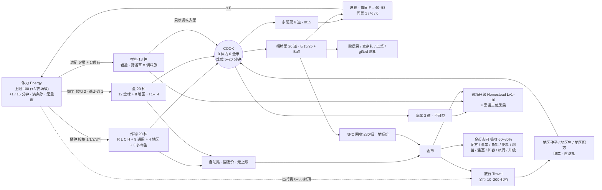
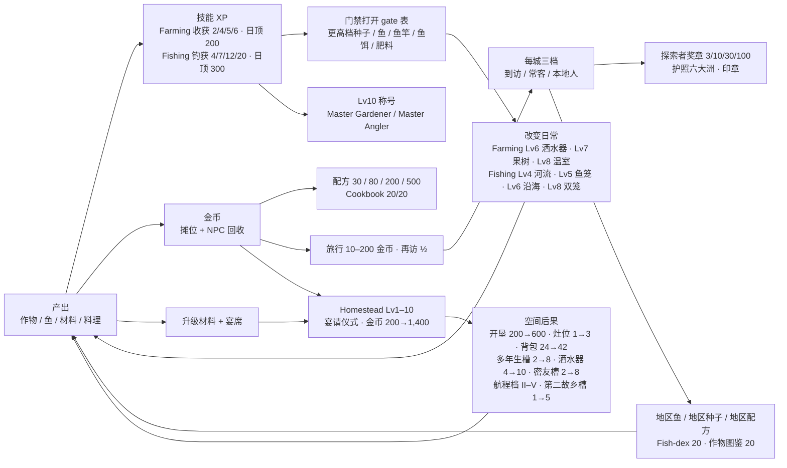

# Gensen 底层玩法重构方案：体力驱动的种植·钓鱼·料理·探索循环

- **日期**：2026-10-02
- **状态**：主策划定稿 v1.0（数值已过 17 项模拟校验；待用户拍板第 17 章的 Q1–Q10 与 S1–S4，本文一律按推荐项作为工作假设）
- **对象**：用户飞书原方案《Gensen-farm-map 版本》及其画板「游戏的核心游戏过程及消耗」 https://a91obh1e4d.feishu.cn/docx/Zw7cdKHaSoFWQZxHppmc1kXHnhh
- **仓库**：`farm-dev`（`DOMAIN_VERSION = '28'`，2026-10-02）；文中对现有实现的引用一律用相对路径
- **取代**：`docs/product/fun-first-rework-2026-09-07.md` §5 首会话导演表与 §12 验证表的首会话部分、`docs/product/regional-growth-gdd-2026-09-10.md` §10.1「出行不加体力门票」、`docs/product/starter-mine-2026-09-14.md` 与 `mine-combat-2026-09-15.md` 的「不引入体力 / 每日刷新 / 经验」口径、Plane SGODOT-142「农场不做深度」

## 一句话结论

**方向保留，规则重写，数值与内容在新规则上补齐：原方案「体力 → 劳作 → 产出 → COOK → 料理 → 体力」的汇聚闭环是一个月来唯一能把钓鱼、种植、料理、背包、矿洞、NPC、多人、地图串成一条有去向的资源流的方案；但按原文落地会在第一周坏在五处规则缺项（料理回体力无上限、「每次种植 1 点」无计量单位、拜访公式线性 + 硬墙、异城无内容、内容量撑不起门禁）。本文把这五处改成：体力线性回复 +1/15 分钟且只对播种（按格按档）/ 抛竿 / 进矿计费、每日料理回复上限 F = 40（随农场等级到 58）、旅行金币为主 + 体力 0–30 封顶 + 无硬墙 + 航程档、每城自动 ≥3 口鱼塘 + 规则派生的地域差异、作物 20 / 鱼 20 / 料理 29 的内容量；两条技能轨各 10 级、农场等级 10 级、软迷雾三态、四级关系表与客票 / 帮工 / 受限赠礼；全部数值跑过 120 天 × 6 seed 模拟，稳态高频 / 基准账户价值比 1.45（红线 1.8），分三期约 90–112 人天落地，P0 用现有内容即可把环转起来。**

## 本文怎么读（只有 10 分钟）

| 分钟 | 读什么 | 得到什么 |
|---|---|---|
| 0–2 | 上面的一句话结论 + 第 0 章 §0.1 决议表 | 哪几条旧约束被放开、护栏是什么 |
| 2–4 | 第 1 章 §1.1 总体判断 + §1.3 的 critical 表 | 原方案为什么必须先补规则再谈数值 |
| 4–6 | 第 2 章两张 Mermaid 图 + 三类玩家的一天 | 新循环长什么样、每天怎么转 |
| 6–8 | 第 3 章 §3.3 体力计费总表 + 第 7 章 §7.3 进食规则 + 第 11 章表 11-1 旅行七档 | 三张最关键的数值表 |
| 8–9 | 第 15 章 §15.2 校验达标清单 | 数值是否站得住 |
| 9–10 | 第 16 章 §16.4.1 分期总览 + 第 17 章拍板表 | 怎么落地、还要你定什么 |

需要细节时按章节找：每章开头都有「本章结论」（第 9、10 章的结论并入 §8.0，第 17 章见 §17.0），每张数值表后都有「配平依据」并回指第 0 章的 D 编号；每章末尾有「与原方案的差异与理由」和「与现有实现的衔接」。

---

# 第 0 章 决议表与设计约束

## 0.1 决议表（旧约束 → 新决议 → 理由 → 护栏）

本表按 `docs/product/fun-first-rework-2026-09-07.md` §11 的效力规则写成：与过去一个月任何产品文档冲突的地方，以本表为准；未列入本表的旧约束继续有效。

| # | 旧约束（出处） | 新决议 | 理由 | 护栏（不可再越的线） |
|---|---|---|---|---|
| 1 | 产品宪法「不做体力条」（`map-farm-life-sim-direction` v0.4、`fun-first-rework` §11 等五份文档重申） | **放开**：体力 Energy 上限 100、线性回复 +1/15 分钟、满条停，是全局唯一产能阀门（D2、D4） | 线上摊位预算为 `Number.MAX_SAFE_INTEGER`（`server/src/domain/handlers/economy.ts:34`），钓鱼无任何限制、理论 600–2,000 金币/小时；没有阀门就没有可推演的账本 | 基础渔场 / 基础种子 R、L / 新手鱼竿永不锁；体力不出售、不看广告、不推送「体力已满」；收获永远 0 体力；没有任何固定重置时刻；体力 0 时同屏三个出口 |
| 2 | 宪法「等级不阻塞首周主线」（PRD §7.2「等级只改信息效率」） | **放开为「等级只锁更高档，基础永不锁」**：Farming / Fishing 各 10 级，门禁统一进 gate 表三选一（milestone / skill_level / farm_level）（D14–D15） | 纯信息效率的等级没有「跨过去生活怎么变」的内容；现有 `xp.json` 7 项便利奖励全仓零引用、从未实现 | gate 表必须有 `open` 护栏行且可审计；任何渔场都可抛竿、T1 鱼永不锁；首会话内升 1 级并立刻用一次；每级 ≥1 样新东西、每轨 ≥3 级改变日常 |
| 3 | 宪法「时间不制造错过恐惧 / 不做每日重置」 | **部分放开**：允许「每玩家日计数」（料理回复 F、失败退费、矿洞开局、密友来访、NPC 额度），但**没有任何「用不完清零」或「某时刻回满」**；体力按时间线性回复（D4、D47） | 原方案 06:00 硬重置带来 05:59 旅费漏洞、首会话 25 分钟撞墙、时区套利、两套日切、QA 等真实一天五个问题（§3.2） | 单一日切沿用农场城市时区 04:00；作物不腐烂、果实无限期挂树；日票从到达起滚动 24 小时；密友不自动降级；灶上的菜不会烧糊 |
| 4 | 宪法「不出售产能」（`partner-gdd` L247） | **不放开** | 背包容量 = 产能；工具省体力 = 变相卖产能；付费是在卖一个不存在的问题（现有背包是假门禁）的解药 | 背包扩容只走农场等级 + 材料 + 金币；工具 / 肥料 / 设施只省时间与点击，不改每格体力单价、不加产量；付费只做外观 / 便利并排到 P3 |
| 5 | GDD §10.1「出行不增加体力门票」（`regional-growth-gdd-2026-09-10.md`） | **废止**：旅行收小额出行费体力 0–30 全球封顶，主成本是金币 10–200 七档（D33） | 不收任何成本则「空间距离感」无法机制化；但按原方案 km/10 计体力，出远门当天农场停摆 | 回家永远免费；无硬墙、任何两城可达；起点恒为家农场；客票 min(10, 出行费) 体力 0 金币；家城最近 3 / 10 城兜底 |
| 6 | 原方案「每天（真实自然日）06:00 重置全部体力」 | **不采用**；若坚持重置，只能整套采用 §3.2.1 的变体 B（存入 +100、封顶 200、04:00、不清零） | 见第 3 行与 §3.2 五个问题的证据 | — |
| 7 | 原方案「拜访体力 = 两城距离 / 10，超上限不可达；+2 上限/级用于够远城」 | **改为**七档距离表（金币 0–200 / 体力 0–30）+ 兜底 + 航程档 I–V（去过 2/5/10/20 簇或农场 Lv2–5）+ 再访 5 折 + 第二故乡 | 北京–上海实为 1,068 km（原文算成 800）初始不可达；上海↔洛杉矶需农场 472 级；0.10.1 跨城组队被封死；悉尼可达世界是伦敦的 1/30 | 到达永远兑现：每城 ≥1 口 Tier 0 鱼塘、T1 鱼永不锁、出发前预告等级门禁 |
| 8 | 原方案「可进渔场但等级不够不能钓」 | **改为**门禁落在鱼与鱼竿上：任何渔场可抛竿，高档鱼「咬钩后挣脱」并点亮图鉴剪影（D14） | 付出已发生的现场被拒绝是 LBS 最差体验；挣脱保留「差一点」的诱惑并留下永久痕迹 | 剪影卡与挣脱卡四件事同屏；挣脱与普通逃走同价退 1 |
| 9 | 原方案「背包将作为 WIP 及付费的重要内容」 | **背包改真约束但不付费**：24 格、鱼 10 / 料理 5 / 作物 50 堆叠、鱼篓 = 空格、8 格 24 小时寄存区、装备进工具架、材料进农场仓库（D26–D27） | 现状 24 × 99 = 2,376 件永不满、溢出区无限可直接消费（`server/src/domain/bag.ts:104`） | 扩容三档 150 / 400 / 1,000 金币 + 材料挂 Homestead Lv3 / 6 / 9 |
| 10 | 原方案「当前阶段暂不开放战斗、装备、属性、附魔、合成、建造」 | **口径改为「保留但不进主循环」**：矿洞 1–2 层作为材料源进循环并计体力，3–5 层、战斗、装备、工作台、三工程保留不删不隐藏；「本阶段只开放农场等级这一条建造线」（D25、D31） | 隐藏 / 删除撤销已上线权益（矿洞 5 层、13 件装备已真机验证），且服务端命令仍可调 | 进矿 5 点/局 + 1 点/岩石、怪物 0 体力、重开每日 ≤2、掉落去种子；附魔 / 合成不做 |
| 11 | 原方案「暂不开放交易与玩家间邮寄」 | **交易仍不开**；加受限赠礼（互关每日 1 份、仅料理与鱼 ≤2 件、`gifted` 不可售不可再赠）与系统收件箱（D45） | 自给自足循环下玩家间零互需；`gifted` 在金币账本价值恒为 0 | GDD §9 交换状态机「数值稳定 ≥4 周后开放」（P3） |
| 12 | 画板「消耗：抽 / 兑换」 | **v1 移除**（Q10-A） | 随机消耗与可推演账本不兼容；现阶段没有奖池内容；若涉付费或产能触碰第 4 行 | 将来若做：只收金币、奖池只放外观 / 配方变体 / 绑定材料、每周封顶 |
| 13 | SGODOT-142「农场不做深度，≤3 分钟轻量闭环」（2026-09-28，In Progress） | **被本方案取代**：142 的闭环改写为第 14 章首日切片（种 → 真实地图鱼塘 → 做一道菜 → 吃，≤20 分钟吃到烤鲫鱼）；其「首会话不弹矿井 / 装备 / 委托引导、入口收进 Explore」保留；Plane 上须立即改 Cancelled 或 Done 并注取代（§16.6） | 两者都是用户 9 月底的决定，必须显式二选一 | 发版门槛改为「真机新装到吃掉烤鲫鱼 ≤25 分钟真实时间」 |
| 14 | 第一轮约束 D29 字面「农场升级金币 200 → 2,000」 | **修订为 200 → 1,400，九级合计 6,350**（§8.2） | 原阶梯下重度冲刺 34 天、均衡 47 天，Lv7+ 被金币卡住的天数占 60%；改后冲刺 32、休闲 63 | 吸收率 <60% 时抬 Lv7–10 金币 10–15%，不动 Lv2–6 |
| 15 | 第一轮约束 D23 字面「重度玩家农场 Lv10 ≤30 天、休闲 60–90 天」 | **改写为「重度冲刺 30–35 天、休闲 60–70 天」**（§9.11） | 在同一条固定金币阶梯上两者只有 1 天交集；再压金币休闲会跌出 60 天 | — |
| 16 | 红队建议「渔场每升一档每点体力净金币 ≥ +30%」 | **让步为「每档 ≥ +15% 且不亏」**（Tier 0/1/2 = 2.0 / 2.7 / 3.1） | D3 的 2±0.5 配平中心与 1.8× 红线是硬约束；+30% 会把重度沿海推到 5.7/点 | 任一渔场 × 鱼竿 × 鱼饵组合扣饵后 ≤ 2 × Tier 0（≈4.0） |
| 17 | 第一轮约束 D3「高频 / 休闲日账户价值比 ≤1.8」单一口径 | **拆为两条断言**：稳态单日（第 8–30 天均值）≤1.8 为主断言；7 日累计 ≤1.9 为首周爬坡容差（§9.11 唯一真源） | 7 日窗口被首日 100 点初始存量、重度第 2 天入河流与社交入流抬高约 0.25，稳态比才反映系统本身（实测 1.45 / 1.84） | 越线旋钮顺序：T3/T4 鱼价（已拨）→ F +2/级改 +1/级 → F 40 → 30 → 回收额度；不动回复速率 |
| 18 | 现状料理「上自助摊溢价 + 回 HP + 三次劳作 Buff」（`recipes.json._premium_note`、`character.json consumables`） | 料理不上摊、不回 HP、`rest` 只回 HP；一张效果表 = 回体力主效果 + 至多一个 Buff（XP% / 咬钩窗口 / 旅费 / 鱼篓四类）（D12） | 沙拉溢价 + 无限回购曾把高频账户价值推到 1026 > 981 红线 | Buff 不得给体力效率或产量 |

## 0.2 设计约束清单 D1–D52

以下 52 条是第一轮评估（附录 C：`eval_synthesis.md` §4）得出、第二轮各章不得违反的设计决定；括号为证据来源。本文各章的「配平依据」都回指这里的编号。带「本文修订」的条目是第二轮数值校验后按 D3 / D16 优先级做的取舍（§15.9），已写入 §0.1 决议表。

### 决议与总则

- **D1** 方案第 0 章必须是决议表，显式放开「不做体力条」「等级不阻塞主线」「时间不制造错过恐惧 / 不做每日重置」三条宪法与 GDD §10.1「出行不加体力门票」，并写护栏：基础渔场 / 基础种子 / 基础鱼竿永不锁、体力不出售、无固定重置时刻、收获永远免费；「不出售产能」不放开。（docs §3；C9）
- **D2** 体力是唯一的全局产能阀门：Journey 摊位预算维持无上限，0.9 s 冷却只作防脚本节拍，不再叠加第二道产能预算；NPC 回收额度是价格地板不是产能阀门。（可行 §5.1；经济 §3.10）
- **D3** 所有新数值先给高频日上界与「每点体力净金币」等价率，并跑 15 分钟 / 90 分钟 / 熟练高频三条轨迹；高频 / 休闲日账户价值比沿用 1.8× 红线；配平中心「每点体力净金币 ≈ 2±0.5」；重写账本测试目标数字而不是在旧账本上打补丁。（经济 §4；docs §6.1）**本文修订**：红线拆为稳态单日 ≤1.8 主断言 + 7 日累计 ≤1.9 容差（§0.1 第 17 行）；基准画像改为 30 分钟 / 日；账本落点为新建 `server/test/domain/loop_ledger.test.ts` + 重写 `server/test/fixtures/build_ledger.ts`（原 `server/test/ledger.test.ts` 已在 44ba3a4 删除）。

### 体力

- **D4** 体力上限 100，按时间线性回复 +1/15 分钟（约 24 小时回满，满条停），不设任何重置时刻；参数带宽 +1/12–15 分钟，由账本按 D3 红线反推。（X1）
- **D5** 体力只对三类动作计费：播种按格且按作物档位 R1 / L1 / C2 / H3；抛竿预扣 2、鱼逃走退 1、每日前 10 次失败全退；进矿 5 点/局 + 1 点/岩石，怪物不收；翻地、浇水、收获、回家、买卖、吃、对话、布置、拜访他人农场、烹饪永远 0 体力。（C2、M3、M8、红队 X16/X17）**本文修订**：档 4（草莓 / 甜瓜）4 点/格、地区种子档 3、树苗 3/3/2；「前 10 次失败全退」只在 Fishing Lv1–3 生效，Lv4 起失败一律退 1。
- **D6** 批量格子命令按格累计、体力不足整条拒绝（`STAMINA_INSUFFICIENT`），客户端发送前按剩余体力裁剪 `cell_ids` 并置灰不可负担按钮；工具只省时间与点击，不改变每格单价；多年生 / 果树每次收获计 1 点。（X3、X4；红队 X14）
- **D7** 养殖、药剂从 v1 体力表删除留路线图；HUD 常驻体力数字 + 「+1 in m:ss」倒计时（1 秒节拍）；体力 0 时同屏三个出口（等 / 吃 / 不耗体力的事）。（m1；体验 R1）
- **D8** 为重度玩家列出体力耗尽后的非体力活动清单并保证每项有奖励：布置、图鉴、拜访他人农场与留言、居民对话与赠礼、烹饪、规划明天的田。（循环 §1.4）

### 料理

- **D9** 每玩家日食物回复上限 F = 40 起，随农场等级 +2/级封顶 60；每餐 8 / 15 / 25 三档；同一道菜当日第二份减半、第三份不回复；账本若越 1.8× 优先降 F 到 30 而不动回复速率。（X16）**本文修订**：公式 F = 40 + 2 × (Lv − 1)，Lv10 = 58，60 只作硬顶。
- **D10** 回复 ≥15 的料理必须含 ≥2 个原料族（田 / 水 / 矿野），单原料料理只能是 8 点家常菜；鱼料理 ≥5 道且占 15/25 档，使钓鱼在循环里不可替代。（红队 X1-3、R4）
- **D11** 烹饪 0 体力、0 金币，占灶位真实时间 5–20 分钟；灶位数由农场等级决定（1→3）；体力 0 时必须能烹饪并进食。（X5）
- **D12** 料理不上自助摊；料理的金币出口只有 NPC 委托 / 回收且有账号级日额度；料理效果合并为一张表（回体力主效果 + 至多一个 Buff），料理不回 HP，`rest` 只回 HP。（X6、M11）
- **D13** 料理按三层定位写明「给谁吃」：家常菜（自己，不进图鉴）/ 招牌菜（赠居民、带去外城做家乡礼、上桌、NPC 回收，进 Cookbook）/ 宴席（农场升级 = 宴请三位居民当场吃掉，复用现有聚会入座）。（体验 §5.3）

### 技能与门禁

- **D14** 两条技能轨 Farming / Fishing 各 10 级；门禁只锁更高档内容：高档鱼「咬钩后挣脱」并在图鉴出现剪影，高档种子 / 鱼竿 / 新渔场 / 设施按等级解锁；任何渔场都可抛竿，放弃「可进渔场不可钓」。（M1）
- **D15** 所有门禁统一进一张 gate 表（能力 → milestone / skill_level / farm_level 三选一），Journey 里程碑降为叙事与教学，不再承担种子 / 厨房门禁；已解锁 C/H 的旧存档 grandfather。（M1；可行 #4）
- **D16** XP 按档递增并设日封顶（钓 T1–T4 = 4/7/12/20、收获按作物档 2–6），首钓 / 首收加成；每体力 XP 不得随作物档位上升；阈值由三类玩家节奏反推：首会话升 1 级、30 分钟玩家约 3 周满级、重度受体力封顶 ≥8 天、5 分钟玩家 ≤3 个月。（X14；红队 R5）**本文定数**：Farming 0/30/80/160/280/450/700/1,000/1,400/2,000，Fishing 0/40/110/220/380/600/880/1,250/1,750/2,500；日封顶 200 / 300。
- **D17** 每条技能 10 级中 ≥3 级是改变日常操作的解锁（洒水器、鱼笼、多年生果树、二 / 三级渔场），其余可为便利项（复用 `xp.json` 的 7 项便利奖励）。（M2）
- **D18** 每道门禁在 UI 上四件事同屏：锁了什么、哪条等级、还差多少、跨过去会怎样；负反馈必带下一步；按钮必带英文文字；五类事件（升级 / 配方 / 迷雾 / 印章 / 农场升级）各一个 ≤3 秒时刻 + 一个永久痕迹，第二次起缩为飘字。（M2；体验 §3/§4）

### 内容量与地域差异

- **D19** 内容最低量：鱼 ≥12（4 档 ×3，含 8 种地区鱼池子）、鱼竿 3、渔场 3 档模板（鱼塘 / 河流 / 沿海）按模板差异化鱼群、作物 ≥10（含 4 种气候带种子）、料理 ≥15（鱼料理 ≥5、宴席 ≥1、地区配方 ≥4、新手鱼料理 1）、鱼饵 2、肥料 2；全部中英文名，英文 ≤18 字符。（C5）**本文达成**：鱼 20 / 作物 20 / 料理 29。
- **D20** 先做物品身份数据化（解除 `server/src/domain/content.ts:23-26` 硬编码、`recipes.inputs` 泛化为任意 item_id、`fishing.json` 加 tags 与 required_level、鱼竿加 required_level 与修正），之后加内容零代码；每级至少解锁一样新东西。（可行 #6）
- **D21** 每座被选为家城的城市按 0.5° 网格自动生成 ≥3 口系统鱼塘且 ≥1 口 Tier 0；地区鱼权重随 cell 载荷由服务端下发覆盖，不改已冻结的 `assets/ponds/catalog.json` 模板。（C4；红队 D2）
- **D22** 地域差异用规则派生不人工填表：city id 哈希 → 每城 2 种地区鱼（集齐需 ≥4 城）；纬度 4 气候带 → 地区种子 + 地区配方（当地 NPC 出售）；Figma 约 50 个地标图标 → 印章，其余城用气候带通用章；非精品城居民文案按城市名 / 气候带差异化。（C4；地理 M1）

### 农场等级

- **D23** 农场等级 10 级，每级同时消耗材料 + 宴席料理 + 金币，每级 ≥1 项可见后果（开垦上限 200→600、灶位 1→3、背包件数、摆件上限、外观阶段复用 `nursery.appearance`）；+2 体力上限只作附带。（M7）**本文修订**：节奏目标改写为「重度冲刺 30–35 天、休闲 60–70 天」。
- **D24** 升级材料表做 DAG 检查：第 N 级材料全部可由 N−1 级能力在家城获得，异城特产只作替代 / 加速项；升级材料从农场仓库提交不占背包。（红队 D5/D7）
- **D25** 农场等级取代旧 240/400 成长购买与 Journey 三工程的成长职能；口径「本阶段只开放农场等级这一条建造线」，工作台 / 摆件 / 三工程保留不删。（M7、m1）

### 背包

- **D26** 背包改为真约束：溢出区改 8 格 24 小时寄存（到期按回收价折现，不消失）；鱼进鱼篓（容量 = 背包空格，满则不能抛竿并在抛竿前显示）；堆叠鱼 10 / 料理 5 / 作物 50 / 材料 99；装备进独立工具架不占格；田地是免费仓库，背包只约束「带出门的东西」。（M5）
- **D27** 扩容只走农场等级 + 材料 + 金币（150/400/1000 递增），不做付费扩容；付费只做外观 / 便利（背包皮肤、排序、派对房主题、明信片样式）并排到数值稳定后；满包时 UI 给「Keep which?」二选一并指向扩容途径。（M5；X8 商业化）

### NPC 与金币

- **D28** NPC 三条价格原则：回收价 = 地板（≤ 摊位价 0.8）且账号级日额度；售价 = 天花板只卖消耗品（鱼饵 / 肥料 / 基础种子）与不可回收品（配方、鱼竿、驿站票），不卖可入菜原料与矿 / 探索材料；配方 = 金币 + 技能等级一次性 sink，关系只给折扣不做前置；委托即回收不建第二套。（M6）
- **D29** 金币去向表必须吸收日净收入 60–80%：配方 30/80/200/500、背包扩容、旅行金币 10–200、农场升级金币、鱼饵 / 肥料日库存；「抽 / 兑换」从 v1 移除。（M4、m2）**本文修订**：农场升级金币 200 → 1,400（九级合计 6,350）。
- **D30** 关系点、委托、赠礼只在家城结算；异城居民只做三件事：卖本城配方、回收本城特产、给成就线索。（红队 X5）

### 矿洞与已上线内容

- **D31** 矿洞 / 战斗 / 装备 / 工作台「保留但不进主循环」，不隐藏入口；`restart_mine` 每日 ≤2 次；怪物掉落表去种子改铜 / 岩盐 / 鱼饵；矿洞产出指向升级材料与鱼饵不指向金币；矿洞 1–2 层作为材料源进循环，3–5 层标「保留」。（M8）
- **D32** 旧存档既得权益全部 grandfather：已解锁 C/H、已持装备、`xp.total` → 种植 XP、溢出区现有物品一次性领回；已到鱼塘 / 已选城写入 visited；上海 / 洛杉矶 / 旧金山对存量玩家发「创始人护照」。（m7；可行 §6 P0 迁移）

### 旅行与迷雾

- **D33** 旅行主成本是金币（按距离 7 档 0/10/30/60/100/150/200），体力只收小额出行费 0/5/10/15/20/25/30 全球封顶；永远以家农场为起点计价、回家免费；无硬墙，任何两城可达；档位边界用真实 haversine 校过。（X2、C3；地理表 A）**本文定数**：第 3 档边界 1,600 km。
- **D34** 公平兜底：家城最近 3 座（人口 ≥10 万）永远第 1 档、最近 10 座 ≤ 第 2 档，与距离档取较低者；成就按 30 km 城市簇计并清洗 `server/data/cities.tsv` 重复条目；拜访金币费不得让钱包低于最便宜种子 × 10。（M13、M14；红队 D4/X10）
- **D35** 远城门禁挂几何增长的航程档 I–V（≤500 / ≤1,600 / ≤4,000 / ≤10,000 / 全球），由探索者奖章（去过 2/5/10/20 簇）或农场等级 Lv2–5 任一满足解锁；客票不受航程档限制。（X12）
- **D36** 日票 = 到达起滚动 24 小时，覆盖家城 + 目的地；再访第 2 次起 5 折；常客后可设第二故乡免费，槽位挂农场等级、每周换一次。（X11、M12）**本文修订**：常客 = `visits ≥5` **且** `deliveries ≥3`（交付每城每日最多计 1 次、客票到访至多计 2），设定第二故乡须该城航程档已解锁。
- **D37** Browse 与 Travel 分离：浏览 / 缩放 / 自动切城免费且只改相机不改玩家所在城；Travel 是显式确认动作（显示体力 / 金币 / 技能门禁 / 日票到期 / 目标农场访问状态）；到达播放大圆弧飞行 + 公里数滚动 + 盖章。（M10；地理 W7）
- **D38** 迷雾是软迷雾三态着色（未知灰度 + 剪影卡 / 已知全彩 / 第二故乡家徽），只遮 POI 明细、鱼塘入口、居民、公开农场列表的可交互性；永远不遮城市名、气泡、在线人数、关注 / 密友农场标记、队伍位置、Nearby、选城页与搬迁流程；表现层在客户端，行动门禁靠服务端通行证（复用 `server/src/realtime/party_travel.ts` HMAC）在实时网关 `join pond/farm/street` 时校验。（X10、M10）
- **D39** 到达永远不是门禁：剪影卡出发前标注「需钓鱼 LvN」与「? 地区鱼 ×2」，当地基础鱼永远可钓，杜绝「付费后 0 可做」；每城三档成就（到访 / 常客 / 本地人）+ 全局探索者奖章 3/10/30/100 + 护照按大洲分页 + 每城印章。（地理 W11/W12）
- **D40** 分期铁律「内容先于收费」：P2 第一版旅行 0 成本（只做 Browse/Travel、visited、三态着色、成就、护照、飞行动画），用到达兑现率（到达后 10 分钟内发生一次当地钓鱼 / 购买 / 委托）与「到了不能钓」拒绝次数决定第二版成本档。（X13）
- **D41** 目的地入口做成四个列表（最近 10 城、队友 / 密友所在城、有公开农场的城、精选城），其余 21,000+ 城只作剪影卡。（地理 W15）

### 社交

- **D42** 关系层级表（路人 → 关注 → 互关 → 密友）作为内容表；密友 = 互关 + 近 7 天互动 ≥3 次 + 双方确认，槽位 Lv1 为 2、每级 +1、上限 8；所有社交权益只挂互关 / 密友，队伍只保留临时同行语义；机器人（demo_xx）不进关系图、不发邀请、不收赠礼；昵称公开展示必须先拍板。（C8；社交 §5.1）
- **D43** 邀请 = 客票：固定 10 体力 0 金币、不看距离与航程档、30 分钟有效、主人在线在场且家城为目的地、客人 2/日、主人 5/日、新号 24 小时冷却、票据记 `cost_paid`；客票同样解迷雾、计到访；0.10.1「前往队长」并入此路径。（X8）**本文修订**：客票体力 = min(10, 该城距离档出行费)，对 T1 城 5，不比自己去更贵。
- **D44** 帮工动作按同一张体力表扣帮工自己的体力（浇水 / 收获 0，补播按档），每人每日 ≤3 农场，帮工得种植 XP + 小额金币（日封顶 12），主人不扣体力、作物归主人并显示「Helped by X · N plots watered」；写进账本测试。（X9）**本文修订**：0 体力帮工动作只给 1 XP/格且子封顶 60/日，补播按档 2/4/5/6；到场补播推 P2 第二期。
- **D45** 受限赠礼替代「完全不开放」：互关每日 1 份、仅料理与鱼 ≤2 件、`gifted` 标记可食可交付不可售不可再赠；GDD §9 交换状态机保留为「数值稳定后开放」；收件箱 + 角标列入 P2 第一期。（社交 W5）
- **D46** 所有社交动作零体力；主人激励三件套（留言板、每日首位密友来访主人 +5 体力、访客免费替主人浇 3 格）；同鱼塘 10 m 内有密友钓鱼 XP +20%（不多给鱼）；客钓按主人等级钓一场 XP 减半；派对房「一起做一道菜」产 `gifted` 料理。（社交 §5.6/§5.7）

### 时间与 QA

- **D47** 单一日切沿用农场城市时区 04:00（只管 F、NPC 额度、收获 XP 封顶、摊位），不另立真实自然日 06:00；跨城「当天」按家农场；体力回复用有效时间 `Ctx.now`（QA 时钟可缩放），钓鱼小游戏 / 战斗冷却留真实墙钟；QA 导演模式提供刷满 / 清零体力、设等级、授予拜访。（M18；红队 T8/T18）

### 首会话、节奏与验证

- **D48** 首会话导演表（`fun-first` §5 格式，逐行标体力值 / XP / 首次看见的 UI）：10–20 分钟走出农场到真实地图鱼塘，20 分钟内完成「钓 → 做（烤鲫鱼）→ 吃 → 体力回来」，30 分钟内 Fishing Lv2 打开一道小门并立刻用一次；今日目标由居民委托 + 「下一级还差 N」给出，而不是「花光体力」。（C7）
- **D49** 七天节奏表每天至少一次「世界哪里不同」的仪式与永久痕迹（D1 鱼→菜→体力；D2 新种子由 NPC 交付；D3 首次回收 / 配方；D4 首访邻城 + 印章 + 外地鱼；D5 农场升级宴请；D6 帮工 / 受邀；D7 护照与下一个目标）。（体验 §2.5）
- **D50** 每期出口 = QA 导演脚本 + 账本新断言 + 4–6 人「看不懂 / 做不了 / 不想做」三分法观察（不作开工门槛）；验证指标含到达兑现率、「到了不能钓」拒绝次数（目标 0）、邀请接受率、帮工轮数、`gifted` 食用率、D7 有无互关留存分层。（M15）
- **D51** P0 期间冻结 Plane SGODOT-139/140/142，只保留 141 帮工设计讨论；新方案显式取代 142「农场不做深度」，142 的 ≤3 分钟闭环重写为首日切片。（X15）**本文修订**：142 已是 In Progress，须立即关闭（§16.6）。
- **D52** 分期与迁移：P0 地基 → P1 内容 → P2 地图与社交 → P3 可选；每期保留旧存档权益。（可行 §6；地理 §8）**本文修订**：按各章全量估算为 117–152 人天、信封版 90–112 人天（第 16 章），高于第一轮 67–93 的信封；裁刀顺序见 §16.5.2。

---

# 第 1 章 对原方案的评估

本章综合七个视角的评估（核心循环与留存 / 地理位置类游戏 / 经济与数值 / 社交与多人 / 制作可行性 / 玩家体验与叙事 / 红队）与四份现状报告（client / server / docs / geo），报告原文见附录 C。视角缩写：循环、地理、经济、社交、可行、体验、红队。

## 1.1 总体判断

**方向正确，而且是过去一个月里唯一能把钓鱼、种植、料理、背包、矿洞、NPC、多人、地图串成一条有去向的资源流的方案；但按原文规则落地，循环会在上线第一周内坏在五处规则缺项上，这五处不是调参能解决的，必须先补规则再谈数值。**

七个视角没有一个否定方向，它们一致认可三件事：

1. **诊断对了。** 用户批评的「拼凑的碎片化功能」正是 09-13 之后按子系统冲刺的产物（每份子系统文档末尾都写「本轮不加体力 / 等级 / 每日刷新」）。画板上半张图「体力 → 劳作 → 产出 → COOK → 料理 → 体力」是第一张把所有产出汇入同一条回路的图，「汇聚」是对碎片化的正确回答。
2. **体力是当前唯一缺位的全局产能阀门。** 线上 Journey 模式摊位预算是 `Number.MAX_SAFE_INTEGER`（`server/src/domain/handlers/economy.ts:34`），钓鱼无任何限制、理论 600–2,000 金币/小时；「钓鱼 2 点/竿」是对症的第一刀。
3. **架构零阻力。** reducer 纯函数 + 内容表 + 显式迁移（`DOMAIN_VERSION` 一个月 1→28），新字段是团队的日常动作；战斗「无等级门禁只看装备」与 `server/src/domain/combat.ts` 现状完全一致，0 人天。

七个视角同样一致指出的五处规则缺项（任一不补，方案不成立）：

| # | 缺项 | 一句话证据 | 本文的修法落点 |
|---|---|---|---|
| 1 | 料理回体力没有上限 → 主循环本身是一台永动机 | 茶 1 体力做出、回复 ≥2 即无限；红队推演 72 小时内体力归零为无意义 | F = 40 + 同菜递减（第 7 章 §7.3） |
| 2 | 「每次种植行动 1 点」没有计量单位 | 一条 `sow_cells` 最多 64 格（`server/src/domain/commands.ts`），按命令计形同虚设、按格 × 四步计农场 98% 荒着，两种解读差 60–256 倍 | 按格、只在播种、按档 1–4（第 3 章 §3.3） |
| 3 | 拜访公式 ⌊km/10⌋ + 100 上限硬墙 | 北京–上海实为 1,068 km = 106（原文算成 800），初始不可达；上海↔洛杉矶需农场 472 级；0.10.1 跨城组队被封死；悉尼 1,000 km 内 48 城 vs 伦敦 1,495 | 七档金币 + 小额体力 + 兜底 + 航程档（第 11 章 §11.2–11.3） |
| 4 | 没有「去另一座城的理由」，且 21,206 座城没有鱼塘 | 所有鱼塘鱼群同为 35/40/20/5；只有上海 / 洛杉矶 / 旧金山有点位；`record_visit_return` 零奖励 | 每城自动鱼塘 + 规则派生地域差异（第 6 章 §6.2.4、§6.3.2；第 11 章 §11.7） |
| 5 | 内容量撑不起门禁 | 4 鱼（每档 1 种）/ 4 可得作物 / 3 道菜 / 1 根无属性鱼竿，连 3 级门禁都填不满 | 鱼 20 / 作物 20 / 料理 29 / 鱼竿 3 / 鱼饵 2 / 肥料 2（第 5–7 章） |

此外有两条「方向性但从未被放开」的约束必须显式处理：产品宪法里「不做体力条 / 等级不阻塞主线 / 时间不制造错过恐惧 / 不出售产能」四条从未被放开，GDD §10.1「出行不增加体力门票」仍在用——这就是第 0 章决议表存在的理由。

## 1.2 站得住的部分

| # | 站得住的判断 | 认可视角 | 关键证据 |
|---|---|---|---|
| P1 | **「汇聚」是对碎片化的正确回答**：所有产出汇入 COOK、料理回流体力，第一次把各子系统串成一条有去向的资源流 | 7/7 | `docs/qa/journey-review-2026-09-07.md` F1「石料 / 芦苇建完无用途、工作台一次性」；`fun-first-rework` §2「调快成熟 + 多加任务仍不够」 |
| P2 | **体力是唯一缺位的全局产能阀门，2 点/竿堵住最大漏洞**；有了它，「每日账户价值上界」第一次可以写成一行公式 | 7/7 | `economy.ts:34` 无限预算；钓鱼 600–2,000 金币/小时 vs 满田洋甘菊约 200/小时 |
| P3 | **料理从「差价」改为「用途」**，消除已知经济红线 | 循环 / 经济 / 可行 / 体验 / 红队 / docs | `recipes.json._premium_note`：沙拉溢价 + 无限回购曾把高频账户价值推到 1026 > 981；现状料理回 HP 但 `rest` 免费回满（`server/src/domain/character.ts:125-131`），价值 ≈0 |
| P4 | **拜访 / 迷雾 / 城市成就是 PRD「空间距离感」的首次机制化**；骨架（同城免费、异城日票、首访解锁、当日自由往返）正确；旅费不绑真实 GPS，天然避开 LBS 品类最大的公平 / 合规坑 | 地理 / 循环 / 经济 / 体验 / 社交 | `prd-brief-2026-09-10.md` §4；`account-global-city-plan` 决定 3「不启动定位权限」；不复刻 PoGO「农村 PokéStop 稀少」 |
| P5 | **按活动分技能等级是星露谷验证过的结构，且无迁移包袱** | 循环 / 可行 / 体验 / docs | `xp.json.level_rewards` 7 项全仓零引用、从未实现；只需保留 `xp.total` 映射到种植 XP |
| P6 | **NPC 三职能（解锁配方 / 回收 / 出售）是教科书式 source/sink 三角**，补上经济唯一缺失的持续性金币去向 | 经济 / 循环 / 红队 | 现状无税、无商店、无配方费、无旅行费、无扩容费；现有 9 单 3 槽委托已是有限回收 |
| P7 | **战斗无等级门禁、只看装备，与现状完全一致，0 人天** | 7/7 | `combat.ts` 伤害 = max(1, damage − defense)，无等级字段 |
| P8 | **范围克制、先 NPC 后玩家市场的顺序正确**，符合一人主程现实 | 循环 / 经济 / 社交 / 可行 | 暂缓养殖 / 交易 / 邮寄 / 附魔 / 合成；GDD §9 已预留 NPC 2:1 替代路径 |
| P9 | **拜访有成本之后，「邀请」与「帮工」第一次有玩法价值**（别人替你花的是稀缺预算而不是时间） | 社交 | 现状 `party_travel.ts` 票据只是鉴权、零成本；SGODOT-141 帮工在零成本劳作下只省时间 |
| P10 | **背包作为取舍门禁的直觉正确**（Hay Day 谷仓是休闲农场最有效的节奏杠杆） | 循环 / 经济 / 体验 | 问题只在现有实现让它不成立（溢出区无限），见 §1.3 M5 |
| P11 | **架构天然匹配**：数值落在纯 reducer + 内容表，`time.ts` 玩家日 / 时区、`xp.json` 结构、`character.json.consumables`、`party_travel` HMAC 票据、`canUse` 单一门禁入口都可直接复用 | 可行 / 红队 / server | 现状报告 §0 |
| P12 | **画板下半部把「更高级」明确列为货币 / 门禁 / 成就 / 配方 / 地图五类**，给每种奖励一个归宿 | 体验 / 循环 | 对应 `fun-first` §1「有效反馈至少改变一项东西」 |

## 1.3 必须补的规则缺项与问题（分层）

严重度口径：**critical** = 不补方案不成立或上线即坏；**major** = 一周内被普通玩家发现并普遍利用 / 卡死，或造成大面积体验落差；**minor** = 口径残留、表述问题、边角漏洞。「修法」为裁决后版本，并标出本文落点。

### 1.3.1 Critical（9 条）

| # | 问题 | 证据 | 修法 | 落点 |
|---|---|---|---|---|
| C1 | **料理回体力无上限 → 永动机**（循环 / 经济 / 红队 critical） | 方案只写「各种食物可以恢复体力」；烹饪不花钱不花时间无次数；茶 = 1 H = 1 体力做出；红队推演：第 3 天起 600 格满载 = 600 杯茶 / 日 = 1,800 体力 / 日；本项目没有星露谷「凌晨 2 点强制睡觉」那种硬顶 | 每玩家日食物回复上限 F = 40（3 餐 8/15/25），同菜当日第二份减半、第三份不回复；烹饪 0 体力但占灶位真实时间；料理从自助摊下架。F 是让环闭合的充要参数，r 只决定几盘菜吃满 F | §7.3 |
| C2 | **「每次种植行动 1 点」没有计量单位，与批量格子命令正面冲突**（经济 / 可行 / 红队 critical） | `till/sow/water/harvest` 都收 `cell_ids[]`，单命令 64 格，`row_tool` 一次 3 格，农场上限 600 已开垦格（`server/src/domain/handlers/farming.ts:22`）；按命令计 100 点 ≈ 6,400 格 / 日，按格 × 四步计 100 点 = 25 格 / 日 | 按格计、只在播种时扣；翻地 / 浇水 / 收获永远免费；批量命令按格累计、不足整条拒绝，客户端发送前裁剪 `cell_ids`；工具只省时间不省体力；多年生每次收获计 1 点 | §3.3 |
| C3 | **拜访公式线性 + 硬墙：精品城永不互访、上海玩家无城可去、封死已上线功能、全球不公平**（7/7） | 北京–上海 1,068 km = 106 > 100；上海–洛杉矶需农场 472 级；上海–首尔 86 后剩 14 点 = 7 竿；1,000 km 内可达城市伦敦 1,495 / 上海 642 / 悉尼 48；1,580 对相距 <10 km 的城市互访免费；按当前所在城计价可「跳岛」；「+2 上限解锁远城」在任何替代公式下自动失效 | 旅行主成本改金币（七档 10→200），体力只收小额出行费 5–30 全球封顶、无硬墙；永远以家农场为起点、回家免费；兜底「最近 3 座永远第 1 档、最近 10 座 ≤ 第 2 档」；远城门禁改航程档 I–V；0.10.1 队伍跨城改客票 | §11.2–11.4 |
| C4 | **没有「去另一座城的理由」，且 21,206 座城没有鱼塘**（地理 / 经济 / 体验 / 红队 critical） | `assets/ponds/catalog.json` 所有模板 `fish_profile` 同为 35/40/20/5；鱼塘点位只有上海 6 / 洛杉矶 6 / 旧金山 6；非精品城三位居民自动放城市中心；`record_visit_return` 零奖励；这是 09-21/09-24/09-25 三次「空间预期落差 → 砍功能」的翻版 | 收费之前先上最小地域差异包：每座家城自动 ≥3 口鱼塘且 ≥1 口 Tier 0；8 种地区鱼池子按 city id 哈希每城 2 种；4 个气候带各 1 种地区种子 + 1 道地区配方由当地 NPC 出售；每城 1 枚印章；顺序必须是「内容 → 成本」 | §6.2.3–6.3.2、§11.7、§11.10 |
| C5 | **内容量撑不起门禁**（循环 / 可行 critical） | `fishing.json` 4 档各 1 种鱼、1 根无属性鱼竿；`crops.json` 4 种可得作物（T 不可解锁且收割即消失）；`recipes.json` 3 道菜且鱼不能入菜；`content.ts:23-26` 硬编码 | 内容最低量鱼 ≥12 / 鱼竿 3 / 渔场 3 档 / 作物 ≥10 / 料理 ≥15 / 鱼饵 2 / 肥料 2；先做物品身份数据化，之后加内容零代码；每级至少解锁一样新东西 | 第 5–7 章 |
| C6 | **06:00 硬重置 + 两套日切**（循环 / 体验 critical） | 钓鱼 2 点/竿、一竿 7–40 s，新手 25 分钟可抛 40–50 竿耗尽 100 点，「Out of energy, back at 6 AM」是比「Crops are growing」强十倍的离开信号；现有玩家日按农场城市时区 04:00（`server/src/domain/time.ts`）；05:59 用残余体力付旅费；按设备时区则改时区无限重置；QA 回归要等真实一天 | 体力按时间线性回复（+1/15 分钟，约 24 小时回满，满条停），不设任何重置时刻；单一日切沿用 04:00（只管 F、NPC 额度、XP 封顶）；日票改滚动 24 小时 | §3.1–3.2、§3.7 |
| C7 | **首会话跑不完主循环**（体验 critical） | `crops.json` 最短 4 小时；鱼 `uses: ["Sell"]` 不能入菜；COOK 与「料理回体力」在首会话根本不出现 | 第一道料理是鱼料理（烤鲫鱼 1 鲫鱼 → +8），钓鱼教学进首会话第 10–20 分钟，20 分钟内完成「钓 → 做 → 吃 → 体力回来」；30 分钟内 Fishing Lv2 打开一道小门并立刻用一次；用钓鱼而不是种田教体力 | 第 14 章 |
| C8 | **社交层空白，却加了三道新墙**（社交 critical ×3） | 方案多人段两行；「密友」无定义，farm-dev 没有任何好友图；昵称未公开；迷雾若遮「人」，21,209 城摊薄后多数城市没人；帮工若不扣任何人的体力 = 互关 10 人 10 倍体力的后门；关闭交易 / 邮寄后玩家间零互需 | 关系层级表作为内容表；迷雾只遮地物永远不遮人；邀请改「客票」固定费；帮工按同一张体力表扣帮工自己的体力；受限赠礼（`gifted`）替代「完全不开放」；收件箱列入第一期 | 第 12 章 |
| C9 | **四条宪法与 GDD §10.1 未显式决议**（docs / 经济 / 可行 / 循环） | 「不做体力条」是过去一个月被重申最多的「不做」项（五份文档）；`fun-first-rework` 开头效力规则要求冲突须写成决议表 | 第 0 章 = 决议表，显式放开三条并写护栏；「不出售产能」不放开；显式废止 GDD §10.1 | 第 0 章 |

### 1.3.2 Major（18 条）

| # | 问题 | 认可视角 | 修法（裁决后） | 落点 |
|---|---|---|---|---|
| M1 | 门禁放在「可进渔场不可钓」：付出已发生的现场被拒绝；两套门禁（`journey.unlocks` 里程碑 vs 等级）并存互相打架 | 循环 / 体验 / 社交 / 地理 / 可行 / 红队 | 门禁挪到鱼种 + 鱼竿：任何渔场都可抛竿，超等级的鱼「咬钩后挣脱」并在图鉴出现剪影；所有能力统一进一张 gate 表，Journey 里程碑降为叙事与教学 | §4.6、§6.1 |
| M2 | 门禁全是 can/cannot，第 2–4 周没有「改变日常」的解锁；没有「还差多少 / 跨过去会怎样」；升级零仪式 | 循环 / 体验 | 每条技能 10 级中 ≥3 级是改变日常操作的设施；门禁四件事同屏；五类事件各一个 ≤3 秒时刻 + 一个永久痕迹 | §4.5、§4.7 |
| M3 | 每体力价值严重不等（洋甘菊 6 / 胡萝卜 4 / 生菜 2 / 小萝卜 1 / 钓鱼 3.25）→ 全员洋甘菊、每日 3 分钟签到 | 经济 / 红队 | 播种体力按作物档位递增 R1 / L1 / C2 / H3，每体力净值配平到 ≈2±0.5；料理配方强制用低级作物；每体力 XP 不随档位上升 | §5.1 |
| M4 | 金币只有来源没有去向；「更高级：货币」把金币当成长是倒置 | 经济 / 红队 / 循环 / 地理 | 金币去向表吸收日净收入 60–80%：配方 30/80/200/500、背包扩容 150/400/1000、旅行 10–200、农场升级、鱼饵 / 肥料；NPC 商店日库存 | §9.9 |
| M5 | 背包是假门禁（24×99 = 2,376 件永不满、溢出区无限可直接消费、真正吃格的是装备）；付费扩容触碰「不卖产能」且 IAP 是独立 10–15 人天工程 | 7/7 | 溢出区改 8 格 24 小时寄存；鱼进鱼篓（容量 = 背包空格）；堆叠鱼 10 / 料理 5 / 作物 50；装备进工具架；扩容只走农场等级 + 材料 + 金币；付费只做外观并排到数值稳定后 | 第 10 章 |
| M6 | NPC 无价格原则 / 无额度：无限回收复制 `MAX_SAFE_INTEGER` 问题；NPC 卖材料 + 0 成本烹饪 = 0 体力套利；跨城日票让每城 3 居民的委托 / 日谈 / 赠礼复刻 | 经济 / 红队 / 循环 | 回收价 = 地板（≤ 摊位价 0.8）且账号级日额度；售价 = 天花板只卖消耗品与不可回收品；配方 = 金币 + 技能等级，关系只给折扣；关系点 / 委托 / 赠礼只在家城结算 | §9.1–9.7 |
| M7 | 农场等级「+2 体力上限」是不可见成长；与园艺 7 级、田地解锁、三工程、240/400 购买重叠；无级数、无每级消耗；材料需求一次性 | 循环 / 经济 / 可行 / 体验 | 10 级长梯子，每级同时消耗材料 + 宴席 + 金币，每级 ≥1 项可见后果；升级 = 宴请三位居民；取代 240/400 与三工程的成长职能；材料表做 DAG 检查 | 第 8 章 |
| M8 | 「暂不开放战斗 / 装备 / 建造」会撤销已上线权益；战斗零体力 + `restart_mine` 无限 + 史莱姆掉种子 = 绕过体力的掉落后门 | 可行 / 经济 / 红队 / 体验 / 循环 | 「保留但不进主循环」，不隐藏入口；进矿 5 点票 + 1 点/岩石，怪物不收体力；`restart_mine` 每日 ≤2；掉落去种子改铜 / 岩盐 / 鱼饵 | 第 13 章 |
| M9 | 「密友助力」/ 帮工动作消耗谁的体力未定义 | 7/7 | 帮工按同一张体力表扣帮工自己的体力（浇水 / 收获 0，补播按档），每人每日 ≤3 农场；帮工得种植 XP + 小额金币；机器人禁入 | §12.3 |
| M10 | 迷雾与已上线 / 已拍板的地图行为相撞（z2 国家级视野、自动切城、选城页气泡、Nearby、队伍位置摘要）；全图遮信息反而削弱探索欲望；浏览与拜访未分离 | 地理 / 可行 / 社交 / 体验 | 软迷雾三态着色，只遮可交互性、永远不遮城市名 / 气泡 / 人数 / 朋友 / 队伍 / 选城页；Browse 免费只改相机、Travel 是显式确认动作 | §11.5–11.6 |
| M11 | 料理五套用途叠加（摊位溢价 + 回 HP + Buff + 回体力 + 升级材料）；三条用途全是「给自己」；回体力 + 日重置让玩家囤菜不吃 | 经济 / 体验 / 循环 | 一张效果表：回体力（主）+ 至多一个 Buff，不回 HP；三层定位家常 / 招牌 / 宴席写明「给谁吃」 | §7.1、§7.4 |
| M12 | 再访永远收费与 PRD §4「已探索区域逐步获得快捷往返」矛盾；农场成长没有空间后果 | 地理 / 循环 | 首访全价；第 2 次起 5 折；常客后可设第二故乡免费，槽位挂农场等级、每周换一次 | §11.4 |
| M13 | 城市成就无结构（只有「首访一枚」），无层级、无全局奖章、无展示面；成就可被 1,580 对近邻城刷 | 地理 / 红队 | 每城三档 + 探索者奖章 3/10/30/100 + 护照按大洲分页 + 每城印章；成就按 30 km 城市簇计；每日首访计数 ≤2 | §11.8 |
| M14 | 全球公平性：按公里计价让不同家城的可达世界相差 13 倍 | 地理 / 红队 | 「最近 k 城归一化」兜底 | §11.2.3 |
| M15 | 没有验收口径；60–90 分钟自然首会话从 09-07 提出至今从未验证；4–6 人观察从未执行 | 可行 / 循环 / 体验 / docs | 每期出口 = QA 导演脚本 + 账本断言 + 4–6 人三分法观察；指标含到达兑现率、「到了不能钓」拒绝次数（目标 0）、D7 留存分层 | §14.8、§16.4 |
| M16 | 与 SGODOT-142 正面冲突；139/140/141 在新循环中的角色一字未写 | 社交 / 可行 | 新方案取代 142；139 = 同城聚点 + 邀请发源地 + 一起做菜；140 = 关系图来源；141 = 体力赠送通道；P0 冻结 139/140/142 | §12.9、§16.6 |
| M17 | 内容表改动强制客户端同步发版（15 文件 sha256 → `content_version`，不符 503） | 可行 | P0 接受月度捆绑发版；P1 首周可选拆展示 / 规则两层哈希（4–6 人天） | §16.3.14 |
| M18 | 时间口径三处打架：真实自然日 06:00 / 农场城市 04:00 / 「1 日内」；跨时区「当天」归属未定 | 地理 / 社交 / 经济 / 可行 / 体验 / 红队 | 单一日切 = 农场城市时区 04:00；日票 = 到达起滚动 24 小时；体力无重置时刻 | §3.7、§11.4.1 |

### 1.3.3 Minor（9 条）

| # | 问题 | 修法 | 落点 |
|---|---|---|---|
| m1 | 口径自相矛盾：养殖「暂不做」但体力表有养殖 2 点；挖矿等级「暂不做」但有挖矿体力；「农场升级消耗材料」本身就是建造却写「暂不开放建造」；北京–上海 800 km 算错 | 删养殖行与药剂；挖矿「接体力不接等级」；表述为「本阶段只开放农场等级这一条建造线」；所有距离用真实 haversine 校过 | §3.1.1、§13.2、§11.2 |
| m2 | 画板「抽」「兑换」未定义；随机消耗与可推演账本原则不兼容 | v1 移除；「兑换」若将来做，定义为材料 ↔ 配方 / 鱼饵的 NPC 单向表 | §0.1 第 12 行 |
| m3 | 「居民设置了不允许访问」术语混用 NPC 与玩家 | NPC = Resident，玩家 = Farmer / Neighbor；访问权限 `visit_access` 与关系层级正交 | §12.15 |
| m4 | 无英文文案口径；负反馈直译会变成一堆孤立的 Locked | 每章一张英文文案表（附录 B 汇总）；负反馈必带下一步；按钮必带文字；时间派生文案 1 秒节拍 | 各章文案表 |
| m5 | 死数据：果树 T 不可解锁且收割即消失；`farm_pond` 服务端拒绝、`street_lake/river` 不可达 | T 改为多年生苹果树模板；`farm_pond / street_lake / street_river` 退为别名 | §5.1.3、§6.3.1 |
| m6 | 邀请折扣未定义 → 双号互邀 / 300 人队伍出租车 | 客票：主人在线在场且家城为目的地、双方日上限、票据记 `cost_paid` | §12.2 |
| m7 | 既得状态未处置：已选城、已到鱼塘、已解锁 C/H、已持装备 | 全部 grandfather；家城 + 已到鱼塘所在城写入 visited；三城存量玩家发「创始人护照」 | §4.6.6、§11.6.4、§16.4 |
| m8 | `server/src/domain/journey.ts` 两处硬编码数值（terrace salad 30 / tea 24、waystation 2 木） | P0 顺手进内容表 | §16.2.1 #10 |
| m9 | 金币成本没有公式；成就奖励若可量化会被刷 | 金币随档位 10/30/60/100/150/200；≤100 km 首访只点亮不给奖励 | §11.2.1、§11.8.5 |

## 1.4 分歧裁决摘要

| # | 议题 | 各方立场 | 裁决 | 理由 |
|---|---|---|---|---|
| X1 | 体力回复：线性回复 vs 06:00 硬重置 | 线性：循环 / 社交 / 体验（+1/6 min）、红队（+1/15 min）、地理（要求统一日切）；重置：经济（「账好算」）；可行：差 1 人天 | **线性回复 +1/15 分钟，无任何重置时刻** | 5:1。日自然回复 96 ≈ 100 保留了「每日 100」的预算直觉，F 仍是唯一上限参数；硬重置的 05:59 漏洞、错过恐惧、时区套利、QA 等待、首会话离开信号五个问题一次全消。取 +1/15 而不是 +1/6，是因为 +1/6（日 240）让双会话玩家吞吐 2.4× 越过 1.8× 红线 |
| X2 | 旅行是否用体力 | 零体力（循环）；小额 5–30 封顶 + 金币为主（地理）；分段 5–90（经济 / 可行 / 体验 / 红队） | **金币为主 + 体力小额出行费 5–30 全球封顶** | 体力同时当劳作预算与旅行预算，出远门当天农场停摆，把「去另一座城」变成惩罚；但完全零体力失去「出远门会累」的表达；封顶 30 = 跨洋后仍剩 70 点干活；不另立「旅行券」第三种资源 |
| X3 | 收获是否计体力 | 收（可行）；免（循环 / 经济 / 红队 / 体验） | **免费** | 收获是奖励时刻；成熟了收不了是体力设计里最招投诉的一种；收获数量本就被播种数量上界约束 |
| X4 | 工具是否省体力 | 是（循环）；否（红队：工具 = 体力折扣券） | **P0/P1 否：按格平价，工具只省时间与点击** | 只要工具可用金币购买，体力效率就是变相卖产能；「改变日常」的诉求由洒水器 / 鱼笼 / 多年生等设施满足 |
| X5 | 烹饪是否计体力 | 2 点/道（循环）；0 体力 + 可选时间（经济、红队） | **0 体力 0 金币，占灶位真实时间 5–20 分钟** | 烹饪若计体力，体力 0 的玩家做不了菜也就回不了体力 → 死锁；用时间节流料理产量，灶位数挂农场等级正好给农场等级一项可见收益 |
| X6 | 料理能否上自助摊 | 可卖但取消溢价（循环）；下架（经济 / 红队）；招牌菜走 NPC 回收（体验） | **不上摊；金币出口只有 NPC 委托 / 回收且有日额度** | 「吃」与「卖」两条出口叠加曾把高频账户价值推到 1026 > 981 |
| X7 | 作物按体力配平：体力阶梯 vs 改售价 | A（红队）；A 或 B（经济） | **体力阶梯 R1 / L1 / C2 / H3** | 售价已按「每格每小时毛利」配平且被 Journey 价格覆盖；「贵的作物更累」可读，且让低级作物有不可替代的体力效率 |
| X8 | 邀请：折扣 vs 固定费 vs 全免 | 折扣（红队）；固定 10 体力（社交）；0 体力 + 金币 5 折（地理）；全免（循环 / 经济 / 可行） | **客票 = 固定费：0 金币 + min(10, 出行费) 体力** | 折扣在跨洋场景救不回来（五折仍 522）；全免是 300 人队伍的全球出租车 |
| X9 | 帮工消耗谁的体力 | 帮工自己打折（社交 / 循环）；只做免费动作或扣帮工（红队）；被帮者（可行） | **按同一张体力表扣帮工自己的体力** | 浇水 / 收获本就 0 体力，帮工白名单内只有补播收费，规则与主人完全一致、不需要第二套折扣 |
| X10 | 迷雾是否需要服务端过滤实体 | 需要（红队）；不需要（可行 / 地理） | **表现层在客户端；行动门禁在服务端** | 「看见」不等于「能做」：进塘 / 进农场由实时网关校验通行证；社交视角要求迷雾不遮人，服务端过滤队伍位置反而违背 |
| X11 | 日票：日历日 vs 滚动 24 小时 | 日历日（地理 / 可行）；滚动（社交 / 红队） | **到达起滚动 24 小时** | 线性回复后没有重置时刻，日历日只剩「23:00 付费只值 5 小时」的坏体验；滚动同时跨越时差 |
| X12 | 远城门禁挂点：探索者奖章 vs 农场等级 | 甲（地理）；乙（可行）；城市成就数（循环 / 经济） | **任一满足** | 甲更像 LBS「探索解锁探索」且不依赖尚不存在的农场等级；乙给农场等级一个地图后果 |
| X13 | 旅行线的分期：免费观察期 vs 与成本一起上 | 三期（地理）；一次上（可行 / 经济 / 循环） | **「内容 → 免费旅行 → 收费」顺序，压缩进 P2 内部两个版本** | LBS 历史反复证明先收费后给内容以流失收场；一人团队不宜拆成四个里程碑 |
| X14 | XP 阈值曲线 | 循环 0/30/80/160/280/450/700/1050/1550/2300；经济 0/60/150/300/500/800/1200/1700/2400/3300 | **按节奏约束反推**，本文定数见 D16 | 两条曲线的差别只是 XP 来源单价不同；首会话升 1 级、30 分钟玩家约 3 周、重度 ≥8 天、5 分钟玩家 ≤3 个月 |
| X15 | SGODOT-142「农场不做深度」 | 取代（社交）；冻结 139/140/142（可行） | **新方案取代 142；142 的 ≤3 分钟闭环重写为首日切片；P0 冻结 139/140** | 两者都是用户 9 月底的决定，必须显式二选一 |
| X16 | 食物上限 F 与餐数 | F=40、3 餐、第 4 餐无效（经济）；3 餐 ≤36、同菜递减、须含田+水/矿（红队）；烹饪计费 + 每日 6 道（循环） | **F=40 起、3 餐 8/15/25、同菜递减、≥15 的菜须含 ≥2 原料族** | 循环的「6 道 + 烹饪计费」被 X5 否决；红队的跨系统原料规则给钓鱼不可替代的位置，但只约束 ≥15 档以免卡住首会话的单原料鱼料理 |

## 1.5 原方案 → 本方案逐节对照表

| 原方案章节 | 原文要点 | 本方案处理 | 为什么 | 落点 |
|---|---|---|---|---|
| 画板上半：体力 → 种植 / 钓鱼 / 养殖 / 挖矿 / 战斗 → 产出 → COOK → 料理 → 体力 | 五个过程汇入 COOK，料理回流体力 | **保留闭环骨架**；五个过程收敛为三个计费动作（播种 / 抛竿 / 进矿），养殖删、战斗 0 体力；矿只以岩盐 / 野香草两种「调味」入菜；料理回流被 F 封顶 | 养殖与挖矿等级原文「暂不做」却占体力表；无 F 则永动机 | 第 2 章、§3.3、§7.3 |
| 画板下半：产出 → 消耗（卖店 / 任务 / 兑换 / 抽）→ 更高级（货币 / 门禁 / 成就 / 配方 / 地图） | 三段式成长链 | **保留五类「更高级」并各给归宿**：货币 → 金币去向表、门禁 → gate 表、成就 → 护照 / 图鉴 / Cookbook、配方 → NPC 四档价、地图 → 航程档 / 第二故乡；「抽 / 兑换」从 v1 移除 | 原方案只有来源没有去向；随机消耗与可推演账本不兼容 | 第 2 章、§9.9、§4.6、§11.8、§7.6 |
| 技能等级（钓鱼 / 种植 / 养殖 / 挖矿） | 单项等级决定能否做某项经营；钓鱼等级管渔场与鱼竿；种植等级管种子；养殖等级管幼崽 | **两条轨 Farming / Fishing 各 10 级**；门禁落在鱼种 + 鱼竿（挣脱）与种子 / 设施 / 便利；养殖 / 挖矿等级不做；XP 来源 / 阈值 / 日封顶全部给数 | 「可进渔场不可钓」是最差表达；纯 can/cannot 撑不过第 2 周；原文无 XP 与曲线 | 第 4 章、§6.6 |
| 农场等级 | 消耗不同等级材料升级；提升「密友助力」 | **Homestead 10 级**：每级材料 + 宴席 + 金币；每级 ≥1 可见后果（开垦 / 灶位 / 背包 / 摆件 / 外观 / 多年生槽 / 洒水器 / 第二故乡槽 / 航程档 / 密友槽）；升级 = 宴请三位居民；DAG 检查通过 | 「+2 体力上限」不可见；材料一次性第二周归零；密友槽位正是「密友助力」的落点 | 第 8 章、§12.1.4 |
| NPC：解锁配方 / 回收食材料理 / 出售某些材料 | 三个消耗 / 回收作用 | **三条价格原则 + 三位居民各守一柜台**：卖消耗品与不可回收品（**不卖材料**）、回收 = 地板 ≤0.8 且日额度、配方 = 金币 30/80/200/500 + 技能等级、关系只给折扣；异城 NPC 只做三件事 | NPC 卖材料 + 0 体力烹饪 = 0 体力套利；无额度回收复制无限预算；配方挂关系会 DAG 自锁 | 第 9 章 |
| 战斗：无等级门禁、只与装备相关 | — | **一致，保留**；战斗 0 体力 0 XP | 与 `combat.ts` 现状完全一致 | §13.3 |
| 背包：资源管理门禁、初始有限、取舍、WIP 与付费 | — | **真约束但不付费**：24 格 + 堆叠 + 鱼篓 + 8 格寄存 + 工具架 + 农场仓库；扩容走农场等级 + 材料 + 金币；取舍限定在「带出门的四类东西」 | 现有背包是假门禁；付费撞「不卖产能」；社交上造成赠礼 / 帮工不对称 | 第 10 章 |
| 料理：提升体力 / 特殊作用 / 农场升级材料 | 三条用途 | **29 道配方三层定位**：家常（自己）/ 招牌（赠居民 / 家乡礼 / 上桌 / NPC 回收 + 至多一个 Buff）/ 宴席（升级 = 宴请）；F 封顶；不回 HP、不上摊 | 三条用途没有观众；用途叠加是已知红线；「把一盘菜塞进升级」改为「请客」 | 第 7 章 |
| 体力：上限 100；种植 1 / 钓鱼 2 / 养殖 2 / 挖矿 1；06:00 重置；食物回复；药剂提上限 | — | **上限 100 + 2/农场级、+1/15 分钟线性、无重置**；播种按格按档 1–4 / 抛竿预扣 2 退 1 / 进矿 5 + 1/岩；F = 40–58；养殖 / 药剂删 | 见 C1、C2、C6 | 第 3 章 |
| 拜访城市：同城免费；异城一次性体力 + 金币当天往返；体力 = km/10；超上限不可达 | — | **七档金币 0–200 + 体力 0–30 + 兜底 + 航程档 + 日票 24 h + 再访 5 折 + 第二故乡**；无硬墙 | 见 C3 | 第 11 章 |
| 体力上限：升级农场 +2/级（为够到远城） | — | **保留 +2/级但只作附带**，不再是旅行门禁；农场等级改为航程档解锁条件 B 与第二故乡槽位 | 任何替代公式封顶 <100，上限对门禁无效 | §3.1.3、§11.3 |
| 多人玩法：为社交属性带来增益（需补齐）；邀请降低拜访成本 | 两行 | **四级关系表 + 权益矩阵 + 客票 + 帮工 + 受限赠礼 + 收件箱 + 主人三件套 + 同塘 / 客钓 / 一起做菜**；全部日上限进账本 | 社交层空白却加三道墙 | 第 12 章 |
| 地图迷雾：初始除家城全迷雾；首访解锁 + 城市成就；再访仍收费 | — | **软迷雾三态**：不遮城市名 / 人 / 选城页，只锁可交互性；每城三档成就 + 探索者四级 + 护照 + 印章；再访 5 折、常客免费 | 与无缝缩放 / 选城页 / Nearby / 队伍面板相撞；单枚成就无牵引力；再访永远收费与 PRD 矛盾 | §11.5–11.8 |
| 交易、邮寄：暂不开放 | 测试机制期 | **交易仍不开**；受限赠礼 `gifted` + 系统收件箱八类消息；交换状态机 P3 | 玩家间零互需；`gifted` 金币价值 0 | §12.4–12.5 |
| 战斗 / 装备 / 属性 / 附魔 / 合成：暂不开放 | — | **保留不删不隐藏、不进主循环**；矿洞 1–2 层进循环并计体力；附魔 / 合成不做 | 撤销既得权益；服务端命令仍可调 | 第 13 章 |
| 建造：暂不开放 | — | **「只开放农场等级这一条建造线」**；洒水器 / 鱼笼 / 温室作为技能解锁的设施；三工程与工作台不扩 | 「升级消耗材料」本身就是建造 | §5.5、第 8 章 |

---

# 第 2 章 核心循环总览

## 2.1 重画的画板：一条有去向的资源流

原画板的闭环「体力 → 劳作 → 产出 → COOK → 料理 → 体力」保留，但本方案把它改画成四件事：**体力只在三个口子出去**（播种按格、抛竿按竿、进矿按局），**所有产出进两条路**（吃 / 卖），**吃的那条被 F 封顶**，**卖的那条被金币去向表吸收**。每个资源在图上都有唯一的去向，没有一条边是「无限」。

读图要点：
1. 体力的三个出口都是**按单位计费**（格 / 竿 / 局 + 岩石），没有「每次行动」这种无单位的计量。
2. COOK 是 0 体力 0 金币的，所以体力 0 的玩家永远能做菜、吃菜——这是闭环不死锁的前提（D11）。
3. 「料理 → 体力」这条边的上界是 F（40–58）+ 密友 +5 + 被补播 5，与会话次数无关；稳态下任何人一天的有效体力 ≤ 96 + F + 10（§3.4.1）。
4. 自助摊无上限但只收作物与鱼，料理不上摊；材料没有摊位，只有 20 金币/日的 NPC 回收地板。

## 2.2 成长链：产出 → 消耗 → 更高级

画板下半张图的五类「更高级」各自的归宿：**货币** → 金币去向表（§9.9），**门禁** → gate 表（§4.6），**成就** → 护照 / 探索者 / 图鉴 / Cookbook（§11.8、§6.7、§7.8.2），**配方** → NPC 四档价与技能解锁（§7.6），**地图** → 航程档与第二故乡（§11.3–11.4）。

## 2.3 三层循环：每日 / 每周 / 每月

| 层 | 周期与时钟 | 这一层里会「归零」的计数 | 这一层里会「跨过」的东西 | 玩家感受到的「不同」 |
|---|---|---|---|---|
| **每日** | 体力按分钟线性回复（24 h ≈ 96）；玩家日 04:00（农场城市时区）只归零计数 | 料理回复 F、Fishing Lv1–3 的 10 次失败退费、矿洞开局 2 次、密友来访 +5、帮工 3 农场 / 12 格、客票 2/5、赠礼 1/3/5、每日首访计数 2、NPC 日库存与回收额度、异城交付 1 次/城 | 作物成熟（4–24 h）、灶位出菜（5–20 分钟）、鱼笼每 8 h 一条、探索轮 8 h 冷却 | 早上收昨天的田、播新一轮、去塘边抛 10–20 竿、回家做一道菜吃掉、交一份委托；今日目标三行 |
| **每周** | 7 天滚动窗（密友互动）；第二故乡 7 天锁；护照「周页」 | — | 技能 Lv4–6 落在首周；农场 Lv2 第 4–7 天、Lv3–4 第 2 周；首访邻城（D4）、首次宴请（D5）、首次被帮工 / 客票（D6） | 第 14 章七天节奏：每天一次「世界哪里不同」的仪式与永久痕迹 |
| **每月** | 30 日账本（吸收率 60–80%、稳态红线 1.45）；120 天模拟 | — | 30 分钟玩家两轨约 3 周满级、农场 Lv10 约 8 周；航程档 V 第 16–25 天；Cookbook 20/20 需跨气候带旅行（第 4–8 周）；探索者金章 ≥15 天、白金 ≥50 天 | 技能满级称号、Homestead Master、护照封面、图鉴金框——这些是 P3「代表作」的输入 |

没有任何一层有「用不完清零」或「某时刻回满」：体力随时在涨，F 用完只影响今天还能不能吃出体力，错过一天的损失只是「少了一天的自然回复」。

## 2.4 三类玩家的一天

三条轨迹是全文账本的分母与分子（D3）；完整的体力与金币账在 §3.4.3，模拟结果在 §15.7、§15.11。

| 画像 | 会话 | 一天做什么（稳态，Lv5+） | 体力消耗 | 日净金币（30 日均值） | 两轨满级 | 农场 Lv10 |
|---|---|---|---|---|---|---|
| **A · 15 分钟 × 1 次**（休闲下限） | 晚 20:00 一次 | 收昨天 36 格 → 播 36 格（12 R + 12 L + 6 C + 6 H，54 点）→ 家门口 Tier 0 塘 5–8 竿 → 卖 / 交委托 → 吃 1 道烤鲫鱼；隔日 1 局矿洞 A；每 10 天旅行一次 | ≈ 63–75（条顶在 100 等约 8 小时，浪费约 1/3） | ≈ 124 | Fishing 47 天 / Farming 26 天 | 第 63 天 |
| **B · 30 分钟 × 1 次**（基准，红线分母） | 晚一次 | 收 30–40 格 → 播 56 点（Lv5 后混种档 2–3 与地区作物）→ 河流 22 竿（芦苇竿）→ 每日 1 局矿洞 A（17）→ 吃满 F 的 70%（1 道 15 + 1 道 8 + 半份）→ 每周旅行 1 次 | ≈ 116（受时间约束，稳态闲置 20–40 点） | ≈ 176 | Fishing 21 天 / Farming 23 天 | 第 58 天 |
| **C · 高频双会话**（早 30 + 晚 60 分钟） | 早晚两次 | 早：收 48 格、播 84 点、吃一道招牌菜；晚：沿海 20–30 竿（碳素竿 + 亮片）、隔日 1 局矿洞、隔日旅行邻城、吃满 F（48–58）；密友首访 +5、被补播 ≤5；买 30 蚯蚓 + 10 亮片 + 10 堆肥 / 日 | ≈ 150–160 ≤ 96 + F + 10 | ≈ 296 | 均衡 16 / 16 天；全钓上界第 8 天、全种上界第 18 天 | 均衡第 49 天；只买必需的冲刺第 32 天 |

三个结论：
1. **会话次数只改变浪费率，不改变上界**：A 把 15 分钟拆成早晚各 7 分钟就能拿到接近 96；C 比 B 多出来的只有 F 与社交入流两个常数。
2. **进度差距由日封顶主导，不由体力主导**：C 两轨满级比 B 快 1.3–2.6 倍，但账户价值比只有 1.45，因为 C 的高收入被鱼饵 / 肥料 / 配方 / 树苗 / 温室吃掉。
3. **农场等级是「谁都能走完」的长梯子**：A 到 Lv10 只比 B 慢 9%，C 均衡只快 16%——重度玩家的优势被导向技能、图鉴与护照，而不是农场。

---

# 第 3 章 体力（Energy）

## 3.0 本章结论

1. 体力是本方案唯一的全局产能阀门（D2）：上限 100，**按时间线性回复 +1 / 15 分钟、满条停、没有任何重置时刻**（D4）。它把「每日约 100 点」的预算直觉保住了（24 小时自然回复 96），却去掉了原方案 06:00 硬重置带来的 05:59 旅费漏洞、首会话撞墙、时区套利、两套日切、QA 等真实一天这五个问题。
2. 体力只对三类动作计费：**播种（按格、按作物档位 1 / 2 / 3 / 4：R·L 1、C 2、H 3、草莓·甜瓜 4；地区种子 3）、抛竿（预扣 2、逃走退 1、Fishing Lv1–3 每日前 10 次失败全退）、进矿（5 点/局 + 1 点/岩石）**；翻地、浇水、收获、烹饪、吃、买卖、对话、布置、拜访他人农场、所有社交动作永远 0 体力（D5）。旅行只收 0–30 的小额出行费，主成本是金币（D33）。
3. 任何玩家在稳态下一天的自然体力上界都是 96，**会话次数只改变浪费率，不改变上界**；高频玩家比基准玩家多出来的只有料理 F = 40 与密友来访 +5。红线口径由 §9.11 持有唯一真源：**稳态单日账户价值比（高频最优 / 基准最优）≤ 1.8 为主断言，7 日累计 ≤ 1.9 为首周爬坡容差**；任一渔场 × 鱼竿 × 鱼饵组合扣饵后的每点净值 ≤ 2 × Tier 0（≈ 4.0）。第 15 章模拟（修正后基表）：稳态单日 1.45、7 日 1.84（含社交入流 +10/日；不含 1.70）、14 日 1.47、30 日 1.50；越线时按 D9 先把 F 降到 30（对照：7 日 1.69、稳态 1.31）而不动回复速率。
4. 体力 0 不是墙：收获、烹饪、进食、布置、图鉴、拜访与留言、居民对话、规划明天的田全部可做且各有奖励；HUD 常驻「Energy 64/100 · +1 in 4:32」，不足时四件事同屏（要多少 / 有多少 / 差多少与多久 / 现在能做什么）。
5. 体力回复走有效时间 `Ctx.now`（QA 时钟可缩放），玩家日 04:00（农场城市时区）只管每日计数（F、失败退费次数、矿洞重开次数、密友来访加成），不碰体力余额；QA 导演提供刷满 / 清零 / 设值 / 重置餐数。

---

## 3.1 基本规格

### 3.1.1 参数表

| 参数 | 值 | 说明 |
|---|---|---|
| 上限 `energy_max` | 100（Homestead Lv1） | 每升一级农场 +2，Lv10 = 118；上限是「存量」不是「速率」，日回复不随上限变 |
| 回复速率 | +1 / 15 分钟，线性，整数 | 24 小时自然回复 96；0 → 100 需 25 小时；从常见的 20 点残量回满约 20 小时 |
| 满条行为 | 到上限即停，计时器暂停 | 从满条消费后，下一个 +1 从消费时刻起算 15 分钟 |
| 重置时刻 | **无** | 没有「某个时刻回满」，也没有「用不完清零」 |
| 离线 | 按离线时长线性补到上限为止 | 离线 3 天回来 = 满条，不多不少；不惩罚也不奖励 |
| 料理回复 | 每玩家日合计 ≤ F = 40，每餐 8 / 15 / 25 | 同一道菜当日第二份减半、第三份不回复（D9；细则在第 7 章） |
| 社交回复 | 每日首位密友来访，主人 +5；密友到场补播，主人每日被补播 ≤5 点等值（§12.3.3） | 来访 +5 可超上限至多 +5（即最高 105），超上限期间不回复（D46）；被补播不是体力入账而是「少花 5 点」 |
| 参数带宽 | +1 / 12–15 分钟 | 由账本反推（§3.4.5）；本章按 15 分钟写，12 分钟只改绝对产出，不改高频 / 基准比 |
| 新号 / 旧存档 | 首次进入新版本 = 满条 | 旧存档迁移时 `energy_cur = energy_max`，不做扣减 |
| 不做的事 | 不出售、不看广告回复、不做体力推送通知、无药剂、无养殖行 | D1 护栏、D7；「体力已满」推送会制造错过恐惧，列为不做 |

配平依据：D4（上限 100、+1/15 分钟、满停、无重置）、D23（+2/级只作附带）、D9（F = 40）、D46（+5）、D1 护栏（体力不出售）。

### 3.1.2 状态与结算（描述，不是代码）

服务端为每个农场保存两项：当前体力整数 `energy_cur`、上次结算的有效时间 `energy_updated_at`。读取（GET）时投影不落库：当前体力 = min(上限, `energy_cur` + ⌊(now − `energy_updated_at`) ÷ 15 分钟⌋)。写入（任何会扣体力的命令）时在行锁后用同一个 `effectiveNow` 先结算回复、再扣费、再把余数（不足 15 分钟的部分）保留在 `energy_updated_at` 上，这样连续小额消费不会丢掉已经累计的几分钟。满条时 `energy_updated_at` 直接钉在 now，余数丢弃（满条不累计）。这与现有「读路径投影、写路径在行锁后采样一次 `effectiveNow` 贯穿 derive 与 reducer」的做法一致（`server/src/domain/derive.ts`）。

上限随 Homestead 等级变化时只改上限，不改 `energy_cur`；升级瞬间若 `energy_cur` 已等于旧上限，玩家会看到 100/102，下一个 +1 照常 15 分钟后到——升级不白送体力，+2 的好处是「离线能存更多」。这对一天一次会话的玩家最有感（多存 2 点就是多播 2 格），对高频玩家几乎无感，正好符合「附带收益」的定位。

### 3.1.3 上限成长

上限成长只有一条来源：农场等级 Homestead（D23）。Lv1 100 → Lv10 118。不设药剂、不设技能等级加成、不设付费。理由：任何第二条上限来源都会让「上限」重新变成一种可追逐的数值，而 §3.4 证明体力系统的真正约束是回复速率与 F，上限只影响存量，没必要为它开第二条成长线。

---

## 3.2 为什么不是「每天 06:00 重置」

原方案：「每天（真实自然日）上午 6 点重置全部体力。」第一轮评估七个视角里五个反对硬重置，经济视角可接受但要求统一日切。下面是五个具体问题，每个都有证据。

| # | 问题 | 发生机制 | 证据 |
|---|---|---|---|
| 1 | **05:59 旅费漏洞** | 旅行若用体力计价，玩家在重置前用「反正要清零」的残余体力支付，06:00 满血出发，旅费事实为 0；若日票到重置作废，23:00 买的票只值 7 小时 | 红队 X9、T2；地理评估 W4 |
| 2 | **首会话 25 分钟撞墙成最强离开信号** | 钓鱼 2 点/竿、一竿 7–40 秒，新手在最兴奋的 25 分钟内就能抛 40–50 竿耗尽 100 点，被告知「明早六点再来」；`fun-first-rework` 把「Crops are growing」列为 P0 离开信号，「Out of energy, back at 6 AM」比它强十倍 | 体验评估 W2；`docs/product/fun-first-rework-2026-09-07.md` §2 |
| 3 | **时区套利与两套日切** | 「真实自然日」若按设备时区判定，改手机时区 = 无限重置；若按服务端，则与现有玩家日 04:00（`server/src/domain/time.ts`）并存，HUD 上出现两个「新的一天」，跨城时不知道「当天」是谁的当天 | 红队 X18、T1；体验 W8；`understand_server.md` §3 |
| 4 | **用不完清零 = 错过恐惧** | 重置型预算的最优策略是「重置前花光」，玩家日程被 06:00 绑架；这正是五份产品文档反复拒绝的「时间不制造错过恐惧」（宪法从未放开）；而且重置只服务 30 分钟档玩家：5 分钟玩家浪费 70 点、2 小时玩家 25 分钟撞墙后 1 小时无事可做 | 红队 T11；循环评估 §1.4 |
| 5 | **QA 回归要等真实一天** | 体力若挂真实墙钟 06:00，QA 时钟缩放（`server/src/domain/qa.ts`）对它无效，验一次「体力日」要 24 小时 | 红队 T8；`understand_server.md` §9.19 |

线性回复一条修改同时消解五条：没有残余体力（随时在涨，05:59 没有特殊性）；首会话耗尽后立刻看到「+1 in 14:59」而不是「明早见」；没有重置时刻就没有时区可套利，也没有第二套日切；没有清零就没有「不花就亏」；有效时间走 `Ctx.now`，QA 480× 下一个体力日 3 分钟。工程差 1 人天（可行评估：硬重置 +0、线性 +1）。

### 3.2.1 若坚持 06:00 重置：最小护栏变体 B（供二选一）

| 项 | 变体 B 的规则 | 它堵住哪个问题 | 它堵不住什么 |
|---|---|---|---|
| 时刻与时区 | 不用「真实自然日 06:00」，用农场城市时区 **04:00**，与 `DAY_ROLLOVER_HOUR` 同一切点；若坚持 06:00，则 `DAY_ROLLOVER_HOUR` 整体改 6 并重跑账本与 DST 用例，不允许两套 | 3 | — |
| 重置算法 | 重置 = **存入 +100**，不是「设为 100」；存量封顶 200（上限 ×2）；用不完不清零 | 1、4（花与不花的差额始终是真实成本） | 「一天一次爆发」的会话形态；05:59 不再有漏洞但仍是一个被盯着的时刻 |
| 日内续航 | 无自然回复；F = 40 照旧是唯一日内续航 | — | 2（首会话撞墙只能靠第一道鱼料理兜底，教学压力更大） |
| 日票 / 客票 | 一律自到达起滚动 24 小时 | 1 | — |
| 时钟 | 重置用 `Ctx.now`，QA `qa_skip_days` 可推进 | 5 | — |
| 新号护栏 | 首次建场存量 150 | 2 的一部分 | 第二天起回到 100 |
| 保留的代价 | — | — | 留存曲线上「早晚两段会话」的自然分割消失（Fishdom / Candy Crush 类时间回复产品的留存优于按日重置，循环评估 §1.4）；HUD 永远有一个「Resets in 3h 12m」在提醒玩家回来 |

推荐 A（线性回复）。B 只在用户坚持「每天满血出门」这个直觉时使用，且必须整套采用，不能只取「06:00 设为 100」一条。

---

## 3.3 体力计费总表（D5 / D6）

规则总则：
- **按格、按动作结算**。一条批量命令扣 Σ 每格单价；体力不足**整条拒绝**，返回 `STAMINA_INSUFFICIENT`，附带「需要 / 现有 / 下一个 +1 还有多久」三个数；不做部分执行（沿用 reducer「失败即整体丢弃」）。
- **客户端预判**：发送前用同一公式投影本地体力，按玩家选格顺序裁剪 `cell_ids` 到能负担的最长前缀，其余格子置灰并显示「Sow 7 of 20」；收到 `STAMINA_INSUFFICIENT` 时以回包数字重新同步并重裁一次，不静默重试第二次。
- **工具、鱼竿、鱼饵、装备只改时间、点击数、权重与咬钩等待，不改任何单价**（D6；红队 X20）。能用金币买到的东西一旦省体力就是变相卖产能。
- 「每日」= 农场城市时区 04:00 的玩家日（D47），只用于计数，不用于体力余额。

| 动作 | 现有/拟新命令 | 体力 | 服务端拦截规则 | 客户端预判 | 英文提示文案 |
|---|---|---|---|---|---|
| 翻地 | `till_cells` | 0 | 不检查体力 | 不置灰 | — |
| 播种 R 小萝卜 Radish | `sow_cells` | 1 / 格 | cost = 格数 × 1；cost > 当前体力 → 整条拒绝 | 裁剪 `cell_ids`，置灰超出部分 | Sow 7 of 20 · Energy 7/100 |
| 播种 L 生菜 Lettuce | `sow_cells` | 1 / 格 | 同上 | 同上 | 同上 |
| 播种 C 胡萝卜 Carrot | `sow_cells` | 2 / 格 | cost = 格数 × 2 | 同上 | Sow 3 of 10 · needs 2 each |
| 播种 H 洋甘菊 Chamomile | `sow_cells` | 3 / 格 | cost = 格数 × 3 | 同上 | Sow 2 of 10 · needs 3 each |
| 播种 档 4（草莓 Strawberry / 甜瓜 Melon） | `sow_cells` | 4 / 格 | cost = 格数 × 4 | 同上 | Sow 2 of 10 · needs 4 each |
| 种树苗 T / 柑橘 / 葡萄（多年生） | `sow_cells` | 3 / 3 / 2（一次性） | 同播种 | 同上 | Plant 1 tree · 3 Energy |
| 播种 地区种子（4 气候带） | `sow_cells` | 3 / 格（档 3） | 单价只来自 `crops.json.tier`，不另设档位之外的单价 | 同上 | 同上 |
| 浇水 | `water_cells` | 0 | 不检查 | 不置灰 | — |
| 收获（一年生） | `harvest_cells` | 0 | 不检查 | 不置灰 | — |
| 收获（多年生 / 果树） | `harvest_cells` | 1 / 格 / 次 | cost = 多年生格数 × 1；一年生与多年生混选时只计多年生 | 裁剪多年生部分 | Pick 4 of 9 trees · 1 Energy each |
| 抛竿 | `cast_fishing` | 预扣 2 | 当前体力 < 2 → 拒绝；鱼篓满 → 拒绝（与体力无关，D26） | 体力 < 2 置灰抛竿钮；鱼篓满提前提示 | Casting uses 2 Energy / Creel full · Sell or cook first |
| 咬钩前收竿 | `hook_fishing` 之前取消 | 全退 2 | 未进入小游戏不算失败 | — | Line in · Energy back |
| 鱼逃走（错过窗口 / 小游戏失败） | `hook_fishing` 失败分支 | 退 1（净 1） | **Fishing Lv1–3**：当日第 1–10 次失败退 2（净 0），第 11 次起退 1；**Fishing Lv4 起失败一律退 1** | HUD 显示今日剩余保护次数（Lv4 起不显示） | It got away · 1 Energy back / It got away · Energy refunded (7 left today) |
| 上钩成功 | `hook_fishing` 成功分支 | 净 2，不退 | — | — | Caught! |
| 高档鱼「挣脱」（等级门禁） | 同失败分支 | 退 1 | 门禁型挣脱与普通逃走同价，不另罚（D14） | 剪影卡提示所需等级 | Too strong · Fishing Lv 4 · 1 Energy back |
| 进矿（开局） | `enter_mine` | 5 / 局 | 当前体力 < 5 → 拒绝；同一 run 内离开再进不重收 | 体力 < 5 置灰入口 | Enter mine · 5 Energy |
| 敲岩 | `mine_rock` | 1 / 块 | 当前体力 < 1 → 拒绝 | 体力 0 置灰岩石 | Mining uses 1 Energy |
| 战斗 | `mine_combat` | 0 | 不检查（D5；掉落表去种子由第 13 章处理） | — | — |
| 重开矿洞 | `restart_mine` | 5（即新开一局） | 每日 ≤ 2 次（D31）；超出 → 拒绝 | 显示 Runs today 2/2 | Mine runs today 2/2 · Resets in 9h 12m |
| 烹饪 | `cook_dish` | 0 | 只检查灶位与原料（D11） | — | Cooking · 12 min · Free |
| 吃 | 拟新 `eat_dish` | 0 | 只检查 F 余量与同菜次数（D9） | 面板显示 Meals today 23/40 | +15 Energy · Meals today 23/40 / Full belly · Meals reset in 9h 12m |
| 买种子 / 卖产物 / 回收 / 委托交付 | `buy_seeds` `sell_at_stall` `sell_to_buyback_box` 等 | 0 | 不检查 | — | — |
| 居民对话 / 赠礼 | `talk_to_resident` 等 | 0 | 不检查 | — | — |
| 布置 / 摆件 | 现有摆件命令 | 0 | 不检查 | — | — |
| 拜访他人农场 / 留言 / 替主人浇 3 格 | 实时网关 join farm 等 | 0 | 不检查 | — | — |
| 旅行出行费（档 0–6） | 拟新 `travel` | 0 / 5 / 10 / 15 / 20 / 25 / 30 | 体力与金币原子扣除；任一不足整条拒绝；回家永远 0 | Travel 卡显示「付完剩 X Energy / Y coins」 | Trip · 15 Energy · 60 coins / Go home · Free |
| 旅行再访（日票过期后第 2 次起） | `travel` | 上表 ×0.5 向上取整：0 / 3 / 5 / 8 / 10 / 13 / 15 | 同上 | 卡上标 Return trip · half price | Return trip · 8 Energy |
| 日票有效期内往返 | `travel` | 0 | 到达起滚动 24 小时（D36） | 卡上标 Pass · 7h 12m | Pass active · Free |
| 客票（密友邀请） | 拟新 `accept_guest_pass` | min(10, 该城距离档出行费)，0 金币（T1 城 5） | 不看航程档与再访折扣；主人在线在场；客 2/日、主 5/日；票据记 `cost_paid`（D43） | — | Guest pass · 10 Energy · Host is online |
| 帮工：浇水 / 收获 | 帮工命令（SGODOT-141） | 0 | 不检查 | — | Watering is free |
| 帮工：补播 | 帮工命令 | 按作物档位 1 / 1 / 2 / 3 / 4，扣**帮工自己** | 与主人同价；每人每日 ≤ 3 农场（D44） | 同播种裁剪 | Helping · uses your Energy |
| 关注 / 互关 / 派对房 / 一起做菜 / 明信片 | 社交命令 | 0 | 不检查（D46） | — | — |
| 回农场休息 | `rest_character` | 0 | 只回 HP，不回体力（D12） | — | Rested · HP full |

配平依据：D5（三类计费与永远 0 体力的清单）、D6（按格累计、整条拒绝、工具不省体力、多年生 1 点）、D14（任何渔场都可抛竿）、D26（鱼篓）、D31（`restart_mine` ≤ 2）、D33 / D36 / D43（旅行、再访、客票）、D44 / D46（帮工与社交）、红队 X16 / X17（预扣 2 退 1、前 10 次全退）。（校验修正：① 播种增加档 4 = 4 点/格、地区种子定为档 3、树苗 3/3/2，删「不另设第五档」——原因：§5.1 已有草莓/甜瓜档 4，第 3 章是体力唯一真源必须同步；② 「前 10 次失败全退」原对所有等级生效 → 只在 Fishing Lv1–3 生效——原因：模拟中 Lv4+ 玩家一天 22–40 竿的失败几乎全免费，每竿净体力 1.79 → 1.55，单独把钓鱼每点净金币抬高约 +0.4；③ 客票体力固定 10 → min(10, 出行费)——客票不应比自费去 T1 城更贵（§12.2.1）；④ 帮工补播同步档 4。）

对第 5 章的两条硬要求（本章不定价，只给约束）：
1. 地区种子归档 3（3 点/格）、草莓 / 甜瓜归档 4（4 点/格），单价只来自 `crops.json.tier`；每点体力净金币落在 2±0.5（D3），且每点体力 XP 不随档位上升（D16）。
2. 多年生按 D6 每次收获 1 点，因此**单次收获的可售净值必须 ≤ 3 金币/格**，多出来的价值走料理与升级材料用途。现有 T（3 果 × 14 金币 = 42 金币/次）不符合，第 5 章须重定（例如每 48 小时结 1 果、售价 ≤ 3、主要入菜）。否则 600 格果树 = 600 点一次种下、之后每天 1,800 金币零成本，整套配平作废（红队 X14）。

对第 6 章的一条硬要求：任何渔场、任何鱼竿、任何鱼饵组合**扣除鱼饵单价后**的每点净值 ≤ 2 × Tier 0（Tier 0 = 城市水塘、全档可收、无饵 ≈ 2.0，上界 4.0；§9.11 唯一口径）；§6.3.1 改表后最高组合为碳素竿 + 沿海 3.3（带亮片扣饵 0.8），高档鱼的差异走料理档位与图鉴（D10、D14）而不是售价。（校验修正：原「≤ 2.4」→「≤ 2 × Tier 0」，原因：第 3 章的 ≤2.4、第 6 章的在线溢价 2.9 / 4.2、第 9 章的混合分配 1.59 三组账本断言不能同时为真，改由 第 9 章持有唯一口径并由 第 6 章改表落实。）

---

## 3.4 日预算推演

### 3.4.1 一条关键恒等式

稳态下，任何玩家一天能从自然回复拿到的体力 ≤ 24 小时 × 4 = **96**，与会话次数无关。原因：回复在满条时暂停，所以「浪费」只发生在满条等待期；一个把条用光的玩家，无论一天登 1 次还是 5 次，24 小时内回复的都是 96。会话次数改变的只是浪费率（15 分钟玩家每天把条顶在 100 等 8 小时）与 F 的使用率。

每日有效体力 E = 自然回复消费量（≤ 96，首日因初始存量 100 可到 100 + 会话内回复）+ 料理回复（≤ F）+ 密友来访（≤ 5）+ 被密友补播（≤ 5 点等值，§12.3.3）。因此高频玩家与基准玩家的差距上界 = F + 10 = 50 点（校验修正：原 F + 5 = 45，按 §12.12.2 并入被补播），而不是「多登录就多出一整条」。这是线性回复相对 06:00 重置在账本上的本质优势：**上界由两个常数封死，不由玩家行为封**。

### 3.4.2 每点体力净金币（按现价与新单价，供推演用）

| 动作 | 体力 | 净金币 | 每点净值 | 备注 |
|---|---|---|---|---|
| 播 R | 1 | 5 − 4 = 1 | 1.0 | Journey 价（`assets/farm/data/journey.json`） |
| 播 L | 1 | 8 − 6 = 2 | 2.0 | |
| 播 C | 2 | 12 − 8 = 4 | 2.0 | 单价提到 2 后从 4.0 压回 |
| 播 H | 3 | 16 − 10 = 6 | 2.0 | 单价提到 3 后从 6.0 压回 |
| 抛竿 · site_pond 60/30/9/1 | 1.84 | 3.71 | **2.0** | §6.3.1 改表后口径（档位均价 2.8 / 5.8 / 11.5 / 25.7，成功率 90/80/65/50%，失败退 1） |
| 抛竿 · site_river 35/40/20/5 | 1.79 | 4.88 | **2.7** | 推荐 Lv4，河流在线溢价 |
| 抛竿 · site_coast 30/35/25/10 | 1.76 | 5.53 | **3.1** | 推荐 Lv6；碳素竿无饵 3.3 ≤ 2 × Tier 0 |
| 敲岩 | 1 | 0（石 / 铜 35% / 岩盐 25%） | 0 金币 + 材料 | 矿洞产出指向升级材料与鱼饵（D31） |

配平依据：D3 中心 2±0.5；D5 的 R1 / L1 / C2 / H3；红队 §2.1 现价底账。推演统一取基准玩家 v_base = 2.0，高频玩家 v_hf 在 2.0–2.5 之间扫描。（校验修正：三行渔场数据原为旧价 2/5/12/28 下的家塘 1.54 / 城塘 2.99 / 河流 4.24 → 第 6 章改表后 2.0 / 2.7 / 3.1，原因：T3/T4 售价 −15%、沿海权重 30/35/25/10。）

### 3.4.3 三类玩家的一天

**A. 15 分钟 × 1 次 / 日**

| 动作 | 数量 | 体力 |
|---|---|---|
| 收昨天的 36 格 | 36 格 | 0 |
| 播种 | 12 R + 12 L + 6 C + 6 H = 36 格 | 12 + 12 + 12 + 18 = 54 |
| 抛竿（家塘或 Tier 0 城塘） | 5 竿，1 次失败在前 10 次内全退 | 10 − 1 = 9 |
| 卖产物 / 交委托 / 对话 | — | 0 |
| 吃 | 0 道 | 0 |
| **消耗** | | **63** |
| 封顶浪费 | 96 − 63 | ≈ 33（条顶在 100 等了约 8 小时） |

产出上界：作物净 12 × 1 + 12 × 2 + 6 × 4 + 6 × 6 = 96；鱼 5 × 0.9 × 3.25 ≈ 15；合计 ≈ 111 金币/日，1.76 金币/点；7 日 ≈ 777。这类玩家与 06:00 重置下的处境相同（都浪费约三分之一），但线性回复下他们只要把 15 分钟拆成早晚各 7 分钟就能拿到接近 96，重置下做不到。

**B. 30 分钟 × 1 次 / 日（基准玩家，红线分母；= 第 15 章 P30 画像）**

| 动作 | 数量 | 体力 |
|---|---|---|
| 收昨天的田 | 30–40 格 | 0 |
| 播种 | 56 点（Lv5 后混种档 2–3 与地区作物） | 56–58 |
| 抛竿（Lv4 后河流 + 芦苇竿） | 22 竿 | ≈ 40 |
| 进矿 | 每日 1 局 A（5 票 + 12 岩） | 17 |
| 吃 | 吃满 F 的 70%：1 道 15 + 1 道 8 + 半份（≈ 29 点） | +29 |
| **消耗** | | **≈ 116**（30 分钟只够这些动作，稳态每日闲置 20–40 点，受时间不受体力约束） |

产出（稳态每点净 2.44，第 15 章）：作物 58 × 2.3 ≈ 133；鱼 40 × 2.9 ≈ 116；矿 17 × 1.95 ≈ 33（材料地板价）；合计 ≈ 283 金币等价/日；7 日账户价值 ≈ 1,052（含初始 180）。（校验修正：B 原为「90 分钟 / 日、吃 1 道 8 点菜、消耗 104」→ 改为 30 分钟 / 日、吃 29 点、消耗 116，原因：模拟发现 30 分钟玩家受时间而非体力约束，原 B 画像既不是真实画像也低估了基准玩家的料理用量，使 1.8× 证明偏保守却让 F +2/级对他们无感。）

**C. 高频双会话（早 30 分钟 + 晚 60 分钟）**

| 时段 | 动作 | 数量 | 体力 |
|---|---|---|---|
| 早 | 收 48 格 | 48 格 | 0 |
| 早 | 播种 | 12 R + 12 L + 12 C + 12 H = 48 格 | 12 + 12 + 24 + 36 = 84 |
| 早 | 吃招牌菜 | 1 道 | +15 |
| 晚 | 抛竿（城塘） | 20 竿，3 次失败全退 | 40 − 3 = 37 |
| 晚 | 进矿 | 隔日 1 局 | 日均 14.5 |
| 晚 | 旅行邻城（出行费 5） | 隔日 1 次 | 日均 2.5 |
| 晚 | 吃宴席级料理 | 1 道（F 用满：8 + 15 + 25 = 48 → 封顶 40） | +25 |
| 任意 | 密友首访 | 1 次 | +5 |
| 任意 | 帮工补播 | 别人农场 | 自掏体力，计入播种 |
| 任意 | 被密友到场补播 | ≤ 5 点等值 | （少花 5） |
| | **消耗** | | **≈ 150–160 ≤ 96 + F + 10**（第 15 章重度画像稳态 158） |

产出（稳态每点净 2.66，第 15 章）：作物 87 × 2.2 ≈ 191；鱼 45 × 4.1 ≈ 185；矿 17 × 1.96 ≈ 33；合计 ≈ 410 金币等价/日；7 日账户价值 ≈ 1,939（含初始 180）。（校验修正：C 原按 F = 40、沿海每点 2.99 估 266/日 → 按改表后沿海 3.1–4.1（碳素竿 + 亮片）与 F 46–58 重算；社交入流按 §12.12.2 的 +10 计入。）

配平依据：三类轨迹沿用 `fun-first-rework` §9.2 方法（D3）；F = 40 与 8 / 15 / 25（D9）；密友 +5（D46）；旅行出行费第 1 档 5（D33）；矿洞 5 + 24（D5、`assets/farm/data/mining.json` 每层 6 块岩石 × 4 层）。

### 3.4.4 1.8× 红线证明

红线口径：`assets/farm/data/economy.json` 的 `account_value_cap_multiplier = 1.8`，分母是**设计脚本里的目标玩家**（`target_account_value_d6`），即上面的基准玩家 B，不是 15 分钟玩家（后者低于设计是自己的会话长度所致，不是系统漏洞）。

（**legacy**：以下到两张扫描表为止是 90 分钟 B 画像下的解析推演，只作量级参考，不进任何账本断言；正式口径与数字以本节末「结论与条件」与第 15 章为准。）

账户价值近似为 Σ(有效体力 × 每点净值)，因为 D2 规定体力是唯一产能阀门、所有 0 体力活动的金币产出都有日封顶且小额（帮工小额金币、委托关系折扣）。于是：

比值 = (E_hf × v_hf) ÷ (E_base × v_base)

7 日有效体力：
- 基准 B：首日 100 + 会话内 6 = 106，之后 6 天各 96 → 自然 682；料理 7 × 8 = 56；**合计 738**。
- 高频 C（F = 40）：首日存量 100 + 168 小时 × 4 = 772（条从不顶满、周末清空）；料理 7 × 40 = 280；密友 7 × 5 = 35；**合计 1,087**。
- 高频 C（F = 30）：772 + 210 + 35 = **1,017**。

体力比：1,087 ÷ 738 = **1.47**（F = 40）；1,017 ÷ 738 = **1.38**（F = 30）。

| 7 日比值 | v_hf = 2.0 | v_hf = 2.4 | v_hf = 2.5 |
|---|---|---|---|
| F = 40 | 1.47 | 1.77 | 1.84 |
| F = 30 | 1.38 | 1.65 | 1.72 |

稳态单日（基准 104、高频 141 / 131）：

| 单日比值 | v_hf = 2.0 | v_hf = 2.4 | v_hf = 2.5 |
|---|---|---|---|
| F = 40 | 1.36 | 1.63 | 1.69 |
| F = 30 | 1.26 | 1.51 | 1.57 |

结论与条件（校验修正：上面两张扫描表是 90 分钟 B 画像下的解析推演，保留作量级参考；正式口径与数字以下面为准）：
1. **红线口径（§9.11 唯一真源）**：分子 = 高频玩家在其等级下最优策略的账户价值，分母 = 基准玩家（30 分钟 / 日）在其等级下最优策略的账户价值；两条断言——**稳态单日（第 8–30 天均值）≤ 1.8 为主断言**，**7 日累计 ≤ 1.9 为首周爬坡容差**；上界——任一渔场 × 鱼竿 × 鱼饵组合扣饵后每点净值 ≤ 2 × Tier 0。原因：7 日窗口被第 1 天的 100 点初始存量（重度当天用掉 160 点 vs 基准 91 点）、重度第 2 天即入河流收 T3、以及社交入流共同抬高约 0.25，稳态比才反映系统本身。
2. **第 15 章模拟结果（修正后基表）**：稳态单日 1.45、7 日 1.84（含社交入流 +10 / 日；不含 1.70）、14 日 1.47、30 日 1.50——两条断言都通过；F = 30 对照：7 日 1.69、稳态 1.31。
3. **越线时的处置顺序**（D9）：第一旋钮 T3/T4 鱼价与沿海权重（本次已拨）→ F +2/级改 +1/级 → F 40 → 30 → 回收额度；不动回复速率，因为速率影响的是所有人的绝对产出而不是比值。
4. 两条交给别的章节的封顶：帮工的小额金币日封顶 12（第 12 章）；NPC 材料 / 摆件回收日额度 20（第 9 章）；两项之和 32 ≈ 基准日净收入的 15%（§9.11），证明不受影响；异城特产回收 ≤ 80 / 日需旅费与通行证，单列断言。

### 3.4.5 回复速率带宽（+1 / 12 分钟会怎样）

+1 / 12 分钟 → 日自然回复 120。基准 7 日 = 107.5 + 120 × 6 + 56 = 883；高频 = 100 + 840 + 280 + 35 = 1,255；体力比 1.42，**比 15 分钟档还低**。原因：比值由 (F + 10) ÷ 自然回复 决定（§3.4.1；本段数字沿用 §3.4.4 的 legacy 解析口径，只看方向），回复越快比值越小。所以速率是「绝对产出」旋钮（+25%），不是「公平性」旋钮；选 15 分钟是因为 96 ≈ 100 保住了用户「每日 100」的直觉，且把 7 日绝对账户价值压在旧红线 981 的量级附近。若账本重写后发现基准玩家的 7 日价值明显低于设计目标，再把速率往 12 分钟拨。

---

## 3.5 体力为 0 时的三个出口与非体力活动清单（D7 / D8）

### 3.5.1 三个出口（同屏，不是三个弹窗）

体力 0 时 HUD 的体力条展开为一行三钮：

| 出口 | 文案 | 行为 |
|---|---|---|
| 等 | Wait · +1 in 4:32 | 只显示倒计时与「Full in 24h 58m」，不弹窗、不推送 |
| 吃 | Eat · 3 dishes | 打开背包料理页，每道标 +8 / +15 / +25 与今日 F 余量；没有料理时改为 Cook · 2 fish in creel |
| 做别的 | Free to do now | 展开 §3.5.2 清单，每项带当前可做数量（Harvest 12 ready · Visit 3 friends） |

第一次出现（首会话）配一个 ≤ 3 秒的教学时刻：「Energy comes back over time. A meal brings it back now.」之后缩为飘字（D18）。

### 3.5.2 非体力活动清单（每项必须有奖励）

| 活动 | 0 体力的理由 | 奖励 | 所属章节 |
|---|---|---|---|
| 收获成熟作物 Harvest | 收获是奖励时刻（D5） | 产物 + 收获 XP（有日封顶） | 第 5 章 |
| 烹饪 Cook | 占灶位时间不占体力（D11） | 料理（可吃 / 交付 / 升级材料）+ 招牌菜的首次配方 XP（家常菜不给，§7.8.2） | 第 7 章 |
| 进食 Eat | 唯一的即时回复 | +8 / 15 / 25 体力（F 内） | 第 7 章 |
| 卖产物 / 交委托 / 回收 Sell · Deliver | 兑现环节 | 金币、关系点、委托线索 | 第 9 章 |
| 布置 Decorate | 农场外观是农场等级的可见后果（D23） | 摆件印记进图鉴；访客留言与好评计入「近 7 天互动」（密友条件，D42） | 第 8 章 / 第 12 章 |
| 图鉴 Collection | 纯信息 | 每集齐一组（如四档鱼各 1、一座城的 2 种地区鱼）一次性金币 + 称号；剪影提示下一步去哪 | 第 6 章 / 第 11 章 |
| 拜访他人农场与留言 Visit · Leave a note | 社交零体力（D46） | 访客免费替主人浇 3 格（主人收益）；访客的互动计数进密友进度 | 第 12 章 |
| 居民对话与赠礼 Talk · Gift | 家城结算（D30） | 关系点、折扣、委托线索 | 第 9 章 |
| 规划明天的田 Plan | 预选格子与作物，体力回来后一键执行 | 省时间与点击；复用 `assets/farm/data/xp.json` Lv4「种子栏预设」；完成规划点亮次日「今日目标」第一项 | 第 5 章 |
| 浏览地图 / 剪影卡 Browse | Browse 与 Travel 分离（D37） | 发现目标；不计到访 | 第 11 章 |

这张表的用途是给重度玩家后半段会话填内容（循环评估 §1.4：他们是最先流失也最可能拉人的一批）。验证指标（D50）：体力 0 之后 10 分钟内发生一次上表动作的比例。

---

## 3.6 HUD 与反馈（D18）

### 3.6.1 常驻元素

| 位置 | 内容 | 节拍 |
|---|---|---|
| 顶栏 | Energy 64/100 | 每次命令回包更新 |
| 顶栏副行 | +1 in 4:32（满条时 Full；超上限时 105/100 · bonus） | **1 秒本地节拍**，不等回包（09-04 教训） |
| 点开面板 | Max 104 · Homestead Lv3 / Meals today 23/40 · resets in 9h 12m / Friend visit bonus · claimed / Catch protection 7 left today（仅 Fishing Lv1–3） | 打开时刷新 |
| 旅行卡 | Trip · 15 Energy · 60 coins · you have 64 · after trip 49 | 显示付完剩多少（红队 D4） |

永远显示倒计时，不显示时刻（红队 T1）；永远显示「数字 + 下一步」，禁止孤立的 Locked / Not enough。

### 3.6.2 不足时四件事同屏

对体力而言 D18 的四件事翻译为：**这个动作要多少 / 你有多少 / 还差多少、多久回来 / 现在能做什么**。一张卡片，不是四条红字：

> Sow 20 plots · 32 Energy needed
> You have 12 · +20 in 5h
> [Sow 7 now] [Eat +15] [Free to do now]

按钮必带文字；「Sow 7 now」就是客户端裁剪结果（D6）。

### 3.6.3 英文文案表

| 场景 | 文案 | 备注 |
|---|---|---|
| HUD 常驻 | Energy 64/100 | |
| 回复倒计时 | +1 in 4:32 | 1 秒节拍 |
| 满条 | Full | 不做推送 |
| 超上限（密友加成） | 105/100 · bonus | 超上限期间不回复 |
| 上限来源 | Max 104 · Homestead Lv3 | 升级时飘字 Max Energy +2 |
| 播种不足 | Not enough Energy for 20 plots · Sow 7 now | 带裁剪后的可做数 |
| 播种单价提示 | Chamomile · 3 Energy per plot | 高档作物选中时显示 |
| 抛竿 | Casting uses 2 Energy | 首次显示，之后缩为角标 |
| 鱼逃走（保护内，Fishing Lv1–3） | It got away · Energy refunded (7 left today) | |
| 鱼逃走（保护外） | It got away · 1 Energy back | |
| 鱼篓满 | Creel full · Sell or cook first | 与体力无关但在同一入口 |
| 等级挣脱 | Too strong · Fishing Lv 4 · 1 Energy back | 门禁 + 退费 |
| 进矿 | Enter mine · 5 Energy | |
| 重开用尽 | Mine runs today 2/2 · Resets in 9h 12m | 倒计时 |
| 进食 | +15 Energy · Meals today 23/40 | |
| 同菜第二份 | Same dish again · +8 (half) | 15 ÷ 2 向上取整 |
| 同菜第三份 | Same dish · no Energy today | 可吃但不回复 |
| F 用满 | Full belly · Meals reset in 9h 12m | |
| 体力 0 | Energy 0/100 · +1 in 5:12 · Eat or do something free | 三出口同屏 |
| 旅行 | Trip · 15 Energy · 60 coins · after trip 49 Energy | |
| 旅行不足 | Trip needs 15 Energy · you have 9 · +6 in 1h 30m | 不写 Locked |
| 回家 | Go home · Free | 永远免费 |
| 再访 | Return trip · 8 Energy · half price | |
| 日票 | Day Pass active · Los Angeles · 7h 12m | 右上常驻（§11.4.1 文案为准） |
| 客票 | Guest pass · 10 Energy · Host is online（T1 城显示 5 Energy） | |
| 帮工补播 | Helping · uses your Energy · 1 per plot（按档 1–4） | 浇水 / 收获显示 Free |
| 密友来访加成 | A friend dropped by · +5 Energy | 每日一次 |
| 旧存档迁移 | Energy is new · you start full | 一次性 |
| QA | QA · Energy set to 0 | 仅白名单农场 |

文案规则：Energy 不用 Stamina（体验评估文案表：休闲玩家熟悉 Stardew 的 Energy）；所有时间派生文案 1 秒节拍；用户可见文案一律英文。

---

## 3.7 QA 导演（D47）

### 3.7.1 时钟归属

| 量 | 用哪个时钟 | 理由 |
|---|---|---|
| 体力回复 | 有效时间 `Ctx.now`（经 QA 时钟变换） | 480× 下一个体力日 3 分钟；1440× 下 15 分钟 = 0.6 秒 |
| 每日计数（F、失败退费 10 次、矿洞重开 2 次、密友来访 1 次、帮工 3 农场） | 玩家日 `player_day_id`（04:00，农场城市时区，基于 `Ctx.now`） | `qa_skip_days` 可逐日推进 |
| 钓鱼咬钩窗口、小游戏、战斗冷却 | 真实墙钟 `Ctx.realNow` | 手感不能被加速（`understand_server.md` §3） |
| 日票 / 客票有效期 | 有效时间 | 与体力同源，QA 能验到期 |

`qa_skip_days` 用 `offset_ms` 向前跳有效时间，体力随之按跳过的时长投影回满，不需要单独处理。

### 3.7.2 导演命令（仅 `QA_PLAYER_IDS` 白名单农场）

| 命令 | 效果 |
|---|---|
| `qa_set_energy` 值 0..上限+5 | 设当前体力并把 `energy_updated_at` 钉在 now |
| `qa_fill_energy` | 等价于设为上限 |
| `qa_drain_energy` | 等价于设为 0 |
| `qa_reset_meals` | 清空今日 F 计数与同菜次数 |
| `qa_set_clock` 倍率（现有） | 回复按倍率加速 |
| `qa_skip_days` 天数（现有） | 跨玩家日：F / 退费 / 重开 / 来访计数归零，体力回满 |
| `qa_set_homestead_level`、`qa_grant_visit` | 属第 8 章、第 11 章，这里只记接口存在 |

### 3.7.3 验收脚本（P0 出口的一部分，D50）

1. 清零后 `sow_cells` 20 格 R → `STAMINA_INSUFFICIENT`，回包含 needed 20 / have 0 / next_in；客户端在发送前已裁成 0 格并显示 Sow 0 of 20。
2. 设 7 点，选 20 格 R → 客户端只发 7 格；服务端扣 7；剩 0。
3. 设 7 点，直接发 20 格（绕过客户端）→ 整条拒绝，体力仍 7，田地无变化。
4. 设 5 点，播 2 格 H（需 6）→ 拒绝；播 1 格 H → 通过，剩 2。
5. 时钟 60×：15 秒后体力 +1；满条后再等 15 秒不变；消费 1 点后 15 秒内回 1。
6. 抛竿预扣 2；咬钩前收竿退 2；Fishing Lv1–3 失败退 2（当日前 10 次）、第 11 次退 1；`qa_set_skill fishing 4` 后失败一律退 1；成功不退。
7. 进矿扣 5；同 run 离开再进不扣；`restart_mine` 第 3 次拒绝，`qa_skip_days` 1 后可用。
8. 吃 8 + 15 + 25 → 回 40 不是 48；同菜第二份 15 → +8（向上取整）；第三份 0；`qa_skip_days` 后 F 归零。
9. 密友首访 +5 可到 105；105 时等 15 分钟不回复；消费到 99 后回复恢复。
10. 跨玩家日 04:00 前后体力余额不变（只有计数归零）。
11. 旧存档首次加载体力 = 上限。
12. 账本（第 15 章数字）：三类画像 7 日账户价值 P15 ≈ 537 / P30 ≈ 1,052 / 重度 ≈ 1,939（含初始 180）；稳态单日比 ≤ 1.8（实测 1.45）、7 日累计 ≤ 1.9（实测 1.84 含社交入流）；写进 `server/test/domain/loop_ledger.test.ts`（新建）+ `server/test/fixtures/build_ledger.ts`（重写） 作为目标数字（D3；§9.11 口径）。

---

## 3.8 与原方案的差异与理由

| 原方案 | 本章 | 理由 |
|---|---|---|
| 每天（真实自然日）06:00 重置全部体力 | 线性回复 +1 / 15 分钟、满停、无重置时刻；若坚持重置给出变体 B | §3.2 五个问题；D4；Q2 推荐 A |
| 每次种植行动 1 点 | 只在播种时按格扣，按作物档位 R1 / L1 / C2 / H3；翻地 / 浇水 / 收获 0 | 计量单位未定义会差 60–256 倍（红队 X3）；1 点/格下洋甘菊每点 6 金币是小萝卜 6 倍（经济 §3.3）；D5 / D6 |
| 每次钓鱼行动 2 点 | 预扣 2、逃走退 1、每日前 10 次失败全退；咬钩前收竿全退 | 不退费让新手一天钓 25 条挫败，全退让鱼塘被练习者占满（红队 X17）；高档渔场更亏的卡级最优（X16） |
| 每次养殖行动 2 点 | 删除，留路线图 | 养殖「暂时不做」却占体力表（D7、m1） |
| 每次挖矿行动 1 点 | 进矿 5 点/局 + 1 点/岩石，战斗 0，重开每日 ≤ 2 | 战斗零体力 + 无限重开 = 免费刷种子后门（红队 X12；D31） |
| 各种食物可以恢复体力（无上限） | 每日 F = 40，三档 8 / 15 / 25，同菜递减 | 无上限是永动机，72 小时内体力失效（红队 X1；经济 §4.3：F 是环闭合的充要参数） |
| 药剂暂时提升上限（暂不做） | 不做，不留接口 | 第二条上限来源没有必要（§3.1.3） |
| 拜访城市：体力 = ⌊km/10⌋，超上限不可达 | 出行费 0–30 封顶，主成本金币，无硬墙 | 北京–上海实为 1,068 km = 106 > 100 初始不可达；出远门当天农场停摆（循环 §1.4、地理 W1/W4；D33） |
| 升级农场 +2 体力上限（用于够到远城） | 保留 +2/级但只作附带；不再是旅行门禁 | 任何替代旅行公式封顶 < 100，上限对门禁无效；+2 不可见（M7；D23） |
| 密友助力 | 帮工按同一张表扣帮工自己的体力；主人每日首位密友来访 +5 | 不扣任何人 = 体力后门（红队 X13；D44 / D46） |
| （未提）批量命令 | 按格累计、不足整条拒绝、客户端裁剪 | 现有命令一次 64 格（`server/src/domain/commands.ts`）；D6 |
| （未提）HUD / 0 体力 | 常驻数字 + 倒计时；三出口；非体力清单 | 「Out of energy」是最强离开信号（体验 W2）；D7 / D8 |

## 3.9 与现有实现的衔接

- **玩家日与时区**：`server/src/domain/time.ts` 的 `DAY_ROLLOVER_HOUR = 4` 与农场城市时区**原样保留**，不改成 06:00。体力余额与玩家日无关；玩家日只负责四个计数归零（F、失败退费、矿洞重开、密友来访 / 帮工日上限）。跨城旅行时「当天」仍按家农场时区（D47），HUD 只显示倒计时所以玩家不需要知道是哪座城的 04:00。
- **时钟**：体力结算吃 `Ctx.now`，与作物生长同源（`server/src/domain/derive.ts` 读投影、写锁后采样）；钓鱼咬钩与战斗冷却继续吃 `Ctx.realNow`。QA 时钟 `server/src/domain/qa.ts` 的分段线性变换与 `qa_skip_days` 不需要为体力新增逻辑；`commands.ts` 里 `QA_SCALE_RANGE [0.1, 100]` 常量与 handler 实际用的 `MAX_SCALE 1440` 不一致，重写时统一成一个。
- **拦截器位置**：体力检查作为 reducer 前置拦截器，对 `sow_cells`、`harvest_cells`（仅多年生）、`cast_fishing`、`hook_fishing`（退费）、`enter_mine`、`restart_mine`、`mine_rock`、`travel`、`accept_guest_pass`、帮工补播生效；其余命令不经过它。新错误码 `STAMINA_INSUFFICIENT` 带 needed / available / next_point_in_ms 三个字段。`MAX_CELLS_PER_COMMAND = 64` 不变。
- **状态字段**：`energy_cur`、`energy_updated_at`、`meals_today`（day_id、已回复量、每道菜次数）、`fish_fail_refunds_today`（day_id、次数）、`mine_runs_today`（day_id、次数）、`friend_visit_bonus_today`（day_id）。旧存档缺字段时按「满条、计数为零」补齐，与 `normalizeQa` 的做法一致。
- **数据文件**：体力单价、F、三档回复、退费保护次数（含生效等级上限 Lv3）、矿洞票价、旅行出行费表进内容数据（与 `assets/farm/data/economy.json` 同级），不进代码；账本目标数字进 `server/test/domain/loop_ledger.test.ts`（新建）+ `server/test/fixtures/build_ledger.ts`（重写）（D3；原 `server/test/ledger.test.ts` 已在 44ba3a4 删除）。
- **客户端**：HUD 顶栏新增体力数字与 1 秒节拍倒计时；`sow_cells` 发送前裁剪；旅行卡显示「付完剩多少」；体力 0 的三出口复用现有底部面板样式。用户可见文案全部英文（`app-ui-english-only`）。
- **依赖其他章节**：第 5 章（地区种子档 3、多年生单次收获 ≤ 3 金币）、第 6 章（任一组合扣饵后 ≤ 2 × Tier 0、鱼篓）、第 7 章（F 与同菜递减细则、`eat_dish` 命令、dish_grilled_crucian +8）、第 8 章（+2/级、灶位、`qa_set_homestead_level`）、第 11 章（出行费档位边界、日票、`qa_grant_visit`）、第 12 章（客票、帮工、密友 +5、帮工小额金币日封顶 ≤ 12）、第 9 章（回收日额度）。

---

# 第 4 章 技能等级与门禁（Farming / Fishing）

## 4.0 本章结论

1. **两条技能轨 Farming / Fishing 各 10 级，XP 只来自「体力换来的产出」**：收获按作物档 2/4/5/6（每体力 XP 2.0 → 1.5 单调不升）、钓获按鱼档 4/7/12/20（每体力 XP 2 → 10 随档上升，用在线时间换），首收 +8 / 首钓 +10 等「首次类」一次性、不计封顶。播种、翻地、浇水、施肥、失败、挣脱、烹饪、买卖、社交、矿洞一律 0 XP。
2. **日封顶是重度与休闲之间唯一的进度阀门**：Farming 200 XP/日、Fishing 300 XP/日。两个数都取在「30 分钟玩家一整天全押一条轨的自然产出」附近，所以只有把 140 点体力全押一条轨的玩家会撞顶；均衡玩家永远撞不到。
3. **阈值由三类玩家节奏反推而不是拍脑袋**：Fishing 0/40/110/220/380/600/880/1,250/1,750/2,500，Farming 0/30/80/160/280/450/700/1,000/1,400/2,000。校验结果（第 15 章模拟）：首会话 Fishing Lv2（5–6 竿，中位第 13 分钟，P(≤30 min) = 99.6%）；30 分钟/日均衡玩家 Fishing 第 21 天、Farming 第 23 天满级（约 3 周）；重度均衡 16 / 16 天，全钓上界第 8 天、全种上界第 18 天（≥8 天）；5 分钟/日玩家（含 8 竿/日）Fishing 第 64 天、Farming 第 81 天（≤90 天）。
4. **每级至少一样新东西，两条轨各有 ≥3 级改变日常操作**（D17）：Farming Lv6 洒水器、Lv7 多年生苹果树、Lv8 温室；Fishing Lv4 河流成为日常据点、Lv5 鱼笼、Lv6 沿海、Lv8 双笼巡线。其余级别挂门禁（更高档种子/鱼）与便利（`xp.json` 的 7 项便利奖励按用途分到两条轨）。
5. **所有门禁进一张 gate 表，三选一：milestone / skill_level / farm_level**（D15）；另列「永不锁」护栏行让 D1 的承诺可审计。现有 Journey 里程碑的 `crop_C / crop_H / kitchen / tea / growth` 五项门禁迁出到 skill_level 或 farm_level，里程碑只保留叙事与 `grants` 交付仪式；旧存档用「把 Farming XP 抬到对应阈值」的方式 grandfather，gate 表仍是唯一真源。
6. **门禁形态只有一种**：高档鱼「咬钩后挣脱 + 图鉴剪影」、高档种子/设施「锁定但可见 + 四件事同屏」；任何渔场都可抛竿，放弃原方案「可进渔场不可钓」（D14）。负反馈必带下一步，升级有 ≤3 秒仪式与永久痕迹，第二次起缩为飘字（D18）。

---

## 4.1 对象与 id

| 类别 | id | 中文 | 英文（用户可见，≤18 字符） | 说明 |
|---|---|---|---|---|
| 技能轨 | `farming` / `fishing` | 种植 / 钓鱼 | Farming / Fishing | 沿用共享 id；各 10 级 |
| 等级 | `farming_lv1` … `farming_lv10`、`fishing_lv1` … `fishing_lv10` | — | Farming Lv1 … / Fishing Lv1 … | 等级是派生值（由累计 XP 与阈值表算出），不落库 |
| 服务端状态 | `skills.farming{xp, day_id, day_xp, help_xp_today, first_crops[]}`、`skills.fishing{xp, day_id, day_xp, first_fish[], first_cities[], first_cast_done, first_hook_done}` | — | — | 取代现有 `xp{total, first_harvest_crops, first_recipes, harvest_counted}`（`server/src/domain/state.ts:83`）；`first_recipes[]` 移到第 7 章的 `cookbook` 状态 |
| 内容数据 | `skills.json`（取代 `xp.json`） | — | — | 字段见 §4.8.1 |
| gate 表 | `gates`（`skills.json` 内的一节） | 门禁表 | — | 每行 `{capability, type: milestone / skill_level / farm_level / open, track?, level?, milestone_id?}`；见 4.6 |
| 门禁类型 | `gate_open` / `gate_milestone` / `gate_skill_level` / `gate_farm_level` | 永不锁 / 里程碑 / 技能等级 / 农场等级 | — | `gate_open` 是护栏行，不是第四种门禁，只用于审计 |
| 解锁条目类型 | `unlock_gate` / `unlock_facility` / `unlock_convenience` / `unlock_title` | 门禁 / 改变日常 / 便利 / 称号 | — | 解锁表每行标一种，UI 据此选图标与仪式级别 |
| 便利奖励（沿用 `xp.json` 7 项） | `three_day_forecast` / `careful_mark` / `gift_clue_highlight` / `seed_bar_preset` / `recipe_quick_redo` / `tool_and_bed_preview` / `week_handbook_frame` | 三日预报 / 格子标记 / 礼物线索高亮 / 种子栏预设 / 配方快速重做 / 设施范围预览 / 手账框 | 3-day Forecast / Plot Marks / Gift Clues / Seed Presets / Cook Again / Coverage Preview / Journal Frame | 分配见 §4.5.3 |
| 称号 | `title_master_gardener` / `title_master_angler` | 园艺大师 / 钓鱼大师 | Master Gardener / Master Angler | Lv10 永久痕迹 |
| 事件 | `skill_xp{track, amount, reason, capped}`、`skill_level_up{track, level, unlocks[]}` | — | — | 客户端据此播放飘字 / 仪式 |
| 错误码 | `SKILL_LEVEL_REQUIRED{track, needed_level, current_level, xp_to_go, unlocks[]}`、`FARM_LEVEL_REQUIRED{needed_level, current_level}` | — | Farming Lv4 needed / Homestead Lv3 needed | 取代 `CHAPTER_LOCKED` 在技能门禁上的用法；`NOT_AVAILABLE` 继续服务叙事里程碑 |
| QA 导演命令 | `qa_set_skill{track, level}`、`qa_add_skill_xp{track, amount}`、`qa_reset_skill_day` | — | — | 仅 `QA_PLAYER_IDS` 白名单（D47） |
| 日 XP 封顶 | `FARMING_DAILY_XP_CAP = 200`、`FISHING_DAILY_XP_CAP = 300` | — | Daily XP 180/200 | 内容数据字段，不进代码 |

---

## 4.2 XP 来源表（D16）

### 4.2.1 Farming 来源

| 来源 | XP | 计封顶？ | 说明 / 依据 |
|---|---|---|---|
| 收获一年生，按株 | 档 1 / 2 / 3 / 4 = **2 / 4 / 5 / 6** | 计入 200/日 | 按株不按产量（产量 >1 的土豆/番茄/玉米/黄瓜/草莓不多给）；档位 = 播种体力，每体力 XP 2.0 / 2.0 / 1.67 / 1.5 单调不升（D16「每体力 XP 不得随档位上升」）；与 §5.1 一致 |
| 收获多年生，按株每次 | **2** | 计入 | 每次收获 1 点体力 → 每体力 XP 2.0，与档 1 持平（D6） |
| 每种作物首次收获 | **+8** | 不计封顶 | 沿用 `xp.json first_harvest_crop`；20 种 = 160 一次性；地区作物 4 种中 3 种需去外城买种，首收加成随旅行到来（D22） |
| 首次做成某道**招牌菜**（不含鱼的 Cookbook 配方） | **+10** | 不计封顶 | 沿用 `xp.json first_recipe`，但只对进 Cookbook 的 20 道招牌菜生效（§7.8.2）；家常菜与宴席不给；含鱼的归 Fishing（见 §4.2.2）；第 7 章定每道配方的主原料族 |
| 帮工在他人农场**补播**（扣帮工自己体力） | 同收获表按株 2 / 4 / 5 / 6，在补播成功时即时结算（不等主人收获） | 计入帮工自己的 200/日 | 帮工付了体力，就按同一张表给 XP（D44）；在补播时结算是因为主人何时收获帮工管不着，等收获才给会让帮工拿不到反馈 |
| 帮工在他人农场**浇水 / 收获**（0 体力） | **1 / 格** | 计入帮工 200/日，且帮工类合计子封顶 **60/日** | 0 体力动作不能成为完整 XP 源，否则 3 座农场 × 几百格 = 免费撞顶（红队 R5）；1/格 是「有奖励」（D44）与「不替代自家劳作」之间的折中 |
| 播种、翻地、浇水、施肥、砍树、堆肥箱转换、买种、规划 | **0** | — | 避免「播了不收」刷级与首会话 0 XP 的落差混淆；施肥/设施只改 `ready_at`（§5.3） |
| 洒水器 / 温室范围内的收获 | 同普通收获 | 计入 | 设施只省时间与点击，不改 XP 单价（D6） |

**配平依据**：D16 的 2–6 档 XP 与「每体力 XP 不升」；§5.1.4 档位汇总表；D44 帮工得 XP；D6 多年生 1 点。

### 4.2.2 Fishing 来源

| 来源 | XP | 计封顶？ | 说明 / 依据 |
|---|---|---|---|
| 钓获 T1 / T2 / T3 / T4 | **4 / 7 / 12 / 20** | 计入 300/日 | D16 固定值；每竿净 2 体力 → 每体力 XP 2 / 3.5 / 6 / 10 随档上升。与 Farming 不同，这里允许上升，因为高档鱼要先付等级、鱼竿价（80/350 金币）和在线时间（一竿 7–40 秒），且成功率 90 → 50% 递减；红队 R5「刷最简单的鱼」在此被封住 |
| 鱼笼收取的鱼 | 该档一半：T1 **2** / T2 **3**（Lv9 后 10% 出 T3 给 **6**） | 计入 | 被动产出 XP 减半（§6.6.1） |
| 首次钓获某鱼种（20 种） | **+10** | 不计封顶 | 一次性，最多 200；地区鱼 8 种需跨 ≥4 城（D22） |
| 首次在某座城市簇钓到鱼 | **+10** | 不计封顶 | 每簇一次（簇 id 见 §11.1）；第 11 章「到达兑现」的物证之一（D39） |
| 账号首次抛竿 / 首次成功提竿 | **+2 / +3** | 不计封顶 | 一次性；保证首会话 Lv2 不靠运气（红队 D3） |
| 首次做成某道含鱼的**招牌菜** | **+10** | 不计封顶 | `first_recipe` 的鱼料理分支，只对 Cookbook 的招牌菜生效（§7.8.2）；家常菜（含首会话的 dish_grilled_crucian）与宴席不给，所以首会话 Lv2 只靠钓获与首次类（§14.2）；最早一次是 D3 的鲜鱼汤 |
| 同鱼塘 10 m 内有密友在钓 | 钓获 XP **×1.2**，向下取整（4→4、7→8、12→14、20→24） | 计入 | D46；只多 XP 不多鱼、不省体力；密友判定归第 12 章 |
| 客票到访、在主人 10 m 内「借主人等级钓一场」 | 挣脱判定按 max(自己, 主人) 等级；XP **×0.5** 向下取整；首钓 +10 照给、图鉴标 "with <host>" | 计入 | D46「客钓按主人等级钓一场 XP 减半」；24 小时客票期内有效；细则待第 12 章 |
| 咬钩前收竿、鱼逃走、等级/鱼竿不够挣脱、超时、断线 | **0** | — | 失败的奖励是体力退还与图鉴剪影（§6.7），不给 XP，避免「故意失败」有任何数值收益 |
| 换竿、换饵、放笼、卖鱼、看图鉴 | **0** | — | — |

**配平依据**：D16 的 4/7/12/20 与首钓加成；§6.6.1；D46 两条社交修正；首次类不计封顶是为了让「新城市 / 新鱼种」永远有即时数字（D39 到达兑现）。

### 4.2.3 日封顶与结算规则

| 规则 | Farming | Fishing | 理由 |
|---|---|---|---|
| 日封顶 | **200 XP** | **300 XP** | 见下 |
| 封顶范围 | 收获类 + 帮工类（帮工类另有 60 子封顶） | 钓获类 + 鱼笼类 + 密友/客钓修正后的值 | 首次类（首收 / 首钓 / 首城 / 首竿 / 首提 / 首配方）全部在封顶之外 |
| 日切 | 农场城市时区 04:00 `player_day_id`（D47），只归零 `day_xp`，不碰 `xp` | 同左 | 与 F、失败退费、矿洞重开同一张日切表（§3.9） |
| 撞顶后 | 继续收获/钓鱼照常得产物，XP 事件带 `capped=true`，HUD 飘字 "Daily XP cap reached · more tomorrow" 只出现一次/日 | 同左 | 不阻止动作（D5 收获永远免费），只停 XP |
| 取整 | 所有修正向下取整，最少 1 | 同左 | — |
| 封顶是否随等级/农场等级变化 | **否** | **否** | 任何「封顶随等级涨」都会让重度玩家越玩越快，抵消阀门作用 |
| 超过 Lv10 | XP 继续累计并显示（"Lv10 · 2,618 XP"），无进一步解锁 | 同左 | 给 P3「代表作 / 生涯」留数字（终局研究方案 B），不做 prestige |

**为什么是 200 / 300**：
- 30 分钟/日玩家一整天 96 点体力全押 Farming、种档 1–2 作物 → 96 × 2.0 ≈ 192；全押 Fishing 在河流 → 54 竿 × 5.56 ≈ 298。封顶取在这两个数之上（200 / 300），所以**30 分钟玩家无论怎么分配都几乎撞不到顶**，封顶不惩罚他们。
- 重度专注玩家 140 点全押：Farming 140 × 2.0 = 280 → 封 200（吃掉 29%）；Fishing 沿海 84 竿 × 6.63 ≈ 558 → 封 300（吃掉 46%）。两条轨的「重度专注 / 30 分钟均衡」日 XP 比值分别压到 200 ÷ 101 ≈ 2.0 与 300 ÷ 124 ≈ 2.4，再由阈值把天数差压到 12 vs 23、8 vs 19（§4.4）。
- Fishing 顶比 Farming 高 50%，因为 Fishing 的每体力 XP 本来就高 25–90%（在线时间换的），两者的「封顶 ÷ 全押自然产出」比例相近（Farming 71%、Fishing 54%）。
- 为什么不用「XP = 体力 × 1，日封顶 = 日体力」（经济评估 §5 第 4 条的建议）：那样首会话（约 20 体力）只能拿 20 XP，到不了任何一级；而且会让多年生（1 体力 6–10 金币）与档 4 作物（4 体力）的 XP 失去档位差别。

---

## 4.3 每日可得 XP 推演（体力 100 + F = 40 约束下）

### 4.3.1 玩家画像与体力分配

沿用 §3.4.3 的三条轨迹，再加两条「专注」上界用于校验 D16「重度受体力封顶 ≥8 天」。稳态下任何人一天的自然回复都是 96（§3.4.1 恒等式），差别只在浪费率与 F。

| 画像 | 日有效体力 | 种植体力（播种） | 钓鱼体力（竿数） | 说明 |
|---|---|---|---|---|
| P5 · 5 分钟/日 | 30 | 14（14 格档 1 或 7 格档 2） | 16（≈8–9 竿） | 一次登录；条顶在上限等 2/3 天，浪费 66。**只用于第 4 章的节奏校验**：按字面「只收获播种」的玩家 Fishing 永远停在首会话的 Lv2–3、不做菜、不升农场、航程档 I——定义使然，不作产品画像；「休闲」下限是 §14.7.1 的 15 分钟档 |
| P30 · 30 分钟/日（基准，均衡） | 96 | 56 | 40（≈22 竿） | 1–2 次登录，吃 0–1 道菜；红线分母 |
| HB · 重度均衡（早 30 + 晚 60 分钟） | 140 | 84 | 56（≈31 竿） | 100 + F 40（D9）；密友 +5 忽略 |
| HF-farm · 重度专注种植 | 140 | 140 | 0 | 上界校验用 |
| HF-fish · 重度专注钓鱼 | 140 | 0 | 140（≈80 竿） | 上界校验用 |
| P30-fish · 30 分钟全钓 | 96 | 0 | 96（≈54 竿） | 极端：说明封顶对「全押」生效 |

### 4.3.2 每格 / 每竿的 XP 与体力

Farming：每体力 XP 由所种档位决定——档 1–2 为 2.0、档 3 为 1.67、档 4 为 1.5、多年生 2.0。推演中 P5 种档 1–2（2.0）；P30 / HB 从 Lv5 起为了金币混种档 3 与地区作物（取 1.8）；HF-farm 为 XP 种档 2（2.0，反正撞顶）。收获 XP 到账日 = 播种日 + 1（成熟 4–24 h，一天一次会话的玩家第二天才收）。

Fishing（按 §6.3.1：权重 pond 60/30/9/1、river 35/40/20/5、coast 30/35/25/10；成功率 90/80/65/50%；抛竿预扣 2、失败退 1、Fishing Lv1–3 每日前 10 次失败全退；等级不够的档位算挣脱退 1；下表 XP 不受售价与沿海权重改表影响，coast 行按新权重略降）：

| 阶段 | 渔场 | 可收线档 | XP/竿 | 体力/竿 | 每体力 XP | 失败+挣脱率 |
|---|---|---|---|---|---|---|
| Lv1 | site_pond | T1 | 2.16 | 1.54 | 1.40 | 46% |
| Lv2–3 | site_pond | T1–T2 | 3.84 | 1.78 | 2.16 | 22% |
| Lv4–6 | site_pond | T1–T3 | 4.54 | 1.84 | 2.47 | 16% |
| Lv4–6 | site_river | T1–T3 | 5.06 | 1.77 | 2.87 | 23% |
| Lv6 | site_coast | T1–T3 | 5.13 | 1.65 | 3.11 | 35% |
| Lv7+ | site_pond | 全部 | 4.64 | 1.84 | 2.52 | 16% |
| Lv7+ | site_river | 全部 | 5.56 | 1.79 | 3.11 | 21% |
| Lv7+ | site_coast | 全部 | 6.63 | 1.72 | 3.85 | 28% |

推演中的渔场选择：P5 永远在家门口 Tier 0；P30 与 HB Lv4 后转河流；HB / HF-fish Lv6 后转沿海（HF 持碳素竿）。鱼饵、密友 +20%、天气/时段倍率不计（它们只会让天数更短，结论方向不变）。

### 4.3.3 每日 XP 表（Lv7+ 稳态；括号为封顶后）

| 画像 | Farming 原始 XP/日 | Farming 入账 | Fishing 原始 XP/日 | Fishing 入账 | 首次类（一次性合计，随进度到账） |
|---|---|---|---|---|---|
| P5 | 14 × 2.0 = 28 | 28 | 8.7 竿 × 4.64 = 40 | 40 | 种植 ≤160；钓鱼家城可得 10 种 × 10 + 15 = 115 |
| P30 | 56 × 1.8 = 101 | 101 | 22.3 竿 × 5.56 = 124 | 124 | 同上；钓鱼 11 种 = 125 |
| HB | 84 × 1.8 = 151 | 151 | 31 竿 × 5.56 = 174（沿海 216） | 174 / 216 | 钓鱼 12 种 = 135 |
| HF-farm | 140 × 2.0 = 280 | **200（封顶）** | — | — | — |
| HF-fish | — | — | 84 竿 × 6.63 = 558 | **300（封顶）** | 12 种 = 135 |
| P30-fish | — | — | 54 竿 × 5.56 = 298（沿海 371） | 298 / **300** | — |

早期阶段（Lv1–3）原始值更低：P30 在 Tier 0 只收 T1–T2 时 22 竿 × 3.84 ≈ 85；P5 在 Lv1 只收 T1 时 10 竿 × 2.16 ≈ 22（但前 10 次失败全退，实际竿数更多）。首会话单独算（§4.4.3）。

**配平依据**：D3 三条轨迹方法；D4/D9 体力与 F；第 6 章 成功率与权重；第 5 章 档位 XP。

---

## 4.4 两条轨的 10 级阈值与节奏推演

### 4.4.1 阈值表

| Lv | Fishing 累计 XP | 本级增量 | Farming 累计 XP | 本级增量 | 设计意图 |
|---|---|---|---|---|---|
| 1 | 0 | — | 0 | — | 起点 |
| 2 | **40** | 40 | **30** | 30 | 首会话（钓）/ 第二次会话首收 12 格小萝卜（种：8 + 11 × 2 = 30） |
| 3 | 110 | 70 | 80 | 50 | 首日或次日 |
| 4 | 220 | 110 | 160 | 80 | 首周前半：Fishing 河流、Farming 行工具 |
| 5 | 380 | 160 | 280 | 120 | 首周：鱼笼 / 地区种子资格 |
| 6 | 600 | 220 | 450 | 170 | 首周末–第 2 周：沿海 / 洒水器 |
| 7 | 880 | 280 | 700 | 250 | 第 2 周：传说鱼 / 苹果树 |
| 8 | 1,250 | 370 | **1,000** | 300 | 第 2 周末：双笼 / 温室 |
| 9 | **1,750** | 500 | **1,400** | 400 | 第 3 周：便利 |
| 10 | **2,500** | 750 | **2,000** | 600 | 第 3 周末：称号与终局标记 |

增量近似每级 ×1.3–1.4，前三级短（首日内可到 Lv2–3），Lv4–6 三级共 490 / 370 XP 对应首周，Lv9–10 两级占总量近一半，让「第 3 周」有事可追。Fishing 的 Lv9/Lv10 相对 第 6 章 草案（1,700 / 2,250）上调到 1,750 / 2,500，原因见 §4.4.3 第三条。（校验修正：Farming Lv8/9/10 原 1,050 / 1,550 / 2,300 → 1,000 / 1,400 / 2,000，原因：5 分钟玩家按 14 点播种/日 ≈ 28 XP/日，满级第 93 天 > D16 的 90 天，改后第 81 天、P30 从 26 天回到 23 天、重度均衡 16 天、全种上界 18 天（仍 ≥ 8）；Fishing Lv10 原 2,400 → 2,500，原因：全钓上界第 7 天末累计最大 2,327、余量只有 73 XP，多访 3 座城（每城首鱼 +10 + 2 种地区鱼 +20）即第 7 天满级，改后余量 217。）

**两条曲线为何不同**：Fishing 的每体力 XP 比 Farming 高（2.2–3.9 vs 1.5–2.0），同样的体力 Fishing 升得快；若共用一条曲线，均衡玩家 Fishing 会在 2 周内满级而 Farming 要 3 周半。两张阈值表各自把「30 分钟均衡玩家」压在 3 周附近，这才是 D16 的节奏目标；数据上只是 `skills.json` 里两个数组，没有额外复杂度。Lv2 的 40 vs 30 则各自对应自己的「第一个时刻」：Fishing 要在首会话内、挣脱过一次 T2 之后再升；Farming 要让 12 格小萝卜的首收当场升级。

### 4.4.2 到达天数推演表（第 N 天 = 该玩家日内达到）

Fishing（阈值 0/40/110/220/380/600/880/1,250/1,750/2,500，封顶 300，首次类按家城可得鱼种到账；天数为 第 15 章模拟 6 seed 均值，±1 天）：

| 画像 | Lv2 | Lv3 | Lv4 | Lv5 | Lv6 | Lv7 | Lv8 | Lv9 | Lv10 |
|---|---|---|---|---|---|---|---|---|---|
| P5（8 竿/日，Tier 0） | 1 | 2 | 5 | 10 | 16 | 23 | 32 | 45 | **64** |
| P15（8 竿/日 + 做菜，Lv4 后河流） | 1 | 2 | 5 | 10 | 14 | 20 | 27 | 35 | **47** |
| P30（22 竿/日，Lv4 后河流） | 1 | 1 | 2 | 4 | 6 | 8 | 11 | 16 | **21** |
| HB（重度均衡，Lv6 后沿海） | 1 | 1 | 1 | 2 | 3 | 5 | 8 | 11 | **16** |
| HF-fish（全钓上界，封顶） | 1 | 1 | 1 | 2 | 2 | 3 | 4 | 6 | **8** |

Farming（阈值 0/30/80/160/280/450/700/1,000/1,400/2,000，封顶 200，收获滞后 1 天）：

| 画像 | Lv2 | Lv3 | Lv4 | Lv5 | Lv6 | Lv7 | Lv8 | Lv9 | Lv10 |
|---|---|---|---|---|---|---|---|---|---|
| P5（14 体力/日，档 1–2） | 1 | 3 | 5 | 10 | 16 | 27 | 39 | 56 | **81** |
| P15（50 体力/日） | 1 | 2 | 4 | 6 | 9 | 11 | 15 | 19 | **26** |
| P30（56 体力/日，Lv5 后混种） | 1 | 2 | 4 | 6 | 7 | 10 | 13 | 17 | **23** |
| HB（84 体力/日） | 1 | 2 | 2 | 3 | 4 | 6 | 8 | 11 | **16** |
| HF-farm（全种上界，封顶） | 1 | 2 | 3 | 4 | 6 | 9 | 10 | 13 | **18** |

（校验修正：两张表原为 sim/skills_pacing.py 稳态模型（P30 Fishing 19 / Farming 23、HF 8 / 12、P5 56 / 79）→ 改为 第 15 章逐分钟模拟（含首会话、种子资本、鱼竿购买、失败退费规则）；Lv2 在第 1 天是因为模拟把首会话算作第 1 天、第 2 次会话的首收也在第 1 天晚。全种上界 18 天是因为 Farming 的首次类（首收 +8 × 20 种）要随解锁到来，不像 Fishing 的首次类集中在前几天。）

重度专注钓鱼逐日账（说明封顶如何起作用）：每日封顶 300 × 7 = 2,100，加首次类（20 鱼种 200 + 首竿首提 5 + 每 3 天一座新城 ×10）≈ 2,290，第 15 章模拟第 7 天末累计均值 2,274、最大 2,283，**余量 217 XP < 2,500**；第 8 天 +300 跨过 → Lv10 第 8 天。即使每天多访一城（每城首鱼 +10 + 2 种地区鱼 +20），7 天最多再加 +150 仍 < 2,500。

### 4.4.3 D16 四条目标逐条校验

| 目标 | 要求 | 结果 | 怎么保证 |
|---|---|---|---|
| 首会话升 1 级 | 30 分钟内 Fishing Lv2 并立刻用一次（D48） | 首竿 +2、首提 +3、首鲫鱼 +10、家城首鱼 +10 = 25，再钓 4 条 T1（16）= 41 ≥ 40；约 6–9 竿、12–18 体力、5–8 分钟 | 账号前 3 次咬钩强制 T1 全球鱼（§6.1）；Lv2 立即可用的东西 = T2 鱼收线 + 蚯蚓可买；Farming 的首次升级固定在第二次会话的首收（12 格 R = 32 ≥ 30） |
| 30 分钟/日 ≈ 3 周满级 | 两条轨都在 16–26 天（21 ± 5） | Fishing 第 21 天、Farming 第 23 天 | 均衡分配 56/40 体力；若该玩家只玩一条轨，另一条轨天数翻倍、本轨缩到 9–14 天——这是玩家自己的选择，不是系统漏洞 |
| 重度受体力封顶 ≥8 天 | 两条轨专注上界都 ≥8 | 全钓上界第 8 天（第 7 天末累计最大 2,283 < 2,500，余量 217）、全种上界第 18 天；均衡重度 16 / 16 | Fishing Lv10 从 2,250 → 2,400 → **2,500**：按 2,400 时全钓第 7 天末最大 2,327、余量只有 73 XP，多访 3 座城即第 7 天满级；2,500 给出 ≥200 XP（约 2/3 个封顶日）的余量 |
| 5 分钟/日 ≤ 3 个月 | 两条轨都 ≤ 90 天 | Fishing 第 64 天、Farming 第 81 天（Farming 按原阈值 2,300 是第 93 天，这就是 F3 下调的原因） | P5 若只押一条轨：Fishing 15 竿/日 → 约 35 天，Farming 30 体力/日 → 约 40 天 |

另两条隐含校验：① 30 分钟 / 重度上界的「到满级天数比」Fishing 21 ÷ 8 = 2.6、Farming 23 ÷ 18 = 1.3（均衡重度 21 ÷ 16 = 1.3、23 ÷ 16 = 1.4），比两者的稳态账户价值比 1.45（第 15 章）大，说明**日封顶而不是体力**在主导进度差**——这正是 D16 想要的：进度差距由封顶可调，不必动体力**。② 两条轨在 Lv4–6 都落在首周（P30 第 3–6 天 / 第 3–5 天），对应 D49 七天节奏表里 D4「首访邻城 + 外地鱼」与 D5「农场升级宴请」时玩家已有河流 / 洒水器可讲。

**配平依据**：D16 四条节奏；D48 首会话；第 3 章 画像；sim/skills_pacing.py。

---

## 4.5 每级解锁表

性质列：**门禁** = 更高档内容可用（`unlock_gate`）；**改变日常** = 当天的操作流程不一样了（`unlock_facility`，D17）；**便利** = 省时间/点击/信息（`unlock_convenience`）；**称号** = 终局痕迹（`unlock_title`）。每级至少一样新东西（D20）。

### 4.5.1 Farming Lv1–10

| Lv | 累计 XP | 解锁 | 性质 | 玩家当天的「不一样」 | 来源 |
|---|---|---|---|---|---|
| 1 | 0 | `seed_R` 小萝卜、`seed_L` 生菜（永不锁）；手工具；农场种子摊；自助摊卖作物；作物图鉴 | 起点 | 播第一畦，4 h 后小萝卜可收 | D1 |
| 2 | 30 | `seed_C` 胡萝卜、`seed_herb` 香草；苗圃管理员当面交付 2 枚胡萝卜种子（复用 Journey `grants`） | 门禁 | 第一次收获当场升级；香草让「鱼 + 香草」的 15 档料理成立 | §5.6；D49 D2 |
| 3 | 80 | `seed_H` 洋甘菊、`seed_potato` 土豆；`fert_compost` 堆肥可购买；便利 `careful_mark` Plot Marks（给格子打标记 / 预选明天的田） | 门禁 + 便利 | 第一次施肥：18 h 洋甘菊变 14.4 h；规划明天的田（D8） | 第 5 章；`xp.json` |
| 4 | 160 | `seed_tomato` 番茄、`seed_chili` 辣椒；`row_tool` 行工具配方（木 4 + 铜 2，取代 240 金币购买） | 门禁 + 便利 | 点击减到 1/3 | 第 5 章；D25 |
| 5 | 280 | `seed_corn` 玉米、`seed_cabbage` 卷心菜；**地区种子购买资格**（家城气候带那一种 `seed_pineapple / seed_sweet_potato / seed_pumpkin / seed_beet` 立刻可买，另三种去对应气候带城市买）；便利 `seed_bar_preset` Seed Presets | 门禁 + 便利 | 第一次有「去外城买种子」的理由 | 第 5 章；D22 |
| 6 | 450 | `seed_cucumber` 黄瓜；**`facility_sprinkler` 洒水器**（自动浇周围 8 格 + 范围内 −15% 时长）；便利 `tool_and_bed_preview` Coverage Preview（放置前预览洒水器/温室覆盖范围） | **改变日常 ①** + 便利 | 从此不用浇水 | §5.5；D17 |
| 7 | 700 | **`seed_T` 苹果树苗（多年生模板）**；`facility_compost_bin` 堆肥箱；`fert_orchard` 果木肥可购买 | **改变日常 ②** | 农场第一次有「每两天回来收一次」的东西 | §5.4 |
| 8 | 1,000 | `seed_strawberry` 草莓（档 4）；**`facility_greenhouse` 温室**（16 格室内田、−25% 时长、地区作物无水土不服） | **改变日常 ③** + 门禁 | 异带地区作物在家正常种 | §5.5 |
| 9 | 1,400 | `seed_melon` 甜瓜、`seed_citrus` 柑橘树苗、`seed_grape` 葡萄藤插条；便利 `recipe_quick_redo` Cook Again（一键重做上一道配方） | 门禁 + 便利 | 果园凑齐三种 | 第 5 章 |
| 10 | 2,000 | 第二座温室；留种 5%（收获通用作物 5% 返 1 枚同种种子）；`title_master_gardener`；作物图鉴 20/20 金框；便利 `week_handbook_frame` Journal Frame | 便利 + 称号 | 大师 | §5.6；`xp.json` |

### 4.5.2 Fishing Lv1–10

| Lv | 累计 XP | 解锁 | 性质 | 玩家当天的「不一样」 | 来源 |
|---|---|---|---|---|---|
| 1 | 0 | 所有 T1 鱼可收线（`fish_crucian / fish_carp / fish_mullet` + 地区 T1 `fish_tilapia / fish_smelt`）；`starter_fishing_rod`（自动发放，T2 顶）；任何渔场可抛竿；鱼图鉴 Fish-dex | 起点 | 首会话走出农场到真实地图鱼塘 | D1；D14 |
| 2 | 40 | T2 全球鱼可收线（`fish_perch / fish_bass / fish_trout / fish_mackerel`）；NPC 开售 `bait_worm` 蚯蚓；一次性升级礼 `lv2_bait_gift`（3 枚 `bait_worm` 入背包，§14.2）；家常菜 dish_herb_fish | 门禁 | 首会话 30 分钟内的「小门」：刚才挣脱的河鲈现在能收，当场用一枚蚯蚓 | D48 |
| 3 | 110 | `reed_fishing_rod` 芦苇竿可买（80 金，T3 顶）；地区 T2 鱼可收线（`fish_grass_carp / fish_arctic_char`）；便利 `three_day_forecast` 3-day Forecast（预报雨/风日 → 虹鳟/鲭鱼/河鳗窗口） | 门禁 + 便利 | 第一次主动买装备；开始看天气安排钓鱼日 | 第 6 章；`xp.json` |
| 4 | 220 | T3 全球鱼可收线（`fish_koi / fish_catfish`）；River 鱼塘「推荐等级达标」、地图卡片转全彩 | **改变日常 ①** + 门禁 | 日常从家门口 Tier 0 转到河流 | §6.6.2 |
| 5 | 380 | **`fish_trap` 鱼笼 ×1**（每 8 h 1 条 T1/T2，笼存 3 条）；NPC 开售 `bait_lure` 亮片；`fish_seabass` 与地区 T3（`fish_snakehead / fish_pike`）可收线 | **改变日常 ②** + 门禁 | 每 8 小时回鱼塘收笼 | §6.6.4 |
| 6 | 600 | `carbon_fishing_rod` 碳素竿可买（350 金，T4 顶）；Coast 鱼塘推荐等级达标；`fish_barramundi` 可收线 | **改变日常 ③** + 门禁 | 沿海成为新据点 | 第 6 章 |
| 7 | 880 | T4 全球鱼可收线（`fish_sturgeon / fish_eel`）；便利 `gift_clue_highlight` Gift Clues（居民喜欢的鱼/料理高亮） | 门禁 + 便利 | 第一条传说鱼；知道该把哪条鱼送谁 | 第 6 章；`xp.json` |
| 8 | 1,250 | **鱼笼 ×2**；`fish_salmon` 可收线（全 20 种可钓齐）；鱼塘卡片显示「现在活跃鱼种」 | **改变日常 ④** + 门禁 | 两塘两笼的巡线 | 第 6 章 |
| 9 | 1,750 | 收线成功后下一竿免走位；咬钩等待 −30%；鱼笼 10% 出 T3 | 便利 | 同样 30 分钟多钓 1/4 | 第 6 章 |
| 10 | 2,500 | 鱼笼 ×3；鱼篓每格 10 → 15；`title_master_angler`；图鉴金框 | 便利 + 称号 | 大师 | 第 6 章 |

### 4.5.3 `xp.json` 7 项便利奖励的分配与理由

| 便利 id | 现 `xp.json` 位置 | 新位置 | 理由 |
|---|---|---|---|
| `three_day_forecast` 3-day Forecast | 园艺 Lv2 | **Fishing Lv3** | 新方案里天气只修正鱼群权重（§6.2：雨 ×2 虹鳟/河鳗、风 ×2 鲭鱼），作物不再有天气照料（`xp.json` 注释已写明三选一照料退役）；第 5 章 草案放在 Farming Lv3，本章移到钓鱼侧 |
| `careful_mark` Plot Marks | 园艺 Lv2 | **Farming Lv3** | 顶替三日预报；承接 D8「规划明天的田」 |
| `gift_clue_highlight` Gift Clues | 园艺 Lv3 | **Fishing Lv7** | Lv7 只有 T4 门禁，缺一样「今天能用」的东西；鱼与料理是主要赠礼（D45） |
| `seed_bar_preset` Seed Presets | 园艺 Lv4 | **Farming Lv5** | 同 第 5 章；Lv5 作物到 11 种，预设开始有用 |
| `recipe_quick_redo` Cook Again | 园艺 Lv5 | **Farming Lv9** | 同 第 5 章；Lv9 没有设施，给一个便利 |
| `tool_and_bed_preview` Coverage Preview | 园艺 Lv6 | **Farming Lv6** | 与洒水器同级，放置前看覆盖；温室沿用 |
| `week_handbook_frame` Journal Frame | 园艺 Lv7 | **Farming Lv10** | 终局痕迹之一，与称号同到 |

**配平依据**：D17（≥3 级改变日常，其余可为便利）；D20（每级 ≥1 新东西）；`xp.json level_rewards`。两条轨各 10 级共 20 个格子：Farming 改变日常 3（Lv6/7/8）、Fishing 4（Lv4/5/6/8），满足 D17 的「≥3」；便利 7 项 + 第 6 章 自带的 Lv9 三项，没有任何一级是「只涨数字」。两张解锁表之外，每级的**料理解锁行**以 §7.6.1 为真源并入 gate 表：Fishing Lv2 dish_herb_fish / Lv3 dish_salt_fish / Lv4 dish_smoked_fish；Farming Lv2 salad / Lv3 tea、dish_salted_potatoes / Lv4 dish_tomato_fish、dish_chili_fish / Lv5 dish_cabbage_rolls、dish_salted_corn / Lv6 dish_veggie_skewers / Lv7 dish_apple_tea / Lv8 dish_strawberry_tart。（校验修正：补 Lv2 的 `lv2_bait_gift` 与料理解锁行，原因：第 14 章与 第 7 章 节已引用，第 4 章 作为 gate 表真源未列。）

---

## 4.6 gate 表（D15）

规则：**一行一个能力，门禁类型三选一**（`milestone` / `skill_level` / `farm_level`）；`open` 行是 D1 护栏的审计清单，不是第四种门禁。能力只能有一个门禁来源；需要「金币」的能力（鱼竿、配方、树苗、温室）金币是购买价不是门禁，门禁列只写等级。所有行由服务端 `skills.json.gates` 驱动，`content.ts` 校验「每个 capability 恰好一行、每级 ≥1 行、护栏 id 不得出现在非 open 行」。

### 4.6.1 永不锁（`open`，D1 护栏）

| capability | 内容 | 依据 |
|---|---|---|
| `seed_R` / `seed_L` 购买与播种 | 基础种子 | D1 |
| `site_pond` Tier 0 抛竿；任何渔场抛竿 | 每城 ≥1 口 Tier 0；缺 `site_profile` 一律按 Tier 0（§6.3.2） | D1、D14、D21 |
| 所有 T1 鱼收线（含地区 T1） | 新到一城的 Lv1 旅客立刻有鱼可钓 | D39 |
| `starter_fishing_rod` | 自动发放 | D1 |
| 翻地 / 浇水 / 收获 / 砍除 | 0 体力 0 门禁 | D5 |
| 烹饪 / 进食 / `dish_grilled_crucian` 初始配方 | 灶位数由 farm_level 决定但 ≥1 | D11 |
| 自助摊买卖 / 居民对话 / 居民委托 | 「今日目标」来源 | D48 |
| Browse 地图 / 拜访他人农场 / 留言 / 关注 | 社交零体力；进城靠通行证（第 11 章），不是技能门禁 | D37、D38、D46 |
| 矿洞 1–5 层 / 战斗 / 装备 / 工作台 | 无等级门禁（用户方案），不给 XP | §13.2 |

### 4.6.2 `skill_level · farming`

| capability | 需要 | 现状来源 | 迁移 |
|---|---|---|---|
| `seed_C`、`seed_herb` | Farming ≥2 | `crop_C` 由 Journey 里程碑 `first_harvest`（`journey.json milestones`）/ 章节 D2 | 迁出里程碑；grandfather 见 §4.6.6 |
| `seed_H`、`seed_potato`、`fert_compost` 购买 | ≥3 | `crop_H` 由里程碑 `first_meal` / 章节 D3 | 同上 |
| `seed_tomato`、`seed_chili`、`row_tool` 配方 | ≥4 | 行工具由 `growth_choice` 240 金币购买 | 240/400 退役（D25） |
| `seed_corn`、`seed_cabbage`、地区种子购买资格（4 种） | ≥5 | 新 | — |
| `seed_cucumber`、`facility_sprinkler` 配方 | ≥6 | 新 | — |
| `seed_T` 苹果树苗、`facility_compost_bin`、`fert_orchard` 购买 | ≥7 | `canUse(s,'crop_T')` 恒 false（`journey.ts`） | 首次可解锁 |
| `seed_strawberry`、`facility_greenhouse` 配方 | ≥8 | 新 | — |
| `seed_melon`、`seed_citrus`、`seed_grape` | ≥9 | 新 | — |
| 第二座温室、留种 5% | ≥10 | 新 | — |
| 便利 `careful_mark` / `seed_bar_preset` / `tool_and_bed_preview` / `recipe_quick_redo` / `week_handbook_frame` | 3 / 5 / 6 / 9 / 10 | `xp.json level_rewards`（全部未实现） | 首次实现 |
| 作物类配方（第 7 章）购买 | 配方各自 `required_level`（第 7 章定；建议 ≤ 该配方最高档原料的种植等级） | 茶 `tea` 由里程碑 `first_meal`、汤 `vegetable_soup` 由 `kitchen` | 迁为「金币 + 等级」一次性 sink（D28） |

### 4.6.3 `skill_level · fishing`

| capability | 需要 | 现状来源 | 迁移 |
|---|---|---|---|
| T2 全球鱼收线、`bait_worm` 购买 | Fishing ≥2 | 无（现网所有鱼都能收） | 新：挣脱分支 |
| `reed_fishing_rod` 购买、地区 T2 鱼收线、`three_day_forecast` | ≥3 | 无 | 新 |
| T3 全球鱼收线（金锦鲤、鲇鱼） | ≥4 | 无 | 新 |
| `fish_trap` ×1、`bait_lure` 购买、海鲈、地区 T3 鱼 | ≥5 | 无 | 新 |
| `carbon_fishing_rod` 购买、尖吻鲈 | ≥6 | 无 | 新 |
| T4 全球鱼收线（银鲟、河鳗）、`gift_clue_highlight` | ≥7 | 无 | 新 |
| `fish_trap` ×2、大西洋鲑 | ≥8 | 无 | 新 |
| 免走位 / 咬钩等待 −30% / 鱼笼 10% T3 | ≥9 | 无 | 新 |
| `fish_trap` ×3、鱼篓每格 15 | ≥10 | 无 | 新 |
| 鱼类配方（第 7 章）购买 | 配方各自 `required_level` | 无 | 金币 + 等级 |
| **不是门禁**：`site_river` / `site_coast` | 只有 `recommended_level` 4 / 6，任何等级可抛竿 | 现网所有鱼塘同权重 | D14 放弃渔场门禁 |
| **不是门禁**：鱼竿 `max_tier` | 装备属性：抽到档位 > max_tier 按挣脱处理（提示换竿） | 无 | 判定顺序先等级后鱼竿（§6.4.1） |

### 4.6.4 `farm_level`（Homestead，数值归第 8 章，这里只登记门禁归属）

| capability | 需要 | 现状来源 | 说明 |
|---|---|---|---|
| 开垦上限 200 → 600 | 每级 | `farming.ts MAX_TILLED_CELLS = 600`、`growth_choice` 400 金币扩地 | D23；400 退役 |
| 灶位 1 → 3 | Lv1 / 4 / 8（§8.3） | 无 | D11 |
| 背包容量扩容（材料 + 金币 150/400/1000） | Lv3 / 6 / 9（§10.4） | 无 | D27 |
| 摆件上限（现 64） | 每级 | `decorations.json max_props` | D23；摆件本身 open |
| 多年生槽位 = 1 + Hs（封顶 8） | 每级 | 无 | §5.4 |
| 洒水器数量上限 | 3 + Lv，封顶 10（§8.3） | 无 | 设施**配方**门禁在 Farming Lv6，**数量**在 Homestead |
| 温室数量 | Farming Lv8 第 1 座、Lv10 第 2 座（第 5 章）；第 13 章建议 Homestead Lv6 —— 本章采用 第 5 章：数量跟 Farming，材料配方以第 5 章 §5.5 为准（第 13 章的硬木 / 石英 / 黏土配方按 §10.9 裁定不进设施） | 无 | — |
| 料理日回复上限 F 40 → 60（+2/级） | 每级 | 无 | D9 |
| 体力上限 +2/级 | 每级 | 无 | D23 附带 |
| 航程档 II–V（或去过 2/5/10/20 簇） | Hs 2 / 3 / 4 / 5 | 无 | §11.3 |
| 第二故乡槽位 = 1 + ⌊Hs/2⌋ | 每两级 | 无 | §11.4.3 |
| 密友槽位 2 + (Hs − 1)，上限 8 | 每级 | 无 | D42 |
| 帮工可接受人数 | 每农场 ≤3（§12.3.3） | 无 | D44 |
| `clay_bank` 黏土溪岸节点 / `old_tree` 老树节点 | Hs 2 / Hs 3 | 侧路里程碑 `side_path` | §13.1.5；里程碑不再管材料 |
| `nursery_appearance` 外观阶段 | 每级（复用 `nursery.appearance` 三阶段） | 里程碑 `side_path` / 章节 D5 | D23 |

### 4.6.5 `milestone`（叙事与教学，不锁任何产能）

| milestone id（`journey.json`） | 现 unlocks | 新职能 | 保留什么 |
|---|---|---|---|
| `first_harvest` | `bistro / crop_C / kitchen / gifts / visit` | 只保留 `bistro`（认识小馆老板的叙事节点）与 `gifts` 教学（赠礼规则归第 12 章 D45）；`crop_C` → Farming Lv2；`kitchen` → open；`visit` → open | `grants {C: 2}` 改在 Farming Lv2 升级时由苗圃管理员交付 |
| `workbench` | `crafting` | 保留：工作台与摆件/省钱配方是「保留不进主循环」内容（D25） | 不变 |
| `first_meal` | `crop_H / tea` | `crop_H` → Farming Lv3；`tea` → 配方购买（金币 + Farming ≥3） | `grants {H: 2}` 改在 Farming Lv3 升级时交付 |
| `first_planter` | `decorations` | → open（摆件数量上限由 farm_level） | 叙事保留 |
| `side_path` | `growth / nursery_appearance` | `growth` 退役（D25）；`nursery_appearance` → farm_level；黏土溪岸 → Hs 2 | 侧路清理本身保留为探索叙事 |
| `garden` | `garden` | 叙事保留 | 不变 |
| 新增教学里程碑（D48 导演表） | `first_cast / first_cook / first_eat / first_travel / first_helper` | 只做 `grants` 与教学卡，不进 gate 表 | — |
| 章节模式 `chapters.json` 的 `personal_requests / engineering_basket / growth_choice / visit / kitchen / crop_*` | 随 `legacyGameplay` 退役 | QA 账号另给表 | — |

### 4.6.6 旧存档 grandfather（D32）

原则：**既得能力不收回，且不建第二套白名单**——用「把 Farming XP 抬到对应阈值」实现，这样 gate 表仍是唯一真源。

| 旧存档状态 | 迁移动作 |
|---|---|
| `xp.total`（园艺 XP，7 级阈值 0/40/80/120/160/220/290） | `skills.farming.xp = xp.total`，再取下面各项的下限 |
| `journey.unlocks` 含 `crop_C` | `skills.farming.xp = max(xp, 30)` |
| `journey.unlocks` 含 `crop_H` | `skills.farming.xp = max(xp, 80)` |
| `tools.row_tool = true`（240 金币买过） | 工具保留为物品，不要求 Lv4；不抬 XP |
| `beds_unlocked = 4`（400 金币扩过地） | 开垦上限取 max(Homestead Lv1 的 200, 现有已开垦格数)，不收回格子 |
| `xp.first_harvest_crops[]` | 迁入 `skills.farming.first_crops[]`，不重发 +8 |
| `xp.first_recipes[]` | 迁入第 7 章 `cookbook`，已解锁的 `tea / salad / vegetable_soup` 配方直接拥有，不重发 +10 |
| 已持装备、已放摆件、矿洞进度 | 原样保留（§13.3.3） |
| `skills.fishing` | 新建：xp 0；已到过鱼塘的账号发 `first_cities` 不预填（首城 +10 让他们第一竿就有数字） |
| 现园艺 Lv7（≥290 XP）玩家 | 落在新 Farming Lv5（280）：原来的 7 项便利「全部未实现」，所以没有权益损失；首次登录飘字 "Your garden XP is now Farming Lv5" |
| `journey.unlocks` 含或不含 `kitchen` | 一律视为拥有厨房（`kitchen` 从里程碑 `first_harvest` 前移到开局，§14.11）；未到 `first_harvest` 的旧存档也直接可开火 |

**配平依据**：D15（gate 表三选一、里程碑降为叙事、C/H grandfather）、D32（既得权益）、D25（240/400 退役）、D1（护栏）。

---

## 4.7 门禁 UI、仪式与永久痕迹（D18）

### 4.7.1 四件事同屏

每道门禁一张卡，四行信息 + 带文字的按钮；禁止孤立的 "Locked"。

| 场景 | 锁了什么 | 哪条等级 | 还差多少 | 跨过去会怎样 | 按钮 |
|---|---|---|---|---|---|
| 种子摊上的锁定种子 | Carrot seeds | Farming Lv2 | 18 XP to go · harvest 9 radishes | Unlocks Carrot, Herb | [Show my plots] [Got it] |
| 鱼挣脱（首次） | Rare fish got away | Fishing Lv4 needed | 120 XP to go | Unlocks Golden Koi, Catfish | [Fish-dex] [Keep fishing] |
| 鱼竿不够 | Too heavy for your rod | Reed Rod · Fishing Lv3 · 80 coins | Lv3 reached · 80 coins | Lands Rare fish | [Go to stall] [Keep fishing] |
| NPC 柜台上的鱼竿 | Carbon Rod | Fishing Lv6 | 220 XP to go | Lands Legendary fish · wider hook window | [Got it] |
| 工作台上的设施配方 | Sprinkler | Farming Lv6 | 170 XP to go · about 2 days | Waters 8 plots for you | [Materials 8/8 · 6/6 · 1/3] [Got it] |
| 多年生树苗 | Apple sapling | Farming Lv7 | 250 XP to go | Pick apples every 2 days | [Got it] |
| 地区种子（本城） | Pumpkin seeds | Farming Lv5 | 40 XP to go | Grows best here · sells 22 | [Got it] |
| 农场等级门禁 | Range III | Homestead Lv3 or 2 more cities | 1 more city | Fly up to 4,000 km | [Nearby Cities] |
| 叙事里程碑 | Bistro host | Meet the host first | Harvest once | Opens the bistro counter | [Show me] |
| 日封顶 | Daily XP cap | Farming 200/200 | resets in 9h 12m | Harvest still gives crops | [Got it] |

规则：
- 「还差多少」永远用两种单位：XP 数字 + 一个可执行的动作量（"harvest 9 radishes" / "about 12 casts"），由客户端用本章 §4.3.2 的单价表换算；超过一天的给 "about N days"（按该玩家最近 7 天的日均 XP 估）。
- 「跨过去会怎样」列只写**玩家可感知的结果**，不写数值字段名。
- 锁定物在摊位/柜台/工作台**可见不可买**，置灰 + 锁角标 + 等级标签 "Lv6"；客户端在选中时弹卡，不在点击购买后报错（09-04 教训：锁着的不该能选）。服务端仍兜底返回 `SKILL_LEVEL_REQUIRED` 并带同样四个字段。
- 鱼的挣脱卡第一次全幅 ≤3 秒，同一鱼种第二次起缩为飘字 "Got away · Lv4"（D18）；剪影点亮规则见 §6.7。

### 4.7.2 升级仪式与永久痕迹

| 事件类 | ≤3 秒时刻（第一次） | 第二次起 | 永久痕迹 |
|---|---|---|---|
| 任一轨首次升级（Lv2） | 全幅横幅 "Fishing Lv2" + 一行 "Fine fish now stay on the hook" + 教学句 "Levels unlock gear, fish and seeds. Basics never lock." | — | 技能页该行点亮并记日期；个人资料徽记出现等级环 |
| 门禁 / 便利类升级 | 1.5 秒横幅 "Farming Lv5" + 解锁行 "Corn, Cabbage, Seed Presets" + 下一级预告 "Next Lv6 · Sprinkler · 170 XP" | 同样 1.5 秒（每级是不同事件，不缩为飘字；只有重复的 XP 飘字按 D18 缩） | 技能页行点亮；种子摊/柜台锁角标当场消失并闪一次 |
| 改变日常类升级（Farming 6/7/8，Fishing 4/5/6/8） | 全幅 ≤3 秒：横幅 + 设施蓝图落到工作台/柜台的动画 + "Today changes: no more watering" 一句 | — | 工作台出现蓝图卡；地图上 River/Coast 卡片转全彩（Fishing 4/6）；农场里设施本体就是痕迹 |
| Lv10 | 全幅 ≤3 秒：称号 "Master Gardener / Master Angler" + 图鉴金框 | — | 称号常驻名片；图鉴金框；手账框（Farming）；P3「代表作」的输入 |
| 首次撞日封顶 | 飘字一次 "Daily XP cap reached · more tomorrow" | 不再提示，只在技能页显示 200/200 | — |
| XP 入账 | 飘字 "+4 XP"（成功提竿 / 收获时随产物飘字一起出） | 连续收获合并为一条 "+48 XP · 12 plants" | — |

与 D18 五类事件的对应：本章负责「升级」一类；「配方 / 迷雾 / 印章 / 农场升级」分别在料理、旅行、第 8 章。

### 4.7.3 技能页（Skills）

| 区块 | 内容 | 节拍 |
|---|---|---|
| 两张轨卡 | Farming Lv4 · 212/280 XP · 进度条 · "Next: Lv5 · Corn, Cabbage, Seed Presets" | 每次 `skill_xp` 事件更新 |
| 日封顶表 | "Today 120/200 XP"（仅当 ≥50% 时显示，避免一开始就在提醒上限） | 同上 |
| 解锁列表 | 10 行，已解锁打勾 + 日期，未解锁显示锁 + 四件事缩略；改变日常类用设施图标区分 | 打开时刷新 |
| 首次类进度 | "Crops first-harvested 6/20 · Fish first-caught 9/20 · Cities fished 1" | 同上 |
| 入口 | HUD 等级环 → 技能页；种子摊 / 柜台 / 工作台的锁角标 → 直达对应行 | — |

### 4.7.4 「今日目标」接口（D48）

今日目标的第二项固定来自技能页："Next level: 18 XP · 9 more radishes" 或 "Fishing Lv4 · about 12 casts at the pond"，由服务端随快照下发 `next_level_hint{track, xp_to_go, suggested_action, suggested_count}`；第一项来自居民委托（第 9 章）。两者都不是「花光体力」。

### 4.7.5 英文文案表

| 场景 | 英文 | 中文释义 |
|---|---|---|
| 轨名 / 等级 | Farming / Fishing / Farming Lv4 / Fishing Lv2 | 技能轨与等级 |
| 进度 | 212 / 280 XP · 68 XP to go · about 2 days · Today 120/200 XP | 进度与封顶 |
| 门禁卡 | Carrot seeds · Farming Lv2 · 18 XP to go · harvest 9 radishes · Unlocks Carrot, Herb | 四件事 |
| 鱼 | Rare fish got away · Fishing Lv4 needed · 120 XP to go · Unlocks Golden Koi, Catfish / Too heavy for your rod · Reed Rod (Lv3, 80 coins) / Got away · Lv4 | 挣脱 |
| 设施 | Sprinkler · Farming Lv6 · Waters 8 plots for you / Greenhouse · Farming Lv8 · Any seed grows inside / Fish Trap · Fishing Lv5 · 1 fish every 8 hours | 改变日常 |
| 升级 | Farming Lv5! · Corn, Cabbage, Seed Presets · Next Lv6 · Sprinkler · 170 XP / Fishing Lv2 · Fine fish now stay on the hook / Today changes: no more watering | 仪式 |
| 教学句 | Levels unlock gear, fish and seeds. Basics never lock. | 首次升级 |
| 封顶 | Daily XP cap reached · more tomorrow / Harvest still gives crops | 日封顶 |
| 称号 | Master Gardener / Master Angler | Lv10 |
| 便利 | 3-day Forecast / Plot Marks / Gift Clues / Seed Presets / Cook Again / Coverage Preview / Journal Frame | 7 项 |
| 社交修正 | Friend nearby · XP +20% / Fishing with <host> · half XP | D46 |
| 帮工 | Helped at Ann's farm · +12 XP (helper cap 60/day) | D44 |
| 迁移 | Your garden XP is now Farming Lv5 | 一次性 |
| 错误 | Farming Lv4 needed / Fishing Lv6 needed / Homestead Lv3 needed / Meet the host first | `SKILL_LEVEL_REQUIRED` / `FARM_LEVEL_REQUIRED` / `NOT_AVAILABLE` |

全部用户可见文案英文（用户偏好）；名字类 ≤18 字符（Coverage Preview 16、Master Gardener 15、3-day Forecast 14）。

---

## 4.8 服务端规则、数据与 QA

### 4.8.1 内容数据 `assets/farm/data/skills.json`（取代 `xp.json`，描述字段不写 JSON）

- `tracks.farming` / `tracks.fishing`：`level_thresholds[10]`、`daily_xp_cap`、`sources{...: {xp 或 xp_by_tier[4], counts_toward_cap, once_per}}`、`first_bonus{...}`、`modifiers{friend_nearby 1.2, guest_fishing 0.5, trap 0.5, helper_water_harvest 1, helper_daily_sub_cap 60}`、`unlocks[{level, capability, kind: gate|facility|convenience|title, label_en, change_line_en}]`。
- `gates[]`：`{capability, type: open|milestone|skill_level|farm_level, track?, level?, milestone_id?}`；与各物品文件的 `required_level / required_track`（D20：`crops.json`、`fishing.json` 的鱼与鱼竿、`items.json` 的鱼饵/肥料/设施）**二选一为真源**——建议物品自带 `required_track + required_level`，`gates[]` 只登记非物品能力（便利、槽位、资格），`content.ts` 启动时把两者合成一张表并校验：每个 capability 恰好一行；每级每轨 ≥1 条 `unlocks`；护栏 id（`seed_R / seed_L / starter_fishing_rod / site_pond / T1 鱼`）不得带任何等级；`level_thresholds` 严格递增且长度 10；`daily_xp_cap` ≥ 该轨任一画像的 P30 全押自然产出（防止误配成惩罚均衡玩家）。
- 现有 `xp.json` 的 `target_cumulative`（账本断言列）替换为 §4.4.2 的两张天数表。

### 4.8.2 结算与门禁检查

- XP 入账点：`harvest_cells`（按株、按 `crops.json.tier` 查表、多年生固定 2）、`hook_fishing` 成功分支（按鱼档）、鱼笼收取、帮工命令、料理首配方。入账函数单一入口：先算修正、再比 `day_id` 归零 `day_xp`、再按 `counts_toward_cap` 封顶、写事件 `skill_xp`；跨阈值写 `skill_level_up` 并把该级 `unlocks` 列进事件，客户端据此播仪式。
- 等级派生：`levelOf(xp, thresholds)` 复用 `week_summary.ts` 已有写法，不落库。
- 门禁检查单一入口 `gateCheck(state, capability)`：`open` 直接过；`skill_level` 比派生等级；`farm_level` 比 Homestead；`milestone` 查 `journey.unlocks`。失败返回 `SKILL_LEVEL_REQUIRED{track, needed_level, current_level, xp_to_go, unlocks[]}` / `FARM_LEVEL_REQUIRED` / `NOT_AVAILABLE`。钓鱼的「挣脱」不是错误码而是 `hook_fishing` 的正常分支（结果 `escaped{reason: level|rod, needed_level, fish_id}`），体力按失败退 1（§3.3）。
- 判定顺序（钓鱼）：等级 → 鱼竿 `max_tier` → 小游戏；客钓借级只替换第一步的等级值。
- 帮工 XP 子封顶与总封顶：帮工类先比 `help_xp_today ≤ 60`，再并入 `day_xp ≤ 200`。
- 日切：`player_day_id`（04:00 农场城市时区，D47）；QA `qa_skip_days` 推进后 `day_xp / help_xp_today` 归零。

### 4.8.3 QA 导演（D47）与账本断言（D3 / D50）

| 命令 | 效果 |
|---|---|
| `qa_set_skill{track, level}` | 把该轨 xp 设为该级阈值；触发（或不触发，可选参数）升级事件以便验仪式 |
| `qa_add_skill_xp{track, amount}` | 加 XP，走正常封顶逻辑，用于验撞顶飘字 |
| `qa_reset_skill_day` | 清 `day_xp / help_xp_today` |
| 现有 `qa_set_clock / qa_skip_days` | 跨日验封顶归零；1440× 下一个技能日 1 分钟 |

账本 / 回归断言（写进 `server/test/domain/loop_ledger.test.ts`（新建） 与新 `skills.test.ts`；原 `server/test/ledger.test.ts` 已在 44ba3a4 删除）：
1. 首会话脚本：9 竿内 Fishing 达 40（含 25 首次类）；第二次会话首收 12 格 R 后 Farming ≥30。
2. P30 画像（56 体力种植 + 22 竿）按 §4.4.2 到 Lv10：Fishing 第 21 ± 2 天、Farming 第 23 ± 2 天。
3. HF 画像：Fishing 第 7 天末累计 < 2,500（即 Lv10 ≥ 第 8 天，余量 ≥ 150）；Farming 第 17 天末累计 < 2,000。
4. 日封顶：单日收获 XP 入账 ≤ 200、钓获 ≤ 300；首次类不受限；帮工类 ≤ 60。
5. 每体力 XP：Farming 四档 2.0 / 2.0 / 1.67 / 1.5 单调不升（从 `crops.json` 自动算）；Fishing 每竿 XP 与 §6.3.1 表 ±0.1。
6. grandfather：含 `crop_H` 的旧存档迁移后 Farming ≥ Lv3 且可播 H；`row_tool` 持有者 Lv1 仍可用；无 `crop_C` 的存档 Lv1 不可买 C 并收到 `SKILL_LEVEL_REQUIRED{farming, 2}`。
7. gate 表完整性：每个 capability 恰好一行；护栏 id 无等级；每级每轨 ≥1 解锁。
8. 「到了不能钓」拒绝次数 = 0（任何等级在任何 Tier 0 都能收线 T1，§6.7 的 QA 指标）。

---

## 4.9 与原方案的差异与理由

| # | 原方案 | 本章 | 理由（证据） |
|---|---|---|---|
| 1 | 钓鱼等级决定「能否在某个渔场钓鱼；不满足可进入渔场但无法钓鱼」 | 任何渔场都可抛竿；渔场只有推荐等级；门禁落在鱼上——等级/鱼竿不够的鱼「咬钩后挣脱」并点亮图鉴剪影 | D14 明文放弃「可进不可钓」；第 11 章 D39「到达永远不是门禁」：付了旅费到一座城结果 0 可做是 LBS 最差体验（红队 D9、地理 W11）；挣脱保留了「我差一点」的诱惑并留下永久痕迹，比一面灰墙更能驱动升级；每城 Tier 0 + T1 永不锁保证 Lv1 旅客也有鱼 |
| 2 | 钓鱼等级决定「能否使用某些鱼竿道具」 | 保留，但鱼竿有手感修正与可钓最高档，Lv3 / Lv6 先于 Lv4 / Lv7 的高档鱼出现 | 只做开关的鱼竿没有购买动机（§6.4.1）；先看到竿再看到鱼，鱼竿是主动购买而非被卡后补票 |
| 3 | 种植等级只决定「能否种植某些种子」 | 等级同时解锁种子、肥料、工具、设施（洒水器 / 多年生 / 温室）与便利；基础种子永不锁 | 纯 can/cannot 门禁撑不过第 2 周（循环评估 §2.2）；D17 要求 ≥3 级改变日常；宪法「等级不阻塞首周主线」放开后需要护栏（D1） |
| 4 | 养殖等级（暂不做）、挖矿等级（暂不做） | 不做；矿洞 0 XP、无等级门禁 | 与原方案一致；D7；§13.2 |
| 5 | 未给 XP 来源、曲线、日封顶 | 两张来源表、两条 10 级曲线、日封顶 200 / 300、三类玩家 + 两条专注上界的到达天数表 | D16；经济评估 §5 第 4 条；日封顶是重度/休闲进度差的主阀门（§4.2.3） |
| 6 | 门禁分散在「技能等级」「农场等级」「NPC」「背包」里；现网又有 Journey 里程碑 / 章节两套 | 一张 gate 表三选一（milestone / skill_level / farm_level）+ 护栏行；里程碑降为叙事与交付仪式 | D15；现有 `journey.json milestones.unlocks` 与 `chapters.json unlocks` 两套并存且 `canUse(s,'crop_T')` 恒 false（`server/src/domain/journey.ts`）——门禁不在一处就无法审计「基础永不锁」 |
| 7 | 等级不够 = 不能做（无反馈设计） | 四件事同屏 + 带文字按钮 + ≤3 秒仪式 + 永久痕迹；锁定物可见不可买 | D18；09-04 真机问题「锁着的种子能选、点了才报 CHAPTER_LOCKED」（`modules/farm/crop_unlocks.gd` 注释）；体验评估 §3/§4 |
| 8 | 农场等级「增加密友助力」 | 密友槽位、帮工人数、多年生槽、设施数量等挂 farm_level；帮工按同表扣自己体力并得 XP（补播全额、浇水/收获 1/格、子封顶 60） | D42 / D44；0 体力动作不能是完整 XP 源（红队 R5） |
| 9 | 战斗「不存在等级门禁，只与道具/装备相关」 | 一致，保留 | 少数不需改方向的系统（循环评估 §9 第 9 条） |

---

## 4.10 与现有实现的衔接

| 现有文件 / 代码 | 改动（数据与规则层面） | 依据 |
|---|---|---|
| `assets/farm/data/xp.json`（`harvest_plant 2 / daily_cap_plants 60`、7 级阈值、`target_cumulative`、`level_rewards`） | 整体替换为 `skills.json`（§4.8.1）：按档 XP、日封顶改为 XP 值、两条轨 10 级阈值、`unlocks` 带 kind 与英文文案、`gates[]`；`target_cumulative` 换成天数表断言 | D16 / D17 / D20 |
| `server/src/domain/state.ts:83 XpState{total, first_harvest_crops, first_recipes, harvest_counted}` | 改为 `skills.farming / skills.fishing`（§4.1）；`first_recipes` 移到第 7 章 `cookbook`；`DOMAIN_VERSION +1`，迁移按 §4.6.6 | D32 |
| `server/src/domain/handlers/farming.ts:123–137`（按株日封顶 60、`addXp` 固定 2、`first_harvest_crop`） | 按 `crops.json.tier` 查 2/4/5/6；多年生 2；封顶改 XP 值 200；首收不计封顶；帮工命令复用同一入账函数 | §4.2.1 |
| `server/src/domain/handlers/farming.ts:85/155`（`crop === 'R' || 'L' || canUse(crop_X)`）与 `:174 unlockChapter` | 改为 `gateCheck(seed_X)`；R/L 为 `open` 行；章节模式 `unlockChapter` 随 `legacyGameplay` 退役 | D15 |
| `server/src/domain/journey.ts:11 canUse`、`:61 milestone.unlocks` | 保留给叙事里程碑（bistro / crafting / garden / side_path）；`crop_C / crop_H / kitchen / tea / growth` 从 `milestones.unlocks` 删除，`grants` 改由升级事件触发 | §4.6.5 |
| `server/src/domain/handlers/economy.ts:101–103`（`kitchen` 章节门禁、`tea` 里程碑、`CHAPTER_LOCKED`） | 烹饪 open；配方购买走第 7 章「金币 + `required_level`」；`CHAPTER_LOCKED` 在新路径不再使用，新增 `SKILL_LEVEL_REQUIRED / FARM_LEVEL_REQUIRED`（`errors.ts` 35 → 37 个码，加上 13_materials 的 `MINE_RESTART_LIMIT` 共 38） | §4.8.2 |
| `server/src/domain/handlers/residents.ts:174–217`（`growth_choice` 240/400） | 退役（D25）：行工具改 Farming Lv4 配方，扩地改 Homestead；旧购买按 §4.6.6 grandfather | D25 / D32 |
| `server/src/domain/fishing.ts`（现「同档均匀抽」、无等级） | 等级 → 鱼竿 `max_tier` → 小游戏的三步判定；挣脱分支与剪影事件；钓获 XP 入账与封顶；首钓/首城/首竿/首提一次性标记 | §6.9；§4.2.2 |
| `server/src/domain/week_summary.ts:28 levelOf(xp.total, thresholds)` | 改为两条轨各一个等级；周报写「本周 Farming +2 级、Fishing +1 级」 | — |
| `server/src/domain/content.ts:548 requireArray(level_thresholds, 7)` | 改为两条轨各 10；新增 gate 表完整性校验（§4.8.1） | D20 |
| `assets/farm/data/crops.json / fishing.json / items.json / character.json` | 作物加 `tier / required_level`（第 5 章）；鱼与鱼竿加 `required_level / max_tier`（第 6 章）；鱼饵、肥料、设施加 `required_track / required_level`；`CROP_IDS / DISH_IDS` 硬编码由键集生成 | D20 |
| `assets/farm/data/chapters.json`（章节 `unlocks`） | 随 `legacyGameplay` 退役；`modules/farm/crop_unlocks.gd` 改读 `skills.json` 的 gate 表与玩家等级，锁定种子可见不可选 | 09-04 真机教训 |
| `modules/farm/journey_progress.gd`（`unlocked(state, id)` 读 `journey.unlocks`） | 叙事项继续读 `journey.unlocks`；种子/配方/设施改读 `skills` 快照；新增技能页、锁卡、升级横幅三块 UI；全部英文 | D18 |
| `docs/product/fun-first-rework-2026-09-07.md §6.1`（保留便利奖励）与 PRD §7.2「等级只改信息效率、不是章节门槛」 | 决议表显式放开「等级不阻塞主线」为「等级只锁更高档，基础永不锁」；7 项便利奖励全部保留并首次实现 | D1 |
| `server/test/domain/loop_ledger.test.ts`（新建）、`server/test/fixtures/build_ledger.ts`（重写） | 新增 §4.8.3 的 8 组断言；旧目标（545 / 240 等）标 legacy 随 `legacyGameplay` 退役；`server/README.md:331/336` 两行同步 | D3 / D50 |

---

---

# 第 5 章 作物与种植（作物总表、肥料、多年生、设施与等级映射）

## 5.0 本章结论

1. **作物从 5 种扩到 20 种**：保留 R/L/C/H 四种一年生（价格沿用线上 Journey 价 5/8/12/16、时长 4/8/12/18 h 不动），T 果树改为"苹果树"多年生模板，新增通用一年生 9 种（含香草、辣椒 2 种料理专用低价作物）、4 个气候带各 1 种地区种子、多年生再加柑橘树与葡萄藤。全部给中英文名，英文 ≤18 字符。
2. **配平中心是"每点体力净金币"而不是"每格每小时"**：播种体力 = 作物档位（档 1/2/3/4 = 1/2/3/4 点，R1 / L1 / C2 / H3 沿用 D5），通用作物每体力净 2.0、档 4 与地区作物 2.25–2.33（带内上沿），只有新手作物 R 与两种料理专用作物停在 1.0（有意为之，见 §1.4）。
3. **收获 XP 按档 2/4/5/6，每体力 XP 2.0 → 2.0 → 1.67 → 1.5 单调不升**（D16）；每种作物首收 +8 沿用 `xp.json`；种植侧日 XP 封顶 200。
4. **多年生 = 槽位封顶的被动层**：每次收获 1 点体力（D6），每株每天 3–5 金币，槽位 = 1 + 农场等级（封顶 8），日贡献 ≤ 40 金币、占重度日净收入 ≤ 15%，不会让一年生作废（回应红队 X14）。
5. **肥料 2 种、设施 3 件全部"只改 ready_at，不改体力/产量/单价/XP"**：堆肥（一年生 −20% 时长）、果木肥（多年生再生 −50%）；洒水器（Lv6，自动浇水 + 范围内 −15% 时长）、多年生果树（Lv7）、温室（Lv8，−25% 时长 + 消除地区作物"水土不服"）是三个改变日常的等级（D17）。
6. **Farming Lv1–10 每级至少解锁一样新东西**（D20），C/H 从 Journey 里程碑门禁改挂 Lv2/Lv3，旧存档 grandfather（D15/D32）。

---

## 5.1 作物总表

### 5.1.1 通用一年生（13 种：含现有 4 种 + 新增 9 种，所有气候带的农场种子摊自助出售）

字段说明：档位 = 播种体力（点/格）；种子价 = 农场种子摊自助价；成熟 = 浇水后到可收的小时数；每格毛利 = 产量 × 单价 − 种子价；每格每小时 = 每格毛利 ÷ 成熟小时；每体力净 = 每格毛利 ÷ 播种体力；XP = 每株收获 XP（按株不按产量，沿用 `xp.json`）。

| id | 中文 | 英文（UI） | 档位/体力 | 种植 Lv | 种子价 | 成熟 h | 产量 | 单价 | 每格毛利 | 每格每小时 | 每体力净 | XP/株 | XP/体力 | 主要用途 |
|---|---|---|---|---|---|---|---|---|---|---|---|---|---|---|
| R | 小萝卜 | Radish | 1 | 1 | 4 | 4 | 1 | 5 | 1 | 0.25 | **1.0** | 2 | 2.0 | 新手/汤锅族/委托/堆肥原料 |
| L | 生菜 | Lettuce | 1 | 1 | 6 | 8 | 1 | 8 | 2 | 0.25 | 2.0 | 2 | 2.0 | 沙拉族/委托 |
| crop_herb | 香草 | Herb | 1 | 2 | 2 | 3 | 3 | 1 | 1 | 0.33 | **1.0** | 2 | 2.0 | **料理专用**：调味族，15/25 档料理第二原料族 |
| C | 胡萝卜 | Carrot | 2 | 2 | 8 | 12 | 1 | 12 | 4 | 0.33 | 2.0 | 4 | 2.0 | 汤锅族/沙拉族/委托 |
| H | 洋甘菊 | Chamomile | 3 | 3 | 10 | 18 | 1 | 16 | 6 | 0.33 | 2.0 | 5 | 1.67 | 茶饮族/NPC 回收 |
| crop_potato | 土豆 | Potato | 2 | 3 | 8 | 10 | 2 | 6 | 4 | 0.40 | 2.0 | 4 | 2.0 | 汤锅族/烤物族（配鱼） |
| crop_tomato | 番茄 | Tomato | 3 | 4 | 12 | 14 | 2 | 9 | 6 | 0.43 | 2.0 | 5 | 1.67 | 沙拉族/汤锅族 |
| crop_chili | 辣椒 | Chili | 1 | 4 | 3 | 6 | 2 | 2 | 1 | 0.17 | **1.0** | 2 | 2.0 | **料理专用**：调味族（辣味 Buff 料理） |
| crop_corn | 玉米 | Corn | 3 | 5 | 12 | 16 | 3 | 6 | 6 | 0.38 | 2.0 | 5 | 1.67 | 烤物族/丰收宴材料 |
| crop_cabbage | 卷心菜 | Cabbage | 2 | 5 | 9 | 12 | 1 | 13 | 4 | 0.33 | 2.0 | 4 | 2.0 | 汤锅族/委托 |
| crop_cucumber | 黄瓜 | Cucumber | 2 | 6 | 6 | 9 | 2 | 5 | 4 | 0.44 | 2.0 | 4 | 2.0 | 沙拉族 |
| crop_strawberry | 草莓 | Strawberry | 4 | 8 | 15 | 20 | 3 | 8 | 9 | 0.45 | 2.25 | 6 | 1.5 | 甜品族/赠礼 |
| crop_melon | 甜瓜 | Melon | 4 | 9 | 18 | 24 | 1 | 27 | 9 | 0.38 | 2.25 | 6 | 1.5 | 甜品族/宴席材料 |

种子 id 一律 `seed_<作物 id 去掉 crop_ 前缀>`（`seed_R`…`seed_H` 沿用；新增 `seed_herb`、`seed_potato`、`seed_tomato`、`seed_chili`、`seed_corn`、`seed_cabbage`、`seed_cucumber`、`seed_strawberry`、`seed_melon`），英文名 `<Crop> seeds`（最长 "Strawberry seeds" 16 字符）。

**配平依据**：① 每体力净锚定 2.0（D3 的 2±0.5 中心），由"每格毛利 = 2 × 档位"反推单价与产量；档 4 给 2.25 是对 4 点体力一次押注、更高种子资本与更低 XP/体力（1.5）的补偿，仍在带内。② 每格每小时控制在 0.25–0.45，使任何作物都不能靠"短周期多轮"把时间换成金币（体力是唯一阀门，D2）；现有 R/L/C/H 的 0.25/0.33 是这条带的下沿，新作物略高是因为它们解锁更晚。③ 产量 >1 的作物（土豆/番茄/玉米/黄瓜/草莓）单价刻意压低，让它们是"料理原料"而不是"卖钱作物"（D10 多原料族料理需要便宜的第二原料）。④ XP 按档 2/4/5/6 严格落在 D16 的 2–6 内，XP/体力 2.0/2.0/1.67/1.5 单调不升，堵住红队 R5"刷最便宜来源"的反面——刷高档也不更快。

### 5.1.2 地区种子（4 种，一气候带一种，只由该气候带城市的苗圃 NPC 出售）

四个气候带按农场所在城市纬度判定（工作假设：|纬度| <23.5 tropical；23.5–35 subtropical；35–55 temperate；≥55 cool；上海 31.2°/洛杉矶 34.1° 为 subtropical，旧金山 37.8°/东京 35.7°/伦敦 51.5°/多伦多 43.7° 为 temperate；边界见第 11 章 §11.8.4）。地区种子**可以在任何农场种植**，但在非原产气候带的露天田里成熟时长 +50%（"水土不服"，温室内无此惩罚，§5.5）；原产气候带的玩家在家城就能买到自己那一种，另外三种需要去对应气候带的城市购买（D22、D30）。

| id | 中文 | 英文（UI） | 气候带 | 档位/体力 | 种植 Lv | 种子价（NPC 天花板价） | 成熟 h（原产带） | 异带露天 h | 产量 | 单价 | 每格毛利 | 每格每小时 | 每体力净 | XP/株 | 主要用途 |
|---|---|---|---|---|---|---|---|---|---|---|---|---|---|---|---|
| crop_pineapple | 菠萝 | Pineapple | tropical | 3 | 5 | 18 | 24 | 36 | 1 | 25 | 7 | 0.29 | 2.33 | 5 | 甜品族/热带地区配方 |
| crop_sweet_potato | 甘薯 | Sweet potato | subtropical | 3 | 5 | 13 | 16 | 24 | 2 | 10 | 7 | 0.44 | 2.33 | 5 | 汤锅族/烤物族/亚热带地区配方 |
| crop_pumpkin | 南瓜 | Pumpkin | temperate | 3 | 5 | 15 | 20 | 30 | 1 | 22 | 7 | 0.35 | 2.33 | 5 | 汤锅族/丰收宴/温带地区配方 |
| crop_beet | 甜菜根 | Beetroot | cool | 3 | 5 | 11 | 14 | 21 | 2 | 9 | 7 | 0.50 | 2.33 | 5 | 汤锅族/冷温带地区配方 |

种子 id：`seed_pineapple`、`seed_sweet_potato`（"Sweet potato seeds" 18 字符）、`seed_pumpkin`、`seed_beet`。NPC 日库存：每位玩家每城每日 10 枚（账号级，D28 的消耗品日库存）。

**配平依据**：① 四种统一为档 3、每格毛利 7、每体力净 2.33——比通用档 3 的 2.0 高 17%，是"坐飞机去买 + 日库存 10 + 异带 +50% 时长"的溢价，仍 ≤2.5（D3）。② 种子价 11–18 显著高于同档通用种子（12），因为 NPC 售价是天花板（D28）；地区种子不进自助摊、不进 NPC 回收，所以不会形成"买种子倒卖"的套利。③ 每个气候带的玩家在家城就能种到自己那一种，保证 D24"第 N 级材料可由家城获得"——农场升级若用到地区作物，只能要求"任一种地区作物"，不能点名异带品种。④ 异带 +50% 只改时长不改体力，符合 D6"工具/条件只省时间不省体力"的反向：惩罚也只罚时间。

### 5.1.3 多年生（3 种：T 改模板 + 柑橘树 + 葡萄藤，农场苗圃 NPC 出售树苗，所有气候带通用）

| id | 植株中文 / 英文 | 果实中文 / 英文（UI） | 树苗 id / 英文 | 种植 Lv | 树苗价 | 首熟 h | 再生 h | 每次产量 | 单价 | 每次收获净 = 每体力净 | 每株每日均值 | 占地 | 回本收获次数 | 主要用途 |
|---|---|---|---|---|---|---|---|---|---|---|---|---|---|---|
| T | 苹果树 / Apple tree | 苹果 / Apple | seed_T / Apple sapling | 7 | 40 | 48 | 48 | 2 | 3 | 6 | 3.0 | 2×2（计 4 格开垦额度） | 7（≈14 天） | 甜品族/丰收宴/赠礼 |
| crop_citrus | 柑橘树 / Citrus tree | 柑橘 / Citrus | seed_citrus / Citrus sapling | 9 | 80 | 72 | 48 | 2 | 5 | 10 | 5.0 | 2×2 | 8（≈16 天） | 茶饮族/湖畔宴/地区配方替代 |
| crop_grape | 葡萄藤 / Grapevine | 葡萄 / Grapes | seed_grape / Grapevine cutting | 9 | 60 | 60 | 48 | 3 | 3 | 9 | 4.5 | 1×1（藤架） | 7（≈14 天） | 甜品族/茶饮族 |

每次收获 XP = 2（与档 1 持平，XP/体力 2.0）；首收 +8 沿用。

**配平依据**：① 多年生每次收获 1 点体力（D6），省的是种子钱和播种动作，不是体力；因此单次收获净 6/9/10 高于一年生带（2.0），**靠槽位封顶而不是靠单价把总量压住**：槽位 = 1 + 农场等级 Hs，封顶 8（Hs Lv7 起；已由第 8 章确认）。满槽 8 株全种柑橘 = 40 金币/日、4 点体力/日，占重度玩家日净上界（§5.7 约 330）12%、占 15 分钟玩家（约 140）29%——它压缩而不是扩大高频/休闲比，有利于 1.8× 红线（D3）。② 回本 7–8 次收获（2 周）+ 首熟 2–3 天 + 占 4 格 + 砍除即损失树苗，使它是"长期资产"而非"刷钱作物"；红队 X14 担心的"600 格果树零体力 1,800 果子"在槽位 8 + 每收 1 点下不可能发生。③ 树苗价 40/60/80 是金币去向之一（D29），由苗圃 NPC 出售（不可回收品，D28）。④ 三种的"每株每日"3.0/4.5/5.0 随解锁等级递增，但差距很小，选择主要由料理族决定。

### 5.1.4 档位汇总与两处有意偏离带中心的说明

| 档位 | 播种体力 | 收获 XP | XP/体力 | 每体力净目标 | 作物 |
|---|---|---|---|---|---|
| 1 | 1 | 2 | 2.0 | 1.0（R、香草、辣椒）/ 2.0（L） | R、L、香草、辣椒 |
| 2 | 2 | 4 | 2.0 | 2.0 | C、土豆、卷心菜、黄瓜 |
| 3 | 3 | 5 | 1.67 | 2.0（通用）/ 2.33（地区） | H、番茄、玉米、4 种地区作物 |
| 4 | 4 | 6 | 1.5 | 2.25 | 草莓、甜瓜 |
| 多年生 | 每收 1 | 2 | 2.0 | 6–10/次，槽位封顶 | 苹果、柑橘、葡萄 |

- **R 小萝卜停在 1.0**：任务要求沿用其价格与时长（5 金币 / 4 h）。它是唯一能在"第二次会话 = 当天"收到的作物（4 h），也是 D1"基础种子永不锁"的那颗种子；把它的每体力净压在 1.0 等于明确告诉玩家"快 ≠ 赚"，并给生菜（2.0）一个被选择的理由。若第 9 章账本需要 R 入带，唯一旋钮是售价 5→6（种子 4 不动），本章不动它。
- **香草、辣椒停在 1.0 且不建议出售**（单价 1–2）：它们存在的理由是 D10"回复 ≥15 的料理必须含 ≥2 个原料族"——鱼 + 香草就是最便宜的第二原料族，让新手在 Farming Lv2 就能把烤鲫鱼升级成 15 档料理（第 7 章确认）。种子 2–3 金币、3–6 h，它们对体力账本的影响 <2%。

---

## 5.2 种植规则（规则层，所有数值在服务端）

| 规则 | 内容 | 依据 |
|---|---|---|
| 状态机 | `wild → tilled → sown → growing → ripe → tilled`（一年生）；多年生见 §5.4。沿用现有 `handlers/farming.ts` 状态，只在 `sown→growing` 加肥料/设施修正、在 `ripe→` 分叉多年生 | 现状 |
| 体力计费 | **只在播种时按格扣，扣作物档位点数**；翻地、浇水、施肥、收获、砍除、买种、规划一律 0 点。批量命令按格累计，不足整条拒绝 `STAMINA_INSUFFICIENT`，客户端发送前按剩余体力裁剪 `cell_ids`、置灰不可负担的种子 | D5、D6 |
| 浇水 | 播种后浇水一次即开始生长（沿用），之后不需要再浇；洒水器/温室范围内播种即生长 | 现状 + §5.5 |
| 不枯萎、不腐烂、不连作、无季节 | 成熟作物挂在田里永远等你，没有"错过"；地区作物在任何季节都能种 | D1 护栏 |
| 等级门禁 | 每种种子有 `required_level`（Farming）；未达标时种子摊/NPC 把它显示为"锁定 + 需要 Lv N + 还差 X XP + 解锁后能做什么"（四件事同屏），不隐藏 | D14、D15、D18 |
| 种子来源 | 通用种子：农场种子摊自助（现 `buy_seeds`，1–99 枚/次，无日库存——体力已封顶播种数，种子不需要第二道阀门，D2）；地区种子：对应气候带城市苗圃 NPC，10 枚/人/城/日；树苗：家城苗圃 NPC，无日库存但受槽位限制。本人 `sow_cells` 扣种子顺序：**先农场仓库后背包**（§10.1；帮工补播只从主人仓库扣） | D28 |
| 种子赠送仪式 | 升到 Lv2 / Lv3 时苗圃管理员当面交付 2 枚胡萝卜 / 2 枚洋甘菊种子（复用 Journey `grants`），对应七天节奏 D2"新种子由 NPC 交付" | D49 |
| 开垦上限 | 由农场等级决定 200 → 600（多年生占地与温室内格计入） | D23 |
| 收获 | 0 体力；一年生格子退回 `tilled`；采集冷却 0.9 s ÷ crop_power 只作防脚本节拍 | D2、D5 |
| 留种（Lv10） | 收获通用作物时 5% 概率返还 1 枚同种种子；地区作物与多年生不适用 | §5.6；带内校验：甜瓜 2.25 + 18×0.05/4 = 2.48 ≤ 2.5 |

---

## 5.3 肥料（2 种，D19）

| id | 中文 | 英文（UI） | 作用对象 | 效果 | 价格 | 来源 | 日库存 | 使用规则 |
|---|---|---|---|---|---|---|---|---|
| fert_compost | 堆肥 | Compost | 一年生（含地区作物） | 该格本轮成熟时长 **−20%**（含水土不服后的时长） | 2 金币/份 | ① 家城苗圃 NPC（§9.3）；② 堆肥箱（§5.5）每日把 ≤5 份任意作物 1:1 转成堆肥；③ 工作台省钱配方 2 fiber + 1 wood → 2 份（§13.1.2 / §13.3.1） | 40 份/人/日（NPC） | 1 格 1 份；播种后、成熟前任意时刻施；收获后失效 |
| fert_orchard | 果木肥 | Orchard feed | 多年生 | 该株**下一次再生时长 −50%**（48 h → 24 h） | 6 金币/份 | 家城苗圃 NPC（唯一来源，Farming Lv7） | 10 份/人/日（NPC） | 1 株 1 份；收获后立刻施才有意义；不叠加 |

**配平依据**：① 两种肥料都只改 `ready_at`，**不改体力、产量、单价、XP**——这是与"工具只省时间不省体力"（D6）同一条边界：任何可以用金币买到的东西都不能提高每体力净金币，否则就是在用金币买产能（X4）。② 堆肥 2 金币 vs 节省 0.8–4.8 h：对一年生来说它买的是"今天能多收一轮"，但多收一轮仍要再花一轮播种体力，所以账本不变，只是金币去向多了一个日常小额 sink（满用 40 份 = 80 金币/日，吸收重度日净收入约 25%，D29）。③ 果木肥 6 金币 vs 多收一次 6/9/10 金币：对苹果净 0、葡萄 +3、柑橘 +4，每株每两天一次、槽位 8 → 日上界 +16 金币，可忽略；它真正的用途是"宴席缺 2 个柑橘时今天就能补上"。④ 堆肥箱是低价作物（R、香草、滞销产量作物）的 sink，让"种多了"有去处而不必压摊位。

**不做的肥料**：+产量、+品质、+售价、返种子、减播种体力的任何肥料——全部会改变每体力净，且会被高价作物放大（+1 产量对洋甘菊是 +16、对小萝卜是 +5）。（校验修正：果木肥原写「矿洞 1–2 层岩石掉落」为第二来源 → 删除，只留苗圃 NPC；原因：§13.2.2 分层掉落表没有它，两章不一致。第 13 章的 `fertilizer_basic / fertilizer_rich`（鱼骨肥 +1 产量）按 §10.9 裁定废止，id 与效果以本表为准。）

---

## 5.4 多年生规则（苹果树 / 柑橘树 / 葡萄藤）

| 规则 | 内容 |
|---|---|
| 种下 | 需 Farming Lv7（苹果）/ Lv9（柑橘、葡萄）+ 空余多年生槽位 + 开垦额度；树苗按"播种"计体力：苹果/柑橘 3 点、葡萄 2 点（一次性） |
| 首熟 | 48 / 72 / 60 h；首熟期不能施任何肥料（多年生只吃果木肥，且果木肥只作用于再生），防止"买 8 棵柑橘 + 肥料当天回本" |
| 挂果 | 成熟后进入 `ripe`，果实挂在株上**无限期等待**，不掉落、不腐烂（D1：时间不制造错过恐惧） |
| 收获 | 每株每次 **1 点体力**（D6），0 金币；体力不足时该株显示 "+1 in m:ss" 不让收；一次可对多株批量收，按株累计体力、不足整条拒绝；收获后立刻开始 `regrow` 计时（48 h），再次成熟进入 `ripe` |
| 占格阻挡 | 苹果/柑橘 2×2（4 格，角色不可通行，计 4 格开垦额度）；葡萄藤 1×1 藤架（不可通行，计 1 格）；放置时要求整块落在已开垦格上 |
| 槽位 | 多年生槽位 = 1 + 农场等级 Hs，封顶 8（已由第 8 章确认）；温室内不可种多年生 |
| 砍除 | 0 体力、0 金币，二次确认（英文："Remove this tree? You get 2 timber back; the sapling is lost."）；返还 2 木材，格子退回 `tilled`，槽位释放；挂着的果实随树消失（确认框里写明） |
| 产量不随等级涨 | 任何等级/肥料/设施都不改每次产量与单价（红队 X14 第二条补丁） |
| 帮工 | 帮工可替主人收多年生，扣帮工自己 1 点/株（与 D44 补播 1/格同表），果实归主人 |
| 图鉴 | 多年生果实计入作物图鉴；首收 +8 XP |

**配平依据**：多年生的经济上界 = 槽位 8 × 每株每日均值 5 = 40 金币/日（§5.1.3），对所有玩家一视同仁，是低频玩家"每两天回来一趟"的理由（D8 非体力活动清单之外的一个强回访钩子），也是宴席/甜品族料理的稳定原料。

---

## 5.5 设施与工具：怎样"只省时间不省体力"

定义：**省时间** = 缩短真实等待小时数、减少点击/步骤；**不省体力** = 任何设施都不改变"每格播种 N 点、每株收获 1 点"这两个单价，也不改变产量与单价。下表每一项都按这个定义写清。

| 设施 / 工具 | id | 解锁 | 建造/获得 | 做什么 | 省的是什么 | 明确不省什么 | 数量上限 |
|---|---|---|---|---|---|---|---|
| 行工具 | row_tool（现有） | Farming Lv4 配方 | 工作台：wood 4 + copper_ore 2（取代 240 金币购买，D25） | 翻地/播种/浇水/收获一次 3 格 | 点击次数、采集冷却（现有 0.56 s） | 播 3 格仍扣 3 格体力（X20） | 1 |
| 洒水器 Sprinkler | facility_sprinkler | **Farming Lv6（改变日常 ①）** | 工作台：wood 8 + stone 6 + copper_ore 3 | 占 1 格，自动浇湿周围 8 格：范围内播种即开始生长；范围内一年生成熟时长 **−15%**（与堆肥叠加，封顶 −35%） | 浇水步骤、等待小时数 | 播种体力、产量、单价；帮工在范围内补播仍扣帮工 1 点/格 | 3 + Hs（Lv1 4 → Lv7 10 封顶，§8.3） |
| 苹果树（多年生模板） | T | **Farming Lv7（改变日常 ②）** | 苗圃 NPC 40 金币 | 一次种下、每 48 h 收一次 | 种子钱、翻地/播种/浇水四步 | 每次收获 1 点体力 | 多年生槽位 |
| 堆肥箱 Compost Bin | facility_compost_bin | Farming Lv7 | 工作台：wood 6 + stone 4 | 每日投入 ≤5 份任意作物 → 等量堆肥 | 堆肥的金币 | 不产生金币、不加速自身 | 1 |
| 温室 Greenhouse | facility_greenhouse | **Farming Lv8（改变日常 ③）** | 工作台：wood 20 + stone 12 + copper_ore 8 + 300 金币（金币去向，D29） | 4×4 = 16 格室内田：自动浇水；所有一年生成熟时长 **−25%**（与堆肥叠加，封顶 −45%）；地区作物无"水土不服"（按原产带时长） | 等待小时数、地区作物异带惩罚 | 播种体力、产量、单价；室内不可种多年生 | 1 座（Lv8）、2 座（Lv10） |

**配平依据**：① 三个改变日常的等级（6/7/8）分别改变"浇水这一步"、"播种这一步"、"地区作物只能去外地种"三件日常事实，满足 D17 的"≥3 级改变日常操作"而不是只给数字。② 全部缩时效果封顶 −45–50%：缩时让玩家一天能多收一轮，但多收一轮要多花一轮体力，所以日净上界不变（§5.7），只有"等待感"变了。③ 洒水器/行工具/堆肥箱用材料不用金币（X4：体力效率只能挂技能等级不能挂金币；这里连体力效率都不挂，只挂时间）；温室的 300 金币买的也是时间，账本上它是 sink 不是 source。④ 设施数量挂农场等级，让农场等级有空间后果（D23）。（校验修正：材料改用仓库 id `wood / stone / copper_ore`（原中文「木 / 石 / 铜」无 id）；堆肥箱补英文名 Compost Bin；洒水器上限原「4 + Hs 封顶 10」→ §8.3 的「3 + Hs」；§13.1.4 的另一套设施配方（洒水器 Farming Lv4 + 60 金币、温室 Homestead Lv6 + 600 金币）按 §10.9 裁定以本表为准。）

---

## 5.6 Farming Lv1–10 解锁映射草案（最终由第 4 章汇总）

| Lv | 累计 XP（工作假设，待第 4 章定） | 解锁作物 | 解锁设施 / 便利 | 性质 | 玩家当天的"不一样" |
|---|---|---|---|---|---|
| 1 | 0 | R 小萝卜、L 生菜（永不锁，D1） | 手工具、农场种子摊、自助摊卖作物 | 起点 | 播第一畦；4 h 后小萝卜可收 |
| 2 | 30 | C 胡萝卜、crop_herb 香草 | 苗圃管理员交付 2 枚胡萝卜种子（仪式） | 门禁打开 | 第一次收获当场升级（8 + 12×2 = 32 ≥ 30）；香草让"鱼 + 香草"的 15 档料理成为可能 |
| 3 | 80 | H 洋甘菊、crop_potato 土豆 | 堆肥可购买；便利：格子标记 `careful_mark` Plot Marks | 门禁 + 便利 | 第一次施肥：18 h 的洋甘菊变 14.4 h；规划明天的田 |
| 4 | 160 | crop_tomato 番茄、crop_chili 辣椒 | 行工具配方（3 格/次） | 便利 | 点击减到 1/3 |
| 5 | 280 | crop_corn 玉米、crop_cabbage 卷心菜；**地区种子购买资格**（家城气候带那一种立刻可买，另三种去外城买） | 便利：种子栏预设 `seed_bar_preset` | 门禁 | 第一次有了"去外城买种子"的理由（D22） |
| 6 | 450 | crop_cucumber 黄瓜 | **洒水器**（改变日常 ①） | 设施 | 从此不用浇水 |
| 7 | 700 | **T 苹果树**（多年生模板，改变日常 ②） | 堆肥箱；果木肥可购买 | 设施 | 农场第一次有"每两天回来收一次"的东西 |
| 8 | 1,000 | crop_strawberry 草莓（档 4） | **温室**（改变日常 ③） | 设施 | 异带地区作物在家正常种 |
| 9 | 1,400 | crop_melon 甜瓜、crop_citrus 柑橘树、crop_grape 葡萄藤 | 便利：配方快速重做 `recipe_quick_redo` | 门禁 | 多年生凑齐三种，果园成形 |
| 10 | 2,000 | — | 第二座温室；留种 5%；称号 "Master Gardener"；作物图鉴 20/20 永久痕迹 | 终点 | 大师 |

每级都至少解锁一样新东西（D20）；便利奖励按 §4.5.3 分配（Farming 挂 careful_mark / seed_bar_preset / tool_and_bed_preview / recipe_quick_redo / week_handbook_frame，three_day_forecast 与 gift_clue_highlight 归 Fishing）。门禁 UI 四件事同屏（D18）。（校验修正：Lv8/9/10 累计阈值 1,050 / 1,550 / 2,300 → 1,000 / 1,400 / 2,000，原因：5 分钟玩家（14 点播种/日 ≈ 28 XP/日）Farming 满级第 93 天，超过 D16 的 ≤ 90 天，改后第 81 天、30 分钟玩家 23 天、重度全种上界 18 天（≥ 8）；Lv3 便利 three_day_forecast → careful_mark，§4.5.3 已把三日预报移到 Fishing Lv3。）

### 5.6.1 种植 XP 来源表（供第 4 章汇总）

| 来源 | XP | 封顶 | 说明 |
|---|---|---|---|
| 收获一年生（按株） | 档 1/2/3/4 = 2/4/5/6 | 种植侧日封顶 **200** | 按株不按产量；多年生每株每次 2 |
| 每种作物首次收获 | +8 | 每种一次，20 种 = 160 | 沿用 `first_harvest_crop`；不计入日封顶 |
| 帮工补播/收获他人农场 | 同上表按株 | 计入帮工自己的日封顶 | D44 |
| 播种、翻地、浇水、施肥 | 0 | — | 不给 XP，避免"播了不收"刷级与首会话 0 XP 的落差混淆 |

### 5.6.2 三类玩家到达各级的天数（按上表阈值校验 D16 节奏）

| 玩家 | 种植侧日 XP（假设种植占其体力的 60%） | Lv2 | Lv5 | Lv7 | Lv10 |
|---|---|---|---|---|---|
| 5 分钟/日（14 点体力播种，档 1–2） | ≈28 | 第 2 次会话 | 第 10 天 | 第 27 天 | 第 81 天（≤ 90 天 ✓） |
| 30 分钟/日（56 点体力） | ≈100（含首收） | 第 2 次会话 | 第 6 天 | 第 10 天 | 第 23 天（≈3 周 ✓） |
| 重度（84 点播种；全播 140 点为上界） | 封顶 200 | 第 2 次会话 | 第 3 天 | 第 6 天 | 第 16 天（全播上界第 18 天，≥ 8 天 ✓） |

（校验修正：天数改为 第 15 章模拟值（与 §4.4.2 同源），原表「5 分钟/日 Lv5 第 7 天、Lv10 第 58 天」偏乐观——它假设 25 点播种体力，而 5 分钟档只有 14 点。）

首会话：种植侧无法在 30 分钟内收获（最短 4 h），**首会话升 1 级的职责由 Fishing 承担**（D48）；种植的"第一次升级"固定落在第二次会话的第一次收获（Lv2 阈值 30 刻意等于 8 + 11×2，首收 12 格小萝卜即达）。

---

## 5.7 种植侧日净金币上界（D3 三条轨迹，供第 9 章合账）

假设：体力上限 100、+1/15 min、食物日上限 F = 40（D4、D9）；玩家把表中体力全部用于播种当前可种的最优作物；多年生按满槽 8 株柑橘 40 金币/日（Lv9+ 且 Hs Lv7+）。

| 轨迹 | 播种体力/日 | Lv1–2 最优（L，2.0） | Lv5+ 最优（地区作物 2.33） | Lv9+ 最优 + 多年生 | 备注 |
|---|---|---|---|---|---|
| 15 分钟离开型 | 60 | 120 | 140 | 140 + 40 = 180 | 一次登录，体力自然回 96/日中只用 60 |
| 30 分钟型（基准） | 116（96 + 20 食物） | 232 | 270 | 270 + 40 = 310 | 受时间约束，稳态闲置 20–40 点（第 15 章） |
| 熟练高频 | 140（100 + 40 食物） | 280 | 327 | 327 + 40 = 367 | 种植 XP 日封顶 200 已先于金币封顶触发 |

高频 / 15 分钟 = 2.0×（Lv9+）——只看种植侧略高于 1.8×；多年生对两端等额 +40，把比值从 2.33 压到 2.0；若第 9 章合账后仍越线，按 D9 先降 F 到 30（高频 130 点 → 303 + 40 = 343，比值 1.9），而不是动作物单价。种子支出已在"净"里扣除；堆肥满用 80 金币/日、树苗/温室/地区种子是额外金币去向，不在上表。

---

## 5.8 与原方案的差异与理由

| 原方案 | 本章 | 理由 |
|---|---|---|
| "每次种植行动 1 点" | 按格、只在播种扣、按档位 1/2/3/4 点 | "行动"未定义单位，与 64 格批量命令冲突；统一 1 点会让洋甘菊每体力净 6、小萝卜 1，全员洋甘菊（经济 §3.2/3.3，D5/X7） |
| 种植等级只决定"能否种某些种子" | 等级同时解锁种子、设施（洒水器/果树/温室）、便利；基础种子永不锁 | 纯 can/cannot 门禁撑不过第 2 周；≥3 级要改变日常（D14、D17） |
| 养殖等级、幼崽 | 不在本章；多年生"每 48 h 收一次"承担了"被动产出层"的角色 | D7 养殖留路线图 |
| 农场升级消耗"不同等级的材料" | 本章只给作物侧的材料候选（玉米/南瓜/苹果/柑橘/甜瓜/任一地区作物），升级表在第 8 章 | D23/D24 |
| 未提肥料、设施、多年生、地区差异 | 补齐 2 肥料、3 设施 + 行工具、3 多年生、4 地区种子 | D19/D22 内容最低量；拜访先有收益再有成本（D40） |
| 未提作物数值 | 20 种全部给齐 14 个字段并按每体力净配平 | D3 |
| 画板"农作物 → COOK"只连一条线 | 作物按料理族分工（沙拉/汤锅/烤物/茶饮/甜品/调味）并专设 2 种料理专用作物 | D10 多原料族料理需要便宜第二原料 |

---

## 5.9 与现有实现的衔接（引用相对路径）

| 现状 | 改动 | 依据 |
|---|---|---|
| `assets/farm/data/crops.json` 5 种，字段 `duration_ms / seed_price / yield / unit_price / woody` | 扩到 20 种；新增字段 `tier`（档位 = 播种体力）、`required_level`、`xp_harvest`、`zone`（null / tropical / subtropical / temperate / cool）、`perennial`（取代 `woody`）、`regrow_ms`、`footprint`（1×1 / 2×2）、`sapling_energy`、`families`（料理族 tag）、`uses`；`T` 改名苹果树并补 `regrow_ms`；R/L/C/H 的 `duration_ms`/`seed_price` 不动 | D20 物品身份数据化 |
| `assets/farm/data/journey.json` 的 `crops.unit_price` 覆盖（5/8/12/16/14） | 把 Journey 价写回 `crops.json` 作为唯一价源，章节模式价 8/12/16/19 随 `legacyGameplay` 一起退役（QA 账号另给表） | 线上只有 Journey 模式；两套价是旧账本遗产 |
| `server/src/domain/content.ts:23-26` `CROP_IDS` 硬编码 | 由 `crops.json` 键集生成 | D20 |
| `journey.json milestones.unlocks` 的 `crop_C` / `crop_H`、`canUse(s,'crop_T')` 恒 false | 门禁迁入统一 gate 表（`crop_C → farming ≥2`、`crop_H → farming ≥3`、`crop_T → farming ≥7`）；里程碑保留叙事与 `grants` 交付仪式；已解锁 C/H 的存档 grandfather | D15、D32 |
| `handlers/farming.ts:141` 收获一律退回 `tilled`（果树也被收掉） | 收获分叉：`perennial=true` 进 `regrow`，扣 1 点体力；一年生不扣 | D6 |
| `farming.ts:22 MAX_TILLED_CELLS = 600` | 改为农场等级函数 200→600；多年生 footprint 与温室 16 格计入 | D23 |
| `water_cells` 是唯一启动生长的动作 | 保留；洒水器/温室范围内 `sow` 直接写 `ready_at`；新增 `fertilize_cells` 命令（0 体力）改写 `ready_at = now + duration × (1 − 修正)`，修正来源：堆肥 20%、洒水器 15%、温室 25%、异带 −50%（即 ×1.5），封顶 45% | §5.3/§5.5 |
| `economy.json growth_choice`（240 工具 / 400 扩地 + 固定种子篮 84）、`engineering_quota`、`seedling_pack` | 240/400 退役（行工具改 Lv4 配方 + 材料；扩地由农场等级承担）；种子篮/工程配额/种苗包是章节模式账本遗产，随 `legacyGameplay` 退役；`target_wallet_by_day` 由第 9 章重写 | D25、D3 |
| `xp.json`：`harvest_plant 2 / daily_cap_plants 60`、阈值 7 级、7 项便利奖励 | 收获 XP 改按档 2/4/5/6、日封顶改为 XP 值 200；阈值扩到 10 级（第 4 章定）；便利奖励 4 项挂偶数级；`state.xp.total → farming XP` 迁移 | D16、D17、D32 |
| `assets/farm/data/items.json` 42 个 id、作物堆叠 99 | 新增 15 个作物 + 15 个种子/树苗 + 2 肥料 + 3 设施条目；作物堆叠改 50、种子 99、肥料 99 | D26 |
| `assets/farm/data/recipes.json` 的 `inputs` 只接受 R/L/C/H | 泛化为任意 item_id 后，本章 20 种作物按 `families` tag 供第 7 章组配方 | D20 |
| `requests.json` 委托只引用 R/L/C | 委托扩展到土豆/卷心菜/番茄/地区作物由 第 9 章处理；回收价 ≤ 摊位价 0.8 | D28 |
| 矿洞怪物掉落含 `seed_R×6 / seed_L×6` | 去种子，改铜/岩盐/果木肥 | D31 |

---

---

# 第 6 章 钓鱼、鱼类与渔具

## 6.0 本章结论

- 鱼类从 4 种扩到 **20 种**（Common 5 / Fine 6 / Rare 6 / Legendary 3），其中 **12 种全球鱼**在任何城市都可能咬钩，**8 种地区鱼**组成池子，按「气候带合格候选 → city id 哈希取 2 种」派生，集齐 8 种至少要去 4 座城且必须横跨暖冷两类气候带（D22）。现有 4 种 id 与档位全部保留；金锦鲤 12 → 10、银鲟 28 → 24 随 T3/T4 全档 −15% 调价（校验修正，§6.2）。
- 门禁只有一种形态：**任何渔场都可抛竿，不够等级/不够竿的鱼「咬钩后挣脱」并在图鉴留下剪影**（D14）。渔场不设 `required_level`，只有 `recommended_level`；每座家城至少 3 口系统鱼塘且至少 1 口 Tier 0（鱼群 60/30/9/1，T1 永不锁），把「到了不能钓」压到 0（D21、D39）。
- 三档渔场模板：**Tier 0 = site_pond 60/30/9/1（新）、Tier 1 = site_river 35/40/20/5（即现网 street_lake）、Tier 2 = site_coast 30/35/25/10（现网 street_river 20/30/35/15 压一档，校验修正）**。按「中等玩家成功率 90/80/65/50%」折算，每点体力净金币为 2.0 / 2.7 / 3.1，每升一档不亏（+35% / +15%）；任一渔场 × 鱼竿 × 鱼饵组合扣饵后 ≤ 2 × Tier 0（§9.11 唯一口径），Tier 0 落在 D3 的 2±0.5 配平中心。
- 体力规则按 D5：抛竿预扣 2，鱼逃走退 1，Fishing Lv1–3 每玩家日前 10 次失败全退（Lv4 起一律退 1）；鱼篓 = 背包空格、每格 10 条，满篓在抛竿前就禁用按钮（D26）。
- 鱼竿 3 根（新手 / 芦苇 / 碳素）只改 `fishing.json` 已有的四个手感参数（咬钩窗口、绿条高度、条外损耗、咬钩等待）并限定可钓最高档；鱼饵 2 种（蚯蚓 / 亮片）只改档位权重与等待时间，不改售价，所以不是印钞机（D28）。
- 钓鱼 Lv1–10 的 XP 来源为 D16 的 4/7/12/20 + 首钓加成，日封顶 300；累计阈值 0/40/110/220/380/600/880/1,250/1,750/2,500（§4.4.1），满足「首会话 Lv2、30 分钟玩家约 3 周、重度 ≥8 天、5 分钟玩家 ≤3 个月」；Lv4 河流、Lv5 鱼笼、Lv6 沿海、Lv8 第二只鱼笼四级改变日常（D17）。

---

## 6.1 钓鱼在循环里的位置与门禁原则

| 原则 | 规则 | 依据 |
|---|---|---|
| 鱼的价值不只是售价 | 鱼有三条出口：家农场摊位直售（全价、无额度；`sell_fish` **只在家农场**，异城只能卖给地区柜台 0.8、40/城/日）、入菜（第 7 章用 `fish_*` 作输入）、家城 NPC 委托回收（售价 × 0.8，走每日 3 份委托上限，§9.5） | D2、D10、D28 |
| 不可替代性 | 回复 ≥15 的料理必须含鱼或矿；鱼料理 ≥5 道占 15/25 档 | D10（第 7 章落实） |
| 永不锁的三样 | 新手鱼竿、每城 ≥1 口 Tier 0 鱼塘、所有 T1 鱼（含地区 T1 鱼）永远可钓 | D1、D39 |
| 唯一门禁形态 | 等级/鱼竿不够 → 仍会咬钩、仍可提竿，收线 1.5–3 s 后鱼「挣脱」，图鉴出现剪影 + 四件事提示；渔场只给推荐等级 | D14、D18 |
| 体力是唯一产能阀门 | 不设每日钓鱼次数、不设摊位收鱼预算；房间容量 16 人/线不变 | D2 |

「挣脱」提示四件事同屏（D18），示例英文文案：`Rare fish got away · Fishing Lv4 needed · 120 XP to go · Unlocks Golden Koi, Catfish`；鱼竿不够时：`Too heavy for your rod · Reed Rod (Lv3, 80 coins)`。第二次起缩为飘字。

新手保护四条（D48；§14.3 两条教学钉已采纳）：① 账号前 3 次咬钩强制为 T1 全球鱼，且第 1 次咬钩固定 `fish_crucian`（保证烤鲫鱼原料）；② 账号第 4 次咬钩若 Fishing 仍为 Lv1 则强制一条 T2 触发「挣脱」教学，已 Lv2 则正常；③ **Fishing Lv1–3 期间**每玩家日前 10 次失败全退体力，Lv4 起失败一律退 1；④ Lv2 升级礼 `lv2_bait_gift` 3 枚蚯蚓。两条教学钉只影响账号前 4 次咬钩，进 `fishing.json` 的 `tutorial` 字段。

---

## 6.2 鱼类总表（20 种）

### 6.2.1 字段说明

| 字段 | 含义 |
|---|---|
| 档位 | T1 Common / T2 Fine / T3 Rare / T4 Legendary，对应 `fishing.json.tiers` 的 1–4 手感参数 |
| 所需钓鱼等级 | 低于此等级则「咬钩后挣脱」+ 图鉴剪影 |
| 栖息模板 | site_pond / site_river / site_coast，可多选；鱼只进入其栖息模板的候选池 |
| 时段 | 全天；「晨昏 ×2」= 05:00–08:00 与 17:00–20:00（鱼塘所在城市当地时）同档权重 ×2；「夜 ×2」= 20:00–05:00 ×2；「仅夜」「仅晨昏」= 窗口外不进候选池 |
| 天气偏好 | 鱼塘所在城市当日天气 = `weather_script[(城市日索引 + city id 哈希) mod 7]`，城市 × 日纯派生、无状态（沿用 `weather_script.json` 的 sunny/rain/wind；现状 `weather_day_index` 是每农场状态，鱼塘改用城市键）；匹配时同档权重乘以倍率；可选，不填为 1 |
| 钓获 XP | D16：T1–T4 = 4/7/12/20 |
| 鱼篓堆叠 | 全部 10（D26） |
| 料理用途族 | 白肉 white / 油脂 oily / 珍品 delicacy / 观赏 ornament，供第 7 章按族写配方 |
| 地区归属 | 全球 = 任何城市都进候选池；气候带列表 = 只在该气候带城市被哈希选中后才进候选池 |

气候带阈值（本章工作假设，与第 11 章 §11.8.4 一致）：|纬度| < 23.5 热带 tropical；23.5–35 亚热带 subtropical（上海 31.2、洛杉矶 34.1）；35–55 温带 temperate（旧金山 37.8、东京 35.7、多伦多 43.7、伦敦 51.5）；≥ 55 冷温带 cool（斯德哥尔摩、莫斯科、爱丁堡）。

### 6.2.2 全球鱼（12 种）

| id | 中文名 | 英文名 | 档 | 所需 Lv | 栖息模板 | 时段 | 天气 | 售价 | XP | 堆叠 | 料理族 | 地区 |
|---|---|---|---|---|---|---|---|---|---|---|---|---|
| fish_crucian | 池塘鲫鱼 | Pond crucian（沿用） | T1 | 1 | pond, river | 全天 | — | 2 | 4 | 10 | 白肉 | 全球 |
| fish_carp | 鲤鱼 | Common Carp | T1 | 1 | pond, river | 全天 | 雨 ×1.5 | 3 | 4 | 10 | 白肉 | 全球 |
| fish_mullet | 鲻鱼 | Grey Mullet | T1 | 1 | coast, river | 全天 | — | 3 | 4 | 10 | 油脂 | 全球 |
| fish_perch | 河鲈 | River perch（沿用） | T2 | 2 | river, pond | 全天 | — | 5 | 7 | 10 | 白肉 | 全球 |
| fish_bass | 大口黑鲈 | Largemouth Bass | T2 | 2 | pond, river | 晨昏 ×2 | — | 5 | 7 | 10 | 白肉 | 全球 |
| fish_trout | 虹鳟 | Rainbow Trout | T2 | 2 | river | 全天 | 雨 ×2 | 6 | 7 | 10 | 油脂 | 全球 |
| fish_mackerel | 鲭鱼 | Mackerel | T2 | 2 | coast | 全天 | 风 ×2 | 6 | 7 | 10 | 油脂 | 全球 |
| fish_koi | 金锦鲤 | Golden koi（沿用） | T3 | 4 | pond | 全天 | 晴 ×1.5 | 10 | 12 | 10 | 观赏 | 全球 |
| fish_catfish | 鲇鱼 | Catfish | T3 | 4 | river, pond | 夜 ×2 | 雨 ×1.5 | 11 | 12 | 10 | 白肉 | 全球 |
| fish_seabass | 海鲈 | Sea Bass | T3 | 5 | coast | 晨昏 ×2 | 风 ×1.5 | 12 | 12 | 10 | 白肉 | 全球 |
| fish_sturgeon | 银鲟 | Silver sturgeon（沿用） | T4 | 7 | pond, river, coast | 全天 | — | 24 | 20 | 10 | 珍品 | 全球 |
| fish_eel | 河鳗 | River Eel | T4 | 7 | river, pond | 仅夜 | 雨 ×2 | 26 | 20 | 10 | 珍品 | 全球 |

### 6.2.3 地区鱼池子（8 种）

| id | 中文名 | 英文名 | 档 | 所需 Lv | 栖息模板 | 时段 | 天气 | 售价 | XP | 堆叠 | 料理族 | 合格气候带 |
|---|---|---|---|---|---|---|---|---|---|---|---|---|
| fish_tilapia | 罗非鱼 | Tilapia | T1 | 1 | pond, river | 全天 | 晴 ×1.5 | 3 | 4 | 10 | 白肉 | tropical, subtropical |
| fish_smelt | 胡瓜鱼 | Smelt | T1 | 1 | coast, river | 仅晨昏 | — | 3 | 4 | 10 | 油脂 | temperate, cool |
| fish_grass_carp | 草鱼 | Grass Carp | T2 | 3 | pond, river | 全天 | — | 6 | 7 | 10 | 白肉 | tropical, subtropical, temperate |
| fish_arctic_char | 北极红点鲑 | Arctic Char | T2 | 3 | pond, river | 晨昏 ×2 | — | 7 | 7 | 10 | 油脂 | temperate, cool |
| fish_snakehead | 乌鳢 | Snakehead | T3 | 5 | pond, river | 夜 ×2 | 雨 ×2 | 11 | 12 | 10 | 白肉 | tropical, subtropical, temperate |
| fish_pike | 白斑狗鱼 | Northern Pike | T3 | 5 | pond, river | 晨昏 ×2 | 风 ×1.5 | 12 | 12 | 10 | 白肉 | temperate, cool |
| fish_barramundi | 尖吻鲈 | Barramundi | T3 | 6 | coast, river | 仅夜 | — | 13 | 12 | 10 | 白肉 | tropical, subtropical |
| fish_salmon | 大西洋鲑 | Atlantic Salmon | T4 | 8 | river, coast | 晨昏 ×2 | 雨 ×2 | 27 | 20 | 10 | 珍品 | temperate, cool |

**配平依据**
- 档位均价 T1 2.8 / T2 5.8 / T3 11.5 / T4 25.7，价带 2–3 / 5–7 / 10–13 / 24–27 互不重叠；现有 4 种中鲫鱼 2、河鲈 5 不动，金锦鲤 12 → 10、银鲟 28 → 24（校验修正：T3/T4 全部 −15%——koi 12→10、catfish 13→11、seabass 14→12、snakehead 13→11、barramundi 15→13、pike 14→12、sturgeon 28→24、eel 30→26、salmon 32→27；原因：模拟 P30 河流 + 芦苇竿 3.65 / 点、重度沿海 + 碳素竿 + 亮片 5.72 / 点，总体 2.65 / 3.03 超出 D3 带宽并把 7 日账户价值比推到 1.88）；`content.ts:254` 的「鱼价按 id 顺序严格递增」校验改为「每条鱼落在本档价带内且价带随档位严格递增」（D20 先做数据化）。
- 所需等级：全球鱼按档 1/2/4/7，地区鱼同档 +1（1/3/5–6/8），保证新到一城的 Lv1 旅客立刻能钓到地区 T1 鱼（D39），而地区高档鱼成为升级目标；Lv8 可钓齐全部 20 种，Lv9–10 只给便利与设施。
- XP 按 D16 固定 4/7/12/20，每点体力 XP 2 / 3.5 / 6 / 10 随档严格上升，杜绝「刷最简单的鱼升级」（红队 R5）。
- 每个模板、每个档位至少 1 种「全天 + 全球」鱼（pond：鲫/鲤、河鲈、金锦鲤、银鲟；river：鲫/鲤/鲻、河鲈/虹鳟、鲇鱼、银鲟；coast：鲻鱼、鲭鱼、海鲈、银鲟），所以任何时刻任何城市的候选池都不为空；仅夜/仅晨昏只给 3 种风味鱼（河鳗、尖吻鲈、胡瓜鱼）。
- 英文名全部 ≤18 字符，是真实城市水域常见种（鲫鲤鲈鲇为全球城市湖泊常客，虹鳟/大口黑鲈/罗非鱼为全球引入种，鲻/鲭/海鲈为各大洲近岸种）。
- 料理族分布：白肉 11 / 油脂 5 / 珍品 3 / 观赏 1，第 7 章按族写配方即可不绑定单一鱼种，地区鱼与全球鱼可互换入菜（白肉族），地区差异靠「地区配方」而非「地区鱼独占配方」。

### 6.2.4 地区鱼分配规则（D22，规则派生不填表）

1. 取城市气候带 → 候选集 = 池子里合格气候带包含该带的鱼：tropical {罗非鱼、草鱼、乌鳢、尖吻鲈}、subtropical {罗非鱼、草鱼、乌鳢、尖吻鲈}、temperate {胡瓜鱼、草鱼、北极红点鲑、乌鳢、白斑狗鱼、大西洋鲑}、cool {胡瓜鱼、北极红点鲑、白斑狗鱼、大西洋鲑}（每带 ≥4 种，组合数 6 / 6 / 15 / 6）。
2. 候选按 id 排序，h = sha256(`catalog.json.world_seed` + city id)；第一种 = 候选[h mod n]，第二种 = 去掉第一种后的候选[(h ÷ n) mod (n−1)]。确定性、无状态、可在客户端复算显示剪影卡。
3. 内陆城市（无 Tier 2 鱼塘）若抽到仅沿海栖息的鱼，由该鱼的 river 栖息承接（本池子里每条沿海鱼都同时标了 river），不重抽。
4. 精品城可在 `server/data/ponds/locations.json` 的城市级覆盖里手工指定（建议：上海 = 草鱼 + 乌鳢；洛杉矶 = 罗非鱼 + 草鱼；旧金山 = 胡瓜鱼 + 大西洋鲑），其余 21,000 城走哈希。
5. 集齐校验：罗非鱼 / 尖吻鲈只在暖带（tropical/subtropical）出现，胡瓜鱼 / 北极红点鲑 / 白斑狗鱼 / 大西洋鲑只在温 / 冷带（temperate/cool）出现，草鱼 / 乌鳢横跨三带，每城 2 种 → 集齐 ≥4 城且必跨暖冷两类气候带；上海与洛杉矶同为亚热带且候选 4 种，哈希相同的概率 1/6，精品城用第 4 条手工错开。

### 6.2.5 同档内的鱼种选择

同档候选池 = 该鱼塘模板栖息包含 + 地区归属匹配（全球或本城 2 种之一）+ 时段窗口内。权重：全球鱼 1、本城地区鱼 2（亮片鱼饵时 4），再乘时段倍率与天气倍率；按权重抽 1 种。若某档候选为空（例如白天 pond 只有仅夜的河鳗且银鲟未入池的极端情况），该档落到下一档。现有实现是「同档均匀抽」（`fishing.ts:184`），改为加权抽即可。

---

## 6.3 三档渔场模板与鱼群权重

### 6.3.1 模板鱼群权重表

| 模板 | UI 名 | Tier | T1/T2/T3/T4 权重 | 推荐等级 | 对应现有数据 |
|---|---|---|---|---|---|
| site_pond | Pond | 0 | 60 / 30 / 9 / 1 | Lv1 | 新增（取代已退役 farm_pond 70/25/5/0 的角色） |
| site_river | River | 1 | 35 / 40 / 20 / 5 | Lv4 | = 现网 `street_lake` 权重，所有线上鱼塘今天就是它 |
| site_coast | Coast | 2 | 30 / 35 / 25 / 10 | Lv6 | 现有 `street_river` 20/30/35/15 压一档（校验修正）；`street_river` 作别名保留给旧站点几何 |

鱼饵修正（叠加在模板权重上，负不出 0）：蚯蚓 T1 −10 → T2 +10；亮片 T1 −15、T2 −5 → T3 +15、T4 +5。

**配平依据（按中等玩家、新手竿、成功率 T1–T4 = 90/80/65/50%，逃走退 1 体力，不计前 10 次免费）**

| 模板 | 期望金币/竿 | 期望体力/竿 | **每点体力净金币** | 期望 XP/竿 | 每点体力 XP | 上钩率 | 100 体力/日金币 |
|---|---|---|---|---|---|---|---|
| site_pond（Lv1 只能收 T1） | 1.5 | 1.54 | ≈1.0（前 10 次免费后 ≈1.3） | 2.2 | 1.4 | 54% | ≈100 |
| site_pond（全档解锁） | 3.71 | 1.84 | **2.0** | 4.6 | 2.5 | 84% | ≈200 |
| site_river | 4.88 | 1.79 | **2.7** | 5.6 | 3.1 | 79% | ≈270 |
| site_coast | 5.53 | 1.76 | **3.1** | 6.3 | 3.6 | 76% | ≈310 |

- Tier 0 落在 D3「每点体力净金币 2±0.5」中心；Tier 1 +35%、Tier 2 +15%（配套鱼竿口径：芦苇竿河流 2.35 → 碳素竿沿海 3.3，+40%），升档不亏。红队 X16 的「每升一档 ≥ +30%」在 D3 带宽与 1.8× 红线面前让步为「每档 ≥ +15% 且不亏」——D3 是硬约束，X16 是红队建议。
- Tier 1/2 高于配平中心是有意的「在线溢价」：50 竿需要 25–40 分钟在线操作，而播 33 格洋甘菊（同 100 体力，净 200 金币）只要 1 分钟；Tier 2 还要先付 430 金币鱼竿与 Lv6。**上界由 §9.11 持有：任一渔场 × 鱼竿 × 鱼饵组合扣鱼饵单价后每点净值 ≤ 2 × Tier 0 = 4.0**；第 15 章解析表最高为碳素竿沿海无饵 3.3，带亮片扣饵 0.8（亮片是纯 sink）。
- （校验修正：site_coast 20/30/35/15 → 30/35/25/10 并 T3/T4 售价 −15%，三行从 2.1 / 2.9 / 4.2 → 2.0 / 2.7 / 3.1；原因：模拟重度沿海 + 碳素竿 + 亮片 5.7 / 点 → 4.1 / 点，重度总体 3.03 → 2.66，P30 2.65 → 2.44；稳态账户价值比 1.45、7 日 1.84（含社交入流）。「第一个旋钮 T3/T4 −10～15%」本次已拨，下一旋钮转到 F（§3.4.4）。）
- 换竿后成功率目标：芦苇竿 T3 65→72%；碳素竿 T3 78%、T4 50→62%，每点体力净金币再 +8–12%，作为鱼竿价格 80/350 的回收期依据（约 10–15 个钓鱼日）。

### 6.3.2 每城系统鱼塘下发规则（D21，不动冻结的 catalog.json）

1. **触发**：城市第一次成为任何玩家的家城，或第一次成为 Travel 目标时，服务端按 world_seed + city id 确定性生成并写入服务端点位表（`locations.json` 同构、可缓存可重算；每个点位带 `city_id` 列，供网关 `join pond` 校验通行证时直接读，§11.6.3）；精品城与四列表城市（最近 10 / 朋友所在 / 公开农场 / 精选）预生成。精品城（上海/洛杉矶 6 口内置、旧金山 6 口服务端）保留人工点位不重生成。
2. **数量**：3 口起；人口每 +50 万 +1 口，上限 6。
3. **Tier 分配**：第 1 口恒为 site_pond（Tier 0），第 2 口 site_river（Tier 1），第 3 口在沿海城市为 site_coast（Tier 2），内陆城市为第二口 site_river；第 4–6 口按哈希在三档间轮换但始终保持 ≥1 口 Tier 0。「沿海」= 城市中心 20 km 内有 OSM 海岸线（农场生成已接 Overpass），查不到按内陆处理。
4. **点位**：首次激活**立即**用城市中心 2.5 km 半径 0°/120°/240° 三点落点（避开农场足迹）并可钓；OSM 水体质心（natural=water 给 pond、waterway=river 给 river、海岸线 3 km 内给 coast，城市中心 10 km 内）由异步任务精修后替换坐标，精修前后 cell 归属按现有 `pondCell` 规则重算、`regional_fish / site_profile` 不变。（校验修正：原「优先 OSM、缺失时三点兜底」反转为「三点先行、OSM 异步精修」，原因：`server/src/geography/osm.ts` 的 Overpass 调用在建农场路径已是慢路径且有配额，Travel 首访若同步等 OSM 会违反 D39「到达 10 分钟内可钓」。）
5. **外形模板**：crescent / gourd / meander 按哈希轮换；v1 沿海档借用三种水塘外形，只换鱼群与名字后缀，专用沿海外形列入后续美术项。
6. **命名**：沿用现有名池（Willow / Clover / Fern / Pebble / Reed / Blossom）+ 后缀 Pond / Creek / Cove，全部 ≤18 字符。
7. **cell 载荷新增字段（每个点位）**：`site_profile`（site_pond/site_river/site_coast）、`site_tier`（0/1/2）、`regional_fish`（本城 2 个 fish id）、`recommended_level`；客户端只拿来显示鱼塘卡片与剪影，权威权重仍由 `join kind=pond` 时服务端 `room()` 按 `site_profile` 覆盖 `template.fish_profile` 解析。
8. **无覆盖即 Tier 0**：任何缺少 `site_profile` 的点位（旧数据、迁移遗漏）一律按 site_pond 解析，保证永不出现「到了不能钓」。
9. **存量迁移**：上海 6 / 洛杉矶 6 / 旧金山 6 按 id 顺序 2 口 Tier 0 + 2 口 Tier 1 + 2 口 Tier 2（三城均沿海），写进服务端覆盖表；今天全部 35/40/20/5 的鱼群随之差异化，客户端包不改。

**配平依据**：D21 要求「≥3 口且 ≥1 口 Tier 0」；红队 D2/D3 要求自动城有鱼塘且 Tier 0 永不锁；0.5° 网格协议与冻结目录（sha256 = `catalog_revision`）不能动，所以覆盖只放服务端点位字段，由 `room()` 解析（现有代码已是从 `content.fishing.sites[template.fish_profile]` 取权重，改为先看点位覆盖即可）。

---

## 6.4 鱼竿与鱼饵

### 6.4.1 鱼竿 3 根

| id | 中文名 | 英文名 | 所需 Lv | 价格 | 咬钩窗口 | 绿条高度 | 条外损耗 | 咬钩等待 | 可钓最高档 |
|---|---|---|---|---|---|---|---|---|---|
| starter_fishing_rod | 新手鱼竿 | Starter Rod（id 沿用；英文名由 19 字符的 Starter fishing rod 改为 11 字符，满足 D19 ≤18） | 1 | 自动发放 | 2.2 s | +0 | +0 | 1.8 + [0, 2.4) s | T2 |
| reed_fishing_rod | 芦苇竿 | Reed Rod | 3 | 80 金（NPC） | 2.6 s（+0.4） | +0.03 | +0 | 不变 | T3 |
| carbon_fishing_rod | 碳素竿 | Carbon Rod | 6 | 350 金（NPC） | 3.0 s（+0.8） | +0.05 | −0.02 | 1.8 + [0, 1.8) s（spread −0.6 s） | T4 |

修正如何作用于 `fishing.json`：
- `tiers[n].bar_size` 与 `tiers[n].loss` 在服务端 `stepFishing` 取档位参数后加上鱼竿修正（bar_size 上限 0.45，loss 下限 0.04）；客户端 `fishing_model.gd` 用同一份装备表镜像，保证本地预测与服务端重算一致。
- `hook_window_ms` 与 `bite_spread_ms` 在 `cast_fishing` 时加修正。
- 「可钓最高档」= 鱼竿的 `max_tier`：抽到的鱼档位 > max_tier 时按「挣脱」处理（提示换竿）；判定顺序先等级后鱼竿。
- 鱼竿装备在 `fishing_rod` 槽，进工具架不占背包格（D26）；NPC 只售不回收（D28）；购买条件 = 钓鱼等级 + 金币，不绑关系。

**配平依据**：三根竿只动 4 个已有参数，不加新机制；价格 80 / 350 对应 D29 金币去向表「配方 80 / 农场升级 200→2000」同量级；Lv3 芦苇竿先于 Lv4 稀有鱼解锁、Lv6 碳素竿先于 Lv7 传说鱼，所以玩家永远先看到竿再看到鱼，鱼竿是「主动购买」而不是被卡住后的补票。

### 6.4.2 鱼饵 2 种

| id | 中文名 | 英文名 | 所需 Lv | 单价 | NPC 日库存 | 其他来源 | 消耗时机 | 效果 |
|---|---|---|---|---|---|---|---|---|
| bait_worm | 蚯蚓 | Worm Bait | 2 | 2 金 | 30/日 | 矿洞怪物掉落（D31） | 咬钩时消耗 1；未咬钩取消抛竿退回 | 咬钩等待 −50%（0.9 + [0, 1.2) s）；档位权重 T1 −10 → T2 +10 |
| bait_lure | 亮片 | Spinner Lure | 5 | 6 金 | 10/日 | 无（工作台不做亮片配方，精英掉落改 bait_worm，§13.1.2） | 同上 | 档位权重 T1 −15、T2 −5 → T3 +15、T4 +5；同档内本城地区鱼权重 2 → 4 |

规则：抛竿面板上选饵（记住上次选择），一次只挂一种；鱼饵堆叠 99，占背包 1 格；鱼饵不入菜、不可回收、不可赠送。

**配平依据**：以 site_river 算，蚯蚓每竿多出的期望金币 ≈ +0.2、亮片 ≈ +1.3（改价后），均低于单价 2 / 6，所以鱼饵买不出利润（第 15 章解析表：任何带饵组合扣饵后每点净值都低于同场无饵），是纯金币去向（D28「只卖不可回收的消耗品」、D29 吸收日净收入）；玩家买它的理由是时间（咬钩快一半）、XP（高档鱼 XP/体力高）和图鉴（地区鱼权重翻倍），而不是钱。重度玩家一天用 30 蚯蚓 + 10 亮片 = 120 金币，约占 Tier 1 日收入 290 的 40%。

---

## 6.5 体力与鱼篓

### 6.5.1 体力表（D5）

| 动作 | 体力 | 说明 |
|---|---|---|
| 抛竿 | 预扣 2 | 抛竿前依次检查：鱼篓有空格 → 体力 ≥2 → 已装备鱼竿 → 位置合法；任一不满足按钮置灰并写明原因（D18） |
| 咬钩前取消 | 退 2 | 不计失败 |
| 鱼上钩并收线成功 | 净 2 | 得鱼、得 XP |
| 失败（错过 2.2 s 提竿窗口 / 进度归零 / 30 s 超时 / 上钩后取消 / 等级或鱼竿不够而挣脱 / 断线超过 15 s 结算宽限） | 退 1，净 1 | **Fishing Lv1–3**：每玩家日前 10 次失败退 2（净 0），第 11 次起净 1；**Lv4 起一律退 1**（校验修正 F5：原对所有等级生效，使 Lv4+ 每竿净体力 1.79 → 1.55、钓鱼每点净金币 +0.4） |
| 鱼笼放置 / 收取、卖鱼、看图鉴、换竿换饵 | 0 | 体力 0 时仍可做的事（D8） |

- 「玩家日」沿用农场城市时区 04:00 日切（D47）；失败计数挂在该日切上。
- 体力回复 +1/15 分钟（D4），100 体力 = 50 竿；Tier 1 一天 56 竿、约 25–40 分钟在线。
- 同塘 10 m 内有密友：钓鱼 XP +20%，不多给鱼、不省体力（D46）。

### 6.5.2 鱼篓 Creel（D26）

| 规则 | 内容 |
|---|---|
| 容量 | 鱼篓 = 背包空格；每格同种鱼 10 条（`items.json` 鱼类 max_stack 99 → 10） |
| 可抛竿条件 | 背包空格 ≥1；鱼落袋时先并入同种未满堆，没有才占新格 |
| 满篓 | 抛竿按钮置灰并显示 `Creel full · 0 free slots`；鱼不再进溢出区（取消 `allowOverflow`） |
| 鱼笼收取 | 同样走鱼篓规则，装不下的留在鱼笼（鱼笼本身最多存 3 条） |
| 出口 | 家农场摊位直售全价（`sell_fish` 需在家；异城只能卖给地区柜台 0.8）；料理；家城 NPC 委托回收（售价 × 0.8）；互关赠礼 ≤2 条/日带 `gifted` 标记（D45） |

**配平依据**：50 竿/日最多 40 条 = 4 格，24 格背包足够，但带出门的种子/作物/料理一起算时就有取舍；这正是 D26「背包只约束带出门的东西」要的张力，而不是用数量卡死。（校验修正：写死「鱼只在家农场摊位出售」，原因：若鱼塘边可全价直售，鱼篓 = 背包空格的约束失效，§10.6「高频一天撑满」不成立。）

---

## 6.6 钓鱼等级 Fishing Lv1–10

### 6.6.1 XP 来源

| 来源 | XP | 封顶 |
|---|---|---|
| 钓获 T1 / T2 / T3 / T4 | 4 / 7 / 12 / 20 | 计入日封顶 300 |
| 鱼笼收取的鱼 | 该档一半（2 / 3） | 计入日封顶 |
| 首次钓获某鱼种（20 种） | +10 | 不计封顶，一次性 |
| 首次在某座城市簇钓到鱼 | +10 | 不计封顶，每簇一次；**家城计入**（首会话第一条鱼即 +10） |
| 账号首次抛竿 / 首次提竿成功 | +2 / +3 | 一次性，保证 Lv2 不靠运气（红队 D3） |

### 6.6.2 阈值与解锁

| Lv | 累计 XP | 本级增量 | 解锁 | 改变日常？ |
|---|---|---|---|---|
| 1 | 0 | — | T1 鱼；新手鱼竿；所有鱼塘可抛竿；图鉴 | — |
| 2 | 40 | 40 | T2 全球鱼可收线；NPC 开售蚯蚓 | 首会话 30 分钟内的「小门」（D48） |
| 3 | 110 | 70 | 芦苇竿可买；地区 T2 鱼可收线 | — |
| 4 | 220 | 110 | T3 全球鱼可收线；River 鱼塘推荐等级达标、地图卡片转全彩 | **是**：日常从家门口 Tier 0 转到河流 |
| 5 | 380 | 160 | 鱼笼 ×1（Fish Trap）；NPC 开售亮片；地区 T3 鱼（乌鳢/白斑狗鱼）可收线 | **是**：每 8 小时回鱼塘收笼 |
| 6 | 600 | 220 | 碳素竿可买；Coast 鱼塘推荐等级达标；尖吻鲈可收线 | **是**：沿海成为新据点 |
| 7 | 880 | 280 | T4 全球鱼（银鲟/河鳗）可收线 | — |
| 8 | 1,250 | 370 | 鱼笼 ×2；大西洋鲑可收线（全 20 种可钓齐）；鱼塘卡片显示「现在活跃鱼种」 | **是**：两塘两笼的巡线 |
| 9 | 1,750 | 500 | 收线成功后下一竿免走位、咬钩等待 −30%；鱼笼 10% 出 T3 | 便利 |
| 10 | 2,500 | 750 | 鱼笼 ×3；鱼篓每格 10 → 15；称号 Master Angler；图鉴金框 | 便利 + 终局标记 |

### 6.6.3 节奏校验（D16）

| 玩家类型 | 日钓鱼 XP（估） | 到 Lv10 | 要求 | 结果 |
|---|---|---|---|---|
| 首会话 20 分钟 | 首竿 2 + 首提 3 + 首鲫鱼 10 + 家城首鱼 10 + 4 条 T1 16 = 41 ≥ 40 | — | 首会话升 1 级 | 5–6 竿、10–12 体力，中位第 13 分钟到 Lv2，P(≤30 min) = 99.6%（不计家城首鱼则中位 24 分钟、P90 28 分钟，贴线）✓ |
| 30 分钟/日（兼顾种田） | 22 竿、Lv4 后在 River，≈110–150 | 21 天 | 约 3 周 | ✓ |
| 重度 | 均衡 ≈45 体力钓鱼；全钓上界 ≈80 竿 → 封顶 300 | 均衡 16 天；全钓上界第 8 天（第 7 天末最大 2,283 < 2,500） | ≥8 天 | ✓（封顶起作用） |
| 5 分钟/日（含 8 竿） | 8 竿 ≈ 30–40 + 首钓加成一次性 | 64 天 | ≤3 个月 | ✓ |

**配平依据**：增量 40→750 近似每级 ×1.3，前三级短（首日即 Lv2–3），Lv4–6 三级共 490 XP 对应首周；日封顶 300 = 重度玩家一天在 Tier 1 的自然上限，不压 30 分钟玩家。D17 要求 ≥3 级改变日常：Lv4 河流、Lv5 鱼笼、Lv6 沿海、Lv8 双笼共 4 级。（校验修正：Lv9/10 阈值 1,700 / 2,250 → 1,750 / 2,500（§4.4.1），原因：按 2,250 或 2,400，全钓上界第 7 天末累计 2,138–2,327 贴线，多访 3 座城即第 7 天满级；首会话估算原「约 9 竿、43 XP」未含家城首鱼 +10 → 5–6 竿；天数改为 第 15 章模拟值。）

### 6.6.4 鱼笼 Fish Trap（设施）

| 项 | 规则 |
|---|---|
| id / 名 | fish_trap 鱼笼 Fish Trap |
| 获得 | Lv5 起 NPC 售 120 金（不可回收）；只卖不做配方（§10.9 裁定，避免与 Lv2–5 升级的芦苇配额竞争） |
| 放置 | 任意已到访的系统鱼塘，每塘每人 1 只，0 体力；槽位 Lv5 1 / Lv8 2 / Lv10 3 |
| 产出 | 每 8 小时有效时间 1 条，从该塘 T1/T2 候选池（含地区鱼、含时段规则）抽取，笼内最多存 3 条，满则停；**读路径投影**：收取时按 ⌊经过时间 ÷ 8 h⌋（≤3）结算，不需要服务端定时器（与体力回复同法） |
| 收取 | 必须本人到塘收取，0 体力，XP 减半；装不下留在笼里 |
| 价值 | 1 笼 ≈ 3 条/日 ≈ 12 金币 + 7 XP，3 笼 ≈ 36 金币；不出 T3+（Lv9 起 10%），所以不威胁体力阀门 |

---

## 6.7 图鉴与剪影（D14、D18、D39）

- Fish-dex 20 格，按档分页；未钓到显示剪影 + 栖息模板图标 + 时段图标 + `Fishing LvN`；地区鱼额外标 `Regional · 4 cities`，已到访城市若含该鱼显示城市名。
- 挣脱即点亮剪影（不计钓获），所以「我差一点」有永久痕迹；首次点亮一种剪影给 ≤3 秒时刻，第二次起飘字。
- 城市剪影卡（迷雾三态，D38/D39）出发前显示该城 2 种地区鱼的剪影与所需等级，与本章哈希规则同源，客户端可本地复算。
- 三条验证指标进 QA 脚本（D50）：「到了不能钓」拒绝次数目标 0（T1 永不锁 + 无覆盖即 Tier 0 保证）；每城首鱼兑现率；剪影点亮后 7 天内达到该等级的比例。

---

## 6.8 与原方案的差异与理由

| 原方案 | 本章 | 理由 |
|---|---|---|
| 钓鱼等级决定「能否在某个渔场钓鱼；不满足可进渔场但无法钓」 | 任何渔场都可抛竿；渔场只有推荐等级；门禁落在鱼上（咬钩后挣脱 + 剪影） | D14 明文放弃「可进不可钓」；红队 D3/X10 指出到达后 0 可做是最强流失信号；Tier 0 鱼塘每城保底 |
| 「每次钓鱼行动 2 点」不分成败 | 预扣 2、逃走退 1、每日前 10 次失败全退 | D5；红队 X16/X17：全扣则高级渔场更亏、新手一天 25 次挫败；不扣则无限练习占满 16 人房间 |
| 鱼竿只是等级门禁的道具 | 鱼竿有手感修正 + 可钓最高档 + 价格，进工具架 | 只做门禁的鱼竿没有购买动机；修正只动已有 4 个参数不加机制（D20） |
| 鱼只能卖（现状） | 鱼三出口：直售 / 入菜 / 委托；料理族字段 | D10 鱼料理不可替代；画板本身已把鱼汇入 COOK |
| 无鱼饵、无鱼笼、无图鉴、无地区鱼、无时段天气 | 全部新增但都是数据项，不加新小游戏 | D19 内容最低量；D22 地域差异规则派生；D49 每天「世界哪里不同」靠时段/天气/收笼 |
| 养殖等级（暂不做） | 不涉及 | 沿用原方案「暂时不做」，D7 |

---

## 6.9 与现有实现的衔接

| 现有文件 | 改动点（数据/规则层面，不写代码） |
|---|---|
| `assets/farm/data/fishing.json` | `fish` 每条加 required_level、xp、tags（habitats、time、weather、family、region）；新增 profiles 三条 site_pond/site_river/site_coast（后两条数值等于现有 street_lake/street_river）；`street_lake`/`street_river` 作别名保留给旧站点几何；16 种新鱼追加 |
| `server/src/domain/content.ts`（:254 价格校验） | 改为「档位价带」校验；新增校验：每模板每档 ≥1 种全天全球鱼、地区鱼每气候带候选 ≥4 |
| `server/src/domain/fishing.ts` | cast 时按玩家钓鱼等级、鱼竿 max_tier、鱼饵、鱼塘城市当地时段（用 `Ctx.now` 换算，QA 可缩放）与天气计算有效权重；同档加权抽；挣脱分支；体力预扣/退还与每日失败计数；鱼篓检查取代 `allowOverflow`；XP 写入点与日封顶 |
| `server/src/ponds/catalog.ts` + `server/data/ponds/locations.json` | 点位加 site_profile / site_tier / regional_fish / recommended_level；`room()` 先取点位覆盖再回落 `template.fish_profile`，缺省 site_pond；按城自动生成器扩展 `tools/ponds/add_pond_locations.py`；`GET /v1/ponds/cells` 载荷透传新字段，旧客户端忽略 |
| `assets/ponds/catalog.json` | **不改**（sha256 冻结） |
| `assets/farm/data/character.json` | `equipment` 增 reed_fishing_rod / carbon_fishing_rod，`modifiers` 填 hook_window_ms / bar_size / loss / bite_spread_ms / max_tier 与 required_level、price |
| `assets/farm/data/items.json` | 鱼 max_stack 99 → 10、uses 加 Cook/Gift；新增鱼饵（consumable）、鱼笼（prop/facility）条目 |
| `modules/fishing/fishing_model.gd` | 镜像鱼竿修正与鱼饵等待修正；抛竿前四项检查的置灰文案；挣脱动画 |
| `docs/product/system-fishing-ponds-2026-09-24.md` 契约 | 「客户端只接受随包同版模板」不变；新增「客户端对未知点位字段只显示不信任」一句 |
| `server/test/domain/loop_ledger.test.ts`（新建）、`server/test/fixtures/build_ledger.ts`（重写） | 按 §6.3.1 表新增断言：Tier 0/1/2 每点体力净金币 2.0 / 2.7 / 3.1（±0.3，新手竿成功率、全档可收、无饵口径）；任一渔场 × 鱼竿 × 鱼饵组合扣饵后 ≤ 2 × Tier 0（第 15 章解析表）；重度日钓鱼 XP 封顶 300；Lv4 起失败一律退 1 |

---

---

# 第 7 章 料理（Cooking）

## 7.0 本章结论

1. **配方 29 道**（D19 要求 ≥15、任务要求 ≥24）：家常菜 6 / 招牌菜 20（其中地区配方 4）/ 宴席 3；含鱼料理 14 道，全部落在 15/25 档，使钓鱼在循环里不可替代（D10）；保留 `salad` / `vegetable_soup` / `tea` 三个现有 id 并改为新数值；新手鱼料理 `dish_grilled_crucian`（1 鲫鱼 → +8）与三道宴席 `feast_harvest` / `feast_lakeside` / `feast_four_seasons` 用预设 id。全部中英文名，英文 ≤18 字符。
2. **回体力档位只由原料族决定**：单一族（田 / 水 / 矿）只能 8；≥2 族才有 15；25 要 ≥2 族且总原料体力含量 ≥5。每道菜"回复 ÷ 原料体力含量"落在 2–4 倍（两处有意例外 5.8 / 7.1，靠限量的 0 体力野香草与 0.5 体力辣椒），所以**每一餐都值得吃**——永动机不是靠把回复压到成本以下来堵（红队 §2.2 已证明那条路两头都坏），而是靠 **F**。
3. **进食上限 F = 40 + 2 × (Homestead Lv − 1)**，Lv10 = 58，硬顶 60（D9）；同一道菜当日第二份减半（向上取整）、第三份 0 体力只给 Buff。一天最多多出 F 点体力，与吃多少道菜无关；高频/基准 7 日体力比在 Lv1 为 1.47、Lv10 为 1.64（基准只吃 1 道家常时），作物/鱼侧每点净值极差 ≤1.2× 时不越 1.8× 红线；越线时按 D9 顺序先砍等级增量、再把 F 起点降到 30。
4. **三层定位写进每道菜的"给谁吃"**（D13）：家常菜只能自己吃、不进 Cookbook、不可赠不可卖，所以"吃掉不心疼"；招牌菜进 Cookbook，四条出口（赠居民 / 带去外城做家乡礼 / 上桌 / NPC 回收）；宴席只能 Serve，三位居民当场吃掉 = 农场升级仪式。料理不上自助摊、不回 HP（`rest` 只回 HP）、至多一个 Buff，Buff 只在 XP+%、咬钩窗口、旅行出行费、鱼篓临时格四类里选（D12）。
5. **烹饪 0 体力 0 金币，占灶位真实时间 5 / 10 / 15 / 20 分钟**（家常 8 / 15 档 / 25 档 / 宴席，D11），灶位 1 → 2 → 3 挂 Homestead Lv1 / Lv4 / Lv8（§8.3 为真源）；体力 0 时照常可以做菜、吃菜。首会话导演表：第 15 分钟开火、第 20 分钟吃到烤鲫鱼、第 28 分钟 Fishing Lv2 解锁香草烤鱼并立刻下锅（D48）。
6. **料理的金币出口只有 NPC 回收 / 委托**（D12），回收价 = 该菜原料最低摊位价之和 × 0.8 向下取整（D28），账号级日额度 80 金币；因为永远低于直接卖原料，它是价格地板不是收入来源——做菜的理由是体力、Buff、赠礼、宴席与 Cookbook，不是差价。

---

## 7.1 料理在循环里的位置：三层与四条边界

### 7.1.1 三层定位（D13）

| 层 | id 前缀 | 给谁吃 | 回体力档 | Buff | 进 Cookbook | 允许的出口（`uses`） | 道数 |
|---|---|---|---|---|---|---|---|
| 家常菜 Home cooking | `dish_` | **自己** | 8 或 15 | 无 | 否 | Eat | 6 |
| 招牌菜 Signature dish | `dish_`（三道现有 id 不加前缀） | **别人，也可以自己** | 8 / 15 / 25 | ≤1 | 是（20 页） | Eat / Gift / Serve / Deliver（NPC 回收与委托） | 20 |
| 宴席 Feast | `feast_` | **三位居民**（农场升级） | 不可吃 | 无 | 农场手账 "Feasts hosted" | Serve（只在升级面板） | 3 |

配平依据：体验评估 §5.3 的三层表；D13 的"给谁吃"。家常菜不可赠不可卖是刻意的——它没有任何"舍不得吃"的理由（体验 §5.2 问题 1）；招牌菜的价值在用途不在差价（研究 §4.3），所以它既可以吃也可以给；宴席不可吃，是为了让"升级 = 请客"的叙事不被"我自己把宴席吃了"冲掉（体验 §5.2 问题 2）。

### 7.1.2 四条边界（所有配方都必须同时满足）

| 边界 | 规则 | 依据 |
|---|---|---|
| 原料族决定回体力档 | 原料分三族：**田**（所有作物与多年生果实，含 `crop_herb` 香草、`crop_chili` 辣椒）、**水**（所有 `fish_*`）、**矿/野**（`rock_salt` 岩盐、`wild_herb` 野香草，§13.1.3）。只含 1 族 → 只能 8；含 ≥2 族 → 可以 15；25 还要求原料体力含量 ≥5（§7.2.0）。鱼料理 ≥5 道且全部在 15/25 | D10；红队 X1-3 |
| 烹饪成本 | 0 体力、0 金币；占灶位真实时间 5–20 分钟；灶位数挂农场等级 1→3；体力 0 时必须能做能吃 | D11、D5 |
| 金币出口 | 不上自助摊（`sell_at_stall` 不再接受 `kind: dish`）；只有 NPC 回收 / 委托，回收价 ≤ 原料最低摊位价和 × 0.8，账号级日额度 80；家常与宴席不可回收 | D12、D28 |
| 效果 | 一张表：主效果回体力 + 至多一个 Buff；Buff 只在 XP+% / 咬钩窗口 / 旅行出行费减免 / 鱼篓临时格 四类里选，**不得给体力效率或产量**；料理不回 HP，`rest` 只回 HP，矿洞里的 HP 问题由 `rest` 与第 13 章解决 | D12；体验 §5.4 |

---

## 7.2 配方总表

### 7.2.0 原料"体力含量"与"摊位价"基表（配平用，不是玩家可见数据）

体力含量 E = 平均做出 1 单位该原料要花的体力；摊位价 V = 自助摊单价（鱼与作物）或 NPC 回收地板（岩盐 2、野香草 1，§13.2.5）。配方里写 `fish:white` 这类**族标签**时，E 与 V 都按该族**最便宜的合格鱼**取（防止"用便宜鱼做菜、按贵鱼算回收价"的套利）。

| 原料 | E（体力/单位） | V（金币/单位） | 推导 |
|---|---|---|---|
| `fish:white`（最便宜 = fish_crucian） | 2.1 | 2 | 抛竿 2 ÷ T1 成功率 0.9 + 失败退 1 的期望（§6.5.1） |
| `fish:oily`（最便宜 = fish_mullet） | 2.1 | 3 | 同上 |
| `fish:tier3`（T3 白肉/油脂，最便宜 = fish_catfish） | 2.5 | 11 | 2 + (1−0.65)/0.65；V 按 §6.2.2 改价后的 11 |
| fish_eel / fish_sturgeon（珍品） | 3.0 | 26 / 24 | 2 + (1−0.5)/0.5；V 按 §6.2.2 改价后的 26 / 24 |
| R / L / C / H | 1 / 1 / 2 / 3 | 5 / 8 / 12 / 16 | 播种体力 ÷ 产量（§5.1.1） |
| crop_herb / crop_chili | 0.33 / 0.5 | 1 / 2 | 1 ÷ 3、1 ÷ 2 |
| crop_potato / crop_tomato / crop_corn / crop_cabbage / crop_cucumber | 1 / 1.5 / 1 / 2 / 1 | 6 / 9 / 6 / 13 / 5 | |
| crop_strawberry / crop_melon | 1.33 / 4 | 8 / 27 | |
| `crop:regional`（最便宜 = crop_beet） | 1.5 | 9 | 3 ÷ 2；菠萝 3/25、甘薯 1.5/10、南瓜 3/22 |
| T 苹果 / crop_citrus / crop_grape | 0.5 / 0.5 / 0.33 | 3 / 5 / 3 | 每收 1 点 ÷ 产量（§5.1.3） |
| rock_salt | 4 | 2 | 1 点/岩 ÷ 1 层 25% 掉率（§13.2.2；红队 §2.2） |
| wild_herb | 0 | 1 | 采集 0 体力，但按探索轮限量：单会话 2 份 / 双会话 4 份 / 重度 6 份每日（§13.1.2、§13.1.5） |

配平依据：E 列直接来自 §3/§6/§13 的体力单价；V 列是 D28"回收 ≤ 摊位价 0.8"的分母。野香草 E = 0 是本表唯一的"免费"原料，它的限量（单会话 2、最多 6/日）而不是价格是它的约束。

### 7.2.1 家常菜（6 道：自己吃，不进 Cookbook，无 Buff，不可赠 / 回收 / 上桌）

字段：原料族数 = 田 / 水 / 矿野 三族里出现几族；E = 原料体力含量合计；V = 原料摊位价合计；比 = 回体力 ÷ E。

| id | 中文 | 英文（UI） | 原料 | 族 | 回体力 | 灶时 | 解锁 | E | V | 比 | 阶段 |
|---|---|---|---|---|---|---|---|---|---|---|---|
| dish_grilled_crucian | 烤鲫鱼 | Grilled Crucian | 1 fish_crucian | 水 | **8** | 5 min | 初始 | 2.1 | 2 | 3.8 | P0 |
| dish_lettuce_wraps | 萝卜生菜卷 | Lettuce Wraps | 1 R + 1 L | 田 | 8 | 5 min | 初始 | 2 | 13 | 4.0 | P1 |
| dish_herb_fish | 香草烤鱼 | Herb Grilled Fish | 1 `fish:white` + 1 wild_herb | 水 + 野 | **15** | 10 min | Fishing Lv2 | 2.1 | 3 | 7.1 | P1（首会话"小门"） |
| dish_salt_fish | 盐烤鱼 | Salt-Grilled Fish | 1 `fish:white` + 1 rock_salt | 水 + 矿 | 15 | 10 min | Fishing Lv3 | 6.1 | 4 | 2.5 | P1 |
| dish_salted_potatoes | 盐水土豆 | Salted Potatoes | 2 crop_potato + 1 rock_salt | 田 + 矿 | 15 | 10 min | Farming Lv3 | 6 | 14 | 2.5 | P1 |
| dish_salted_corn | 盐烤玉米 | Salted Corn | 1 crop_corn + 1 rock_salt | 田 + 矿 | 15 | 10 min | Farming Lv5 | 5 | 8 | 3.0 | P1 |

配平依据：① 两道 8 档是"今天只有鱼 / 只有萝卜生菜"时的保底自食，分别覆盖只钓鱼与只种田的首两天；② 四道 15 档全部是"主料 + 一份调味"，调味来自矿（岩盐）或野（野香草），正是 D10 要求的第二原料族，也是 §13 把岩盐/野香草定位为"调味"的用处；③ 香草烤鱼 7.1 倍是有意的：它是首会话 Fishing Lv2 打开的料理侧"小门"（D48；§14.2 的另一道是 T2 鱼 + 蚯蚓），要让新手在首会话末就体会到"15 档比 8 档多一倍"；野香草每日 2–6 份（单会话玩家只有 2 份）与同菜递减把它的日贡献封在 15 + 8 = 23；④ 家常菜没有 Buff、不进图鉴，玩家吃它不需要做任何取舍（体验 §5.2）。

### 7.2.2 招牌菜（16 道全球配方：进 Cookbook，可赠 / 上桌 / 家乡礼 / NPC 回收）

回收价 = ⌊V × 0.8⌋（D28）。Buff 定义见 §7.4。

| id | 中文 | 英文（UI） | 原料 | 族 | 回体力 | Buff | 灶时 | 解锁 | 回收价 | E | V | 比 | 阶段 |
|---|---|---|---|---|---|---|---|---|---|---|---|---|---|
| salad | 蔬菜沙拉 | Vegetable Salad | 1 C + 1 L | 田 | 8 | buff_farm_xp | 5 min | Farming Lv2 | 16 | 3 | 20 | 2.7 | P0（改数值） |
| tea | 洋甘菊茶 | Chamomile Tea | 1 H | 田 | 8 | buff_bite_window | 5 min | Farming Lv3 | 12 | 3 | 16 | 2.7 | P0（改数值） |
| vegetable_soup | 岩盐蔬菜汤 | Rock-Salt Soup | 1 R + 1 L + 1 rock_salt | 田 + 矿 | 15 | — | 10 min | NPC 30（Farming Lv2） | 12 | 6 | 15 | 2.5 | P0（改数值） |
| dish_fish_soup | 鲜鱼汤 | Fresh Fish Soup | 1 `fish:white` + 1 R + 1 rock_salt | 水 + 田 + 矿 | 15 | buff_fish_xp | 10 min | NPC 30（Fishing Lv2） | 7 | 7.1 | 9 | 2.1 | P1 |
| dish_tomato_fish | 番茄炖鱼 | Tomato Fish Stew | 1 `fish:white` + 1 crop_tomato + 1 crop_herb | 水 + 田 | 15 | — | 10 min | Farming Lv4 | 9 | 3.9 | 12 | 3.8 | P1 |
| dish_chili_fish | 辣炒鱼块 | Chili Fish | 1 `fish:white` + 1 crop_chili | 水 + 田 | 15 | buff_bite_window | 10 min | Farming Lv4 | 3 | 2.6 | 4 | 5.8 | P1 |
| dish_smoked_fish | 烟熏鱼 | Smoked Fish | 1 `fish:oily` + 1 wild_herb + 1 rock_salt | 水 + 矿野 | 15 | buff_creel | 10 min | Fishing Lv4 | 4 | 6.1 | 6 | 2.5 | P1 |
| dish_corn_chowder | 玉米浓汤 | Corn Chowder | 2 crop_corn + 1 crop_potato + 1 rock_salt | 田 + 矿 | 15 | — | 10 min | NPC 80（Farming Lv5） | 16 | 7 | 20 | 2.1 | P1 |
| dish_veggie_skewers | 烤蔬菜串 | Veggie Skewers | 1 crop_cucumber + 1 crop_tomato + 1 rock_salt | 田 + 矿 | 15 | — | 10 min | Farming Lv6 | 12 | 6.5 | 16 | 2.3 | P1 |
| dish_fisher_stew | 渔家炖锅 | Fisher's Stew | 1 `fish:oily` + 2 crop_potato + 1 rock_salt | 水 + 田 + 矿 | **25** | buff_creel | 15 min | NPC 80（Fishing Lv3） | 13 | 8.1 | 17 | 3.1 | P1 |
| dish_cabbage_rolls | 卷心菜鱼卷 | Cabbage Fish Rolls | 1 `fish:white` + 1 crop_cabbage + 1 crop_potato + 1 wild_herb | 水 + 田 + 野 | 25 | buff_farm_xp | 15 min | Farming Lv5 | 17 | 5.1 | 22 | 4.9 | P1 |
| dish_eel_skewers | 蒲烧鳗串 | Eel Skewers | 1 fish_eel + 1 crop_chili + 1 rock_salt | 水 + 田 + 矿 | 25 | buff_fish_xp（4 h） | 15 min | NPC 200（Fishing Lv7） | 24 | 7.5 | 30 | 3.3 | P1 |
| dish_steamed_sturgeon | 清蒸鲟鱼 | Steamed Sturgeon | 1 fish_sturgeon + 1 crop_herb + 1 rock_salt | 水 + 田 + 矿 | 25 | buff_travel_fee（−10） | 15 min | NPC 500（Fishing Lv7） | 21 | 7.3 | 27 | 3.4 | P1 |
| dish_strawberry_tart | 草莓挞 | Strawberry Tart | 2 crop_strawberry + 1 crop_herb | 田 | 8 | — | 5 min | Farming Lv8 | 13 | 3 | 17 | 2.7 | P1 |
| dish_apple_tea | 苹果茶 | Apple Tea | 1 H + 2 T（苹果） | 田 | 8 | buff_travel_fee（−5） | 5 min | Farming Lv7 | 17 | 4 | 22 | 2.0 | P1 |
| dish_melon_platter | 甜瓜果盘 | Melon Platter | 1 crop_melon + 1 crop_strawberry + 1 crop_citrus | 田 | 8 | — | 5 min | NPC 200（Farming Lv9） | 32 | 5.8 | 40 | 1.4 | P1 |

配平依据：① 三道现有配方只改数值不改 id：沙拉 36 → 不上摊、回收 16；茶 24 → 回收 12，`buyback` 的"每周 1 次"退役（D12 日额度取代）；汤 16 → 回收 12，从田族单菜升到 15 档是因为它本来就含岩盐（田 + 矿）。② 25 档五道全部是 ≥3 份原料、≥2 族、E ≥ 5.1，比值 3.1–4.9：25 档是"大菜"，要花 5–8 点体力的原料，让它与 15 档之间不是免费升级。（校验修正：卷心菜鱼卷 rock_salt → crop_potato + wild_herb，成为**唯一不含岩盐的 25 档菜**（E 8.1 → 5.1，仍 ≥ 5）；原因：模拟中重度玩家一天两道 25 档 + 盐鱼 ≈ 3 盐，加宴席 3–4 盐/级，矿 A 局只给 2.7 盐/日，岩盐成了 F 的真实封顶（料理回复日均 46 < F 58）、被卡升级的天数里岩盐占 1/4；给一道不含盐的 25 档菜让不每天下矿的玩家也能吃满 F，重度玩家「每日 1 局 A」仍是料理线前提（§13.2.1）。）③ 纯田族的五道（沙拉、茶、草莓挞、苹果茶、甜瓜果盘）全部只回 8，它们存在的理由是赠礼与回收价（13–32，是 Cookbook 里"值钱"的几页），不是回体力——这是 D10 对纯作物料理的明确安排。④ 珍品鱼两道的回收价 21–24 低于鱼本身 24–26 的售价（§6.2.2 改价后），正是 D28 的本意：做成菜是为了 Buff（旅行 −10、钓鱼 XP 4 h）与图鉴，不是为了钱。⑤ NPC 30 / 80 / 200 / 500 四档价（D29）各有归属：30 两道是 D3 的"第一次从 NPC 学配方"，80 两道是第一周末的中档消费，200 两道与 500 一道是第二、三周的金币去向。

### 7.2.3 招牌菜 · 地区配方（4 道：一气候带一道，由该气候带城市的 NPC 出售，D22 / D30）

每道必须含该气候带的地区作物（§5.1.2）；鱼用族标签，所以**本城地区鱼与全球鱼都能入菜**——地区差异靠配方不靠独占鱼种（§6.2.3 配平依据）。售价 80 金币（D29），购买条件 Farming Lv5（地区种子购买资格同级，§5.6）；常客城享 −10%（§11.4.3）。家城气候带那一道在家城 NPC 就能买，另外三道要去对应气候带的城市（D22）。

| id | 中文 | 英文（UI） | 气候带 | 原料 | 族 | 回体力 | Buff | 灶时 | 回收价 | E | V | 比 |
|---|---|---|---|---|---|---|---|---|---|---|---|---|
| dish_pineapple_fish | 菠萝烤鱼 | Pineapple Fish | tropical | 1 crop_pineapple + 1 `fish:white` + 1 crop_chili | 田 + 水 | 25 | buff_bite_window | 15 min | 23 | 5.6 | 29 | 4.5 |
| dish_sweet_potato_cakes | 甘薯鱼饼 | Sweet Potato Cakes | subtropical | 1 crop_sweet_potato + 1 `fish:white` + 1 crop_herb + 1 rock_salt | 田 + 水 + 矿 | 25 | buff_farm_xp | 15 min | 12 | 7.9 | 15 | 3.2 |
| dish_pumpkin_chowder | 南瓜鱼羹 | Pumpkin Chowder | temperate | 1 crop_pumpkin + 1 `fish:oily` + 1 rock_salt | 田 + 水 + 矿 | 25 | buff_creel | 15 min | 21 | 9.1 | 27 | 2.7 |
| dish_beet_fish_soup | 甜菜根鱼汤 | Beet Fish Soup | cool | 2 crop_beet + 1 `fish:white` + 1 rock_salt | 田 + 水 + 矿 | 25 | buff_travel_fee（−5） | 15 min | 17 | 9.1 | 22 | 2.7 |

配平依据：① 四道全部 25 档且全部含鱼——地区配方是玩家第二周以后 25 档体力的主要来源，所以它们必须同时要求"去过那座城（或家城同带）+ Farming Lv5 种出地区作物 + 钓到一条鱼"，三条技能线在这里汇合。② 菠萝烤鱼 4.5 倍是四道里最松的，因为菠萝本身 25 金币、原产带 24 h，它的"贵"体现在金币与等待而不是体力；③ 四道 Buff 各不相同（咬钩 / 收获 XP / 鱼篓 / 旅行），让"集齐四带配方"有功能上的理由；④ 每一道的地区作物都可以在温室里无惩罚地种（§5.5），所以 D24"异城特产只作替代/加速"成立：学会配方后不必再飞一次。⑤ 上海 / 洛杉矶玩家家城是 subtropical，第一道地区配方是甘薯鱼饼；旧金山 / 东京 / 伦敦 / 多伦多是 temperate，第一道是南瓜鱼羹。

### 7.2.4 宴席（3 道：只能 Serve，不可吃、不可赠、不可回收；由升级面板发起）

| id | 中文 | 英文（UI） | 原料 | 族 | 服务对象 | 灶时 | 解锁（可见于升级面板） | 用于 Homestead 升级 | E | V |
|---|---|---|---|---|---|---|---|---|---|---|
| feast_harvest | 丰收宴 | Harvest Feast | 4 R + 2 L + 1 C + 1 rock_salt + 1 wild_herb | 田 + 矿野 | 三位家城居民 | 20 min | Homestead Lv1（开局即见） | Lv1→2、2→3、3→4 | 12 | 51 |
| feast_lakeside | 湖畔宴 | Lakeside Feast | 2 `fish:white` + 1 `fish:oily` + 2 crop_potato + 1 crop_herb + 1 rock_salt | 水 + 田 + 矿 | 三位家城居民 | 20 min | Homestead Lv4 且 Fishing Lv2 | Lv4→5、5→6、6→7 | 12.6 | 22 |
| feast_four_seasons | 四季宴 | Four Seasons Feast | 1 `crop:regional` + 1 crop_corn + 1 crop_tomato + 1 crop_cabbage + 1 `fish:tier3` + 1 rock_salt + 1 crop_herb | 田 + 水 + 矿 + 地区 | 三位家城居民 | 20 min | Homestead Lv7 且 Farming Lv5 | Lv7→8、8→9、9→10 | 12.9 | 51 |

每次升级需要的份数（建议，已由第 8 章确认）：每个等级段的三次升级分别 ×1、×1、×2（Lv1→2 ×1、Lv2→3 ×1、Lv3→4 ×2；Lv4→5 ×1……Lv9→10 ×2），全程共 12 席。

配平依据：① D24 的 DAG 检查：丰收宴只用 Farming Lv2 以前就有的 R / L / C 与矿洞 1 层的岩盐、小馆的野香草，所以 D5 那天的 Lv1→2 升级（D49）在 30 分钟玩家身上成立（§7.7.2 有逐项核算）；第 5 章原建议的"玉米 + 苹果"要到 Farming Lv5 / Lv7，放进 Lv1→2 会卡死 D5，本章改为放进四季宴。② 湖畔宴把"3 条鱼 + 2 土豆"的量级放在第二周（Hs Lv4），其中油脂鱼在 Tier 0 鱼塘靠鲻鱼（T1，coast/river 栖息）或 T2 虹鳟 / 鲭鱼，§6.3.2 每城第 2 口鱼塘恒为 River 模板，所以任何家城都钓得到。③ 四季宴用"任一地区作物 + T3 鱼"而不点名四个气候带，是 D24"第 N 级材料可由家城获得"的直接要求（第 5 章同样建议）；它是 Hs Lv7+ 的材料，与 §13.4 温室 / 石英 / 硬木同期。④ 三道宴席的 E 都在 12–13（约一次 Tier 0 钓鱼会话的体力），V 22–51；它们是 D23"每级同时消耗材料 + 宴席 + 金币"里的"宴席"一项，不是又一个材料栏（体验 §5.2 问题 2）。

### 7.2.5 汇总与 D19 校验

| 校验项 | 要求 | 本章 |
|---|---|---|
| 料理总数 | ≥15（D19）/ ≥24（任务） | 29（家常 6 + 招牌 20 + 宴席 3） |
| 鱼料理 | ≥5 道且在 15/25 档 | 14 道（15 档 6：香草烤鱼、盐烤鱼、鲜鱼汤、番茄炖鱼、辣炒鱼块、烟熏鱼；25 档 8：渔家炖锅、卷心菜鱼卷、鳗串、清蒸鲟鱼、四道地区配方）；另两道宴席含鱼 |
| 地区配方 | ≥4 | 4（一气候带一道） |
| 宴席 | ≥1，用预设 id | 3（feast_harvest / feast_lakeside / feast_four_seasons） |
| 新手鱼料理 | dish_grilled_crucian 1 鲫鱼 → +8 | ✓（初始，P0） |
| 现有 id | 保留 salad / vegetable_soup / tea | ✓，改为 8 / 15 / 8 与回收 16 / 12 / 12 |
| 单一族只能 8 | D10 | 8 档 7 道（家常 2 + 招牌 5）全部单族；15 档 11 道、25 档 8 道全部 ≥2 族；宴席 3 道另计（7 + 11 + 8 + 3 = 29） |
| 英文 ≤18 字符 | D19 | 最长 Cabbage Fish Rolls / Sweet Potato Cakes / Four Seasons Feast = 18 |
| 每道 ≤1 Buff | D12 | 14 道带 Buff，15 道无 |
| 回收 ≤ 原料摊位和 × 0.8 | D28 | 20 道招牌全部 = ⌊V × 0.8⌋，按族内最便宜鱼计；§7.2.0 的 V 已随 §6.2.2 的 T3/T4 改价更新（tier3 11、eel 26、sturgeon 24） |
| 作物 20 种是否都有去处 | §5 料理族分工 | R / L / C / H / 香草 / 辣椒 / 土豆 / 番茄 / 玉米 / 卷心菜 / 黄瓜 / 草莓 / 甜瓜 / 四种地区作物 / 苹果 / 柑橘 全部入菜；葡萄暂无专属配方（第 17 章 §17.4） |
| 鱼 20 种是否都有去处 | §6 料理族 | white 11 / oily 5 / delicacy 2 全部可入菜；fish_koi（ornament）**不入菜**，只走直售 / 赠礼 / NPC 回收 / 图鉴（回应第 6 章） |

---

## 7.3 进食规则（D9）

### 7.3.1 每玩家日进食上限 F

| Homestead Lv | 1 | 2 | 3 | 4 | 5 | 6 | 7 | 8 | 9 | 10 |
|---|---|---|---|---|---|---|---|---|---|---|
| F（点/玩家日） | **40** | 42 | 44 | 46 | 48 | 50 | 52 | 54 | 56 | 58 |

- 公式 F = 40 + 2 × (Lv − 1)，硬顶 60（D9 的"封顶 60"是上界，本公式到 Lv10 为 58，留 2 点给未来来源，本章不填满）。
- "玩家日"= 家农场城市时区 04:00 日切（D47），只重置 F 计数与同菜次数，不碰体力余额（§3.1.2）。
- F 计**名义值**：吃一道 15 档菜无论实际回了多少（可能被上限截掉）都计 15；UI 在体力 ≥ 上限 − 回复量时提示 "Energy 95/100 · only +5 fits"，体力满时 Eat 按钮置灰（Buff 菜例外，见 §7.3.2 第 4 条）。
- 进食 0 体力、0 时间、任何地点（旅行中也能吃背包里的菜）；料理不能把体力推过上限，只有密友来访 +5 可以（§3.1.1）。

配平依据：D9 的 40 起点、+2/级、封顶 60、三档 8/15/25；§3.4.1 的恒等式"高频比基准最多多 F + 10"要求 F 是常数而不是随行为变化的量，所以 F 只挂农场等级（两类玩家都会升）不挂技能、不挂时长。

### 7.3.2 同菜递减与四条进食规则

| 规则 | 内容 | 英文提示 |
|---|---|---|
| 1 同菜递减 | 同一道菜当日第 1 份回全额，第 2 份回一半（向上取整：8 → 4、15 → 8、25 → 13），第 3 份起 0 体力 | Same dish again · +8 (half) / Same dish · no Energy today |
| 2 F 封顶 | 当日累计名义回复达到 F 后，任何菜回 0 | Full belly · Meals reset in 9h 12m |
| 3 Buff 独立于体力 | 第 3 份或 F 用满后吃带 Buff 的菜仍然获得 Buff（§7.4），UI 标 "Buff only" | +0 Energy · Buff only |
| 4 可吃不可囤 | 料理堆叠 5（D26），没有保质期、不腐烂（D1 护栏）；`gifted` 标记的菜可吃、可交付、不可售、不可再赠（D45） | — |

配平依据：递减逼出多样性（红队 R2）：只用一道 15 档菜最多拿 23 点，拿满 F = 40 至少要 2 道不同的菜（25 + 15）或 3 道（15 + 15 + 8 + …）；Buff 不受 F 约束是因为 Buff 本身不改体力效率（§7.4），且让"多做的菜"仍有用途。

### 7.3.3 典型"三餐"：每餐回复 > 原料体力成本，但总量被 F 封死

三张表分别是首会话、第一周基准玩家、第三周高频玩家的真实可做组合；"原料体力"按 §7.2.0 的 E 计，"原料金币"按 V 计。

**A. 首会话（D1，Hs Lv1，F = 40，只有鱼与野香草）**

| 餐 | 料理 | 回体力（名义） | 原料体力 | 原料金币 |
|---|---|---|---|---|
| 第 20 分钟 | 烤鲫鱼 | 8 | 2.1 | 2 |
| 第 30 分钟 | 香草烤鱼（Lv2 小门） | 15 | 2.1 | 3 |
| 会话末 | 烤鲫鱼（第 2 份） | 4 | 2.1 | 2 |
| **合计** | | **27 ≤ 40** | 6.3 | 7 |

**B. 第一周基准玩家（D4，Hs Lv1，F = 40，30 分钟/日）**

| 餐 | 料理 | 回体力 | 原料体力 | 原料金币 |
|---|---|---|---|---|
| 早 | 盐烤鱼 | 15 | 6.1 | 4 |
| 午 | 岩盐蔬菜汤 | 15 | 6 | 15 |
| 晚 | 蔬菜沙拉（+收获 XP Buff） | 8 | 3 | 20 |
| 加餐 | 烤鲫鱼 | 8 → **封顶只计 2** | 2.1 | 2 |
| **合计** | | **46 → 40** | 17.2 | 41 |

**C. 第三周高频玩家（D18，Hs Lv5，F = 48，早晚两会话）**

| 餐 | 料理 | 回体力 | 原料体力 | 原料金币 |
|---|---|---|---|---|
| 早 | 渔家炖锅（+鱼篓 Buff） | 25 | 8.1 | 17 |
| 晚 | 卷心菜鱼卷（+收获 XP Buff） | 25 → **封顶只计 23** | 8.1 | 17 |
| **合计** | | **50 → 48** | 16.2 | 34 |

三条读数：
1. **每一餐都划算**：回复 ÷ 原料体力在 2.5–7.1 倍之间，所以理性玩家一定会吃满 F——这正是 §3.4 账本的前提（E_hf 直接把 F 整个算进去）。
2. **F 的"价格"不是资源而是多样性与灶时**：吃满 40 点要 2–4 道不同的菜、15–25 分钟灶位时间、约 17 点体力的原料（≈ 41 金币摊位价）；换来的 40 点体力按每点净 2 金币 ≈ 80 金币，净赚 ≈ 40 金币/日——这就是 §3.4.4 里高频玩家比基准多出的那部分，已在 1.8× 证明里。
3. **第 4 餐起全部归零**：表 B 的第 4 餐、表 C 的第 2 餐都被 F 截掉，再做 10 道菜也是 0。

### 7.3.4 为什么不是永动机（回应红队 X1）

红队 §2.2 的判定：任一料理回复 ≥ 其体力含量即永动。本章所有料理都满足"回复 ≥ 含量"（否则没人吃，料理退化为商品，红队同一段也指出这一头同样坏），所以闭环依赖的不是回复量而是 F。

| 情形 | 没有 F | 有 F（本章） |
|---|---|---|
| 100 体力全钓 T1 鱼 + 矿盐做盐烤鱼 | 约 16 份 × 15 = 240 点，一轮放大 2.4×，三轮后体力"不存在"（红队 X1 的 72 小时归零） | 当日最多 +40（Lv1），其余 15 份只能赠 / 回收 / 明天吃 |
| 600 格洋甘菊做茶 | 600 杯 × 8 = 4,800 点 | 第 1 杯 8、第 2 杯 4、第 3 杯起 0；茶的日贡献 ≤ 12 |
| 稳态日有效体力上界 | 无界 | 96（自然）+ F（40–58）+ 10（密友来访 5 + 被补播 5）= 146–164，是三个常数之和，与会话次数、作物面积、鱼塘档位无关（§3.4.1、§12.12.2） |
| 玩家能做的"优化" | 刷最便宜的菜 | 只剩"选哪 2–3 道菜拿满 F、要哪个 Buff" |

配平依据：D9；§3.4.1 恒等式。F 把"料理是体力主要来源"改写成"料理是体力的有界加班来源"（红队 X1 补丁 1 的原话），这个改写在 §7.1.1 的"给谁吃"里兑现：家常菜回体力，招牌菜的主要价值是别的。

### 7.3.5 F 随农场等级增长对 1.8× 红线的影响

§3.4.4 按 F = 40 算出 7 日体力比 1.47（高频 1,087 ÷ 基准 738，基准每日只吃 1 道家常 8 点）。F 挂农场等级后两类玩家都会升级，需要补算：

| Hs Lv | F | 高频 7 日有效体力（772 + 7F + 35） | 基准 7 日（682 + 7 × 8） | 比值 | 基准改为日吃 23 点（15 + 8）时的比值 |
|---|---|---|---|---|---|
| 1 | 40 | 1,087 | 738 | 1.47 | 1,087 ÷ 843 = 1.29 |
| 5 | 48 | 1,143 | 738 | 1.55 | 1.36 |
| 10 | 58 | 1,213 | 738 | 1.64 | 1.44 |

- 价值比 = 体力比 × 每点净值极差；§3.4.4 要求极差 ≤1.2× 才在 F = 40 下不越线（1.47 × 1.2 = 1.77）。Lv10 时 1.64 × 1.2 = 1.97 **会越线**——但那是把基准玩家钉在"每天只吃 1 道 8 点菜"的保守假设；基准玩家在 D3 后每天至少有 1 道 15 + 1 道 8（表 B），比值回到 1.44 × 1.2 = 1.73。
- 账本（`server/test/domain/loop_ledger.test.ts`（新建），D3）应同时断言 Lv1 与 Lv10 两组并含社交入流，基准轨迹按表 B 吃法，口径以 §9.11 为准（稳态单日 ≤ 1.8、7 日 ≤ 1.9）。若 Lv10 组仍越线，处置顺序按 D9："先降 F 不动回复速率"——第一步把 +2/级改为 +1/级（Lv10 = 49，比值 1.37 / 1.58），第二步 F 起点 40 → 30。两步都只改 §7.3.1 一张表。

---

## 7.4 Buff 表（D12：至多一个，且不得给体力效率或产量）

| buff id | 中文 | 英文（UI） | 效果 | 时长 / 次数 | 挂在哪些菜上 | 为什么不改体力效率 |
|---|---|---|---|---|---|---|
| buff_farm_xp | 丰收手感 | Harvest Focus | 收获 XP +20% | 2 小时（有效时间 `Ctx.now`） | 沙拉、卷心菜鱼卷、甘薯鱼饼 | XP 有日封顶 200（§5.6.1），Buff 只改到顶的速度 |
| buff_fish_xp | 钓手专注 | Angler Focus | 钓鱼 XP +20% | 2 小时（鳗串 4 小时） | 鲜鱼汤、鳗串 | XP 日封顶 300（§6.6.1） |
| buff_bite_window | 稳手 | Steady Hands | 咬钩窗口 +0.3 s | 接下来 10 次抛竿 | 茶、辣炒鱼块、菠萝烤鱼 | 任务允许项；相当于芦苇竿 +0.4 s 的 3/4，T3 成功率约 +5 个百分点，每点体力净值变化 <5%，不改抛竿体力、不改鱼价 |
| buff_travel_fee | 路粮 | Travel Rations | 下一次 Travel 的出行费体力 −5（清蒸鲟鱼 −10），不低于 0 | 24 小时或用掉为止 | 苹果茶、甜菜根鱼汤（−5）；清蒸鲟鱼（−10） | 只减旅行体力不减金币；客票 min(10, 出行费) 不受影响（§12.2.1）；回家本就免费 |
| buff_creel | 宽篓 | Roomy Creel | 鱼篓临时 +1 格（10 条） | 4 小时 | 烟熏鱼、渔家炖锅、南瓜鱼羹 | 容量不是产能：抛竿体力与鱼价不变，只延后"满篓回去卖"的那一趟 |

规则：
- **全局同时只有一个料理 Buff**。吃带 Buff 的菜时若已有 Buff 在身，新的替换旧的（UI 二次确认："Replace Steady Hands with Harvest Focus?"）；同一 Buff 再吃只刷新时长 / 次数，不叠加。
- Buff 在体力回复为 0 的第 3 份与 F 用满时照常生效（§7.3.2 第 3 条），所以多做的招牌菜仍有用。
- Buff 状态存服务端（`buffs.active {id, expires_at | charges_left}`），客户端 HUD 体力条旁显示一个图标 + 倒计时 / 剩余次数（1 秒节拍，与体力倒计时同源）。
- 旅行 Buff 的消耗点在 `travel` 命令扣费时（§11.2.2），只对 trip_t1–t6 生效，对日票期内的免费往返不消耗。

配平依据：D12 的四类白名单；红队 R2 要"不同料理恢复不同资源"——这里的"资源"是 XP 速度、手感、旅费、容量，没有一项进入"每点体力净金币"的分子或分母。现有 `character.json consumables` 的三个劳作 Buff（gather_bonus / craft_savings / mining_bonus）全部退役：它们直接改产量或省材料，违反 D12。

---

## 7.5 灶位与烹饪规则（D11）

### 7.5.1 灶位

| 项 | 规则 |
|---|---|
| 位置 | 家农场厨房（现有 `kitchen` 场景）；异城没有灶，出门前把菜做好带走（背包堆叠 5）；派对房"一起做一道菜"是唯一的异地灶（§7.8.4） |
| 数量 | Homestead Lv1 1 口、Lv4 2 口、Lv8 3 口（D23"灶位 1→3"；§8.3 为真源，校验修正：原 Lv1/3/6）；§13.4 把 clay 黏土标为"砌灶"材料，与此对应 |
| 开火 | 0 体力、0 金币；选配方 → 原料立即扣除（作物、鱼从背包；岩盐、野香草从农场仓库 `farm_storage`，§13.3.2）→ 灶位进入 `cooking`，`ready_at = now + 灶时` |
| 灶时 | 家常 8 档 5 分钟 / 15 档 10 分钟 / 25 档 15 分钟 / 宴席 20 分钟（D11 的 5–20）；走有效时间 `Ctx.now`，离线照常计时，QA 时钟可缩放（D47） |
| 出锅 | 到时后菜进入灶位的出菜格；玩家回厨房点 Collect（0 体力）入背包；背包满则留在灶位（"Stove holds your dish · bag full"），灶位在取走前不能再开火 |
| 取消 | 出锅前任何时刻可取消，原料全退（没有"烧糊"惩罚：D1 时间不制造错过恐惧） |
| 一键重做 | Farming Lv9 便利 `recipe_quick_redo`（§5.6）：厨房面板一键按上次配方开火，不缩短灶时 |
| 体力 0 时 | 开火、出锅、吃全部可做（D11、D8 清单） |
| 多年生 / 温室 | 与灶无关；温室不能放灶 |

配平依据：灶时是节奏旋钮不是经济旋钮——F 已封死体力，灶时的作用是让"做菜 → 吃"有一段真实等待，把一次会话自然切成"开火 → 去钓鱼/播种 → 回来吃"（体验评估 §2.5 的"世界哪里不同"要落在时间上）。1 口灶拿满 F = 40 需要 25 分钟（25 + 15 档），3 口灶并行 15 分钟；多灶的好处是"宴席与日常菜能同时做"，不是更多体力。

### 7.5.2 首会话导演表里的烹饪三行（D48，补全 `fun-first` §5 格式）

首会话的分钟、体力与 XP 以 §14.2 为唯一真源；本节只定义导演表里由料理承担的三行（第 15 / 15–20 / 20 分钟）与 Lv2 之后料理侧的"小门"，不另立一张导演表。

| 分钟（§14.2） | 事件 | 体力 | 技能 XP | 第一次看见的 UI |
|---|---|---|---|---|
| 15 | 地图 Go home（同城免费）→ 灶：Cook `Grilled Crucian`（1 鲫鱼，5 分钟，0 体力 0 金币）；小馆主理人一句话："Try this with your morning catch."（配方本身是初始已知，这只是叙事时刻） | 86 | 不变：家常菜不给首次配方 XP（§7.8.2） | 灶位卡 "Grilled Crucian · 1 Pond crucian · +8 Energy · 5 min · Free"、"Stove 1/1" |
| 15–20 | 等灶时：把 2 条鲫鱼交给苗圃管理员（+10 金币，委托完成）、翻图鉴看剪影、看 Today | 86 | — | "Request complete · +10 coins"；Today 行 "Grilled Crucian ready in 3:10" |
| **20** | 灶响 → Eat：**+8**，Meals today 8/40；首次教学时刻（≤3 秒）"A meal brings Energy back now. Energy also returns over time." | 86 → **94** | — | Eat 面板 "+8 Energy · Meals today 8/40" |
| Lv2 之后（§14.2 第 23 分钟起） | 厨房面板出现 **香草烤鱼**（15 档，Fishing Lv2 解锁；野香草在小馆门口的香草丛 0 体力采 2 份，§13.1.5）。§14.2 把它放在 30–45 分钟可选段：开火 10 分钟，会话可在此结束，下次登录出锅即吃 +15 | — | — | "Recipe learned · Herb Grilled Fish"（家常菜不进 Cookbook，只在厨房面板列出） |

配平依据：D48 要求"20 分钟内完成钓 → 做 → 吃 → 体力回来、30 分钟内 Lv2 打开一道小门并立刻用一次"。前者由本节三行承担（闭合在第 20 分钟）；后者在 §14.2 由 T2 鱼 + 蚯蚓承担，香草烤鱼是 Lv2 打开的第二道门（料理侧），不要求在 30 分钟内做完。两条都满足的前提是：鱼塘距农场 ≤2 分钟路程（§6.3.2 每城第 1 口 Tier 0 鱼塘在城市中心 10 km 内，首会话用家城的那一口）与家常灶时 5 分钟；若实测路程更长，先动导演表顺序（§14.3）而不是把灶时压到 5 分钟以下。

---

## 7.6 解锁来源、价格与七天节奏

### 7.6.1 解锁来源表（D15 统一 gate 表的料理行）

| 来源 | 配方 | 价格 / 条件 | 仪式（D18：≤3 秒时刻 + 永久痕迹） |
|---|---|---|---|
| 初始 | dish_grilled_crucian、dish_lettuce_wraps、feast_harvest（升级面板可见） | 无 | 小馆主理人一句话 + 厨房面板首次打开 |
| Fishing 等级 | Lv2 dish_herb_fish；Lv3 dish_salt_fish；Lv4 dish_smoked_fish | 升级即得 | 升级飘字里带 "New recipe"，Cookbook 翻页（招牌菜）/ 厨房面板新行（家常） |
| Farming 等级 | Lv2 salad；Lv3 tea、dish_salted_potatoes；Lv4 dish_tomato_fish、dish_chili_fish；Lv5 dish_cabbage_rolls、dish_salted_corn；Lv6 dish_veggie_skewers；Lv7 dish_apple_tea；Lv8 dish_strawberry_tart | 升级即得 | 同上 |
| 家城 NPC 出售（小馆主理人柜台） | 30：vegetable_soup（Farming Lv2）、dish_fish_soup（Fishing Lv2）；80：dish_fisher_stew（Fishing Lv3）、dish_corn_chowder（Farming Lv5）；200：dish_eel_skewers（Fishing Lv7；原料辣椒另需 Farming Lv4）、dish_melon_platter（Farming Lv9）；500：dish_steamed_sturgeon（Fishing Lv7；原料香草另需 Farming Lv2）——本表是全部配方门禁的**唯一真源**（§9.4 只保留价格与柜台） | 金币 + 技能等级，一次性 sink；关系只给折扣（常客城 −10%）不做前置（D28）；柜台卡对跨轨原料加一行提示 `Needs Chili · Farming Lv4` | NPC 面对面交付 + Cookbook 翻页；柜台上未达等级的配方显示四件事：锁了什么 / 哪条等级 / 还差多少 / 解锁后能做什么 |
| 地区 NPC 出售 | 80：四道地区配方，各在其气候带城市出售（家城同带的那道在家城买） | 金币 80 + Farming Lv5 | 到达城市后"3 things to do here"第三行指向它（§11.7.1）；买到后印章旁加一枚小勺标记 |
| 农场等级 | feast_lakeside（Hs Lv4 且 Fishing Lv2）、feast_four_seasons（Hs Lv7 且 Farming Lv5） | 升级面板可见即可做 | 升级面板出现新宴席卡 |

配平依据：每级至少解锁一样新东西（D20）——Fishing Lv2/3/4 与 Farming Lv2–8 各有料理项，与 §5.6 / §6.6.2 的设施、作物、鱼竿互补；NPC 四档价严格对应 D29；配方不走关系前置，避免红队"关系永远到不了熟悉"的死锁。

### 7.6.2 七天节奏表（按 30 分钟/日基准玩家；技能到级天数引自 §5.6.2 / §6.6.3，Homestead 天数为工作假设）

| 日 | D49 该日的"世界哪里不同" | 当天拿到的配方 | 累计可做 | 当天吃法（≤F） | 料理侧的永久痕迹 |
|---|---|---|---|---|---|
| D1 | 鱼 → 菜 → 体力回来；Fishing Lv2 小门 | 烤鲫鱼、萝卜生菜卷（初始）；香草烤鱼（Fishing Lv2） | 3 | 8 + 15 + 4 = 27 | 厨房面板出现；第一道 15 档 |
| D2 | NPC 交付新种子（Farming Lv2） | 沙拉（Farming Lv2）；盐烤鱼（Fishing Lv3，若 D2 达 110 XP） | 5 | 15 + 8 + 15 = 38 | **Cookbook 翻开第 1 页**（沙拉） |
| D3 | 第一次 NPC 回收 / 第一次从 NPC 学配方 | 岩盐蔬菜汤（NPC 30，第一次花钱买配方）；茶、盐水土豆（Farming Lv3） | 8 | 15 + 15 + 8 = 38 | 第一次把沙拉交给小馆主理人（回收 16 或委托） |
| D4 | 首访邻城 + 印章 + 外地鱼 | 鲜鱼汤（NPC 30）；烟熏鱼（Fishing Lv4）；番茄炖鱼、辣炒鱼块（Farming Lv4） | 12 | 表 B | 邻城 NPC 柜台看见地区配方（若同带则是自家那道）；带去的沙拉作为第一份"家乡礼"（§7.8.3） |
| D5 | **农场升级宴请**（Hs Lv1→2） | 丰收宴（做 1 席，20 分钟） | 12 | 25 档尚无；15 + 15 + 8 | 农场手账 "Feasts hosted 1"；F 40 → 42 |
| D6 | 帮工 / 受邀 | 渔家炖锅（NPC 80，第一道 25 档）；卷心菜鱼卷、盐烤玉米（Farming Lv5，卷心菜 12 h 后可做） | 15 | 25 + 15 = 40 | 第一次吃到 25；第一次 `gifted` 料理（互关赠礼或派对房合做） |
| D7 | 护照与下一个目标 | 玉米浓汤（NPC 80）；家城气候带地区配方（80，Farming Lv5） | 17 | 25 + 15 + 2 | Cookbook 10/20 → 称号 "Home Cook"；下一个目标写在屏幕上："Fishing Lv7 · Eel Skewers" |
| 第 2 周 | 第二档渔场、洒水器 | 烤蔬菜串（Lv6）；苹果茶（Lv7）；鳗串（NPC 200，Fishing Lv7 ≈ D8）；湖畔宴（Hs Lv4 ≈ D12） | 21 | 25 + 25 → F | Feasts hosted 3–4 |
| 第 3 周 | 温室 | 草莓挞（Lv8）；甜瓜果盘（NPC 200，Lv9）；清蒸鲟鱼（NPC 500） | 24 | 48 | Cookbook 16/20 |
| 第 4–8 周 | 旅行集齐四带 | 另外三道地区配方（各 80，需去对应气候带）；四季宴（Hs Lv7） | 29 | 50–58 | **Cookbook 20/20 → 称号 "Master Cook" + 金框**；Feasts hosted 12 = Homestead Lv10 |

配平依据：D49 每天至少一次仪式——料理在 D1（第一道菜）、D3（第一次买配方）、D5（宴请）、D7（Cookbook 过半）各承担一次，D2/D4/D6 由种子 / 旅行 / 社交承担但料理各有一个痕迹；配方获得曲线前 7 天 17 道、第 3 周 24 道、满 29 道要跨气候带旅行，与 §11.3 航程档 I–V 的"10 天解锁全球"吻合。15 分钟玩家按 §5.6.2 / §6.6.3 的节奏慢约 2.5 倍（D7 约 8 道，第 3 周约 17 道），5 分钟玩家 ≤3 个月集齐非旅行配方。

### 7.6.3 配方金币去向汇总（D29）

| 档 | 道数 | 合计 | 典型购买日（基准玩家） |
|---|---|---|---|
| 30 | 2 | 60 | D3、D4（初始钱包 180 可付） |
| 80 | 2 + 4 地区 | 480 | D6、D7、第 2 周、第 4–8 周 |
| 200 | 2 | 400 | 第 2、3 周 |
| 500 | 1 | 500 | 第 3 周 |
| **合计** | 11 | **1,440** | 约 4 周内付完 ≈ 基准玩家 4 周净收入（≈ 5,000，§3.4.3 B 的 182/日）的 28% |

配平依据：D29 要求金币去向吸收日净收入 60–80%，配方是其中一项（其余：鱼竿 430、鱼笼 120、树苗 40–80、温室 300、旅行 10–200/次、农场升级 200→2,000、鱼饵/肥料日库存）；1,440 是一次性 sink，在第 4 周后归零，之后的料理金币去向只剩鱼饵 / 肥料式的日常小额——这与"配方 = 一次性 sink"的 D28 定位一致。

---

## 7.7 宴席与农场升级（D13 / D23 / D24）

### 7.7.1 宴请流程（复用现有聚会入座）

| 步 | 内容 | 复用 |
|---|---|---|
| 1 | 升级面板列出本级三项消耗：材料（从农场仓库扣，§13.3.2）、宴席 ×N（从背包扣）、金币；任一不足则按钮置灰并写缺口（D18） | `journey.json projects` 的阶段式消耗 UI |
| 2 | 点 "Host the feast · 3 guests"：三位家城居民走到庭院餐桌入座（现有 `gatherings` 的入座与跑位） | `journey-gatherings-2026-09-09` 已实现的入座、桌边回应、散场归位 |
| 3 | 宴席料理摆上桌，三位居民各吃一份（动画 ≤3 秒），各说一句与本级后果相关的话（英文，按居民人格） | `gatherings.themes` 的桌边回应 |
| 4 | 农场等级 +1：当场出现本级可见后果（开垦上限 / 灶位 / 外观阶段 / 背包件数，D23）；F +2；多年生槽位 +1（§5.4） | `nursery.appearance` 式外观阶段 |
| 5 | 永久痕迹：农场手账 "Feasts hosted N"、庭院餐桌上多一件对应宴席的摆件（丰收宴 → 玉米穗挂饰、湖畔宴 → 鱼篓挂饰、四季宴 → 四色旗），不占摆件上限 | `decorations.json` 新增 3 件 0 格摆件 |

配平依据：D13 原文"农场升级 = 宴请三位居民当场吃掉，复用现有聚会入座"；体验评估 §4 要求五类事件各一个 ≤3 秒时刻 + 一个永久痕迹。宴席不进 Cookbook 而进农场手账，是因为它的"收集"是农场的历史不是厨艺（体验 §5.3 "进护照/手账"）。

### 7.7.2 三道宴席的原料配额与对应农场等级段

| 升级 | 宴席 | 份数 | 该级原料合计 | 原料体力合计 | 原料摊位价合计 | 所需能力（D24：全部 ≤ N−1 级可得） | 基准玩家预计日 |
|---|---|---|---|---|---|---|---|
| Lv1→2 | feast_harvest | 1 | 4 R + 2 L + 1 C + 1 rock_salt + 1 wild_herb | 12 | 51 | Farming Lv2（C）、矿洞 1 层 1 局（盐 2.7/局）、小馆香草丛（开局） | **D5**（D49） |
| Lv2→3 | feast_harvest | 1 | 同上 | 12 | 51 | 同上 | ≈D8 |
| Lv3→4 | feast_harvest | 2 | 8 R + 4 L + 2 C + 2 rock_salt + 2 wild_herb | 24 | 102 | 同上；2 份盐 = 1 局 A | ≈D12 |
| Lv4→5 | feast_lakeside | 1 | 2 white + 1 oily + 2 crop_potato + 1 crop_herb + 1 rock_salt | 12.6 | 22 | Fishing Lv2 + 第 2 口 River 鱼塘（鲻鱼 T1）、Farming Lv3（土豆）、Lv2（香草） | ≈D16 |
| Lv5→6 | feast_lakeside | 1 | 同上 | 12.6 | 22 | 同上 | ≈D21 |
| Lv6→7 | feast_lakeside | 2 | 4 white + 2 oily + 4 potato + 2 herb + 2 rock_salt | 25.2 | 44 | 同上 | ≈D28 |
| Lv7→8 | feast_four_seasons | 1 | 1 regional + 1 corn + 1 tomato + 1 cabbage + 1 `fish:tier3` + 1 rock_salt + 1 crop_herb | 12.9 | 53 | Farming Lv5（玉米/卷心菜/地区种子）、Lv4（番茄）、Fishing Lv4（鲇鱼 T3，Tier 0 鱼塘 9% 权重；Lv5–6 可用地区 T3） | 第 5 周 |
| Lv8→9 | feast_four_seasons | 1 | 同上 | 12.9 | 53 | 同上 | 第 6 周 |
| Lv9→10 | feast_four_seasons | 2 | ×2 | 25.8 | 106 | 同上 | 第 8 周 |
| **全程** | | **12 席** | | **≈150 点体力** | **≈ 504 金币摊位价** | | 8 周（§13.4.1 的"30 分钟玩家 8 周到 Lv10"） |

D5 可行性核算（30 分钟玩家，D1–D4 已有：12 格小萝卜每日 2 轮 ≈ 20+ R、生菜每日 1 轮 ≈ 12 L、D2 起胡萝卜 12 h 一轮 ≈ 6 C；矿洞 D2–D4 任一天 1 局 A 得盐 2.7；香草丛每轮 2）：4 R + 2 L + 1 C + 1 盐 + 1 野香草全部在 D3 就能齐，D5 升级只受金币与材料（§13）约束，不受宴席约束。

配平依据：① D24 的三条 DAG 检查逐级通过（可获得性、量级可达、同期竞争——宴席与 §13.1.4 设施不争同一种材料，盐是唯一交集，§13.2.4 一局 A 的 2.7 份盐足够）；② 每级宴席原料体力 12–26，占该级预计停留期（4–7 天 × 96）的 2–4%，宴席是仪式不是节奏瓶颈——卡节奏的是 §13.4 的石英 / 硬木与 D29 的金币；③ 份数 1/1/2 让每段的最后一级（Lv4、Lv7、Lv10）多一场，对应这三级在 §3/§6 里也都是改变日常的大级（多年生槽位、温室、满级）。

---

## 7.8 招牌菜的四条出口与 Cookbook

### 7.8.1 四条出口（D13）

| 出口 | 动作 | 对象 | 得到什么 | 限制 | 归属章节 |
|---|---|---|---|---|---|
| 赠居民 Gift | 对家城居民使用 Gift | 三位家城居民 | 关系点（建议 8 / 15 / 25 档 = 1 / 2 / 3 点；居民各有 1–2 道"喜欢的菜"×2） | 每居民每日 1 份；只在家城结算（D30） | 第 9 章 |
| 上桌 Serve | 庭院餐桌 / 茶会主题（现有 `gatherings.themes`） | 三位居民一起 | 三位居民各 +1 互动；桌上留餐盘到散场；**不给金币**（取代现有 garden 24 / lantern 30 金币） | 每日 1 场 | 第 12 章 / 第 9 章 |
| 家乡礼 Deliver（异城） | 在异城对当地 NPC 使用 Deliver | 异城 NPC 柜台 | 计 1 次"当地交付"（§11.4.3 常客条件 deliveries ≥3）+ 回收地板价金币；含**该城地区鱼**的招牌菜额外在印章旁点亮小鱼标记 | 每城每玩家日 1 次；不给关系点（D30） | 第 11 章 / 第 9 章 |
| NPC 回收 / 委托 Deliver（家城） | 小馆主理人柜台 | 家城 NPC | 回收价 = ⌊原料最低摊位和 × 0.8⌋（§7.2.2 表）；委托 = 同一回收价 + 关系点，不建第二套价（D28）；现有 `requests.json` 的 salad 28 / tea 22 / soup 24 改为 16 / 12 / 12 + 关系点 | 账号级日额度 80 金币（含委托中的料理项） | 第 9 章 |

配平依据：D12 只允许 NPC 这一条金币出口；D28 的回收 = 地板。四条出口里只有最后一条给金币，且永远低于直接卖原料（§7.9.1），所以玩家做招牌菜的理由被迫落在前三条和 Buff 上——这正是"料理价值在用途不在差价"（研究 §4.3）的制度化。

### 7.8.2 Cookbook（招牌菜 20 页）

| 项 | 规则 |
|---|---|
| 页 | 每道招牌菜一页：传授者头像（NPC / 等级 / 城市）、原料、回体力、Buff、"Cooked ×N"、"Gifted ×N"；未学会的页显示剪影 + 四件事（来源 / 等级 / 还差多少 / 解锁后能做什么，D18） |
| 首次烹饪 XP | 每道**招牌菜**第一次做出 +10 XP（沿用 `xp.json first_recipe`），归属主料所在技能：含鱼 → Fishing，不含鱼 → Farming；不计入日封顶；20 道（16 全球 + 4 地区）共 200 一次性 XP。家常菜（不进 Cookbook）与宴席（升级仪式材料）**不给**：这样首会话的烤鲫鱼不改变 §14.2 的 Lv2 节奏（Lv2 仍由第 5 竿达成），宴席也不会成为 XP 捷径 |
| 里程碑 | 10/20 → 称号 "Home Cook"；20/20 → 称号 "Master Cook" + Cookbook 金框；不给任何产能 |
| 地区页 | 四道地区配方页带气候带图标；集齐四道时护照封面加一枚勺子章 `stamp_cook_four_zones`（与 §11.8.4 印章同一套 UI） |
| 家常菜 | 不进 Cookbook，只在厨房面板列出 |
| 宴席 | 不进 Cookbook，进农场手账 "Feasts hosted N / 12" |

### 7.8.3 家乡礼与地区鱼的下游（回应体验 §5.3"每座城特产鱼对应 1 道招牌菜"）

- 地区鱼 8 种全部在 white / oily 族，所以任何一道 `fish:white` / `fish:oily` 招牌菜都可以用本城地区鱼做；菜的物品实例记录 `made_with`（原料实际 id 列表，D20 物品身份数据化后即有），Cookbook 页上该菜显示"Made with Grass Carp ×3"。
- 带着含 X 城地区鱼的招牌菜回到 X 城交给当地 NPC（家乡礼出口）= 1 次当地交付 + 印章小鱼标记；这是"每城特产鱼 → 下游"的最小实现，不需要每城一道独占配方（D22 的"规则派生不人工填表"）。
- 不做"异城赠礼关系点翻倍"（体验 §5.3 的提议）：D30 规定关系只在家城结算，翻倍会把 X5 的多城复刻问题请回来。

### 7.8.4 玩家间的料理（接口，规则归第 12 章）

- 互关每日 1 份赠礼，料理 ≤2 件，收到的带 `gifted`：可吃（计入收礼人的 F 与递减）、可交付、不可售、不可再赠（D45）。
- 派对房"一起做一道菜"：双方各出一半原料（按配方取整，发起人多出的那份），灶时同本表，产出 2 份带 `gifted` 的同一道菜，各得 1 份；是唯一的异地灶（D46）。
- 帮工、客钓、留言不涉及料理。

---

## 7.9 账本校验（D3）

### 7.9.1 料理回收永远不是收入来源

对任何招牌菜：回收价 = ⌊V_min × 0.8⌋ < V_min ≤ 直接卖原料所得。唯一例外是把 0 摊位价的调味料（岩盐地板 2、野香草 1）"兑现"的部分：每日盐 ≤5.4 份（§13.2.6 常规日）× 2 + 野香草 ≤6 × 1 ≈ **17 金币/日**，低于基准日净收入 182 的 10%，且已包含在 §13.2.5 的材料影子价里。因此料理回收不改变 §3.4.4 的证明（"账户价值 ≈ Σ 有效体力 × 每点净值"）——它只是让 NPC 委托有一个与摊位一致的价格基准。日额度 80 是 D12 要求的安全阀而不是产能阀（D2）：基准玩家一天最多做 4–5 道招牌菜、回收 12–25/道，正常游玩碰不到。

### 7.9.2 三类玩家的料理账

| 轨迹 | 日吃法 | 名义回复 | 原料体力 | 原料摊位价 | 换回的体力产出（×2 金币/点） | 净效果 | 回收 / 委托金币 |
|---|---|---|---|---|---|---|---|
| 15 分钟 × 1 | 烤鲫鱼 1 道（§3.4.3 A 吃 0 道，本章建议至少 1 道） | 8 | 2.1 | 2 | 16 | +14 金币等价 | 0 |
| 30 分钟基准 | 表 B：15 + 15 + 8（+2） | 40 | 17.2 | 41 | 80 | +39 | ≤ 16（1 道沙拉委托） |
| 高频双会话 | 表 C：25 + 25（Lv5 F = 48） | 48 | 16.2 | 34 | 96 | +62 | ≤ 40（2–3 道委托） |

高频 − 基准的料理净差 ≈ 23 金币/日 ≈ 基准日净收入的 13%，全部来自 F 多 8 点与 25 档菜更省原料体力，已在 §7.3.5 的比值里。

### 7.9.3 进账本的断言（`server/test/domain/loop_ledger.test.ts`（新建） + `server/test/fixtures/build_ledger.ts` 重写项）

1. 任一玩家日名义回复合计 ≤ F(Hs Lv)；吃 8 + 15 + 25 回 40 不是 48。
2. 同菜 15 → 8 → 0；第 3 份 Buff 仍生效。
3. 每道招牌菜 buyback ≤ ⌊Σ min stall × 0.8⌋；家常 / 宴席无 buyback 字段。
4. 回体力 15/25 的配方原料 ≥2 族；25 档 E ≥ 5；鱼料理 ≥5 道在 15/25。
5. 三类画像账本：基准按表 B、高频按表 C，Lv1 与 Lv10 两组并含社交入流（+10 体力/日），按 §9.11 口径——稳态单日 ≤ 1.8（主）、7 日累计 ≤ 1.9（第 15 章实测 1.45 / 1.84）。
6. 料理回收 + 材料回收日额度（80 + 20）之和与帮工日封顶 12 一起 ≤ 基准日净收入的 70%——这是安全阀口径；D2 的"体力是唯一产能阀门"由前 4 条保证。
7. 首会话脚本：第 20 分钟前 `eat_dish` 成功一次且体力增加 8；第 30 分钟前 Fishing Lv2；Lv2 后 `cook_dish dish_herb_fish` 可成功（§14.2 把它放在 30–45 分钟可选段，不作 30 分钟内的断言）。

---

## 7.10 英文文案表（用户可见一律英文）

| 场景 | 英文 | 备注 |
|---|---|---|
| 层级 | Home cooking / Signature dish / Feast | 厨房面板分组标题 |
| 开火 | Cook · 10 min · Free / Stove · Ready in 4:32 / Collect dish / Cancel · ingredients back / Stove holds your dish · bag full / All stoves busy · 2 of 2 | 1 秒节拍倒计时 |
| 进食 | Eat · +15 Energy / +15 Energy · Meals today 23/40 / Same dish again · +8 (half) / Same dish · no Energy today · Buff only / Full belly · Meals reset in 9h 12m / Energy 95/100 · only +5 fits | F 名义值 |
| Buff | Harvest Focus · 1h 52m / Angler Focus / Steady Hands · 7 casts left / Travel Rations · −5 Energy next trip / Roomy Creel · +1 slot / Replace Steady Hands with Harvest Focus? | HUD 体力条旁 |
| 解锁 | Recipe learned · Fresh Fish Soup / Needs Fishing Lv3 · 60 XP to go / Recipe · 80 coins · Farming Lv5 / Needs Chili · Farming Lv4 / Sold here · Pumpkin Chowder · Temperate recipe | 四件事同屏；货币一律 coins（校验修正：原 Gold） |
| Cookbook | Cookbook 10/20 / Home Cook / Master Cook / Cooked ×12 · Gifted ×3 / Made with Grass Carp ×3 / Not yet learned | |
| 出口 | Gift to Mira / Serve at the table / Deliver · 16 coins / Local delivery · 1 of 3 for Regular / Buyback today 64/80 | Deliver 既是回收也是委托 |
| 宴席 | Host the feast · 3 guests / Harvest Feast ×1 needed / Feasts hosted 3 / Homestead Lv3 · 2 stoves now | 升级面板 |
| 原料标签 | Any white fish / Any oily fish / Any rare fish / Any regional crop | 配方卡上的族标签 |
| 错误 | Not enough ingredients / Stove busy / Bag full / Recipe locked / Buyback limit reached today | `INSUFFICIENT_ITEMS` / `STOVE_BUSY` / `BAG_FULL` / `RECIPE_LOCKED` / `BUYBACK_QUOTA_REACHED`（与 §10.8 统一，原 `BUYBACK_LIMIT`） |

所有料理英文名 ≤18 字符（最长 18：Cabbage Fish Rolls、Sweet Potato Cakes、Four Seasons Feast）；Energy 不用 Stamina（§3.6.3）。

---

## 7.11 与原方案的差异与理由

| # | 原方案 | 本章 | 理由（证据） |
|---|---|---|---|
| 1 | "各种食物可以恢复体力"（无上限） | F = 40 + 2/级（≤60）、三档 8/15/25、同菜递减 | 无上限即永动机，72 小时内体力系统失效（红队 X1）；回复量压到成本以下则没人吃（红队 §2.2）；只有次数 / 饱食上限能兜底（D9） |
| 2 | 料理"提升体力 / 某些情况下的特殊作用 / 作为升级农场的材料"，三条都给自己 | 三层定位：家常给自己、招牌给别人（赠 / 上桌 / 家乡礼 / NPC）、宴席给三位居民 = 升级仪式 | 体验 §5.1：三条用途没有观众；现有 Share / Give / Deliver / 聚会入座已有基础设施被方案丢掉；"升级材料"叙事别扭（体验 §5.2）；D13 |
| 3 | 画板：农作物、鱼、食材、矿石/材料、战斗材料全部汇入 COOK | 鱼与作物是主料，矿只以岩盐 / 野香草两种"调味"进菜，战斗材料不入菜；回体力 ≥15 必须 ≥2 族 | D10；§13.1.3 矿族的"调味"定位；红队 X1-3 让钓鱼不可替代 |
| 4 | NPC 三作用之一"回收食材 / 料理" | 只回收招牌菜，价 = 原料最低摊位和 × 0.8，账号级日额度 80；家常 / 宴席不回收；委托即回收 | D28 回收 = 地板；红队 X6 的 0 体力套利；现有 `recipes.json _premium_note` 已为溢价吃过 1.8× 红线的亏 |
| 5 | （现状）料理上自助摊且溢价：沙拉 36 / 汤 16 / 茶 24；茶回购 24/周 | 不上摊；茶回购退役 | D12；研究 §4.3 料理价值在用途不在差价；周上限式补丁是旧账本遗产 |
| 6 | （现状）料理回 HP 25 / 15 / 40 + 三次劳作 Buff（采集 +1 / 省材料 / 挖矿 +1） | 不回 HP（`rest` 只回 HP）；Buff 只在 XP+% / 咬钩窗口 / 旅费 / 鱼篓四类，全局同时 1 个 | D12 效果合并为一张表；体验 §5.4 "一道菜不能有四个说明文字"；劳作 Buff 改产量违反"不得给体力效率或产量" |
| 7 | NPC "解锁配方"（未给价与条件） | 四种来源：初始 2 + 技能等级 12 + 家城 NPC 30/80/200/500 共 7 + 地区 NPC 80 ×4 + 农场等级 3 | D29 价档；D28 配方 = 金币 + 技能等级一次性 sink，关系只给折扣；D20 每级至少解锁一样新东西 |
| 8 | 烹饪无成本（现状 0 体力 0 时间即时出菜） | 0 体力 0 金币，但占灶位 5–20 分钟，灶位 1→3 挂农场等级 | D11；灶时是节奏不是经济；首会话 20 分钟内吃到第一道菜仍成立（§7.5.2） |
| 9 | 未提地区差异 | 四气候带各一道地区配方，用族标签接受本城地区鱼 | D22 规则派生；D19 地区配方 ≥4；§11.8.1 "本地人"成就要求学会该城气候带配方 |
| 10 | 未提首会话 | 第一道菜是鱼（烤鲫鱼），Fishing Lv2 解锁第二道（香草烤鱼）并立刻下锅 | Q4-A 作物小时级下首会话只有鱼能跑完闭环（体验结论 B、D48） |

---

## 7.12 与现有实现的衔接（引用相对路径）

| 现状 | 改动（数据 / 规则层面） | 依据 |
|---|---|---|
| `assets/farm/data/recipes.json`：3 道，`inputs` 只接受 R/L/C/H，`materials` 单独一组，`stall_price`，`buyback` 周上限 | 扩到 29 道；`inputs` 泛化为 `[{item, qty}]`，`item` 可以是任意 item_id 或族标签（`fish:white` / `fish:oily` / `fish:tier3` / `crop:regional`），`materials` 并入 `inputs`；新增字段 `tier`（home / signature / feast）、`families`（可由 inputs 推导，仍落盘便于校验）、`energy`（0 / 8 / 15 / 25）、`buff {id, duration_ms | charges, value}`、`stove_ms`、`unlock {kind: initial | farming_level | fishing_level | npc | regional_npc | homestead_level, level, price, zone}`、`buyback_price`（招牌必填、其他禁填）、`uses`、`cookbook`；删除 `stall_price` 与 `buyback` 块 | D20、D12 |
| `server/src/domain/content.ts:25` `DISH_IDS` 硬编码；`:563-569` 配方校验只认 CROP_IDS | `DISH_IDS` 由 `recipes.json` 键集生成；校验改为：每个 input 是已知 item_id 或已知族标签；`energy ≥ 15 ⇒ families ≥ 2`；`energy = 25 ⇒ Σ E ≥ 5`（E 表随内容数据给出）；`buyback_price ≤ ⌊Σ min stall × 0.8⌋`；feast 三个 id 必在；鱼料理 ≥5 道在 15/25；英文名 ≤18 | D20、D28、D10、D19 |
| `server/src/domain/handlers/economy.ts:96` `cook_dish`：章节门禁 `canUse(s,'kitchen')`、原料从 `inventory.produce` 与 `journey.materials` 扣、即时出菜 | 去章节门禁（厨房开局可用，D15）；按 `unlock` 查 gate 表；族标签在扣料时解析为背包里最便宜的合格实例并记录 `made_with`；岩盐 / 野香草从 `farm_storage` 扣（§13.3.2）；写灶位状态 `kitchen.stoves[i] {recipe, ready_at, made_with}` 而不是直接加菜；新增 `collect_dish`、`cancel_cook`；新增错误码 `STOVE_BUSY`、`RECIPE_LOCKED` | D11、D15 |
| 拟新命令 `eat_dish`（§3.3 已列） | 校验：持有该菜 → 当日 F 余量 → 同菜次数；回体力 = min(名义, 上限 − 当前)，F 计名义；写 `meals_today {day_id, total, per_dish{}}`（§3.9 字段）；应用 Buff 到 `buffs.active`；满体力且无 Buff 时拒绝 `ENERGY_FULL` | D9 |
| `sell_at_stall` 接受 `kind: 'dish'`（`commands.ts:71`） | 删除 dish 分支；新增 `deliver_dish`（NPC 回收 / 委托 / 异城家乡礼共用），写 `npc_buyback_today {day_id, coins}` 与 §11 的 `travel.visited[].deliveries` | D12、D28、D30 |
| `assets/farm/data/character.json consumables`（heal 25/15/40 + 三 Buff） | 整块退役；`rest_character` 不变（只回 HP，§13.3.1）；料理 Buff 由 `recipes.json buff` 定义，运行态在 `buffs.active` | D12 |
| `assets/farm/data/items.json` 三道菜 `max_stack 20`、`uses` 含 Sell | 新增 26 个 dish 条目；堆叠 20 → 5（D26）；`uses` 按层：家常 [Eat]、招牌 [Eat, Gift, Serve, Deliver]、宴席 [Serve]；`vegetable_soup` 的英文名 "Rock-salt vegetable soup"（24 字符）改为 "Rock-Salt Soup"；图标 26 张新图（`assets/ui/farm/dishes/`），P1 可先用 3 张通用餐盘占位 | D19、D26 |
| `assets/farm/data/journey.json`：`dish_prices`（salad 24 / tea 18 / soup 16）、`gatherings.themes` 的 coins 24 / 30、`terrace` 售 salad 30 / tea 24（`journey.ts` 硬编码）、`requests` 的 salad 28 / tea 22 / soup 24 | `dish_prices` 删除（料理无摊位价）；主题聚会 coins → 0，改给三位居民各 +1 互动；terrace 售价并入 NPC 回收日额度（§13.3.1 已列）；三条委托金币改为回收价 16 / 12 / 12 + 关系点（具体由 第 9 章定） | D12、D28 |
| `assets/farm/data/xp.json first_recipe 10`、`level_rewards.5 recipe_quick_redo` | `first_recipe` 保留 10、只对招牌菜生效并按主料归属 Farming / Fishing；`recipe_quick_redo` 挂 Farming Lv9（§5.6） | D16 |
| `journey.ts:35` 以 `xp.first_recipes.includes('salad')` 作为叙事条件 | 改读 Cookbook 状态 `cookbook.learned / cooked`；旧存档 `first_recipes` 一次性迁入 | D32 |
| 旧存档既得权益 | 已持有的 salad / tea / soup 实例保留，按新数值生效（能吃能赠，不能再上摊）；已学配方全部写入 Cookbook；`DOMAIN_VERSION +1` 一次迁移 | D32、D52 |
| QA 导演（`server/src/domain/qa.ts`） | 新增 `qa_reset_meals`（§3.7.2 已列）、`qa_grant_recipe <id>`、`qa_finish_stoves`（把所有 `ready_at` 置为 now）、`qa_clear_buff` | D47 |
| 分期 | **P0**：`eat_dish` + F + 递减、`recipes.json` 泛化、`dish_grilled_crucian`、三道现有配方改数值、`consumables` 退役、料理下摊、灶位 1 口 5 分钟；**P1**：其余 25 道、族标签、灶位 2–3、NPC 配方柜台、地区配方、Cookbook、Buff 五种；**P2**：家乡礼交付、`gifted`、派对房合做 | D52 |

---

---

# 第 8 章 农场等级（Homestead）

## 8.0 本章结论（覆盖第 8–10 章：农场等级、NPC 与经济、背包）

1. **农场等级 Homestead Lv1–10 是本方案唯一的建造线，也是最大的金币去向**：每级同时消耗材料（8 种，总量落在§13.4 的累计上限之内）+ 宴席料理（三道宴席共 12 道，配方随农场等级免费出现）+ 金币（200 → 1,400，九级共 6,350），升级 = 在庭院宴请三位居民的仪式（复用现有聚会入座）。每级至少一项肉眼可见的后果：开垦上限 200 → 600、灶位 1 → 3、背包 24 → 42（三档扩容的门禁）、摆件上限 40 → 76、外观 5 个阶段、多年生槽位 2 → 8、洒水器 4 → 10、第二故乡槽位 1 → 5、航程档 II–V；体力上限 +2/级与 F +2/级只作附带（D23）。
2. **节奏由金币卡、材料给方向、宴席给仪式**：DAG 检查全部通过（第 N 级材料都能由 N−1 级能力在家城拿到，硬木是唯一「只有升到 Lv3 才看得见」的材料），材料从不卡超过 8 天；三类玩家到 Lv10 分别约 63 / 58 / 49 天（15 分钟 / 30 分钟 / 高频均衡），只买必需的高频冲刺 32 天（第 15 章模拟）——农场等级是「谁都能走完」的长梯子，重度玩家的差距体现在技能满级、图鉴与护照，而不是农场。
3. **NPC 三条价格原则落成一张表**（D28）：家城三位居民各守一个柜台——苗圃管理员卖种苗与肥料、小馆主理人卖配方并回收料理、修缮师卖渔具/鱼笼/背包扩容并回收材料与摆件；售价 = 天花板、只卖消耗品与不可回收品；回收价 = 地板（≤ 摊位价 0.8）且账号级日额度（招牌菜 80 / 材料与摆件 20 金币）；配方 = 金币 30/80/200/500 + 技能等级的一次性 sink；关系阶段只给 5%/10% 折扣；委托就是带故事的回收单，不另建一套。地区 NPC（异城柜台）只做三件事：卖本城配方与地区种子、回收本城特产、给成就线索（D30）。
4. **金币去向吸收日净收入 60–80%**（D29）：30 天账本（第 15 章模拟）里必需去向下界 15 分钟玩家 73%、30 分钟玩家 64%、高频玩家 72%，贪婪上界 92–94%；自助摊收作物无上限（D2）但料理下架（D12），鱼只在家农场摊位全价直售（第 6 章），初始 180 金币与 40 金币钱包地板不动。「抽 / 兑换」不进 v1。
5. **背包改成真约束**（D26/D27）：24 格、鱼 10 / 料理 5 / 作物 50 / 材料 99 堆叠，鱼篓 = 背包空格，装备进 20 格工具架，材料 / 种子 / 肥料 / 摆件回家自动进无上限的农场仓库，升级材料从仓库提交不占背包；溢出区改成 8 格 24 小时寄存区（到期按地板价折现、不消失）；扩容三档 +6 / +6 / +6（150 / 400 / 1,000 金币 + 材料，门禁 Homestead Lv3 / 6 / 9），不做付费扩容；满包时「Keep which?」二选一并指向扩容途径。背包只约束「这一趟带出门 / 带回家的东西」：田地是免费仓库。

---

## 8.1 升级 = 宴请仪式（流程）

| 步骤 | 内容 | 依据 |
|---|---|---|
| 0 前置 | 必须在家城（异城时按钮显示 `Go home to upgrade · Free`）；0 体力；农场仓库里有本级材料、背包里有本级宴席料理、钱包 ≥ 本级金币 | D5（买卖/布置 0 体力）、D30 |
| 1 面板 | 农舍门口常驻 `Homestead Lv3 → Lv4` 面板，四件事同屏：需要什么 / 已有多少 / 还差什么（含「去哪拿」的一行提示） / 升了会怎样（本级可见后果） | D18 |
| 2 宴请 | 按钮 `Host the feast`：服务端原子扣除材料（仓库）+ 宴席（背包）+ 金币，三位居民走进庭院入座（复用 `gatherings` 聚会入座），宴席当场被吃掉；每位居民 +5 关系点（每级一次） | D13、D23 |
| 3 时刻 | ≤3 秒：横幅 `Homestead Lv4`、农舍外观切换（Lv3/5/8/10 弹 a/b 选择，复用 `choose_nursery_appearance` 的双选）、新上限飘字（`Plots 320 · Max Energy 106 · Meals 46`）；第二次起缩为飘字 | D18 |
| 4 永久痕迹 | 农舍门牌 `Homestead Lv4`、庭院多一张「宴席合影」挂画（每级一张，进农场图鉴）、访客进场看到的 `Homestead Lv4` 标签 | D18、D49 |
| 5 生效 | 上限、F、灶位、槽位即时生效；体力上限 +2 只改存量不白送体力（第 3 章 §3.1.2） | D23 |

**配平依据**：D13 把宴席定义为「农场升级 = 宴请三位居民当场吃掉」，所以料理不是「交材料」而是被消费掉，不会倒流回背包或摊位（D12 料理不上摊）；+5 关系点让每次升级同时推进三条关系（七天节奏 D5「农场升级宴请」，D49），但不碰 `shared_event` 25 点的一次性上限。

## 8.2 每级消耗表（金币 + 材料 + 宴席）

材料 id 以仓库为准（第 13 章 §13.1.1：`fiber` = Reeds、`copper_ore` = Copper ore）；宴席 id 为共享 id：`feast_harvest` 丰收宴 Harvest Feast（田 + 矿）、`feast_lakeside` 湖畔宴 Lakeside Feast（田 + 水）、`feast_four_seasons` 四季宴 Four Seasons Feast（田 + 水 + 矿 + 地区食材）。

| 升到 | 金币 | wood | stone | fiber | copper_ore | clay | quartz | hardwood | rock_salt | 宴席 |
|---|---|---|---|---|---|---|---|---|---|---|
| Lv2 | 200 | 12 | 8 | 6 | – | – | – | – | 3 | 丰收宴 ×1 |
| Lv3 | 250 | 16 | 12 | 10 | – | 4 | – | – | 4 | 丰收宴 ×1 |
| Lv4 | 350 | 20 | 16 | 10 | 6 | 6 | – | – | 4 | 丰收宴 ×2 |
| Lv5 | 500 | 20 | 16 | 12 | 10 | 8 | 2 | – | 4 | 湖畔宴 ×1 |
| Lv6 | 700 | 20 | 18 | 12 | 10 | 8 | 3 | 3 | – | 湖畔宴 ×1 |
| Lv7 | 950 | 20 | 20 | 10 | 12 | 8 | 4 | 4 | – | 湖畔宴 ×2 |
| Lv8 | 900 | 18 | 18 | 8 | 12 | 8 | 4 | 6 | – | 四季宴 ×1 |
| Lv9 | 1,100 | 14 | 16 | 6 | 12 | 4 | 4 | 7 | – | 四季宴 ×1 |
| Lv10 | 1,400 | 10 | 16 | 6 | 13 | 4 | 5 | 8 | – | 四季宴 ×2 |
| **九级合计** | **6,350** | 150 | 140 | 80 | 75 | 50 | 22 | 28 | 15 | 丰收 4 / 湖畔 4 / 四季 4 = 12 道 |

**配平依据**：① 金币列是 D29「200 → 2,000」量级的九级展开，Lv2–7 不动、Lv8–10 为 900 / 1,100 / 1,400，级间比 1.2–1.4（Lv7 → Lv8 回落是因为 Lv8 起同时要四季宴 + 石英 + 硬木），九级合计 6,350 仍是本方案最大的单项金币去向（§9.9）。② wood / stone / fiber / copper / clay 的合计**精确等于**第 13 章 §13.4.1 给出的 10 级累计上限，quartz 22 / hardwood 28 低于上限 30 / 40，岩盐只用 15（上限 25，第 13 章建议「只在前几级小量出现、主要留给料理」）；由此材料对任何一级的卡节奏都 ≤ 8 天（§8.4）。（校验修正：quartz Lv6–10 4/5/6/6/7 → 3/4/4/4/5、hardwood 4/6/8/10/12 → 3/4/6/7/8，金币 Lv8/9/10 1,250/1,600/2,000 → 900/1,100/1,400。原因：§13.1.5 的 8 小时探索冷却使单会话玩家每日只有 1 轮探索（硬木 1 / 日）、1 局 A（石英 0.9 / 日），原配额 40 / 30 分别要 40 / 33 天，与金币节奏同时卡住；且原金币阶梯下重度冲刺 34 天、均衡 47 天，与 D23「重度 ≤ 30」不符，Lv7+ 被「金币不够」卡住的天数占 60%。改后 第 15 章模拟：P15 Hs10 第 63 天、P30 58、重度均衡 49、重度冲刺 32——「重度 ≤ 30 且休闲 ≥ 60」在同一条固定金币阶梯上同时成立的空间只有 1 天，目标改写为「重度冲刺 30–35 天、休闲 60–70 天」（§9.11）。）③ 宴席按 §7.2.4 / §7.7.2 的节奏：每三级换一道宴、每道宴的第三次用 2 份（1 / 1 / 2），三道宴席的原料体力含量约 12 / 12.6 / 12.9 点（第 7 章），九级 12 道合计约 150 点体力摊在 6–9 周里，宴席是仪式成本不是刷子成本。④ 湖畔宴从 Lv5 起、四季宴从 Lv8 起才出现（配方随 Homestead Lv4 / Lv7 出现在升级面板，第 7 章），后者需要地区作物（Farming Lv5）与 T3 鱼（Fishing Lv4），对应第 13 章「建议 Lv6→7 起」的意图。

## 8.3 每级可见后果表

| Lv | 开垦上限 | 灶位 | 背包 | 摆件上限 | 外观阶段 | 多年生槽位 | 洒水器上限 | F（每日料理回复上限） | 体力上限 | 第二故乡槽位 | 航程档 | 密友槽位 | 本级「第一眼看见」的变化 |
|---|---|---|---|---|---|---|---|---|---|---|---|---|---|
| 1 | 200 | 1 | 24 | 40 | 阶段 0 · 农舍 Homestead | 2 | 4 | 40 | 100 | 1 | I | 2 | 起点 |
| 2 | 240 | 1 | 24 | 44 | – | 3 | 5 | 42 | 102 | 2 | II（≤1,600 km） | 3 | 开垦 +40；地图上 Long Haul 档解锁；第 2 个第二故乡槽 |
| 3 | 280 | 1 | 24 → **30 可扩** | 48 | 阶段 1 · 篱笆与信箱 | 4 | 6 | 44 | 104 | 2 | III | 4 | 农舍外观第一次变；修缮师开卖背包扩容 I；老树节点开（硬木） |
| 4 | 320 | **2** | 30 | 52 | – | 5 | 7 | 46 | 106 | 3 | IV | 5 | 第二口灶：两道菜同时做 |
| 5 | 360 | 2 | 30 | 56 | 阶段 2 · 门廊 | 6 | 8 | 48 | 108 | 3 | V（全球） | 6 | 全球可达；门廊可坐访客 |
| 6 | 400 | 2 | 30 → **36 可扩** | 60 | – | 7 | 9 | 50 | 110 | 4 | – | 7 | 背包扩容 II |
| 7 | 450 | 2 | 36 | 64 | – | **8（封顶）** | **10（封顶）** | 52 | 112 | 4 | – | **8（封顶）** | 果园满槽、洒水器满额、密友满槽 |
| 8 | 500 | **3** | 36 | 68 | 阶段 3 · 灶房扩建 | 8 | 10 | 54 | 114 | 5 | – | 8 | 第三口灶 |
| 9 | 550 | 3 | 36 → **42 可扩** | 72 | – | 8 | 10 | 56 | 116 | 5 | – | 8 | 背包扩容 III |
| 10 | 600 | 3 | 42 | 76 | 阶段 4 · 大师农舍 | 8 | 10 | 58 | 118 | 5 | – | 8 | 称号 Homestead Master；农场图鉴金框 |

公式（供内容表与服务端共用）：开垦上限 = 200 + 40×(Lv−1)（Lv1–6），400 + 50×(Lv−6)（Lv7–10）；摆件上限 = 40 + 4×(Lv−1)；多年生槽位 = 1 + Lv，封顶 8；洒水器上限 = 3 + Lv，封顶 10；F = 40 + 2×(Lv−1)；体力上限 = 100 + 2×(Lv−1)；第二故乡槽位 = 1 + ⌊Lv/2⌋，封顶 5（第 11 章 §11.4.3）；密友槽位 = 1 + Lv，封顶 8（D42，第 12 章）；航程档 II/III/IV/V 由 Lv2/3/4/5 任一条件满足（§11.3）。温室数量挂 Farming Lv8/Lv10（§5.5），农场等级只负责它占的 16 格开垦额度。

**配平依据**：① D23 要求每级 ≥1 项可见后果；上表每级都有一项「第一眼看见」的改变，其中四项是空间后果（开垦、摆件、多年生、洒水器）、三项是能力后果（灶位、背包、航程）、一项是社交后果（第二故乡、密友）。② 开垦 200 起而不是现状 600：15 分钟玩家一天播 36–60 格、高频玩家 84–140 格，18 小时作物两天同时在田 → 高频玩家在 Lv1–3 会撞到 200–280 的上限，这正是前三级「看得见」的理由；600 封顶与 `farming.ts:22` 现值相同。③ 多年生槽位 2 → 8、洒水器 4 → 10 的公式按 §5.1.3 / §5.5 的请求确认（封顶都在 Lv7，与密友槽位同一天满，给 Lv7 一个「三件事一起满」的时刻）。④ F 从 40 走到 58，不触及 D9 的 60 封顶；§7.3.5 / §3.4.4 已证明 F 每 +2 对 1.8× 红线的影响 <0.01，所以它们只是附带。⑤ 灶位 1/2/3 落在 Lv1/4/8：Lv4 是 30 分钟玩家第 14 天、高频第 10 天（§8.5），也就是第一次需要同时做宴席和日常菜的时候。

## 8.4 DAG 检查表（D24）

第 13 章 §13.4.2 的三条规则：① 可获得性（材料的可获得等级 ≤ N−1）；② 量级可达（本级配额 ÷ 常规日量级 ≤ 本级预期停留天数）；③ 同期竞争（同一区间内设施 + 升级 + 扩容之和 ≤ 该区间可得量 70%）。常规日量级取第 13 章 §13.1.2 的**单会话常规日**（1 轮探索 + 1 局矿洞 A：wood 9 / stone 16 / fiber 5 / copper 3.9 / clay 2.9（含溪岸）/ quartz 0.9 / hardwood 1 / rock_salt 2.7）；双会话玩家翻倍。（校验修正：原按「2 轮探索 + 2 局 A」核算，但 8 小时冷却下一天一次 20:00 会话的玩家只能开 1 轮，DAG 必须按单会话列核。）

| 升到 | 本级材料（可获得等级 → 门禁来源） | 技能前置（宴席与配方） | ① 可获得 | ② 最紧材料 → 天数 | ③ 同期竞争（区间内其他材料需求） | 结论 |
|---|---|---|---|---|---|---|
| Lv2 | wood / stone / fiber / rock_salt（全部 Lv1 → 探索节点、矿 1 层） | 丰收宴：Farming Lv2（胡萝卜）+ 岩盐（矿 1 层）；配方 30 金币在小馆 | ✓ | wood 12 ÷ 9 = 1.3 天 | 行工具 wood 4 copper_ore 2（Farming Lv4，不在本区间） | 通过 |
| Lv3 | + clay（Lv1 矿 1 层 15% / **Lv2 黏土溪岸**） | 同上 ×2 | ✓（溪岸在 Lv2 开，N−1 = 2） | clay 4 ÷ 2.9 = 1.4 天 | 无 | 通过 |
| Lv4 | + copper_ore（Lv1 矿 1 层） | 丰收宴 ×2（同上） | ✓ | copper 6 ÷ 3.9 = 1.5 天 | 行工具 copper_ore 2 | 通过 |
| Lv5 | + quartz（Lv1 矿 2 层） | 湖畔宴：配方随 Homestead Lv4 出现；Fishing Lv2 + 白肉鱼 ×2 与油脂鱼 ×1（鲫鱼 Lv1、鲻鱼 Lv1，第 2 口 Tier 1 鱼塘）+ 土豆（Farming Lv3）+ 香草（Lv2）+ 岩盐 | ✓ | quartz 2 ÷ 0.9 = 2.2 天 | 无 | 通过 |
| Lv6 | + hardwood（**Lv3 老树节点**） | 湖畔宴 ×1（同上） | ✓（N−1 = 5 ≥ 3） | hardwood 3 ÷ 1 = 3 天 | 洒水器（wood 8 stone 6 copper_ore 3 / 座，Farming Lv6）、堆肥箱 wood 6 stone 4（Lv7） | 区间 Lv5→6 约 6–8 天：wood 20 + 8×2 + 6 = 42 ÷ (9×7 = 63) = 67% ✓（洒水器先建 2 座，第 3–4 座推到 Lv6 之后） |
| Lv7 | 同上 | 湖畔宴 ×2（同上） | ✓ | hardwood 4 ÷ 1 = 4 天 | 温室 wood 20 stone 12 copper_ore 8 + 300 金币（Farming Lv8）、背包扩容 II 硬木 4 黏土 6 铜 4（Lv6 起可买） | 区间 Lv6→7 约 8–10 天：copper 12 + 8 + 4 = 24 ÷ (3.9×9 = 35) = 69% ✓；hardwood 4 + 4 = 8 ÷ 9 = 89% → **扩容 II 推到 Lv7 之后买**（可买不必买），升级单独 4 ÷ 9 = 44% ✓ |
| Lv8 | 同上 | 四季宴：配方随 Homestead Lv7 出现；Farming Lv5（家城气候带地区种子，苗圃 NPC 有售；玉米 / 卷心菜）+ Lv4（番茄）+ Fishing Lv4（T3 鱼：鲇鱼 / 金锦鲤在 Tier 0 鱼塘即有）+ 岩盐 + 香草 | ✓（地区作物用家城那一种，不依赖异城，D24） | hardwood 6 ÷ 1 = 6 天 | 树苗（金币，不占材料） | 通过 |
| Lv9 | 同上 | 四季宴 ×1（同上） | ✓ | hardwood 7 ÷ 1 = 7 天 | 背包扩容 III 硬木 8 石英 4 铜 8（Lv9 起可买） | 区间 Lv8→9 约 6–10 天：hardwood 7 ÷ 10 = 70% ✓（边界） |
| Lv10 | 同上 | 四季宴 ×2（同上） | ✓ | hardwood 8 ÷ 1 = 8 天；quartz 5 ÷ 0.9 = 5.6 天 | 扩容 III 硬木 8 | 区间 Lv9→10 约 8–13 天：hardwood 8 + 8 = 16 ÷ (1×12 = 12) ✗ → 扩容 III 推迟到 Lv10 之后（Lv9 起可买不必买），升级单独 8 ÷ 12 = 67% ✓；双会话玩家 2 轮/日则 16 ÷ 24 = 67% ✓ | 通过（附条件） |

**异城特产作为替代 / 加速项**（第 13 章 §13.4.3）：每级配额中 stone / clay / quartz 三类最多 50% 可用「任一异城特产」按 1 : 2 替代；wood / fiber / hardwood / rock_salt 与宴席不可替代；替代只缩天数，不绕过任何技能或农场等级门禁。旧金山等非精品城玩家靠家城矿洞 + 探索能走完全部 10 级。

**配平依据**：D24 三条规则逐级核过（校验修正：按单会话常规日重核，天数普遍 ×2 但都 ≤ 8 天，仍短于金币天数）；两个 ✗ 都出现在扩容与升级争硬木（Lv6→7 的扩容 II、Lv9→10 的扩容 III），处理是把扩容定义为「达到等级后可买」而不是「必须买」，并在面板上提示 `Old tree · 1 hardwood per round · 3 rounds a day`；这正是第 13 章预期的「硬木只靠探索轮（≤3 轮/日）是重度与休闲差距的天然封顶」。

## 8.5 三类玩家到达各级的天数

计算口径：日净收入与「其他去向」取 §9.10 的三类轨迹；可投入农场升级的金币 = 日净收入 − 其他去向（消耗品、旅行、一次性购买摊销）；前四级同时受宴席 / 配方 / 材料（第 13 章）节奏约束（表中「卡节奏的是什么」）。初始钱包 180。

| 升到 | A 15 分钟/日 | B 30 分钟/日（基准） | C 高频均衡（买齐可选去向） | C′ 高频冲刺（只买必需） | 卡节奏的是什么 |
|---|---|---|---|---|---|
| Lv2 | 第 7 天 | 第 6 天 | 第 4 天 | 第 4 天 | 第一道丰收宴：Farming Lv2（第二次会话收萝卜）→ 胡萝卜 12 h → 矿 1 层拿岩盐 → 20 分钟灶位；种子资本（初始 180 只够播 30 格生菜）让前 3 天钱包每晚归零；第 14 章目标玩家按 D3 下矿可在 D5 完成（D49） |
| Lv3 | 11 | 10 | 6 | 6 | 第二道丰收宴 + 黏土溪岸（Lv2 才开） |
| Lv4 | 15 | 14 | 10 | 10 | 两道丰收宴（8 R + 4 L + 2 C + 2 盐 + 2 香草）+ 铜 6（矿 1 层） |
| Lv5 | 23 | 22 | 16 | 13 | 金币 500 + 第一道湖畔宴（Fishing Lv2、土豆 Farming Lv3、Tier 1 鱼塘的鲻鱼） |
| Lv6 | 29 | 27 | 22 | 17 | 金币 700 + 硬木 3（老树 Lv3 起每轮 1） |
| Lv7 | 37 | 36 | 30 | 20 | 金币 950 + 两道湖畔宴 |
| Lv8 | 43 | 40 | 34 | 23 | 金币 900 + 第一道四季宴（Farming Lv5 + Fishing Lv4 的 T3 鱼）+ 硬木 6 |
| Lv9 | 50 | 46 | 39 | 27 | 金币 1,100 + 硬木 7 |
| Lv10 | **63（约 9 周）** | **58（约 8 周）** | **49（约 7 周）** | **32（约 4.5 周）** | 金币 1,400 + 两道四季宴 + 硬木 8 |

**配平依据**：① 从 Lv5 起节奏主要由金币决定（材料 ≤ 8 天、宴席 ≤ 3 天都短于金币天数；模拟 seed0 被卡天数里「金币」占 35 / 52），所以农场升级金币是真实的 sink 而不是摆设（D29）。② B 到 Lv10 约 8 周，与第 13 章 §13.4.1 按「30 分钟常规日玩家 8 周到 Lv10」反推的累计上限一致；C 均衡比 B 快 16%、冲刺快 45%、A 比 B 慢 9%——比技能轨（重度 8 天 vs 30 分钟玩家 3 周，差 2.6×）平得多，因为重度玩家的高收入被更多的消耗品、鱼竿、树苗、温室吃掉了（§9.10），这是「农场等级谁都能走完」的设计意图；「≤ 30 天」只对放弃可选去向的冲刺玩家接近成立（32 天），把两端差距再拉大会让休闲跌出 60 天（第 15 章 §15.10 第 2 条对照：Lv8–10 金币改为 900 / 1,000 / 1,200 时冲刺 31、休闲 59）。③ Lv5（全球航程档 range_v）落在第 13–23 天，与§11.3 的探索者路线（最快 10 天）同量级，两条路径都有意义（X12）。④ Lv2 落在第 4–7 天：D49 要求七天节奏的 D5 是「农场升级宴请」，前两级刻意不由金币卡（180 初始 + 首日收入已够 200），而由「第一道宴席」与种子资本卡；第 14 章目标玩家在 D3 下一局矿洞取盐即可 D5 完成。（校验修正：全表天数改为 第 15 章模拟值，原表 A 64 / B 52 / C 43 是 90 分钟 B 画像与原金币阶梯下的估算。）

## 8.6 三道宴席（沿用第 7 章 §7.2.4 / §7.7.2 的定义，本章只登记它们在升级表里的位置）

| id | 中文 / 英文（UI） | 原料（第 7 章） | 原料族（D10） | 原料体力含量 E | 配方来源 | 可做条件 | 用于 |
|---|---|---|---|---|---|---|---|
| feast_harvest | 丰收宴 / Harvest Feast | 4 R + 2 L + 1 C + 1 rock_salt + 1 wild_herb | 田 + 矿野 | 12 | 升级面板，Homestead Lv1 开局即见（免费） | Farming Lv2（胡萝卜）+ 矿 1 层 1 局（岩盐）+ 小馆香草丛 | Lv1→2 ×1、Lv2→3 ×1、Lv3→4 ×2 |
| feast_lakeside | 湖畔宴 / Lakeside Feast | 2 `fish:white` + 1 `fish:oily` + 2 crop_potato + 1 crop_herb + 1 rock_salt | 水 + 田 + 矿 | 12.6 | 升级面板，Homestead Lv4 起出现（免费） | Fishing Lv2 + 第 2 口 Tier 1 鱼塘（鲻鱼 T1 油脂族）+ Farming Lv3（土豆） | Lv4→5 ×1、Lv5→6 ×1、Lv6→7 ×2 |
| feast_four_seasons | 四季宴 / Four Seasons Feast | 1 `crop:regional` + 1 crop_corn + 1 crop_tomato + 1 crop_cabbage + 1 `fish:tier3` + 1 rock_salt + 1 crop_herb | 田 + 水 + 矿 + 地区 | 12.9 | 升级面板，Homestead Lv7 起出现（免费） | Farming Lv5（玉米 / 卷心菜 / 家城气候带地区种子）+ Lv4（番茄）+ Fishing Lv4（T3 鱼） | Lv7→8 ×1、Lv8→9 ×1、Lv9→10 ×2 |

三道宴席占灶位 20 分钟（D11 上限），不能吃、不能卖、不能赠、不能回收（D13「宴席 = 升级用」），堆叠 5；族标签（`fish:white` / `fish:oily` / `fish:tier3` / `crop:regional`）按第 7 章「取该族最便宜合格品」的口径计价。

**配平依据**：宴席配方不卖钱而是随农场等级免费出现（§7.6.1 / §7.7）：升级面板本身就是「下一级要什么」的四件事卡，宴席卡在面板上出现比在小馆买更直观，也避免「要先花 200 金币买配方才能知道怎么升级」的双重门禁；四季宴要求「任一地区作物」而不点名气候带，使任何家城都能用自家苗圃买到的那一种完成（D24）；湖畔宴只要白肉族 + 油脂族，20 种鱼里 T1 就有鲫鱼（白肉）与鲻鱼（油脂）且永不锁（§6.2）。

## 8.7 农场等级取代什么、旧存档怎么办（D25 / D32）

| 旧系统 | 处置 | 旧存档 grandfather |
|---|---|---|
| `economy.json growth_choice`：行工具 240 / 第四畦 400 + 种子篮 84 | 退役。行工具改 Farming Lv4 配方（木 4 铜 2，第 5 章）；扩地由开垦上限承担 | 已买行工具的保留；已买第四畦的直接记 Homestead Lv2（免宴席、免材料）并保留全部已开垦格 |
| Journey 三工程（苗床 / 茶台 / 补给站）与 `nursery.stage` | 保留为教学叙事，不加阶段；成长职能由农场等级取代 | `nursery.stage = built` 的存档直接记 Homestead Lv2（三工程材料已交过）；`nursery.appearance` 的 a/b 作为阶段 0 外观 |
| `farming.ts:22 MAX_TILLED_CELLS = 600` | 改为 §8.3 的等级函数 | 已开垦超出本级上限的格子全部保留，只是不能再开新格直到升级 |
| `decorations.json max_props 64` | 改为 40 + 4×(Lv−1) | 已摆放 >上限的不拆，只是不能再加 |
| 聚会金币奖励（苗圃茶会 24 / 灯笼晚餐 30） | 退役（宴请仪式取代聚会的奖励职能，聚会入座表现保留） | 已领取的不追回 |
| 体力上限 / F | 新字段，按等级投影 | 迁移时 Lv1（或按上两条判定的 Lv2），体力满条（第 3 章 §3.1.1） |

---

---

# 第 9 章 NPC 与金币经济

本章结论见 §8.0（覆盖第 8–10 章：农场等级、NPC 与经济、背包）；本章只展开三条价格原则、职能矩阵、售卖 / 回收价目、来源与去向表、30 日账本与旋钮。

## 9.1 三条价格原则（D28，本章的所有价格表都从这三条推出）

| 原则 | 规则 | 它堵住什么 |
|---|---|---|
| 售价 = 天花板 | NPC 只卖**消耗品**（鱼饵、肥料、地区种子）和**不可回收品**（配方、鱼竿、鱼笼、树苗、背包扩容）；售价 ≥ 玩家预期交易价 × 1.5；每种消耗品有账号级日库存；**不卖**可入菜原料（作物、鱼、料理）、矿与探索材料（wood / stone / fiber / copper_ore / rock_salt / clay / quartz / hardwood / wild_herb） | NPC 卖材料 + 0 体力烹饪 = 0 体力套利（M6）；卖材料会让矿洞与探索的体力白付（§13.2.5） |
| 回收价 = 地板 | 回收价 ≤ 摊位价 × 0.8（有摊位价的品类）或第 13 章 §13.2.5 的地板（无摊位价的品类）；料理 / 材料 / 摆件按品类设**账号级日额度**；回收额度是价格地板不是产能阀门（D2） | 无限回收复制 `economy.ts:34` 的 MAX_SAFE_INTEGER（M6）；0 体力来源（探索木材、摆件）变成金币引擎 |
| 配方 = 一次性 sink | 配方价 30 / 80 / 200 / 500 + 技能等级（Farming 或 Fishing）购买；关系阶段只给折扣不做前置；委托即回收不建第二套 | 配方 DAG 自锁（红队 D6）；「配方要委托、委托要料理、料理要配方」的死环 |

## 9.2 职能矩阵（家城）

沿用现有三位居民的 id、英文名与地点（`assets/farm/data/residents.json`）。每人守一个柜台，柜台英文名 ≤18 字符。

| 居民 id | 中文 / 英文（UI） | 地点 | 柜台（英文） | 卖什么（天花板） | 回收什么（地板 + 额度） | 委托口径 | 仪式角色 |
|---|---|---|---|---|---|---|---|
| nursery_keeper | 苗圃管理员 / Nursery keeper | 街角苗圃 | Seeds & Saplings | 家城气候带的那一种地区种子（10/日）；树苗 seed_T 40 / seed_citrus 80 / seed_grape 60；堆肥 fert_compost 2（40/日）；果木肥 fert_orchard 6（10/日） | 作物委托（作物摊位价 × 0.8；不设额度，见 §9.5） | 作物类委托：现有「2 生菜 / 1 洋甘菊」改价并扩到土豆 / 卷心菜 / 番茄 / 地区作物（§5.9） | Farming Lv2 / Lv3 当面交付 2 枚胡萝卜 / 洋甘菊种子（§5.2）；宴席客人 1 |
| bistro_owner | 小馆主理人 / Bistro host | 社区小馆 | Recipes & Buy Back | 配方 7 道：30 ×2 / 80 ×2 / 200 ×2 / 500 ×1（清单归第 7 章）；家城气候带的那一道地区配方 80 | 招牌菜（≤ 原料最低摊位价和 × 0.8，账号级 **80 金币/日**；家常与宴席不回收） | 料理委托：现有「沙拉 / 茶 / 汤」改价；料理的唯一金币出口（D12） | 新号首次共餐免费交付 dish_grilled_crucian 与 dish_lettuce_wraps（第 7 章「初始」两道）；宴席配方随农场等级免费出现在升级面板；宴席客人 2；宴席上桌地点 |
| restorer | 修缮师 / Restorer | 四季庭院 | Tackle & Tools | 鱼饵 bait_worm 2（30/日）/ bait_lure 6（10/日）；鱼竿 reed_fishing_rod 80 / carbon_fishing_rod 350；鱼笼 fish_trap 120；背包扩容 I/II/III 150 / 400 / 1,000 + 材料 | 材料（第 13 章地板：wood 2 / fiber 1 / copper_ore 4 / rock_salt 2 / clay 2 / wild_herb 1）与摆件（planter 6 / lantern 5 / fountain 6 / crate 14），合并账号级 **20 金币/日**；stone / quartz / hardwood 不回收 | 材料委托：现有「3 木 / 2 木 + 1 萝卜 / 3 铜 / 1 木箱」改价 | 农场升级的材料验收（面板上显示「仓库已有 / 还差」）；Lv3/5/8/10 外观 a/b；宴席客人 3 |

通用种子（R/L/C/H + 9 种新通用种子，4–18 金币）继续由**农场种子摊自助**（`buy_seeds`，不经 NPC、无日库存，§5.2）出售；鱼只在**家农场摊位全价直售**（`sell_fish` 需在家，§6.1），家城 NPC 只经委托回收鱼（§9.5），异城地区柜台回收本城地区鱼（§9.6）。

**配平依据**：三位居民分工按「田 / 厨 / 工」切分，使每位居民都同时有一个「卖」和一个「收」，玩家每天至少有一次理由走到每个地点（D8 非体力清单里的「卖产物 / 交委托 / 回收」）；鱼竿与鱼饵归修缮师而不是新建第四位 NPC，是因为团队规模（context：一人主程）不允许再加居民资产。

## 9.3 NPC 售卖表（天花板价、日库存、门禁）

日库存一律**账号级（每玩家每 NPC）**，按家城 04:00 玩家日归零（D47），不是全服共享；售罄时按钮显示 `Sold out today · resets in 9h 12m`。

| 物品 id | 中文 / 英文（UI） | 卖家 | 售价 | 日库存 | 门禁 | 回收 | 归属章节（效果） |
|---|---|---|---|---|---|---|---|
| bait_worm | 蚯蚓 / Worm Bait | 修缮师 | 2 | 30 | Fishing Lv2 | 否 | 第 6 章 §6.4.2 |
| bait_lure | 亮片 / Spinner Lure | 修缮师 | 6 | 10 | Fishing Lv5 | 否 | 第 6 章 §6.4.2 |
| fert_compost | 堆肥 / Compost | 苗圃 | 2 | 40 | Farming Lv3 | 否 | §5.3 |
| fert_orchard | 果木肥 / Orchard feed | 苗圃 | 6 | 10 | Farming Lv7 | 否 | §5.3 |
| seed_pineapple / seed_sweet_potato / seed_pumpkin / seed_beet（家城气候带那一种） | 地区种子 / Regional seeds | 苗圃（另三种在对应气候带城市的地区柜台） | 18 / 13 / 15 / 11 | 10 | Farming Lv5 | 否 | 第 5 章 §5.1.2 |
| seed_T / seed_citrus / seed_grape | 苹果树苗 Apple sapling / 柑橘树苗 Citrus sapling / 葡萄藤 Grapevine cutting | 苗圃 | 40 / 80 / 60 | 无库存上限（受多年生槽位） | Farming Lv7 / 9 / 9 | 否（砍除返 2 木） | 第 5 章 §5.1.3 |
| reed_fishing_rod / carbon_fishing_rod | 芦苇竿 Reed Rod / 碳素竿 Carbon Rod | 修缮师 | 80 / 350 | 各 1（进工具架） | Fishing Lv3 / 6 | 否 | 第 6 章 §6.4.1 |
| fish_trap | 鱼笼 / Fish Trap | 修缮师 | 120 | 按槽位 Lv5 1 / Lv8 2 / Lv10 3 | Fishing Lv5 | 否 | 第 6 章 §6.6.4 |
| bag_expansion_1 / 2 / 3 | 背包扩容 I/II/III / Bag upgrade I–III | 修缮师 | 150 / 400 / 1,000 + 材料（§10.4） | 各 1 | Homestead Lv3 / 6 / 9 | 否 | 本章 §10.4 |
| 配方（见 §9.4） | Recipe | 小馆 / 地区柜台 | 30 / 80 / 200 / 500；地区配方 80 | 各 1 | 技能等级 | 否 | 本章 + 第 7 章 |
| 通用种子 | — | 农场种子摊（自助） | 2–18 | 无 | Farming Lv | — | 第 5 章 |

日库存全部用满的理论上界 = 30×2 + 10×6 + 40×2 + 10×6 + 10×15 ≈ 410 金币/日，远高于任何玩家的日净收入（§9.10）：**日库存不是为了限制消费，而是为了防囤货与给「今日售罄」一个节拍**；真实消耗品支出在 15–120 金币/日之间。

**配平依据**：① 鱼饵 2 / 6、肥料 2 / 6、日库存 30 / 10 / 40 / 10 直接沿用第 6 章 §6.4.2 与§5.3 做过 ROI 计算的数字（鱼饵每竿期望增益 +0.2 / +1.5 低于单价、堆肥满用 80 金币/日吸收重度日净收入约 25%），本章不重算只汇总；第 13 章 §13.1.2 的 3 / 8 / 5 / 12 与 10 / 5 / 10 / 5 被本章取代（§10.9）。② 鱼笼只卖不做配方：第 13 章建议的「芦苇 6 木 3 铜 1」会与 Lv2–5 升级的芦苇配额竞争，且鱼笼是 D28 的「不可回收品」，纯金币更干净。③ 树苗 40–80 与地区种子 11–18 是第 5 章定的天花板价，它们不进自助摊、不可回收，不形成「买了倒卖」。

## 9.4 配方价目（D28 / D29：30 / 80 / 200 / 500；清单与来源沿用第 7 章 §7.6.1）

第 7 章把 29 道配方的来源分成五类：初始 2 道（dish_grilled_crucian、dish_lettuce_wraps，免费）、技能等级解锁 12 道（免费，第 4 章）、家城 NPC 售卖 7 道、地区 NPC 售卖 4 道、农场等级出现 3 道（宴席，免费）。本章只给卖的那 11 道的价目：

| 档 | 价格 | 柜台 | 配方（门禁见第 7 章 §7.6.1，每道配方自带 `required_track / required_level`，本表不另设门禁） | 数量 | 小计 |
|---|---|---|---|---|---|
| 30 | 30 | 小馆 | vegetable_soup（Farming Lv2）、dish_fish_soup（Fishing Lv2）；D49 D3「第一次从 NPC 学配方」 | 2 | 60 |
| 80 | 80 | 小馆 | dish_fisher_stew（Fishing Lv3）、dish_corn_chowder（Farming Lv5） | 2 | 160 |
| 200 | 200 | 小馆 | dish_eel_skewers（Fishing Lv7，原料辣椒另需 Farming Lv4）、dish_melon_platter（Farming Lv9） | 2 | 400 |
| 500 | 500 | 小馆 | dish_steamed_sturgeon（Fishing Lv7，原料香草另需 Farming Lv2） | 1 | 500 |
| 地区 Regional | 80 | 地区柜台（家城那一道在家城小馆也卖） | 四道地区配方，Farming Lv5（与地区种子购买资格同级，§11.8.1「本地人」引用）；**只在该气候带城市的地区柜台**，集齐 4 道需去 ≥3 个气候带 | 4 | 320 |
| 宴席 Feast | 免费 | 升级面板 | feast_harvest / feast_lakeside / feast_four_seasons，随 Homestead Lv1 / 4 / 7 出现，农场升级专用 | 3 | 0 |
| **NPC 配方总 sink** | | | | **11** | **1,440** |

全部配方一次性购买、不可回收、不可赠送；账号内永久；购买时若技能不足按钮显示 `Fishing Lv4 needed · 120 XP to go`（第 4 章 `SKILL_LEVEL_REQUIRED`）。

**配平依据**：① 价格四档沿用 D29；每道配方的门禁从 Lv2 到 Lv9 错开，每升两级就有一个新的金币去向，配合第 4 章的「每级解锁一样新东西」。（校验修正：删掉本表原来的「门禁（任一）」与「定位 8/15/25 档」两列，原因：与 §7.2/§7.6.1 逐道冲突（80 档 第 9 章写 Lv4 vs 第 7 章的 Fishing Lv3 / Farming Lv5；200 档 第 9 章写「25 档」vs 甜瓜果盘只回 8；地区配方 第 9 章写「Farming 或 Fishing Lv5」vs 第 7 章的 Farming Lv5），§4.8.1 要求 gate 表每个 capability 恰好一行，配方门禁的唯一真源是第 7 章。）② 地区配方 80 而不是 200（§7.2.3 / §7.6.1）：它的门槛已经是「坐飞机去那座城」的 10–200 金币旅费与 Lv5，再压 200 会让异城柜台的第 3 件事变成「看得见买不起」（§11.7 的到达兑现）；家城那一道在家城也卖，保证不出远门的玩家也有同样的价目可花。③ 11 道共 1,440 金币 ≈ 基准玩家第 1–3 周净收入的 30%，与鱼竿 430 一起构成第一个月除农场升级外最大的一次性去向（§9.9）。

## 9.5 回收与委托（地板价、日额度）

| 品类 | 回收柜台 | 回收价（地板） | 账号级日额度 | 为什么 | 现有价格 → 新价格 |
|---|---|---|---|---|---|
| 作物（含地区作物） | 苗圃（只经委托） | 摊位价 × 0.8 向下取整 | **不设额度**：自助摊本就按摊位价无上限收作物（D2），地板价的回收不需要额度 | 委托给的不是钱是关系点与街边成果 | 2 生菜 18 → 12；1 洋甘菊 18 → 12 |
| 料理（只收招牌菜；家常与宴席不回收） | 小馆（委托 + 直接回收） | ⌊原料最低摊位价和 × 0.8⌋（salad 16 / tea 12 / vegetable_soup 12；全表见第 7 章 §7.2.2） | **80 金币/日**（§7.9.3 第 6 条的安全阀口径） | 料理的唯一金币出口（D12）；永远低于直接卖原料，所以是地板不是收入 | 沙拉 28 → 16；茶 22 → 12；汤 24 → 12；茶台 salad 30 / tea 24 并入此额度；`recipes.json.buyback` 周 1 次退役 |
| 材料 | 修缮师（委托 + 直接回收） | wood 2 / fiber 1 / copper_ore 4 / rock_salt 2 / clay 2 / wild_herb 1（第 13 章 §13.2.5）；stone / quartz / hardwood 不回收 | **20 金币/日（与摆件合并）** | 探索木材是 0 体力来源，必须封顶 | 3 木 9 → 6；2 木 + 1 萝卜 12 → 8；3 铜 18 → 12 |
| 摆件（工坊交付） | 修缮师 | 材料地板之和：planter 6 / lantern 5 / fountain 6 / crate 14 | 同上 20/日 | 摆件由 0 体力材料制成 | 18 / 20 / 28 / 22 → 6 / 5 / 6 / 14；1 木箱委托 26 → 14 |
| 鱼 | 苗圃 / 小馆（**只经委托**，不设直接回收） | 售价 × 0.8 向下取整 | 走每日 3 份委托上限，不设独立金币额度 | 鱼的主出口是家农场摊位全价直售（`sell_fish` 需在家，§6.1）；委托只是带故事的回收单（6.1 的第三出口） | 新增；**唯一例外**：教学委托 `req_d0_first_fish`（2 fish_crucian → 10 金币，§14.2）账号一生 1 次、上限 10 金币、标 `tutorial: true`，不作价格基准、不进任何额度 |
| 消耗品 / 鱼竿 / 鱼笼 / 配方 / 树苗 / 宴席 | — | 不可回收 | — | D28 | — |

**委托口径**（D28「委托即回收不建第二套」）：
- 委托 = 带故事的回收单：每位居民同时只有一份当前委托（沿用 `docs/product/npc-requests-2026-09-14.md` 的接取 / 追踪 / 放弃 / 换单状态机），奖励 = 上表地板价 + **3 关系点**（每居民每日只有 1 份计点）+ 现有街边成果；每日最多交付 3 份（每居民 1 份）。
- 委托只在家城结算（D30）；异城柜台没有委托，只有 §9.6 的「交付」。
- 教学回购只保留 `req_d0_first_fish` 一条高于地板的一次性委托；`requests.json` 现有 `d0_tutorial_buyback`（3 R → 30）、`d1_bistro_lettuce`（3 L → 45）与 55 / 70 两档全部退役，第 14 章七日流水按地板价 + 3 关系点重算（3 R → 12、3 L → 19、2 沙拉 → 32）。
- `personal_story` 请求的 15 点、`shared_event` 25 点、线索礼物 6 点、每日首谈 2 点全部沿用 `relationships.json`；宴请仪式另给 +5/居民/级（§8.1）。
- 批量出售继续保护当前追踪委托所需物品（现有规则）。
- 赠居民招牌菜的关系点按第 7 章「居民喜欢的菜」表给 1 / 2 / 3，每居民每日 1 次，不占线索礼物的周 2 次（`relationships.json clued_gift`）。

**配平依据**：① 回收价 ≤ 0.8 使「卖给 NPC」永远不优于「摊位直售」，NPC 回收只对没有摊位的品类（料理、材料、摆件）有意义，这正是 D28 的本意。② 两条日额度之和 100 金币看似是基准玩家日净收入（§9.10 的 176）的 57%，但真正的 0 体力来源只有材料与摆件的 20（料理是原料的次优出口，原料已付过体力，§7.9.1 证明它不改变第 3 章 §3.4.4 的账户价值近似）；第 3 章 §3.4.4 要求「0 体力金币（NPC 回收 + 帮工）≤ 基准日净收入 15%」，20 + 帮工 12（§12.3）= 32 ≈ 15%，正好压线，且两者都是**账号级绝对封顶**，只会压低而不会抬高 1.8× 比值。③ 现有委托价全部下调是 D28 的直接后果；补偿是关系点 +3 与街边成果，让委托的理由从「多 2 金币」变成「这个人记得我」。（校验修正：补「鱼只经家城委托回收」一行，原因：§6.1 把 NPC 委托列为鱼的第三出口、第 14 章的首条委托就是 2 条鲫鱼，而本表原写「NPC 不回收鱼」，三章不一致；教学例外登记为账号一生 1 次。）

## 9.6 地区 NPC（异城柜台）只做三件事（D30）

每座城一位「柜台管理员」（id `stall_keeper`，英文 Stall keeper；精品城由 bistro_owner 兼任），非精品城的名字与两句文案按城市名 / 气候带差异化（D22）。入房与柜台命令都校验通行证（第 11 章 §11.6.3）。

| 事 | 规则 | 价格 | 计入什么 |
|---|---|---|---|
| 卖本城配方与地区种子 | 本城气候带的那一道地区配方（80，Farming Lv5）与那一种地区种子（11–18，10 枚/人/城/日） | 天花板 | 计「交付」（**每城每玩家日最多计 1 次，任一笔**；常客条件，第 11 章 §11.4.3） |
| 回收本城特产 | 本城 2 种地区鱼（售价 × 0.8）与本气候带地区作物（摊位价 × 0.8），账号级 **40 金币/城/日** | 地板 | 计「交付」（同上，每城每玩家日 1 次）；是「本地人」成就与常客的唯一异城进度 |
| 给成就线索 | 对话只有两句：本城 2 种地区鱼的时段 / 栖息提示、`Local · 1 more fish` 之类的成就缺口 | 0 | 不给关系点、不收礼、没有委托 |

异城柜台**不做**：关系点、赠礼、委托、鱼饵 / 肥料 / 鱼竿售卖（这些在家城买了带出门，背包因此有了「带什么出门」的取舍）。第二故乡（第 11 章）的柜台享 10% 折扣。常客 = `visits ≥ 5` **且** `deliveries ≥ 3`，第二故乡设定要求该城航程档已解锁（第 11 章 §11.4.3）。（校验修正：原「购买 / 回收每笔计 1 次交付」+ 常客「或」口径 → 每城每玩家日最多 1 次 + 「且」，原因：地区种子日库存 10 枚可拆单，一次到访买 3 次即常客 → 立即可设第二故乡 → T6 城永久免费往返，绕过航程档与 200 金币旅费。）

**配平依据**：D30 原文；红队 X5 指出跨城日票会让每城三居民的委托 / 日谈 / 赠礼被复刻成 N 倍关系点与回收额度，所以异城柜台的回收额度按「城」计且只收特产；40/城/日 × 每日首访 ≤2（第 11 章）把异城回收上界封在 80 金币/日，且它需要先付 10–200 金币旅费。

## 9.7 关系只给折扣（D28）

| 关系阶段（`relationships.json`） | 折扣 | 作用于 | 不作用于 |
|---|---|---|---|
| first_sight（0–14） | 0 | — | — |
| acquainted（15–44） | −5% | 该居民柜台的全部售价（配方、鱼饵、肥料、鱼竿、鱼笼、树苗、扩容的金币部分） | 回收价、委托价、地区种子（天花板价不打折，防跨城套利）、农场升级金币 |
| familiar（45–89） | −10% | 同上 | 同上 |
| 第二故乡（第 11 章 §11.4.3） | −10% | 该城地区柜台 | 家城柜台 |

折扣不叠加（家城与地区柜台是不同的柜台），最大 10%；向下取整到整数金币。关系阶段**不是任何购买的前置**（红队 D6）。

---

## 9.8 来源表

「中期日均」= 第 2–4 周稳态，按§5.7（每体力净 2.0–2.33）与第 6 章 §6.3.1（Tier 0 / 1 / 2 每体力净 2.0 / 2.7 / 3.1，碳素竿 + 亮片沿海 ≈ 4.1）折算，体力分配取第 3 章 §3.4.3 的三条轨迹（A 52 播 + 14 钓 + 隔日矿；B 58 播 + 40 钓 + 每日矿 A；C 87 播 + 45 钓 + 每日矿 A）。

| 来源 | 命令 | 单价 | 上限 | A 15 分钟 | B 30 分钟 | C 高频 | 依据 |
|---|---|---|---|---|---|---|---|
| 自助摊卖作物 | `sell_at_stall`（只收 produce） | 摊位价（第 5 章） | **无上限、固定价**（D2） | ≈115 | ≈150 | ≈195 | D2、§5.7 |
| 卖鱼 | `sell_fish`（只在家农场） | 售价（第 6 章） | 无上限 | ≈40（Tier 1，8 竿） | ≈115（Tier 1，22 竿） | ≈185（Tier 2，碳素竿 + 亮片） | 第 6 章 §6.3.1 |
| 多年生果实 | `sell_at_stall` | 3 / 5 / 3 | 槽位封顶 ≤40/日（Lv7+ 满槽柑橘） | 0 → 后期 +20 | 0 → +40 | +12 → +40 | 第 5 章 §5.1.3 |
| NPC 料理回收 / 委托 | `sell_to_npc` / 交付 | 地板（§9.5） | **80/日** | 0–10 | 5–15 | 10–25 | D12、D28 |
| NPC 材料 / 摆件回收 / 委托 | 同上 | 地板 | **20/日** | 0–10 | 0–20 | 0–20 | D28、第 13 章 |
| 异城特产交付 | 地区柜台 | 地板 | 40/城/日，需通行证 | 0 | 0–10 | 0–30 | D30 |
| 帮工小额金币 | 帮工命令 | +1/格（§12.3） | **≤12/日** | 0 | 0–12 | 0–12 | D44 |
| 图鉴 / 成就一次性 | — | 第 6 章 / 第 11 章 / 本章 | 一次性 | 偶发 | 偶发 | 偶发 | D18 |
| 初始钱包 | — | 180 | 一次 | — | — | — | `economy.json initial_wallet` 不动 |
| **中期日净收入（扣种子后）** | | | | **≈125** | **≈180** | **≈300** | 第 15 章 30 日均值 124 / 176 / 296 |
| **退役的来源** | 料理上摊（salad 24 / tea 18 / soup 16）、首周补贴 20 + 60、种苗包、章节回购 30 / 45 / 55 / 70、茶回购 24、聚会金币 24 / 30、生菜请求 45 | | | | | | D12、D25、`legacyGameplay` 退役 |

**配平依据**：① 自助摊按 D2 维持固定价无上限：体力已经封住了作物数量（播种按格计费），再加预算是第二道产能阀门；经济评估 §3.10 的三种处置里本方案选「删预算只靠体力」，其条件「价值上界靠售价配平」已由第 5 章的每体力净 2.0–2.33 满足。② 料理下架（D12）后小馆回收是料理唯一出口，80/日的额度 = 4–6 道招牌菜（§7.9：正常游玩碰不到），让「做了吃不完的菜」有去处但不成为第二条卖钱线。③ 三类玩家中期日净 125 / 180 / 300（第 15 章），高频 / 基准稳态单日账户价值比 1.45、7 日累计 1.84（含社交入流），按 §9.11 口径通过；Tier 2 渔场的 3.1（碳素竿 3.3）是第 6 章已标注的「在线溢价」，上界 2 × Tier 0。（校验修正：原 135 / 220 / 350 与「高频 / 基准 1.59」是按 90 分钟 B 画像与旧鱼价的估算；B 改为 30 分钟画像并按改表后模拟重算。）

## 9.9 去向表

| 去向 | 性质 | 单价 / 量级 | 频率 | 日库存 / 门禁 | 归属章节 | A（28 天） | B（28 天） | C（28 天） |
|---|---|---|---|---|---|---|---|---|
| 种子（通用 / 地区） | 持续 | 2–18 | 每日 | 无 / Farming Lv | 第 5 章 | 已在净收入里扣除 | 同左 | 同左 |
| 鱼饵 bait_worm / bait_lure | 持续 | 2 / 6 | 每竿 1 | 30 / 10 per 日；Fishing Lv2 / 5 | 第 6 章 | 112（2 蚯蚓/日） | 280（5/日） | 840 + 168（15 蚯蚓 + 1 亮片/日） |
| 肥料 fert_compost / fert_orchard | 持续 | 2 / 6 | 每格 / 每株 | 40 / 10 per 日；Farming Lv3 / 7 | 第 5 章 | 210（5 堆肥/日，第 2 周起） | 210（5/日） | 560（10/日） |
| 旅行金币 | 按次 | 10 / 30 / 60 / 100 / 150 / 200，再访半价 | 每周 1–4 次 | 航程档 | §11.2 | 85（4 次） | 265（8 次） | 655（14 次） |
| 配方 | 一次性 | 30 / 80 / 200 / 500，NPC 售卖总池 1,440 | — | 技能等级 | 本章 §9.4 | 140（3 道） | 500（5 道） | 1,280（9 道） |
| 鱼竿 / 鱼笼 | 一次性 | 80 + 350 / 120 × ≤3 | — | Fishing Lv3 / 6 / 5 | 第 6 章 | 80 | 430 + 120 | 430 + 240 |
| 树苗 | 一次性 | 40 / 60 / 80 × ≤8 槽 ≈ 480 | — | Farming Lv7 / 9 | 第 5 章 | 0 | 200 | 240 |
| 温室 | 一次性 | 300 × ≤2 | — | Farming Lv8 / 10 | 第 5 章 | 0 | 300 | 300 |
| 背包扩容 | 一次性 | 150 / 400 / 1,000 | — | Homestead Lv3 / 6 / 9 | 本章 §10.4 | 150 | 150 | 550 |
| **农场升级** | 一次性递增 | 200 → 1,400，总 6,350 | 每级一次 | 材料 + 宴席 | 本章 §8.2 | 2,000（Lv6，第 29 天） | 2,000（Lv6，第 27 天） | 2,950（Lv7，第 30 天） |
| 保留的小额 | 一次性 | 修工作台 4、首个花槽 2、清侧路 2 | — | Journey 叙事 | 现状 | 8 | 8 | 8 |
| **退役的去向** | 行工具 240 / 第四畦 400 + 种子篮 84；「抽」「兑换」 | | | | D25、Q10-A | | | |

一次性去向的总池（配方 1,440 + 鱼竿 430 + 鱼笼 360 + 树苗 480 + 温室 600 + 扩容 1,550 + 农场升级 6,350）≈ **11,200 金币**（精确 11,210），相当于基准玩家约 9 周的全部净收入（≈180 / 日）——这就是「长梯子」的深度；持续性去向（鱼饵、肥料、旅行）在它之上再吸收 15–35%。

## 9.10 三类玩家 28 天账本与吸收比例

| 项 | A 15 分钟/日 | B 30 分钟/日（基准） | C 高频双会话 |
|---|---|---|---|
| 日净收入（30 日均值，扣种子） | 124 | 176 | 296 |
| 30 天总净收入（含初始 180） | **3,905** | **5,466** | **9,055** |
| 鱼饵 | 178 | 333 | 1,417 |
| 肥料 | 0 | 165 | 640 |
| 旅行 | 35 | 80 | 590 |
| 配方 | 0 | 750 | 917 |
| 鱼竿 / 鱼笼 | 650 | 790 | 790 |
| 树苗 / 温室 | 573 | 610 | 657 |
| 背包扩容 | 150 | 283 | 550 |
| 小计（农场升级以外） | 1,586 | 3,011 | 5,561 |
| 农场升级（30 天内到达的等级） | 2,000（Lv6，第 29 天） | 2,000（Lv6，第 27 天） | 2,950（Lv7，第 30 天） |
| **总去向（贪婪：能买就买）** | **3,587** | **5,012** | **8,502** |
| **吸收比例：必需去向下界 ～ 贪婪上界** | **73% ～ 92%** | **64% ～ 92%** | **72% ～ 94%** |
| 期末钱包（贪婪） | 318 | 454 | 553 |
| 30 天内升级次数 | 5 | 5 | 6 |

**配平依据**：① 三类玩家的「必需去向下界」（升级 + 渔具 + 鱼饵 + 肥料 + 旅行 + 30/80 档配方）73 / 64 / 72% 都落在 D29 的 60–80% 带内，「贪婪上界」（可选去向全买）92–94% 说明去向容量充足；真实玩家在两者之间，升级当日跳到上界——这是宴请仪式的本意（把钱花出去），之后两三周重新积累，吸收率在升级周期内呈锯齿。（校验修正：表由 28 天估算改为 第 15 章 30 日模拟，B 改为 30 分钟画像，农场升级按 6,350 阶梯。）② A 的吸收率最低是因为 A 买的东西少，不是 sink 不够：A 可买的一次性去向（鱼竿 350、鱼笼、树苗、温室）都在那里，只是技能等级与时间让它们更晚到。③ B 是 sink 密度最高的一群（配方 / 渔具 / 树苗 / 温室 / 扩容 / 升级同时在排队），所以「取舍」对基准玩家最真实；C 的高收入被鱼饵（1,417）与肥料（640）吃掉 23%，升级节奏只比 B 快 16%（§8.5），这是把重度玩家的优势导向技能与图鉴而不是农场的设计意图。④ 旅行支出占比 A 2% / B 4% / C 7%，远低于§11.10 的 ≤25% / ≤40% 阈值，说明旅行在第一个月不是主要 sink，第二个月起（航程 III–V、再访）才上来。

## 9.11 账本目标与旋钮

| 量 | 新目标（写进重写后的账本测试与 `economy.json`） | 旧值 |
|---|---|---|
| 基准玩家 7 日账户价值 `target_account_value_d7` | ≈1,050（第 15 章 P30：1,052，含初始 180；重度 ≈1,940、休闲 ≈540） | `target_account_value_d6 = 545` |
| 高频 / 基准红线 `account_value_cap_multiplier` | 1.8 不变；**口径（唯一真源）**：分子 = 高频玩家在其等级下最优策略的账户价值，分母 = 基准玩家（30 分钟 / 日）在其等级下最优策略的账户价值，账户价值 = 钱包 + 库存（作物摊位价、鱼售价、材料回收地板）；**断言一：稳态单日（第 8–30 天均值）≤ 1.8**（实测 1.45）；**断言二：7 日累计 ≤ 1.9**（首周爬坡容差，实测 1.84 含社交入流 +10 / 日，不含 1.70）；Lv1 与 Lv10 两组都断言；第 3 章 / 第 6 章 / 第 12 章引用本行，不另设口径 | 1.8（981） |
| 渔场上界 `fishing_site_value_cap` | 任一渔场 × 鱼竿 × 鱼饵组合扣鱼饵单价后每点净值 ≤ 2 × Tier 0（Tier 0 = 城市水塘、全档可收、无饵 ≈ 2.0，上界 4.0；实测最高碳素竿沿海无饵 3.3） | 无 |
| 30 天金币吸收比例 `target_sink_share_d30` | 必需去向下界 ≥ 0.60 且 ≤ 0.80、贪婪上界 ≥ 0.80（三类玩家） | 无 |
| 农场等级到达天数 `target_homestead_day` | B：Lv2 6 / Lv5 22 / Lv7 36 / Lv10 58；**重度冲刺 Lv10 30–35（实测 32）、休闲 60–70（实测 63）**——目标改写（原「重度 ≤ 30 且休闲 60–90」在同一条固定阶梯上只有 1 天的交集） | 无 |
| 0 体力金币来源日上界 | 材料与摆件回收 20 + 帮工 ≤12（第 12 章）= 32 ≤ 基准日净 180 × 18%（≈ 15% 启发式）；异城特产回收 ≤ 80 / 日（40 × 每日首访 ≤ 2）需旅费与通行证，**单列断言**不并入 32 | 无 |

旋钮顺序（账本越线时按顺序拨，每次只动一个）：
1. **吸收率 <60%**（金币堆积）：抬高 Lv7–10 的升级金币 10–15%（不动 Lv2–6，保护前两周节奏）；再增加 500 档配方数量。
2. **吸收率 >80% 持续两周以上**（玩家总是穷）：先把 Lv7–10 升级金币下调 10%；不动消耗品价格（它们是日常手感）。
3. **1.8× 越线**：第一旋钮在第 6 章（T3/T4 鱼价 −15%、沿海权重 30/35/25/10，**本次已拨**，Tier 2 从 4.2 压到 3.1）；第二旋钮在第 7 章（F +2/级 → +1/级）；第三旋钮在第 3 章（F 40 → 30，第 15 章对照：7 日 1.69、稳态 1.31，代价重度 Fishing 满级 16 → 18 天、重度冲刺农场 32 → 34 天）；本章的旋钮是料理回收额度 80 → 60 与材料回收 20 → 15，只在前三者不够时拨。
4. **0 体力金币超 20%**：先降材料回收额度，不动帮工（第 12 章的留存杠杆）。

---

---

# 第 10 章 背包与容器

本章结论见 §8.0；本章只展开容器总览、堆叠、寄存区、扩容三档、满包 UI 与第 8–10 章的跨章裁定（§10.9）。

## 10.1 容器总览：背包只约束「带出门 / 带回家」的东西

| 容器 | id | 英文（UI） | 容量 | 放什么 | 约束什么 | 来源 |
|---|---|---|---|---|---|---|
| 背包 | bag | Bag | 24 格 → 30 → 36 → 42（§10.4） | 作物产物、鱼、料理、鱼饵、以及在异城买到的任何东西（地区种子在回家前） | 这一趟从田里 / 鱼塘 / 外城带回来多少；鱼只能在家农场摊位卖（`sell_fish` 需在家） | 现有 `bag.slots`，`items.json capacity 24` |
| 鱼篓 | —（= 背包空格，不是独立容器） | Creel | 空格数 × 10 条 | 鱼 | 抛竿前置条件：空格 ≥1，满则按钮置灰 `Creel full · 0 free slots` | 第 6 章 §6.5.2，D26 |
| 寄存区 | holding | Holding | **8 格 × 24 小时** | 被动获得且背包放不下的东西（§10.3） | 不是仓库：到期折现 | 取代现有无上限 `bag.overflow` |
| 工具架 | tool_rack | Tool rack | 20 | 全部 `equipment`（14 件现有 + 3 根鱼竿），无论是否穿戴 | 不占背包格 | 第 13 章 §13.3.2 |
| 农场仓库 | farm_storage | Farm storage | 无上限 | `material` / `mineral` / `seeds`（含树苗）/ 肥料 / 摆件（`prop`） | 回家时背包里这些类别**自动入库**（0 体力）；升级、设施、工作台配方、扩容材料从仓库扣；本人 `sow_cells` 与烹饪的岩盐 / 野香草扣料顺序**先仓库后背包**（帮工补播只扣主人仓库） | 第 13 章 §13.3.2 + 本章扩到种子与摆件 |
| 田地 | — | — | 开垦上限（§8.3） | 成熟作物无限期挂田不腐烂 | 免费仓库：收获按背包空格裁剪 | D26、§5.2 |

**配平依据**：D26「田地是免费仓库，背包只约束带出门的东西」要成立，就得让「不出门也要用的东西」（材料、种子、肥料、摆件）离开背包。于是背包里只剩四类会动的东西：产物、鱼、料理、鱼饵——这四类恰好是「卖 / 吃 / 做菜 / 带去外城」的日常取舍对象。装备占格的问题（现状 14 件堆叠 1 吃掉一半背包，经济评估 §3.5）由工具架解决。

## 10.2 堆叠规则

| 类别 | 堆叠上限 | 现状（`items.json`） | 为什么 | 依据 |
|---|---|---|---|---|
| 鱼 fish_* | **10**（Fishing Lv10 → 15） | 99 | 50 竿/日最多 40 条 = 4–6 格，让「钓太多」真的占地方 | D26、第 6 章 §6.6.2 |
| 料理 dish_* / feast_* | **5** | 20 | 一天吃 3 餐 + 送 2 份 + 宴席 1–3 道 ≈ 2 格；囤 20 份就要 4 格 | D26 |
| 作物产物 R / L / C / H / crop_* / 多年生果实 | **50** | 99 | 高频一天 84–140 格产物 → 作物种类数 + 1–2 个溢出堆 | D26 |
| 种子 seed_* / 树苗 | 99 | 99 | 仓库类，几乎不在背包 | — |
| 材料 / 矿物 / 肥料 / 鱼饵 | 99 | 99 | D26「材料 99」；鱼饵是带出门的唯一材料类 | D26、第 13 章 |
| 摆件 prop | 20 | 20 | 仓库类，不变 | — |
| 装备 | 1（工具架） | 1 | 不进背包 | D26 |
| 宴席 | 5 | — | 同料理 | D13 |

**配平依据**：D26 的四个数字直接采用；鱼 10 与料理 5 是让背包在重度日真正被撑满的两颗钉子（§10.6），作物 50 是让种类数而不是数量决定格数（经济评估 §3.5「背包对数量永远不绑定，只对种类数绑定」在新堆叠下变成「对种类数与数量都绑定」）。

## 10.3 寄存区 Holding：8 格、24 小时、到期折现

| 规则 | 内容 | 依据 |
|---|---|---|
| 什么会进寄存区 | **只有被动获得的东西**：互关赠礼（`gifted`）、异城首访礼（2 枚地区种子）、成就 / 图鉴一次性物品奖励、委托回包、旧存档迁移一次性领回（D32）、砍树返还的木材（若不在家） | D26、D45 |
| 什么不会进寄存区 | 主动动作的产物：收获（按空格裁剪，`Harvest 12 of 30 · bag full`）、抛竿（鱼篓满禁止抛竿）、矿洞（`BAG_FULL` 原子拒绝，沿用）、购买（放不下就买不了）、烹饪（先算消耗腾出的格子，沿用 inventory 文档规则） | D26、第 6 章 §6.5.2、矿节 §13.2.1 |
| 容量与时限 | 8 格；每格独立计 24 小时**有效时间**（`Ctx.now`，QA 可缩放）；HUD 角标显示最早到期的倒计时 `Holding 3 · 7h 12m` | D47 |
| 领取 | `claim_holding` 0 体力、0 金币，背包有空格即可；可部分领取 | — |
| 到期 | 可回收品按**地板价折现**进钱包、物品消失：作物 = 摊位价 × 0.8、鱼 = 售价 × 0.8、料理 = 回收地板、材料 = 材料地板；不可回收品（地区种子 / 宴席 / `gifted`）折现 0，直接消失并提示 `Holding expired · Regional seeds lost`；折现**不占**回收日额度（它是被动、有界、有 24 小时窗口的） | D26「到期按回收价折现，不消失」只对可回收品成立 |
| 寄存区也满了 | 新的被动物品**不进入**：赠礼退回发送者并提示 `Friend's holding is full`；首访礼留在地区柜台 24 小时可领；迁移物品留在迁移池；成就奖励留在成就页「领取」按钮上 | 不让寄存区成为第二个无限溢出区 |
| gifted 标记 | 领出后保留 `gifted`：可吃、可交付、不可售、不可再赠（折现时按 0 处理——赠礼不折现，直接消失并提示） | D45 |

**配平依据**：现状 `bag.overflow` 无上限且可直接消费（`bag.ts:104`「Old overflow is spendable immediately」），背包因此是假门禁（M5）；8 格 × 24 小时把溢出区变成「信箱」而不是「第二个背包」：它只接被动物品，所以玩家无法用主动动作往里塞，8 格足够放一天的赠礼（≤2 件）+ 一次首访礼 + 一两个成就奖励。折现用地板价而不是 0 是 D26 的「不消失」护栏；用 0.8 而不是全价是为了让「先腾格子再领」永远优于「等它折现」。（校验修正：不可回收品折现 0.5 → 0，原因：首访礼 2 枚地区种子 × 每日首访 ≤ 2 按 0.5 折现是 ≤ 36 金币 / 日的 0 体力金币来源，与「NPC 不回收不可回收品」矛盾。）

## 10.4 扩容三档（D27：150 / 400 / 1,000 + 材料 + 农场等级，不做付费）

| 档 | id | 英文（UI） | 新容量 | 金币 | 材料（从农场仓库扣） | 门禁 | 卖家 | 关系折扣 |
|---|---|---|---|---|---|---|---|---|
| I | bag_expansion_1 | Bag upgrade I | 24 → **30** | 150 | fiber 10 + wood 6 | Homestead Lv3 | 修缮师 | 作用于金币部分（−5% / −10%） |
| II | bag_expansion_2 | Bag upgrade II | 30 → **36** | 400 | hardwood 4 + clay 6 + copper_ore 4 | Homestead Lv6 | 修缮师 | 同上 |
| III | bag_expansion_3 | Bag upgrade III | 36 → **42** | 1,000 | hardwood 8 + quartz 4 + copper_ore 8 | Homestead Lv9 | 修缮师 | 同上 |

规则：扩容是「达到农场等级后可买」而不是「升级自动送」——它既是 D23 的可见后果（面板上 `Bag upgrade I unlocked · 150 coins`），又是 D29 的金币去向；三档材料全部通过 §8.4 的 DAG（纤维 / 木 Lv1、硬木 Lv3、黏土 Lv2、石英 Lv1、铜 Lv1）；不做付费扩容，付费只做外观 / 便利（背包皮肤、自动排序、派对房主题、明信片样式）并排到数值稳定后（D27、Q5-A）。

**配平依据**：D27 的 150 / 400 / 1,000 直接采用；门禁挂 Lv3 / 6 / 9 让三档分别落在 B 的第 6 / 16 / 42 天（§8.5），即第一次背包真正撑满（§10.6 的 C 在 Lv1–2 就撑满）之后不久；+6 / +6 / +6 而不是 +3 是因为鱼 10 / 料理 5 的堆叠下，6 格 = 多带 60 条鱼或 30 份菜，玩家能感觉到。

## 10.5 满包 UI 与英文文案（D18 / D27）

| 场景 | 行为 | 英文文案 |
|---|---|---|
| 收获时背包不够 | 按空格裁剪，收能装下的；剩余挂田 | `Harvest 12 of 30 · bag full` |
| 抛竿前鱼篓满 | 抛竿钮置灰 | `Creel full · 0 free slots · Sell or cook first` |
| 买东西放不下 | 购买钮置灰 | `No room · free a slot first` |
| 被动物品放不下 | 进寄存区 | `Sent to Holding · 24h` |
| 满包二选一 | 新堆与现有最低价值堆并排，`Keep which?`，底部一行指向扩容途径 | `Keep which? · Radish ×50 (sell 250) / Perch ×7 (sell 35)` + `Bag upgrade I · Homestead Lv3 · 150 coins` |
| 扩容未解锁 | 面板显示门禁四件事 | `Bag upgrade I · Homestead Lv3 needed · 1 level to go · +6 slots` |
| 寄存区倒计时 | HUD 角标 | `Holding 3 · 7h 12m` |
| 寄存区到期 | 飘字 | `Holding expired · +18 coins` |
| 寄存区满 | 赠礼退回 | `Friend's holding is full · gift returned` |
| 回家自动入库 | 飘字 | `Stored · 12 timber · 8 reeds` |
| 工具架满 | `craft_equipment` 拒绝 | `Tool rack full · 20/20` |

所有名字 ≤18 字符（Bag upgrade I 13、Holding 7、Tool rack 9、Farm storage 12、Creel 5）。

## 10.6 日常容量校验：三类玩家一天带回来多少

| 玩家 | 作物产物 | 鱼 | 料理 | 鱼饵 | 其他 | 占格 / 24 | 结论 |
|---|---|---|---|---|---|---|---|
| A 15 分钟 | 36 格、4 种 → 4 格 | 5 条、1–2 种 → 2 格 | 1–2 道 → 1–2 格 | 1 格 | — | **8–9** | 不紧；24 格够到 Lv5 |
| B 30 分钟 | 40 格、5–6 种 → 6 格 | 12 条、3–4 种 → 4 格 | 3 道（5/堆）→ 3 格 | 1 格 | 异城种子 / 配方 1 格 | **15** | 第 2 周起若两天不卖就满；扩容 I 在第 6 天 |
| C 高频 | 48–60 格、7–8 种（部分 >50 分两堆）→ 9 格 | 20 条、4–6 种 → 6 格 | 4–6 道 → 6 格 | 2 格 | — | **23** | Lv1–2 即撑满：必须每天卖 / 吃 / 做菜，或去赚 Lv3 的扩容 I |

**配平依据**：这张表就是 D26「背包是真约束」的验收：高频玩家在 24 格下一天就满（主要被鱼 10 / 料理 5 撑满），基准玩家两天满，15 分钟玩家不觉得紧——约束落在最需要节奏的人身上，而不是用数量卡死所有人；鱼篓 = 空格使「今天多带菜还是多钓鱼」成为真实的出门决定（第 6 章 §6.5.2 的张力）。

---

## 10.7 与原方案的差异与理由（覆盖第 8–10 章）

| # | 原方案 | 本章 | 理由（证据） |
|---|---|---|---|
| 1 | 「背包将作为 wip 及付费的重要内容之一」 | 背包是真约束但**不付费**：24 格 + 鱼 10 / 料理 5 / 作物 50 堆叠 + 鱼篓 = 空格 + 8 格 24 小时寄存 + 工具架 + 农场仓库；扩容只走农场等级 + 材料 + 金币（150 / 400 / 1,000）；付费只做外观 / 便利并排到数值稳定后 | 现有背包是假门禁（24 × 99 = 2,376 件、溢出区无限可直接消费、真正吃格的是装备，`bag.ts:104`），付费是在卖一个不存在的问题的解药（M5）；背包容量 = 产能，撞 `partner-gdd` L247「不卖产能」且 Q1-A 明确不放开这一条；社交上付费大背包让赠礼 / 帮工变成「氪金玩家施舍」（社交评估 W8）；IAP 通道是独立 10–15 人天工程（可行评估） |
| 2 | 「初始的背包资源有限，玩家需要在资源之间进行取舍」 | 同意，并把取舍精确限定在「带出门的四类东西」（产物 / 鱼 / 料理 / 鱼饵）；材料、种子、肥料、摆件回家自动入库，装备进工具架 | 否则取舍永远是「扔不扔铜剑」（经济评估 §3.5）；升级材料若要从背包提交，6–10 种材料 + 8 种种子 + 8 种作物就装不下（红队 D7） |
| 3 | NPC「三个消耗 / 回收的作用：解锁配方、回收食材 / 料理、出售某些材料」 | 三条价格原则 + 三位居民各守一个柜台：卖消耗品与不可回收品（**不卖材料**）、回收 = 地板 ≤ 0.8 且账号级日额度、配方 = 金币 30/80/200/500 + 技能等级、关系只给 5%/10% 折扣、委托即回收；另加地区 NPC 只做三件事 | 「出售材料」会让矿洞与探索的体力白付，且 NPC 卖材料 + 0 体力烹饪 = 0 体力套利（M6）；无额度回收复制 `economy.ts:34` 的无限预算；配方若挂关系会 DAG 自锁（红队 D6，`relationships.json` 的 familiar 已有「永远到不了」先例）；D28 / D30 |
| 4 | 农场等级「通过消耗不同等级的材料升级」，提升「增加密友助力」+「每升级 +2 体力上限」 | 10 级长梯子，每级同时消耗材料（8 种，总量 = 第 13 章累计上限）+ 宴席（12 道，随 Homestead Lv1/4/7 免费出现）+ 金币（6,350）；每级 ≥1 项可见后果（开垦 200 → 600、灶位 1 → 3、背包、摆件、外观、多年生 / 洒水器槽、第二故乡、航程档、密友槽）；升级 = 宴请仪式；+2 体力与 F +2 只作附带；DAG 检查通过 | +2 体力上限 = 2%，是看不见的成长（`失败教训四`、M7）；材料需求若只是一次性（14 件装备）第二周就归零（经济评估 §3.9）；升级材料若依赖矿洞 3–5 层 / 异城 / 未开放系统会卡死（红队 D5）；密友槽位公式交第 12 章（D42） |
| 5 | 画板「消耗：卖店、任务、兑换、抽」；「更高级：货币」 | 金币去向表吸收日净收入 60–80%（配方 / 鱼饵 / 肥料 / 旅行 / 鱼竿 / 树苗 / 温室 / 扩容 / 农场升级）；「抽」「兑换」从 v1 移除；金币是去向不是成长 | 原方案只写来源没写去向，100 体力/日净收入 300–600 一周 2,000–4,000 无出口（经济评估 §3.4）；「抽」若涉付费或产能撞宪法、随机消耗与可推演账本不兼容、现阶段没有奖池内容（Q10-A、m2） |
| 6 | 「料理……作为升级农场的材料」 | 只有三道宴席是升级材料，且是「宴请三位居民当场吃掉」而不是「交材料」；家常菜 / 招牌菜不参与升级 | 料理五种用途叠加（溢价卖 + 回血 + Buff + 回体力 + 升级）是经济评估 §3.11 的红线；D13 三层定位把「给谁吃」说清；宴席被吃掉保证料理不倒流回摊位（D12） |
| 7 | 「交易、邮寄暂不开放」 | 本章不开交易；但 NPC 回收额度、寄存区的 `gifted` 处理与「异城特产交付」为第 12 章的受限赠礼（D45）与将来的交换状态机留好接口 | D45 / Q8-A；GDD §9 交换留到数值稳定后 |
| 8 | （未写）摊位预算 100 金币/日 | 自助摊固定价无上限收作物（D2），料理下架，鱼直售；账本目标数字重写 | 体力已封住数量，再叠预算是双重门禁（经济评估 §3.10 选 A）；`ledger` 目标 305 / 545 / 981 全部失效 |

## 10.8 与现有实现的衔接（覆盖第 8–10 章，引用相对路径）

| 现状 | 改动（数据 / 规则层面） | 依据 |
|---|---|---|
| `assets/farm/data/economy.json`：`initial_wallet 180`、`stall_budget_per_day 100`、`growth_choice`（240 / 400 + 种子篮 84）、`subsidies`、`engineering_quota`、`seedling_pack`、`target_wallet_by_day`、`target_account_value_d6 545`、`account_value_cap_multiplier 1.8` | 保留 `initial_wallet 180` 与 `account_value_cap_multiplier 1.8`；`stall_budget_per_day` 退役（`handlers/economy.ts:34` 的 Journey 分支成为唯一路径，固定价无上限）；`growth_choice` / `subsidies` / `engineering_quota` / `seedling_pack` 随 `legacyGameplay` 退役（QA 账号另给表）；新增 `homestead.levels[]`（§8.2 消耗 + §8.3 后果公式常量）、`npc.counters[]`（§9.3 售卖表与日库存）、`npc.recipes[]`（§9.4）、`npc.buyback{floor_ratio 0.8, daily_quota{dish 80, material 20}, regional_quota 40}`、`npc.relationship_discount{acquainted 0.05, familiar 0.10, second_home 0.10}`、`bag{capacity 24, expansions[], holding{slots 8, ttl_ms 86400000, cashout_ratio{...}}}`；账本目标改为 §9.11 的 `target_account_value_d7 ≈1,050`、`target_sink_share_d30 [0.6,0.8]`、`target_homestead_day` | D25、D29、D3 |
| `handlers/economy.ts`：`sell_at_stall` 收 `produce | dish`；`sell_to_buyback_box`（茶回购 24 / 周 1 次）；`recipes.json.buyback` | `sell_at_stall` 只收 `produce`（料理下架，D12）；`sell_to_buyback_box` 与 `recipes.json.buyback` 退役，料理回收走新 `sell_to_npc`（小馆柜台、地板价、80/日额度）；`terrace` 的 salad 30 / tea 24 硬编码（`journey.ts`）移入内容表并并入同一额度 | D12、D20、D28 |
| `server/src/domain/bag.ts`：`capacity` 来自 `items.json`；`overflow` 无上限且 `removeHolding` 先扣溢出区；`addBagItem(..., allowOverflow)`；`claim_bag_overflow`；`equipped` 两槽；`unequip` 满包拒绝 | `capacity` 改为状态字段（24 + 已购扩容），`items.json.capacity` 只作初值；`overflow` 改名 `holding`，8 格、每格带 `expires_at`，**不可被 `removeHolding` 直接消费**（领取后才能用）、到期由读路径投影折现（与第 3 章「读路径投影、写路径锁后结算」同一做法）；`allowOverflow` 只对被动来源为 true；`claim_bag_overflow` → `claim_holding`；`reconcileBagChanges` 对「回家」事件把 material / mineral / seeds / fertilizer / prop 转入 `farm_storage`；装备走 `tool_rack`（第 13 章 §13.3.2），`unequip_bag_item` 不再因满包拒绝；`max_stack` 鱼 99 → 10、料理 20 → 5、作物 99 → 50 | D26、D27 |
| `handlers/farming.ts:22 MAX_TILLED_CELLS = 600`、`:141` 收获一律成功 | 上限改 §8.3 等级函数；收获按背包空格裁剪并回包 `harvested / left_on_field` | D23、D26 |
| `decorations.json max_props 64`、`handlers/decorations.ts:39` | `max_props` 改等级函数 40 + 4×(Lv−1)；设施（洒水器 / 温室 / 堆肥箱）与摆件分开计数（第 13 章） | D23 |
| `state.ts`：`nursery{stage, appearance}`、`choose_nursery_appearance` | 新增 `homestead{level, stage(0–4), appearance{[stage]: 'a'|'b'}, upgraded_at[], feast_photos[]}`；`choose_homestead_appearance` 复用 `choose_nursery_appearance` 的双选逻辑；`nursery` 原样保留作教学叙事 | D23、D25 |
| `journey.json opportunities`（9 单）、`gatherings.themes`（24 / 30 金币）、`workshop` 交付（18 / 20 / 28 / 22） | 委托金额改 §9.5 的地板价并加 `relationship_points 3`；聚会金币退役、入座表现复用为宴请；摆件交付改地板之和并计入材料额度 | D28、D13 |
| `relationships.json`：关系「不提供任何数值加成」（PRD L621） | 加 `discount` 字段（acquainted 0.05 / familiar 0.10）只作用于该居民柜台售价；点数来源不变，新增 `homestead_feast 5`（每级每居民一次） | D28 |
| `residents.json`：三位居民 | 加 `counter` 字段（Seeds & Saplings / Recipes & Buy Back / Tackle & Tools）与柜台文案；新增 `stall_keeper` 模板（按城市名 / 气候带填两句） | D22、D30 |
| 命令集（`commands.ts`） | 拟新：`upgrade_homestead`、`choose_homestead_appearance`、`buy_from_npc{counter, item_id, qty}`、`sell_to_npc{counter, stack_id, qty}`、`buy_recipe{recipe_id}`、`expand_bag{tier}`、`claim_holding{stack_id}`、`withdraw_from_storage{item_id, qty}`；现有 `deliver` 类委托命令沿用 npc-requests 文档的状态机；`travel` 的金币扣除归第 11 章 | — |
| 错误码（`errors.ts` 现 35 个，第 13 章加 `MINE_RESTART_LIMIT` 后 36） | 新增 `HOMESTEAD_REQUIREMENTS`（带 missing{materials, feasts, coins}）、`NOT_AT_HOME`、`NPC_STOCK_EMPTY`（带 resets_in_ms）、`BUYBACK_QUOTA_REACHED`（带 remaining / resets_in_ms）、`HOLDING_FULL`；配方与扩容的等级门禁复用第 4 章的 `SKILL_LEVEL_REQUIRED` / `FARM_LEVEL_REQUIRED`；`BAG_FULL` 保留 | D18、§4.1 |
| 日切与时钟（`time.ts DAY_ROLLOVER_HOUR = 4`） | NPC 日库存、回收额度、委托计点、异城交付额度全部挂家城 04:00 `player_day_id`（D47）；寄存区 24 小时与升级时间戳用有效时间 `Ctx.now` | D47 |
| QA 导演（`qa.ts`） | 新增 `qa_set_homestead_level`、`qa_grant_feast`、`qa_reset_npc_stock`、`qa_reset_buyback`、`qa_expire_holding`；`qa_skip_days` 使库存 / 额度归零 | D47、D50 |
| 账本测试（新建 `server/test/domain/loop_ledger.test.ts` + 重写 `server/test/fixtures/build_ledger.ts`；`server/test/domain/content.test.ts:137/252-253` 的 545 / 240 旧目标标 legacy，`server/README.md:331/336` 两行同步） | 重写目标（§9.11）：三类玩家 30 天必需去向下界 0.60–0.80 且贪婪上界 ≥ 0.80、基准 7 日账户价值 ≈1,050、高频 / 基准稳态单日 ≤ 1.8 与 7 日 ≤ 1.9（含社交入流）、渔场组合上界 ≤ 2 × Tier 0、B 的 Lv2/5/7/10 到达天数 6/22/36/58、重度冲刺 Lv10 30–35、休闲 60–70、NPC 回收日额度 80 + 20 生效、异城回收 ≤ 80 单列、寄存区到期折现不占额度、`sell_at_stall` 拒绝 dish | D3 |
| 旧存档迁移（`DOMAIN_VERSION`，第 13 章已 +1 到 29） | 本章再 +1：`homestead` 按 §8.7 判定 Lv1/Lv2；`bag.overflow` 现存物品**与拆堆溢出**（鱼 99 → 10、料理 20 → 5、作物 99 → 50 后超过 24 格的部分）一次性进「迁移池」（不计 24 小时、首次打开背包提示领取、领取需空格，D32）；`bag.capacity` 写 24；三道存量配方免费保留；已完成的委托记录不回填 | D32、D52 |

## 10.9 跨章裁定（第 8–10 章对其他章节冲突项的裁定）

| 项 | 冲突来源 | 本章裁定 | 理由 |
|---|---|---|---|
| 鱼饵 id 与价格 | 第 6 章 `bait_worm 2 / bait_lure 6`（日库存 30 / 10）vs 第 13 章 `bait_worm 3 / bait_paste 8`（10 / 5） | 用第 6 章：`bait_worm` 2 金币 / 30 份、`bait_lure` 6 金币 / 10 份；`bait_paste` 视为 `bait_lure` 的别名，拼接时合并；第 13 章的工作台「香饵 = 1 R + 1 岩盐 → 4」配方**删除**（亮片是金属件，工作台 ≈ 1.75 / 枚会让第 6 章「亮片 6 金币买不出利润」的论证失效），精英掉落改为 `bait_worm`（§13.2.3） | 第 6 章做过「每竿期望增益低于单价」的 ROI 计算，第 13 章只给了来源 |
| 肥料 id 与价格 | 第 5 章 `fert_compost 2 / fert_orchard 6`（40 / 10）vs 第 13 章 `fertilizer_basic 5 / fertilizer_rich 12`（10 / 5，且 rich「产量 +1」） | 用第 5 章：`fert_compost` / `fert_orchard`，2 / 6 金币，40 / 10 份；第 13 章的 `fertilizer_basic` ≡ `fert_compost`、`fertilizer_rich` ≡ `fert_orchard`；**不做任何 +产量肥料**（§5.3「不做的肥料」） | 肥料只能改时间不能改每体力净（D6 / X4） |
| 设施 id 与配方 | 第 5 章 `facility_sprinkler`（木 8 石 6 铜 3，Farming Lv6）/ `facility_greenhouse`（木 20 石 12 铜 8 + 300，Farming Lv8）/ `facility_compost_bin` vs 第 13 章 `sprinkler`（铜 4 石 3 木 2 + 60，Farming Lv4）/ `greenhouse`（硬木 12 石 20 石英 8 铜 10 黏土 10 + 600，Homestead Lv6） | 用第 5 章的 id、配方与门禁（设施效果归第 5 章）；硬木 / 石英 / 黏土**只用于农场升级与背包扩容**（§8.2、§10.4），不进设施配方 | 让硬木 / 石英有唯一去向（Lv5–10 节奏材料），避免同期竞争超 70%（§8.4） |
| 洒水器上限 / 多年生槽位 | 第 5 章请求「4 + Hs 封顶 10」「1 + Hs 封顶 8」 | 洒水器 = 3 + Lv（Lv1 4 → Lv7 10 封顶）；多年生 = 1 + Lv（Lv1 2 → Lv7 8 封顶） | §8.3 |
| 鱼笼配方 | 第 6 章「120 金币；是否追加 3 芦苇 + 2 木配方待确认」；第 13 章给了 fiber 6 + wood 3 + copper 1 + 40 金币 | 只卖 120 金币，不做配方 | 不可回收品走纯金币（D28）；避免与 Lv2–5 的芦苇配额竞争 |
| 材料回收日额度 | 第 13 章建议 30 金币/日「已由第 9 章确认」 | **20 金币/日**（与摆件合并） | 第 3 章 §3.4.4 的 0 体力金币 ≤15–20% 条件 |
| 料理回收 | 第 3 章 / 第 6 章「账号级日额度数字待 第 9 章」；§7.9.3 给 80 并问是否与材料额度合并 | 采用第 7 章的 80 金币/日、只收招牌菜；**不与材料额度合并**（材料是 0 体力来源，单独 20） | §9.5 |
| 宴席配方与数量 | 本章初稿按 30/80/200 售卖、九级 28 道；§7.2.4 / §7.7.2 定为随 Homestead Lv1/4/7 免费出现、九级 12 道（1/1/2 节奏） | 采用第 7 章；§8.2 / §8.4 / §8.6 已按其改写 | 第 7 章是宴席的所有者；免费出现避免双重门禁 |
| 地区配方价格 | D29 四档里本章初稿放在 200；§7.2.3 定 80 | 采用 80 | 旅费已是门槛（§9.4 ②） |
| 帮工金币日封顶 | 第 3 章「≤20」；§12.3 定 12 | 采用 12；0 体力金币 = 20 + 12 = 32 ≈ 基准日净 15% | 第 3 章 §3.4.4 |
| 农场仓库收什么 | 第 13 章「不放鱼 / 料理 / 作物，已由第 10 章确认」 | 收 material / mineral / seeds / 肥料 / 摆件；不收产物 / 鱼 / 料理 / 鱼饵 | §10.1 |
| 温室是否并入升级材料表 | 第 5 章询问 | 不并入；温室仍是 Farming Lv8 的工作台配方 + 300 金币，农场等级只提供 16 格额度 | 保持「技能解锁设施、农场等级给空间」的分工 |
| 驿站票 | D28 列为不可回收品示例 | v1 不做票据物品，旅行费由 `travel` 直接扣钱包（第 11 章）；「送朋友一张日票」归 P3 | 避免第二套旅行计价 |
| 聚会金币 | `gatherings.themes` 24 / 30 | 退役，入座表现复用为宴请 | §8.7 |

---

# 第 11 章 旅行、地图迷雾与城市成就

## 11.0 本章结论

1. **旅行主成本是金币、体力只收小额出行费、没有硬墙。** 七档距离表（金币 0/10/30/60/100/150/200，体力 0/5/10/15/20/25/30）永远以家农场坐标为起点计价；全球最远的城市 30 体力 + 200 金币，上海↔洛杉矶、北京↔纽约、伦敦↔悉尼全部可达；回家永远免费。
2. **公平靠兜底而不是靠公里数**：家城最近 3 座 ≥10 万人口的城永远第 1 档、最近 10 座永远 ≤ 第 2 档；悉尼/檀香山/雅库茨克/丰沙尔玩家与上海/伦敦玩家一样有 10 个 ≤30 金币的目的地。
3. **远城的"成长感"挂在几何增长的航程档 I–V**（≤500 / ≤1,600 / ≤4,000 / ≤10,000 / 全球），由"去过 2/5/10/20 个城市簇"或"农场 Lv2/3/4/5"任一满足解锁；最快 10 天解锁全球，客票不受航程档限制，0.10.1 跨城组队原样保住。
4. **日票 = 到达起滚动 24 小时**，覆盖家城 + 目的地；再访 5 折；常客后可设第二故乡免费往返，槽位 = 1 + ⌊农场等级 / 2⌋（上限 5，探索者金章 +1）。
5. **迷雾是三态着色不是遮罩**：永远不遮城市名、气泡、在线人数、朋友与队伍位置、选城页；只锁 POI 明细、鱼塘入口、居民、公开农场的可交互性；表现在客户端，门禁靠服务端通行证在实时网关入房时校验。
6. **到达永远兑现**：每城到达 10 分钟内必有三件事可做（当地基础鱼永远可钓、地区鱼剪影可试、当地 NPC 柜台卖气候带配方/种子）加一枚印章；成就按每城三档 + 全局探索者奖章四级 + 按大洲分页的护照组织；刷子靠 30 km 城市簇、≤100 km 首访只点亮、每日首访计数 ≤2 三道闸。
7. **分期铁律：P2 第一版 0 成本**（只做 Browse/Travel、visited、三态、成就、护照、飞行）观察两周，用到达兑现率与「到了不能钓」拒绝次数决定第二版是否按本章成本表收费。

## 11.1 对象与 id

本章新定义的 id（供其他章节与实现引用）：

| 类别 | id | 中文 | 英文（用户可见，≤18 字符） | 说明 |
|---|---|---|---|---|
| 距离档 | `trip_t0` … `trip_t6` | 第 0–6 档 | Home / Next Door / Short Hop / Long Haul / Continental / Overseas / Far Side | 见表 11-1 |
| 航程档 | `range_i` … `range_v` | 航程 I–V | Range I … Range V | 见表 11-6 |
| 通行证 | `pass_home` / `pass_day` / `pass_guest` / `pass_second_home` | 家城 / 日票 / 客票 / 第二故乡 | Home / Day Pass / Guest Pass / Second Home | 服务端签发，见 11.4、11.6 |
| 城市成就 | `city_rank_visited` / `city_rank_regular` / `city_rank_local` | 到访 / 常客 / 本地人 | Visited / Regular / Local | 每城市簇一条 |
| 探索者奖章 | `explorer_bronze` / `explorer_silver` / `explorer_gold` / `explorer_platinum` | 探索者铜/银/金/白金 | Explorer Bronze … Platinum | 3/10/30/100 簇 |
| 护照分页 | `passport_asia` / `passport_europe` / `passport_africa` / `passport_north_america` / `passport_south_america` / `passport_oceania` | 六大洲 | Asia / Europe / Africa / N. America / S. America / Oceania | 封面即家城页 |
| 印章 | `stamp_landmark_<city_id>` / `stamp_climate_tropical` / `stamp_climate_subtropical` / `stamp_climate_temperate` / `stamp_climate_cool` / `stamp_founder` | 地标章 / 气候带通用章 / 创始人章 | City Stamp / Founder Stamp | 见表 11-14 |
| 迷雾状态 | `fog_unknown` / `fog_known` / `fog_second_home` | 未知 / 已知 / 第二故乡 | Unexplored / Explored / Second Home | 客户端着色键 |
| 服务端状态字段（描述） | `travel.visited[cluster_id]{first_day, visits, deliveries, rank, stamp_id, via}`、`travel.passes[]{city_id, kind, expires_at}`、`travel.second_homes[]{cluster_id, assigned_at}`、`travel.stats{unique_clusters, first_visits_today, day}` | — | — | 全部按**账号**存、挂家农场 `player_day`（D47；红队 T9） |

名词约定：**城市簇（cluster）**= `cities.tsv` 按人口降序、半径 30 km 贪心合并后的成就单元（21,209 城 → 12,490 簇，8,719 座卫星城被并入；D34/红队 X10/T10），簇 id 冻结在内容版本里。**家城** = 家农场 `region_id` 解析出的城市；**家农场坐标** = `farm.location`。

## 11.2 旅行成本模型（D33 / D34）

### 11.2.1 七档距离表

距离 = haversine(家农场坐标, 目标城市中心)。落档取"距离档"与"兜底档"（表 11-2）中**较低者**。

表 11-1 距离档与成本

| 档 | id | 英文名 | 距离边界（km） | 金币 | 体力 | 典型城市对（真实大圆距离） |
|---|---|---|---|---|---|---|
| 0 | `trip_t0` | Home | 同一 city id，或目标中心距家农场 ≤30 km | 0 | 0 | 家城任意 POI；东京–横滨、旧金山–奥克兰、博伊西–默里迪恩（同簇） |
| 1 | `trip_t1` | Next Door | ≤100 km | 10 | 5 | 上海–苏州 84、洛杉矶–长滩 32、悉尼–卧龙岗 68 |
| 2 | `trip_t2` | Short Hop | ≤500 km | 30 | 10 | 上海–杭州 163、上海–南京 271、洛杉矶–圣地亚哥 179、伦敦–巴黎 344、东京–大阪 397、洛杉矶–拉斯维加斯 368 |
| 3 | `trip_t3` | Long Haul | ≤1,600 km | 60 | 15 | 北京–上海 1,068、洛杉矶–旧金山 559、上海–首尔 866、上海–香港 1,230、洛杉矶–西雅图 1,545、东京–那霸 1,554、伦敦–罗马 1,435 |
| 4 | `trip_t4` | Continental | ≤4,000 km | 100 | 20 | 上海–东京 1,758、上海–新加坡 3,810、洛杉矶–纽约 3,936、纽约–迈阿密 1,757、北京–广州 1,890、悉尼–珀斯 3,290 |
| 5 | `trip_t5` | Overseas | ≤10,000 km | 150 | 25 | 上海–悉尼 7,881、上海–伦敦 9,197、洛杉矶–东京 8,815、洛杉矶–檀香山 4,120、多伦多–伦敦 5,710 |
| 6 | `trip_t6` | Far Side | >10,000 km | 200 | 30 | 上海–洛杉矶 10,434、北京–纽约 10,989、伦敦–悉尼 16,994、上海–布宜诺斯艾利斯 19,639 |

配平依据：金币列是 D29 金币去向表里"旅行金币 10–200"的七档展开，T6 的 200 金币 ≈ 满田洋甘菊一小时产出（eval_location_based 表 A），对新手重、对老手可承受；体力列全球封顶 30 = 15 次抛竿 = 7.5 小时线性回复（D4），保证"出远门当天农场不停摆"（Q3 不选 B 的代价）。第 3 档边界从评估稿的 1,500 校到 **1,600**：洛杉矶–西雅图 1,545、东京–那霸 1,554 两对国内航线落回 Long Haul，而上海–东京 1,758、纽约–迈阿密 1,757 仍在 Continental，边界两侧 150 km 内没有别的典型对（D33"档位边界用真实 haversine 校过"）。档名按距离感命名、不写"国内/跨国"，因为纽约–迈阿密、北京–广州、悉尼–珀斯都是国内却落在第 4 档。

### 11.2.2 计价规则（八条）

1. **起点恒为家农场坐标**，不是当前所在城（红队 W10 跳岛漏洞）；从异城 X 去异城 Y 按"家 → Y"计价。
2. **回家永远免费、即时、不需要通行证**；地图常驻 Return Home 按钮（红队 D4）。
3. **同城 = 第 0 档**；"同城"包含目标中心距家农场 ≤30 km（红队 T3 城边缘农场；与城市簇半径一致）。
4. **再访 5 折**：该城市簇 `visits ≥ 1` 时金币、体力各取半向上取整（表 11-8）。
5. **日票期内免费**：对该城持有效 `pass_day` / `pass_guest` 时再去该城不扣费。
6. **第二故乡免费**：`pass_second_home` 永久有效（§11.4.3）。
7. **钱包地板**：扣费后钱包不得低于 **40 金币**（最便宜种子 R 小萝卜 4 金币 × 10，`assets/farm/data/crops.json`）；不足则按钮置灰并显示"还差 N 金币"（D18 四件事同屏）。体力不足同理（`STAMINA_INSUFFICIENT`，D6）。
8. **客票覆盖以上一切**：min(10, 该城距离档出行费) 体力、0 金币（T1 城 5），不看航程档与再访折扣（D43 的「固定 10」按 §12.2.1 修订为「不比自费去更贵」；规则归第 12 章；本章只定义其通行证类型 `pass_guest`）。

### 11.2.3 公平兜底（D34）

表 11-2 兜底档

| 规则 | 判定 | 效果 | 目的 |
|---|---|---|---|
| 最近 3 | 以家城中心排序、人口 ≥10 万、不在家城 30 km 簇内的最近 3 座城 | 永远 ≤ 第 1 档（10 金币 / 5 体力） | 任何家城都有 3 座"邻城" |
| 最近 10 | 同上口径的最近 10 座 | 永远 ≤ 第 2 档（30 金币 / 10 体力） | 任何家城都有 10 个新手期目的地 |
| 兜底城视为航程 I | 兜底城不受航程档限制 | 檀香山玩家的"邻城"在 3,850 km 外也能去 | 否则稀疏区玩家连第一步都迈不出 |

与距离档取较低者；兜底名单在建农场时由服务端算一次并随城市目录版本冻结（换城/搬迁后重算一次）。抽样 1/7 的 ≥10 万人口城市中约 8%（51/614）在 500 km 内不足 10 座同级城市——这些家城的玩家完全靠兜底获得与大城同价的新手目的地。

表 11-3 九座当前/计划城市的最近 3 与最近 10（人口 ≥10 万，括号为距离 km 与距离档→兜底后）

| 家城 | 最近 3（→ 第 1 档） | 第 4–10 座（→ ≤ 第 2 档，标 * 者被兜底压档） |
|---|---|---|
| 上海 | 城桥 45、金山 47、崇明 48（均 T1） | 苏州 84、嘉兴 87、南通 105、张家港 113、无锡 119、慈溪 119、江阴 137（均本就 T1/T2） |
| 洛杉矶 | 长滩 32、阿纳海姆 39、波莫纳 45 | 圣克拉里塔 47、圣安娜 49、亨廷顿海滩 49、安大略 55、科斯塔梅萨 55、瓦伦西亚 55、西米谷 55 |
| 旧金山 | 海沃德 32、瓦列霍 39、康科德 41 | 弗里蒙特 46、安蒂奥克 60、费尔菲尔德 62、圣何塞 67、圣罗莎 78、斯托克顿 101、埃尔克格罗夫 116 |
| 东京 | 鸿巢 45、印西 46、伊势原 47 | 加须 48、佐仓 49、平塚 51、古河 55、秦野 55、熊谷 56、成田 57 |
| 伦敦 | 海威科姆 45、卢顿 46、切姆斯福德 48 | 吉灵厄姆 49、梅德斯通 52、绍森德 58、雷丁 59、贝辛斯托克 72、贝德福德 73、米尔顿凯恩斯 73 |
| 新加坡 | 丹戎槟榔 79、*居銮 101（T2→T1）、*峇株巴辖 120（T2→T1） | 麻坡 165、马六甲 205、芙蓉 266、波德申 266、杜迈 271、雪邦 281、北干巴鲁 281 |
| 悉尼 | 中央海岸 51、卧龙岗 68、*纽卡斯尔 117（T2→T1） | 堪培拉 247、*黄金海岸 686（T3→T2）、*图文巴 705、*本迪戈 706、*墨尔本 713、*布里斯班 733、*吉朗 778（均 T3→T2） |
| 多伦多 | 阿贾克斯 33、奥克维尔 37、惠特比 42 | 米尔顿 44、奥沙瓦 49、圣凯瑟琳斯 61、汉密尔顿 62、圭尔夫 71、巴里 80、剑桥 83 |
| 博伊西 | *三城 376、*斯波坎 460、*西瓦利城 475（均 T2→T1） | 盐湖城 476、西乔丹 485、*普罗沃 531、*里诺 544、*尤金 554、*波特兰 555、*塞勒姆 563（均 T3→T2） |

表 11-4 稀疏家城示例（证明兜底在最坏情况下成立）

| 家城 | 最近 3（距离 km，距离档 → 第 1 档） | 第 4–10 座的距离区间（距离档 → 第 2 档） |
|---|---|---|
| 檀香山 Honolulu | 圣罗莎 3,853、旧金山 3,854、圣马特奥 3,854（T4→T1） | 奥克兰…康科德 3,867–3,893（T4→T2） |
| 雅库茨克 Yakutsk | 大兴安岭 1,119、布拉戈维申斯克 1,314、加格达奇 1,336（T3→T1） | 1,347–1,546（T3→T2） |
| 丰沙尔 Funchal | 拉拉古纳 468、圣克鲁斯-德特内里费 471（T2→T1）、大加那利拉斯帕尔马斯 528（T3→T1） | 阿尤恩…塞塔特 712–870（T3→T2） |
| 珀斯 Perth | 曼杜拉 65（T1）、阿德莱德 2,131、古邦 2,550（T4→T1） | 登巴萨…比马 2,592–2,629（T4→T2） |
| 雷克雅未克 | 阿伯丁 1,321、格拉斯哥 1,336、邓迪 1,338（T3→T1） | 1,371–1,534（T3→T2） |
| 安克雷奇 | 温哥华 2,132、本拿比 2,138、高贵林 2,145（T4→T1） | 2,155–2,259（T4→T2） |
| 奥克兰 Auckland | 汉密尔顿 114（T2→T1）、陶朗加 155（T2→T1）、惠灵顿 493（T2→T1） | 基督城 765…黄金海岸 2,224（T3/T4→T2） |

配平依据：D34 两条兜底规则 + 红队 T5"城市密度差异"。副作用是檀香山玩家以 10 金币飞 3,850 km——接受，因为这正是"虚拟旅行不复刻农村问题"（eval_location_based S1/W3）的目的；兜底只给 10 座，第 11 座起按真实距离计价。

### 11.2.4 九城两两成本（以行为家城）

表 11-5 9 城成本矩阵（档 / 金币 / 体力；首访全价）

| 家城 ＼ 目的地 | 上海 | 洛杉矶 | 旧金山 | 东京 | 伦敦 | 新加坡 | 悉尼 | 多伦多 | 博伊西 |
|---|---|---|---|---|---|---|---|---|---|
| **上海** | — | T6 200/30 | T5 150/25 | T4 100/20 | T5 150/25 | T4 100/20 | T5 150/25 | T6 200/30 | T5 150/25 |
| **洛杉矶** | T6 200/30 | — | T3 60/15 | T5 150/25 | T5 150/25 | T6 200/30 | T6 200/30 | T4 100/20 | T3 60/15 |
| **旧金山** | T5 150/25 | T3 60/15 | — | T5 150/25 | T5 150/25 | T6 200/30 | T6 200/30 | T4 100/20 | T3 60/15 |
| **东京** | T4 100/20 | T5 150/25 | T5 150/25 | — | T5 150/25 | T5 150/25 | T5 150/25 | T6 200/30 | T5 150/25 |
| **伦敦** | T5 150/25 | T5 150/25 | T5 150/25 | T5 150/25 | — | T6 200/30 | T6 200/30 | T5 150/25 | T5 150/25 |
| **新加坡** | T4 100/20 | T6 200/30 | T6 200/30 | T5 150/25 | T6 200/30 | — | T5 150/25 | T6 200/30 | T6 200/30 |
| **悉尼** | T5 150/25 | T6 200/30 | T6 200/30 | T5 150/25 | T6 200/30 | T5 150/25 | — | T6 200/30 | T6 200/30 |
| **多伦多** | T6 200/30 | T4 100/20 | T4 100/20 | T6 200/30 | T5 150/25 | T6 200/30 | T6 200/30 | — | T4 100/20 |
| **博伊西** | T5 150/25 | T3 60/15 | T3 60/15 | T5 150/25 | T5 150/25 | T6 200/30 | T6 200/30 | T4 100/20 | — |

矩阵对称（成本只看距离），再访全部减半。

表 11-6 典型城市对：原方案 vs 本章

| 城市对 | 距离 km | 原方案 ⌊km/10⌋ 体力（100 上限） | 本章 档 / 金币 / 体力 | 需航程档 |
|---|---|---|---|---|
| 上海–苏州 | 84 | 8 | T1 10 / 5 | I |
| 广州–深圳 | 105 | 10 | T2 30 / 10（深圳是广州第 8 近） | I |
| 北京–天津 | 108 | 10 | **T1 10 / 5**（天津是北京第 3 近，兜底压档） | I |
| 上海–杭州 | 163 | 16 | T2 30 / 10 | I |
| 洛杉矶–圣地亚哥 | 179 | 17 | T2 30 / 10 | I |
| 上海–南京 | 271 | 27 | T2 30 / 10 | I |
| 纽约–波士顿 | 306 | 30 | T2 30 / 10 | I |
| 伦敦–巴黎 | 344 | 34 | T2 30 / 10 | I |
| 东京–大阪 | 397 | 39 | T2 30 / 10 | I |
| 洛杉矶–旧金山 | 559 | 55（剩 45） | T3 60 / 15 | II |
| 多伦多–纽约 | 555 | 55 | T3 60 / 15 | II |
| 上海–首尔 | 866 | 86（剩 14 = 7 竿） | T3 60 / 15 | II |
| 北京–上海 | 1,068 | **106 不可达**（方案例子算错为 80） | T3 60 / 15 | II |
| 旧金山–西雅图 | 1,093 | 109 不可达 | T3 60 / 15 | II |
| 上海–香港 | 1,230 | 123 不可达 | T3 60 / 15 | II |
| 洛杉矶–西雅图 | 1,545 | 154 不可达 | T3 60 / 15 | II |
| 上海–东京 | 1,758 | 175 不可达（需 38 级） | T4 100 / 20 | III |
| 洛杉矶–芝加哥 | 2,802 | 280 不可达 | T4 100 / 20 | III |
| 上海–新加坡 | 3,810 | 381 不可达 | T4 100 / 20 | III |
| 洛杉矶–纽约 | 3,936 | 393 不可达 | T4 100 / 20 | III |
| 洛杉矶–檀香山 | 4,120 | 411 不可达 | T5 150 / 25 | IV |
| 多伦多–伦敦 | 5,710 | 570 不可达 | T5 150 / 25 | IV |
| 上海–悉尼 | 7,881 | 788 不可达 | T5 150 / 25 | IV |
| 洛杉矶–东京 | 8,815 | 881 不可达 | T5 150 / 25 | IV |
| 上海–伦敦 | 9,197 | 919 不可达 | T5 150 / 25 | IV |
| **上海–洛杉矶** | 10,434 | **1,043 不可达（需 472 级）** | **T6 200 / 30** | **V** |
| 北京–纽约 | 10,989 | 1,098 不可达 | T6 200 / 30 | V |
| 洛杉矶–悉尼 | 12,074 | 1,207 不可达 | T6 200 / 30 | V |
| 伦敦–悉尼 | 16,994 | 1,699 不可达（需 800 级） | T6 200 / 30 | V |
| 上海–布宜诺斯艾利斯 | 19,639 | 1,963 不可达 | T6 200 / 30 | V |

配平依据：understand_geo 表 3/4；本表证明 D33"无硬墙，任何两城可达"。

## 11.3 航程档 I–V（D35）

表 11-7 航程档

| 航程档 | id | 可去的距离档 | 覆盖 | 解锁条件 A：去过的城市簇数 | 解锁条件 B：农场等级 | 任一满足 |
|---|---|---|---|---|---|---|
| I | `range_i` | T0–T2 + 全部兜底城 | ≤500 km | 初始 | 初始 | — |
| II | `range_ii` | ≤T3 | ≤1,600 km | 2 | Homestead Lv2 | 是 |
| III | `range_iii` | ≤T4 | ≤4,000 km | 5 | Homestead Lv3 | 是 |
| IV | `range_iv` | ≤T5 | ≤10,000 km | 10 | Homestead Lv4 | 是 |
| V | `range_v` | T6 | 全球 | 20 | Homestead Lv5 | 是 |

规则：
- "去过的城市簇数" = `travel.stats.unique_clusters`，只计**当日首访计数 ≤2** 内的首访（§11.8.5），客票到访同样计入。
- 航程档只限制 **Travel 的目的地**，不限制 Browse、不限制客票、不限制回家、不限制**已设定的**第二故乡的往返；**设定**第二故乡时要求该城航程档已解锁（§11.4.3；校验修正：原「不限制第二故乡」会让客票或拆单交付刷出的常客绕过 D35）。
- 锁住时按钮不隐藏：显示 "Range III needed · 2 more cities or Homestead Lv3"（D18 四件事同屏）。
- 每翻一档可达距离约 ×2.5–3（500 → 1,600 → 4,000 → 10,000），是 Ingress 式几何增长而非 +2/级线性（eval_location_based W1）。

表 11-8 可达性证明：从上海出发到洛杉矶（T6，需 range_v）的最快路径

| 日 | 动作（全部 Travel，首访全价） | 累计簇 | 解锁 | 累计金币 | 累计体力 |
|---|---|---|---|---|---|
| D1 | 苏州 84 km（T1 10）、嘉兴 87 km（T1 10） | 2 | range_ii | 20 | 10 |
| D2 | 杭州 163（T2 30）、南通 105（T2 30） | 4 | — | 80 | 30 |
| D3 | 无锡 119（T2 30）、宁波 ~150（T2 30） | 6 | range_iii（第 5 簇时） | 140 | 50 |
| D4 | 南京 271（T2 30）、合肥 ~400（T2 30） | 8 | — | 200 | 70 |
| D5 | 首尔 866（T3 60）、青岛 ~550（T3 60） | 10 | range_iv | 320 | 100 |
| D6–D9 | 每天 2 座 T3–T4 城（东京 100、香港 60、台北 60、福冈 60、大阪 60、新加坡 100、北京 60、曼谷 100） | 18 | — | 920 | 235 |
| D10 | 马尼拉 ~1,850（T4 100）、胡志明市 ~2,600（T4 100） | 20 | **range_v** | 1,120 | 275 |
| D10 | **洛杉矶 10,434 km：T6 200 金币 / 30 体力** | 21 | — | 1,320 | 305 |

- 10 天 1,320 金币 ≈ D3 节奏下高频玩家 10 天净收入的 30–40%（符合 D29"金币去向吸收日净收入 60–80%"中旅行一项的份额），体力总计 305 ≈ 每天 30，不挤占种田（D5 播种 1–3 点/格）。
- **替代路径 B**：农场 Lv5 直接解锁 range_v，不去任何城。
- **替代路径 C（第 1 天即可）**：洛杉矶家城的队友/密友在线并在洛杉矶 → 客票 10 体力 0 金币（D43），到达同样解迷雾、计到访、给 24 小时日票。这就是 0.10.1 的"前往队长 / 拜访农场 / 前往成员所在街区"在新规则下的样子：**同城 → 第 0 档免费；对方家城 = 目的地且在线在场 → 客票；对方在第三城旅行中 → 按家→目的地正常 Travel（持日票则免费）**。三种 mode 与矿井绑定队长规则不变。
- 反向（洛杉矶 → 上海）对称；旧金山玩家 D1 就能用 T3 60 金币去洛杉矶（range_ii 需 2 簇：海沃德 32 + 瓦列霍 39 各 10 金币），当天往返精品城之间。

配平依据：D35 的几何档 + D39 的每日首访 ≤2 共同给出"全球最快 10 天"的节奏，比农场 Lv5（D23，预估 2–3 周）略快，让探索路线对"爱跑图的人"有意义；两条路径任一满足即可（X12）。

## 11.4 日票、再访与第二故乡（D36）

### 11.4.1 日票（`pass_day`）

| 规则 | 内容 |
|---|---|
| 生效 | Travel 扣费成功、飞行动画开始的那一刻签发；`expires_at = now + 24 h`（有效时间 `Ctx.now`，QA 时钟可缩放，D47） |
| 覆盖 | 目的地城市 + 家城（家城本就永远可用）；不覆盖沿途、不覆盖第三城 |
| 期内 | 该城所有可交互对象免费再入（鱼塘、公开农场、街区、NPC 柜台）；回家再回来不扣费 |
| 并存 | 可同时持有多张不同城市的日票；HUD 右上只显示"当前所在城"的那张："Day Pass · Tokyo · 7h 12m"，到期前 1 小时提醒一次，倒计时 1 秒节拍 |
| 到期 | 玩家若仍在该城的实时房间内，不踢人，直到离开房间；再次入房需重新购票（再访 5 折）。到期时不自动回家，Return Home 永远可点 |
| 与日切 | 日票与 04:00 日切无关（红队 X9/T2：删掉"1 日内/当天"口径）；只有"每日首访计数"和 NPC 回收额度用 `player_day` |

### 11.4.2 再访折扣

表 11-9 首访 / 再访成本

| 档 | 首访 金币 / 体力 | 再访（`visits ≥ 1`）金币 / 体力（半价向上取整） |
|---|---|---|
| T1 | 10 / 5 | 5 / 3 |
| T2 | 30 / 10 | 15 / 5 |
| T3 | 60 / 15 | 30 / 8 |
| T4 | 100 / 20 | 50 / 10 |
| T5 | 150 / 25 | 75 / 13 |
| T6 | 200 / 30 | 100 / 15 |

配平依据：D36"再访第 2 次起 5 折"；PRD §4"已探索区域逐步获得快捷往返"。首访全价是"发现"的价格，再访半价是"回去"的价格，第二故乡免费是"住下"的价格——三级阶梯对应城市三档成就。

### 11.4.3 常客 → 第二故乡（`pass_second_home`）

- **常客（`city_rank_regular`）**：对同一簇 `visits ≥ 5` **且** `deliveries ≥ 3`。`visits` 只计付费到访（Travel）与**至多 2 次**客票到访（`via = guest` 单独计数）；`deliveries` = 在该城 NPC 柜台完成的"当地交付"次数（向当地 NPC 回收本城特产、或购买本城气候带配方/种子），**每城每玩家日最多计 1 次（任一笔）**，与 §7.8.1 家乡礼、§9.6 同口径。原 D36 写"3 个当地委托"，但 D30 规定委托/关系只在家城结算、异城居民只卖配方/收特产/给线索，所以把"委托"改成"交付"，口径与 D30 一致。（校验修正：原「`visits ≥ 5` 或 `deliveries ≥ 3`、每笔计 1」→「且 + 每城每日 1 次 + 客票至多计 2」，原因：地区种子日库存 10 枚可拆单，一次到访买 3 次即常客；两位异城密友互发 5 天客票（0 金币）即互为常客——两条路都能把 T6 城变成永久免费往返并绕过航程档。）
- 拿到常客**且该城航程档已解锁**后，该城剪影卡出现 **Set as Second Home**。设定后：该城永久免费往返、不需日票、地图着色 `fog_second_home`（家徽）、该城 NPC 柜台享 10% 折扣（D28"关系只给折扣"）。
- **槽位公式**：`slots = 1 + ⌊Homestead Lv / 2⌋`，上限 5；探索者金章（30 簇）+1，总上限 6。

表 11-10 第二故乡槽位

| 农场等级 | Lv1 | Lv2–3 | Lv4–5 | Lv6–7 | Lv8–10 | + 探索者金章 |
|---|---|---|---|---|---|---|
| 槽位 | 1 | 2 | 3 | 4 | 5 | +1（上限 6） |

- **每周换一次**：每个槽位 `assigned_at + 7 天` 后才能释放/改指；释放后原城回到"已知 + 常客"，再访按 5 折。防止把远城当免费钓场每天切换（红队 M7）。
- 搬迁/换城（account-global-city-plan §4 的一次搬迁）：旧家城自动成为"已知 + 常客"，不占槽位；第二故乡保留。

### 11.4.4 客票（`pass_guest`，接口）

规则细节归第 12 章（D43）；本章只约定它作为通行证的行为：min(10, 出行费) 体力 0 金币；无视航程档、兜底、再访折扣；签发一张 24 小时 `pass_guest` 等价于日票；到达计 `visits`（常客口径至多计 2 次）、解迷雾、给印章（`via = guest`），受每日首访 ≤2 限制；票据沿用 `party_travel` HMAC 并带 `cost_paid`，入房校验"体力已扣"而不是只校验签名（红队 X7）。

## 11.5 Browse / Travel 分离与到达仪式（D37）

### 11.5.1 两个动词

| | Browse（浏览） | Travel（旅行） |
|---|---|---|
| 触发 | 缩放、拖动、点气泡、自动切城、打开剪影卡、看朋友在哪 | 剪影卡/城市卡上的 **Travel here** 按钮 → 确认面板 → Fly |
| 成本 | 0 | 表 11-1（或日票期内 0、第二故乡 0、客票 10 体力） |
| 改变什么 | 只改"相机所在城"（`camera_city`） | 改"玩家所在城"（`player_city`），签发通行证，写 `visited` |
| 服务端 | 不发命令；0.5° 水塘 cell 照常按视野请求（协议不变） | `travel` 命令：校验钱包地板、体力、航程档、兜底、折扣；返回通行证 + 到达载荷 |
| 与 09-23 无缝缩放 | 保留"未开通地点显示真实地名 + 城市气泡 + 自动切城"；自动切城**不再写 `save_choice`**，改只写 `camera_city`（见 11.13） | — |

### 11.5.2 确认面板（Travel 前必看，D37 要求的全部字段）

表 11-11 确认面板字段

| 区块 | 字段 | 示例文案 | 来源 |
|---|---|---|---|
| 标题 | 城市名 + 国家 + 当地时间 + 在线人数 | Tokyo, Japan · 09:12 local · 14 online | 城市目录 / 实时网关 |
| 距离 | 从家农场的公里数 + 档名 | 1,758 km · Continental | haversine |
| 成本 | 金币（含"付后剩余"）/ 体力（含"付后剩余"）/ 折扣标签 | 100 coins → 230 left · 20 Energy → 61 left · First visit（或 Return −50%） | 钱包 / 体力 / visited |
| 门禁 | 航程档状态 | Range III · Unlocked（或 Range III needed · 2 more cities or Homestead Lv3） | travel.stats / homestead |
| 日票 | 已有票则替代成本行 | Day Pass active · 7h 12m · Free | passes |
| 技能预告 | 当地可钓/不可钓摘要（D39） | Fishing here: Crucian OK · 2 regional fish need Fishing Lv4 | 第 6 章 required_level |
| 目标农场 | 若由"拜访农场"发起 | Farm: Open to team · Owner online | `canVisitFarm` |
| 兑现清单 | 到达后三件事 | Fish the local pond · Meet the stall keeper · Collect the stamp | 11.7 |
| 按钮 | Fly / Not now；底部恒显 | Return home is always free | — |

不能负担时按钮置灰并把缺口写在按钮上（"Need 40 more coins"），绝不在付费后才告知任何门禁（红队 D9/W11）。

### 11.5.3 到达仪式（≤3 秒时刻 + 永久痕迹，D18）

| 步骤 | 时长 | 内容 |
|---|---|---|
| 1 起飞 | 0.5 s | 相机从家农场拉高到国家级（复用城市面板飞行相机） |
| 2 大圆弧飞行 | 3–5 s（T1–T2 3 s，T3–T4 4 s，T5–T6 5 s） | 沿大圆弧移动，屏幕中央公里数从 0 滚到真实距离，底部显示档名；可点 Skip |
| 3 降落 | 0.5 s | 落到目标城市 overview |
| 4 盖章 | ≤1.5 s | 首访：护照弹出、印章砸下（地标章或气候带章）、"Welcome to Tokyo"；再访：只飘字 "Welcome back · Day Pass 24h"（D18"第二次起缩为飘字"） |
| 5 日票卡 | 常驻 | 右上角 Day Pass 卡开始倒计时 |
| 6 兑现卡 | 首访 10 s 自动收起 | "3 things to do here" 三行（11.7），每行可点直接导航 |

永久痕迹：护照里的印章、剪影卡变全彩、地图上该城气泡加"已访"角标。

## 11.6 软迷雾三态（D38）

### 11.6.1 三态定义

| 状态 | id | 触发 | 地图表现 | 剪影卡 |
|---|---|---|---|---|
| 未知 | `fog_unknown` | 默认 | 城市范围灰度底图（半透明 fill 层，按 `radius_km` 挖孔反向），POI/水塘图标灰色剪影不可点 | 显示（§11.7.2） |
| 已知 | `fog_known` | 首访（Travel 或客票到达）、创始人护照、家城 | 全彩，POI/水塘/居民/公开农场全部可点 | 变为城市卡（含印章、到访次数、三档进度） |
| 第二故乡 | `fog_second_home` | 设定第二故乡 | 全彩 + 家徽角标 + 气泡描边 | 城市卡 + "Free travel" |

### 11.6.2 遮 / 不遮矩阵

表 11-12 迷雾作用面

| 元素 | 未知城 | 已知城 | 依据 |
|---|---|---|---|
| 城市名、国家、城市气泡（含 z2 国家级） | **可见** | 可见 | D38；09-23 决策"未开通地点显示真实地名" |
| 在线人数、当地时间 | 可见 | 可见 | 制造欲望的信息（eval W5） |
| 关注/密友的农场标记、队伍成员位置摘要 | 可见（显示城市名 + 场景类型） | 可见 | D38"永远不遮队伍位置"；0.10.1 队伍面板不变 |
| Nearby 列表 | 家城 + 已知城可查；未知城显示"N farms · Explore to visit" | 可查 | D38 |
| 选城页、搬迁流程、IP 预填卡 | **完全不受迷雾影响** | — | D38；account-global-city-plan §4 |
| 鱼塘数量、居民数、公开农场数、地区鱼数量 | 可见（只给数量与剪影） | 可见（给名字） | 剪影卡 |
| POI 明细（名字、类型、3D 场景入口） | 灰色剪影，不可点 | 可点 | D38 |
| 鱼塘入口（join pond） | 不可进；点击 → 弹 Travel 确认面板 | 可进（技能门禁仍生效） | D38 |
| 居民 NPC 对话/柜台 | 不可点 | 可点（异城只做 D30 三件事） | D30 |
| 公开农场列表 / 拜访 | 不可进；点击 → Travel 面板 | 可进（主人开关生效） | D38 |
| 0.5° 水塘 cell 下发 | **照常下发**（Mapbox 本就公开） | 照常 | D38"协议不变"；红队 X19 |
| 已钓到的地区鱼名字 | — | 钓到前仍是剪影 + 等级 | D14"剪影" |

### 11.6.3 表现层在客户端，门禁在服务端

- **客户端**：一张全球半透明灰 fill 层，以 `visited` 集合里每个城的 `radius_km` 挖圆孔；标签层、气泡层、朋友/队伍头像层画在迷雾之上；z ≥ 10 进入未知城时只画灰度底图与剪影卡，不请求 POI 明细。iOS 侧需先补 MapUnderlay 城市样式再叠迷雾（记忆待办）。被改客户端绕过只能"看见"，不能"进入"。
- **服务端**：`travel` 命令签发通行证；实时网关在 `join pond / join farm / join street` 时要求通行证覆盖目标城（`pass_home` 家城永远隐含；`pass_second_home`；有效期内的 `pass_day` / `pass_guest`），票据格式沿用 `party_travel` 的 HMAC + base64url（`server/src/realtime/party_travel.ts`），新增 `city_id`、`kind`、`cost_paid`、`expires_at` 字段；过期返回 `TRAVEL_EXPIRED`，缺票返回 `PASS_REQUIRED` 并附该城的成本预览，客户端据此直接弹确认面板。
- NPC 柜台命令（买配方/种子、回收特产）同样校验通行证，否则异城 NPC 的回收额度可被无票刷（红队 X5）。
- 鱼塘点位表带 `city_id` 列（生成时写入，§6.3.2），网关 `join pond` 直接读 `city_id` 比对通行证，不做 pond id → 坐标 → `cities.resolve` 的在线解析（`gateway.ts:296-313` 现在只知道 pond_id / catalog_revision）。

### 11.6.4 既得状态 grandfather 与创始人护照（D32）

| 对象 | 处理 |
|---|---|
| 所有现有农场的家城 | 迁移时写入 `visited`（`via = home`），印章为家城章 |
| 迁移时已存在的全部账号 | 发 **创始人护照 `stamp_founder`**：上海、洛杉矶、旧金山三城直接 `fog_known` + `city_rank_visited`，印章用三城地标章并叠加创始人边框；护照封面特殊（Founder's Passport） |
| 已到过的鱼塘 / `record_visit_return.visited_farm_id` | 对应城市写入 `visited`（`via = legacy`） |
| 0.10.1 队伍跨城 | 票据升级为客票，不下线 |
| 账号搬迁后的旧家城 | 自动"已知 + 常客"（§11.4.3） |
| 以上全部 | 按账号存，`DOMAIN_VERSION +1`，一次迁移（D52） |

## 11.7 到达必须兑现（D39 / D22）

### 11.7.1 每城到达后 10 分钟内能做的三件事 + 印章

| # | 事 | 保证来源 | 门禁 |
|---|---|---|---|
| 1 | **钓当地基础鱼**：该城 ≥3 口系统鱼塘中 ≥1 口 Tier 0，`fish_crucian`（池塘鲫鱼 Pond crucian）永远在池、永不锁 | D21 每城自动鱼塘；D1 护栏"基础鱼永不锁" | 无（任何等级都可抛竿，D14） |
| 2 | **试钓地区鱼**：该城 2 种地区鱼（city id 哈希自 8 种地区鱼池，id 见第 6 章 §6.2.3）在图鉴以剪影出现并标 "Fishing Lv N"；等级够则可钓，不够则"咬钩后挣脱"并记录剪影 | D22；D14"高档鱼咬钩后挣脱并出现剪影" | 技能等级（出发前已在确认面板预告） |
| 3 | **当地 NPC 柜台**：卖本城气候带的地区种子 + 地区配方（id 待作物/第 7 章节定义）、回收本城特产（账号级日额度）、给成就线索（"Local 还差 1 种鱼"） | D22 四气候带；D28/D30 | 金币（配方 = 金币 + 技能等级一次性 sink） |
| 印章 | 落地即盖（地标章或气候带章），进护照 | §11.8.4 | 无 |
| 首访礼 | T2 以上首访：当地柜台赠 2 枚本气候带地区种子（价值 ≈ 20 金币 < 任何 T2+ 旅费，不可刷） | 让"带回一样新东西"成为到达的物证（D49 D4"首访邻城 + 印章 + 外地鱼"）；种植仍按 §5.1.2 要 Farming Lv5——Lv5 前种子留在农场仓库、技能页「还差 N」指向它，目标玩家 D7 可播（§14.6） | 每日首访 ≤2 |

此外已知城的公开农场可拜访（Nearby 支持已知城而不只家城）。非精品城的三位自动居民文案按城市名/气候带差异化（D22），否则第 3 件事是空的。

### 11.7.2 剪影卡（未知城）字段

| 字段 | 内容 | 来源 |
|---|---|---|
| 城市名 / 国家 / 气候带图标 | Tokyo · Japan · Temperate | 城市目录 + 纬度 |
| 距离与档 | 1,758 km · Continental · 100 coins / 20 Energy（或 Return −50% / Day Pass active / Free · Second Home） | 11.2 |
| 航程档 | Range III · Unlocked / needed | 11.3 |
| 地区鱼 | "? ?" 两个剪影 + "Fishing Lv 4 / Lv 6"（钓到后显示名字） | 第 6 章 |
| 鱼塘 | "3 ponds · 1 beginner pond" | D21 |
| 居民 | "3 residents · stall sells Temperate seeds" | D22 |
| 公开农场 / 朋友 | "12 open farms · 2 friends here" | `/v1/cities/:id` + 关系图 |
| 印章槽 | 空槽 + 章的轮廓（地标或气候带） | §11.8.4 |
| 按钮 | Travel here | 11.5 |

## 11.8 成就与护照结构（D39 / M13）

### 11.8.1 每城三档

表 11-13 城市成就（键 = 城市簇 id）

| 档 | id | 条件 | 奖励 | 永久痕迹 |
|---|---|---|---|---|
| 到访 | `city_rank_visited` | 首访（Travel 或客票） | 印章；T2+ 首访礼 2 枚地区种子；探索者计数 +1 | 剪影卡变全彩、气泡角标 |
| 常客 | `city_rank_regular` | `visits ≥ 5` 且 `deliveries ≥ 3`（付费到访为主，客票至多计 2；交付每城每日 1 次） | 可设第二故乡（须该城航程档已解锁）；该城 NPC 柜台 −10% | 印章加银边 |
| 本地人 | `city_rank_local` | `visits ≥ 10` 且 该城 2 种地区鱼各钓到 ≥1 且 学会该城气候带地区配方 | 该城日票时长 24 → 48 h；称号 "Local of Tokyo"；印章金边 | 护照页该城行点亮金色 |

配平依据：三档对应"发现 / 回去 / 住下"（§11.4.2）；条件只用本章与 D21/D22 已保证存在的对象（到访、交付、地区鱼、气候带配方），不依赖异城委托（D30）。奖励不含金币与产能（D1"不出售产能"、D29 金币只做去向）。

### 11.8.2 全局探索者奖章

表 11-14 探索者奖章（按去过的城市簇数）

| 级 | id | 簇数 | 奖励 | 与航程档的关系 |
|---|---|---|---|---|
| 铜 | `explorer_bronze` | 3 | 护照铜封面；称号 Wanderer；盖章动画皮肤 | 位于 range_ii（2）与 range_iii（5）之间 |
| 银 | `explorer_silver` | 10 | 护照银封面；地图头像旅行徽记 | 与 range_iv 同时 |
| 金 | `explorer_gold` | 30 | 护照金封面；第二故乡槽位 +1 | range_v（20）之后 |
| 白金 | `explorer_platinum` | 100 | 护照白金封面；称号 Globetrotter | — |

配平依据：D39 的 3/10/30/100；与 D35 的 2/5/10/20 交错排列，玩家在任何时点都有"下一个数字"（门禁先于奖章）。每日首访 ≤2 使白金 ≥50 天、金 ≥15 天。

### 11.8.3 护照分页

表 11-15 护照（Passport）

| 页 | id | 收录城市簇所在大洲 | `cities.tsv` 城市数（供进度分母参考） |
|---|---|---|---|
| 封面 | — | 家城 + 探索者等级 + 创始人标记 | — |
| 亚洲 | `passport_asia` | 东亚/东南亚/南亚/中东/中亚 | 7,882 |
| 欧洲 | `passport_europe` | 含俄罗斯、土耳其欧洲部分按国家码归欧洲 | 4,336 |
| 非洲 | `passport_africa` | 含西撒哈拉（country_code `EH`，4 城；大洲表须显式归非洲，否则六页合计 21,205 ≠ 21,209） | 3,249 |
| 北美洲 | `passport_north_america` | 含中美与加勒比 | 2,662 |
| 南美洲 | `passport_south_america` | — | 2,932 |
| 大洋洲 | `passport_oceania` | — | 148 |

每页：已盖印章网格（按首访时间排）、本页簇数 / 已访簇数、本页三档计数。大洲由 country_code → 大洲表（约 250 行，归内容表）决定；成就页按大洲/国家聚合展示而不是按城计数（红队 X11）。

### 11.8.4 印章来源

表 11-16 印章

| 来源 | id | 覆盖 | 素材 |
|---|---|---|---|
| 地标章 | `stamp_landmark_<city_id>` | Figma「Gensen (US)」node 299-2955 的约 50 个地标图标各映射一座城（上海、洛杉矶、旧金山、东京、伦敦、新加坡、悉尼、多伦多等精品/验收城优先） | 现成，需一张 city_id → 图标映射表 |
| 气候带通用章 | `stamp_climate_tropical` / `_subtropical` / `_temperate` / `_cool` | 其余约 12,440 个簇：绝对纬度 <23.5 热带（8,398 城）、23.5–35 亚热带（4,915）、35–55 温带（7,240）、≥55 冷温带（656）；气候带只在城市目录派生表里按纬度算一次，第 5 章 / 第 6 章 / 第 7 章 / 第 11 章引用同一字段（校验修正：原温带 35–50 / 冷温带 >50（5,648 / 2,248）→ 35–55 / ≥55，原因：§5.1.2、§6.2.1 与分节规范都定 55 且点名伦敦 51.5° 为 temperate，按 50 伦敦 / 柏林 / 华沙 / 都柏林的地区种子、配方、地区鱼候选全部改变；城市数按 `server/data/cities.tsv` 21,209 城重算） | 4 枚新图 + 城市名文字环 |
| 创始人章 | `stamp_founder` | 存量账号的上海/洛杉矶/旧金山三章边框 | 1 枚边框 |
| 常客 / 本地人边 | — | 银边 / 金边叠层 | 2 枚叠层 |

### 11.8.5 刷子防护

表 11-17 反刷规则

| 规则 | 内容 | 针对 |
|---|---|---|
| 城市簇 | 成就与 `visited` 以 30 km 簇 id 为键（12,490 簇），Katowice–Sosnowiec 6.6 km、Kashan/Kāshān 重复条目只算一座 | 红队 X10/T10 |
| ≤100 km 首访只点亮 | T1（含兜底压到 T1 的）首访给印章与计数，但无首访礼 | 红队 X11 |
| 每日首访计数 ≤2 | 每 `player_day` 只有前 2 次首访计入 `unique_clusters` 与奖章；第 3 次起照样解迷雾、盖章、给日票，但不计数、无礼 | 红队 X11（伦敦 1,495 城 75 天刷完） |
| 起点恒为家 | 不能跳岛摊薄成本 | 红队 W10 |
| 客票日上限 | 客人 2/日、主人 5/日、新号 24 h（D43） | 红队 X7 |
| 第二故乡周锁 | 7 天换一次 | 红队 M7 |
| 第二故乡前置 | 须该城航程档已解锁 + 常客（`visits ≥ 5` 且 `deliveries ≥ 3`，客票到访至多计 2、交付每城每日 1 次） | 一致性复查 F3 / F7：拆单交付或互发客票刷常客 → 0 金币永久免费跨洋 |
| 簇 id 冻结 | `cities.tsv` 更新走显式迁移，不漂移成就 | 红队 T10 |

## 11.9 目的地入口四列表（D41）

| 列表 | 英文标题 | 内容 | 排序 | 来源 |
|---|---|---|---|---|
| 最近 10 城 | Nearby Cities | 兜底名单那 10 座（≥10 万人口、不在家簇） | 距离升序，显示档与成本 | 建农场时算好 |
| 朋友所在城 | Friends & Team | 关注/密友/队友当前所在城与家城 | 在线优先 | 关系图 + 队伍位置摘要 |
| 有公开农场的城 | Open Farms | 公开农场数 ≥1 的城前 50 | 农场数降序 | `/v1/cities` 按 farm_count |
| 精选城 | Featured | 精品城（上海、洛杉矶）+ 有水塘点位的城（旧金山）+ 活动城 | 人工 | `regions.json` + 运营表 |

其余 21,000+ 城只在地图上以气泡 + 剪影卡出现，不进列表。每张列表行 = 缩略剪影卡（名字、国旗、距离、成本/折扣、航程档状态、印章槽）。

## 11.10 分期铁律与验证指标（D40）

| 版本 | 内容 | 成本 | 出口条件 |
|---|---|---|---|
| **P2 第一版（0 成本）** | Browse/Travel 分离、`visited`、三态着色、确认面板（成本行显示 "Free · Preview"）、飞行 + 盖章、每城三档、探索者、护照、四列表、创始人护照、通行证门禁（免费签发）；前置：D21 每城鱼塘、D22 最小地域包已上 | 金币 0、体力 0；航程档关闭 | 观察 ≥14 天，指标见下 |
| **P2 第二版（收费）** | 打开表 11-1 成本、兜底、再访折扣、航程档、日票计时、第二故乡、客票 10 体力 | 本章数值 | 账本 `ledger.test` 新断言：旅行支出占高频日净收入 ≤40%、休闲日 ≤25% |
| P3 可选 | 异步旅行（居民带料理出行） | 料理为旅费 | 不在本章 |

表 11-18 验证指标（第一版 → 决定第二版）

| 指标 | 定义 | 目标 / 决策 |
|---|---|---|
| 到达兑现率 | 到达后 10 分钟内发生 ≥1 次当地钓鱼 / 购买 / 交付的到达占比 | ≥60% 才收费；<40% 说明是内容问题，先补 D22 不动价格 |
| 「到了不能钓」拒绝次数 | 持通行证在该城被 `required_level` 拒绝且该城无可钓鱼的次数 | 目标 0（D50）；>0 即 D21 未达标 |
| 异城到访渗透 | D7 内到访 ≥1 座异城的玩家占比；D7/D30 人均独立簇数 | ≥50% / ≥2 簇 → 收费；<30% → 不收费 |
| 再访率 | 同一簇 7 天内第 2 次到达的占比 | ≥25%（低于说明一次性解谜，红队 R3） |
| 只去最便宜一城 | 到访簇数 = 1 且全为 T1 的玩家占比 | <40% |
| 旅行支出份额（第二版） | 旅行金币 / 日净收入；旅行体力 / 日体力 | ≤40% / ≤30%（高频） |
| 客票接受率、客票占到达比 | 接受数 / 发出数；客票到达 / 全部到达 | 记录；客票占比 >70% 说明常规成本过高 |
| 迷雾绕过尝试 | `PASS_REQUIRED` 次数 / 入房次数 | 记录，用于确认门禁在服务端生效 |

## 11.11 英文文案表（用户可见一律英文，D1 用户偏好）

| 场景 | 英文 | 中文释义 |
|---|---|---|
| 动词 | Browse / Travel / Travel here / Fly / Not now / Return Home / Skip | 浏览 / 旅行 / 去这里 / 起飞 / 暂不 / 回家 / 跳过 |
| 档名 | Home / Next Door / Short Hop / Long Haul / Continental / Overseas / Far Side | 第 0–6 档 |
| 航程 | Range I–V / Range III needed · 2 more cities or Homestead Lv3 / Unlocked | 航程档 |
| 通行证 | Day Pass / Day Pass active · 7h 12m / Guest Pass / Second Home / Set as Second Home / Free · Second Home / Home | 日票 / 客票 / 第二故乡 |
| 费用 | 100 coins → 230 left / 20 Energy → 61 left / First visit / Return −50% / Need 40 more coins / Return home is always free | 成本行 |
| 迷雾 | Unexplored / Explored / Explore to visit / N farms · Explore to visit | 三态 |
| 到达 | Welcome to Tokyo / Welcome back / 1,758 km / 3 things to do here / Fish the local pond / Meet the stall keeper / Collect the stamp | 到达仪式 |
| 成就 | City Stamp / Passport / Founder's Passport / Visited / Regular / Local / Local of Tokyo / Explorer Bronze / Silver / Gold / Platinum / Wanderer / Globetrotter | 印章与奖章 |
| 剪影卡 | Regional fish / Not yet caught / Fishing Lv 4 / 3 ponds · 1 beginner pond / 3 residents / 12 open farms / 2 friends here / 14 online / 09:12 local | 卡片字段 |
| 列表 | Nearby Cities / Friends & Team / Open Farms / Featured | 四列表 |
| 错误 | Pass required / Trip expired / Range locked / Not enough Energy / Not enough coins | `PASS_REQUIRED` / `TRAVEL_EXPIRED` / `RANGE_LOCKED` / `STAMINA_INSUFFICIENT` / `GOLD_INSUFFICIENT` |

所有物品类名字 ≤18 字符（Day Pass 8、Guest Pass 10、Second Home 11、City Stamp 10、Founder's Passport 18）。

## 11.12 与原方案的差异与理由

| # | 原方案 | 本章 | 理由（证据） |
|---|---|---|---|
| 1 | 体力 = 两城距离 / 10 向下取整；例"北京上海 800 km = 80" | 金币为主的七档表（0–200），体力只收 0–30 出行费；起点恒为家农场坐标 | 北京–上海实为 1,068 km → 106 体力，按原规则初始不可达（understand_geo §0.2）；线性公式在 100 上限下可达半径 1,000 km，上海↔洛杉矶需 472 级（表 3）；旅费吃掉劳作预算（上海–首尔 86 后剩 7 竿）违反 Q3 推荐 A；金币现状零去向，正需大 sink（D29） |
| 2 | 超过体力上限的城市无法访问（硬墙） | 无硬墙，全球最远 30 体力 + 200 金币；"远城要成长"改挂航程档 I–V | 硬墙封死已上线的 0.10.1 跨城组队，两座精品城永不互访（eval W1）；航程档几何增长 10 天解锁全球，+2/级线性 100→112 只把半径推到 1,120 km |
| 3 | 每升一级农场 +2 体力上限用于拜访更远城 | +2 体力上限保留为农场等级附带（D23），不再是旅行门禁；农场等级改为航程档解锁条件 B 与第二故乡槽位 | 上海–东京需 38 级、对跖点 951 级（表 3/8）；农场等级的空间后果用"更多第二故乡"兑现（PRD §4"快捷往返"） |
| 4 | 拜访后"1 日内 / 当天"可随意访问；每日 6 点重置 | 日票 = 到达起滚动 24 小时；与日切无关；日切沿用家城 04:00（D47） | 05:59 残体力付费漏洞、跨时区"当天"归属不清（红队 X9/T1/T2）；Q2 推荐 A |
| 5 | 再次拜访仍需消耗体力/金币/特殊资源 | 再访 5 折；常客后第二故乡免费 | PRD §4"已探索区域可逐步获得快捷往返"；Ingress 钥匙 / PoGO 健身房徽章的"去过的地方越来越近"（eval W9） |
| 6 | 初始除家城外全是迷雾，"无法看到具体的地图信息" | 软迷雾三态着色；不遮城市名/气泡/人数/朋友/选城页；只锁可交互性；门禁在服务端 | 与 09-23 无缝缩放、选城页、Nearby、队伍面板、0.5° 鱼塘协议正面相撞（eval W6）；遮信息削弱探索动机（PoGO 剪影雷达，eval W5）；纯客户端迷雾可绕过且正常客户端自己漏（红队 X19） |
| 7 | 首次拜访获得"城市成就"（单枚） | 每城三档 + 探索者四级 + 护照分页 + 印章 + 三道反刷闸 | 单枚成就在第二座城后失去牵引力（eval W12）；伦敦玩家 75 天刷 1,495 城（红队 X11） |
| 8 | "收到邀请可降低拜访成本"（仅讨论） | 客票：10 体力 0 金币、限次、带 `cost_paid` | 300 人队伍 = 全球免费出租车（红队 X7）；但邀请是跨洋玩家见面的正规通道（eval S6），所以限次而非取消 |
| 9 | 可以进入渔场但等级不够不能钓 | 到达永远不是门禁：每城 ≥1 口 Tier 0、鲫鱼永不锁、出发前预告等级 | 付费后 0 可做是 LBS 最差体验（eval W11、红队 D9） |
| 10 | 假设"少数城市" | 四个目的地列表 + 兜底 + 21,209 城只作剪影卡 | 城市已是 21,209 座运行时实体（understand_geo 冲突 7） |
| 11 | （未写）旅行先收费 | 第一版 0 成本观察两周再收费 | 先收费后给内容的旅行机制历史上均以流失收场（eval §8；D40） |

## 11.13 与现有实现的衔接

- **距离与城市**：`server/src/geography/cities.ts` 的 `distanceKm`、`radius_km`、`resolve()` 直接复用；新增"兜底名单"与"城市簇"两张派生表（建农场时算、随 `server/data/cities.tsv` 版本冻结）。
- **通行证**：扩展 `server/src/realtime/party_travel.ts` 的 HMAC 票据（`prepare / read / validate`）为通用 `TravelGrant`，新增 `city_id / kind / cost_paid / expires_at`；实时网关 `join pond / farm / street` 与 NPC 柜台命令校验；三种 party mode 保留，跨城时走客票。
- **状态**：`travel.*` 挂在 domain state（`server/src/domain/state.ts`），`DOMAIN_VERSION +1`；印章/奖章条目复用 `handbook` 的 kind/key 写法（`server/src/domain/progress.ts`）。
- **日切与时钟**：日票用有效时间 `Ctx.now`（D47）；每日首访计数用 `player_day_id`（家城时区 04:00，`server/src/domain/time.ts`）。
- **客户端地图**：保留 09-23 无缝缩放与自动切城（记忆 `map-seamless-zoom`），但自动切城只改相机城市、不再写 `save_choice`；城市面板飞行相机复用为 Travel 的大圆弧动画；迷雾 fill 层 + 圆孔 + 标签在上；iOS MapUnderlay 先补城市样式。
- **水塘**：`GET /v1/ponds/cells` 协议不变（`server/data/ponds`、0.5° 网格）；每城自动鱼塘与 Tier 0 保证来自 D21；地区鱼权重由 cell 载荷覆盖，不改冻结的 `assets/ponds/catalog.json`。
- **城市数据与选城**：`GET /v1/cities`（按 farm_count）供 Open Farms 列表；`/v1/cities/:id` 供剪影卡计数；选城页与一次搬迁（docs/product/account-global-city-plan-2026-09-28.md §4）完全不受迷雾影响；搬迁后旧家城自动"已知 + 常客"。
- **成本**：钱包地板 40 来自 `assets/farm/data/crops.json` R 种子 4 金币；初始钱包 180（`assets/farm/data/economy.json`）下新手周可付 1–2 次 T1/T2。
- **印章素材**：Figma「Gensen (US)」node 299-2955 约 50 个地标图标（记忆 `figma-landmark-icons`）→ `stamp_landmark_<city_id>` 映射表；4 枚气候带章与 1 枚创始人边框为新图。
- **依赖其他章节**：地区鱼 8 种 id 与 `required_level`（第 6 章）；四气候带地区种子与地区配方 id（作物/第 7 章节）；Homestead Lv1–10 的升级节奏（第 8 章）；客票限次与关系层级（第 12 章 D42/D43）；体力账本把"旅行体力 0–30"计入高频日上界（第 9 章 D3）。

---

# 第 12 章 多人与社交

## 12.0 本章结论

1. **社交是一张四级关系表，不是一句「需要补齐」**：路人 → 关注 → 互关 → 密友。所有社交权益只挂在互关与密友两级上；密友 = 互关 + 近 7 天互动 ≥3 次 + 双方确认，槽位 = 2 + (Homestead Lv − 1)，封顶 8（Lv7 起满）。队伍（Team）只保留「临时同行」一种语义：队长可给队员发客票，别的什么都不给。
2. **「邀请降低拜访成本」改成「客票 = 另一套计费」**：min(10, 该城距离档出行费) 体力（全球封顶 10、T1 城 5）、0 金币，不看航程档，30 分钟有效，主人必须在线、在场且目的地是主人的家城；客人 2 张/日、主人 5 张/日、同一对每日 1 张、新号 24 小时内不能发。客票同样解迷雾、计到访、给 24 小时通行证；0.10.1 的「前往队长 / 拜访队友农场」并入这条路径，上海与洛杉矶的两个朋友当天就能见面。
3. **帮工按主人同一张体力表扣帮工自己的体力**：浇水与一年生收获本就 0 体力，由服务端每小时 `helper_pass` 代执行（SGODOT-141 原样）；补播与多年生收获要花体力，所以只能由**到场**的密友亲手做（种子主人出、体力帮工出），帮工每日补播支出 ≤15 点、主人每日被补播 ≤5 点等值。帮工得种植 XP（计入自己的日封顶 200）与 ≤12 金币/日。没有任何一条规则让体力被复制，只有被赠送。
4. **受限赠礼取代「不开放邮寄」**：互关之间每日 1 份、仅料理与鱼、≤2 件；收到的物品带 `gifted` 标记——可吃（计入 F）、可交付居民与宴席、不可上摊、不可 NPC 回收、不可再赠；用 `gifted` 鱼做出的菜继承标记。这是「料理 → 体力」那条边第一次延伸到别人身上，而且金币账本里它的价值恒为 0。
5. **收件箱是绕不开的基础设施**：客票、帮工邀请、密友确认、赠礼、留言、帮工小结、系统事件八类消息一个入口、一个角标，列入 P2 第一期；推送（SGODOT-104）后做。
6. **主人有理由开门**：留言板、每日首位密友来访主人 +5 体力、任何获准访客免费替主人浇 3 格。配上「同塘 10 m 内有密友钓鱼 XP +20%」「客钓借主人的竿一场」「派对房一起做一道菜产 `gifted` 料理」，循环里有了「同场做一件事」的画面。
7. **机器人（demo_xx）与关系图完全隔离**：不能被关注、不发/收客票、不收赠礼、不当帮工、不触发 +5、不计密友互动、不出现在留言板。**昵称公开展示必须先拍板**（12.11）：没有可识别身份就没有以上任何一条。
8. **社交对账本的影响被两个常数封死**：主人每日从社交得到的体力入流 ≤ 10（+5 来访 + ≤5 被补播），金币入流 ≤ 12（帮工），`gifted` 物品金币价值 0。第 3 章「高频比基准最多多 F + 5」的恒等式改为 F + 10；第 15 章模拟：含社交入流的 7 日账户价值比 1.84（不含 1.70）、稳态单日 1.45，按 §9.11 的两条断言（稳态 ≤1.8 主、7 日 ≤1.9 容差）通过，仍由 D9「先降 F」兜底。

---

## 12.1 关系层级表（D42）

### 12.1.1 四级定义

| id | 中文 | 英文（UI，≤18 字符） | 建立条件 | 解除 | 上限 |
|---|---|---|---|---|---|
| `rel_stranger` | 路人 | Stranger | 同一实时房间或同城可见；没有任何记录 | — | — |
| `rel_following` | 关注 | Following | 单向关注（SGODOT-140 `follows`）；0 体力、0 确认 | 取关 | 每人关注 ≤500（防爬） |
| `rel_mutual` | 互关 | Mutual | 双向关注同时成立 | 任一方取关即降为关注 | 无上限（权益靠日上限约束） |
| `rel_close_friend` | 密友 | Close Friend | 互关 **且** 近 7 天互动 ≥3 次（§12.1.3）**且** 一方发起、另一方在收件箱确认 **且** 双方都有空槽 | 任一方解除；任一方取关自动解除；**不自动过期**（D1 护栏：时间不制造错过恐惧） | 槽位 = 2 + (Homestead Lv − 1)，封顶 8（§12.1.4） |

补充规则：
- 关系按**账号**存（不随搬迁、换城变化）；`follows` 来自 140 的移植，密友表 `close_friends{a, b, confirmed_at}` 为新表，对称存一条。
- 「发起密友」按钮只在条件 1–2 满足时点亮，否则显示还差什么（D18 四件事）：`Close Friend · 1 more interaction this week · 2/3`。
- 密友槽满时按钮显示 `Slots full 3/3 · Homestead Lv3 adds one`，不隐藏。
- 关系层级是**内容表**（每级的权益矩阵、日上限、槽位公式都在数据文件里），不写死在代码。

### 12.1.2 权益矩阵

| 权益 | 路人 | 关注 | 互关 | 密友 | 队长→队员（队伍存续期） | 派对房主→房内互关（派对进行中） | 规则出处 |
|---|---|---|---|---|---|---|---|
| 看公开农场访客快照、表情打招呼、同城派对房进入 | ✓ | ✓ | ✓ | ✓ | ✓ | ✓ | 现状 + 139 |
| 在公开农场留下脚印、免费替主人浇 3 格 | ✓ | ✓ | ✓ | ✓ | ✓ | ✓ | 12.6 |
| 留言板写一句留言 | — | ✓ | ✓ | ✓ | — | — | 12.6 |
| 看动态、点赞；对方农场在地图上有标记（不解迷雾） | — | ✓ | ✓ | ✓ | — | — | 140、D38 |
| 出现在目的地列表 Friends & Team | — | ✓ | ✓ | ✓ | ✓ | — | 11.9 |
| 互动计入密友进度 | — | — | ✓ | ✓ | — | — | §12.1.3 |
| 赠礼（每日 1 份、≤2 件、`gifted`） | — | — | ✓ | ✓ | — | — | 12.4 |
| 被指派为帮工：自动轮（浇水、一年生收获，0 体力） | — | — | ✓ | ✓ | — | — | 12.3 |
| 到场帮工：补播、多年生收获（扣自己体力） | — | — | — | ✓ | — | — | 12.3 |
| 收 / 发客票 | — | — | — | ✓ | ✓（仅队长发） | ✓（仅房主发，目的地 = 派对） | 12.2 |
| 每日首位来访主人 +5 体力 | — | — | — | ✓ | — | — | 12.6 |
| 同塘 10 m 内钓鱼 XP +20% | — | — | — | ✓ | — | — | 12.7 |
| 客钓（借主人的竿一场） | — | — | — | ✓ | — | — | 12.7 |
| 派对房一起做一道菜 | — | — | ✓ | ✓ | — | ✓ | 12.8 |

配平依据：D42「所有社交权益只挂互关/密友，队伍只保留临时同行语义」。路人一列全是零成本、零奖励、零写入的动作（浇 3 格是主人的收益不是访客的），所以不需要身份也能开放；关注一列是 140 已有能力；互关起才出现「写入对方状态」的动作（赠礼、帮工），密友起才出现「用自己的稀缺预算」的动作（补播体力、客票体力）。队长与派对房主两列只给客票一项，正是「临时同行」的全部含义。

### 12.1.3 什么算「互动」（密友条件 2）

| 互动 | 计数方向 | 每对每日上限 |
|---|---|---|
| 进入对方农场实时房间并停留 ≥30 秒 | 访客 → 主人 | 1 |
| 在对方留言板留言 | 留言者 → 主人 | 1 |
| 送出或领取一份赠礼 | 双向各计 1 | 1 |
| 为对方完成一轮帮工（自动或到场） | 帮工 → 主人 | 1 |
| 同塘 10 m 内各抛竿 ≥5 次（互关即计，密友后才有 XP 加成） | 双向 | 1 |
| 接受对方的客票到达 | 双向 | 1 |
| 在同一场派对里一起做菜 | 双向 | 1 |
| 点赞对方动态（140） | 点赞者 → 作者 | 1 |

规则：每对玩家每日最多计 **3 次**互动（防止一天刷满）；只记录近 7 天滚动窗口（有效时间 `Ctx.now`，QA 可缩放）；互动记录 `interactions{a, b, kind, day}` 只用于密友进度与验证指标，不给任何奖励；机器人参与的动作不计。

配平依据：D42 原文「近 7 天互动 ≥3 次」；每日 3 次上限使「3 次」至少跨 1 天，与「7 天」窗口一起要求两人真实来往过，而不是一次会话里连点三下。

### 12.1.4 密友槽位

| Homestead Lv | 1 | 2 | 3 | 4 | 5 | 6 | 7 | 8 | 9 | 10 |
|---|---|---|---|---|---|---|---|---|---|---|
| 密友槽位 | 2 | 3 | 4 | 5 | 6 | 7 | 8 | 8 | 8 | 8 |

配平依据：D42「槽位 Lv1 为 2、每级 +1、上限 8」；这是原方案「农场等级 → 增加密友助力」的落点，也是 D23 要求的农场等级可见后果之一（升级瞬间飘字 `Close Friend slots +1`）。帮工人数仍按 141 的「每农场 ≤3 名帮工」，与密友槽位是两个数：密友 8 个、同时帮你种地的最多 3 个。

### 12.1.5 队伍（Team）的位置

- 现有 `online_parties`（代码名 party，界面建议改 **Team**，与 139 的 Party 派对房区分）保留邀请码、300 人、`party_farm_access`、矿井绑定队长四条规则不变（`docs/product/multiplayer-spaces-2026-09-16.md`、`party-cross-region-travel-2026-09-16.md`）。
- 队伍**不**给赠礼、帮工、+5、XP 加成；队伍给的只有「队长 → 队员客票」与「队友所在城出现在 Friends & Team 列表」。离队、解散即失效。
- `party_farm_access`（允许本队访问农场）继续作为农场访问权限的一种，与关系层级正交：访问权限决定「能不能进」，关系层级决定「进去之后能做什么」。

---

## 12.2 客票（Guest Pass，D43）

### 12.2.1 规则表

| 项 | 规则 | 依据 |
|---|---|---|
| id | `pass_guest`（通行证类型沿用第 11 章）；命令 `issue_guest_pass` / `accept_guest_pass`（后者第 3 章已登记） | §11.4.4、§3.3 |
| 价格 | 客人付 **min(10, 该城距离档出行费) 体力**、**0 金币**；主人 0 成本。全球封顶 10；对 T1 城即 5 体力（不会比自己去更贵） | D43、D33 |
| 不看什么 | 距离档、航程档 I–V、兜底名单、再访折扣、钱包地板 | D43、D35 |
| 发放者 | 密友；队长（对本队成员）；派对房主（对房内互关，目的地 = 派对所在城） | §12.1.2 |
| 目的地 | **恒为主人的家城**（队长/房主的家城）；主人在第三城旅行时不能发 | D43 |
| 主人状态 | 发放时与客人接受时**两次**校验：主人在线、且在家城的任一实时房间（农场 / 鱼塘 / 街区 / 派对）内 | D43「在线在场」 |
| 有效期 | 发出后 30 分钟内可接受；接受后签发 24 小时 `pass_guest`（覆盖主人家城 + 客人家城），到期不踢人、不自动回家，与日票同规则 | D36、§11.4.1 |
| 日上限 | 客人每玩家日接受 ≤2 张；主人每玩家日发出 ≤5 张；同一对每日 ≤1 张；**客人额度按客人玩家日、主人额度按主人玩家日**（各自家城 04:00；校验修正：原「都按客人家城」会让主人额度随客人时区漂移） | D43、D47 |
| 新号冷却 | 注册 24 小时内不能**发**客票；可以收 | D43 |
| 票据 | 沿用 `party_travel` HMAC，字段加 `city_id / kind=guest / host_id / cost_paid / expires_at`；入房校验 `cost_paid`，不只校验签名 | 红队 X7、§11.6.3 |
| 到达效果 | 与付费旅行相同：解迷雾、`visited.via = guest`、盖章、计入每日首访 ≤2、T2+ 城首访礼 2 枚地区种子；但**常客口径的 `visits` 对客票到访至多计 2 次**（§11.4.3），第二故乡设定另需该城航程档已解锁；到达横幅 `Welcome to Tokyo · Guest of Mia` | D43「同样解迷雾、计到访」、11.7；校验修正：堵「两位异城密友互发 5 天客票即互为第二故乡」 |
| 不需要客票的情形 | 客人与主人同城（T0 免费）；客人已持该城有效 `pass_day` / `pass_second_home`；这两种情形按钮显示 `Already free` / `Pass active` | §11.2.2 |
| 机器人 | 不能发、不能收 | D42 |
| 错误码 | `GUEST_PASS_LIMIT`（含 who / used / cap）、`HOST_NOT_PRESENT`、`GUEST_PASS_EXPIRED`、`NOT_ELIGIBLE`（关系不够，附需要的层级）、`STAMINA_INSUFFICIENT` | D18 |

### 12.2.2 流程

1. 主人在家城任一房间打开 Friends 面板（或队伍面板、派对成员列表）→ 对一位密友 / 队员点 **Invite over**。按钮上写明 `Guest Pass · they pay 10 Energy · 4 left today`。
2. 客人收件箱出现 `Mia invites you to Shanghai · 10 Energy · 28:40`（倒计时 1 秒节拍）→ **Accept** 弹出与 Travel 相同的确认面板（成本行替换为 `Guest Pass · 10 Energy → 71 left · Host is online`）→ Fly。
3. 服务端在接受瞬间重新校验主人在场、双方日上限、客人体力，原子扣 10 体力并签发 24 小时 `pass_guest`。
4. 飞行动画、公里数滚动、盖章（首访）或 `Welcome back`（再访），落在主人所在的那个房间（农场 / 鱼塘 / 街区 / 派对），而不是城市概览——这是客票与自费旅行唯一的表现差异。

### 12.2.3 与 0.10.1 的合并（D43「前往队长并入此路径」）

| 0.10.1 动作 | 新规则下的三种情形 | 成本 |
|---|---|---|
| 前往队长 / 前往成员所在街区 / 拜访队友农场 | 目标与我同城 | T0，免费，直接走现有流程 |
| | 目标在其家城且在线在场 → 队长可发客票；队员点「前往队长」= 请求客票，队长端一键同意（或队长预先对全队开 `Auto-invite teammates`，日上限 5 仍生效） | 10 体力、0 金币 |
| | 目标在第三城旅行中，或目标离线 | 按「家 → 目标城」正常 Travel 计价；持日票则免费；队长离线时「加入队长矿井」不可用（现状如此） |
| 矿井汇合 | 不变：队长当前在矿内才继承实例；跨城到达后再按原规则进矿 | 进矿 5 体力/局（第 13 章） |

配平依据：11.3 表 11-8 替代路径 C 已写明「客票 10 体力 0 金币当天可达」；本表把 0.10.1 的三种 mode 逐一映射，保证已上线功能不被封死（红队 W2），同时 300 人队伍不再是全球免费出租车（红队 X7）：队长一天最多 5 张，每张要队长本人在家城在线。

### 12.2.4 为什么是 min(10, 出行费) 体力

| 方案 | 上海 → 洛杉矶（T6） | 上海 → 苏州（T1） | 问题 |
|---|---|---|---|
| 原方案「降低成本」= 折扣 | 1,043 × 0.5 = 522 体力 | 4 | 跨洋救不回来；同城邻城又便宜到无意义 |
| 距离表 5 折 | 100 金币 / 15 体力 | 5 金币 / 3 体力 | 跨洋仍要 100 金币，被邀请的新手付不起；且「邀请」没有自己的身份 |
| 全免 | 0 | 0 | 300 人队伍 = 全球免费出租车，距离感归零（红队 X7） |
| **min(10, 出行费) 体力 0 金币** | 10 体力 | 5 体力（取较低） | 相当于 5 次抛竿 / 2.5 小时自然回复；被邀请当天农场不停摆；主人在场才有效，所以它是「见面」的价格而不是「传送」的价格 |

---

## 12.3 帮工（Helping Hands，D44 + SGODOT-141）

### 12.3.1 两种模式

| 模式 | 谁、何时 | 能做什么 | 体力 | 依据 |
|---|---|---|---|---|
| **自动轮** `helper_pass` | 被指派的互关/密友；服务端每小时扫描一次（单实例定时任务 + 系统幂等键，第 16 章 R12；服务端目前没有调度器，这是唯一需要新增定时的社交功能）；主人在线或 30 分钟内操作过则跳过（141） | 浇水（已播未浇的格）、一年生收获入主人库存 | 0（这两个动作对主人也是 0，D5） | 141 原方案 + D44 |
| **到场帮工** | 密友本人在主人农场实时房间内，手动点格子 | 自动轮的两项 + **补播**（用主人仓库里的种子）+ **多年生收获** | 补播按作物档位扣**帮工自己** 1/1/2/3/4 点/格（§3.3 五档）；多年生收获扣帮工 1 点/株；客户端按帮工剩余体力裁剪 `cell_ids`（D6） | D44、§3.3、§5.4 |

为什么补播不进自动轮：自动轮在帮工离线时运行，而补播要扣帮工的体力——系统命令不能在玩家不在场时花他的体力。所以「别人替你花稀缺预算」这件事只发生在两人同场的时刻，这也是它应该有的仪式感（141 的「帮工人物在田边做最后一格动作」在到场模式下是真人）。预授权补播预算（`Replant for Mia · up to 5 Energy/day`，自动轮内扣帮工体力）列为 **P2 第二期待拍板**，不进第一期。**分期（可行性复核）**：P2 第一期只做自动轮——`helper_pass` 只改主人农场一行，帮工的金币 / XP 用一条异步「系统铸币」命令写帮工农场、各自幂等；到场补播 / 多年生收获是「一条命令改两个 `farm_states` 行」，与 `pg_store.applyCommand` 的单农场 FOR UPDATE + (farm_id, idempotency_key) 幂等 + 单农场 version 门控正面相撞，推到 **P2 第二期**并单独设计双农场幂等键与 replay 语义（第 16 章 R7）。

### 12.3.2 动作表

| 动作 | 谁的体力 | 多少 | 帮工 XP | 帮工金币 | 产物归属 | 首收加成 |
|---|---|---|---|---|---|---|
| 浇水 | — | 0 | **1 XP/格**（帮工类子封顶 60/日，再计入 200） | +1/格 | — | — |
| 一年生收获 | — | 0 | **1 XP/格**（帮工类子封顶 60/日，再计入 200） | +1/格 | 主人库存 | **不触发**任何人的首收 +8（首收只算主人亲手在自己农场收） |
| 补播（到场） | 帮工 | 作物档位 1/1/2/3/4 点/格 | **按档 2/4/5/6**（付了体力，与自家收获同表；计入帮工 200/日，不计子封顶） | +1/格 | 作物归主人；种子从主人仓库扣 | — |
| 多年生收获（到场） | 帮工 | 1 点/株 | **1/株**（子封顶 60） | +1/株 | 主人库存 | 不触发 |

配平依据：
- 浇水/收获 0 体力与主人完全一致，所以不需要第二套折扣（综合裁决 X9）。
- **0 体力动作（浇水 / 一年生收获 / 多年生收获）只给 1 XP/格且帮工类子封顶 60/日**：否则 3 座农场 × 12 格 × 档 4 作物 6 XP = 216，0 体力即可撞 Farming 日顶——这正是红队 R5 与 §4.2.1 要堵的「0 体力动作不能是完整 XP 源」；1/格是「有奖励」（D44）与「不替代自家劳作」之间的折中。
- **补播按档 2/4/5/6**：帮工付了与自家播种同价的体力，就按同一张收获表给 XP，并在补播成功时即时结算（主人何时收获帮工管不着）；每体力 XP 与自家田一致，所以既不是捷径也不是惩罚；帮工补播的动机是赠送与互惠。（校验修正：本表原为「收获按株 2/4/5/6、补播 +1/格」→ 改为 §4.2.1 的版本，原因：第 4 章是 XP 真源且已登记为对第 5 章的改动，第 12 章的版本会让 0 体力收获成为完整 XP 源。）
- 一株的收获 XP 只结算一次：帮工收了，主人就不再得这一株的 XP；主人若想保住自己的收获 XP，在面板里不勾 Harvest（§12.3.4）。
- 金币 +1/格、日封顶 12：第 3 章 §3.4.4 要求帮工金币日封顶 ≤20 且与 NPC 回收额度之和 ≤ 基准日净收入 15%（≈27），本章取 12 给 第 9 章留余量；12 金币 ≈ 基准日净收入 182 的 6.6%，来源是系统铸币，不从主人钱包扣。

### 12.3.3 日上限与反滥用

| 口径 | 上限 | 针对 |
|---|---|---|
| 每农场同时指派的帮工 | ≤3 人 | 141 |
| 每帮工每日可帮的农场数 | ≤3 座 | D44 |
| 自动轮：每帮工每农场每日 | 1 轮，≤12 格 | 141 |
| 到场：每帮工每农场每日 | ≤12 格（与自动轮合计） | 同上 |
| **帮工每日补播体力支出（跨农场合计）** | ≤15 点 | 防止一人把体力全送出去 |
| **主人每日被补播体力等值（跨帮工合计）** | ≤5 点（`Replant budget 5/day`） | 防止 3 名密友每天替一人多种 36 格（账本 12.12） |
| 帮工金币 | ≤12/日 | §3.4.4 |
| 帮工 XP | 浇水 / 收获类 1 XP/格、子封顶 60/日；补播按档 2/4/5/6；合计计入自己的 Farming 日封顶 200 | §4.2.1 |
| 关系失效 | 取关 / 解除密友 / 离队 → 指派自动失效，当轮不再执行 | 141 验收 |
| 机器人 | demo_xx 不能被指派、不自动接受（删除 141「demo_xx 假用户自动接受」） | D42 |
| 主人在线 | 自动轮跳过；到场帮工不受影响（两人同场正是目的） | 141 |

### 12.3.4 主人面板 Helpers

- 从互关列表勾人 → 对方收件箱收到一次性邀请（7 天有效）→ 接受后长期生效；任一方可撤销。
- 每位帮工三个任务勾选：**Water / Harvest / Replant**；Replant 只对密友可勾（到场时生效，P2 第二期）。默认 Water 勾、Harvest 不勾（保住主人自己的收获 XP 与首收 +8；产物无论谁收都归主人）、Replant 不勾。
- 面板显示今日：`Mia · watered 9 · harvested 0 · replanted 3 (3 Energy of hers)`。

### 12.3.5 显示（最强的社交正反馈，体验评估 §10.10）

| 位置 | 内容 | 节拍 |
|---|---|---|
| 主人回农场 | 小结卡 `Mia watered 9 plots and harvested 6 radishes while you were away`；田边出现帮工人物（真实装扮）做最后一格动作 | 首次 ≤3 秒，之后缩为角标 |
| 格子 | 当日被帮过的格子角标 `Helped by Mia` | 当日 |
| 农场名牌下方 | `Helped by Mia · 9 plots watered` | 当日 |
| 帮工自己的 HUD | `You helped 2 farms today · +12 coins · 3 Energy spent` | 当日 |
| 收件箱 | 帮工小结（12.5） | 30 天 |

---

## 12.4 受限赠礼与 `gifted` 标记（D45）

### 12.4.1 规则表

| 项 | 规则 |
|---|---|
| 谁可以送 | 互关及以上 |
| 可送什么 | 仅料理（`dish_*`，含 `gifted` 以外的任何料理）与鱼（`fish_*`）；每份 ≤2 件（2 条同种鱼、或 1 道菜 + 1 条鱼、或 2 道不同菜） |
| 不可送 | 作物、种子、材料、鱼饵、肥料、金币、带 `gifted` 标记的任何物品 |
| 送礼上限 | 每互关对每日 1 份；每人每日送出 ≤3 份 |
| 收礼上限 | 每人每日 ≤5 份；超出时发送方按钮显示 `Mia's gift shelf is full today` |
| 投递 | 进对方收件箱（12.5），7 天未领取退回发送者（原物退回，不带标记）；领取需要背包空格，鱼按鱼篓规则进格（D26） |
| 体力 | 送、收、吃全部 0（D46） |
| 机器人 | 不能送、不能收 |
| 互动 | 送出与领取各计 1 次互动（§12.1.3） |

### 12.4.2 `gifted` 物品行为矩阵

| 动作 | `gifted` 料理 | `gifted` 鱼 | 理由 |
|---|---|---|---|
| 吃（回复体力，计入 F 与同菜递减） | ✓ | — | D45「可食」；F 封顶使它不成为体力漏洞 |
| 交付居民委托 / 提交升级宴席 | ✓ | ✓ | D45「可交付」；委托金币受 NPC 账号级日额度约束（D28） |
| 入菜 | — | ✓，**成品继承 `gifted`** | 堵住「送鱼 → 做菜 → 卖菜」 |
| 自助摊出售 | ✗（料理本就不上摊，D12） | ✗ | D45「不可售」 |
| NPC 回收箱（非委托的纯卖出） | ✗ | ✗ | 回收 = 售 |
| 再赠送 | ✗ | ✗ | D45「不可再赠」 |
| 丢弃 / 过期寄存折现（D26 溢出区） | ✓ / 折现为 0 | ✓ / 折现为 0 | 金币价值恒为 0 |
| 显示 | 物品卡角标 `Gift from Mia`；背包筛选 Gifts | | |

配平依据：赠礼在金币账本里的价值恒为 0（不可售、不可回收、折现为 0），在体力账本里被 F = 40 与同菜递减封死（第 3 章），在 XP 账本里没有条目（吃不给 XP）。因此它不改变 D3 的任何红线，却让画板上「料理 → 体力」这条边第一次指向他人（社交评估 §5.4）。GDD §9 的交换状态机保留为「数值稳定后开放」，口径写进第 0 章决议表。

---

## 12.5 收件箱（Inbox）

| 消息类型 | id | 触发 | 有效期 | 按钮 | 角标 |
|---|---|---|---|---|---|
| 客票 | `inbox_guest_pass` | 密友 / 队长 / 房主发客票 | 30 分钟（倒计时） | Accept（弹 Travel 确认面板）/ Decline | 待操作 |
| 帮工邀请 | `inbox_helper_invite` | 主人指派 | 7 天 | Accept / Decline | 待操作 |
| 密友确认 | `inbox_close_friend_request` | 一方发起 | 7 天 | Accept / Not now | 待操作 |
| 赠礼 | `inbox_gift` | 互关送礼 | 7 天，到期退回 | Claim（需背包空格，不足时显示 `Make room · 1 slot`） | 待操作 |
| 留言 | `inbox_note` | 有人在你留言板留言 | 30 天 | View board | 未读 |
| 帮工小结 | `inbox_helper_summary` | 自动轮 / 到场帮工完成 | 30 天 | View farm | 未读 |
| 来访 | `inbox_visit` | 有人到访 / 替你浇了 3 格 / 密友首访 +5 | 7 天 | — | 未读 |
| 系统 | `inbox_system` | 印章、奖章、农场升级、Close Friend slots +1 | 30 天 | — | 未读 |

规则：每账号保留最近 100 条；角标 = 未读 + 待操作数，显示在地图 HUD 与农场 HUD 同一位置；所有收件箱操作 0 体力；邮寄（玩家自由寄物）**不开放**——收件箱只承载上表八类系统消息，这与「不开放邮寄」不冲突（社交评估 §5.9）；推送通知（SGODOT-104）后做，首期只有应用内角标。

---

## 12.6 主人激励三件套（D46）

| 项 | 规则 | 上限 / 反滥用 | 显示 |
|---|---|---|---|
| **留言板 Guestbook** | 每座农场一块；任何获准访客进入自动留下脚印（头像 + 昵称 + 时间）；关注及以上可写一句 ≤80 字符英文留言；关键词前置过滤复用 139 的 `say` 方案；主人可删除、可拉黑（SGODOT-61 四件套） | 脚印每访客每日 1 条；留言每访客每农场每日 1 条；保留最近 20 条 | 农场入口牌子；收件箱 `inbox_note` |
| **每日首位密友来访 +5 体力** | 密友进入主人农场实时房间并停留 ≥30 秒；主人**无需在线**，离线时在下一次结算补发；可超上限至 105，超上限期间不回复（第 3 章 §3.1.1） | 每主人每玩家日 1 次（`friend_visit_bonus_today`，第 3 章已登记）；同一密友可以触发多位主人（成本 0，收益归各主人且各自封顶）；机器人不计 | `A friend dropped by · +5 Energy`（第 3 章文案表） |
| **访客免费替主人浇 3 格** | 任何获准访客在主人农场点未浇的已播格；访客 0 体力、不得作物、不得 XP、不得金币 | 每访客每农场每日 3 格 | 格子角标 `Watered by Joey`；名牌 `Joey watered 3 plots`；收件箱 `inbox_visit` |

**公开农场默认值**：现状 `visit_access` 默认 `only_me`（`server/src/db/schema.sql`；`presets.ts` 的 `anyone` 只用于预设农场）。本章建议**新号默认 `anyone`、留言板默认开**，并在建农场时用一句话告知可改（`Your farm is open to visitors · Change in Settings`）；理由是三件套的全部收益只在有人进门时发生。列为待拍板（12.11）。

配平依据：三件套里只有 +5 进体力账本（第 3 章已计入高频上界）；浇 3 格对主人是省一步点击（浇水本就 0 体力），对访客是「我来过」的痕迹；留言板是 D8「非体力活动清单」里「拜访他人农场与留言」的奖励载体。

---

## 12.7 同塘密友 XP +20% 与客钓（D46）

### 12.7.1 同塘加成

| 项 | 规则 |
|---|---|
| 条件 | 本人与 ≥1 名密友在同一鱼塘实时房间、水平距离 ≤10 m（服务端用房间位置算，`fishing-shore-multiplayer` 已有位置权威）；双方非机器人 |
| 效果 | 本人每条钓获 XP ×1.2 向上取整（T1 4→5、T2 7→9、T3 12→15、T4 20→24）；**不多给鱼、不省体力、不改权重**；计入钓鱼日封顶 300 |
| 叠加 | 多名密友不叠加，最多 +20%；与鱼笼无关（鱼笼不在场） |
| 显示 | 抛竿面板角标 `Fishing with Mia · +20% XP`；对方离开 10 m 外角标消失 |
| 互动 | 同塘各抛竿 ≥5 次计 1 次互动（互关即计） |

配平依据：D46「不多给鱼」；第 6 章 §6.5.1 已登记此加成；20% 对全钓上界玩家被日封顶 300 吸收（§4.3.3 HF-fish 558 → 300，加成前就已封顶）；均衡重度 174–216 → 209–259 仍在封顶内，对 30 分钟玩家约 +25 XP/日，相当于把 Lv10 从 21 天提前到 18 天——是「和朋友一起更快变熟练」的表达，不是产能。

### 12.7.2 客钓（Guest fishing）

| 项 | 规则 |
|---|---|
| 触发 | 客人持**客票**到达，且主人在场于某口鱼塘；客人在该塘抛竿面板点 `Borrow Mia's rod` |
| 效果 | 本场「咬钩后挣脱」的判定改用**主人的** Fishing 等级与鱼竿 `max_tier`；客人自己的等级、鱼竿不变；鱼归客人、进客人鱼篓 |
| 代价 | 本场每条钓获 XP ×0.5 向下取整（T1 4→2、T2 7→3、T3 12→6、T4 20→10）；首次钓获某鱼种 +10 照给（图鉴点亮） |
| 上限 | 每客人每玩家日 1 场，一场 ≤20 竿；主人离开该塘房间即结束 |
| 体力 | 照常：抛竿预扣 2、逃走退 1、Fishing Lv1–3 前 10 次失败全退（第 3 章；客钓借级不改变退费规则按客人自己的等级判） |
| 显示 | `Borrowed rod · Mia's Fishing Lv 6 · 14 casts left · XP halved` |

配平依据：客钓让低等级客人在朋友的城看见「这里有什么」（地区 T3 鱼、Legendary 剪影变实物），把 D39「到达永远兑现」延伸到跨城见面的场景；20 竿上限 = 40 体力，是一次「尝鲜」而不是一天的产能；每点体力净金币即便按 Tier 2 的 3.1（碳素竿 + 亮片沿海 ≈ 4.1，§6.3.1）算也没有超过第 6 章已接受的渔场上界，所以不新造账本最大值；XP 减半使它不能替代自己升级。

---

## 12.8 派对房「一起做一道菜」（Cook Together，D46 / SGODOT-139）

| 项 | 规则 |
|---|---|
| 场所 | 派对房（139 的 `kind:"party"` 房间）内一口**派对灶**；派对限同城进入（139 原口径），异城客人靠客票到达 |
| 发起 | 房主选择一道自己已学会的**招牌菜**配方（家常菜与宴席不可；第 7 章定义）→ 开桌 |
| 参与 | 2–6 人；每位参与者从配方原料表里出 **1 件**原料（任意一种，含 `gifted` 鱼）；房主也出 1 件；参与者须为互关（对房主）；原料凑齐即开火 |
| 时长 | 5 分钟真实时间（与家常菜最短灶时一致，D11）；中途离房者不拿成品，其原料不退（提前写在确认框） |
| 成品 | 每位在场参与者各得 1 份该料理，带 `gifted` 标记（§12.4.2） |
| 上限 | 每人每玩家日作为参与者 ≤1 场；房主每次只能开 1 桌；成品不占配方的任何额度 |
| 体力 / XP | 0 体力；首次参与一次性 +10（归属待第 7 章，建议计入 Farming 侧「首次配方」同类来源）；之后 0 XP |
| 互动 | 与同桌每位互关各计 1 次互动 |
| 机器人 | 不计入人数、不出原料、不拿成品；演示服里机器人可做「围观」动作 |

配平依据：这是 139 派对房除语音与表情外的第一项**玩法内容**（红队「派对房收益放在合作任务而不是旅费」）；成品全部 `gifted` 使其金币价值为 0、体力价值被 F 封顶；「每人出 1 件」让料理族（第 5 章 fam_*、第 6 章 white/oily）第一次有「谁带什么来」的分工。

---

## 12.9 与 SGODOT-138 四张卡的关系（D51）

| 卡 | 在新方案中的角色 | 需要改的地方 | 分期 |
|---|---|---|---|
| 139 派对房 | 同城免费聚点、客票发源地之一（房主 → 房内互关）、「一起做菜」的场所 | 加派对灶与 Cook Together；房主发客票入口；机器人 `is_bot` 全部社交动作隔离（12.10）；命名：队伍 → Team、派对 → Party | **P0 冻结**，P2 第一期实施 |
| 140 动态 / 关注 / 点赞 | 关系图唯一来源（关注 → 互关 → 密友）；明信片与收获的发布端；点赞计互动 | 昵称公开展示先拍板（12.11）；用户页 `Visit farm` 走 Travel 计价或客票；按模块移植不整支合并（记忆 `pitch-social-farm-loop`） | **P0 冻结**，P2 第一期实施（赠礼/帮工/客票都依赖它） |
| 141 帮工 | 体力的赠送通道；自动轮原样保留 | 关系口径定为**互关（自动轮）/ 密友（补播）**，删「同队」；补播只在到场模式；删「demo_xx 自动接受」；加 §12.3.3 的上限与账本断言；帮工 XP 按 §4.2.1（0 体力动作 1/格、子封顶 60） | **P0 期间只保留设计讨论**（D51）；P2 第一期只做自动轮，到场补播 P2 第二期（§12.3.1） |
| 142 收敛「农场不做深度」 | **被新方案显式取代**：新方案 = 「底层循环清晰、首会话只露一层」。142 的 ≤3 分钟闭环重写为第 14 章的「首日切片」（种 → 去真实地图鱼塘 → 回来做一道菜 → 吃）；142 的「首会话不弹矿井 / 装备 / 委托引导、入口收进 Explore」**保留**并写进第 14 章（只去掉「钓鱼不弹」） | 142 的 Plane 逐卡处置建议（128 停、129/113 冻结、131 不做、106–108 暂停）**作废**：钓鱼与两条技能轨进主循环；106–108 地域经营由 D22 规则派生取代 | 写进第 0 章决议表；**可行性复核 2026-10-02 查到 142 已是 In Progress（urgent），「冻结」不够：须立即改 Cancelled（或 Done 并注「被本方案取代」），发版门槛改为「真机新装到吃掉烤鲫鱼 ≤25 分钟」，并新建「底层玩法循环重构」父卡挂 P0/P1/P2 子卡（第 16 章 §16.6）——这一步需要用户在 Plane 上执行** |

---

## 12.10 机器人排除（D42）

`is_bot = true` 的账号（139/140 的 demo_xx、`server/output/cpu-2026-09-28/bots.ts` 改造的氛围机器人）在社交层的边界：

| 动作 | 机器人 |
|---|---|
| 被关注 / 关注他人 / 互关 / 密友 | ✗（关注按钮不出现） |
| 发 / 收客票 | ✗ |
| 送 / 收赠礼 | ✗ |
| 被指派帮工 / 自动接受 | ✗ |
| 触发主人 +5、计密友互动、同塘 +20%、客钓 | ✗ |
| 留言板脚印 / 留言 | ✗（不写入） |
| 一起做菜 | 不计人数、不出料、不拿成品 |
| 出现在 Friends & Team 列表、Nearby | ✗ / 仅 Nearby 可见（演示服） |
| 在派对房走动、表情、台词、语音 | ✓（139 原口径，仅演示服开关） |
| 动态页种子内容（140） | ✓，但卡片上 Follow 按钮不出现 |

实现口径：服务端所有社交命令入口第一道检查 `is_bot`（双方任一为机器人即拒绝 `BOT_EXCLUDED`），不依赖客户端隐藏按钮；`PARTY_AMBIENT_BOTS` 关闭后不残留任何关系 / 收件箱 / 留言记录（139 验收）。

---

## 12.11 需要拍板

| # | 问题 | 选项 | 推荐 | 不选推荐项的代价 |
|---|---|---|---|---|
| S1 | **昵称是否公开展示**（Nearby、访客快照、留言板、帮工小结、客票、Friends 列表、同塘角标） | A 公开昵称（`account-global-city-plan` §8.1 的 2–24 字符昵称）+ 举报/拉黑四件套 + 改名 7 天冷却 + 关键词过滤；B 不公开，用自动代号 `Farmer #1234` + 装扮识别 | **A**（Q8-A 已含） | B 下「Helped by Farmer #1234」没有社交分量，密友确认、客票邀请、留言板全部失去可识别对象；社交评估 W1「没有可识别身份就没有社交」 |
| S2 | 公开农场默认值 | A 新号默认 `anyone` + 留言板默认开 + 建场时一句话告知；B 维持默认 `only_me` | **A** | B 下三件套对多数农场不生效，访客快照只能看预设农场 |
| S3 | 帮工自动轮是否允许「预授权补播预算」（帮工离线时在其预算内扣其体力） | A 第一期不做，只到场补播；B 第一期就做 | **A** | B 需要跨两个农场状态的事务与「离线被扣体力」的告知，P2 第一期不值得 |
| S4 | 密友是否 30 天无互动自动降级 | A 不自动降级（手动释放槽位）；B 自动降级并提前提醒 | **A** | B 制造「不互动就失去」的错过恐惧（D1 护栏） |

---

## 12.12 社交日上限总表与账本影响（D3）

### 12.12.1 总表（全部进内容表与 `ledger.test`）

| 量 | 上限 | 口径 |
|---|---|---|
| 客票：客人接受 / 主人发出 / 同一对 | 2 / 5 / 1 每日 | 客人额度按客人玩家日、主人额度按主人玩家日（各自家城 04:00，§12.2.1） |
| 客票体力 | min(10, 距离档出行费)，0 金币 | — |
| 赠礼：每对 / 每人送 / 每人收 / 每份件数 | 1 / 3 / 5 / 2 | — |
| 帮工：每农场帮工数 / 每帮工农场数 / 每农场每日格数 | 3 / 3 / 12 | — |
| 帮工补播体力：帮工支出 / 主人被补播等值 | 15 / 5 每日 | — |
| 帮工金币 | 12 每日 | 系统铸币 |
| 帮工 XP | 0 体力动作 1/格、子封顶 60/日；补播按档 2/4/5/6；合计计入 Farming 日封顶 200 | §4.2.1 |
| 密友来访 +5 | 1 次每日每主人 | 可到 105 |
| 访客浇格 | 3 格每访客每农场每日 | 访客 0 收益 |
| 同塘 XP | +20%，计入钓鱼日封顶 300 | — |
| 客钓 | 1 场 ≤20 竿每日，XP ×0.5 | — |
| 一起做菜 | 参与 1 场每日 | 成品 `gifted` |
| 密友互动计数 | 每对每日 3 次 | 7 天滚动 |
| 留言 / 脚印 | 1 / 1 每访客每农场每日 | — |

### 12.12.2 对第 3 章恒等式的修正

第 3 章 §3.4.1：高频玩家与基准玩家的每日有效体力差距上界 = F + 5 = 45。本章新增「主人每日被补播 ≤5 点等值」，上界改为 **F + 10 = 50**；帮工自己支出的体力从其账户价值里扣除（转移不是复制），系统总量不变。

| 账户价值比 重度 / P30（第 15 章模拟，修正后基表） | 7 日累计 | 14 日 | 30 日 | 稳态单日（d8–30） |
|---|---|---|---|---|
| 不含社交入流（对照 F13） | 1.70 | 1.33 | 1.34 | 1.28 |
| 含社交入流 +5 来访 + 5 被补播 / 日 | **1.84** | 1.47 | 1.50 | **1.45** |
| 含社交入流 + F 30（对照 F7） | 1.69 | 1.36 | 1.37 | 1.31 |

结论：社交入流把 7 日累计比从 1.70 推到 1.84，稳态单日从 1.28 推到 1.45；按 §9.11 的两条断言（**稳态单日 ≤ 1.8 主断言、7 日累计 ≤ 1.9 首周容差**）通过；若要把 7 日也压回 ≤ 1.8，处置顺序沿用 D9——先把 F 降到 30（7 日 1.69），不动回复速率、不动帮工规则。（校验修正：原表是 第 3 章的解析推演（1.52 / 1.82）并直接把断言写成「≤ 1.82」，与 `economy.json` 的 1.8 不符；改为模拟值与 §9.11 的口径。）帮工金币 12/日对基准日净收入 182 的影响为 6.6%，连同 NPC 回收额度一起由 第 9 章保证 ≤15%。`gifted` 物品账户价值计 0。客票不计入账户价值，但会降低旅行 sink 的吸收率：第 11 章表 11-18 的「客票占到达比 >70%」指标就是为此设的。

---

## 12.13 验证指标（D50 社交部分）

| 指标 | 定义 | 目标 / 用途 |
|---|---|---|
| 邀请接受率 | 客票接受数 / 发出数 | 记录；<30% 说明 30 分钟有效期或 10 体力太贵 |
| 客票占到达比 | 客票到达 / 全部异城到达 | >70% → 常规旅行成本过高（第 11 章） |
| 帮工轮数 | 每对活跃帮工每周自动轮 + 到场轮 | ≥3 轮/周；到场补播轮占比记录 |
| 主人回访 | 收到帮工小结后 24 小时内主人回农场的比例 | ≥60% |
| `gifted` 食用率 | 被吃掉的 `gifted` 料理 / 领取的 `gifted` 料理 | ≥70%；低于说明玩家囤菜（体验评估 §5.2），先查 F 余量提示 |
| 赠礼领取率 | 7 天内领取 / 送出 | ≥80%；低于说明收件箱入口不显眼 |
| 共钓率 | 有密友在 10 m 内的钓获 / 全部钓获 | 记录；用于判断鱼塘「人多时段」是否成立 |
| 密友转化 | 互关对中 30 天内成为密友的比例 | 记录；<10% 说明互动门槛太高 |
| 留言板使用 | 有 ≥1 条留言的公开农场比例 | 记录 |
| **D7 留存分层** | D7 留存：拥有 ≥1 互关的玩家 vs 没有的玩家 | 分层差 ≥10 个百分点才证明社交层值得继续投入 |
| 机器人泄漏 | 任何社交命令对 `is_bot` 账号成功的次数 | 0 |
| 社交入流 | 每玩家日从社交获得的体力（+5、被补播）与金币（帮工） | ≤10 / ≤12，写进 `server/test/domain/loop_ledger.test.ts`（新建） |

---

## 12.14 英文文案表（用户可见一律英文）

| 场景 | 英文 | 中文释义 |
|---|---|---|
| 关系层级 | Stranger / Following / Mutual / Close Friend | 路人 / 关注 / 互关 / 密友 |
| 密友按钮 | Ask to be Close Friends / Close Friend · 1 more interaction this week · 2/3 / Slots full 3/3 · Homestead Lv3 adds one / Close Friend slots +1 | 发起 / 进度 / 槽满 / 升级飘字 |
| 队伍 | Team / Team leader / Go to leader / Visit teammate's farm | 队伍（原 party） |
| 客票 | Guest Pass / Invite over / Guest Pass · they pay 10 Energy · 4 left today / Mia invites you to Shanghai · 10 Energy · 28:40 / Host is online / Host must be home / Welcome to Tokyo · Guest of Mia / Already free / Pass active / Auto-invite teammates | 客票全流程 |
| 客票错误 | Guest passes used today 2/2 · Resets in 9h 12m / Host isn't home right now / Invite expired / Close Friends only | `GUEST_PASS_LIMIT` / `HOST_NOT_PRESENT` / `GUEST_PASS_EXPIRED` / `NOT_ELIGIBLE` |
| 帮工 | Helpers / Helping Hands / Water · Harvest · Replant / Replant · Close Friends only / Helping · uses your Energy · 1 per plot / Replant budget 5/day · 2 left / Helped by Mia · 9 plots watered / Mia watered 9 plots and harvested 6 radishes while you were away / You helped 2 farms today · +12 coins · 3 Energy spent / Helper limit 3/3 today | 帮工全流程 |
| 赠礼 | Send a gift / Gift from Mia / Gifted · can't be sold / Mia's gift shelf is full today / Claim / Make room · 1 slot / Returned to you (unclaimed) | 赠礼 |
| 收件箱 | Inbox / 3 new · 2 to do / Accept / Decline / Not now / Claim / View board / View farm | 收件箱 |
| 留言板 | Guestbook / Leave a note / Joey was here · 2h ago / Watered by Joey / Joey watered 3 plots | 留言板与浇格 |
| 来访加成 | A friend dropped by · +5 Energy / 105/100 · bonus | 第 3 章文案 |
| 同塘 / 客钓 | Fishing with Mia · +20% XP / Borrow Mia's rod / Borrowed rod · Mia's Fishing Lv 6 · 14 casts left · XP halved / Guest fishing · 1 session per day | 同塘与客钓 |
| 一起做菜 | Cook Together / Mia is cooking Fish Stew · bring 1 ingredient / Your share: Fish Stew (gift) / Leave now and lose your ingredient? | 派对房做菜 |
| 农场开放 | Your farm is open to visitors · Change in Settings / Open to visitors / Only me / Team can visit | 访问权限 |
| 机器人 | （无文案：机器人界面不露出任何社交按钮） | — |

所有物品类与标签类名字 ≤18 字符（Close Friend 12、Guest Pass 10、Helping Hands 13、Cook Together 13、Guestbook 9）。

---

## 12.15 与原方案的差异与理由

| # | 原方案 | 本章 | 理由（证据） |
|---|---|---|---|
| 1 | 「多人玩法为 app 社交属性带来增益和补充（需要补齐）」 | 四级关系表 + 权益矩阵 + 日上限表，全部内容化 | 社交评估 W1：方案社交段两行，「密友」无定义，farm-dev 只有 `online_parties`；D42 |
| 2 | 「收到邀请在一定时间内，是否可以降低拜访的成本」 | 客票 = min(10, 出行费) 体力（全球封顶 10）0 金币的另一套计费，不是折扣 | 折扣在跨洋场景救不回来（上海–洛杉矶 5 折仍 522 体力）；全免是 300 人出租车（红队 X7）；D43 |
| 3 | 「农场等级…增加密友助力」 | 密友槽位 2→8 挂农场等级；帮工人数仍 3；帮工按同一张体力表扣自己的体力 | 不扣任何人 = 体力后门（红队 X13、综合裁决 X9）；槽位是 D23 要求的可见后果 |
| 4 | 「暂不开放交易和玩家之间的邮寄」 | 受限赠礼（互关 1 份/日、`gifted` 不可售）+ 系统收件箱；邮寄与交易仍不开放，GDD §9 状态机写明「数值稳定后开放」 | 自给自足循环下玩家间零互需（社交评估 W5）；`gifted` 金币价值 0 不触碰账本；D45 |
| 5 | 「居民设置了不允许访问」 | NPC = Resident，玩家 = Farmer / Neighbor；访问权限 `visit_access` 与关系层级正交；建议新号默认开放 | 术语混用（社交评估 W10）；三件套只在有人进门时生效（W12） |
| 6 | 「暂不开放战斗」（关掉唯一同场协作） | 合作矿井保留（第 13 章）；新增同塘 +20%、客钓、一起做菜三项同场协作 | 研究 §6.4 三种协作不能互相代替；派对房需要玩法内容而不只是语音 |
| 7 | 「背包作为付费内容」 | 不在本章；付费若做只做外观、派对房主题、明信片样式（Q5-A） | 产能付费造成赠礼 / 帮工不对称（社交评估 W8） |
| 8 | （未提）迷雾是否遮人 | 不遮人：关注 / 密友农场标记、在线人数、队伍位置永远可见（第 11 章 D38） | 21,209 城摊薄后看不见人 = 冷启动死亡（社交评估 W3） |
| 9 | （未提）机器人 | demo_xx 与关系图完全隔离 | 氛围机器人只能是演示道具（终局研究 §7.4、D42） |
| 10 | （未提）SGODOT-142 | 新方案显式取代 142；139/140/141 各有定位 | 两者都是用户 9 月底决定，必须二选一（综合裁决 X15、D51） |

---

## 12.16 与现有实现的衔接

- **关系图**：`follows` 表按 140 卡从 `feat/next-feature` 的 `server/src/http/social.ts` 按模块移植（身份用 farm-dev `player_id`，账户体系 SGODOT-135 落地后迁 `user_id`）；新增 `close_friends{a, b, confirmed_at}`、`interactions{a, b, kind, day_id}`（7 天滚动，定期清理）、`helpers`（141 的 `helpers[]` 加 `tasks{water, harvest, replant}` 与 `relation_required`）、`gifts{from, to, items[], sent_at, claimed_at, returned_at}`、`guestbook{farm_id, visitor, kind=footprint|note, text, at}`、`inbox{owner, kind, payload, expires_at, read_at, acted_at}`。
- **客票**：`server/src/realtime/party_travel.ts` 的 HMAC 票据扩展为第 11 章的 `TravelGrant`，`kind = guest` 时携带 `host_id / cost_paid`；`issue_guest_pass` 在主人侧校验在场（实时网关的房间成员表），`accept_guest_pass` 在客人侧经体力拦截器（第 3 章）原子扣费后签发；0.10.1 的「前往队长」解析（`party-cross-region-travel` 实现边界）在跨城分支改为请求客票。
- **帮工**：141 的 `helper_pass` 系统命令保留，走同一归约器与幂等键，白名单缩为 `water_cells` / `harvest_cells`（一年生），只改主人农场一行；帮工的金币 / XP 由一条异步「系统铸币」命令写入帮工农场（各自幂等键）——**P2 第一期到此为止**。到场帮工（复用主人的 `sow_cells` / `harvest_cells` 加 `actor = helper`，体力拦截器对 `actor` 的农场扣费、产物写入 `owner` 的农场）是一次跨两个 `farm_states` 行的事务，与 `pg_store.applyCommand` 的单农场 FOR UPDATE + 单农场 version 门控相撞，重放时两边 version 各自推进的问题要单独设计双农场幂等键与 replay 语义，推到 **P2 第二期**（第 16 章 R7）。
- **赠礼与 `gifted`**：`server/src/domain/bag.ts` 的物品实例加 `gifted: true` 标记（堆叠时 `gifted` 与非 `gifted` 不合并）；`sell_at_stall` / `sell_to_buyback_box` 对 `gifted` 返回 `GIFTED_NOT_SELLABLE`；`cook_dish` 输入含 `gifted` 时成品继承；委托交付与宴席提交接受 `gifted`。
- **留言板与浇格**：访客在农场房间内的 `water_cells` 请求以 `actor = visitor` 进入归约器，限 3 格/日；关键词过滤复用 139 `say` 的服务端前置过滤表。
- **同塘与客钓**：`server/src/domain/fishing.ts` 的 `hook_fishing` 成功分支读实时房间的密友距离（`fishing-shore-multiplayer` 位置权威）决定 XP 系数；客钓在 `cast_fishing` 时把本场 `effective_level / effective_max_tier` 钉为主人的值并记录 `guest_session{host, casts_left}`。
- **派对灶**：139 的 `party_rooms` 加 `cook_table{recipe_id, contributions[], started_at}`；成品发放复用 `cook_dish` 的产出路径加 `gifted`。
- **每日计数**：`guest_passes_issued_today / guest_passes_accepted_today / gifts_sent_today / gifts_received_today / helper_farms_today / helper_replant_energy_today / replant_received_today / visitor_water_today` 挂在第 3 章的玩家日投影上（`server/src/domain/time.ts` 04:00 日切）。
- **机器人**：`online_players` / 账号表的 `is_bot` 字段在所有社交命令入口第一道检查；`PARTY_AMBIENT_BOTS` 关闭时清理。
- **客户端**：Friends 面板（关系层级 + 按钮状态四件事）、Inbox（HUD 角标）、Helpers 面板、Guestbook 牌子、抛竿面板角标、派对灶 UI；全部英文（`app-ui-english-only`）。
- **账本**：`server/test/domain/loop_ledger.test.ts`（新建） 新增断言：社交体力入流 ≤10/日、帮工金币 ≤12/日、帮工类 XP 子封顶 60/日、`gifted` 账户价值 0、帮工补播体力在帮工账户扣除且总量守恒、高频 / 基准含社交入流按 §9.11 口径（稳态单日 ≤ 1.8、7 日累计 ≤ 1.9）。
- **DOMAIN_VERSION**：与第 11 章的 `travel.*` 同一次迁移（P2，30 → 31/32，D52）；旧存档社交状态全部为空，不需要 grandfather。

---

---

# 第 13 章 材料、矿洞与采集（保留但不进主循环）

## 13.0 本章结论

1. **材料体系只做 13 个 id**：沿用仓库已有 5 个（wood / stone / fiber / copper_ore / rock_salt），新增 3 个矿物与采集材料（clay / quartz / hardwood）、1 个调味采集物（wild_herb）、2 种鱼饵（bait_worm / bait_lure，id 与效果以 §6.4.2 为准）、2 种肥料（fert_compost / fert_orchard，以 §5.3 为准）；外加 3 个用材料建的设施（facility_sprinkler / facility_greenhouse / facility_compost_bin；鱼笼 fish_trap 只卖不做配方）和 2 个容器（farm_storage 农场仓库、tool_rack 工具架）。（校验修正：原 `bait_paste / fertilizer_basic / fertilizer_rich` 与 第 5 章 / 第 6 章是同一物品的两套 id，按 §10.9 裁定统一。）全部堆叠 99（消耗品也是 99），全部不上自助摊、NPC 不出售矿/探索材料（D28）。
2. **矿洞 1–2 层进循环，3–5 层保留**：进矿 5 体力/局 + 1 体力/岩石，怪物 0 体力，`restart_mine`（含自动开新局）每玩家日 ≤2 次（D5/D31/D47）。一局只走 1–2 层 = 17 体力，期望产出 12 石 / 3.9 铜 / 2.7 岩盐 / 0.9 黏土 / 0.9 石英，按回收地板折算 ≈ 33 金币，**每体力净金币等价 ≈ 2.0**（铜镐 2.3），落在 D3 配平中心 2±0.5 之内；走满 1–4 层为 2.4，再加清怪为 3.2，但 3–5 层是保留内容且材料可变现额度被 NPC 日额度（20 金币/日，与摆件合并，§9.5）封死，矿洞永远不是金币引擎。
3. **怪物掉落表去种子**：史莱姆改掉铜 / 岩盐 / 蚯蚓饵，精英改掉铜 / 岩盐 / 蚯蚓饵 / 石英（D31；亮片不掉落、不可制作，只走 NPC）。矿洞产出只指向三件事：农场升级材料、料理调味、鱼饵。
4. **战斗 / 装备 / 工作台 / 三工程全部保留不删、不隐藏、不进主循环**（D25/D31/Q6 推荐 A）：装备移入独立工具架不占背包格（D26）；工作台只保留现有摆件配方 + 堆肥一条"省钱配方"（亮片 / 果木肥无配方，附魔 / 合成不做），主路径是 NPC 购买；茶台 salad 30 / tea 24 两处硬编码并入料理回收日额度（D12/D20）。
5. **采集点 0 体力但有节奏**：街区探索轮完成后冷却 8 小时（≤3 轮/日），新增香草丛、黏土溪岸、老树三个节点；采集不是金币来源（木材只有修缮师委托回收且有额度）。
6. **农场升级候选池 8 种材料各给了「可获得等级」**：wood / stone / fiber / copper_ore / rock_salt / clay / quartz 从 Homestead Lv1 即可在家城获得，hardwood 需 Homestead Lv3 开出老树节点；配套给出 10 级累计量级上限（wood 150 / stone 140 / fiber 80 / copper 75 / clay 50 / quartz 30 / hardwood 40 / rock_salt 25），供第 8–10 章做 DAG 检查（D24）。

---

## 13.1 材料总表

### 13.1.1 id 口径（以仓库为准）

分节规范里写的 `reed` / `copper` 在仓库中的真实 id 是 **`fiber`**（UI 名 Reeds，`assets/farm/data/items.json`）和 **`copper_ore`**（UI 名 Copper ore）。本章与后续所有章节一律用仓库 id；其他章节若写了 `reed` / `copper`，拼接时按 `reed → fiber`、`copper → copper_ore` 替换。类别枚举沿用 `modules/inventory/item_catalog.gd` 的 `material / mineral`，鱼饵与肥料归 `material` 类并用 `uses` 字段区分（Bait / Fertilize），不新增类别枚举（D20 物品身份数据化后可再拆）。

### 13.1.2 材料与消耗品总表

「每日可得量级」基线：**单会话常规日** = 1 轮街区探索 + 1 局矿洞 A（17 体力；一天一次 20:00 会话的玩家在 8 小时轮冷却下只能开 1 轮）= 表中「双会话常规日」数值的一半（木 9 / 芦苇 5 / 野香草 2 / 黏土 2 / 硬木 1 / 石 12+4 / 铜 3.9 / 盐 2.7 / 石英 0.9）；**双会话常规日** = 2 轮探索 + 2 局 A（34 体力）；**重度日** = 3 轮探索 + 2 局矿洞走满 1–4 层并清怪（58 体力）。§8.4 的 DAG 按单会话列核。（校验修正：原「常规日 = 2 轮」与 §13.1.5 的 8 小时冷却矛盾。）括号内为装备采集手套（gather_bonus +1/节点）或铜镐（mining_bonus +1 石/岩石）后的数字。

| id | 中文名 | 英文名（UI） | 类别 | 来源 | 双会话常规日量级（单会话取半） | 重度日量级 | 堆叠 | 用途族 | 可获得等级 |
|---|---|---|---|---|---|---|---|---|---|
| wood | 木材 | Timber | material | 街区探索节点（7 节点各 1，侧路 2；路线加成 +1）；NPC 不售 | 18 (32) | 27 (48) | 99 | 升级 · 设施 · 肥料 · 摆件/装备(保留) | Lv1 |
| stone | 石料 | Stone | material | 矿洞每块岩石固定 1；探索替代节点（石 1/石 2）；补给站 2 木换 2 石 | 24+8 (48+8) | 48+12 (96+12) | 99 | 升级 · 设施 · 摆件/装备(保留) | Lv1 |
| fiber | 芦苇 | Reeds | material | 芦苇园节点 3（选芦苇时）；小馆芦苇路线 +2；补给站 2 木换 2 芦 | 10 | 15 | 99 | 升级 · 鱼笼 · 肥料 · 摆件/装备(保留) | Lv1 |
| copper_ore | 铜矿石 | Copper ore | mineral | 矿洞 1–4 层岩石额外掉落；史莱姆/精英掉落；NPC 不售 | 7.8 | 21 | 99 | 升级 · 洒水器 · 温室 · 装备(保留) | Lv1（矿 1 层） |
| rock_salt | 岩盐 | Rock salt | mineral | 矿洞 1–4 层岩石额外掉落；怪物掉落；NPC 不售 | 5.4 | 13 | 99 | **调味（盐）** · 升级(少量) | Lv1（矿 1 层） |
| clay | 黏土 | Clay | mineral | 矿洞 1 层额外掉落 15%；黏土溪岸节点 2/轮（Homestead Lv2 开） | 1.8 (+4 节点) | 1.8 (+6) | 99 | 升级（灶位/砌筑） · 温室 | Lv1（矿）/ Lv2（节点） |
| quartz | 石英 | Quartz | mineral | 矿洞 2 层 15%、3 层 15%、4 层 20%；精英掉落 | 1.8 | 7 | 99 | 升级（Lv4+） · 温室 | Lv1（矿 2 层） |
| hardwood | 硬木 | Hardwood | material | 老树节点 1/轮（Homestead Lv3 开）；NPC 不售 | 2 (4) | 3 (6) | 99 | 升级（Lv4+） · 温室 | **Lv3** |
| wild_herb | 野香草 | Wild herb | material | 香草丛节点 2/轮（小馆，开局即有） | 4 (6) | 6 (9) | 99 | **调味（香料）** | Lv1 |
| bait_worm | 蚯蚓 | Worm Bait | material(Bait) | 芦苇园采芦苇时固定附带 2；史莱姆 / 精英掉落 3；修缮师售 2 金币，日库存 30（Fishing Lv2） | 4 + 购买 | 9 + 购买 | 99 | 鱼饵（基础）：咬钩等待 −50%、T1 −10 → T2 +10（§6.4.2）；鱼笼不吃饵 | Lv1 |
| bait_lure | 亮片 | Spinner Lure | material(Bait) | **只有**修缮师售 6 金币，日库存 10（Fishing Lv5）；无工作台配方、无掉落 | 购买 | 购买 | 99 | 鱼饵（高档）：T1 −15、T2 −5 → T3 +15、T4 +5，地区鱼权重 ×2（§6.4.2） | Lv1（购买需 Fishing Lv5） |
| fert_compost | 堆肥 | Compost | material(Fertilize) | 堆肥箱（Farming Lv7）每日 ≤5 份作物 1:1 转；工作台 2 fiber + 1 wood → 2（省钱配方）；苗圃售 2 金币，日库存 40（Farming Lv3） | 制作/购买 | 制作/购买 | 99 | 肥料：一年生本轮成熟时长 −20%（§5.3） | Lv1（购买需 Farming Lv3） |
| fert_orchard | 果木肥 | Orchard feed | material(Fertilize) | **只有**苗圃售 6 金币，日库存 10（Farming Lv7）；无工作台配方、无矿洞掉落 | 购买 | 购买 | 99 | 肥料：多年生下一次再生时长 −50%（§5.3）；**不做 +产量** | Lv1（购买需 Farming Lv7） |

配平依据：量级由 §13.1.5 的探索轮冷却（≤3 轮/日）与 13.2 的每日 2 局矿洞上限直接相乘得到，不另设每日采集上限；堆叠 99 执行 D26「材料 99」；NPC 只售消耗品不售矿/探索材料执行 D28；鱼饵/肥料日库存是 D29 要求的金币去向之一。（校验修正：鱼饵 / 肥料四行按 §10.9 裁定改写——id `bait_paste → bait_lure`、`fertilizer_basic → fert_compost`、`fertilizer_rich → fert_orchard`，价格 3 / 8 / 5 / 12 → 2 / 6 / 2 / 6，日库存 10 / 5 / 10 / 5 → 30 / 10 / 40 / 10，效果以 第 6 章 / 第 5 章 为准，删「鱼骨肥 +1 产量」（违反 D6）与「工作台 1 R + 1 岩盐 → 4 亮片」（≈1.75 / 枚会让 第 6 章的购买动机论证失效）。）

### 13.1.3 用途族矩阵

| 用途族 | 消耗的材料 | 归属章节 | 本章给的约束 |
|---|---|---|---|
| 料理调味 | rock_salt（盐）、wild_herb（香料） | 第 7 章 | 二者都计作 D10 的「矿/野」族（非田非水），使 15/25 档料理能凑齐 ≥2 原料族；每道 15 档菜建议 1 盐或 1 香草，25 档菜 1 盐 + 1 香草；已由第 7 章确认 |
| 农场升级 Homestead Lv2–10 | wood / stone / fiber / copper_ore / clay / quartz / hardwood / rock_salt(少量) | 第 8–10 章 | 候选池与可获得等级见 13.4；从农场仓库提交不占背包（D24） |
| 鱼饵 | bait_worm / bait_lure | 第 6 章 | 效果以 §6.4.2 为准（蚯蚓咬钩等待 −50%、亮片抬 T3/T4 权重）；每竿消耗 1，不改抛竿体力 2（D5） |
| 肥料 | fert_compost / fert_orchard | 第 5 章 | 效果以 §5.3 为准（堆肥 −20%、果木肥再生 −50%；不做 +产量）；施肥 0 体力（不在 D5 三类动作内） |
| 设施 | 见 §13.1.4 | 第 4 章(门禁) / 第 8–10 章(数量上限) | 从农场仓库扣料、复用摆件放置系统 |
| 摆件 / 装备（保留） | wood / stone / fiber / copper_ore | 本章 13.3 | 配方不变、不加新条目、不进主循环 |

### 13.1.4 设施配方

| id | 中文名 | 英文名 | 材料 | 金币 | 门禁（待第 4 章/第 8–10 章确认） | 占地 | 效果口径 | 数量上限 |
|---|---|---|---|---|---|---|---|---|
| facility_sprinkler | 洒水器 | Sprinkler | wood 8 + stone 6 + copper_ore 3 | 0 | Farming Lv6（§5.5 / §4.5.1，改变日常 ①） | 1×1，复用摆件格 | 自动浇周围 8 格 + 范围内一年生 −15% 时长；浇水本就 0 体力，洒水器只省点击与等待（D6） | 3 + Hs，封顶 10（§8.3） |
| fish_trap | 鱼笼 | Fish Trap | —（不做配方；修缮师售 120 金币，不可回收） | 120 | Fishing Lv5 | 不占农场地，放在任一已到访系统鱼塘，仅本人可见 | 每 8 h 1 条该塘 T1/T2 鱼（Lv9 起 10% T3），笼存 3 条，不吃鱼饵；收取 0 体力、本人到塘、XP 减半；读路径投影无需定时器（§6.6.4） | Lv5 1 / Lv8 2 / Lv10 3 |
| facility_compost_bin | 堆肥箱 | Compost Bin | wood 6 + stone 4 | 0 | Farming Lv7 | 1×1 | 每日投入 ≤5 份任意作物 → 等量堆肥 | 1 |
| facility_greenhouse | 温室 | Greenhouse | wood 20 + stone 12 + copper_ore 8 | 300 | Farming Lv8（第 2 座 Lv10） | 4×4 | 16 格室内田：自动浇水、一年生 −25% 时长、地区作物无水土不服（§5.5）；农场等级只提供 16 格开垦额度 | 1（Lv8）/ 2（Lv10） |

配平依据：三件设施分别对应 D17 要求的「每条技能 ≥3 级改变日常操作的解锁」（洒水器 / 温室归 Farming，鱼笼归 Fishing）；鱼笼只出 T1/T2，不绕开抛竿体力去拿高档鱼。（校验修正：整表按 §10.9 裁定改写——原 `sprinkler` Farming Lv4 铜 4 石 3 木 2 + 60 金币、`fish_trap` Fishing Lv4 材料配方 + 吃鱼饵 + 每日 ≤2 次、`greenhouse` Homestead Lv6 硬木 12 石 20 石英 8 铜 10 黏土 10 + 600 金币 → 以 第 5 章 / 第 6 章的 id、配方、门禁为准；硬木 / 石英 / 黏土只用于农场升级与背包扩容，不进设施配方，避免 §8.4 同期竞争超 70%。）

### 13.1.5 采集点规则

现状（`assets/farm/data/journey.json` `nodes` / `routes` / `discoveries`）：7 个节点每轮各 1 木（侧路 2），替代节点给石 1 / 木 3 / 石 2，5 条路线加成 0–2，芦苇园每轮选芦苇 3 或生菜种子 2，补给站 2 木换 2 石/芦苇；全部节点采完才能 `next_exploration` 开下一轮，**无冷却、无体力**。

新规则：

| 项目 | 规则 | 依据 |
|---|---|---|
| 体力 | 采集 0 体力（不在 D5 的三类计费动作内），保留 `0.9 s ÷ power` 节拍冷却只作防脚本 | D5、D2 |
| 轮冷却 | `next_exploration` 在上一轮全部节点采完后 **8 小时**（用有效时间 `Ctx.now`，QA 时钟可缩放）才可开启；每日自然上限 3 轮；单会话玩家 1 轮、双会话玩家 2 轮 | D47；没有固定重置时刻（D1 护栏） |
| 新节点 herb_patch | 香草丛（小馆）：wild_herb 2/轮，开局即有 | 调味需求 |
| 新节点 clay_bank | 黏土溪岸（庭院）：clay 2/轮，Homestead Lv2 开（取代原侧路里程碑门禁，D15 里程碑不再承担材料门禁） | 13.4 DAG |
| 新节点 old_tree | 老树（苗圃）：hardwood 1/轮，Homestead Lv3 开 | 13.4 DAG，给 Lv4+ 升级一个「只有升到 Lv3 才看得见」的新材料 |
| 芦苇园 | 选芦苇时固定附带 bait_worm 2 | 让基础鱼饵有免费来源，NPC 售卖只是补位 |
| 补给站 | 2 木 → 2 石 / 2 芦苇保留；每轮兑换 ≤2 次（原本无限制），把硬编码移入内容表 | D20；木材有轮冷却后转换器才有界 |
| 采集手套 | gather_bonus +1/节点保留，对新节点同样生效 | 装备保留（13.3） |
| 金币出口 | 材料不上自助摊；只有修缮师委托（3 木 6 / 3 铜 12）与 NPC 材料回收地板，账号级日额度 **20 金币**（与摆件合并，§9.5） | D28、D31 |

配平依据：8 小时冷却让木材从「无限」变成每日 ~18–48，刚好覆盖 13.4 的累计量级而不让木材变成新的金币漏洞；3 个新节点各只给一种材料，避免每轮采集变成 10 个节点的点击负担。

---

## 13.2 矿洞接入体力

### 13.2.1 规则表

| 项目 | 现状（`server/src/domain/mining.ts`、`assets/farm/data/mining.json`） | 新规则 | 依据 |
|---|---|---|---|
| 开局 | 进矿只要求已 `start_journey`，无体力 | **新开一局扣 5 体力**：首次 `enter_mine` 进入一个全新 run、`restart_mine`、以及「五层采完离矿后再进自动开新局」三者都算开局；重进未完成的局 0 体力 | D5 |
| 岩石 | 每块固定 1 石 + 额外掉落 | **每块 1 体力**，`mine_rock` 成功时扣；体力 <1 返回 `STAMINA_INSUFFICIENT`，岩石不动；客户端把岩石置灰并显示 "Need 1 Energy" | D5、D6 |
| 怪物 | 无体力 | 攻击 / 受击 / 击杀 **0 体力**；战斗只看装备与 HP（与用户方案一致） | D5 |
| 下楼 / 电梯 / 离矿 / 救援 | 无成本 | 全部 0 体力；电梯直达 5 层打精英的一局只付开局 5 点 | D5 |
| 开局次数 | 想刷就刷 | **每玩家日 ≤2 次开局**（按农场城市 04:00 日切计，与 NPC 额度同一张日切表），超出返回 `MINE_RESTART_LIMIT`；未完成的局跨日不受影响 | D31、D47 |
| 冷却 | `0.9 s ÷ ore_power` 真实墙钟 | 保留，只作防脚本节拍 | D2 |
| 背包 | 石/铜/盐进背包，满则 `BAG_FULL` 原子拒绝 | 保留；一局 1–2 层最多占 5 种堆叠（石/铜/盐/黏土/石英）= 5 格；回农场后材料自动入农场仓库（§13.3.2），背包只约束「带出门的东西」 | D26、D24 |
| 掉落随机 | `farm/run/floor/node` 哈希，重试不重掷 | 保留；新增按楼层取掉落表（§13.2.2） | 现有防重放机制 |
| 合作矿洞（`server/src/realtime/*` 共享实例） | 无成本 | 每位参与者首次加入该实例的当前局时扣 5 **并计入自己的当日 ≤2 次开局**；各自挖的岩石各自扣 1；掉落仍独立（校验修正：原未写是否计入开局次数，不计则可无限加入好友实例以 5 体力打 5 层精英） | D5、D31 |
| HP | 农场 `rest` 免费回满 | 保留；料理不再回 HP，`rest` 只回 HP（第 7 章） | D12 |
| XP | 0 | 仍为 0（挖矿等级不做，用户方案一致）；矿洞不给 Farming / Fishing XP | 用户方案 |
| 体力为 0 时 | — | 不能开新局，但可以重进未完成的局去清怪、坐电梯、拿已掉落——这是 D8 清单里的一项「0 体力也有事做」 | D7、D8 |

配平依据：5 + 1/岩石 使「只走 1–2 层」= 17 体力、「走满 1–4 层」= 29 体力，分别占每日回复量（96）的 18% 与 30%，与播种 60 格（R 档 60 体力）同一数量级，矿洞不会抢走田地的体力；每日 2 局把岩石上限锁在 48 块，使 §13.2.4 的日上界可推演。**重度玩家「每日 1 局 A」是料理线的前提**：15 / 25 档菜与三道宴席多数要岩盐，A 局 2.7 盐 / 日刚够一天 2–3 道盐菜（§7.2.2 另给了一道不含盐的 25 档菜兜底）。

### 13.2.2 分层岩石掉落表（替换现有单一 `bonus_drops`）

每块岩石固定 stone 1（铜镐 mining_bonus +1 → 2），再按本层权重抽一次额外掉落：

| 楼层 | 定位 | copper_ore ×1 | rock_salt ×1 | clay ×1 | quartz ×1 | 无 | 每层 6 块期望（铜 / 盐 / 黏土 / 石英） |
|---|---|---|---|---|---|---|---|
| 1 | 进循环 | 35 | 25 | 15 | — | 25 | 2.1 / 1.5 / 0.9 / 0 |
| 2 | 进循环 | 30 | 20 | — | 15 | 35 | 1.8 / 1.2 / 0 / 0.9 |
| 3 | 保留 | 35 | 20 | — | 15 | 30 | 2.1 / 1.2 / 0 / 0.9 |
| 4 | 保留 | 35 | 15 | — | 20 | 30 | 2.1 / 0.9 / 0 / 1.2 |
| 5 | 保留 | 无岩石（精英场） | | | | | — |

配平依据：1 层保留现有 35/25 的铜盐比例，让首局就能拿到调味盐；黏土只在 1 层、石英从 2 层起，让「走到 2 层」有理由而不必下到怪物层；3–4 层只是多一点石英，不给 1–2 层拿不到的东西（D31「3–5 层保留」= 不藏独占材料）。

### 13.2.3 怪物掉落表（去种子）

每次击杀必抽一份，哈希规则不变：

| 怪物 | 楼层 | 现掉落 | 新掉落（权重） | 期望（铜 / 盐 / 蚯蚓饵 / 香饵 / 石英） |
|---|---|---|---|---|
| slime 史莱姆 Slime | 3 层 1 只、4 层 3 只 | seed_R×2 (30) / seed_L×2 (25) / copper_ore×1 (30) / rock_salt×1 (15) | copper_ore ×1 (35) / rock_salt ×1 (25) / bait_worm ×3 (40) | 0.35 / 0.25 / 1.2 / 0 / 0 |
| elite_slime 精英史莱姆 Elite slime | 5 层 1 只 | seed_R×6 / seed_L×6 / copper_ore×4 / rock_salt×3 | copper_ore ×4 (30) / rock_salt ×3 (25) / bait_worm ×3 (25) / quartz ×2 (20) | 1.2 / 0.75 / 0.75 / — / 0.4 |

配平依据：D31 要求掉落指向铜 / 岩盐 / 鱼饵；种子被移除是因为 D28 规定基础种子由 NPC 出售、技能等级解锁，怪物掉种子会绕开两道门禁；精英加石英是保留内容唯一的奖励差异点，期望 0.4/杀、每日 ≤2 杀，不构成石英主来源。

### 13.2.4 每局期望产出表

石料按手工具计，括号为铜镐（+12 / +24 石）。

| 玩法 | 路径 | 体力 | stone | copper_ore | rock_salt | clay | quartz | bait_worm | —（亮片无掉落） | 耗时量级 |
|---|---|---|---|---|---|---|---|---|---|---|
| A 材料局 | 1→2 层，12 块岩石 | 5 + 12 = **17** | 12 (24) | 3.9 | 2.7 | 0.9 | 0.9 | 0 | 0 | 3–4 分钟 |
| B 满岩局 | 1→4 层，24 块岩石，不清怪（3/4 层清岩即可下楼） | 5 + 24 = **29** | 24 (48) | 8.1 | 4.8 | 0.9 | 3.0 | 0 | 0 | 7–9 分钟 |
| C 全清局 | B + 4 史莱姆 + 精英 | **29** | 24 (48) | 10.7 | 6.6 | 0.9 | 3.4 | 5.55 | — | 12–15 分钟，HP 风险 |
| D 精英局 | 电梯直达 5 层只打精英（需已解锁电梯） | **5** | 0 | 1.2 | 0.75 | 0 | 0.4 | 0.75 | — | 2–3 分钟 |

配平依据：数字是 §13.2.2 / §13.2.3 期望值的直接加总；A 是进主循环的「材料局」，一局的盐（2.7）够做 2–3 道 15 档料理，铜（3.9）约等于一个洒水器所需铜的一半，是第 8–10 章排每级配额时的基本单位。

### 13.2.5 影子价与每体力净金币等价

材料没有摊位价，等价率用 **NPC 回收地板价**（D28：回收价 = 地板，账号级日额度）折算；stone 不设回收、只作比较用影子价 0.5。

| 材料 | 回收地板 / 影子价（金币） | 说明 |
|---|---|---|
| stone | 0.5（不可回收） | 只用于等价率比较 |
| wood | 2 | 修缮师委托 3 木 = 9 → 下调为 6（3/木改 2/木） |
| fiber | 1 | — |
| copper_ore | 4 | 修缮师委托 3 铜 18 → 下调为 12 |
| rock_salt | 2 | 等于岩盐蔬菜汤 16 − R 5 − L 8 ≈ 3 的下取 |
| clay | 2 | — |
| quartz | 5 | 不可回收，影子价 |
| hardwood | 4 | 不可回收，影子价 |
| wild_herb | 1 | — |
| bait_worm / bait_lure | 不可回收 | 消耗品不回收（D28）；掉落的蚯蚓只省购买 |
| fert_compost / fert_orchard | 不可回收 | 同上 |

| 玩法 | 体力 | 影子金币（手工具） | 每体力等价 | 铜镐 | 可变现上限 |
|---|---|---|---|---|---|
| A 材料局 | 17 | 6 + 15.6 + 5.4 + 1.8 + 4.5 = **33.3** | **2.0** | 39.3 → 2.3 | ≤ 20/日（NPC 材料回收日额度） |
| B 满岩局 | 29 | 12 + 32.4 + 9.6 + 1.8 + 15 = **70.8** | **2.4** | 82.8 → 2.9 | 同上 |
| C 全清局 | 29 | 70.8 + 10.4 + 3.5 + 2.0 + 4.8 + 2.25 = **93.8** | **3.2** | 105.8 → 3.6 | 同上 |
| D 精英局 | 5 | 4.8 + 1.5 + 2.25 + 2.0 = **10.6** | **2.1** | — | 同上 |

配平依据：A（进循环的玩法）正好落在 D3 中心 2±0.5；B 的 2.4 仍在带内；只有 C 超过 2.5，但 C 要打 12–15 分钟、承担 HP 归零被踢回农场的风险，且属于保留内容；再加上材料金币化被 20 金币/日额度封死（两局 A 共 34 体力的可变现等价 ≤ 0.6/体力），矿洞在账本里是「材料源」不是「金币源」（D31）。若 D3 的 1.8× 账户价值红线被重度日的材料影子价撑破，第一杠杆是把 3–4 层石英权重降到 10，第二杠杆是把 copper_ore 回收地板降到 3，不动体力单价。

### 13.2.6 每日上界

| 轨迹 | 开局 | 体力 | stone | copper_ore | rock_salt | clay | quartz | 影子金币 |
|---|---|---|---|---|---|---|---|---|
| 休闲日（1 局 A） | 1 | 17 | 12 | 3.9 | 2.7 | 0.9 | 0.9 | 33 |
| 常规日（2 局 A） | 2 | 34 | 24 | 7.8 | 5.4 | 1.8 | 1.8 | 67 |
| 重度日（2 局 C，铜镐） | 2 | 58 | 96 | 21 | 13 | 1.8 | 6.8 | 212 |
| 精英刷子（2 局 D） | 2 | 10 | 0 | 2.4 | 1.5 | 0 | 0.8 | 21 |

配平依据：重度日 212 影子金币 ÷ 常规日 67 = 3.2×，看似超过 D3 的 1.8× 红线，但其中 96 石（影子 48）与 6.8 石英（34）都不可变现，只计可回收部分（铜 84 + 盐 26 ≤ 日额度 20）后重度日/常规日之比落回 1.0；账本测试应把材料按「回收地板 × min(数量, 日额度余量)」计入账户价值，而不是按影子价全额计。

---

## 13.3 战斗 / 装备 / 工作台 / 三工程的处置口径

### 13.3.1 处置表

| 系统 | 处置 | 入口 | 与主循环的关系 | 规则 / 数值变更 | 依据 |
|---|---|---|---|---|---|
| 矿洞 1–2 层 | **进循环** | 农场矿口（现有实体入口） | 升级材料 + 调味盐 + 石英的主来源 | 体力 5 + 1/岩石；分层掉落表 | D31 |
| 矿洞 3–5 层、电梯 | 保留 | 同上，清 2 层后照常可下 | 不进主循环；不藏独占材料；D8「0 体力可做」清单成员 | 掉落表换；清层条件、电梯规则不变 | D31 |
| 战斗（HTTP 单人 + 联机 `online_combat`） | 保留、不隐藏 | 3–5 层 | 0 体力、0 XP、无等级门禁（用户方案原话） | 料理不回 HP；`rest` 只回 HP；`defeats` 计数保留 | D12、D31 |
| 装备 14 件（`assets/farm/data/character.json`） | 保留 | 工具架（§13.3.2） | 不占背包；不新增装备；3 根鱼竿由第 6 章定义、进 `fishing_rod` 槽 | `unequip_bag_item` 不再因满包拒绝 | D26、D32 |
| 工作台 + 4 摆件配方 | 保留 | 庭院工坊 | 摆件交付金币改地板之和（6/5/6/14）并入 NPC 回收账号级日额度 20；新增堆肥 1 条「省钱配方」（2 fiber + 1 wood → 2 fert_compost）；亮片 / 果木肥无配方；附魔 / 合成不做 | `craft_equipment` 仍需 `workbench` 事实（教学用途，D15） | D12、D25 |
| 三工程（苗床 / 茶台 / 补给站） | 保留、不加阶段 | 三地点 | 成长职能由农场等级取代（D25）；茶台售 salad 30 / tea 24 并入料理回收日额度；补给站每轮兑换 ≤2 | `journey.ts` 两处硬编码移入内容表 | D20、D25 |
| 街区探索 / 采集 | **进循环** | 三地点 | 木 / 石 / 芦 / 香草 / 黏土 / 硬木来源 | 轮冷却 8 h；3 新节点 | §13.1.5 |
| Journey 里程碑 unlocks（crafting / decorations / side_path / growth） | 保留为教学叙事 | — | 不再承担材料或种子门禁；黏土溪岸改挂 Homestead Lv2 | — | D15 |
| 「挖矿等级」「养殖」「药剂」 | 不做（路线图） | — | — | — | 用户方案、D7 |

### 13.3.2 两个容器：工具架与农场仓库

| 容器 | id | 英文名 | 放什么 | 容量 | 规则 |
|---|---|---|---|---|---|
| 工具架 | tool_rack | Tool rack | 全部 `equipment` 类物品（14 件现有 + 3 根鱼竿），无论是否穿戴 | 20（不随等级变） | 装备永远不进 24 格背包（D26）；穿/脱只在工具架与 6 个装备槽之间移动；不可丢弃保持；在人物页展示；满架时 `craft_equipment` 拒绝（`TOOL_RACK_FULL`） |
| 农场仓库 | farm_storage | Farm storage | `material` / `mineral` 类（含鱼饵、肥料） | 无上限（田地式免费仓库，D26） | 回农场时背包中的材料**自动入库**（回家 0 体力，D5）；升级材料、设施、工作台配方、鱼饵/肥料制作都从仓库扣料（D24）；出门带鱼饵/肥料时手动从仓库取到背包；农场仓库不放鱼 / 料理 / 作物（它们受背包、鱼篓约束，已由第 10 章确认） |

配平依据：装备堆叠 1 且 14 件，若留在背包就吃掉一半格子，背包真约束（D26）会被装备而不是产出撑满；材料自动入库则把背包约束精确限定在「这一趟带回来多少」。

### 13.3.3 旧存档既得权益（D32）

| 项目 | 处理 |
|---|---|
| 已持装备（含旧短剑、已制铜剑等） | 一次性迁入工具架；穿戴状态不变 |
| 矿洞 `deepest_floor` / `cleared_floors` / `elevator_unlocked` / 未击败怪物 HP | 原样保留；迁移日不扣开局体力；当日开局计数从 0 起 |
| 已掉落的 `bound` 种子 | 保留可种；只是以后不再掉 |
| `journey.wood` / `journey.materials{stone, fiber, copper_ore, rock_salt}` 与背包中的材料 | 合并入农场仓库 |
| 溢出区中的材料 | 随 D32「一次性领回」进入农场仓库 |
| 现有单一 `bonus_drops` 哈希结果 | 未开采岩石在迁移后按新分层表重算（哈希输入不变，表变）；已开采不补发 |

---

## 13.4 农场升级 10 级材料候选池

### 13.4.1 候选池

「可获得等级」= 玩家在家城、不靠异城特产、用 Homestead 该级已有能力就能稳定获得的最低等级；「首次可入配额的升级」= 可获得等级 + 1（第 N 级材料必须由 N−1 级能力获得，D24）。累计量级是 10 级总和的建议上限，具体每级配额由第 8–10 章分配。

| id | 可获得等级 | 门禁来源 | 常规日量级（双会话；单会话取半，§13.1.2） | 首次可入配额的升级 | 10 级累计量级上限 | 建议角色 |
|---|---|---|---|---|---|---|
| wood | Lv1 | 开局探索节点 | 18 (32) | Lv1→2 | 150 | 每级都出现的「基础料」，Lv2–5 主材 |
| stone | Lv1 | 矿 1 层 / 探索替代节点 | 32 (56) | Lv1→2 | 140 | 每级都出现，Lv2–6 主材 |
| fiber | Lv1 | 芦苇园节点 | 10 | Lv1→2 | 80 | Lv2–4 主材，之后少量 |
| copper_ore | Lv1 | 矿 1 层掉落 | 7.8 | Lv1→2 | 75 | Lv3–8 主材（与洒水器 / 温室竞争，第 8–10 章排配额时注意同期需求） |
| rock_salt | Lv1 | 矿 1 层掉落 | 5.4 | Lv1→2 | 25 | 只在 1–2 级小量出现（「腌制储粮」叙事），主要留给料理 |
| clay | Lv1（矿）/ Lv2（溪岸） | 矿 1 层 15%；Homestead Lv2 开黏土溪岸 | 1.8 → 5.8 | Lv2→3（小量）、Lv3→4 起主材 | 50 | 灶位 1→2→3 的「砌灶」材料（D23），Lv3–7 |
| quartz | Lv1（矿 2 层） | 清 1 层即可到 2 层 | 1.8（单会话 0.9；走满 1–4 层 6–7） | Lv2→3 可少量（≤4），Lv4→5 起主材 | 30（§8.2 实际配额 22） | Lv5–10 的节奏材料，与背包扩容 III（4）竞争 |
| hardwood | **Lv3** | Homestead Lv3 开老树节点 | 2 (4)（单会话 1） | **Lv4→5 起** | 40（§8.2 实际配额 28） | Lv5–10 的节奏材料，与背包扩容 II / III（4 / 8）竞争；温室不再用硬木 |
| 宴席 feast_harvest | 田 + 矿（含 rock_salt） | §7.2.4 | — | Lv1→2 起 | Lv1→2 / 2→3 各 1 席、3→4 2 席（1 / 1 / 2） | 已由 §7.2.4 / §8.2 确定 |
| 宴席 feast_lakeside | 田 + 水 | §7.2.4 | — | Lv4→5 起（Homestead Lv4 且 Fishing Lv2） | Lv4→5 / 5→6 各 1 席、6→7 2 席 | 已由 §7.2.4 / §8.2 确定 |
| 宴席 feast_four_seasons | 田 + 水 + 矿 + 地区食材 | §7.2.4 | — | Lv7→8 起（Homestead Lv7 且 Farming Lv5） | Lv7→8 / 8→9 各 1 席、9→10 2 席 | 地区食材在家城用气候带本地品即可，不依赖异城（D24）；已由 §7.2.4 / §8.2 确定 |

配平依据：累计上限按「30 分钟常规日玩家 8 周到 Lv10」反推——该玩家每日约 1 轮探索 + 1 局 A，56 天可得 wood ~500、stone ~1000、copper ~220、clay ~160、quartz ~50、hardwood ~50（Lv3 后）；候选池上限只取其中 15–35%（wood 150 / stone 140 / copper 75 / clay 50）与 60–80%（quartz 30 / hardwood 40），所以前 6 级由金币与宴席（D23/D29）而非材料卡节奏，Lv7–10 才由石英 / 硬木卡节奏；重度玩家走 B/C 局可把石英周期缩短约 3 倍，但硬木只靠探索轮（≤3 轮/日），是重度与休闲差距的天然封顶。

### 13.4.2 DAG 检查方法（供第 8–10 章执行）

对每一级 N 的材料清单逐项检查三条，全部通过才算合格：

1. **可获得性**：材料的「可获得等级」≤ N−1。例：Lv3→4 可以用 clay（Lv1/Lv2 ✓）、不可以用 hardwood（Lv3 ✗，要到 Lv4→5）。
2. **量级可达**：该级配额 ÷ 常规日量级 ≤ 该级预期停留天数（第 8–10 章的节奏表）。例：若 Lv5→6 要 quartz 6，常规日 1.8 → 3.3 天，合格；若要 quartz 15 → 8.3 天，只有走 B 局的玩家合格，需降配额或接受这是「重度捷径」。
3. **同期竞争**：同一区间内设施（§5.5 / §13.1.4：洒水器 wood 8 / stone 6 / copper_ore 3，堆肥箱 wood 6 / stone 4，温室 wood 20 / stone 12 / copper_ore 8；鱼笼不做配方，硬木 / 石英 / 黏土不进设施）与升级配额之和不得超过该区间可得量的 70%，否则玩家要在设施与升级之间二选一——这在温室（Farming Lv8，与 Homestead Lv7–8 同期：铜 8 + 升级 12 + 12）是允许的唯一一次。

### 13.4.3 异城特产作为替代 / 加速项

- 每级材料配额中最多 **50%** 可用「任一异城特产」按 **1 份特产 = 2 份本城对应材料** 替代（stone / clay / quartz 三类可替代，wood / fiber / hardwood 不可，宴席不可）；具体特产 id 由第 11 章按 D22 规则派生。
- 替代只缩短天数，不解锁任何提前到达：Lv3→4 用了特产仍然不能提交 hardwood。
- 旧金山等非精品城的玩家也能靠家城矿洞 + 探索走完全部 10 级（D24）。

---

## 13.5 与原方案的差异与理由

| 原方案 | 本章 | 理由 |
|---|---|---|
| 「每次挖矿行动 1 点」 | 开局 5 点 + 每块岩石 1 点；怪物 0 | 单纯 1 点/块无法抑制「进去只挖 1 层最肥的 6 块就重开」的刷法；开局费 + 每日 2 次开局把一局做成完整决策单位（D5/D31） |
| 「挖矿等级（暂时不做）」 | 同意不做；矿洞不给任何 XP | 两条技能轨已够（D14）；矿洞的进度感来自材料累计与农场等级 |
| 「战斗：暂不开放战斗、装备、属性……」 | 保留不删、不隐藏、不进主循环 | 隐藏/删除撤销玩家既得权益且服务端命令仍可调（Q6 推荐 A、D32）；战斗本来就与方案「只与装备相关、无等级门禁」一致 |
| 画板：矿石/材料（虚线）汇入 COOK；战斗 → 材料 → COOK | 矿只贡献调味（盐 / 香草），主要指向升级材料、鱼饵、设施；怪物掉落去种子改铜 / 盐 / 饵 | D10 让矿族以「调味」身份进 15/25 档料理即可，不需要矿石本身入菜；掉种子绕开 NPC 售种与技能门禁（D28/D14） |
| 「NPC 出售某些材料」 | NPC 只售鱼饵 / 肥料（消耗品），不售矿 / 探索材料 | D28 价格天花板原则；材料若可买，矿洞与探索的体力就白付 |
| 「建造：暂不开放」 | 不叫建造；洒水器 / 鱼笼 / 温室作为技能与农场等级解锁的「设施」，三工程与工作台不扩 | D25「只开放农场等级这一条建造线」；三件设施是 D17 要求的操作级解锁，必须有材料出口 |
| 「背包作为付费内容」 | 装备进工具架、材料回家自动入库，背包只管带出门的东西 | D26/D27；不把装备和材料算进 24 格，背包约束才作用在真正的取舍（鱼 / 料理 / 作物）上 |
| 「暂不开放……附魔、合成等功能」 | 附魔 / 合成不做；工作台只保留现有摆件配方 + 堆肥省钱配方，鱼饵与果木肥只走 NPC 购买 | 与原方案一致；保住 §6.4.2「鱼饵买不出利润」的论证 |

## 13.6 与现有实现的衔接

- `assets/farm/data/items.json`：新增 8 个 id（clay / quartz / hardwood / wild_herb / bait_worm / bait_lure / fert_compost / fert_orchard），`max_stack 99`；`copper_ore.description` 里的 "used to make a harvest crate" 与 `rock_salt` 的 "season vegetable soup" 文案改为通用用途。
- `assets/farm/data/mining.json`：`bonus_drops` 改为按楼层的表；`combat.monsters.*.loot` 去 `seed_R` / `seed_L`；新增开局与岩石的体力字段、每日开局上限字段；`server/src/domain/content.ts` 的 `checkContent` 对 `mining.floors === 5` 的校验保留。
- `server/src/domain/mining.ts` / `handlers/*`：`enter_mine`（新局）、`restart_mine`、`mine_rock` 接体力拦截器（第 3 章定义的 `STAMINA_INSUFFICIENT`）；新增 `MINE_RESTART_LIMIT`（`server/src/domain/errors.ts` 现 35 个码 → 36）；每日开局计数挂在 `server/src/domain/time.ts` 的 04:00 日切投影（D47）。
- `server/src/domain/combat.ts`、`server/src/realtime/*`：规则不变；共享实例的开局扣费在加入实例时结算。
- `server/src/domain/bag.ts` / `state.ts`：新增 `tool_rack`（装备容器）与 `farm_storage`（材料容器）两个子状态；`equip / unequip / craft_equipment` 的格子判断改指向工具架；`reconcileBagChanges` 对 `material / mineral` 在「回农场」事件时转入仓库；`DOMAIN_VERSION` 28 → 29 并走 `server/tools/migrate_domain.ts`（§13.3.3 的迁移项）。
- `assets/farm/data/journey.json`：`nodes` 加 herb_patch / clay_bank / old_tree 三节点（`requires` 改为 Homestead 等级而非里程碑）；`exploration` 加 8 小时轮冷却字段；`discoveries.reed_garden.choices.reeds` 加 bait_worm 2；`workshop.recipes` 加 1 条堆肥配方；`opportunities` 修缮师的 3 木 9 → 6、3 铜 18 → 12；`server/src/domain/journey.ts` 中 terrace salad 30 / tea 24 与 waystation 2 木换 2 石/芦的硬编码移入本文件（D20）。
- `assets/farm/data/character.json`：装备表不动；`consumables` 的回 HP 字段由第 7 章处理（D12）。
- `assets/farm/data/decorations.json`：sprinkler 1×1、greenhouse 4×4 作为带效果的摆件接入现有放置系统；`max_props 64` 与设施上限分开计数。
- `modules/inventory/item_catalog.gd`：`gameplay_properties` 对 `stone / copper_ore / rock_salt` 读 `mining.json` 全局权重的分支改为读分层表并显示 "Floor 1: 35%" 之类的文案；新增 Bait / Fertilize 用途文案（英文）。
- `docs/product/starter-mine-2026-09-14.md` 与 `docs/product/mine-combat-2026-09-15.md`：两文的「不引入体力 / 每日刷新 / 经验」口径由本章取代；其余流程（电梯、清层、救援、哈希掉落、原子扣料）全部沿用。
- 账本：`server/test/domain/loop_ledger.test.ts`（新建） 新增「材料按回收地板 × min(数量, 日额度余量 20) 计入账户价值」「每日开局 ≤2（含加入他人合作实例）」两组断言（D3）。

---

# 第 14 章 首会话与七日节奏

## 14.0 本章结论

1. **首会话 30 分钟是一条可以被 QA 脚本逐分钟复现的路径**：第 2 分钟播下首畦（9 体力，教「体力会掉」），第 8 分钟走出农场到真实地图上的 Tier 0 鱼塘，第 10–14 分钟钓到 3 条鱼（第一条必是鲫鱼），第 15 分钟回家把它放上灶，**第 20 分钟吃掉烤鲫鱼、体力从 86 回到 94**——「钓 → 做 → 吃 → 体力回来」在 20 分钟内闭合（D48）。第 23 分钟 Fishing Lv2 打开第一道门（T2 鱼可收线 + 3 枚蚯蚓升级礼），第 25–28 分钟用蚯蚓钓上第一条河鲈。会话结束体力 91/100，不是 0。
2. **首会话用钓鱼教体力、用「挣脱」教门禁、用升级教「门打开后立刻能用」**：三个 ≤3 秒时刻各有一个永久痕迹（技能页进度环、图鉴剪影、解锁清单灰转亮），第二次起缩为飘字（D18）。首会话里**不出现**矿井、装备、委托链、派对的引导——SGODOT-142「首会话只剩农场 + 一层」的裁剪保留，入口收进 Explore（D51）。
3. **今日目标由三件事给出**：居民委托（「带 2 条鲫鱼给苗圃管理员」）、下一级还差 N XP、成熟 / 灶位倒计时；永远不出现「花光体力」。结束钩子是「4 小时后小萝卜可收 → 第一次收获当场 Farming Lv2 → 管理员亲手交给你胡萝卜种子」，而不是「体力用完明早再来」。
4. **七天每天一次「世界哪里不同」**：D1 鱼→菜→体力与 Fishing Lv2；D2 第一次收获、NPC 交付新种子；D3 第一次 NPC 回收与第一张配方（Cookbook 翻开）；D4 首访邻城、印章、外地鱼、带回地区种子；D5 第一次农场升级 = 宴请三位居民；D6 第一次有人帮你 / 第一张客票；D7 两条技能双 Lv5、鱼笼解锁、护照「第一周」页与下一个目标。目标玩家（早 10–15 分钟 + 晚 30 分钟）7 日体力消耗 ≈ 385（日均 55，占自然回复 96 的 57%），Farming 287 XP（Lv5）、Fishing 383 XP（Lv5），金币 180 → 约 295，非种子 sink 吸收净收入约 73%（D29 的 60–80% 带内；委托按 §9.5 地板价 + 3 关系点，芦苇竿与鱼笼推到 D8）。
5. **每期出口三件套**（D50）：QA 导演脚本（首会话 12 步 + 七日 7 步，全部可用 `qa_set_clock` / `qa_skip_days` 在 30 分钟内跑完）、`server/test/domain/loop_ledger.test.ts`（新建） 新断言（首会话结束体力 91±3、7 日目标轨迹数字、高频/基准按 §9.11 口径：稳态 ≤1.8、7 日 ≤1.9）、4–6 人「看不懂 / 做不了 / 不想做」三分法观察（重点看首会话闭环、第一次挣脱与体力不足的反应、首访后能否复述「这城有什么不同」、收到帮工小结的反应）——观察结果用于改设计，不作开工门槛。

---

## 14.1 首会话设计原则（D48）

| 原则 | 规则 | 依据 |
|---|---|---|
| 三个硬指标 | 10–20 分钟内到达真实地图鱼塘；20 分钟内完成「钓 → 做 dish_grilled_crucian → 吃 → 体力回来」；30 分钟内 Fishing Lv2 打开一道门并立刻用一次 | D48 |
| 用什么教体力 | 首畦 9 格播种只掉 9 点（学不到），所以用钓鱼（2 点/竿、掉得快、7–40 秒一竿）教「体力会掉」，用烤鲫鱼教「体力会回」，用 HUD 倒计时教「体力自己也会回」 | 体验评估 §1.2 结论 A、C7 |
| 第一道料理是鱼 | 作物最短 4 h（Q4-A），首会话唯一能跑完 COOK 的路径是鱼；dish_grilled_crucian 1 fish_crucian → +8，家常菜，灶时 5 分钟（D11 最短档，已由第 7 章确认） | C7、D13 |
| 门禁只以「目标」出现 | 首会话里唯一的锁是 T2 鱼「咬钩后挣脱」：四件事同屏（锁了什么 / 哪条等级 / 还差多少 / 跨过去会怎样）+ 图鉴剪影；没有任何灰色按钮写 Locked | D14、D18、体验评估 §3 |
| 升级必须立刻能用 | Fishing Lv2 的解锁（T2 可收线、蚯蚓）配一次性升级礼 3 枚蚯蚓，玩家在同一口塘、同一分钟内用掉一枚并钓到 T2 鱼 | fun-first §6.1「解锁后安排一次简短、有结果的使用」 |
| 不弹的东西 | 矿井、装备、工作台、三工程、委托链（除第一条）、派对、动态、迷雾之外的任何城市；这些入口收在地图 Explore 按钮里，老玩家可进 | SGODOT-142 裁剪保留、D51 |
| 今日目标 | 居民委托 + 「下一级还差 N」+ 成熟 / 灶位倒计时；排序：可立即做 > 倒计时最短 > 下一级；至多 3 行；永不写「Spend your Energy」 | D48、fun-first §6.2 机会至多三个 |
| 结束时体力 | 目标路径结束体力 ≥ 85；若观察到玩家把体力钓到 <30，三出口同屏（等 / 吃 / 不耗体力的事）而不是「Out of energy」 | D7、第 3 章 §3.5 |
| 文案 | 用户可见一律英文；按钮必带文字（Walk / Work / Fish / Cook / Eat / Go home） | `app-ui-english-only`、docs/qa/farm-mode-2026-09-22 教训 |

起始状态（沿用现状 + 本方案）：钱包 180 金币（`economy.json`）、种子 6 R + 3 L（fun-first §9.2）、新手鱼竿 `starter_fishing_rod` 在工具架（第 6 章自动发放）、体力 100/100、家城 `fog_known`（护照封面家城章），其余城市 `fog_unknown`；灶（kitchen）**开局即可用**（现状 `kitchen` 挂在 `first_harvest` 里程碑，须前移，见 14.11）。

---

## 14.2 首会话导演表（按分钟）

下表是从新存档开始的**目标窗口**，不是定时强制剧情；时间不含下载与异常加载，包含正常移动与操作。允许新玩家慢 1.5 倍（30 分钟窗口 → 45 分钟）仍算达标，禁止用强制快进达标（fun-first §5 口径）。体力列为该行结束时的值（含 +1/15 分钟自然回复）；XP 列为累计。

| 累计主动时间 | 玩家实际做什么 | 体力（行末） | XP 累计（Fishing / Farming） | 首次看见的 UI 与英文文案 | 服务端发生什么 | 可停点 / 下一项好奇心 |
|---|---|---|---|---|---|---|
| **0–3 分钟** | 选城（IP 预填，选城页不受迷雾影响）→ 建农场 → 落地 → 大按钮完成首畦 9 格：翻地（0）→ 播 6 R + 3 L（9 点）→ 浇水（0） | 100 → **91** | 0 / 0（播种 0 XP） | 顶栏 `Energy 91/100 · +1 in 14:59`（1 秒节拍）；选种子时 `Radish · 1 Energy per plot`；每播一格 HUD 飘 `−1`；Today 面板三行：`Catch a fish at Willow Pond` / `Cook it: Grilled Crucian` / `Radishes ready in 3h 58m`；按钮 Walk / Work 带字 | 建农场：家城写 `visited{via=home}`、护照封面盖家城章；`energy_cur=100, energy_updated_at=now`；发 6R+3L+180 金币+新手竿；`till_cells` 不经体力拦截器，`sow_cells` 扣 9，`water_cells` 写 `ready_at = now+4h / +8h`；`player_day` 初始化 | 「Crops are growing」**不是**停点（P0 离开信号）：Today 第一行指向鱼塘；苗圃管理员在田边招手 |
| **3–6 分钟** | 走到苗圃管理员（nursery_keeper）对话；接今日委托 `req_d0_first_fish`：「带 2 条鲫鱼来」（10 金币；账号一生 1 次的教学例外，标 `tutorial`，§9.5）；她指出大门外的 Willow Pond，并点出工具架上的新手竿 | 91 | 0 / 0 | 委托卡 `2 Pond crucian · 10 coins · Nursery keeper`；工具架 `Tool rack · Starter Rod`（装备不占背包，D26）；地图 HUD 出现 **Explore** 按钮（矿井 / 工作台 / 装备入口收在里面，不弹引导） | `talk_to_resident` 每日首谈 +2 关系点（第 9 章）；委托 accepted；里程碑叙事事件 `met_nursery`（只做叙事，不做门禁，D15） | 可先去看看田；Today 第一行高亮 |
| **6–10 分钟** | 出农场 → 地图：家城全彩、其他城市灰度（Unexplored）、城市名与在线人数可见 → 最近的 Tier 0 鱼塘 pin `Willow Pond · Beginner pond · 1.2 km` → 点开鱼塘卡 → **Go**（同城 T0，不弹 Travel 面板）→ 进入鱼塘场景，看见岸边其他玩家（若有）持竿 | 91 | 0 / 0 | 三态着色地图；鱼塘卡 `Pond · Lv 1 · Crucian OK · 2 regional fish ?`（剪影）；**Fish** 按钮带字；鱼篓 `Creel 0 · 24 free slots`（第 6 章：鱼篓 = 背包空格） | `GET /v1/ponds/cells` 下发 cell（`site_profile=site_pond, site_tier=0, regional_fish[2], recommended_level=1`）；`join kind=pond` 校验家城 `pass_home` 隐含通过；16 人/线房间 | 别的城市是灰的但看得见名字——「那里有什么」第一次出现，不解释 |
| **10–15 分钟** | 钓鱼教学 3 竿：点水面选落点 → Cast → 咬钩（账号前 3 次强制 T1 全球鱼；**第 1 条固定 fish_crucian**）→ 2.2 s 内 Hook → 薄钓鱼条收线（T1 bar 0.34）→ Caught!；第 2、3 竿同法（T1 随机：鲫鱼或鲤鱼）。若错过一次提竿窗口：退 2（前 10 次保护） | 91 → 89 → 87 → **85**（三竿净 6；第 15 分钟 +1 → 86） | 第 1 条：首抛 2 + 首提 3 + 钓获 4 + 首钓鱼种 10 + 每城首鱼 10 = **29**；第 2 条鲫鱼 +4 = 33；第 3 条鲫鱼 +4 = **37**（若为鲤鱼 +4+10 = 47 → 已 Lv2）/ 0 | 首次抛竿 `Casting uses 2 Energy`（之后缩为角标）；`Bite!` 提竿提示；`Caught! Pond crucian`；技能条 `Fishing 29/40 · Lv 2 in 11 XP`；图鉴 `Fish-dex 1/20`（其余剪影标 `Fishing Lv 2 / Lv 4 / Lv 7`）；失败时 `It got away · Energy refunded (9 left today)` | `cast_fishing` 预扣 2；`hook_fishing` 成功结算：鱼进鱼篓、XP 写入、首钓 / 首城标记落账号；失败走 `fish_fail_refunds_today` 退费；鱼篓 3/10 | 第一次「体力掉了 6」被看见；Today 第一行打勾、第二行高亮 `Cook it` |
| **15–20 分钟** | 地图 **Go home**（同城免费）→ 灶：Cook → `Grilled Crucian`（1 鲫鱼）→ 灶位占用 5 分钟 → 等待期间：把 2 条鲫鱼交给管理员（+10 金币，委托完成）→ 翻图鉴看剪影 → 看 Today。**第 20 分钟灶响 → Eat** | 86 → **94** | 37 / 0（家常菜不给首次配方 XP，§7.8.2；Fishing 仍 37，Lv2 留给第 5 竿） | 灶卡 `Grilled Crucian · 1 Pond crucian · +8 Energy · 5 min · Free`、`Stove 1/1`；委托完成 `Request complete · +10 coins`，钱包 190；Today：`Grilled Crucian ready in 3:10 / Radishes 3h 44m / Fishing Lv 2 · 3 XP to go`；吃时飘字 `+8 Energy · Meals today 8/40`；**首次教学时刻（≤3 秒）**：`A meal brings Energy back now. Energy also returns over time.` | `cook_dish` 0 体力，占灶 `ready_at = now+5min`；`deliver_request` 原子交付 2 鱼 → 10 金币；`eat_dish` 校验 F 余量与同菜次数，`meals_today = 8/40`，体力 +8 | **D48 第二指标在此闭合**：钓 → 做 → 吃 → 体力回来，20:00 |
| **20–25 分钟** | 回鱼塘（一键）→ 第 4 竿：**建议**账号第 4 次咬钩若 Fishing 仍 Lv1 则强制一条 T2 → 收线 1.5–3 s 后「挣脱」→ 图鉴河鲈剪影点亮；第 5 竿 T1 鲫鱼 → Fishing **41 ≥ 40 → Lv2** | 94 → 94（挣脱退 2）→ **92** | 挣脱 0；第 5 条 +4 = **41 → Lv2** / 0 | 挣脱卡（四件事同屏）：`Too strong · Fishing Lv 2 · 3 XP to go · Unlocks Fine fish (Perch, Bass) · 1 Energy back`（保护期内实际退 2，文案显示 `Energy refunded`）；图鉴剪影点亮 ≤3 秒时刻；**升级时刻（≤3 秒）**：头顶 `Fishing Lv 2` 徽章 + 一行 `Fine fish can be landed · Worm bait ×3 given` + 按钮 `Use bait`；技能页进度环、解锁清单灰转亮 | 挣脱分支按失败处理（退费、计失败）、剪影写图鉴；升级：`fishing_level = 2`，一次性 `lv2_bait_gift` 发 3 枚 `bait_worm` 进背包；gate 表 `fish_tier_2 → fishing ≥ 2` 打开 | 若第 3 条已是鲤鱼（Lv2 已到），第 4 竿直接是 T2 收线，挣脱教学延后到自然发生；**D48 第三指标前半：门已打开** |
| **25–30 分钟** | 抛竿面板选 `Worm bait`（咬钩等待 −50%、T1 −10 → T2 +10）→ 第 6 竿咬钩 T2（河鲈 / 大口黑鲈）→ 收线（bar 0.29）→ `Caught! River perch · 5 coins` → 看 Today 与 HUD → 结束 | 92 → 90 → **91**（第 30 分钟 +1） | 41 + 7 + 首钓新鱼种 10 = **58**（Lv2，Lv3 还差 52）/ 0 | 鱼饵选择 `Worm bait ×2 left · faster bites`；`Fish-dex 3/20`；Today 更新：`Radishes ready in 3h 34m` / `Farming Lv 2 at your first harvest (30 XP)` / `Nursery keeper has carrot seeds for you`；HUD `Energy 91/100 · Full in 2h 15m` | 鱼饵消耗 1、权重修正、XP 写入；无其他状态变化 | **D48 第三指标后半：门用过一次**。结束钩子 = 4 小时后小萝卜 + 第一次收获当场升级 + 管理员的种子；不是体力耗尽 |
| **30–45 分钟，可选** | 继续钓（Lv2 可收 T2）/ 顺路在小馆门口采 2 份野香草（0 体力）并开火香草烤鱼（Lv2 解锁，10 分钟，下次登录吃 +15）/ 把河鲈卖给自助摊（5 金币）/ 看地图邻城剪影卡（`Nearby Cities · Suzhou · 10 coins / 5 Energy`）/ 布置庭院 / 从 Explore 看一眼矿口（`Enter mine · 5 Energy`，不推） | ≈ 80–90 | ≈ 70–90 / 0 | 剪影卡字段（第 11 章 §11.7.2）；自助摊 `Sell`；Explore 列表 | 自助摊无日预算（D2）；矿口命令照常可用 | 不承诺鱼 + 布置足以支撑所有玩家 45 分钟；第二次会话由 4 小时作物拉回 |

**首会话体力账**

| 项 | 体力 |
|---|---|
| 起始 | 100 |
| 播 6 R + 3 L | −9 |
| 6 竿：5 次成功 | −10 |
| 1 次挣脱（保护期内全退） | 0 |
| 自然回复（30 分钟） | +2 |
| 吃烤鲫鱼 | +8 |
| **结束** | **91** |

配平依据：D48 三个硬指标各落在第 8、20、23–28 分钟；首会话消耗 19 点、回复 10 点，玩家既看到「掉」也看到两种「回」；结束 91 保证第二次会话（4 小时后）有满条 100 可用（+16 回复后封顶），不会出现「晚上回来没体力收菜」——收获本就 0 体力，但播下一轮需要 12 点。

---

## 14.3 时间可行性与两条路径

| 路径 | 触发 | Lv2 到达 | 闭环（吃到烤鲫鱼） | 门用一次 | 结论 |
|---|---|---|---|---|---|
| **慢路径**（前 3 条全鲫鱼） | T1 随机未出鲤鱼 | 第 5 条，约第 23 分钟（37 → 41） | 第 20 分钟 | 第 25–28 分钟 | 三指标全部达标；挣脱教学在第 4 竿出现 |
| **快路径**（第 2 或 3 条是鲤鱼） | 鲤鱼首钓 +10 | 第 3 条，约第 14 分钟（47） | 第 20 分钟（先回家做饭，Lv2 的蚯蚓留到 20–25 分钟用） | 第 21–24 分钟 | 三指标全部达标且更早；挣脱教学不触发（已 Lv2），剪影教学延后到自然遇到 T3 |
| **慢玩家**（每步 1.5×） | 操作不熟 | 约第 35 分钟 | 约第 30 分钟 | 约第 40 分钟 | 在 45 分钟窗口内；观察脚本按此判「达标」 |
| **若第 6 章把家城排除出「每城首鱼 +10」** | 规则变动 | 慢路径第 1 条 19 → 第 7 条到 Lv2，约第 27 分钟（需 2 条额外鱼、4 体力） | 不变 | 约第 30 分钟 | 仍在 30 分钟内，但贴线；本章建议家城计入（第 6 章 §6.6.1 原文「每城一次」未排除家城） |

两条确定性建议（交第 6 章确认，14.12）：① 账号第 1 次咬钩固定 `fish_crucian`（保证烤鲫鱼原料与委托材料）；② 账号第 4 次咬钩若 Fishing 仍为 Lv1 则强制一条 T2 以触发挣脱教学，若已 Lv2 则正常。两条都只影响账号前 4 次咬钩，不改权重表。

灶时 5 分钟是闭环能否在 20 分钟内闭合的关键：若第 7 章把家常菜灶时定为 10 分钟，闭环滑到第 25 分钟（仍 ≤30 但违反 D48 字面）；本章要求 dish_grilled_crucian 灶时 = 5 分钟（D11 下限）。

---

## 14.4 首会话的三道门：时刻与痕迹（D18）

| 门 | 第几分钟 | ≤3 秒时刻 | 永久痕迹 | 第二次起 |
|---|---|---|---|---|
| 体力第一次「掉」与「回」 | 第 2 分钟掉 9；第 10–14 分钟掉 6；第 20 分钟回 8 | 吃下去时一行 `A meal brings Energy back now. Energy also returns over time.` | HUD 常驻 `Energy N/100 · +1 in m:ss`；进食面板 `Meals today 8/40` | 只飘 `+8 Energy` |
| 门禁 = 目标（T2 鱼挣脱） | 第 21–22 分钟 | 挣脱卡四件事同屏 + 图鉴剪影从灰变描边 | Fish-dex 剪影永久保留（即使之后未再遇到）；技能页「还差 N」 | 挣脱只飘字 `Too strong · Lv 2` |
| 门打开 + 立刻用 | 第 23 分钟 Lv2；第 25–28 分钟用蚯蚓钓到河鲈 | 头顶 `Fishing Lv 2` 徽章 + 解锁一行 + `Use bait` 按钮 | 技能页进度环 Lv2、解锁清单 `Fine fish ✓ · Worm bait ✓` 灰转亮；Fish-dex 3/20 | 升级只飘字 + 技能页角标 |

配平依据：体验评估 §4「每类事件一个时刻 + 一个痕迹」；D18「第二次起缩为飘字」；09-07 §1「不断有奖励不等于不断弹奖励」。

---

## 14.5 今日目标面板（Today）

| 规则 | 内容 |
|---|---|
| 来源 | ① 居民委托（第 9 章，首会话只有 1 条）；② 两条技能里「下一级还差 N」取较近者；③ 成熟倒计时 / 灶位倒计时；④（P2 起）收件箱待操作（客票 / 赠礼 / 密友确认） |
| 条数 | 至多 3 行；完成打勾并补位；没有「全部完成」奖励 |
| 排序 | 可立即做（有原料、有体力）> 倒计时最短 > 下一级还差最少 |
| 禁止 | 任何形式的「花光体力」「Spend your Energy」「Daily energy left」 |
| 体力不足时 | 该行显示 `needs 12 Energy · +4 in 1h`，不灰掉、不隐藏 |
| 文案示例 | `Catch a fish at Willow Pond` / `Cook it: Grilled Crucian` / `Radishes ready in 3h 44m` / `Farming Lv 2 at your first harvest (30 XP)` / `Fishing Lv 3 · 52 XP to go` / `Mia's gift is waiting in your Inbox` |

配平依据：D48「今日目标由居民委托 + 下一级还差 N 给出，而不是花光体力」；fun-first §6.2「机会展示至多三个，接取后冻结，完成或放弃后补位，不按现实日限次」。

---

## 14.6 七日节奏表（D49）

目标玩家定义：**早 10–15 分钟 + 晚 30 分钟**，两段会话；每天收昨天的田、播 12–18 格、钓 8–12 竿、吃 1 道菜；从 D3 起每天做 1 道 15 档料理。体力列为当天消耗（自然回复 96/日足够，不含 F）；XP 为日末累计与等级；金币为日末约数（±15%）。「分期」列标出该仪式依赖的分期（D52），P0/P1 未到位时给出回退仪式，保证每天仍有一次「不同」。

| 日 | 当天「世界哪里不同」（≤3 秒时刻） | 永久痕迹 | 目标玩家主要动作 | 体力消耗 | Farming XP（Lv） | Fishing XP（Lv） | 金币日末 | 当天解锁 | 分期 / 回退 |
|---|---|---|---|---|---|---|---|---|---|
| **D1** | 第一条鱼 → 第一道菜 → +8 体力；**Fishing Lv2** 徽章 | Fish-dex 3/20；技能页 Lv2；护照封面家城章 | 首会话（14.2）；晚：收 6 R（首收 8 + 6×2 = 20）、交 3 R 苗圃委托（地板 12 金币 + 3 关系点）、播 12 格（6 R + 6 L）、钓 6 竿、卖 4 条鱼 | 19 + 23 = **42** | 20（Lv1） | 58 + 25 = **83（Lv2）** | ≈145 | T2 鱼可收线；蚯蚓可买 | **P0**（体力、技能轨、烤鲫鱼配方泛化、鱼篓） |
| **D2** | 早：第一次收生菜 → **Farming Lv2**（52 ≥ 30）→ 苗圃管理员**当面交付 2 枚胡萝卜种子**：`Carrots take 12 hours. Worth it.`；晚：**Fishing Lv3**（芦苇竿可买） | 技能页 Farming Lv2；作物图鉴 2/20；解锁清单 `Carrot ✓ Herb ✓` | 早：收 6 R + 6 L（8 + 12×2 = 32）、播 2 C + 4 香草 + 6 R（4 + 4 + 6 = 14）；晚：收 6 R、播 12（12）、钓 10 竿（20，含 1 次保护退费） | **46** | 52（Lv2） | 128（Lv3） | ≈195 | C、香草；地区 T2 鱼可收线；芦苇竿 80 可见（D8 买） | **P0**（gate 表 + `grants` 交付仪式复用 Journey） |
| **D3** | **第一次把招牌菜交给小馆主理人**（沙拉回收 16 + 3 关系点，第一次 NPC 回收）与**第一张配方由居民面对面传授**（鲜鱼汤 Fresh Fish Soup，30 金币，Fishing Lv2）→ Cookbook 翻到第 2 页（第 1 页是 D2 的沙拉），带传授者头像；晚：**Farming Lv3**（洋甘菊、土豆、堆肥） | Cookbook 2/20；技能页 Farming Lv3；第一次 `Meals today 23/40` | **1 局矿洞 A（17，取岩盐，鲜鱼汤与 D5 丰收宴各要 1 份）**；收 + 播 14 格（含 2 H = 6；共 ≈18）；钓 10 竿（20）；做鲜鱼汤并吃（+15）；买 5 蚯蚓 | **67** | 97（Lv3，含香草首收 +8） | 173（Lv3） | ≈220 | H、土豆、堆肥；配方购买 | **P1**（NPC 商店与配方）；**P0 回退**：配方由里程碑 `grants` 直接给，仪式改为「小馆主理人请你吃第一顿饭」（现有 gatherings 入座） |
| **D4** | **首访邻城**（兜底第 2 档城，如上海 → 杭州 163 km：30 金币 / 10 体力；苏州 84 km 是 T1，10 / 5 且无首访礼）→ 大圆弧飞行、公里数滚动、**盖章**、`3 things to do here`、首访礼 2 枚地区种子；当地 Tier 0 塘 **每城首鱼 +10**、**地区鱼首钓**（Lv3 可收地区 T2，如 Grass Carp）；晚：**Fishing Lv4**（River 推荐达标、T3 可收线） | 护照第 1 枚外城印章；Fish-dex 地区鱼 1/8；地图气泡「已访」角标；仓库里 2 枚地区种子（Farming Lv5 可播，§5.1.2；技能页「还差 N」指向它） | 旅行（10）；当地塘 10 竿（20）；回家收 + 播 14 格（16，含 2 C 4）；首访礼种子入仓库等 Lv5；日票 24 h 内可再去 | **55**（含旅行 10） | 142（Lv3） | 233（Lv4） | ≈240（−30 旅行） | Range II 进度 1/2；T3 鱼可收线；River 塘 | **P2**（旅行）；**P0/P1 回退**：家城第 2 口鱼塘（Tier 1 River，Lv4 推荐）+ 第一条 T3 剪影 |
| **D5** | **第一次农场升级 = 宴请**：三位居民入座吃掉 feast_harvest → `Plots 240`（开垦 +40）+ `Max Energy 102` + `Close Friend slots +1` + 第二故乡槽 2 + Range II（Long Haul）解锁（外观阶段 1 在 Lv3，§8.3）；**Farming Lv4**（番茄、辣椒、行工具配方） | Homestead Lv2 门牌 + 庭院第一张宴席合影挂画；技能页 Lv4；行工具挂在工具架 | 1 轮街区探索（0 体力，8 小时冷却下单会话只有 1 轮）；1 局矿洞 A（17：铜 / 岩盐）；收 + 播 16 格（20）；钓 8 竿（16）；做宴席（0）；付 200 金币 | **60**（含矿 17） | 187（Lv4） | 283（Lv4） | ≈125（−200 升级） | Homestead Lv2：开垦 240、密友槽 3、第二故乡槽 2、Range II | **P1**（农场等级）；**P0 回退**：第一局矿洞 + 工作台第一件制品（现有花箱）放进庭院 |
| **D6** | **第一次有人帮你**：回农场看到帮工小结 `Mia watered 9 plots and harvested 6 radishes while you were away` + 田边帮工人物；或 **第一张客票**：10 体力去朋友的城（首访盖章 `via = guest`、同塘 +20% XP、客钓借竿）；收到第一份 `gifted` 料理 | 名牌 `Helped by Mia`；留言板第一条；护照第 2 枚章；背包里 `Gift from Mia` | 收 + 播 16 格（20）；钓 10 竿（20，+20% XP）；客票（10）；到场替密友补播 3 格（3，P2 第二期；第一期只有自动轮）；芦苇竿 80 留到 D8 | **55** | 237（Lv4） | 333（Lv4） | ≈205 | 密友确认（D2–D5 关注 → 互关 → 3 次互动）；帮工指派 | **P2**（社交）；**P0/P1 回退**：第一次 Tier 1 河流钓鱼 + 第一条 T3「挣脱」剪影（新手竿 max_tier T2，提示换竿） |
| **D7** | **Fishing Lv5**（鱼笼解锁 `Fish Trap for sale · 120`）与 **Farming Lv5**（玉米、卷心菜、地区种子购买资格——D4 带回的 2 枚地区种子今天可播）；护照弹出「**Week one**」页：家城 + 1–2 枚外城章、Fish-dex 9/20、Cookbook 6/20、作物 8/20，下方三行**下一个目标**：`Range II · 1 more city` / `Fishing Lv 6 · Carbon rod` / `Homestead Lv 3 · 2 Feasts` | 护照周页（之后每周生成）；技能页双 Lv5；田里第一畦地区作物（D4 首访礼） | 收 + 播 18 格（22，含 2 枚地区种子 6）；钓 12 竿（24）；交小馆委托 2 份沙拉（32 + 3 关系点）；鱼笼 120 与芦苇竿 80 留到 D8 购买 | **60** | 287（Lv5） | 383（Lv5） | ≈295 | 鱼笼、亮片（Lv5）；玉米、卷心菜、地区种子资格 | **P0**（技能）/ **P2**（护照页）；**P0 回退**：技能页「第一周」小结替代护照页 |
| **合计** | 7 个仪式、7 处痕迹 | | | **385**（日均 55 ≈ 自然回复 96 的 57%） | 287（Lv5） | 383（Lv5） | 180 → 295 | | |

配平依据：
- D49 七条逐日对应；每一天的仪式都是「第一次」，第二周起同类事件缩为飘字（D18）。
- 等级到达日与 §4.4.1 阈值核对：Farming 30 / 80 / 160 / 280 分别在 D2 / D3 / D5 / D7 跨过；Fishing 40 / 110 / 220 / 380 分别在 D1 / D2 / D4 / D7 跨过。两条技能同日双 Lv5 是刻意的：D7 的「下一个目标」同时有两条线可选（D16「首会话升 1 级、30 分钟玩家约 3 周满级」节奏之内：目标玩家 Lv10 预计第 19–22 天）。
- 体力日均 55 < 96：目标玩家每天都有约 40 点余量，不会撞墙；D3 / D5 的 67 / 60（含矿洞 17）是峰值。15 分钟玩家与重度玩家的 D7 落点见 14.7。
- 金币：7 日收入约 955（产物 ≈ 650、鱼 ≈ 240、委托 ≈ 65）、种子支出约 520、非种子 sink 约 320（旅行 30、配方 30、升级 200、蚯蚓 60）；sink / 净收入 = 320 / 435 ≈ **73%**，在 D29 的 60–80% 带内；芦苇竿 80 与鱼笼 120 若 D7 前买会推到 90% 以上，所以都留到 D8。（校验修正：委托全部改为 §9.5 的地板价 + 3 关系点（3 R → 12、3 L → 19、2 沙拉 → 32），原 `requests.json` 的 30 / 45 / 55 / 70 退役，只保留 `req_d0_first_fish` 一条账号一生 1 次的教学例外；期末金币 330 → 295、D3 加 1 局矿洞取盐（鲜鱼汤与丰收宴都要岩盐）；原流水未体现种子资本约束——初始 180 只够播 30 格生菜，D1 的种子支出 84 已含首会话 42，所以第 1 天的 3 R 委托钱就是第二天的种子钱。）

### 14.6.1 七日金币流水（目标玩家，约数）

| 日 | 收入（产物 / 鱼 / 委托 / 其他） | 种子支出 | 其他支出 | 日末 |
|---|---|---|---|---|
| D1 | 15 / 12 / 10（教学）+ 12（3 R 地板）/ — = 49 | 84（含首会话 42） | — | 145 |
| D2 | 100 / 28 / — / — = 128 | 70 | 蚯蚓 10 | 193 |
| D3 | 90 / 30 / 16（沙拉回收）+ 3 关系点 / — = 136 | 70 | 配方 30、蚯蚓 10 | 219 |
| D4 | 90 / 40 / — / — = 130 | 70 | 旅行 30、蚯蚓 10 | 239 |
| D5 | 100 / 40 / 19（2 C 委托）/ — = 159 | 70 | 升级 200、蚯蚓 10 | 118 |
| D6 | 100 / 45 / — / 帮工 12 = 157 | 75 | 蚯蚓 10 | 190 |
| D7 | 110 / 50 / 32（2 沙拉）/ — = 192 | 80 | 蚯蚓 10 | 292 |

（≈ 295 ± 15%；D8 起买芦苇竿 80 与鱼笼 120。）

### 14.6.2 D6 社交仪式的前置链（与第 12 章对齐）

D6 的「第一次有人帮你 / 第一张客票」不是凭空出现：D2 动态页（140）里给第一个关注入口（`Follow` 同城或同气候带的活跃玩家，或 Nearby 公开农场的主人）→ D3–D5 之间 3 次互动（留言、点赞、拜访停留 30 秒、送 1 条鱼）→ D5 一方发起密友、对方在收件箱确认 → D6 对方指派你为帮工或给你发客票。首周引导只需在 D2 放一次 `Follow a neighbor` 的 Today 行，其余由收件箱角标驱动。若 D6 时玩家没有任何互关（预期约一半玩家），回退仪式照常触发，并把 `Follow a neighbor` 再放回 Today 一次；D7 留存分层（§14.8.1）正是用来衡量这条链是否值得继续投入。

---

## 14.7 七日假设与账本对照

### 14.7.1 三类玩家 D7 落点

| 玩家 | 日体力 | D7 Farming | D7 Fishing | D7 仪式覆盖 | 来源 |
|---|---|---|---|---|---|
| 15 分钟 × 1 次/日（**休闲下限画像**） | ≈ 40–55 | ≈ 300（Lv5） | ≈ 300（Lv4） | D1 / D2 / D3 / D7 全有；D4 旅行与 D5 升级约在 D8–D11 发生；D6 社交取决于是否有互关 | 第 15 章 P15：Farming Lv5 第 6 天、Fishing Lv5 第 10 天、Hs2 第 7 天 |
| 5 分钟 × 1 次/日（只用于第 4 章的节奏校验，含 8 竿/日） | ≈ 29 | ≈ 220（Lv4） | ≈ 300（Lv4） | 只有 D1 / D2 / D7；不做菜 → 不升农场 → 航程档 I，上海↔洛杉矶永不可达、30 天钱包 ≈ 1,400 无处可花——定义使然，不作产品画像 | 第 15 章 P5；§4.3.1 |
| **目标玩家（本章）** | ≈ 53 | 287（Lv5） | 383（Lv5） | 7/7 | 14.6 |
| 30 分钟基准（第 3 章 B = 第 15 章 P30） | ≈ 90–115 | ≈ 490（Lv6） | ≈ 770（Lv6） | 7/7 且 D4 / D5 提前到 D3 / D4 | 第 15 章 P30 逐日表 |
| 高频双会话 | ≈ 138–141 | 日封顶 200 → ≈ 1,000（Lv7–8） | 日封顶 300 → ≈ 1,700（Lv8–9） | 7/7，D7 已在 Range III | 第 5 章「重度 Lv7 第 4 天」、第 6 章「重度 Lv10 8 天」 |

结论：仪式表对三类玩家都成立，差别只在「第几天」；没有一类玩家在 D7 前满级，也没有一类玩家 D7 时无下一个目标（D16 节奏）。

### 14.7.2 与其他章节数字的核对

| 项 | 本章 | 出处 | 一致 |
|---|---|---|---|
| 首会话 Fishing Lv2 用竿数 | 5–6 竿（含家城首鱼） | 第 6 章 §6.6.1 / §6.6.3 已改为「家城计入、5–6 竿」；第 15 章蒙特卡洛中位第 13 分钟、P(≤30 min) 99.6% | ✓ |
| Farming Lv2 = 30 恰等于「8 + 11×2」 | D2 早收 12 株 = 32 | 第 5 章 §5.6 | ✓ |
| 首会话结束体力 | 91 | 第 3 章三类轨迹首日 100 存量 | ✓（第 3 章 15 分钟玩家首日消耗 63 是全天数） |
| 7 日目标玩家体力 385 | 介于 第 15 章 P15（7 日 ≈ 360）与 P30（≈ 640）之间 | 第 3 章 §3.7.3 第 12 条 | 新增一条轨迹，不替代既有画像 |
| 旅行 D4 30 金币 / 10 体力 | 兜底第 2 档 | 第 11 章表 11-2 | ✓ |
| 升级 D5 200 金币 + 木 12 石 8 芦苇 6 盐 3 + 丰收宴 ×1 | §8.2 Lv2 | §8.4 DAG 通过；模拟 P30 第 6 天、目标玩家按 D3 下矿可 D5 | ✓ |
| 帮工金币 D6 12 | 第 12 章 §12.3.2 | ✓ | |

---

## 14.8 验证指标与观察脚本（D50）

### 14.8.1 指标表

| 阶段 | 指标 | 定义 | 目标 / 决策 |
|---|---|---|---|
| 首会话 | 闭环完成率 | 20 分钟内（慢玩家 30 分钟）完成「钓 → 做 → 吃」的新玩家占比 | ≥ 5/6（观察）；线上 ≥ 70% |
| 首会话 | Lv2 率 | 30 分钟内（慢玩家 45 分钟）Fishing Lv2 的占比 | ≥ 5/6；线上 ≥ 70% |
| 首会话 | 门用一次率 | Lv2 后 10 分钟内用掉 ≥1 枚蚯蚓的占比 | ≥ 60%；低于说明升级时刻的 `Use bait` 按钮不显眼 |
| 首会话 | 结束体力 | 首会话结束时体力中位数 | ≥ 60；若 <30 的玩家 >20%，钓鱼教学把人钓空，先查三出口是否同屏 |
| 首会话 | 离开原因分布 | 满意 / 被打断 / 迷路 / 等待 / 无聊 五类 | 「等待」与「迷路」合计 ≤ 2/6 |
| 首会话 | 挣脱后下一动作 | 第一次挣脱后 60 秒内继续抛竿的占比 | ≥ 70%（门被当成目标而不是墙） |
| 七日 | D2 回访率 | 首会话后 24 小时内第二次会话 | ≥ 60%（4 小时作物 + 管理员种子是拉回钩子） |
| 七日 | 每日仪式触发率 | 当日活跃玩家中触发当日仪式（或回退仪式）的占比 | 每天 ≥ 70% |
| 七日 | 今日目标完成率 | Today 面板三行中当日完成 ≥1 行的会话占比 | ≥ 80% |
| 七日 | 到达兑现率（D4） | 到达后 10 分钟内发生 ≥1 次当地钓鱼 / 购买 / 交付 | ≥ 60% 才收费（第 11 章表 11-18） |
| 七日 | 「到了不能钓」拒绝次数 | 持通行证在该城被 `required_level` 拒绝且无可钓鱼 | **0** |
| 七日 | 宴请完成率（D5） | 到达 Homestead Lv2 材料门槛的玩家中 3 天内完成宴请的占比 | ≥ 70%；低于说明材料或宴席配方卡住（D24 检查） |
| 七日 | 邀请接受率 / 帮工轮数 / `gifted` 食用率 | §12.13 | 记录；`gifted` 食用率 ≥ 70% |
| 七日 | **D7 留存分层** | D7 留存：有 ≥1 互关 vs 无互关 | 分层差 ≥ 10 个百分点 |
| 七日 | 技能到达日 | D7 时 Farming / Fishing 等级分布 | 中位数 Lv4–5；若中位 Lv ≥7 说明 XP 来源过多（先查首钓 / 首城加成），若 ≤3 说明阈值过高 |
| 账本 | 社交入流 / 旅行支出份额 | §12.12、第 11 章表 11-18 | ≤10 体力 / ≤12 金币；旅行 ≤40% 高频日净收入 |

**事件最小集**（在 fun-first §12 的 `opportunity_seen / opportunity_started / world_interaction_* / milestone_unlocked / resource_spent / world_changed / idle_reason / session_end` 之上新增）：`energy_spent{action, amount}`、`energy_insufficient_shown{needed, have}`、`meal_eaten{dish, restored, meals_today}`、`gate_shown{gate, level_needed, xp_to_go}`、`gate_opened{gate}`、`gate_used{gate, within_s}`、`ritual_fired{day, kind, fallback}`、`today_row_done{source}`、`travel_arrived{via, tier, cluster}`、`arrival_action{kind, within_s}`、`guest_pass_issued/accepted`、`helper_pass_run{mode, cells}`、`gift_sent/claimed/eaten`、`note_left`、`leave_reason{kind}`。统计事件不发游戏奖励，不记录现实行动轨迹。

### 14.8.2 4–6 人三分法观察脚本

| 项 | 内容 |
|---|---|
| 招募 | 4–6 人；倾向生活 / 种田手游、没玩过本项目；至少 2 人家城不同（或跨时区），用于 D6 客票与帮工；至少 1 人自述「每天只玩 10 分钟」 |
| 设备与环境 | 玩家自己的手机 + 线上预览包（`farm.sensenjoy.cn/preview/journey/v1`）；观察者只看屏幕与听，不口头提示；允许随时退出 |
| 流程 | **D1 现场 60–90 分钟**（首会话 + 可选延长；玩家说退出即停，记录离开原因五类）；**D2 / D4 / D7 远程回访各 15 分钟**（屏幕共享或录屏 + 三个问题）；D7 结束后一次 20 分钟访谈 |
| 三分法定义 | **看不懂**：停顿 >10 秒、问「这是什么 / 我该点哪」、点错对象 ≥2 次；**做不了**：被拒绝（体力 / 金币 / 等级 / 权限）且屏幕上没有下一步、找不到入口、卡住 >60 秒；**不想做**：理解了但明确跳过或说「没必要」 |
| 记录表字段 | 时间戳 / 所在屏幕 / 玩家原话 / 分类（三选一）/ 严重度（阻塞 · 摩擦 · 偏好）/ 对应规则或文案 / 建议改什么 |
| 判定线 | 首会话「看不懂」≤ 2 处/人；「做不了」= 0 处阻塞级；「不想做」只记录分布，不设线 |
| D1 重点观察 | ① 是否在无提示下 10 分钟内离开农场去鱼塘；② 第一次体力掉时说了什么；③ 吃烤鲫鱼后能否复述「体力怎么回来」；④ 第一次挣脱时的下一动作与原话；⑤ Lv2 后是否用了蚯蚓；⑥ 结束时能否说出「下次回来做什么」 |
| D2 回访三问 | 回来是因为什么？看到管理员给种子时想到什么？现在的目标是什么？ |
| D4 回访三问 | 去了哪座城、为什么选它？那座城有什么是家里没有的（能否说出地区鱼 / 印章 / 种子任一）？会再去吗？ |
| D7 回访三问 | 这周有谁帮过你 / 你帮过谁（或：为什么没有）？护照页上最想要的下一个目标是哪一个？还会玩下周吗、为什么？ |
| 产出 | 一张「看不懂 / 做不了 / 不想做」热图（按首会话分钟与七日天数），每格标修法指向（文案 / 入口 / 规则 / 数值）；**不作开工门槛**，作为 P0 出口的修订输入 |

### 14.8.3 QA 导演脚本（白名单账号，第 3 章 §3.7 命令）

首会话 12 步（真实墙钟约 12 分钟，用 `qa_set_clock 60` 跳过 5 分钟灶时与 15 分钟回复）：

1. 新号建场 → 断言体力 100、钱包 180、6R+3L、新手竿在工具架、家城 `visited`、Today 三行。
2. `sow_cells` 9 格 → 体力 91；`till` / `water` 不扣。
3. 与管理员对话 → 委托 `req_d0_first_fish` 出现；Explore 按钮可见、无弹窗引导。
4. 地图 → 鱼塘卡 `site_tier 0` → `join pond` 无需通行证。
5. 第 1 次抛竿 → 预扣 2；咬钩必为 `fish_crucian`；成功 → XP 29、Fish-dex 1。
6. 第 2、3 竿 → T1 全球鱼；故意错过第 2 竿提竿窗口 → 退 2、`fish_fail_refunds_today = 1`。
7. 回家 → `cook_dish dish_grilled_crucian` → 0 体力、灶 `ready_at +5min`；交付 2 鱼 → 钱包 +10。
8. `qa_set_clock 60` 等 5 秒 → 灶响；`eat_dish` → +8、`meals_today 8/40`；再吃一份同菜 → +4（半）；第三份 → 0。
9. 第 4 竿（Lv1）→ 强制 T2 挣脱 → 退 2、Fish-dex 剪影 +1、挣脱卡四字段齐全。
10. 第 5 竿 → XP ≥ 40 → Lv2；`bait_worm ×3` 入包；gate `fish_tier_2` 打开。
11. 挂蚯蚓第 6 竿 → 咬钩等待缩短、T2 鱼 → 成功 → XP +7 +10；蚯蚓 −1。
12. 断言结束体力 91±3（按时钟换算）、Today 三行更新、未出现任何「Locked」字样。

七日 7 步（每步 `qa_skip_days 1`，并用 `qa_set_energy` 复位到该日目标值）：

1. D2：收 12 株 → Farming 52 → Lv2 → `grants` 发 2 C；断言种子栏 C 可种、H 显示「Lv 3 · 28 XP to go」。
2. D3：矿洞 A 1 局 → 岩盐 ≥1；购配方 dish_fish_soup 30 金币（P1）→ Cookbook 2；交沙拉回收 → +16 + 3 关系点；做鲜鱼汤吃 → +15、`meals_today 23/40`。
3. D4：`travel` 到兜底第 2 档城 → −30 金币 −10 体力、`pass_day 24h`、印章、首访礼 2 枚地区种子；当地塘首鱼 +10、地区 T2 鱼可收线（Lv3）；`qa_grant_visit` 不可替代首访礼（只给 visited）。
4. D5：`qa_set_homestead_level 1` 下提交材料 + feast_harvest + 200 金币 → Homestead Lv2：开垦 240、`energy_max 102`、密友槽 3、第二故乡槽 2、`range_ii`。
5. D6（P2）：B 号关注 A、A 回关、3 次互动、密友确认；B 指派 A 为帮工（Water）→ B 离线 1 小时 `helper_pass` → A 小结卡；B 在家城发客票 → A 接受 −10 体力、`via = guest` 盖章；B 送 1 条鱼 → A 领取 → `gifted` 不可售。
6. D7：Farming 287 / Fishing 383 → 双 Lv5；护照周页出现，三行下一个目标；鱼笼在 NPC 柜台可见价格 120。
7. 账本：7 日目标轨迹体力 385±10%、金币 ≈295±15%；写进 `server/test/domain/loop_ledger.test.ts`（新建）。

### 14.8.4 `ledger.test` 新断言（本章负责的部分）

- 首会话目标路径：结束体力 91±3；Fishing XP 58；Farming XP 0；钱包 190；Fish-dex 3；蚯蚓 2。
- 七日目标玩家：体力 385±10%、Farming 287±10%、Fishing 383±10%、金币 295±15%、非种子 sink / 净收入 在 60–80%。
- 三类画像 7 日账户价值（第 15 章，含初始 180）：P15 ≈ 537 / 目标玩家 ≈ 700 / P30 ≈ 1,052 / 重度 ≈ 1,939；高频 / 基准按 §9.11 口径：稳态单日 ≤ 1.8（实测 1.45）、7 日累计 ≤ 1.9（实测 1.84 含社交入流；F = 30 时 1.69）。
- 任何一天的仪式回退路径都能在 P0 内容下触发（D3 用 `grants`、D4 用第 2 口鱼塘、D5 用矿洞 + 工作台、D6 用 River + 芦苇竿、D7 用技能页小结）。

---

## 14.9 英文文案表（首会话与七日专用；其余见第 3 / 6 / 11 / 12 章）

| 场景 | 英文 | 中文释义 |
|---|---|---|
| Today 面板 | Today / Catch a fish at Willow Pond / Cook it: Grilled Crucian / Radishes ready in 3h 44m / Farming Lv 2 at your first harvest (30 XP) / Fishing Lv 3 · 52 XP to go / Nursery keeper has carrot seeds for you / Follow a neighbor / Mia's gift is waiting in your Inbox / needs 12 Energy · +4 in 1h | 今日目标 |
| 鱼塘卡 | Willow Pond · Beginner pond · 1.2 km / Pond · Lv 1 · Crucian OK · 2 regional fish ? / Go / Fish | 鱼塘入口 |
| 钓鱼教学 | Casting uses 2 Energy / Bite! / Caught! Pond crucian / It got away · Energy refunded (9 left today) / Creel 3 · 21 free slots | 首会话钓鱼 |
| 挣脱卡 | Too strong · Fishing Lv 2 · 3 XP to go · Unlocks Fine fish (Perch, Bass) · 1 Energy back | 门禁 = 目标 |
| 升级时刻 | Fishing Lv 2 · Fine fish can be landed · Worm bait ×3 given · Use bait / Worm bait ×2 left · faster bites | 门打开并立刻用 |
| 灶与进食 | Grilled Crucian · 1 Pond crucian · +8 Energy · 5 min · Free / Stove 1/1 / Eat / +8 Energy · Meals today 8/40 / A meal brings Energy back now. Energy also returns over time. | 闭环 |
| 委托 | 2 Pond crucian · 10 coins · Nursery keeper / Request complete · +10 coins / The pond past the gate is full of crucian. | 第一条委托 |
| D2 仪式 | Farming Lv 2 / Carrots take 12 hours. Worth it. / Carrot seeds ×2 | 种子交付 |
| D3 仪式 | Try this with your morning catch. / Recipe learned: Fresh Fish Soup / Deliver · 16 coins / Cookbook 2/20 | 配方传授（§7.2.2 dish_fish_soup） |
| D4 仪式 | Welcome to Hangzhou / 163 km / 3 things to do here / Fish the local pond / Meet the stall keeper / Collect the stamp / First visit gift · Sweet potato seeds ×2 · Plant at Farming Lv 5 | 首访（第 11 章同源；杭州 163 km 为 T2，苏州 84 km 是 T1 无礼） |
| D5 仪式 | Harvest Feast · 3 residents are seated / Homestead Lv 2 / Plots 240 / Max Energy +2 / Close Friend slots +1 / Range II unlocked | 宴请升级 |
| D6 仪式 | Mia watered 9 plots and harvested 6 radishes while you were away / Helped by Mia · 9 plots watered / Mia invites you to Shanghai · 10 Energy · 28:40 / Gift from Mia | 社交（第 12 章同源） |
| D7 仪式 | Week one / Fishing Lv 5 · Fish Trap for sale · 120 / Farming Lv 5 · Corn, Cabbage, Regional seeds / Next up: Range II · 1 more city / Fishing Lv 6 · Carbon rod / Homestead Lv 3 · 2 Feasts | 护照周页 |
| 结束 | Energy 91/100 · Full in 2h 15m / Radishes ready in 3h 34m | 结束钩子（无「Out of energy」） |
| Explore | Explore / Mine · Enter mine · 5 Energy / Workbench / Gear | 收起的入口 |

所有物品名 ≤18 字符；时间派生文案 1 秒节拍；禁止孤立的 Locked / Not enough。

---

## 14.10 与原方案的差异与理由

| # | 原方案 | 本章 | 理由（证据） |
|---|---|---|---|
| 1 | 没有首会话脚本；画板主循环「体力 → 劳作 → 产出 → COOK → 料理 → 体力」 | 把画板闭环压进首会话第 20 分钟，用鱼而不是作物走通 COOK | 作物最短 4 h、现状鱼不能入菜，原样套用首会话看不到 COOK（体验评估 §1.2、C7）；Q4-A 接受「第一道料理是鱼」 |
| 2 | 每天 06:00 重置全部体力 | 首会话结束体力 91、结束钩子是作物与种子；体力 0 时三出口 | 「Out of energy, back at 6 AM」是比「Crops are growing」强十倍的离开信号（体验评估 §1.3、D7） |
| 3 | 「不满足等级可进渔场但无法钓」 | 首会话第 21 分钟的挣脱教学：可抛、会咬、挣脱、剪影、还差 N | 门禁放在付出已发生的现场是最差表达（体验评估 §2.2、D14） |
| 4 | 技能等级只写「能否」 | Lv2 当场给可用之物（T2 鱼 + 3 蚯蚓）并要求 5 分钟内用一次 | 研究 §4.6「门槛有意义的条件是知道为何跨过去、跨过去生活怎么变」；fun-first §6.1 |
| 5 | 画板下半部「产出 → 消耗 → 更高级（货币 / 门禁 / 成就 / 配方 / 地图）」 | 五类「更高级」落成七天每天一次仪式 + 痕迹：D1 门禁、D2 门禁、D3 配方、D4 地图 / 成就、D5 农场、D6 社交、D7 成就 | fun-first §1「有效反馈至少改变一项东西」；D49 |
| 6 | 「拜访完成后 1 日内可随时拜访」 | D4 的 24 小时日票从到达起算；首访礼与每城首鱼让「去一趟」有带回来的东西 | 到达必须兑现（D39、体验评估 §2.3） |
| 7 | 「增加密友助力」 | D6 的帮工小结与客票是首周最强的社交正反馈，但只在 D2 起有关注链的玩家身上发生；没有互关的玩家走回退仪式 | 社交层要先有关系图（第 12 章、D42） |
| 8 | SGODOT-142「≤3 分钟轻量闭环、首会话只剩农场 + 社交」 | 新方案取代 142；142 的闭环改写为「首日切片」：种 → 去真实地图鱼塘 → 回来做一道菜 → 吃；142 的「不弹矿井 / 装备 / 委托引导、入口收进 Explore」保留 | D51；两者都是用户 9 月底决定，必须显式二选一（综合裁决 X15） |
| 9 | 没有验证口径 | 指标表 + 事件最小集 + 4–6 人三分法 + QA 导演脚本 + 账本断言（`loop_ledger.test.ts`） | 60–90 分钟自然首会话从 09-07 提出至今从未验证（综合 M15、D50） |

---

## 14.11 与现有实现的衔接

- **里程碑与 gate 表**：`assets/farm/data/journey.json` 的 `milestones.first_harvest.unlocks` 含 `bistro / crop_C / kitchen / gifts / visit`——其中 **`kitchen` 必须前移到开局**（否则第 15 分钟没有灶），`crop_C` 迁入 gate 表 `farming ≥ 2`，`grants {C: 2}` 保留为 D2 的交付仪式（D15）；`first_meal.unlocks` 的 `crop_H / tea` 同理迁为 `farming ≥ 3` 与配方购买（P1）；`bistro / gifts / visit` 保留为叙事事实。
- **委托**：`assets/farm/data/requests.json` 的 `d0_tutorial_buyback`（3 R → 30）**退役**，D1 晚的 3 R 走苗圃委托地板价 12 + 3 关系点；新增 `req_d0_first_fish`（2 `fish_crucian` → 10 金币，标 `tutorial: true`，账号一生 1 次、不进回收额度、不作价格基准，§9.5 登记为唯一例外），作为首会话 Today 第一行；`d1_bistro_lettuce`（3 L → 45）改为地板 19 + 3 关系点，D3 的「第一次 NPC 回收」改为沙拉回收 16。
- **鱼与配方**：`assets/farm/data/items.json` 鱼 `uses` 加 `Cook`；`recipes.json` 的 `inputs` 泛化后加 `dish_grilled_crucian`（1 `fish_crucian`，+8，家常菜，灶时 5 分钟）；`fishing.json` 增加「账号前 3 次咬钩强制 T1 全球鱼」之外的两条教学钉：第 1 次咬钩 = `fish_crucian`、第 4 次咬钩在 Lv1 时 = T2（第 6 章确认后进 `fishing.json` 的 `tutorial` 字段，不进代码）。
- **升级礼**：`lv2_bait_gift`（3 `bait_worm`）进技能等级奖励表（第 4 章），与 `xp.json` 的 `level_rewards` 同一张表；一次性、不可重复。
- **Today 面板**：复用 fun-first §6.2 的机会模型（至多三个、接取冻结、完成补位），数据来源改为委托 + 技能「下一级还差 N」+ `ready_at` 倒计时 + 收件箱待操作；客户端 1 秒节拍刷新倒计时（09-04 教训）。
- **Explore 入口**：SGODOT-142 的代码裁剪项「首会话不再弹矿井 / 钓鱼 / 委托 / 装备的引导，入口收进地图 Explore 按钮」**只去掉钓鱼一项**（钓鱼进首会话），其余保留执行；农场 HUD 保留大按钮、Today、摊位、（P2）Share / Helpers。
- **首会话脚本自动化**：`tools/dev/g3_play.tscn` 自动玩家（记忆 `map-farm-prd-plan`）增加 §14.8.3 的 12 步首会话脚本，记录点击数与耗时，作为每次发版的回归；真机新装到吃掉烤鲫鱼 ≤ 25 分钟真实时间作为发版门槛（142 的「≤5 分钟到首次收获 + 卖 + 发动态」口径作废）。
- **时钟**：首会话里所有倒计时（灶、作物、体力）吃 `Ctx.now`（QA 可缩放）；钓鱼咬钩窗口吃 `Ctx.realNow`（第 3 章 §3.7.1）。
- **事件**：§14.8.1 的事件最小集进现有埋点通道；不发奖励。
- **文档**：本章取代 `docs/product/fun-first-rework-2026-09-07.md` §5 首次会话导演表（其建立在分钟级作物上）与 §12 验证表的首会话部分；§6.1「奖励必须打开下一种行为」与 §12 的招募 / 记录口径沿用。

---

---

# 第 15 章 数值校验结果（Simulation Results）

本章是第 3–14 章数值的**最终校验记录**：按三路校验（模拟 / 一致性 / 可行性）汇总的问题清单改表后，用 `docs/product/research/core-loop-2026-10-02/sim/sim.py`（逐分钟会话模拟，120 天 × 6 seed；已随本文归档进仓库，附录 C）重跑的结果。所有改表都已写回对应章节并在表后标「校验修正」；本章只记录结果与达标清单，不再定义规则。重跑：`cd docs/product/research/core-loop-2026-10-02/sim && python3 sim.py --days 120 --seeds 6`（输出对照 `out_fixed.md` / `log_fixed.txt`）；对照开关 `--fix F7`（F 40 → 30）、`--fix F13`（不计社交入流）等。

## 15.0 本章结论

1. **修正后基表 17 项校验目标全部通过**（§15.2）：首会话 Fishing Lv2 P(≤30 min) = 99.6%；30 分钟玩家两轨 21 / 23 天；重度均衡 16 / 16 天、全钓上界第 8 天、全种上界第 18 天；5 分钟玩家 64 / 81 天；每体力净金币 P5 2.07 / P30 2.44（2±0.5 带内）、重度 2.66（≤ 3.0 含沿海在线溢价）；任一渔场 × 鱼竿 × 鱼饵组合扣饵后 ≤ 2 × Tier 0（最高碳素竿沿海 3.30 ≤ 3.97）；料理不构成永动；金币去向必需下界 64–73%、贪婪上界 92–94%；重度冲刺农场 Lv10 第 32 天、休闲第 63 天。
2. **1.8× 红线按 §9.11 的两条断言通过**：稳态单日（第 8–30 天均值）高频 / 基准 = **1.45**（主断言 ≤ 1.8）；7 日累计 **1.84**（含社交入流 +10 / 日；≤ 1.9 首周容差；不含社交 1.70）；14 日 1.47、30 日 1.50。7 日窗口被第 1 天的 100 点初始存量、重度第 2 天入河流与社交入流抬高，稳态比才反映系统本身。
3. **本次改表 9 处**（§15.9）：T3/T4 鱼售价 −15%、沿海权重 30/35/25/10、Fishing Lv1–3 才有前 10 次免费失败、Farming Lv8–10 阈值 1,000/1,400/2,000、Fishing Lv10 2,500、农场升级 Lv6–10 石英 / 硬木配额与 Lv8–10 金币 900/1,100/1,400、卷心菜鱼卷去盐、社交入流按 F + 10 计入、常规日按单会话核。原表 11 项中 5 项不达标（P5 Farming 93 天、7 日比 1.88、P30 / 重度每体力 2.65 / 3.03、重度农场 47 天）全部转为通过。
4. **两处残留是设计取舍而非算错**：① 7 日累计比 1.84 > 1.8，若坚持 7 日口径须拨 F 40 → 30（对照 1.69 / 稳态 1.31，代价重度 Fishing 满级 16 → 18 天、冲刺农场 32 → 34 天）；② 「重度 ≤ 30 且休闲 ≥ 60」在同一条固定金币阶梯上只有 1 天的交集，目标已改写为「重度冲刺 30–35、休闲 60–70」（§9.11）。

## 15.1 模型与画像（与附录 C 的 verify_simulation.md §1 相同，只列改动）

- 规则：体力 100 + 2(Hs−1)、+1/15 分钟、满停；播种按格按档 1/1/2/3/4；抛竿预扣 2、失败退 1、**Fishing Lv1–3 每玩家日前 10 次失败全退**；矿 A 局 17 / B 局 29；F = 40 + 2(Hs−1)、同菜 1 / 0.5 / 0；技能 XP 与封顶按 §4.2；阈值按 §4.4.1（修正后）；农场等级按 §8.2（修正后）；旅行按 §11.2.1；探索轮 8 小时冷却（单会话玩家 1 轮 / 日）；重度画像社交入流 +5 来访 + 5 被补播 / 日。
- 画像：P5（20:00 × 10 分钟：收获 + 播 14 点 + 8 竿）、P15（20:00 × 15 分钟：播 50 点 + 8 竿 + 1 轮探索 + 隔日 1 局 A + 1 道烤鲫鱼 + 每 10 天旅行 1 次）、P30（20:00 × 30 分钟：播 56 点 + 22 竿 + 1 轮探索 + 每日 1 局 A + 吃满 F + 每周旅行 1 次；**红线分母**）、HEAVY（08:00 × 30 + 20:00 × 60 分钟：播 84 点、钓到体力 < 2 或时间到、剩余补播、吃满 F、每 3 天旅行、买 30 蚯蚓 + 10 亮片 + 10 堆肥 / 日）；上界校验 HF_FISH（全钓）/ HF_FARM（全种）/ H_FOCUS（只买必需）。所有人第 1 天 12:00 走 §14.2 首会话导演表。
- 简化：鱼价按档位均价；不计时段 / 天气倍率；堆肥只作金币去向；不模拟帮工 / 赠礼 / 客票的其他效果；异城每座新城给 2 种新地区鱼（前 4 城）；材料按 §13.2.5 地板价计入账户价值。6 seed 离散：里程碑 ±1 天、比值 ±0.03。

## 15.2 校验目标达标清单（修正后基表）

| 目标（第 0 章约束清单） | 实测 | 判定 |
|---|---|---|
| 首会话 30 分钟内 Fishing Lv2 | P(≤30min)=1.00（不含家城首鱼 0.98） | ✓ PASS |
| P30 两条轨 21±5 天满级 | Fishing d21 / Farming d23 | ✓ PASS |
| 重度 ≥8 天满级（含全钓/全种上界） | 均衡重度 Fishing d16 / Farming d16；全钓 Fishing d8；全种 Farming d18 | ✓ PASS |
| P5 ≤90 天满级 | Fishing d64 / Farming d81（days=120） | ✓ PASS |
| 账户价值比 重度/P30 稳态单日(d8–30) ≤1.8（主断言，§9.11 口径） | 1.45 | ✓ PASS |
| 7 日累计账户价值比 重度/P30 ≤1.9（首周爬坡容差） | 1.84（含社交入流 +10/日） | ✓ PASS |
| P5 每体力净金币 2±0.5 | 2.07 | ✓ PASS |
| P30 每体力净金币 2±0.5 | 2.44 | ✓ PASS |
| HEAVY 每体力净金币 ≤3.0（含沿海在线溢价，上限 = 1.5 × 中心） | 2.66 | ✓ PASS |
| 任一渔场×鱼竿×鱼饵组合（扣饵）每点净值 ≤ 2 × Tier 0 | 最高 ('coast', 'carbon', None) = 3.30 ≤ 3.97 | ✓ PASS |
| 料理不构成永动（d8–30 累计消耗 ≤ Σ(96 + F(Hs_t) + 10)，F 按当日 Hs 逐日取） | P5 29/日 ≤ 146；P15 1,733 ≤ 3,494；P30 2,668 ≤ 3,514；HEAVY 3,538 ≈ 3,536（差 2 点 = 期初期末存量差，§15.7） | ✓ PASS |
| 账户价值比 14 日 / 30 日累计 ≤1.8（补充口径） | 14 日 1.47 · 30 日 1.50 | ✓ PASS |
| P15 金币 sink 吸收 60–80% | 必需去向下界 73% ～ 贪婪上界 92%（60–80% 须落在区间内） | ✓ PASS |
| P30 金币 sink 吸收 60–80% | 必需去向下界 64% ～ 贪婪上界 92%（60–80% 须落在区间内） | ✓ PASS |
| HEAVY 金币 sink 吸收 60–80% | 必需去向下界 72% ～ 贪婪上界 94%（60–80% 须落在区间内） | ✓ PASS |
| 重度冲刺（只买必需）Hs Lv10 30–35 天（§9.11 改写后的目标） | 冲刺 d32；均衡重度 d49 | ✓ PASS |
| 休闲(P15) Hs Lv10 60–70 天（D23 的 60–90 带内） | d63（P30 d58） | ✓ PASS |

原表（改表前）对照：P5 Farming 第 93 天 ✗ → 81 ✓；7 日比 1.88 ✗ → 稳态 1.45 ✓ / 7 日 1.84（容差内）；P30 每体力 2.65 ✗ → 2.44 ✓；重度 3.03 ✗ → 2.66 ✓；重度农场 Lv10 均衡 47 / 冲刺 34 ✗ → 均衡 49 / 冲刺 32 ✓；P15 农场 71 → 63；P30 Farming 26 → 23。

## 15.3 渔场解析表（每点体力净金币）

档位均价按 12 种全球鱼：T1 2.7 / T2 5.5 / T3 11.0 / T4 25.0（§6.3.1 的 2.0 / 2.7 / 3.1 按 20 种鱼均价 2.8 / 5.8 / 11.5 / 25.7 与「新手竿成功率、全档可收」口径算，略高于本表）。本表按鱼竿 `max_tier`（超档挣脱退 1）与鱼竿各自的成功率算，扣鱼饵单价；Tier 0 口径 = 城市水塘、全档可收（碳素竿）、无饵。

| 渔场 | 鱼竿 | 鱼饵 | 期望金币/竿 | 体力/竿 | 上钩率 | 每点净（扣饵） | 每点净（不扣饵） |
|---|---|---|---|---|---|---|---|
| pond | starter | — | 2.76 | 1.78 | 78% | 1.55 | 1.55 |
| pond | starter | worm | 2.96 | 1.77 | 77% | 0.54 | 1.67 |
| pond | starter | lure | 2.18 | 1.60 | 60% | -2.38 | 1.36 |
| pond | reed | — | 3.47 | 1.84 | 84% | 1.88 | 1.88 |
| pond | reed | worm | 3.67 | 1.83 | 83% | 0.91 | 2.00 |
| pond | reed | lure | 4.08 | 1.78 | 78% | -1.08 | 2.30 |
| pond | carbon | — | 3.69 | 1.86 | 86% | 1.99 | 1.99 |
| pond | carbon | worm | 3.89 | 1.85 | 85% | 1.02 | 2.11 |
| pond | carbon | lure | 5.17 | 1.83 | 83% | -0.45 | 2.83 |
| river | starter | — | 2.60 | 1.64 | 64% | 1.59 | 1.59 |
| river | starter | worm | 2.80 | 1.62 | 62% | 0.49 | 1.72 |
| river | starter | lure | 2.02 | 1.46 | 46% | -2.73 | 1.38 |
| river | reed | — | 4.18 | 1.78 | 78% | 2.35 | 2.35 |
| river | reed | worm | 4.38 | 1.77 | 77% | 1.35 | 2.48 |
| river | reed | lure | 4.79 | 1.71 | 71% | -0.71 | 2.80 |
| river | carbon | — | 5.09 | 1.82 | 82% | 2.79 | 2.79 |
| river | carbon | worm | 5.29 | 1.81 | 81% | 1.82 | 2.92 |
| river | carbon | lure | 6.57 | 1.79 | 80% | 0.32 | 3.66 |
| coast | starter | — | 2.26 | 1.55 | 55% | 1.46 | 1.46 |
| coast | starter | worm | 2.46 | 1.54 | 54% | 0.30 | 1.60 |
| coast | starter | lure | 1.68 | 1.38 | 38% | -3.14 | 1.22 |
| coast | reed | — | 4.24 | 1.73 | 73% | 2.45 | 2.45 |
| coast | reed | worm | 4.44 | 1.72 | 72% | 1.42 | 2.58 |
| coast | reed | lure | 4.85 | 1.66 | 66% | -0.69 | 2.92 |
| coast | carbon | — | 5.96 | 1.81 | 81% | 3.30 | 3.30 |
| coast | carbon | worm | 6.16 | 1.80 | 80% | 2.31 | 3.43 |
| coast | carbon | lure | 7.44 | 1.78 | 78% | 0.81 | 4.18 |
- Tier 0 基准（pond·全档可收·无饵）1.99；上界 2 × Tier 0 = 3.97；最高组合 ('coast', 'carbon', None) = 3.30（扣饵）

读法：① 带饵组合扣饵后一律低于同场无饵——鱼饵是纯 sink（D28）；② 上界 2 × Tier 0 = 3.97，最高组合碳素竿沿海无饵 3.30；③ 新手竿在河流 / 沿海反而更低（T3/T4 挣脱浪费体力），所以「升档不亏」只对配套鱼竿成立，这是 Lv3 芦苇竿先于 Lv4 河流、Lv6 碳素竿先于沿海的理由。

## 15.4 首会话

- 含家城首鱼 +10：P(≤30 min)=0.996  P(≤45)=1.000  中位 13.0 min  P90 25.0 min  平均竿数 4.1
- 不含家城首鱼：P(≤30 min)=0.979  P(≤45)=1.000  中位 24.0 min  P90 28.0 min

## 15.5 技能逐级到达日（多 seed 平均，第 N 天）

| 画像 | Fi2 | Fi3 | Fi4 | Fi5 | Fi6 | Fi7 | Fi8 | Fi9 | Fi10 | Fa2 | Fa3 | Fa4 | Fa5 | Fa6 | Fa7 | Fa8 | Fa9 | Fa10 |
|---|---|---|---|---|---|---|---|---|---|---|---|---|---|---|---|---|---|---|
| P5 | 1 | 2 | 5 | 10 | 16 | 23 | 32 | 45 | 64 | 1 | 3 | 5 | 10 | 16 | 27 | 39 | 56 | 81 |
| P15 | 1 | 2 | 5 | 10 | 14 | 20 | 27 | 35 | 47 | 1 | 2 | 4 | 6 | 9 | 11 | 15 | 19 | 26 |
| P30 | 1 | 1 | 2 | 4 | 6 | 8 | 11 | 16 | 21 | 1 | 2 | 4 | 6 | 7 | 10 | 13 | 17 | 23 |
| HEAVY | 1 | 1 | 1 | 2 | 3 | 5 | 8 | 11 | 16 | 1 | 2 | 2 | 3 | 4 | 6 | 8 | 11 | 16 |
| HF_FISH | 1 | 1 | 1 | 2 | 2 | 3 | 4 | 6 | 8 | 1 | — | — | — | — | — | — | — | — |
| HF_FARM | 1 | — | — | — | — | — | — | — | — | 1 | 2 | 3 | 4 | 6 | 9 | 10 | 13 | 18 |
| H_FOCUS | 1 | 1 | 1 | 2 | 3 | 5 | 8 | 11 | 15 | 1 | 2 | 2 | 3 | 4 | 6 | 8 | 11 | 16 |

说明：Lv2 在第 1 天是因为首会话算第 1 天、第 2 次会话的首收也在第 1 天晚；§4.4.2 已按本表改写。

## 15.6 农场等级、鱼竿与航程档到达日

| 画像 | Filv2 | Filv5 | Filv7 | Filv10 | Falv2 | Falv5 | Falv7 | Falv10 | Hslv2 | Hslv3 | Hslv4 | Hslv5 | Hslv6 | Hslv7 | Hslv8 | Hslv9 | Hslv10 | 竿reed | 竿carbon | range_5 |
|---|---|---|---|---|---|---|---|---|---|---|---|---|---|---|---|---|---|---|---|---|
| P5 | 1 | 10 | 23 | 64 | 1 | 10 | 27 | 81 | — | — | — | — | — | — | — | — | — | 2 | 16 | — |
| P15 | 1 | 10 | 20 | 47 | 1 | 6 | 11 | 26 | 7 | 11 | 15 | 23 | 29 | 37 | 43 | 50 | 63 | 7 | 21 | 31 |
| P30 | 1 | 4 | 8 | 21 | 1 | 6 | 10 | 23 | 6 | 10 | 14 | 22 | 27 | 36 | 40 | 46 | 58 | 6 | 20 | 25 |
| HEAVY | 1 | 2 | 5 | 16 | 1 | 3 | 6 | 16 | 4 | 6 | 10 | 16 | 22 | 30 | 34 | 39 | 49 | 3 | 19 | 16 |
| HF_FISH | 1 | 2 | 3 | 8 | 1 | — | — | — | — | — | — | — | — | — | — | — | — | 1 | 2 | — |
| HF_FARM | 1 | — | — | — | 1 | 4 | 9 | 18 | — | — | — | — | — | — | — | — | — | — | — | — |
| H_FOCUS | 1 | 2 | 5 | 15 | 1 | 3 | 6 | 16 | 4 | 6 | 10 | 13 | 17 | 20 | 23 | 27 | 32 | 3 | 14 | 14 |

读法：重度冲刺（H_FOCUS，只买必需）Hs10 第 32 天、均衡重度（买齐可选去向）49、P30 58、P15 63；range_5（全球航程档）P30 第 25 天、P15 31、重度 16。

## 15.7 账本汇总

| 画像 | 日均体力 | 稳态每体力净金币(d8-d30) | 7 日账户价值 | 30 日净收入 | 30 日去向(非种子) | 吸收比 | 日均料理回复(d8+) | F（d120 期末 Hs；d8–30 实际 F 见 §15.11） |
|---|---|---|---|---|---|---|---|---|
| P5 | 28.8 | 2.07 | 437 | 1638 | 430 | 24% | 0.0 | 40 |
| P15 | 75.5 | 2.40 | 537 | 3725 | 3587 | 92% | 6.6 | 58 |
| P30 | 116.7 | 2.44 | 1052 | 5286 | 5012 | 92% | 31.1 | 58 |
| HEAVY | 160.6 | 2.66 | 1939 | 8875 | 8502 | 94% | 47.8 | 58 |

| 画像 | 作物(收获−种子)/播种体力 | 鱼/抛竿净体力 | 材料地板价/矿洞体力 | 合计 | 日均体力 农/钓/矿/旅 | 去向：升级/渔具/配方/饵/肥/旅/苗/包/温室 | 必需去向占比(下界) | 贪婪占比(上界) | d120 期末钱包（seed0；d30 钱包见 §15.11 / §9.10） |
|---|---|---|---|---|---|---|---|---|---|
| P5 | 2.31 | 1.85 | 0.00 | 2.07 | 14/15/0/0.0 | 0/430/0/0/0/0/0/0/0 | 24% | 24% | 6777 |
| P15 | 2.34 | 2.98 | 1.95 | 2.40 | 52/14/9/0.5 | 2000/650/0/178/0/35/273/150/300 | 73% | 92% | 11357 |
| P30 | 2.30 | 2.92 | 1.95 | 2.44 | 58/40/17/1.2 | 2000/790/750/333/165/80/310/283/300 | 64% | 92% | 13578 |
| HEAVY | 2.21 | 4.10 | 1.96 | 2.66 | 87/45/17/5.2 | 2942/790/917/1417/640/590/357/550/300 | 72% | 94% | 14403 |

- 账户价值比 重度/P30：7 日累计 1.84（红线 1.8）· 14 日累计 1.47 · 30 日累计 1.50 · 稳态单日(d8–30) 1.45；重度/P5 7 日 4.44
- HF_FISH 第 7 天末累计 fishing XP：均值 2274，最大 2283（Lv10 阈值 2500，余量 217）
- HF_FARM 第 7 天末累计 farming XP：均值 564，最大 587（Lv10 阈值 2000，余量 1413）

- 永动校验（上界逐日取 96 + F(Hs_t) + 10，F = 40 + 2(Hs−1)，用 §15.11 的「体力用」与 Hs 列核；单日可动用前日存量，所以用 d8–30 的 23 天累计而不是单日判）：
  - P5：日均消耗 29（峰值 29），Hs1 → 上界 146/日；日均料理回复 0 ≤ F 40 ✓
  - P15：d8–30 累计消耗 1,733 ≤ 上界累计 3,494（Hs 2 → 6）；日均料理回复 6.6 ≤ 当日 F ✓
  - P30：累计 2,668 ≤ 3,514（Hs 2 → 6）；日均料理回复 31.1 ≤ 当日 F ✓
  - HEAVY：累计 3,538 vs 上界累计 3,536（Hs 3 → 6），差 2 点 = 第 7 天末与第 30 天末体力存量之差（≤ 上限 110）——重度玩家把自然回复、F 与社交入流三项用满，没有第四个来源 ✓。§15.11.3 里 d21–23 料理回复 49 > F(Hs5) = 48、d30 的 51 > F(Hs6) = 50 不是越界：料理回复列是 6 seed 平均而 Hs 列是 seed0 快照，d22 / d30 正是 Hs6 / Hs7 的平均到达日（§15.6），部分 seed 已在更高的 F 下进食；逐 seed 均 ≤ 当日名义 F。
  - 模拟器打印的「96 + F + 5（F 取 d120 期末值 58）」是旧口径，判定结论相同；下次重跑改为上式（§15.10 第 6 条）。

- haversine 上海–洛杉矶 = 10435 km → 档 T6（>10,000 km）：200 金币 / 30 体力；再访 100 / 15；需航程档 V（Hs Lv5 或 20 簇）
- P5: Hs Lv5 平均第 121 天（航程档 V 解锁）；去过的簇 d120 = 1；上海→洛杉矶首访 200 金币/30 体力 → 120 天内不可达（Hs5 未到、簇 <20）
- P15: Hs Lv5 平均第 23 天（航程档 V 解锁）；去过的簇 d120 = 12；上海→洛杉矶首访 200 金币/30 体力 → 第 23 天起可达
- P30: Hs Lv5 平均第 22 天（航程档 V 解锁）；去过的簇 d120 = 17；上海→洛杉矶首访 200 金币/30 体力 → 第 23 天起可达
- HEAVY: Hs Lv5 平均第 16 天（航程档 V 解锁）；去过的簇 d120 = 40；上海→洛杉矶首访 200 金币/30 体力 → 第 16 天起可达

## 15.8 账户价值比与对照

| 口径 | 修正后基表 | 对照 F13（不计社交入流） | 对照 F7（F 40 → 30） |
|---|---|---|---|
| 7 日累计 高频 / P30 | **1.84** | 1.70 | 1.69 |
| 14 日累计 | 1.47 | 1.33 | 1.36 |
| 30 日累计 | 1.50 | 1.34 | 1.37 |
| 稳态单日（d8–30） | **1.45** | 1.28 | 1.31 |
| 重度 Fishing Lv10 | 16 天 | 16 | 18 |
| 重度冲刺 Hs10 / 休闲 Hs10 | 32 / 63 | 32 / 63 | 34 / 63 |

断言写法（§9.11，写进 `server/test/domain/loop_ledger.test.ts`）：稳态单日 ≤ 1.8 为主断言；7 日累计 ≤ 1.9 为首周爬坡容差；Lv1 与 Lv10 两组都断言并含社交入流 +10 / 日。

## 15.9 本次改表清单（原表 → 修正后）

| # | 章节 / 表 | 原 | 改 | 原因 |
|---|---|---|---|---|
| 1 | §6.2.2 / §6.2.3 鱼类总表「售价」 | T3 12–15、T4 28–32 | T3 10–13、T4 24–27（−15%） | P30 河流 3.65 / 点、重度沿海 5.72 / 点超 D3 带宽，7 日比 1.88 |
| 2 | §6.3.1 site_coast 权重 | 20/30/35/15 | 30/35/25/10 | 同上；Tier 2 4.2 → 3.1 |
| 3 | §3.3 / §6.5.1 失败退费 | 前 10 次全退对所有等级 | 只在 Fishing Lv1–3 生效 | Lv4+ 每竿净体力 1.79 → 1.55，钓鱼每点 +0.4 |
| 4 | §4.4.1 Farming Lv8/9/10 | 1,050 / 1,550 / 2,300 | 1,000 / 1,400 / 2,000 | P5 满级第 93 天 > 90 |
| 5 | §4.4.1 Fishing Lv10 | 2,400 | 2,500 | 全钓第 7 天末余量 73 XP → 217 |
| 6 | §8.2 quartz / hardwood Lv6–10 | 4/5/6/6/7、4/6/8/10/12 | 3/4/4/4/5、3/4/6/7/8 | 单会话硬木 1 / 日，原配额要 40 天 |
| 7 | §8.2 金币 Lv8/9/10 | 1,250 / 1,600 / 2,000 | 900 / 1,100 / 1,400 | 重度冲刺 34 → 32、均衡 47 → 49、休闲 71 → 63；目标改写为冲刺 30–35 / 休闲 60–70 |
| 8 | §7.2.2 卷心菜鱼卷 | 1 白肉鱼 + 1 卷心菜 + 1 岩盐 | 1 白肉鱼 + 1 卷心菜 + 1 土豆 + 1 野香草 | 唯一不含岩盐的 25 档菜；岩盐是重度吃满 F 的真实瓶颈 |
| 9 | §12.12.2 / §3.4.1 社交入流 | F + 5 | F + 10（+5 来访 + 5 被补播），模拟计入 | 账本按最坏入流校验 |
| 10 | §13.1.2 / §8.4 常规日 | 2 轮探索 + 2 局 A | 单会话 1 轮 + 1 局 A（双会话翻倍） | 8 小时冷却下单会话玩家只有 1 轮 |

## 15.10 残留与旋钮顺序

1. 7 日累计比 1.84 在 1.8–1.9 之间：接受为首周容差（主断言是稳态）；若产品要求 7 日 ≤ 1.8，拨 F 40 → 30（§15.8 对照）。
2. 重度 Hs10 ≤ 30 字面不成立（冲刺 32）：再压 Lv8–10 金币到 900/1,000/1,200 可到 31 但休闲掉到 59；维持 900/1,100/1,400。
3. 30 分钟玩家稳态每日闲置 20–40 点体力（受时间约束），F +2 / 级对他们无感；D7 / D8 的「体力 0 三出口」主要服务重度晚会话。
4. 重度料理回复日均 48 < F 58：F 的真实封顶是食材（岩盐 / 野香草）而不是数字，卷心菜鱼卷去盐后缓解但未消失；重度每日 1 局 A 仍是料理线前提（§13.2.1）。
5. 越线处置顺序（D9）：T3/T4 鱼价与沿海权重（已拨）→ F +2 / 级改 +1 / 级 → F 40 → 30 → 回收额度；不动回复速率。
6. 模拟器与正文的两处已知偏差（不改结论，下次重跑时修 sim.py）：① `first_recipe_xp` 对全部 29 道配方生效，而 §7.8.2 定为只对 20 道招牌菜——多计 ≤ 50 Fishing / ≤ 40 Farming 一次性 XP，分散在数周内、不到一个封顶日；首会话蒙特卡洛（§15.4）本就不计烹饪 XP，与 §14.2 一致。② 永动校验打印的上界是「96 + F + 5」且 F 取 d120 期末值，正文已按「96 + F(Hs_t) + 10」逐日累计重判（§15.7），四条画像结论相同。

## 15.11 三类玩家 30 日关键表（seed 平均；体力 = 当日消耗；钱包 / 库存 / Hs 为 seed0 日末快照）

### 15.11.1 P15 · 15 分钟 / 日（休闲）

| 日 | 体力用 | Farm XP(累计/Lv) | Fish XP(累计/Lv) | 钱包 | 库存价值 | Hs | 料理回复 | 收入 | 种子 | 去向 | 竿数 |
|---|---|---|---|---|---|---|---|---|---|---|---|
| 1 | 56 | 36/2 | 98/2 | 59 | 47 | 1 | 11 | 82 | 198 | 0 | 14 |
| 2 | 37 | 101/3 | 131/3 | 197 | 135 | 1 | 7 | 178 | 61 | 0 | 8 |
| 3 | 44 | 121/3 | 168/3 | 87 | 125 | 1 | 0 | 84 | 179 | 0 | 8 |
| 4 | 45 | 185/4 | 202/3 | 301 | 162 | 1 | 8 | 277 | 84 | 0 | 8 |
| 5 | 59 | 213/4 | 235/4 | 132 | 187 | 1 | 8 | 131 | 276 | 0 | 8 |
| 6 | 61 | 305/5 | 267/4 | 338 | 247 | 1 | 8 | 389 | 132 | 125 | 8 |
| 7 | 60 | 363/5 | 305/4 | 309 | 272 | 1 | 8 | 220 | 224 | 3 | 8 |
| 8 | 79 | 446/6 | 345/5 | 250 | 290 | 2 | 4 | 331 | 235 | 133 | 8 |
| 9 | 60 | 532/6 | 380/5 | 386 | 335 | 2 | 4 | 355 | 216 | 10 | 8 |
| 10 | 81 | 613/6 | 418/5 | 342 | 396 | 2 | 3 | 308 | 242 | 77 | 8 |
| 11 | 64 | 703/7 | 464/5 | 226 | 347 | 3 | 8 | 391 | 250 | 250 | 8 |
| 12 | 82 | 793/7 | 515/5 | 316 | 438 | 3 | 7 | 363 | 216 | 62 | 8 |
| 13 | 66 | 880/7 | 553/6 | 302 | 500 | 3 | 0 | 264 | 238 | 33 | 8 |
| 14 | 86 | 970/8 | 603/6 | 371 | 549 | 3 | 7 | 343 | 235 | 65 | 6 |
| 15 | 65 | 1061/8 | 649/6 | 244 | 432 | 4 | 8 | 437 | 205 | 350 | 8 |
| 16 | 85 | 1148/8 | 698/6 | 357 | 502 | 4 | 5 | 359 | 206 | 50 | 8 |
| 17 | 67 | 1249/8 | 739/6 | 439 | 556 | 4 | 5 | 344 | 208 | 103 | 8 |
| 18 | 83 | 1332/8 | 789/6 | 436 | 593 | 4 | 5 | 370 | 205 | 130 | 8 |
| 19 | 68 | 1418/9 | 840/7 | 308 | 621 | 4 | 8 | 382 | 205 | 167 | 8 |
| 20 | 83 | 1501/9 | 890/7 | 462 | 683 | 4 | 8 | 372 | 205 | 125 | 8 |
| 21 | 68 | 1588/9 | 950/7 | 302 | 716 | 4 | 8 | 391 | 205 | 183 | 8 |
| 22 | 84 | 1671/9 | 997/7 | 449 | 784 | 4 | 8 | 368 | 205 | 232 | 8 |
| 23 | 68 | 1758/9 | 1041/7 | 617 | 817 | 4 | 8 | 374 | 202 | 187 | 8 |
| 24 | 87 | 1841/9 | 1102/7 | 252 | 751 | 5 | 8 | 359 | 204 | 207 | 6 |
| 25 | 68 | 1927/9 | 1151/8 | 300 | 790 | 5 | 8 | 371 | 206 | 85 | 8 |
| 26 | 85 | 2012/10 | 1211/8 | 396 | 861 | 5 | 8 | 377 | 207 | 187 | 8 |
| 27 | 68 | 2100/10 | 1266/8 | 585 | 883 | 5 | 8 | 390 | 205 | 30 | 8 |
| 28 | 84 | 2185/10 | 1330/8 | 743 | 947 | 5 | 8 | 392 | 205 | 50 | 8 |
| 29 | 69 | 2273/10 | 1401/8 | 229 | 836 | 6 | 8 | 408 | 205 | 585 | 8 |
| 30 | 83 | 2357/10 | 1461/8 | 335 | 916 | 6 | 8 | 376 | 198 | 158 | 8 |

去向构成（seed0，120 天）：bag 1550, bait 1026, gear 790, greenhouse 300, homestead 6350, saplings 320, travel 330
农场升级被卡原因（seed0 天数计）：{'coins': 28, 'coinsfeast': 19, 'coinsfeastrock_salt': 2, 'coinsfeastquartz': 2, 'coinsfeastwood,stone,fiber,rock_salt': 1, 'feast': 1}

### 15.11.2 P30 · 30 分钟 / 日（基准，红线分母）

| 日 | 体力用 | Farm XP(累计/Lv) | Fish XP(累计/Lv) | 钱包 | 库存价值 | Hs | 料理回复 | 收入 | 种子 | 去向 | 竿数 |
|---|---|---|---|---|---|---|---|---|---|---|---|
| 1 | 91 | 36/2 | 161/3 | 93 | 91 | 1 | 25 | 94 | 187 | 0 | 28 |
| 2 | 71 | 108/3 | 266/4 | 175 | 143 | 1 | 15 | 171 | 84 | 0 | 22 |
| 3 | 84 | 148/3 | 348/4 | 204 | 184 | 1 | 40 | 184 | 172 | 0 | 22 |
| 4 | 87 | 216/4 | 433/5 | 280 | 227 | 1 | 15 | 281 | 183 | 0 | 22 |
| 5 | 106 | 278/5 | 518/5 | 311 | 290 | 1 | 40 | 292 | 278 | 0 | 22 |
| 6 | 112 | 379/5 | 612/6 | 211 | 300 | 2 | 18 | 436 | 275 | 188 | 22 |
| 7 | 106 | 490/6 | 773/6 | 349 | 387 | 2 | 36 | 455 | 243 | 145 | 22 |
| 8 | 110 | 581/6 | 881/7 | 337 | 439 | 2 | 25 | 384 | 267 | 110 | 22 |
| 9 | 114 | 683/6 | 996/7 | 298 | 440 | 3 | 27 | 435 | 278 | 178 | 22 |
| 10 | 113 | 785/7 | 1109/7 | 343 | 519 | 3 | 26 | 468 | 266 | 195 | 22 |
| 11 | 121 | 887/7 | 1257/8 | 353 | 601 | 3 | 35 | 407 | 261 | 133 | 22 |
| 12 | 114 | 989/7 | 1380/8 | 341 | 673 | 3 | 25 | 382 | 276 | 100 | 22 |
| 13 | 112 | 1091/8 | 1497/8 | 302 | 579 | 4 | 27 | 485 | 232 | 283 | 22 |
| 14 | 114 | 1192/8 | 1606/8 | 338 | 642 | 4 | 33 | 440 | 232 | 233 | 22 |
| 15 | 113 | 1290/8 | 1722/9 | 342 | 688 | 4 | 32 | 419 | 227 | 138 | 22 |
| 16 | 115 | 1386/8 | 1843/9 | 336 | 785 | 4 | 31 | 409 | 233 | 177 | 22 |
| 17 | 118 | 1481/9 | 1971/9 | 387 | 835 | 4 | 34 | 454 | 230 | 180 | 22 |
| 18 | 124 | 1574/9 | 2124/9 | 538 | 903 | 4 | 34 | 443 | 232 | 180 | 22 |
| 19 | 114 | 1670/9 | 2250/9 | 389 | 962 | 4 | 37 | 446 | 232 | 205 | 22 |
| 20 | 115 | 1766/9 | 2389/10 | 477 | 1033 | 4 | 35 | 456 | 233 | 167 | 22 |
| 21 | 115 | 1864/9 | 2524/10 | 232 | 956 | 5 | 36 | 458 | 232 | 303 | 22 |
| 22 | 116 | 1960/9 | 2687/10 | 383 | 1034 | 5 | 39 | 480 | 231 | 312 | 22 |
| 23 | 116 | 2058/10 | 2846/10 | 585 | 1068 | 5 | 40 | 476 | 225 | 235 | 22 |
| 24 | 118 | 2153/10 | 3012/10 | 459 | 1163 | 5 | 33 | 462 | 230 | 145 | 22 |
| 25 | 126 | 2250/10 | 3210/10 | 770 | 1208 | 5 | 26 | 491 | 231 | 160 | 22 |
| 26 | 114 | 2347/10 | 3340/10 | 293 | 1133 | 6 | 30 | 454 | 232 | 142 | 22 |
| 27 | 116 | 2446/10 | 3486/10 | 454 | 1205 | 6 | 27 | 478 | 233 | 483 | 22 |
| 28 | 117 | 2544/10 | 3633/10 | 612 | 1261 | 6 | 27 | 455 | 232 | 170 | 22 |
| 29 | 117 | 2644/10 | 3788/10 | 339 | 1313 | 6 | 28 | 456 | 232 | 118 | 22 |
| 30 | 116 | 2743/10 | 3938/10 | 566 | 1390 | 6 | 28 | 466 | 232 | 330 | 22 |

去向构成（seed0，120 天）：bag 1550, bait 2040, fertilizer 1040, gear 790, greenhouse 300, homestead 6350, recipes 1000, saplings 360, travel 480
农场升级被卡原因（seed0 天数计）：{'coins': 26, 'coinsfeast': 19, 'coinsfeastwood,fiber,rock_salt': 1, 'feast': 1}

### 15.11.3 HEAVY · 重度（早 30 + 晚 60 分钟，吃满 F，含社交入流）

| 日 | 体力用 | Farm XP(累计/Lv) | Fish XP(累计/Lv) | 钱包 | 库存价值 | Hs | 料理回复 | 收入 | 种子 | 去向 | 竿数 |
|---|---|---|---|---|---|---|---|---|---|---|---|
| 1 | 153 | 36/2 | 344/4 | 341 | 84 | 1 | 32 | 222 | 74 | 0 | 74 |
| 2 | 144 | 166/4 | 513/5 | 518 | 190 | 1 | 40 | 509 | 324 | 8 | 40 |
| 3 | 146 | 357/5 | 617/6 | 517 | 251 | 1 | 40 | 668 | 475 | 232 | 27 |
| 4 | 147 | 455/6 | 787/6 | 329 | 279 | 2 | 41 | 455 | 430 | 110 | 25 |
| 5 | 146 | 608/6 | 952/7 | 505 | 409 | 2 | 39 | 597 | 379 | 112 | 30 |
| 6 | 148 | 766/7 | 1103/7 | 519 | 397 | 3 | 42 | 685 | 433 | 223 | 26 |
| 7 | 149 | 923/7 | 1240/8 | 542 | 575 | 3 | 44 | 594 | 430 | 168 | 22 |
| 8 | 150 | 1081/8 | 1377/8 | 540 | 636 | 3 | 44 | 665 | 432 | 228 | 29 |
| 9 | 150 | 1154/8 | 1534/8 | 516 | 689 | 3 | 44 | 355 | 338 | 20 | 28 |
| 10 | 151 | 1293/8 | 1684/8 | 507 | 791 | 3 | 44 | 575 | 336 | 257 | 21 |
| 11 | 150 | 1429/9 | 1843/9 | 417 | 796 | 4 | 45 | 614 | 336 | 307 | 28 |
| 12 | 152 | 1573/9 | 2000/9 | 507 | 889 | 4 | 46 | 634 | 338 | 252 | 26 |
| 13 | 152 | 1705/9 | 2146/9 | 508 | 963 | 4 | 46 | 593 | 335 | 257 | 17 |
| 14 | 152 | 1841/9 | 2313/9 | 523 | 1061 | 4 | 46 | 638 | 335 | 251 | 28 |
| 15 | 152 | 1979/9 | 2486/9 | 282 | 1025 | 5 | 46 | 654 | 336 | 480 | 28 |
| 16 | 153 | 2126/10 | 2672/10 | 527 | 1144 | 5 | 48 | 658 | 324 | 186 | 21 |
| 17 | 154 | 2257/10 | 2888/10 | 506 | 1213 | 5 | 48 | 673 | 336 | 365 | 28 |
| 18 | 154 | 2394/10 | 3097/10 | 564 | 1307 | 5 | 48 | 695 | 335 | 240 | 27 |
| 19 | 154 | 2534/10 | 3304/10 | 531 | 1402 | 5 | 48 | 678 | 336 | 453 | 19 |
| 20 | 154 | 2674/10 | 3542/10 | 724 | 1495 | 5 | 48 | 751 | 336 | 438 | 28 |
| 21 | 155 | 2817/10 | 3800/10 | 611 | 1596 | 5 | 49 | 766 | 316 | 285 | 32 |
| 22 | 155 | 2950/10 | 3976/10 | 519 | 1690 | 5 | 49 | 614 | 335 | 442 | 17 |
| 23 | 156 | 3089/10 | 4229/10 | 780 | 1786 | 5 | 49 | 766 | 328 | 314 | 30 |
| 24 | 155 | 3230/10 | 4459/10 | 466 | 1756 | 6 | 50 | 733 | 336 | 469 | 28 |
| 25 | 156 | 3369/10 | 4662/10 | 512 | 1866 | 6 | 50 | 685 | 335 | 311 | 18 |
| 26 | 156 | 3510/10 | 4910/10 | 780 | 1924 | 6 | 50 | 767 | 336 | 346 | 28 |
| 27 | 156 | 3650/10 | 5177/10 | 703 | 2022 | 6 | 50 | 772 | 324 | 457 | 30 |
| 28 | 156 | 3791/10 | 5369/10 | 765 | 2123 | 6 | 50 | 660 | 335 | 236 | 16 |
| 29 | 157 | 3931/10 | 5623/10 | 584 | 2216 | 6 | 50 | 764 | 335 | 371 | 29 |
| 30 | 158 | 4075/10 | 5858/10 | 893 | 2314 | 6 | 51 | 747 | 337 | 684 | 29 |

去向构成（seed0，120 天）：bag 1550, bait 9786, fertilizer 4080, gear 790, greenhouse 300, homestead 6350, recipes 1000, saplings 360, travel 6590
农场升级被卡原因（seed0 天数计）：{'coins': 35, 'coinsfeast': 8, 'feastrock_salt': 3, 'feast': 2, 'coinsrock_salt': 2, 'coinsfeastrock_salt': 2}

## 15.12 与现有实现的衔接

- 断言落点：新建 `server/test/domain/loop_ledger.test.ts` + 重写 `server/test/fixtures/build_ledger.ts`；旧 `server/test/ledger.test.ts` 已在 44ba3a4 删除，`server/test/domain/content.test.ts:137/252-253` 的 545 / 240 目标标 legacy，`server/README.md:331/336` 两行同步（第 16 章 §16.2 #7）。
- 目标数字：§15.2 全表 + §9.11 的 `target_account_value_d7 ≈ 1,050`、`target_sink_share_d30 [0.6, 0.8]`、`target_homestead_day`、`fishing_site_value_cap = 2 × Tier 0`。
- 内容表：本次改表只动 `fishing.json`（T3/T4 价、site_coast 权重、`tutorial` 教学钉、失败保护等级上限）、`skills.json`（两条阈值）、`economy.json homestead.levels[]`（Lv6–10 材料与金币）、`recipes.json`（dish_cabbage_rolls）；不动任何代码规则。

---

# 第 16 章 分期落地、数据表与验收

## 16.0 本章结论

1. **按各章节全量估算，规则与代码 105–136 人天 + 美术 12–16 人天（≈6–7.5 个月日历），比 D52 的 70–95 信封高约 40%**。原因不是估算膨胀，而是各章节把第一轮评估的内容量（鱼 12–16、作物 9、料理 12）抬到了 20 / 20 / 29，并补齐了第一轮没算的子系统（三容器背包、灶位、Cookbook、护照、收件箱、帮工到场模式）。按 §16.5 的裁剪顺序裁到「信封版」后为 82–102 + 美术 8–10 人天（≈4.5–5.5 个月），每一刀都标了省多少、丢什么。
2. **系统→现状映射共 30 行**（全新 12 / 需改造 16 / 必须 2）：最重的四块是客户端地图（软迷雾 + Travel 面板 + 飞行，6–8 人天，iOS 再加 2–3）、社交图 + 收件箱 + 帮工（12–17）、P1 美术（作物生长阶段 1 天/种）、背包三容器（5–6）。体力拦截器本身只有 6–7 人天，它贵在批量裁剪、HUD 节拍与合作矿洞扣费。
3. **13 张内容表**各给了字段、维护人与「改动是否发版」。M17 的建议是 P1 首周把哈希拆成两层：`content_version`（客户端必须同版：作物/鱼/物品/配方显示/装备手感/地块）与 `rules_version`（服务端独有：体力单价、阈值、门禁、农场等级消耗、NPC 价目、旅行档、成就阈值、社交上限）。拆完后**改任何数字不发版、加任何物品仍发版**（图标与手感在客户端）。P0 期间接受月度捆绑发版（0 人天）。
4. **三期各一次 domain 迁移（28→29→30→31），每期都有完整的 grandfather 清单与出口三件套**（QA 导演脚本、账本断言、4–6 人三分法观察）。账本断言的落点必须纠正：`server/test/ledger.test.ts` 已在提交 44ba3a4 删除，现存的是 `server/test/fixtures/build_ledger.ts` + `server/test/db/chapter_conformance.test.ts` + `server/test/domain/content.test.ts:137/252`；新断言写进新建的 `server/test/domain/loop_ledger.test.ts`，`server/README.md:331/336` 同步改口径。
5. **风险前三**：P1 美术量（15 种新作物生长阶段 ≈ 15 人天，首批只做 6 种）；P2 到场帮工是「一条命令改两个 `farm_states` 行」，与 `pg_store.applyCommand` 的单农场锁与幂等模型相撞（自动轮先行，到场放 P2 第二期）；每城自动鱼塘依赖 OSM Overpass 在线查询（几何兜底先行、OSM 异步精修）。
6. **Plane 现状（本章查询）：SGODOT-139/140/141 为 Todo，SGODOT-142 已是 In Progress**。D51 的「冻结」对 142 不够，必须显式关闭为「被本方案取代」；139/140 冻结到 P2 第一期，141 只留设计讨论并按第 12 章改写验收；建议新开一张「底层玩法循环重构」父卡挂 P0/P1/P2 子卡。

---

## 16.1 估算口径

| 依据 | 事实（本章核对） | 含义 |
|---|---|---|
| 速度基线 | 近 30 天 201 次提交；`DOMAIN_VERSION` 一个月 1→28；每个子系统冲刺历史上 3–6 工作日含 QA 脚本与真机 | 「人天」= 这个速度下的工作日，±40% |
| 服务端规模 | `server/src/domain/` 24 个文件 + `handlers/` 7 个；`content.ts` 642 行是校验与哈希的中心；`errors.ts` 35 个码；`canUse(` 18 处 | 新 handler 量级 ≈ `character.ts` 176 行；成本在校验、测试、迁移 |
| 客户端规模 | `scenes/farm/farm.gd` 1,533、`scenes/map/city_map_view.gd` 1,191、`scenes/map_poc/map_poc.gd` 2,292、`scenes/inventory/bag_panel.gd` 972、`scenes/farm/farm_hud.gd` 749、`scenes/place/kitchen_panel.gd` 387 | HUD / 面板类 1–2 人天；地图类 5+ 人天；背包面板是最大单体 |
| 测试面 | `server/test/domain/` 36 个测试；`server/tools/` 约 50 个 QA 服务器 / 隔离脚本（`*_qa_server.ts`、`test_*_isolated.mjs`） | 每个新系统配 1 个 QA 服务器 + 1–2 个测试，0.5–1 人天，已计入各行 |
| 迁移 | `server/tools/migrate_domain.ts`（`MIGRATION_DATABASE_URL` 显式、默认 dry-run、`--apply`、整批 refused 即退出码 2）；线上 70+ 农场 | 每期 1–2 人天 + 线上窗口；fail-closed 要求服务端与客户端同版上线 |
| 内容表 | `content.ts:228` `FILES` 15 个文件参与哈希；`contentVersion(dir, legacy)` 已有按文件子集求哈希的先例 | 两层哈希（§16.3.14）有现成写法可扩 |
| 美术 | 鱼 / 料理图标 AI 生图约 0.2 天/张（记忆 `art-style-reference`）；作物生长阶段模型 / 贴图约 1 天/种；农舍外观阶段约 1 天/阶段 | 美术单列，不混进规则人天 |

风险分级：**高** = 可能返工或影响线上存档；**中** = 范围可控但有已知坑；**低** = 常规。

---

## 16.2 系统 → 现状映射表

判定：**全新** = 现状没有任何对应物；**需改造** = 有骨架可复用但规则要改；**必须** = 不是玩法而是工程前提。模块路径全部为仓库相对路径（本章核对存在）。人天不含美术；美术单列在「表 / 测 / 迁 / 美术」列。

### 16.2.1 P0 地基（domain 28 → 29）

| # | 系统 / 规则（出处） | 判定 | 服务端模块 | 客户端模块 | 表 / 测 / 迁 / 美术 | 人天 | 风险 | 风险说明 |
|---|---|---|---|---|---|---|---|---|
| 1 | 体力账户：上限 100、+1/15 分钟线性回复、满条停、读投影写结算；三类计费（播种按格×档位、抛竿预扣 2 退 1、Fishing Lv1–3 前 10 次全退、进矿 5 + 岩石 1）；批量整条拒绝与 `STAMINA_INSUFFICIENT`；四个日计数（§3.1–2.3、§3.9） | 全新 | `server/src/domain/reducer.ts`（handler 链前置拦截器）；`state.ts`（energy_cur / energy_updated_at / meals_today / fish_fail_refunds_today / mine_runs_today / friend_visit_bonus_today）；`derive.ts`（读路径投影）；`handlers/farming.ts`（sow 按格、多年生收获）；`fishing.ts`（cast 预扣、hook 退费）；`mining.ts`（enter / restart / rock）；`errors.ts`（+1 码）；`commands.ts` | `scenes/farm/farm_hud.gd`（顶栏数字 + 1 秒节拍倒计时 + 体力 0 三出口）；`modules/farm/action_runner.gd`、`farm_tool_actions.gd`、`labour_brush.gd`（发送前按剩余体力裁剪 `cell_ids`、置灰）；`scenes/fishing/fishing_panel.gd`（抛竿置灰）；`scenes/mine/mine.gd` | energy_costs 表（§16.3.1）；新 `energy.test.ts`；迁移满条 | 6–7 | 高 | 读投影不落库 + 写锁后结算的「余数」处理是新模式；合作矿洞实例的开局扣费发生在实时侧（`server/src/realtime/room.ts`），要跨到 HTTP 领域命令 |
| 2 | 矿洞接体力（最小切片）：进矿 5 / 岩石 1 / `restart_mine` ≤2 每日 / `MINE_RESTART_LIMIT`；怪物掉落去种子改铜 / 岩盐 / 蚯蚓（§13.2.1、§13.2.3） | 需改造 | `mining.ts`、`combat.ts`（loot 表）、`realtime/room.ts`（共享实例首次加入扣 5）；`assets/farm/data/mining.json` | `scenes/mine/mine.gd`、`scenes/mine/online_mine.gd`（入口显示 Enter mine · 5 Energy、Runs today 2/2） | mining.json 掉落字段 | 1.5–2 | 中 | 分层岩石掉落表、黏土 / 石英留 P1（#19） |
| 3 | 料理 P0 切片：`recipes.inputs` 泛化为任意 item_id、`dish_grilled_crucian`、三道现有配方改数值、`eat_dish` + F = 40 + 同菜递减、效果合并（`consumables` 退役、不回 HP）、料理下摊、灶位 1 口 5–20 分钟（cook / collect / cancel）、`kitchen` 开局（§7.12 P0 行；§14.11） | 需改造 | `handlers/economy.ts`（`cook_dish` 改写灶位状态；新 `eat_dish` / `collect_dish` / `cancel_cook`；`sell_at_stall` 删 dish 分支）；`character.ts`（劳作 Buff 退役）；`state.ts`（kitchen.stoves、buffs.active）；`content.ts:563-569` 配方校验；`errors.ts`（+STOVE_BUSY / RECIPE_LOCKED / ENERGY_FULL） | `scenes/place/kitchen_panel.gd`（灶位卡、Eat 面板、Meals today）；`scenes/farm/stall_sheet.gd`（去料理）；`modules/inventory/item_catalog.gd`（uses 文案） | recipes 表（P0 只 4 道）；`items.json` 鱼 uses + Cook | 4–5 | 中 | `kitchen` 从里程碑 `first_harvest` 前移到开局牵动 `journey.json`；灶位是一个新的小状态机 |
| 4 | 技能两轨：`skills.json` 取代 `xp.json`、收获按档 2/4/5/6、钓获 4/7/12/20、首次类不计封顶、日封顶 200/300、升级事件、技能页、`next_level_hint` 下发（§4.2–4.5、§4.8） | 需改造 | `state.ts:83`（XpState → skills.farming / skills.fishing）；`handlers/farming.ts:123-137`；`fishing.ts`（钓获 XP、首钓 / 首城 / 首竿 / 首提）；`week_summary.ts:28`（两条轨）；`content.ts:548`（7 → 10 级 × 2）；`http/dto.ts`（next_level_hint） | 技能页（新场景，挂 `scenes/place/` 或 HUD 弹层）；`scenes/farm/farm_hud.gd`（等级环、升级横幅）；`modules/farm/journey_progress.gd`（叙事项继续读 `journey.unlocks`） | skills 表；新 `skills.test.ts` | 4–5 | 中 | 升级仪式 UI 与「还差 N = 动作量」换算是客户端的主要工作 |
| 5 | gate 表统一：`gateCheck` 单入口、三选一门禁、护栏行、grandfather 抬 XP、`SKILL_LEVEL_REQUIRED` / `FARM_LEVEL_REQUIRED`、锁定物可见不可买（§4.6–4.7） | 需改造 | `journey.ts:11` `canUse`（18 处调用点改为 gateCheck，叙事项保留）；`handlers/farming.ts:85/155/174`；`handlers/economy.ts:101-103`；`assets/farm/data/journey.json`（`milestones.unlocks` 删 crop_C / crop_H / kitchen / tea / growth，`grants` 改由升级事件触发）；`errors.ts`（+2 码） | `modules/farm/crop_unlocks.gd`（23 行，改读 gate 表与等级）；`scenes/farm/stall_sheet.gd`（锁角标 + 四件事卡）；门禁卡通用组件（新） | gates 表（skills.json 内）；grandfather 迁移 | 3–4 | 中 | 里程碑与等级两套判定不能并存，必须在一次迁移里切换；`CHAPTER_LOCKED` 在新路径退役 |
| 6 | 背包真约束 P0 切片：堆叠 鱼 10 / 料理 5 / 作物 50、鱼篓 = 背包空格（抛竿前置）、Holding 8 格 24 小时取代无限 `overflow`、工具架 `tool_rack` 20 格、收获按空格裁剪、满包 Keep which?（§10.1、§6.5.2、§13.3.2） | 需改造 | `bag.ts`（capacity 状态化、`overflow` → `holding` 带 expires_at 且不可直接消费、`allowOverflow` 只对被动来源、`tool_rack`、`unequip` 不再因满包拒绝）；`handlers/farming.ts:141`（收获裁剪与回包 harvested / left_on_field）；`fishing.ts`（鱼篓预检）；`mining.ts`；`reconcileBagChanges` | `scenes/inventory/bag_panel.gd`（972 行：Holding 页、工具架页、Keep which? 二选一）；`scenes/inventory/bag_sheet.gd`；`modules/inventory/bag_model.gd`；`scenes/fishing/fishing_panel.gd`（Creel 计数） | `items.json` 堆叠；`bag.test.ts` 重写 | 5–6 | 高 | 客户端最大面板；旧存档堆叠拆分与溢出区语义变更要在迁移里处理（§16.4.2） |
| 7 | 账本重写：四条轨迹（15 分钟 / 目标 / 基准 / 高频）、每点体力净金币、1.8× 红线（F Lv1 与 Lv10 两组）、0 体力金币 ≤15%（§3.4、§3.7.3；§7.9.3；§9.11；§14.8.4） | 必须 | `server/test/fixtures/build_ledger.ts`（重写为新轨迹生成器）；新 `server/test/domain/loop_ledger.test.ts`；`server/test/domain/content.test.ts:137/252-253`（旧目标 545 / 240 退役）；`server/test/db/chapter_conformance.test.ts`（改挂 legacy fixture 或随 `legacyGameplay` 退役）；`assets/farm/data/economy.json`（目标字段替换） | — | 目标数字进 economy.json | 3–4 | 中 | `server/test/ledger.test.ts` 已不存在（44ba3a4 删除），各章节引用的文件名要改；`server/README.md:331/336` 同步 |
| 8 | QA 导演扩展（§3.7.2、§4.8.3、§7.12、§10.8） | 需改造 | `qa.ts`、`handlers/qa.ts`、`commands.ts`（qa_set_energy / fill / drain / reset_meals / set_skill / add_skill_xp / reset_skill_day / finish_stoves / grant_recipe / clear_buff）；`server/tools/` 新 `loop_qa_server.ts` + `test_loop_isolated.mjs` | `scenes/farm/director_panel.gd`（加按钮） | — | 1.5–2 | 低 | — |
| 9 | 首会话导演 P0 切片：Today 面板三行（委托 + 下一级 + 倒计时）、三条教学钉（第 1 次咬钩鲫鱼、第 4 次咬钩 Lv1 时 T2、`lv2_bait_gift`）、`req_d0_first_fish`、Explore 收口（§14.2、§14.5、§14.11） | 需改造 | `fishing.ts`（读 `fishing.json` tutorial 字段）；`assets/farm/data/requests.json`；skills 表 rewards；`http/dto.ts` 下发 Today 来源 | `modules/farm/day_goals.gd`（107 行）、`next_step.gd`（来源改委托 + 下一级 + 倒计时）；`scenes/farm/farm_hud.gd`；`scenes/map/city_map_view.gd`（Explore 按钮收矿 / 工作台 / 装备）；`tools/dev` 自动玩家 12 步脚本 | fishing.json tutorial；requests.json | 3–4 | 中 | 教学钉是 fishing.json 字段，不进代码 |
| 10 | 单一时钟决议 + 死数据 + 硬编码进表：`DAY_ROLLOVER_HOUR = 4` 不改；`journey.ts` terrace salad 30 / tea 24 与 waystation 2 木换 2 石 / 芦 移入 `journey.json`；`fishing.json` 的 `farm_pond` / `street_lake` / `street_river` 退为别名；`crops.json` T 标 perennial 占位；`stall_budget_per_day` / `growth_choice` / `subsidies` / `seedling_pack` 标 `legacyGameplay` 仅 QA；删养殖行（§3.9、§13.6、eval #21） | 需改造 | `time.ts`（不改）；`journey.ts`；`assets/farm/data/journey.json`、`fishing.json`、`crops.json`、`economy.json` | — | — | 1–1.5 | 低 | `commands.ts` `QA_SCALE_RANGE [0.1,100]` 与 handler 实际 `MAX_SCALE 1440` 的不一致顺手统一 |
| 11 | P0 domain 迁移 28 → 29 + 线上窗口 + 同版发版 | 必须 | `server/src/db/domain_migration.ts`、`server/tools/migrate_domain.ts`、`pg_store.ts` 版本门控 | 客户端同版 APK / TestFlight（`docs/qa/release-playbook-android-ios.md`） | 清单见 §16.4.2 | 1.5–2 | 高 | 70+ 线上农场一次性；堆叠拆分与溢出区是迁移里最容易出错的两项 |

**P0 全量：35–45 人天；信封版 28–34**（裁剪：#9 只做 Today 两行 + Explore 收口，教学钉保留；#6 Holding 只做 8 格 + 24 小时冻结、到期折现留 P1；#2 不动 `mining.json` 掉落表只接体力与重开限次）。eval 的 22–30 没有算 #2、#9 与 #6 的三容器。

### 16.2.2 P1 内容（domain 29 → 30）

| # | 系统 / 规则（出处） | 判定 | 服务端模块 | 客户端模块 | 表 / 测 / 迁 / 美术 | 人天 | 风险 | 风险说明 |
|---|---|---|---|---|---|---|---|---|
| 12 | 物品身份数据化：`CROP_IDS` / `DISH_IDS` 由表键集生成、`CropId` 类型放宽、`items.json` 42 → ≈110 条、价带校验、族标签、未知物品占位渲染（§5.9、§4.10、§6.9、§7.12；eval #6） | 需改造 | `content.ts:23-26`、`:254`（价带）、`:286-301`（来源校验泛化）；`bag.ts:174/222`、`state.ts`、`journey.ts`、`combat.ts` 的 CropId 引用 | `modules/farm/crop_field.gd`、`crop_info.gd`、`farm_art.gd`、`crop_plant_mesh.gd`（查表）；`modules/inventory/item_catalog.gd` | 全部内容表的前提 | 4–5 | 中 | P1 第一周做，之后加内容零代码 |
| 13 | 作物 20 种 + 肥料 2 + 多年生（regrow、槽位、2×2 占格、砍除）+ 洒水器 / 堆肥箱 / 温室 + `fertilize_cells` + 水土不服 + 开垦上限等级函数 + 留种（§5.1–3.6） | 需改造 + 全新 | `handlers/farming.ts`（收获分叉 regrow、ready_at 修正叠加封顶 −45%、`fertilize_cells`、`MAX_TILLED_CELLS` → 等级函数）；`handlers/decorations.ts`（设施占格与效果范围）；`crops.json` 新字段 | `modules/farm/crop_field.gd`、`farm_art.gd`、`crop_plant_mesh.gd`（生长阶段）；`scenes/place/decoration_panel.gd`（设施放置）；`farm_tool_actions.gd`（施肥） | crops 表；美术：作物生长阶段 1 天/种（首批 6 种：香草、辣椒、4 地区作物；苹果树复用现 T 模型）+ 3 设施 ≈ 8 | 4–5 | 高 | 美术是 P1 关键路径；多年生「挂果无限期等待」与现 `farming.ts:141` 收获一律退 tilled 相反 |
| 14 | 鱼 20 种 + 地区鱼哈希 + 时段 / 天气权重 + 等级 → 鱼竿 → 小游戏三步判定 + 挣脱分支 + 鱼竿 3 修正 + 鱼饵 2 + 鱼笼 + Fish-dex（§6.2–6.7） | 需改造 | `fishing.ts`（同档加权抽、挣脱、鱼饵消耗、时段按塘所在城时区）；`content.ts:254`；`assets/farm/data/character.json`（rods）；`items.json`；鱼笼按读投影出鱼（不做定时任务） | `modules/fishing/fishing_model.gd`（镜像鱼竿 / 鱼饵修正）；`fishing_presentation.gd`（挣脱动画）；`scenes/fishing/fishing_panel.gd`（饵 / 竿 / 鱼笼）；图鉴场景（新） | fish 表、rods_baits 表；`fishing.test.ts`；美术 16 鱼图标 ≈ 3 | 5–6 | 中 | 每城天气需定义「城市 × 日」的派生（现 `weather_day_index` 是每农场） |
| 15 | 每城自动系统鱼塘：3 口起、第 1 口 Tier 0、`site_profile` / `site_tier` / `regional_fish` / `recommended_level` 点位覆盖、cell 载荷新字段、存量三城差异化（§6.3.2；D21） | 需改造 | `server/src/ponds/catalog.ts`（`room()` 先读点位覆盖再回落模板）；`server/data/ponds/locations.json` 城市级生成器；`server/src/geography/osm.ts`（水体质心）；首次成为家城 / Travel 目标时触发 | `modules/ponds/system_ponds.gd`、`scenes/pond/pond.gd`（鱼塘卡字段；未知字段只显示不信任） | 服务端数据（非内容哈希）；`assets/ponds/catalog.json` 不改 | 3–4 | 高 | OSM Overpass 在线查询延迟与配额；建议：先按几何三点兜底落点并立即可钓，OSM 质心异步精修后替换坐标 |
| 16 | 料理 29 道 + 族标签解析与 `made_with` + 灶位 2–3 + Buff 5 种 + Cookbook + 配方柜台 / 地区配方 + `deliver_dish`（§7.2–7.8） | 需改造 | `handlers/economy.ts`；新 `buy_recipe` / `deliver_dish`；`state.ts`（cookbook、buffs.active）；`recipes.json` 全表 | `scenes/place/kitchen_panel.gd`（三层分组、Cookbook 页）；HUD Buff 图标（1 秒节拍） | recipes 表；美术 26 张图标（先用 3 张占位）≈ 2 | 4–5 | 中 | Buff 作用点分散（收获 XP、咬钩窗口、旅行扣费、鱼篓临时格） |
| 17 | 农场等级 Homestead 10 级：`upgrade_homestead` 宴请仪式（复用 gatherings 入座）、外观 5 阶段 a/b、每级后果公式、升级面板四件事、`HOMESTEAD_REQUIREMENTS` / `NOT_AT_HOME`（§8.1） | 全新 | 新 `handlers/homestead.ts`；`state.ts`（homestead{level, stage, appearance, upgraded_at[], feast_photos[]}）；`handlers/farming.ts` / `decorations.ts` 上限改等级函数；`economy.json` homestead.levels | 升级面板（新；复用 `modules/farm/journey_projects.gd` 的阶段式消耗 UI）；`modules/farm/journey_gatherings.gd`（入座复用）；`modules/farm/farm_art.gd`（外观阶段） | homestead_levels 表；美术外观 5 阶段 ≈ 3（信封版 3 阶段） | 4–5 | 中 | 取代 `growth_choice` 240/400 与 Journey 三工程成长职能（D25） |
| 18 | NPC 三柜台 + 地区柜台 `stall_keeper` + 回收地板与日额度 + 委托改价加关系点 + 关系折扣 + 日库存 + 背包扩容三档（§9.1、§10.4） | 需改造 | 新 `handlers/npc.ts`（`buy_from_npc` / `sell_to_npc` / `expand_bag` / `withdraw_from_storage`）；`opportunities.ts`（改价 + relationship_points 3）；`residents.ts`（counter）；`relationships.json`（discount）；`errors.ts`（+NPC_STOCK_EMPTY / BUYBACK_QUOTA_REACHED / HOLDING_FULL） | `scenes/place/resident_panel.gd`（柜台 UI）、`economy_panel.gd`；`modules/farm/journey_requests.gd`；`bag_panel.gd` 扩容入口 | npc_shops 表 | 4–5 | 中 | 异城柜台命令校验通行证在 P2 才有，P1 先只允许家城柜台 |
| 19 | 农场仓库 `farm_storage`（回家自动入库、播种 / 升级 / 设施从仓库扣）+ 材料 8 种 + 分层岩石掉落 + 采集轮冷却 8 小时 + 3 新节点（香草丛 / 黏土溪岸 / 老树）+ 补给站限次 + 工作台鱼饵 / 肥料配方（§13.1–13.2；§10.1） | 需改造 | `bag.ts` / `state.ts`（farm_storage）；`handlers/farming.ts`（`sow_cells` 先扣仓库再扣背包）；`journey.ts`（exploration 冷却、节点 `requires` 改 Homestead 等级）；`mining.json` 分层表；`journey.json` nodes / workshop | `modules/farm/journey_streets.gd`、`journey_workshop.gd`；`bag_panel.gd` 仓库页 | materials_mine 表 | 3–4 | 低–中 | 「播种从仓库扣种子」是各章节都隐含但没写明的规则，本章写进 §16.9 |
| 20 | 内容版本两层哈希（M17；eval §4.3） | 可选 | `content.ts` `contentVersion` 拆 content / rules；`pg_store.ts` `VERSION_MISMATCH` 只比 content 层；`http/app.ts` 版本接口 | `modules/net/api_client.gd`、`farm_session.gd` 只校验 content 层 | — | 4–6 | 中 | 不做则接受月度捆绑发版 |
| 21 | P1 迁移 29 → 30 | 必须 | 同 #11 | — | 清单见 §16.4.3 | 1 | 中 | — |

**P1 全量：32–41 人天规则 + 美术 12–16（+ 可选 #20 4–6）；信封版 26–32 + 美术 8–10**（裁剪：作物第二批 7 通用 + 柑橘 / 葡萄推 P1.5；鱼先做 D19 最低 12 种；料理图标占位；外观 3 阶段；不做 #20）。

### 16.2.3 P2 地图与社交（domain 30 → 31）

| # | 系统 / 规则（出处） | 判定 | 服务端模块 | 客户端模块 | 表 / 测 / 迁 / 美术 | 人天 | 风险 | 风险说明 |
|---|---|---|---|---|---|---|---|---|
| 22 | `travel` 命令：七档距离表、兜底名单（最近 3 / 10）、城市簇 12,490、航程档 I–V、日票 / 再访 5 折 / 第二故乡、钱包地板 40、旅行体力经拦截器、第一版 0 成本开关（§11.2–11.4、§11.10） | 全新 | 新 `handlers/travel.ts`；`server/src/geography/cities.ts`（簇表与每农场兜底名单两张派生表，随 `server/data/cities.tsv` 版本冻结）；`state.ts`（travel.visited / passes / second_homes / stats）；`errors.ts`（+RANGE_LOCKED / GOLD_INSUFFICIENT / PASS_REQUIRED / TRAVEL_EXPIRED） | `scenes/map/city_map_view.gd`（Travel 确认面板、成本行、档名）；`scenes/map/nearby_panel.gd`（四列表） | travel_tiers 表；cities 派生表 | 5–6 | 高 | 起点恒为家农场坐标；簇 id 冻结需随 cities.tsv 更新走显式迁移 |
| 23 | 通行证 `TravelGrant`：`party_travel` HMAC 票据扩字段（city_id / kind / cost_paid / expires_at）、实时网关 `join pond / farm / street` 校验、NPC 柜台命令校验（§11.6.3） | 需改造 | `server/src/realtime/party_travel.ts`（`TravelGrant` 接口扩展）；`gateway.ts:296-313`（join 分支按目标所在城校验）；`handlers/npc.ts` | `modules/net/party_travel.gd`（37 行）；`modules/net/online_space.gd`（`PASS_REQUIRED` → 弹确认面板） | — | 2–3 | 中 | 鱼塘 id → 所在城需经 `cities.resolve`，网关侧要缓存 |
| 24 | 软迷雾三态 + 剪影卡 + Browse / Travel 分离（自动切城只改相机不写 `save_choice`）+ 到达大圆弧飞行与盖章 + iOS MapUnderlay 补城市样式（§11.5–11.7） | 全新 | `http/app.ts` `/v1/cities/:id` 加计数字段 | `scenes/map/city_map_view.gd`（1,191 行：全球灰 fill 层按 `radius_km` 挖孔、剪影卡、飞行相机复用城市面板）；`scenes/map_poc/map_poc.gd`（2,292 行）；`scenes/map/candidate_overlay.gd`；iOS 原生桥 | — | 6–8（iOS +2–3） | 高 | 客户端最贵、价值最晚兑现；Android 先、iOS 后 |
| 25 | 城市成就三档 + 探索者奖章四级 + 护照六大洲分页 + 印章（地标 / 气候带 / 创始人）+ 首访礼 + 每日首访 ≤2（§11.8） | 全新 | `progress.ts`（handbook 扩 kind：city_visited / city_rank / explorer / stamp）；achievements 表；country_code → 大洲表；stamp 映射表 | 护照场景（新）；到达仪式 UI | achievements 表；美术 4 枚气候章 + 1 创始人边框 ≈ 1；Figma 地标图标 node 299-2955 映射 | 3–4 | 中 | — |
| 26 | 关系图（`follows` 自 `feat/next-feature` 的 `server/src/http/social.ts` 按模块移植 + `close_friends` + `interactions` 7 天滚动 + 槽位）+ 收件箱八类 + 留言板 + `is_bot` 隔离（§12.1、§12.5、§12.6、§12.10） | 全新 | `http/social.ts`（移植）；新表 follows / close_friends / interactions / inbox / guestbook / helpers / gifts；社交 handler；所有社交命令入口第一道 `is_bot` 检查 | Friends 面板（关系层级与按钮四件事）、Inbox（HUD 角标）、Guestbook 牌子（均新） | relationships_social 表 | 6–8 | 高 | 依赖 140 分支移植质量（Firebase 身份分叉，farm-dev 用 `player_id`）与 S1 昵称公开拍板 |
| 27 | 客票 `issue_guest_pass` / `accept_guest_pass` + 0.10.1 三种 mode 合并（§12.2） | 需改造 | `handlers/travel.ts` + 体力拦截器 + `party_travel.ts` 在场校验（房间成员表） | `modules/net/party_travel.gd`；Friends / 队伍面板 Invite over | — | 2–3 | 中 | 主人在场两次校验跨 HTTP 与实时两个权威 |
| 28 | 帮工：自动轮 `helper_pass`（服务端定时任务 + 系统命令白名单 water / harvest 一年生）+ 帮工收益系统铸币 + Helpers 面板 + 小结；到场帮工（`actor = helper` 跨两农场事务）（§12.3） | 全新 | 新定时任务（服务端目前无 cron，需单实例调度）；`reducer.ts` actor 字段；`pg_store.ts` 双农场按 farm_id 排序加锁；helpers 表 | Helpers 面板；田边帮工人物（真实装扮）；小结卡 | relationships_social.limits | 自动轮 3–4；到场 +2–3 | 高 | 到场帮工是「一条命令改两个 `farm_states` 行」，与现有单农场 `FOR UPDATE` + 按农场幂等键的模型相撞；自动轮先行 |
| 29 | 受限赠礼 `gifted`（堆叠隔离、不可售、成品继承）+ 同塘密友 XP +20% + 客钓借级 + 主人三件套（+5、访客浇 3 格）+ 派对灶 Cook Together（§12.4、§12.6–12.8） | 全新 | `bag.ts`（gifted 标记）；`fishing.ts`（系数、guest_session）；`handlers/economy.ts`（gifted 继承）；`realtime/room.ts` party 房 cook_table（依赖 139） | 抛竿面板角标、赠礼流程、派对灶 UI | — | 4–5 | 中 | Cook Together 以 139 派对房为前置 |
| 30 | P2 迁移 30 → 31（visited 家城 / 创始人护照 / 已访农场所在城 / 兜底名单与簇 id）+ 收费版切换（成本开关 + 账本断言） | 必须 | 同 #11 | — | 清单见 §16.4.4 | 1.5–2 + 1–2 | 中 | 收费版不改状态结构，不加 domain 版本 |

**P2 全量：38–50 人天（含 iOS）；信封版 28–36**（第一版免费旅行 + 迷雾 Android + 护照 + 关系图 / 收件箱 / 客票 + 自动轮帮工；到场帮工、客钓、Cook Together、赠礼、iOS 迷雾与收费版推 P2 第二期）。

### 16.2.4 P3 可选

| # | 项 | 人天 | 前置 |
|---|---|---|---|
| 31 | 异步旅行「居民带料理出行」（D52） | 4–6 | P2 收费版 |
| 32 | 交易重开（GDD §9 状态机，D45「数值稳定后开放」） | 6–8 | P2 两版账本稳定 ≥ 4 周 |
| 33 | 外观 / 便利付费 IAP（背包皮肤、排序、派对房主题、明信片样式；StoreKit + Play Billing + 收据校验 + 恢复购买） | 10–15 | 独立工程，不进 P0–P2 |
| 34 | 推送通知（SGODOT-104）、预授权补播预算（S3）、第二批内容（葡萄配方、专用沿海鱼塘外形、作物第二批） | 5–8 | — |

### 16.2.5 合计与信封对照

| 口径 | P0 | P1（规则 + 美术） | P2 | 合计 | 日历（1 人 × 5 日/周） |
|---|---|---|---|---|---|
| 各章节全量 | 35–45 | 32–41 + 12–16 | 38–50 | 117–152 | 6–7.5 个月 |
| 信封版（§16.5 裁剪后） | 28–34 | 26–32 + 8–10 | 28–36 | 90–112 | 4.5–5.5 个月 |
| D52 / eval §2.1 | 22–30 | 20–28（含美术） | 25–35 | 67–93 | 4–5 个月 |

差额来自：#2 / #9 / #6 三容器（P0 +8）；内容量 20 / 20 / 29 与 Cookbook / Buff / 外观（P1 +12）；收件箱 / 留言板 / 到场帮工 / Cook Together / iOS 迷雾（P2 +12）。信封版仍比 D52 高 15–20%，再往下的裁刀在 §16.5.2 第 7–10 条。

---

## 16.3 内容表清单

每张表：字段说明、维护人、所属哈希层、改动是否需发版。「哈希层」按 §16.3.14 的两层方案标注；在拆分之前（P0）所有表都走单一 `content_version`，改任何一张都要发版。所有表都放 `assets/farm/data/`（与现有 15 个文件同级），服务端派生表（城市簇、兜底名单、鱼塘点位）放 `server/data/`，不参与内容哈希。

### 16.3.1 energy_costs（体力表，§3.3、§3.9）

| 字段 | 含义 | 取值 / 示例 |
|---|---|---|
| action_id | 命令类型 | sow_cells / harvest_cells / cast_fishing / hook_fishing / enter_mine / restart_mine / mine_rock / travel / accept_guest_pass / helper_replant |
| unit | 计量单位 | per_cell / per_cast / per_run / per_rock / per_trip |
| cost | 基础点数 | 1 / 2 / 5 / 1 / 按旅行档 |
| cost_by_tier | 按作物档位覆盖（只对 sow_cells、helper_replant、多年生 harvest） | 档 1–4 = 1 / 2 / 3 / 4；多年生每收 1 |
| refund_on_cancel | 咬钩前收竿退还 | 2 |
| refund_on_fail | 失败退还 | 1；每日前 N 次全退 |
| daily_free_fail_count | 失败全退保护次数 | 10（仅 Fishing Lv1–3） |
| regen_minutes | 每 +1 的分钟数 | 15（带宽 12–15） |
| max_base | 基础上限 | 100 |
| max_per_homestead_level | 农场每级 +上限 | 2 |
| meal_cap_base / meal_cap_per_level / meal_cap_hard | F 起点 / 每级 +2 / 硬顶 | 40 / 2 / 60 |
| meal_tiers | 三档回复 | 8 / 15 / 25 |
| same_dish_decay | 同菜第 1 / 2 / 3 份系数 | 1 / 0.5 向上取整 / 0 |
| friend_visit_bonus / friend_visit_overflow | 密友首访 +体力 / 可超上限 | 5 / 5 |
| mine_runs_per_day | 每玩家日开局数 | 2 |
| counters_reset | 哪些计数挂玩家日 04:00 | meals / fail_refunds / mine_runs / friend_visit |

维护：策划（用户）。哈希层：rules。发版：**否**——客户端裁剪 `cell_ids` 用的是 `crops.tier`（content 层）与服务端快照里的 `derived.energy{cur, max, next_regen_at}`，不读本表。

### 16.3.2 skills（技能表，§4.8.1；取代 `xp.json`）

| 字段 | 含义 | 取值 / 示例 |
|---|---|---|
| tracks[track].level_thresholds | 10 级累计阈值 | Farming 0/30/80/160/280/450/700/1,000/1,400/2,000；Fishing 0/40/110/220/380/600/880/1,250/1,750/2,500 |
| tracks[track].daily_xp_cap | 日封顶 | 200 / 300 |
| tracks[track].sources[source].xp 或 xp_by_tier | 每来源 XP | harvest_annual 按档 2/4/5/6；catch 按档 4/7/12/20；trap 减半 |
| sources[source].counts_toward_cap | 是否计封顶 | 首次类一律 false |
| sources[source].once_per | 一次性粒度 | crop / fish / cluster / account / recipe |
| first_bonus | 首次类数值 | first_crop 8、first_fish 10、first_cluster 10、first_cast 2、first_hook 3、first_recipe 10（仅招牌菜，§7.8.2） |
| modifiers | 系数 | friend_nearby 1.2、guest_fishing 0.5、trap 0.5、helper_water_harvest 1/格、helper_daily_sub_cap 60 |
| unlocks[] | 每级解锁行 | {level, capability, kind: gate / facility / convenience / title, label_en, change_line_en} |
| level_rewards[] | 一次性升级礼 | lv2_bait_gift = bait_worm × 3 |
| titles | Lv10 称号 | title_master_gardener / title_master_angler |
| pacing_targets | 账本断言用的到达天数表（替换 `xp.json.target_cumulative`） | §4.4.2 两张表 |

校验（`content.ts` 启动时）：阈值严格递增且长度 10；每级每轨 ≥1 条 unlocks；`daily_xp_cap` ≥ P30 全押自然产出。维护：策划 + 主程（label_en 由主程校英文 ≤18 字符）。哈希层：rules（文案随事件 / 快照下发）。发版：**否**。

### 16.3.3 gates（门禁表，§4.6；skills.json 内一节）

| 字段 | 含义 | 取值 / 示例 |
|---|---|---|
| capability | 能力 id | seed_C / fish_tier_2 / facility_sprinkler / bag_expansion_1 / range_iii / clay_bank |
| type | 门禁类型三选一 + 护栏 | open / milestone / skill_level / farm_level |
| track / level | 技能轨与等级（skill_level 时） | farming 2 |
| milestone_id | 叙事里程碑（milestone 时） | first_harvest（只剩 bistro / gifts） |
| homestead_level | 农场等级（farm_level 时） | 3 |
| grandfather | 迁移规则 | crop_C → farming xp ≥ 30 |
| ui_hint_en | 四件事卡「跨过去会怎样」 | Unlocks Carrot, Herb |

物品自带 `required_track / required_level`（crops / fish / rods / baits / fertilizers / facilities）与本表二选一为真源：建议物品自带、本表只登记非物品能力，`content.ts` 启动时合成并校验「每个 capability 恰好一行、护栏 id 无等级」。维护：策划。哈希层：rules。发版：**否**（锁定物的可见不可买由客户端读快照里的 `gates_snapshot`）。

### 16.3.4 crops（作物表，§5.9）

| 字段 | 含义 | 取值 / 示例 |
|---|---|---|
| id / name_zh / name_en | 身份 | crop_potato / 土豆 / Potato（≤18 字符） |
| tier | 档位 = 播种体力 | 1–4 |
| required_level | Farming 等级 | 3 |
| seed_price / unit_price | 种子价 / 摊位价 | 8 / 6 |
| duration_h / yield | 成熟小时 / 产量 | 10 / 2 |
| xp_harvest | 每株收获 XP | 4 |
| zone | 气候带（地区作物） | null / tropical / subtropical / temperate / cool |
| offzone_duration_mult | 异带露天时长倍率 | 1.5 |
| perennial / first_ripe_h / regrow_h / footprint / sapling_energy | 多年生字段 | true / 48 / 48 / 2x2 / 3 |
| families[] | 料理族 tag | fam_soup, fam_grill |
| uses[] | 用途 | Cook / Give / Sell / Compost |
| growth_stages | 美术阶段键 | 4 段 |
| seed_source | 种子来源 | stall / nursery_regional / nursery_sapling |
| daily_stock | 地区种子日库存（按人按城） | 10 |

维护：策划（数值）+ 美术（阶段资源）。哈希层：content（客户端渲染生长阶段、`cell_predictor.gd` 预测格子跃迁、裁剪用 tier）。发版：**是**。

### 16.3.5 fish + fishing（鱼与渔场表，§6.9；扩展现 `fishing.json`）

| 字段 | 含义 | 取值 / 示例 |
|---|---|---|
| fish[id].name_zh / name_en / tier / price / xp | 身份与基础 | fish_catfish / 鲇鱼 / Catfish / T3 / 13 / 12 |
| fish[id].required_level | 低于则咬钩后挣脱 | 4 |
| fish[id].habitats[] | 栖息模板 | pond / river / coast |
| fish[id].time_window | 时段规则 | all / dawn_dusk_x2 / night_x2 / night_only / dawn_dusk_only |
| fish[id].weather_mult | 天气倍率 | rain 1.5 |
| fish[id].family | 料理族 | white / oily / delicacy / ornament |
| fish[id].zones[] | 合格气候带（地区鱼） | temperate, cool；空 = 全球 |
| profiles[site_pond / site_river / site_coast] | 三档模板权重与推荐等级 | 60/30/9/1 Lv1；35/40/20/5 Lv4；30/35/25/10 Lv6 |
| regional_weight / regional_weight_lure | 本城地区鱼同档权重 | 2 / 4 |
| tiers[n] | 小游戏手感参数（现有） | bar_size / fish_speed / gain / loss |
| tutorial | 教学钉 | first_bite = fish_crucian；bites_1_3 = tier1_global；bite_4_if_lv1 = tier2 |
| regional_pick | 哈希规则参数 | world_seed、每城 2 种 |
| city_overrides | 精品城手工指定 | 上海 草鱼 + 乌鳢 等 |
| pond_generation | 每城自动鱼塘规则 | 起 3 口、每 50 万人 +1、上限 6、沿海判定 20 km、点位半径 2.5 km 三点 |

校验：价带随档严格递增、每模板每档 ≥1 种全天全球鱼、每气候带候选 ≥4。维护：策划。哈希层：content（`fishing_model.gd` 同步模拟）。发版：**是**（加鱼 = 图标 + 手感）。鱼塘点位本身在 `server/data/ponds/locations.json`，服务端数据，不发版。

### 16.3.6 rods_baits_fertilizers（渔具与肥料，§6.4、§5.3、§9.3）

| 字段 | 含义 | 取值 / 示例 |
|---|---|---|
| rods[id].required_level / price / max_tier | 门禁、价格、可钓最高档 | 3 / 80 / T3 |
| rods[id].hook_window_delta / bar_size_delta / loss_delta / bite_spread_delta | 四个手感修正 | +0.4 s / +0.03 / 0 / 0 |
| baits[id].required_level / price / daily_stock | 门禁、价格、日库存 | 2 / 2 / 30 |
| baits[id].bite_wait_mult / tier_weight_delta[4] / regional_mult | 效果 | 0.5 / [−10, +10, 0, 0] / 1 |
| fertilizers[id].target / duration_mult / price / daily_stock / required_level | 对象、时长倍率、价格、库存、门禁 | annual / 0.8 / 2 / 40 / 3；perennial / 0.5 / 6 / 10 / 7 |
| stack_rules | 叠加封顶 | 堆肥 + 洒水器 + 温室 ≤ −45% |
| facilities[id].materials / coins / required_track / required_level / footprint / effect | 洒水器 / 堆肥箱 / 温室 | 木 8 石 6 铜 3 / 0 / farming 6 / 1x1 / 自动浇 8 格 −15% |

维护：策划。哈希层：鱼竿修正与设施占格 content（客户端镜像与放置）；鱼饵 / 肥料效果数值 rules。发版：鱼竿 / 设施 **是**；鱼饵 / 肥料改数值 **否**，新增物品 **是**（`items.json`）。

### 16.3.7 recipes（配方表，§7.12）

| 字段 | 含义 | 取值 / 示例 |
|---|---|---|
| id / name_zh / name_en | 身份 | dish_fisher_stew / 渔家炖锅 / Fisher's Stew |
| tier | 三层 | home / signature / feast |
| inputs[] | 原料（物品 id 或族标签） | {fish:oily, 1}, {crop_potato, 2}, {rock_salt, 1} |
| families[] | 原料族（可推导仍落盘） | water, field, mine |
| energy | 回体力 | 0 / 8 / 15 / 25 |
| buff | 至多一个 | {buff_creel, 4 h} |
| stove_min | 灶时 | 5 / 10 / 15 / 20 |
| unlock | 来源 | {kind: initial / farming_level / fishing_level / npc / regional_npc / homestead_level, level, price, zone} |
| buyback_price | 回收地板（招牌必填） | 13 |
| uses[] | 出口 | Eat / Gift / Serve / Deliver |
| cookbook | 是否进 Cookbook | signature = true |
| liked_by[] | 居民喜欢（关系点 1/2/3） | bistro_owner |
| feast_usage | 宴席用于哪几级 | Lv1→2 ×1 … |
| ingredient_energy_table | 配平用 E / V 基表（校验 25 档 E ≥ 5） | §7.2.0 |

校验：energy ≥ 15 ⇒ families ≥ 2；buyback ≤ ⌊Σ min stall × 0.8⌋；三个 feast id 必在；鱼料理 ≥ 5 道在 15/25；英文 ≤ 18。维护：策划。哈希层：content（`kitchen_panel.gd` 显示原料与效果）。发版：**是**。

### 16.3.8 homestead_levels（农场等级表，§8.2–§8.3）

| 字段 | 含义 | 取值 / 示例 |
|---|---|---|
| level | 升到的等级 | 2–10 |
| coins | 金币 | 200 → 1,400（九级合计 6,350） |
| materials{} | 八种材料 | wood 12, stone 8, fiber 6, rock_salt 3 |
| feasts[] | 宴席与份数 | {feast_harvest, 1} |
| plots_cap / props_cap | 开垦上限 / 摆件上限 | 240 / 44 |
| stoves | 灶位 | 1 / 2 / 3（Lv1 / 4 / 8） |
| bag_expansion_unlocked | 可购扩容档 | I / II / III（Lv3 / 6 / 9） |
| appearance_stage | 外观阶段 | 0–4（Lv1 / 3 / 5 / 8 / 10） |
| perennial_slots / sprinkler_cap | 多年生槽 / 洒水器上限 | 1 + Lv 封顶 8 / 3 + Lv 封顶 10 |
| meal_cap / energy_max | F / 体力上限 | 40 + 2(Lv−1) / 100 + 2(Lv−1) |
| second_home_slots / close_friend_slots / range_tier | 第二故乡槽 / 密友槽 / 航程档 | 1 + ⌊Lv/2⌋ / 1 + Lv 封顶 8 / II–V |
| first_seen_change_en | 「第一眼看见」文案 | Second stove: cook two dishes at once |
| regional_substitute | 异城特产替代比例与 1:2 | stone / clay / quartz ≤ 50% |

校验：materials 合计 ≤ 材料累计上限；DAG 三条（§8.4）。维护：策划。哈希层：rules。发版：**否**（外观阶段资源 5 套随客户端发版，但阶段数固定，改消耗不发版）。

### 16.3.9 npc_shops（NPC 与价格表，§9.1）

| 字段 | 含义 | 取值 / 示例 |
|---|---|---|
| counters[resident_id].counter_name_en | 柜台名 | Seeds & Saplings / Recipes & Buy Back / Tackle & Tools |
| counters[].sells[] | 卖什么 | {item_id, price, daily_stock, required_track, required_level} |
| counters[].buys[] | 收什么 | {category, floor_ratio 0.8 或 floor_price, quota_group} |
| recipes_for_sale[] | 配方价目 | {recipe_id, price 30/80/200/500, required_track, required_level, counter} |
| buyback.quotas | 账号级日额度 | dish 80 / material_prop 20 / regional_per_city 40 |
| buyback.floors | 无摊位价品类地板 | wood 2, fiber 1, copper_ore 4, rock_salt 2, clay 2, wild_herb 1；stone / quartz / hardwood 不收 |
| relationship_discount | 关系折扣 | acquainted 0.05 / familiar 0.10 / second_home 0.10 |
| requests_repricing | 委托改价（覆盖 `journey.json opportunities`） | 2 生菜 12 + 3 关系点 |
| feast_relationship_points | 宴请每级每居民 | 5 |
| regional_stall_keeper | 异城柜台模板 | 两句文案按城市名 / 气候带差异化；只卖本带配方与种子、只收本城特产、只给线索 |
| wallet_floor | 钱包地板 | 40 |

维护：策划。哈希层：rules。发版：**否**。

### 16.3.10 travel_tiers（旅行表，§11.2–11.4、§11.10）

| 字段 | 含义 | 取值 / 示例 |
|---|---|---|
| tiers[] | 七档 | {id trip_t3, name_en Long Haul, max_km 1,600, coins 60, energy 15, revisit_coins 30, revisit_energy 8} |
| fallback | 兜底 | nearest_3 → ≤ T1、nearest_10 → ≤ T2、min_population 100,000、cluster_radius_km 30、same_city_km 30 |
| ranges[] | 航程档 | {id range_iii, max_tier T4, clusters_required 5, homestead_required 3} |
| passes.day_pass_hours | 日票 | 24 |
| passes.guest | 客票 | energy 10（min 与出行费）、coins 0、valid_minutes 30、guest_per_day 2、host_per_day 5、pair_per_day 1、new_account_cooldown_h 24 |
| second_home | 第二故乡 | slots = 1 + ⌊Lv/2⌋ 上限 5（+1 探索者金）、weekly_lock_days 7、discount 0.10 |
| first_visits_counted_per_day | 每日首访计数 | 2 |
| first_visit_gift | T2+ 首访礼 | 2 枚本带地区种子 |
| cost_enabled | 收费版开关（第一版 false） | false → 成本行显示 Free · Preview |
| local_rank_pass_hours | 本地人日票时长 | 48 |

派生表（`server/data/`，不进内容哈希）：`clusters.tsv`（12,490 簇，按人口降序 30 km 贪心合并，簇 id 随 `cities.tsv` 版本冻结）、每农场兜底名单（建农场 / 搬迁时算一次存列）。维护：策划（表）+ 主程（派生表脚本，扩 `server/tools/build_cities.mjs`）。哈希层：rules。发版：**否**。

### 16.3.11 achievements（成就与护照，§11.8）

| 字段 | 含义 | 取值 / 示例 |
|---|---|---|
| city_ranks[] | 每城三档 | {city_rank_regular, condition visits ≥ 5 且 deliveries ≥ 3, reward second_home_eligible + discount, mark silver_edge} |
| explorer[] | 探索者四级 | {explorer_gold, clusters 30, reward passport_cover_gold + second_home_slot +1} |
| passport_pages[] | 六大洲 | {passport_asia, country_codes[]} |
| stamps.landmark_map | city_id → Figma 图标键 | gn-1796236 → landmark_shanghai |
| stamps.climate[] | 四枚气候章 | 按绝对纬度 23.5 / 35 / 55 |
| stamps.founder | 创始人边框 | 三城 |
| collection_awards[] | 图鉴成组奖励（鱼四档各 1、作物 20/20、Cookbook 10/20） | 一次性金币 + 称号 |
| titles[] | 称号 | Wanderer / Globetrotter / Home Cook / Master Cook / Local of <city> |

维护：策划 + 美术（印章）。哈希层：阈值 rules；印章图标是客户端资源。发版：改阈值 **否**；新增地标章 **是**。

### 16.3.12 relationships_social（社交表，§12.1、§12.12；扩展现 `relationships.json`）

| 字段 | 含义 | 取值 / 示例 |
|---|---|---|
| tiers[] | 四级 | {rel_close_friend, name_en Close Friend, requires mutual + interactions_7d ≥ 3 + confirm + slot} |
| perks[tier][] | 权益矩阵 | gift / helper_auto / helper_onsite / guest_pass / visit_bonus / fishing_bonus / guest_fishing / cook_together |
| close_friend_slots | 槽位公式 | 2 + (Lv − 1)，封顶 8 |
| interaction_kinds[] | 什么算互动 + 每对每日上限 | visit_30s / note / gift / helper_round / co_fish_5 / guest_arrival / co_cook / like，每对每日 3 |
| interaction_window_days | 滚动窗口 | 7 |
| limits | 日上限总表 | guest 2/5/1、gift 1/3/5/2、helper 3/3/12、replant_energy 15/5、helper_coins 12、visitor_water 3、guest_fishing 1 场 ≤ 20 竿 |
| helper_tasks | 任务与关系要求 | water / harvest（互关）、replant（密友、到场） |
| helper_pass_interval_h / skip_if_owner_active_min | 自动轮 | 1 / 30 |
| inbox_kinds[] | 八类消息 | {inbox_gift, ttl_days 7, action claim} |
| guestbook | 留言板 | note_max_chars 80、keep_last 20、footprint_per_day 1 |
| bot_exclusion | 机器人 | 全部社交动作拒绝 `BOT_EXCLUDED` |
| defaults | 新号默认 | visit_access anyone（S2 待拍板） |

维护：策划。哈希层：rules。发版：**否**。

### 16.3.13 materials_mine（材料、矿洞与采集，§13.1–13.2；扩展 `items.json` / `mining.json` / `journey.json`）

| 字段 | 含义 | 取值 / 示例 |
|---|---|---|
| items 新增 | 8 条 | clay / quartz / hardwood / wild_herb / bait_worm / bait_lure / fert_compost / fert_orchard（以 第 5 章 / 第 6 章 id 为准） |
| mine.run_energy / rock_energy / runs_per_day | 体力与限次 | 5 / 1 / 2 |
| mine.floor_drops[floor] | 分层岩石额外掉落权重 | 1 层 铜 35 盐 25 黏土 15 无 25 |
| mine.monster_loot | 怪物掉落（去种子） | slime 铜 35 / 盐 25 / 蚯蚓 ×3 40 |
| exploration.round_cooldown_h / max_rounds_per_day | 采集轮 | 8 / 3 |
| exploration.nodes[] | 节点 | {herb_patch, place bistro, material wild_herb, qty 2, requires_homestead 1}；clay_bank Hs 2；old_tree Hs 3 |
| exploration.waystation_swaps_per_round | 补给站限次 | 2 |
| workshop_recipes 新增 | 堆肥省钱配方（亮片 / 果木肥无配方，§10.9） | 2 fiber + 1 wood → 2 fert_compost |
| material_caps_10_levels | 农场升级累计上限 | wood 150 / stone 140 / fiber 80 / copper 75 / clay 50 / quartz 30 / hardwood 40 / rock_salt 25 |
| shadow_prices | 影子价（账本用） | stone 0.5 / quartz 5 / hardwood 4 |

维护：策划。哈希层：`mining.json` 与 `journey.json` 现在是 content（`item_catalog.gd` 显示掉落概率、客户端渲染节点），拆分后掉落权重可移到 rules。发版：P0 **是**；拆分后改权重 **否**。

### 16.3.14 M17：content_version 要不要拆

| 方案 | 做法 | 收益 | 代价 | 建议 |
|---|---|---|---|---|
| A 不拆 | 15 → 约 20 个文件单一哈希；任何改动客户端同版发版；按 `docs/qa/release-playbook-android-ios.md` 月度捆绑（APK + TestFlight + 服务端 + 迁移同一窗口） | 0 人天；fail-closed 语义不变（Codex 二审 Important 4） | 调一个单价 / 阈值 / 额度 = 一次 App 发版；P2 收费版切换、旋钮调参都要发版 | P0 采用 |
| B 两层哈希 | `content_version`（客户端必须同版）= crops、fishing（鱼 + tiers + profiles + tutorial）、items、recipes、decorations、farm_plot、character、weather_script、regions；`rules_version`（服务端独有，客户端不校验）= energy_costs、skills（含 gates）、homestead_levels、npc_shops、travel_tiers、achievements、relationships_social、economy 目标、requests、journey（委托价）、mining（权重）。`contentVersion(dir, legacy)` 已有按子集求哈希的写法 | 改任何数字不发版（旋钮、收费版开关、额度、阈值）；QA 调参不需要重装包 | 4–6 人天；客户端要能渲染快照里未知的 capability / 文案（文案随事件下发已在 skills 表约定） | P1 首周采用 |
| C 启动拉内容包 | 客户端启动拉服务端内容包并缓存 | 加物品也能热更 | 占位图标 / 手感参数热更后本地模拟与服务端对不上；工程 8+ 人天 | 不做 |

**结论**：拆分解决「改数字」，不解决「加物品」——加一条鱼 / 一种作物 / 一道菜永远要发版（图标与手感在客户端）。所以 P1 的内容扩充本来就是一次发版，B 的收益从 P2 调参期开始兑现。

---

## 16.4 分期

### 16.4.1 总览

| 期 | 范围一句话 | domain | 规则人天（全量 / 信封） | 美术 | 出口三件套落点 |
|---|---|---|---|---|---|
| P0 地基 | 体力 + 技能 + gate + 料理闭环 + 背包真约束 + 账本 + QA + 首会话；**不加新内容**，用 4 鱼 4 作物 3 菜 + 烤鲫鱼跑通循环 | 28 → 29 | 35–45 / 28–34 | 0（烤鲫鱼图标 1 张可占位） | §16.4.2 |
| P1 内容 | 物品数据化 → 内容扩到 D19 → 农场等级 → NPC → 每城鱼塘 → 材料 | 29 → 30 | 32–41 / 26–32 | 12–16 / 8–10 | §16.4.3 |
| P2 地图与社交 | 第一版免费旅行 + 迷雾 + 护照 + 关系图 + 客票 + 自动轮帮工；第二版收费 + 到场帮工 + 赠礼 + Cook Together | 30 → 31 | 38–50 / 28–36 | 1 | §16.4.4 |
| P3 可选 | 异步旅行、交易、IAP、推送 | — | 15–25 | — | — |

每期的最后一天状态都是「可玩、账本通过、线上可迁」，一人团队中断在任一期末都不留半成品（R11）。

### 16.4.2 P0 地基（domain 28 → 29，一次迁移）

**范围**（映射表 #1–#11）：体力账户与拦截器 + HUD；矿洞最小接入；料理 P0 切片（`dish_grilled_crucian`、`eat_dish` + F、效果合并、下摊、1 口灶、kitchen 开局）；技能两轨 + 技能页；gate 表 + grandfather；背包真约束 P0 切片（堆叠、鱼篓、Holding、工具架、收获裁剪）；账本重写；QA 导演；首会话 P0 切片（Today、教学钉、Explore 收口）；单一时钟与死数据；迁移。

**不做**：新鱼 / 作物 / 料理（除烤鲫鱼）、农场等级、NPC 商店、肥料、设施、鱼竿 / 鱼饵、每城鱼塘、旅行、迷雾、社交、付费、隐藏战斗 / 建造、`farm_storage`（P1）、Holding 到期折现（信封版留 P1）。

**七天节奏在 P0 内容下的回退仪式**（§14.6「分期 / 回退」列）：D3 配方由里程碑 `grants` 直接给、仪式改为小馆主理人请你吃第一顿饭（现有 gatherings 入座）；D4 用家城第 2 口鱼塘（今天三城都是 35/40/20/5，P0 不差异化，所以 D4 回退 = 第一条 T3 剪影）；D5 用第一局矿洞 + 工作台第一件制品；D6 用芦苇竿之前的「第一条 T3 实物」（Lv4）；D7 用技能页「第一周」小结。每一天仍有一次「不同」。

**迁移与 grandfather 清单（28 → 29）**

| 对象 | 迁移动作 | 出处 |
|---|---|---|
| 体力 | `energy_cur = 100`、`energy_updated_at = now`；四个日计数为零；首次登录飘字 Energy is new · you start full | §3.1.1 |
| 园艺 XP | `skills.farming.xp = xp.total`；含 `crop_C` → max(xp, 30)；含 `crop_H` → max(xp, 80)；`first_harvest_crops[]` → `skills.farming.first_crops[]`（不重发 +8）；`skills.fishing` 新建 xp 0、`first_cities` 不预填 | §4.6.6 |
| `xp.first_recipes[]` | 迁入 `cookbook.learned`；三道存量配方免费保留；不重发 +10 | §4.6.6、§7.12 |
| `tools.row_tool = true` | 工具保留为物品，不要求 Lv4；不抬 XP | §4.6.6 |
| `beds_unlocked = 4`（400 金币扩过地） | 开垦上限取 max(600 现值, 已开垦格数)，P0 不改上限函数（200 → 600 在 P1 随农场等级生效，届时已开垦格全部保留） | §4.6.6、§8.7 |
| `journey.unlocks` 含 `kitchen` 与否 | 一律视为拥有（kitchen 开局）；`crop_C / crop_H / tea / growth` 从 unlocks 读出后按上两行转为 XP / Cookbook，字段保留只读 | §14.11 |
| 背包堆叠 | 鱼 > 10 / 料理 > 5 / 作物 > 50 的堆拆分；拆分后超出 24 格的部分进「迁移池」（不计 24 小时、首次打开背包提示领取，领取需空格） | §10.3「迁移物品留在迁移池」 |
| `bag.overflow` 现存物品 | 一次性进 Holding，不计 24 小时；`removeHolding` 不再直接消费溢出区 | §10.8、D32 |
| 已持装备 | 一次性迁入 `tool_rack`；穿戴状态不变；`unequip` 不再因满包拒绝 | §13.3.3 |
| 鱼 | `items.json` 鱼 `uses` + Cook；堆叠 10 | §6.9 |
| 料理 | 存量 salad / tea / vegetable_soup 实例按新数值生效（能吃能赠、不能上摊）；`character.json consumables` Buff 若在身清除 | §7.12 |
| 矿洞 | `deepest_floor / cleared_floors / elevator_unlocked / 怪物 HP` 原样；迁移日不扣开局；当日开局计数 0；已掉落 `bound` 种子保留可种 | §13.3.3 |
| `journey.wood / materials` | P0 原样留在 journey（`farm_storage` 在 P1 合并） | §13.6 |
| 章节模式存档（`legacyGameplay` / QA 账号） | 不迁玩法规则，只补字段默认值；账本旧断言随之标 legacy | §5.9 |
| 旅行 / 社交 | 不涉及 | — |

**人天**：35–45（信封 28–34）。

**出口标准**

- QA 导演脚本要点（白名单账号，`qa_set_clock 60` / `qa_skip_days`，真实墙钟 ≤ 30 分钟跑完）：
  1. 体力 12 条（§3.7.3）：清零后 20 格 R 整条拒绝且回包含 needed / have / next_in；设 7 点客户端只发 7 格；绕过客户端直发 20 格整条拒绝；设 5 点播 2 格 H 拒绝、1 格通过；60× 下 15 秒 +1、满条不涨、消费后再涨；抛竿预扣 / 收竿全退 / Fishing Lv1–3 前 10 次失败全退 / 第 11 次退 1 / Lv4 起一律退 1 / 成功不退；进矿 5、同 run 不重扣、第 3 次重开拒绝、跨日恢复；吃 8 + 15 + 25 回 40 不是 48、同菜 15 → 8 → 0；跨 04:00 余额不变只有计数归零；旧存档首载满条。
  2. 技能 8 组（§4.8.3）：首会话 9 竿内 Fishing ≥ 40；第二次会话首收 12 格 R 后 Farming ≥ 30；日封顶 200 / 300 与首次类不受限；每体力 XP 四档单调不升；grandfather 三条（含 `crop_H` 存档 Lv3 可播 H、`row_tool` 持有者 Lv1 可用、无 `crop_C` 存档买 C 收到 `SKILL_LEVEL_REQUIRED{farming, 2}`）；gate 表完整性；「到了不能钓」= 0。
  3. 料理 7 条（§7.9.3）：F 名义封顶；第 3 份 Buff 仍生效（P0 无 Buff 则跳过）；家常 / 宴席无 buyback；`sell_at_stall` 拒绝 dish；首会话第 20 分钟前 `eat_dish` 成功且体力 +8。
  4. 背包：鱼篓满（空格 0）抛竿钮置灰且服务端拒绝；收获 30 格只收能装下的并回包 left_on_field；Holding 8 格满时第 9 件被动物品不进入；工具架 20 件满 `craft_equipment` 拒绝；Keep which? 二选一出现。
  5. 首会话 12 步（§14.8.3）：从新号建场到第 6 竿，断言结束体力 91±3、Fishing 58、Fish-dex 3、未出现任何 Locked 字样。
- 账本新断言要点（`server/test/domain/loop_ledger.test.ts` + 重写 `build_ledger.ts`）：三类画像 7 日账户价值（含初始 180，第 15 章 §15.7）P15 ≈ 537 / 目标玩家 ≈ 700 / P30 ≈ 1,052 / 重度 ≈ 1,939，7 日有效体力 ≈ 362 / 385 / 657 / 1,033（§15.11 逐日相加）；高频 / 基准账户价值比：稳态单日 1.45（≤ 1.8 主断言）、7 日 1.84（≤ 1.9 容差）；每点体力净金币 Tier 0 鱼塘 2.0±0.3、R 1.0、L / C / H 2.0；首会话结束体力 91±3、钱包 190；日封顶入账 ≤ 200 / 300；F 名义 ≤ 40；同菜递减；gate 完整性；grandfather 三条；0 体力金币来源（P0 只有委托）≤ 基准日净 15%；旧 `target_account_value_d6 = 545` / `target_wallet_by_day` 断言退役或标 legacy。
- 三分法观察（4–6 人，§14.8.2）重点：体力条是否被理解；用完后是否知道去做菜；第一次挣脱后 60 秒内是否继续抛竿；Today 是否被当目标；结束时能否说出「下次回来做什么」。判定线：「看不懂」≤ 2 处/人，「做不了」阻塞级 = 0。不作开工门槛。
- 指标：首会话闭环率 ≥ 70%、Lv2 率 ≥ 70%、结束体力中位数 ≥ 60、D2 回访 ≥ 60%、每日仪式（含回退）触发率 ≥ 70%。

### 16.4.3 P1 内容（domain 29 → 30，一次迁移）

**范围**（#12–#21）：第一周物品身份数据化（之后加内容零代码）→ 作物 / 鱼 / 料理 / 渔具 / 肥料 / 设施扩到 D19 → 农场等级 10 级与宴请 → NPC 三柜台 + 配方 + 回收额度 + 扩容 → 每城自动鱼塘与三城差异化 → `farm_storage` + 材料 8 种 + 分层掉落 + 采集冷却 + 新节点 → Holding 到期折现 → （可选）两层哈希。

**内容首批与第二批**（信封版）：作物首批 = 现有 4 + 香草 + 辣椒 + 4 地区作物 + 苹果树（复用 T 模型）= 11 种；第二批 土豆 / 番茄 / 玉米 / 卷心菜 / 黄瓜 / 草莓 / 甜瓜 / 柑橘 / 葡萄 随美术到位进 P1.5（规则零代码）。鱼首批 = 12 种（D19 最低：现有 4 + T1 鲤 / 鲻 + T2 鲈 / 鳟 / 鲭 + 地区 罗非 / 胡瓜 / 草鱼 / 北极红点鲑 中取 12），第二批 8 种 P1.5。料理首批 = 初始 2 + 技能解锁 12 + NPC 30 / 80 档 4 = 18 道，200 / 500 档与地区配方 4 道随 P2 旅行上线。

**迁移与 grandfather 清单（29 → 30）**

| 对象 | 迁移动作 | 出处 |
|---|---|---|
| 农场等级 | 默认 Lv1；`beds_unlocked = 4` 或 `nursery.stage = built` → 直接记 Lv2（免宴席、免材料）；已开垦超出本级上限的格子全部保留，只是不能再开新格；已摆放 > 上限的摆件不拆 | §8.7 |
| `economy.json growth_choice` | 退役；已买行工具保留；聚会金币已领取的不追回 | §8.7、D25 |
| `farm_storage` | 合并 `journey.wood / journey.materials{stone, fiber, copper_ore, rock_salt}` 与背包中的材料 / 种子 / 肥料 / 摆件；Holding 里的材料一并入库 | §13.3.3 |
| 矿洞 | 未开采岩石按新分层表重算（哈希输入不变）；已开采不补发 | §13.3.3 |
| 鱼塘 | 上海 / 洛杉矶 / 旧金山各 6 口按 id 顺序写 2 Tier 0 + 2 Tier 1 + 2 Tier 2 覆盖（服务端 `locations.json`，不动存档、不动冻结目录） | §6.3.2 第 9 条 |
| `xp.json` 便利奖励 | 7 项首次实现，按 §4.5.3 分配；现园艺 Lv7（≥ 290）玩家落 Farming Lv5，飘字 Your garden XP is now Farming Lv5 | §4.6.6 |
| 料理 | `recipes.json` 扩到 29（或首批 18）；`DISH_IDS` 由表生成；`journey.json dish_prices` 删除 | §7.12 |
| NPC | `journey.json opportunities` 改价 + 关系点；`relationships.json` 加 discount；`residents.json` 加 counter | §10.8 |
| 异城柜台 | P1 只允许家城柜台（无通行证系统），`stall_keeper` 模板先写不启用 | 本章 |

**人天**：32–41 + 美术 12–16（信封 26–32 + 8–10）。

**出口标准**

- 出口判定：技能 Lv1–10 每级 ≥ 1 样新东西（`content.ts` gate 完整性校验通过）；农场每级有「第一眼看见」的后果；一道菜只有一套数值（三道旧料理只剩 energy / buff / buyback）；DAG 三条逐级通过（§8.4，唯一附条件项 Lv9→10 硬木已标）；三城鱼塘差异化、随机抽 10 座非精品城各 ≥ 3 塘 ≥ 1 Tier 0 且落点 ≤ 10 km；每城地区鱼哈希可在客户端复算。
- QA 导演脚本要点：`qa_set_homestead_level` / `qa_grant_feast` / `qa_reset_npc_stock` / `qa_reset_buyback` / `qa_expire_holding`（§10.8）；七日 7 步中 D2–D5（§14.8.3）：D2 收 12 株升 Lv2 并 `grants` 发 2 C、H 显示 Lv 3 · 28 XP to go；D3 买配方 30、交 3 L 委托按新价、做 15 档菜吃 +15；D5 提交材料 + 丰收宴 + 200 金币 → Lv2：`energy_max 102`、密友槽 3（P2 前只显示）、外观阶段 1；宴请三位居民入座动画；温室内异带作物无 +50%；鱼笼 8 小时出鱼且 XP 减半；芦苇竿修正后 T3 成功率 ≈ 72%；NPC 日库存售罄倒计时；回收额度 80 / 20 到顶拒绝；Holding 到期按地板折现且不占额度。
- 账本新断言要点：28 天三类玩家金币吸收比例 0.60–0.80（升级前夜口径）；基准 7 日账户价值 ≈ 1,050；B 到 Homestead Lv2 / 5 / 7 / 10 = 第 6 / 22 / 36 / 58 天；Tier 0 / 1 / 2 每点体力净 2.0 / 2.7 / 3.1（±0.3）；全钓上界 Fishing Lv10 ≥ 第 8 天、全种上界 Farming ≥ 第 18 天；P30 第 21±2 / 23±2 天；材料按「回收地板 × min(数量, 日额度余量)」计入账户价值；每日开局 ≤ 2；F 挂 Lv1 与 Lv10 两组比值 ≤ 1.8（基准按 第 7 章 表 B 吃法）；多年生满槽 ≤ 40 金币/日；`sell_at_stall` 无上限固定价。
- 三分法观察重点：第一次升级农场时能否复述「升了有什么不同」；锁定种子 / 鱼竿的四件事卡是否被读懂；柜台三位居民的分工能否说出；温室 / 洒水器放置是否自明。
- 指标：D5 宴请完成率 ≥ 70%；D7 技能中位数 Lv4–5；Cookbook 10/20 到达日中位数 ≤ 第 7 天；NPC 回收额度触顶玩家占比 < 5%（否则额度是在当产能阀门用）。

### 16.4.4 P2 地图与社交（domain 30 → 31，一次迁移；收费版不加版本）

**范围**：

- 第一期（0 成本旅行，D40）：#22 travel（成本开关关、航程档关）、#23 通行证与网关校验、#24 软迷雾（Android）+ Browse / Travel 分离 + 飞行与盖章、#25 成就 / 护照 / 印章 / 创始人护照、#26 关系图（140 移植）+ Inbox + Guestbook + 机器人隔离、#27 客票（min(10, 出行费) 体力即使旅行免费也收——它是「见面」的价格）、#28 帮工自动轮、地区柜台启用（P1 已写模板）。观察 ≥ 14 天。
- 第二期：#22 收费版开关（七档、兜底、再访、航程档、第二故乡）、#28 到场帮工、#29 赠礼 / 同塘 / 客钓 / 主人三件套 / Cook Together、#24 iOS 迷雾。

**迁移与 grandfather 清单（30 → 31）**

| 对象 | 迁移动作 | 出处 |
|---|---|---|
| 家城 | 所有农场 `travel.visited[家城簇] = {via home, first_day 迁移日}`，印章家城章 | §11.6.4 |
| 创始人护照 | 迁移时已存在的全部账号：上海 / 洛杉矶 / 旧金山三簇 `fog_known` + `city_rank_visited`，印章叠创始人边框，护照封面 Founder's Passport | §11.6.4、D32 |
| 已到过的鱼塘 / `record_visit_return.visited_farm_id` | 所在城簇写 `visited{via legacy}` | §11.6.4 |
| 兜底名单与簇 id | 每农场算一次存列；簇表随 `cities.tsv` 版本冻结 | §11.2.3 |
| 0.10.1 队伍跨城票据 | 升级为客票路径，不下线；队伍改名 Team 只改界面 | §12.2.3 |
| 账号搬迁后的旧家城 | 自动「已知 + 常客」，不占第二故乡槽 | §11.4.3 |
| 社交状态 | 全部为空，无需 grandfather；`visit_access` 默认值只对新号改（S2） | §12.16 |
| 收费版切换 | 只翻 `travel_tiers.cost_enabled` 与账本断言，不加 domain 版本；切换前 7 天在确认面板显示 Free · Preview · prices from <date> | 本章 |

**人天**：38–50（信封 28–36）。

**出口标准**

- 第一版出口（§11.10 表 11-18）：到达兑现率 ≥ 60% 才收费（< 40% 先补 D22 不动价格）；「到了不能钓」拒绝次数 = 0；D7 异城到访渗透 ≥ 50% 且人均 ≥ 2 簇才收费、< 30% 不收费；再访率 ≥ 25%；只去最便宜一城 < 40%；上海↔洛杉矶互访可达（任一路径：20 簇 / Homestead Lv5 / 客票）；0.10.1 三种 mode 不被封死；老玩家迁移后不丢已到过的城；`PASS_REQUIRED` / 入房次数记录以确认门禁在服务端生效。
- 社交出口（§12.13）：邀请接受率记录（< 30% 查 30 分钟有效期或 10 体力）；客票占到达比 > 70% 说明常规成本过高；帮工轮数 ≥ 3 轮/周；主人回访 ≥ 60%；`gifted` 食用率 ≥ 70%；赠礼领取率 ≥ 80%；**D7 留存分层（有 ≥ 1 互关 vs 无）差 ≥ 10 个百分点**；机器人泄漏 0。
- QA 导演脚本要点：`qa_grant_visit`（只给 visited，不给首访礼）；两账号脚本（§14.8.3 D6）：B 关注 A、A 回关、3 次互动、密友确认、B 指派 A 帮工、B 离线 1 小时 `helper_pass` 跑一轮、A 收小结、B 在家城发客票、A 接受 −10 体力并 `via = guest` 盖章、B 送 1 条鱼 → A 领取 → `gifted` 不可售；`travel` 到兜底第 2 档城 −30 金币 −10 体力（收费版）/ 0（第一版）、`pass_day 24h`、印章、首访礼；日票到期不踢人、再入要票；`TRAVEL_EXPIRED` / `PASS_REQUIRED` 分支；每日首访第 3 次不计数；客票日上限 2 / 5 / 1；`is_bot` 账号任一社交命令被拒；第二故乡周锁；回家永远免费。
- 账本新断言要点：旅行支出份额高频 ≤ 40% / 休闲 ≤ 25%；社交体力入流 ≤ 10/日、帮工金币 ≤ 12/日；`gifted` 账户价值 0；帮工补播体力在帮工账户扣除且系统总量守恒；高频 / 基准稳态单日 ≤ 1.8、7 日累计 ≤ 1.9（§9.11 口径；F = 30 对照 7 日 1.69）；客票不计入账户价值；异城回收 40/城/日 × 每日首访 ≤ 2 封顶。
- 三分法观察重点：首访后能否说出「这城有什么家里没有的」；收到帮工小结的反应；Travel 确认面板的成本行是否被读懂；迷雾三态是否被理解为「可去」而不是「不能看」。

### 16.4.5 P3 可选

异步旅行（居民带料理出行按档位耗时带回地区物与印章）、交易重开（GDD §9 状态机，`gifted` 与 Holding 已留接口）、外观 / 便利 IAP、推送、预授权补播、第二批内容。前置：P2 两版账本稳定 ≥ 4 周，且 D7 留存分层证明社交层值得继续投入。

### 16.4.6 发版与迁移节奏（每期一次）

1. 客户端按新内容打包（`content_version` 变），不发布；服务端部署新 domain 版本（旧客户端 503 `VERSION_MISMATCH` fail closed，所以 2–4 步要在同一维护窗口）。
2. `MIGRATION_DATABASE_URL=… pnpm exec tsx tools/migrate_domain.ts`（dry-run）→ 审 report（任何 blocked 整批 refused，退出码 2）→ `--apply`。
3. APK + TestFlight 按 `docs/qa/release-playbook-android-ios.md` 发 Joey 与内测名单；QA 白名单账号跑本期导演脚本。
4. 观察期（P0 一周、P1 一周、P2 第一版 ≥ 14 天）；账本断言在 CI 已过，不等观察。
5. 两层哈希落地后，rules 层改动走服务端热部署，不进本流程。

---

## 16.5 风险与应急裁剪顺序

### 16.5.1 风险表

| # | 风险 | 期 | 概率 / 影响 | 信号 | 对策 |
|---|---|---|---|---|---|
| R1 | gate 切换期两套门禁打架；grandfather 抬 XP 算错让旧玩家失去 C / H | P0 | 中 / 高 | 迁移 dry-run 报告里 `crop_H` 存档 Lv < 3 | 迁移脚本先跑白名单农场；`skills.test` 的 grandfather 三条进 CI；整批 refused 即回滚 |
| R2 | 堆叠拆分（鱼 10 / 料理 5）让旧背包溢出，Holding 8 格装不下 | P0 | 高 / 中 | dry-run 统计超出格数 | 迁移池不计 24 小时、首次打开背包领取；领取需空格 |
| R3 | 线性回复投影与 QA 时钟缩放、满条余数、跨日计数三者耦合出错 | P0 | 中 / 中 | §3.7.3 第 5 / 9 / 10 条失败 | 单元测试覆盖 1440×；读路径不落库 |
| R4 | 1.8× 红线越线：F 随农场等级到 58、社交 +5 / 被补播 +5、Tier 2 渔场 4.2 叠加 | P1–P2 | 中 / 高 | 账本 Lv10 组 > 1.8 | D9 旋钮顺序：T3 / T4 鱼价 −10–15% → F +2/级改 +1/级 → F 起点 40 → 30 → 回收额度 80 → 60；不动回复速率 |
| R5 | P1 美术量（作物生长阶段）拖垮关键路径 | P1 | 高 / 中 | 第 2 周作物资源 < 6 种 | 首批 6 种 + 复用 T 模型；第二批零代码随时加 |
| R6 | 每城自动鱼塘依赖 OSM Overpass，Travel 目标城首次激活时查询超时 | P1–P2 | 中 / 高 | 首访城鱼塘列表为空或 > 3 秒 | 几何三点兜底先行（§6.3.2 第 4 条反转为默认），OSM 质心异步精修；精品城与四列表城市预生成 |
| R7 | 到场帮工跨两 `farm_states` 行事务与单农场幂等模型冲突 | P2 | 高 / 高 | 设计评审 | 自动轮先行（单农场系统命令 + 帮工收益走异步铸币命令写帮工农场）；到场放第二期并单独设计双农场幂等键 |
| R8 | 140 分支移植：`feat/next-feature` 绑 Firebase 账户、与 farm-dev 自 09-05 分叉 | P2 | 中 / 中 | 移植 PR 冲突 > 1 天 | 只移 `follows` 一张表与三条接口，feed 发布器后置；身份 `player_id`，SGODOT-135 落地时随卡迁 `user_id` |
| R9 | iOS 地图迷雾双倍工作（MapUnderlay 先补城市样式） | P2 | 高 / 中 | — | Android 先，iOS 只做三态卡不做 fill 层 |
| R10 | 内容发版捆绑让 P2 调参每次都要装包 | P2 | 高 / 低 | — | P1 首周两层哈希（#20） |
| R11 | 一人团队中断在期中 | 任一 | 中 / 高 | — | 每期末状态可玩可迁；期内按 #编号顺序做，不并行开两条线 |
| R12 | 鱼笼 / 帮工自动轮 / 寄存到期需要「定时」而服务端无 cron | P1–P2 | 中 / 低 | — | 鱼笼与 Holding 用读投影（与体力同法）；只有自动轮需要调度，用单实例定时任务 + 系统幂等键 |
| R13 | SGODOT-142 仍在进行，与本方案两套首会话口径并行开发 | P0 | 高 / 高 | Plane 状态 | §16.6：立即关闭 142，裁剪项转入 #9 |

### 16.5.2 应急裁剪顺序（从第 1 刀开始砍；「永不砍」列在最后）

| 刀 | 砍什么 | 省（人天） | 代价 | 已含在信封版？ |
|---|---|---|---|---|
| 1 | P2 收费版（七档成本、航程档、再访、第二故乡）推到观察期后 | 3–4 | 无（D40 本就是先免费） | 是 |
| 2 | 到场帮工、客钓、Cook Together、赠礼 → P2 第二期 | 9–11 | D6 仪式只剩自动轮小结与客票；`gifted` 延后 | 是 |
| 3 | iOS 迷雾 fill 层 → 只做三态卡 | 2–3 | iOS 玩家看不到灰度地图 | 是 |
| 4 | 作物第二批 9 种与柑橘 / 葡萄美术 → P1.5 | 6–8（美术） | Farming Lv5–9 的作物门禁用首批 + 设施填；甜品族料理延后 | 是 |
| 5 | 鱼第二批 8 种 → P1.5 | 1–2 | T3 / T4 可钓鱼种减少；Fish-dex 12 格 | 是 |
| 6 | 料理图标占位 3 张、外观阶段 5 → 3 | 3–4（美术） | 升级可见后果靠开垦 / 灶位 / 门牌 | 是 |
| 7 | 不做两层哈希 | 4–6 | 月度捆绑发版 | 是 |
| 8 | Holding 到期折现 → 只冻结 24 小时后提示（不折现不消失） | 1 | 寄存区可能被当仓库；加「满则不收」已挡住 | 部分 |
| 9 | 护照分页 / 探索者奖章 → 只做每城到访 + 印章 | 2 | 第二座城后牵引力下降（eval W12） | 否 |
| 10 | Cookbook 页与 Buff 5 种 → Buff 只做 2 种（收获 XP、咬钩窗口） | 2 | 招牌菜用途变薄 | 否 |
| 11 | 每城自动鱼塘 → 只做三城差异化 + 几何兜底，不接 OSM | 1–2 | 非精品城鱼塘落点不贴水体 | 否 |
| **永不砍** | 体力拦截器、技能两轨、gate 表、F、账本重写、QA 导演、每期迁移、每城 ≥ 1 口 Tier 0、烤鲫鱼闭环、Today 面板 | — | 砍任何一项主循环不闭合或不可验证 | — |

刀 1–7 = 信封版（90–112）；再加刀 8–11 ≈ 84–100，才贴近 D52 的 70–95 上沿。

---

## 16.6 与 Plane SGODOT-138–142 的处置（D51）

本章 2026-10-02 查询到的状态：138 Todo（high）、139 Todo（urgent）、140 Todo（high）、141 Todo（medium）、**142 In Progress（urgent）**。记忆与 understand_docs 里「全部 Todo」已过期。

| 卡 | 现状 | 处置 | 新验收口径 | 期 |
|---|---|---|---|---|
| 138 父卡「派对房 + 动态 + 帮工 + 轻量闭环」 | Todo / high | 改名「社交层（P2）」，描述加本方案链接；原「建议顺序 D → A/B 并行 → C」作废；子卡按 §16.2.3 #26–#29 重排 | 父卡完成 = P2 第一期出口（§16.4.4） | P2 |
| 139 派对房 A | Todo / urgent | **P0 / P1 冻结**；优先级降 medium；P2 第一期实施：party 空间类型 + 地图入口 + 房主发客票入口 + `is_bot` 全部社交动作隔离 + 队伍改名 Team；派对灶 Cook Together 放第二期 | §12.8 规则；机器人只在演示服开关 | P2 |
| 140 动态 / 关注 / 点赞 B | Todo / high | **P0 / P1 冻结**；P2 第一期**第一个做**（关系图唯一来源）：只按模块移植 `follows` 与三条接口，feed 发布器、点赞计互动后置；身份 `player_id` → SGODOT-135 `user_id`；**S1 昵称公开展示先拍板** | §12.1 四级关系表；用户页 Visit farm 走 Travel 计价或客票 | P2 |
| 141 帮工 C | Todo / medium | **P0 期间只保留设计讨论**（评论区挂 §12.3 规则）；验收改写：关系口径互关（自动轮）/ 密友（补播，仅到场），删「同队」；删「demo_xx 自动接受」；补播只在到场模式扣帮工体力；加 §12.3.3 日上限与账本断言 | §12.3；D44 | P2 第一期（自动轮）/ 第二期（到场） |
| 142 收敛 D「农场不做深度」 | **In Progress / urgent** | **显式关闭**：状态改 Cancelled（或 Done 并注「被《底层玩法循环》方案取代」）；其 ≤ 3 分钟轻量闭环改写为第 14 章「首日切片」（种 → 真实地图鱼塘 → 回来做一道菜 → 吃，≤ 20 分钟吃到烤鲫鱼）；其代码裁剪项「首会话不弹矿井 / 装备 / 委托引导、入口收进 Explore」保留并转入 #9（只去掉「钓鱼也不弹」一项）；其逐卡停 / 留 / 藏建议（卡内提到的 128 停、129 / 113 冻结、131 不做、106–108 暂停）作废——钓鱼与两条技能轨进主循环，106–108 地域经营由 D22 规则派生取代 | 发版门槛改为「真机新装到吃掉烤鲫鱼 ≤ 25 分钟真实时间」（§14.11），142 的「≤ 5 分钟到首次收获 + 卖 + 发动态」作废 | P0（关闭动作立即） |

**建议新增的 Plane 结构**（本章只建议，不在此执行）：一张父卡「底层玩法循环重构（体力 / 技能 / 料理 / 背包 / 农场等级 / 旅行 / 社交）」，子卡按 §16.2 编号：P0-01 体力拦截器与 HUD … P0-11 迁移 28→29；P1-12 … P1-21；P2-22 … P2-30；每张子卡写明出处章节、人天、风险与出口断言；139 / 140 / 141 挂为 P2 子卡的 blocked-by 依赖。与 SGODOT-106–108（地域经营）、128 / 129 / 113 / 131 的具体处置由用户在 Plane 复核，本方案只给出口径：凡与 D22 规则派生、技能门禁、体力阀门重复的旧卡关闭，凡是已上线内容的卡标「保留不进主循环」。

---

## 16.7 与原方案的差异与理由

| # | 原方案 | 本章 | 理由（证据） |
|---|---|---|---|
| 1 | 没有分期、没有人天、没有数据表、没有验收口径 | 三期 + P3，30 行映射表，13 张内容表，每期出口三件套 | eval §8 #15「没有验收口径」；D50 / D52；一人团队「可行 = 能分期落地」（context） |
| 2 | 「当前阶段暂不开放战斗、装备、建造、交易、邮寄」 | 战斗 / 装备 / 工作台 / 三工程保留不进循环（0 人天）；矿洞 1–2 层进循环；交易 P3；受限赠礼与收件箱 P2 | 隐藏撤销既得权益且服务端命令仍可调（Q6-A、D31）；§13.3；§12.4 |
| 3 | 「背包作为 WIP 及付费内容」 | 背包真约束在 P0，付费只做外观并推 P3（10–15 人天独立工程） | 零 IAP 代码；撞「不卖产能」（Q5-A、D27） |
| 4 | 画板「消耗：抽 / 兑换」 | v1 移除 | Q10-A；无奖池内容；随机消耗与可推演账本不兼容 |
| 5 | 画板闭环一次性全上 | 体力 → 劳作 → 产出 → COOK → 料理 → 体力 在 P0 用现有 4 鱼 4 作物 3 菜 + 烤鲫鱼闭合；「更高级」的货币 / 门禁 / 成就 / 配方 / 地图分别落 P0 / P0 / P2 / P1 / P2 | 每期可独立上线；先把环转起来再填内容（eval §6） |
| 6 | 「迷雾 + 拜访消耗」作为机制一部分 | 旅行先免费观察 ≥ 14 天再收费（D40），迷雾 Android 先 | 先收费后给内容的旅行机制历史上均以流失收场（eval X13） |
| 7 | 「多人玩法需要补齐」 | P2 第一期关系图 + 客票 + 自动轮帮工，第二期到场帮工 / 赠礼 / 合做；D7 留存分层决定是否继续投入 | §12.9；R7 跨农场事务风险 |

## 16.8 与现有实现的衔接（引用相对路径）

- **版本与迁移**：`server/src/domain/version.ts`（`DOMAIN_VERSION '28'` → 每期 +1；`STATE_SCHEMA_VERSION 1` 不动，新字段由投影补默认值）；`server/src/db/domain_migration.ts` + `server/tools/migrate_domain.ts`（dry-run → `--apply`，整批 refused）；`server/src/db/pg_store.ts`（`VERSION_MISMATCH` fail closed，决定服务端与客户端同窗口上线）。
- **内容哈希**：`server/src/domain/content.ts:228` `FILES`（15 个）与 `:632` `contentVersion(dir, legacy)`；新表加入 `FILES` 或（两层方案）加入 `RULES_FILES`；`:23-26` `CROP_IDS / DISH_IDS` 在映射表 #12 改由表生成；`:548` 阈值长度校验改 10 × 2。
- **账本**：`server/test/fixtures/build_ledger.ts`（重写）、新 `server/test/domain/loop_ledger.test.ts`；`server/test/domain/content.test.ts:137/252-253` 与 `server/test/db/chapter_conformance.test.ts` 的旧目标标 legacy；`server/README.md:331/336` 改口径（`test/ledger.test.ts` 已不存在）。
- **QA**：`server/src/domain/qa.ts`、`handlers/qa.ts`、`commands.ts`；`server/tools/` 新 `loop_qa_server.ts` + `test_loop_isolated.mjs`，与现有 `fishing_qa_server.ts` / `system_pond_qa_server.ts` / `party_travel_qa.ts` 同款；客户端 `scenes/farm/director_panel.gd`。
- **实时**：`server/src/realtime/party_travel.ts`（`TravelGrant` 扩字段）、`gateway.ts:296-313`（join 校验）、`room.ts`（合作矿洞开局扣费、party 房 cook_table）；客户端 `modules/net/party_travel.gd`、`online_space.gd`。
- **地理与鱼塘**：`server/src/geography/cities.ts`（簇表、兜底名单）、`osm.ts`（水体质心）；`server/src/ponds/catalog.ts`、`server/data/ponds/locations.json`；`assets/ponds/catalog.json` 冻结不改；客户端 `modules/ponds/system_ponds.gd`、`scenes/pond/pond.gd`。
- **客户端面板**：`scenes/farm/farm_hud.gd`（体力、等级环、Today）、`scenes/inventory/bag_panel.gd`（Holding / 工具架 / 仓库）、`scenes/place/kitchen_panel.gd`（灶位 / Cookbook）、`scenes/place/resident_panel.gd`（柜台）、`scenes/map/city_map_view.gd`（Travel / 迷雾 / Explore）、`scenes/map/nearby_panel.gd`（四列表）；新场景：技能页、升级面板、护照、Friends、Inbox、Guestbook、Helpers、Fish-dex。
- **发版**：`docs/qa/release-playbook-android-ios.md`；首会话自动化挂 `tools/dev` 自动玩家（记忆 `map-farm-prd-plan`）。
- **Plane**：项目 `47d11337-c390-4b42-8b05-ef60fa2633f7`，卡 138 / 139 / 140 / 141 / 142 的 id 已在本章查询时取得；142 当前 In Progress。

## 16.9 本章裁定（审计痕迹：以下各条在拼接时裁定，均已在对应章节落实；唯一仍待实现期落实的是「每城天气」一条）

- **账本测试文件名**：各章「`server/test/ledger.test.ts`」一律读作「`server/test/fixtures/build_ledger.ts` + 新 `server/test/domain/loop_ledger.test.ts`」（§3.7.3、§4.8.3、§6.9、§7.9.3、§10.8、§12.16、§14.8.4 已统一）。
- **播种从仓库扣种子**：§10.1 把种子归 `farm_storage`，§12.3.2 帮工「种子从主人仓库扣」；本人 `sow_cells` 的扣料顺序定为「先仓库后背包」，P1 #19 实现。
- **灶位等级**：第 8 章是所有者，采 **Lv1 / 4 / 8**（§7.5.1 原 Lv1 / 3 / 6 已同步为 §8.3 的值）。
- **料理回收额度**：采 **80 金币/日**（§9.5；§10.8 衔接表原「40/日」已改）。
- **客票体力**：采 **min(10, 出行费)**（§12.2.1；§11.2.2、§3.3 与 §16.4.4 原「固定 10」已同步，对 T1 城 5，不比自己去更贵）。
- **Fishing Lv9 / 10 阈值**：第 4 章定为 1,750 / 2,500（§6.6.2 已同步）。
- **三日预报**：采第 4 章——§4.5.3 移到 Fishing Lv3、Farming Lv3 改 Plot Marks（§5.6 已同步）。
- **第 13 章与第 5 / 6 章的物品 id**：`fertilizer_basic / fertilizer_rich` ≡ `fert_compost / fert_orchard`，`bait_paste` ≡ `bait_lure`；设施门禁洒水器 Farming Lv6、鱼笼 Fishing Lv5、温室 Farming Lv8；鱼笼只卖不做配方；「鱼骨肥 +1 产量」不做（§10.9 裁定；§13.1.2 / §13.1.4 / §13.4.2 已按第 5 / 6 / 10 章改写）。
- **第 14 章的七日金币流水**：委托改为 §9.5 的地板价 + 关系点（3 R → 12、3 L → 19、2 沙拉 → 32），§14.6 / §14.6.1 已重算（D7 期末 ≈ 295）；账本断言按 §9.5 的价目。
- **`req_d0_first_fish`**（2 鲫鱼 → 10 金币）：一次性教学 grant，`requests.json` 标 `tutorial: true`，不进回收额度、不作价格基准（§9.5 已登记为账号一生 1 次的唯一例外）。
- **每城天气**（待 P1 落实）：§6.2.1 鱼的天气倍率按「鱼塘所在城市当日天气」，而 `weather_day_index` 是每农场；P1 #14 定义城市 × 日的派生（例如 `weather_script[(城市日索引 + city id 哈希) mod 7]`）。
- **Holding 与 `gifted`**：`gifted` 到期价值 0（§10.3 与 §12.4.2 一致），文案统一为 Gift expired。

---

# 第 17 章 需要用户拍板的问题与未决事项

## 17.0 本章结论

1. 十个拍板问题（Q1–Q10，§17.1）本文一律按推荐项作为工作假设写完；任何一项改选都会连带第 15 章重跑，§17.1「落点」列指出会动哪些章节。
2. 社交层另有四个待拍板（S1–S4，§17.2）与第二轮自行定数、提请复核的十项（§17.3）；都不阻塞 P0 开工，不认可时各自只需改一张表。
3. §17.4 的八项未决事项需要用户动作（Plane 卡片处置、人天口径、美术排期）或留到对应分期再定（P2 收费、iOS 迷雾、第二批内容、推送、教学委托例外）。

## 17.1 十个拍板问题（本文一律按推荐项作为工作假设）

| # | 问题 | 选项 | 推荐 | 本文采用的工作假设与落点 | 不选推荐项的代价 |
|---|---|---|---|---|---|
| Q1 | **是否正式放开三条宪法并写决议表**：「不做体力条」「等级不阻塞首周主线」「时间不制造错过恐惧 / 不做每日重置」，并显式废止 GDD §10.1「出行不加体力门票」 | A 放开三条 + 写护栏（基础永不锁、体力不出售、无固定重置时刻、收获免费）；B 不放开 | **A** | 已按 A 写成第 0 章 §0.1 第 1–5 行；「不出售产能」不放开 | 不放开则方案整体不成立；放开但不写护栏则后续数值无依据 |
| Q2 | **体力回复模型与日切** | A 时间线性回复 +1/15 分钟、无重置时刻、单一日切沿用农场城市 04:00；B 每天 06:00 硬重置（真实自然日） | **A** | 第 3 章全部按 A；§3.2.1 给出若坚持 B 的最小护栏变体（必须整套采用） | B 带来 05:59 旅费漏洞、首会话 25 分钟撞墙、时区套利、两套日切、QA 等真实一天；若坚持 B，至少统一到农场城市时区并允许存量到 200 |
| Q3 | **旅行成本定位** | A 金币为主（10–200）+ 体力小额 5–30 封顶 + 无硬墙 + 航程档门禁 + 再访折扣 → 第二故乡；B 原方案体力 = 距离/10 + 上限硬墙 + 再访永远收费 | **A** | 第 11 章表 11-1 / 11-2 / 11-7 / 11-9 | B 下北京–上海初始不可达、上海↔洛杉矶永不互访、0.10.1 跨城组队被废、悉尼玩家可达世界是上海的 1/13、出远门当天农场停摆 |
| Q4 | **作物成熟量级** | A 维持小时级（4–24 h），首会话用鱼料理跑通闭环；B 回到 `fun-first` 分钟级（整套账本与体力单价重算） | **A** | 第 5 章作物表沿用 4/8/12/18 h 并扩到 24 h；第 14 章首会话第一道料理是烤鲫鱼 | B 需重算全部账本且「1 点/株」在分钟级下与 40×40 农场尺度不匹配；A 的代价是第一茬作物在第二次会话 |
| Q5 | **背包付费** | A 放弃付费扩容，容量走农场等级 + 材料 + 金币，付费只做外观 / 便利；B 坚持付费扩容（需显式废止 partner-gdd L247、同时提供非付费路径、独立排 10–15 人天 IAP） | **A** | 第 10 章 §10.4 三档扩容；IAP 只在 P3 §16.2.4 #33 | B 撞「不卖产能」宪法、在社交游戏里造成赠礼 / 帮工不对称、且现有背包门禁是假的 |
| Q6 | **已上线内容处置** | A 矿洞 / 装备 / 工作台 / 三工程「保留但不进主循环」，矿洞计体力、重开限次、掉落去种子；Journey 叙事降为教学期保留；B 隐藏入口 / 删除 | **A** | 第 13 章 §13.3 处置表；§4.6.5 里程碑降为叙事 | B 撤销玩家已有权益，且服务端命令仍可被调、隐藏需额外 1.5 人天 |
| Q7 | **分期顺序与并行冲刺** | A 接受 P0 地基 → P1 内容 → P2 地图与社交（旅行先免费再收费）→ P3 可选；P0 期间冻结 SGODOT-139/140/142，新方案取代 142；B 与派对房 / 动态并行推进 | **A** | 第 16 章 §16.4；§16.6 Plane 处置（142 须立即关闭） | B 重蹈 09-13 后按子系统冲刺的碎片化；先收费后给内容的旅行机制历史上均以流失收场 |
| Q8 | **社交最小集** | A 允许 `gifted` 标记的受限赠礼 + 客票邀请 + 帮工扣自身体力 + 昵称公开展示；B 维持「不开放邮寄」字面、匿名、帮工免费 | **A** | 第 12 章全部；昵称公开展示另见下表 S1（需同时拍板 `account-global-city-plan` §8.1） | B 下循环完全单人、玩家间零互需；帮工免费 = 体力后门；没有可识别身份就没有社交 |
| Q9 | **迷雾范围与既得状态** | A 软迷雾三态着色、不遮城市名 / 人 / 选城页，表现在客户端、门禁在服务端；存量玩家发创始人护照（三城已知）；B 全图遮信息，只按各自家城计 | **A** | 第 11 章 §11.6 | B 与 09-23 无缝缩放决策、选城页、Nearby、队伍面板、0.5° 鱼塘协议全部相撞，冷启动看不见任何玩家，iOS 双倍工作 |
| Q10 | **画板「抽」「兑换」** | A 从 v1 移除；B 保留但只收金币、奖池只放外观 / 配方变体 / 绑定材料且每周封顶 | **A** | §0.1 第 12 行 | B 若涉付费或产能触碰宪法；随机消耗与可推演账本原则不兼容；现阶段没有足够奖池内容 |

## 17.2 社交层四个待拍板（第 12 章 §12.11）

| # | 问题 | 选项 | 推荐 | 本文假设 | 不选推荐项的代价 |
|---|---|---|---|---|---|
| S1 | **昵称是否公开展示**（Nearby、访客快照、留言板、帮工小结、客票、Friends 列表、同塘角标） | A 公开昵称（2–24 字符）+ 举报 / 拉黑四件套 + 改名 7 天冷却 + 关键词过滤；B 不公开，用自动代号 `Farmer #1234` + 装扮识别 | **A** | 全文按 A | B 下「Helped by Farmer #1234」没有社交分量，密友确认、客票邀请、留言板全部失去可识别对象 |
| S2 | 公开农场默认值 | A 新号默认 `anyone` + 留言板默认开 + 建场时一句话告知；B 维持默认 `only_me` | **A** | §12.6 | B 下三件套对多数农场不生效 |
| S3 | 帮工自动轮是否允许「预授权补播预算」 | A 第一期不做，只到场补播；B 第一期就做 | **A** | §12.3.1 | B 需要跨两个农场状态的事务与「离线被扣体力」的告知 |
| S4 | 密友是否 30 天无互动自动降级 | A 不自动降级（手动释放槽位）；B 自动降级并提前提醒 | **A** | §12.1.1 | B 制造「不互动就失去」的错过恐惧（D1 护栏） |

## 17.3 第二轮已自行定数、提请复核的事项

第一轮评估留给第二轮「按约束自行决定」的事项，本文已定数如下；若用户不认可，对应章节只需改一张表：

| 事项 | 本文定数 | 可拨的旋钮 | 落点 |
|---|---|---|---|
| XP 阈值 | Farming 0/30/80/160/280/450/700/1,000/1,400/2,000；Fishing 0/40/110/220/380/600/880/1,250/1,750/2,500；日封顶 200 / 300 | 阈值表两个数组 | §4.4 |
| F 取 30 还是 40 | 40 起、+2/级到 58；7 日累计比 1.84 接受为首周容差 | 若要 7 日 ≤1.8，拨 F 40 → 30（对照 1.69 / 稳态 1.31） | §7.3、§15.8 |
| 客票 / 帮工 / 赠礼日上限 | 客票 2/5/1；帮工 3 农场 / 12 格 / 补播 15 点、被补播 5 点 / 金币 12；赠礼 1/3/5/2 件 | 社交日上限总表 | §12.12.1 |
| 第二故乡槽位 | 1 + ⌊Hs/2⌋，上限 5，探索者金章 +1 | 表 11-10 | §11.4.3 |
| 内容表哈希是否拆分 | P0 不拆（月度捆绑发版）；P1 首周可选拆两层（4–6 人天） | §16.3.14 方案 B | §16.3.14 |
| 技能满级 + 城市徽章 + 农场满级汇成的「代表作」 | 留 P3，不在本文设计 | — | §16.2.4 |
| 气候带纬度边界 | 23.5 / 35 / 55（伦敦 51.5° 为 temperate） | 城市目录派生表算一次 | §11.8.4 |
| 农场等级节奏目标 | 重度冲刺 30–35 天、休闲 60–70 天 | Lv7–10 金币 ±10–15% | §9.11 |
| 渔场升档增益 | 每档 ≥ +15% 且不亏（2.0 / 2.7 / 3.1） | T3/T4 鱼价、沿海权重 | §6.3.1 |
| 卷心菜鱼卷去盐 | 唯一不含岩盐的 25 档菜 | — | §7.2.2 |

## 17.4 未决事项（需要用户动作或后续决定）

1. **Plane 操作**：SGODOT-142 当前 In Progress（urgent），须由用户改 Cancelled 或 Done 并注「被本方案取代」；139 / 140 冻结到 P2 第一期；141 只留设计讨论并按 §12.3 改写验收；建议新建「底层玩法循环重构」父卡挂 P0 / P1 / P2 子卡（§16.6）。
2. **人天口径**：各章全量 117–152 人天 vs 信封版 90–112（§16.2.5）；开工前拍板走全量还是信封，裁刀顺序见 §16.5.2。
3. **P2 第二版是否收费**：由 P2 第一版 ≥14 天观察的到达兑现率（≥60%）与「到了不能钓」拒绝次数（0）决定（§11.10）。
4. **美术排期**：P1 作物生长阶段首批 6 种（香草、辣椒、4 地区作物）+ 3 设施 + 16 鱼图标 + 26 料理图标（先占位）+ 外观 3–5 阶段（§16.2.2）。
5. **iOS 迷雾**：Android 先；iOS MapUnderlay 先补城市样式再叠迷雾，信封版只做三态卡（§16.5.1 R9）。
6. **第二批内容**：葡萄专属配方（建议「葡萄茶」）、专用沿海鱼塘外形、作物第二批 9 种、鱼第二批 8 种（P1.5 / P3）。
7. **推送通知**（SGODOT-104）与预授权补播（S3）：P3。
8. **`req_d0_first_fish`** 是本文唯一高于地板价的委托（2 鲫鱼 → 10 金币，账号一生 1 次，标 `tutorial`），请确认接受这一例外（§9.5）。

---

# 附录 A 全部 id 速查表

所有 id 为 snake_case；用户可见文案一律英文且 ≤18 字符；现有 id 标「沿用」。

## A.1 作物与种子（第 5 章）

| 作物 id | 中文 | 英文 | 档/体力 | Farming Lv | 气候带 | 种子 id | 种子英文 |
|---|---|---|---|---|---|---|---|
| `R`（沿用） | 小萝卜 | Radish | 1 | 1 | — | `seed_R` | Radish seeds |
| `L`（沿用） | 生菜 | Lettuce | 1 | 1 | — | `seed_L` | Lettuce seeds |
| `crop_herb` | 香草 | Herb | 1 | 2 | — | `seed_herb` | Herb seeds |
| `C`（沿用） | 胡萝卜 | Carrot | 2 | 2 | — | `seed_C` | Carrot seeds |
| `H`（沿用） | 洋甘菊 | Chamomile | 3 | 3 | — | `seed_H` | Chamomile seeds |
| `crop_potato` | 土豆 | Potato | 2 | 3 | — | `seed_potato` | Potato seeds |
| `crop_tomato` | 番茄 | Tomato | 3 | 4 | — | `seed_tomato` | Tomato seeds |
| `crop_chili` | 辣椒 | Chili | 1 | 4 | — | `seed_chili` | Chili seeds |
| `crop_corn` | 玉米 | Corn | 3 | 5 | — | `seed_corn` | Corn seeds |
| `crop_cabbage` | 卷心菜 | Cabbage | 2 | 5 | — | `seed_cabbage` | Cabbage seeds |
| `crop_cucumber` | 黄瓜 | Cucumber | 2 | 6 | — | `seed_cucumber` | Cucumber seeds |
| `crop_strawberry` | 草莓 | Strawberry | 4 | 8 | — | `seed_strawberry` | Strawberry seeds |
| `crop_melon` | 甜瓜 | Melon | 4 | 9 | — | `seed_melon` | Melon seeds |
| `crop_pineapple` | 菠萝 | Pineapple | 3 | 5 | tropical | `seed_pineapple` | Pineapple seeds |
| `crop_sweet_potato` | 甘薯 | Sweet potato | 3 | 5 | subtropical | `seed_sweet_potato` | Sweet potato seeds |
| `crop_pumpkin` | 南瓜 | Pumpkin | 3 | 5 | temperate | `seed_pumpkin` | Pumpkin seeds |
| `crop_beet` | 甜菜根 | Beetroot | 3 | 5 | cool | `seed_beet` | Beetroot seeds |
| `T`（沿用，改多年生） | 苹果树 / 苹果 | Apple tree / Apple | 树苗 3 · 每收 1 | 7 | — | `seed_T` | Apple sapling |
| `crop_citrus` | 柑橘树 / 柑橘 | Citrus tree / Citrus | 树苗 3 · 每收 1 | 9 | — | `seed_citrus` | Citrus sapling |
| `crop_grape` | 葡萄藤 / 葡萄 | Grapevine / Grapes | 树苗 2 · 每收 1 | 9 | — | `seed_grape` | Grapevine cutting |

肥料：`fert_compost` 堆肥 Compost、`fert_orchard` 果木肥 Orchard feed。设施：`row_tool`（沿用）行工具、`facility_sprinkler` 洒水器 Sprinkler、`facility_compost_bin` 堆肥箱 Compost Bin、`facility_greenhouse` 温室 Greenhouse。料理族 tag：`fam_salad / fam_soup / fam_grill / fam_tea / fam_dessert / fam_season`。气候带：`tropical / subtropical / temperate / cool`。

## A.2 鱼、渔场与渔具（第 6 章）

| 鱼 id | 中文 | 英文 | 档 | Fishing Lv | 售价 | 料理族 | 地区 |
|---|---|---|---|---|---|---|---|
| `fish_crucian`（沿用） | 池塘鲫鱼 | Pond crucian | T1 | 1 | 2 | 白肉 | 全球 |
| `fish_carp` | 鲤鱼 | Common Carp | T1 | 1 | 3 | 白肉 | 全球 |
| `fish_mullet` | 鲻鱼 | Grey Mullet | T1 | 1 | 3 | 油脂 | 全球 |
| `fish_perch`（沿用） | 河鲈 | River perch | T2 | 2 | 5 | 白肉 | 全球 |
| `fish_bass` | 大口黑鲈 | Largemouth Bass | T2 | 2 | 5 | 白肉 | 全球 |
| `fish_trout` | 虹鳟 | Rainbow Trout | T2 | 2 | 6 | 油脂 | 全球 |
| `fish_mackerel` | 鲭鱼 | Mackerel | T2 | 2 | 6 | 油脂 | 全球 |
| `fish_koi`（沿用） | 金锦鲤 | Golden koi | T3 | 4 | 10 | 观赏（不入菜） | 全球 |
| `fish_catfish` | 鲇鱼 | Catfish | T3 | 4 | 11 | 白肉 | 全球 |
| `fish_seabass` | 海鲈 | Sea Bass | T3 | 5 | 12 | 白肉 | 全球 |
| `fish_sturgeon`（沿用） | 银鲟 | Silver sturgeon | T4 | 7 | 24 | 珍品 | 全球 |
| `fish_eel` | 河鳗 | River Eel | T4 | 7 | 26 | 珍品 | 全球 |
| `fish_tilapia` | 罗非鱼 | Tilapia | T1 | 1 | 3 | 白肉 | tropical / subtropical |
| `fish_smelt` | 胡瓜鱼 | Smelt | T1 | 1 | 3 | 油脂 | temperate / cool |
| `fish_grass_carp` | 草鱼 | Grass Carp | T2 | 3 | 6 | 白肉 | tropical / subtropical / temperate |
| `fish_arctic_char` | 北极红点鲑 | Arctic Char | T2 | 3 | 7 | 油脂 | temperate / cool |
| `fish_snakehead` | 乌鳢 | Snakehead | T3 | 5 | 11 | 白肉 | tropical / subtropical / temperate |
| `fish_pike` | 白斑狗鱼 | Northern Pike | T3 | 5 | 12 | 白肉 | temperate / cool |
| `fish_barramundi` | 尖吻鲈 | Barramundi | T3 | 6 | 13 | 白肉 | tropical / subtropical |
| `fish_salmon` | 大西洋鲑 | Atlantic Salmon | T4 | 8 | 27 | 珍品 | temperate / cool |

渔场模板：`site_pond` Pond（Tier 0，60/30/9/1）、`site_river` River（Tier 1，35/40/20/5）、`site_coast` Coast（Tier 2，30/35/25/10）；`farm_pond / street_lake / street_river` 退为别名。鱼竿：`starter_fishing_rod`（id 沿用）Starter Rod、`reed_fishing_rod` Reed Rod（Lv3，80）、`carbon_fishing_rod` Carbon Rod（Lv6，350）。鱼饵：`bait_worm` Worm Bait（Lv2，2）、`bait_lure` Spinner Lure（Lv5，6）。鱼笼：`fish_trap` Fish Trap（Lv5，120）。族标签：`fish:white / fish:oily / fish:tier3 / crop:regional`。

## A.3 材料与容器（第 10、13 章）

| id | 中文 | 英文 | 类别 | 可获得 | 回收地板 |
|---|---|---|---|---|---|
| `wood`（沿用） | 木材 | Timber | material | 探索节点 | 2 |
| `stone`（沿用） | 石料 | Stone | material | 矿洞 / 探索 | 不回收（影子 0.5） |
| `fiber`（沿用，= 分节规范的 reed） | 芦苇 | Reeds | material | 芦苇园 | 1 |
| `copper_ore`（沿用，= copper） | 铜矿石 | Copper ore | mineral | 矿 1 层 | 4 |
| `rock_salt`（沿用） | 岩盐 | Rock salt | mineral · 调味 | 矿 1 层 | 2 |
| `clay` | 黏土 | Clay | mineral | 矿 1 层 / 黏土溪岸（Hs2） | 2 |
| `quartz` | 石英 | Quartz | mineral | 矿 2 层 | 不回收（影子 5） |
| `hardwood` | 硬木 | Hardwood | material | 老树（Hs3） | 不回收（影子 4） |
| `wild_herb` | 野香草 | Wild herb | material · 调味 | 香草丛（开局） | 1 |

容器：`bag` Bag（24→42）、`holding` Holding（8 格 24 h）、`tool_rack` Tool rack（20）、`farm_storage` Farm storage（无上限）；扩容：`bag_expansion_1/2/3` Bag upgrade I/II/III。采集节点：`herb_patch`、`clay_bank`、`old_tree`。怪物：`slime` Slime、`elite_slime` Elite slime。

## A.4 料理（第 7 章）

| id | 中文 | 英文 | 层 | 回体力 | Buff | 解锁 |
|---|---|---|---|---|---|---|
| `dish_grilled_crucian` | 烤鲫鱼 | Grilled Crucian | 家常 | 8 | — | 初始 |
| `dish_lettuce_wraps` | 萝卜生菜卷 | Lettuce Wraps | 家常 | 8 | — | 初始 |
| `dish_herb_fish` | 香草烤鱼 | Herb Grilled Fish | 家常 | 15 | — | Fishing Lv2 |
| `dish_salt_fish` | 盐烤鱼 | Salt-Grilled Fish | 家常 | 15 | — | Fishing Lv3 |
| `dish_salted_potatoes` | 盐水土豆 | Salted Potatoes | 家常 | 15 | — | Farming Lv3 |
| `dish_salted_corn` | 盐烤玉米 | Salted Corn | 家常 | 15 | — | Farming Lv5 |
| `salad`（沿用） | 蔬菜沙拉 | Vegetable Salad | 招牌 | 8 | `buff_farm_xp` | Farming Lv2 |
| `tea`（沿用） | 洋甘菊茶 | Chamomile Tea | 招牌 | 8 | `buff_bite_window` | Farming Lv3 |
| `vegetable_soup`（沿用） | 岩盐蔬菜汤 | Rock-Salt Soup | 招牌 | 15 | — | NPC 30（Farming Lv2） |
| `dish_fish_soup` | 鲜鱼汤 | Fresh Fish Soup | 招牌 | 15 | `buff_fish_xp` | NPC 30（Fishing Lv2） |
| `dish_tomato_fish` | 番茄炖鱼 | Tomato Fish Stew | 招牌 | 15 | — | Farming Lv4 |
| `dish_chili_fish` | 辣炒鱼块 | Chili Fish | 招牌 | 15 | `buff_bite_window` | Farming Lv4 |
| `dish_smoked_fish` | 烟熏鱼 | Smoked Fish | 招牌 | 15 | `buff_creel` | Fishing Lv4 |
| `dish_corn_chowder` | 玉米浓汤 | Corn Chowder | 招牌 | 15 | — | NPC 80（Farming Lv5） |
| `dish_veggie_skewers` | 烤蔬菜串 | Veggie Skewers | 招牌 | 15 | — | Farming Lv6 |
| `dish_fisher_stew` | 渔家炖锅 | Fisher's Stew | 招牌 | 25 | `buff_creel` | NPC 80（Fishing Lv3） |
| `dish_cabbage_rolls` | 卷心菜鱼卷 | Cabbage Fish Rolls | 招牌 | 25 | `buff_farm_xp` | Farming Lv5 |
| `dish_eel_skewers` | 蒲烧鳗串 | Eel Skewers | 招牌 | 25 | `buff_fish_xp`（4 h） | NPC 200（Fishing Lv7） |
| `dish_steamed_sturgeon` | 清蒸鲟鱼 | Steamed Sturgeon | 招牌 | 25 | `buff_travel_fee`（−10） | NPC 500（Fishing Lv7） |
| `dish_strawberry_tart` | 草莓挞 | Strawberry Tart | 招牌 | 8 | — | Farming Lv8 |
| `dish_apple_tea` | 苹果茶 | Apple Tea | 招牌 | 8 | `buff_travel_fee`（−5） | Farming Lv7 |
| `dish_melon_platter` | 甜瓜果盘 | Melon Platter | 招牌 | 8 | — | NPC 200（Farming Lv9） |
| `dish_pineapple_fish` | 菠萝烤鱼 | Pineapple Fish | 招牌 · 地区 tropical | 25 | `buff_bite_window` | 地区 NPC 80（Farming Lv5） |
| `dish_sweet_potato_cakes` | 甘薯鱼饼 | Sweet Potato Cakes | 招牌 · 地区 subtropical | 25 | `buff_farm_xp` | 地区 NPC 80 |
| `dish_pumpkin_chowder` | 南瓜鱼羹 | Pumpkin Chowder | 招牌 · 地区 temperate | 25 | `buff_creel` | 地区 NPC 80 |
| `dish_beet_fish_soup` | 甜菜根鱼汤 | Beet Fish Soup | 招牌 · 地区 cool | 25 | `buff_travel_fee`（−5） | 地区 NPC 80 |
| `feast_harvest` | 丰收宴 | Harvest Feast | 宴席 | 不可吃 | — | Homestead Lv1（升级面板） |
| `feast_lakeside` | 湖畔宴 | Lakeside Feast | 宴席 | 不可吃 | — | Homestead Lv4 且 Fishing Lv2 |
| `feast_four_seasons` | 四季宴 | Four Seasons Feast | 宴席 | 不可吃 | — | Homestead Lv7 且 Farming Lv5 |

Buff：`buff_farm_xp` Harvest Focus、`buff_fish_xp` Angler Focus、`buff_bite_window` Steady Hands、`buff_travel_fee` Travel Rations、`buff_creel` Roomy Creel。称号：Home Cook（10/20）、Master Cook（20/20）。印章：`stamp_cook_four_zones`。

## A.5 技能、门禁与农场等级（第 4、8 章）

- 技能轨：`farming` Farming、`fishing` Fishing；等级派生值 `farming_lv1…10`、`fishing_lv1…10`；日封顶 `FARMING_DAILY_XP_CAP = 200`、`FISHING_DAILY_XP_CAP = 300`。
- 门禁类型：`open`（护栏）/ `milestone` / `skill_level` / `farm_level`；解锁类型 `unlock_gate / unlock_facility / unlock_convenience / unlock_title`。
- 便利奖励（沿用 `xp.json`）：`three_day_forecast` 3-day Forecast（Fishing Lv3）、`careful_mark` Plot Marks（Farming Lv3）、`gift_clue_highlight` Gift Clues（Fishing Lv7）、`seed_bar_preset` Seed Presets（Farming Lv5）、`recipe_quick_redo` Cook Again（Farming Lv9）、`tool_and_bed_preview` Coverage Preview（Farming Lv6）、`week_handbook_frame` Journal Frame（Farming Lv10）。
- 升级礼：`lv2_bait_gift`（3 × `bait_worm`）。称号：`title_master_gardener` Master Gardener、`title_master_angler` Master Angler。
- 农场等级：`homestead` Homestead Lv1–10；称号 Homestead Master；外观阶段 0–4。
- 错误码（新增）：`STAMINA_INSUFFICIENT`、`SKILL_LEVEL_REQUIRED`、`FARM_LEVEL_REQUIRED`、`MINE_RESTART_LIMIT`、`STOVE_BUSY`、`RECIPE_LOCKED`、`ENERGY_FULL`、`HOMESTEAD_REQUIREMENTS`、`NOT_AT_HOME`、`NPC_STOCK_EMPTY`、`BUYBACK_QUOTA_REACHED`、`HOLDING_FULL`、`TOOL_RACK_FULL`、`GIFTED_NOT_SELLABLE`、`PASS_REQUIRED`、`TRAVEL_EXPIRED`、`RANGE_LOCKED`、`GOLD_INSUFFICIENT`、`GUEST_PASS_LIMIT`、`HOST_NOT_PRESENT`、`GUEST_PASS_EXPIRED`、`NOT_ELIGIBLE`、`BOT_EXCLUDED`。

## A.6 NPC、旅行、成就与社交（第 9、11、12 章）

- 居民（沿用 `residents.json`）：`nursery_keeper` 苗圃管理员 Nursery keeper（柜台 Seeds & Saplings）、`bistro_owner` 小馆主理人 Bistro host（Recipes & Buy Back）、`restorer` 修缮师 Restorer（Tackle & Tools）；异城 `stall_keeper` Stall keeper。
- 委托：`req_d0_first_fish`（教学例外）；关系阶段 `first_sight / acquainted / familiar`（沿用）。
- 距离档：`trip_t0 … trip_t6` = Home / Next Door / Short Hop / Long Haul / Continental / Overseas / Far Side。航程档：`range_i … range_v` Range I–V。
- 通行证：`pass_home` Home、`pass_day` Day Pass、`pass_guest` Guest Pass、`pass_second_home` Second Home。
- 城市成就：`city_rank_visited / city_rank_regular / city_rank_local` Visited / Regular / Local。探索者：`explorer_bronze / silver / gold / platinum`（3/10/30/100）；称号 Wanderer、Globetrotter、Local of <city>。
- 护照分页：`passport_asia / passport_europe / passport_africa / passport_north_america / passport_south_america / passport_oceania`。印章：`stamp_landmark_<city_id>`、`stamp_climate_tropical / _subtropical / _temperate / _cool`、`stamp_founder`。迷雾状态：`fog_unknown / fog_known / fog_second_home` Unexplored / Explored / Second Home。
- 关系层级：`rel_stranger / rel_following / rel_mutual / rel_close_friend` Stranger / Following / Mutual / Close Friend。
- 收件箱：`inbox_guest_pass / inbox_helper_invite / inbox_close_friend_request / inbox_gift / inbox_note / inbox_helper_summary / inbox_visit / inbox_system`。
- 物品标记：`gifted`。队伍：Team（原 party）；派对房：Party。

---

# 附录 B 英文文案总表

用户可见文案一律英文（用户硬性偏好），物品类名字 ≤18 字符，时间派生文案 1 秒节拍，禁止孤立的 Locked / Not enough，负反馈必带下一步，按钮必带文字。各章的完整文案表：§3.6.3（体力）、§4.7.5（技能与门禁）、§7.10（料理）、§10.5（背包）、§11.11（旅行与迷雾）、§12.14（社交）、§14.9（首会话与七日）；物品英文名见附录 A。本表只收录跨章节的核心术语与 HUD 骨架文案。

| 类别 | 英文（规范写法） | 说明 |
|---|---|---|
| 资源 | Energy / coins / XP | 不用 Stamina、不用 Gold |
| 技能 | Farming / Fishing / Farming Lv4 / Fishing Lv2 / Daily XP cap reached · more tomorrow | 等级写 Lv + 数字 |
| 农场 | Homestead Lv3 / Host the feast · 3 guests / Feasts hosted 3 / Plots 320 / Max Energy +2 | 农场等级与宴请 |
| 体力 HUD | Energy 64/100 · +1 in 4:32 / Full / 105/100 · bonus / Energy 0/100 · Eat or do something free | 常驻与三出口 |
| 体力不足 | Not enough Energy for 20 plots · Sow 7 now / Trip needs 15 Energy · you have 9 · +6 in 1h 30m | 四件事同屏 |
| 进食 | Eat · +15 Energy / Meals today 23/40 / Same dish again · +8 (half) / Same dish · no Energy today · Buff only / Full belly · Meals reset in 9h 12m | F 名义值 |
| 烹饪 | Cook · 10 min · Free / Stove · Ready in 4:32 / Collect dish / Cancel · ingredients back / All stoves busy · 2 of 2 | 灶位 |
| 料理层级 | Home cooking / Signature dish / Feast / Cookbook 10/20 / Home Cook / Master Cook | 三层 |
| 门禁卡 | Carrot seeds · Farming Lv2 · 18 XP to go · harvest 9 radishes · Unlocks Carrot, Herb | 四件事 |
| 挣脱 | Too strong · Fishing Lv 4 · 1 Energy back / Rare fish got away · Fishing Lv4 needed · 120 XP to go · Unlocks Golden Koi, Catfish / Too heavy for your rod · Reed Rod (Lv3, 80 coins) | 门禁 = 目标 |
| 钓鱼 | Casting uses 2 Energy / Bite! / Caught! Pond crucian / It got away · Energy refunded (7 left today) / Creel full · Sell or cook first / Fish-dex 3/20 | 抛竿与鱼篓 |
| 升级仪式 | Fishing Lv2 · Fine fish now stay on the hook / Farming Lv5! · Corn, Cabbage, Seed Presets · Next Lv6 · Sprinkler · 170 XP / Today changes: no more watering / Levels unlock gear, fish and seeds. Basics never lock. | 时刻 + 教学句 |
| 矿洞 | Enter mine · 5 Energy / Mining uses 1 Energy / Mine runs today 2/2 · Resets in 9h 12m | 票 + 岩石 |
| 背包 | Bag / Creel / Holding / Tool rack / Farm storage / Keep which? / Harvest 12 of 30 · bag full / Sent to Holding · 24h / Bag upgrade I · Homestead Lv3 · 150 coins | 容器 |
| NPC | Seeds & Saplings / Recipes & Buy Back / Tackle & Tools / Sold out today · resets in 9h 12m / Buyback today 64/80 / Deliver · 16 coins / Recipe · 80 coins · Farming Lv5 | 柜台 |
| 旅行 | Browse / Travel / Travel here / Fly / Not now / Return Home / Return home is always free / Trip · 15 Energy · 60 coins · after trip 49 Energy / Return −50% / Need 40 more coins | 动词与成本行 |
| 档名 | Home / Next Door / Short Hop / Long Haul / Continental / Overseas / Far Side / Range I–V / Range III needed · 2 more cities or Homestead Lv3 | 七档与航程 |
| 通行证 | Day Pass active · Tokyo · 7h 12m / Guest Pass · 10 Energy · Host is online / Set as Second Home / Free · Second Home | 三种票 |
| 迷雾与到达 | Unexplored / Explored / Explore to visit / Welcome to Tokyo / Welcome back / 1,758 km / 3 things to do here / Fish the local pond / Meet the stall keeper / Collect the stamp | 三态与仪式 |
| 成就 | City Stamp / Passport / Founder's Passport / Visited / Regular / Local / Local of Tokyo / Explorer Bronze … Platinum / Wanderer / Globetrotter | 护照 |
| 列表 | Nearby Cities / Friends & Team / Open Farms / Featured | 四列表 |
| 社交 | Stranger / Following / Mutual / Close Friend / Team / Party / Invite over / Helpers / Helping Hands / Water · Harvest · Replant / Helped by Mia · 9 plots watered / Send a gift / Gift from Mia / Gifted · can't be sold / Inbox / Guestbook / Cook Together / A friend dropped by · +5 Energy / Fishing with Mia · +20% XP / Borrow Mia's rod | 关系与动作 |
| 农场开放 | Your farm is open to visitors · Change in Settings / Open to visitors / Only me / Team can visit | 访问权限 |
| Today | Today / Catch a fish at Willow Pond / Cook it: Grilled Crucian / Radishes ready in 3h 44m / Fishing Lv 3 · 52 XP to go / Follow a neighbor | 今日目标三行；永不写 Spend your Energy |
| Explore | Explore / Mine · Enter mine · 5 Energy / Workbench / Gear | 收起的入口 |
| 错误 | Farming Lv4 needed / Homestead Lv3 needed / Meet the host first / Pass required / Trip expired / Range locked / Not enough coins / Buyback limit reached today / Stove busy / Bag full | 对应错误码（附录 A.5） |
| 一次性 | Energy is new · you start full / Your garden XP is now Farming Lv5 / Welcome to Tokyo · Guest of Mia / Week one | 迁移与首次 |

---

# 附录 C 本次工作的材料清单

第 15 章全部数字所依赖的模拟器与输出、三路校验报告与修正记录**已归档进仓库** `docs/product/research/core-loop-2026-10-02/`（`sim/` + `verify_*.md` + `fix_log.md`，本表最后几行），后续拨任何旋钮都在仓库里重跑；其余评估与现状报告仍在 `/tmp/gensen_design/`（本机临时目录，需要时整目录复制到同一研究目录）。本文正文引用这些报告时用的缩写：**循环** = `eval_core_loop_retention.md`、**地理** = `eval_location_based.md`、**经济** = `eval_economy_numbers.md`、**社交** = `eval_social_multiplayer.md`、**可行** = `eval_feasibility.md`、**体验** = `eval_player_experience.md`、**红队** = `eval_redteam.md`、**docs / client / server / geo** = 四份 `understand_*.md` 现状报告；报告内部的编号（如红队 X7、地理 W11、体验 §5.3、综合裁决 X9）指该报告自己的小节或条目。

| 文件 | 用途 | 供复查什么 |
|---|---|---|
| `context.md` | 任务背景：项目事实（仓库、分支、现有系统、文档谱系、硬性偏好、团队规模）与写作要求 | 第 0 章护栏、相对路径引用、「可行 = 能分期落地」口径 |
| `feishu_doc.md` | 用户飞书原方案全文 + 画板文字转录（原图 `/tmp/gensen_loop_whiteboard.jpg`） | 第 1 章 §1.5 对照表的「原文要点」列、各章「与原方案的差异」 |
| `eval_core_loop_retention.md` | 核心循环与留存视角：r/k 回收率公式、三类玩家日预算、10 级解锁示例、「改变日常」的必要性 | §1.2–1.4；第 4 章解锁表 |
| `eval_location_based.md` | 地理位置类游戏视角：成本档 / 航程档 / 三态表、最近 k 城兜底、Browse/Travel 分离、第二故乡、客票、免费观察期、验证指标 | 第 11 章全部 |
| `eval_economy_numbers.md` | 经济与数值视角：source/sink 账本、F 是环闭合的充要参数、每体力价值表、金币 sink 表、NPC 三条价格原则、1.8× 红线 | 第 3、5、9 章配平依据 |
| `eval_social_multiplayer.md` | 社交与多人视角：关系层级表、客票固定费、帮工扣自身体力、`gifted`、迷雾可见性矩阵、主人激励、与 SGODOT-139–142 的关系 | 第 12 章 |
| `eval_feasibility.md` | 制作可行性视角：人天估算、三期依赖图、体力拦截器实现、内容表 schema、通行证走 HMAC、grandfather 清单、content_version 天花板 | 第 16 章 |
| `eval_player_experience.md` | 玩家体验与叙事视角：首会话 30 分钟推演、「第一道料理是鱼」、门禁四件事、仪式 + 痕迹、料理三层、七天节奏、英文文案表 | 第 14 章、各章文案表 |
| `eval_redteam.md` | 红队视角：永动机推演、体力计量 256 倍差、05:59 漏洞、1,580 对近邻城、21,206 城无鱼塘、跨城委托复刻、溢出区 / 鱼篓、进矿票、帮工后门、成就按簇 | §1.3 全部漏洞的证据 |
| `understand_client.md` / `understand_server.md` / `understand_docs.md` / `understand_geo.md` | 四份现状报告：物品 / 作物 / 料理 / 鱼 / XP / 经济 / 矿洞 / 背包清单；reducer 边界、时间模型、状态字段、20 条冲突点；宪法逐条效力、失败教训五类、决议表要求；34 对城市距离、四公式对照、覆盖面表 | 各章「与现有实现的衔接」的文件路径与行号 |
| `geo_tables.md` + `geo_calc.py` | 用与 `server/src/geography/cities.ts` 相同的 haversine 在 `server/data/cities.tsv`（21,209 城）上算出的距离表、最近 k 城表、稀疏城市示例 | 第 11 章表 11-3 / 11-4 / 11-5 / 11-6 |
| `eval_synthesis.md` | 七视角综合裁决：总体判断、正反两面、critical/major/minor 分层、分歧裁决 X1–X16、约束清单 D1–D52、拍板问题 Q1–Q10、分期摘要 | 第 0、1、17 章 |
| `constraints.md` | 从 `eval_synthesis.md` 抽出的 §4 约束清单与 §5 拍板问题（第二轮各章的输入） | 第 0 章 §0.2 |
| `section_spec.md` | 第二轮分章写作规范：结论先行、配平依据回指 D 编号、共享 id 预设（`dish_grilled_crucian`、三道宴席、四气候带、三渔场模板、两条技能轨、Homestead、体力参数） | 附录 A 的 id 约定 |
| `sections/02_energy.md` … `sections/14_first_session.md` | 十个章节草稿（体力、作物、技能、钓鱼、料理、农场等级·NPC·经济·背包、旅行迷雾、社交、材料矿洞、首会话），已按校验修正改表 | 第 3–14 章正文（本文原样整合，只统一编号与术语） |
| `docs/product/research/core-loop-2026-10-02/verify_consistency.md` / `verify_feasibility.md` / `verify_simulation.md`（已归档） | 三路校验报告：跨章一致性 23 条、可行性 22 条、模拟 13 条 | §15.9 改表清单的原因 |
| `docs/product/research/core-loop-2026-10-02/fix_log.md`（已归档） | 50 条校验问题的处理记录（critical / major 全部修，minor 除两条外全部修）、sim.py 改动、未采纳项；正文引用的 F7 / F11 / F13 即此文件的修正编号（F7 = F 40 → 30、F11 = Lv8–10 金币 900 / 1,000 / 1,200、F13 = 不计社交入流） | 第 0 章 §0.1 第 14–17 行、第 17 章 §17.3 |
| `docs/product/research/core-loop-2026-10-02/sim/`（已归档）：`sim.py`、`skills_pacing.py`、`patch_util.py`、`out_fixed.md`、`log_fixed.txt`、`log_alt_F7_new.txt`、`log_alt_F13.txt` 及探索过程的全部 `log_*.txt` | 逐分钟会话模拟器（120 天 × 6 seed）与输出：基表、F 40→30 对照、不计社交入流对照；技能节奏解析模型 | 第 15 章全部数字；重跑命令 `cd docs/product/research/core-loop-2026-10-02/sim && python3 sim.py --days 120 --seeds 6`（对照开关 `--fix F7` / `--fix F13`）；§15.10 第 6 条列出下次重跑前要修的两处 |
| `sections/15_simulation_results.md`、`sections/16_phasing.md` | 校验结果记录；分期、内容表、迁移、风险与 Plane 处置 | 第 15、16 章 |
| `import_probe.md` | 校验工具可导入性探针（无内容） | — |

本文由上述材料合成；凡本文与材料不一致处，以本文为准（本文已吸收 `fix_log.md` 的全部修正）。
