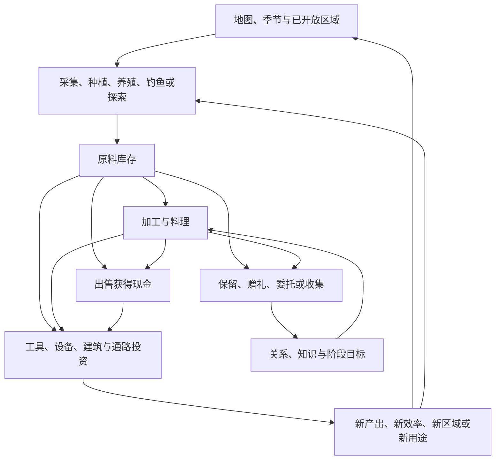

# 种田生活游戏的资源、料理与建造框架调研

> **资料范围（2026-10-05 清理）**：当前玩法、数值、操作与分期统一以 [玩法方案 v2](gameplay-plan-v2-2026-10-02.md) 为准。仅保留竞品机制、来源与历史假设；旧本地化优先和双地域实施顺序已由 v2 第17章取代。

- 日期：2026-09-11。
- 对象：《波西亚时光》《星露谷物语》《牧场物语：重聚矿石镇》《牧场物语：橄榄镇与希望的大地》。
- 问题：资源如何分类和获取，料理与加工如何分工，建造如何产生后续目标，各系统怎样形成持续经营。
- 本文的“框架”指玩法与经济结构，不是对这些游戏内部代码架构的还原。
- 状态：竞品机制调研与设计建议，不是已采纳的新规则，不修改当前玩法、存档或发布状态。当前实施顺序以 [玩法方案 v2](gameplay-plan-v2-2026-10-02.md) 第17章为准。
- 方法：读取官方产品介绍、Stardew Valley Wiki、Ushi No Tane/Fogu 专项攻略及媒体实玩指南。事实与设计解读分开；未进行本轮竞品实机测试或玩家研究。
- 版本边界：《星露谷》参考含 1.6 更新说明的资料；《重聚矿石镇》指现代重制版，不能混用 GBA 原版的实验料理规则；《橄榄镇》的加工器操作在更新中调整过，本文不冻结队列容量、机器总数等版本敏感数值。
- 资料限制：《波西亚》的官方总览、资源获取和委托等媒体资料可读取；烹饪锅、科研中心的专项 Wiki 未能读取。因此波西亚的机器与料理部分保留机制概括，不把具体配方数量、研究耗时或单菜收益写成已核实结论。来源索引见末尾。
- 补充比较：加入《我的世界》后的[道具系统对比](item-systems-comparison-2026-09-11.md)，覆盖物品分类、用途、装备与品质、消耗、放置和功能组合。

## 1. 四款游戏的主轴

**这些游戏以不同方式组织资源需求。资源的价值来自未来用途、取得成本和能力变化，不能只看售价。**

| 游戏 | 玩家主要身份与目标 | 资源组织方式 | 料理的主要角色 | 建造的主要角色 |
| --- | --- | --- | --- | --- |
| 波西亚时光 | 工坊主，完成订单与城镇工程 | 原材料、加工件、设备、装配成果构成生产链 | 支持生活、探索与社交；种植并非唯一生产主轴 | 提升工坊能力、交付工程、开放后续内容 |
| 重聚矿石镇 | 农场主，安排四季生产与小镇生活 | 季节作物、农牧产品、矿石和山野物产分工 | 恢复体力与疲劳、赠礼、食谱和献礼收集 | 扩大家庭与农牧经营能力，升级工具提高劳动效率 |
| 星露谷物语 | 自由选择专长的农场经营者 | 农业、采矿、钓鱼、采集相互提供材料和用途 | 恢复、行动增益、社交与收集 | 自动化、扩大经营、解除季节限制、改变交通与区域可达性 |
| 橄榄镇与希望的大地 | 开拓农场、建设小镇的经营者 | 采集原料经过加工器变成建材、商品和生活用品 | 生活生产的一部分，料理本身占用游戏内时间 | 修复设施和通路、扩大可经营区域、配置加工与自动化设施 |

这是玩法侧重的比较，并不表示波西亚没有农牧、牧场物语没有加工，或星露谷没有任务。[P1]、[M1]、[O1]、[S1]、[S2]

## 2. 通用框架：生产、分配与投资

图是本文对玩法关系的归纳，不是四款游戏共用的一套实现。

### 2.1 玩家管理的不只有背包里的物品

| 要素 | 在经营中的作用 | 典型取舍 |
| --- | --- | --- |
| 现金 | 买种子、饲料、材料、服务和升级 | 立即卖掉回笼资金，还是保留用于下一项投资 |
| 原材料 | 食材、木石、矿物、纤维、农牧产品 | 同一库存分给订单、设备、料理或未来季节 |
| 中间产品 | 金属锭、木板、布料等加工件 | 先占用产能备货，还是等待具体目标再生产 |
| 成品与消耗品 | 商品、料理、礼物、装备、工程构件 | 换钱、自己使用、交付或表达偏好 |
| 知识和能力 | 食谱、图纸、技能、工具等级、区域权限 | 材料齐了也可能还缺生产方法或可达地点 |
| 时间、体力和产能 | 游戏内一天、劳动预算、田格、机器数量和加工时间 | 今天种多少、去哪里、机器先做哪一批 |

知识和产能不一定以“资源币”显示，却决定玩家能如何利用库存。不能把金币理解为对其他一切资源的无条件替代。

### 2.2 资源来源通常同时包含稳定性和差异

基础物资有可学习、可重复的来源：树木、矿层、农田、饲养设施、商店。特色物资则可能受季节、地点、天气、时间、工具或探索进度限制。稀有掉落和收集物提供惊喜，但不应把所有基础经营都压在随机掉落上。

这类游戏的主体经营节奏使用**游戏内日历**。睡觉可以推进一天，换季随游戏进度发生。它们的“等几天”通常不能直接解释为联网产品的“现实几天后再来”。将本项目现有分钟级成长换成现实日门槛，需要另外论证。

## 3. 波西亚时光：由工程反推生产

### 3.1 资源与来源

| 资源组 | 获取方式 | 主要流向 |
| --- | --- | --- |
| 木材和植物类原料 | 拾取、砍伐、采集；修复伐木场后的付费配送 | 工坊制造、设备和工程、部分燃料需求 |
| 石料和矿物 | 野外采掘、废弃遗迹挖掘 | 工具、加工材料、设备和装配 |
| 遗迹零件与旧世界物品 | 遗迹扫描、挖掘、宝箱和探索 | 机器、工程、遗物收集与相关进度 |
| 食材与农牧产品 | 种植箱、养殖、钓鱼、采集和购买 | 料理、日常需求、出售和社交 |
| 金币 Gols | 工坊委托、任务、出售产品 | 扩建、升级、商店与委托采集服务 |

官方把“恢复工坊、采集和制造、完成日常委托、帮助重建城镇”放在核心承诺中。农牧是可经营的分支，不是所有进度都必须从田里开始。[P1]

### 3.2 加工与建造的关系

可以用下面的结构概括它的制造玩法；箭头表示系统关系，不是某项工程的完整配方：

`木石、矿物、遗迹零件 -> 熔炼/切割等加工 -> 金属锭、板材和零件 -> 装配设备或工程物 -> 自用、交付、建设`

工作台、生产机器和组装台承担不同层次的制作。图纸、设备等级、材料和加工时间共同限制可接手的工程；科研与图纸获取是知识成长的一部分。这里不列未经本轮专项核对的研究盘数、配方数量或耗时。

**设计解读：**玩家看见一个工程，会反向规划“缺什么零件、需要哪台机器、先加工哪种材料”。完成订单需要同时组织库存与生产，制作过程中也可以出门采集、探索和交往。扩大工坊的意义在于能更从容地处理下一批需求。

### 3.3 资源来源会随成长改变

GamesRadar 的实玩指南记录：完成伐木场相关任务后，可以付费取得木材等每日配送；民兵团也提供代为收集材料或探索遗迹的服务。这些服务让玩家用金币替代一部分熟悉的采集劳动。[P2]

这是一个重要的成长形式：早期亲自寻找和取得材料，后期把时间留给新目标。配送仍有成本，不能等同于无条件、无限量的免费材料。

### 3.4 料理、订单和生活

波西亚保留种植、食物制作、钓鱼、居民关系与节庆。料理通常承担角色恢复、行动支持和社交用途；它与恢复工坊的制造主线并行。本文未取得专项料理表，不给出“所有菜都增值”、某菜恢复比例或逐道菜配方等结论。

工坊委托提供重复需求，城镇工程提供更长的阶段目标，居民请求与生活活动提供关系反馈。部分委托有期限，因此玩家需要比较手头资源与可用能力再接取。家具有角色属性收益并受住宅内的属性上限约束，也使表达性物品具有额外用途。[P1]、[P2]

**可借鉴点：**把工程、生产能力和新的资源取得方式连接起来。对本项目而言，复制大量熔炉和加工器之前，先验证“一项设施是否改变了后面两轮生产”。

## 4. 重聚矿石镇：由季节和劳动组织生活

### 4.1 资源与来源

| 资源组 | 获取方式 | 与其他系统的关系 |
| --- | --- | --- |
| 季节作物 | 商店购种、播种、浇水、按生长周期收获 | 出货现金、料理、礼物、收集 |
| 农牧产品 | 持续饲养和照料动物 | 可重复收入、料理和部分加工品 |
| 山野食材与鱼 | 季节采集、钓鱼 | 早期补充、料理材料、礼物和收集 |
| 木材与石材 | 清理农场和野外资源 | 房屋与农牧设施升级 |
| 矿石 | 矿洞中破石取得，不同深度和条件对应不同物品 | 主要服务工具升级等用途，许多普通矿石直接售价较低 |

这版农场有明确边界和现成的房屋、畜舍、鸡舍位置。春夏秋可以种季节作物，正常规则下冬季没有可生长的露天作物。一包普通作物种子覆盖 3×3 格，玩家需要考虑播种面积与每日照料负担。作物品质与田地等级有关，不能套用星露谷的品质计算。[M2]、[M3]

### 4.2 成长不以装配工程为中心

工具升级需要使用经验、矿石和钱，由铁匠完成。升级后的工具可以扩大作用范围或更高效地处理障碍；房屋升级开放厨房等生活能力。[M4]、[M5]

典型关系是：

`采矿得到矿石 + 日常劳动积累工具经验 + 农牧收入 -> 升级工具 -> 同一天可更高效照料或清地 -> 安排更多农牧、采集与社交`

这里存在加工品，但不是波西亚那样由多层装配件主导的制造结构。游戏也没有要求所有玩家沿一条固定主线完成工程清单；复兴农场、居民交往和个人目标构成主要生活框架。[M1]

### 4.3 料理是关系和知识的连接点

房屋首次扩建带来厨房，实际做菜还需要对应厨具和已学会的食谱。食谱可来自电视、居民友谊、料理课程、特定探索发现，以及反复使用食材产生的“灵感”。[M5]

料理用途包括恢复体力与疲劳、赠礼、女神料理收集，以及卖给黄。它不只是在出货价格上加一个系数。高级食材也不必然提高成菜的恢复量和卖价；在这版中，高品质材料还会影响灵感食谱的发现进度。[M5]

**版本差异尤其值得注意：**现代《重聚矿石镇》需要先知道食谱，不能照搬 GBA 原作“随意组合材料试做、可能失败”的描述。[M5]

**可借鉴点：**NPC 可以是知识来源和共同生活的对象。一次互动带来一个实际会用的新食谱，能比单独增加关系点更自然地连接下一轮生产。是否给本项目增加这种能力仍需单独设计，现有故事文本提到食谱，不等于已经解锁了新配方。

## 5. 星露谷物语：多条生产线相互支持

### 5.1 资源获取是一张交叉网络

| 路径 | 主要资源 | 进入哪些后续系统 |
| --- | --- | --- |
| 农业 | 作物、花、果实 | 现金、加工、料理、赠礼、献祭、种子相关经营 |
| 畜牧 | 蛋、奶、毛等 | 加工商品、料理、献祭和收入 |
| 采集与树木 | 木材、硬木、树脂、季节野生物 | 建筑、机器、食物和收集 |
| 矿洞探索 | 矿石、煤、石料、宝石及其他探索物 | 金属锭、工具、洒水器、加工设备、战斗成长 |
| 钓鱼 | 不同地点、季节、天气和时间的鱼及相关产物 | 早期现金、料理、收集和任务 |
| 商店与阶段奖励 | 种子、材料、配方、特殊物品或设备 | 补充来源、能力开放和目标恢复 |

多数作物有季节限制，一些作物可重复收获或跨多个指定季节；不浇水通常会暂停当天生长，换季则可能使非当季作物枯萎。品质、种子成本、剩余季节天数和加工能力都影响生产安排。[S1]

### 5.2 料理与加工商品明确分工

**料理：**在厨房或满足条件后的野炊工具上进行，需要食谱与食材。菜肴提供生命/能量恢复，部分带速度、钓鱼、幸运等增益，也服务赠礼、任务和收集。多数料理的售价低于其原料总价值，不能把做菜理解为普遍最优的赚钱步骤。[S3]

**加工商品：**酒桶、罐头瓶、蛋黄酱机、奶酪压制机等把原料变成商品，通常需要游戏内加工时间。玩家投资设备并安排原料与产能，以获得经济回报。[S2]

由此，玩家会比较：保留高品质食材直接出售或赠礼，拿合适原料加工，还是做一份能支持探索的料理。品质规则按品类不同，不能假设原材料的品质总会原样传给成品。[S1]、[S2]、[S3]

### 5.3 建造的收益能反过来改变一天

一个具体例子是优质洒水器：耕种等级 6 解锁制作，材料为铁锭、金锭、精炼石英各 1，自动浇灌相邻 8 格。[S4]

`农耕经验 + 矿洞材料 -> 洒水器 -> 减少每日手动浇水 -> 留出时间和体力采矿、钓鱼或交往 -> 支持下一项投资`

这是跨系统的能力成长。矿石不仅能卖钱，还能用来改变农场的劳动安排。

酒桶又是另一类投资：制作需要耕种等级 8，以及木材、铜锭、铁锭和橡树树脂。一个设备把种植、采矿和树木产物接在一起；增加酒桶数量后，玩家可能相应调整种植量和加工安排。[S5]

农场建筑也有不同功能：畜舍和鸡舍升级开放不同动物和容量，部分高阶建筑带自动喂食；棚屋提供室内布置和设备空间。它们不是统一的“交材料后增加建设点数”。[S6]

### 5.4 社区中心让不同来源的物品同时有意义

社区中心的收集包会要求季节作物、鱼、采集物、加工品、矿洞产物或金币。阶段奖励包括恢复温室、修好矿车、修桥开放采石场、修好巴士前往沙漠。玩家可以提前看见长期用途，因此会为未来保留某个产物。[S7]

Joja 路线则以支付金币取得主要社区开发成果，提供不同的推进方式。二者展示了“广泛参与多系统”和“用现金集中推进”两类组织目标的方法，不能据此断言任何资源都可以无限购买替代。[S7]

**可借鉴点：**同一份材料应有几个清晰的用途，重要成果要改变劳动、产出或可去的地方。并不是每道配方都越长越好，关键在于配方连接了哪些原本独立的选择。

## 6. 橄榄镇：把采集、加工和开拓拉近

《橄榄镇》适合作为牧场物语内部的对照：它强化了加工器、自由布置、设施修复和农场区域开拓，不能拿它的结构代替整个系列。[O1]、[O2]

| 内容 | 处理方式 | 设计作用 |
| --- | --- | --- |
| 木石和植物等野外原料 | 清理农场、采集、砍伐、采矿 | 劳动同时带来可经营空间和制造投入 |
| 木材、金属等中间品 | 通过相应加工器转换 | 让机器、占地和加工安排成为经营问题 |
| 工具与生产能力 | 技能成长、材料和升级投入 | 开放新操作、加工配方、自动化能力 |
| 桥、旧设施和新区域 | 修复与开拓 | 更多空间、资源、矿洞和农牧机会 |
| 料理 | 厨房、食谱和食材；制作占用游戏内时间 | 做菜也进入当日时间安排 |
| 小镇请求 | 提交物资改善基础设施与小镇 | 把个人农场生产与小镇变化连接起来 |

典型循环是：`清理与采集 -> 加工建材 -> 修复设施/连接 -> 获得新空间和资源 -> 扩大生产`。例如木料需要经加工器转成可用木材；桥和障碍修复连接后续区域，农场技能还能带来洒水器等设施。[O1]、[O2]

**设计判断：**加工步骤有明确的能力后果时，玩家容易理解投资；如果机器很多，而操作主要是反复取放材料，可能把时间花在搬运和管理上。这是本项目应该验证的风险，本文没有把它描述为玩家群体已经证明的结论，也不引用首发版本的机器操作作为当前版本的固定事实。

## 7. 四类内容怎样形成持续经营

### 7.1 资源的好设计是多用途，但不必人人争同一种东西

同一物品可以有“现金、生产投资、料理、关系、收集”几类用途。这样玩家会保留库存并计划未来。另一面，过多配方都依赖同一瓶颈材料，会使所有路线收敛成同一次采集。

建议按一个阶段核对资源角色：基础材料支撑稳定经营；特色材料让某处地图有价值；中间品表达加工能力；少量关键物品标记阶段成长；消耗品提供持续使用需求。并非每种资源都要承担全部角色。

### 7.2 获取途径需要说明五件事

| 问题 | 设计时应说明的内容 |
| --- | --- |
| 在哪里取得 | 地点或生产设施，玩家能记住并主动前往 |
| 为什么现在能取得 | 季节、工具、配方、技能或通路条件 |
| 付出什么 | 金币、操作时间、田格、体力、加工时间或其他原料 |
| 如何再取得 | 再种植、再采集、进入新探索、稳定商店或付费服务 |
| 现在得不到怎么办 | 合理替代来源、先做另一目标、成本较高的采购；不同游戏的等待规则不同 |

“免费可领”仍可能占用跑图和操作时间；“可再生”也不等于没有稀缺性。不能只按金币成本比较两条路线。

### 7.3 料理需要先明确服务对象

可以用于自己恢复、探索增益、居民偏好、共同招待、食谱收集或经营收入。并非一款游戏要全部具备，也不是所有菜都要承担同样用途。

星露谷与矿石镇说明：食谱可以由关系和知识开放；吃掉、送掉和卖掉形成不同目的。食品加工商品则可以独立承担现金收益。如果本项目保留“料理主要用于招待”的定位，就应围绕招待对象和场景后果增加区别，而不是自动加入体力门票。

### 7.4 建造至少要区分五种回报

| 建造类型 | 回报 | 参考机制 |
| --- | --- | --- |
| 生产设施 | 新产品或更多产能 | 波西亚工坊设备、橄榄镇加工器 |
| 劳动效率 | 释放重复劳动时间 | 星露谷洒水器、矿石镇工具升级 |
| 空间与通路 | 新地点、新来源或更好的连接 | 星露谷巴士/矿车、橄榄镇区域修复 |
| 生活能力 | 新活动、动物或厨房 | 房屋和农牧建筑升级 |
| 表达与关系 | 展示、居住感和共同生活 | 家具、布置、居民互动；波西亚部分家具另有属性收益 |

评价一项建设时，应能回答：“建好后第一次怎么使用？下一轮因此改变什么？”装饰也可以是有效目标，但不能用装饰反馈证明生产循环已经变深。

### 7.5 长期目标并不只靠重复订单

订单提供明确需求；能力投资、季节轮换、不同经营专长、关系、收集和自由布置共同提供不同长度的目标。资源总量增加只是其中一部分。

这些游戏也有内容终点、重复劳动和某些收益更高的路线。已有系统结构不能证明玩家会无限游玩；借鉴到本项目后，更不能直接宣称留存、交易需求或 60–90 分钟自然会话已经成立。

## 8. 对当前项目的具体启示

### 8.1 已有基础与需要补证的地方

| 当前实现 | 从竞品看到的下一层问题 |
| --- | --- |
| 4 作物、3 材料、料理和手作；资源已有多用途 | 同一库存是否经常存在两个都有理由的去向 |
| 采集二选一、独立地点刷新和资源兑换 | 地点差异是否会改变路线计划；补给是否过量替代种植 |
| 工作台、三项设施和三处修复点 | 已建成果是否改变第二、第三轮，而不止领取一次收益 |
| 两道料理、委托、露台和小聚 | 不同料理是否有可解释的用途区别，而不只是单价不同 |
| 每人两段故事与固定轮换委托 | NPC 能否提供新的方法、地方线索和成果回应；重复交付后还有没有个人计划 |
| 真实地图展示和随包 3D 道路 | 不同地域是否有稳定的生产与连接差异，不能只更换名称或位置 |

现状依据：[旅程配置](../../assets/farm/data/journey.json)、[旅程结算](../../server/src/domain/journey.ts)、[地域经营 GDD](https://github.com/IndieMiao/sensen-godot/blob/25b7a8a6e0574f9b0c4c97f480238e98d5d9985c/docs/product/regional-growth-gdd-2026-09-10.md)。这是设计缺口的提问，不等于已发现玩家实际不喜欢某项机制。

### 8.2 最适合借鉴的组合

**以波西亚的“生产服务建设”为骨架，以星露谷的“跨系统投入换来新能力”为连接方式，保留牧场物语的居民与生活目标。** 这是本文的建议，不是对项目主线的新决策。

对现有双地域样板，已有 GDD 中的“本地特色原料 -> 本地构件 -> 育苗棚或跨域修路 -> 新种植/景观用途”与这个方向相容。应先把这条短链的第二、第三轮推演清楚，暂时不需要把畜牧、战斗、季节、工厂管理全部补齐。

建议用现有设计完成以下核对，而不是直接增加系统：

1. **每地域一条能说清的生产链。** 说明特色原料为何在这里取得、构件如何加工、能投入什么能力；新特色原料保持独立 ID，避免把旧免费芦苇库存重新解释为新交易原料。
2. **两项投资改变不同事情。** 育苗棚增加留种选择，修路增加来源和连接；观察玩家是否真的调整田格、库存分配或下一条路线。
3. **基础经营与新能力物资分别算账。** 基础食材和料理维持现金；新构件服务能力与交换。把免费补给、直接出售和无对手替代路径一起纳入，不凭空增加循环收益。
4. **为料理确定一个近期用途。** 样板可以先复用现有料理和招待，不自动增加新菜。后续如需扩展，先证明某道菜为何会被自发保留或再次制作。
5. **让 NPC 的交付后果可辨认。** 一次性故事负责认识与阶段回应，重复请求负责稳定需求；只有实际开放新行为时，才把对白中的“教会了什么”写成能力解锁。
6. **验证有限内容内的重复选择。** 完成首项投资后，让玩家自己选择接下来的目标，记录理由、物资去向与是否使用成果。不能用任务数量替代这个证据。

### 8.3 借鉴时必须保留的差异

- 单机游戏的季节和睡觉推进不能直接换成现实日等待。本项目的时间结构已经不同。
- 这些竞品主要通过 NPC 商店、个人生产和既定奖励维持经济。它们的资源循环不能证明本项目真人异步市场一定有足够供需；双账号交易与低供给恢复仍需独立验证。
- 新菜、机器、资源品质和动物都会增加制作、界面与数值工作。只有某项玩家选择需要它们时，再按玩法方案 v2 第17章判断所属阶段。
- 固定地图同样可以形成很强的空间记忆。稳定地点、新通路与有区别的产物，比每次随机生成更容易支持有目的的路线安排；地域内容稳定性应继续保留。

## 9. 可复用的策划检查表

未来新增一项资源、配方或建筑时，可以在同一行记录这些信息：

| 字段 | 要回答的问题 |
| --- | --- |
| 来源与开放条件 | 玩家在哪里、具备什么能力后取得 |
| 可重复取得规则 | 按什么事件再生产或补充 |
| 投入与占用 | 钱、材料、操作、田格、机器和时间 |
| 当前主要用途 | 用于卖钱、消耗、投资、关系、收集或表达 |
| 本轮另一种用途 | 为什么有人会暂缓这项消耗 |
| 建成或使用后的新行为 | 下一次实际可以做什么 |
| 第二轮去向 | 没有首通奖励后，这份资源是否还有目标 |
| 失败与恢复 | 缺钱、满地、缺货或改主意后如何继续 |
| 证据状态 | 配置实现、操作测试、玩家选择分别记载 |

## 10. 来源与核对范围

以下来源在本轮成功读取；第三方攻略不是开发者设计说明。文中的动机解释与项目建议属于分析，不能反向归因于开发者，也不构成玩家验证。

| 编号 | 来源 | 本文采用的内容 |
| --- | --- | --- |
| P1 | [My Time at Portia 官方 Steam 页面][P1] | 工坊、采集制造、委托、城镇建设、农牧、探索和家具属性等产品框架 |
| P2 | [GamesRadar：11 essential My Time at Portia tips][P2] | 伐木场付费配送、民兵团采集服务、订单期限、经济与住宅属性上限；不采用文中对不可玩城市的泛化描述 |
| M1 | [Ushi No Tane：重聚矿石镇总览][M1] | 重制版范围、无固定主线和个人农场目标 |
| M2 | [Ushi No Tane：矿石镇农场与作物][M2] | 农场边界、季节、3×3 种子、浇水、作物品质与田地升级 |
| M3 | [Ushi No Tane：泉边矿场][M3] | 矿层资源、普通矿石价值和工具用途 |
| M4 | [Ushi No Tane：工具升级][M4] | 经验、矿石、费用和工具效率 |
| M5 | [Ushi No Tane：料理基础][M5] | 厨房、厨具、食谱来源、灵感、恢复、赠礼、料理收集和出售 |
| O1 | [XSEED：橄榄镇官方页面][O1] | 加工材料、设施和通路修复、农场布置、自动化、小镇请求 |
| O2 | [Ushi No Tane：橄榄镇总览][O2] | 加工器、采集与开拓、技能、料理耗时；混合早期资料，不采用机器总数和队列容量作版本基准 |
| S1 | [Stardew Valley Wiki：Crops][S1] | 季节、生长、重复收获、品质和用途 |
| S2 | [Stardew Valley Wiki：Artisan Goods][S2] | 加工时间、机器、商品与品质例外 |
| S3 | [Stardew Valley Wiki：Cooking][S3] | 厨房、食谱、恢复与增益、料理盈利限制 |
| S4 | [Stardew Valley Wiki：Quality Sprinkler][S4] | 解锁等级、配方和浇灌能力 |
| S5 | [Stardew Valley Wiki：Keg][S5] | 酒桶解锁、跨系统材料和加工 |
| S6 | [Stardew Valley Wiki：Carpenter's Shop][S6] | 建筑、动物能力、自动喂食和布置 |
| S7 | [Stardew Valley Wiki：Bundles][S7] | 多来源收集、温室/交通/区域奖励与 Joja 替代路线 |

[P1]: https://store.steampowered.com/app/666140/My_Time_At_Portia/?l=english
[P2]: https://www.gamesradar.com/my-time-at-portia-tips/
[M1]: https://fogu.com/sos3/
[M2]: https://fogu.com/sos3/farm/
[M3]: https://fogu.com/sos3/activities/spring_mine.html
[M4]: https://fogu.com/sos3/farm/tools.html
[M5]: https://fogu.com/sos3/activities/cooking.html
[O1]: https://www.storyofseasons.com/PoOT/
[O2]: https://fogu.com/sos4/
[S1]: https://stardewvalleywiki.com/Crops
[S2]: https://stardewvalleywiki.com/Artisan_Goods
[S3]: https://stardewvalleywiki.com/Cooking
[S4]: https://stardewvalleywiki.com/Quality_Sprinkler
[S5]: https://stardewvalleywiki.com/Keg
[S6]: https://stardewvalleywiki.com/Carpenter%27s_Shop
[S7]: https://stardewvalleywiki.com/Bundles
