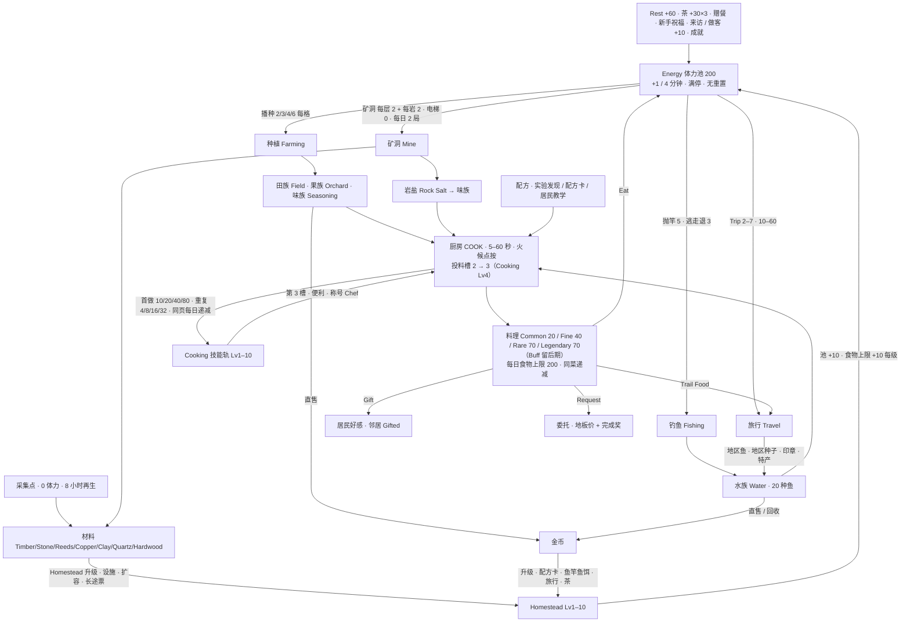
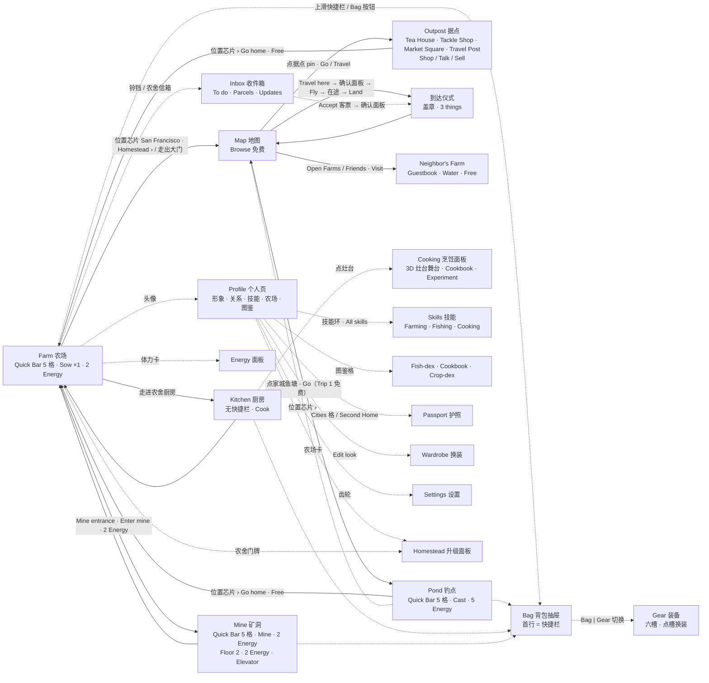

# Gensen 玩法方案 v2：体力驱动的种植·钓鱼·料理·探索循环（独立完整版）

- 日期：2026-10-02
- 界面设计（Figma，用户于 2026-10-07 定为游戏 UI 唯一依据，见 SGODOT-197 LOCK-28）：[Gensen (US) · 14 · UI semantic refactor](https://www.figma.com/design/OMLTC3yw3u2WDjOZhLnhaR/Gensen--US-?node-id=481-53)（R1 修订中，锁定项以 [SGODOT-197](https://plane.sensenjoy.cn/zili/browse/SGODOT-197/) 为准）。文件 key：`OMLTC3yw3u2WDjOZhLnhaR`，页面 node：`481:53`。后续界面进度核查与设计对照从此页进入。原型页 [Gensen (US) · Prototype](https://www.figma.com/design/OMLTC3yw3u2WDjOZhLnhaR/Gensen--US-?node-id=310-2955)（node `310:2955`，2026-10-05 确认）为 Archive，截至 2026-10-06。
- 状态：**2026-10-07（Figma 页面 14 UI 审阅 R1 · WP0，SGODOT-199）：铜镐按每块岩石 2 石料、派对房入口撤销并在 P2 社交恢复好友组队语音、新增 `Say thanks`、Cook All 不含 Legendary 且同页 ≤ 2 锅、界面编号以 §16.3 为准（改动清单 q(1)–q(5)）。** **2026-10-07（R1 · WP1a 样板，SGODOT-200）：离家场景的 Energy Card 把 Cook / Rest 瓦片灰显写 At home、材料进度格新增 count 计数态、三档尺寸按 360 基准落定（改动清单 q(6)–q(8)）。** **2026-10-07（R1 · WP0b，SGODOT-210；WP1a 验收）：料理只在农场驿站回收、柜台额度与卖出口径、食物上限部分回复、金币格含 40 地板、x/y 写法、§16.3 样例按 Fixture 统一、体力条不按百分比变色（超上限段浅绿）、柜台标题并入掌柜栏且集市改莓红 / 茶馆改玉青（改动清单 q(9)–q(13)）。** **2026-10-07（POI 与 WP2 / WP6 拍板）：三档房型为农舍室内、厨房为农舍灶台角、可进入的 POI 第一批规则、出锅稀有度光与色点同色、Toast 位置、WP6 首启与 Settings 各项、附录 B.9 补录（改动清单 q(14)–q(18)）。** **2026-10-07（K-1 / K-2）：农舍室内位置芯片写 `Shanghai · Farmhouse`、居民赠餐进背包不进保温柜、保温柜与 NPC-3 文案补录（改动清单 q(19)–q(21)）。** **2026-10-07（WP4 / WP5 拍板，SGODOT-210；用户全部按推荐）：设施一步建造、可移动不可拆；Plot Marks 留 P0 但不做一键执行，新增模态编辑例外；P0 的 Lv3 外观只换篱笆，布置模式归 P1；付费到达落城市概览，位置芯片第三段增补；教学卡时长同 Toast、快满写实得；驿站柜台与门禁物品；社交可见范围、屏蔽与举报；作物不可送礼、摆件直入仓库；P0 补长椅；样例与文案统一（改动清单 q(22)–q(31)）。** **2026-10-07（据点命名与 P0 据点口径，SGODOT-227 / 228）：茶馆用词池、其余据点「地名 + 类型」、取消首处用城市名、据点名 ≤ 24 字符、每簇标定新手塘；P0 驿站只卖咖啡、盖章台只作摆设、特产货架卖 1 件明信片、Old Kai 为居民并有 1 条委托；房号不进位置芯片；飘字动效；P0 的 Lv3 篱笆从门前一段补成整圈（改动清单 q(32)–q(35)）。** **2026-10-08（P0 覆盖审计口径收口）：P0 可钓 7 种鱼、模板跟点位不跟外形、上海新手塘 Reed Pond；首条鱼 50 XP、Cooking 升级不回体力；Cooking Lv1–6 便利进 P0；P0 料理 14 页定表；P0 农场 30 格、种子随身带、野香草是材料；Rest 的离开判定；料理回收价只乘一次 0.8（改动清单 q(36)–q(42)）。** **2026-10-08（P0 七日账本复跑 V1，评审后修订）：体力账在 ±20% 内、30 格够用（首周主约束是种子钱）、材料链是硬依赖；正餐前用池 P0 未达标、石英并入哪项与 Cooking Lv6 是否留 P0 待拍板；老树随 P1（改动清单 q(43)）。** **2026-10-08（主行动键第二行与 P0 矿洞 / 工作台 / 首会话口径）：键面第二行 ≤ 80 px、长原因进 toast；种子 / 鱼饵用完的键面；幽灵格只写名词；工作台产物与芦苇滩蚯蚓的去向、P0 有电梯、堆肥配方 Farming Lv3、满包按层灰显；TipCard 8 句、驿站棚挂委托板的 !；居民委托先付地板价；Plot Marks 从 demo 砍掉（改动清单 q(44)）。** **2026-10-08（旧卡对照收口）：包裹满时排队、七日节奏第 4–7 天的 P0 回退仪式、水面不响应点击、界面依据改为页面 14 + Screen Registry、Reed / Clay Bank 在农场边缘、手套效果句与 gathering spot（改动清单 q(45)）。** **2026-10-08 夜（各实现卡问出的口径）：调味架直接读仓库、Lv1 调味料跟人走；出锅待收与 Keep 链、Queue ×2、满包吃 Perfect、保温柜只在家用；新手期退料不出 Mystery Dish；P0 集市 / 渔具铺 / 茶馆 / 居民文案按 P0 内容改；采集、矿洞、Energy 卡、客票卡、包裹排队补文案（改动清单 q(46)）。** **2026-10-08（q(43) 三旋钮用户拍板）：P0 第 2 层石英并入岩盐、正餐前用池不作 P0 门槛、Cooking Lv6 排 P0 末位可砍（改动清单 q(47)）。** **2026-10-08（V2 回归与收尾口径）：Tea 格写已喝杯数、首会话生菜浇水、真实规则回放（钱包约 426）、满包进矿先拦、Cook Again 从灶台进、P0 集市不收东西、新手塘卡与地图标记的来源（改动清单 q(48)）。** **2026-10-08（阶段 3 产品输入）：P0 反馈触发表、门禁四件事卡内容表、命令生命周期与系统态（改动清单 q(49)）。** **2026-10-08（阶段 4 产品输入）：P0 收件箱三 Tab 的内容与空态、信箱占位交互、地图页 HUD 入口去留（改动清单 q(50)）。** **2026-10-08（阶段 5 文案核对清单）：新增 P0 英文文案逐字核对清单，附录 B.3 统一四处旧写法（改动清单 q(51)）。** **2026-10-08（demo 上线后看数与 P1 排序）：P0 观察日志 14 项指标的算法、异常线与先调什么；P1 开工顺序（改动清单 q(52)）。** **2026-10-08（真人试玩观察员手册）：P0 回访三问、延长段与第 4 天体力 80 的安排（改动清单 q(53)）。** **2026-10-08（经济基线）：复跑补上卖鱼与真实买卖打法，与 V2 对齐，作为 P1 调经济的起点（改动清单 q(54)）。** **2026-10-08（附录 B 清扫）：首做奖励条只放首做 XP、Mystery Dish 可送居民的卡面、挣脱卡写实退、今日次数统一写法与一批旧文案（改动清单 q(55)）。** **2026-10-08：Experiment 里再次投入失败过的组合，胶囊标题写 Tried before、Cook 行上方一行提示、不弹 Toast（改动清单 q(56)）。** **2026-10-08：挣脱卡不带按钮，去渔具铺 / 看图鉴的引导挪到 Fish-dex 剪影点开的门禁卡（改动清单 q(57)）。** **2026-10-08：首会话 Today 第一行跟着委托状态走（鱼够了写 Deliver，交付后才打勾，改动清单 q(58)）。** **2026-10-08（P1 第一步）：新增第 5 天之后的种田开发包——Homestead Lv3 起 40 格、卷心菜 / 玉米 / 黄瓜、4 页料理、洒水器按原规则落到紧凑农场（改动清单 q(59)）。** **2026-10-08：Experiment 背包格写成 5 列、至少 2 行、末行补齐（改动清单 q(60)）。** **2026-10-08：快捷栏按 v1.11 对齐——长按只浮起，拖进放置区钉住或移除，从背包拖入不自动钉住，详情卡 Pin 与栏满规则（改动清单 q(61)）。** **2026-10-08：世界提示与行动环只留图标——设施图标钮与名字条、NPC 只写名字、座位图标、行动环以屏幕中心为圆心且瓣上无字（改动清单 q(62)）；料理详情卡 Gift 文案（改动清单 q(63)）。** **2026-10-08：Experiment 锅满提示指向槽条的 ✕（改动清单 q(64)）。** **2026-10-08：材料来源一句——已开放的在前，未开放的用 from 接门槛（改动清单 q(65)）。** **2026-10-08：新手期退料出锅卡分两行写（改动清单 q(66)）。** **2026-10-08：按页开锅做所选页，自由投料才按优先级匹配（改动清单 q(67)）。** **2026-10-08：委托详情的交付说明句与交付地点（集市板写 any Shanghai market，改动清单 q(68)）。** **2026-10-08：升级横幅按 SKILL-3 统一副标题与配方卡，回归会话 Today 收获行写作物名、升级信息行跟随来源行（改动清单 q(69)）。** **2026-10-08：新号从没离开过农场时不能 Rest、长椅不显示倒计时（改动清单 q(70)）。** **2026-10-08：Cooking Lv5 Queue ×2 的入口与文案（看锅计时卡 `Queue next ›`、抽屉主按钮 `Queue`、`Queued 1`，改动清单 q(71)）。** **2026-10-09：地图据点 pin——P0 城市级不聚合，在线数为 0 只写名字（改动清单 q(72)）。** **2026-10-09：旧版换装间沿用，是否改版到 P3 再按工作量评估（用户拍板，改动清单 q(73)）。** **2026-10-09：SYS-MAINT / SYS-UPDATE 放 P0——维护卡与强制更新卡的触发、文案和前后端范围（用户拍板，改动清单 q(74)）。** **2026-10-09：P0 世界动作没有本地投影，网络失败只出 SYS-CMD-FAIL、不出退还 Toast（改动清单 q(75)）。** **2026-10-09：设施上委托与新内容也一物一枚，按 Deliverable > Request > New；棚上挂 ! 时新上架的商品照常在 Buy 页写 `◆ New for you`（改动清单 q(76)）。** **2026-10-09：挂上鱼饵的 Toast 沿用 `Worm Bait on the hook · used at the bite`，升级横幅 `Use bait` 不在水边时只挂上、留到下一竿（改动清单 q(77)）。** **2026-10-09：补 SYS-LOADING 行，新增换场景失败卡 `Couldn't get there` · `Retry` / `Go back`（改动清单 q(78)）。** **2026-10-09：铃铛角标计在列的包裹（背包满也计）；Updates 只记玩家不在场时发生的事，Homestead 升级与领取不进（改动清单 q(79)）。** **2026-10-09：地图上家与据点的 pin 卡字段与文案，就在这里时按钮写 `Back to <名字>`，家的名牌改 `Homestead`（改动清单 q(80)）。** **2026-10-09：收件箱 Parcels 页到期规则行定为一句固定文案 `If not claimed: …`（改动清单 q(81)）。** **2026-10-09：Queue ×2 轮转 toast 的三种边缘情况（未知菜、Mystery Dish、新手期退料）（改动清单 q(82)）。** **2026-10-09：鱼篓满时没有 Open Bag / Go home 次按钮，点鱼篓角标出 toast + `Open bag ›`（改动清单 q(83)）。** **2026-10-09：Queue 模式下锅上胶囊写 `Ready to queue`（改动清单 q(84)）。** **2026-10-09：Queue ×2 轮转时出锅的是新菜，toast 写 `New recipe! Herb Grilled Fish kept`，首做奖励改为飘字，仍不弹出锅卡（改动清单 q(85)）。** **2026-10-09：升级教学句只留在首次升级横幅的 Tip 行，P0 TipCard 改为 7 句（改动清单 q(86)）。** **2026-10-09：满包转进 Inbox 的提示卡多件写 `+1 more · Expires in 24h ›`，Inbox 已满写 `Inbox full · waiting` / `Claim a parcel first ›`（改动清单 q(87)）。** **2026-10-09：居民赠餐满包的提示卡第三行写 `From Pip · Expires in 9h 12m ›`（改动清单 q(88)）。** **2026-10-09：Queue ×2 主要用于 Fine 及以上的长锅，5 秒锅煮完后按 Queue 等同 Cook Again（改动清单 q(89)）。** **2026-10-09：打开排队抽屉不算离开，这一锅的火候环照常判（改动清单 q(90)）。** **2026-10-09：好感到 Kindred 后进度只写当前点数（改动清单 q(91)）。** **2026-10-09：Cookbook 页格退役「能做」绿勾，已知未做的页挂 `Try it`，首做奖励写在详情卡；锅下改为槽位卡，不写原料名与稀有度字，`Ready to cook` / `Ready to queue` 退役，不能开火的原因写在按钮上（用户定 ⑤ A'、⑨ A，改动清单 q(92)）。** **2026-10-09：不在家时 HOME-1 升级按钮灰显写 `At home`，不再写 `Go home to upgrade · Free`（改动清单 q(93)）。** **2026-10-09：文案核对一，9 处写法与实现对齐：出锅 `Dish ready`、`2 / 2 slots used` / `In pot`、长椅 `Used today`、赠餐 toast 不写体力、升级礼改药丸、`First times`、`Bonus +30`、P0 堆肥键、XP 减额写百分比（改动清单 q(94)）。** **2026-10-09：Today 等料行 `Fresh Fish Soup · when radishes are ready` 跟随萝卜行；汤要的鱼不再算进 `N fish · the stove is free`（改动清单 q(95)）。** **2026-10-09：长椅已用卡末行写倒计时 `Available again in 9h 12m`，不写 home-day、不写 tomorrow（改动清单 q(96)）。** **2026-10-09：倒计时分两种，秒级实时计时（灶台、烹饪、徽标胶囊、体力回复）写 m:ss，句子里的倒计时不足 1 小时写 `42m`（改动清单 q(97)）。** **2026-10-09：第一次变灰的解释卡排 P1；等料行作物熟了即消失、复数按 q(58)；柜台杯数只写 `Cups used 0/3`、用尽写 `Resets in`；`Lv2` 一律不带空格（改动清单 q(98)）。** **2026-10-09：标签槽自动挑料把别页点名的料与委托要交的料排最后，Today 做菜行带灶台默认页；新号驿站板保留期空槽不计入 Next request（改动清单 q(99)）。** **2026-10-09：个人页 Collections 的 Pages 数做出过的页，与 Cookbook 页签同一个数（改动清单 q(100)）。** **2026-10-09：技能升级不再回体力（原首次 +50、其后 +30），首会话最低 143、两顿饭都吃得下、结束 200/200（改动清单 q(101)）。** **2026-10-09：矿口、梯子、电梯改为点击触发，主行动键只留四种行动；扣体力的到了出小卡确认，免费的直接走；名字条 `The mine · Runs today 0/2` / `Floor 2 · 2 Energy` / 上行梯写目的地 / `Elevator`（改动清单 q(102)）。** **2026-10-09：图钉挂着 ✓ / ! / ◆ 时卡上写一行原因，走进挂 ! 的塘出一次提示，凑够时提示去交付；鱼塘的 ! 只给已接下的委托（改动清单 q(103)）。** **2026-10-09：已接下的鱼类委托也要玩家等级钓得上才在鱼塘挂 !（改动清单 q(104)）。** **2026-10-09：地图上的据点、家、鱼塘图钉和 POI 一样让位，选中、带标记与所在地的始终显示；不做聚合（改动清单 q(105)）。** **2026-10-09 晚（SGODOT-270，用户拍板）：P0 家城由上海改为旧金山（新手塘 Fern Pond、家一套 Mission / Oak / Union Square、洛杉矶时区 04:00 换日、地区内容仍随 P1；正文里 P0 场景的上海名称按 q(106) 对照表读，改动清单 q(106)）。** **2026-10-09 晚（SGODOT-271，用户手测提出）：Today 芯片改为图标 + 红点——面板里出现「现在就能做、还没看过」的行时亮，打开一次面板即灭；收件箱只亮铃铛、没接的委托与新地点只用地图标记，每件事只亮一处（改动清单 q(107)）。** **2026-10-10（SGODOT-285，安其拉出稿）：矿口 Express 有未完成局时与 New run 共用一句 `Current run will end · Runs today 1/2`，没有未完成局不加小字；外城回家落地飘 `Welcome home`；免费版再访只飘 `Welcome back`、位置芯片不写 `Day Pass`（改动清单 q(108)）。** **2026-10-10（SGODOT-288，钓鱼第二段）：地区鱼第 1 种须在 Pond 全天可钓，旧金山改红点鲑 + 大西洋鲑；天气晴 / 雨 / 风 50 / 30 / 20、当地 04:00 换日；亮片 `bait_lure` 每账号每日 10；鱼笼 id 改 `trap_fish`、放下不占背包，收笼文案与 Today 笼满行；River Run 点名虹鳟；旧金山 Clover Pond 在 P1 为 Coast（改动清单 q(109)）。** **2026-10-10（P1 开发中）：城市卡进度写已有 / 需要；矿洞说明 `Mine five floors. Slimes from Floor 3.`；Stamp Run 门槛 Homestead Lv2、签到 toast 写具体集市名；完成奖上限用完时卡上写 `0 coins · Bonus resets in …`；Homestead Lv3 后果 `Plots 40 · 10 more to till`；迷雾按叠灰层（改动清单 q(110)）。** **2026-10-10（SGODOT-284）：布置模式 Decorate 的文案——驿站 Decor 页 `Decor 12/24 · Goes to Farm Storage`、`Bought today · 9h 12m`、底栏 `Cancel · Rotate · Place`、`Outside your yard` / `Space taken`、Today 免费清单 `Place Flower Planter · in storage`（改动清单 q(111)）。** **2026-10-10（SGODOT-282）：Homestead 外观二选一 A 木作 / B 石作（暂定，待设计定稿），卡片 `Pick one · free to change later` / `Use Timber Porch`，HOME-1 加 `Looks` 段；Lv8 阶段名 `Kitchen Wing`；标签原料缺料按钮去掉 `Any`（改动清单 q(112)）。** **2026-10-10（q(111) 补充）：摆件上限满写 `Decor 24/24 · Homestead Lv3 adds 4`（当前 + 1 级），封顶 `Decor 56/56 · Store one to place this`；三键底栏原因移到小标；摆件特点句（≤ 14 字符，改动清单 q(113)）。** **2026-10-10（全球生成缺数据口径）：簇人口按成员合计；面积档与海岸 / 大河 / 高地先用手工表；掌柜名池每带 18 个；落点在水里今天接受、人工验收城市手工修正；荒野小木屋延后（改动清单 q(114)）。** **2026-10-10（HOME-1 外观行）：升级前写 `Porch · Timber or Stone` / `pick when you upgrade`，不再写 Look A / B；满级 `Max level · Homestead Master`（改动清单 q(115)）。** **2026-10-10（精英石英与同时倒地）：精英石英只在当日第 1 次击败时可能掉落（20%，不保底），第 2 次起飘字 `Quartz · first kill each day`；打死精英与被打倒同一次结算按打赢算（改动清单 q(116)）。** **2026-10-10（外观行右注）：HOME-1 外观行右注改为 `pick one`（改动清单 q(117)）。** **2026-10-10（紧凑农场种田后续）：多年生每株占 1 块田、主键 `Plant · 6 Energy`；温室是盖在 4 × 4 块田上的玻璃顶；堆肥箱放院子、`Compost today 2/5`、用完按钮 `Limit reached`；Seed Saver 飘字 `Seed Saver · +1 Radish Seeds`；Harvest All 收脚下一行；Sow Again 延后（改动清单 q(118)）。** **2026-10-10（渔情板）：段标题 `Ponds` / `Regional fish` / `Forecast`，掌柜一句按「今天倍率最高的鱼 + 时段 + 天气 + 鱼饵」拼（改动清单 q(119)）。** **2026-10-05 下午（06 批次 2 审图）：农场驿站无人值守（撤伙计 Bao）、新增个人页 Profile（PASS-3 并入）、背包与 Tools & Gear 合并为背包 Gear 页、删除满包二选一、包裹入口 = 铃铛 / 农舍信箱（改动清单 p(6)–p(9)）。** 2026-10-03 修订：操作模型（第 10/16 章及连带）——位移摇杆与安全框相机、主行动键与行动径向、消耗品快捷栏、Tools & Gear、顶栏重排与位置芯片、灶台触发的烹饪面板；连带第 0 / 1 / 3 / 4 / 5 / 6 / 7 / 8 / 9 / 12 / 13 / 14 / 17 / 18 章与附录 A / B。**2026-10-03 第三轮（与 Joey 会议后）：Cooking 技能轨（投料槽 2 → 3，Lv4 开第 3 槽）、矿井按层计费（每层 2、电梯免费、精英石英日限）、据点组六档生成 + Tea Counter 茶座柜台 + POI 降为纯视觉层**——连带第 0 / 1 / 2 / 3 / 4 / 5 / 6 / 7 / 8 / 9 / 10 / 11 / 13 / 14 / 15 / 16 / 17 / 18 章与附录 A / B。**2026-10-04 第四轮：烹饪面板第五版（3D 灶台 + Cookbook / Experiment）、Energy Card 只引导、钉住态、设施点击触发、据点拆成每岗位一处（集市广场为唯一室外）、柜台 + 背包同屏、掌柜先问候再 Trade**——见第 1.5 节改动清单 o(7)–o(10)、p(1)–p(3)。
- 性质：原型阶段的完整玩法策划文档。本文自包含：全部原则、规则、数值、物品、文案都在文内，不依赖任何其他文档。
- 术语（全文统一）：Energy = 体力；Homestead = 农场等级；Trip 1–7 = 旅行档（Local / Nearby / Regional / Long Haul / Continental / Intercontinental / Antipodal）；Resident = 角色 NPC；Keeper = 功能 NPC；Outpost = 据点（一处系统生成的 NPC 空间：茶馆 Tea House / 渔具铺 Tackle Shop / 集市广场 Market Square / 驿站 Travel Post / 小木屋 Trading Post，每岗位一处、各一枚地图 pin，按城市簇分档生成；除集市广场外全部室内）；Home Set = 家一套（每种据点离家最近的一处）；Cooking = 烹饪技能轨（与 Farming / Fishing 平行的第三条轨）；Neighbor = 其他玩家；Cookbook = 料理图鉴；Fish-dex = 鱼图鉴；Passport = 护照；稀有度一律 Common / Fine / Rare / Legendary（常见 / 上品 / 稀有 / 传说），鱼与料理共用同一套词。
- 文案约定：App 内用户可见文案一律英文（物品名 ≤ 18 字符），本文用中文写作并给出每件物品的 id、中文名、英文名。

---

# 第 0 章 一句话结论、阅读路径与阶段定位

## 0.1 一句话结论

**把体力做成全局唯一的产能燃料（池 200、每 4 分钟回 1 点、无重置时刻），让种植、钓鱼、矿洞三种劳作花体力（矿洞按层计费、电梯免费），让料理（5–60 秒的主动烹饪小游戏，本身也是第三条技能轨 Cooking，Lv4 开第 3 投料槽）、休息、茶座、居民、朋友把体力补回来；三条技能轨（Farming / Fishing / Cooking）用"等级差"而不是日封顶控制节奏，农场等级只花材料和金币，旅行按七档距离收体力、金币、门禁物品与旅途时间，NPC 拆成"岗位"与"角色"、据点按"每岗位一处空间"按城市分档生成、基础服务与地理脱钩、真实 POI 只做视觉层——这样每类玩家一天都有一件"做得完"的事，重度玩家一天最多撞墙一次，而北京到洛杉矶是一条要准备两三周的路。**

## 0.2 十分钟阅读路径

| 你是 | 读这些 | 大约几分钟 |
|---|---|---|
| 想先知道"改了什么、为什么" | 第 1 章 1.4（原方案 → v2 对照表）、1.5（按用户反馈逐条的改动清单） | 4 |
| 想看循环长什么样 | 第 2 章两张图 + 2.4 三类玩家的一天 | 2 |
| 要看操作方式（怎么走、怎么按、快捷栏放什么） | 第 10 章 10.1–10.3（位移与相机、主行动键、快捷栏）；第 16 章 16.0.1 操作模型速览 | 2 |
| 想核对数字 | 第 3 章 3.1 参数表与 3.5 日燃料推演；第 4 章 4.5 阈值表（三轨）；第 13 章 13.3 矿井按层计费；第 15 章 15.2 目标逐项结果 | 3 |
| 要开工 | 第 17 章分期（P0 可玩纵切的范围与出口标准）；第 16 章界面清单；第 18 章待拍板 | 1 |
| 要做美术与生图 | 第 16 章 16.1 风格约定、16.4 提示词骨架 | — |
| 要查某件东西的 id 或英文 | 附录 A、附录 B | — |

每章开头都有"本章结论"，只读各章 x.0 小节约 15 分钟可通读全局；每章末尾只保留一节"与原始方案的差异与理由"。

## 0.3 阶段定位

| 项 | 定位 |
|---|---|
| 当前阶段 | **原型阶段**。现有 App 只有一些拼凑的碎片功能，缺少底层机制；用户的判断是"除了钓鱼，其他部分暂时没有比较好的游戏过程"。本文的目标是重写底层玩法逻辑，不是在现状上调参 |
| 保留的三块 | ① **Avatar 换装**；② **钓鱼小游戏**（张力条：浮标下沉 → 提竿窗口 → 把鱼影压在绿带里收线到 100%，第 6 章只在它之上加鱼竿与鱼饵的参数修正）；③ **地图交互逻辑**（真实地图、无缝缩放与切城、POI 图标、水塘点位按 0.5° 网格下发）。这三块的表现与手感沿用，规则按本文重定 |
| 不考虑的事 | 已上线数据、旧存档、已上线功能的权益、已开发内容的复用。本文所有规则按"从零建一个世界"写 |
| 团队现实 | 一人主程 + AI 协作，美术外包或生成。"可行"的含义是：内容量与系统复杂度能按第 17 章分三期落地；每期都能单独验收 |
| 验收方式 | 每期出口 = 可按分钟复现的导演脚本 + 数值模拟器复跑 + 4–6 人"看不懂 / 做不了 / 不想做"三分法观察（第 14、15、17 章） |
| 本文如何用 | 第 3–16 章是规则与数值的唯一出处；任何改动先改对应章的表，再用第 15 章的模拟器复跑；所有数值允许 ±20% 微调并在该章注明 |

---

# 第 1 章 对原始方案的评估

本章先把原始方案（文字部分与画板两张图）完整复述一遍，使本文不依赖原件即可阅读；然后给出正反两面的评估；再逐节列出"原方案 → v2"的处理；最后按用户的逐条反馈列出本版的改动清单。

## 1.1 原始方案复述

### 1.1.1 文字部分（按原文顺序，逐节复述）

| 节 | 原文要点 |
|---|---|
| 技能等级 | 单项技能等级影响能否进行某项经营：钓鱼等级决定能否在某个渔场钓鱼（不满足可进入渔场但无法钓鱼）与能否使用某些鱼竿道具；种植等级决定能否种植某些种子；养殖等级决定能否从 NPC 处买到幼崽（养殖暂不做）；挖矿等级暂不做 |
| 农场等级 | 升级途径：消耗不同等级的材料；提升："密友助力" |
| NPC | 三个消耗 / 回收作用：解锁配方、回收食材 / 料理、出售某些材料 |
| 战斗 | 不存在等级门禁；只与道具 / 装备相关 |
| 背包 | 作为资源管理的重要门禁；初始资源有限；玩家需要在资源之间取舍；背包是付费内容之一 |
| 料理 | 游戏中重要的产物：提升体力；某些情况下的特殊作用；作为升级农场的材料 |
| 体力 | 各种行动的基础。总上限 100；每次种植行动 1 点、钓鱼 2 点、养殖 2 点、挖矿 1 点；每天（真实自然日）上午 6 点重置全部体力；各种食物可以恢复体力；药剂可暂时提升上限（暂不做） |
| 拜访城市 | 拜访 = 消耗体力到达另一座城；拜访完成后 1 日内可随时拜访且不消耗体力。与农场同城的任意 POI 不消耗体力；不同城市当天一次性消耗体力和金币，当天可随意在两城访问（除居民设置了不允许访问）；一次性体力 = 两城距离 ÷ 10 向下取整（例：800 公里 → 80 体力）；超过体力上限的城市无法访问，只能通过提升上限来拜访 |
| 体力上限 | 每升一级农场 +2 体力上限（需要测算到达地球最远城市所需的体力） |
| 多人玩法 | 原则：多人为社交属性带来增益与补充（需补齐）；例：收到邀请在一定时间内是否可以降低拜访成本 |
| 地图迷雾 | 初始除所在农场的城市外全部迷雾、看不到具体地图信息；初次拜访后解锁该城迷雾并获得城市成就；再次拜访仍需消耗体力 / 金币 / 特殊资源 |
| 交易、邮寄 | 为测试机制、管理数值与经济，暂不开放交易与玩家间邮寄 |
| 战斗、装备、建造 | 暂不开放战斗、装备、属性、战斗技能、附魔、合成；暂不开放建造 |

### 1.1.2 画板图一：核心游戏过程及消耗（上半张，一个闭环）

- 顶部一个节点「**体力**」，向下流入一行「游戏过程」：**种植、钓鱼、养殖、挖矿、战斗**五个过程，其中种植与钓鱼被框出，表示当前重点。
- 「游戏过程」向下流入一行「产出」：种植 → 农作物；钓鱼 → 鱼；养殖 → 食材；挖矿 → 矿石 / 材料；战斗 → 材料。
- 农作物、鱼、食材三条**实线**，矿石 / 材料与战斗材料两条**虚线**（表示次要 / 可选），全部汇入中心节点「**COOK**」；左侧另有一个「**配方**」节点也输入 COOK。
- COOK → 「**料理**」→ 回流到顶部「体力」。整张图的意思是一条主循环：**体力 → 劳作 → 产出 → 烹饪 → 料理 → 体力**。

### 1.1.3 画板图二：成长链（下半张，三段式）

- 三段：「**产出**」→「**消耗**」→「**更高级**」，再从「更高级」回到「产出」。
- 产出：农作物、鱼、矿、材料、食材。
- 消耗：**卖店、任务、兑换、抽**（抽卡 / 抽奖）。
- 更高级：**货币、门禁？、成就（旁注"收集量化"）、配方、地图？**。两个问号是原作者标出的未决项。

### 1.1.4 原始方案的三句话

1. 体力是所有劳作的燃料，料理把体力补回来，这是主循环。
2. 技能等级、农场等级、背包是三道门禁，NPC 是产出的去向，金币 / 成就 / 配方 / 地图是"更高级"。
3. 真实地图上的城市用体力与金币拜访，首访解锁迷雾与成就。

## 1.2 正面：方向上站得住的部分

| # | 判断 | 为什么站得住 |
|---|---|---|
| P1 | **"汇聚"是对碎片化的正确回答** | 画板上半张是第一张把全部产出汇入同一条回路的图：种、钓、矿的产物都有一个共同去向（COOK），料理再回到体力。此前每个子系统各自为战、产物没有去向；一条有去向的资源流是"底层机制"的最低定义 |
| P2 | **体力是唯一缺位的全局产能阀门** | 没有体力时，钓鱼可以无限抛竿、摊位可以无限收购，任何经济数字都写不出上界；"钓鱼 2 点 / 竿"是对症的第一刀。有了体力，"每日账户价值上界"第一次可以写成一行公式 |
| P3 | **料理从"卖差价"改为"有用途"** | 料理回体力而不是卖钱，消除了"吃"与"卖"两条出口叠加导致的账户价值失控；料理的价值在恢复、关系、收藏，不在差价 |
| P4 | **拜访 / 迷雾 / 城市成就是"空间距离感"的首次机制化** | 同城免费、异城付费、首访解锁、当日自由往返的骨架是对的；旅费在游戏内计算、不绑真实定位，天然避开位置类游戏最大的公平与合规坑 |
| P5 | **按活动分技能等级是被验证过的结构** | 两条技能轨各自成长、各自解锁，比一条总等级更能让"升级后今天不一样" |
| P6 | **NPC 三职能（解锁配方 / 回收 / 出售）是教科书式的来源—去向三角** | 它补上了经济里唯一缺失的持续性金币去向 |
| P7 | **战斗无等级门禁、只看装备** | 与"矿洞是材料源不是成长线"的定位一致，零额外复杂度 |
| P8 | **范围克制、先 NPC 后玩家市场** | 暂缓养殖、交易、邮寄、附魔、合成，符合一人主程的现实 |
| P9 | **拜访有成本之后，"邀请"与"帮工"第一次有玩法价值** | 别人替你花的是稀缺预算而不是时间，社交动作才有分量 |
| P10 | **背包作为取舍门禁的直觉正确** | 容量是休闲农场类里最有效的节奏杠杆，前提是容量真的会满 |
| P11 | **画板下半把"更高级"列成货币 / 门禁 / 成就 / 配方 / 地图五类** | 给每种奖励一个归宿；本文沿用这五类并各给落点 |

## 1.3 反面：按原文落地会坏在哪里

严重度口径：**critical** = 不补方案不成立或上线即坏；**major** = 第一周内被普通玩家发现并普遍利用或卡死；**minor** = 口径残留与表述问题。每条给出"修法落点"，具体规则见对应章。

### 1.3.1 Critical

| # | 问题 | 推演 | 修法落点 |
|---|---|---|---|
| C1 | **料理回体力没有上限 → 主循环是一台永动机** | "各种食物可以恢复体力"而烹饪不花钱、不花时间、无次数：任何回复 ≥ 做菜所花体力的料理都能无限循环；满田便宜作物第三天起每天能做几百份，体力在 72 小时内失去意义 | 每日食物上限 = 整条池（200 + 10 / 级）、同菜递减；第 3 章 3.4 |
| C2 | **"每次种植行动 1 点"没有计量单位** | 一条批量播种命令可以覆盖几十格；按命令计则 100 点 ≈ 几千格，按格 × 四步（翻、播、浇、收）计则 100 点只够 25 格，两种解读差 60–256 倍 | 按格、只在播种时扣、按档 2 / 3 / 4 / 6；翻地 / 浇水 / 收获永远 0；第 3 章 3.3 |
| C3 | **拜访公式线性 + 100 上限硬墙** | 北京–上海真实大圆距离 1,068 km → 106 体力 > 100，初始不可达（原文例子把距离写成 800 算错）；上海↔洛杉矶 10,434 km 需要农场 472 级才够上限；按公里计价让不同家城的可达世界相差十几倍（海岛与内陆稀疏地区的玩家 1,000 km 内几乎没有城市）；出远门当天农场停摆 | 七档金币 + 小额体力 + 门禁物品 + 旅途时间 + 兜底 + 再访折扣；第 11 章 |
| C4 | **没有"去另一座城的理由"** | 原文没有一处"城市 X 有而 Y 没有"；若每座城的鱼塘、鱼群、居民都一样，付费到达后什么都兑现不了 | 每城 2 种地区鱼、4 个气候带各 1 种地区作物与地区配方、每城印章、据点、角色 NPC；顺序必须是"内容 → 成本"；第 6、9、11 章 |
| C5 | **内容量撑不起门禁** | 几种鱼、几种作物、几道菜填不满 3 级门禁，更填不满 10 级 | 鱼 20 / 作物 20 / 料理 48 / 鱼竿 3 / 鱼饵 2 / 肥料 2 / 设施 3；第 5–7 章 |
| C6 | **每天 06:00 硬重置** | 05:59 用"反正要清零"的残余体力付旅费、06:00 满血出发，旅费为 0；新手在最兴奋的 30 分钟内用光池后被告知"明早六点再来"，是最强的离开信号；按设备时区判定可改时区无限重置，按服务端判定则跨城旅行"今天"归属不清；用不完清零制造错过恐惧 | 线性回复 +1 / 4 分钟、满停、无重置时刻；"每日"只用于计数、按家农场时区 04:00；第 3 章 3.2 |
| C7 | **首会话跑不完主循环** | 作物以小时计，第一次登录看不到收获；若鱼不能入菜，COOK 与"料理回体力"在首会话根本不出现——玩家只看到体力掉、看不到体力回 | 第一道菜是鱼料理（5 秒烤鲫鱼），16 分钟内闭合"钓 → 做 → 吃 → 回来"；第 7、14 章 |
| C8 | **社交层空白，却新加了三道墙** | "密友"没有定义；迷雾若遮住"人"，两万多座城摊薄后多数城市看起来没人；帮工若不扣任何人的体力就是互关十人十倍体力的后门；关闭交易与邮寄后玩家之间零互需 | 四级关系表、迷雾永远不遮人、客票固定计费、帮工扣自己的体力、受限赠礼、收件箱；第 12 章 |
| C9 | **"宴席"没有观众** | 把料理做成农场升级的材料，玩家不理解"宴席是什么、为什么要请客"，而且多数人在第一次升级之前就流失了 | 取消宴席；升级 = 材料 + 金币 + 技能和；第 7 章 7.8、第 8 章 |

### 1.3.2 Major

| # | 问题 | 修法落点 |
|---|---|---|
| M1 | 门禁放在"可进渔场不可钓"：付出已发生的现场被拒绝，是真实地图游戏最差的体验 | 任何渔场都可抛竿；门禁落在鱼种 + 鱼竿，等级不够的鱼"咬钩后挣脱"并点亮图鉴剪影；第 4、6 章 |
| M2 | 门禁全是"能 / 不能"，第 2–4 周没有"改变日常"的解锁；没有"还差多少、跨过去会怎样"；升级零仪式 | 两轨各 ≥ 3 级是改变日常的设施；每道门禁四件事同屏；每类事件一个 ≤ 3 秒时刻 + 一个永久痕迹；第 4 章 4.6、4.8 |
| M3 | 每点体力的价值在不同作物之间严重不等 → 全员种同一种作物、每天三分钟签到 | 播种体力按档 2 / 3 / 4 / 6，每点体力净金币配平到 1.0 ± 0.3；第 5 章 |
| M4 | 金币只有来源没有去向；"更高级：货币"把金币当成长是倒置 | 金币去向表吸收 28 天总收入 64–84%：农场升级、配方卡、扩容、旅行、门禁物品、鱼饵、茶；第 9 章 9.15 |
| M5 | 背包若"永远装不满"就是假门禁；付费扩容等于出售产能 | 25 格 + 堆叠 + 鱼篓 + Tools & Gear 装备槽（不占容量）+ 仓库 + 包裹，扩容只走 Homestead + 材料 + 金币；第 10 章 |
| M6 | NPC 无价格原则、无额度：无限回收、卖材料 + 0 成本烹饪 = 0 体力套利；跨城后每城 NPC 的委托 / 赠礼复刻 | 回收价 = 地板且账号级日额度；售价只卖消耗品与不可回收品；委托只收农场产出、不比自己卖更赚；第 9 章 9.10–9.13 |
| M7 | 农场等级"+2 体力上限"是看不见的成长；无级数、无每级消耗；材料一次性 | 10 级长梯子，每级材料 + 金币 + 技能和，每级 ≥ 1 项第一眼看得见的后果；第 8 章 |
| M8 | NPC 在真实地图上"住在哪、谁能用"没有回答：极地 / 沙漠 / 海岛没有 POI；上海天然比戈壁多；几百万 POI 对几十个手工角色 | 拆开功能 NPC 与角色 NPC；两层供给（农场驿站 / 系统据点，每岗位一处）+ POI 纯视觉层；第 9 章 9.1–9.4 |
| M9 | "密友助力"消耗谁的体力未定义 | 帮工按同一张体力表扣帮工自己的体力；第 12 章 12.3 |
| M10 | 全图迷雾与已有的地图行为（无缝缩放、自动切城、选城、朋友位置）相撞；遮信息反而削弱探索欲望；浏览与拜访未分离 | 软迷雾三态着色，只锁可交互性，永远不遮地名 / 气泡 / 人数 / 朋友；Browse 与 Travel 分离；第 11 章 11.7–11.8 |
| M11 | 再访永远收费，去过的地方不会"变近"；农场成长没有空间后果 | 再访 5 折、常客免票、第二故乡免费；第 11 章 11.5 |
| M12 | 城市成就只有"首访一枚"，无层级、无展示面；可被卫星城刷 | 每城三档 + 探索者四级 + 护照分页 + 印章；成就按 30 km 城市簇计、每日计数首访 ≤ 2；第 11 章 11.9 |
| M13 | 时间口径三处打架：真实自然日 06:00 / "1 日内" / 跨时区的"当天" | 单一日切 = 家农场时区 04:00，只管计数；日票 = 到达起滚动 24 小时；体力无重置时刻；第 3、11 章 |
| M14 | 没有验收口径 | 每期出口 = 导演脚本 + 模拟器 + 三分法观察；第 14、15、17 章 |

### 1.3.3 Minor

| # | 问题 | 修法 |
|---|---|---|
| m1 | 口径自相矛盾：养殖"暂不做"但体力表有养殖；挖矿等级"暂不做"但有挖矿体力；"升级消耗材料"本身就是建造却写"暂不开放建造" | 删养殖行与药剂；矿洞接体力不接等级；"只开放农场等级这一条建造线"，设施是技能解锁的产物 |
| m2 | 画板"抽""兑换"未定义；随机消耗与可推演的账本不相容 | 本版移除"抽"；"兑换"只以"异城特产按 2 : 1 换矿物"的形式存在（第 8、13 章） |
| m3 | "居民设置了不允许访问"混用 NPC 与玩家 | 固定术语：Resident = NPC（无访问开关），Neighbor = 玩家（农场有访问开关） |
| m4 | 无英文文案口径；负反馈直译成一堆孤立的 Locked | 每章一张英文文案表（附录 B 汇总）；负反馈必带下一步；按钮必带文字 |
| m5 | 金币成本没有公式；成就奖励若可量化会被刷 | 金币按档几何递增；Trip 1–2 首访只点亮不给首访礼 |

## 1.4 原方案 → v2 逐节对照表

| 原方案章节 | 原文要点 | v2 处理 | 为什么 | 落点 |
|---|---|---|---|---|
| 画板上半：体力 → 种植 / 钓鱼 / 养殖 / 挖矿 / 战斗 → 产出 → COOK → 料理 → 体力 | 五个过程汇入 COOK，料理回流体力 | **保留闭环骨架**；五个过程收敛为三个计费动作（播种 / 抛竿 / 进矿），养殖删除、战斗 0 体力；矿洞只以岩盐、采集只以野香草两种"调味"入菜，矿石与战斗材料不入菜；料理回流被食物上限封顶；回复渠道从一条扩到八条 | 养殖与挖矿等级原文"暂不做"却占体力表；无上限则永动机；只有料理一条回复渠道会让没饭吃的玩家无路可走 | 第 2、3、7 章 |
| 画板下半：产出 → 消耗（卖店 / 任务 / 兑换 / 抽）→ 更高级（货币 / 门禁 / 成就 / 配方 / 地图） | 三段式成长链 | **保留五类"更高级"并各给归宿**：货币 → 金币去向表；门禁 → 一张门禁表（技能等级 / 农场等级二选一）；成就 → 护照、印章、Fish-dex、Cookbook；配方 → 实验发现 + 配方卡 + 居民教学；地图 → Trip 1–7 与第二故乡。"抽"移除，"兑换"只留特产换矿物 | 原方案只有来源没有去向；随机消耗与可推演账本不相容 | 第 2、4、7、9、11 章 |
| 技能等级（钓鱼 / 种植 / 养殖 / 挖矿） | 等级决定能否做某项经营；钓鱼等级管渔场与鱼竿；种植等级管种子 | **三条轨 Farming / Fishing / Cooking 各 10 级**（Cooking 为第三轮加入：首做与重复烹饪给 XP，Lv4 开第 3 投料槽，其余等级为便利）；门禁落在鱼种 + 鱼竿（挣脱）与种子 / 设施 / 便利，3 槽料理页随 Cooking Lv4，任何渔场可抛竿；XP 来源表、阈值表、**等级差**规则、三类玩家到达天数全部给数；养殖 / 挖矿等级不做 | "可进渔场不可钓"是最差表达；纯"能 / 不能"撑不过第 2 周；原文没有 XP 与曲线 | 第 4 章、第 6 章 6.7、第 7 章 7.6 |
| 农场等级 | 消耗不同等级材料升级；提升"密友助力" | **Homestead 10 级**：每级 = 材料 + 金币 + 两轨等级之和 ≥ 2N − 1；每级至少一项第一眼看得见的后果（体力池 +10、食物上限 +10、开垦格、灶口、调味架储物、密友槽、扩容资格、长途票资格、外观；投料槽随 Cooking 不随 Homestead）；**不需要任何料理** | "+2 体力上限"不可见；材料一次性第二周归零；密友槽位正是"密友助力"的落点；宴席没有观众 | 第 8 章、第 12 章 12.1.2 |
| NPC：解锁配方 / 回收食材料理 / 出售某些材料 | 三个消耗 / 回收作用 | **拆成功能 NPC（岗位）与角色 NPC（12 个手工角色）**；两层供给 + 一层视觉：农场驿站（人人相同、0 旅行成本）/ 按城市簇六档生成的系统据点（每岗位一处：茶馆 / 渔具铺 / 集市广场 / 驿站，除集市广场外室内，全服一致，S 档与荒野每格 1 间小木屋保底）/ 真实 POI 为视觉层（点击弹名片；P2 起有场景模板的类别可进入，只做社交与氛围空间，q(15)）；三条价格原则：售价是天花板（**不卖材料**）、回收价是地板且有日额度、一次性去向只认金币 + 等级；配方主要靠实验发现，NPC 教学与配方卡只是捷径；远程"看免费、用到场" | 原方案没有回答"NPC 在哪、谁能用"，在真实地图上这先于"NPC 卖什么"；卖材料 + 0 体力烹饪 = 套利；无额度回收 = 无限预算 | 第 9 章 |
| 战斗：无等级门禁、只与装备相关 | — | **一致，保留**；战斗 0 体力 0 XP；只保留矿洞 3–5 层的 Combat 行动（主行动键 Attack，0 体力），只看武器与 HP（默认木剑 Attack 3，装在 Tools & Gear 的 Combat 槽） | — | 第 13 章 13.3 |
| 背包：资源管理门禁、初始有限、取舍、付费 | — | **真约束但不付费**：25 格起、5 列紧凑网格、7 个 Tab、堆叠鱼 10 / 料理 5 / 作物 50、鱼篓 = 背包空格、Tools & Gear（四工具槽 + 两饰品槽，不占容量）、农场仓库、收件箱包裹；扩容只走 Homestead + 材料 + 金币；底部快捷栏固定 5 格 + Bag，只放当前行动的消耗品 | 装不满的背包是假门禁；付费扩容等于出售产能并造成赠礼 / 帮工不对称 | 第 10 章 |
| 料理：提升体力 / 特殊作用 / 农场升级材料 | 三条用途 | **48 页 Cookbook，所有菜进图鉴、每道菜有稀有度**（由原料稀有度 × 原料族数派生），回复 20 / 40 / 70 / 70 + Buff；用途四标签 Eat / Gift / Request / Trail Food；烹饪是 5–60 秒的主动小游戏（投料 → 火候点按 → 出锅 → 图鉴点亮）；配方靠实验发现，失败出黑暗料理并送线索；**宴席取消** | "特殊作用"要有观众与场合；料理做门禁会让"吃还是留"成为负担；原型里的烹饪没有游戏过程 | 第 7 章 |
| 体力：上限 100；种植 1 / 钓鱼 2 / 养殖 2 / 挖矿 1；06:00 重置；食物回复；药剂提上限 | — | **池 200 + 10 / 级、+1 / 4 分钟线性、无重置**；播种按格按档 2 / 3 / 4 / 6、抛竿预扣 5 退 3、矿洞每层 2 + 2 / 岩（楼梯 / 电梯 0）；料理 20 / 40 / 70、食物上限 200 + 10 / 级；料理之外七条回复渠道各有日上限；养殖 / 药剂删 | 100 的池上一道菜只占一成多，吃不出"饱"；硬重置五个故障；回复总量抬到原来的 7 倍但每条封顶 | 第 3 章 |
| 拜访城市：同城免费；异城一次性体力 + 金币当天往返；体力 = km ÷ 10；超上限不可达 | — | **Trip 1–7 七档**：体力 0–60、金币 0–500、旅途时间 0–30 分钟同时递增；Trip 4 起印章前置、Trip 5 起 Travel Permit、Trip 6–7 Long-haul Ticket + Homestead Lv4 / Lv5；兜底：最近 3 城永远免费、最近 10 城永远 ≤ Trip 2；日票 24 小时滚动；再访 5 折、常客免票、第二故乡免费；无硬墙 | 见 C3；"北京→洛杉矶不该 30 体力 + 200 金币就到"——距离感要靠准备过程体现 | 第 11 章 |
| 体力上限：升级农场 +2 / 级（为够到远城） | — | 每级 +10 池 + 10 食物上限，且升级当场回满；Homestead Lv4 / Lv5 直接作为长途票与 Trip 7 的前置 | 任何替代公式封顶都 < 100，上限对门禁无效；把农场等级直接作为长途资格比用它推上限直观一个量级 | 第 3 章 3.1.3、第 11 章 11.3 |
| 多人玩法：为社交属性带来增益（需补齐）；邀请降低拜访成本 | 两行 | **四级关系表 + 权益矩阵 + 客票（该档体力一半、0 金币、免门禁）+ 帮工（扣自己的体力）+ 受限赠礼（Gifted 标记）+ 收件箱 + 主人激励三件套 + 密友同塘 XP × 1.2**；全部日上限进账本 | 社交层空白却加三道墙 | 第 12 章 |
| 地图迷雾：初始除家城全迷雾；首访解锁 + 城市成就；再访仍收费 | — | **软迷雾三态**（Unexplored / Explored / Second Home）：不遮城市名 / 气泡 / 人数 / 朋友 / 选城，只锁可交互性；表现在客户端、门禁在服务端；每城三档成就 + 探索者四级 + 护照分页 + 印章 | 与无缝缩放 / 选城页 / 朋友位置相撞；单枚成就无牵引力；再访永远收费与"去过的地方变近"矛盾 | 第 11 章 11.7–11.9 |
| 交易、邮寄：暂不开放 | 测试机制期 | **交易与邮寄仍不开放**；受限赠礼（互关每日 1 份、只限料理与鱼、Gifted 金币价值 0）+ 系统收件箱九类消息 | 玩家间零互需；礼物先让"料理 → 体力"这条边指向别人，不碰金币 | 第 12 章 12.4–12.5 |
| 战斗 / 装备 / 属性 / 附魔 / 合成：暂不开放 | — | 不做属性 / 附魔 / 合成；"装备"只有 Tools & Gear 的六个槽（锄 / 鱼竿 / 镐 / 武器 + Ring / Charm），木剑 Attack 3 默认自带，更高武器为矿洞掉落预留；矿洞 1–2 层进主循环并计体力（材料源），3–5 层是内容期 | 矿洞是材料源不是成长线；一行动一槽的工具是操作模型的一部分，不是成长线 | 第 10 章 10.5；第 13 章 |
| 建造：暂不开放 | — | **"只开放农场等级这一条建造线"**；洒水器 / 堆肥箱 / 温室是技能解锁的设施，工作台只做工具、火把、堆肥、摆件 | "升级消耗材料"本身就是建造；设施是"改变日常"的载体 | 第 5、8、13 章 |

## 1.5 按用户反馈逐条的改动清单

本版是按用户对初稿方向的逐条反馈重做的。下表按反馈的编号逐条写"用户说了什么、初稿是什么、本版改成了什么、落在哪"。

| 编号 | 用户反馈要点 | 初稿 | 本版 | 落点 |
|---|---|---|---|---|
| a | 用户问"旅行第 1 档的城市是什么"——初稿把旅行档与鱼的档位写成同一种缩写，混淆；30 体力 + 200 金币就能北京→洛杉矶，跨国跨洲门槛太低；超长途要有金币 / 体力之外的门禁物品 | 旅行七档与鱼四档共用同一套"T + 数字"缩写；北京→洛杉矶 = 最高档 30 体力 + 200 金币 | **命名统一**：鱼与料理用 Common / Fine / Rare / Legendary，旅行档用 Trip 1–7 + 英文名，全文不再出现"T + 数字"式缩写；旅行成本随新体力尺度放大为体力 0–60、金币 0–500、旅途时间 0–30 分钟；**Trip 5 起每次出发消耗 Travel Permit**（两个气候带的特产 + 100 金币制作，或 250 金币购买，需印章 ≥ 5）、**Trip 6–7 消耗 Long-haul Ticket**（许可 + 硬木 2 + 石英 2 + 150 金币，需 Homestead Lv4，Trip 7 另需 Lv5 与印章 ≥ 12）；长途有可取消、可离线、农场照常的旅途时间；北京→洛杉矶、上海→东京、上海→杭州三张完整算例 | 第 11 章 11.2、11.3、11.6 |
| b + e | 体力是燃料，回复过慢是沉重负反馈；"花 10 分钟做一道菜只回 10 点"没有吃饱的感觉；每日食物上限 40 + 同菜衰减对重度玩家与宣传期新手都不友好；要同时提高消耗与回复；要有料理之外的恢复渠道 | 池 100 + 2 / 级；+1 / 15 分钟；播种按档 1 / 1 / 2 / 3、抛竿 2 退 1；料理 8 / 15 / 25、食物上限 40 + 2 / 级；料理是唯一回复渠道 | **固定新尺度**：池 200（+10 / 级）、+1 / 4 分钟（约 360 / 日）、满停无重置；播种按格按档 2 / 3 / 4 / 6、地区种子 4、多年生种下 6 每收 2、抛竿 5 退 3（Lv1–3 每日前 10 次失败全退）、矿洞每层 2 + 2 / 岩、电梯 0（第一轮稿为一次性 10 / 局，第三轮改按层，见 o(5)）；料理 20 / 40 / 70（Legendary 也 70 + Buff），食物上限 200（+10 / 级），同菜第二份 50%、第三份 0；**七条料理之外的渠道**：回家休息 Rest +60 / 日、茶座 +30 × 3 杯（40 / 50 / 60 金币）、居民赠餐每日 1 份、新手祝福（7 天自然回复 ×1.5、食物上限 +100）、密友来访 +10 / 做客到达 +10、成就与首次事件一次性、活动接口；三类玩家日燃料全部重算：30 分钟玩家正餐前用池 60–77%、一顿正餐回 100 = 池的一半，重度一天最多撞墙 1 次 | 第 3 章全章；第 15 章 15.2 |
| c | 是否所有菜都进图鉴，给菜品打稀有度标签 | 家常 / 招牌 / 宴席三层，家常菜不进图鉴 | **采纳**：48 页全部进 Cookbook；每页稀有度由"最高原料稀有度 × 原料族数"派生（与鱼同一套词），决定回复档、烹饪时长、火候次数、首做 XP、收藏分；三层改为"稀有度 + 用途标签 Eat / Gift / Request / Trail Food" | 第 7 章 7.4、7.6、7.14 |
| d | 用体力统一限制 XP 太粗暴；像 WoW 那样，高等级后再钓低级鱼不再加 XP；种植类似 | 每日 XP 封顶（两轨各一个数） | **等级差规则**：每种鱼 / 作物有内容等级（= 解锁等级），d = 玩家等级 − 内容等级：d ≤ 1 全额，2 → 75%，3 → 50%，4 → 25%，≥ 5 灰色（5% 给 1 XP）；d 在付体力那一刻锁定；**取消每日 XP 封顶**，只留每轨每日 3,000 的防脚本上限（人类够不到）；阈值与到达天数全部重算：首会话 Fishing Lv2、30 分钟玩家两轨 20–25 天、重度 9 / 13 天、5 分钟玩家 84 / 56 天 | 第 4 章 4.2–4.5；第 15 章 |
| f | 参考《Spiritfarer》的烹饪；新手菜不可能等 5 分钟，应约 5 秒；烹饪是前期资源的收口，应是最有期待感的过程之一 | 烹饪 0 体力、占灶位真实时间 5–20 分钟、无互动 | **烹饪时长 5 / 15 / 30 / 60 秒**（按稀有度），时间内 1–2 次火候点按（命中提升品质 Good / Perfect，Perfect 多出 1 份；失败不罚）；**配方发现**：图鉴只给剪影、稀有度边框、槽位数与原料族图标，玩家自由投料实验，失败出黑暗料理 Mystery Dish（+5、进失败页、送线索）；单主料永不失败；**厨房随 Homestead 升级**（灶口 1 → 3、调味架、保温柜、大锅、名厨招牌）；烹饪写成完整的七步过程：进厨房 → 选灶 → 投料 → 开火 → 火候 → 出锅动画 → 吃 / 收 / 送 | 第 7 章 7.1–7.7、7.9 |
| g | 不理解宴席的功能；玩家在到达宴请前已流失 | 农场升级 = 材料 + 宴席料理 + 金币；升级 = 宴请三位居民 | **取消宴席**：Homestead 升级 = 材料 + 金币 + 两轨技能等级之和；"居民聚餐"只作可选社交事件留在路线图，不进核心循环 | 第 7 章 7.8；第 8 章 |
| h | 其余基本赞同 | — | 沿用初稿的内容量（作物 20、鱼 20）、门禁表、迷雾三态、护照结构、关系层级，并按新尺度重算全部数值 | 各章 |
| i | 方案完成后拆解主要界面与交互，用生图做一轮完整设计，每个功能 1–2 张图，审阅后再开发 | 无此章 | **新增第 16 章"界面与交互清单"**：7 个一级场景 + 11 个二级面板 + 操作控件四件套（摇杆 / 主行动键 / 切换键 / 快捷栏），共 71 行，每行写清图 1 / 图 2 画什么、必须出现的英文控件与文案、手势反馈、跳转；通用风格前缀与负面词；三个生图批次与审阅检查表 | 第 16 章 |
| j | NPC 与 POI 的关系：星露谷"NPC 跟玩家走"与真实地图"NPC 跟地点走"的根本差别；五条需求互相冲突；A–G 问题清单；需与 Joey 拍板五件事 | 三位居民各守一柜台，自动放在城市中心 | **完整复述问题并给出裁决**：拆开功能 NPC（岗位）与角色 NPC（12 个手工角色，可多城出现或巡回）；基础服务与地理脱钩——每个农场自带农场驿站 + 系统按 0.5° 网格生成 Market / Tackle Shop / Travel Post（全服一致、无 POI 也有、家格据点永久免费）；真实 POI 只承载额外内容（地标印章、特产柜、角色住址、事件）；远程"看免费、用到场"；任务模板全服一致、实例每人一份、好感每人一份、未解锁可见但锁定；大城市内容更丰富但基础服务与成长速度平等（天数差 ≤ 10%）；五件事标为"待 Joey 确认"——**第三轮修订**：据点改为按城市簇六档生成的据点组、POI 降为纯视觉层、五问 1 / 3 已定（见 o(6)）；**第四轮修订**：据点组拆散为每岗位一处据点、除集市广场外室内（见 p(1)） | 第 9 章 9.1–9.4；第 18 章 18.1 |
| k(1) | 移除所有 NPC 快捷委托跳转，改用世界内可视化提示 | 委托卡"前往"按钮直接传送 | **删除全部自动跳转**：地图层 POI / 据点光色标记（绿 ✓ / 金 ! / 青 ◆ / 紫 ★ / 灰 🔒）、场景层 NPC 头顶黄色 ! / ? / 淡红 ♥、农场内角标、底部 Today 面板三行；"Show on map"只移动相机，绝不移动玩家、不自动开面板、不自动起飞；首会话与七日引导全部按此重写 | 第 9 章 9.5；第 14 章 14.3 |
| k(2) | 烹饪应当是最有期待感的过程之一，当前几乎没有 | 同 f | 同 f：烹饪的七步、火候环、品质、出锅特效、首次翻页条 | 第 7 章 7.2 |
| k(3) | 背包布局更紧凑；按类型 / 全部查看与使用 | 24 格、无 Tab | 25 格起、5 列紧凑网格、7 个 Tab（All / Seeds / Fish / Produce / Dishes / Materials / Tackle）过滤同一份容量；点格浮出详情卡、长按钉住、拖入快捷栏；Tackle 页显示工具但不计容量 | 第 10 章 10.4 |
| k(4) | 统一的物品使用界面：参考我的世界的物品栏 / 快捷栏，为移动端竖屏重做；底部 4–6 格按场景自动切换候选；种植 / 钓鱼 / 挖矿 / 养殖共用 | 无快捷栏 | **Quick Bar**：底部固定 5 格 + Bag（不随农场等级变化），只放**当前行动的可消耗品**——Farming = 种子 / 肥料、Fishing = 鱼饵 / 亮片 / 鱼笼、Mining = 火把 / 炸药、Combat = 治疗药水；工具（锄 / 鱼竿 / 镐 / 武器）是装备、放在 Tools & Gear，不占格；厨房没有快捷栏；格内不写体力价，体力价写在右下主行动键上；选中物决定主行动键的动词与消耗，四种行动共用同一套手势 | 第 10 章 10.2、10.3 |
| l、m | 当前 App 体验失败、原型阶段、不考虑线上数据与复用；需要一份不依赖其他文档的新方案 | 文内引用了既有文档与实现 | 本文自包含：所有原则在文内自洽陈述；不写任何过渡安排；每章末尾只保留"与原始方案的差异与理由" | 第 0 章 0.3；全文 |
| n(1) | **操作模型（2026-10-03 第二轮反馈）**：位移与相机——用户逐条确认后的定稿 | 单指拖动平移相机；点格 / 手指划过一行格子连播 | 浮动虚拟摇杆：场景区任意处按下即出现在按下点（外圈 260 px / 内圈 120 px，半透明，抬手消失）；相机安全框跟随（屏幕中部宽 40% × 高 45%，角色碰框边才平移，停下 0.6 s 回中）；双指缩放（整座岛到约 3 格田宽）与双击回中保留；初始取景把"角色 + 当前空间的可互动物"框进中间 60% 高度 | 第 10 章 10.1 |
| n(2) | 操作模型：行动径向与主行动键 | 每个系统各一套选择器；点田格 / 点水面 / 点岩石触发动作 | 四种行动 Farming / Fishing / Mining / Combat；右下 176 px 主行动键写"动词 + 体力价"（Sow ×1 · 2 Energy / Cast · 5 Energy / Mine · 2 Energy / Attack），左上角 56 px 徽标显示当前工具，设施（灶台 / 柜台 / 长椅 / 居民）靠点击触发，主行动键不显示设施动词（2026-10-04 修订）；正上方 96 px 切换键扇出径向菜单，进场景自动预选，做不了的行动置灰写原因（Fishing · No water nearby）；体力不足时键面变琥珀写 Need N Energy，按下弹四件事卡；田格 / 水面 / 岩石不响应点击 | 第 10 章 10.2；第 3 章 3.3.1 |
| n(3) | 操作模型：快捷栏只放消耗品 | 快捷栏 4–6 格随农场等级变化，格里放工具并写体力价，每个工作场景一枚场景芯片 | 固定 5 格 + 右端 Bag；只放当前行动的可消耗品；格内只有图标 + 名字 + 数量，不写体力价、无场景芯片；未选行动时收起成把手，选了行动按候选表自动填充（已选中 → 上次用过 → 数量最多 → 最近获得）；长按钉住，每个行动各记各的；厨房等纯设施空间没有快捷栏 | 第 10 章 10.3；第 8 章 8.3 |
| n(4) | 操作模型：工具与饰品进 Tools & Gear | 工具架 Tool Rack（12 格）；行工具 Row Tool 是快捷栏道具（工作台配方 木材 4 + 铜矿石 2） | 头像面板 → Tools & Gear：四工具槽一行动一槽（锄 / 鱼竿 / 镐 / 武器）+ 两饰品槽（Ring / Charm），不占背包容量；角色默认自带四件初级工具；升级路径 Starter Hoe → Row Hoe（锄的等级，Farming Lv4，集市 240 金币，Sows 3 plots per action，一次 3 格仍扣 3 格体力）、Starter Rod → Reed Rod → Carbon Rod、Starter Pickaxe → Copper Pickaxe（工作台）、Wooden Sword · Attack 3；Outfit Tab 置灰 Later，时装走换装系统 | 第 10 章 10.5；第 4 章 4.6.1 |
| n(5) | 操作模型：顶栏重排与位置芯片"城市 · 空间" | HUD 有 Map 按钮、Passport 小书、F4 · F6 文字等级环、Day Pass 独立右上卡；场景内有塘名牌 | 第 1 行：头像 112 px（外圈双色技能环）+ 体力卡（⚡ 142/200 + 240 × 12 三段色条 + +1 in 2:41）+ 金币胶囊 + Inbox 96 px；第 2 行：Today 芯片 + 位置芯片 Shanghai · Homestead / Shanghai · Willow Pond / Tokyo · Sumida Pond · Day Pass 7h，点它进地图；Skills / Passport / Inbox / Tools & Gear / Settings 收进头像面板；塘名牌与 Map / Passport 按钮删除 | 第 10 章 10.6；第 16 章 16.1.3 |
| n(6) | 操作模型：烹饪由灶台触发（Recipes / Experiment） | 进厨房快捷栏切 Ingredients，先选食材再点投料槽 | 厨房无快捷栏，底部只有 Bag 与主行动键；点灶台打开 60% 高的烹饪面板，顶栏 Stove 1/3 · Cooking Lv2 · Empty（Cooking 等级常驻顶栏）；两个 Tab：Recipes（已知菜一键 Cook，缺料按钮写 Need Wild Herb ×1，列表底 N more to discover · try Experiment）/ Experiment（2–3 槽随 Cooking 等级 + 预览 ? · Fine · 15 s · Unknown dish + From your bag 背包格 + Cook · Free，黑暗料理回 5 体力）；火候、灶时、图鉴规则不变 | 第 7 章 7.2.7 |
| n(7) | 操作模型：背包 Tab 与容量 25 体系 | Tab 里有 Tools 页，工具占背包格；快捷栏格数是农场等级的后果 | Tab 改为 All / Seeds / Fish / Produce / Dishes / Materials / Tackle（Tackle 显示工具与渔具但不计容量，Equip 跳 Tools & Gear）；容量 25 → 30 / 35 / 40 三档各 +5 = 一行（Homestead Lv3 / 6 / 9，150 / 400 / 1,000 金币 + 材料）；抽屉升到 y ≈ 800，第一行就是快捷栏；点格详情卡、长按钉住、拖到快捷栏替换 | 第 10 章 10.4；第 8 章 8.3 |
| n(8) | 操作模型：取消项 | 拖拽连播、单指拖相机、Map 按钮、Passport 小书；"一次最多 64 格、客户端按剩余体力裁剪格子列表"的批量播种 | 全部取消：每按一次主行动键一条命令（Row Hoe 一条 3 格），服务端按格校验、不足整条拒绝；行动模式只是客户端状态，服务端只校验该动作在该位置是否合法；地图入口只有位置芯片；Passport 在头像面板 | 第 3 章 3.3.1；第 10 章 10.7 |
| o(1) | **第三轮（2026-10-03，与 Joey 会议后）**：烹饪等级 A+ 方案可行，但初期食材槽到 Lv10 开 3 个即可——多一个食材槽，组合设计呈几何数增加，初期设计压力太大 | 烹饪不是技能；第 3 投料槽随 Homestead Lv2 调味架；评估稿 A+ 方案到 Lv10 开 5 槽 | **Cooking 成为第三条 10 级技能轨**（阈值 0 / 30 / 100 / 220 / 400 / 650 / 950 / 1,350 / 1,700 / 2,350），与 Farming / Fishing 平行、不计入 Homestead 技能和；**本期投料槽只从 2 升到 3**：Lv1 2 槽、**Lv4 第 3 槽**（30 分钟玩家第 3–4 天，首周内）；其余等级全是便利（Cook Again、双线索、稳手 I / II、Queue ×2、快火、Cook All、Lucky Double）+ Lv10 称号 Chef；调味架只做储物；第 4 / 5 槽与 8 页 4–5 槽配方整体推到 P2（Cooking 等级上限扩展），Cookbook 本期维持 48 页 | 第 4 章 4.3.3、4.5、4.6.3；第 7 章 7.2.3、7.7、7.14.6；第 17 章 |
| o(2) | 首做 XP 给 Cooking | 首做料理 XP 按原料所在轨分给 Fishing / Farming（约 920 / 780） | **首做 XP 10 / 20 / 40 / 80 全部归 Cooking**（合计 1,700，占 Cooking 到 Lv10 所需的 72%）；Fishing 首竿 / 首提 +5 → +10 补首会话（第一条鱼 50 XP，第 6 竿 Lv2 不变）；Farming / Fishing 到达天数后移 1–3 天，Lv8–10 阈值 −5% 作旋钮待数值校验章复跑后拍板 | 第 4 章 4.3；第 7 章 7.6.2；第 14 章 14.2.2；第 15 章 15.3 |
| o(3) | 重复烹饪 XP 递减 | 重复烹饪 0 XP | 重复烹饪按菜品稀有度 4 / 8 / 16 / 32；**同一页每日第 1 锅 100%、第 2 锅 50%、第 3 锅起 0**；Good ×1.25 / Perfect ×1.5；按菜品稀有度（Common 1 / Fine 2 / Rare 4 / Legendary 6）走与两轨相同的等级差衰减；黑暗料理 0 XP；防脚本日上限 3,000 | 第 4 章 4.2.3、4.3.3；第 7 章 7.6.2 |
| o(4) | 跨气候带派生规则 OK | 稀有度只由"最高原料稀有度 × 族数"派生 | 3 槽页加第三输入"气候带数"：3 族 + ≥ 2 个气候带的地区特产 → Legendary（两条异带 Common 地区鱼 + 另一族亦成立），回复 70、基础 2 份；本期 48 页无一页改档，规则为旅行留动机 | 第 7 章 7.4.1 |
| o(5) | 矿井一律每层 2，同时电梯不消耗体力 | 进矿一次性 10 / 局 + 2 / 岩；电梯 10 | **每层层费 2**（1–5 层一律，进入时收，一局每层只收一次）+ 敲岩 2，一次性进矿费取消：A 局 28、B 局 56、打穿 58；**楼梯 / 电梯全程 0 体力，含 Express 直达第 5 层**；为封住零体力刷精英，第 5 层精英每日只掉一次石英；重开须本局清完第 2 层；日切 04:00 结束未完成局、岩石再生、层费重算；主行动键 Enter mine · 2 Energy / Floor 2 · 2 Energy / Elevator · Free / Floor 5 · Express · Free / New run · 2 Energy | 第 3 章 3.3.2；第 10 章 10.2.2；第 13 章 13.3 |
| o(6) | 茶座具体再解释 | 独立茶座建筑；据点按 0.5° 网格散布、同格合并为据点群；真实 POI 承载特产 / 角色 / 事件 / 印章 | **据点组 Outpost Group**：每组 = Market（含 **Tea Counter 茶座柜台**：Market 柜台一端的小窗口，Tea Host 站柜后，买即喝，端杯坐下是 2 秒动画，广场一张茶桌只是饮用位道具）+ Tackle Shop + Travel Post，三栋四岗位，不设独立茶座建筑；组数按城市簇人口六档 1–6（< 50 万 1 … > 1,500 万 6，与建成区面积档取大，上限 6），荒野 0.5° 格每格 1 组；同功能多实例名字与外观不同（组 1 用城市名、组 2+ 用行政区名或气候带词池）、功能一致、日额度按账号或账号 × 城市簇共享（茶 3 杯全球共用）；**真实 POI 降为纯视觉层**（点击只弹名片，光色标记留作运营活动接口），原挂 POI 的内容改挂据点组 / 鱼塘 / 城市簇；每城保底 ≥ 1 组据点 + ≥ 1 口鱼塘 | 第 9 章 9.3.2、9.3.3、9.12；第 11 章 11.8.5；第 16 章 NPC-1 / NPC-6 |
| o(7) | 驿站与背包同屏（2026-10-04 用户 Figma 定稿） | 驿站半屏抽屉 Buy / Sell / Stall Board 三 Tab，出售在 Sell Tab | 驿站抽屉上半 Buy / Stall Board 两 Tab、下半贴完整背包；出售只在背包详情卡 Pin / Sell / Sell All 上做，回收日额度条挂在背包标题下；正在买的种子在网格里高亮并标 In bag ×N（理由：买种子时必须看得见库存；少一个 Tab、少一套列表） | 第 16 章 FARM-6 行；第 9 章驿站、第 10 章背包详情卡动作表 |
| o(8) | 设施靠点击触发（2026-10-04 用户 Figma 定稿） | 靠近设施时主行动键变成 Cook / Shop / Rest · Free 等设施动词 | 主行动键只做四种行动；灶台、长椅、柜台、居民、工作台等设施一律点击触发，靠近时设施上方浮出指尖卡（Tap to cook / Rest · +60 Energy · once a day / Tap to shop）；纯设施空间（厨房、柜台）隐藏主行动键与切换键（理由：一个键只做一类事，休息与烹饪的触发方式一致） | 第 10 章 10.2 主行动键状态表；第 7 章烹饪入口；第 14 章首会话；第 16 章 FARM-7 / COOK-1 / NPC-1 行与组件约定 |
| o(9) | 体力卡统一且只引导（2026-10-04 用户审图） | 不足卡写 "Eat +40" 等预测收益，按钮直接执行；归零卡是另一张卡 | 不足与归零是同一张 Energy Card；只写系统确知的事实（3 dishes in bag / 1/3 today / Available）；瓦片只引导（Open bag / Show kitchen / Show on map / Show bench）从不替玩家执行；唯一按钮 Free to do now 关闭（理由：系统不可能预知玩家会吃哪道菜；替玩家花资源会失去信任；两种"不足"没必要两套 UI） | 第 3 章 3.7.2 / 3.7.3；第 16 章 BAR-3 / HUD-3 行 |
| o(10) | 烹饪面板第五版：配方与图鉴合并、灶与锅做成 3D（2026-10-04 用户审图 + Figma 标注 "COOK-2b-修改"） | Recipes 列表 + 独立全屏 Cookbook 书页；投料槽画在抽屉里、底部 "Cook · Free"；60% 抽屉塞下槽位 + 预览 + 食材横排 | 灶台与锅是场景里的 3D 物件、相机推近：原料飞进锅里可见，锅下槽条（带 ✕）+ 预览胶囊；抽屉只放两 Tab——**Cookbook**（= Recipes + 图鉴：筛选条 / 详情卡含 Ingredients 材料列 / 5 列页格，参考《Spiritfarer》菜谱页改竖排、与背包同版式）与 **Experiment**（整段是背包格，点格入锅）；按钮只写 `Cook`，去掉 Free；COOK-5 并入 COOK-2a（理由：平面槽位限制了烹饪表现力；两份"菜的列表"让玩家分不清去哪里做菜；Free 像在暗示别的东西要收费） | 第 7 章 7.2.7、7.6.1；第 16 章 COOK-2a / 2a-2 / 2b / 5 行、§16.4、§16.5 |
| p(1) | **第四轮（2026-10-04）**：NPC 的 Market 不对——尽可能利用地图，除特殊情况外每个 NPC 单独分配到不同的地图定位点而不是统一放进一个 Market；每个功能 NPC 单独一个空间、空间全部室内、场景多用农场那种斜俯视；拍板：落点允许参考 POI 密度（不认领店铺）、角色住进功能房间、接受 pin 密度并做聚合、只有集市例外为室外 | 据点组 Outpost Group：Market（含 Tea Counter）+ Tackle Shop + Travel Post 三栋围一个广场，每城 1–6 组；角色住广场 | **据点 Outpost = 每个功能岗位一处空间、一枚 pin**：茶馆 Tea House / 渔具铺 Tackle Shop / 驿站 Travel Post 为两面墙切开的室内单间 diorama，**集市广场 Market Square 是唯一的室外据点**（委托板、特产货架、周末市集在此）；各岗位各走各的落点规则（渔具铺贴鱼塘、驿站贴市中心与交通密度、茶馆跟建成区密度、集市广场居中），落点可参考 POI 类别密度但不认领、不命名任何真实店铺；每城茶馆 1–6 / 渔具铺 1–6 / 集市广场 1–3 / 驿站 1–2 ≈ 5–17 处，城市级缩放同类聚合；S 档与荒野格 1 间四岗位同室的 Trading Post 小木屋；茶座定为独立茶馆（茶桌 = 派对房入口）；角色按职业住进据点（Pip 每间驿站都在），Granny Wu / Ivo / Lena 三位自带空间；"家组"改"家一套 Home Set"；额度键与账本不变（理由：平面广场限制了画面与竖屏可读性；一座城只有几枚一样的 Market pin 浪费了真实地图；每个岗位有自己的房间才有记忆点；评估见 research/round4-npc-rooms） | 第 9 章 9.0 / 9.2 / 9.3.2 / 9.3.6 / 9.4 / 9.12；第 11 章 11.7–11.8；第 14 章第 3 天；第 16 章 NPC-1 / NPC-6 / MAP-1 / MAP-4；附录 A.9 |
| p(2) | Sell 能否统一成类似 FARM-6（2026-10-04 用户审图） | 集市与渔具铺柜台抽屉三 Tab Buy / Sell / Board，Sell Tab 里列可回收行各带 Sell 按钮 | 三处会收东西的柜台共用"柜台 + 背包同屏"抽屉：上半 Buy / Board + 掌柜一行 + ≤ 4 行商品，下半背包带该柜台的日额度条与 Sell here 筛选，卖 = 点格 → Sell / Sell All；Sell Tab 取消；不可卖写 Sell at home，满额写 Limit reached（理由：一套心智模型、买卖联动、UI 只做一个组件；代价是多堆连卖多一次点击与柜台区要限高 4 行） | 第 9 章 9.11 开头；第 16 章 NPC-2 / NPC-2-2 / NPC-3 / NPC-3-2 行与 §16.4 |
| p(3) | NPC 售卖界面要突出 NPC 形象，否则看起来太一样；点 NPC 不要直接弹商店，先 greeting 对话，再有选项打开交易 / 商店（取个名字）（2026-10-04 用户审图） | 点掌柜或柜台直接弹柜台抽屉；抽屉顶部只有一行小头像台词 | 点掌柜 → **问候卡**（掌柜大幅近景 + 岗位 · 名牌 + 带今日信息的一句问候 + 三个选项：**Trade**（统一名字，副文案 open the stall / see the rods / order tea / book a trip）/ 信息问句 / Just passing by）→ Trade 才开柜台抽屉；抽屉顶部改为**掌柜栏**（头像近景 + 名牌 + 随操作变化的气泡 + 岗位配色），标题写 Mei's Stall · Market Square；各房间指尖卡改写 "<名字> · Tap to talk"（理由：形象与一句话让四处柜台各有记忆点；多一步问候把"买东西"变成"见一个人"，也给信息类台词（渔情 / 票价 / 库存）一个自然的出口） | 第 9 章 9.4.2 掌柜交互表；第 10 章 10.2.2 设施点击规则、10.3.5、10.8；第 14 章 14.1.1；第 16 章 NPC-1 / NPC-G1 / NPC-2 / NPC-3 行、§16.1.3、§16.4、§16.5；附录 B.9 / B.10 |
| p(4) | NPC 之后都先要打招呼（2026-10-04 夜用户拍板） | 问候卡只用于四处据点掌柜；农场驿站伙计无名字，点驿站直接弹抽屉（`Tap to shop`） | **所有功能 NPC 先问候再 Trade，含农场驿站伙计**：伙计按家城气候带取名（上海 = `Stallhand · Bao`），点驿站棚或伙计 → 相机推到驿站 → 问候卡（`Trade · buy & sell` / `What's selling today?` / `Just passing by`）→ Trade 才开柜台 + 背包抽屉；抽屉顶部加掌柜栏（陶土色），标题 `Bao's Stall · Homestead`；`Tap to shop` 全文取消；角色 NPC 的对话条本身就是"先招呼再选项"，不另加问候卡（理由：一套交互、五处柜台都是"见一个人"；自家驿站每天多点一次的代价换来统一的心智与角色感） | 第 9 章 9.3.1 / 9.3.2 / 9.4.2 / 9.11；第 10 章 10.2.2 / 10.3.5 / 10.8；第 14 章；第 16 章 FARM-6 / NPC-G1 行、§16.4、§16.5；附录 B.9 / B.10 |
| p(5) | 关于材料和进度，信息能不能简洁一些，这个毕竟是一个多人游戏，玩家不是傻子（2026-10-04 夜用户审 HOME-1，附草图：icon 外套环状进度条，下面"名字 16/20"） | 农场等级面板每种材料一行：名字 · 已有 / 需要 · 进度条 · 来源一句；差的行写 Still missing N + 去哪拿 + 多久 + Show | **材料进度格**：图标外套环形进度，下面一行"名字 已有/需要"，4 列成组；齐了满绿环、差的琥珀环；来源不常驻，点格才弹；缺口只写在按钮上（Need 6 more Timber）；面板高度按内容收 ；**当晚追加**（用户："更新到 figma 的设计规范里面，之后只要是材料的进度，全部都用这种形式"）：材料进度格定为全局组件，三档 L / M / S，写进 Figma Section 00 组件约定（NEED-TILE 规格表）；NPC-7 旅行证件配方由芯片改为 M 号格，FARM-5 蓝图卡同口径（理由：数字本身就是信息，重复的提示句是噪音；一个组件管所有"已有 / 需要"） | 第 8 章 8.1.2 / 8.6.1；第 16 章 16.1.3、HOME-1 / FARM-5 / NPC-7 行、§16.4 |
| p(6) | 06 批次 2 审图（2026-10-05）：SKILL-2 里这个人是谁？是农场管家还是什么，为什么是一个 NPC 形象（用户选 A：撤掉人） | 农场驿站有伙计 `Stallhand · Bao`：点驿站棚或伙计 → 问候卡 → Trade → 驿站抽屉（顶部陶土色掌柜栏 + 气泡，标题 `Bao's Stall · Homestead`） | **农场驿站无人值守**：自助小摊（柜台一端一只诚实箱、梁上小铃），点驿站棚直接打开驿站抽屉（指尖卡 `Tap to shop`），标题 `Homestead Stall`，没有掌柜栏与问候卡；"先打招呼再交易"只适用于四处据点掌柜；升级礼 5 枚胡萝卜种子随升级横幅直接进背包（满包进包裹）；Homestead Lv8 只改驿站外观；NPC-G1-5 作废（理由：自家门口买种卖菜是最高频操作，多一次问候就是每次多点一下；"自家门口站着陌生店员"身份也说不清） | 9.2 / 9.4 / 9.4.2 / 9.11、5.2、5.8、8.3、10.2.2、14.2、16.3 FARM-6 / SKILL-2 / NPC-G1 / TUT-3、附录 A / B |
| p(7) | Collections 需要一个入口；地图首页的"我的"目前只有换装，需要一个真正的个人 profile 页：头像、名字、个人信息、系统设置入口（icon）、农场简要信息、图鉴等，其余该放什么由我检查（2026-10-05） | 点头像开半屏抽屉（Skills / Passport / Inbox / Tools & Gear / Settings 五个入口）；图鉴总览 PASS-3 是单独抽屉，入口散在 SKILL-1 / PASS-1 / 设置；地图底栏 Me 直达换装 | **个人页 Profile**（全屏，PROFILE-1 自己 / PROFILE-2 他人）：形象 + `Edit look`（换装）、名字 + 称号、家城 · 气候带、`Since`、可复制 ID、签名、`Edit`；关注 / 粉丝 / 互关 / 密友 `3/4`；三条技能环；农场卡（等级、正在发生的事、本周访客、开放状态）；图鉴四枚 M 号格（直达各图鉴，PASS-3 并入）；Medals / Guestbook / Second Home 三个小入口；右上齿轮 = Settings。入口：任何场景的 HUD 头像、地图底栏 `Me`；他人页从地图 / 房间里的玩家头像、朋友列表进入，按钮换成 Visit farm / Send a gift / Follow 与密友进度一行。体力、金币、背包、收件箱、Today 不进个人页（理由：个人页回答"我是谁、我攒下了什么"，同时就是别人看你的名片；日常操作已有各自常驻入口） | 10.6.2（重写）、10.6.4 Settings（新）、16.2、16.3 PROFILE-1 / PROFILE-2 / PASS-3 / KEEP-1、16.4、16.5、附录 A / B |
| p(8) | BAG-2 和 EQUIP-1 应当合并，给用户统一的查看和配置界面，因为之后还会获得其他的 gear（2026-10-05） | 背包 Tackle 页同时放渔具与工具（工具标 Equipped / Equip，Equip 跳 Tools & Gear）；Tools & Gear 是头像面板里的独立 70% 抽屉，Tools / Outfit（Later）两 Tab | **背包抽屉顶部 `Bag | Gear` 切换**：Gear 一侧 = Equipped 六槽（锄 / 鱼竿 / 镐 / 武器 / Ring / Charm），点槽 → 下方只列该槽已拥有的装备（Equipped / Equip / 灰显门槛与来源），不显示容量；Bag 一侧的 Tackle Tab 只剩鱼饵 / 亮片 / 鱼笼并计入容量；**没有独立的 Tools & Gear 面板，也没有 Outfit Tab**——外观只在个人页 `Edit look`（换装）；新 gear 类别以后按"一槽一行动"加槽组，入口不变；EQUIP-1 作废并入 BAG-2（理由：同一件装备不该有两个查看与装备的地方；功能装备和外观分开，外观归个人页） | 10.4.2 / 10.4.4、10.5（重写）、13.4、16.0.1、16.1.3、16.2、16.3 BAG-2 / EQUIP-1、16.4、附录 A / B |
| p(9) | 收件箱包裹的逻辑是什么；包裹在哪里访问，是点击邮箱么；修正"满包时另一堆进收件箱包裹"的问题（2026-10-05） | 包裹规则只写在 10.4.8 与 12.5；满包时被动物品既写"进收件箱包裹"又有 BAG-5-2 的 Keep which? 二选一（把背包里自己种的一堆挤进包裹，违反"包裹只收被动获得"） | **删除 Keep which?**：满包时任何被动获得（委托回包、图鉴 / 成就奖励、赠礼、首访礼、离线帮工收成）一律直接进包裹，铃铛角标 +1、铃铛下飘条 `Bag full · Perch ×7 sent to Inbox · 24h`，在家时农舍信箱头顶出 `Parcel` 小牌；**入口**：HUD 铃铛（任何场景）→ 收件箱 `Parcels` Tab；在家时点农舍信箱打开同一面板（不是第二个容器）；收件箱三 Tab `To do / Parcels / Updates`；Parcels 页顶部一条背包容量（Claim 需空格）、`Claim all · N slots`、一行到期规则 | 10.4.7 / 10.4.8、12.5、16.3 BAG-5 / SOC-4、16.4、附录 B |
| q(1) | **第五轮（2026-10-07，Figma 页面 14 UI 审阅 R1 · WP0，SGODOT-199；用户按推荐拍板）**：铜镐效果读法——第 8 / 13 / 15 章按"每块 2 石料"记账，第 3 / 10 / 16 章与附录 A 却写"一下敲两块、扣 4"（审阅 B2-11） | 效果句 `2 rocks per swing`；§3.3.2、§10.5.2、§10.7、MINE-1、附录 A 写一次 2 块扣 4；第 13 章产出账按每块 2 石料 | **读法 A：每块岩石 2 石料**。敲岩仍一次 1 块、2 体力 / 块，主行动键始终 `Mine · 2 Energy`；效果句改 `Starter Pickaxe · 1 Stone per rock` / `Copper Pickaxe · 2 Stone per rock`；铜镐与采集手套同属材料章的产量工具，"工具只省时间不省体力"只约束农具；第 13 / 15 章数字不变 | 第 3 章 3.3.2；第 10 章 10.5.2、10.7、10.8；第 13 章；第 16 章 MINE-1；附录 A / B |
| q(2) | 派对房 / 组队语音去留——§9.12 与 §16.3 把茶桌写成派对房入口，§12.9 / §17.5 又列为路线图；P0 卡 NPC-6 的 `Open party room ›` 没有去处；旧版 Journey 已上线组队语音（审阅 E-15） | 茶桌 `Sit · Party room` = 派对房 / 共做委托发起处；派对房（同城公共房间，语音与表情）在路线图 | **推迟据点语音房，P2 社交恢复旧版组队语音**：茶桌只做坐下（P1 起兼作共做委托发起处），指尖卡只写 `Sit`，删除全部派对房入口；P2 社交恢复旧版已上线的组队语音（每队 ≤ 8 人、默认静音、跨场景保留），入口在 Friends 面板（12.9.1）；MAP-8 保留 `Friends & Team`；据点公共语音房留在路线图（需要举报与审核体系，容量另评） | 第 3 章 3.3.2；第 9 章 9.3.2、9.4.2、9.12；第 12 章 12.9；第 16 章 NPC-1、NPC-6；第 17 章 17.4、17.5；第 18 章 18.1.1；附录 A |
| q(3) | 帮工小结、收礼、共做完成之后没有回应动作（审阅 C2-01） | 无；回应只能去对方农场留言板写预设短句 | **`Say thanks` 预设感谢语**：次级按钮，一键发系统预设的一句到对方 Updates（新消息类型 `inbox_thanks`，如 `Mia said thanks · Herb Grilled Fish`），按完变 `Thanked`；0 体力、0 奖励、不计密友互动、每件事每人 1 次、机器人不收不发；不做贴纸与回赠入口（回赠以后可再加） | 第 1 章 1.4；第 12 章 12.0、12.1.3、12.5、12.5.1；第 17 章 17.4；附录 A / B |
| q(4) | Cook All 是否排除 Legendary（审阅 B1-12） | 料够的已知菜按稀有度高 → 低排满所有空闲灶与队列 | **排除 Legendary**：Cook All 只排 Rare → Fine → Common，Legendary 只能单页 `Cook`（不替玩家用掉传说鱼与旅行带回的地区作物）；**同一页最多排 2 锅**（同页当天第 3 锅起 XP 0、第 3 份进食回复 0） | 第 4 章 4.6.3；第 7 章 7.2.4 |
| q(5) | Figma 页面 14 的卡号与 §16.3 错位：MAP-2…MAP-8 错一位、SOC-5 / SOC-6 对调（审阅 E-16 / G-07） | 两套编号并存 | **界面编号以 §16.3 为准**：Figma 卡片改名对齐本表，旧卡号作为别名写进 frame 名（如 `MAP-5 · Travel Confirm · paid (was MAP-4-PAID)`）；界面规则同步记入 SGODOT-197 | 第 16 章 16.3 |
| q(6) | **R1 · WP1a 样板（2026-10-07，SGODOT-200；用户审样板拍板）**：矿洞里的 Energy Card 怎么写 Cook / Rest——矿里既看不到灶台也看不到长椅（ENERGY-P0-1） | 3.7.2 只写农场场景：Cook · Show kitchen › / Rest · Show bench › | **离家场景（矿洞等）Cook 与 Rest 两块瓦片灰显，原因写 `At home`**；Eat · Open bag › 与 Tea · Show on map › 照常；仍是同一张卡、唯一按钮 Free to do now（理由：只写系统确知的事实，不替玩家做事，也不把相机带离当前场景） | 第 3 章 3.7.2；第 16 章 BAR-3 / HUD-3 行 |
| q(7) | 用量与收集计数（体力面板的 Meals 100/300、Tea 1/3、图鉴 12/20）是否也用材料进度格（审 HUD-2 样板） | p(5) 只定义"齐了满绿 / 差的琥珀"两态 | **材料进度格新增 count 计数态**：绿色部分弧（环 = 已用 ÷ 上限，或已收 ÷ 总数）、数字不变色；只用于用量与收集计数，"已有 / 需要"仍只有满绿与琥珀两态；HUD-2 体力面板用四枚 S 号 count 格（与 2026-10-04 已批 HUD-2 原稿一致）；SGODOT-197 LOCK-10 同步 | 第 16 章 16.1.3、HUD-2 行 |
| q(8) | 材料进度格三档在 360 竖屏基准上的尺寸（样板发现 4 列固定网格时 `Rock Salt 5/4` 与 `Coins 830/400` 相撞） | 只有 1080 画布的 L 156 / M 112 / S 72 | **360 基准：环 L 64 / M 48 / S 36，标签字 12 / 12 / 11**（低于 11 不可读）；成组排列用换行布局（横 10 / 纵 12），不用固定列宽网格；Figma 主件 `Gensen Refactor/NeedTile` 按 10% 一档表示进度（向下取整、封顶 100）；属于 token 层调整，结构不变 | 第 16 章 16.1.3 |
| q(9) | **R1 · WP0b 产品输入（2026-10-07，SGODOT-210 / SGODOT-203；用户拍板 WP3 全部按推荐）**：柜台卖出口径——料理在哪卖，§7.6.4 / §9.11 / §9.13 / §10.4.4 说法不一；农场驿站两份额度的额度条显示哪份；剩余额度不够卖整堆时怎么办；集市 × 0.8 是否取整（审阅 C1-01，WP3-D1 / D2 / D3 / D7） | §9.11 集市 Sell here = 本带特产与料理；§7.6.4 自助摊不收料理、集市角回收；§9.13 料理只在农场驿站回收；FARM-6 卖小萝卜画了额度条；集市只写 × 0.8 | **料理只在农场驿站回收**（⌊原料回收价之和 × 0.8⌋，额度 120），集市与渔具铺写 `Sell at home`；农场驿站额度条跟随选中物品类别（`Dish buy-back today 96/120` / `Material buy-back today 12/30`，作物与鱼写 `Crops & fish · no daily limit`）；剩余额度不够卖整堆时主按钮写实得、只卖额度内件数（`Sell 5 · 30 coins`）；集市地区特产 × 0.8 向下取整，与渔具铺同口径 | 第 7 章 7.6.4、7.12、7.18；第 9 章 9.11、9.13；第 10 章 10.4.4；第 16 章 FARM-6、NPC-2、NPC-3 |
| q(10) | 进食、金币格与 x/y 写法（审阅 B1-03、E-05、C2-14，WP3-D8 / D10 / D4） | 只写了食物上限用满后回 0；金币格分母 = 价格，40 地板只在按钮上体现，出现格满绿而按钮写缺口；x/y 有时是已用、有时是剩余 | **食物上限只剩一部分时只回剩余部分**（剩 20、菜 45 → `Eat · +20 Energy`，名义值照常计入）；**金币格分母 = 价格 + 40 地板**（`Coins 830/440`，点格来源 `Wallet floor · keep 40 coins`），格与按钮一致；**x/y 写法**：带条或环 = 已用（已有）/ 总数，不带条的事实行写剩余 `N left today`，带名词的 `Stock 8/10` 照旧 | 第 7 章 7.17.1；第 10 章 10.4.4；第 16 章 16.1.3、HOME-1 |
| q(11) | §16.3 样例自相矛盾（审阅 A-15、B2-17、C2-15，WP3-D5 / D6 / D9） | FARM-1 门牌 Lv2 写 142/200、画了苹果树与洒水器，而 SKILL-1 是 Farming Lv4；PROFILE-1 写 Lv3 与 3/4 密友；Mia 互关住上海又发杭州客票；NPC-3 额度 80、甘薯单价 5、Sell here 有 Smelt 与 Fisher's Stew；HOME-1 `Skills 6/5`；附录 B.9 `Quota reached` / `Not enough coins · 70 more`；首会话背包写 25 格空 | **样例按 WP3 Fixture 表统一**：常态玩家 Lin = Homestead Lv2、Farming Lv7（1,240 / 1,450）、Fishing Lv6、Cooking Lv3、142/210、230 coins、密友 2/3；Mia = 住 Hangzhou 的密友兼帮工，PROFILE-2 改看互关的 Ann（进度 `1 more interaction this week · 2/3`）；NPC-3 额度 60、Grass Carp 6 each、Sell here 只放本带地区作物与鱼；HOME-1 `Skills 13/5`；附录 B.9 改 `Limit reached · resets in 9h 12m`、`Need 70 more coins`；首会话开局背包 2/25、进塘 `Creel 0 · 24 free`；§9.13 料理回收示例的鲫鱼单价改为 3（结果不变） | 第 9 章 9.13；第 10 章 10.6.2、10.8；第 14 章 14.1.2、14.2；第 16 章 FARM-1、FARM-6、SKILL-1、HOME-1、NPC-3、PROFILE-1、PROFILE-2、SOC-1、SOC-2、SOC-4、SOC-5；附录 B.9、B.10、B.14 |
| q(12) | **R1 · WP1a 验收（2026-10-07，SGODOT-200；奕星转达用户结论）**：体力条怎么变色——§3.7.1 写 > 50% 绿 / 20–50% 琥珀 / < 20% 红，§16.1.3 写 < 25% 琥珀 / < 10% 红，两处矛盾（审阅 A-06） | 按余量百分比三段变色 | **不按百分比变色**：平时绿（满条 Full 与超上限 bonus 同为绿色，超出段用浅绿区分）；投影体力不够主行动键这一下时琥珀（Low，与主行动键琥珀态同一判据）；0 时红（Empty）。与「琥珀只留给体力不足和缺口环」一致；与 SGODOT-197 LOCK-06 v1.6 一致 | 第 3 章 3.0、3.7.1、3.8；第 10 章 10.6.1；第 16 章 16.1.3；附录 A |
| q(13) | **R1 · WP1b 样板 1（2026-10-07，SGODOT-201；用户二选一选 B）**：柜台掌柜栏让背包只剩 1.5 行可见，太挤；集市蜜色与琥珀（体力不足、缺口）撞色，茶馆鼠尾草绿与选中绿太近（审阅 C1-02，LOCK-16） | 抽屉顶栏写标题 + ✕，其下 Tab，再下掌柜栏（近景 + 名牌 + 气泡 + 小字）；岗位色 集市蜜色 / 渔具铺海蓝 / 茶馆鼠尾草绿 / 驿站藏青 | **标题并入掌柜栏**：掌柜栏首行是抽屉标题 + ✕，名牌在标题下，头像近景缩小，气泡占满一行，小字可选，背包可见约 2.5 行；LOCK-16 的四样（近景、岗位 · 名牌、气泡、岗位色）不变。**岗位色**：集市改莓红 `color/role/market` #9B3D6A，茶馆改玉青 `color/role/tea` #2B7369，渔具铺海蓝、驿站藏青不变；农场驿站仍无掌柜栏 | 第 9 章 9.4.2；第 16 章 NPC-2、NPC-2-2、NPC-6 与 §16.4 NPC-2 |
| q(14) | **2026-10-07（奕星转达用户结论，SGODOT-220）**：SceneDesign 里的三档房型 Basic Room-1 / Standard Room-5 / Deluxe Room-10 是什么 | 未定义；一度理解为酒店 / 民宿房型 | **农舍室内三档**：Lv1 起 Basic Room、Lv5 起 Standard Room、Lv10 Deluxe Room，是玩家自家室内，不是 POI。**厨房不单独成间**（用户同日拍板）：P0（Homestead Lv1–3）用 Basic Room 的灶台角，补齐 3 个灶口位（P0 用 1 口）、调味架（Lv2）、保温柜（Lv3）；Standard Room、Deluxe Room 随 Lv5、Lv10 | 第 7 章 7.7；第 8 章 8.3；第 3 章 3.7.2；第 14 章；第 16 章 COOK-1 |
| q(15) | 可进入的 POI 第一批规则（SGODOT-220，用户全部按推荐）：SceneDesign 其余 13 个场景是第一批可进入 POI 的场景，而 §9.3.3 写的是「真实 POI 只做视觉层」 | POI 只弹只读名片，无进入、无 3D 场景 | **P2 上线，只做社交与氛围空间**：可走动、坐下、表情、遇见其他玩家、截图；不卖不收、不接委托、不回体力、不给产出，第一批不放 NPC；按两级类别挂场景模板、名字哈希选款；名片加 `Go in`（同城免费、外城按旅行档、未探索城不可进）；名片写真名、室内门头只写类别名、不出现品牌；每个 POI 一个房间、每频道 16 人；室内无主行动键与快捷栏；第一批不记访问；SGODOT-197 新增 LOCK-33 | 第 9 章 9.3.3、9.3.5、9.3.6、9.5；第 10 章 10.3.5、10.6.3；第 11 章 11.7.2；第 16 章 POI-1、POI-2；第 17 章 17.4；附录 A、B |
| q(16) | **R1 · WP2 样板（2026-10-07，SGODOT-202；用户确认）**：出锅稀有度光与稀有度色点颜色不一（审阅 B1-14）；Toast 放在哪（审阅 D-01） | §7.2.2 / §16.3 COOK-4 写 Fine 绿光 / Rare 蓝光；Toast 未定义 | **出锅稀有度光与色点同色**：Fine 蓝 / Rare 紫 / Legendary 金；**Toast**：场景里贴快捷栏上沿、主行动键左侧，抽屉里放在固定操作区上方；Success / Info / Error 三档、不设琥珀档、去掉 Got it、2 秒 + 每 20 字符 0.5 秒（最长 5 秒）、同时只显示一条 | 第 7 章 7.2.2；第 16 章 16.1.3、COOK-4 |
| q(17) | **R1 · WP0b · WP6（2026-10-07，SGODOT-206；用户全部按推荐）**：首次启动与 Settings 的合规与系统项（审阅 E-02、E-12） | 昵称是否公开（S1）未定；Settings 有 Language 行与固定生日；没有画质、省电与反馈表单；多设备与通知权限时机未写 | **S1 昵称公开**（2–16 字符、不要求唯一）；**最低年龄**全球统一 13 岁（上架欧盟等地区前再分）；生日选填、年龄门只存是否通过；**通知权限**首会话约第 16 分钟先软提示再弹系统框；**多设备**新登录顶掉旧设备（旧设备出 SYS-SESSION）：不进 P0，正式上线前再排期（约 9–11 人天），细则到时再定；**去掉 Language 行**；Settings 加 `Graphics` 与 `Battery saver · 30 FPS`；删号立即删除（冷静期上架前复议）；反馈用应用内表单 + 邮件 | 第 10 章 10.6.4、10.7；第 12 章 12.10；第 14 章 14.1.1；第 17 章 17.4；第 18 章 18.2 |
| q(18) | R1 · WP1b 铺开时确认的新文案（SGODOT-201，李白确认） | 附录 B.9 只有 Mei 的「所在据点」一行，送礼飘字与 Request 不可用态没有文案 | 补录：茶馆 / 渔具铺 / 驿站问候卡「所在据点」一行与东京集市问候；Hana 的委托台词；Request 不可用三态 `Next request in 9h 12m` / `Next request at Familiar` / `No more requests`；送礼飘字 `+3 · loved it` / `+2 · liked it` / `+1 · gift received` | 附录 B.9；第 16 章 NPC-5 |
| q(19) | **2026-10-07（奕星转达用户结论，SGODOT-210 K-1）**：厨房不单独成间后，玩家在农舍室内时位置芯片写什么 | `Shanghai · Kitchen` | **`Shanghai · Farmhouse`**：农舍室内是一个空间，含灶台角；不再写 Kitchen | 第 10 章 10.6.3、10.8；第 16 章 16.1.3、COOK-1；附录 B.10 |
| q(20) | 居民赠餐进背包还是进保温柜（SGODOT-210 K-2）：§3.4.5 写实物进背包、当日 04:00 未吃作废，§7.7 写送到柜里 | 两处矛盾 | **进背包**（按 §3.4.5）；§7.7 删去「送到柜里」；保温柜只放自己出锅 Keep 的菜 | 第 7 章 7.7 |
| q(21) | R1 · WP3 铺开时确认的文案（SGODOT-203，李白确认） | 保温柜只有柜牌 `Warming Cabinet 4/6`；NPC-3 台词仍提「料理」与「其余回家卖」 | 补录保温柜文案（柜牌、`Tap to open`、`Cabinet full`、`No dishes yet`、`Take one` / `Bag full`、入柜与放不下时的三句提示）；NPC-3 台词定稿 `I'll take your grass carp and sweet potatoes — 30 coins' worth more today.` | 附录 B.7；第 16 章 NPC-3 |
| q(22) | **R1 · WP4 / WP5 拍板（2026-10-07，SGODOT-210；用户全部按推荐）**：设施怎么建、能否移动；Today 免费清单显示多久；P2 第一版有没有旅途时间；日票到期怎么呈现；做客到达要不要加卡；工作台、旅行、收件箱的界面细则（WP4-D1 / D2 / D5 / D6 / D8 / D9 / D10 ③④⑤⑥⑦⑧） | FARM-5 只写选中蓝图后田上预览、Build；没写移动 / 拆除、清单时长、日票到期提示、收件箱默认页签与已读；§17.4.1 第一版列了「在途状态与登机牌」 | **设施一步建造**：蓝图卡 `Build` → 放置模式（预览默认落在离玩家最近的合法格，可拖可点）→ 按 `Build` 才扣料落位，`Cancel` 不扣，没有「做好未放」的库存；洒水器覆盖可以重叠；**已放设施可免费移动、不可拆除**，移动入口随 P1 布置模式出，温室里有作物时不可移动；温室建在荒地上是否计入开垦上限，P1 设施开工前单独定。**Today 免费清单**显示到体力条回到绿色为止。**P2 第一版即时到达**：只有可 Skip 的飞行动画，在途状态与登机牌（MAP-6）归第二版。**日票到期**：玩家人在该城时出非阻断横幅 `Day Pass ended · Re-entry 20 Energy · 100 coins · Travel Permit`，人在别处静默过期。**做客到达不加卡**：横幅 + 世界内标记。细则：工作台默认上次页签、首次开 Tools；旅行多项缺口时按钮写第一项（前置资格 > 门禁物品 > 金币 > 体力）；`Cancel trip` 二次确认；收件箱有待办开 To do、否则有包裹开 Parcels、否则 Updates，To do 与 Parcels 显示数字、Updates 只显示小点，打开即已读，过期待办灰显后移除，按剩余时间排序；柜台买入只就地反馈 | 第 3 章 3.7.2、3.7.3；第 5 章 5.7；第 11 章 11.5.1、11.8.4；第 12 章 12.2.3、12.5；第 16 章 FARM-5、MAP-5、MAP-6；第 17 章 17.3.1、17.4.1；附录 B.5、B.11 |
| q(23) | Plot Marks 与模态编辑模式（WP4-D3；汇总第 6、10 项；SGODOT-197 v1.9 LOCK-01 / 02）。**2026-10-08 用户：Plot Marks 与 `Plan tomorrow's field` 从 demo（P0）砍掉，后续再做；模态编辑例外条文保留（P1 放置模式用），见 q(44)** | §3.7.4 写「预选格子与作物，体力回来后一键执行」，与 LOCK-02 / LOCK-09 冲突；Sow Again「按上次布局一键补播」、Harvest All「一键收全田」同属一键便利；Lv6 便利 Coverage Preview 与放置模式自带的覆盖预览重复 | **Plot Marks 留在 P0，不做一键执行**：种子详情卡 `Mark plots` 进入标记模式，点或拖已翻空格打标（`Radish · 12 marked`、`Done` / `Clear marks`），标记留到该格被播下；次日站上标记格时快捷栏自动选中该格的种子，仍由玩家按主行动键播；`Free to do now` 之后的清单加一行 `Plan tomorrow's field`；实现排在 P0 最后，进度吃紧时第一个砍。**模态编辑模式**（LOCK-01 / 02 例外）：放置模式、标记模式和 P1 布置模式期间，按下场景区不召唤摇杆，田格可点按或拖动来选位、打标，只改预览或标记，不劳作、不扣体力，退出即恢复。**一键便利按同一原则改写**（P1）：Sow Again、Harvest All 不做一键执行，具体形态 P1 开工前定（建议：Sow Again = 收获后空格自动带上上一茬的标记；Harvest All = 主行动键一次收脚前一整畦的成熟一年生）；Lv6 便利改名 **Coverage Overlay**（田上叠显已建洒水器的覆盖范围），放置模式里的覆盖预览人人都有 | 第 3 章 3.3、3.7.4；第 4 章 4.1、4.6.1；第 5 章 5.1、5.8；第 10 章 10.1、10.2.2、10.3.3；第 17 章 17.2.1、17.3.1；附录 B.5、B.10 |
| q(24) | Homestead 外观二选一与布置模式的分期（WP4-D4；汇总第 2 项与分期缺口） | Lv3 / 5 / 8 / 10 升级后弹外观二选一卡，底注「Change any time in Decorate」；HOME-1 写 `Lv3 look · Fence & Mailbox · Pick A or B`；布置模式在 §3.7.4、§8.1.1、FARM-4、HUD-3 都有引用，却没有稿、没有分期 | **关掉二选一卡 = 默认 Look A**，之后在 HOME-1 的外观卡上免费切换，底注不写 Decorate。**P0 只有一套现有篱笆**（仓库只有 `fence.glb`，没有信箱，也没有 a / b 两套）：P0 的 Lv3 外观只换篱笆；**P0 农舍旁放一个信箱作为收件箱入口**（LOCK-14 不变：铃铛与在家点农舍信箱两个入口打开同一面板；信箱先用已完成的模型占位，用户 2026-10-07 选 B）；Lv3 的 a / b 外观（篱笆与信箱两套）与二选一卡随 P1。**布置模式 Decorate 属 P1**，与设施放置模式共用一个壳（模态编辑模式），入口在农舍门牌或 HOME-1；P0 的免费清单不出现 Decorate | 第 3 章 3.7.3、3.7.4；第 8 章 8.1.1；第 16 章 HOME-1、HUD-3；第 17 章 17.2.1、17.3.1 |
| q(25) | 付费到达的落点、位置芯片第三段与兑现卡（WP4-D7 改选 B；汇总第 3、12 项；SGODOT-197 v1.9 LOCK-06） | §16.3 MAP-7 到达后芯片写 `Tokyo · Sumida Pond · Day Pass 24h`；兑现卡「每行可点直接导航」，第三行 `Collect the stamp`；§10.6.3 没写到达未入空间、帮工与客票同时成立、日票到期三种情形 | **付费到达落城市概览**（与 §11.8.4 原文和 LOCK-06 的 `Tokyo · Arrived` 一致）：芯片 `Tokyo · Arrived · Day Pass 24h`；兑现卡每行 `Show` 只把相机移到图钉，玩家自己点 `Go`（日票期内 0 成本）。**兑现卡三行**改为 `Fish the local pond` / `Visit the market` / `Try a regional fish`：城市章落地即盖、据点章进门自动发，`Collect the stamp` 已没有可做的动作。**位置芯片第三段**：外城未入空间写 `Tokyo · Arrived`；帮工与客票同时成立时写 `Helping`（`Hangzhou · Mia's Farm · Helping`）；日票到期后去掉第三段，到期提示走 q(22) 的横幅 | 第 10 章 10.6.3；第 11 章 11.8.2、11.8.4、11.8.5；第 16 章 MAP-5、MAP-7；附录 B.10、B.11 |
| q(26) | 教学卡时长与快满时的写法（WP4-D10 ①②；汇总第 4、7 项） | TUT-2 每张教学卡 ≤ 3 秒 + `Got it`；快满时三种写法 `Only +12 of 40 · Eat anyway?` / `Hot Tea · +12 of 30` / `Rest · +60 · you're nearly full` | **教学卡**时长同 Toast（q(16)）：2 秒 + 每 20 字符 0.5 秒，最长 5 秒；玩家做出所教的动作即提前收起；去掉 `Got it`，点卡片也能收；不挡摇杆与主行动键。**快满时一律写实得**：`Eat · +12 Energy`、`Hot Tea · +12 Energy · 40 coins`、`Rest · +25 Energy`，按一下即执行；不写 `of 40`，也不写 `you're nearly full`（与 q(10) 同一写法） | 第 3 章 3.4.2、3.4.3、3.4.4；第 16 章 TUT-2 与 §16.4 TUT-2；附录 B.3 |
| q(27) | 驿站柜台与门禁物品（WP4-D11–D18） | §16.3 NPC-7 Tab `Permits / Passport / Fares`，许可格写死 `Smelt 1/1` / `Grass Carp 1/1`，按钮 `Buy · 250 coins (2/week)`，页脚 `Outpost stamp at the desk by the window`，样例 `Stamps 6/8`；NPC-1 盖章台 `Tap to stamp`；Mira 的货怎么买、放哪没写；同城非家一套据点的成本行没写 | **NPC-7 第一个 Tab 改名 `Buy`**：上部咖啡、旅途干粮、Mira 当周的货，下部许可与长途票配方卡；`Passport` / `Fares` 不变；抽屉标题并入掌柜栏（q(13)）。**许可的气候槽**写 `Subtropical 1/1` · `Temperate 1/1`，自动填不同气候带各取回收价最低的一件，跳过 Rare / Legendary、锁定的堆、追踪中委托所需的物品与 Gifted 物品（Gifted 地区鱼不能填，§12.4.2 加一行），点格可换；只剩受保护物品时槽留空、按钮写 `Choose a 2nd climate`。**周限购写在按钮上**：`Buy · 250 coins · 2 left` / `Craft · 100 coins · 3 left`，用完 `Sold out · 2d 9h` / `Limit reached · 2d 9h`。**Mira 的货**在驿站 1 柜台多一行，对话条不加 Trade（LOCK-18）。**据点章**首次进入任何据点自动发放（`Outpost Stamp collected`），盖章台点击打开护照（`Tap to open passport`），P0 没有护照页时不挂指尖卡。**同城非家一套据点**的成本行写 `Free · Trip 1 · Local`。样例按 FX-L：`Stamps 4/8`，许可灰 `Buy · 1 more stamp` | 第 9 章 9.11.2、9.11.4；第 11 章 11.3.2、11.8.5；第 12 章 12.4.2；第 16 章 16.1.4、NPC-1、NPC-7；附录 B.11 |
| q(28) | 社交的可见范围、安全与文案（WP5-D2 部分、D3、D4、D6–D11；汇总第 5、9、11、13、14 项；SGODOT-197 v1.9 LOCK-22） | §12.1.4 只写关注起「对方农场在地图上有标记」；在线态与位置给谁看、屏蔽与举报、机器人怎么呈现、SOC-1 的 Stranger 组放谁、Open Farms 的结构都没写；留言预设只写「约 12 条」；Settings 的 Friends only 没说指哪一级；§10.6.2 写 Visit farm「对方开放时才出现」、Send a gift「互关起出现」 | **在线态与位置**：关注者只见 `Online` / `In transit`（不带目的地）/ `Last seen …`，互关及以上才见所在城、所在空间与地图实时头像；路人不显示在线态；关掉 `Show me on the map` 时城、空间与头像对所有人隐藏。**地图只显示关注及以上**：关注者显示农场标记，互关及以上显示实时头像；路人的公开农场只进 Open Farms 列表，城市气泡可写 `Open farms ×N`。**Open Farms** 顶部 `In Shanghai` 段列本城公开农场。**SOC-1 第四组改为 `Recently met`**（近 7 天同房间见过的真人，≤ 20，排除屏蔽对象与机器人，互动过的排前）。**举报**按入口给原因子集、不做自由文本、自动附上下文，被举报留言对举报人即时隐藏，同内容 24 小时 1 次、每人每日 ≤ 20 次；处理方向为人工审核 + 关键词过滤 + 回执（不承诺时限），待运营、法务、工程输入，P2 社交与组队语音上线前闭环。**屏蔽双向隔离**，对方在我农场里立即移出；PROFILE-2 新增 Blocked 态，密友时 `···` 多 `Remove Close Friend`。**机器人**不挂名牌、不可点开、不计在线数。`Friends only` = 互关及以上；Settings · Privacy 加 `Guestbook` 开关；他人页三个按钮常显，做不了时置灰写原因。**留言预设 12 句**定稿（`See you at the pond` 换成 `Happy fishing!`，不带约见口吻）、表情 6 个、按钮句式「动作 · 差什么」、密友进度统一 `1 more interaction`。新号默认开放暂按 A；未成年人默认值、对外农场位置精度、欧盟举报说明待法务；P2 上线时给 P0 / P1 期建场的玩家补一次「农场默认开放」告知 | 第 10 章 10.6.2、10.6.4；第 11 章 11.10；第 12 章 12.1.4、新增 12.1.5 / 12.1.6、12.6、12.8、12.10；第 16 章 MAP-8、SOC-1；第 17 章 17.4.1；第 18 章 18.2；附录 B.12 |
| q(29) | 物品详情、赠礼与摆件存放（SGODOT-207 F-07 确认版；K-3；WP4-D15 补充） | §10.4.4 作物有 `Gift`、外城渔具铺写 `Sell · 80%`、门禁物品「只有 Info」、背包详情卡出 Sell；§10.4.8 写回家时摆件自动入库，§10.4.2 又没有摆件 Tab | **作物不可送礼**（K-3 选 A，与 §12.4.1、§9.4.4 一致；委托要求作物时仍可 Deliver）。**卖只在柜台抽屉里的背包做**，背包详情只写 `Sells for N`；渔具铺按钮写实得（`Sell All · 6 coins`）；Stone / Quartz / Hardwood 与其他永不可卖的物品不出 Sell、不写灰字；门禁物品只有事实行、没有按钮；没有互关好友时鱼的 Gift 灰显 `Gift · Mutual friends only`；Gifted 行 `Gifted · can't be sold · can eat · can gift to a Resident`；居民赠餐写倒计时 `Expires in 9h 12m`；柜台多件购买价格栏写总价、第 2 行 `2 × 15 coins`；完整按钮表以 F-07 确认版为准。**摆件一律直入农场仓库、不进背包**（工作台、Decor、成就 / 事件、城市特产货架、Mira 的货），人不在家也直接入库 | 第 9 章 9.11.2；第 10 章 10.4.2、10.4.4、10.4.8；附录 B.10 |
| q(30) | P0 补长椅（用户 2026-10-07 批准；SGODOT-197 v1.9 LOCK-09 说明） | §3.4.3 入口写「农舍门口的躺椅 / 床」；P0 实现把 Rest 放在农舍门卡上，Energy 卡的 Rest 瓦片临时写 `Show home` | **P0 补一张农舍门口的长椅**（复用旧美术，点击触发，FARM-7）；**撤掉农舍门卡上的 Rest 入口**；长椅接入前 Rest 瓦片临时写 `Show home`，接入后恢复 `Show bench`；锁定条文不变 | 第 3 章 3.4.3、3.7.2；第 17 章 17.2.1；附录 B.3 |
| q(31) | 样例与文案统一（汇总「样例错误」，以及 WP3 / WP4 输入里标出的方案不一致） | 客票样例 `20 Energy → 141 left` 与「上海 ↔ 杭州 Trip 3、客票 10」矛盾；Lin 的温带特产写成来自东京，而 Lin 只有 4 枚章、去不了 Trip 5；MAP-5 可负担态画不出 FX-L；首会话写「厨房：点灶台」；温室金币格 `230/300`；免费清单样例用了 P2 的 `Visit 3 friends`；COOK-1 / COOK-2a 用多灶与 Cooking Lv2；Today 按钮只有 `Show on map`；其他零散不一致 | **客票**：`Guest Pass · 10 Energy → 132 left · Host is online`，到达后 132 → 142（FX-L）；SOC-4 Parcels `Bag 19/25 · 6 slots free`、`Pumpkin Seeds ×2 · Welcome gift · Qingdao · 1h 05m left`、`Claim all · 2 slots`；Lin 的温带特产来自青岛（Trip 4，第 4 枚计数印章），东京对 Lin 仍未探索。**新 Fixture FX-P「首次长途」**：FX-L+ 的时点（Homestead Lv5，上限 240）+ 计数印章 6、持 1 张 Travel Permit、体力 181、430 coins，用于 MAP-5 可负担态（`40 Energy → 141 left` / `200 coins → 230 left` / `Stamps 6/5`）与再访（`20 Energy → 161 left` / `100 coins → 330 left`）。**首会话**：进农舍（`Shanghai · Farmhouse`）点灶台角的灶口；第 16 分钟回到田里时补通知软提示（q(17)）；`Tap Cook to grill your first fish`。**金币格分母含 40 地板**：温室 `Coins 230/340`。**免费清单样例**只用 P0 已有的行。**厨房样例按 FX-K**（Homestead Lv3：`Stove 1/1`、`Cooking Lv3`、`Cookbook 12/48`、142/220），多灶只在 P1 示意卡出现；第 3 槽锁的短写 `Lv4 · 60 XP to go`；保温柜世界徽标只写 `4/6` / `Full`，卡片标题 `Warming Cabinet 4/6`，`Cabinet full` 只用在 Toast。**Today 按钮**：目标在当前空间写 `Show`（只移动相机），在别处写 `Show on map`（打开地图并定位图钉）。**P0 工作台**不显示 Facilities 页签；**共做委托**按 q(2) 归 P1。**文案**：旅行档一律写 `Trip N · 档名`；`Harvest 12 of 30 · bag full`（`Picked` 只用于多年生）；FARM-3、SOC-5 删去「点格自动走过去」（LOCK-02）；NPC-4 `Dusk Haul` 36 coins；SOC-6 Gifted 行改 `can gift to a Resident`；§7.2「农舍厨房（固定房间）」改为灶台角。**R1 条目期别**（SGODOT-204 / 205）：P0 = E-04、A-03、B2-06、E-11、E-13、C2-01；P1 = B2-01、NPC-7；P2 = C1-03 / 04 / 07 / 08 与 WP5 全部；P2 稿不阻塞 P0 交付 | 第 5 章 5.3；第 7 章 7.2；第 9 章 9.5.3、9.6.5；第 12 章 12.2.3；第 14 章 14.2、14.3；第 16 章 16.1.4、FARM-3、FARM-5、COOK-1、COOK-2a、NPC-4、MAP-5、SOC-4、SOC-5、SOC-6；第 17 章 17.2.1、17.3.1；附录 B.5、B.7、B.11、B.12 |
| q(32) | **据点命名通用规则（2026-10-07 用户拍板，三项全按推荐；SGODOT-227 评估）**：用户要求「不止是徐汇，旧金山也需要」——渔具铺叫什么、四类据点怎么取名、选址怎么套到两城 | §9.3.2「区名或词池词 + 类型，每种第 1 处用城市名」；旧金山没有区级行政区、两口塘落在同一街区；上海更细一级是路名拼音；位置芯片会出现 `Shanghai · Shanghai Travel Post`；§16.1.4 据点名 ≤ 18 字符，而样例 `Shanghai Market Square` 已 22 字符；「新手塘」没有落到具体哪一口 | **茶馆**一律「气候带词池 + Tea House」；**渔具铺、集市广场、驿站**用「地名 + 类型」：中国城市取区；没有区的城市取街区，放不下用粗一级；卫星城用城市名；都不可用时用词池；同簇同类型不重名，不加编号。**取消「每类第 1 处用城市名」**。**据点全名 ≤ 24 字符**，芯片放不下时截断地名、保留类型。地名生成时按 OSM 多边形判定一次后冻结。**每簇标定 1 口新手塘**（离簇中心最近）：上海 Reed Pond、旧金山 Fern Pond。上海 P0 家一套 = `Xuhui Tackle Shop` / `Lotus Tea House` / `Xuhui Market Square` / `Huangpu Travel Post`（掌柜 Ama / Finn / Mei / Sigrid 沿用并冻结）；两城名单见 §9.3.2。样例名同步：`Shanghai Market Square` → `Xuhui Market Square`、`Shanghai Travel Post` → `Huangpu Travel Post`、`Pudong Tackle Shop` → `Xuhui Tackle Shop`、`Tokyo Market Square` → `Sumida Market Square` | 第 9 章 9.3.2；第 16 章 16.1.4、MAP-4、NPC-1、NPC-G1、NPC-2；附录 B.9 |
| q(33) | **P0 据点与居民的口径（2026-10-07，SGODOT-227 / 228；用户拍板城市特产货架与 Old Kai）**：P0 服务端只有渔具铺与农场驿站，据点玩法、居民、驿站柜台和盖章台在 P0 各做到哪一步 | §17.2.1 写「驿站（Pip、盖章台）」又写 P0 不做 Travel Post；写「渔具铺（芦苇竿，Old Kai）」又写保底角色只有 Pip、Granny Wu；委托模板写 8 条；P0 代码把 Old Kai 当渔具铺掌柜 | **四处家一套**：渔具铺卖芦苇竿 80、蚯蚓 2（每日 30）、收鱼 × 0.8（每日 80 coins）；茶馆热茶 40 / 50 / 60（与咖啡共用 3 杯）、茶桌可坐；**驿站柜台 P0 只卖咖啡**（`Trade · get a coffee`，只有一页时不显示 Tab 条），**盖章台只作摆设**、P0 不发据点章；集市卖行锄 240、集市委托板 2 槽，**城市特产货架 P0 卖 1 件 `Shanghai Postcard`**（100 coins，每账号 1 件，买下只进农场仓库）。**居民**：Pip（驿站，3 条新手委托各 +5 好感、20 coins）与 **Old Kai**（渔具铺角落的居民，不是掌柜；掌柜是 Finn）有对话条、好感与赠餐，**Old Kai 有 1 条委托**（交 1 条 Rare 鱼，+5 好感、50 coins）；Granny Wu 只住 S 档与荒野小木屋，P0 上海没有她。**委托模板 7 条**：农场驿站板档 1 四条，集市板档 2 三条产出模板。角色委托金币下限 30 → 20；**新手委托不受好感阶段限制**，每天 1 条依次出；Mystery Dish 可以送居民但好感 −2（暂定，后续扩展；占当天送礼次数、阶段不倒退，居民收下但不太高兴）；**钱包地板 40 适用于一切扣费**（升级、扩容、行锄、明信片、茶 / 咖啡、蚯蚓，§9.10）；P0 的 Lv3 不扩田（农场固定 30 格），HOME-1 不列 Plots、HOME-2 不出 Plots +40；赠餐遇满包时包裹上线前不发、不占名额（`Bag full · free a slot for Pip's meal`）。**掌柜 P0 问候卡**：四位掌柜的所在据点、问候句、问句与回答按真实数据选句，不说 P0 做不到的事（驿站 `Runs the post`、问句 `Who needs help today?`），全文见附录 B.9 | 第 3 章 3.4.5；第 7 章 7.5.2、7.6.3、7.14；第 9 章 9.4.3、9.4.4、9.6.3、9.11.5、9.13.2；第 16 章 COOK-6、HOME-1、HOME-2；第 17 章 17.2.1；附录 B.7、B.9 |
| q(34) | 实时房间的房号显示（SGODOT-227，不知火舞）与飘字动效（用户新增；不知火舞 FloatText 主件，SGODOT-204 评论 45754a94） | §9.3.2「满员自动分片为同名第 2 间（Lotus Tea House · Room 2）」没说房号显示在哪；§16.1.2 飘字「上浮 120 px、0.8 秒淡出」 | **房号不进位置芯片**：进 Room 2 及以后出 Info Toast `Room 1 is full · you're in Room 2`，进 Room 1 与断线重连回原房不提示；房号只出现在这条 Toast 和好友副行 `Online · Lotus Tea House · Room 1`；找好友时满了出 `Mia's room is full · you're in Room 2`；地图气泡显示各房间合计。**飘字**：从物体上方 40 px 冒出；1100 ms 内 0–140 ms 从 ×0.5 蹦到 ×1.3，到 700 ms 回落停在 ×1.0；整段上飘 48 px，650–1100 ms 淡出；同一时刻多条错开 28 px / 60 ms；合并飘字原地鼓一下，不重新生成 | 第 9 章 9.3.2；第 16 章 16.1.2；附录 B.9 |
| q(35) | **P0 的 Lv3 篱笆怎么变（2026-10-08，不知火舞定，SGODOT-228 评论 7e1db1f8）**：P0 只有一套篱笆资产，「Lv3 外观只换篱笆」换不出样式 | q(24) 只写「P0 的 Lv3 外观只换篱笆」；HOME-1 写 `Lv3 look · Fence`；HOME-2 画的是白篱笆 + 蓝信箱落位 | **Lv1–2 只留农舍门前一段**（通往农舍门的小路两侧，中间留路口），**Lv3 用同一套 `fence.glb` 补成整圈**：沿田地和院子外沿，每条路（农舍门、驿站棚、矿口、去地图 / 水塘的出口）留至少两个路宽的缺口，不挡任何路线和田格（碰撞与导航对 227）；默认镜头里至少看得到正面和右侧两段新篱笆；新段落在升级横幅的 3 秒内从上方落位、带尘土小云，横幅文案不变；**信箱从开局就在**（占位模型，收件箱入口），不算 Lv3 的奖励；HOME-1 外观行写 `Lv3 look · Full fence`；HOME-2 图中白篱笆 + 蓝信箱是 P1 Look A 的示意 | 第 8 章 8.1.1、8.3；第 16 章 HOME-1、HOME-2；第 17 章 17.2.1 |
| q(36) | **P0 覆盖审计第 8 节的口径冲突（2026-10-08，奕星交李白收口）①③**：鲭鱼只在 Coast、P0 不做 Coast，「8 种鱼」实为 7 种可钓；q(32) 定上海新手塘为 Reed Pond，§6.3.3 要新手塘用 Pond 模板，代码按外形把曲流一律当 River，Reed Pond 在 Lv1 时 Fine 咬钩约占 53% | §17.1 / §17.2.1 写「鱼 8」并列出鲭鱼；§6.3.3 没写模板与外形的关系 | **P0 可钓 7 种**：鲭鱼只在 Coast，P0 的 Fish-dex 显示剪影与 `Coast`、钓不到，Salt Mackerel 随 P1。**模板跟点位、不跟外形**：外形只是皮，第 1 口（离簇中心最近）= 新手塘 = Pond。P0 上海六口：Reed Pond（新手塘）/ Willow / Fern = Pond，Pebble / Blossom / Clover = River（P0 没有 Coast）。已上线两城的鱼塘名冻结、都叫 Pond，模板写在卡片上 | 第 6 章 6.3.3；第 17 章 17.1、17.2.1 |
| q(37) | 审计 ④⑤：首条鱼 XP §14.2 写 50、§14.8.3 写 40，代码给 30；Cooking 升级给不给体力（§3.4.8 只列两条技能，导演表第 27 分钟体力保持 213，代码对 Cooking 也发 +30） | 两处数字不一；Cooking 升级的体力没写明 | **首条鱼 50 XP**：首竿 10 + 首提 10 + 首城 10 + 首钓 15 + 钓获 5（§4.3.1），§14.8.3 改为 50；**Cooking 升级不回体力**，奖励是投料槽、配方卡与便利（§3.4.8 写明）。首会话的新手塘按 q(32) 改为 Reed Pond（§14.2、14.3、14.6、14.8.3、MAP-1、TUT-3、附录 B.6、B.14），离 P0 农场约 0.8 km | 第 3 章 3.4.8；第 14 章 14.2、14.3、14.6、14.8.3；第 16 章 MAP-1、TUT-3；附录 B.6、B.14 |
| q(38) | 审计 ②：Cooking Lv5–10 的便利，§17.2.1 写 P0、§17.1 / §17.3.1 写 P1；目标玩家第 5–7 天就到 Cooking Lv5–6 | 三处分期不一 | **P0 做 Lv1–6 的便利**（Lv5 Steady Hand I 与 Queue ×2、Lv6 Quick Fire），因为目标玩家第 5 天到 Lv5、第 7 天到 Lv6，都在 P0 那一周里；**Lv7–10 的便利随 P1**，P0 里等级与 XP 照常累计 | 第 4 章 4.6.3；第 17 章 17.1、17.2.1、17.3.1 |
| q(39) | **P0 料理表（审计 S5）**：P0 现有 14 页是 Common 7 / Fine 5 / Rare 2，没有 3 槽页，「首周做出一道 3 槽菜」的出口达不到；§17.2.1 只写了 5 / 6 / 3 的页数 | 页表没有落到具体哪 14 页 | **新增 §7.14.0 P0 子集**：Common 5（Grilled Crucian、Grilled Fish、Radish Salad、Veggie Plate、Carrot Cake）/ Fine 6（Herb Grilled Fish、Salt-Grilled Fish、Fresh Fish Soup、Pan-Fried Fish、Salted Potatoes、Fruit Tea）/ Rare 3（Bass Tomato Stew、Smoked Trout、Fisher's Stew）；岩盐 4 页、野香草 1 页、3 槽页 3 页；8 种作物都有去处。3 槽页都要岩盐，所以首周 3 槽菜依赖矿洞 1–2 层；Carp Fish Cakes、Mullet Skewers、Roast Veggies、Herb Baked Perch 移到 P1 | 第 7 章 7.14.0；第 17 章 17.2.1 |
| q(40) | 审计 ⑥⑦⑨：q(33) 定 P0 固定 30 格田，§14.6 与 §3.5 按每天播 40 格算；开局种子进仓库（§5.3）还是背包（§14.1.2、q(11) 写背包 2/25）；Fishing Lv2 礼的「野香草」代码里给的是能种的香草 `crop_herb` | §5.3 写开局种子入仓库、播种先扣仓库，§10.4.8 写回家时种子 / 肥料 / 火把自动入库，与「背包 2/25」和 WP3 Fixture「背包里真有这几堆种子」矛盾；§5.3 体力计费一行还留着已删除的「裁到最长前缀、Sow 14 of 20」 | **P0 农场 30 格**（20 已翻 + 10 荒地），§14.6 / 14.6.1 / 17.2.3 加注，由 V1 复跑后回写。**种子随身带**：开局种子进背包（2/25）；回家**只有材料**自动入库，种子、肥料、鱼饵、火把、药水是快捷栏的消耗品，随身带、可在家手动 Store；播种扣快捷栏选中的背包堆，仓库里的要先 Take。§5.3 体力计费改为每格一条命令（§3.8、§10.7）。**野香草是材料 `wild_herb`**，与能种的香草 `crop_herb` 是两样东西，两者都算「任意调味」，Smoked Trout 只认野香草；P0 来源 = Fishing Lv2 礼 ×3 + 香草丛采集点 | 第 5 章 5.1、5.3；第 6 章 6.1；第 10 章 10.4.8；第 13 章 13.1.1；第 14 章 14.6；第 17 章 17.2.3 |
| q(41) | 审计 ⑧：Rest 要求「距上次离开农场 ≥ 2 小时」，P0 服务端还没有这条 | §3.4.3 只写规则，没写 P0 服务端怎么判定「离开」 | **规则保留**。P0 服务端判定：离开时刻 = 离开农场后在别的空间发出的第一条命令（钓鱼、据点、矿洞）的时刻；两条命令隔了 ≥ 2 小时（会话结束）时，离开时刻 = 前一条命令的时刻；人在自家农场且距离开时刻 ≥ 2 小时 Rest 可用，每玩家日 1 次。服务端归 SGODOT-228 | 第 3 章 3.4.3 |
| q(42) | 料理回收价两个公式不一致（SGODOT-228 苏烈实现时发现） | §9.13.1 把「原料回收价」写成原料直售价 × 0.8，再乘一次 0.8（烤鲫鱼 1、香草烤鱼 2、渔家炖锅 7）；§7.13.1 的参考回收价、§7.14 的「回收」列、§7.18 的例子与 §9.13.2 的委托例都只乘一次（2 / 3 / 12） | **只乘一次 0.8**：料理回收价 = ⌊原料回收价之和 × 0.8⌋，原料回收价即 §7.13.1 的参考回收价（农场驿站收购价：作物、鱼为直售全价；岩盐 2、野香草 1、香草 1）。改 §9.13.1 的括注与示例（烤鲫鱼 2、香草烤鱼 3、渔家炖锅 12）；q(11) 里「鲫鱼单价改为 3（结果不变）」的结果随之从 1 变为 2 | 第 9 章 9.13.1 |
| q(43) | **P0 子集七日账本复跑（审计 V1）与两处材料口径（2026-10-08；不知火舞评审后修订）** | §17.2.2 要求用 P0 子集复跑七日账本，§14.6 / §17.2.3 只有全量规则的推演；P0 农场 30 格够不够待验证；P0 不做石英与硬木，§13.3.3 第 2 层却掉石英、§13.2.1 老树在 Homestead Lv3 开放；§14.6 合计写 ≈ 1,412、逐日相加是 1,434 | **新增 14.6.2 与 17.2.3 的 P0 子集表**：目标玩家七日体力 1,389（比本表少 3%，首日对齐后少 11%，在 ±20% 内），0 次撞墙；5 分钟 ✓、30 分钟 −19%，重度 −26% 内容封顶不对表。Homestead Lv2 第 4.8 天（前提：留 3 份盐给升级，不留则首周 0%）、首道 3 槽菜第 5.3 天、Cooking Lv5 第 6.8 天，第 7 天三轨 Lv5。**30 格够用**：首周主约束是种子钱，给 40 格 Farming XP 只多 1%，P0 不扩田。**材料链是硬依赖**。**比本表慢**：Cooking −35%、Fishing −12% 来自 P0 收窄；Farming −24% 来自 §14.6.1 种子钱算低（勘误），与 P0 无关。**正餐前用池** 37% / 51%，P0 30 格结构上限约 59%，未达标；是否作 P0 门槛待拍板（旋钮 C）。q(38) 的前提（第 5 天 Lv5、第 7 天 Lv6）在 P0 不成立，Lv6 是否留在 P0 待拍板（旋钮 D）。**P0 矿洞第 2 层的石英暂并入「无」**（并入岩盐待拍板，旋钮 A），**老树 P0 不出现**，两者随 P1。§14.8.3 加 P0 走查注；§14.6 合计更正为 1,434 | 第 4 章 4.6.3；第 13 章 13.2.1、13.3、13.3.3；第 14 章 14.6、14.6.2、14.8.3；第 17 章 17.2.2、17.2.3 |
| q(44) | 主行动键第二行、矿洞与工作台口径、首会话 A-03 回写、Plot Marks 移出 demo（2026-10-08；亚瑟 PR #12 审核必改 4、周瑜 SGODOT-231 六问、不知火舞 SGODOT-204 A-03、后裔审 PR #15、用户经奕星） | 键面第二行没有长度约束，`Walk to the shore` / `Floor 2 · Clear this floor first` / `Mine runs today 2/2 · Resets in 9h 12m` 放不下 80 px；种子 / 鱼饵用完、走向岸边途中没有键面口径；幽灵提示整句放不下 52 px 格；工作台产物去向、芦苇滩蚯蚓去向、P0 有无电梯、居民委托金币是否整笔计入完成奖上限、堆肥配方门禁、日切飘字在哪显示、满包时岩石按块还是按层判断未定；教学卡与驿站棚 `!`、TUT-3-END 与 A-03 定稿不一致；Plot Marks 排在 P0 | **键面**：第二行 ≤ 80 px（约 16 字符），长原因进 toast；离岸远保持 `Cast · 5 Energy`（按下先走再抛），途中 `Cast · On the way`（不灰显、按了无效）；选中的种子用完 → 自动取消选中回 `Sow · Pick a seed`，0 格不可选；选中的鱼饵用完 → 自动摘掉，toast `Out of Worm Bait · no bait on the hook`，空钩照钓；鱼篓满 `Cast · Creel full`；楼梯口 `Floor 2 · Clear Floor 1`；两局用完 `Enter mine · No runs left` + toast 原句。**幽灵格**只写名词 `Seeds` / `Bait` / `Torch` / `Potion`，点开对应 Tab（Torch / Potion 在 Materials），P0 只出现前三个。**材料与矿洞**：火把、堆肥进背包，放不下不做、不扣料，按钮 `No room · free a slot first`；铜镐进 Gear、手套即生效；芦苇滩蚯蚓进背包，放不下随芦苇进仓库，仓库 Tackle 页可 Take；P0 有电梯（无 Express）；堆肥配方门禁 Farming Lv3，锁定配方按 LOCK-10 写在按钮上；`Run ended at daily reset` 只在确有局被结束时于矿口飘一次，04:00 人在矿里回矿口外；满包时按一块岩石的最坏掉落判断、整层灰显。**首会话**：TipCard 无按钮，P0 共 8 句（加 `Tap when the needle hits gold!`）；驿站棚挂委托板的 `!`，指尖卡仍 `Tap to shop`，徽标来自委托板时停在 Stall Board 页；TUT-3-END 不出 Session complete，结束态 = Today 三行；TUT-1 保留 ‹ 回昵称页。**居民委托金币**（后裔审 PR #15）：与系统委托同构，所交物品的回收地板价先付、不受上限，只有标价减地板的部分计入完成奖日上限 100，上限用完时交 Rare 鱼不会拿 0。**Plot Marks 与 `Plan tomorrow's field` 从 demo 砍掉**（用户 2026-10-08），后续再做；LOCK-01 / 02 模态编辑例外保留给 P1 放置模式；Free to do now 之后的清单去掉这一行 | 第 3 章 3.7.3、3.7.4；第 4 章 4.6.1；第 5 章 5.8；第 9 章 9.6；第 10 章 10.1、10.2.2、10.3.2、10.3.3、10.4.8；第 13 章 13.2.2、13.3、13.3.12、13.4；第 14 章 14.2；第 16 章 FISH-1 / 2、FARM-1、BAR-1、BAG-4、HUD-3、MINE-1、TUT-2 / 3；第 18 章；附录 B |
| q(45) | 旧卡对照收口与零碎回写（2026-10-08；奕星转亚瑟的旧 P0 卡对照 153 / 158 / 168、周瑜 SGODOT-231、不知火舞 / 安其拉 WP4 B2-06） | 10-05 用户定的「包裹满时排队」只在 wt-p0-dev 未提交的方案副本里；七日节奏第 4 / 6 / 7 天的回退仪式用的是旅行迷雾、鱼笼、亮片、洒水器，都不在 P0，第 5 天还把 Homestead 标成 P1；§6 抛竿行与 FISH-1 写「点水面」，与 LOCK-02「水面不响应点击」冲突；§17.2 的界面行仍写「批次 1 的 31 张图」；Reed Bank / Clay Bank 写在「农场水边」，P0 农场没有水；手套效果句两种写法；FARM-5 蓝图卡按钮写在右上 | **包裹满时排队**写进 §10.4.8（待发、腾位后按序入列起算 24 小时、拆件、Claim / Claim all、到期 × 0.8 折现、记录 100 条）。**七日 P0 回退**：第 4 天落在 Farming Lv4（番茄、辣椒上架，Row Hoe 可买），Cooking Lv4 第 3 槽约第 4–5 天；第 5 天 Homestead Lv2 改标 P0；第 6 天 ① 有 Golden Koi 就交 Old Kai 的委托，② 没有就做出 Copper Pickaxe 装上；第 7 天第一局铜镐矿洞 + Cooking Lv5 + 技能页第一周小结。**水面不响应点击**：抛竿只走主行动键，落点取角色面前的水面。**界面依据**改为 Figma 页面 14 + SGODOT-209 Screen Registry。**Reed Bank / Clay Bank 在农场边缘**（低洼湿地，无水面，不触发 Fishing）。手套效果句 `Gather Gloves · +1 at every gathering spot`，`gathering spot` 是采集点通称；蓝图卡按钮在右下 | 第 6 章 6.5.1；第 10 章 10.4.8；第 13 章 13.2.1、13.2.2；第 14 章 14.6；第 16 章 FISH-1、FARM-5；第 17 章 17.1、17.2.1、17.2.2；附录 B.13 |
| q(46) | 今晚各实现卡问出的口径（2026-10-08；哪吒 226 / #20、周瑜 231、苏烈 228、蒙恬 232 / #22、亚瑟 224、后裔 227、刘邦 225、安其拉与不知火舞 WP4 E-11 / E-13 / C2-01、后裔审 #20、V1 评审风险 4 / 7；奕星按授权推送） | 调味架「各存 30 份」与 q(40) 的材料自动入库冲突（盐会有架、仓库、背包三处）；§7.7 写出锅自动入柜，而 COOK-1 / COOK-P0-9 画的是灶上 Ready 待收；Queue ×2 的前一锅放哪没写；满包吃 Perfect 会连主份一起被拒；保温柜离家能远程取餐；新手期退料的失败锅仍出能吃的 Mystery Dish，等于每天 50–100 点免费体力；P0 集市、渔具铺、茶馆、Pip 的样例文案仍是全量版（甘薯、碳素竿、渔情板、`30 Energy back`）；采集、矿洞出口、工作台、Energy 卡瓦片、客票确认卡、包裹排队等缺文案 | **调味架**：不另存一份，灶台直接取用仓库里的调味料；Homestead Lv1 时岩盐、野香草跟人走，升到 Lv2 那一刻收进仓库（`Spice Rack · seasonings off your bag`）；Experiment 写仓库实数、不封顶 30。**出锅**：到点人在厨房 → 先按 Keep 链放好再弹 COOK-4（关卡 = Keep，Gift P0 灰）；人不在 → 菜留在灶上等玩家来收；Queue ×2 的前一锅自动走 Keep 链，都满则第二锅等待，一口灶同时最多一份菜；Perfect 多出的那份同走 Keep 链，满包也能吃主份、不进包裹；保温柜只在自家农场取用。**新手期退料的 10 锅不出 Mystery Dish**（`No dish this time` / `Ingredients back (9 left today)`）。**P0 文案**：集市名一律 `Xuhui Market Square`；Mei 的 P0 问候改为 Row Hoe；Ama `Hot tea, 30 Energy a cup`；Pip 对话条与委托卡同句；Old Kai 需求行 `Rare fish · Golden Koi · Pond`；奖励行好感叫 `Friendship`；P0 委托卡不写 city stamp；P0 渔具铺货架只有 Reed Rod 80（Fishing Lv3）与 Worm Bait 2（`30 left today`），只有一页时不显示 Tab 条，渔情板只作摆设；P0 的 Fishing 槽不列 Carbon Rod；Lv1→Lv2 升级面板三行与满级 `Highest level for now`。**其余文案**：采集指尖卡与飘字按去向（`+6 Timber · Stored` / `+2 Worm Bait`）、`Exit mine · Free`、`Floor 1 · Free`、`Workbench · Tap to craft`、`Crops ready 20% sooner`、`Owned · always on`；Energy 卡 Rest / Tea 瓦片各态；客票确认卡与 MAP-5 同卡；包裹排队细则；Cooking Lv4 后 Today 线索；MINE-P0-7 删去 `Unmined rocks on Floor 2 are lost`。q(43) 的旋钮 A / C / D 仍待用户拍板 | 第 3 章 3.4、3.7.3；第 4 章 4.6.3；第 7 章 7.2、7.5、7.7、7.16；第 8 章 8.0、8.3；第 9 章 9.4、9.13；第 10 章 10.4.8；第 12 章 12.2；第 13 章 13.2.2；第 16 章 NPC-1、NPC-5、NPC-G1、NPC-6、MAP-1；附录 B |
| q(47) | **q(43) 三个旋钮的用户拍板（2026-10-08，奕星转达）** | V1 评审留给用户的三项：P0 矿洞第 2 层的石英并入哪一项（A）、正餐前用池 60–80% 是否作 P0 出口门槛（C）、Cooking Lv6 Quick Fire 是否留在 P0（D）；方案 §13.3.3、§17.2.2、§4.6.3、§17.2.1 / §17.3 标着「待拍板」 | **A**：P0 第 2 层石英并入岩盐，铜 30 / 盐 35 / 无 35，只在 P0，P1 恢复原表；每局 A 盐约 2.7 → 3.6，不留盐的玩家首周到 Homestead Lv2 0% → 70%。**C**：正餐前用池 P0 不作出口门槛，记为已知不达标（37% / 51%，30 格结构上限约 59%），P1 扩田后复核。**D**：Cooking Lv5（Steady Hand I、Queue ×2）留在 P0，Lv6 Quick Fire 排到 P0 最后、进度紧时可砍。14.6.2 补「旋钮 A 之后」的复跑数 | 第 4 章 4.6.3；第 13 章 13.3.3；第 14 章 14.6.2；第 17 章 17.2.1、17.2.2、17.3 |
| q(48) | V2 回归与各实现卡收尾的口径（2026-10-08；蒙恬 232 V2 / 地图标记、亚瑟 224、后裔 227、安其拉 Cook Again、刘邦 Tea 格） | Tea 格 `1/3 today · 40 coins` 与全游戏「已用 / 上限」的写法不一致；首会话第 16–18 分钟生菜没写浇水；V1 复跑没算卖鱼，真实规则下钱包高出一倍；满包进矿先扣层费才提示放不下；Cook Again 写在出锅卡上，与页面 14 的 COOK-P0-7 不一致；饮品满体力、P0 集市不收东西、新手塘卡、地图标记的来源与首会话节奏未写 | **Tea 格** N = 今天已喝杯数，价格写下一杯（`0/3 today · 40 coins` → `1/3 · 50` → `2/3 · 60` → `3/3 today`）；饮品满体力灰显 `Energy full`。**首会话**：生菜连播后按住 `Water · Free` 走一遍。**14.6.2 记真实规则回放**（V2：七日 1,497、Lv2 第 3.3 天、钱包约 426），驿站收鱼 P0 不限额、不折价，七日走查 Lv2 第 3–5 天都算通过。**满包进矿**：付费入口先判最坏掉落，灰 `Enter mine · Bag full` / `Floor 2 · Bag full`，不扣体力。**Cook Again** 收走上一锅后点灶台出现（COOK-P0-7 / P0-8），出锅卡只有 Eat / Keep。**P0 集市柜台**不贴背包。**鱼塘卡与 pin**：距离按所在地、推荐等级按模板、Details 鱼表（全球鱼剪影带名字）。**地图标记**：金 ! 三种来源（集市板、居民、Track 中的鱼类委托指向鱼塘），未 Track 的鱼类委托要能钓到才亮；✓ 只看能不能当场交；home 不挂；首会话只亮 Track 的那个；P0 无 🔒 与 ★ | 第 3 章 3.7.3；第 4 章 4.6.3；第 6 章 6.3；第 7 章 7.2；第 9 章 9.5.2、9.11；第 10 章 10.2.2；第 14 章 14.2、14.6.2；第 16 章 HUD-3、NPC-6；附录 B |
| q(49) | 阶段 3（SGODOT-233）开发前的产品输入（2026-10-08；与刘邦、亚瑟、蒙恬对齐） | WP2 / WP6 已验收组件与系统态稿，但哪个事件用哪种呈现、同时发生怎么排队、P0 的门禁卡逐条内容、命令超时与去重的玩家可见规则都散在各章或只在工程规格里；§10.7 的「重发不重扣」与实现（expect_seq）不一致；Figma FISH-5-2 的逃走飘字与方案不同 | 新增 **4.8.6 P0 反馈触发表**（FloatText / ItemFly / RewardMoment / MomentBanner / Toast 的分工、≤ 3 行飘字与合并、落点、同一时间一个 Moment、Toast 新替旧、Moment 期间不弹 TipCard，以及 P0 全部事件的呈现与英文）；**4.8.7 P0 门禁四件事卡内容表**（12 行 + 动作量取法 + 第一次变灰 + SKILL-1 当期分母）；**10.7.1 命令生命周期与系统态**（300 ms 才显示 pending、8 秒超时、两次失败转离线、5 秒探测、去重与重连）；§10.7 幂等行改为 expect_seq；逃走飘字统一为 `It got away · Energy refunded (9 left today)` | 第 4 章 4.8.6、4.8.7；第 10 章 10.7、10.7.1 |
| q(50) | 阶段 4（SGODOT-234）开发前的产品输入（2026-10-08） | §12.5 按全量写了九类消息，P0 只有包裹与系统消息，To do 在 P0 没有来源；Updates 在 P0 收什么、空态与角标是否计待发未写；农舍信箱占位的交互未写；地图页撤掉旧底栏后入口怎么留未写 | 新增 **12.5.2 P0 收件箱与信箱**：照 LOCK-14 保留三个 Tab，To do 显示空态 `No invites right now`；Parcels 的 P0 来源、排序、排队与文案；Updates 的 P0 来源（Homestead 升级、包裹到期结果），倒序、打开即已读；铃铛角标不计待发；农舍信箱是点击触发的设施，打开同一面板，可领时挂 `Parcel` 小牌，只在家可点。§10.6.1 补**地图页 HUD**：撤旧底栏、两行 HUD 常驻、只留 Bag、P0 隐藏 Nearby Cities、pin 卡按钮 `Go home · Free` / `Go`；第二次挣脱的飘字把退费并进同一条（`Got away · Lv4 · Energy refunded (8 left today)`） | 第 10 章 10.6.1；第 12 章 12.5.2 |
| q(51) | 阶段 5（SGODOT-235）的英文文案核对清单（2026-10-08） | 页面巡检要逐字核对英文，但 P0 文案散在各章与附录 B，且 q(44) 起的定稿 Figma 页面 14 可能还没跟上；附录 B.3 还留着几处旧写法 | 新增 `docs/qa/p0-copy-checklist-2026-10-08.md`：通用规则 + 按页面（HUD 与体力卡、农场、鱼塘、厨房、矿洞、据点与居民、地图、背包与收件箱、首会话、系统态）列出 P0 应出现的文案，★ 标出页面 14 之后才定的条目与 q 号，末尾列「已统一的写法」。附录 B.3 统一四处：鱼篓满、挣脱卡三行、满条进食 `Energy full`、客票成本行 | 附录 B.3；docs/qa/p0-copy-checklist-2026-10-08.md |
| q(52) | demo 上线后看哪些数、P1 先做什么（2026-10-08，奕星排序 ③） | P0 出口标准写了要达成什么，但没写 demo 上线后从观察日志怎么算、看到什么算异常、该动哪个旋钮；P1 范围（17.3.1）只有清单，没有按 P0 数据排定的先后 | 新增 **17.2.4**：按 #23 观察日志（命令 JSONL + 白名单 UI 时刻 + 首会话报告）列 14 项指标的算法、期望、异常线与先调什么（先文案、引导与 demo 安排，后数值；旋钮 B 已否，旋钮 F 起始钱包 180 → 280 备用）。新增 **17.3.3**：P1 开工顺序——第 5 天之后的种田（40 格、Lv5–6 作物、洒水器）→ 钓鱼第二段（River Rare、亮片、鱼笼）→ Homestead Lv4–5 与厨房 → 矿洞 3–5 层与石英 → 金币去处 → 居民第二段，并写明哪个 P0 数会让它提前或推后 | 第 17 章 17.2.4、17.3.3 |
| q(53) | SGODOT-150 真人试玩的观察员手册（2026-10-08，奕星排序 ①） | §14.8.2 的第 4 / 7 天问句问的是旅行与社交（P2），P0 用不上；V1 评审要求的 demo 安排（延长段连续钓鱼、第 4 天"晚饭前约 80 体力"）只写在评审里；观察员没有一页可用的表 | 新增 `docs/qa/p0-playtest-observer-kit-2026-10-08.md`：安排总表、三分法记录栏、首会话逐分钟观察表（按 §14.2 导演表）、延长段观察、自问七条、P0 回访三问、出口判定表与每次会话后取数；§14.8.2 加 P0 回访三问与 P0 观察安排两行。需要工程准备两项：F1 第 4 天回访前把指定账号体力设为约 80；F2 按账号取首会话报告与日志摘要 | 第 14 章 14.8.2；docs/qa/p0-playtest-observer-kit-2026-10-08.md |
| q(54) | 模拟器补上卖鱼与真实买卖打法，作为 P1 调经济的可复跑基线（2026-10-08，奕星排序 ④） | V1 复跑的钱包约 210，真实规则回放（V2）约 426：复跑每种鱼留 6 条、作物留 3–6 个，每场把蚯蚓补到 2 倍（一周约 300 金币），也没有旋钮 A；P1 调经济没有一份和真实规则对得上、又能离线快速复跑的基线 | `p0_v1.py` 新增情形 D（`--v2`，默认 A / B / C 输出逐字节不变）：旋钮 A 的掉落 + V2 机器人的留量与蚯蚓打法；30 个种子的结果与 V2 相差在 ±16% 内（钱包 495 vs 426），存 `out_7d_v2align.md`；14.6.2 记一条 | 第 14 章 14.6.2；research/…/p0-v1-2026-10-08/ |
| q(55) | 附录 B 的 P1 / P2 文案清扫，并收口 int6 烹饪清单问出的两处（2026-10-08，奕星排序 ③；哪吒 SGODOT-226） | 附录 B 与各章还留着旧写法：首做奖励条把首做 XP 与本锅 XP 合成 `+15`，§4.8.6 却只放首做、分母写当期 14 页，而 §7.14.0 定了 P0 Cookbook 显示 48 页；§4.8.6 写 Mystery Dish `Can't be gifted`，与 q(33) 可送居民矛盾；挣脱卡在保护期内仍写 `3 Energy back`、还带按钮与 `about 30 casts`；孤立的 `Not enough`；`Guest pass` 小写；产出委托 Dusk Haul 写 `+1 city stamp`；今日次数混用 `4 of 6` 与 `1/2`；COOK-7 与 §7.17.1 写新手祝福乘料理；Cooking Lv4 横幅带 `+30 Energy`；Cooking 升级礼写成配方卡入包 | **首做奖励条**只放首做的一次性 XP（`First cooked · +10 Cooking XP · Cookbook 1/48`），本锅 XP 照常飘字（`+5 Cooking XP ★`），合计不变；分母 = Cookbook 显示的页数（P0 为 48）。**Mystery Dish** 卡：`Hmm… not a dish` / `A clue was added to your Cookbook` / `Can't be sold or delivered`。**挣脱卡**无按钮，末行写实退：保护期内 `Energy refunded (8 left today)`，保护期外 `+3 Energy back`。**缺料**写 `Need 1 more Pond Crucian`，旅行写 `Trip 3 needs 20 Energy · you have 9 · +11 in 44m` / `Need 40 more coins`。**产出模板只给金币**，印章进度只来自地区 / 探索模板。**玩家自己的今日次数**写 `<名词> today 已用/上限`（与 Meals / Mine runs / Tea 同一读法），商品库存仍写 `N left today`（q(10)）。新手祝福只加食物上限、不乘料理；Cooking 升级不回体力；升级礼配方卡直接打开 Cookbook 页（Tasted），不占背包格（与实现一致）；升级横幅写 `Farming Lv 5`、`Fishing Lv 2` | 第 3 章 3.3.2；第 4 章 4.8.2、4.8.3、4.8.6；第 6 章 6.7.5；第 7 章 7.9.1、7.9.2、7.17.1；第 8 章 8.6.2；第 9 章 9.6.5、9.13.2；第 12 章 12.2.1；第 14 章 14.2、14.8.3；第 16 章 COOK-4、COOK-7、G 组升级横幅、NPC-4；附录 B.3–B.14；docs/qa/p0-copy-checklist-2026-10-08.md |
| q(56) | Experiment 里再次投入失败过的组合怎么提示（2026-10-08，安其拉 SGODOT-226 设计稿，哪吒已实现） | §7.2.7 只写胶囊「旁注」`Tried before · still a Mystery Dish`，§7.5.2 写「Cook 按钮旁提示」，实现原先弹 Toast，三处不一致；新手祝福期当日还有退料次数时失败锅不出 Mystery Dish（q(46)），`still a Mystery Dish` 在这时说错（不知火舞，226） | **胶囊标题写 `Tried before`**；Experiment 抽屉 **Cook 行正上方单独一行** `Tried before · not a recipe`（次级色 Bold 12），任何状态都写这一句，结果由出锅卡说（退料 `No dish this time` 或 Mystery Dish）；不弹 Toast；Cook 照常可点；换掉任一原料这一行即消失。哪吒 feat/p0-kitchen-stage 51d9abe4 已按此实现 | 第 7 章 7.2.7、7.5.2；第 16 章 COOK-2b；附录 B.7 |
| q(57) | 挣脱卡撤掉按钮后，去渔具铺 / 看图鉴的引导放哪（2026-10-08，刘邦 SGODOT-233） | 实现里的挣脱卡带三个按钮（`Tackle Shop` 或 `Fish-dex`，外加 `Keep fishing`）；§4.8.6 第 3 条要求无按钮、1.5 秒自动收起；撤掉后这两条引导没有去处 | **挣脱卡不带按钮**，钓鱼不被打断；卡上已写清差什么（等级与 XP、或哪根竿多少钱）。**引导挪到 §4.8.7 的门禁四件事卡**：Fish-dex 里挣脱过的剪影可点，点开同一张卡，新增「等级不够」「鱼竿不够」两行；P0 不放引导按钮（渔具铺柜台的 Reed Rod 行本来就有自己的卡） | 第 4 章 4.8.7 |
| q(58) | 首会话 Today 第一行在鱼够了之后写什么（2026-10-08，蒙恬 SGODOT-232 U6） | §14.3 写鱼篓有 2 条时第一行打勾、第二行高亮 Cook it；但委托要回驿站交付才付 14 coins，打勾后 Today 上没有「去交付」这一行，只剩驿站棚与 home pin 上的 ✓ | **第一行跟着委托状态走**：鱼不够 `Catch 2 Pond Crucian · Reed Pond`；鱼篓够 2 条变成 `Deliver 2 Pond Crucian · Stall`（不打勾，Show 只移动相机到驿站棚；人不在农场时是 Show on map，指向 home pin）；交付后才打勾；鱼被吃掉、不够 2 条时退回 Catch 行。Today 只高亮第一条没完成的行；先做菜也不拦。复数：鱼名不加 s；Lettuce / Chamomile / Corn 不变，其余作物加复数（Chilies）。蒙恬已实现（feat/p0-u6-guide 8594074b） | 第 14 章 14.2、14.3；附录 B.14 |
| q(59) | P1 第一步开发包：第 5 天之后的种田（2026-10-08，奕星排序 ②） | §17.3.3 第 1 行只有清单；方案的田数（开垦上限 200 → 600）、洒水器「占 1 格浇 8 格」都是按地理农场写的，P0 紧凑农场是 6 × 5 块带走道的田；Lv5 的 Sow Again、地区种子在第一步做不做没定；P0 的 14 页里番茄单下锅没有兜底页 | 新增开发包 `docs/product/p1-step1-farming-2026-10-08.md`（范围、口径、数据 / 服务端 / 客户端改动、文案、模拟、测试清单、拆卡）。**田块**：Homestead Lv1–2 30 格、Lv3 起 40 格（多 10 格荒地，编号 30–39，0–29 不动；HOME-1 / HOME-2 后果写 `Plots +10`），Lv4 以后随第 3 步重定。**作物**：卷心菜、玉米（Lv5）、黄瓜（Lv6），数值照 §5.2.2。**料理**：补 #8 / #18 / #21 / #22 四页，当期 18 页；Roast Veggies 回来后番茄、玉米单下锅不再失败（P0 不改，记为已知差异）。**洒水器**按 §5.7 原规则落到紧凑农场：占 1 块空田、浇田格网上周围 8 格、−15%（时长在开始生长时锁定），可用状态卡 `Move` 免费移动、不可拆；模拟里占格只少 Farming 1–2.4%，不另做走道版。**Coverage Overlay**：被覆盖的田块描浅蓝边，点洒水器高亮。**推后**：Sow Again 随 Plot Marks、地区种子随集市；旋钮 A 留到第 4 步恢复石英。模拟 `p1_step1.py`（14 天 × 30 seed）：目标玩家 14 天 Farming 1,120 → 1,397、Farming Lv7 第 13 → 11 天，重度第 2 周播种 124 → 183 / 日；第 14 天钱包 1,000 以上（P0 基线即如此），支持「金币去处」提前，待试玩数据确认 | 第 4 章 4.8.7；第 5 章 5.3、5.7、5.8；第 7 章 7.14.0；第 8 章 8.2；第 13 章 13.3.3；第 16 章 HOME-2；第 17 章 17.3.3；附录 B.5；docs/product/p1-step1-farming-2026-10-08.md |
| q(60) | Experiment 背包格的行数（2026-10-08，不知火舞 SGODOT-226 评论 e3b4ca2e） | §16 COOK-2b 写「5 × 4 格」，会被当成固定 20 格的规则；实际定稿与哪吒的实现是按可入菜原料的数量排 | Experiment 背包格写成 **5 列格，至少 2 行，末行补齐**；不是固定 5 × 4 | 第 7 章 7.2.7；第 16 章 COOK-2b（两处） |
| q(61) | 快捷栏 v1.11 与方案的口径对齐（2026-10-08，刘邦核出，不知火舞 SGODOT-221 b0a83924 / 225 9f72803f，奕星转达） | v1.11（197 LOCK-04 / 05，用户已确认）定的是长按只浮起、拖进 Pin / Remove 放置区钉住或移除、从背包拖入不自动钉住；方案 §10.3.3 第 2 条、§10.3.4、§10.4.5、BAG-4、BAR-1 与 §16.1 快捷栏行还写长按钉住、拖入自动钉住、互换并都钉住；详情卡 Pin、栏满、抽屉里放置区位置没写 | **以 v1.11 为准**：长按 450 ms 只浮起，淡入 Pin / Unpin（琥珀）与 Remove（垃圾桶）两个放置区；松在 Pin 区切换钉住、Remove 区移除（Toast `Radish Seeds off the bar · Undo`）、另一格只互换（钉子跟着物品走）、本格或别处取消；PinMenu 弃用。**从背包拖入 = 放入落点格、不自动钉住**，落在有物品的格时替换该格，被替换的不算「已移除」。**「已移除」只由 Remove 区产生**，按行动保存，自动填充不补回，从背包拖回时清掉。**详情卡 `Pin` 保留**：钉到物品所属行动的栏（第一个空格，没有就顶掉最后一个未钉住格），已钉住写 `Unpin`，5 格都钉住灰显 `Bar full · Unpin one first`。**抽屉里**放置区翻到快捷栏行下方（x 72 / 168，y = 行下沿 + 96）。**背包格长按**（LOCK-12，用户 2026-10-08 同意）：450 ms 浮起并出 Pin 区、不出 Remove；拖到 Pin 区 = 放进所属行动的快捷栏并钉住，拖到快捷栏格 = 放入不钉住（落在有物品的格 = 替换），松在原地或别处 = 取消；详情卡 `Pin` 一步钉住保留 | 第 10 章 10.3.3、10.3.4、10.4.4、10.4.5；第 16 章 §16.1 快捷栏行、BAG-4、BAR-1；第 17 章 17.2.1；附录 B.10 |
| q(62) | 世界提示与行动环只留图标（2026-10-08，SGODOT-246 用户手测反馈；247 / 250 用户确认，197 LOCK-03 / 07 / 16 / 17 / 30 改为 v2，不知火舞 197 72b6233e、247 1929a8e9、250 370794d2 / f02e1a43，奕星转达） | 方案各章与附录 B 仍写指尖卡 `Tap to cook` / `Tap to craft` / `Tap to shop` / `<Name> · Tap to talk` / `Talking` / `Sit`，径向菜单「围着角色扇出、瓣旁写名字与原因、选中瓣连线到角色」；快捷栏空格还写 `Tap to pick a seed`、BAR-1 的幽灵格写整句（与 q(44) 只写名词矛盾） | **世界提示**：任何地方不写 Tap to…、不画手指。视野内约 8 m 的设施挂图标钮（有状态时显示状态徽标）；交互半径内最近的一个朝角色前方展开成名字条（图标 + 名字 + 至多一条事实：`Farmhouse` / `Workbench` / `Homestead Stall` / `Timber Grove` / `Upgrade Plaque` / 门牌 `Homestead Lv1` / `Stove 1/1 · Empty` / 长椅 `+60 Energy` / `Rested today` / 集市委托板 `Market Board`（有可接委托时换 `!` 徽标，不知火舞补）/ 门 = 门图标 + `Farm` / `Map`），同一时间只展开一个（据点房间同样）。**NPC** 头顶常驻名字条，只写名字；最近的一个主色描边放大 1.1 倍，对话中保持高亮，不再改写成 `Talking`；不可交互的 NPC 不挂名字。**茶桌与可坐长凳**只用座位图标 `i-seat`。**行动环**：以屏幕中心为圆心的四瓣环，瓣上无字；当前行动主色实心瓣；不可用瓣置灰加锁，点了在环心出 1.5 s 原因气泡；四瓣依次从中心弹出；去掉到角色的连线。**快捷栏**：空格只留空，幽灵格只写名词。P0 文案清单同步 | 第 7、9、10、11、12、13、14、16 章；附录 A.0.11、B.7、B.9、B.10、B.11、B.13、B.14；docs/qa/p0-copy-checklist-2026-10-08.md |
| q(63) | 背包料理详情卡的 `Gift` 文案（2026-10-08，不知火舞 SGODOT-225 定去向，刘邦实现） | §10.4.4 料理行只写 `Gift`，没写身边没有居民时怎么显示、点了说什么 | 身边有居民：`Gift to Ama`（居民名字，同出锅卡 `Gift to Mira`），点了打开该居民的送礼抽屉并选中这道菜；其他地方灰显 `Gift to a resident`，点了 toast `Find a resident at an outpost to gift this dish`；今天已送过：`Gift already given today`；Mystery Dish 照样可送（好感 −2，q(33)） | 第 10 章 10.4.4；附录 B.10 |
| q(64) | Experiment 锅满时的提示（2026-10-08，后裔审 #60、哪吒问） | #60 后点背包格永远是再放一份，拿回只走锅下槽条（点那一份或 ✕）；原提示 `The pot is full · tap an ingredient to take it out` 会被读成去点背包格 | 改为 `The pot is full · tap ✕ above to take one out`，指向锅下槽条的 ✕（槽条在抽屉上方的舞台里）；规则不变 | 第 7 章 7.2.7；附录 B.7 |
| q(65) | 材料来源一句里没开放的来源怎么写（2026-10-08，不知火舞 SGODOT-228，苏烈 / 周瑜实现） | 材料进度格点开的来源一句要列出还没开放的采集点；§8.6.2 样例 `Clay · Clay Bank · opens at Lv2` 漏了已开放的矿洞 1 层，且 `·` 太多 | **已开放的在前、未开放的在后**，用 ` · or ` 连接；未开放的用 `from` 接门槛：`Clay · Mine floor 1 · or Clay Bank from Homestead Lv2`；开放后去掉门槛（`Clay · Mine floor 1 · or Clay Bank`）；每块岩石都给的 Stone 写 `Stone · Rock Pile · or the mine`，保持一行（苏烈 #69 截图：一行约 34 个字符）。名字条那边照旧写 `Clay Bank · Homestead Lv2`（q(62)） | 第 8 章 8.6.1、8.6.2 |
| q(66) | 新手期退料出锅卡的写法（2026-10-08，哪吒 #67 修 int6 C14 截断，奕星转达） | q(46) 写 `No dish this time` / `Ingredients back (9 left today)`；出锅卡的名字行放不下整句，计数被省略号吃掉，而计数正是要告诉玩家的 | 分两行：标题 `No dish this time`；名字行 `Ingredients back`；第二行 `9 left today`；按钮 `OK`。哪吒 #67 已合 | 第 4 章 4.8.6；第 7 章 7.5.2；附录 B.7；docs/qa/p0-copy-checklist-2026-10-08.md |
| q(67) | 按页开锅做哪一页（2026-10-08，李元芳 int6 发现，蒙恬 / 哪吒问） | 上一锅是 Grilled Fish（Any Common fish），Cook Again 自动挑了鲫鱼，服务端按投料重配，指定原料页 Grilled Crucian 优先，出锅是 Grilled Crucian，和按钮写的不一致；§7.2.3 的匹配优先级没区分自由投料与按页开锅 | **按页开锅（Cookbook `Cook`、`Cook Again`）做所选页**；挑料时先挑不会命中更具体页的料，只剩会命中别页的料也照做所选页，挑不出能放进这一页的料才算缺料。**自由投料**仍按「指定原料 > 标签 > 通配少者」。两页稀有度都由原料决定，回复与时长不变；同页递减按实际出锅的页计（用鲫鱼做 Grilled Fish 与 Grilled Crucian 各算各页，Common 页差额小，接受） | 第 7 章 7.2.3 |
| q(68) | 委托详情的交付说明句与交付地点写法（2026-10-08，不知火舞 SGODOT-224 BOARD-1，亚瑟实现） | BOARD-1 说明句只画了驿站一种；§9.6.5 委托卡与附录 B.9 写 `Deliver at any Shanghai outpost` / `Same board at all 6 outposts`，与 §9.2 分布表「同城所有集市广场显示同一块板、Deliver at any Shanghai market」不一致 | **说明句**：驿站板 `Bring the required fish to the Homestead Stall.`，集市板 `Bring the required crops to any Shanghai market.`；名词随模板（`fish` / `crops` / `dishes` / `timber`），城市名取家城。**交付地点**统一为驿站板 `Deliver at the Homestead Stall`、集市板 `Deliver at any Shanghai market`（板角 `Same board at all 3 market squares`）。P0 不单独显示交付地点行（说明句已写交到哪；列表卡保持 E-11 已验收的样子），板角那句 P0 也不显示 | 第 9 章 9.6.5；第 16 章 NPC-4；附录 B.9 |
| q(69) | 升级横幅的字段分工与回归会话 Today 收获行（2026-10-08，不知火舞 SGODOT-233 fce9f6a6，刘邦实现） | §4.8.6 三行的解锁项、配方卡、下一级放的字段与定稿 SKILL-3 不一致（解锁项不带 `New for you`、下一级写在 Detail、配方卡写 `Recipe:`）；回归会话 Today 第一行稿上写 `Harvest 20 ready`，没写作物名；`Farming Lv 2 at your first harvest (50 XP)` 的括号像是收获给 50 XP；升级信息行该排在哪没写 | **横幅字段**（以定稿 SKILL-3 为准）：标题 `Farming Lv 3`；副标题 `New for you · <解锁项>`（无新解锁不写）；奖励行照旧是体力加升级礼药丸，统一带加号（`+50 Energy · +3 Worm Bait · +3 Wild Herb`；Cooking 无体力）；Detail 只放配方卡 `New recipe: …`；Tip 写下一级，账号首次升级换成教学句、改变日常的等级换成 `Today changes: …`，这两种都不写下一级。时长不变。**Today**：一种作物写 `Harvest 20 Radishes`，几种写 `Harvest 30 crops`；升级信息行 `Farming Lv 2 with this harvest` 紧跟触发它的 Harvest 行（§14.5 排序例外：信息行跟随来源行）；首会话末写 `Farming Lv 2 at your first harvest`，去掉括号 | 第 4 章 4.8.6；第 14 章 14.5；附录 B.14；docs/product/p1-step1-farming-2026-10-08.md 1.6 |
| q(70) | 新号能不能一开局就 Rest（2026-10-08，蒙恬 demo rc0 发现长椅一开局显示 Cooling down 1h51m，奕星转达） | §3.4.3 只写「距上次离开农场 ≥ 2 小时」，没写从没离开过的新号怎么算；长椅冷却中的名字条与文案没写 | **新号不能一开局 Rest**：从没离开过农场就没有离开时刻（服务端 `restReadyIn` 返回 null），Rest 不可用、不显示倒计时，长椅名字条灰 `+60 Energy · after 2h away`，点了 `Rest · back after 2h away`；首会话的回复课是那一顿饭，开局能 Rest 会把它提前用掉，也削弱第一天的体力存在感。第一次离开后才计时，计时中灰 `+60 Energy · in 1h 12m`；可用 `+60 Energy`；用过 `Rested today`。`Cooling down` 不是方案文案。**附**：§4.8.7 技能页 SKILL-1（P0）的 Next 行样例改写还差多少 `Next: Lv5 · 88 XP to go`，与 §4.8.4 的 `210 to go` 一致，免得读成总阈值（不知火舞 233） | 第 3 章 3.4.3；第 4 章 4.8.7；第 16 章 FARM-7；附录 B.3 |
| q(71) | Cooking Lv5 Queue ×2 的客户端入口与文案（2026-10-08，int6 C33 失败：服务端已支持、客户端没入口；不知火舞 SGODOT-226 662b98af 与李白对齐、采纳哪吒的入口方式，哪吒实现、后裔审） | 方案只写了规则与顶栏 `Queued 1`，没写怎么排、按钮写什么、下一锅怎么显示、轮转时说什么；§7.2.2 第 2 步写灶在烧时不能再投料 | **入口**：灶在烧时点灶台仍是看锅；Lv5 起、队列空时，看锅的底部计时卡多一个次按钮 `Queue next ›`，点了才开抽屉（顶栏 `Stove 1/1 · Cooking Lv5 · Cooking 0:42`），主按钮写 `Queue`，按下当场扣料、排进队列、回到看锅；Lv1–4 与队列已满时不出这个按钮、不放灰按钮。**排队中**：看锅计时卡写 `Cooking · Queued 1`（抽屉已收起；q(71) 补充）；锅旁一枚小菜图标；世界灶台图标钮挂 Count `+1`。**轮转**：人在厨房时 toast `Grilled Crucian kept · Herb Grilled Fish cooking`，不弹出锅卡，第二锅火候环照常；柜和包都满时第二锅不开火、前一锅留在灶上（q(46)）。P0 不做取消排队（每锅 5–30 秒）。P0 演示能走到：目标玩家约第 6.7 天到 Cooking Lv5（V2）；排期在 int7 之后 | 第 7 章 7.2.2、7.2.3；附录 B.7 |
| q(72) | 地图据点 pin 在 P0 怎么写（2026-10-09，蒙恬 C30，不知火舞定聚合、李白定 0 人写法） | §9.3.2「地图 pin 与聚合」城市级只写聚合 `Tea House ×6 · 12 online`，P0 家一套每类只有一处；在线数为 0 时怎么写没写 | **P0 城市级不聚合**，每处一枚 pin，写 `Lotus Tea House · 3 online`；`×N` 留给 P1，且只在同类 ≥ 2 处时用。**在线数为 0 时只写名字** `Lotus Tea House`，不写 `· 0 online`：在线数是用来挑热闹的一处，0 不提供信息，挂在 pin 上只显得冷清 | 第 9 章 9.3.2、9.5.2 |
| q(73) | 换装间要不要随新 UI 改版（2026-10-09，用户拍板，奕星转达） | 方案只写个人页 `Edit look` 进换装 KEEP-1，没写旧版换装间在各期是否改版 | **旧版换装间沿用**（P0–P2 不改版）；是否改版到 P3 阶段按工作量再评估，记入 §17.5 路线图 | 第 17 章 17.5 |
| q(74) | SYS-MAINT / SYS-UPDATE 放 P0（2026-10-09，用户拍板，奕星转达；客户端刘邦、服务端蒙恬） | §10.7.1 只有优先级一行；WP6 已验收两张卡（Figma 页面 14 Review row 39），但审阅注写「P0 服务端没有错误码，P1 前补」，SYS-UPDATE 注写现网 APK 从 download-us 分发，与 P0 演示包不符；服务端和客户端都还没有维护与版本判断 | §10.7.1 新增两行（触发、拦截、恢复、文案 `Down for maintenance` / `We'll be back around 14:30.` / `We'll be back soon.` / `Check again`；`Update to keep playing` / `This version is out of date.` / `Update`）和 P0 范围段：503 `maintenance` + `back_at`、426 `update_required` + `url`、请求头 `x-p0-version`，没有下载地址不启用下限，口令检查之后先判版本再判维护，开关不重建镜像即可改，P0 只有安卓演示包、一个下限一个地址、地址指内部分发页，运行中开维护不主动断开据点房间（与蒙恬 PR #85 7540f7b0、刘邦对齐）；不做可选更新、维护预告、补偿、内部绕过。超时行补「带维护码的 503 除外」。两处 Figma 审阅注请设计按本条更新；文案核对清单第 10 节同步 | 第 10 章 10.7.1；`docs/qa/p0-copy-checklist-2026-10-08.md` |
| q(75) | P0 世界动作网络失败时出什么（2026-10-09，刘邦按亚瑟在 #84 的提问确认） | §10.7.1 世界动作行按「本地投影 + 命令队列」写，失败出退还 Toast `3 plots not sown · Energy returned`；但 P0 实现一次只发一条、不预扣、不画投影，失败时没有可退的东西 | P0 世界动作网络失败：停止连播，出 SYS-CMD-FAIL `Didn't go through · try again`，连续两次照样进 SYS-OFFLINE，不出退还 Toast；退还 Toast 与 Figma SYS-ROLLBACK 帧留给以后有本地投影的版本，P0 不出现。文案核对清单第 10 节同步 | 第 10 章 10.7.1；`docs/qa/p0-copy-checklist-2026-10-08.md` |
| q(76) | 设施同时有委托与新内容时挂哪一枚（2026-10-09，李元芳 int7 发现、刘邦 233 STALL-NEW；不知火舞提议，李白同意） | 新号驿站摊位板挂着新手委托时棚上显示金 !，Farming Lv2 新上架的青 ◆ 看不到；§16.1.3 设施优先级只列 Ready…Available，没写 Deliverable / Request / New 挂在设施上怎么排，只有地图那一句有顺序 | **维持现状**：设施上也按 Deliverable > Request > New，一物一枚（LOCK-11 不变），首会话 Pond Catch 的 ! 不让位。信息不丢：棚上挂 ! 时点棚，抽屉按 q(44) 停在 Stall Board 页，新上架的商品还没被看过；玩家切到 Buy 页的那次到访里这些行一直写 `◆ New for you`，下次到访才消失；只看了 Stall Board 页的到访不算看过；升级横幅也写 `New for you · Carrot Seeds, Herb Seeds`。现状差异：代码点棚一律开 Buy 页，没按 q(44) 停在 Stall Board 页，已转实现方补上 | 第 16 章 16.1.3 |
| q(77) | 挂上鱼饵的 Toast 措辞（2026-10-09，刘邦 #86 在升级横幅 `Use bait` 上复用；不知火舞 233 设计已过，请李白定） | 点快捷栏饵格的 Toast `Worm Bait on the hook · used at the bite` 与取下时的 `No bait` 早已在实现里，方案和 P0 文案清单都没写；#86 让不在水边时按 `Use bait` 只把饵挂上、留到下一竿，也出这句 | **沿用现有措辞，不改**：挂上饵 `<饵名> on the hook · used at the bite`（与 §6.5.3 每次咬钩扣 1 枚、与 q(44) `Out of Worm Bait · no bait on the hook` 用词一致），取下 `No bait`；升级横幅 `Use bait` 在水边 = 选中快捷栏饵格并闪一次，不在水边 = 只挂上、留到下一竿，两种情况都出挂上那句（在水边也出，走的是同一个选饵动作）；不跳转。写进 §6 鱼饵规则、§4.8.6、§10.8 与文案核对清单 | 第 4 章 4.8.6；第 6 章鱼饵规则；第 10 章 10.8；`docs/qa/p0-copy-checklist-2026-10-08.md` |
| q(78) | 换场景加载失败的卡片文案（2026-10-09，刘邦 SGODOT-233 第三部分新卡；不知火舞提议，请李白定稿） | §10.7.1 没有 SYS-LOADING 行，冷启动失败子态只在 SGODOT-206 定过（`Can't connect` / `Check your connection and try again.` / `Retry`）；地图进鱼塘、据点、矿洞等换场景打不开时没有规定；不知火舞暂定标题 `Couldn't open this place` | §10.7.1 补 SYS-LOADING 行（按 206 已定的冷启动、回前台、换场景规则与文案）并新增换场景失败子态：卡片留在出发场景的模糊画面上，SystemCard 加次按钮；标题定为 `Couldn't get there`（不写目的地名，免得折行；不写 this place，免得读成出发地），正文与主按钮沿用冷启动失败的 `Check your connection and try again.` / `Retry`，次按钮 `Go back` 回出发场景、返回键同；不自动重试，已结算命令不退不重扣，维护 / 更新码改出对应卡。文案核对清单第 10 节同步 | 第 10 章 10.7.1；`docs/qa/p0-copy-checklist-2026-10-08.md` |
| q(79) | 收件箱铃铛角标与 Updates 来源（2026-10-09，SGODOT-234 开工前，奕星请李白与蒙恬定） | §12.5.2 角标写「可领的 Parcels」，没说背包满、领不了的包裹算不算；Updates 来源写了 Homestead 升级（`Homestead Lv 2 · Max Energy 210`），服务端只记包裹的领取、到期、退回；领取记录服务端照记（记为已读），方案的来源里没有；赠餐退回在 P0 没有文案 | **① 角标**：在列的包裹都算，背包满也算（要先腾格，且 24 小时到期），待发的不计；信箱 `Parcel` 小牌同口径；服务端现状即如此，不改。**② Updates 只记玩家不在场时发生的事**：Homestead 升级当场有全幅横幅，不进 Updates，服务端不加升级记录（收回 q(50) 的这一来源与例句）。**③ 领取**：服务端照旧留档、供重复领取判断，Updates 列表不显示。P0 的 Updates 只剩包裹结果三种：`Parcel expired · +18 coins` / `Parcel expired · Worm Bait ×3 lost` / `Pip's gift meal went back · unclaimed`（新）。蒙恬同意 ①③，② 按本条执行。文案核对清单同步 | 第 12 章 12.5.2；`docs/qa/p0-copy-checklist-2026-10-08.md` |
| q(80) | 地图上家与据点的 pin 卡（2026-10-09，SGODOT-234；不知火舞提议字段，请李白定文案） | Figma 只有鱼塘卡（TUT-3-04），家和据点的 pin 卡没有帧；方案只写了按钮（家 `Go home · Free`、据点与鱼塘 `Go`）；玩家已经在那里时按钮怎么写没定；地图上家的名牌是旧版的 `My Farm`，和位置芯片 `Shanghai · Homestead` 不一致 | §10.6 地图页 HUD 段后新增「地图 pin 卡」表，三种卡同用 TUT-3-04 版式。据点卡：标题据点名、副标题取数据 category（`Tea house · Hot tea`）、事实行 `Distance` 与 `Online now`（0 人整行不显示，同 q(72)）、主按钮 `Go`，P0 不列居民与掌柜。家卡：标题 `Homestead`、副标题 `Your farm`、事实行 `Distance`、主按钮 `Go home · Free`。**玩家就在这里**：不显示 Distance，主按钮改 `Back to <名字>`，作用同点位置芯片（关掉地图回所在场景；P0 会重新进入一次、经过加载遮罩，场景挂起保活列入 P1，奕星定）。地图上家的名牌由 `My Farm` 改为 `Homestead`，只改 P0。文案核对清单第 7 节同步 | 第 10 章 10.6（地图页 HUD 段）；`docs/qa/p0-copy-checklist-2026-10-08.md` |
| q(81) | 收件箱 Parcels 页的到期规则行（2026-10-09，SGODOT-234；不知火舞提议，请李白定稿） | 方案和清单都没写；Figma 两种结尾 `… gifts go back to the sender · regional seeds are lost`（INBOX-PARCELS）与 `… the rest is lost`（PARCEL-3），按列表内容二选一时，赠礼与会丢的东西同时在列就写不全；不知火舞暂定 `Not claimed in 24h: sellable items turn into coins at 80% · gifts go back to the sender · the rest is lost` | **一句固定的通用规则**：`If not claimed: sellable items turn into coins at 80% · gifts go back · the rest is lost`。去掉 P0 用不上的 regional seeds；开头不写 `in 24h`，因为 P0 的赠礼是居民赠餐，凌晨 4:00 就退回，不一定满 24 小时，各行倒计时已写实际剩余，上一行规则也有 `Kept 24h`；`to the sender` 省去，退回给谁不言自明，和 Updates `Pip's gift meal went back · unclaimed` 用词一致。有包裹时显示，空态不显示。文案核对清单收件箱行同步 | 第 12 章 12.5.2；`docs/qa/p0-copy-checklist-2026-10-08.md` |
| q(82) | Queue ×2 轮转 toast 的三种边缘情况（2026-10-09，哪吒 SGODOT-226 实现时遇到；不知火舞提议，请李白定稿） | q(71) 只定了基础句 `Grilled Crucian kept · Herb Grilled Fish cooking`；下一锅是未知组合（服务端不给菜名）、前一锅是 Mystery Dish、前一锅是新手期退料没出菜，三种情况怎么写没定；文案核对清单厨房节也还没有 Queue ×2 一行 | **照不知火舞的提议定稿，仍用「前一锅 · 下一锅」句式**：`Grilled Crucian kept · Unknown dish cooking`（同预览胶囊 `Unknown dish`）/ `Mystery Dish kept · Herb Grilled Fish cooking` / `Ingredients back · Herb Grilled Fish cooking`（同出锅卡名字行；剩余次数看 HUD 的 `Trial refunds`，不写进 toast）；两种情况可以叠加，如 `Ingredients back · Unknown dish cooking`；人不在厨房时仍不出 toast。文案核对清单厨房节补 Queue ×2 一行 | 第 7 章 7.2.3 排队与批量；第 10 章 10.8；`docs/qa/p0-copy-checklist-2026-10-08.md` |
| q(83) | 鱼篓满时的次按钮（2026-10-09，SGODOT-233；不知火舞指出，刘邦 B1 按此实现） | §6 满篓行与 §16 FISH-4（行与生图提示中英两处）仍写「键上方两枚次按钮 Open Bag / Go home · Free」；Figma FISH-4 定稿（482:59）、CreelBadge 主件说明、§4.8.6 反馈触发表与 §10.2 主行动键行都没有次按钮；§16 FISH-4 交互列写「点置灰按钮无动作」，与 q(44)「按下后出 toast」不一致 | **按 Figma 定稿统一**：满篓时没有次按钮；点鱼篓角标（或按下置灰键）出 Error Toast `Creel full · 0 free slots · Sell or cook first` + `Open bag ›`，点它打开背包 Fish 页；不满时点角标直接打开背包 Fish 页；回家用位置芯片。改 §6 满篓行、§10.4 HUD 与满篓行、§16 FISH-4 行与生图提示 | 第 6 章满篓行；第 10 章 10.4；第 16 章 FISH-4 |
| q(84) | Queue 模式下锅上预览胶囊的写法（2026-10-09，哪吒 SGODOT-226；不知火舞提议，请李白定稿） | 从 `Queue next ›` 打开抽屉选第二锅时，主按钮写 `Queue`，锅上胶囊仍写 `Ready to cook`，两处说法不一致；q(71) 没写胶囊 | **采纳不知火舞的提议**：Queue 模式下胶囊只把 `Ready to cook` 换成 `Ready to queue`，稀有度、时长不变；`Unknown dish`、`Tried before`、菜名这些标题照旧。写进 §7.2.3 排队与批量、§7.2.7 舞台行、§10.8 烹饪面板文案与文案核对清单 Queue ×2 行 | 第 7 章 7.2.3、7.2.7；第 10 章 10.8；`docs/qa/p0-copy-checklist-2026-10-08.md` |
| q(85) | Queue ×2 轮转时出锅的是首做新菜怎么呈现（2026-10-09，哪吒 #104 实现时提出，不知火舞定选 ②，李白定措辞） | q(71) 规定轮转只出 toast、不弹出锅卡；出锅的那一锅如果是首做，玩家看不到 `New recipe!` 时刻，首做 XP 照常进账却无处显示。不知火舞也定了选 ②，请李白定措辞并控制在两行内。哪吒给了三种做法：① 维持现状；② toast 改写；③ 新菜例外照常弹 COOK-4 | **选 ②，并把奖励条改成飘字**：toast 改为 Success 档的 `New recipe! Herb Grilled Fish kept`（与出锅卡标题同词），不带「· 下一锅 cooking」后半句：按 Nunito 特粗 14 号、正文宽 182 px 实测 P0 全部 49 道菜两两组合，带后半句时只有 16% 能放进两行，去掉后 100% 在两行内；下一锅在烧，看锅计时卡已切成新的倒计时。COOK-4 奖励条上的一次性奖励改为灶台上方飘字 `First cooked · +20 Cooking XP`（首道 Rare 另飘 `+30 Energy`），本锅 XP 照常飘。不选 ①：发现新菜是重要的奖励时刻，不能静默；不选 ③：q(71) 不弹卡正是为了不挡第二锅的火候环，弹卡会让玩家错过点锅、白丢品质 | 第 4 章 4.8.6；第 7 章 7.2.3；第 10 章 10.8；`docs/qa/p0-copy-checklist-2026-10-08.md` |
| q(86) | 账号首次升级时教学句出现两次（2026-10-09，蒙恬发现，按 TUT-2 / SKILL-3 / q(44) / q(49) 请李白定） | `Levels unlock gear, fish and seeds. Basics never lock.` 既是 q(44) 的 P0 八张 TipCard 之一（首次升级触发），又是 q(69) 定的首次升级横幅 Tip 行（这一次不写下一级）；实现里两处都出，卡片可能先于横幅出、也可能等横幅关掉后再出。蒙恬给了 A 去掉卡片 / B 去掉横幅 Tip 改预告下一级 / C 都保留 | **选 A**：这句只留在首次升级横幅的 Tip 行，不再另弹 TipCard；横幅弹出时把这条教学记为已教过，P0 TipCard 由 8 句改为 7 句。理由：q(69) 是更新的定稿，横幅已在同一时刻说这句，再弹卡片只是重复；首会话少一张卡、少一次打扰；玩家点掉横幅没看到也不丢信息，之后遇到等级门禁时门禁卡会写清差几级。改 §4.8.6 首次升级行、§16 TUT-2 行与生图提示、附录 B 教学卡行、文案核对清单 TipCard 行 | 第 4 章 4.8.6；第 16 章 TUT-2；附录 B；`docs/qa/p0-copy-checklist-2026-10-08.md` |
| q(87) | 满包转进 Inbox 的提示卡：多件与 Inbox 已满两种写法（2026-10-09，SGODOT-234；不知火舞按定稿 BAG-5-2 / FARM-LV2-2 请李白定） | 原一行 toast `Bag full · Perch ×7 sent to Inbox · 24h` 已由定稿改为铃铛下方的 InboxNotice 卡（282 × 74，三行：标题 / 图标 + 名字 + ×N / Expires in 24h ›）；代码里同一回包多件写 `2 rewards`，Inbox 已满写 `Inbox full · … saved for later`，方案没定；排队待发的 24 小时要等入列才开始，`Expires in 24h` 对它不成立 | **多件**：物品行只写第一件（图标 + 名字 + ×N），第三行前加 `+N more · `，如 `+1 more · Expires in 24h ›`，N = 同一回包的其余包裹（含超堆叠拆件）。**Inbox 已满**：标题 `Inbox full · waiting`（与 Parcels 规则行 `2 more waiting` 同词），物品行照旧，第三行 `Claim a parcel first ›`，多件 `+1 more · Claim a parcel first ›`。卡片按第一件的状态写。按定稿字号逐行实测，最长菜名与 `+12 more` 都放得下（物品名 146 px、数量 50 px、第三行 176 px）；`+N more` 放物品行会超宽，所以放第三行。改 §4.8.6、§10.4.8、§10.8、§16 BAG-5、附录 B 与文案核对清单 LOCK-14 行 | 第 4 章 4.8.6；第 10 章 10.4.8、10.8；第 16 章 BAG-5；附录 B；`docs/qa/p0-copy-checklist-2026-10-08.md` |
| q(88) | 居民赠餐满包转进 Inbox 的提示卡第三行（2026-10-09，SGODOT-234 #116 走查第 ④ 点；不知火舞定改用 InboxNotice 卡，请李白定第三行） | 赠餐满包时现在出一行 toast `Bag full · Pip's meal sent to Inbox`；改用 q(87) 的卡后，第三行不能写 `Expires in 24h`：赠餐当日 04:00 就退回（q(33)、q(81)）；送餐人写在哪没定 | **标题照旧 `Sent to Inbox`，物品行照旧写菜名 `×1`，第三行写送餐人加倒计时**：`From Pip · Expires in 9h 12m ›`，倒计时到当日 04:00，与收件箱 Parcels 里赠餐那一行同写法（服务端 parcel 事件的 expires_in 已是到 04:00 的时长）；Inbox 已满排队时第三行 `From Pip · Claim a parcel first ›`。送餐人只在第三行点出，物品行不加 `Pip's gift`。实测最长 `From Old Kai · Expires in 23h 59m` 158 px、`From Old Kai · Claim a parcel first` 156 px，都在 176 px 内。改 §3.4.5 满包行、§4.8.6、附录 B、文案核对清单 | 第 3 章 3.4.5；第 4 章 4.8.6；附录 B；`docs/qa/p0-copy-checklist-2026-10-08.md` |
| q(89) | 5 秒的 Common 锅排不上队，是不是 Queue ×2 的本意（2026-10-09，李元芳冒烟观察，不判缺陷；奕星请李白确认） | Common 锅只要 5 秒，开火后再点 `Queue next ›`，锅往往已经煮完，看起来 5 秒的菜排不上队；方案没写 Queue ×2 针对哪类锅、第一锅已煮完时按 Queue 会怎样 | **是设计本意，不改规则，只补一句说明**：Queue ×2 省的是 Fine 及以上（15 / 30 / 60 秒）锅的等待；5 秒锅煮完后按 `Queue` 仍有效——煮好的那锅按 Keep 链自动放好，新的一锅当场开火（服务端 startQueued 取 max(第一锅结束, 入队时刻)），出轮转 toast，等同 Cook Again 但不弹出锅卡；排队抽屉开着时煮好的锅只停在灶上，不弹卡打断选菜。不加「剩余几秒以内改为 Cook」的门槛：按钮在几秒内来回切换反而让人困惑 | 第 7 章 7.2.3 |
| q(90) | 排队抽屉打开时这一锅的火候环怎么算（2026-10-09，李白提出风险，不知火舞定改法，哪吒实现） | 实现里打开 `Queue next ›` 的排队抽屉会收起火候环，期间经过的环算 Missed；玩家开火后立刻去排队，5 秒锅第 2.5 秒那一环必错过，只能 Plain。§7.2.3「离开」只写离开厨房或切后台才算未中。李白曾建议「等环判完再出 `Queue next ›`」，但 Common 5 秒锅的环 4.1 秒才转完，按钮只剩 0.9 秒，Lv6 快火后只剩 0.4 秒，短锅上等于用不了 | **排队抽屉不算离开，火候照常**（不知火舞定）：火候环照常在锅上方转，判定窗口内点锅即判，飘字照常，抽屉不关；回到看锅后已判的环保留；`Queue next ›` 的出现时机不变；不加新文案。写进 §7.2.3「离开」行与「排队与批量」行 | 第 7 章 7.2.3 |
| q(91) | 好感到最高档 Kindred 时进度怎么写（2026-10-09，不知火舞发现，P0 七天到不了，不急） | 对话条在 Kindred 时写 `157/157`、进度条满格：没有下一档时 need 取了当前值；其他档写 `52/90 · next Trusted`；方案没写最高档的写法 | **只写当前点数**：Kindred 时对话条写 `157`，进度条满格，不写分母、不写下一档；资料卡 Friendship 行也写 `157`。与技能 Lv10 之后只显示累计 XP（`Lv10 · 5,218 XP`）同一处理；点数继续累计。写进 §9.4.4 与文案核对清单居民行 | 第 9 章 9.4.4；`docs/qa/p0-copy-checklist-2026-10-08.md` |
| q(92) | Cookbook 页格与锅下槽位的重做（2026-10-09，用户 int10c 手测 SGODOT-256：第 9 条「已解锁的配方加对号似乎有些画蛇添足；玩家通过 icon 就可以判断了」，第 5 条「烹饪食材槽的布局优化；ready to cook 不建议用胶囊底…合理布局信息主次」；用户看过两轮稿后定 ⑨ 选 A `Try it`、⑤ 选 A'；不知火舞定规格，李白定文案） | 页格右上绿勾在三处含义不一：方案写「可做」，代码画 can_cook，Figma 主件说明写「选中或做过」，用户读成「已解锁」；已知未做页挂 `Tasted` 角签，这个词会误导（玩家并没有尝过）。锅下是槽条 + 预览胶囊，每个原料带名字小胶囊，胶囊写 `Ready to cook` / `Ready to queue`，信息挤、主次不清 | **⑨ 页格**：① 绿勾退役（页格与详情卡菜图旁都不画），能不能做由 `Can cook` 筛选、能做的排前、详情卡 `Cook` / `Need …` 按钮表达；② 已知未做的页（内部状态 Tasted）保持半彩，格内底部角签由 `Tasted` 换成 `Try it`（primary 绿，和 `Try in Experiment ›` 同一个动词；格子上没有数字，不会被读成每次都给）；首做奖励只在详情卡第二行写，与 `Common · Discovered` 同格式：`Fine · First cook +20 XP`（10 / 20 / 40 / 80，最长 `Legendary · First cook +80 XP` 实测 139 px，放得进 150 px）；③ 做过的页全彩不标，Mastered 金星照旧；④ 未知页不挂签；⑤ Tasted 只留作内部状态名，玩家界面不出现；Figma P1 审阅页 DEX-P1-1 的 Tasted 卡改标题 `Not cooked yet`、说明 `Known from a card, a resident or a meal · first cook gives +20 XP`，Discovered 卡说明改 `Cooked at least once · full color, no tag`。**⑤ 锅下（A'，看图标认东西，按钮说能不能做）**：槽位卡（surface 底卡，有槽高 92、空锅 64）；原料槽 44、图标 32、不写原料名；锁定槽只画锁，点锁出 toast `Cooking Lv4 · 60 XP to go`；结果行写菜名 / `Unknown dish` / `Tried before` + 稀有度色点 + 时长，不写稀有度文字，只放调味料时写 `?`；状态行删除，`Ready to cook` 与 q(84) 的 `Ready to queue` 退役；Experiment 按钮能做写 `Cook` / `Queue`，不能做时灰显写原因三句：`Add an ingredient` / `Needs a main ingredient` / `Stove busy`（16 号特粗实测最长 184 px，都放得进按钮）；锅满（✕ 金圈 + q(64) toast）、点锁、失败过的组合（q(56)）都不让按钮变灰。改 §7.2.3、§7.2.7、§7.5.1、§16 COOK-2a / 2b 与生图提示、首会话走查、§10.8 与附录 B、文案核对清单 | 第 7 章 7.2.3、7.2.7、7.5.1；第 16 章 COOK-2a / 2b；第 10 章 10.8；附录 B；`docs/qa/p0-copy-checklist-2026-10-08.md` |
| q(93) | 不在家时 HOME-1 升级按钮写什么（2026-10-09，苏烈 PR #146；李白与不知火舞对定） | 从个人页农场卡远程打开 HOME-1、玩家不在家时，方案写按钮 `Go home to upgrade · Free`，但实现里这个按钮是灰的、点了只弹提示，并不出行：按钮写着动作却做不了；若改成点了真的回家，又是 k(1) 删掉的面板内传送捷径（出行只走地图与位置芯片，LOCK-08），q(83) 去掉鱼篓满的 `Go home · Free` 胶囊也是同一方向 | **按钮灰显，写 `At home`**（同 q(6) Energy 卡离家写法：只写系统确知的事实，不替玩家做事）；缺口写在按钮上（LOCK-10）；点灰按钮出 toast `Upgrade at home · Going home is free`（保留原写法里「回家永远免费」的信息）；回家用位置芯片。地图 pin 卡的 `Go home · Free` 不受影响（地图本身就是出行界面）。改 §8 前置 ① 在家、HOME-1 按钮与面板两行、文案核对清单 | 第 8 章前置与 HOME-1；`docs/qa/p0-copy-checklist-2026-10-08.md` |
| q(94) | 文案核对一（2026-10-09，奕星请李白拿文案核对清单逐行对照 farm-dev 46f4b010；报告 pm/copy-audit-1009.md） | 清单与方案有 9 处写法比实现旧：实现与 Figma 页面 14 一致，或比方案更准确；另外 XP 飘字的减额箭头与长按说明做不到（飘字 1.5 秒就消失） | **方案跟实现对齐，代码不动**：① 重复出锅卡标题 `Dish ready`，从灶上收时条 `Collected from Stove 1`，Gift 在 P0 是卡底灰字 `Gift later from your bag`（COOK-P0-9）；② Experiment 抽屉 `From your bag` + 右侧 `2 / 2 slots used`，用完的格写 `In pot`（COOK-2b）；③ 长椅已用卡 `Used today` / `Uses 1/1` / 灰字 `Available again at the next home-day reset.`（FARM-7-2），名字条仍是 `Rested today`；④ 居民赠餐 toast `Pip gave you Carrot Cake · in your bag`：菜进背包、没有吃，不写体力；背包满走 q(88) 的 InboxNotice；⑤ 升级礼不再写 `Level-up gift: …` 一句，改为横幅奖励行药丸 `+3 Worm Bait` · `+3 Wild Herb`，配方写 Detail `New recipe: Herb Grilled Fish`（§16 早已如此，清掉其余残留）；⑥ 技能页首次类进度：小标题 `First times` + NEED-TILE `Crops n/8` / `Fish n/7` / `Dishes n/14`；⑦ 体力超上限：大数字照写 `230/200`，小字 `Bonus +30`（小字不重复大数字）；⑧ P0 选中堆肥：只有已播未熟、未施过的格写 `Fertilize · Free`，其他格按格子状态走（同选中种子），`Fertilize · Nothing to feed` 只留给 P1 果木肥；⑨ XP 飘字减额写实际百分比 `+7 XP · 75%`，不画箭头、不做长按；Cooking 同页第 2 锅 `+10 Cooking XP ★ · 2nd today`（不叠百分比），第 3 锅起 `No XP · 3rd today`。清单另把个人页一行改成 P0 子集（PROFILE-1-P0）。代码侧 4 处（Perfect 飘字、第 2 / 3 锅飘字、委托板 `4/6`、Today 等料行）由奕星另派，不在本行 | §3.4、§4.8 飘字与技能页、§5 升级礼、§7 Experiment 与出锅、§10 HUD 与主行动键、§14 首会话、§16、附录 B / C；`docs/qa/p0-copy-checklist-2026-10-08.md` |
| q(95) | Today 等料行的排序与「鱼留给汤」（2026-10-09，刘邦做文案核对 A3 时问；李白定 A） | 方案写首会话末 Today 第三行是 `Fresh Fish Soup · when radishes are ready`，但实现里还有一行 `N fish · the stove is free`（背包有能做的鱼、灶空着，属可立即做，排最前）；鲜鱼汤要鱼 + 萝卜，玩家背包里那 1 条鱼正是给汤留的，结果结尾成了 `1 fish · the stove is free` / 萝卜倒计时 / 升级信息行，等料行排第 4 被截掉；同一面板还一边叫玩家现在把鱼做掉、一边叫留着做汤；q(69) 拆出升级信息行后，§14.2 写的 `Lettuce ready in 7h 46m` 也放不下 | **A**：等料行按 q(69)「信息行跟随来源行」排在那种作物的倒计时行（及其升级信息行）之后；只差一种料、料正长在田里、其余原料都够时才出，至多一行，取先熟的；背包里可入菜的鱼扣掉这道菜要的水产后剩 0 条，就不出 `N fish · the stove is free`，剩下的照常出、写剩余条数。首会话末 Today 三行 = `Radishes ready in 3h 32m` / `Farming Lv 2 at your first harvest` / `Fresh Fish Soup · when radishes are ready`，生菜行排第 4。不选 B（两行都留、等料行排前）：玩家仍会被叫去把汤的鱼做掉 | 第 14 章 14.2、14.5；附录 B.14；`docs/qa/p0-copy-checklist-2026-10-08.md` |
| q(96) | 长椅已用卡末行改倒计时（2026-10-09，不知火舞看 q(94) 时提出） | q(94) 跟实现写成 `Available again at the next home-day reset.`：home-day 是内部说法，玩家不认识；改成 `Back tomorrow at 4:00` 也不对，凌晨 0–4 点看到时 tomorrow 是错的 | **写倒计时 `Available again in 9h 12m`**（到下一次 04:00 换日；与矿口 `Resets in 9h 12m`、STATE-ICONS 冷却态 `back in 1h 12m` 同一读法；整句、不加句号）；状态 `Used today` 与 `Uses 1/1` 不变。安其拉改 FARM-7-2（482:52），亚瑟改 p0_logic.gd rest_state 的 note（倒计时取 view.rest.resets_in） | 第 16 章 FARM-7；附录 B；`docs/qa/p0-copy-checklist-2026-10-08.md` |
| q(97) | 句子里的倒计时不足 1 小时怎么写（2026-10-09，后裔审 #157 提出；不知火舞定口径，请李白写成 q 行） | 共用的 P0Logic.duration 不足 1 小时一律写 m:ss：`Available again in 42:00` 单独看像钟点；但灶台、烹饪这类秒级实时计时必须保留分:秒，不能直接改这个函数。§16 通用组件「倒计时」一行只写了「m:ss 或 h m」，没分场景 | **按场景分两种**：① **秒级实时计时**保持 m:ss——灶口与烹饪（`Cooking 0:42`、`9:28 remaining`、`The stove is busy · 0:22 left`）、STATE-ICONS 倒计时胶囊（`0:22`），以及体力回复 `+1 in 2:41` / `+2 in 7:41`（LOCK-06 的 1 秒节拍，李白补）；② **句子里的倒计时**（`… in X`、`Expires in`、`Resets in`、`Ready in`、`Meals reset in`、长椅 `Available again in` 与 `… to go`、`Next request in`、个人页农场卡 `ready in`）先按分钟向上取整、最少 `1m`：不足 1 小时写 `42m`，整点写 `2h`，其余写 `9h 12m`，与收件箱 Parcels 的 `Expires in` 同一套（P0Inbox.left_text 去掉 ` left`）；先取整再分档，所以不会出现 `60m`。卡片开着时最多滞后一次刷新（约 30 s），句子只精确到分钟看不出来；归零时卡片状态在下一次刷新时切换。实现：新增一个句子时长函数，把上面这些调用点换过去，灶台、烹饪与体力回复不动（奕星派后裔或亚瑟）；不阻塞 #157 | 第 16 章通用组件「倒计时」；附录 B 总则；`docs/qa/p0-copy-checklist-2026-10-08.md` |
| q(98) | 文案核对一的后续四件（2026-10-09：用户定 Where to fish 排 P1；刘邦 #159 补等料行；哪吒审 #155 问茶馆计数；不知火舞提 `Lv 2` 写法） | ① 第一次变灰的解释卡（`Where to fish`）P0 没做，P0 七天里基本碰不到；② 等料行的作物熟了以后该怎样、不可数作物怎么写没说；代码 P0Logic.plural 没有 q(58) 的例外，Today 会写 `Lettuces ready in …`；③ 茶馆 / 驿站柜台同一页三种数法：事实行 `Drinks left today 3 of 3`（剩余）、价格行 `40 coins (1/3)`（第几杯）、Energy 卡 `0/3 today`（已用），用尽写 `Tea 3/3 today · back tomorrow`（0–4 点 tomorrow 是错的，同 q(96)）；④ `Lv 2` 与 `Lv2` 混用：升级横幅标题与 Today 行带空格，其余大多不带 | ① **解释卡排 P1**（用户定），P0 只在 Fish-dex 与鱼塘卡上写 `No XP · outleveled` / `Outleveled`；奕星建 Backlog 卡。② 田里已熟的作物算作手上有料，熟了等料行消失、由 Harvest 行接手；不可数作物写 `when lettuce is ready`；Today 与芯片里作物复数一律按 q(58)（`Lettuce ready in 7h 58m`、`Harvest 10 Lettuce`），刘邦在 #159 改用 q(58) 的复数表。③ **杯数只写一处，已用 / 上限**：事实行 `Cups used 0/3`（同 NPC-6-2 的用尽卡与 Energy 卡 `0/3 today`），价格行 `Hot Tea · +30 Energy · 40 coins` 不带 `(1/3)`；用尽按钮 `Tea 3/3 today · Resets in 9h 12m`（倒计时按 q(97)，最长 `Coffee 3/3 today · Resets in 23h 59m` 实测 278 px，满宽按钮放得下）；系统文案不写 tomorrow，掌柜台词 `Come back tomorrow.` 是人话，保留。柜台属锁定项，这是 x/y 写法统一，不改结构与主行动。安其拉改 NPC-6（482:133）、NPC-6-2（482:135）、NPC-7-P0（1507:97237），后裔改 p0_counter_drawer.gd:354 / 356 / 361。④ **一律不带空格 `Lv2`**：升级横幅标题 `Farming Lv2` / `Cooking Lv4 · 3rd slot` / `Homestead Lv2`，Today `Farming Lv2 at your first harvest` / `Farming Lv2 with this harvest` / `Fishing Lv3 · 95 XP to go`；方案正文 84 处与清单同改（历史 q 行不改）。安其拉改 FARM-LV2（1368:91797）等横幅帧，刘邦改 p0_logic.gd:828 / 994 / 1017 / 1027 / 1346 与 p0_guide.gd:213 及测试 | 第 4 章 4.8；第 14 章 14.5；第 16 章 NPC-6、NPC-7 与各升级横幅；附录 B；`docs/qa/p0-copy-checklist-2026-10-08.md` |
| q(99) | int12-pre 回归两处口径（2026-10-09，李元芳发现；不知火舞、苏烈、奕星提议，李白定） | ① Today 写 `Cook it: Grilled Crucian`，灶台抽屉却默认选中新学的 Herb Grilled Fish；一键 Cook 后它的「任意鱼」槽拿走了包里唯一的鲫鱼（包里还有鲤鱼和鲈鱼），Today 点名的菜和教学委托要交的鲫鱼都没了：q(67)「先挑不会命中更具体页的料」只看这一锅会不会配成别页，没管别页点名的原料。② 新号驿站板写 `Next request 71h 50m`：§14.1.2 第 2 槽空着、72 小时后才补位，Next request 取最早空槽的补位时间，数字没错，但新玩家会以为板坏了或要等三天 | ① **标签槽自动挑料**（按页开锅：Cookbook `Cook`、`Cook Again`、排队）：其他已知页的指定原料（鲫鱼之于 Grilled Crucian）与已接委托（含教学委托）要交的料排最后，只剩它们时才用、照做所选页（q(67)）；其余次序照旧。委托一条是李白补的：教学委托正好要 2 条鲫鱼。**Today 做菜行点 Show 走到灶台后，下一次打开灶台抽屉默认选中这一行点名的页**；直接点灶台时默认页照旧；抽屉开过一次或离开家后失效。实现：哪吒。② **选 B**：保留期里的空槽不计入 `Next request`，画成普通空槽、不带倒计时；交教学委托前不显示 `Next request`，交完后第 1 槽按 4 小时补位，写 `Next request 4h`（q(97) 整点写法）。不选 A：A 只对教学委托这一个特例生效；B 是通用规则，以后别的保留期也适用。不选 C：71 小时会劝退。实现：苏烈 | 第 7 章 7.2.3；第 9 章委托板补位；第 14 章 14.1.2、14.5；`docs/qa/p0-copy-checklist-2026-10-08.md` |
| q(100) | 个人页 Collections 的 Pages 数什么（2026-10-09，李元芳 int12-pre 发现，刘邦问） | 同一个号个人页 `Pages 4/48`、Cookbook 页签 `1/48`：Cookbook 页签、出锅卡 `Cookbook 2/48` 与里程碑 Home Cook（Discovered 8）都数做出过的页；个人页数的是「有名字的页」，把已知没做过的 Try it 页（Grilled Fish、配方卡给的 Fresh Fish Soup）也算进去，多了 3 页；§12 只写了样例 `Pages 12/48`，没写口径 | **Pages 数 Discovered（做出过的页）**，与 Cookbook 页签同一个数；Collections 四格同一口径，只数自己真正得到过的（Fish 钓到过、Crops 收过、Cities 去过）。分母不变（P0 照 Cookbook 显示 48）。实现：刘邦（p0_profile_page.gd:156 改用与 P0KitchenLogic.cookbook_count 相同的数法） | 第 12 章个人页图鉴；`docs/qa/p0-copy-checklist-2026-10-08.md` |
| q(101) | 首会话钓鱼体力几乎不减（2026-10-09，合伙人 Joey 试 demo 0.1.0 反馈「钓了 11 条鱼体力几乎没减」；周瑜查明是首会话奖励时机，SGODOT-262；用户要李白出方案） | 没有漏扣：开钓 172，12 竿 −60，教学挣脱全退 +5，第 5 条 **Fishing Lv2 +50**，第 6 条首条 Fine 鱼 +20，回复 +1，钓到第 11 条反而 188；方案自己的首会话账也是消耗 90、回复 103、结束 213/200（奖励区），第 25 分钟的第二道菜因为满条吃不下。§14.1.1「钓鱼每竿掉 5、掉得快」与 §3.5「一次会话用掉 60–80%、吃一顿回一半」都被升级体力抵掉；横幅上的 `+50 Energy` 与 `First Fine fish! +20 Energy` 已经写明来源，玩家仍觉得没掉——问题不在看不看得见，在于条真的没掉 | **技能升级不再回体力**（Farming / Fishing 各级，原首次 +50、其后 +30；Cooking 原本就不回，q(37)）：升级只给升级礼与解锁，横幅奖励行只剩物品药丸，没有升级礼的等级不出奖励行。首次 Fine / Rare / Legendary 鱼、首道 Rare 菜、图鉴与 Home Cook 等一次性成就体力**不变**（各自写明来源，Joey 的号上不会再推进奖励区）。Homestead 升级回满不变。首会话账：消耗 90、回复 90，最低 143（72%），第二道菜吃得下（`Eat · +35 Energy`），结束 200/200；Joey 的路径：钓 11 条 172 → 约 143（−29，原 +16）。新手祝福 ×1.5、Lv1–3 失败全退都不动；P0 七日复跑（12 seed）P0T / P5 / P30C 撞墙 0 → 0，重度 0 → 0.1，第一周最多少约 290 点、远小于供给余量。**另两种比较过、未采用**：只改显示（来源已写明，Joey 仍觉没掉）；连首次 Fine 鱼 +20 一起去掉（Joey 172 → 约 123，更陡，但删掉一个有名有姓的庆祝时刻，收益不大）。实现：周瑜（服务端 content `level_up_energy` 置 0 与测试）、刘邦（客户端横幅样例与测试，奖励行为空时不出）、安其拉（Figma 升级横幅帧去掉体力药丸） | 第 2 章总览；第 3 章 3.4.8；第 4 章升级横幅；第 6 章；第 7 章；第 14 章 14.0、14.1.1、14.2、14.2.1、14.6、14.8.3、14.10；第 16 章 SKILL-3 与首会话图；附录 B / C；`docs/qa/p0-copy-checklist-2026-10-08.md` |
| q(102) | 矿口、梯子、电梯改为点击触发（2026-10-09，用户手测 demo 反馈 SGODOT-263 第 3 条 → SGODOT-266；交互规格不知火舞，文案李白；记录用户决定） | 用户：电梯、楼梯这类不要走主行动键，主行动键只留可切换的四种行动，否则玩家会混乱；玩家在地图和农场已经养成「点击触发进入 / 切换」的习惯，应当继承，矿井入口也一样。§10.2 本来就写着「设施靠点击触发、主行动键永远不显示设施动词」，但同一张表又列了靠近矿口 / 楼梯口 / 电梯时的键面，§13.3.1、§14 首会话、§16 MINE-1 与附录 B 也按主行动键写；不知火舞 231 评论 8f4d2fd4「进矿只走主行动键」作废 | **矿口、梯子、电梯同其他设施一样点击触发**：点物件、图标钮或名字条，角色走过去，途中推摇杆取消；主行动键只显示四种行动本身。**要扣体力的到了出小卡、按带价格的按钮确认，免费的到了直接触发**（同地图「点图钉 → 卡 → Go」与房间门「点了就走」）。① 矿口：名字条 `The mine · Runs today 0/2`；入口卡（MINE-P0-5）主按钮 `Enter mine · 2 Energy` / `Continue run · Free`，次级 `New run · 2 Energy`；琥珀 `Enter mine · Need 2 Energy` 弹 Energy 卡；灰 `Enter mine · Bag full`；当日局数用完点矿口直接开 MINE-P0-8（`Mine runs today 2/2 · Resets in 9h 12m`），键面 `Enter mine · No runs left` 取消。② 下行梯：名字条 `Floor 2 · 2 Energy`，本局到过的层只写 `Floor 2`；去没到过的层出小卡，只有按钮、不加标题（`Floor 2 · 2 Energy` / 琥珀 `Floor 2 · Need 2 Energy` / 灰 `Floor 2 · Bag full`）；本层未开通时名字条与按钮灰 `Floor 2 · Clear Floor 1 first`——不再受键面 80 px 限制，与 `Floor 4 · Clear Floor 3 first`、`New run · Clear Floor 2 first` 同一写法（q(44) 的缩写 `Clear Floor 1` 随之还原）；到过的层直接下楼。③ 上行梯按门的写法写目的地：第 1 层 `Farm`（门图标 i-door）、第 2 层 `Floor 1`（梯子图标 i-ladder），原 `Exit mine · Free` / `Floor 1 · Free`，到了直接走。④ 电梯：名字条 `Elevator`，到了打开选层面板，面板行不变。扣费、层费与每日局数都不变；SGODOT-197「矿洞按层计费与文案」锁定项：价与动词不动，只改位置与名字条格式（名字 + 至多一条事实、门写目的地，LOCK-07 v2），正合「点击触发设施」锁定项。实现：哪吒（复用室内点灶台走过去的做法），亚瑟审主行动键与径向，周瑜协助矿洞对象，不知火舞走查与核 197；Figma MINE-P0-1 / P0-5 / P0-8、MINE-1 等帧由安其拉改（不知火舞给清单） | 第 3 章层费表；第 10 章 10.2 主行动键表与设施点击规则；第 13 章 13.3.1 与文案表；第 14 章首会话；第 16 章 MINE-1；附录 B.3 / B.10 / B.13 / B.14；`docs/qa/p0-copy-checklist-2026-10-08.md` |
| q(103) | 鱼塘图钉的 ! 看不出原因（2026-10-09，用户手测 demo 反馈 SGODOT-263 第 5 条 → SGODOT-268；亚瑟查明现状，李白出方案，不知火舞定样式） | 用户：地图钓鱼图标一直挂着 !，点了拿不到更多信息，鱼塘详情页也没有说明，问能否在详情页说明或进入空间后提示。亚瑟查明（268 评论 ca3d0bfd）：线上只有客户端兜底一种来源——教学委托 Pond Catch 还在驿站板上（接没接都算）且背包 Crucian 不到 2 条，就挂在 Reed Pond；系统委托不过期，没交前鱼吃掉、卖掉又挂回，所以看起来一直挂着；鱼塘卡上没有任何说明；q(48) 的服务端标记 `map_markers`（feat/p0-map-markers 0325aab6、028e3972）没合入、没部署，凑齐后家上的 ✓、集市与居民的 !、据点的 ◆ 线上都没有 | ① **! 的含义不变（q(48)、§9.5.2）**：鱼塘上的金 ! = 你已接下（Track）的鱼类委托要的鱼这里钓得到、背包里还不够；**还没接的不挂鱼塘**（它的 ! 在委托板所在处）。② **图钉卡写原因**：副标题下、描述句上一行，标记图标 + 原因，`Pond Catch · Pond Crucian 0/2`（与 Today 行同一写法）；集市 `Market Board · 2 requests`、居民据点 `Pip · New request`、交付点 ✓ `Pond Catch · Ready to deliver`、◆ `New for you · Reed Rod`；几件同时有写最高优先级一件加 ` · +1 more`；样式不知火舞已定（迷你标记图标 18 px + C13 粗墨色，不加底色）。③ **进塘提示**：走进挂 ! 的塘出一次 Info toast，写同一行原因，排在教学卡之后；钓到要的鱼飘字多一行 `Pond Catch 1/2`；凑够出 Success toast `Pond Catch · 2/2 · Deliver at the Stall`（集市 `Deliver at <据点名>`、居民 `Deliver to <居民名>`）。④ **何时消失**：背包里够数即消失，交付点亮 ✓（驿站板的委托 → 家图钉）；交付后 ✓ 消失；没交之前鱼少了又挂回 !；放弃委托或取消 Track 即消失。⑤ **实现**：服务端 `map_markers` 合入并部署（奕星已排蒙恬）；客户端兜底改成同一规则（接下才挂、凑够后家上 ✓）；卡上的原因行与进塘提示由奕星派地图与钓鱼的实现人 | 第 9 章 9.5.2；第 10 章 10.6.1 地图 pin 卡；第 14 章 14.3；附录 B；`docs/qa/p0-copy-checklist-2026-10-08.md` |
| q(104) | 已接下的鱼类委托，等级够不上时鱼塘挂不挂 !（2026-10-09，蒙恬实现服务端标记 PR #185 时在 268 问，评论 60b8b791） | q(48) 写「已 Track 但还没凑够的鱼类委托挂在能钓到那条鱼的塘上」，只对没接的委托写明了「鱼的等级 ≤ 玩家 Fishing 等级」；香港现有存档：Joey 接了 Old Kai 的 Golden Koi（Rare，Fishing Lv4），他 Lv2，按字面服务端会在 Reed Pond 挂 !，卡上写 `Old Kai's request · Golden Koi 0/1`，可他在那里钓上来也会挣脱（`Too strong`） | **选 A：等级够不上就不挂鱼塘**，升到那一级才挂。鱼塘的 ! 是「现在去这里能做成」，把人引去一个只会挣脱的塘是白跑；q(48) 的「能钓到」本来就该包括等级，这里写明，规则不变。委托照常留在 Track 与 Today 里，**下一步要看得见**（奕星补）：Today 委托行小字写 `Fishing Lv4 needed`，点这一行打开那条鱼的门禁四件事卡——就是鱼图鉴剪影点开的同一张（§4.8.7、q(57)）：`Fishing Lv4 keeps Golden Koi on the hook`，需求格 `Fishing XP 70/300` · `230 XP to go`，不移动相机；委托卡交付按钮的缺口也写 `Fishing Lv4 needed`（取代 `Need 1 more Rare fish`，缺口写在按钮上，LOCK-10）；升到 Lv4 后两处恢复原写法，鱼塘挂 !。不选 B（照挂、原因行补 `· Fishing Lv4`）：! 的意思会变成「这里有事但你做不成」，和其他 ! 不一致。实现：蒙恬改服务端 PR #185（客户端兜底若读同一规则也一起改）；Today 行与委托卡的 `Fishing Lv4 needed` 由奕星派（Today 刘邦、居民委托卡苏烈） | 第 9 章 9.5.2；第 10 章 10.6.1 图钉卡原因行表；`docs/qa/p0-copy-checklist-2026-10-08.md` |
| q(105) | 地图上的空间图钉也做遮挡让位（2026-10-09，用户手测 demo 反馈 SGODOT-263 第 6 条 → 269；刘邦 #189 实现，不知火舞定规则；李白记口径） | 新加的空间入口（据点、家、鱼塘）不参与遮挡，和 POI、玩家头像叠在一起；q(72) / C30 的实现与测试把「据点在城市级永远显示」当成规则，与用户要求冲突 | **空间图钉与 POI 同一套让位**：会压到已放下的图钉或头像时收起，拉近分开后回来；放置次序不变（据点先于鱼塘、地标、POI）；**始终显示**：选中的、带标记（✓ / ! / ◆）的、玩家所在地点的图钉；头像只按身体让位，名字条也避开头像；开场取景只在能多显示图钉、且头像与带标记的图钉都在画面内时才放大；**不做聚合**（q(72) 不变），C30 / q(72) 里「据点城市级永远显示」不再成立。副作用：首会话开场渔具铺（离带 ! 的 Reed Pond 约 200 m）会收起，拉近才出来；不知火舞已接受。**首会话依赖检查**：没有一步依赖开场看见渔具铺——第 5–9 分钟只找 Reed Pond（带 !，始终显示）；渔具铺第一次有用是第 3 天买芦苇竿（Fishing Lv3），那时它挂 ◆（q(48)），始终显示；首会话里 Fishing Lv2 的蚯蚓 ◆ 按 q(48)「首会话只亮 Track 的那个」不亮。只改 §14.3 一句「家一套各据点可见」的说法 | 第 9 章 9.3.2；第 14 章 14.3；`docs/qa/p0-copy-checklist-2026-10-08.md` |
| q(106) | **P0 家城由上海改为旧金山（2026-10-09 用户拍板，SGODOT-270；合伙人 Joey 在旧金山，要求今晚上线；李白核对分期，评论 00cf44fe）** | P0 家城写死上海（§17.2.1 家一套与六口塘、§6.3.3「P0 上海六口塘」、§9.3.2 名单、§14 首会话脚本、附录 B 文案）；§6.3.3 写旧金山「上线 P1 时」才排其余五口塘 | **全服 P0 家城 = 旧金山–奥克兰簇（温带 Temperate），取代上海**；不违背 P2（P0 仍是一座家城、没有旅行），是把旧金山从 P1 提前到 P0。**只上 P0 内容子集**，与 §17.2.1 相同：鱼 7 种、作物 8、料理 14 页、1 组家一套、6 口塘；旧金山 M2 的其余据点（含奥克兰一侧）随 P1；上海随 P1 按城市簇生成上线，上海的塘模板（q(36)）与名单（q(32)）留给那时。①**鱼塘**：新手塘 Fern Pond（`pond_san_francisco_03`）；按离 Union Square 的距离排模板（§6.3.3 第 3、10 条）：Fern 3.60 km **Pond** / Blossom 3.68 **River** / Clover 4.70 **River**（第 3 口，沿海本应 Coast，P0 记 River）/ Willow 7.22 **Pond** / Pebble 7.78 **River** / Reed 8.42 **Pond**；塘名冻结。②**家一套**：`Mission Tackle Shop`（Fern Pond 岸边 ≤ 300 m）/ `Mission Market Square`（离 Fern Pond ≤ 800 m）/ `Union Square Travel Post`（市中心，24 字符正好到上限）/ `Oak Tea House`（温带词池第 1 个）；不同类 ≥ 300 m、农场禁建区 300 m 照 §9.3.2。**掌柜沿用 Ama / Finn / Mei / Sigrid**（模型、名字、对话不变；P0 没有旅行，没人能同时看到两座城；按温带名字池取名随 P1）。居民 Pip（驿站）、Old Kai（渔具铺角落）及其委托不变；Granny Wu 不住旧金山。③**特产货架**：只卖 1 件 `San Francisco Postcard`，100 coins，每个账号 1 件。④**换日**：家农场时区 = America/Los_Angeles，玩家日 04:00 照 §3.1。⑤**地区内容**：旧金山的地区鱼 Smelt + Atlantic Salmon（§6.3.1 精品城）、温带地区作物南瓜与地区菜谱都随 P1；P0 不上任何地区内容，气候带只写进数据。⑥**文案对照**（方案正文、附录 B 与文案清单里 P0 场景的上海名称一律按此读，逐行回写随后补）：`Shanghai` → `San Francisco`；`Xuhui Tackle Shop` → `Mission Tackle Shop`；`Lotus Tea House` → `Oak Tea House`；`Xuhui Market Square` → `Mission Market Square`；`Huangpu Travel Post` → `Union Square Travel Post`；新手塘 `Reed Pond` → `Fern Pond`（首会话 Today 第一行 `Catch 2 Pond Crucian · Fern Pond`）；`Shanghai Postcard` → `San Francisco Postcard`。位置芯片 `San Francisco · Homestead`；**全名放不下时城市写 `SF`**（`SF · Homestead`），不截断空间名——锁定的两行 HUD 与位置芯片只改文案格式，理由是城市名从 8 个字母变成 13 个，半行芯片里 `Homestead` 会被截成 `Hom…`；由刘邦实测定用哪一种。⑦**首会话**：选城一步在 P0 只落旧金山（全服一城）；塘卡与 Today 的距离按玩家农场实算，不写死上海的 0.8 km。⑧已有上海 P0 号怎么处理是存档操作，不在本条：苏烈出方案、用户另批；Joey 新建号。 | 第 6 章 6.3.3；第 9 章 9.3.2、特产货架；第 17 章 17.1、17.2.1；第 14 章与附录 B（按 ⑥ 对照读，回写待补） |
| q(107) | **Today 芯片改为图标 + 红点（2026-10-09 用户手测 demo 提出，SGODOT-271；改锁定项 LOCK-06 两行 HUD 的结构与视觉权重，按用户决定复议，197 记录）** | 用户测下来玩家基本不看 Today 芯片上的文字，有红点才会点开；芯片原写第一件没做完的事（`Today · Radishes ready in 1h 12m ▾`），没有提醒机制 | **形态**：Today 芯片只留图标，有新事时右上一个红点，不写数字；点开仍是原 Today 面板，行与写法不变；芯片让出的宽度归位置芯片（宽 300、文字区约 261 px），**位置芯片写城市全称**（`San Francisco · Homestead`，最长的 `San Francisco · Union Square Travel Post` 189 px 也放得下；不知火舞实测），q(106) ⑥ 的「放不下写 `SF`」取消。**过渡**：图标若赶不上 0.1.1，这一包的位置芯片先写 `SF · …`、Today 芯片宽 156 px，下一版随图标改回全称。**亮**＝面板里出现一行「现在就能做、你还没看过」的事：①委托可交付（Deliver 行，驿站板、集市、居民）；②作物成熟（Harvest 行）；③灶上出锅（`… ready at the stove`）；④新解锁、能马上做的事（新菜谱行、第三投料槽行，首会话的 Sow / Catch 引导行）；以后新增的「现在可做」行按同一判据。**不亮**：倒计时行；信息行（`Farming Lv2 with this harvest`、等料行）；委托进度行（还没凑够）；`N fish · the stove is free` 与 `Water N sown plots · Free`（常驻状态或玩家刚做完的接续，亮了会一直挂着）。**灭**：打开一次面板即灭，不要求做完——每行有稳定的键（类型 + 对象，如 `deliver:<委托 id>`、`harvest:<作物>`、`stove:<菜>`），打开面板时把当前所有会亮的行记为已看，之后出现没看过的键再亮；同一件事消失后再出现（鱼被吃掉又凑够、又一茬成熟）算新事。已看记录存在本机，不进存档。不选「做完才灭」：常亮的红点很快会被无视。**分工（每件事只亮一处）**：收件箱的包裹、消息、待办 → 只亮铃铛角标；没接的委托与地点上的新内容 → 只用地图 ! / ◆ 与农场驿站棚的 !（没接的委托本就不进 Today，q(104)）；自家的事与已接委托的进展 → Today 红点。可交付的委托同时有 Today 红点与地图 ✓：红点说「有事」、✓ 说「在哪」，保留。**首会话**：开局面板里就有引导行，红点一开局就亮；玩家要点开才看到 `Catch 2 Pond Crucian · Fern Pond`（原来芯片上直接写着）——这是本条的代价，首会话观察时记录点开 Today 的时刻。规格（不知火舞，SGODOT-271 评论 76ebeaad）：图标用现成的 list-checks，32 × 24 胶囊、14 px；红点用 UiSegmentTab / UiInboxRow 现成的 8 px 未读点（`COLOR_UNREAD_BADGE`），右上角外挑 2 px，同铃铛角标；刘邦实现；赶 0.1.1 的最小版不加动画，排在旧金山换城之后 | 第 9 章 9.5.3；第 10 章 10.6；第 14 章 14.5；第 16 章 HUD-1、HUD-4、§16.4 HUD 第二行 |
| q(108) | **P1 文案：矿口 Express 小字、外城回家与再访飘字（2026-10-10，安其拉 SGODOT-285 出稿时提出，不知火舞同意）** | §13.3.9 写了「有未完成局时从矿口按 Express 等于放弃旧局、走重开规则」，但入口卡上 Express 下面写什么没定；§11.8.4 只写了到外城的飘字，回家落地写什么没定；免费版（P2 第一版，q(22)）没有日票，再访飘字与位置芯片却写着 `Day Pass 24h` | **①矿口 Express 小字**（入口卡次级按钮 `Floor 5 · Express · Free`）：有未完成局时，`New run · 2 Energy` 与 Express 两个次级按钮上下排，下面只写一次 `Current run will end · Runs today 1/2`（两个按钮后果相同：旧局作废、开新局、日局数 +1）；没有未完成局时 Express 下面不加小字（局数已在卡片标题 `The mine · Runs today 0/2`，同卡的 `Enter mine · 2 Energy` 也不加）；当日两局用完时卡上只有灰按钮 `Mine runs today 2/2 · Resets in 9h 12m`。电梯面板里的 Express 是局内直达、不算新局，不加小字。**②外城回家**：从外城回家（`Go home · Free`，同一套飞行动画）落地飘 `Welcome home`，不盖章、不加体力。**③免费版不显示日票**：再访只飘 `Welcome back`；落地位置芯片 `Tokyo · Arrived`，进入空间后 `Tokyo · Sumida Pond`，没有第三段 `Day Pass 24h`（不知火舞 P1 界面规格总则）。服务端照亚瑟方案仍按 24 小时签通行证，到期只是再点外城图钉时重新弹免费的确认面板（`Trip expired`）。`Day Pass` 的字样与倒计时归 P2 第二版收费旅行 | 第 11 章 11.8.4；第 13 章 13.3.9、13.3.12；第 16 章 MAP-7；附录 B 到达、矿洞重开 |
| q(109) | **钓鱼第二段的六处口径（2026-10-10，周瑜 SGODOT-288 开工前对代码查出，李白定）** | ①§6.2.5 精品城旧金山写的是胡瓜鱼加大西洋鲑：胡瓜鱼只在 Coast / River 且仅晨昏，鲑鱼是 Legendary，旧金山 3 口 Pond（含新手塘 Fern）全天钓不到地区鱼，与「每城至少 1 种 Lv1–3 可钓」不符；②天气三态只说确定性派生，没给概率与换日时刻；③亮片 id §6 / A.0 写 `bait_lure`、§10.4 写 `lure_spinner`，日库存 §6.4.2 写「10 / 日 / 处」、§9.13 写「账号 × 日、全球共享」；④鱼笼 id `fish_trap` 以 fish_ 开头，会被当成鱼；放下后是否还占背包格未写；⑤系统委托 River Run「Any Fine river fish」按栖息判则等于 Dusk Haul，按来源判要改存档；⑥§6.3.3 第 3 条沿海簇第 3 口为 Coast，旧金山 Clover Pond 在 q(106) 按 P0 记 River | ①**地区鱼第 1 种（低档组）还须在 Pond 模板全天可钓**（栖息含 pond、time 不是 *_only），保证新手塘有地区鱼；胡瓜鱼只能作第 2 种。精品城**旧金山改为北极红点鲑 + 大西洋鲑**（上海、洛杉矶不变）；红点鲑 Lv3，Lv1–2 玩家在 Fern 会遇到挣脱 + 剪影，符合「到了不会钓不了，只是等级不够」。②**天气**：城市 × 当地日期哈希，晴 50% / 雨 30% / 风 20%；换日按鱼塘所在城市当地 **04:00**（与玩家日同一切点，不按 0 点——夜窗口 20:00–05:00 不被切开），3 日预报同口径。③**亮片 id 统一 `bait_lure`**（bait 类，堆叠 99）；**日库存按账号每日 10 枚，全球所有渔具铺共享**（以 §9.13 为准，§6.4.2 的「/ 处」删）。④**鱼笼 id 改 `trap_fish`**；背包物品（Tackle 页、1 格、堆叠 3），放下后离开背包成为塘上浮标，不占背包格；槽位 Lv5 1 / Lv8 2 / Lv10 3 = 同时在水里的上限。⑤**River Run 改为点名虹鳟**（`fish_trout`，唯一只在 River 的 Fine 鱼），不记来源，P1 即可打开；Far Pond（外城钓到）仍要来源，随旅行。⑥**旧金山 Clover Pond 在 P1 改为 Coast**：旧金山 Pond 3 / River 2 / Coast 1，鲭鱼、海鲈与胡瓜鱼有地方钓；鱼池不进存档，无迁移；Coast 场景先用现有塘场景占位（不知火舞 P1 规格）。⑦**鱼笼文案**（交互不知火舞定，SGODOT-283 评论 1049bc67）：快捷栏选中鱼笼，主行动键 `Set Trap · Free`；槽位满时灰 `Traps 1/1 · Fishing Lv8 adds 1`（Lv10 满写 `Traps 3/3`）；本塘已有自己的笼时灰 `Trap already here`；放下 toast `Fish Trap set · 1 fish every 8h`。水面浮标名字条 `Fish Trap · 2/3` / `Fish Trap · 0/3 · next in 5h 12m` / `Fish Trap · 3/3 · Full`；鱼塘卡事实行 `Your trap · 2/3`。点浮标（点击触发）出 EntryCard：主按钮 `Collect 2 · Free`（空笼灰 `Empty · next in 5h 12m`；鱼篓只放得下一部分时写实际能收的条数 `Collect 1 · Free`，收后 toast `1 left in the trap`；一条也放不下时灰 `Collect · Creel full`），次按钮 `Take back`（先把笼里的鱼收进鱼篓再收笼；只有鱼篓放不下笼里全部的鱼时灰 `Take back · Collect first`），收回 toast `Fish Trap back in your bag`。**Today**：笼满 3/3（停产）时出一行 `Collect 3 fish · Fern Pond`，几只笼同时满合成 `Collect 6 fish · 2 traps`，算「可收获」亮红点（q(107)），Show on map 指向最近的满笼塘；没满不出 | 第 4 章 4.5；第 6 章 6.2.5、6.2.7、6.3.3、6.4.2、6.8；第 9 章 9.6.3、9.11、9.13；第 10 章 10.4；第 9 章 9.5.3 Today；附录 A、B |
| q(110) | **P1 文案与口径一批（2026-10-10，各线开发中提出，均已与对应的人对齐）** | ①城市卡三档进度安其拉写成「还差多少」（`To Regular · 3 visits · 2 deliveries`），读起来像门槛；②矿洞说明页仍是 P0 的 `Explore two floors and gather materials.`；③Stamp Run 方案写「任意」等级，新号首会话的集市板会多出它；奖励写「40 + 据点章」，而据点章本是首访进门自动发；④Stamp Run 签到后的 toast 未定；⑤完成奖日上限（100 / 日）用完后委托卡上写什么未定；⑥Homestead Lv3 后果行 q(59) 写 `Plots +10`，与面板其他后果行「总数」写法不一致，且看不出要翻地；⑦§11.7 写「灰度底图」，原生 Mapbox 地图在 Godot 下层，做不到去色 | ①**城市卡**（PASS-2）进度一律写已有 / 需要：`Regular` · `Visits 2/5 · Deliveries 1/3`、`Local` · `Visits 2/10 · Fish 0/2 · Recipe 0/1`；标签只写档名；单项满写 `5/5`；整档达成该行换 `Regular ✓`（安其拉出稿、不知火舞同意）。②**矿洞说明页**：`Mine five floors. Slimes from Floor 3.`（周瑜 #223）。③**Stamp Run** 门槛改 Homestead Lv2，与 Postcard Trip 一致，首会话板面不变；奖励只 40 金币，卡上不写据点章（苏烈 #224）。④**签到 toast**：`Stamp Run · Checked in` / `Deliver at Mission Market Square`，写离家最近、亮 ✓ 的那处集市名，与凑齐 toast（q(103)）、Today 交付行（q(104)）同一写法；`any … market` 只留在委托卡说明句。⑤**完成奖日上限用完**：委托照常可接可交；卡上奖励行写实际能拿到的数 `0 coins · Bonus resets in 9h 12m`（不足全额时写如 `20 coins · …`），交付 toast 写实到数，板角沿用 `Bonus today 100/100`；所有系统委托通用。⑥**Homestead Lv3 后果**：HOME-1 `Plots 40 · 10 more to till`、HOME-2 横幅 `Plots 40`（刘邦 #215，40 格只由 Homestead 表一处给出）；P1 开发包 q(59) 的 `Plots +10` 同步改。⑦**迷雾**：叠一层半透明灰、按城市半径挖孔（不知火舞定参数）；真正去色要改 Mapbox 样式，不在 P1 | 第 9 章 9.6.3、9.13；第 11 章 11.7.1、11.7.2；第 13 章 13.3.12；第 16 章 PASS-2；附录 B 农场与据点；P1 第一步开发包 |
| q(111) | **布置模式 Decorate 的文案（2026-10-10，SGODOT-284；交互不知火舞定，苏烈 #230 / 刘邦放置壳 #217 实现）** | q(24) 定了布置模式归 P1、与设施放置模式共用一个壳、入口在农舍门牌或 HOME-1，但驿站 Decor 页、仓库 Decor 页签、布置模式底栏与不合法原因、多件装、Today 免费清单都没有文案 | **驿站 Decor 页**（Homestead Stall 抽屉 Tab `Buy · Decor · Stall Board`）：页头事实行 `Decor 12/24 · Goes to Farm Storage`（与满时 `Decor 24/24`、附录 B `Decor 12/28` 同一词）；行说明写占地与特点 `1×1 · Glows at night`、多件装 `5 pieces`，有存货时第三行 `In storage ×2`；按钮 `Buy`，今天已买灰 `Bought today · 9h 12m`（§9.11.1 驿站货品表 `deco_*` 日库存「各 1」= 每件每天 1 件，同 `Sold out · 9h 12m` 写法），等级不够灰 `Homestead Lv5 needed · 1 level to go`（LOCK-10），钱不够灰 `Need 40 more coins`。买下 Success toast `Flower Planter · in Farm Storage` + `Place now ›`（直接进布置模式选中这件）。**入口**：农场仓库 Decor 页签，选中一件主键 `Place`；HOME-1 底部文字按钮 `Decorate ›`；买下 toast 的 `Place now ›`。**布置模式**（#217 放置壳）：底栏 `Cancel` · `Rotate`（只有非正方形摆件显示）· `Place`，移动时主键 `Move`；不合法时中心格红、主键写原因 `Outside your yard` / `Space taken`；摆件上限满在入口就拦 `Decor 24/24 · Homestead Lv3 adds 4（q(113) 改正，原写 Lv6）`；点已摆的摆件出小卡 `Move` / `Store`（设施有 Move、没有 Store，不可拆，q(22)）；多件装一块块放，底栏小标 `Stone Path · 3 left`。**Today**：仓库里有没摆的摆件时，0 体力的免费清单（§3.7.4）可出 `Place Flower Planter · in storage`（多种时 `Place 2 decor · in storage`），不亮红点（q(107)：它不是可收获类）。文案统一不写 `your` 的地方：仓库一律 `Farm Storage` | 第 3 章 3.7.4；第 8 章 HOME-1；第 9 章 9.11.1、9.11.6；第 16 章 FARM-6、HOME-1；附录 B 摆件 |
| q(112) | **Homestead 外观二选一的名字与写法、缺料按钮去掉 Any（2026-10-10，不知火舞 SGODOT-282 LOOK-PICK；上官婉儿确认制作方向）** | q(24) 定了 Lv3 / 5 / 8 / 10 各弹一次 a / b 二选一、关掉 = Look A、在 HOME-1 外观卡上免费切换，但两套各叫什么、卡片副标题与按钮、HOME-1 怎么列都没写；§8.3.1 阶段 3 叫「灶房扩建」，英文未定；P1 起 Cookbook 出现标签原料页（Legendary 页、兜底页），缺料按钮按现码写成 `Need Any Legendary fish ×1` | **①两套的方向（暂定，待用户定方向、Stark 出设计后再定稿）**：A = 木作、B = 石作，名字一律「材质 + 部件」：Lv3 `Timber Fence` / `Stone Wall`（信箱随套）、Lv5 `Timber Porch` / `Stone Porch`、Lv8 `Timber Kitchen Wing` / `Stone Kitchen Wing`、Lv10 `Timber Lodge` / `Stone Manor`。**结构**：Lv3 / 5 / 8 是加在农舍旁的独立部件（院子一圈、门前门廊、侧边扩建），放在农舍锚区旁，不挂在各地区款式的农舍墙上，一套通用；Lv10 才整栋换。两套除材质外每阶段至少有一处轮廓差异（如坡顶门廊 / 拱廊或平顶，棚顶扩建 / 带烟囱），远景与地图缩略图里也分得出（上官婉儿）。占位：A 用现有木作件，B 先用现成石件拼，只看方向。**②卡片 LOOK-PICK**：标题 `Lv5 look · Porch`（阶段名 Lv3 `Fence & Mailbox`、Lv5 `Porch`、Lv8 `Kitchen Wing`、Lv10 `Master Farmhouse`）；副标题 `Pick one · free to change later`（两套名字已在卡上，不写 A / B）；主按钮跟随当前选中 `Use Timber Porch`，默认选中 A，✕ 关掉 = A（q(24)）；不提 Decorate（外观只在 HOME-1 换，布置模式只管摆件，q(111)）。**③HOME-1 Looks 段**：段标题 `Looks`；每个已到阶段一行，左阶段名、右当前外观 + ›（`Porch` … `Stone Porch ›`），点开重弹二选一卡免费换；未到的阶段灰、右写 `Homestead Lv8`。**④缺料按钮**：保持已批格式 `Need <物品> ×N`（§7.2.7）；标签原料的按钮去掉 `Any`：`Need Legendary fish ×1`、`Need Common vegetable ×1`、调味 `Need seasoning ×1`；原料列里的格子仍写 `Any Legendary fish`（那是说这一格放什么） | 第 7 章 7.2.7、7.13；第 8 章 8.1.1、8.3.1、8.6.2；第 16 章 HOME-1、HOME-2；附录 B |
| q(113) | **q(111) 的补充：摆件上限样例、三键底栏的原因位置、摆件特点句（2026-10-10，不知火舞验收 Decorate 稿与 #237 走查）** | ①q(111) 上限满的样例 `Decor 24/24 · Homestead Lv6 adds 4` 数字对不上：24 是 Lv2 的上限（20 + 4 × (Lv − 1)），下一级应是 Lv3；Lv10 封顶 56 的写法没给。②q(111) 写「不合法时主键写原因」，但布置模式底栏三键（Cancel · Rotate · Place）并排时主键只剩约 69 px，`Outside your yard` 要 127–136 px，放不下。③§9.11.6 只有 3 件摆件写了特点（夜间亮 / 访客可坐 / 偶有小鸟），出稿与内容表要每件一句 | ①**上限满**写「当前上限 · 下一级 adds 4」：`Decor 24/24 · Homestead Lv3 adds 4`（Lv2 时）；Lv10 封顶写 `Decor 56/56 · Store one to place this`（没有下一级可升，只能先收回一件）。②**原因的位置**：三键底栏（有 Rotate 时）主键灰显仍写 `Place` / `Move`，原因写在底栏上方的小标里（`Outside your yard` / `Space taken`），点灰键照常出同句 toast；两键底栏（洒水器等无 Rotate 的）照旧把原因写在主键上。文案不变，只换位置（#237 走查）。③**摆件特点句**（驿站 Decor 行与仓库详情第二行，格式「占地 · 特点」，内容表字段 `blurb`；多件装 Stone Path / Fence Set 第二行只写 `5 pieces` / `6 pieces`，不带特点句。第二行右边界是按钮左缘，按钮灰显变宽（`Homestead Lv8 needed`、`Bought today · 9h 12m`）时只剩约 124 px，所以「占地 · 特点」整行 ≤ 118 px（12 Bold），特点约 14 字符以内，不缩字号、不用省略号，不知火舞实测）：Flower Planter `Fresh blooms`；Garden Lantern `Glows at night`（原样例 `Lights up at night` 130 px 超）；Wooden Bench `Visitors can sit`；Scarecrow `Shoos crows`；Birdbath `Birds drop by`（原 `Birds visit now and then`）；Windmill `Spins in wind`；Fountain `Bubbles away`；Pergola `Vine shade`；Recipe Stand（Cookbook 里程碑 Line Cook 赠，不卖）`Line Cook gift`。最长 `2×1 · Visitors can sit` 113 px。锁定的摆件（Windmill / Fountain / Pergola 未到等级）第二行照常写「占地 · 特点」，按钮写门槛（q(111)） | 第 9 章 9.11.6；第 16 章 FARM-6、布置模式；附录 B 摆件 |
| q(114) | **全球生成缺地理数据时的口径与掌柜名池（2026-10-10，SGODOT-280 / PR #241，后裔提问）** | 方案假定生成时有地图与地形数据：档位取人口档与建成区面积档较大者（9.3.2），角色按簇内海岸线 / 大河 / 高地分配（9.4.3），Coast 塘看簇中心 20 km 内有无海岸线（6.3.3），荒野格按是否含陆地生成小木屋，据点落点距水体 ≥ 50 m。生成器离线没有建成区面积、海岸线、河流、水体与陆地数据；「簇人口」没写明是否合计，数据只取了主城一座（迈阿密 48.7 万 → S 档，整座城只有 1 间小木屋）；掌柜名池每气候带 8 个，M2 及以上的城市要 10–17 位掌柜，291 座城要向相邻气候带借名 | ①**簇人口 = 簇内全部成员城市人口之和**（东京–横滨、旧金山–奥克兰各算一簇，11.1）：迈阿密 S → M1，大阪 M2 → L1，全球 S 档 11,532 → 11,305 簇。②**面积档先用手工表** `world.area_tier`，接入建成区面积数据（例如 GHSL 城市中心数据库 GHS-UCDB，CC BY 4.0）后以数据为准；只收建成区明显越过门槛的都市圈（取近年公开的建成区面积约数）：L3 = 洛杉矶、东京、**纽约**、芝加哥、亚特兰大、波士顿、费城、休斯敦、达拉斯、华盛顿、迈阿密、底特律；L2 = 巴黎、西雅图、凤凰城、明尼阿波利斯、多伦多、墨尔本。纽约是人工验收城市，按人口只到 L2，建成区约 1.2 万 km²，应为 L3。③**海岸 / 大河 / 高地**：今天的手工表在六座验收城之外补上方案点名的例子：伦敦大河、丹佛高地、檀香山沿海、特罗姆瑟沿海；其余城市暂时没有 Old Kai / Rafa / Ivo / Lena 与 Coast 塘，是已知差异。下一版改用离线数据：沿海 = 簇中心 20 km 内有海岸线（Natural Earth 1:10m 海岸线）；大河 = 簇半径内有主干河（Natural Earth 1:10m 河流中线，档位按锚点调：上海、伦敦、纽约为真，洛杉矶为假）；高地 = 主城海拔 ≥ 1,000 m（GeoNames 城市表自带 dem 列；丹佛 1,609 m 为真）。④**掌柜名池每带扩到 18 个**（L3 一城最多 17 位：茶馆 6 + 渔具铺 6 + 集市广场 3 + 驿站 2），新名接在原 8 个之后，都是 ≤ 6 个英文字母、四带之间不重复、避开 12 位角色名与词池：tropical 加 Kemi · Malia · Dayo · Luana · Arjun · Siti · Koa · Esi · Tala · Bayu；subtropical 加 Kenji · Lucia · Hao · Sora · Pablo · Yuki · Min · Ren · Tao · Selin；temperate 加 Hugo · Clara · Jonas · Greta · Milo · Felix · Ezra · Otto · Iris · Bea；cool 加 Astrid · Leif · Ingrid · Aksel · Freya · Olav · Saga · Nils · Katya · Rune。旧金山已冻结的 Ama / Finn / Mei / Sigrid 不变；本带用完向相邻带借，留作兜底。⑤**落点可能在水里，今天接受**：鱼塘本来就先按几何点落、再由真实水体精修（6.3.3）；据点的「距水体 ≥ 50 m」今天查不了。人工验收的洛杉矶、上海、北京、纽约、东京逐个看图钉，落在海里或湖里的按 id 写手工坐标覆盖（与「冻结前人工改名」同一张表）；接入水体数据后整批复查。⑥**荒野小木屋延后**：要先有陆地数据（例如 Natural Earth 1:10m 陆地面）。P1 全服家城旧金山、跨城目的地都是城市，荒野小木屋只服务不在任何城市的农场，今天没有玩家受影响；在农场可以建到城市以外之前补上。这是已定项 R3 的延后，不是删除。⑦**冻结时机**：对内部测试以外的玩家开放之前，生成结果可随数据升级整批重算（`world.revision` + 1）；开放以后只新增，不删除、不搬迁（9.3.2「一致性」） | 第 6 章 6.3.3；第 9 章 9.3.2（城市分档、荒野据点、多实例命名、一致性）、9.4.3（分配依据）；第 11 章 11.1 |
| q(115) | **HOME-1 外观行与满级副标题（2026-10-10，不知火舞 LOOK-PICK 验收补充）** | q(112) 定了二选一卡不写 A / B，但 HOME-1 升级前的外观行仍写 `Porch · Look A or B`，第 16 章 HOME-1 也还写 `Pick A or B when you upgrade` 加两枚 `Look A` / `Look B`；Lv10 满级后 HOME-1 只有标题 `Homestead Lv10`，没写满级怎么说（P0 临时封顶 Lv3 用的是 `Highest level for now`） | ①**升级前 What changes 的外观行**写「阶段名 · Timber or Stone」，右注 `pick when you upgrade`：Lv3 `Fence & Mailbox · Timber or Stone`、Lv5 `Porch · Timber or Stone`、Lv8 `Kitchen Wing · Timber or Stone`、Lv10 `Master Farmhouse · Timber or Stone`；HOME-1 不再出现 `Look A` / `Look B`，顶部外观卡只写 `Lv5 look · Porch`。宽度（正文 14 Bold + 右注 14 Regular）：Porch 154 + 141、Fence & Mailbox 224 + 141、Kitchen Wing 206 + 141、Master Farmhouse 237 + 141；现有最长一行 `Bag Upgrade III for sale · 1,000 coins` 是 239 + 75，正文都不超过它，但右注长 66 px，按行的实际宽度验收；放不下时正文退为 `Look · Timber or Stone`（148，阶段名已在顶部外观卡上），不缩字号、不用省略号。②**Lv10 满级**：标题 `Homestead Lv10` 下一行 `Max level · Homestead Master`（称号见 8.3.1 Lv10）；P0 临时封顶仍用 `Highest level for now`。③代码里外观行的阶段名按 q(112) 统一：`Kitchen extension` → `Kitchen Wing`、`Master farmhouse` → `Master Farmhouse`（哪吒） | 第 8 章 8.6 文案表；第 16 章 HOME-1；文案核对清单 |
| q(116) | **精英石英与同时倒地的口径（2026-10-10，李元芳 SGODOT-288 复测 064fa871）** | o(5)、13.3.1、13.3.3 等处写「第 5 层精英每日只掉一次石英」，读起来像每天保底一块；服务端按 13.3.4 的表实现（当日第 1 次击败按权重掷一次，石英 ×2 权重 20；第 2 次起石英那格并入另三项），测试当天第一只精英掉了铜矿石 ×4。第 2 次击败的飘字 `Quartz · once a day` 会让当天没掉过石英的玩家以为已经领过。打死精英的那一下和玩家被打倒落在同一次结算时，先出 `Knocked out` 再出 `Run complete`，两条提示叠在一起 | ①**口径是「每天最多一次、有概率」，不保底**：当日第 1 次击败精英按 13.3.4 的表掷一次（石英 ×2 权重 20，期望 0.4），第 2 次起石英那格按比例并入铜矿石 / 岩盐 / 蚯蚓；服务端现行实现正确，不改。正文里「每日只掉一次石英」统一写成「石英只在当日第 1 次击败时可能掉落」。②**飘字改为 `Quartz · first kill each day`**（28 字符，原 `Quartz · once a day`）：第 2 次起击败时出一次；不论当天掉没掉过都说得通（周瑜）。③**同一次结算里精英被打死、玩家也被打倒，按打赢算**：只出 `Run complete` 横幅与掉落，不出 `Knocked out`；精英倒下后，它已经出手、还没结算的攻击作废（周瑜，服务端与客户端）。④收招 0.9 → 1.1 仍等韩信真机手感后再定（288 c75b461a） | 第 3 章 3.3.2 体力表；第 13 章 13.3.1、13.3.4、13.7、文案表；附录 A 文案键 `mine_quartz_daily`；第 17 章开发备注 |
| q(117) | **q(115) 外观行右注改短（2026-10-10，不知火舞按 Figma 实际字号量）** | q(115) 的外观行右注 `pick when you upgrade` 按 14 号估宽，放不下时正文退为 `Look · Timber or Stone`。实际行是正文 12 ExtraBold、右注 11 Bold，正文起点到右边界约 304 px；右注 118 px，只有 `Porch · Timber or Stone`（135）放得下，Kitchen Wing 181、Fence & Mailbox 196、Master Farmhouse 208 都超 | **右注改为 `pick one`**（42 px），四个阶段同一格式，正文保留阶段名：`Fence & Mailbox · Timber or Stone` / `Porch · Timber or Stone` / `Kitchen Wing · Timber or Stone` / `Master Farmhouse · Timber or Stone`，最长一行合计约 260 px。取消 `Look · Timber or Stone` 的退路：What changes 每行写的是升级带来的新东西，阶段名本身就是新东西，只写 Look 看不出是哪一块（不知火舞） | 第 16 章 HOME-1；第 8 章 8.6 文案表；文案核对清单 |
| q(118) | **P1 种田后续在 40 格紧凑农场里的落地（2026-10-10，刘邦开工前提问；交互与文案以不知火舞 241 为准）** | §5.2.4 / §5.7 按地理农场写：苹果、柑橘占 2 × 2 计 4 格开垦额度，8 株就是 32 格，40 格只剩 8 格；温室是 4 × 4 的室内田、另有室内场景，「建在荒地上是否计入开垦上限」待定；堆肥箱只写了配方与日额度；Harvest All 只有「收脚前一整畦」的建议形态（q(23)）；Sow Again 依赖已从 demo 砍掉的 Plot Marks。紧凑农场 Lv4–10 仍是 40 格（第 3 步重算未做） | ①**多年生每株占 1 块田**（苹果、柑橘、葡萄一样）：走播种流程，快捷栏选树苗，站到空田（已翻或荒地，与洒水器同）前按主键 `Plant · 6 Energy`，第二行 `Orchard 3/5`，槽位满时写 `Orchard 5/5 · Homestead Lv5 adds 1`（原 `Plant 1 tree · 6 Energy` 与 `Orchard full 5/5 · …` 作废）；树不可通行、不可移动，砍除在布置模式里做（FARM-4）；槽位、产量、单价、48 h 节律、种下 6 / 收获 2 体力都不变。8 株最多占 8 格（20%）。②**温室 = 盖在 4 × 4 块田上的玻璃顶**：按 q(22) 用放置壳放在田上，盖住的 16 格就是温室格，不另加田、不做室内场景；16 格都须无作物、设施、摆件，荒地盖上即为已翻；温室格不能种树、不能放洒水器；地块信息写 `Greenhouse · −25%`；规则照 §5.7（自动浇水、一年生 −25%、地区作物无异带惩罚），里面有作物时不可移动；Lv10 第二座。③**堆肥箱**：仍走工作台蓝图卡（木材 6 + 石材 4），按 q(22) 用放置壳放在院子格子上，默认在工作台旁边，不占田；点开是「柜台 + 背包」抽屉，额度行 `Compost today 2/5`，主键 `Compost 1` / `Compost All · 3`，日额度用完照 LOCK-15 按钮只写 `Limit reached`，重置时间只放在额度行，满额时额度行变红写 `Limit reached · resets in 9h 12m`（与集市 NPC-3-2 同一写法）；集市详情卡按钮也只留 `Limit reached`，原来并列的 `Limit reached · 9h 12m` 删去；任意作物（含地区作物与果实）1:1 立即换成堆肥进背包。柜台回收额度用完同样只写 `Limit reached`，不能在此卖的东西用 `Sell here` 筛选、切到 All 选中时按钮写 `Sell at home`（LOCK-15）；P1 稿里出现过的 `Buy-back full · …`、`Regional crops & fish only` 作废（不知火舞更正）。④**Harvest All（Farming Lv9）= 收脚下那一行**：田格网上同一行（Lv1–2 6 格、Lv3 起 8 格，取行规则与 Row Hoe 相同）的成熟一年生一次收完，含该行里温室下的格，0 体力；多年生仍逐株 `Pick · 2 Energy`；主键 `Harvest ×5 · Free`（行里只有 1 株时仍是 `Harvest · Free`）。⑤**Seed Saver（Farming Lv10）飘字**：返还的种子单独一行 `Seed Saver · +1 Radish Seeds`，算物品类，按 q(49) 排在收获物品行之后、3 行上限照旧；同种多枚 `Seed Saver · +2 Radish Seeds`，Harvest All 一次返了不同种时 `Seed Saver · +2 seeds`；最长 `Seed Saver · +1 Strawberry Seeds` 约 226 px（14 ExtraBold）。⑥**Sow Again 随 Plot Marks 延后**（q(23)、q(59) 已定），Farming Lv5 的解锁行与横幅不写它：`Farming Lv5 · Corn, Cabbage · Next Lv6 · Sprinkler · 250 XP`（第 4 章两处示例与附录 B 两处升级文案已去掉 Sow Again）。⑦田数：Lv4–10 今天仍 40 格；树与温室占田后，露天一年生大约剩 13–16 格加温室 16 格，重度玩家的体力去处会不会不够，今晚 §17.3.2 节奏复跑一起看，不够再定 Lv7 / Lv8 扩田 | 第 5 章 5.2.4、5.7；第 3 章 3.3 体力表；第 4 章 4.8 Farming 解锁表；第 16 章 FARM-4、FARM-5；附录 B |
| q(119) | **渔情板 Bite Board 的分段标题与掌柜那句的模板（2026-10-10，不知火舞 283 钓鱼天气界面 row 64）** | §6.9.3 只有一句样例 `Perch bite at dusk here. Bring worms.`，而 River Perch 没有任何时段或天气加成，样例本身对不上；渔情板分三段（本城的塘、地区鱼、3-day Forecast），段标题没写；掌柜那句要按当天数据拼，没有模板 | ①**段标题**：`Ponds` / `Regional fish` / `Forecast`（第三段 Fishing Lv3 起才有，与塘卡的 `Forecast` 事实行同一个词）。②**选哪条鱼**：本城各塘里玩家已经能收线的鱼（与塘行、`Biting more` 同一口径），取今天倍率最高的一条，倍率 = 时段因子 × 今天天气因子（今天任意时段都算）；并列时先取天气对上的，再取所需等级高的，再按鱼 id。没钓到过的地区鱼也可以入选，但句子里只写 `regional fish`，不露名字。③**句子** = `<鱼> bite <时段><天气>.` + 鱼饵一句：时段只在这条鱼有时段因子时写，`at dawn and dusk` / `at night`，「仅晨昏」「仅夜」的鱼写 `only bite at dawn and dusk` / `only bite at night`；天气只在今天对上时写，`in the rain` / `in the wind` / `in the sun`。鱼名用复数：只有 River Eel → `River Eels`、Snakehead → `Snakeheads`、Pond Crucian → `Pond Crucians` 三个要变，其余（Trout、Bass、Salmon、Carp、Koi……）单复同形；没钓到的地区鱼写 `Regional fish`。鱼饵一句：地区鱼且玩家已解锁 Spinner Lure（Fishing Lv5）写 `Try a Spinner Lure.`，其余写 `Bring worms.`。一条都选不出时整句写 `Quiet day. Any pond will do.`。④**样例**：`"Rainbow Trout bite in the rain. Bring worms." — Finn`；`"Sea Bass bite at dawn and dusk in the wind. Bring worms." — Finn`；`"River Eels only bite at night in the rain. Bring worms." — Finn`；`"Regional fish bite at dawn and dusk. Bring worms." — Finn`。最长约 406 px（12 号、含引号与署名，`Atlantic Salmon … Try a Spinner Lure.`），按两行排，不缩字号、不用省略号。⑤§6.9.3 与 §9.4.2 的旧样例 `Perch bite at dusk here. Bring worms.` 换成 `Rainbow Trout bite in the rain. Bring worms.` | 第 6 章 6.9.3；第 9 章 9.4.2 岗位表；附录 B 渔情板 |

---

# 第 2 章 核心循环总览

## 2.0 本章结论

1. 画板上半张的闭环保留，但每条边都有了"去向"与"上限"：三个计费动作（播种 / 抛竿 / 矿洞——按层 2 + 按岩 2，楼梯与电梯 0）花体力，四族原料（田 / 果 / 水 / 味）汇入厨房并给第三条技能轨 Cooking 记 XP，料理与另外七条渠道把体力补回来，日燃料上界是一个常数（Homestead Lv1 为 730）。
2. 画板下半张的成长链保留五类"更高级"（货币 / 门禁 / 成就 / 配方 / 地图），每类各有一张落点表；"抽"移除，"兑换"只留特产换矿物。
3. 三层循环：**每日**（体力 → 劳作 → 烹饪 → 体力，以及每日计数的委托 / 赠餐 / 茶 / Rest）、**每周**（技能升级与设施、Homestead 升级、旅行印章、密友互动窗口）、**每月**（Cookbook / Fish-dex 集齐、探索者奖章、第二故乡、称号）。
4. 三类玩家各有一条"做得完"的路：5 分钟玩家永远满条进场、从不需要吃；30 分钟玩家一次会话用掉池的六到八成、一顿正餐回一半；重度玩家把 92% 的理论燃料用掉而最多撞墙一次。

## 2.1 资源流图（重画的画板上半张）

读图：左侧四条出边是**仅有的四类体力消耗**（翻地、浇水、收获、烹饪、吃、买卖、对话、布置、拜访、社交全部 0）；进入厨房的只有四族原料，矿石与战斗材料不入菜；厨房自己也长等级（Cooking），但等级只改"手能做什么"（投料槽、便利），不改任何体力数；料理有四条出口而只有 Eat 一条回到体力，且被食物上限封顶；底部一行是料理之外的七条回复渠道，每条各有日上限，所以整张图的日燃料上界是常数。

## 2.2 成长链图（重画的画板下半张）

读图：原画板的"更高级"五类各有归宿——货币进金币去向表（第 9 章 9.15），门禁只有一张表（第 4 章 4.7），成就落在护照与两本图鉴（第 11 章 11.9、第 6 章 6.9、第 7 章 7.6），配方走五种页状态（第 7 章 7.5），地图走七档与三级阶梯（第 11 章）；每一类都有一条回到"产出"的边，这就是"更高级 → 产出"那条回边的具体内容。原画板的"抽"没有保留。

## 2.3 三层循环：每日 / 每周 / 每月

| 层 | 节拍 | 发生什么 | 由什么封顶 | 落点 |
|---|---|---|---|---|
| 每日 | 一到两次会话 | 收获 → 播种 → 钓鱼 / 下矿 → 做菜吃饭 → 卖产物 / 交委托 / 见居民 → 规划明天的田 | 体力池与回复速率；食物上限 200；茶 3 杯；Rest 1 次；赠餐 1 份；系统委托 6 份；矿洞 2 局；采集点 3 次；首访计数 2 次 | 第 3、9、13 章 |
| 每周 | 7 天 | 技能每 1–3 天升一级（前两周每天都有新东西，第三周是"猎手周 / 果园周"；Cooking 首周到 Lv4 开第 3 投料槽）；Homestead 每 2–9 天升一级；旅行 1–7 次攒印章与特产；居民好感第 4–5 天到熟悉开始赠餐；密友条件"近 7 天互动 ≥ 3 次"；旅行许可 / 长途票每周限购 | 阈值表；材料的 8 小时再生与每日 2 局；周一刷新的制作与购买次数 | 第 4、8、11、12 章 |
| 每月 | 4–8 周 | 两轨满级（30 分钟玩家约 3 周、重度 9–13 天、5 分钟玩家 2–3 个月）；Homestead Lv10（重度约 4.5 周、30 分钟玩家约 8–9 周）；Cookbook 与 Fish-dex 集齐（约一半 Legendary 页需要旅行）；探索者金章（30 城，≥ 15 天）；第二故乡；称号 | 内容总量；等级差把低级内容变灰；跨气候带的旅行门禁 | 第 4、7、8、11、15 章 |

三层之间的关系：每日循环产生的是体力账（当天花完当天回），每周循环产生的是金币与材料账（攒几天换一次可见后果），每月循环产生的是收藏与身份（图鉴、护照、称号）。任何一层都没有"用不完清零"的东西，所以玩家不被任何时刻绑架。

## 2.4 三类玩家的一天

画像全文统一（第 3、4、15 章共用）：5 分钟玩家 = 每日一次 5–10 分钟，20–30 格 + 5–10 竿；30 分钟玩家 = 每日一次 30 分钟，25–34 竿、110–130 体力种植、隔日 1 局矿洞 A；重度玩家 = 08:00 与 20:00 各 2 小时。

| | 5 分钟玩家 | 30 分钟玩家 | 重度玩家 |
|---|---|---|---|
| 进场状态 | 满条 200 / 200（24 小时自然回满） | 满条 200 / 200 | 早场满条；晚场 152（10 小时回 150） |
| 做什么 | 收昨天的 30 格、播 30 格（70）、5 竿（20）、与一位居民对话收赠餐、看一眼 Today | 收 40 格、播 40 格（120）、隔日一局矿洞 A（28）、做 3 道菜吃一顿正餐（+100）、钓 30 竿（132）、卖产物交委托、看 Cookbook | 早：收播 60 格（180）、早餐（+100）、矿洞 B（56）、茶（+30）、27 竿；晚：补播 20 格（50）、Rest（+60）、矿洞 A（28）、20 竿、晚餐（+90）、茶（+30）、Trip 3 去邻城（20）、异城 30 竿、咖啡（+30）、回家、密友来访（+10）、做明天的菜 |
| 当日燃料 | 90 | 280（非矿洞日 252） | 674 |
| 正餐前用掉池的比例 / 一顿正餐回复 | — / 不需要吃 | 74%（非矿洞日 60%）/ 100 = 池的一半 | 早 100% / 50% |
| 会话结束余量 | 111（56%） | 27（13%；Rest 后 87） | 早 4 / 晚 86 |
| 撞墙 | 0 | 0 | 推演 0；模拟日均 0.2、单日 ≤ 1 |
| 当天的"不一样" | 一枚赠餐、一条委托完成、图鉴里一页剪影变清楚 | 一级技能或一道新菜或一件新装备 | 一座新城的印章与两条地区鱼剪影、一级技能、一次 Homestead 进度 |
| 第 7 天落点 | Fishing Lv3–4、Farming Lv4、Cooking Lv4–5、Homestead Lv1、金币约 250 | Fishing Lv5–6、Farming Lv5–6、Cooking Lv6、Homestead Lv2、金币约 270 | 两轨 Lv6–7、Cooking Lv8、Homestead Lv2、印章 7–8 枚、金币约 600 |
| 第 30 天落点 | 两轨 Lv6–8、Cooking Lv8、Homestead Lv4 | 两轨 Lv10、Cooking Lv10（第 24–25 天）、Homestead Lv6–7、Cookbook 约 33 页 | 两轨 Lv10、Cooking Lv10（第 14 天）、Homestead Lv10（第 31–37 天）、印章 ≥ 12、已到过洛杉矶 |

三行读数：短会话玩家由时间约束，池永远是满的，他的决定是"种什么、钓几竿"；30 分钟玩家的约束也是时间而不是体力，"吃一顿回一半"是他每天看得见的画面；重度玩家把 92% 的理论燃料用掉，体力对他是真实约束，但约束的形式是"今天的饭吃完了"而不是"回去等明天"。

## 2.5 全文共用的常数速查

| 常数 | 值 | 出处 |
|---|---|---|
| 体力池 / 自然回复 / 食物上限 | 200（+10 / 级）/ +1 每 4 分钟 / 200（+10 / 级） | 第 3 章 |
| 播种 / 抛竿 / 矿洞 | 2 · 3 · 4 · 6 每格（地区 4、多年生种下 6 每收 2）/ 预扣 5 退 3 / 每层首次进入 2（1–5 层一律）+ 2 每岩，楼梯与电梯 0（含 Express）；A 局 28、B 局 56 | 第 3 章 3.3；第 13 章 13.3 |
| 料理回复 / 烹饪时长 / 火候 / 首做 XP（全归 Cooking） | 20 · 40 · 70 · 70 / 5 · 15 · 30 · 60 秒 / 1 · 1 · 2 · 2 次 / 10 · 20 · 40 · 80 | 第 7 章 |
| Cooking 重复 XP / 同页每日递减 / 品质倍率 | 4 · 8 · 16 · 32 每锅 / 第 1 锅 100% · 第 2 锅 50% · 第 3 锅起 0 / Good ×1.25 · Perfect ×1.5 | 第 4 章 4.3.3 |
| 投料槽 | Cooking Lv1 = 2、Lv4 = 3（第 4 / 5 槽 P2 预留）；灶口 1 → 2 → 3 仍随 Homestead Lv1 / 4 / 8 | 第 7 章 7.2.3、7.7 |
| 钓获 XP / 收获 XP | 5 · 10 · 20 · 40 / = 播种体力 | 第 4 章 4.3 |
| 等级差倍率 | d ≤ 1 100% · 2 → 75% · 3 → 50% · 4 → 25% · ≥ 5 灰色 | 第 4 章 4.2 |
| 阈值 | Fishing 0 / 70 / 220 / 480 / 850 / 1,300 / 1,850 / 2,400 / 3,100 / 4,000；Farming 0 / 50 / 150 / 300 / 500 / 750 / 1,050 / 1,450 / 2,050 / 2,800；Cooking 0 / 30 / 100 / 220 / 400 / 650 / 950 / 1,350 / 1,700 / 2,350 | 第 4 章 4.5 |
| Homestead 金币 | 250 / 400 / 550 / 750 / 1,000 / 1,450 / 1,800 / 2,250 / 2,850（合计 11,300）；技能和 = Farming + Fishing ≥ 2N − 1（Cooking 不计入） | 第 8 章 8.2 |
| Trip 1–7 | 体力 0 / 10 / 20 / 30 / 40 / 50 / 60；金币 0 / 20 / 60 / 120 / 200 / 300 / 500；旅途 0 / 0 / 2 / 5 / 10 / 20 / 30 分钟；印章前置 — / — / — / 3 / 5 / 8 / 12；门禁物品 — / — / — / — / Permit / Ticket / Ticket | 第 11 章 11.2 |
| 日切 | 家农场时区 04:00，只用于计数 | 第 3 章 3.1 |
| 初始金币 / 开局种子礼 | 180 / 20 小萝卜 + 10 生菜 | 第 14 章 |
| 微调带宽 | 所有数值 ±20%，改动写进对应章 | 第 15 章 |

---

## 2.6 与原始方案的差异与理由

| # | 原始画板 / 原方案 | 本章 | 理由 |
|---|---|---|---|
| 1 | 画板上半张：体力 → 五种劳作（种植、钓鱼、养殖、挖矿、战斗）→ 产出 → COOK → 料理 → 体力，料理是唯一的回流边 | 资源流图只保留三种付体力的劳作（种植、钓鱼、矿洞）与旅行；料理之外另有 Rest、茶座、居民赠餐、新手祝福、来访 / 做客、成就六条回流边，各有日上限；养殖与战斗不进本版循环 | 单一回流边让"吃"成为唯一出口，回复慢就是全局负反馈；多条回流边让每类玩家都有不做菜也能补回体力的路径，而日上限保证整张图的日燃料上界是常数 |
| 2 | 画板下半张：产出 → 消耗（卖店、任务、兑换、抽）→ 更高级（货币、门禁、成就、配方、地图）→ 产出 | 成长链图把"更高级"落成五个有表的去处：金币去向表、一张门禁表、护照与两本图鉴、五种配方页状态、七档旅行；"抽"删除，"兑换"只保留本气候带特产换矿物 | 每个"更高级"都要有具体的表和一条回到产出的边，否则是口号；随机消耗与可推演的账本不相容 |
| 3 | 体力每日 06:00 重置、上限 100 | 三层循环按线性回复（+1 / 4 分钟、满停）写：每日的节拍来自作物成熟、采集点再生与 04:00 的计数日切，而不是体力重置 | 重置时刻制造"错过"与时区套利；线性回复让一天一次和一天两次的玩家都满条进场 |
| 4 | 未写玩家画像 | 2.4 给出 5 分钟 / 30 分钟 / 重度三条时间线，日燃料 90 / 280 / 674，全文各章共用 | 不写画像就无法校验"重度一天最多撞墙一次、30 分钟玩家一次会话用掉池的 60–80% 并吃一顿回一半"这两条目标 |
| 5 | （本章上一稿）两条技能轨；矿洞"进矿 10 + 2 每岩"；日燃料 286 / 682；第 7 / 30 天落点只写两轨 | **第三轮**：资源流图加 Cooking 技能轨节点（首做 / 重复 XP 从厨房出边、第 3 槽与便利回边）；矿洞边改为每层 2 + 每岩 2、电梯 0；日燃料 280 / 674、正餐前 74%、余量 27 / 87、重度 92%；三类玩家第 7 / 30 天加 Cooking 等级；常数表加 Cooking 阈值、重复 XP、投料槽、技能和不计 Cooking | 烹饪从"回路上的一个节点"变成"自己也会长的一条轨"，总览图不画出来，下面各章就缺一个共同的锚；矿洞数字按新计费同步，避免总览与第 3 / 13 章两套数 |
---

# 第 3 章 体力（Energy）

## 3.0 本章结论

1. **体力是全局唯一的产能燃料**：池 **200**（Homestead 每级 +10，Lv10 = 290），**+1 / 4 分钟线性回复（15 / 小时，约 360 / 日），满条即停，没有任何重置时刻**。一天一次登录的玩家每次都是满条进场；早晚两次登录的玩家，10 小时间隔回 150，两次也都接近满条。
2. **只对三类动作计费**：播种按格按档 **2 / 3 / 4 / 6**（档 1–4；地区种子 4；多年生种下 6、每次收获 2）、抛竿 **5**（逃走退 3；Fishing Lv1–3 每日前 10 次失败全退）、矿洞**每层首次进入 2（1–5 层一律，层费合计 10）+ 2 / 岩石**（没有一次性进矿费；楼梯、电梯含直达第 5 层的 Express 一律 0）。翻地、浇水、收获、烹饪、火候互动、吃、买卖、对话、布置、拜访、所有社交动作永远 0。旅行按 Trip 1–7 收 0 / 10 / 20 / 30 / 40 / 50 / 60。
3. **回复渠道从一条变成八条**：自然回复 360 / 日；料理按稀有度回 **20 / 40 / 70**（Common / Fine / Rare；Legendary 也按 70 计，价值在 Buff 与收藏分），**每日食物上限 200**（Homestead 每级 +10），同一道菜第二份 50%、第三份 0；回家休息 Rest **+60**（每日 1 次）；居民茶座 **+30**（金币购买，每日 3 杯）；居民赠餐（熟悉以上居民每日 1 份 Common 菜，所有居民合计，占食物上限）；新手祝福（注册 7 天内**自然回复** ×1.5、食物上限 +100，料理不乘）；社交（密友来访主人 +10 / 日、受邀做客到达 +10）；成就与首次事件一次性奖励；节日活动接口。**全部渠道合计，重度玩家一天最多约 730 点燃料 ≈ 166 竿当量**；原始方案里一天的燃料只有一次 06:00 重置的 100 点（≈ 50 竿当量）加无上限的食物，这里把总量抬到 7 倍而把每一条渠道都封了顶。
4. **三类玩家推演结果**（画像全文统一：5 分钟 = 20–30 格 + 5–10 竿；30 分钟 = 每日 25–34 竿、110–130 体力种植、隔日 1 局矿洞 A；重度 = 2 小时 × 2）：5 分钟玩家一次会话用 90 点（池的 45%），结束剩 111，从不需要吃；30 分钟玩家矿洞日正餐前用掉 148 点（**池的 74%**），一顿三道不同菜的正餐回 **100 点（池的一半）**，钓完 30 竿结束剩 27（回家 Rest 可到 87）；重度玩家两会话共用 674 点、77 竿、80 格、2 局矿洞、1 次 Trip 3 旅行，推演 **0 次撞墙**、模拟日均 0.2 次（单日 ≤ 1，只在晚场异城最后几竿；理论上限 1 次：只会发生在食物 200 + 茶 90 + Rest 60 全部用完之后，也就是一天消耗超过约 730 点时）。
5. **"吃饱"是比例问题，所以消耗与回复一起放大**：在原始方案的 100 点池上，一道菜若只回 10–15 点只占 10–15%，条上几乎看不出动，玩家会觉得"花了时间没吃饱"；本版一道 Fine 菜 = 池的 20%，一道 Rare 菜 35%，一顿正餐 50–65%，食物上限 = 整整一条池，做菜 5–30 秒。消耗同时按原始方案的 2–2.5 倍计价（抛竿 2 → 5、每格 1 → 2 起、进矿 1 / 次 → 每层 2 + 每岩 2），是为了让每个动作仍然"有分量"（一竿 = 条的 2.5%，肉眼可见），而不是让条钉在满格。
6. **体力 0 不是墙**：顶栏体力卡常驻「⚡ 142/200」（40 px 粗体数字 + 色条 + 22 px 小字「+1 in 2:41」）；右下主行动键直接写出这一下要花多少（「Sow ×1 · 2 Energy」，装备 Row Hoe 时「Sow ×3 · 6 Energy」），不够时按钮变琥珀写「Need 2 Energy」，按下弹一张卡片同屏四件事（要多少 / 有多少 / 差多少与多久 / 现在能做什么）；0 体力时三个出口同屏（等 / 恢复 / 做别的），其中"恢复"展开为吃 / 做菜 / 茶 / Rest 四个按钮，"做别的"展开为十项各有奖励的 0 体力活动。

---

## 3.1 基本尺度

### 3.1.1 参数表

| 参数 | 值 | 说明 |
|---|---|---|
| 体力池上限 | **200**（Homestead Lv1） | 每升一级 Homestead +10，Lv10 = 290；上限是"存量"，不改变回复速率 |
| 自然回复 | **+1 / 4 分钟**，线性，整数 | 15 / 小时；24 小时 360；0 → 200 需 13 小时 20 分；0 → 290 需 19 小时 20 分 |
| 满条行为 | 到上限即停，计时器暂停 | 满条后消费 1 点，下一个 +1 从消费时刻起算 4 分钟 |
| 重置时刻 | **无** | 没有"某个时刻回满"，也没有"用不完清零"（理由见 3.2） |
| 离线 | 按离线时长线性补到上限为止 | 离线 3 天回来 = 满条，不多不少 |
| 料理回复 | Common 20 / Fine 40 / Rare 70 / Legendary 70 | 每玩家日合计 ≤ 食物上限；同菜第二份 50%（向上取整）、第三份 0；黑暗料理 Mystery Dish 固定 +5、不递减 |
| 食物上限（每玩家日） | **200**（Homestead Lv1） | 每级 +10，Lv10 = 290；新手祝福期间 +100 |
| 料理之外的回复 | Rest 60 / 茶 30×3 / 赠餐（占食物上限）/ 新手祝福 ×1.5 / 社交 10+10 / 成就一次性 / 活动 | 各渠道数值、条件、日上限、防滥用见 3.4 |
| 超上限"奖励区" | 上限 +50 以内 | 只有社交、成就、活动三类回复可以把体力推过上限；超上限期间自然回复暂停；食物 / 茶 / Rest 只填到上限 |
| 玩家日 | 农场所在城市时区 **04:00** 切日 | 只用于所有"每日"计数（食物上限、茶杯数、Rest、失败退费次数、矿洞开局次数、来访奖励）；**不碰体力余额**；旅行在外时仍按家农场时区 |
| 微调带宽 | 所有数值 ±20% | 本章数字按固定尺度写；模拟后若调整，只在带宽内动且在本章注明（3.5.7） |
| 不做的事 | 不出售体力、不看广告回体力、不做"体力已满"推送、无药剂、无养殖行、玩家之间不能直接转赠体力 | "体力已满"推送制造错过恐惧；药剂是第二条上限来源，没有必要；玩家间只能赠料理（吃的人占自己的食物上限） |

### 3.1.2 状态与结算（描述）

服务端为每个农场保存两个量：**当前体力整数**与**上次结算时刻**。读取时投影不落库：当前体力 = min(上限, 已存体力 + ⌊(现在 − 上次结算) ÷ 4 分钟⌋)。任何会扣体力的命令，在加锁后用同一个时刻先结算回复、再扣费、再把不足 4 分钟的余数保留在"上次结算时刻"上，连续小额消费不会丢掉已经累计的几分钟。满条时上次结算时刻直接钉在现在，余数丢弃。所有体力数值只在服务端计算，客户端只做预判与显示；测试环境可以缩放这个时钟，验证"一个体力日"不需要等真实一天。

上限随 Homestead 等级变化时只改上限，不改当前体力；但 Homestead 升级本身是一次性事件，按 3.4.8 的规则**当场回满到新上限**——升级那一刻玩家看到的是 200/200 → 210/210，而不是 200/210。

### 3.1.3 上限成长

上限只有一条来源：Homestead 等级，Lv1 200 → Lv10 290，食物上限同步 200 → 290。不设药剂、不设技能等级加成、不设付费、不设活动永久加成。理由：3.4.11 会证明体力系统的真正约束是"回复速率 + 食物上限 + 其他渠道日上限"这三个常数，上限只决定一次会话能连续做多少事；给它第二条成长线会让"上限"变成可追逐的数值，却不改变任何人一天能做的事。

### 3.1.4 为什么是 200 / 4 分钟 / 200

| 尺度 | 值 | 这个值对应的"一件事" | 比它大 / 小会怎样 |
|---|---|---|---|
| 池 200 | 40 竿（计逃走退 3 后约 45 竿）≈ 30 分钟纯钓鱼；100 格档 1 作物 ≈ 30 分钟玩家两天的田；1 局矿洞 B（56）+ 1 局 A（28）+ 26 竿 | 100：一竿 5 点 = 5%，30 分钟玩家正餐前就要吃两顿；300：一天一次的玩家永远用不完，体力不再是决定 |
| 回复 +1 / 4 分钟 | 10 小时间隔回 150 = 75%，早晚两次登录都接近满条；0 → 满 13.3 小时，一天一次的玩家永远满条进场；等待 1 小时 = 3 竿，等待永远不是最优策略但也永远不是死路 | +1 / 3 分钟（480 / 日）：自然回复占重度日燃料 59%，食物只剩 25%，"吃"失去分量；+1 / 5 分钟（288 / 日）：10 小时只回 120，晚场开场 60%，又回到"没吃饱" |
| 食物上限 200 | 一天的饭 = 再来一整条池；= 5 道不同 Fine 菜，或 2 道不同 Rare 菜各吃 2 份（70 + 35 + 70 + 35 = 210，封顶 200） | 100：重度玩家晚场必撞墙；无上限：永动机（3.4.11） |

---

## 3.2 为什么不是"每天 06:00 重置"

原始方案是"每天（真实自然日）上午 6 点重置全部体力"。本版改为线性回复、无重置时刻，理由五条，每条都是具体的故障而不是偏好：

| # | 硬重置的问题 | 发生机制 | 线性回复如何消解 |
|---|---|---|---|
| 1 | **05:59 旅费漏洞** | 旅行用体力计价时，玩家在重置前用"反正要清零"的残余体力付旅费，06:00 满血出发，旅费事实为 0 | 体力随时在涨，05:59 没有特殊性；旅费永远是真实成本 |
| 2 | **首会话撞墙成最强离开信号** | 新手在最兴奋的 30 分钟内把池用光，被告知"明早六点再来"，这是比"作物还在长"强十倍的离开理由 | 用光后立刻看到「+1 in 3:59」与四个恢复按钮，而不是"明早见" |
| 3 | **时区套利与两套"今天"** | "真实自然日"按设备时区判定 = 改手机时区无限重置；按服务端判定则跨城旅行时不知道"今天"是谁的今天 | 没有重置时刻就没有时区可套利；"每日"只用于计数，统一按家农场时区 04:00 |
| 4 | **用不完清零 = 错过恐惧** | 重置型预算的最优策略是"重置前花光"，玩家日程被 06:00 绑架；5 分钟玩家每天浪费七成，2 小时玩家 25 分钟后无事可做 | 没有清零就没有"不花就亏"；池只是存量上限，涨满就停，不罚不奖 |
| 5 | **两段会话的留存形态消失** | 一天只有一次满血，玩家没有理由早晚各来一次；时间回复型产品的留存曲线优于按日重置型，正是因为"回来一点、再做一点"的节拍 | 10 小时回 150，早场用光晚场仍有 75%，自然形成早晚两段会话 |

若坚持"每天满血出门"的直觉，唯一可接受的变体是：重置 = **存入 +200 而不是设为 200**，存量封顶 400，用不完不清零，日切用家农场时区 04:00，日票滚动 24 小时，并保留全部八条回复渠道。但它保不住第 2 条（首会话撞墙只能靠料理兜底）与第 5 条，因此本版推荐线性回复。

---

## 3.3 体力计费总表

### 3.3.1 四条总则

1. **一次行动一条命令，服务端按格校验、不足整条拒绝**。播种每按一次主行动键播 1 格（装备 Row Hoe 时一条命令 3 格）；服务端把这条命令里的每一格按档单价累加校验，体力不够就整条拒绝、不做部分执行，回包带"需要 / 现有 / 下一个 +1 还有多久"三个数。没有"一次提交多格、按格累计、客户端裁剪格子列表"的批量逻辑。
2. **客户端预判，体力价写在主行动键上**。客户端用同一公式投影本地体力，主行动键常态写「Sow ×1 · 2 Energy」（Row Hoe 时「Sow ×3 · 6 Energy」）/「Cast · 5 Energy」/「Mine · 2 Energy」；投影不足时按钮变琥珀写「Sow ×1 · Need 2 Energy」，按下不发命令、直接弹四件事卡（3.7.2）；收到服务端拒绝时以回包数字重新同步并刷新按钮，不静默重试。
3. **工具、鱼竿、鱼饵、肥料、设施、料理 Buff 只改时间、点击数、权重、产量概率与 XP，不改任何体力单价**。Row Hoe 一次 3 格就扣 3 格的体力（档 1 为 6），省的是按键次数与走位时间，不是体力。能用金币买到的东西一旦省体力，就是变相出售产能。
4. **"每日"= 家农场时区 04:00 的玩家日**，只用于计数（退费次数、开局次数、食物上限、茶、Rest、来访），从不触碰体力余额。

### 3.3.2 总表（每个动作一行）

| 动作 | 体力 | 规则 | 英文提示 |
|---|---|---|---|
| 翻地 | 0 | 不检查体力 | — |
| 播种 · 档 1（小萝卜 Radish、生菜 Lettuce、香草 Herb、辣椒 Chili） | **2 / 格** | 每按一次主行动键播 1 格扣 2；装备 Row Hoe 时一次 3 格扣 6；服务端按格校验、不足整条拒绝 | Sow ×1 · 2 Energy / Sow ×3 · 6 Energy / Sow ×1 · Need 2 Energy |
| 播种 · 档 2（胡萝卜 Carrot、土豆 Potato、卷心菜 Cabbage、黄瓜 Cucumber） | **3 / 格** | 1 格扣 3；Row Hoe 3 格扣 9 | Sow ×1 · 3 Energy / Sow ×3 · 9 Energy |
| 播种 · 档 3（洋甘菊 Chamomile、番茄 Tomato、玉米 Corn） | **4 / 格** | 1 格扣 4；Row Hoe 3 格扣 12 | Sow ×1 · 4 Energy / Sow ×3 · 12 Energy |
| 播种 · 档 4（草莓 Strawberry、甜瓜 Melon） | **6 / 格** | 1 格扣 6；Row Hoe 3 格扣 18 | Sow ×1 · 6 Energy / Sow ×3 · 18 Energy |
| 播种 · 地区种子（菠萝 Pineapple、甘薯 Sweet Potato、南瓜 Pumpkin、甜菜根 Beetroot） | **4 / 格** | 按档 3 计；温室内同价 | Sow ×1 · 4 Energy / Sow ×3 · 12 Energy |
| 种下多年生（苹果树苗 Apple Sapling、柑橘树苗 Citrus Sapling、葡萄藤 Grapevine） | **6 / 株**（一次性） | 同播种规则 | Plant · 6 Energy（q(118)） |
| 浇水 | 0 | 不检查 | — |
| 施肥 | 0 | 不检查；肥料只改生长时间或品质概率 | — |
| 收获（一年生） | 0 | 不检查 | — |
| 收获（多年生，每次） | **2 / 株** | 每按一次主行动键收 1 株扣 2；整畦收获 Harvest All 只收一年生（0），多年生逐株按键 | Pick · 2 Energy / Pick · Need 2 Energy |
| 抛竿 | **预扣 5** | 当前体力 < 5 → 主行动键变琥珀写 Need 5 Energy，按下弹四件事卡；鱼篓满 → 拒绝（与体力无关） | Cast · 5 Energy / Cast · Need 5 Energy / Creel full · Sell or cook |
| 咬钩前收竿 | 全退 5 | 未进入小游戏不算失败 | Line in · Energy back |
| 鱼逃走（错过窗口 / 小游戏失败） | **退 3（净 2）** | **Fishing Lv1–3**：当日第 1–10 次失败退 5（净 0），第 11 次起退 3；**Fishing Lv4 起**失败一律退 3 | It got away · 3 Energy back / It got away · Energy refunded (7 left today) |
| 上钩成功 | 净 5 | — | Caught! |
| 高稀有度鱼"挣脱"（等级或鱼竿不够） | 退 3 | 与普通逃走同价，不另罚；点亮剪影 | Too strong · Fishing Lv4 · 3 Energy back |
| 进矿（开新局 = 踏入第 1 层） | **2**（第 1 层层费） | 一次性进矿费取消，矿口按钮就是第 1 层层费；当前体力 < 2 → 入口按钮变琥珀写 Need 2 Energy；有未完成的局时按钮是 Continue run 0；每日开局 ≤ 2 局（第 13 章） | Enter mine · 2 Energy / Enter mine · Need 2 Energy / Continue run · Free |
| 进入新楼层（第 2–5 层，每层本局首次） | **2 / 层** | 上一层清完后走楼梯或坐电梯到下一层扣 2；同一局内每层只收一次，回到已付费层 0；上一层未清完 → 灰；不足 → 琥珀；1–5 层层费合计 10 | Floor 2 · 2 Energy / Floor 2 · Need 2 Energy / Floor 2 · Clear Floor 1 first |
| 敲岩 | **2 / 块** | 每按一次主行动键敲 1 块扣 2（Copper Pickaxe 同样一次 1 块扣 2，只把每块石料从 1 提到 2，q(1)）；当前体力不足 → 主行动键变琥珀写 Need 2 Energy | Mine · 2 Energy / Mine · Need 2 Energy |
| 矿洞楼梯与电梯本身（含直达第 5 层的 Express）/ 战斗 / 离矿 / 被击倒 / 重进未完成的局 | 0 | 不检查；电梯在入口与本局任一已付费层之间任意往返；Express（账号级解锁：曾清过第 4 层一次）直达第 5 层不收第 5 层层费，整局 0 体力——它的闸是第 5 层精英的石英只在当日第 1 次击败时可能掉落（20%，第 13 章） | Elevator / Floor 5 · Express · Free / Continue run · Free |
| 重开矿洞 New run | 2（= 新局第 1 层层费） | 前提：本局已清完第 2 层；层费全部重算；计入每日开局次数；日切 04:00 结束未完成的局、岩石再生 | New run · 2 Energy / New run · Clear Floor 2 first / Mine runs today 2/2 · Resets in 9h 12m |
| 烹饪（含火候互动） | 0 | 只检查灶口与原料 | Cooking · 15 s · Free |
| 吃 | 0 | 只检查食物上限余量与同菜次数；满条时不能吃 | +40 Energy · Meals today 100/200 |
| 买种子 / 卖产物 / 回收 / 委托交付 | 0 | 不检查 | — |
| 居民对话 / 赠礼 / 收赠餐 | 0 | 不检查 | — |
| 布置 / 摆件 / 建造设施 | 0 | 不检查（设施是材料 + 金币） | — |
| 拜访他人农场 / 留言 / 替主人浇 3 格 | 0 | 不检查 | — |
| 旅行 Trip 1 Local（同城） | **0** | 回家永远 0 | Go · Free |
| 旅行 Trip 2 Nearby | **10**（+ 20 金币） | 体力与金币原子扣除，任一不足整条拒绝 | Trip 2 · 10 Energy · 20 coins |
| 旅行 Trip 3 Regional | **20**（+ 60 金币） | 同上 | Trip 3 · 20 Energy · 60 coins |
| 旅行 Trip 4 Long Haul | **30**（+ 120 金币） | 同上 | Trip 4 · 30 Energy · 120 coins |
| 旅行 Trip 5 Continental | **40**（+ 200 金币 + 门禁物品） | 门禁物品与旅途时间见第 11 章 | Trip 5 · 40 Energy · 200 coins · Permit |
| 旅行 Trip 6 Intercontinental | **50**（+ 300 金币 + 门禁物品） | 同上 | Trip 6 · 50 Energy · 300 coins · Ticket |
| 旅行 Trip 7 Antipodal | **60**（+ 500 金币 + 门禁物品） | 同上 | Trip 7 · 60 Energy · 500 coins · Ticket |
| 日票有效期内往返 / 回家 | 0 | 到达起滚动 24 小时 | Pass active · Free / Go home · Free |
| 客票（密友邀请）旅行 | 该 Trip 档体力的一半（向上取 5 的倍数），0 金币，不需门禁物品 | 到达 +10（见 3.4.7，不超过所付体力）；日上限由第 12 章定 | Guest Pass · 10 Energy → 132 left · Host is online |
| 帮工：浇水 / 一年生收获 | 0 | 不检查 | Watering is free |
| 帮工：补播 / 多年生收获 | 按主人同价，扣**帮工自己** | 日上限由第 12 章定（建议帮工支出 ≤ 40 / 日） | Helping · uses your Energy · 2 per plot |
| 关注 / 组队语音 / 一起做菜 / 明信片 / 收件箱 | 0 | 不检查 | — |

**配平说明**：① 三档播种单价 2 / 3 / 4 / 6 的比例（1 : 1.5 : 2 : 3）与作物章的每格毛利比例对齐，使每点体力的净金币不随档位上升；② 抛竿 5 退 3 的"净 2"是故意的：失败只罚 40%，新手不会因为连续逃走而被罚到放弃，老手也没有"故意失败刷练习"的空间（净 2 ≠ 0）；③ 每层 2 + 2 / 岩石使 A 局（2 层、12 岩）= 28、B 局（4 层、24 岩）= 56、打穿到第 5 层 = 58，分别占池的 14% / 28% / 29%，与"播 40 格"同一量级，矿洞不会抢走田地的体力；层费合计 10 恰等于上一稿的一次性进矿费，所以走到底的人总账不变，只走 1–2 层的主循环玩家每局省 6 点。

### 3.3.3 体力与时间的换算（供界面章与其他章节使用）

| 活动 | 100 体力能做什么 | 对应游玩时间 | 说明 |
|---|---|---|---|
| 播种档 1 | 50 格 | 约 2 分钟 | 体力花得最快，受格数、种子与金币约束，不受时间约束 |
| 播种混档（1 : 1 : 0.5 : 0.25） | 约 33 格 | 约 2 分钟 | 30 分钟玩家的典型田 |
| 抛竿（含 20% 逃走退 3） | 22–23 竿 | 约 15 分钟（40 秒 / 竿） | **体力在钓鱼上最"值时间"**：池 200 ≈ 30 分钟纯钓鱼 |
| 矿洞 | 1 局 B（56）+ 1 局 A（28）= 84，余 16 = 再敲 8 块 | 约 11 分钟 | 另受每日开局次数约束 |
| 旅行 | Trip 5 两次半 | 旅途时间见第 11 章 | 主成本是金币与门禁物品 |

结论：池主要约束的是钓鱼（最耗时间也最耗体力的活动）；种田的约束是格数与种子钱，矿洞的约束是开局次数。因此 3.5 的三类玩家推演里，"撞墙"几乎只在钓鱼环节发生，这也是料理回复以鱼为主料的理由——钓鱼是唯一能自我供能的活动（一条鱼做成一道 Fine 菜 = 40 点 ≈ 9 竿）。

---

## 3.4 恢复渠道

### 3.4.1 渠道总表

| # | 渠道 | id | 数值 | 条件 | 日上限 | 金币 | 可超上限 | 防滥用 |
|---|---|---|---|---|---|---|---|---|
| 0 | 自然回复 | — | +1 / 4 分钟 | 未满条 | 360 | 0 | 否 | 满停 |
| 1 | 料理 Eat | 各菜 id | Common 20 / Fine 40 / Rare 70 / Legendary 70 / Mystery Dish 5 | 背包里有菜；未满条 | **食物上限 200**（Homestead +10 / 级） | 0（原料自产或购买） | 否 | 同菜 100% / 50% / 0；满条不能吃 |
| 2 | 回家休息 Rest | `rest_home` 回家休息 / Home Rest | +60 | 在自家农场；距上次离开农场 ≥ 2 小时 | 1 次 | 0 | 否 | 只填到上限；不计入食物上限 |
| 3 | 茶座 Tea | `drink_hot_tea` 热茶 / Hot Tea（Market 茶座）；`drink_coffee` 咖啡 / Coffee（Travel Post） | +30 / 杯 | 在 Market 茶座或 Travel Post | **3 杯**（两种饮品共享） | 第 1 / 2 / 3 杯 **40 / 50 / 60** | 否 | 买即喝、不进背包；满条不能买；不计入食物上限 |
| 4 | 居民赠餐 Gift Meal | 该居民的一道 Common 菜 id | +20（按菜计） | 与该居民关系 ≥ 熟悉 Familiar；当日首次对话时赠送 | **每日 1 份，所有居民合计**（当日首次对话的那一位赠送） | 0 | 否 | **占食物上限**、受同菜递减；当日 04:00 前未吃作废 |
| 5 | 新手祝福 Newcomer Blessing | `buff_newcomer` 新手祝福 / Newcomer Blessing | **只对自然回复** ×1.5（+1 / 2 分 40 秒，540 / 日）；食物上限 +100；料理、Rest、茶、社交、成就都不乘 | 注册后 7 × 24 小时 | — | 0 | — | 账号级，不可叠加、不可延长 |
| 6a | 密友来访 Friend Visit | `bonus_friend_visit` 密友来访 / Friend Visit | 主人 +10 | 密友进入主人农场并停留 ≥ 30 秒；主人可离线 | 每主人 1 次 / 日 | 0 | 是（≤ 上限 +50） | 机器人不计；同一密友可触发多位主人 |
| 6b | 受邀做客到达 Guest Arrival | `bonus_guest_arrival` 做客到达 / Guest Arrival | 客人 +min(10, 所付客票体力) | 凭客票到达主人所在城 | 2 次 / 日（= 客票接受上限） | 0 | 是（≤ 上限 +50） | 同一对玩家每日 1 次；Trip 1 同城客票 0 体力则 +0 |
| 7 | 成就 / 首次事件 | `reward_first_*` | 20–50 / 项；Homestead 升级回满 | 账号一生一次 | 首访新城奖励 ≤ 2 次 / 日 | 0 | 是（≤ 上限 +50） | 清单见 3.4.8 |
| 8 | 节日 / 活动 | `event_energy` 活动体力 / Event Energy | 不定 | 活动期间 | 活动直接回复 ≤ 100 / 日；回复倍率 ≤ ×1.5 且与新手祝福取大不叠乘 | 视活动 | 是（≤ 上限 +50） | 不得永久加上限 |

### 3.4.2 料理回复与进食规则

| 规则 | 内容 | 理由 |
|---|---|---|
| 回复档 = 稀有度 | Common 20 / Fine 40 / Rare 70 / Legendary 70 | 稀有度由原料稀有度与原料族数决定（料理章）；Legendary 不再往上加回复，它的价值是 Buff、收藏分与赠礼——否则 Legendary 鱼成为体力引擎 |
| 黑暗料理 Mystery Dish | `dish_mystery` 黑暗料理 / Mystery Dish：+5，占食物上限，不递减 | 配方实验失败也有一点点回报，且进图鉴失败页；新手期当日前 10 次失败退回全部原料、**但不出 Mystery Dish**（q(46)），所以它不是免费体力源 |
| 食物上限 | 每玩家日 200（Homestead +10 / 级；新手祝福 +100） | 一天的饭 = 再来一条池 |
| 同菜递减 | 同一道菜当日第 1 份 100%、第 2 份 50%（向上取整）、第 3 份起 0（可以吃，只给图鉴与饱腹动画） | 吃满 200 至少需要 2 道不同 Rare 菜或 4 道不同 Fine 菜，与 Cookbook 多样化联动 |
| 满条不能吃 | 当前 = 上限时 Eat 按钮置灰「Energy full · eat later」 | 不浪费食物 |
| 快满时提示 | 回复量 > 余量时按钮直接写实得「Eat · +12 Energy」，按一下即吃；不写 of 40（q(26)，与 q(10) 同一写法） | 决策前写实得 |
| 玩家赠送的料理 | 吃的人占**自己**的食物上限与同菜次数 | 体力不能被复制，只能以料理形式被赠送 |
| 一顿正餐 Meal | 界面上"正餐"= 一次选 2–3 道不同的菜一起吃；典型 Fine 40 + Fine 40 + Common 20 = **100 = 池的一半**；大餐 Rare 70 + Fine 40 + Common 20 = 130 | 让"吃一顿"有一个看得见的半条 |

典型三餐（30 分钟玩家，Homestead Lv1）：

| 餐 | 菜 | 回复 | 累计食物上限 |
|---|---|---|---|
| 正餐 | 香草烤鱼 Herb Grilled Fish（Fine 40）+ 盐烤鱼 Salt-Grilled Fish（Fine 40）+ 烤鲫鱼 Grilled Crucian（Common 20） | 100 | 100 / 200 |
| 夜宵 | 香草烤河鲈 Herb Baked Perch（Rare 70；Cooking Lv4 开第 3 投料槽后可换 Fisher's Stew）+ 居民赠餐 1 份（Common 20） | 90 | 190 / 200 |
| 余量 | 一份黑暗料理或半份菜 | ≤ 10 | 200 / 200 |

（示例菜名与稀有度以料理章配方总表为准。）

### 3.4.3 回家休息 Rest

| 项 | 规则 |
|---|---|
| 数值 | +60，只填到上限 |
| 条件 | 玩家在**自家农场**；距上次"离开农场"（退出 App、进入其他场景或别人农场）**≥ 2 小时** |
| 日上限 | 1 次 / 玩家日 |
| 入口 | 农舍门口的长椅，点击触发（FARM-7）；P0 也有这张长椅，农舍门卡上不设 Rest 入口（q(30)）。按钮「Rest · +60 Energy」；快满时写实得「Rest · +25 Energy」（q(26)），并保留到当日用完 |
| 防滥用 | 2 小时按服务端时间计；"离开"以进入其他场景或会话结束为准，切后台不足 2 小时不算；每日 1 次封死刷法。**P0 服务端的判定**（q(41)）：离开时刻 = 离开农场后在别的空间发出的第一条命令（钓鱼、据点、矿洞）的时刻；两条命令之间隔了 ≥ 2 小时（会话结束）时，离开时刻 = 前一条命令的时刻；人在自家农场且距离开时刻 ≥ 2 小时，Rest 可用。**新号从没离开过农场时没有离开时刻，Rest 不可用、也不显示倒计时**：首会话的回复课是那一顿饭（§14.2 第 16 分钟），开局能 Rest 会把它提前用掉；第一次离开（去鱼塘、据点、矿洞）后才开始计时（q(70)） |
| 设计意图 | 一天一次的玩家每次进场都能用：池 200 事实上变成 260 / 会话；两会话玩家只能用一次，是"晚上回家"的仪式 |

### 3.4.4 居民茶座 Tea

| 项 | 规则 |
|---|---|
| 物品 | `drink_hot_tea` 热茶 / Hot Tea（茶馆 Tea House；农场驿站不卖，家门口有茶茶馆就没有被访问的理由）；`drink_coffee` 咖啡 / Coffee（Travel Post）；效果相同，共享日上限 |
| 数值 | +30 / 杯，只填到上限 |
| 价格 | 当日第 1 杯 40、第 2 杯 50、第 3 杯 60 金币（合计 150 金币 / 90 体力） |
| 日上限 | 3 杯 |
| 防滥用 | 买即喝，不进背包，不能囤到明天；满条不能买；快满时按钮写实得「Hot Tea · +12 Energy · 40 coins」（q(26)）；定价原则 = **按作物与 Pond / River 口径的每点体力净金币（1.0–1.3）定价**：30 点 ≈ 30–40 金币，第 1 杯 40 已是净亏、第 3 杯 60 亏一半。例外明写：Fishing Lv7 以上带碳素竿守 Coast 的玩家每点约 1.77，三杯合计最多净赚 +9 金币 / 日——需要 Lv7、350 金币鱼竿与 13 分钟在线，视为可接受，不为此抬茶价（抬到 60 / 75 / 90 会让其他所有人的茶失去意义） |
| 设计意图 | 这是金币的日常去向之一（重度玩家 150 金币 / 日），也是"有钱没体力"玩家的即时出口；对新手（180 金币起步）刻意偏贵，让他们先学会做菜 |

### 3.4.5 居民赠餐 Gift Meal

| 项 | 规则 |
|---|---|
| 数值 | 该居民的一道 Common 菜（+20），实物进背包料理页，可吃、可不吃 |
| 条件 | 与该居民关系 ≥ 熟悉 Familiar（关系层级定义见第 9 章）；当日**首次对话**时赠送，所以必须去见居民 |
| 日上限 | **每日 1 份，所有居民合计**（当日首次对话的那一位赠送；大城市 9 位角色也只有 1 份，否则一天 180 体力凭空而来） |
| 占用 | **占食物上限**、受同菜递减 |
| 满包 | 背包没有空格时：收件箱包裹上线前不发、当天名额不占，对话条写 `Bag full · free a slot for Pip's meal`（腾出空格后再聊即可领）；包裹上线后进收件箱包裹（p(9)），仍按当日 04:00 作废（q(33)）；提示用 InboxNotice 卡（同 q(87)）：标题 `Sent to Inbox`，物品行菜名 + `×1`，第三行 `From Pip · Expires in 9h 12m ›`（倒计时到当日 04:00，与收件箱 Parcels 里赠餐那一行同写法；送餐人只在第三行点出）；Inbox 已满排队时第三行 `From Pip · Claim a parcel first ›`（q(88)） |
| 过期 | 当日 04:00 前未吃自动作废（提示「Gift meal expires in 2h」），不可囤 |
| 防滥用 | 赠餐不可转赠、不可回收、不可出售 |
| 设计意图 | 给不做菜的 5 分钟玩家一点"被照顾"；给所有人每天去见居民的理由；因为占食物上限，它不会增加任何人一天的燃料总量 |

### 3.4.6 新手祝福 Newcomer Blessing

| 项 | 规则 |
|---|---|
| id | `buff_newcomer` 新手祝福 / Newcomer Blessing |
| 效果 | 自然回复 ×1.5（22.5 / 小时，540 / 日；HUD 显示 +1 in 2:40）；食物上限 +100（Lv1 为 300）；料理与其他渠道的数值不变 |
| 持续 | 注册后 7 × 24 小时，账号级 |
| 显示 | HUD 体力面板「Newcomer Blessing · 5 days left」；到期前 24 小时提示一次，到期当天不弹窗 |
| 防滥用 | 不可叠加、不可延长、不可转到其他账号；与活动倍率取大不叠乘 |
| 设计意图 | 宣传期新手第一周早晚两次登录都是满条（0 → 200 只要 8.9 小时），第一周食物上限 300 让"钓—做—吃"的节拍不被上限打断 |

### 3.4.7 社交回复

| 项 | 密友来访 | 受邀做客到达 |
|---|---|---|
| id | `bonus_friend_visit` 密友来访 / Friend Visit | `bonus_guest_arrival` 做客到达 / Guest Arrival |
| 谁得 | 主人 +10 | 客人 +min(10, 所付客票体力) |
| 条件 | 密友进入主人农场实时房间并停留 ≥ 30 秒；主人可离线（下次结算补发） | 凭客票到达主人所在城（客票体力 = 该 Trip 档的一半，0 金币） |
| 日上限 | 每主人 1 次 | 每客人 2 次（= 客票接受上限） |
| 可超上限 | 是，至多上限 +50；超上限期间自然回复暂停 | 同左 |
| 防滥用 | 机器人不计；同一密友可触发多位主人（成本 0，收益各自封顶） | 同一对玩家每日 1 次；回复不超过所付体力，所以做客永远不是净赚体力的旅行 |
| 显示 | 「A friend dropped by · +10 Energy」 | 「Welcome to Tokyo · Guest of Mia · +10 Energy」 |

### 3.4.8 成就与首次事件（一次性）

| 事件 | id | 回复 | 说明 |
|---|---|---|---|
| 首次技能升级（Fishing 或 Farming 到 Lv2） | `reward_first_levelup` | **0**（q(101) 取消，原 +50） | 升级只给升级礼与解锁。原来的 +50 在首会话第 22 分钟到账，正好抵掉钓鱼的消耗、把条推进奖励区，第二道菜吃不下（demo 0.1.0 试玩：钓 11 条体力 172 → 188） |
| 其后每次技能升级（两条技能各 Lv3–10） | `reward_levelup` | **0**（q(101) 取消，原 +30） | 三条技能升级都不回体力，与 Cooking 一致（q(37)）；P0 七日复跑（12 seed）四类玩家撞墙次数不变 |
| Homestead 升级 | `reward_homestead_up` | 回满到新上限 | 9 次 |
| 首次钓到 Fine / Rare / Legendary 鱼 | `reward_first_fine_fish` 等 | +20 / +30 / +50 | Common 鱼不奖（首会话不需要） |
| 首道 Rare / 首道 Legendary 料理 | `reward_first_dish`（按稀有度两档） | +30 / +50 | 与图鉴点亮同时刻；首次做成 Common / Fine 菜不另给体力——首会话的第一餐靠吃本身回体力（首会话章） |
| Cookbook Discovered 8 道（称号 Home Cook） | `reward_cookbook_8` | +50 | 20 / 36 / 48 道的里程碑（Line Cook / Head Chef / Master Chef）给 100 金币、保温柜 +4 格与金框，不给体力（料理章 7.6.1） |
| Fish-dex 点亮 10 / 20 种 | `reward_fishdex_10` 等 | +30 / +50 | |
| 首次到达一座新城（护照盖章） | `reward_first_city` | +10 | 每日最多 2 次（= 每日首访上限，与旅行章一致） |
| 规则 | 全部账号一生一次；可超上限 ≤ +50；账号全程合计（不含首访新城）约 310 点（q(101) 去掉技能升级的 530），再加首访新城 +10 × 探索城市数，摊在数周里，日均 < 30 | 奖励永远与"刻意的时刻"同屏：升级横幅、盖章动画、图鉴点亮 |

### 3.4.9 节日 / 活动接口

活动只能通过以下三种形式影响体力，每一种都有封顶，任何活动都不得永久提高上限或速率：

| 形式 | 规则 | 封顶 |
|---|---|---|
| 活动直接回复（登录礼、活动任务奖励） | 一次性入账，可超上限 ≤ +50 | ≤ 100 / 日 |
| 活动回复倍率 | 自然回复 ×1.25 或 ×1.5；与新手祝福**取大不叠乘** | ≤ ×1.5 |
| 节日料理 | 普通菜，按稀有度回复，占食物上限 | 受食物上限约束 |

### 3.4.10 超上限奖励区与各渠道的封顶行为

| 渠道 | 到上限后 | 理由 |
|---|---|---|
| 自然回复 | 停 | 存量封顶 |
| 料理 / 茶 / Rest | 只填到上限；满条时不能用 | 不浪费玩家主动投入的资源 |
| 社交 / 成就 / 活动 | 可推到上限 +50，HUD 大数字「230/200」+ 小字「Bonus +30」；超上限期间自然回复暂停 | 这三类是"被动到账"，不该因为玩家当时满条而作废 |

### 3.4.11 为什么不是永动机

一天的体力总供给有一个由常数封死的上界：

> 日燃料上界 = 自然回复 ≤ 360 + 食物上限 200（含赠餐、含玩家赠菜）+ Rest 60 + 茶 90 + 社交 ≤ 20 + 成就（日均 < 30）+ 活动 ≤ 100

不含活动与成就，**稳态上界 = 730 点 / 日**，与会话次数、登录次数、好友数量都无关；玩家行为只能改变"浪费多少"（满条等待、吃不满上限、不喝茶），不能改变上界。

反面证明：若食物没有上限，一条 Common 鱼（期望体力含量约 4.4）加一份野香草做成 Fine 菜回 40，回报率 9 倍；一小时钓鱼（约 90 竿、70 条鱼）就能做出约 2,800 点体力的菜，体力在 72 小时内失效。食物上限 200 + 同菜递减是闭环成立的充要条件；Rest、茶、赠餐、社交、成就五条渠道各自有独立的日上限或一次性属性，所以加进来之后上界仍是常数。

---

## 3.5 三类玩家的日燃料推演

### 3.5.1 画像与假设

| 画像 | 会话 | 典型内容 | 假设 |
|---|---|---|---|
| 5 分钟玩家 | 每日 20:00 一次 5 分钟 | 收获、播种、几竿、收一份赠餐 | Homestead Lv1；不为体力做菜；与 1 位居民熟悉 |
| 30 分钟玩家（全文统一画像） | 每日 20:00 一次 30 分钟 | 收获、播 40 格（110–130 体力）、隔日 1 局矿洞 A、钓 25–34 竿（约 15–20 分钟在水边）、做菜并吃一顿正餐 | Homestead Lv1；每日能做出 3 道不同菜；下文按矿洞日、30 竿推演 |
| 重度玩家 | 08:00 与 20:00 各 2 小时 | 早：收播 60 格、1 局矿洞 B、钓鱼；晚：补播、1 局 A、Rest、钓鱼、Trip 3 旅行到邻城钓地区鱼、社交 | Homestead Lv1（保守；每升一级池与食物上限各 +10）；每日 5 道不同菜；茶 3 杯；1 位密友每日来访 |
| 共同假设 | 抛竿 40 秒 / 竿；逃走率 20%（河流模板）→ 每竿净 4.4；档位混播；均为稳态（第 8 天起），不含新手祝福与成就 | 所有数字 Homestead Lv1；Lv10 时池与食物上限各 +90 |

### 3.5.2 5 分钟玩家

| 步 | 动作 | 体力变化 | 余额 | 计数 |
|---|---|---|---|---|
| 1 | 进场（24 小时未登录，满条） | — | 200 | |
| 2 | 收获昨天的 30 格 | 0 | 200 | |
| 3 | 播 30 格：20 格档 1（40）+ 10 格档 2（30） | −70 | 130 | |
| 4 | 5 竿（4 成，1 逃，Lv1–3 保护期内全退） | −20 | 110 | 退费 1/10 |
| 5 | 与居民对话，收下赠餐（占食物上限，吃不吃都行；他明天满条进场也用不上，通常留着送人或交委托） | 0 | 110 | 食物 0/200 |
| 6 | 结束（会话内自然回复 +1） | +1 | **111（56%）** | |

一天消费 **90**（池的 45%）：30 格 + 5 竿。可做而没做的：池还剩 111，足够再播 50 格档 1 或再钓 25 竿；限制他的是 5 分钟，不是体力。自然回复 360 里只有 90 进入消费，其余在满条时停掉——这是设计意图：**短会话玩家的体验是"每次来都是满的"**，不是"每次来都在等"。他 120 天里一口菜都不需要吃：料理对他是赠礼、委托与图鉴，赠餐对他是"被照顾"的点亮。

### 3.5.3 30 分钟玩家（验证"60–80% + 正餐回一半"）

| 步 | 时刻 | 动作 | 体力变化 | 余额 | 计数 |
|---|---|---|---|---|---|
| 1 | 20:00 | 进场（满条） | — | 200 | |
| 2 | 20:00 | 收获昨天的 40 格 | 0 | 200 | |
| 3 | 20:02 | 播 40 格：16 格档 1（32）+ 16 格档 2（48）+ 8 格档 3（32）+ 2 格地区（8） | −120 | 80 | |
| 4 | 20:04 | 矿洞 A 局（层费 2 × 2 层 + 12 岩 × 2；隔日一次） | −28 | 52 | 开局 1 |
| — | — | **正餐前已用 148 = 池的 74%**（非矿洞日 120 = 60%；目标 60–80% ✓） | | | |
| 5 | 20:08 | 做 3 道菜（各 5–30 秒 + 火候互动）并吃正餐：Fine 40 + Fine 40 + Common 20 | **+100** | 152 | 食物 100/200 |
| — | — | **一顿正餐回 100 = 池的一半**（目标 ✓） | | | |
| 6 | 20:10–20:28 | 钓 30 竿（24 成 6 逃，退 18；Lv4 起失败退 3） | −132 | 20 | |
| 7 | 20:28–20:30 | 卖产物、交委托、见居民、看 Cookbook | 0 | 20 | |
| 8 | 20:30 | 结束（会话内自然回复 +7） | +7 | **27（13%）**；回家 Rest 后 **87（43%）** | |

矿洞日消费 **280**：40 格 + 1 局 + 30 竿；非矿洞日 252。燃料来源：自然 180（池 200 + 回复 7 − 剩 27）+ 料理 100。**没有用的渠道**：Rest（他在家且离开 ≥ 2 小时，会话末随时可用 +60 = 再钓 13 竿）、茶 3 杯（金币不足时不用）、食物上限还剩 100。也就是说 30 分钟玩家一次会话最多能动用 200 + 7 + 200 + 60 + 90 = 557 点，实际用 250–280，**他的约束是 30 分钟，不是体力**；正餐那一口把条拉回一半，是"吃饱"的画面；钓到最后条见底时还有夜宵、Rest 与茶三个出口（模拟里这类玩家 0 次撞墙）。

### 3.5.4 重度玩家（两会话逐步账）

**撞墙的定义**：一个计费动作被拒绝，**并且**当时没有任何可用的即时回复（食物上限余量 < 最小一道菜、茶 3/3 用完、Rest 已用）。体力 0 但还能吃、还能喝茶、还能 Rest，不算撞墙。

早场 08:00–10:00（昨晚结束 78，过夜 10 小时 +150 → 228 → 封顶 200，浪费 28）：

| 步 | 时刻 | 动作 | 体力变化 | 余额 | 计数 |
|---|---|---|---|---|---|
| 1 | 08:00 | 收获昨晚 60 格 | 0 | 200 | |
| 2 | 08:03 | 播 60 格：20 档 1（40）+ 20 档 2（60）+ 12 档 3（48）+ 8 地区（32） | −180 | 20 | |
| 3 | 08:08 | 早餐：Fine 40 + Fine 40 + Common 20 | +100 | 120 | 食物 100/200 |
| 4 | 08:12 | 矿洞 B 局（层费 2 × 4 层 + 24 岩 × 2） | −56 | 64 | 开局 1 |
| 5 | 08:22 | 居民茶座第 1 杯（40 金币） | +30 | 94 | 茶 1/3 |
| 6 | 08:25–08:45 | 钓 27 竿（22 成 5 逃，退 15） | −120 | −26 → 见下 | |
| 7 | 08:00–10:00 | 会话内自然回复 | +30 | **4** | |
| 8 | 08:45–10:00 | 见居民收赠餐（留到晚上）、卖鱼、看图鉴、拜访密友农场、布置 | 0 | 4 | |

早场消费 **356**（60 格 + 1 局 B + 27 竿），燃料 200 + 100 + 30 + 30 = 360。结束时余 4，但茶还有 2 杯、Rest 未用、食物上限余 100——**不是墙**，是他选择把它们留给晚场。

午间 10:00–20:00：+150 → **154**。

晚场 20:00–22:00：

| 步 | 时刻 | 动作 | 体力变化 | 余额 | 计数 |
|---|---|---|---|---|---|
| 1 | 20:00 | 收获 4–8 小时作物 20 格 | 0 | 154 | |
| 2 | 20:02 | 补播 20 格：10 档 1（20）+ 10 档 2（30） | −50 | 104 | |
| 3 | 20:04 | Rest（离开 ≥ 2 小时回家） | +60 | 164 | Rest 1/1 |
| 4 | 20:06 | 矿洞 A 局（层费 4 + 敲岩 24） | −28 | 136 | 开局 2 |
| 5 | 20:12–20:26 | 钓 20 竿（16 成 4 逃，退 12） | −88 | 48 | |
| 6 | 20:28 | 晚餐：Rare 70 + 赠餐 Common 20（与早餐不同的菜） | +90 | 138 | 食物 190/200 |
| 7 | 20:30 | 茶第 2 杯（50 金币） | +30 | 168 | 茶 2/3 |
| 8 | 20:32 | 旅行 Trip 3 Regional 到邻城（20 体力 + 60 金币） | −20 | 148 | |
| 9 | 20:40–21:00 | 邻城水塘钓 30 竿（24 成 6 逃，退 18；地区鱼） | −132 | 16 | |
| 10 | 21:00 | 驿站咖啡第 3 杯（60 金币） | +30 | 46 | 茶 3/3 |
| 11 | 21:05 | 回家 Go home（0）；密友来访 | +10 | 56 | 来访 1/1 |
| 12 | 20:00–22:00 | 会话内自然回复 | +30 | **86** | |
| 13 | 21:05–22:00 | 卖鱼、做明天的菜、Cookbook、留言板、组队语音聊天 | 0 | 86（43%） | |

晚场消费 **318**（20 格 + 1 局 A + 50 竿 + Trip 3），燃料 154 + 60 + 90 + 60 + 30 + 10 = 404。

**全天**：消费 **674** = 80 格（230）+ 2 局矿洞（84）+ 77 竿（340）+ 旅行（20）。燃料来源：自然 324（360 − 满条浪费 36）+ 料理 190 + Rest 60 + 茶 90 + 社交 10 = 674。**推演撞墙 0 次**；数值校验章的模拟（Homestead 随天数升级、食物上限用到 95% 以上）日均 0.2 次、单日 ≤ 1，全部发生在晚场异城的第 25–30 竿。

**为什么不会超过 1 次**：全天即时回复 = 食物 200 + 茶 90 + Rest 60 = 350，加自然 360 与社交 20，上界 730。只要一天消费 ≤ 730，总存在一种顺序（体力 < 70 时吃、< 30 时喝茶、回家时 Rest）使每次被拒时都还有即时回复可用；第一次"无回复可用"的拒绝只可能发生在 350 点即时回复全部用完之后，之后只剩自然回复（每小时 3 竿），所以**一天最多 1 次**。上面的重度脚本消费 674，离上界还有 56 点（≈ 13 竿）余量。

一位**纯钓鱼**的重度玩家（4 小时 320 竿 ≈ 1,400 点）会在约 166 竿（1 小时 50 分钟纯钓）处撞到这堵墙，然后每小时只能再钓 3 竿——这是有意的：体力就是对"只钓鱼"设的上限，墙后面的出口是卖鱼、做菜、交委托、旅行、社交。若测试显示重度钓鱼玩家觉得墙来得太早，旋钮顺序见 3.5.7。

### 3.5.5 日燃料汇总表

| 项 | 5 分钟玩家 | 30 分钟玩家 | 重度玩家 |
|---|---|---|---|
| 自然回复 · 进入消费 | 90 | 180 | 324 |
| 自然回复 · 满条浪费 | 270 | 180 | 36 |
| 料理（含赠餐） | 0（赠餐收下不吃） | 100 | 190 |
| Rest | 0（可用 60） | 0（可用 60） | 60 |
| 茶 | 0 | 0 | 90（150 金币） |
| 社交 | 0 | 0 | 10 |
| **当日燃料合计** | **90** | **280**（非矿洞日 252） | **674** |
| → 播种格数 | 30 | 40 | 80 |
| → 抛竿次数 | 5 | 30 | 77 |
| → 矿洞局数 | 0 | 1（A，隔日） | 2（A + B） |
| → 旅行 | 0 | 0 | 1（Trip 3） |
| 正餐前用掉池的比例 | — | 74%（非矿洞日 60%） | 早 100% / 晚 — |
| 一顿正餐回复 ÷ 池 | — | 50% | 50% / 45% |
| 会话结束余量 | 111（56%） | 27（13%；Rest 后 87） | 早 4 / 晚 86（43%） |
| 撞墙次数 | 0 | 0 | 0（上限 1；模拟日均 0.2） |
| 当日理论上限（全部渠道） | 200 + 1 + 200 + 60 + 90 = 551 | 557 | 730 |
| 燃料使用率（消费 ÷ 理论上限） | 16% | 50% | 92% |

三行结论：① 短会话玩家由时间约束，池永远是满的；② 30 分钟玩家一次会话用掉池的六到八成后吃回一半，再把回来的一半钓掉——条见底时还有夜宵、Rest、茶三个出口；③ 重度玩家把 92% 的理论燃料用掉而几乎不撞墙，剩下的 8% 是"再钓 13 竿"的余量——体力对他是真实约束，但约束的形式是"今天的饭吃完了"，不是"回去等明天"。

### 3.5.6 新手祝福周的差异

| 项 | 稳态（Lv1） | 新手祝福期（注册 7 天内） |
|---|---|---|
| 自然回复 / 日 | 360 | 540 |
| 0 → 满 | 13 小时 20 分 | 8 小时 53 分 |
| 10 小时间隔回复 | 150 | 200（满） |
| 食物上限 | 200 | 300 |
| 重度日理论上限 | 730 | 1,010 |
| 首会话（30 分钟）体力账 | — | 起 200 → 首畦 20 格小萝卜（−40）→ 3 竿（−15）→ 回复 +6 → 吃烤鲫鱼 Grilled Crucian Good（+25，料理不乘 1.5）→ 第二畦 10 格生菜（−20）→ 3 竿（1 挣脱全退，−10）→ 回复 +2 → 首次升级 Fishing Lv2（不回体力，q(101)）→ 第 7 竿（−5，到 143）→ 首次钓到 Fine 鱼（+20，到 163）→ 回复 +2 → 吃香草烤鱼 Good（+35，只回到上限）→ **结束 200/200**（首会话章逐分钟账） |

新手第一周的体验目标是"条从不见底、吃什么都有效"；第 8 天起回到稳态时，Homestead 通常已到 Lv2–3（池 210–220），落差被部分抵消。

### 3.5.7 微调旋钮顺序（±20% 带宽内）

| 症状 | 第一旋钮 | 第二旋钮 | 不动的 |
|---|---|---|---|
| 30 分钟玩家正餐前用不到 60% | 档 2 / 档 3 播种 3 / 4 → 4 / 5 | 矿洞岩石 2 → 3 | 池、回复速率 |
| 矿洞 3–5 层没人去 | 第 4–5 层层费 2 → 1（把人往下推） | 2–4 层石英权重 | 敲岩单价、每日局数、第 1–2 层层费 |
| 30 分钟玩家正餐前超过 80% | 档 1 播种 2 → 2（不动），档 2 3 → 2 | 抛竿 5 → 4 | 池 |
| 重度玩家一天撞墙 > 1 次 | 食物上限 200 → 240 | 茶 3 杯 → 4 杯 | 回复速率（它影响所有人的绝对产出，不影响重度与基准的差距） |
| 重度钓鱼玩家觉得墙来得太早 | 逃走退 3 → 4；Lv1–3 保护次数 10 → 15 | 抛竿 5 → 4 | 食物上限（会同时抬高所有人） |
| 料理像永动机（稳态日均回复 > 上界） | 同菜第二份 50% → 0 | 食物上限 200 → 160 | 三档回复数值 |
| 5 分钟玩家觉得"永远满条、体力没意义" | 不调——这是设计意图；给他们的"决定"是种什么、钓几竿，不是省体力 | — | — |

---

## 3.6 与原始方案尺度的数字对比：为什么要同时放大消耗与回复

原始方案的尺度：上限 100、每天 06:00 重置、每次钓鱼 2 点、每次种植 1 点、每次挖矿 1 点、"各种食物可以恢复体力"（无上限、无数值）、料理之外没有回复渠道。本版尺度如上。两者的差别不在"消耗高低"，而在**回复相对池的比例**与**回复的时间密度**：

| 指标 | 原始方案 | 本版尺度 | 变化 |
|---|---|---|---|
| 池 | 100 | 200 | ×2 |
| 抛竿 / 每格播种 / 进矿 | 2 / 1 / 1 每次 | 5 / 2–6 / 每层 2 + 每岩 2 | ×2.5 / ×2–6 / 按层计 |
| 一池 = 多少竿 | 50 | 40 | 0.8× |
| 一池 = 多少格档 1 | 100 | 100 | = |
| 一天的燃料 | 06:00 一次 100（用不完清零）+ 食物无上限 | 自然 360 线性 + 食物 ≤ 200 + Rest 60 + 茶 90 + 社交 20 | 总量 ×7，但每条都封顶 |
| 0 → 满 | 等到明早 06:00 | 13.3 小时 | 两会话玩家晚场开场 75% |
| 一道菜 ÷ 池 | 未定义（若按 10–15 点计只占 10–15%） | Common 10% / Fine 20% / Rare 35% | 条上肉眼可见地跳一格 |
| 一顿正餐（三道不同菜）÷ 池 | 未定义 | 20 + 40 + 70 = **65%**（典型 Fine + Fine + Common = 50%） | 吃一顿 = 半条 |
| 日食物上限 ÷ 池 | 无上限（永动机） | **100%**（一天的饭 = 再来一条） | 闭环成立的充要条件 |
| 做一道菜 | 未定义 | 5–30 秒 + 火候互动 | 回复几乎即时 |
| 料理之外的日回复 | 0 | Rest 60 + 茶 90 + 社交 20 = 170 | 没饭吃时的出口从 0 变成 3 个 |
| 30 分钟会话燃料（竿当量） | 100 → 50 竿，06:00 前不再回 | 200 + 7 + 100 = 307 → 70 竿；用 Rest 则 367 → 83 竿 | 会话内动作数 ×1.4，且条不会"等到明天" |
| 重度日燃料（竿当量） | 100 + 食物（无界） | 730 → 166 竿 | 有界但充足 |
| 重度日撞墙 | 06:00 后一小时见底，之后只能靠无界食物 | ≤ 1 次，且只在 350 点即时回复全部用完之后 | |

四条解释：

1. **"吃饱"是比例问题**。在 100 的池上任何一道菜都只占一成多，条上几乎看不出动；本版一道 Fine 菜 20%、一道 Rare 菜 35%、一顿正餐 50–65%，吃完条明显回去一半。
2. **食物上限 = 整条池**。原始方案食物无上限会成为永动机（3.4.11）；上限太小厨房又会失效（吃到第三道就封顶）；上限 = 池让重度玩家一天 5 道菜都有用，又把闭环封死。
3. **回复要有时间密度**。做菜 5–30 秒出锅，回复几乎即时；若做一道菜要等几分钟，玩家感到的是"花了时间没回多少"，哪怕厨房其实远强于等待。
4. **为什么同时提高消耗**。若只提回复不提消耗（池 100、食物 200），条会钉在满格，体力不再是任何决定；消耗按原始方案的 2–2.5 倍计价让一竿 = 2.5%、一格 = 1–3%、一局矿洞 14–29%，每个动作仍有分量，"今晚先种还是先钓"仍是一个选择。

---

## 3.7 HUD、不足提示与 0 体力三出口

### 3.7.1 常驻元素

| 位置 | 内容 | 节拍 |
|---|---|---|
| 顶栏体力卡 · 数字（紧贴左上头像） | ⚡ 142/200，40 px 粗体 | 每次命令回包更新 |
| 顶栏体力卡 · 色条 | 240 × 12 色条，**不按百分比变色**：平时绿（满条 Full 与超上限 bonus 同为绿色，超出段用浅绿区分）；投影体力不够主行动键这一下时琥珀（Low，与主行动键琥珀态同一判据）；0 时红（Empty）（q(12)，与 SGODOT-197 LOCK-06 一致） | 随数字更新 |
| 顶栏体力卡 · 小字 | +1 in 2:41，22 px（满条 Full；超上限写 Bonus +30，大数字照写 230/200，q(94)） | **1 秒本地节拍**，不等回包 |
| 右下主行动键（176 px 圆） | 行动图标 + 动词 + 这一下的体力价：Sow ×1 · 2 Energy（Row Hoe 时 Sow ×3 · 6 Energy）/ Cast · 5 Energy / Mine · 2 Energy / Attack（0 体力不写价）；靠近设施时保持当前行动（设施靠点击触发，不显示设施动词）；投影不足时整钮变琥珀、价改写为 Need 2 Energy | 本地投影每秒刷新，回包后对齐 |
| 点开体力卡的面板 | Max 200 · Homestead Lv1 / Meals today 100/200 · resets in 7h 12m / Tea 1/3 · next 50 coins / Rest · available（或 used today）/ Newcomer Blessing · 5 days left / Catch protection 7 left today（仅 Fishing Lv1–3） | 打开时刷新 |
| 旅行卡 | Trip 3 · 20 Energy · 60 coins · you have 142 · after trip 122 | 显示付完剩多少 |
| 料理卡 | Herb Grilled Fish · Fine · +40 Energy · 2nd today +20 | 显示递减后的实际值 |

永远显示倒计时，不显示时刻；永远显示"数字 + 下一步"，禁止孤立的 Locked / Not enough。

### 3.7.2 体力卡 Energy Card（不足态与归零态是同一张卡；2026-10-04 修订）

不足与归零用**同一个弹窗组件**，区别只在标题与副标题：体力还剩一点时副标题写这一下的价与你有多少；归零时写 Recover or do something free。入口有两个：主行动键在投影不足时变琥珀（「Sow ×3 · Need 6 Energy」），按下不发命令、直接弹卡；体力归 0 的任何动作也弹同一张卡。

卡内三条铁律：① **只写系统确知的事实**（数量、状态、倒计时），绝不写预测收益——没有「Eat +40」，只有「3 dishes in bag」；② **永远不替玩家执行**——卡上的瓦片只做引导：Eat 打开背包 Dishes 页、Cook 把相机带到农舍门（灶台角在农舍室内）、Tea 在地图上显示最近的茶馆 Tea House、Rest 把相机 zoom 到长椅并高亮其状态徽标；吃、做、买、休息都要玩家自己在那里再按一次；③ 卡上**唯一的按钮**是底部的「Free to do now」，作用是关闭卡片，关闭后 Today 行列出当前可做的免费事项。

| 区块 | 不足态（还剩一点） | 归零态 |
|---|---|---|
| 标题 | ⚡ Energy 1/200 · +1 in 2:41（琥珀） | ⚡ Energy 0/200 · +1 in 3:59（红） |
| 副标题 | Sow 1 plot needs 2 Energy · you have 1（Row Hoe：Sow 3 plots needs 6 Energy · you have 4） | Recover or do something free |
| 信息行 | 时钟图标 · Wait · Full in 13h 20m | 同左 |
| RECOVER 分组 | 小号大写标签 + 折叠箭头 + 细分隔线；2×2 引导瓦片（浅底、圆角 20，右端灰字 + ›）：Eat · 3 dishes in bag · Open bag › / Cook · 4 fish in creel · Show kitchen › / Tea · 0/3 today · 40 coins · Show on map › / Rest · Available 或 1h 12m to go · Show bench › | 同左 |
| 关闭 | 主色胶囊「Free to do now」+ 灰字 Closes this card · tiles only guide you, nothing is used automatically | 同左 |

第一行写的是这一下行动的价（1 格、Row Hoe 3 格、1 竿、1 块岩石），不再有"20 格里先播 14 格"的裁剪结果；某项当前不可用时该瓦片灰显并写原因（No dishes in bag / Tea 3/3 / Rested today）；在矿洞等离家场景，Cook 与 Rest 两块灰显写 At home（q(6)）。卡片关闭后主行动键保持琥珀，直到投影体力够这一下为止；Today 的免费清单用同一判据，显示到体力条回到绿色（q(12)）为止，然后恢复常规 Today（q(22)）。Rest 瓦片在 P0 长椅接入前临时写 Show home，接入后写 Show bench（q(30)）。

### 3.7.3 归零态的补充（同 3.7.2 的卡）

体力归 0 时弹 3.7.2 的同一张卡（归零态标题），卡内只有一个按钮；瓦片只引导不执行，让玩家一眼看清「能等多久、有哪些路、现在能做什么」：

| 区块 | 形态 | 文案 | 行为 |
|---|---|---|---|
| 标题 | 红色体力数字 + 倒计时 | ⚡ Energy 0/200 · +1 in 3:59 / 副标题 Recover or do something free | — |
| 等待 | 纯信息行（时钟图标，无边框无底色） | Full in 13h 20m | 只显示倒计时，不弹窗、不推送 |
| 恢复 | 分组标签 RECOVER（小号大写 + 折叠箭头 + 细分隔线）下 2×2 引导瓦片：图标 + 标签 + 右侧事实数值 + 灰字引导 ›；点瓦片只带路不执行 | Eat · 3 dishes in bag · Open bag › / Cook · 4 fish in creel · Show kitchen › / Tea · 0/3 today · 40 coins · Show on map › / Rest · Available · Show bench › | 某项当前不可用时该瓦片灰显并写原因（No dishes in bag / Tea 3/3 / Rested today）；Rest：`Available` / `Rested today` / `Ready in 1h 12m`（离开农场未满 2 小时）/ `After 2h away`（今天还没离开过农场）/ 离家 `At home`；Tea：`0/3 today · 40 coins`（已喝杯数 / 3 · 下一杯的价格：→ `1/3 today · 50 coins` → `2/3 today · 60 coins`，q(48)）/ `Need 15 more coins` / `3/3 today` / `Energy full`；瓦片只写固定事实，实得只写在柜台与长椅的按钮上（q(46)）；折叠箭头可收起分组 |
| 关闭 | 唯一的主色胶囊按钮（下方灰字 Closes this card） | Free to do now | 关闭卡片回原处；Today 行随即列出 3.7.4 清单里当前可做的免费事项，至多 3 行，按此顺序取：可收的作物 → 可做的菜 → 可直售 ≥ 10 件 → 可交付的委托 → 没打完的矿洞局 → 规划明天的田（P0 不含，q(44)）→ 在线的密友或开放农场 → 浏览地图；只列当期已有的功能，空出的行由下一个候选补上（P0 例：Harvest 12 ready · Cook · 4 fish in creel · Sell 12 at Homestead Stall；`Browse the map` 永远可用，是兜底；社交行 P2 起、Decorate P1 起；q(22)、q(23)、q(24)） |

首次出现（首会话）配 ≤ 3 秒的教学时刻：「Energy comes back over time. A meal brings it back now.」之后缩为飘字。

### 3.7.4 非体力活动清单（每项必须有奖励）

| 活动 | 0 体力的理由 | 奖励 |
|---|---|---|
| 收获成熟作物 Harvest | 收获是奖励时刻 | 产物 + 收获 XP |
| 烹饪 Cook（含火候互动） | 占灶口时间不占体力 | 料理 + 首次配方 XP + Cookbook 点亮 |
| 进食 Eat | 唯一的即时回复 | +20 / 40 / 70 |
| 卖产物 / 交委托 / 回收 Sell · Deliver | 兑现环节 | 金币、关系点 |
| 布置 Decorate（P1，q(24)） | 农场外观是 Homestead 等级的可见后果 | 摆件进图鉴；访客留言 |
| 图鉴 Cookbook · Fish-dex | 纯信息 | 集齐一组一次性金币 + 称号 + 体力奖励（3.4.8）；剪影提示下一步去哪 |
| 拜访他人农场与留言 Visit · Leave a note（P2） | 社交零体力 | 替主人浇 3 格；互动计入密友进度 |
| 居民对话与赠礼 Talk · Gift | 家城结算 | 关系点、赠餐、折扣、委托线索 |
| 重进未完成的矿洞局 | 已付过费的楼层不再收费，电梯 0 | 清怪、坐电梯回到已付费层、拿已掉落、把本层清完点亮电梯站 |
| 规划明天的田 Plan tomorrow's field（Plot Marks，Farming Lv3；P0 不含，q(44)） | 在标记模式里给已翻空格打上种子标记，不花体力；次日站上标记格时快捷栏自动选中该种子，仍由玩家按主行动键播，不做一键执行（q(23)） | 省选种的点击；点亮次日"今日目标"第一项 |
| 浏览地图 / 剪影卡 Browse | 浏览与旅行分离 | 发现目标；不计到访 |

验证指标：体力 0 之后 10 分钟内发生一次上表动作的比例。

### 3.7.5 英文文案表

（本节内容已汇总到附录 B.3，此处不重复。）

---

## 3.8 与原始方案的差异与理由

| 原始方案 | 本章 | 理由 |
|---|---|---|
| 总体力上限 100 | 池 200，Homestead 每级 +10（Lv10 290） | 100 下一道菜只占 15%，吃不出"饱"；200 = 40–45 竿 ≈ 一个 30 分钟钓鱼会话，是一次会话的"一件事" |
| 每天（真实自然日）上午 6 点重置全部体力 | +1 / 4 分钟线性回复、满停、无重置时刻 | 05:59 旅费漏洞、首会话撞墙、时区套利、错过恐惧、两段会话形态消失（3.2） |
| 每次种植行动 1 点 | 只在播种时按格按档扣 2 / 3 / 4 / 6；翻地、浇水、收获 0；多年生种下 6、每收 2 | "一次种植行动"没有定义计量单位；按档计价让每点体力的净金币不随档位上升；收获留作 0 体力的奖励时刻 |
| 每次钓鱼行动 2 点 | 抛竿预扣 5、逃走退 3、Fishing Lv1–3 每日前 10 次失败全退、咬钩前收竿全退 | 不退费让新手连续逃走后放弃，全退让鱼塘被练习者占满；净 2 的失败成本两边都堵住 |
| 每次养殖行动 2 点 | 删除，不留体力行 | 养殖暂不做 |
| 每次挖矿行动 1 点 | 每层首次进入 2（1–5 层合计 10）+ 2 / 岩石；楼梯 / 电梯 / 战斗 0；每日 ≤ 2 局；重开须清完第 2 层 | 战斗 0 体力 + 无限重开 = 免费刷材料；按层收费让"下一层"有成本而第一次下矿只要 2 点；刷第 1 层由每日局数与重开条件封住 |
| 各种食物可以恢复体力（无上限） | 按稀有度 20 / 40 / 70，食物上限 200 / 日（Homestead +10 / 级），同菜递减 | 无上限是永动机（3.4.11）；上限 = 整条池是"吃饱"与"闭环"同时成立的值 |
| （未提）料理之外的恢复 | Rest 60、茶 30×3（金币）、居民赠餐、新手祝福、社交 10+10、成就一次性、活动接口 | 没饭时要有出口；茶是金币去向；赠餐让人去见居民；新手祝福照顾宣传期；每条都有日上限，总上界仍是常数 |
| 药剂暂时提升体力上限（暂不做） | 不做，不留接口 | 第二条上限来源没有必要（3.1.3） |
| 拜访城市：体力 = ⌊km ÷ 10⌋，超上限不可访问 | Trip 1–7 = 0 / 10 / 20 / 30 / 40 / 50 / 60 体力 + 金币 + Trip 5 以上门禁物品 | 北京–上海 1,068 km = 106 > 100 初始不可达；按公里计体力让出远门当天农场停摆；距离感改由金币、门禁物品与旅途时间表达（第 11 章） |
| 升级农场 +2 体力上限（用于够到远城） | +10 池 + 10 食物上限 / 级，且升级当场回满 | +2 不可见；上限对旅行门禁无效；+10 / +10 是每级"看得见"的后果 |
| 密友助力 | 帮工按同一张表扣帮工自己的体力；密友来访主人 +10 / 日；受邀做客到达 +10 | 不扣任何人的帮工 = 体力被复制；来访与做客的奖励各有日上限 |
| （未提）HUD / 不足 / 0 体力 | 顶栏体力卡（40 px 数字 + 色条 + 22 px 倒计时）；主行动键写体力价、不足变琥珀；四件事同屏；三出口；十项 0 体力活动 | "Out of energy" 是最强离开信号；每次不足都要同时给出"现在能做什么" |
| （本章上一稿）播种按批量格子命令提交，一次最多 64 格，服务端按格累计、不足整条拒绝；客户端按剩余体力裁剪格子列表、置灰付不起的格子并显示「Sow 14 of 20」；手指划过一行格子连播；Row Tool 行工具是快捷栏道具 | 每按一次主行动键播 1 格（装备 Row Hoe 一条命令 3 格），服务端按格校验、不足整条拒绝；主行动键显示体力价（Sow ×1 · 2 Energy），不足时变琥珀写 Need N Energy、按下弹四件事卡；Row Hoe 是锄的等级、装备在工具槽，一次 3 格仍扣 3 格体力；删除拖画连播与裁剪逻辑 | 批量命令让"这一下花多少"在界面上没有稳定答案，裁剪与置灰把体力不足做成了格子级的灰墙；一键一格（或一行）让体力价与手指动作一一对应，服务端规则也随之只剩"按格校验、整条拒绝"一条 |
| （本章上一稿）进矿一次性 10 / 局 + 2 / 岩石；下楼 / 电梯 0；重开 10；A 局 34、B 局 58；30 分钟玩家矿洞日 286、正餐前 77%；重度日 682 | 矿洞按层计费：每层首次进入 2（1–5 层一律，合计 10）+ 2 / 岩石，一次性进矿费取消；楼梯 / 电梯本身全程 0，含 Express 直达第 5 层；下到新层前提是上一层清完；重开 2 且须本局已清完第 2 层；日切 04:00 结束未完成局；A 局 28、B 局 56、打穿 58 不变；30 分钟玩家矿洞日 280、正餐前 74%；重度日 674，余量 56 点 | 把开局费拆成五个 2，第一次下矿的门槛从 10 降到 2，主循环的 A 局省 6 点而打穿总账不变；完成的层免费往返让"回家入库再回来"没有成本；三类玩家推演全部改善或不变（正餐前仍在 60–80% 带内，重度余量 48 → 56），每局材料产出不变，所以作物章与农场等级章的账不受影响 |

---

# 第 4 章 技能与 XP（Farming / Fishing / Cooking）

## 4.0 本章结论

1. **三条技能轨 Farming / Fishing / Cooking 各 10 级，XP 只来自"付了代价的产出"与"第一次"**：收获按作物档 2 / 3 / 4 / 6（等于播种体力，地区作物 4、多年生种下 6、每次收获 2），钓获按稀有度 Common / Fine / Rare / Legendary = 5 / 10 / 20 / 40，**做成一道菜按菜品稀有度 4 / 8 / 16 / 32**（代价是原料，不是体力；同一页每日第 1 锅 100%、第 2 锅 50%、第 3 锅起 0）；首收、首钓、首次在一座城钓到鱼、**首次做成一道菜（全部归 Cooking）**是一次性奖励。播种、翻地、浇水、买卖、对话、拜访、矿洞、吃 / 赠 / 交委托一律 0 XP。
2. **进度阀门是"等级差"，不是日封顶**：每种鱼 / 作物有内容等级（= 它的解锁等级），每道菜的内容等级按菜品稀有度 Common 1 / Fine 2 / Rare 4 / Legendary 6。d = 玩家等级 − 内容等级：d ≤ 1 全额，d = 2 → 75%，d = 3 → 50%，d = 4 → 25%（小数随机取整），d ≥ 5 → 灰色（5% 概率给 1 XP）。d 在**付代价的那一刻**（播种 / 咬钩 / 开火扣料）锁定。每日 XP 封顶取消，只留一个人类够不到的防脚本上限（每轨每日 3,000 XP，是重度玩家极端一天的 1.6 倍以上）。
3. **阈值由三类玩家的日燃料反推**（数值校验章的会话模拟，120 天 × 12 组随机种子均值）：Fishing 0 / 70 / 220 / 480 / 850 / 1,300 / 1,850 / **2,400 / 3,100 / 4,000**；Farming 0 / 50 / 150 / 300 / 500 / 750 / 1,050 / 1,450 / 2,050 / 2,800；**Cooking 0 / 30 / 100 / 220 / 400 / 650 / 950 / 1,350 / 1,700 / 2,350**（手算，待数值校验章复跑，允许 ±20%）。结果：首会话 Fishing Lv2（中位第 6–7 竿、第 21 分钟，99.8% 在 30 分钟内）与 **Cooking Lv2（第 27 分钟，第二道菜出锅）**；30 分钟玩家 **Cooking Lv4（第 3 投料槽）第 3–4 天、Lv10 第 18–20 天**，重度 Lv10 第 10 天，5 分钟玩家 ≈ 100 天（超出 90 天口径，按该画像"不吃不旅行"接受）；**30 分钟玩家**（统一定义：每日 25–34 竿、110–130 体力种植、隔日 1 局矿洞 A）Fishing 第 20–25 天、Farming 第 21–24 天满级；重度玩家（2 小时 × 2，77 竿 + 80 格）Fishing 第 9 天、Farming 第 13 天；5–10 分钟/日、每天 10 竿的玩家第 84 / 56 天；重度全押一条轨的上界：全钓第 4–5 天（唯一刹车是体力，有意接受，见 §4.4.4），全种第 12–14 天（先被 200 格开垦上限与种子资本卡住）。**Fishing 的到达天数与每日竿数成反比**："种田向"的 30 分钟玩家（每天只钓 15 竿、每日 1 局矿）Fishing 满级要约 5–6 周（第 39 天）、Farming 第 25 天——对他不压阈值、改目标（§4.4.4）。
4. **等级差把"该去哪钓"写进了数字**：Pond 在 Lv1–3 最划算（每竿 2.7–4.9 XP），River 在 Lv4–5（5.1–6.7），Coast 从 Lv5 起（7.2–8.5），Lv8 以后 Pond 与 River 的常见鱼全部变灰、每竿 ≤ 3.8，Lv9 → 10 是"传说鱼猎手"的一周（每竿 4.3，夜钓河鳗与跨气候带钓大西洋鲑是最快路线）。
5. **每级至少一样新东西，Farming / Fishing 各 ≥ 3 级改变日常，Cooking 本期 1 级改变日常**：Farming Lv6 洒水器、Lv7 苹果树（两天一收的节律）、Lv8 温室；Fishing Lv4 River 成为据点、Lv5 鱼笼、Lv6 Coast、Lv8 双笼巡线、Lv9 夜钓河鳗；**Cooking Lv4 第 3 投料槽**（三族菜 Rare 70 从此可做），其余 Cooking 等级全是做菜便利（稳手、快火、Cook Again / Queue / Cook All、双线索、赠菜好感）与 Lv10 称号 Chef；第 4、5 槽是 P2 的等级上限扩展。其余级别挂门禁（更高档种子 / 更稀有的鱼 / 鱼竿鱼饵 / Farming Lv4 的 Row Hoe 锄）与便利。工具（锄、鱼竿）解锁后在集市 / 渔具店购买，装备在 Tools & Gear 的对应槽，不占背包与快捷栏。**农场决定厨房有多大（灶口、调味架、保温柜、大锅随 Homestead），技能决定你的手能做什么（投料槽随 Cooking）。**
6. **门禁只有两类：skill_level（三轨之一）与 homestead_level**，一张表登记全部能力；基础种子、所有 Common 鱼、新手竿、任何渔场抛竿、2 槽烹饪（36 页）、买卖永不锁；**3 槽页（12 页）是 Cooking 唯一的门禁，需 Cooking Lv4**。Homestead 升级本身要求 Farming + Fishing 等级之和 ≥ 2N − 1（N 为目标等级；**Cooking 不计入**），所以只玩一条轨最多到 Homestead Lv6。
7. **负反馈必带下一步**：锁定物可见不可买，卡片同屏四件事（锁了什么 / 哪条等级 / 还差多少 / 跨过去会怎样）；第一次"变灰"弹一张解释卡并给出"去哪里钓 / 种什么"的按钮；升级有 ≤ 3 秒仪式与永久痕迹。

---

## 4.1 对象与命名

| 类别 | id | 中文 | 英文（用户可见，≤ 18 字符） | 说明 |
|---|---|---|---|---|
| 技能轨 | `farming` / `fishing` / `cooking` | 种植 / 钓鱼 / 烹饪 | Farming / Fishing / Cooking | 各 10 级；等级由累计 XP 与阈值表派生；Cooking 不消耗体力、不计入 Homestead 技能和、不是任何其他系统的前置 |
| 等级 | `farming_lv1` … `farming_lv10`、`fishing_lv1` … `fishing_lv10`、`cooking_lv1` … `cooking_lv10` | — | Farming Lv4 / Fishing Lv7 / Cooking Lv2 | — |
| 鱼稀有度 | `common` / `fine` / `rare` / `legendary` | 常见 / 上品 / 稀有 / 传说 | Common / Fine / Rare / Legendary | 与料理稀有度共用同一套词 |
| 作物档 | `tier_1` … `tier_4` | 档 1 … 档 4 | — | 档 = 播种体力 2 / 3 / 4 / 6；用户界面不显示"档"，只显示体力数 |
| 内容等级 | `content_level` | 内容等级 | Lv N（随物品显示） | 每种鱼 / 作物一个数，= 它的解锁等级；每道菜一个数，= 按菜品稀有度 Common 1 / Fine 2 / Rare 4 / Legendary 6；见 §4.2.3 |
| 等级差 | `d` | 等级差 | — | 玩家等级 − 内容等级；倍率见 §4.2.1 |
| 灰色 | `outleveled` | 已超出 | Outleveled | d ≥ 5 的内容；界面用灰色 XP 图标 |
| 投料槽 | `cook_slots` | 投料槽数 | 2 slots / 3 slots | 由 Cooking 等级决定：Lv1 = 2、Lv4 = 3；第 4 / 5 槽为 P2 预留（Cooking 等级上限扩展）；灶口数仍随 Homestead |
| 同页递减 | `same_page_daily` | 同页每日递减 | 2nd today · half / 3rd today · no XP | 同一 Cookbook 页每日第 1 锅 100%、第 2 锅 50%（向上取整）、第 3 锅起 0；日切 04:00；大锅 Double 出 2 份按 1 锅计 |
| 一次性奖励 | `first_harvest` / `first_catch` / `first_cook` / `first_city_catch` / `first_cast` / `first_hook` | 首收 / 首钓 / 首次做菜 / 首城 / 首竿 / 首提 | First harvest / First catch / First cook | 不受等级差、不受防脚本上限；`first_cook` 一律归 Cooking |
| 防脚本上限 | `anti_script_xp_cap` | 防脚本上限 | — | 3,000 XP / 轨 / 日；无界面，见 §4.3.4 |
| 门禁类型 | `gate_skill_level` / `gate_homestead_level` | 技能等级门禁 / 农场等级门禁 | Farming Lv4 needed / Cooking Lv4 needed / Homestead Lv3 needed | 全部门禁二选一；`gate_skill_level` 的 track 可为三轨之一；见 §4.7 |
| 解锁条目类型 | `unlock_gate` / `unlock_facility` / `unlock_convenience` / `unlock_title` | 门禁 / 改变日常 / 便利 / 称号 | — | 决定仪式级别与图标 |
| 便利（Farming / Fishing） | `careful_mark` / `sow_again` / `tool_and_bed_preview` / `harvest_all` / `seed_saver` / `three_day_forecast` / `gift_clue_highlight` / `quick_recast` / `week_handbook_frame` | 格子标记 / 再播一次 / 范围叠显 / 整畦收获 / 留种 / 三日预报 / 礼物线索 / 快速再抛 / 手账框 | Plot Marks / Sow Again / Coverage Overlay / Harvest All / Seed Saver / 3-day Forecast / Gift Clues / Quick Recast / Journal Frame | 分配见 §4.6 |
| 便利（Cooking） | `cook_again` / `clue_double` / `hearty_mishap` / `steady_hand_1` / `queue_two` / `quick_fire` / `steady_hand_2` / `fast_mastery` / `cook_all` / `provisions_plus` / `chefs_touch` / `lucky_double` | 再做一份 / 双线索 / 黑暗料理 +10 / 稳手 I / 排队两锅 / 快火 / 稳手 II / 熟手 / 全部开火 / 行囊加格 / 厨师手艺 / 双份手气 | Cook Again / Double Clue / Hearty Mishap / Steady Hand I / Queue ×2 / Quick Fire / Steady Hand II / Fast Mastery / Cook All / Bigger Provisions / Chef's Touch / Lucky Double | 分配见 §4.6.3；全部不改稀有度派生、不改回复 20 / 40 / 70 |
| 称号 | `title_master_gardener` / `title_master_angler` / `title_chef` | 园艺大师 / 钓鱼大师 / 大厨 | Master Gardener / Master Angler / Chef | Lv10 永久痕迹 |
| 工具（装备槽） | `tool_starter_hoe` / `tool_row_hoe`；`rod_starter` / `rod_reed` / `rod_carbon` | 初级锄 / 行锄；初级竿 / 芦苇竿 / 碳素竿 | Starter Hoe / Row Hoe；Starter Rod / Reed Rod / Carbon Rod | 装备在 Tools & Gear 的 Farming 槽 / Fishing 槽，一行动一槽；不占背包容量与快捷栏；初级两件默认自带。Row Hoe 一次播 3 格、扣 3 格体力（Farming Lv4，集市 240 金币） |
| 升级礼 | `lv2_seed_gift`（5 枚胡萝卜种子）/ `lv2_bait_gift`（蚯蚓 ×3 + 野香草 ×3 + 配方卡 Herb Grilled Fish）/ `cooking_lv2_gift`（配方卡 `recipe_card_dish_fish_soup` 鲜鱼汤 Fresh Fish Soup） | 升级礼 | Level-up gift | 三轨 Lv2 各一次；Fishing 的礼让玩家当场挂饵、回家做出第一道 Fine 菜；Cooking 的礼把首会话结尾与 3.5 小时后的小萝卜收获钉在一起（鲫鱼 + 小萝卜） |
| 事件 | `skill_xp{track, amount, mult, reason}`、`skill_level_up{track, level, unlocks[]}`、`outleveled_first{track, item}` | — | — | 客户端据此播飘字 / 仪式 / 解释卡 |
| 拒绝原因 | `SKILL_LEVEL_REQUIRED{track, needed, current, xp_to_go, unlocks[]}`、`HOMESTEAD_LEVEL_REQUIRED{needed, current}` | — | Farming Lv4 needed / Homestead Lv3 needed | 服务端兜底；正常路径客户端已把锁定物置灰不可选 |

---

## 4.2 等级差规则（核心）

### 4.2.1 倍率表

| d = 玩家等级 − 内容等级 | 倍率 | 取整 | 例：Fine 鱼 10 XP | 例：档 2 作物 3 XP | 界面提示 |
|---|---|---|---|---|---|
| d ≤ 1（含负数：内容比你高也算全额） | 100% | — | 10 | 3 | "+10 XP" |
| d = 2 | 75% | 小数随机取整 | 7 或 8（各 50%） | 2 或 3（25% / 75%） | "+7 XP" + 小箭头，长按见 "Reduced · 75%" |
| d = 3 | 50% | 同上 | 5 | 1 或 2 | "+5 XP" + 小箭头 |
| d = 4 | 25% | 同上 | 2 或 3 | 0 或 1 | "+2 XP" + 小箭头 |
| d ≥ 5 | 灰色 | 5% 概率给 1 XP，否则 0 | 0（偶尔 1） | 0（偶尔 1） | "Outleveled" 灰字；首次弹解释卡 |

规则：
- **d 在付代价的那一刻锁定**：播种时按当时等级算好这格的 XP，收获时照发（哪怕中途升级）；咬钩成功那一刻按当时等级算；开火扣料那一刻按当时 Cooking 等级算。理由：玩家是为"当下的选择"付体力 / 付原料，事后变灰会让人觉得被偷走。
- **一次性奖励不受等级差**：首收、首钓、首次做菜、首城永远全额。理由：它们奖励的是"第一次见到"，不是劳作量。
- **Cooking 的等级差按菜品稀有度分档，不按原料等级**（§4.2.3 料理表）。理由：若按原料等级，Cooking 的"该做什么"路标会与 Fishing 的"该去哪钓"路标重叠成同一张表；按稀有度分档后，Cooking Lv6 起 Common 菜变灰、Lv7 起 Fine 变灰、Lv9 起 Rare 变灰，玩家被推向"做更难的菜"而不是"钓更难的鱼"。
- **Lv10 之后** XP 继续累计并显示（"Lv10 · 5,218 XP"），不再有解锁；为日后的生涯 / 代表作留数字，不做转生。
- **多年生、鱼笼、帮工**都按同一条规则：内容等级 = 该作物 / 鱼种的解锁等级，d 用执行动作者的等级。

### 4.2.2 为什么是等级差而不是日封顶

| 方案 | 对休闲玩家 | 对重度玩家 | 对"刷最简单内容"的玩家 | 对内容的引导 |
|---|---|---|---|---|
| 每日 XP 封顶 | 永远碰不到顶，感觉不到它存在 | 每天撞一次墙，"今天再钓也白钓"是生硬的负反馈 | 不解决：封顶前刷小萝卜和刷甜瓜一样快 | 无：任何等级钓任何鱼都给同样的数字 |
| 等级差（本章） | 不受影响：他们本来就在钓自己等级的鱼 | 不撞墙，只是必须去更难的水域、种更高档的作物才有 XP；体力是唯一刹车 | 直接封死：Lv6 以后小萝卜 0 XP，Lv8 以后 Pond 的常见鱼 0 XP | 强：XP 数字就是"你该去哪"的路标，与 River / Coast 推荐等级、鱼竿、亮片的购买动机叠加 |

代价是两条：① 重度玩家全押一条轨时没有任何机制能把他拦到 8 天以外（§4.4.4 量化为第 4–6 天，接受）；② 需要在界面上把"变灰"讲清楚（§4.8.2），否则玩家会以为坏了。

### 4.2.3 内容等级总表

**鱼（20 种）**——内容等级 = 咬钩后能收线所需的 Fishing 等级。地区鱼只在合格气候带的城市出现（每城 2 种），比同稀有度的全球鱼晚 1 级。

| 稀有度 | 全球鱼（内容等级） | 地区鱼（内容等级 / 气候带） | 钓获 XP（全额） | 首钓 XP |
|---|---|---|---|---|
| Common | `fish_crucian` 池塘鲫鱼 Pond Crucian（1）、`fish_carp` 鲤鱼 Common Carp（1）、`fish_mullet` 鲻鱼 Grey Mullet（1） | `fish_tilapia` 罗非鱼 Tilapia（1 / 热带、亚热带）、`fish_smelt` 胡瓜鱼 Smelt（1 / 温带、冷温带） | 5 | 15 |
| Fine | `fish_perch` 河鲈 River Perch（2）、`fish_bass` 大口黑鲈 Largemouth Bass（2）、`fish_trout` 虹鳟 Rainbow Trout（2）、`fish_mackerel` 鲭鱼 Mackerel（2） | `fish_grass_carp` 草鱼 Grass Carp（3 / 热带、亚热带、温带）、`fish_arctic_char` 北极红点鲑 Arctic Char（3 / 温带、冷温带） | 10 | 30 |
| Rare | `fish_koi` 金锦鲤 Golden Koi（4）、`fish_catfish` 鲇鱼 Catfish（4）、`fish_seabass` 海鲈 Sea Bass（5） | `fish_snakehead` 乌鳢 Snakehead（5 / 热带、亚热带、温带）、`fish_pike` 白斑狗鱼 Northern Pike（5 / 温带、冷温带）、`fish_barramundi` 尖吻鲈 Barramundi（6 / 热带、亚热带） | 20 | 60 |
| Legendary | `fish_sturgeon` 银鲟 Silver Sturgeon（7）、`fish_eel` 河鳗 River Eel（**9**，仅夜间） | `fish_salmon` 大西洋鲑 Atlantic Salmon（8 / 温带、冷温带） | 40 | 120 |

河鳗从 7 级移到 9 级（相对钓鱼章的鱼表），理由：让 Lv7 / Lv8 / Lv9 在任何气候带都各有一条"当前等级"的传说鱼（亚热带：银鲟 → 银鲟 d=1 → 河鳗；温带：银鲟 → 大西洋鲑 → 河鳗），Lv9 不再是"没有新鱼"的一级，而且 Lv8 的玩家在 Pond / River 已无全额 XP 的常见鱼，正需要一个夜钓目标。Lv9 可钓齐全部 20 种。

**作物（20 种）**——内容等级 = 种子 / 树苗可购买的 Farming 等级；收获 XP = 播种体力。

| 内容等级 | 作物（档 / 播种体力 / 成熟小时） | 收获 XP / 株 | 首收 XP |
|---|---|---|---|
| 1 | `crop_radish` 小萝卜 Radish（档 1 / 2 / 4 h）、`crop_lettuce` 生菜 Lettuce（档 1 / 2 / 8 h） | 2 | 10 |
| 2 | `crop_herb` 香草 Herb（档 1 / 2 / 3 h）、`crop_carrot` 胡萝卜 Carrot（档 2 / 3 / 12 h） | 2 / 3 | 10 / 15 |
| 3 | `crop_potato` 土豆 Potato（档 2 / 3 / 10 h）、`crop_chamomile` 洋甘菊 Chamomile（档 3 / 4 / 18 h） | 3 / 4 | 15 / 20 |
| 4 | `crop_chili` 辣椒 Chili（档 1 / 2 / 6 h）、`crop_tomato` 番茄 Tomato（档 3 / 4 / 14 h） | 2 / 4 | 10 / 20 |
| 5 | `crop_cabbage` 卷心菜 Cabbage（档 2 / 3 / 12 h）、`crop_corn` 玉米 Corn（档 3 / 4 / 16 h）；地区作物 4 种 `crop_pineapple` 菠萝 Pineapple / `crop_sweet_potato` 甘薯 Sweet Potato / `crop_pumpkin` 南瓜 Pumpkin / `crop_beet` 甜菜根 Beetroot（地区 / 4 / 14–24 h） | 3 / 4 / 4 | 15 / 20 / 20 |
| 6 | `crop_cucumber` 黄瓜 Cucumber（档 2 / 3 / 9 h） | 3 | 15 |
| 7 | `tree_apple` 苹果树 Apple Tree（树苗 `seed_apple`；果实 `crop_apple` 苹果 Apple；多年生 / 种下 6 / 每次收获 2 / 首熟 48 h 再生 48 h） | 种下 6（首熟时到账）+ 每次 2 | 15 |
| 8 | `crop_strawberry` 草莓 Strawberry（档 4 / 6 / 20 h） | 6 | 30 |
| 9 | `crop_melon` 甜瓜 Melon（档 4 / 6 / 24 h）、`tree_citrus` 柑橘树 Citrus Tree（树苗 `seed_citrus`；果实 `crop_citrus` 柑橘 Citrus；多年生 / 2 / 72 h → 48 h）、`vine_grape` 葡萄藤 Grapevine（扦插 `seed_grape`；果实 `crop_grape` 葡萄 Grapes；多年生 / 2 / 60 h → 48 h） | 6 / 2（种下 6）/ 2（种下 6） | 30 / 15 / 15 |
| 10 | 无新作物（第二座温室、留种、称号） | — | — |

每一级都有 d ≤ 1 的作物可种：Lv1 小萝卜 / 生菜，Lv2 胡萝卜，Lv3 土豆 / 洋甘菊，Lv4 番茄，Lv5 玉米 / 卷心菜 / 地区作物，Lv6 黄瓜，Lv7 黄瓜（d = 1）+ 苹果，Lv8 草莓，Lv9 甜瓜 / 草莓。XP = 体力意味着**同一天的种植 XP 只取决于你花了多少体力在不灰的作物上**，档位之间的区别是金币与成熟时间，不是升级速度。

**料理（48 页）**——料理走 Cooking 轨，内容等级**按菜品稀有度分档**，不看原料是哪一级解锁的：

| 菜品稀有度 | 内容等级 | 重复烹饪 XP（全额） | 全额到 | 75% | 50% | 25% | 灰色（d ≥ 5） | 首做 XP（一次性，归 Cooking） |
|---|---|---|---|---|---|---|---|---|
| Common | 1 | 4 | Cooking Lv1–2 | Lv3 | Lv4 | Lv5 | **Lv6 起** | 10 |
| Fine | 2 | 8 | Lv1–3 | Lv4 | Lv5 | Lv6 | **Lv7 起** | 20 |
| Rare | 4 | 16 | Lv1–5 | Lv6 | Lv7 | Lv8 | **Lv9 起** | 40 |
| Legendary | 6 | 32 | Lv1–7 | Lv8 | Lv9 | Lv10 | — | 80 |

规则：d 在开火扣料那一刻锁定；重复烹饪 XP 先乘等级差、再乘同页递减（每日第 1 锅 100% / 第 2 锅 50% / 第 3 锅起 0）、再乘品质（Good ×1.25 / Perfect ×1.5），向下取整；首做 XP 永远全额。**首做 XP 全部归 Cooking**（48 页合计 1,700），Farming / Fishing 不再从料理拿任何 XP。原"归内容等级最高原料所在轨"的规则只保留给 Cookbook 排序与"可做提示"（料理页的内容等级在 Cookbook 显示为"轨 + 等级"，如 Fishing 4），不进任何 XP 计算。料理稀有度（Common / Fine / Rare / Legendary）由料理章按原料稀有度与原料族数派生。Lv9–10 的 Cooking 玩家只有 Legendary 菜给全额以上 XP——传说鱼与四带地区菜是 Cooking 第三周的"猎手周"，与 Fishing Lv9 的夜钓河鳗同一节律。

**鱼笼**：笼中鱼按鱼种内容等级算 d，XP 再减半。鱼笼只出 Common / Fine（Lv9 后 10% Rare），到 Lv5 能放笼时 Common 已是 d = 4，所以鱼笼实际上几乎不给 XP——它是鱼与金币的来源，不是升级的来源。

---

## 4.3 XP 来源表

### 4.3.1 Fishing

| 来源 | XP | 受等级差？ | 说明 |
|---|---|---|---|
| 钓获 Common / Fine / Rare / Legendary | **5 / 10 / 20 / 40** | 是 | 每竿 5 体力（逃走 / 挣脱退 3，Fishing Lv1–3 每日前 10 次失败全退）。全额时每点体力 XP ≈ 1 / 2 / 4 / 8——稀有鱼每体力 XP 更高，因为它要先付等级、鱼竿（80 / 350 金币）、更低的成功率（Common 90% → Legendary 62%）与在线时间 |
| 鱼笼收取 | 该鱼种 XP × 50%，再乘等级差 | 是 | 实际 ≈ 0（§4.2.3） |
| 首次钓获某鱼种（20 种） | **+15 / +30 / +60 / +120**（按稀有度） | 否 | 家城可得 14 种 ≈ 650；另 6 种地区鱼要跨气候带旅行，每种首钓都是旅行的即时回报 |
| 首次在某座城市钓到鱼 | **+10** | 否 | 每城一次（家城计入） |
| 账号首次抛竿 / 首次成功提竿 | **+10 / +10** | 否 | 保证首会话 Lv2 不靠运气；由 +5 / +5 提到 +10 / +10，补回首做料理 XP 移交 Cooking 后首会话链上少掉的 10（第一条鱼 50 XP，Lv2 仍落在第 6 竿前后） |
| 首次做成一道料理 | **0（已移交 Cooking，见 §4.3.3）** | — | 原"归 Fishing 的料理首做 +10 / +20 / +40 / +80（约 920）"整行删除；料理对 Fishing 的价值回到体力、图鉴、礼物与委托 |
| 密友在同一鱼塘 10 m 内 | 钓获 XP × 1.2，向下取整 | 先乘等级差再乘 1.2 | 只多 XP，不多鱼、不省体力；判定归社交章 |
| 咬钩前收竿、鱼逃走、等级 / 鱼竿不够挣脱、超时 | **0** | — | 失败的奖励是体力退还与图鉴剪影，不给 XP，"故意失败"无任何收益 |
| 换竿、换饵、放笼、卖鱼、看图鉴、做客时在主人城市钓鱼（按自己等级正常计，不借等级） | 0 / 正常 | — | — |

### 4.3.2 Farming

| 来源 | XP | 受等级差？ | 说明 |
|---|---|---|---|
| 收获一年生，按株 | **= 播种体力：档 1 / 2 / 3 / 4 = 2 / 3 / 4 / 6**；地区作物 **4** | 是（d 在播种时锁定） | 按株不按产量；施肥、洒水器、温室只改时间不改 XP |
| 收获多年生，按株每次 | **2**；种下树苗的 6 体力在首熟时一并记 **6** | 是 | 每次收获 2 体力；树苗 6 体力 |
| 每种作物首次收获（20 种） | **+10 / +15 / +20 / +30**（按档；多年生 +15） | 否 | 合计 345；地区作物 4 种中 3 种要去外城买种，首收随旅行到来 |
| 首次做成一道料理 | **0（已移交 Cooking，见 §4.3.3）** | — | 原"归 Farming 的料理首做 +10 / +20 / +40 / +80（约 780）"整行删除；Farming 少掉的这约 780 一次性 XP 由数值校验章复跑确认影响，若 30 分钟玩家 Farming 满级超过 26 天，旋钮是 Farming Lv8–10 阈值 −5% |
| 帮工在他人农场**补播**（扣帮工自己的体力） | 同收获表，按帮工自己的等级算 d，补播成功时即时结算 | 是 | 付了体力就按同一张表给；不等主人收获，因为主人何时收帮工管不着 |
| 帮工浇水 / 收获（0 体力） | **0** | — | 没有日封顶的世界里，0 体力动作一旦给 XP 就是免费刷级入口 |
| 播种、翻地、浇水、施肥、砍除、堆肥转换、买种、布置 | **0** | — | 避免"播了不收"刷级 |

### 4.3.3 Cooking

| 来源 | XP | 受等级差？ | 说明 |
|---|---|---|---|
| 做成 Common / Fine / Rare / Legendary 菜 | **4 / 8 / 16 / 32** | 是（按菜品稀有度分档，§4.2.3） | 代价是原料而不是体力：一道菜的原料本来可以卖掉或生吃。**同一 Cookbook 页每日第 1 锅 100%、第 2 锅 50%（向上取整）、第 3 锅起 0**，04:00 日切；大锅 Double 出 2 份按 1 锅计。它把"25 条鲫鱼烤 25 次"压成 4 + 2 + 0 = 6 XP，"把所有鱼做成菜去回收"失去意义 |
| 火候品质 | Good ×1.25、Perfect ×1.5，向下取整 | 乘在等级差与同页递减之后 | Common Good 5；Fine Good 10；Rare Good 20 / Perfect 24；Legendary Good 40 / Perfect 48 |
| 首次做成一道菜（48 页，Travel Biscuits 不给） | **+10 / +20 / +40 / +80**（按菜品稀有度） | 否 | **全部归 Cooking**，合计 1,700；由 Farming / Fishing 两轨整体移交；30 分钟玩家第一周点亮 10–14 页约 250 XP，Rare / Legendary 的 1,360 落在第 2–8 周 |
| 黑暗料理 Mystery Dish | **0**（首次也不给） | — | 实验的激励留在"失败送线索"（Cooking Lv3 起翻 2 槽）与 Lv3 起 +10 体力的回复，不给 XP，堵死"故意乱投"的刷法 |
| 吃 / 赠礼 / 交委托 / 买配方卡 / 品尝别人的菜 / 翻 Cookbook / 开火后离开 | **0** | — | 不付原料的动作不给 XP；离开厨房菜照出为 Plain 并照常给 XP（料已扣） |
| 防脚本上限 | 每日 3,000（一次性不计） | — | 重度玩家极端一天 12 锅 Legendary Perfect 不到 600，碰不到 |

**日可得 XP 推演**（稳态，不含首做）：30 分钟玩家一天 6–7 道菜本来就是 5–6 个不同页（正餐 3 道不同菜 + 夜宵 1 + 赠礼 / 委托 1–2 + 实验 1），Cooking Lv4 时约 60–90 XP / 日，加当天 1–2 页首做（Rare 40）约 100–150；重度 10–12 道里重复的只有"存给明天"的 1–2 份，Lv5 时约 200–260 / 日；5 分钟玩家 3 道（1 Common 赠礼 + 2 Fine 委托，第二份 Fine 50%）约 15–20 / 日。一个 Cooking Lv4 玩家把已知 22 页各做一遍理论上可拿约 170 XP，但要 22 份分属十几种类的主料，现实上限约 10–14 页 / 日。

### 4.3.4 防脚本上限（唯一保留的"封顶"）

| 项 | 值 | 说明 |
|---|---|---|
| 上限 | **每轨每日 3,000 XP**（一次性奖励不计） | 节奏模型里最极端的一天——重度玩家 640 体力全押钓鱼、处在 Lv7、带亮片和碳素竿、还在新手祝福期——单日最大约 1,800 XP；均衡重度约 1,000；全押种植约 830；Cooking 极端日不到 600。3,000 是极端值的 1.6 倍以上，没有人类玩家会碰到 |
| 撞到后 | 产物照常、XP 事件带 `capped=true`、技能页显示 "Daily XP limit reached"，不弹卡 | 它的存在只是让脚本刷 XP 没有意义；正常玩家一辈子看不见这行字 |
| 日切 | 农场所在城市时区 04:00，只归零当日计数 | 与体力章的日切一致 |
| 为什么不更低 | 任何会被重度玩家碰到的数字都会把"等级差"退化回"日封顶"，重新制造"今天再钓也白钓"的墙 | — |

---

## 4.4 节奏模型：三类玩家的日燃料与到达天数

### 4.4.1 燃料假设

体力章的三类玩家画像是"体力够不够用"的账；技能节奏还取决于**体力花在哪**——尤其是每天抛几竿，因为钓鱼 XP 与竿数成正比。**全文统一的 30 分钟玩家定义**：每日 25–34 竿、110–130 体力种植、隔日 1 局矿洞 A（P30a 与 P30c 是这个定义的两端）；每天只钓 15 竿、每日 1 局矿的"种田向 30 分钟玩家"（P30b）单列，它的 Fishing 节奏按本章说法接受为 5–6 周，不为它压阈值。5 分钟玩家同样并排两种：10 竿画像实际会话 8–9 分钟（40 秒一竿），真正只有 5 分钟的会话装得下 5 竿 + 30 格。

| 画像 | 日燃料（体力） | 钓鱼体力（≈ 竿数） | 种植体力（≈ 格数） | 其他（矿洞 / 旅行） | 会话 | 装备策略 |
|---|---|---|---|---|---|---|
| P5a · 5–10 分钟 · 钓鱼向（10 竿） | ≈ 100（池满 200 只用掉一半） | 50（10 竿，约 7 分钟；整段会话 8–9 分钟） | 50（约 20 格） | 每 3 天 1 局 A | 1 次，收获在第二天 | Lv3 芦苇竿、Lv6 碳素竿、Lv2 蚯蚓、Lv5 亮片 |
| P5b · 5 分钟 · 体力章画像 | ≈ 90 | 25（5 竿，约 3.5 分钟） | 70（30 格） | 0 | 同上 | 同上 |
| P30a · 30 分钟 · 钓鱼向（**统一定义的上端**） | ≈ 300（池 200 + 正餐 100 + 会话内回复） | 150（≈ 34 竿，约 20 分钟） | 130（约 40–60 格） | 隔日 1 局 A（日均 17） | 1 次，收获在第二天 | Lv3 芦苇、Lv6 碳素、Lv2 蚯蚓、Lv5 亮片 |
| P30b · 30 分钟 · 种田向（单列） | ≈ 210 | 66（15 竿，约 10 分钟） | 110（40 格） | 34（每日 1 局 A） | 1 次 | 同上 |
| P30c · 30 分钟 · 折中（**统一定义的下端**） | ≈ 240 | 110（25 竿，约 15 分钟） | 110 | 隔日 1 局 A（日均 17） | 1 次 | 同上 |
| HB · 重度（2 h × 2，体力章画像） | ≈ 675（自然回复 324 + 料理 190 + 休息 60 + 茶座 90 + 社交 10；体力章 3.5.5 合计 674） | 340（77 竿，晚场 30 竿在异城） | 230（80 格，≤ 8 h 作物当天两轮） | 104（2 局矿洞 A + B = 84 + Trip 3 20） | 2 次 | 同上 |
| HF-fish · 重度全钓（上界） | 640 全押钓鱼（≈ 150 竿） | 640 | 0 | 80 | 2 次 | 同上 |
| HF-farm · 重度全种（上界） | 名义 640 全押种植，实际日均约 370（200 格开垦上限与每天约 2,000 金币的种子资本先卡住） | 0 | ≈ 370 | 80 | 2 次 | — |
| 新手祝福（前 7 天） | 回复 × 1.5、食物上限 +100 → 日燃料 P5 +10%、P30 +8%、HB +14% | — | — | — | — | — |

首会话单独算：池 200，钓鱼 20–24 竿（100–120 体力），播种 20–30 格（40–60 体力），吃一顿。模型里第 1 天的种植体力按 60 计。

**Cooking 的燃料不是体力，是"每日做菜道数 × 不同页数"**（同页第 3 锅起 0，所以只有页数算数）：

| 画像 | 日做菜构成 | 不同页 / 日 | 稳态 XP / 日（Lv4–5，不含首做） | 首做节奏 |
|---|---|---|---|---|
| P5 · 5 分钟 | 1 Common 赠礼 + 2 Fine 委托（第 2 份同页 50%） | 2 | ≈ 15–20 | 每周 1–2 页 |
| P30 · 30 分钟（统一定义） | 正餐 3 道不同菜 + 夜宵 1 + 赠礼 / 委托 1–2 + 实验 1 | 5–6 | ≈ 60–90 | 第一周 10–14 页、第三周累计 25–30 页 |
| HB · 重度 | 早餐 3 + 晚餐 2–3 + 赠礼 / 委托 2–3 + 实验 2 + 存货 1–2 | 8–10 | ≈ 200–260 | 第一周 16–20 页、第三周全部非旅行页 |

做菜不花体力，所以 Cooking 的刹车是**原料种类**（一天能凑出几种不同的主料）与**同页递减**，不是体力池；它与两轨共享的只有"等级差"这一道闸。

### 4.4.2 每竿 XP 网格（等级 × 渔场；含失败与挣脱的均值，P30 装备策略，家城为亚热带沿海城市，地区鱼 = 草鱼 + 乌鳢）

| Fishing Lv | Pond（60 / 30 / 9 / 1） | River（35 / 40 / 20 / 5） | Coast（30 / 35 / 25 / 10） | 该级最划算 | 发生了什么 |
|---|---|---|---|---|---|
| 1 | **2.7** | 1.6 | 1.3 | Pond | 只有 Common 能收，River / Coast 一半的鱼挣脱 |
| 2 | **3.8** | 3.5 | 4.5* | Pond（*Coast 更高但要走更远、挣脱更多，首周不推荐） | Fine 全球鱼可收、蚯蚓把 Common 换成 Fine |
| 3 | **4.9** | 5.0 | 4.3 | Pond ≈ River | 芦苇竿让 Rare 能收，但 Rare 要 Lv4 |
| 4 | 4.6 | **5.1** | 3.2 | River | 金锦鲤 / 鲇鱼可收；Common 已 d = 3 |
| 5 | 5.2 | 6.7 | **7.2** | River → Coast | 亮片把 Common 换成 Rare；海鲈 / 乌鳢可收 |
| 6 | 4.4 | 6.7 | **7.2** | Coast | 碳素竿让 Legendary 能收，但银鲟要 Lv7 |
| 7 | 3.7 | 5.2 | **8.5** | Coast | 银鲟全额 40；Fine 全球鱼 d = 5 变灰 |
| 8 | 2.3 | 3.8 | **6.7** | Coast | Rare Lv4 的两种 d = 4；Pond 常见鱼全灰 |
| 9 | 2.0 | 3.2 | **4.3** | Coast（夜间 River 钓河鳗） | 传说鱼猎手：银鲟 75%、河鳗 100%、海鲈 25%；去温带城市钓大西洋鲑约 5.1 |
| 10 | 1.2 | 2.1 | 2.0 | — | 满级后数字只是纪念 |

网格直接回答玩家"我现在该去哪钓"：客户端鱼塘卡片上的推荐等级（Pond Lv1 / River Lv4 / Coast Lv6）就是这张表的粗化。

### 4.4.3 到达天数（第 N 天 = 该玩家在当日达到；40 组随机种子均值）

Fishing（阈值 0 / 70 / 220 / 480 / 850 / 1,300 / 1,850 / 2,400 / 3,100 / 4,000；数值校验章的会话模拟，含旅行首钓、密友同塘与渔场策略；**下表仍含已移交 Cooking 的首做 XP 约 920，复跑后预期各级晚 0–1 天，首竿 / 首提 +10 / +10 已补回首会话链**）：

| 画像 | Lv2 | Lv3 | Lv4 | Lv5 | Lv6 | Lv7 | Lv8 | Lv9 | Lv10 |
|---|---|---|---|---|---|---|---|---|---|
| P5a（10 竿/日） | 1 | 2 | 7 | 14 | 21 | 33 | 41 | 56 | **84** |
| P5b（5 竿/日，体力章画像） | 1 | 4 | 16 | 33 | 54 | 87 | 114 | — | **120 天内不满级（停在 Lv8）** |
| P30a（≈ 34 竿/日，统一定义上端） | 1 | 1 | 2 | 4 | 5 | 9 | 10 | 13 | **20** |
| P30c（25 竿/日，统一定义下端） | 1 | 1 | 2 | 4 | 6 | 10 | 12 | 17 | **25** |
| P30b（15 竿/日 + 每日 1 局矿，种田向） | 1 | 1 | 3 | 6 | 10 | 15 | 18 | 24 | **39** |
| HB（77 竿/日，体力章画像） | 1 | 1 | 1 | 2 | 3 | 4 | 5 | 6 | **9** |
| HF-fish（≈ 150 竿/日，上界） | 1 | 1 | 1 | 2 | 2 | 2 | 3 | 3 | **4–5** |

Farming（阈值 0 / 50 / 150 / 300 / 500 / 750 / 1,050 / 1,450 / 2,050 / 2,800；收获 XP 隔日到账；**下表仍含已移交 Cooking 的首做 XP 约 780，复跑后预期 Lv7–10 各晚 1–2 天；若 30 分钟玩家下端超过 26 天，旋钮是 Lv8–10 阈值 −5%**）：

| 画像 | Lv2 | Lv3 | Lv4 | Lv5 | Lv6 | Lv7 | Lv8 | Lv9 | Lv10 |
|---|---|---|---|---|---|---|---|---|---|
| P5a（50 体力/日） | 1 | 2 | 5 | 9 | 13 | 19 | 27 | 40 | **56** |
| P5b（70 体力/日，体力章画像） | 1 | 2 | 4 | 8 | 11 | 15 | 21 | 30 | **42** |
| P30a（130 体力/日） | 1 | 2 | 4 | 6 | 8 | 10 | 12 | 16 | **21** |
| P30c（110 体力/日） | 1 | 2 | 5 | 7 | 9 | 11 | 14 | 18 | **24** |
| P30b（110 体力/日，种田向） | 1 | 2 | 5 | 8 | 9 | 12 | 15 | 19 | **25** |
| HB（230 体力/日，两轮） | 1 | 2 | 3 | 5 | 6 | 7 | 8 | 10 | **13** |
| HF-farm（全押种植，受开垦上限与种子资本约束） | 1 | 2 | 3 | 4 | 7 | 9 | 10 | 12 | **14** |

模拟已计入的一次性 XP：旅行带来的地区鱼 / 地区作物首钓首收、密友同塘 ×1.2（重度晚场），以及**本轮之前**按原料归轨的首做 XP（Fishing 约 920 / Farming 约 780，一位玩家 120 天内约点亮 30–35 页）——首做 XP 现已全部归 Cooking，两轨表待复跑更新。没有算的：节日活动。

Cooking（阈值 0 / 30 / 100 / 220 / 400 / 650 / 950 / 1,350 / 1,700 / 2,350；**手算，待数值校验章复跑，允许 ±20%**；含 48 页首做 1,700 与同页递减）：

| 画像 | Lv2 | Lv3 | Lv4（3 槽） | Lv5 | Lv6 | Lv7 | Lv8 | Lv9 | Lv10 |
|---|---|---|---|---|---|---|---|---|---|
| P5（3 道 / 日，不吃不旅行） | 1 | 3 | 8 | 15 | 27 | 38 | ≈ 55 | ≈ 70 | **≈ 100** |
| P30a / P30c（6–7 道 / 日，每周 1 次旅行） | 1 | 2 | **3–4** | 5 | 7 | 9–10 | 12 | 15 | **18–20**（完全不旅行 20–22） |
| HB（10–12 道 / 日，每日旅行） | 1 | 2 | 3 | 4 | 5 | 6 | 7 | 8–9 | **10** |

读数：① Cooking 前 4 级（Lv2 首会话、Lv3 第 2 天、Lv4 第 3–4 天）全靠首做 XP——第一周点亮的 10–14 页就是 250 左右，加每天几十点重复，30 分钟玩家在第一周末与两轨同步到 Lv6；② Lv6 起 Common 灰、Lv7 起 Fine 灰、Lv9 起 Rare 灰，Lv8 以后日常菜只剩 Legendary 给 75% 以上——Lv9 → 10 的 650 主要靠传说鱼签名菜、四带地区菜与剩余的 Rare / Legendary 首做，是 Cooking 的"猎手周"；③ 若复跑显示 30 分钟玩家 Lv10 超过 24 天，第一旋钮是 Lv9–10 阈值再 −10%（1,700 / 2,350 → 1,530 / 2,115），第二旋钮是 Legendary 内容等级 6 → 7；若 Lv10 早于 15 天，旋钮反向。模型里 Lv5 起只去 Coast，所以 Fish-dex 停在 14 / 20；为图鉴刻意回 River / Pond 的玩家 Fishing 满级会比表中慢 1–2 天。

### 4.4.4 四条目标逐条校验

| 目标 | 要求 | 结果 | 怎么保证 |
|---|---|---|---|
| 首会话 Fishing Lv2 | 30 分钟内升一级并立刻用上 | 到 Lv2 中位第 6–7 竿、第 20.7 分钟，P90 第 22.7 分钟，99.8% 在 30 分钟内；会话末累计中位 140 XP（未到 Lv3 的 220，Lv3 留给第二天） | 首竿 +10、首提 +10、首城 +10、首钓鲫鱼 +15 + 钓获 5 = 第一条鱼 **50**；第二种 Common +20 → 70 即达（或再钓 4 条 Common）。前 10 次失败全退，所以挣脱的 Fine 鱼不消耗预算。Lv2 立刻能用的东西：Fine 鱼留在钩上 + 升级礼（蚯蚓 ×3、野香草 ×3、配方卡 Herb Grilled Fish） |
| 首会话 Cooking Lv2 | 30 分钟内看到第三条轨在长并拿到下一个钩子 | 第 15 分钟烤鲫鱼：首做 10 + Good 5 = 15；第 27 分钟香草烤鱼：首做 20 + Good 10 = 30 → 累计 45 ≥ 30，**Cooking Lv2 在第二道菜出锅时到达**（即使两次火候都未中也是 10 + 20 = 30，正好达线；慢玩家 1.5 倍节奏仍在 45 分钟窗口内） | 两道菜的原料都在首会话 25 分钟内到手（鲫鱼自钓、野香草随 Fishing Lv2 礼）；Lv2 立刻能用的东西：配方卡 Fresh Fish Soup（页变 Tasted，Cookbook 详情卡写 "Need Radish ×1"）+ Cook Again 按钮；Today 第三行 "Fresh Fish Soup · when radishes are ready" 把 3.5 小时后的第二次会话钩住 |
| Cooking Lv4（第 3 槽）首周内 | 30 分钟玩家第 3–4 天，第 5–7 天至少做出一道 3 槽菜 | P30a 第 3 天（累计 235 ≥ 220）、P30c 第 4 天；第 4 天渔家炖锅、第 5 天盐水土豆、第 7 天烟熏虹鳟 | 到 Lv4 的 220 几乎全是首做（12 页 ≈ 210）+ 三天重复约 60；所有画像的 Cooking Lv4 都早于任何人的 Fishing Lv7，所以传说鱼到手时 3 槽已开，不会出现"钓到银鲟做不了清蒸" |
| Cooking 30 分钟 ≈ 3 周 / 重度 ≥ 8 天 / 5 分钟 ≤ 90 天 | 同两轨的三条口径 | 30 分钟 18–20 天 ✓；重度 10 天 ✓（衰减让他第 7 天起只能靠 Legendary 页）；**5 分钟 ≈ 100 天 ✗，按口径接受**：该画像 120 天一口菜不吃、不旅行，Cooking 停在 Lv8–9 不锁任何他要的东西（3 槽在第 8 天已开，Common / Fine / Rare 全在手里） | 旋钮见 §4.4.3 读数 ③；5 分钟玩家若把 2 份同页委托改成 2 页不同的菜，约回到 85–90 天 |
| 30 分钟/日 ≈ 3 周满级 | 两轨都在 16–26 天 | 统一定义的两端都成立：P30a（34 竿）Fishing 20、Farming 21 ✓；P30c（25 竿）25 / 24 ✓；种田向 P30b（15 竿 + 每日 1 局矿）39 / 25 | Lv2–6 在首周（每天一级），Lv7–8 第二周，Lv9–10 第三周。**Fishing 天数与每日竿数成反比**，所以"每天只钓 15 竿、还下一局矿"的种田向 30 分钟玩家要 5–6 周——这不是阈值能单独解决的，对他改目标不改表（见下行） |
| 重度 ≥ 8 天 | 重度画像 ≥ 8 | Fishing 9、Farming 13 ✓ | 燃料是唯一刹车：HB 的竿数是 P30a 的 2.3 倍，天数相应约 1/2.3；Lv8 之后晚场 30 竿在异城，异城 Coast 的常见鱼已灰，所以不是 8 天而是 9 天。**"30 分钟 ≈ 3 周"与"重度 ≥ 8 天"是同一个比例的两端**：只有当重度 / 30 分钟的日竿数比 ≤ 3 时两者才同时成立；若把 30 分钟玩家定义为 15 竿（比例 5.1），要么他 6 周满级，要么把阈值减半让重度 4 天满级。本章按 25–34 竿定义基准。**全押一条轨的上界：全钓第 4–5 天，全种第 12–14 天**（全种被开垦上限与种子资本先卡住）——没有日封顶就没有任何机制能拦住全钓者，这是等级差方案有意接受的代价（§4.2.2）；他满级后的游戏并没有结束：Cookbook、护照、Homestead、另一条轨都还在 |
| 5 分钟/日 ≤ 90 天 | 两轨都 ≤ 90 | P5a（10 竿，会话实际 8–9 分钟）Fishing 84、Farming 56 ✓；P5b（5 竿，真正 5 分钟）Farming 42 ✓、Fishing 120 天内停在 Lv8 ✗ | 5 竿 / 日的玩家是"种田的人"，他的 Fishing 停在 Lv6–8 并不是问题——Common / Fine 鱼与 Common / Fine 料理都在他手里；≤ 90 天的目标对每天 ≥ 8 竿（约 6 分钟在水边）的玩家成立。P5a 的 Fishing 在 Lv9 → 10 用了 28 天：10 竿 × 每竿 3–4 XP；Fishing Lv8–10 阈值比初配低 7% 正是为了让他落在 90 天内。若他从不买亮片 / 碳素竿会到第 100 天以上——鱼竿与鱼饵不是可选装饰，是轻度玩家的生命线，柜台卡要把这点说清楚（§4.8.1） |

两条隐含校验：① P5a : P30a : HB 的天数比约 84 : 20 : 9——与竿数比 1 : 3.4 : 7.7 同向，说明 XP 速度完全由体力驱动、等级差没有制造额外的贫富差；② Lv9 → 10 占 P30a 总时长的 1/3（第 13 → 20 天），是刻意留给第三周的"猎手周"：Lv9 解锁夜钓河鳗、Quick Recast、鱼笼 10% Rare，让这周有新东西而不只是磨数字——鱼塘卡片"现在活跃鱼种"与技能页"Full XP now"在这周要把"去 River 夜钓河鳗 / 去 Pond 钓乌鳢"写成明确路标，因为只守 Coast 的玩家钓不到它们。

**本章与体力章、农场等级章、数值校验章共用的画像结论**：30 分钟玩家 = 每日 25–34 竿（15–20 分钟在水边）、110–130 体力种植、隔日 1 局矿洞 A；两轨 20–25 天满级、Homestead Lv10 约 58–60 天。每天只钓 10 分钟（15 竿）的种田向 30 分钟玩家单列，对他**不改阈值、改目标**（Fishing 约 5–6 周、Farming 约 3.5 周），因为把阈值压到让 15 竿玩家 3 周满级，会让重度玩家 4 天满级、全押者 2 天满级。

### 4.4.5 首会话与前七天的 XP 账（P30a 画像，供首会话章与七日节奏对表）

| 日 | Fishing 当日 XP（累计 → 等级） | Farming 当日 XP（累计 → 等级） | Cooking 当日 XP（累计 → 等级） | 当天的"不一样" |
|---|---|---|---|---|
| 1 | 首竿 10 + 首提 10 + 首城 10 + 首钓 4 种（鲫 / 鲤 / 河鲈 / 大口黑鲈）90 + 钓获约 70 = 190 → **Lv2** | 播 20 小萝卜 + 10 生菜（60 体力），当天无收获 → Lv1 | 烤鲫鱼 首做 10 + Good 5；香草烤鱼 首做 20 + Good 10 = 45 → **Lv2**（第 27 分钟） | 第一次挣脱（Fine 鱼剪影）、Fishing Lv2 仪式与升级礼（蚯蚓 ×3、野香草 ×3、配方卡）；Cooking Lv2 小横幅 + 配方卡 Fresh Fish Soup + Cook Again |
| 2 | 34 竿 × 3.8 + 首钓草鱼 30 ≈ 160（340 → **Lv3**） | 收 30 格 60 + 首收 20 = 80（→ **Lv2**）；播 130 体力 | 萝卜生菜沙拉 15、鲜鱼汤 30、烤鱼 15 + 重复 15 = 75（120 → **Lv3**） | 芦苇竿可买；5 枚胡萝卜种子升级礼；Carrot / Herb 可买；Cooking Lv3 双线索 + 黑暗料理 +10 |
| 3 | River，34 × 5.0 + 首钓鲇鱼 60 ≈ 230（570 → **Lv4**） | 130 + 首收胡萝卜 / 香草 25 = 155（235 → **Lv3**） | 第一局矿洞带回岩盐：盐烤鱼 30；河鲈 + 香草 = 香草烤河鲈（Rare）60；重复 25 = 115（235 → **Lv4**，第 3 投料槽） | River 卡片转全彩；堆肥可买；**横幅 "Cooking Lv4 · 3rd slot"**，Cookbook 12 页 3 槽页的锁消失 |
| 4 | 34 × 5.1 ≈ 175 + 首钓金锦鲤 60（805） | 130 + 首收土豆 / 洋甘菊 35（400 → **Lv4**） | 第一道 3 槽菜 渔家炖锅（Fine 鱼 + 土豆 + 岩盐，Rare）60 + 重复 40 = 100（335） | Row Hoe 可在集市购买（240 金币），装备到 Tools & Gear 的 Farming 槽后一键播 3 格 |
| 5 | Lv5 亮片，34 × 6.7 ≈ 230 + 首钓海鲈 / 乌鳢 120（1,155 → **Lv5** 在当日前段） | 130 + 首收番茄 / 辣椒 30（560 → **Lv5**） | 鲇鱼炖锅 60、盐水土豆（3 槽）30 + 重复 25 = 115（450 → **Lv5**） | 鱼笼；地区种子资格；Sow Again；Cooking Lv5 稳手 I + Queue ×2 |
| 6 | Coast，34 × 7.2 ≈ 245（1,400 → **Lv6**） | 130 + 首收玉米 / 卷心菜 / 甘薯 55（745） | 番茄炖黑鲈 60 + 重复 40 = 100（550） | 碳素竿可买；Coast 转全彩 |
| 7 | 34 × 7.2 ≈ 245 + 首钓鲭鱼 / 鲻鱼 45（1,690） | 130（875 → **Lv6**） | 烟熏虹鳟（3 槽）60 + 重复 50 = 110（660 → **Lv6**） | 洒水器——从此不用浇水；Cooking Lv6 快火（时长 −20%）；Common 菜变灰，第一次弹 Cooking 解释卡 |

第一周结束时三轨都在 Lv6，每一天至少一个等级事件；Fishing Lv7（银鲟）落在第 7–8 天。Cooking 第一周点亮 12 页（Common 4 / Fine 4 / Rare 4），首做 310 + 重复约 350；第 5–7 天各有一道 3 槽菜（渔家炖锅 / 盐水土豆 / 烟熏虹鳟），满足七日节奏对"3 槽菜在首周内"的要求。两轨的日 XP 数字仍含旧口径的首做 XP（第 1 天烤鲫鱼 / 香草烤鱼的 30、第 2 天起每天 10–60），复跑后两轨各级预期晚 0–2 天，首周"每天一级"的节律不变。

---

## 4.5 阈值表

| Lv | Fishing 累计 | 本级增量 | Farming 累计 | 本级增量 | Cooking 累计 | 本级增量 | 节奏意图（P30：钓 / 种 / 烹） |
|---|---|---|---|---|---|---|---|
| 1 | 0 | — | 0 | — | 0 | — | 起点（Cooking：2 投料槽） |
| 2 | **70** | 70 | **50** | 50 | **30** | 30 | 首会话（钓，第 21 分钟）/ 第二次会话首收 30 格（种：60 + 20 首收 = 80 ≥ 50，首会话播 ≥ 20 格即达）/ 首会话第 27 分钟（烹：15 + 30 = 45） |
| 3 | 220 | 150 | 150 | 100 | 100 | 70 | 第 1–2 天 / 第 3 天 / 第 2 天晚 |
| 4 | 480 | 260 | 300 | 150 | **220** | 120 | 第 3 天 / 第 4 天 / 第 3–4 天：River、Row Hoe、**第 3 投料槽** |
| 5 | 850 | 370 | 500 | 200 | 400 | 180 | 第 4 天 / 第 5 天 / 第 5 天：亮片 + 鱼笼、地区种子、稳手 I |
| 6 | 1,300 | 450 | 750 | 250 | 650 | 250 | 第 5 天 / 第 6 天 / 第 7 天：碳素竿 + Coast、洒水器、快火（三轨同在第一周末 Lv6） |
| 7 | 1,850 | 550 | 1,050 | 300 | 950 | 300 | 第 7 天 / 第 8 天 / 第 9–10 天：银鲟、苹果树、稳手 II |
| 8 | **2,400** | 550 | 1,450 | 400 | 1,350 | 400 | 第 10 天 / 第 12 天 / 第 12 天：双笼、温室、Cook All |
| 9 | **3,100** | 700 | 2,050 | 600 | **1,700** | 350 | 第 13 天 / 第 16 天 / 第 15 天：河鳗、甜瓜与果园、厨师手艺 |
| 10 | **4,000** | 900 | 2,800 | 750 | **2,350** | 650 | 第 20 天 / 第 21 天 / 第 18–20 天：三个称号 |

设计说明：
- **三条曲线不同**，因为 Fishing 的每体力 XP（1 → 8 随稀有度）高于 Farming（恒为 1），同样的体力 Fishing 升得快；Cooking 不花体力，总量最小（2,350），由"每日不同页数 × 同页递减 × 稀有度衰减"压在 3 周附近；三张表各自把 P30 压在 3 周附近。
- **增量近似每级 × 1.2–1.3**，前两级短（首会话 / 首收当场升级），Lv9–10 两级占 Fishing 总量 40%、Farming 48%、Cooking 43%，把第三周留给"猎手周 / 果园周 / 传说菜周"。
- **Fishing Lv2 = 70 的来历**：第一条鱼 50（首竿 10 + 首提 10 + 首城 10 + 首钓 15 + 钓获 5）+ 第二种 Common 20；若把首钓 / 首城奖励算低一半，中位到 Lv2 要 10 竿、P90 要 16 竿，首会话就贴线了。首竿 / 首提由 +5 / +5 提到 +10 / +10 是为了补回烤鲫鱼首做移交 Cooking 的 10。
- **Cooking Lv2 = 30 的来历**：首会话两道菜的首做 10 + 20 = 30，火候全未中也正好达线；Good 命中后 45。**Lv4 = 220 的来历**：第一周前 12 页首做约 210 + 三天重复约 60，让第 3 槽落在第 3–4 天、首周内有 3 槽菜；**Lv9 / Lv10 = 1,700 / 2,350** 比等比外推（1,900 / 2,600）低 10%，为 5 分钟玩家与"不旅行"路径各拉回约 5 天。
- **Farming Lv2 = 50 的来历**：首会话首畦 20 小萝卜 + 第二畦 10 生菜 = 60 体力 → 第二次会话收获 60 + 10 + 10 = 80；哪怕只播首畦 20 格小萝卜也有 40 + 10 = 50，正好达线。首会话章固定首畦 20 格、第二畦 10 格且含两种作物。
- 微调余地：模拟后允许 ± 20% 内调整并在文中注明。本表 Fishing Lv8–10 已按数值校验章的结果下调 7%（原配 2,500 / 3,300 / 4,300），理由：让 10 竿 / 日的 5 分钟玩家在 90 天内满级（92 → 84 天）、25 竿 / 日的 30 分钟玩家落进 21 ± 5 天（27 → 25 天），同时重度仍 ≥ 8 天（10 → 9 天）、全钓上界 4–5 天不变。**首做 XP 移交 Cooking 后两轨待复跑**：Farming 预留 Lv8–10 阈值 −5% 的旋钮（1,450 / 2,050 / 2,800 → 1,380 / 1,950 / 2,660）；Cooking 列是手算值，复跑后按 §4.4.3 读数 ③ 的旋钮调整。

---

## 4.6 每级解锁表

性质：**门禁** = 更高档内容可用；**改变日常** = 当天的操作流程不一样了；**便利** = 省时间 / 点击 / 信息；**称号** = 终局痕迹。每级至少一样新东西。

### 4.6.1 Farming Lv1–10

| Lv | 累计 XP | 解锁 | 性质 | 玩家当天的"不一样" |
|---|---|---|---|---|
| 1 | 0 | `seed_radish` Radish Seeds、`seed_lettuce` Lettuce Seeds（永不锁）；`tool_starter_hoe` Starter Hoe（默认自带，装备在 Tools & Gear 的 Farming 槽，一次播 1 格）；农场驿站 Homestead Stall 买种 / 卖作物；作物图鉴 | 起点 | 播第一畦，4 h 后小萝卜可收 |
| 2 | 50 | `seed_carrot` Carrot Seeds、`seed_herb` Herb Seeds；升级礼 `lv2_seed_gift` 5 枚胡萝卜种子 | 门禁 | 第一次收获当场升级；香草让"鱼 + 香草"的 Fine 料理成立 |
| 3 | 150 | `seed_potato` Potato Seeds、`seed_chamomile` Chamomile Seeds；`fert_compost` Compost 可购买（成熟 −20%）；便利 `careful_mark` Plot Marks（在标记模式里给已翻空格打种子标记、预选明天的田；次日站上标记格自动选中该种子，播种仍逐格按主行动键，q(23)；P0 不含，q(44)） | 门禁 + 便利 | 第一次施肥：18 h 的洋甘菊变 14.4 h |
| 4 | 300 | `seed_tomato` Tomato Seeds、`seed_chili` Chili Seeds；`tool_row_hoe` **Row Hoe · 一次播 3 格 · 集市 240 金币 · 装备在 Tools & Gear**（Farming 槽，替换 Starter Hoe；3 格扣 3 格体力，档 1 为 6） | 门禁 + 便利 | 主行动键从「Sow ×1 · 2 Energy」变成「Sow ×3 · 6 Energy」，播 40 格从 40 次按键减到 14 次；体力一分不少 |
| 5 | 500 | `seed_corn` Corn Seeds、`seed_cabbage` Cabbage Seeds；**地区种子购买资格**（家城气候带那一种立刻可在家格 Market 买，另三种去对应气候带城市的 Market 买）；便利 `sow_again` Sow Again（不做一键补播；建议形态：收获后空出的格自动带上上一茬作物的标记，播种仍逐格按主行动键、照常扣体力；P1 开工前定，q(23)） | 门禁 + 便利 | 第一次有"去外城买种子"的理由 |
| 6 | 750 | `seed_cucumber` Cucumber Seeds；**`facility_sprinkler` Sprinkler** 配方（自动浇周围 8 格、范围内成熟 −15%）；便利 `tool_and_bed_preview` Coverage Overlay（田上叠显已建洒水器的覆盖范围与未覆盖的格；放置模式里的覆盖预览人人都有，q(23)） | **改变日常 ①** + 便利 | 从此不用浇水 |
| 7 | 1,050 | **`seed_apple` Apple Sapling**（多年生 `tree_apple`，Market 出售）；`facility_compost_bin` Compost Bin 配方（每日 ≤ 5 份作物 1:1 转堆肥）；`fert_orchard` Orchard Feed 可在 Market 购买 | **改变日常 ②** | 农场第一次有"每两天回来收一次"的东西 |
| 8 | 1,450 | `seed_strawberry` Strawberry Seeds（档 4）；**`facility_greenhouse` Greenhouse** 配方（16 格室内田、成熟 −25%、地区作物无水土不服） | **改变日常 ③** + 门禁 | 异带地区作物在家正常种 |
| 9 | 2,050 | `seed_melon` Melon Seeds、`seed_citrus` Citrus Sapling、`seed_grape` Grapevine Cutting；便利 `harvest_all` Harvest All（不做一键收全田；建议形态：主行动键一次收脚前一整畦的成熟一年生，多年生仍逐株；P1 紧凑农场定为收脚下那一行、主键 `Harvest ×5 · Free`，q(23)、q(118)） | 门禁 + 便利 | 果园凑齐三种 |
| 10 | 2,800 | 第二座温室；`seed_saver` Seed Saver（收获通用作物 5% 返 1 枚同种种子）；`title_master_gardener` Master Gardener；作物图鉴 20/20 金框；`week_handbook_frame` Journal Frame | 便利 + 称号 | 大师 |

### 4.6.2 Fishing Lv1–10

| Lv | 累计 XP | 解锁 | 性质 | 玩家当天的"不一样" |
|---|---|---|---|---|
| 1 | 0 | 所有 Common 鱼可收线（含地区 Common）；`rod_starter` Starter Rod（自动发放并默认装备在 Tools & Gear 的 Fishing 槽，可收至 Fine）；任何渔场可抛竿；鱼图鉴 Fish-dex | 起点 | 首会话走出农场到真实地图的鱼塘 |
| 2 | 70 | Fine 全球鱼可收线（河鲈 / 大口黑鲈 / 虹鳟 / 鲭鱼）；`bait_worm` Worm Bait 可在农场驿站购买（咬钩等待 −50%，Common −10 → Fine +10）；升级礼 `lv2_bait_gift`（蚯蚓 ×3 + 野香草 ×3 + 配方卡 Herb Grilled Fish） | 门禁 | 首会话 30 分钟内的"小门"：刚才挣脱的河鲈现在能收，当场挂一枚蚯蚓；回家用野香草做出第一道 Fine 菜 |
| 3 | 220 | `rod_reed` Reed Rod 可在 Tackle Shop 购买（80 金币，可收至 Rare；买后在 Tools & Gear 的 Fishing 槽装备，替换 Starter Rod）；地区 Fine 鱼可收线（草鱼 / 北极红点鲑）；便利 `three_day_forecast` 3-day Forecast（预报雨 / 风日 → 虹鳟 / 鲭鱼 / 河鳗窗口） | 门禁 + 便利 | 第一次主动买装备；开始看天气安排钓鱼日 |
| 4 | 480 | Rare 全球鱼可收线（金锦鲤 / 鲇鱼）；River 鱼塘推荐等级达标、地图卡片转全彩 | **改变日常 ①** + 门禁 | 日常从家门口 Pond 转到 River |
| 5 | 850 | **`trap_fish` Fish Trap × 1**（Tackle Shop 出售，每 8 h 1 条 Common / Fine，笼存 3）；`bait_lure` Spinner Lure 可在 Tackle Shop 购买（Common −15、Fine −5 → Rare +15、Legendary +5；本城地区鱼权重 × 2）；海鲈与地区 Rare（乌鳢 / 白斑狗鱼）可收线 | **改变日常 ②** + 门禁 | 每 8 小时回鱼塘收笼 |
| 6 | 1,300 | `rod_carbon` Carbon Rod 可在 Tackle Shop 购买（350 金币，可收至 Legendary；装备于 Tools & Gear 的 Fishing 槽）；Coast 鱼塘推荐等级达标；尖吻鲈可收线 | **改变日常 ③** + 门禁 | Coast 成为新据点 |
| 7 | 1,850 | Legendary 银鲟可收线；便利 `gift_clue_highlight` Gift Clues（居民喜欢的鱼 / 料理高亮） | 门禁 + 便利 | 第一条传说鱼；知道该把哪条鱼送谁 |
| 8 | 2,400 | **鱼笼 × 2**；大西洋鲑可收线（温带 / 冷温带城市）；鱼塘卡片显示"现在活跃鱼种"（含明确路标：River 夜间 · River Eel Lv9 / Pond · Snakehead——Pond 与 River 的常见鱼此时已灰，图鉴与河鳗要刻意换渔场） | **改变日常 ④** + 门禁 | 两塘两笼的巡线 |
| 9 | 3,100 | **河鳗可收线（仅夜间，全 20 种可钓齐）**；便利 `quick_recast` Quick Recast（收线成功后下一竿免走位、咬钩等待 −30%）；鱼笼 10% 出 Rare | **改变日常 ⑤** + 便利 | 夜钓成为一周的主题；同样 30 分钟多钓 1/4 |
| 10 | 4,000 | 鱼笼 × 3；鱼篓每格 10 → 15；`title_master_angler` Master Angler；图鉴金框 | 便利 + 称号 | 大师 |

### 4.6.3 Cooking Lv1–10

| Lv | 累计 XP | 解锁 | 性质 | 玩家当天的"不一样" |
|---|---|---|---|---|
| 1 | 0 | **2 投料槽**（永不锁）；Cookbook / Experiment 两 Tab；初始已知 `dish_grilled_crucian` 烤鲫鱼 Grilled Crucian、`dish_radish_salad` 萝卜生菜沙拉 Radish Salad；Cookbook 48 页剪影全部可见 | 起点 | 第 15 分钟 5 秒烤出第一道菜 |
| 2 | 30 | 升级礼 `cooking_lv2_gift`：配方卡 `recipe_card_dish_fish_soup` 鲜鱼汤 Fresh Fish Soup（页变 Tasted；原料 = 鲫鱼 + 小萝卜，小萝卜 3.5 小时后在田里收）；便利 `cook_again` Cook Again（出锅卡不加按钮；收走上一锅后再点灶台，先弹上一锅那页 `Cook Again` / `Choose recipe ›`，料够时一键再开一锅，q(48)） | 门禁 + 便利 | 首会话第 27 分钟到达；Today 第三行 "Fresh Fish Soup · when radishes are ready" 把第二次会话钩住 |
| 3 | 100 | 便利 `clue_double` Double Clue（每条新的失败组合在 Hidden 页翻开 2 槽线索，原为 1 槽）；`hearty_mishap` Hearty Mishap（黑暗料理 Mystery Dish 回复 +5 → **+10**，仍占食物上限、不递减、不给 XP） | 便利 | 第 2 天晚：实验的命中率明显上来，失败也不再那么"白费" |
| 4 | **220** | **第 3 投料槽** → 三族菜 Rare 70 从此可做；Cookbook 12 页 3 槽页的 `Lv4` 锁角标消失 | **改变日常 ①** | 第 3–4 天：第一道 `dish_fisher_stew` 渔家炖锅 Fisher's Stew（Fine 鱼 + 土豆 + 岩盐）；横幅 "Cooking Lv4 · 3rd slot" |
| 5 | 400 | 便利 `steady_hand_1` Steady Hand I（全部菜火候金区 +5 个百分点）；`queue_two` Queue ×2（一口灶可排第二锅，前一锅到点即收进保温柜或背包、第二锅随即开火，火候照常；都放不下时第二锅等待，q(46)） | 便利 | 第 5 天：一口灶也能排两锅；Rare 的 Perfect 概率约 25% → 30% |
| 6 | 650 | 便利 `quick_fire` Quick Fire（烹饪时长 −20%：5 / 15 / 30 / 60 s → 4 / 12 / 24 / 48 s；火候出现时刻按比例前移，针转速不变） | 便利 | 第 7 天：3 口灶 1–2 分钟做完一天的菜；同一天 Common 菜变灰，第一次弹 Cooking 解释卡 |
| 7 | 950 | 便利 `steady_hand_2` Steady Hand II（金区再 +5，叠加上限 60% 不变）；`fast_mastery` Fast Mastery（Mastered 阈值 Cooked ≥ 10 → ≥ 7） | 便利 | 第 9–10 天：Rare 的 Perfect 概率约 35%；常做的菜更快拿到 Mastered 的 +10 金区 |
| 8 | 1,350 | 便利 `cook_all` Cook All（Cookbook 页一键把料够的已知菜按稀有度高 → 低排满所有空闲灶与队列；不含 Legendary，同一页最多 2 锅，q(4)）；`provisions_plus` Bigger Provisions（旅途行囊 Provisions 3 → **4 格**） | 便利 | 第 12 天：3 口灶 1 分钟排满；出远门多带一份干粮 |
| 9 | 1,700 | 便利 `chefs_touch` Chef's Touch（赠菜给居民的好感 +1，封顶由 +4 提到 +5；每位居民每日 1 份不变） | 便利 | 第 15 天：同一道 Rare 菜送居民多 1 点好感 |
| 10 | 2,350 | `title_chef` **Chef**；便利 `lucky_double` Lucky Double（任意出锅 10% 概率多 1 份 Plain，Legendary 除外，与大锅 Double 不叠加）；Cookbook 封面金丝带；**P2 预留**：Cooking 等级上限扩展（Lv11–15 或 Master 档）开第 4 / 5 投料槽与 8 页 4–5 槽配方，本期不实装 | 便利 + 称号 | 大厨 |

**分期**（q(38)）：P0 做 Lv1–6 的便利（全量规则下目标玩家第 5 天到 Lv5、第 7 天到 Lv6；P0 子集里为第 7 / 11 天，首周只有重度玩家到 Lv6，见 14.6.2；**Lv5 留在 P0，Lv6 Quick Fire 排到 P0 最后、进度紧时可砍**，用户 2026-10-08 拍板，q(47)）；Lv7–10 的便利随 P1，P0 里等级与 XP 照常累计。Cooking 升级不回体力（§3.4.8）。

Cooking 的奖励全部是"做菜更顺手"，没有一级改变回复 20 / 40 / 70、不改稀有度派生、不改食物日上限；唯一的门禁是 Lv4 的第 3 槽。灶口 1 → 2 → 3、调味架（只做储物）、保温柜、大锅、名厨招牌仍随 Homestead，与 Cooking 无关。

三张表之外，**料理的解锁行**由料理章持有（升级即得 / 据点购买 / 地区购买），但等级门禁从本章的门禁表读：建议 Fishing Lv2 / 3 / 4 与 Farming Lv2–8 各至少解锁一道料理，Cooking Lv4 一次开 12 页，使每一级的升级横幅都能带一行 "New recipe"。

---

## 4.7 门禁表

规则：**一行一个能力，门禁类型二选一**（`skill_level` / `homestead_level`；`skill_level` 的轨是 farming / fishing / cooking 三选一）；"永不锁"行是护栏清单，不是第三种门禁。需要金币的能力（鱼竿、配方、树苗、温室）金币是购买价不是门禁，门禁列只写等级。每个能力恰好一行；每级每轨至少一行；护栏 id 不得出现在任何带等级的行。

### 4.7.1 永不锁（护栏）

| 能力 | 内容 | 为什么必须永不锁 |
|---|---|---|
| `seed_radish` / `seed_lettuce` 购买与播种 | 基础种子 | 任何等级、任何时候都有东西可种 |
| 任何渔场抛竿；所有 Common 鱼收线（含地区 Common） | 每城 ≥ 1 口 Pond；新到一城的 Lv1 旅客立刻有鱼可钓 | 付了旅费到一座城结果 0 可做，是真实地图游戏最差的体验 |
| `rod_starter` / `tool_starter_hoe` | 自动发放，默认装备在 Tools & Gear 的 Fishing 槽 / Farming 槽 | 任何等级都有一把能抛的竿、一把能播的锄 |
| 翻地 / 浇水 / 收获 / 砍除 | 0 体力 0 门禁 | — |
| 烹饪 / 进食 / 配方实验 / 黑暗料理；**2 投料槽与全部 1–2 槽页（36 页）** | 灶口数由 Homestead 决定但 ≥ 1；Cooking Lv1 即有 2 槽，任何 Cooking 等级都能做两族 Fine 菜与 Fine 鱼单做的 Rare 菜 | 料理是体力回路的收口；Cooking 的门禁只落在 3 槽页（§4.7.5），不落在"能不能做菜" |
| 农场驿站买卖 / 居民对话 / 居民委托 / 回家休息 Rest / 茶座 | — | 金币与体力回路的基础 |
| 浏览地图 / 拜访他人农场 / 留言 / 关注 / 赠礼 | 社交零体力；进城靠旅行成本，不是技能门禁 | — |
| 矿洞 / 采集 / 工作台 | 无等级门禁，不给 XP | 原始方案"战斗不存在等级门禁"的延续 |

### 4.7.2 `skill_level · farming`

| 能力 | 需要 Farming |
|---|---|
| `seed_carrot` 胡萝卜、`seed_herb` 香草 | ≥ 2 |
| `seed_potato` 土豆、`seed_chamomile` 洋甘菊、`fert_compost` 堆肥购买、`careful_mark` | ≥ 3 |
| `seed_tomato` 番茄、`seed_chili` 辣椒、`tool_row_hoe` Row Hoe 购买（集市 240 金币） | ≥ 4 |
| `seed_corn` 玉米、`seed_cabbage` 卷心菜、地区种子购买资格（`seed_pineapple` / `seed_sweet_potato` / `seed_pumpkin` / `seed_beet`）、`sow_again` | ≥ 5 |
| `seed_cucumber` 黄瓜、`facility_sprinkler` 配方、`tool_and_bed_preview` | ≥ 6 |
| `seed_apple` 苹果树苗、`facility_compost_bin` 配方、`fert_orchard` 果木肥购买 | ≥ 7 |
| `seed_strawberry` 草莓、`facility_greenhouse` 配方（第 1 座） | ≥ 8 |
| `seed_melon` 甜瓜、`seed_citrus` 柑橘树苗、`seed_grape` 葡萄藤插条、`harvest_all` | ≥ 9 |
| 第二座温室、`seed_saver`、`title_master_gardener`、`week_handbook_frame` | ≥ 10 |
| 料理页里的作物原料（种子购买与播种） | = 该作物的解锁等级；料理页本身不另挂 Farming 门禁，Cookbook 页上的"轨 + 等级"只是排序与可做提示 |

### 4.7.3 `skill_level · fishing`

| 能力 | 需要 Fishing |
|---|---|
| Fine 全球鱼收线、`bait_worm` 购买 | ≥ 2 |
| `rod_reed` 购买、地区 Fine 鱼收线、`three_day_forecast` | ≥ 3 |
| Rare 全球鱼（金锦鲤 / 鲇鱼）收线 | ≥ 4 |
| `trap_fish` × 1、`bait_lure` 购买、海鲈 / 地区 Rare（乌鳢 / 白斑狗鱼）收线 | ≥ 5 |
| `rod_carbon` 购买、尖吻鲈收线 | ≥ 6 |
| 银鲟收线、`gift_clue_highlight` | ≥ 7 |
| `trap_fish` × 2、大西洋鲑收线 | ≥ 8 |
| 河鳗收线、`quick_recast`、鱼笼 10% Rare | ≥ 9 |
| `trap_fish` × 3、鱼篓每格 15、`title_master_angler` | ≥ 10 |
| 料理页里的鱼原料（收线） | = 该鱼的内容等级；料理页本身不另挂 Fishing 门禁 |
| **不是门禁**：River / Coast | 只有推荐等级 4 / 6，任何等级可抛竿；等级不够的鱼咬钩后挣脱并点亮剪影 |
| **不是门禁**：鱼竿"可收至" | 装备属性：抽到的稀有度超过鱼竿上限按挣脱处理并提示换竿；判定顺序先等级、后鱼竿、再小游戏。鱼竿装备在 Tools & Gear 的 Fishing 槽（一槽一竿，换竿在该面板完成），不占背包与快捷栏；鱼饵、亮片、鱼笼才是快捷栏里的消耗品 |

### 4.7.4 `homestead_level`（数值归农场等级章，这里登记门禁归属）

| 能力 | 需要 Homestead | 说明 |
|---|---|---|
| **Homestead 升级本身的技能前置** | 升到 Lv N 需要 **Farming + Fishing 等级之和 ≥ 2N − 1**（Lv2 ≥ 3、Lv5 ≥ 9、Lv10 ≥ 19）；**Cooking 不计入** | 材料 + 金币是主成本，技能和是防止"只玩一轨却拿满农场"的闸：只玩一条轨最多到 Homestead Lv6；P30 均衡玩家第 7 天两轨 Lv6 → 可升到 Lv6，闸不会先于材料生效。Cooking 不计入，因为它不花体力、三轨化后"只做菜"也能把闸推开。**需拍板** |
| 体力池 200 → 290、每日食物上限 200 → 290 | 每级 +10 | 体力章 |
| 开垦上限、摆件上限 | 每级 | 农场等级章 |
| 灶口 1 → 3、调味架（只做储物）、保温柜、大锅、名厨招牌 | 农场等级章定 | 料理章 / 农场等级章；**投料槽不在此列，随 Cooking（§4.7.5）** |
| 背包容量 | 农场等级章定 | 背包章 |
| 底部快捷栏 | 不挂门禁：固定 5 格 + Bag，不随 Homestead 变化 | 背包章 |
| 多年生槽位 = 1 + Homestead（封顶 8） | 每级 | 作物章 |
| 洒水器数量上限 | 农场等级章定 | 配方门禁在 Farming Lv6，数量在 Homestead |
| 温室数量 | 第 1 座 Farming Lv8、第 2 座 Farming Lv10；数量不另挂 Homestead | — |
| Trip 5 Continental 的 Travel Permit、Trip 6–7 的 Long-haul Ticket | 旅行章定（Homestead 等级 + 印章数 + 材料） | 旅行章 |
| 密友槽位、帮工可接受人数、第二故乡槽位 | 农场等级章 / 社交章定 | — |

### 4.7.5 `skill_level · cooking`

| 能力 | 需要 Cooking |
|---|---|
| `cooking_lv2_gift` 升级礼、`cook_again` | ≥ 2 |
| `clue_double`、`hearty_mishap` | ≥ 3 |
| **第 3 投料槽：Experiment 第 3 槽可用、Cookbook 页 12 页 3 槽页可 `Cook`** | **≥ 4** |
| `steady_hand_1`、`queue_two` | ≥ 5 |
| `quick_fire` | ≥ 6 |
| `steady_hand_2`、`fast_mastery` | ≥ 7 |
| `cook_all`、`provisions_plus` | ≥ 8 |
| `chefs_touch` | ≥ 9 |
| `title_chef`、`lucky_double` | ≥ 10 |
| **不是门禁**：2 投料槽、36 页 1–2 槽页、黑暗料理、吃 / 赠 / 委托、Cookbook 全部剪影 | Lv1 永远可用（护栏行） |
| **不是门禁（P2 预留）**：第 4 / 5 投料槽与 8 页 4–5 槽配方 | 本期不存在；P2 作为 Cooking 等级上限扩展加入时在此表追加两行 |

Cooking 的门禁表只有一行真正的"锁"（Lv4 第 3 槽），其余都是便利的到达等级；3 槽页在 Cooking Lv1–3 的 Cookbook 详情卡按钮写 `Cooking Lv4 · 3rd slot`，Cookbook 页带 `Lv4` 锁角标，Experiment 第 3 槽显示锁 + `Lv4`。

---

## 4.8 门禁界面、灰色提示、升级仪式与文案

### 4.8.1 四件事同屏

每道门禁一张卡，四行信息 + 带文字的按钮；禁止孤立的 "Locked"。锁定物在农场驿站 / 据点（Market / Tackle Shop）柜台 / 工作台**可见不可买**：置灰 + 锁角标 + 等级标签 "Lv6"，选中时弹卡，不是点购买后报错。

| 场景 | 锁了什么 | 哪条等级 | 还差多少（XP + 可执行的动作量） | 跨过去会怎样 | 按钮 |
|---|---|---|---|---|---|
| 种子摊上的锁定种子 | Carrot Seeds | Farming Lv2 | 18 XP to go · harvest 9 radishes | Unlocks Carrot, Herb | [Show my plots] [Got it] |
| 鱼挣脱（首次） | Fine fish got away | Fishing Lv2 needed | 30 XP to go · about 6 casts | Fine fish stay hooked | [Fish-dex] [Keep fishing] |
| 鱼竿不够 | Too heavy for your rod | Reed Rod · Fishing Lv3 · 80 coins | Lv3 reached · 80 coins | Lands Rare fish | [Go to tackle shop] [Keep fishing] |
| Tackle Shop 柜台上的鱼竿 | Carbon Rod | Fishing Lv6 | 450 XP to go · about 2 days | Lands Legendary fish | [Got it] |
| 柜台上的亮片（对 5 分钟玩家尤其重要） | Spinner Lure | Fishing Lv5 | 370 XP to go | Rare bites +15%, faster XP | [Got it] |
| 集市柜台上的锄 | Row Hoe | Farming Lv4 | 65 XP to go · harvest 22 carrots | Sows 3 plots per action · 240 coins | [Show my plots] [Got it] |
| 已买到的锄未装备 | Row Hoe in Tools & Gear | — | — | Equip it to sow 3 plots per action | [Equip] [Later] |
| 工作台上的设施配方 | Sprinkler | Farming Lv6 | 170 XP to go · about 2 days | Waters 8 plots for you | [Materials 8/8 · 6/6 · 1/3] [Got it] |
| 多年生树苗 | Apple Sapling | Farming Lv7 | 300 XP to go | Pick apples every 2 days | [Got it] |
| 地区种子（本城） | Pumpkin Seeds | Farming Lv5 | 40 XP to go | Grows best here · sells 22 | [Got it] |
| 地区种子（外城） | Pineapple Seeds | Farming Lv5 · sold in tropical cities | 40 XP to go · Trip 4 or farther | Grows in your greenhouse | [Nearby cities] |
| 农场等级门禁 | Homestead Lv3 | Skills total 5 needed (now 4) | 1 more level on either track | Bigger farm, 2 stoves | [Skills] |
| Cookbook 页上的 3 槽页（Cooking Lv1–3） | Fisher's Stew · 3 ingredients | Cooking Lv4 | 85 XP to go · about 4 new dishes | 3-ingredient dishes · Rare 70 | [Cookbook] [Got it] |
| Experiment 第 3 槽（锁） | 3rd slot | Cooking Lv4 | 85 XP to go | Mix 3 ingredients | [Got it] |
| 第一次变灰 | Pond Crucian · Outleveled | Fishing Lv6 | — | Still sells and cooks · no XP | [Where to fish] [Got it] |
| 第一次变灰（Cooking） | Grilled Crucian · Outleveled | Cooking Lv6 | — | Still feeds you · no XP · cook Rare for full XP | [Cookbook] [Got it] |

规则：
- "还差多少"永远用两种单位：XP 数字 + 一个可执行的动作量（"harvest 9 radishes" / "about 6 casts" / "about 4 new dishes"），由客户端用 §4.4.2 的每竿 XP、§4.2.3 的每株 XP 与料理首做 XP 换算，超过一天的给 "about N days"（按该玩家最近 7 天的日均 XP 估）。Cooking 的动作量优先写"new dishes"（首做 XP 大且不衰减），其次写 "about N Rare dishes"。
- "跨过去会怎样"只写玩家可感知的结果，不写数值字段名。
- 鱼的挣脱卡第一次全幅 ≤ 3 秒，同一鱼种第二次起缩为飘字 "Got away · Lv4"。

### 4.8.2 灰色与减额的呈现（等级差专用）

| 位置 | 呈现 | 文案 |
|---|---|---|
| 钓获 / 收获飘字 | 全额："+10 XP"；减额："+7 XP · 75%"（写实际百分比，不画箭头，q(94)）；灰色：灰字 "Outleveled" | 飘字 1.5 秒即消失，不做长按（q(94)）；减额原因看 Fish-dex 与作物页的 `XP 75% · Reduced` |
| 出锅飘字（Cooking，随 Cookbook 翻页条一起出） | 全额："+20 Cooking XP ★"；同页第 2 锅："+10 Cooking XP ★ · 2nd today"（只写 2nd today，不再叠等级差百分比）；第 3 锅起："No XP · 3rd today"；减额："+12 Cooking XP · 75%"（写实际百分比，不画箭头，q(94)）；灰色："Outleveled"；首做的一次性 XP 不另飘，写在出锅卡奖励条上（`First cooked · +40 Cooking XP · Cookbook 9/48`，q(55)） | 飘字 1.5 秒即消失，不做长按（q(94)）；第几锅与 XP 折半在开火前就写在 Cook Again 页（`Cooks today 2nd` / `Cooking XP Half`） |
| 第一次变灰（每轨一次） | 解释卡 ≤ 3 秒 + 按钮 | "You've outleveled Pond Crucian. It still sells and cooks, but gives no XP. Fish Fine or better for full XP." [Where to fish] → 地图高亮推荐渔场；Cooking："You've outleveled Grilled Crucian. It still feeds you, but gives no XP. Cook Rare or better for full XP." [Cookbook] → Cookbook 筛到当前全额的页 |
| Cookbook 每页（详情卡） | 同三态 XP 标签，加 "2nd today" 角标 | "XP: Full" / "XP: 50%" / "XP: None · outleveled" / "2nd today · half" |
| 种子摊 / 柜台每件商品 | XP 标签三态：Full / Reduced（含百分比）/ None | "XP: Full" / "XP: 50%" / "XP: None · outleveled" |
| 鱼图鉴每条鱼 | 同三态，加 "Lv N" | "Golden Koi · Rare · Lv4 · XP: Full" |
| 鱼塘卡片 | 推荐等级 + 一句话 | "River · best for Lv4–5" / "Pond · outleveled" |
| 技能页"今天的目标" | 列出当前全额 XP 的内容，Lv8 起带渔场路标；Cooking 列出当前全额的菜品稀有度与未做过的页数 | "Full XP now: Fine fish · Carrot, Herb" / Lv8 起："Full XP now: River Eel · River, night / Snakehead · Pond" / Cooking："Full XP now: Rare dishes · 6 new recipes within reach" |

### 4.8.3 升级仪式与永久痕迹

| 事件类 | ≤ 3 秒时刻（第一次） | 第二次起 | 永久痕迹 |
|---|---|---|---|
| 账号首次升级（首会话 Fishing Lv2） | 全幅横幅 "Fishing Lv2" + 一行 "Fine fish now stay on the hook" + 教学句 "Levels unlock gear, fish and seeds. Basics never lock." + 升级礼入包动画 | — | 技能页该行点亮并记日期；个人资料徽记出现等级环（**头像环维持 Farming / Fishing 双色，Cooking 不加第三段**） |
| 账号第二次升级（首会话第 27 分钟 Cooking Lv2） | 1.5 秒横幅 "Cooking Lv2 · Recipe: Fresh Fish Soup"（等出锅卡关掉才出）+ 配方卡飞进 Cookbook（页变 Tasted，不占背包格，q(55)）；不重复教学句 | — | 技能页第三张卡点亮；Cookbook 页多一页 Fresh Fish Soup（Tasted） |
| 门禁 / 便利类升级 | 1.5 秒横幅 "Farming Lv5" + 解锁行 "Corn, Cabbage"（Sow Again 延后，q(118)） + 下一级预告 "Next Lv6 · Sprinkler · 250 XP"；Cooking 同式："Cooking Lv5 · Steady Hand I · Queue ×2" + "Next Lv6 · Quick Fire · 250 XP" | 同样 1.5 秒（每级是不同事件，不缩为飘字） | 技能页行点亮；种子摊 / 柜台锁角标当场消失并闪一次 |
| 改变日常类升级（Farming 6 / 7 / 8，Fishing 4 / 5 / 6 / 8 / 9，**Cooking 4**） | 全幅 ≤ 3 秒：横幅 + 设施蓝图落到工作台 / 柜台的动画 + "Today changes: no more watering" 一句；Cooking Lv4：横幅 **"Cooking Lv4 · 3rd slot"** + 灶台投料槽从 2 个长出第 3 个的动画 + "Today changes: 3-ingredient dishes" | — | 工作台出现蓝图卡；地图上 River / Coast 卡片转全彩；农场里设施本体就是痕迹；Cookbook 12 页 3 槽页锁角标消失并闪一次 |
| Lv10 | 全幅 ≤ 3 秒：称号 "Master Gardener / Master Angler / Chef" + 图鉴金框（Cooking：Cookbook 封面金丝带） | — | 称号常驻名片；图鉴金框；手账框 |
| XP 入账 | 飘字随产物一起出 | 连续收获合并为一条 "+48 XP · 12 plants"；连续钓获不合并（每条鱼是独立时刻）；出锅 XP 随 Cookbook 翻页条一起出，每锅一条 | — |

### 4.8.4 技能页（Skills）

| 区块 | 内容 |
|---|---|
| 三张轨卡 | Farming Lv4 · 212 / 500 XP · 进度条 · "Next: Lv5 · Corn, Cabbage"；Fishing 同式；**第三张 Cooking Lv2 · 45 / 100 XP · "Next: Lv3 · Double Clue"**（Lv3 卡写 "Next: Lv4 · 3rd slot"） |
| 今天 | "Today +212 XP"（没有上限条）；Cooking 卡另有一行 "Dishes today 5 · 4 pages" |
| 全额目标 | "Full XP now: Tomato, Chili · Rare fish at the river · Rare dishes" |
| 解锁列表 | 10 行 × 3 轨，已解锁打勾 + 日期，未解锁显示锁 + 四件事缩略；改变日常类用设施图标区分（Cooking 只有 Lv4 一行） |
| 首次类进度 | "Crops first-harvested 6/20 · Fish first-caught 9/20 · Cities fished 1 · Dishes first-cooked 4/48" |
| 入口 | HUD 等级环 → 技能页；种子摊 / 柜台 / 工作台的锁角标 → 直达对应行；**烹饪面板顶栏的 "Cooking Lv2" → 直达第三张卡** |

"今日目标"面板的第二项固定来自技能页："Next level: 18 XP · 9 more radishes" 或 "Fishing Lv4 · about 12 casts at the river" 或 "Cooking Lv4 · 2 new dishes away"；第一项来自居民委托。两者都不是"花光体力"。Cooking 等级还显示在**烹饪面板顶栏**（"Stove 1/3 · Cooking Lv2 · Empty"），这是玩家最常看见它的地方；头像环不加第三段，若原型测试显示玩家察觉不到 Cooking 在长，再升级为三段环。

### 4.8.5 英文文案表

（本节内容已汇总到附录 B.4，此处不重复。）

### 4.8.6 P0 反馈触发表（阶段 3 输入，SGODOT-233，q(49)）

组件按 WP2 已验收的结果时刻与反馈层（SGODOT-202）：**FloatText + ItemFly**（轻）、**RewardMoment**（结果卡）、**MomentBanner**（LevelUp / Complete，重，≤ 3 秒、点一下跳过）、**Toast**（Success / Info / Error）。

**分工与排队**（与刘邦、蒙恬对齐）：

1. **FloatText** 写每一次动作的增量，不排队、不挡输入。同一时刻最多 3 行，按 Energy → XP → 物品 → 金币 → 好感排序，超出的并进最后一行（`+6 Timber · +14 coins`），不丢；同类合并成一行（`+48 XP · 12 plants`），合并时 bump 一下。
2. **ItemFly** 的落点：进背包的飞向快捷栏末尾的 Bag 格；鱼飞向鱼篓角标；进仓库的（`· Stored`）飞向农舍；看不到落点时只出飘字、不飞。
3. **RewardMoment** 只给"第一次"和结果卡。没有按钮的卡（`Caught!`、`Too strong`）1.5 秒自动收起，点一下也收；有按钮的卡（出锅卡 COOK-4）等玩家关闭，点卡外按默认动作（Keep）。
4. **同一时间只有一个 Moment**：所有 RewardMoment / MomentBanner 走同一个队列，同一刻触发时 RewardMoment 在前；后一张等前一张关掉才出（厨房里的升级横幅等出锅卡关掉）。
5. **Toast** 同时只显示一条：新的替换旧的；同一句 2 秒内重复出现只延长显示、不重弹。
6. **TipCard**（引导层）在 Moment 显示期间不弹新的，等 Moment 关掉再出；已在显示的保留。
7. 体力不足一律走 Energy 卡（LOCK-09），不用 Toast。

| 事件 | 呈现 | 文案 | 备注 |
|---|---|---|---|
| 钓获 · 该鱼种第一次 | RewardMoment（Reward，无按钮）+ FloatText | `Caught!` / `Pond Crucian · Common` / `Fish-dex 3/N`；一次性条 `First catch! +15 XP`（Fine 30 / Rare 60）、`New city! +10 XP`；首条 Fine / Rare 另一条 `+20 Energy` / `+30 Energy` | N = 当期图鉴页数 |
| 钓获 · 重复鱼种 | FloatText + ItemFly → 鱼篓角标 | `+5 XP` / `Pond Crucian ×1` | 不出卡（旧版"第二次钓获反馈卡"由此取代） |
| 逃走 · 保护期内（Fishing Lv1–3 每日前 10 次） | FloatText | `It got away · Energy refunded (9 left today)` | Figma FISH-5-2 的 `+5 Energy · 9 protected left` 改为此句 |
| 逃走 · 保护期外 | FloatText | `It got away · 3 Energy back` | |
| 挣脱 · 门禁鱼（每鱼种第一次） | RewardMoment（Neutral，无按钮） | `Too strong` / `Golden Koi · Rare` / `Fishing Lv4 needed · You: Lv3 · 30 XP to go` / `+3 Energy back` | 末行写实退：保护期内 `Energy refunded (8 left today)`，保护期外 `+3 Energy back`（q(55)）；剪影点亮；第二次起 FloatText `Got away · Lv4 · Energy refunded (8 left today)`，保护期外 `Got away · Lv4 · 3 Energy back`（q(50)） |
| 挣脱 · 鱼竿不够（每鱼种第一次） | RewardMoment（Neutral，无按钮） | `Too heavy for your rod` / `Golden Koi · Rare` / `Reed Rod · Fishing Lv3 · 80 coins` / `+3 Energy back` | 末行写实退，同上；第二次起 FloatText `Got away · Reed Rod · Energy refunded (8 left today)` / `Got away · Reed Rod · 3 Energy back`（q(50)） |
| 鱼篓满 | Toast Error | `Creel full · 0 free slots · Sell or cook first` + `Open bag ›` | 主行动键灰 `Cast · Creel full` |
| 播种 | FloatText | 每格 `−2 Energy`；按住连播时右侧累计小字 `−20` | |
| 收获 · 单次 | FloatText + ItemFly → Bag | `+2 XP` / `Radish ×1`；该作物第一次另飘 `First harvest! +10 XP · Radish` | |
| 收获 · 按住连收结束 | E-04 结果条（FARM-3-RESULT / RESULT-2，按 SGODOT-204 铺开稿） | 满包时 `Harvest 12 of 30 · bag full`；首收写成结果条里单独一条 | 隔夜回流用 RETURN-SESSION / STALL-NEW |
| 出锅 · 首做 | 出锅卡 COOK-4（RewardMoment Reward）+ Eat / Keep；Queue ×2 轮转时例外：不弹卡，改 Success toast `New recipe! Herb Grilled Fish kept` + 灶台飘字 `First cooked · +20 Cooking XP`（7.2.3，q(85)） | `New recipe!` / `Herb Grilled Fish · Fine · ★ Good` / `First cooked · +20 Cooking XP · Cookbook 2/N`；首道 Rare 另一条 `+30 Energy` | 稀有度光用色点颜色；N = Cookbook 显示的页数（P0 仍显示 48 页剪影，§7.14.0，写 `Cookbook 2/48`）；奖励条只放首做的一次性 XP，本锅自己的 XP 照常飘字（`+10 Cooking XP · ★ Good`），不并进奖励条（q(55)） |
| 出锅 · 重复 | COOK-4 + FloatText | `Dish ready` / 菜名 · 稀有度 · 品质；从灶上收时条 `Collected from Stove 1`；Gift 在 P0 是卡底灰字 `Gift later from your bag`（COOK-P0-9 482:280，q(94)）；飘 `+10 Cooking XP ★` / 同页第 2 锅 `+5 Cooking XP ★ · 2nd today` / 第 3 锅起 `No XP · 3rd today` | |
| 出锅 · 失败 | COOK-4（Neutral） | `Mystery Dish` / `Hmm… not a dish` / 线索条 `A clue was added to your Cookbook` / 灰字 `Can't be sold or delivered` | 可以送居民（好感 −2，q(33)），所以灰字不写 gifted；`Clue found` 只作 Cookbook 页角签（q(55)） |
| 出锅 · 新手期退料 | COOK-4（Neutral），按钮 `OK` | 标题 `No dish this time`；名字行 `Ingredients back`，第二行 `9 left today`（分两行，名字行放不下整句，q(66)） | q(46) |
| 进食 | FloatText | `+40 Energy` / `Meals today 60/300`；快满写实得 | 不出卡 |
| Cookbook 8 页 | RewardMoment（Milestone） | `Home Cook` / `Cookbook 8 · +50 Energy` / 下一档 `Line Cook · 20 dishes` | 称号作标题 |
| 账号首次技能升级 | MomentBanner LevelUp（全幅 ≤ 3 秒） | 标题 `Fishing Lv2` / 副标题 `New for you · Fine fish, Worm Bait` / 奖励行 `+3 Worm Bait` · `+3 Wild Herb`（升级礼药丸，统一带加号；技能升级不回体力，q(101)）/ Detail 只放配方卡 `New recipe: Herb Grilled Fish` / Tip `Levels unlock gear, fish and seeds. Basics never lock.`（这一次不写下一级；这句只在这里出现，不再另弹 TipCard，横幅弹出时把这条教学记为已教过，q(86)）/ 动作 `Use bait` | 字段分工以定稿 SKILL-3 为准（q(69)）；动作只做原地的下一步，不跳转：在水边 = 选中快捷栏的饵格并闪一次；不在水边 = 只把饵挂上，留到下一竿用；两种情况都出同一句 Toast `Worm Bait on the hook · used at the bite`（q(77)） |
| 其后 Farming / Fishing 升级 | MomentBanner LevelUp（1.5 秒） | 标题 `Farming Lv3` / 副标题 `New for you · Potato, Chamomile, Compost`（没有新解锁时不写副标题）/ 奖励行只放升级礼药丸（Farming Lv2：`+5 Carrot Seeds`；没有升级礼的等级不出奖励行，q(101)）/ Detail 只放配方卡（有才出）/ Tip 写下一级 `Next Lv4 · Tomato, Chili, Row Hoe · 150 XP` | 字段分工同 SKILL-3（q(69)）；下一级在当期没有新内容时只写 `Next Lv5 · 200 XP`；改变日常的等级（如 Farming Lv6）Tip 写 `Today changes: …`，不写下一级。别处章节里 `Farming Lv2 · +5 Carrot Seeds`、`Cooking Lv2 · Recipe: Fresh Fish Soup` 一类合写是内容摘要，上屏按本表分字段 |
| Cooking 升级 | MomentBanner LevelUp（1.5 秒，无体力） | 标题 `Cooking Lv4` / 副标题 `New for you · 3rd slot` / 没有体力，不出奖励行 / Detail 只放配方卡（Cooking Lv2：`New recipe: Fresh Fish Soup`）/ Tip 写下一级 `Next Lv5 · Steady Hand I, Queue ×2 · 180 XP`；Lv4 是改变日常，Tip 换成 `Today changes: 3-ingredient dishes` | q(37)；字段分工同 SKILL-3（q(69)）；Lv4 之后 Today 出线索（q(46)） |
| Homestead 升级 | MomentBanner LevelUp（HOME-2） | `Homestead Lv2` / `Max Energy 210 · Meals 210 a day` / `Spice Rack · seasonings off your bag` / `Clay Bank opened` | HUD 体力同时回满到新上限 |
| 做出铜镐 / 采集手套 | MomentBanner Complete | `Copper Pickaxe` / `2 Stone per rock` / 动作 `Equip`；`Gather Gloves` / `+1 at every gathering spot` | |
| 做出火把 / 堆肥 | FloatText + ItemFly → Bag | `+2 Torch` / `+2 Compost` | |
| 采集 | FloatText + ItemFly | `+6 Timber · Stored`（→ 农舍）/ `+2 Worm Bait`（→ Bag） | q(46) |
| 敲岩 / 层费 | FloatText + ItemFly → Bag | `+1 Stone` / `+1 Copper Ore`；层费 `Floor 2 · −2 Energy` | |
| 清完一层 | Toast Success | `Floor 2 cleared · Elevator stop` | P0 没有 `Run complete` |
| 日切结束未完成局 | 矿口上方 FloatText | `Run ended at daily reset` | q(44) |
| 回家入库 | Toast Info | `Stored · 12 Stone · 3 Copper Ore` | |
| 交委托 | FloatText + ItemFly（Bag → 板 / 居民） | `+14 coins`；居民委托另飘 `+5 Friendship` | 不出卡 |
| 买 / 卖 | FloatText | `−80 coins` / `+24 coins` | |
| 茶 / Rest | FloatText | `+30 Energy` / `+60 Energy` | 快满写实得 |
| 居民赠餐 | Toast Success + ItemFly → Bag | `Pip gave you Carrot Cake · in your bag`（菜进背包、没有吃，不写体力，q(94)）；背包满时走 InboxNotice `From Pip · Expires in 9h 12m ›`（q(88)） | 菜进背包（q(20)） |
| 好感 | FloatText（玫红） | `+2 · first chat today` / `+3 · loved it` / `−2 · not a fan` | |
| 满包时的被动获得 | InboxNotice 卡（铃铛下方，BAG-5-2 / FARM-LV2-2 定稿，替代原一行 toast） | 标题 `Sent to Inbox` / 物品行 图标 + `Perch` + `×7` / `Expires in 24h ›`；同一回包多件：物品行只写第一件，第三行前加 `+1 more · `（如 `+1 more · Expires in 24h ›`）；Inbox 已满、排队待发：标题 `Inbox full · waiting`，第三行 `Claim a parcel first ›`（多件 `+1 more · Claim a parcel first ›`）（q(87)）；居民赠餐：第三行 `From Pip · Expires in 9h 12m ›`（到 04:00 的倒计时），排队时 `From Pip · Claim a parcel first ›`（3.4.5，q(88)） | LOCK-14 |
| 领取包裹 | ItemFly → Bag | `Perch ×7` | |
| 命令被拒（非体力） | Toast Error | 按附录 B 的拒绝文案（如 `Bag full · free a slot to mine`） | 体力不足走 Energy 卡 |

### 4.8.7 P0 门禁四件事卡内容表（阶段 3 输入，q(49)）

种子摊、柜台、Cookbook 第 3 槽、Experiment 第 3 槽、工作台锁定配方、锁定的采集点、Fish-dex 里挣脱过的剪影共用一张卡，走 224 的 InfoSheet，数据用 228 的 `locked {skill, level, xp_to_go}`。四行：锁了什么 / 哪条等级 / 还差多少 / 跨过去会怎样。不写 `Got it`：卡片底下有半透明遮罩，点卡外任何地方或按安卓返回键即关（一次关一层）。按钮只放引导（`Show my plots` / `Cookbook` / `Skills`），点了先关卡片，再移动相机或打开对应面板，不跳转（LOCK-08）；没有可引导的地方就只有事实行、没有按钮。§4.8.1 表里的 `[Got it]` 在 P0 一律不出。

**"还差多少"的动作量**（§4.8.1 规则在 P0 的取法）：Farming 写 `harvest N <作物>`，作物取玩家当前能种、全额 XP 的最高档，N = ⌈xp_to_go ÷ 每株 XP⌉；Fishing 写 `about N casts`，按玩家等级对应的推荐塘每竿期望 XP（Pond 约 3.8–4.9，River 约 5.1，§4.4.2）；Cooking 写 `about N new dishes`（首做 XP），没有可做的新页时写 `about N Fine dishes`；超过一天写 `about N days`（按该玩家最近 7 天日均 XP）。算不出动作量时只写 XP。

| 场景 | 锁了什么 | 哪条等级 | 还差多少（样例） | 跨过去会怎样 | 引导按钮 |
|---|---|---|---|---|---|
| 驿站种子 | Carrot Seeds / Herb Seeds | Farming Lv2 | 18 XP to go · harvest 9 radishes | Unlocks Carrot, Herb | Show my plots |
| 驿站种子 / 堆肥 | Potato Seeds / Chamomile Seeds / Compost | Farming Lv3 | 40 XP to go · harvest 14 carrots | Unlocks Potato, Chamomile · Compost: crops ready 20% sooner | Show my plots |
| 驿站种子 | Tomato Seeds / Chili Seeds | Farming Lv4 | 65 XP to go · harvest 22 carrots | Unlocks Tomato, Chili | Show my plots |
| 集市柜台 | Row Hoe | Farming Lv4 | 65 XP to go · harvest 22 carrots | Sows 3 plots per action · 240 coins | Show my plots |
| 工作台配方 | Compost | Farming Lv3 | 40 XP to go · harvest 14 carrots | Crops ready 20% sooner | Show my plots |
| 驿站 / 渔具铺 | Worm Bait | Fishing Lv2 | 10 XP to go · about 2 casts | Faster bites · more Fine fish | — |
| 渔具铺 | Reed Rod | Fishing Lv3 | 60 XP to go · about 16 casts | Lands up to Rare · 80 coins | — |
| Fish-dex 剪影（等级不够，q(57)） | Golden Koi · Rare | Fishing Lv4 | 30 XP to go · about 7 casts | Golden Koi stays on the hook | — |
| Fish-dex 剪影（鱼竿不够，q(57)） | Golden Koi · Rare | Reed Rod · Fishing Lv3 | 80 coins at Tackle Shop | Lands up to Rare | — |
| Cookbook 3 槽页 | Fisher's Stew · 3 ingredients | Cooking Lv4 | 85 XP to go · about 4 new dishes | 3-ingredient dishes · Rare 70 | Cookbook |
| Experiment 第 3 槽 | 3rd slot | Cooking Lv4 | 85 XP to go | Mix 3 ingredients | — |
| Homestead 升级 | Homestead Lv2 / Lv3 | Skills total 3 / 5 needed (now 2 / 4) | 1 more level on either track | Max Energy +10 · Spice Rack, Clay Bank（Lv2）/ Warming Cabinet, Bag Upgrade I（Lv3） | Skills |
| 驿站扩容 | Bag Upgrade I | Homestead Lv3 | 1 level to go | Bag 25 → 30 · 150 coins | — |
| 驿站种子（P1 第一步，q(59)） | Cabbage Seeds / Corn Seeds | Farming Lv5 | 120 XP to go · harvest 30 tomatoes | Unlocks Cabbage, Corn | Show my plots |
| 驿站种子（P1 第一步，q(59)） | Cucumber Seeds | Farming Lv6 | 250 XP to go · harvest 63 corn | Unlocks Cucumber | Show my plots |
| 工作台蓝图（P1 第一步，q(59)） | Sprinkler | Farming Lv6 | 250 XP to go · harvest 63 corn | Waters 8 plots for you | Show my plots |
| 采集点 | Clay Bank | Homestead Lv2 | 1 level to go | Gather Clay here | — |

**第一次变灰**（每轨一次）：**解释卡排 P1**（用户 2026-10-09 定，q(98)；P0 七天里基本碰不到，P0 只在 Fish-dex 与鱼塘卡上写 `No XP · outleveled` / `Outleveled`）。P1 沿用 §4.8.2 的解释卡——`You've outleveled Pond Crucian. It still sells and cooks, but gives no XP. Fish Fine or better for full XP.`（`Where to fish` 只移动地图相机到推荐鱼塘）；Farming 用小萝卜同式（`Grow Carrot or better for full XP.`，`Show my plots`）；Cooking 用 `You've outleveled Grilled Crucian. It still feeds you, but gives no XP. Cook Rare or better for full XP.`（`Cookbook` 筛到当前全额的页）。

**技能页 SKILL-1（P0）**：三张轨卡按 §4.8.4；`Next` 行只列当期有的内容，当期没有新内容时只写还差多少 `Next: Lv5 · 88 XP to go`（与 §4.8.4 的 `210 to go` 同一读法，不写总阈值，q(70)）；解锁列表只显示当期的行；首次类进度：小标题 `First times` + 三个 NEED-TILE `Crops n/8` / `Fish n/7` / `Dishes n/14`（当期分母；图标 + 名字 + 进度，q(94)），不显示 `Cities fished`（P0 没有旅行）。

---

## 4.9 与原始方案的差异与理由

| # | 原始方案 | 本章 | 理由 |
|---|---|---|---|
| 1 | 钓鱼等级决定"能否在某个渔场钓鱼；不满足可进入渔场但无法钓鱼" | 任何渔场都可抛竿；渔场只有推荐等级；门禁落在鱼上——等级 / 鱼竿不够的鱼"咬钩后挣脱"并点亮图鉴剪影 | 付了旅费到一座城结果 0 可做是真实地图游戏最差的体验；挣脱保留了"我差一点"的诱惑并留下永久痕迹，比一面灰墙更能驱动升级；每城 ≥ 1 口 Pond + Common 鱼永不锁保证 Lv1 旅客也有鱼 |
| 2 | 钓鱼等级决定"能否使用某些鱼竿道具" | 保留，但鱼竿有手感修正与"可收至"稀有度，Lv3 / Lv6 先于 Lv4 / Lv7 的高稀有度鱼出现 | 只做开关的鱼竿没有购买动机；先看到竿再看到鱼，鱼竿是主动购买而非被卡后补票；对 5 分钟玩家鱼竿与亮片决定他能否在 90 天内满级 |
| 3 | 种植等级只决定"能否种植某些种子" | 等级同时解锁种子、肥料、工具、设施（洒水器 / 多年生 / 温室）与便利；基础种子永不锁 | 纯"能 / 不能"门禁撑不过第 2 周；Farming / Fishing 两轨各 ≥ 3 级改变日常才有"升级后今天不一样"的感觉 |
| 4 | 养殖等级、挖矿等级（暂不做） | 不做；矿洞 0 XP、无等级门禁 | 与原始方案一致 |
| 5 | 未给 XP 来源、曲线、节奏控制 | 两张来源表、两条 10 级曲线、**等级差**作为进度阀门、三类玩家到达天数表 | 日封顶对重度玩家是生硬的墙、对休闲玩家不存在、对"刷最简单内容"无效；等级差三者都解决，代价是重度全押一轨可在 4–6 天满级（有意接受） |
| 6 | 门禁分散在"技能等级""农场等级""NPC""背包"里 | 一张门禁表二选一（skill_level / homestead_level）+ 永不锁护栏行；NPC 只卖东西不做门禁，背包是容量不是门禁 | 门禁不在一处就无法审计"基础永不锁"；关系 / 库存做门禁会制造"关系永远到不了"的死锁 |
| 7 | 等级不够 = 不能做（无反馈设计） | 四件事同屏 + 带文字按钮 + ≤ 3 秒仪式 + 永久痕迹；锁定物可见不可买；"变灰"第一次弹解释卡并给"去哪里"的按钮 | 负反馈必须带下一步；等级差是新概念，不解释会被当成 bug |
| 8 | 农场等级"增加密友助力" | 密友槽位、帮工人数、多年生槽、设施数量、体力池、食物上限挂 Homestead；Homestead 升级要求两轨等级之和 ≥ 2N − 1 | 农场是种植与钓鱼共同的家，只玩一轨最多到 Homestead Lv6，与"体力 → 劳作 → 产出 → 烹饪 → 体力"主循环需要两种原料一致 |
| 9 | 战斗"不存在等级门禁，只与道具 / 装备相关" | 一致，保留 | — |
| 10 | （本章上一稿）Farming Lv4 解锁 Row Tool 行工具：工作台配方、做出来放快捷栏的道具 | Farming Lv4 解锁 **Row Hoe**：锄的等级，集市 240 金币购买，装备在 Tools & Gear 的 Farming 槽替换 Starter Hoe，一次播 3 格仍扣 3 格体力；鱼竿、镐、武器同样各占 Tools & Gear 的一槽，购买 / 掉落后在该面板装备，不占背包与快捷栏；快捷栏只放当前行动的消耗品，固定 5 格、不挂门禁 | 工具回答的是"怎么做"，消耗品回答的是"用什么做"，混在一条快捷栏里会让种子和锄争格；把 Row Hoe 做成锄的等级，Lv4 的升级就有一件可买、可装备、能在主行动键上看出变化（Sow ×1 → Sow ×3）的实物；配方 + 工作台的做法对一件只省按键的工具过重 |
| 11 | （本章上一稿）两条技能轨；烹饪不是技能，重复烹饪 0 XP；首做料理 XP 按"内容等级最高原料所在轨"分给 Fishing / Farming（约 920 / 780）；第 3 投料槽随 Homestead Lv2 调味架 | **Cooking 成为第三条 10 级技能轨**（阈值 0 / 30 / 100 / 220 / 400 / 650 / 950 / 1,350 / 1,700 / 2,350）：重复烹饪按菜品稀有度 4 / 8 / 16 / 32，同页每日 100% / 50% / 0，Good ×1.25 / Perfect ×1.5，内容等级按菜品稀有度 1 / 2 / 4 / 6 走同一套等级差；**首做 XP 10 / 20 / 40 / 80 全部移交 Cooking**，两轨的首做行删除，Fishing 首竿 / 首提 +5 → +10 补首会话链；**投料槽由 Cooking 决定：Lv1 2 槽、Lv4 第 3 槽**（30 分钟玩家第 3–4 天，首周内有 3 槽菜），第 4 / 5 槽与 8 页 4–5 槽配方整体推到 P2 作为等级上限扩展；其余等级全是做菜便利，Lv10 称号 Chef；Cooking 不计入 Homestead 技能和；黑暗料理 0 XP；头像环维持双色，Cooking 等级显示在烹饪面板顶栏与技能页第三张卡 | 用户要求烹饪有自己的成长线而不只是图鉴完成度；把"投料槽"从 Homestead 搬到 Cooking，让"做了多少菜"直接决定"能做多复杂的菜"，Homestead 继续只管厨房多大（灶口、储物）；本期只升到 3 槽，因为每多一槽配方组合数几何级增长，初期设计压力过大——Lv4 开第 3 槽把 Rare 三族菜放进首周，又比任何人的 Fishing Lv7 早，传说鱼到手时不会被槽卡住；同页每日递减复用玩家已熟悉的进食递减数字，把"25 条鲫鱼烤 25 次"压到 6 XP，不需要新教学；首做 XP 整体移交后 Farming 失去约 780 一次性 XP，复跑后用 Lv8–10 阈值 −5% 作旋钮；首竿 / 首提翻倍只为保住第 6 竿 Fishing Lv2 的教学钉 |

---

# 第 5 章 作物与种植（作物总表、肥料、多年生、设施与等级映射）

## 5.0 本章结论

1. **作物 20 种，全部给 id、中文名、英文名（≤ 18 字符）、内容等级、原料族与稀有度**：通用一年生 13 种（含香草、辣椒两种料理专用的调味作物）、四个气候带各 1 种地区作物、多年生 3 种（苹果树、柑橘树、葡萄藤）。内容等级 = 该种子 / 树苗可购买的 Farming 等级，是等级差 XP 规则的输入；原料族（田 / 果 / 味）与稀有度（档 1–2 Common、档 3 Fine、档 4 与地区作物 Rare；苹果 Fine、柑橘 / 葡萄 Rare）是料理稀有度派生表的输入。
2. **配平中心是"每点体力净金币 ≈ 1.0 ± 0.3"**：体力尺度翻倍（档 1 从 1 点变 2 点）而金币尺度不变，所以带中心从 2.0 回到 1.0。通用档 1–3 全部精确落在 **1.0**，档 4 **1.17**，地区作物 **1.25**，全部 ≤ 1.3；小萝卜、香草、辣椒停在 0.5（有意为之，§5.2.5）；多年生每次收获 3.0–5.0，靠槽位封顶而不是靠单价压总量（满槽 ≤ 40 金币 / 日、8 体力 / 日）。**档位之间的差别是每格金币密度、成熟节律、料理稀有度，不是升级速度也不是每体力净**——这正是居民茶座 40 / 50 / 60 金币一杯能永远净亏的前提。
3. **收获 XP = 播种体力**（档 1–4 = 2 / 3 / 4 / 6；地区作物 4；多年生种下 6 在首熟时到账、每次收获 2），每种作物首收 10 / 15 / 20 / 30（多年生 15），**每点体力恒等于 1 XP**；等级差 d 在播种那一刻锁定，每种作物在"内容等级 + 5"级变灰（小萝卜 / 生菜 Lv6 起 0 XP，胡萝卜 / 香草 Lv7，土豆 / 洋甘菊 Lv8，辣椒 / 番茄 Lv9，卷心菜 / 玉米 / 地区作物 Lv10；黄瓜、草莓、甜瓜与所有多年生在 Lv10 内永不变灰）。
4. **多年生是槽位封顶的被动层**：种下 6 点、每株每次收获 2 点、每 48 小时一轮，槽位 = 1 + Homestead 等级（封顶 8），满槽 8 株柑橘 = 40 金币 / 日、8 体力 / 日，占重度玩家种植侧日净的 13%，不会让一年生作废。
5. **肥料 2 种、设施 3 件 + 行锄 Row Hoe，全部只改"等多久、点几下"，不改体力单价、产量、单价、XP**：堆肥（一年生 −20% 时长）、果木肥（多年生再生 −50%）；洒水器（Farming Lv6，自动浇水 + 范围内 −15%）、苹果树（Lv7，两天一收的节律）、温室（Lv8，−25% + 地区作物无"水土不服"）是三个改变日常的等级。能用金币或材料买到的东西一旦省体力，就是在出售产能。
6. **种子钱是种植侧最大的日常金币去向**：一包种子约等于收成的 3/4，玩家的"利润"是剩下的 1/4 加上料理价值；30 分钟玩家一天要周转约 340 金币种子、净赚 112 金币，而同样的产物做成菜吃掉值 2–5 倍——"卖还是吃"是种田侧每天真正的决定。首会话 30 格（首畦 20 小萝卜 + 第二畦 10 生菜）的种子钱由开局种子礼兜底，不动用金币。

---

## 5.1 对象与命名

| 类别 | id | 中文 | 英文（用户可见，≤ 18 字符） | 说明 |
|---|---|---|---|---|
| 作物产物 | `crop_<名>`（20 个，见 §5.2） | 小萝卜 … 葡萄 | Radish … Grapes | 背包 Produce 页，堆叠 50 |
| 种子 / 树苗 | `seed_<名>`（20 个） | <作物>种子 / <果树>树苗 / 葡萄扦插 | <Crop> Seeds / <Tree> Sapling / Grapevine Cutting | 背包 Seeds 页，堆叠 99；随身带，不自动入库（可在家手动 Store，q(40)） |
| 植株（多年生） | `tree_apple` / `tree_citrus` / `vine_grape` | 苹果树 / 柑橘树 / 葡萄藤 | Apple Tree / Citrus Tree / Grapevine | 田里的占格实体，不进背包 |
| 作物档 | `tier_1` … `tier_4` | 档 1 … 档 4 | —（界面只显示体力数） | 档 = 播种体力 2 / 3 / 4 / 6 |
| 气候带 | `tropical` / `subtropical` / `temperate` / `cool` | 热带 / 亚热带 / 温带 / 冷温带 | Tropical / Subtropical / Temperate / Cool | 按城市中心纬度判定：绝对值 < 23.5 热带；23.5–35 亚热带；35–55 温带；≥ 55 冷温带 |
| 原料族 | `fam_field` / `fam_orchard` / `fam_seasoning` | 田 / 果 / 味 | Field / Orchard / Seasoning | 料理章四族中作物占三族（第四族"水"是鱼） |
| 稀有度 | `common` / `fine` / `rare` | 常见 / 上品 / 稀有 | Common / Fine / Rare | 作物没有 Legendary；与鱼、料理共用同一套词 |
| 内容等级 | `content_level` | 内容等级 | Lv N（随物品显示） | = 种子可购买的 Farming 等级；等级差规则用它 |
| 肥料 | `fert_compost` / `fert_orchard` | 堆肥 / 果木肥 | Compost / Orchard Feed | 堆叠 99；只改时长 |
| 设施 | `facility_sprinkler` / `facility_compost_bin` / `facility_greenhouse` | 洒水器 / 堆肥箱 / 温室 | Sprinkler / Compost Bin / Greenhouse | 工作台 `workbench` 工作台 / Workbench 用材料建造 |
| 工具 | `tool_row_hoe` | 行锄 | Row Hoe | 锄的等级，装备在 Tools & Gear 的 Farming 槽（不占背包）；一次 3 格；Farming Lv4，集市 240 金币 |
| 田格状态 | `wild` / `tilled` / `sown` / `growing` / `ripe` / `regrow` | 荒地 / 已翻 / 已播 / 生长中 / 成熟 / 再生中 | —（界面用颜色与倒计时） | 一年生走前五态循环；多年生在 ripe 与 regrow 之间循环 |
| 水土不服 | `off_zone_penalty` | 异带惩罚 | +50% time · not native | 地区作物在非原产气候带的露天田成熟时长 × 1.5 |
| 便利 | `careful_mark` / `sow_again` / `tool_and_bed_preview` / `harvest_all` / `seed_saver` | 格子标记 / 再播一次 / 范围叠显 / 整畦收获 / 留种 | Plot Marks / Sow Again / Coverage Overlay / Harvest All / Seed Saver | Farming Lv3 / 5 / 6 / 9 / 10 |
| 礼物 | `gift_starter_seeds` / `lv2_seed_gift` | 开局种子礼 / 升级礼 | Starter Seeds / Level-up gift | 20 枚小萝卜种子 + 10 枚生菜种子 / 5 枚胡萝卜种子 |
| 图鉴 | `cropdex` | 作物图鉴 | Crop-dex | 20 种；首收点亮；Lv10 金框 |
| 称号 | `title_master_gardener` | 园艺大师 | Master Gardener | Farming Lv10 |
| 拒绝原因 | `ENERGY_INSUFFICIENT{need, have, next_in}` / `SKILL_LEVEL_REQUIRED` / `PLOT_LIMIT` / `PERENNIAL_SLOTS_FULL` / `DAILY_STOCK_EXHAUSTED` | — | 见 §5.10 文案表 | 服务端兜底；正常路径客户端已把不可做的格子与种子置灰 |

全部数值在服务端计算，客户端只做预判与显示（主行动键的体力价与琥珀态是预判，收获装不下多少由服务端回包决定）。

---

## 5.2 作物总表

### 5.2.1 字段说明与配平口径

| 字段 | 含义 |
|---|---|
| 档 / 体力 | 播种时每格扣的体力：档 1 / 2 / 3 / 4 = 2 / 3 / 4 / 6；地区作物按档 3 计 4；多年生种下 6、每次收获 2 |
| 内容等级 | 种子 / 树苗可购买的 Farming 等级；也是等级差 d 的基准 |
| 族 / 稀有度 | 料理原料族（田 Field / 果 Orchard / 味 Seasoning）与原料稀有度（Common / Fine / Rare） |
| 种子价 | 农场驿站 Homestead Stall（通用种子）或 Market（地区种子、树苗）的售价；种子不可回收、不可出售 |
| 成熟 h | 浇水后到可收的小时数（露天、无肥料、原产带） |
| 产量 × 单价 | 每格收获件数 × 农场驿站直售单价 |
| 每格毛利 | 产量 × 单价 − 种子价 |
| 每格每小时 | 每格毛利 ÷ 成熟小时；控制在 0.17–0.36，让任何作物都不能靠"短周期多轮"把时间换成金币 |
| **每体力净** | 每格毛利 ÷ 播种体力；**配平中心 1.0 ± 0.3** |
| XP / 株 | 收获时记入 Farming 的 XP，= 播种体力；按株不按产量 |
| 首收 | 每种作物第一次收获的一次性 XP，不受等级差 |
| 变灰 Lv | 内容等级 + 5；从这一级起该作物收获 0 XP（5% 概率 1 XP） |

### 5.2.2 通用一年生（13 种，所有气候带的农场驿站按 Farming 等级逐档出售）

| id | 中文 | 英文 | 档 / 体力 | 内容 Lv | 族 / 稀有度 | 种子价 | 成熟 h | 产量 × 单价 | 每格毛利 | 每格每小时 | **每体力净** | XP / 株 | 首收 | 变灰 Lv | 主要用途 |
|---|---|---|---|---|---|---|---|---|---|---|---|---|---|---|---|
| `crop_radish` | 小萝卜 | Radish | 1 / 2 | 1 | 田 / Common | 4 | 4 | 1 × 5 | 1 | 0.25 | **0.5** | 2 | 10 | 6 | 新手作物；唯一能"当天收"的作物；沙拉 / 汤锅；堆肥原料 |
| `crop_lettuce` | 生菜 | Lettuce | 1 / 2 | 1 | 田 / Common | 6 | 8 | 1 × 8 | 2 | 0.25 | 1.0 | 2 | 10 | 6 | 沙拉；委托 |
| `crop_herb` | 香草 | Herb | 1 / 2 | 2 | 味 / Common | 2 | 3 | 3 × 1 | 1 | 0.33 | **0.5** | 2 | 10 | 7 | **料理专用**调味：把一道 Common 主料的菜抬到 Fine |
| `crop_carrot` | 胡萝卜 | Carrot | 2 / 3 | 2 | 田 / Common | 9 | 12 | 1 × 12 | 3 | 0.25 | 1.0 | 3 | 15 | 7 | 汤锅 / 沙拉；委托；Lv2 升级礼 5 枚 |
| `crop_potato` | 土豆 | Potato | 2 / 3 | 3 | 田 / Common | 9 | 10 | 2 × 6 | 3 | 0.30 | 1.0 | 3 | 15 | 8 | 汤锅 / 烤物（配鱼）；2 件产量是便宜的第二原料 |
| `crop_chamomile` | 洋甘菊 | Chamomile | 3 / 4 | 3 | 果 / Fine | 12 | 18 | 1 × 16 | 4 | 0.22 | 1.0 | 4 | 20 | 8 | 茶饮族主料；第一种 Fine 原料；居民回收 |
| `crop_chili` | 辣椒 | Chili | 1 / 2 | 4 | 味 / Common | 3 | 6 | 2 × 2 | 1 | 0.17 | **0.5** | 2 | 10 | 9 | **料理专用**调味：辣味 Buff 料理 |
| `crop_tomato` | 番茄 | Tomato | 3 / 4 | 4 | 田 / Fine | 12 | 14 | 2 × 8 | 4 | 0.29 | 1.0 | 4 | 20 | 9 | 沙拉 / 炖菜；第一种 Fine 田族 |
| `crop_cabbage` | 卷心菜 | Cabbage | 2 / 3 | 5 | 田 / Common | 10 | 12 | 1 × 13 | 3 | 0.25 | 1.0 | 3 | 15 | 10 | 汤锅；单价最高的 Common，背包里最省格 |
| `crop_corn` | 玉米 | Corn | 3 / 4 | 5 | 田 / Fine | 11 | 16 | 3 × 5 | 4 | 0.25 | 1.0 | 4 | 20 | 10 | 烤物 / 汤锅；3 件产量供大批量委托 |
| `crop_cucumber` | 黄瓜 | Cucumber | 2 / 3 | 6 | 田 / Common | 7 | 9 | 2 × 5 | 3 | 0.33 | 1.0 | 3 | 15 | — | 沙拉；档 2 里周期最短、每小时最高 |
| `crop_strawberry` | 草莓 | Strawberry | 4 / 6 | 8 | 果 / Rare | 17 | 20 | 3 × 8 | 7 | 0.35 | 1.17 | 6 | 30 | — | 甜品；赠礼；第一种可种的 Rare 果族 |
| `crop_melon` | 甜瓜 | Melon | 4 / 6 | 9 | 果 / Rare | 20 | 24 | 1 × 27 | 7 | 0.29 | 1.17 | 6 | 30 | — | 甜品；单价最高的作物 |

种子 id 与英文：`seed_radish` 小萝卜种子 Radish Seeds、`seed_lettuce` Lettuce Seeds、`seed_herb` Herb Seeds、`seed_carrot` Carrot Seeds、`seed_potato` Potato Seeds、`seed_chamomile` Chamomile Seeds、`seed_chili` Chili Seeds、`seed_tomato` Tomato Seeds、`seed_cabbage` Cabbage Seeds、`seed_corn` Corn Seeds、`seed_cucumber` Cucumber Seeds、`seed_strawberry` Strawberry Seeds（16 字符）、`seed_melon` Melon Seeds。

**配平依据**：① 通用档 1–3 的每格毛利 = 播种体力 × 1.0（2 / 3 / 4），由"毛利 = 体力"反推种子价与单价：四种老作物的直售单价 5 / 8 / 12 / 16 保留，调整的是种子价（胡萝卜 9、洋甘菊 12）与新作物的单价；档 4 给 7（1.17）是对 6 点体力一次押注、20–24 小时等待与最高种子资本（17–20）的补偿，仍 ≤ 1.3。② 每格每小时 0.17–0.36：小萝卜 4 小时一轮，但一轮只赚 1 金币，"快 ≠ 赚"；黄瓜 9 小时 0.33 是档 2 里最高，这是它在 Lv6 才解锁的理由。③ 产量 > 1 的作物（土豆 / 番茄 / 玉米 / 黄瓜 / 草莓）单价刻意压低，让它们是"料理的第二原料"而不是"卖钱作物"。④ 同一档内每体力净相等，档之间也几乎相等，所以玩家选作物看的是：每格能装多少钱（卷心菜 13 vs 生菜 8，田地与背包有限时更值）、什么时候熟（4 小时的小萝卜 vs 18 小时的洋甘菊，决定下次登录时间）、能做什么菜（Fine 田族番茄 + Common 鱼 = Rare 菜）。

### 5.2.3 地区作物（4 种，一气候带一种，只由该气候带城市的 Market 出售）

四个气候带按城市中心纬度判定（绝对值 < 23.5 热带；23.5–35 亚热带；35–55 温带；≥ 55 冷温带）。例：上海 31.2° / 洛杉矶 34.1° 亚热带；旧金山 37.8° / 东京 35.7° / 伦敦 51.5° / 多伦多 43.7° 温带；新加坡 1.3° 热带；特罗姆瑟 69.6° 冷温带。地区作物**可以在任何农场种植**，但在非原产气候带的露天田里成熟时长 × 1.5（"水土不服"，温室内无此惩罚）；原产气候带的玩家在家一套的集市广场就能买到自己那一种（家一套永久 0 旅行成本），另外三种要去对应气候带的城市购买，或由 Trip 3 及以上的首访礼获得。

| id | 中文 | 英文 | 气候带 | 档 / 体力 | 内容 Lv | 族 / 稀有度 | 种子价 | 成熟 h（原产带） | 异带露天 h | 产量 × 单价 | 每格毛利 | 每格每小时 | **每体力净** | XP / 株 | 首收 | 变灰 Lv | 主要用途 |
|---|---|---|---|---|---|---|---|---|---|---|---|---|---|---|---|---|---|
| `crop_pineapple` | 菠萝 | Pineapple | tropical 热带 | 地区 / 4 | 5 | 果 / Rare | 20 | 24 | 36 | 1 × 25 | 5 | 0.21 | 1.25 | 4 | 20 | 10 | 甜品；热带地区配方；旅行许可特产 |
| `crop_sweet_potato` | 甘薯 | Sweet Potato | subtropical 亚热带 | 地区 / 4 | 5 | 田 / Rare | 15 | 16 | 24 | 2 × 10 | 5 | 0.31 | 1.25 | 4 | 20 | 10 | 烤物 / 甜品；亚热带地区配方；特产 |
| `crop_pumpkin` | 南瓜 | Pumpkin | temperate 温带 | 地区 / 4 | 5 | 田 / Rare | 17 | 20 | 30 | 1 × 22 | 5 | 0.25 | 1.25 | 4 | 20 | 10 | 汤锅；温带地区配方；特产 |
| `crop_beet` | 甜菜根 | Beetroot | cool 冷温带 | 地区 / 4 | 5 | 田 / Rare | 13 | 14 | 21 | 2 × 9 | 5 | 0.36 | 1.25 | 4 | 20 | 10 | 汤锅；冷温带地区配方；特产 |

种子 id 与英文：`seed_pineapple` Pineapple Seeds、`seed_sweet_potato` Sweet Potato Seeds（18 字符）、`seed_pumpkin` Pumpkin Seeds、`seed_beet` Beetroot Seeds。

| 来源 | 规则 |
|---|---|
| Market 柜台 | 只卖本气候带那一种；需 Farming Lv5；**每人每气候带每日 10 枚**，同一气候带的所有 Market 共用这份额度（防跨格刷），不同气候带各自独立 |
| 首访礼 | Trip 3 及以上城市的首次到达，据点柜台赠 2 枚该城气候带的地区种子，进收件箱包裹（24 小时内领取，过期消失）；Trip 1–2 不送 |
| 不提供 | 农场驿站不卖；不可回收、不可出售、不可赠送；种子不进任何掉落表 |

**配平依据**：① 四种统一为 4 点体力、每格毛利 5、每体力净 1.25——比通用档 3 的 1.0 高 25%，是"要去对应气候带 + 日额度 10 + 异带 × 1.5 时长"的溢价，仍 ≤ 1.3；因为每日最多 10 格，这 25% 对任何玩家一天最多多 10 金币，不构成最优解的垄断。② 种子价 13–20 高于同档通用种子（11–12），地区种子不进农场驿站、不可回收，所以不存在"买种子倒卖"。③ 每个气候带的玩家在家格就能种到自己那一种，所以任何要求地区作物的配方或委托只能写"任一种地区作物"，不能点名异带品种。④ 异带 × 1.5 只罚时间不罚体力、不罚产量：惩罚也只罚"等多久"。⑤ 地区作物是 Travel Permit 的特产原料之一（两个不同气候带的特产 + 100 金币），气候带随品种固定——上海玩家在家种甘薯 + 去温带城市钓一条胡瓜鱼 = 一张许可。

### 5.2.4 多年生（3 种，Market 出售树苗，所有气候带通用）

| 植株 id / 中文 / 英文 | 果实 id / 中文 / 英文 | 树苗 id / 英文 | 内容 Lv | 族 / 稀有度 | 树苗价 | 种下体力 | 首熟 h | 再生 h | 每次产量 × 单价 | 每次收获净 | 收获体力 | 每体力净（每次） | 每株每日均值 | 占地 | 回本收获次数 | 主要用途 |
|---|---|---|---|---|---|---|---|---|---|---|---|---|---|---|---|---|
| `tree_apple` 苹果树 Apple Tree | `crop_apple` 苹果 Apple | `seed_apple` Apple Sapling | 7 | 果 / Fine | 40 | 6 | 48 | 48 | 2 × 3 | 6 | 2 | 3.0 | 3.0 | 2 × 2（计 4 格开垦额度） | 7（≈ 14 天） | 甜品 / 茶饮；赠礼；第一棵"每两天回来收一次"的树 |
| `tree_citrus` 柑橘树 Citrus Tree | `crop_citrus` 柑橘 Citrus | `seed_citrus` Citrus Sapling | 9 | 果 / Rare | 80 | 6 | 72 | 48 | 2 × 5 | 10 | 2 | 5.0 | 5.0 | 2 × 2 | 8（≈ 16 天） | 茶饮 / 甜品；Rare 果族主料 |
| `vine_grape` 葡萄藤 Grapevine | `crop_grape` 葡萄 Grapes | `seed_grape` Grapevine Cutting（17 字符） | 9 | 果 / Rare | 60 | 6 | 60 | 48 | 3 × 3 | 9 | 2 | 4.5 | 4.5 | 1 × 1（藤架） | 7（≈ 14 天） | 甜品 / 茶饮；Rare 果族 |

XP：种下的 6 点体力在**首熟那一次收获**时记 6 XP（d 按种下时的等级锁定），之后每次收获 2 XP（d 按收获时等级）；首收一次性 +15。首熟那一次合计 6 + 2 + 15 = 23 XP。

**配平依据**：① 多年生每次收获 2 点体力，省的是种子钱与翻地 / 播种 / 浇水三步，不是体力；因此单次收获净 6 / 9 / 10（每体力 3.0–5.0）高于一年生带，**靠槽位封顶而不是靠单价把总量压住**：槽位 = 1 + Homestead 等级，封顶 8（Homestead Lv7 起）。满槽 8 株柑橘 = 每两天 80 金币 = 40 金币 / 日、8 体力 / 日，占重度玩家种植侧日净（§5.9 约 312）13%、占 5 分钟玩家（约 125）32%——它压缩而不是扩大高频 / 休闲的差距。② 回本 7–8 次收获（两周）+ 首熟 2–3 天 + 占 4 格 + 砍除即损失树苗，使它是"长期资产"而非"刷钱作物"。③ 唯一的"金币换体力"回路——0 体力时买一杯茶（40 金币）去收 8 株熟柑橘（16 体力 → 80 金币）——每两天最多发生一次，且那 80 金币不买茶等一小时也能拿到，所以它买的是时间不是产能。④ 树苗价 40 / 60 / 80 是 Market 的金币去向之一；三种"每株每日"3.0 / 4.5 / 5.0 随解锁等级递增但差距很小，选择主要由料理族决定（苹果 Fine、柑橘 / 葡萄 Rare）。

### 5.2.5 档位汇总与四处有意偏离带中心的说明

| 档位 | 播种体力 | 收获 XP | 每点体力 XP | 每体力净 | 每格毛利 | 作物 |
|---|---|---|---|---|---|---|
| 1 | 2 | 2 | 1.0 | 1.0（生菜）/ 0.5（小萝卜、香草、辣椒） | 2 / 1 | 小萝卜、生菜、香草、辣椒 |
| 2 | 3 | 3 | 1.0 | 1.0 | 3 | 胡萝卜、土豆、卷心菜、黄瓜 |
| 3 | 4 | 4 | 1.0 | 1.0 | 4 | 洋甘菊、番茄、玉米 |
| 地区 | 4 | 4 | 1.0 | 1.25 | 5 | 菠萝、甘薯、南瓜、甜菜根（每日 ≤ 10 格） |
| 4 | 6 | 6 | 1.0 | 1.17 | 7 | 草莓、甜瓜 |
| 多年生 | 种下 6 / 每收 2 | 首熟 6 / 每收 2 | 1.0 | 3.0–5.0 / 次，槽位封顶 | 6 / 9 / 10 | 苹果、柑橘、葡萄 |

- **小萝卜停在 0.5**：它是开局的那颗种子，4 小时成熟、唯一能在"第二次会话 = 当天"收到的作物；把它压在带的一半等于明确告诉玩家"快 ≠ 赚"，并给生菜（1.0、8 小时）一个被选择的理由。它的 XP 与别的档 1 作物相同（2 / 株），所以升级不吃亏。
- **香草、辣椒停在 0.5 且不建议出售**（单价 1–2）：它们的职能是"味族"——一道 Common 主料的菜加一份香草就从 Common 变 Fine（回复 20 → 40），这比任何单价都值钱。种子 2–3 金币、3–6 小时，对体力账本的影响 < 2%。
- **档 4 的 1.17 与地区作物的 1.25**：前者补偿 6 点一次押注与 20–24 小时等待，后者补偿旅行与日额度；两者都 ≤ 1.3，而且地区作物每日 ≤ 10 格，所以"最优日常用途"的加权值对 Lv8 以上重度玩家约 1.18（§5.2.6），不触发茶价调整。
- **多年生 3.0–5.0**：上限由槽位（≤ 8）与 48 小时节律封死，不由价格封；一天最多 40 金币，对所有玩家一视同仁。

### 5.2.6 为什么是 1.0：三条检验

| 检验 | 内容 | 结论 |
|---|---|---|
| 茶价检验 | 居民茶座第一杯 40 金币买 30 体力。30 体力的最优日常用途：通用作物 30 金币（1.0）；Lv8 以上重度玩家把每日 10 格地区作物（1.25）与其余档 4（1.17）加权 ≈ 1.18 → 35 金币 | 35 < 40，第一杯已经净亏，第二 / 三杯（50 / 60）更亏；茶永远是"有钱没体力"的出口，不是金币回路。本章定出的 1.18 ≤ 1.2，茶价 40 / 50 / 60 不需要调整 |
| 料理检验 | 一条 Common 鱼（约 5 体力）+ 1 份香草（0.67 体力）→ 一道 Fine 菜回 40 体力；按 1 金币 / 体力折算"值"40 金币，直接卖掉只值几个金币 | 做菜永远比卖划算（受每日食物上限 200 封顶），所以种田的金币收入是"吃不下的那部分"；农场的金币来自多余的产物，不是来自全部产物 |
| 种子周转检验 | 一包种子 ≈ 收成的 3/4（生菜 6 → 8、胡萝卜 9 → 12、洋甘菊 12 → 16、甜瓜 20 → 27）；一天播 N 格需要约一天的种子钱在钱包里 | 种子是种植侧最大的日常金币去向（30 分钟玩家约 340 金币 / 日，§5.9）；钱包见底时唯一的出路是卖鱼或卖掉昨天的收成，这把钓鱼与种田绑成一条现金流，而不是两个互不相干的玩法 |

---

## 5.3 种植规则

| 规则 | 内容 |
|---|---|
| 田格状态 | 荒地 → 已翻 → 已播 → 生长中 → 成熟 → 已翻（一年生）；多年生从种下起走 生长中 → 成熟 → 再生中 → 成熟 循环，直到砍除 |
| 体力计费 | **只在播种时按格扣，扣作物档位点数**（2 / 3 / 4 / 6；地区 4；多年生种下 6、每次收获 2）。翻地、浇水、施肥、一年生收获、砍除、买种、规划、堆肥转换一律 0。每按一次主行动键播 1 格（装备 Row Hoe 一条命令 3 格），服务端按格校验、不足整条拒绝，回包带"需要 / 现有 / 下一个 +1 还有多久"；不做裁剪与「Sow 14 of 20」（§3.8、§10.7） |
| 翻地 | 0 体力；开垦上限由 Homestead 等级决定：Lv1 200 格，Lv2–6 每级 +40（Lv6 = 400），Lv7–10 每级 +50（Lv10 = 600）；多年生占地与温室内 16 格计入。**P0** 农场固定 30 格（20 格已翻 + 10 格荒地可翻），Homestead Lv1–3 不扩（q(33)、q(40)）。**P1 紧凑农场**（q(59)）：Homestead Lv1–2 30 格，Lv3 起 40 格（升级那一刻多 10 格荒地，编号 30–39，0–29 不动）；Lv4 以后随 P1 第 3 步重定，上面的 200–600 是地理农场的尺度 |
| 浇水 | 播种后浇水一次即开始生长，之后不需要再浇；洒水器范围内与温室内播种即生长 |
| 不枯萎、不腐烂、不连作、无季节 | 成熟作物挂在田里无限期等你，没有"错过"；任何作物在任何季节、任何气候带都能种（地区作物异带只罚时长） |
| 等级门禁 | 每种种子有内容等级（Farming）；未达标时种子在驿站 / Market 柜台**可见不可买**：置灰 + 锁角标 + "Lv N" 标签，选中弹四件事卡（锁了什么 / 哪条等级 / 还差多少 XP 与多少次收获 / 解锁后能做什么），不隐藏、不报错 |
| 种子来源与库存 | 通用种子：农场驿站，1–99 枚 / 次，**无日库存**（体力已封顶播种数，种子不需要第二道阀门）；地区种子：对应气候带 Market，10 枚 / 人 / 气候带 / 日；树苗：Market，Farming Lv7（苹果）/ Lv9（柑橘、葡萄），无日库存但受槽位限制。播种扣快捷栏选中的那一堆（背包里的）；仓库里的种子要先在家 `Take 10 / Take all`（q(40)） |
| 产物直售 | 农场驿站按单价收购全部产物，**无日额度**（体力是唯一阀门；再加金币阀门就是双重封顶）；回收地板价（委托、收件箱折现）= 单价 × 0.8 |
| 开局种子礼 | 注册落地时进背包（背包 2/25，快捷栏第 1、2 格，q(40)）：小萝卜种子 20 枚 + 生菜种子 10 枚（价值 140 金币），刚好够首会话播首畦 20 格小萝卜（−40 体力）与第二畦 10 格生菜（−20 体力）而不动用开局金币 |
| 升级礼 | Farming Lv2 时 5 枚胡萝卜种子随升级横幅直接进背包（横幅奖励行药丸「+5 Carrot Seeds」，q(94)；满包进收件箱包裹） |
| 收获 | 一年生 0 体力，格子退回"已翻"；收获按背包空格裁剪（装不下的留在田里，提示「Harvest 12 of 30 · bag full」；`Picked` 只用于多年生采摘，q(31)）；每次收获约 1 秒节拍，只作防脚本 |
| 留种（Lv10） | 收获**档 1–3 通用作物**时 5% 概率返还 1 枚同种种子；档 4、地区作物、多年生不适用（保证档 4 的每体力净在 Lv10 仍 ≤ 1.3） |
| 帮工 | 帮工替主人浇水、收一年生：0 体力、0 XP；帮工补播（种子从主人仓库扣）、收多年生：按主人同价扣**帮工自己**的体力，XP 按帮工自己的等级算 d；帮工日支出建议 ≤ 40 体力（社交章定） |
| 温室 | 室内 16 格：自动浇水、一年生 −25% 时长、地区作物按原产带时长；不可种多年生 |
| 不做的事 | 不卖体力、不卖"免播种体力"的任何肥料或设施；不做季节、不做枯萎、不做产量品质（作物没有品质档，品质在料理里） |

---

## 5.4 XP 与等级差（Farming 侧）

### 5.4.1 来源表

| 来源 | XP | 受等级差？ | 说明 |
|---|---|---|---|
| 收获一年生，按株 | = 播种体力：档 1 / 2 / 3 / 4 = 2 / 3 / 4 / 6；地区作物 4 | 是（d 在播种时锁定） | 按株不按产量；肥料、洒水器、温室只改时间不改 XP |
| 收获多年生，按株每次 | 2；种下的 6 在首熟时一并记 6 | 是（种下的 6 按种下时等级，每次收获按收获时等级） | — |
| 每种作物首次收获（20 种） | 档 1 / 2 / 3 / 4 = 10 / 15 / 20 / 30；地区 20；多年生 15 | 否 | 合计 345：档 1 四种 40、档 2 四种 60、档 3 三种 60、地区四种 80、档 4 两种 60、多年生三种 45 |
| 首次做成一道料理 | **0**（首做 XP 10 / 20 / 40 / 80 全部归第三条技能轨 Cooking） | — | 做菜的成长落在做菜的轨上；料理章的"归轨"只用于 Cookbook 排序显示；Farming 失去的约 500 一次性 XP 由数值校验章复跑确认，Lv8–10 阈值 −5% 作旋钮 |
| 帮工补播他人农场 | 同收获表，按帮工等级算 d，补播成功时即时结算 | 是 | 付了体力就按同一张表给 |
| 播种、翻地、浇水、施肥、砍除、堆肥转换、买种、布置、帮工浇水 / 收获 | 0 | — | 0 体力的动作一旦给 XP 就是免费刷级入口 |
| 居民委托交付 | 0 | — | 委托给金币与关系，不给 XP（否则绕过等级差） |

每点体力恒等于 1 XP，所以**同一天的种植 XP 只取决于花了多少体力在不灰的作物上**；档位之间的区别是金币与成熟时间，不是升级速度。

### 5.4.2 每级的全额作物与变灰表

d = 玩家 Farming 等级 − 作物内容等级：d ≤ 1 全额；d = 2 → 75%；d = 3 → 50%；d = 4 → 25%（小数随机取整）；d ≥ 5 → 灰色（5% 概率给 1 XP）。

| 玩家 Lv | 全额（d ≤ 1） | 75% | 50% | 25% | 灰色（0，累计） |
|---|---|---|---|---|---|
| 1 | 小萝卜、生菜 | — | — | — | — |
| 2 | 小萝卜、生菜、香草、胡萝卜 | — | — | — | — |
| 3 | 香草、胡萝卜、土豆、洋甘菊 | 小萝卜、生菜 | — | — | — |
| 4 | 土豆、洋甘菊、辣椒、番茄 | 香草、胡萝卜 | 小萝卜、生菜 | — | — |
| 5 | 辣椒、番茄、卷心菜、玉米、四种地区作物 | 土豆、洋甘菊 | 香草、胡萝卜 | 小萝卜、生菜 | — |
| 6 | 卷心菜、玉米、地区作物、黄瓜 | 辣椒、番茄 | 土豆、洋甘菊 | 香草、胡萝卜 | **小萝卜、生菜** |
| 7 | 黄瓜、苹果 | 卷心菜、玉米、地区作物 | 辣椒、番茄 | 土豆、洋甘菊 | 小萝卜、生菜、香草、胡萝卜 |
| 8 | 苹果、草莓 | 黄瓜 | 卷心菜、玉米、地区作物 | 辣椒、番茄 | 以上 + 土豆、洋甘菊 |
| 9 | 草莓、甜瓜、柑橘、葡萄 | 苹果 | 黄瓜 | 卷心菜、玉米、地区作物 | 以上 + 辣椒、番茄 |
| 10 | 甜瓜、柑橘、葡萄 | 草莓 | 苹果 | 黄瓜 | 以上 + 卷心菜、玉米、地区作物 |

每一级都有 d ≤ 1 的一年生作物可种（Lv7 是黄瓜 d = 1，Lv10 是甜瓜 d = 1），所以任何等级的玩家都不需要为了 XP 去等多年生。种子摊每件商品带三态 XP 标签「XP: Full / XP: 75% · Reduced / XP: None · outleveled」；第一次变灰（Lv6 的小萝卜）弹一张解释卡「You've outleveled Radish. It still sells and cooks, but gives no XP.」并高亮当前全额的种子。

### 5.4.3 首会话到第二次会话的 Farming Lv2 账（阈值 50）

种植侧在首会话内无法收获（最短 4 小时），所以首会话升一级的职责由 Fishing 承担；Farming 的第一次升级固定落在**第二次会话的第一次收获**。能否当场升级只取决于首会话播了几格、几种：

| 首会话播种 | 体力 | 种子钱 | 第二次会话收获 XP | 首收 XP | 合计 | 到 Lv2（50）？ |
|---|---|---|---|---|---|---|
| 只播首畦 20 格（20 小萝卜） | 40 | 80（礼内） | 40 | 10 | **50** | **恰好**（只有一种作物，首收只记一次） |
| 首畦 20 小萝卜 + 第二畦 5 生菜 | 50 | 110（礼内） | 50 | 20 | 70 | 是 |
| **首畦 20 小萝卜 + 第二畦 10 生菜（= 开局种子礼全播）** | 60 | 140（= 开局种子礼） | 60 | 20 | **80** | **是，余 30** |
| 首畦 20 + 第二畦 10 + 自购 10 小萝卜 | 80 | 180（礼 + 40 金币） | 80 | 20 | 100 | 是，余 50 |

本章要求：**首会话首畦固定 20 格小萝卜（−40 体力），第二畦 10 格生菜（−20 体力）**——开局种子礼恰好是这个数，第二次会话第一次收获当场 Farming Lv2 并收到 5 枚胡萝卜种子。首畦只播一种作物也能恰好达线，但第二畦的生菜是"两种作物、两次首收"的教学，首会话脚本不省略它。

三类玩家的到达天数（数值校验章的会话模拟，阈值 0 / 50 / 150 / 300 / 500 / 750 / 1,050 / 1,450 / 2,050 / 2,800）：5 分钟玩家（50–70 体力 / 日）第 42–56 天满级；30 分钟玩家（110–130 体力 / 日）第 21–24 天；重度玩家（230 体力 / 日）第 13 天；全押种植的上界第 12–14 天——不是体力卡住他，而是 200 格开垦上限与每天约 2,000 金币的种子资本先卡住。本章作物表的 XP 列与那次模拟使用同一组数（XP = 体力、首收 10–30）。

---

## 5.5 肥料（2 种）

| id | 中文 | 英文 | 作用对象 | 效果 | 价格 | 来源 | 日库存 | 使用规则 |
|---|---|---|---|---|---|---|---|---|
| `fert_compost` | 堆肥 | Compost | 一年生（含地区作物、温室内） | 该格本轮成熟时长 **−20%**（在异带 × 1.5 之后计算） | 2 金币 / 份 | ① 农场驿站（Farming Lv3 起）；② 堆肥箱（§5.7）每日把 ≤ 5 份任意作物 1:1 转成堆肥 | 40 份 / 人 / 日（驿站） | 1 格 1 份；播种后、成熟前任意时刻施；0 体力；收获后失效；不叠加 |
| `fert_orchard` | 果木肥 | Orchard Feed | 多年生 | 该株**下一次再生时长 −50%**（48 h → 24 h） | 6 金币 / 份 | Market（Farming Lv7 起，唯一来源） | 10 份 / 人 / 日 | 1 株 1 份；收获后立刻施才有意义；首熟期不可施；0 体力；不叠加 |

**配平依据**：① 两种肥料都只改"等多久"，**不改体力、产量、单价、XP**——任何能用金币买到的东西都不能提高每体力净，否则就是用金币买产能。② 堆肥 2 金币换 0.8–4.8 小时：对一年生它买的是"今天能多收一轮"，但多收一轮仍要再花一轮播种体力，账本不变，只是金币多了一个日常小额去向（满用 40 份 = 80 金币 / 日）。③ 果木肥 6 金币 vs 多收一次 6 / 9 / 10 金币：对苹果净 0、葡萄 +3、柑橘 +4，每株每两天一次、槽位 8 → 日上界 +16 金币，可忽略；它真正的用途是"配方缺 2 个柑橘时今天就能补上"。④ 堆肥箱是低价作物（小萝卜、香草、滞销的多件产量作物）的去处，让"种多了"有出口而不必压摊位。

**不做的肥料**：+产量、+品质、+售价、返种子、减播种体力的任何肥料——全部会改变每体力净，且会被高价作物放大（+1 产量对甜瓜是 +27、对小萝卜是 +5）。

---

## 5.6 多年生规则（苹果树 / 柑橘树 / 葡萄藤）

| 规则 | 内容 |
|---|---|
| 种下 | 需 Farming Lv7（苹果）/ Lv9（柑橘、葡萄）+ 空余多年生槽位 + 开垦额度；一律 **6 点体力**（一次性，按播种规则扣） |
| 首熟 | 48 / 72 / 60 小时；首熟期不能施任何肥料（多年生只吃果木肥，且果木肥只作用于再生），防止"买 8 棵柑橘 + 肥料当天回本" |
| 挂果 | 成熟后果实挂在株上**无限期等待**，不掉落、不腐烂 |
| 收获 | 每株每次 **2 点体力**，0 金币；体力不足时该株显示「+2 in m:ss」不让收；一次可对多株批量收，按株累计体力、不足整条拒绝；收获后立刻开始 48 小时再生计时 |
| 采摘 | 站到树前按主行动键 `Pick · 2 Energy`，一次采一株；树不响应点击（10.2.2，与田格、水面、岩石一致），不弹确认卡；选中 Orchard Feed 时主行动键变 `Fertilize · Free` |
| 占格阻挡 | 苹果 / 柑橘 2 × 2（4 格，角色不可通行，计 4 格开垦额度）；葡萄藤 1 × 1 藤架（不可通行，计 1 格）；放置时要求整块落在已开垦格上。**P1 紧凑农场**（q(118)）：三种都占 1 块空田（已翻或荒地），走播种流程，主键 `Plant · 6 Energy`，不可通行、不可移动 |
| 槽位 | 多年生槽位 = 1 + Homestead 等级，封顶 8（Lv7 起）；温室内不可种多年生；农场一角显示「Orchard 3/5」 |
| 砍除 | 0 体力、0 金币，二次确认「Remove this tree? You get 2 Timber back; the sapling is lost.」；返还 2 份木材，格子退回"已翻"，槽位释放；挂着的果实随树消失（确认框里写明） |
| 产量不随等级涨 | 任何等级、肥料、设施都不改每次产量与单价 |
| 帮工 | 帮工可替主人收多年生，扣帮工自己 2 点 / 株，果实归主人，XP 按帮工等级算 d |
| 图鉴 | 多年生果实计入作物图鉴；首收 +15 XP |

**配平依据**：多年生的经济上界 = 槽位 8 × 每株每日均值 5 = 40 金币 / 日，对所有玩家一视同仁，是低频玩家"每两天回来一趟"的理由，也是甜品 / 茶饮族料理与 Rare 果族原料的稳定来源。它不参与"卖还是吃"之外的任何决定：没有品质、不吃堆肥、不受季节。

---

## 5.7 设施与工具：怎样"只省时间不省体力"

定义：**省时间** = 缩短真实等待小时数、减少点击与步骤；**不省体力** = 任何设施都不改变"每格播种 N 点、每株收获 2 点"这两个单价，也不改变产量与单价。材料从农场仓库先扣（`wood` 木材 Timber、`stone` 石料 Stone、`copper_ore` 铜矿石 Copper Ore；材料章定其来源）。

| 设施 / 工具 | id | 解锁 | 建造 / 获得 | 做什么 | 省的是什么 | 明确不省什么 | 数量上限 |
|---|---|---|---|---|---|---|---|
| 行锄 | `tool_row_hoe` 行锄 / Row Hoe | Farming Lv4 | 集市 Market 240 金币（不是工作台配方） | 翻地 / 播种 / 浇水 / 收获一次 3 格（主行动键 Sow ×3 · 6 Energy） | 按键次数 | 播 3 格仍扣 3 格体力 | 1（装备槽，不占背包） |
| 洒水器 | `facility_sprinkler` 洒水器 / Sprinkler | **Farming Lv6（改变日常 ①）** | 工作台：木材 8 + 石材 6 + 铜矿石 3 | 占 1 格，自动浇湿周围 8 格：范围内播种即开始生长；范围内一年生成熟时长 **−15%**（与堆肥叠加，封顶 −35%）。**P1 紧凑农场**（q(59)）：占 1 块空田（已翻或荒地、无作物），覆盖田格网上周围 8 格（含斜角，靠边的少于 8 格、预览写实数）；覆盖内播种即长、放下时已播未浇的格立即开始长；时长在开始生长时锁定、已在长的不重算；40 格全覆盖要 6 台、可种 34 格 | 浇水步骤、等待小时数 | 播种体力、产量、单价；帮工在范围内补播仍扣帮工体力 | 3 + Homestead 等级（Lv1 4 → Lv7 10 封顶） |
| 苹果树（多年生模板） | `seed_apple` Apple Sapling | **Farming Lv7（改变日常 ②）** | Market 40 金币 | 一次种下、每 48 h 收一次 | 种子钱、翻地 / 播种 / 浇水三步 | 每次收获 2 点体力 | 多年生槽位 |
| 堆肥箱 | `facility_compost_bin` 堆肥箱 / Compost Bin | Farming Lv7 | 工作台：木材 6 + 石材 4 | 每日投入 ≤ 5 份任意作物 → 等量堆肥。**P1 紧凑农场**（q(118)）：放在院子格子上（默认工作台旁），不占田；点开「柜台 + 背包」抽屉，立即换成堆肥进背包 | 堆肥的金币 | 不产生金币、不加速自身 | 1 |
| 温室 | `facility_greenhouse` 温室 / Greenhouse | **Farming Lv8（改变日常 ③）** | 工作台：木材 20 + 石材 12 + 铜矿石 8 + 300 金币 | 4 × 4 = 16 格室内田：自动浇水；所有一年生成熟时长 **−25%**（与堆肥叠加，封顶 −45%）；地区作物无"水土不服"（按原产带时长）。**P1 紧凑农场**（q(118)）：盖在 4 × 4 块田上的玻璃顶，盖住的 16 格就是温室格，不另加田、不做室内场景；温室格不能种树、不能放洒水器 | 等待小时数、地区作物异带惩罚 | 播种体力、产量、单价；室内不可种多年生 | 1 座（Lv8）、2 座（Lv10） |

成熟时长的计算顺序：基础时长 → 异带露天 × 1.5（仅地区作物、仅露天）→ 减时（堆肥 20% + 洒水器 15% 或温室 25%，合计封顶 45%）。

**建造、移动与放置模式（2026-10-07 q(22)）**：设施一步建造——工作台蓝图卡材料齐时按钮为 `Build` → 进入放置模式（模态编辑模式，见 10.1）→ 预览默认落在离玩家最近的合法格，可拖动也可点格移动 → 按 `Build` 才一次扣清材料（温室另扣 300 金币）并落位；`Cancel` 什么都不扣，没有「做好未放」的库存。洒水器只看中心格是否合法，覆盖范围可以重叠；温室 4 × 4 每格须在田块内且无作物、设施、摆件。数量上限在蓝图卡上就拦住（`Sprinklers 7/7 · Homestead Lv5 adds 1`），不进放置模式。已放设施**可免费移动、不可拆除**；移动入口随 P1 布置模式出，温室里有作物时不可移动，缺口写在按钮上。温室建在荒地上是否计入开垦上限，P1 设施开工前单独定（P1 紧凑农场：温室不另加田，盖在荒地上即为已翻，q(118)）。

**配平依据**：① 三个改变日常的等级（6 / 7 / 8）分别改变"浇水这一步""播种这一步""地区作物只能去外地种"三件日常事实，而不是只给数字。② 全部缩时效果封顶 −45%：缩时让玩家一天能多收一轮，但多收一轮要多花一轮体力，所以日净上界不变（§5.9），只有"等待感"变了。③ 洒水器 / 堆肥箱用材料不用金币；Row Hoe 的 240 金币与温室的 300 金币买的也是时间，账本上它们是去向不是来源。④ 洒水器数量与多年生槽位挂 Homestead 等级，让农场等级有空间后果。

---

## 5.8 Farming Lv1–10 解锁映射

| Lv | 累计 XP | 解锁作物 | 解锁设施 / 便利 / 礼 | 性质 | 玩家当天的"不一样" |
|---|---|---|---|---|---|
| 1 | 0 | 小萝卜、生菜（永不锁） | 手工具、农场驿站买种 / 卖产物、作物图鉴、开局种子礼 | 起点 | 播第一畦；4 h 后小萝卜可收 |
| 2 | 50 | 胡萝卜、香草 | 升级礼 5 枚胡萝卜种子（随升级横幅进背包） | 门禁 | 第二次会话第一次收获当场升级；"鱼 + 香草"的 Fine 料理成立 |
| 3 | 150 | 土豆、洋甘菊 | 堆肥可购买；便利 Plot Marks（标记明天的田，播种仍逐格按键，不做一键执行，q(23)；P0 不含，q(44)） | 门禁 + 便利 | 第一次施肥：18 h 的洋甘菊变 14.4 h；第一种 Fine 原料 |
| 4 | 300 | 辣椒、番茄 | Row Hoe 可买（集市 240 金币，一次 3 格） | 门禁 + 便利 | 按键减到 1/3，体力不变 |
| 5 | 500 | 卷心菜、玉米；**地区种子购买资格**（家城气候带那一种立刻可在家一套的集市广场买，另三种去对应气候带的城市买；P1 第一步不含，随集市出售地区种子那一步，q(59)） | 便利 Sow Again（不做一键补播，P1 开工前按同一原则定形态，q(23)；推到与 Plot Marks 一起做，二者共用"格子记住作物"的标记，q(59)） | 门禁 + 便利 | 第一次有"去外城买种子"的理由；第一次种 Rare 原料 |
| 6 | 750 | 黄瓜 | **洒水器**配方（改变日常 ①）；便利 Coverage Overlay（田上叠显洒水器覆盖范围，q(23)） | 设施 + 便利 | 从此不用浇水；小萝卜 / 生菜第一次变灰 |
| 7 | 1,050 | **苹果树**（多年生模板，Market 售树苗） | 堆肥箱配方；果木肥可购买 | 设施（改变日常 ②） | 农场第一次有"每两天回来收一次"的东西 |
| 8 | 1,450 | 草莓（档 4） | **温室**配方（改变日常 ③） | 设施 + 门禁 | 异带地区作物在家正常种 |
| 9 | 2,050 | 甜瓜、柑橘树、葡萄藤 | 便利 Harvest All（不做一键收全田，P1 开工前按同一原则定形态，q(23)） | 门禁 + 便利 | 果园凑齐三种 |
| 10 | 2,800 | — | 第二座温室；留种 5%（档 1–3）；称号 Master Gardener；作物图鉴 20/20 金框 | 便利 + 称号 | 大师 |

每级至少解锁一样新东西；门禁 UI 四件事同屏；升级横幅 1.5 秒（改变日常类 ≤ 3 秒全幅，附一句「Today changes: no more watering」）。

---

## 5.9 种植侧日净金币与种子周转（三类玩家）

假设：三类玩家按体力章画像把种植体力全部用于当前可种的最优作物；地区作物每日 ≤ 10 格（日额度）；多年生按满槽 8 株柑橘 40 金币 / 日（Farming Lv9 以上且 Homestead Lv7 以上）；档 4 从 Lv8 起。

| 画像 | 播种体力 / 日 | 格数 | Lv1–4（通用 1.0） | Lv5–7（10 格地区 1.25 + 通用） | Lv8+（地区 + 档 4 1.17） | Lv9+ 加多年生 | 种植 XP / 日（不灰时） |
|---|---|---|---|---|---|---|---|
| 5 分钟玩家 | 70 | 30 | 70 | 80 | 85 | 125 | 70 |
| 30 分钟玩家 | 112 | 40 | 112 | 122 | 134 | 174 | 112 |
| 重度玩家（两会话） | 230 | 80 | 230 | 240 | 272 | 312 | 230 |

重度 / 5 分钟 = 2.5 倍（Lv9+）——只看种植侧；多年生对两端等额 +40，把比值从 3.2 压到 2.5。两端的差距来自格数（80 vs 30），不来自每体力净。

**种子周转**（稳态，每天播、次日收）：

| 画像 | 典型播种 | 每日种子支出 | 次日收成 | 净 | 钱包里需要常备 |
|---|---|---|---|---|---|
| 5 分钟玩家 | 20 生菜 + 10 胡萝卜 | 120 + 90 = 210 | 160 + 120 = 280 | 70 | 约 1 天种子钱（210） |
| 30 分钟玩家 | 16 生菜 + 16 胡萝卜 + 8 洋甘菊 | 96 + 144 + 96 = 336 | 128 + 192 + 128 = 448 | 112 | 约 340 |
| 重度玩家 | 30 生菜 + 30 胡萝卜 + 12 洋甘菊 + 8 地区 | 180 + 270 + 144 + 136 = 730 | 240 + 360 + 192 + 176 = 968 | 238 | 约 730 |

种子支出是种植侧最大的金币去向（约为净收入的 3 倍），也是钓鱼收入的第一个用途；开局种子礼与 Lv2 升级礼把前两天的周转垫上。堆肥满用 80 金币 / 日、树苗 40–80、温室 300、地区种子 13–20 / 枚是额外去向，不在上表。

**对其他章节的三个数**：① 30 分钟玩家种植侧日净约 112–174，重度约 238–312；② 最优日常用途的每体力净 ≤ 1.18，茶价 40 / 50 / 60 不需要调整；③ 种植侧 XP / 日 = 播种体力 / 日。

---

## 5.10 英文文案表

（本节内容已汇总到附录 B.5，此处不重复。）

---

## 5.11 与原始方案的差异与理由

| 原始方案 | 本章 | 理由 |
|---|---|---|
| "每次种植行动 1 点" | 只在播种时按格扣，按档 2 / 3 / 4 / 6（地区 4；多年生种下 6、每收 2）；翻地、浇水、收获 0 | "行动"没有计量单位，与批量播种冲突；统一 1 点会让洋甘菊每体力净 4、小萝卜 0.5，全员洋甘菊；按档计价使每体力净不随档位上升，升级速度也与档位无关 |
| 种植等级只决定"能否种植某些种子" | 等级同时解锁种子、肥料、工具、设施（洒水器 / 果树 / 温室）与便利；基础种子永不锁；每级至少一样新东西 | 纯"能 / 不能"门禁撑不过第 2 周；Lv6 / 7 / 8 三级改变当天的操作流程才有"升级后不一样"的感觉 |
| 养殖等级、从 NPC 购买幼崽 | 不做；多年生"每 48 小时收一次"承担被动产出层 | 养殖暂不做；多年生用槽位封顶实现同样的"回来看看"钩子且无需新系统 |
| 农场升级消耗"不同等级的材料" | 本章只提供作物侧的候选材料与配方原料（玉米 / 南瓜 / 苹果 / 柑橘 / 甜瓜 / 任一种地区作物）；升级表在农场等级章 | 农场升级 = 材料 + 金币 + 技能等级，不需要料理；本章保证任何要求地区作物的配方只写"任一种" |
| 未提肥料、设施、多年生、地区差异 | 2 种肥料、3 件设施 + Row Hoe、3 种多年生、4 种地区作物，全部"只省时间不省体力" | 没有这些，Lv4 以后种田只剩数字；地区作物让"住在哪"有可见后果且不影响公平（每人家城都有一种） |
| 未提作物数值 | 20 种全部给齐档位、内容等级、原料族、稀有度、种子价、时长、产量、单价、每体力净、XP、首收、变灰等级 | 等级差 XP、料理稀有度派生、茶价、旅行许可都要从这张表读数 |
| 画板"农作物 → COOK"只连一条线 | 作物按原料族（田 / 果 / 味）与稀有度分工，专设香草、辣椒两种调味作物 | 料理稀有度 = 最高原料稀有度 × 族数，便宜的"第二族"让新手在 Farming Lv2 就能把 Common 鱼做成 Fine 菜 |
| 背包"作为资源管理的重要门禁" | 种子、肥料回家自动入仓库不占背包；产物堆叠 50 才占；农场驿站无日售额度 | 体力是唯一的产能阀门；背包约束的是"带回多少"，不是"种多少"；再加金币阀门就是双重封顶 |
| （本章上一稿）首做料理 XP 按原料所在轨分给 Farming 约 780 | 第三轮：首做 XP 全部归 Cooking 技能轨，本章 XP 来源表该行记 0；"家格 Market"改称"家组 Market"（据点组口径） | 做菜的成长应落在做菜的轨上；Farming 到达天数的后移由数值校验章复跑并给出阈值旋钮 |

---

# 第 6 章 钓鱼、鱼类与渔具

## 6.0 本章结论

1. **鱼 20 种、四档稀有度 Common / Fine / Rare / Legendary（常见 / 上品 / 稀有 / 传说）= 5 / 6 / 6 / 3**：12 种全球鱼在任何城市都可能咬钩，8 种地区鱼按气候带组成池子、每座城市簇从中派生 2 种（至少 1 种 Common 或 Fine）。每种鱼有一个**内容等级**（= 咬钩后能收线所需的 Fishing 等级）：Common 1、Fine 2（地区 3）、Rare 4 / 5 / 6、Legendary 7 / 8 / 9。Lv9 可钓齐全部 20 种。
2. **门禁只有一种形态**：任何渔场都可抛竿；等级不够或鱼竿不够的鱼"咬钩后挣脱"，退 3 体力并在 Fish-dex 留下剪影。渔场只有推荐等级（Pond Lv1 / River Lv4 / Coast Lv6），没有"可进不可钓"。每座城市簇 ≥ 3 口系统鱼塘、≥ 1 口 Pond 模板新手塘，池塘鲫鱼永远在池，所以"到了不能钓"为 0。
3. **体力按新尺度**：抛竿预扣 **5**，咬钩前收竿全退，逃走 / 挣脱退 **3**（净 2）；**Fishing Lv1–3 每玩家日前 10 次失败全退**，Lv4 起一律退 3。鱼篓 = 背包空格 × 10 条（Lv10 → 15），满篓在抛竿前就禁用按钮。按 40 秒一竿、河流模板 20% 逃走，每竿净 4.4 体力，池 200 ≈ 45 竿 ≈ 30 分钟。
4. **金币尺度按"每点体力净金币 ≈ 1"校准**：售价带 Common 3–4 / Fine 7–9 / Rare 13–15 / Legendary 28–32。中等玩家（芦苇竿、无饵）在 Pond 每点体力净 1.07 金币、River 1.32、Coast（碳素竿）1.77；任一渔场 × 鱼竿 × 鱼饵组合扣饵后 ≤ 2 × Pond。但鱼的主要价值不是金币：一条 Common 鱼卖 4 金币，做成 Common 菜回 20 体力 ≈ 4.5 竿；一条 Fine 鱼卖 8，加一份调味做成 Rare 菜回 70——**每天最先钓到的 5–8 条鱼是体力，之后的鱼才是金币**。
5. **XP 按稀有度 5 / 10 / 20 / 40，受等级差折减；首钓 15 / 30 / 60 / 120，首城 +10，首竿 / 首提 +5 / +5，一次性不折减**。阈值 0 / 70 / 220 / 480 / 850 / 1,300 / 1,850 / 2,400 / 3,100 / 4,000：首会话 Fishing Lv2（中位第 7 竿、第 21 分钟）；每天 25–34 竿的 30 分钟玩家第 20–25 天满级；重度玩家第 9 天；每天 10 竿的 5 分钟玩家第 84 天。等级差把"该去哪钓"写进数字：Lv1–3 在 Pond，Lv4–5 在 River，Lv5 起 Coast 最划算，Lv8 以后 Pond 的常见鱼全部变灰。
6. **鱼竿 3 根只改小游戏的四个手感参数并限定"可收至"稀有度**：新手竿（自动发放，可收至 Fine）、芦苇竿 Reed Rod（Lv3，80 金币，可收至 Rare）、碳素竿 Carbon Rod（Lv6，350 金币，可收至 Legendary）。成功率目标：新手竿 Common 90% / Fine 80%，芦苇竿 Rare 72%，碳素竿 Fine 82% / Rare 78% / Legendary 62%。鱼饵 2 种（蚯蚓 2 金币、亮片 6 金币）只改咬钩等待与稀有度权重，扣饵后每点体力净金币都低于无饵，所以是纯金币去向，买它的理由是时间、XP 与地区鱼。
7. **钓鱼小游戏沿用现有张力条**（浮标下沉 → 2.2 秒提竿窗口 → 把鱼影压在绿带里收线到 100%），本章不改规则，只列鱼竿与鱼饵对咬钩等待、提竿窗口、绿带高度、条外损耗四个参数的修正。
8. **四级改变日常**：Lv4 River 成为据点、Lv5 鱼笼（每 8 小时 1 条）、Lv6 Coast、Lv8 双笼巡线、Lv9 夜钓河鳗；其余级别挂门禁（更稀有的鱼 / 鱼竿 / 鱼饵）与便利（3 日预报、礼物线索、快速再抛）。

---

## 6.1 钓鱼在循环里的位置、门禁原则与新手保护

### 6.1.1 五条原则

| 原则 | 规则 | 为什么 |
|---|---|---|
| 鱼有三个出口，体力优先 | ① 入菜：所有可食用鱼属于料理的"水 Water"原料族（金锦鲤除外）；② 直售：自家农场驿站 Homestead Stall 全价、不限量；外城只能在 Tackle Shop 按地板价（售价 × 0.8）回收，日额度由第 9 章定；③ 委托：系统委托最高要求 Fine，Rare / Legendary 只出现在居民委托，奖励 = 地板价 × 数量 + 完成奖 | 日食物上限 200 决定一天最多"吃掉" 5–8 条鱼的价值，其余的鱼靠卖；两条路都不堵 |
| 永不锁的三样 | 新手鱼竿 Starter Rod、每簇 ≥ 1 口 Pond 模板鱼塘、所有 Common 鱼（含地区 Common 鱼） | 任何等级、任何城市、任何时刻都有鱼可钓 |
| 唯一门禁形态 | 等级或鱼竿不够 → 仍会咬钩、仍可提竿，收线 1.5–3 秒后鱼"挣脱"；退 3 体力；Fish-dex 点亮剪影并弹四件事卡 | "我差一点"比一面灰墙更能驱动升级，而且留下永久痕迹 |
| 渔场没有门禁 | 三档模板只有推荐等级 Lv1 / Lv4 / Lv6；地图卡片在推荐等级达标时转全彩 | 付了旅费到一座城结果 0 可做，是真实地图游戏最差的体验 |
| 体力是唯一产能阀门 | 不设每日钓鱼次数、不设摊位收鱼预算、不设渔场冷却；鱼塘是公共实时房间（每线 16 人），房间满了开新线不排队 | 一天能钓多少由体力与食物上限决定（第 3 章），不另加第二道闸 |

### 6.1.2 判定顺序

一竿的结算顺序固定为 **等级 → 鱼竿 → 小游戏**：

| 步 | 判定 | 不通过时 | 退费 |
|---|---|---|---|
| 1 | 抽到的鱼的内容等级 ≤ 玩家 Fishing 等级？ | 挣脱，卡片写"Fishing Lv N needed" | 3（保护期内 5） |
| 2 | 抽到的鱼的稀有度 ≤ 鱼竿"可收至"？ | 挣脱，卡片写"Too heavy for your rod · Reed Rod (Lv3, 80 coins)" | 3（保护期内 5） |
| 3 | 张力条收线到 100%？ | 逃走，飘字"It got away · 3 Energy back" | 3（保护期内 5） |

挣脱与逃走同价，不另罚：玩家为"当下的选择"付了体力，惩罚只落在"没拿到鱼"上。

### 6.1.3 新手保护

| # | 规则 | 作用范围 | 目的 |
|---|---|---|---|
| 1 | 账号前 3 次咬钩强制为 Common 全球鱼，且第 1 次固定为池塘鲫鱼 Pond Crucian | 账号前 3 次咬钩 | 保证第 15 分钟有鲫鱼可烤（第 7 章） |
| 2 | 账号第 4 次咬钩若 Fishing 仍为 Lv1，强制一条 Fine 鱼触发"挣脱"教学；已 Lv2 则正常 | 账号第 4 次咬钩 | 让玩家在升级前见一次门禁，升级后立刻体验"刚才挣脱的河鲈现在能收" |
| 3 | **Fishing Lv1–3 期间**，每玩家日前 10 次失败（逃走 / 挣脱 / 超时）退 5（净 0），第 11 次起退 3；Lv4 起失败一律退 3 | 每日计数，家农场时区 04:00 切日 | 新手一天 25 次挫败不该被罚；Lv4 后用成本堵住"故意失败刷练习" |
| 4 | Fishing Lv2 升级礼：蚯蚓 Worm Bait × 3 + 野香草 Wild Herb × 3（材料 `wild_herb`，不是能种的香草 `crop_herb`，q(40)）+ 配方卡 Herb Grilled Fish | 一次性 | 升级那一刻手里就有能用的东西：挂一枚蚯蚓、做一道 Fine 菜 |
| 5 | HUD 体力面板常驻"Catch protection 7 left today"（仅 Lv1–3） | 每日 | 保护是看得见的数字，不是隐藏规则 |

### 6.1.4 鱼的价值：体力在前，金币在后

| 鱼 | 卖掉 | 单烤（Common / Fine 菜） | 加一份调味（Fine / Rare 菜） | 结论 |
|---|---|---|---|---|
| Common（如池塘鲫鱼） | 3–4 金币 | 20 体力 ≈ 4.5 竿 ≈ 20 金币等值 | 40 体力 ≈ 9 竿 | 吃比卖值 5–10 倍 |
| Fine（如河鲈） | 7–9 金币 | 40 体力 | 70 体力 ≈ 16 竿 | 吃比卖值 5–9 倍 |
| Rare（如鲇鱼） | 13–15 金币 | 70 体力 | 70 体力 + 更高品质 / 收藏分 | 吃比卖值 5 倍 |
| Legendary（如银鲟） | 28–32 金币 | 70 体力 + Legendary Buff | 同左 | Buff 与收藏分是主要价值 |

日食物上限 200（Homestead Lv1）封住了"吃"的总量：一天最多吃掉约 5 道 Fine 菜或 3 道 Rare 菜的鱼，之后钓到的鱼全部走卖 / 委托 / 赠礼。这正是"钓鱼是唯一能自我供能的活动"（第 3 章）与"鱼不是永动机"（第 3 章 3.4.11）能同时成立的原因。

---

## 6.2 鱼类总表（20 种）

### 6.2.1 字段说明

| 字段 | 含义 |
|---|---|
| 稀有度 | Common / Fine / Rare / Legendary；决定小游戏手感档、售价带、XP、作为料理原料的稀有度（第 7 章直接沿用） |
| 内容等级 | 咬钩后能收线所需的 Fishing 等级；低于它则"咬钩后挣脱"+ 剪影；等级差 d = 玩家等级 − 内容等级 决定 XP 倍率（第 4 章） |
| 栖息模板 | Pond / River / Coast，可多选；鱼只进入其栖息模板的候选池 |
| 时段 | 全天；"晨昏 ×2"= 05:00–08:00 与 17:00–20:00（鱼塘所在城市当地时）同档权重 ×2；"夜 ×2"= 20:00–05:00 ×2；"仅夜""仅晨昏"= 窗口外不进候选池 |
| 天气 | 鱼塘所在城市当日天气（晴 / 雨 / 风三态，按城市 × 日期确定性派生，全服一致，3 日预报可查）；匹配时同档权重乘倍率；不填为 1 |
| 售价 | 自家驿站全价（金币）；Tackle Shop 回收与委托按 × 0.8 地板价 |
| XP | 钓获 XP 全额（受等级差）；首钓 XP 一次性（不受等级差） |
| 堆叠 | 鱼篓每格条数：10（Fishing Lv10 → 15） |
| 入菜 | Water 族主料 / 不入菜 |
| 地区归属 | 全球 = 任何城市都进候选池；气候带列表 = 只在该气候带城市被派生选中后才进候选池 |

气候带按城市中心纬度判定，全书统一：|纬度| < 23.5° 热带 Tropical；23.5°–35° 亚热带 Subtropical（上海 31.2°、洛杉矶 34.1°）；35°–55° 温带 Temperate（旧金山 37.8°、东京 35.7°、伦敦 51.5°）；≥ 55° 冷温带 Cool（斯德哥尔摩、特罗姆瑟）。

### 6.2.2 全球鱼（12 种）

| id | 中文名 | 英文名 | 稀有度 | 内容等级 | 栖息模板 | 时段 | 天气 | 售价 | 钓获 XP | 首钓 XP | 堆叠 | 入菜 |
|---|---|---|---|---|---|---|---|---|---|---|---|---|
| fish_crucian | 池塘鲫鱼 | Pond Crucian | Common | 1 | Pond, River | 全天 | — | 3 | 5 | 15 | 10 | Water |
| fish_carp | 鲤鱼 | Common Carp | Common | 1 | Pond, River | 全天 | 雨 ×1.5 | 4 | 5 | 15 | 10 | Water |
| fish_mullet | 鲻鱼 | Grey Mullet | Common | 1 | Coast, River | 全天 | — | 4 | 5 | 15 | 10 | Water |
| fish_perch | 河鲈 | River Perch | Fine | 2 | River, Pond | 全天 | — | 7 | 10 | 30 | 10 | Water |
| fish_bass | 大口黑鲈 | Largemouth Bass | Fine | 2 | Pond, River | 晨昏 ×2 | — | 7 | 10 | 30 | 10 | Water |
| fish_trout | 虹鳟 | Rainbow Trout | Fine | 2 | River | 全天 | 雨 ×2 | 8 | 10 | 30 | 10 | Water |
| fish_mackerel | 鲭鱼 | Mackerel | Fine | 2 | Coast | 全天 | 风 ×2 | 8 | 10 | 30 | 10 | Water |
| fish_koi | 金锦鲤 | Golden Koi | Rare | 4 | Pond | 全天 | 晴 ×1.5 | 13 | 20 | 60 | 10 | **不入菜**（观赏；卖 / 送 / 居民委托） |
| fish_catfish | 鲇鱼 | Catfish | Rare | 4 | River, Pond | 夜 ×2 | 雨 ×1.5 | 14 | 20 | 60 | 10 | Water |
| fish_seabass | 海鲈 | Sea Bass | Rare | 5 | Coast | 晨昏 ×2 | 风 ×1.5 | 14 | 20 | 60 | 10 | Water |
| fish_sturgeon | 银鲟 | Silver Sturgeon | Legendary | 7 | Pond, River, Coast | 全天 | — | 28 | 40 | 120 | 10 | Water |
| fish_eel | 河鳗 | River Eel | Legendary | **9** | River, Pond | **仅夜** | 雨 ×2 | 30 | 40 | 120 | 10 | Water |

### 6.2.3 地区鱼池子（8 种）

| id | 中文名 | 英文名 | 稀有度 | 内容等级 | 栖息模板 | 时段 | 天气 | 售价 | 钓获 XP | 首钓 XP | 堆叠 | 入菜 | 合格气候带 |
|---|---|---|---|---|---|---|---|---|---|---|---|---|---|
| fish_tilapia | 罗非鱼 | Tilapia | Common | 1 | Pond, River | 全天 | 晴 ×1.5 | 4 | 5 | 15 | 10 | Water | Tropical, Subtropical |
| fish_smelt | 胡瓜鱼 | Smelt | Common | 1 | Coast, River | 仅晨昏 | — | 4 | 5 | 15 | 10 | Water | Temperate, Cool |
| fish_grass_carp | 草鱼 | Grass Carp | Fine | 3 | Pond, River | 全天 | — | 8 | 10 | 30 | 10 | Water | Tropical, Subtropical, Temperate |
| fish_arctic_char | 北极红点鲑 | Arctic Char | Fine | 3 | Pond, River | 晨昏 ×2 | — | 9 | 10 | 30 | 10 | Water | Temperate, Cool |
| fish_snakehead | 乌鳢 | Snakehead | Rare | 5 | Pond, River | 夜 ×2 | 雨 ×2 | 14 | 20 | 60 | 10 | Water | Tropical, Subtropical, Temperate |
| fish_pike | 白斑狗鱼 | Northern Pike | Rare | 5 | Pond, River | 晨昏 ×2 | 风 ×1.5 | 14 | 20 | 60 | 10 | Water | Temperate, Cool |
| fish_barramundi | 尖吻鲈 | Barramundi | Rare | 6 | Coast, River | 仅夜 | — | 15 | 20 | 60 | 10 | Water | Tropical, Subtropical |
| fish_salmon | 大西洋鲑 | Atlantic Salmon | Legendary | 8 | River, Coast | 晨昏 ×2 | 雨 ×2 | 32 | 40 | 120 | 10 | Water | Temperate, Cool |

### 6.2.4 配平依据

| 项 | 规则 | 理由 |
|---|---|---|
| 售价带 | Common 3–4（均 3.8）/ Fine 7–9（均 7.8）/ Rare 13–15（均 14）/ Legendary 28–32（均 30）；价带互不重叠、随稀有度严格递增；同一稀有度内售价差 ≤ 2 | 按 6.3.2 的经济表反推：芦苇竿、无饵、Pond 全档可收时每点体力净 1.07 金币，落在"每点体力净金币 ≈ 1"的全局假设上；Legendary 不再往上抬，因为它的价值在 Legendary 菜的 Buff 与收藏分（第 7 章），抬价会让 Lv7+ 的 Coast 把茶座（第 3 章）变成套利 |
| 内容等级 | 全球鱼按稀有度 1 / 2 / 4 / 7（海鲈 5），地区鱼同稀有度 +1（1 / 3 / 5–6 / 8）；**河鳗 Lv9 仅夜** | 新到一城的 Lv1 旅客立刻能钓到地区 Common 鱼；Lv7 / 8 / 9 在任何气候带各有一条"当前等级"的传说鱼（亚热带：银鲟 → 银鲟 → 河鳗；温带：银鲟 → 大西洋鲑 → 河鳗），Lv9 不是"没有新鱼"的一级；Lv9 可钓齐 20 种 |
| XP | 5 / 10 / 20 / 40，每点体力全额 XP ≈ 1 / 2 / 4 / 8 随稀有度严格上升 | 稀有鱼要先付等级、鱼竿、更低的成功率与在线时间；配合等级差，"刷最简单的鱼"在 Lv6 以后归零 |
| 候选池永不为空 | 每个模板、每个稀有度至少 1 种"全天 + 全球"鱼：Pond（鲫 / 鲤、河鲈、金锦鲤、银鲟）、River（鲫 / 鲤 / 鲻、河鲈 / 虹鳟、鲇鱼、银鲟）、Coast（鲻鱼、鲭鱼、海鲈、银鲟） | 任何时刻、任何城市、任何模板的四个稀有度候选池都不为空；"仅夜 / 仅晨昏"只给 3 种风味鱼（河鳗、尖吻鲈、胡瓜鱼） |
| 入菜 | 19 种为 Water 族主料，稀有度直接作为原料稀有度；金锦鲤不入菜 | 料理章按"族 × 稀有度"写标签配方（Any Common fish 等），地区鱼与全球鱼可互换入菜，地区差异靠地区配方而不是地区鱼独占配方 |
| 英文名 | 全部 ≤ 18 字符（最长 Largemouth Bass / Silver Sturgeon / Atlantic Salmon 15） | 真实城市水域常见种：鲫鲤鲈鲇是全球城市湖泊常客，虹鳟 / 大口黑鲈 / 罗非鱼是全球引入种，鲻 / 鲭 / 海鲈是各大洲近岸种 |

### 6.2.5 地区鱼分配规则（规则派生，不填表）

1. **候选集**：按城市簇的气候带取池子里合格的鱼，再分两组——低档组（Common / Fine）与高档组（Rare / Legendary）：

| 气候带 | 低档组 | 高档组 | 组合数 |
|---|---|---|---|
| Tropical | 罗非鱼、草鱼 | 乌鳢、尖吻鲈 | 2 × 3 = 6 |
| Subtropical | 罗非鱼、草鱼 | 乌鳢、尖吻鲈 | 6 |
| Temperate | 胡瓜鱼、草鱼、北极红点鲑 | 乌鳢、白斑狗鱼、大西洋鲑 | 3 × 5 = 15 |
| Cool | 胡瓜鱼、北极红点鲑 | 白斑狗鱼、大西洋鲑 | 2 × 3 = 6 |

2. **派生**：以全服种子 + 城市簇 id 做确定性哈希；第一种从低档组取，且须在 Pond 模板全天可钓（栖息含 Pond、时段不是「仅晨昏 / 仅夜」；保证每城至少 1 种 Fishing Lv1–3 可钓、新手塘里就有的地区鱼，q(109)），第二种从去掉第一种后的全部候选里取。确定性、无状态，客户端可本地复算，所以未探索城的剪影卡可以直接显示两条剪影与所需等级。
3. **内陆承接**：内陆簇（无 Coast 模板鱼塘）若抽到栖息含 Coast 的鱼（胡瓜鱼、尖吻鲈、大西洋鲑），由该鱼的 River 栖息承接，不重抽——池子里每条沿海鱼都同时标了 River。
4. **精品城手工覆盖**：少数精品城可手工指定（建议：上海 = 草鱼 + 乌鳢；洛杉矶 = 罗非鱼 + 草鱼；旧金山 = 北极红点鲑 + 大西洋鲑（q(109)；原写胡瓜鱼，不满足第 2 条的 Pond 全天条件）），其余簇全部走哈希。
5. **集齐校验**：罗非鱼 / 尖吻鲈只在暖带出现，胡瓜鱼 / 北极红点鲑 / 白斑狗鱼 / 大西洋鲑只在温 / 冷带出现，草鱼 / 乌鳢横跨三带；每城 2 种 → 集齐 8 种至少去 4 座城且必跨暖冷两类气候带。上海与洛杉矶同为亚热带，哈希相同的概率 1/6，精品城用第 4 条手工错开。
6. **气候带标签随鱼堆记录**：地区鱼落袋时记录"钓到它时所在城市的气候带"（仅 8 种地区鱼），背包显示"Smelt · Temperate"，同一种鱼不同气候带是两堆。这个标签是旅行许可 Travel Permit 的制作材料（两个不同气候带的特产，第 11 章），也是 Fish-dex 里"你在哪里钓到它"的记录。

### 6.2.6 同档内的鱼种选择

同档候选池 = 该鱼塘模板栖息包含 + 地区归属匹配（全球或本簇 2 种之一）+ 时段窗口内。权重：全球鱼 1，本簇地区鱼 2（挂亮片时 4），再乘时段倍率与天气倍率；按权重抽 1 种。若某档候选为空（极端情况，如白天的 Pond 只剩仅夜的河鳗且银鲟未入池），该档落到下一档。

### 6.2.7 时段与天气：每天"世界哪里不同"

| 机制 | 规则 | 玩家看到的 |
|---|---|---|
| 时段 | 按鱼塘所在城市时区（不是家城）；晨昏 / 夜窗口见 6.2.1 | 鱼塘卡片上的时段图标；Fishing Lv8 起卡片显示"现在活跃鱼种" |
| 天气 | 每座城每一天一个天气（晴 50% / 雨 30% / 风 20%），由城市 id 与当地日期确定性派生，全服一致；日期按鱼塘所在城市当地 04:00 换日（与玩家日同一切点，夜窗口不被切开，q(109)）；不做实时天气 | Tackle Shop 渔情板 Bite Board：本格每口鱼塘今日加成；Fishing Lv3 便利 3-day Forecast 预报未来三天 |
| 夜钓 | 河鳗 Lv9 仅夜、尖吻鲈 Lv6 仅夜、鲇鱼 / 乌鳢夜 ×2 | Lv9 的一周主题；夜间 Pond 卡片写"Night · River Eel" |
| 组合 | 雨夜 River：河鳗 ×2 × 2、鲇鱼 ×2 × 1.5、虹鳟 ×2 | 同一口塘在不同时刻是不同的塘 |

---

## 6.3 三档渔场模板与每簇鱼塘

### 6.3.1 模板表

| 模板 id | UI 名 | 稀有度权重 Common / Fine / Rare / Legendary | 推荐等级 | 新手塘标签 | 皮肤 |
|---|---|---|---|---|---|
| site_pond | Pond | **60 / 30 / 9 / 1** | Lv1 | Beginner pond | 柳树环绕的水塘 |
| site_river | River | **35 / 40 / 20 / 5** | Lv4 | — | 卵石浅滩与芦苇 |
| site_coast | Coast | **30 / 35 / 25 / 10** | Lv6 | — | 沙滩与防波堤 |

鱼饵修正（叠加在模板权重上，负不出 0）：蚯蚓 Common −10 → Fine +10；亮片 Common −15、Fine −5 → Rare +15、Legendary +5。

### 6.3.2 经济校验表（新尺度：抛竿 5、逃走 / 挣脱退 3）

假设：稀有度均价 3.8 / 7.8 / 14 / 30；成功率按 6.5.3；超出等级或鱼竿的鱼按挣脱计（退 3）；不计前 10 次免费；鱼饵每次咬钩消耗 1 枚。

| 场景 | 上钩率 | 期望金币 / 竿 | 期望体力 / 竿 | **每点体力净金币** | 100 体力 ≈ |
|---|---|---|---|---|---|
| Pond · Lv1 · 新手竿 · 无饵（只能收 Common） | 54% | 2.05 | 3.62（保护期 2.70） | **0.57**（保护期 0.76） | 28 竿 · 57 金币 |
| Pond · Lv4 · 新手竿（Rare 挣脱） | 78% | 3.92 | 4.34 | 0.90 | 23 竿 · 90 金币 |
| **Pond · Lv5 · 芦苇竿（配平基准）** | 84% | 4.83 | 4.53 | **1.07** | 22 竿 · 107 金币 |
| Pond · Lv7 · 碳素竿（全档可收） | 86% | 5.14 | 4.59 | 1.12 | 22 竿 · 112 金币 |
| River · Lv4 · 新手竿（Rare 挣脱） | 64% | 3.69 | 3.91 | 0.95 | 26 竿 · 95 金币 |
| **River · Lv5 · 芦苇竿** | 78% | 5.71 | 4.34 | **1.32** | 23 竿 · 132 金币 |
| River · Lv5 · 芦苇竿 · 蚯蚓（扣饵 2） | 77% | 5.99 − 2 = 3.99 | 4.31 | 0.93 | — |
| River · Lv7 · 碳素竿 | 83% | 6.87 | 4.49 | 1.53 | 22 竿 · 153 金币 |
| Coast · Lv7 · 芦苇竿（Legendary 挣脱） | 73% | 5.73 | 4.19 | 1.37 | — |
| **Coast · Lv7 · 碳素竿** | 81% | 7.86 | 4.44 | **1.77** | 23 竿 · 177 金币 |
| Coast · Lv7 · 碳素竿 · 蚯蚓（扣饵 2） | 81% | 8.15 − 2 = 6.15 | 4.42 | 1.39 | — |
| Coast · Lv7 · 碳素竿 · 亮片（扣饵 6） | 79% | 9.59 − 6 = 3.59 | 4.36 | 0.82（扣饵前 2.20） | — |

六条结论：

1. **Pond 基准 1.07 落在"每点体力净金币 ≈ 1"上**；River +23%、Coast +34%（相对前一档），升档不亏。
2. **上界**：任一渔场 × 鱼竿 × 鱼饵组合扣饵后每点净值 ≤ 2 × Pond 基准 = 2.14；表中最高是 Coast 碳素无饵 1.77（上界的 83%），亮片扣饵后 0.82。
3. **River / Coast 高于基准是有意的"在线溢价"**：100 体力在水边要 15 分钟操作，而播 25 格档 3 作物只要 1 分钟；Coast 还要先付 350 金币鱼竿与 Lv6。
4. **鱼饵买不出利润**：任何带饵组合扣饵后都低于同场无饵（蚯蚓 −0.4、亮片 −1.0 / 点）；玩家买它的理由是咬钩快一半（蚯蚓）、每竿 XP +30–50%（亮片，见 6.7.3）与地区鱼权重翻倍，不是钱。重度玩家一天 30 蚯蚓 + 10 亮片 = 120 金币，是日常金币去向之一（第 9 章）。
5. **鱼竿回收期**：芦苇竿 80 金币在 River 每点多赚 0.37，30 分钟玩家（约 150 体力 / 日在水边）2–3 个钓鱼日回本；碳素竿 350 金币在 Coast 每点多赚 0.40，约 6 个钓鱼日回本、在 River 约 11 天。对 5 分钟玩家，鱼竿与亮片决定他能否在 90 天内满级（第 4 章），柜台卡必须把这一点写出来。
6. **与茶座的关系**：热茶 / 咖啡第 1 / 2 / 3 杯 40 / 50 / 60 金币换 30 体力。茶价按作物与 Pond / River 口径定价（30 体力 ≈ 32–40 金币，每杯净亏）；对 Lv7+ 碳素竿 Coast 玩家 30 体力 ≈ 53 金币，第 1 杯 +13、第 2 杯 +3、第 3 杯 −7，三杯合计最多 +9 金币 / 日——需要 Lv7、350 金币鱼竿与 13 分钟在线，第 3 章与第 9 章把这 ≤ +9 金币 / 日明写为可接受的例外，茶价不动。

### 6.3.3 每簇系统鱼塘规则

| # | 规则 | 说明 |
|---|---|---|
| 1 | 触发 | 城市簇第一次成为任何玩家的家城，或第一次成为旅行目标时，按全服种子 + 簇 id 确定性生成；精品城与四列表城市（最近 10 / 朋友所在 / 公开农场 / 精选）预生成；精品城保留人工点位 |
| 2 | 数量 | 3 口起；簇人口每 +50 万 +1 口，上限 6 |
| 3 | 模板分配 | 第 1 口恒为 Pond（新手塘），第 2 口 River，第 3 口沿海簇为 Coast、内陆簇为第二口 River；第 4–6 口按哈希在三档间轮换但始终保持 ≥ 1 口 Pond。"沿海"= 簇中心 20 km 内有海岸线 |
| 4 | 点位 | 首次激活**立即**以簇中心 2.5 km 半径 0° / 120° / 240° 三点落点并可钓；真实水体质心（湖塘给 Pond、河道给 River、海岸线 3 km 内给 Coast，簇中心 10 km 内）由后台异步精修后替换坐标，模板与地区鱼不变。**到达 10 分钟内必可钓**是硬约束，所以不等精修 |
| 5 | 外形 | 新月 / 葫芦 / 曲流三种外形按哈希轮换；Coast 专用外形列入后续美术项，首版借用三种水塘外形只换鱼群与名字后缀 |
| 6 | 命名 | 名池（Willow / Clover / Fern / Pebble / Reed / Blossom）+ 后缀 Pond / Creek / Cove，全部 ≤ 18 字符（Blossom Creek 13） |
| 7 | 点位自带字段 | 所属城市簇 id、模板、推荐等级、本簇 2 个地区鱼 id；入塘直接比对旅行通行证（家城永远隐含），不做在线坐标解析 |
| 8 | 兜底 | 任何缺少模板字段的点位一律按 Pond 解析，保证永不出现"到了不能钓" |
| 9 | 下发 | 鱼塘点位沿用按 0.5° 网格下发的方式；客户端只用点位字段显示鱼塘卡片与剪影，权威权重由服务端在入塘时按模板解析 |
| 10 | 模板跟点位、不跟外形（q(36)） | 模板（鱼群与权重）是点位字段，外形（新月 / 葫芦 / 曲流）只是皮，二者各自独立；不能按外形推模板（曲流外形不等于 River）。排序用离簇中心的距离：第 1 口 = 离簇中心最近的一口 = 新手塘（q(32)）。**簇中心**：精品城取地标广场——上海人民广场（31.2304, 121.4737）、旧金山 Union Square（37.7880, −122.4075）；其余生成的城市簇取 GeoNames 市中心坐标。不能混用：上海改用 GeoNames 中心时 Clover 与 Fern 的名次互换、模板跟着变；旧金山两种取法顺序相同（q(106) 补，周瑜复核） |
| 11 | 已上线两城的名字 | 上海、旧金山的鱼塘名已冻结，全部叫 Pond；第 6 条的 Creek / Cove 后缀只用于以后生成的城市簇。模板写在鱼塘卡片上（`Pebble Pond · River · best for Lv4–5`），不靠名字区分 |

**P0 旧金山六口塘的模板**（q(106)；按离 Union Square 的距离排序；第 3 口沿海本应 Coast，P0 没有 Coast，记为 River）：

| 序 | 鱼塘 | id | 离簇中心 | 模板 |
|---|---|---|---|---|
| 1 | Fern Pond（新手塘） | `pond_san_francisco_03` | 3.60 km | **Pond** |
| 2 | Blossom Pond | `pond_san_francisco_06` | 3.68 km | **River** |
| 3 | Clover Pond | `pond_san_francisco_02` | 4.70 km | **River**（P0）→ **Coast**（P1，沿海簇第 3 口，q(109)） |
| 4 | Willow Pond | `pond_san_francisco_01` | 7.22 km | **Pond** |
| 5 | Pebble Pond | `pond_san_francisco_04` | 7.78 km | **River** |
| 6 | Reed Pond | `pond_san_francisco_05` | 8.42 km | **Pond** |

**上海六口塘的模板**（q(36)；原 P0 家城，2026-10-09 起改为旧金山（q(106)），上海随 P1 上线时沿用；按离人民广场的距离排序；P0 没有 Coast，原第 3 口沿海时的 Coast 记为 River）：

| 序 | 鱼塘 | id | 离簇中心 | 外形 | 模板 |
|---|---|---|---|---|---|
| 1 | Reed Pond（新手塘） | `pond_shanghai_05` | 4.5 km | 曲流 | **Pond** |
| 2 | Pebble Pond | `pond_shanghai_04` | 5.1 km | 新月 | **River** |
| 3 | Blossom Pond | `pond_shanghai_06` | 5.7 km | 葫芦 | **River** |
| 4 | Willow Pond | `pond_shanghai_01` | 8.0 km | 曲流 | **Pond** |
| 5 | Clover Pond | `pond_shanghai_02` | 12.7 km | 新月 | **River** |
| 6 | Fern Pond | `pond_shanghai_03` | 13.6 km | 葫芦 | **Pond** |

旧金山的新手塘是 Fern Pond（q(32)）；旧金山 2026-10-09 起是 P0 家城，六口塘见上表（q(106)）。

### 6.3.4 鱼塘卡片与房间

| 项 | 内容 |
|---|---|
| 地图 pin | 模板图标 + 推荐等级；推荐等级达标后转全彩（Lv4 River、Lv6 Coast 的"今天不一样"）；名牌 `Fern Pond · Beginner pond · 0.8 km`，其他塘「名字 · 模板 · 距离」（q(48)） |
| 鱼塘卡片 | 名字 · 模板 · "best for Lv1–3"/"Pond · outleveled" 一句话 · 时段图标 · 今日天气加成 · 本簇 2 种地区鱼剪影（钓到后显示名字）· Fishing Lv8 起"现在活跃鱼种" · 在线人数 · 按钮 Go。**P0**（q(48)）：新手塘副标题 `Beginner pond` 并加一句 `A nearby pond for your first catch.`，其余塘副标题写模板名；`Distance` 按位置芯片所在地算；`Recommended` 按模板（Pond Lv1–3 / River Lv4–5），全塘鱼对玩家都已 0 XP 才写 `Outleveled`；`Details ›` = 该塘当期可钓的鱼表：钓过的显示图标 + 名字，全球鱼未钓到显示剪影 + 名字 + `Fishing Lv N`，地区鱼钓到前只显示剪影 + `?`；P0 不做时段与天气 |
| 房间 | 公共实时房间，每线 16 人；看得到其他玩家持竿与昵称；每个人的抛竿独立结算，不抢鱼；密友在 10 m 内钓获 XP × 1.2（第 12 章判定） |
| 进入 | 家城免费；外城需有效通行证（旅行 / 日票 / 客票，第 11 章）；未探索城的鱼塘 pin 可点但只弹旅行确认面板 |

---

## 6.4 鱼竿与鱼饵

### 6.4.1 鱼竿 3 根

| id | 中文名 | 英文名 | 所需 Fishing | 价格 | 出售处 | 可收至 | 提竿窗口 | 绿带高度 | 条外损耗 | 咬钩等待 |
|---|---|---|---|---|---|---|---|---|---|---|
| rod_starter | 新手鱼竿 | Starter Rod | 1 | 自动发放 | — | **Fine** | 2.2 s | 基准 | 基准 | 1.8 + [0, 2.4) s |
| rod_reed | 芦苇竿 | Reed Rod | 3 | 80 金币 | Tackle Shop | **Rare** | 2.6 s（+0.4） | +3 个百分点 | 基准 | 不变 |
| rod_carbon | 碳素竿 | Carbon Rod | 6 | 350 金币 | Tackle Shop | **Legendary** | 3.0 s（+0.8） | +5 个百分点 | −10% | 1.8 + [0, 1.8) s（随机幅 −0.6 s） |

规则：
- "可收至"是装备属性：抽到的鱼稀有度超过它按挣脱处理并提示换竿（判定顺序先等级后鱼竿）。
- 鱼竿装备在 Tools & Gear 的 Fishing 槽，不占背包格；同时只能装备 1 根；主行动键 `Cast · 5 Energy` 左上角徽标显示当前鱼竿；换竿在 Tools & Gear 或背包 Tackle 页按 Equip，鱼竿不进快捷栏。
- 只售不回收；购买条件 = Fishing 等级 + 金币，不绑任何关系或委托。
- Lv3 芦苇竿先于 Lv4 的 Rare 鱼、Lv6 碳素竿先于 Lv7 的 Legendary 鱼：玩家永远先看到竿再看到鱼，鱼竿是"主动购买"而不是被卡住后的补票。锁定的竿在柜台可见不可买（置灰 + 锁角标 + "Fishing Lv6"），选中弹四件事卡。

### 6.4.2 鱼饵 2 种

| id | 中文名 | 英文名 | 所需 Fishing | 单价 | 出售处 | 日库存 | 其他来源 | 消耗时机 | 效果 |
|---|---|---|---|---|---|---|---|---|---|
| bait_worm | 蚯蚓 | Worm Bait | 2 | 2 金币 | 农场驿站 Homestead Stall、Tackle Shop | 30 / 日（账号级，驿站与 Tackle Shop 共享同一份） | Fishing Lv2 升级礼 × 3；矿洞怪物掉落 | 咬钩时消耗 1；咬钩前收竿退回 | 咬钩等待 −50%（0.9 + [0, 1.2) s）；权重 Common −10 → Fine +10 |
| bait_lure | 亮片 | Spinner Lure | 5 | 6 金币 | Tackle Shop | 10 / 日（账号，全球渔具铺共享，q(109)） | 无（不做配方、不掉落） | 同上 | 权重 Common −15、Fine −5 → Rare +15、Legendary +5；本簇地区鱼权重 2 → 4 |

规则：抛竿面板记住上次选择，一次只挂一种；鱼饵堆叠 99，占背包 1 格；不入菜、不可回收、不可赠送。快捷栏里鱼饵格点一下只是"设为当前饵"（0 体力，不消耗），鱼竿格右下出现饵小图，Toast `Worm Bait on the hook · used at the bite`（每次咬钩才扣 1 枚）；再点一下取下，Toast `No bait`（q(77)）。

### 6.4.3 为什么只有 3 根竿、2 种饵

三根竿只动小游戏已有的四个参数（6.5.2），不加新机制；两种饵只动权重与等待时间，不动售价。鱼竿是 Lv3 / Lv6 两次"主动购买"，鱼饵是每天的金币去向；再多一档只会把"换竿"从里程碑变成杂务。

---

## 6.5 钓鱼小游戏（沿用：张力条）与鱼竿修正

### 6.5.1 流程四段（沿用现有小游戏，本章不改规则）

| 段 | 玩家做什么 | 时长 | 失败条件 |
|---|---|---|---|
| 抛竿 | 在水边按主行动键 Cast（离岸远先自动走到最近的岸边再抛，q(44)）；落点取角色面前的水面，水面不响应点击（LOCK-02，q(45)）；预扣 5 体力，挂上当前鱼饵 | — | 鱼篓满 / 体力 < 5 / 不在水边 → 按钮置灰并写明原因 |
| 等咬钩 | 浮标漂着；可随时收竿（全退 5，不计失败） | 1.8 + [0, 2.4) s（蚯蚓减半） | — |
| 提竿 | 浮标下沉 + 大字"Bite!"+ 提竿按钮带缩圈 | 2.2 s 窗口（鱼竿加宽） | 错过窗口 → 逃走 |
| 收线（张力条） | 竖向张力条上一道绿带、一条鱼影上下游动；按住 / 松开让绿带盖住鱼影，进度环从 0 填到 100% | 按稀有度 6–20 s | 进度归零 / 30 s 超时 / 上钩后取消 / 断线超过 15 s 结算宽限 → 逃走；等级或鱼竿不够 → 收线 1.5–3 s 后挣脱 |

### 6.5.2 基准手感与鱼竿 / 鱼饵修正

| 参数 | Common | Fine | Rare | Legendary | 芦苇竿 | 碳素竿 | 蚯蚓 | Lv9 Quick Recast |
|---|---|---|---|---|---|---|---|---|
| 提竿窗口 | 2.2 s | 2.2 s | 2.2 s | 2.2 s | +0.4 s | +0.8 s | — | — |
| 绿带高度（占条） | 基准高 | 基准中 | 基准低 | 基准最低 | +3 个百分点 | +5 个百分点 | — | — |
| 条外损耗（进度 / 秒） | 基准低 | 基准中 | 基准高 | 基准最高 | — | −10% | — | — |
| 鱼影速度 / 换向频率 | 慢 / 少 | 中 | 快 | 最快 / 最多 | — | — | — | — |
| 咬钩等待 | 1.8 + [0, 2.4) s | 同左 | 同左 | 同左 | — | 随机幅 −0.6 s | −50% | 再 −30%，且收线成功后下一竿免走位 |
| 挣脱时刻（等级 / 鱼竿不够） | — | 收线 1.5 s | 2 s | 3 s | — | — | — | — |

四个稀有度的基准值沿用现有小游戏的四档参数；鱼竿修正叠加在基准上（绿带高度封顶 45%、条外损耗保底 4% / 秒），服务端与客户端用同一份装备表，本地预测与服务端重算一致。

### 6.5.3 成功率目标表（中等玩家，用于全书所有推演）

| 鱼竿 | Common | Fine | Rare | Legendary |
|---|---|---|---|---|
| 新手竿 Starter Rod | 90% | 80% | 挣脱 | 挣脱 |
| 芦苇竿 Reed Rod | 90% | 80% | 72% | 挣脱 |
| 碳素竿 Carbon Rod | 90% | 82% | 78% | 62% |

这张表是本章经济表（6.3.2）、第 4 章每竿 XP 网格与第 15 章模拟的共同口径。若实测成功率偏离目标 ±5 个百分点以上，先调绿带高度与条外损耗的基准值，不动体力与售价。

---

## 6.6 体力与鱼篓

### 6.6.1 体力表

| 动作 | 体力 | 规则 | 英文提示 |
|---|---|---|---|
| 抛竿 | **预扣 5** | 抛竿前依次检查：鱼篓有空格 → 体力 ≥ 5 → 位置合法（在水边且通行证有效）；任一不满足按钮置灰并写明原因 | Cast · 5 Energy / Casting uses 5 Energy（首次） |
| 咬钩前收竿 | 全退 5 | 不计失败、不消耗鱼饵 | Line in · Energy back |
| 上钩并收线成功 | 净 5 | 得鱼、得 XP、消耗鱼饵 | Caught! |
| 逃走（错过提竿窗口 / 进度归零 / 30 s 超时 / 上钩后取消 / 断线超过 15 s） | **退 3，净 2** | **Fishing Lv1–3**：每玩家日前 10 次失败退 5（净 0），第 11 次起退 3；**Lv4 起**一律退 3 | It got away · 3 Energy back / It got away · Energy refunded (7 left today) |
| 挣脱（等级或鱼竿不够） | 退 3 | 与逃走同价、同计数；点亮剪影 | Too strong · Fishing Lv4 · 3 Energy back |
| 换竿 / 换饵 / 放笼 / 收笼 / 卖鱼 / 看图鉴 / 看渔情板 | 0 | 体力 0 时仍可做 | — |

- "玩家日"= 家农场时区 04:00 切日；失败计数挂在这个日切上，旅行在外时仍按家农场时区。
- 鱼饵只在咬钩时消耗，所以"咬钩前收竿"既退体力也退饵。
- 密友同塘 10 m 内：钓获 XP × 1.2，不多给鱼、不省体力。

### 6.6.2 每日失败保护的账

| 玩家 | 失败率 | 10 次全退覆盖的竿数 | 当日前 N 竿事实上的失败成本 |
|---|---|---|---|
| Lv1 新手竿 Pond（Fine / Rare / Legendary 全部挣脱 + Common 10% 失手） | 46% | 约 22 竿 | 前 22 竿失败净 0；首会话 20–24 竿几乎全部在保护内 |
| Lv2–3 新手竿 Pond（Rare / Legendary 挣脱） | 22% | 约 45 竿 | 一整个 30 分钟会话都在保护内 |
| Lv4+ | 16–27% | 不再保护 | 每次失败净 2；"故意失败刷练习"每竿亏 2 体力 |

### 6.6.3 鱼篓 Creel

| 规则 | 内容 |
|---|---|
| 容量 | 鱼篓 = 背包空格；每格同种鱼 10 条（Fishing Lv10 → 15） |
| 可抛竿条件 | 背包空格 ≥ 1；鱼落袋时先并入同种未满堆，没有才占新格；地区鱼按气候带标签分堆 |
| HUD | 进入钓点后体力条下方常驻"Creel 7 · 6 free"；剩 1 格时变琥珀色 |
| 满篓 | Cast 置灰 `Cast · Creel full`；**没有次按钮**：点鱼篓角标（或按下置灰键）出 Error Toast `Creel full · 0 free slots · Sell or cook first` + `Open bag ›`，点 `Open bag ›` 打开背包 Fish 页；回家用位置芯片；鱼不进任何溢出区（q(83)） |
| 鱼笼收取 | 同样走鱼篓规则，装不下的留在笼里 |
| 出口 | 自家驿站全价直售；入菜；委托（× 0.8 地板）；Tackle Shop 回收（× 0.8，离家时变现，账号级日额度 80 金币，第 9 章）；互关赠礼 ≤ 2 条 / 日、带 gifted 标记（第 12 章） |
| 临时扩容 | Legendary 菜的 Buff "Roomy Creel" 鱼篓临时 +2 格（第 7 章） |

**日容量校验**（25 格背包）：30 分钟玩家 15 竿 ≈ 12 条、3–4 种 → 3–4 格；重度玩家 77 竿 ≈ 63 条、6–8 种 → 7–9 格，再加带出门的种子、作物、料理，当天必满一次——这是背包章要的"今天多带菜还是多钓鱼"的真实决定，鱼篓不单独做容器。

### 6.6.4 一竿的时间

| 项 | 时间 | 说明 |
|---|---|---|
| 一竿（走位 + 抛竿 + 等咬钩 + 提竿 + 收线 + 结算卡） | **约 40 秒** | 全书推演口径；蚯蚓约 30 秒；Lv9 Quick Recast 约 28 秒 |
| 池 200 | 45 竿 ≈ 30 分钟纯钓鱼 | 河流模板 20% 逃走，每竿净 4.4 |
| 30 分钟玩家 15 竿 | 10 分钟 | 正餐后一段 |
| 重度玩家 77 竿 | 52 分钟（两会话） | 早场 27 竿、晚场 20 + 30 竿（含邻城地区鱼） |
| 纯钓鱼者撞墙 | 约 166 竿、1 小时 50 分钟 | 食物 200 + 茶 90 + Rest 60 全用完之后（第 3 章 3.5.4） |

---

## 6.7 Fishing Lv1–10：XP、阈值、解锁与"该去哪钓"

本节数字与第 4 章完全一致，这里按钓鱼视角重排。

### 6.7.1 XP 来源

| 来源 | XP | 受等级差？ | 说明 |
|---|---|---|---|
| 钓获 Common / Fine / Rare / Legendary | **5 / 10 / 20 / 40** | 是（d 在咬钩成功那一刻锁定） | 每点体力全额 XP ≈ 1 / 2 / 4 / 8 |
| 首次钓获某鱼种（20 种） | **+15 / +30 / +60 / +120** | 否 | 家城可得 14 种 ≈ 650；另 6 种地区鱼要跨气候带旅行 |
| 首次在某座城市簇钓到鱼 | **+10** | 否 | 每簇一次，家城计入 |
| 账号首次抛竿 / 首次成功提竿 | **+5 / +5** | 否 | 保证首会话 Lv2 不靠运气 |
| 首次做成一道归 Fishing 的料理 | 按料理稀有度 +10 / +20 / +40 / +80 | 否 | 归轨 = 内容等级最高原料所在轨，同级含鱼归 Fishing（料理章），48 页合计约 920 归 Fishing；重复烹饪 0；黑暗料理首次 +5 |
| 鱼笼收取 | 该鱼种 XP × 50%，再乘等级差 | 是 | 实际 ≈ 0（6.8） |
| 密友同塘 10 m 内 | 钓获 XP × 1.2 | 先乘等级差再 × 1.2 | — |
| 咬钩前收竿 / 逃走 / 挣脱 / 超时 | **0** | — | 失败的奖励是退费与剪影，不给 XP |
| 委托交付、卖鱼、换竿换饵、放笼 | 0 | — | 委托一律不给技能经验，避免绕过等级差 |

等级差倍率：d ≤ 1 全额；d = 2 → 75%；d = 3 → 50%；d = 4 → 25%（小数随机取整）；d ≥ 5 → 灰色，5% 概率给 1 XP。无每日封顶；只留每轨每日 3,000 XP 的防脚本上限（重度极端一天约 1,800）。

### 6.7.2 阈值与每级解锁

| Lv | 累计 XP | 本级增量 | 解锁 | 性质 | 当天的"不一样" |
|---|---|---|---|---|---|
| 1 | 0 | — | 所有 Common 鱼可收线（含地区 Common）；Starter Rod；任何渔场可抛竿；Fish-dex | 起点 | 走出农场到真实地图的鱼塘 |
| 2 | **70** | 70 | Fine 全球鱼可收线（河鲈 / 大口黑鲈 / 虹鳟 / 鲭鱼）；蚯蚓可在农场驿站购买；升级礼蚯蚓 × 3 + 野香草 × 3 + 配方卡 Herb Grilled Fish | 门禁 | 首会话 30 分钟内的"小门"：刚才挣脱的河鲈现在能收，当场挂一枚蚯蚓、做一道 Fine 菜 |
| 3 | 220 | 150 | 芦苇竿可买（80，可收至 Rare）；地区 Fine 鱼可收线（草鱼 / 北极红点鲑）；便利 3-day Forecast | 门禁 + 便利 | 第一次主动买装备；开始看天气安排钓鱼日 |
| 4 | 480 | 260 | Rare 全球鱼可收线（金锦鲤 / 鲇鱼）；River 推荐等级达标、卡片转全彩 | **改变日常 ①** | 日常从家门口 Pond 转到 River |
| 5 | 850 | 370 | **鱼笼 × 1**（120 金币）；亮片可买；海鲈与地区 Rare（乌鳢 / 白斑狗鱼）可收线 | **改变日常 ②** | 每 8 小时回鱼塘收笼 |
| 6 | 1,300 | 450 | 碳素竿可买（350，可收至 Legendary）；Coast 推荐等级达标；尖吻鲈可收线 | **改变日常 ③** | Coast 成为新据点 |
| 7 | 1,850 | 550 | 银鲟可收线；便利 Gift Clues（居民喜欢的鱼 / 料理高亮） | 门禁 + 便利 | 第一条传说鱼 |
| 8 | **2,400** | 550 | **鱼笼 × 2**；大西洋鲑可收线（温带 / 冷温带城市）；鱼塘卡片显示"现在活跃鱼种"，并带明确路标："River · night · River Eel (Lv9)" / "Pond · Snakehead"——此时 Pond / River 的常见鱼已灰，只守 Coast 永远钓不到河鳗、乌鳢、狗鱼、虹鳟 | **改变日常 ④** | 两塘两笼的巡线；图鉴补齐要换渔场 |
| 9 | **3,100** | 700 | **河鳗可收线（仅夜，全 20 种可钓齐）**；便利 Quick Recast（咬钩等待 −30%、收线成功后下一竿免走位）；鱼笼 10% 出 Rare | **改变日常 ⑤** | 夜钓成为一周的主题；同样 30 分钟多钓 1/4 |
| 10 | **4,000** | 900 | 鱼笼 × 3；鱼篓每格 10 → 15；称号 Master Angler；Fish-dex 金框 | 便利 + 称号 | 大师 |

### 6.7.3 每竿 XP 网格（含失败与挣脱的均值；30 分钟玩家装备策略：Lv2 蚯蚓、Lv3 芦苇竿、Lv5 亮片、Lv6 碳素竿；家城为亚热带沿海簇，地区鱼 = 草鱼 + 乌鳢）

| Fishing Lv | Pond | River | Coast | 该级最划算 | 发生了什么 |
|---|---|---|---|---|---|
| 1 | **2.7** | 1.6 | 1.3 | Pond | 只有 Common 能收，River / Coast 一半的鱼挣脱 |
| 2 | **3.8** | 3.5 | 4.5 | Pond（Coast 更高但要走更远、挣脱更多，首周不推荐） | Fine 全球鱼可收、蚯蚓把 Common 换成 Fine；地区 Fine 草鱼仍挣脱 |
| 3 | **4.9** | 5.0 | 4.3 | Pond ≈ River | 芦苇竿让 Rare 能收，但 Rare 要 Lv4 |
| 4 | 4.6 | **5.1** | 3.2 | River | 金锦鲤 / 鲇鱼可收；Common 已 d = 3 |
| 5 | 5.2 | 6.7 | **7.2** | River → Coast | 亮片把 Common 换成 Rare；海鲈 / 乌鳢可收 |
| 6 | 4.4 | 6.7 | **7.2** | Coast | 碳素竿让 Legendary 能收，但银鲟要 Lv7 |
| 7 | 3.7 | 5.2 | **8.5** | Coast | 银鲟全额 40；Fine 全球鱼 d = 5 变灰 |
| 8 | 2.3 | 3.8 | **6.7** | Coast | Rare Lv4 的两种 d = 4；Pond 常见鱼全灰 |
| 9 | 2.0 | 3.2 | **4.3** | Coast（夜间 River 钓河鳗） | 传说鱼猎手：银鲟 75%、河鳗 100%、海鲈 25%；去温带城市钓大西洋鲑约 5.1 |
| 10 | 1.2 | 2.1 | 2.0 | — | 满级后数字只是纪念 |

鱼塘卡片上的推荐等级（Pond Lv1 / River Lv4 / Coast Lv6）就是这张表的粗化；技能页"Full XP now: Rare fish at the river"与 Fish-dex 每条鱼的 XP 三态徽标（Full / 75% · Reduced / None · outleveled）都从它派生。

### 6.7.4 三类玩家到达天数（数值校验章的会话模拟，120 天 × 12 组随机种子均值；阈值 Lv8–10 = 2,400 / 3,100 / 4,000）

| 画像 | 每日竿数 | Lv2 | Lv4 | Lv6 | Lv8 | **Lv10** |
|---|---|---|---|---|---|---|
| 5–10 分钟 · 10 竿（会话实际 8–9 分钟） | 10 | 1 | 7 | 21 | 41 | **84** |
| 5 分钟 · 5 竿（真正 5 分钟的会话） | 5 | 1 | 16 | 54 | 114 | **120 天内停在 Lv8**（不是问题，他是种田的人） |
| 30 分钟 · 34 竿（统一定义上端） | 34 | 1 | 2 | 5 | 10 | **20** |
| 30 分钟 · 25 竿（统一定义下端） | 25 | 1 | 2 | 6 | 12 | **25** |
| 30 分钟 · 15 竿 + 每日 1 局矿（种田向，单列） | 15 | 1 | 3 | 10 | 18 | **39** |
| 重度 · 77 竿（晚场 30 竿在异城） | 77 | 1 | 1 | 3 | 5 | **9** |
| 重度全押钓鱼（上界 ≈ 150 竿） | 150 | 1 | 1 | 2 | 3 | **4–5** |

Fishing 的到达天数与每日竿数成反比；全文统一的 30 分钟玩家 = 每日 25–34 竿、110–130 体力种植、隔日 1 局矿洞 A，两端都落在 21 ± 5 天；种田向的 15 竿画像接受 5–6 周，不为他压阈值。模拟已计入首次做菜 XP、旅行地区鱼首钓与密友 ×1.2；模型里 Lv5 起只去 Coast，所以 Fish-dex 停在 14 / 20——刻意回 River / Pond 补图鉴的玩家满级会慢 1–2 天、图鉴会更快集齐。

### 6.7.5 首会话钓鱼段（供第 14 章导演表对表）

| 分钟 | 竿 | 发生什么 | XP 账 | 体力账（新手祝福期） |
|---|---|---|---|---|
| 10 | 1 | 教学卡"Casting uses 5 Energy"；第 1 次咬钩固定池塘鲫鱼，收线成功 | 首竿 10 + 首提 10 + 首城 10 + 首钓 15 + 钓获 5 = **50** | −5 |
| 11–12 | 2–3 | 教学钉 1：前 3 次咬钩固定池塘鲫鱼（第 2 种 Common 的首钓 +15 留给第 5 竿起） | +5 / +5 → 60 | −10 |
| 12 | 4 | 强制 Fine 鱼挣脱教学：卡片"Too strong / Fishing Lv2 needed · You: Lv1 · 3 XP to go / Unlocks Fine fish (Perch, Bass) / Energy refunded (9 left today)"（保护期全退，末行写实退）；Fish-dex 点亮河鲈剪影 | 0 | 0 |
| 13–14 | 5–7 | 再 1–2 条 Common（鲤鱼首钓 +15）→ **Fishing Lv2**（中位第 6 竿、约第 20 分钟，模拟 100% 在 30 分钟内）；全幅横幅 + "Fine fish now stay on the hook" + 升级礼蚯蚓 × 3 / 野香草 × 3 / 配方卡；教学句"Levels unlock gear, fish and seeds. Basics never lock." | 70+ | −10～−15（升级不回体力，q(101)） |
| 15 | — | 带 3 条鲫鱼回农场，5 秒烤鲫鱼（第 7 章） | Fishing 0（首做 +15 归 Cooking） | +25（Good；新手祝福只乘自然回复） |
| 20–28 | 8–24 | 挂蚯蚓回鱼塘，收一条 Fine 河鲈（首钓 +30）；再钓 10–16 竿（Lv2 失败率 22%，全部在保护内）；带 Fine 鱼回厨房做香草烤鱼 | Fishing 累计中位约 120（首做 XP 已归 Cooking），**不到 Lv3 的 220，Lv3 留给第二天**；Cooking 两锅 45 → Lv2 | −50～−80（逃走全退）；首次 Fine 鱼 +20 |

首会话 20–24 竿、100–120 体力；第一次升级发生在第 13–14 分钟而不是会话末尾，所以玩家在升级后还有 15 分钟可以"用上"它。

---

## 6.8 鱼笼 Fish Trap（设施）

| 项 | 规则 |
|---|---|
| id / 名 | trap_fish 鱼笼 / Fish Trap |
| 获得 | Fishing Lv5 起 Tackle Shop 售 120 金币；只售不做配方、不可回收；在背包 Tackle 页显示、计容量 1 格（堆叠 3）；放下后离开背包成为塘上浮标，不再占背包格，槽位 = 同时在水里的只数（q(109)）；是 Fishing 快捷栏的可投放物，选中后主行动键变 `Set Trap · Free` |
| 槽位 | Lv5 1 只 / Lv8 2 只 / Lv10 3 只 |
| 放置 | 任意已到访城市簇的系统鱼塘（通行证有效即可），每塘每人 1 只，0 体力；水面出现浮标 |
| 产出 | 每 8 小时有效时间 1 条，从该塘 Common / Fine 候选池抽取（含地区鱼、含时段规则）；笼内最多存 3 条，满则停；Lv9 起 10% 出 Rare |
| 结算 | 收取时按 ⌊经过时间 ÷ 8 h⌋（≤ 3）结算，不需要服务端定时器（与体力回复同法） |
| 收取 | 必须本人到塘，0 体力；点浮标出 EntryCard：`Collect 2 · Free` / `Take back`，鱼篓只放得下一部分时按能收的条数收、余下留在笼里，`Take back` 先收鱼再收笼（文案见 q(109)）；笼满 3/3 时 Today 出 `Collect 3 fish · Fern Pond`；XP = 鱼种 XP × 50% × 等级差（Lv5 时 Common 已 d = 4，所以实际 ≈ 0）；装不下留在笼里 |
| 价值 | 1 笼 ≈ 3 条 / 日 ≈ 15 金币（或 1–2 道 Common / Fine 菜的主料）；3 笼 ≈ 45 金币 / 日；不出 Rare（Lv9 前），不威胁体力阀门 |
| 设计意图 | Lv5 / Lv8 的"改变日常"：每 8 小时回鱼塘一次的巡线节律；是鱼与金币的来源，不是升级的来源 |

---

## 6.9 Fish-dex、剪影、渔情板与一次性奖励

### 6.9.1 Fish-dex

| 项 | 内容 |
|---|---|
| 版式 | 20 格按稀有度分四段；已钓到全彩 + 数量"×23"；未钓到灰剪影 + "Fishing Lv5" + 栖息模板小图标 + 时段图标 |
| 地区鱼 | 格右上"Regional"标签；已到访簇若含该鱼显示城市名；钓到后显示气候带标签 "Smelt · Temperate" |
| 等级差徽标 | 每条鱼一个 XP 三态徽标："XP: Full"/"XP: 50% · Reduced"/"XP: None · outleveled" |
| 剪影点亮 | 挣脱即点亮剪影（不计钓获），首次点亮一种剪影给 ≤ 3 秒时刻，第二次起飘字 "Got away · Lv4" |
| 单格详情 | 大图、"Rare · River · Dusk"、"Caught ×3 · Regional · Shanghai"、售价、入菜与否（"Not for cooking"）、含它的菜 |
| 城市剪影卡 | 未探索城出发前显示该簇 2 种地区鱼剪影与所需等级，与 6.2.5 同源，客户端本地复算 |
| 搜索 | 按栖息 / 时段 / 稀有度筛选："现在能钓到的" |
| 路标（Lv8 起） | 未钓到的鱼在格下直接写去哪："River Eel · River · night · Lv9"、"Snakehead · Pond"、"Rainbow Trout · River · rain"；技能页 "Full XP now" 同步列出——图鉴 20 种与河鳗都要求玩家离开 Coast 换渔场 |

### 6.9.2 一次性奖励（与第 3 章成就表一致）

| 事件 | 奖励 | 时刻 |
|---|---|---|
| 首次钓到 Fine / Rare / Legendary 鱼 | +20 / +30 / +50 体力（可超上限 ≤ +50） | 钓获卡 ≤ 3 秒闪光 |
| Fish-dex 10 种 | +30 体力 + 100 金币 | 图鉴翻页条 |
| Fish-dex 20 种 | +50 体力 + 300 金币 + "Fish-dex complete" 徽记 | 全幅 ≤ 3 秒 |
| Fishing 首次升级（Lv2） | 升级礼（蚯蚓 ×3、野香草 ×3、配方卡），不回体力（q(101)） | 升级横幅同屏 |
| 其后每级（Lv3–10） | 解锁与升级礼（有才给），不回体力（q(101)） | 升级横幅同屏 |

### 6.9.3 渔情板与预报

| 项 | 内容 |
|---|---|
| 渔情板 Bite Board | Tackle Shop 侧栏：本格每口鱼塘今日的时段与天气加成、本簇 2 种地区鱼剪影、一句台词 "Rainbow Trout bite in the rain. Bring worms."；段标题 `Ponds` / `Regional fish` / `Forecast`，台词按模板拼（今天倍率最高、玩家能收线的鱼 + 时段 + 天气 + 鱼饵，q(119)） |
| 3-day Forecast | Fishing Lv3 便利：预报未来三天晴 / 雨 / 风 → 虹鳟 / 鲭鱼 / 河鳗窗口 |
| 居民提示 | 沿海簇的渔港老人（第 9 章）给时段 / 天气口头提示；Rare / Legendary 鱼委托来自他 |

### 6.9.4 验证指标

- "到了不能钓"拒绝次数目标 0（Common 永不锁 + 无模板即 Pond 保证）。
- 每簇首鱼兑现率（到达 10 分钟内钓到第一条鱼的比例）。
- 剪影点亮后 7 天内达到该等级的比例。
- 首会话到 Lv2 的竿数分布（目标中位 ≤ 7、P90 ≤ 11）。
- Lv4 起每日失败率（目标 16–27%）与实测成功率对 6.5.3 的偏差（±5 个百分点内）。

---

## 6.10 id 速查与英文文案表

本节的 id 速查与英文文案表已分别汇总到附录 A.6 与附录 B.6。

### 6.10.1 id 速查

（本节内容已汇总到附录 A.6，此处不重复。）

### 6.10.2 英文文案表

（本节内容已汇总到附录 B.6，此处不重复。）

## 6.11 与原始方案的差异与理由

| # | 原始方案 | 本章 | 理由 |
|---|---|---|---|
| 1 | 钓鱼等级决定"能否在某个渔场钓鱼；不满足可进渔场但无法钓" | 任何渔场都可抛竿；渔场只有推荐等级；门禁落在鱼上（咬钩后挣脱 + 剪影）；每簇 ≥ 1 口 Pond 新手塘，Common 鱼永不锁 | 付了旅费到一座城结果 0 可做是真实地图游戏最差的体验；"我差一点"比灰墙更能驱动升级并留下永久痕迹 |
| 2 | 钓鱼等级决定"能否使用某些鱼竿道具" | 保留，并给鱼竿手感修正 + "可收至"稀有度 + 价格；Lv3 / Lv6 先于 Lv4 / Lv7 的高稀有度鱼 | 只做开关的鱼竿没有购买动机；先看到竿再看到鱼，鱼竿是主动购买；对 5 分钟玩家鱼竿与亮片决定能否 90 天满级 |
| 3 | "每次钓鱼行动 2 点"不分成败 | 预扣 5、咬钩前收竿全退、逃走 / 挣脱退 3、Lv1–3 每日前 10 次失败全退 | 池 200 下一竿 5 = 条的 2.5%，肉眼可见；全扣让新手连续逃走后放弃，全退让鱼塘被练习者占满，净 2 的失败成本两边都堵住 |
| 4 | 鱼只是产出 → 卖店 / 任务 | 鱼三出口，体力优先：入菜（Water 族主料，稀有度直接沿用）、自家驿站全价直售、委托 / 外城回收 × 0.8；一条鱼做成菜的体力价值是售价的 5–10 倍 | 画板本身已把鱼汇入 COOK；日食物上限 200 封住"吃"的总量，之后的鱼才是金币，所以两条路都不堵 |
| 5 | 无鱼饵、无鱼笼、无图鉴、无地区鱼、无时段天气 | 全部新增但都是数据项：2 种饵、1 种笼、20 格图鉴、8 种地区鱼按气候带派生、时段 / 天气权重 | 内容最低量；地域差异靠规则派生而不是每城手填；每天"世界哪里不同"靠时段、天气、收笼 |
| 6 | 技能经验未给数值 | XP 5 / 10 / 20 / 40 + 首钓 15 / 30 / 60 / 120 + 首城 / 首竿 / 首提；等级差折减；无日封顶；10 级阈值与三类玩家到达天数 | 等级差把"该去哪钓"写进数字；日封顶对重度玩家是生硬的墙，对休闲玩家不存在 |
| 7 | 钓鱼小游戏（现有） | 沿用张力条，不改规则；只列鱼竿 / 鱼饵对四个参数的修正与四档成功率目标 | 钓鱼是原型里唯一"有比较好的游戏过程"的部分，不动它 |
| 8 | 养殖等级（暂不做） | 不涉及 | 与原始方案一致 |
| 9 | （本章上一稿）首竿 / 首提各 +5；首做料理 XP 归 Fishing；首会话 Fishing 结束约 140 | 第三轮：首竿 / 首提各 +10（第一条鱼 50 XP）；首做 XP 全归 Cooking；首会话 Fishing 结束约 110–125，Lv2 仍在第 6 竿 | 补回首做 XP 移走的 10 点，让首会话 Fishing Lv2 的分钟数不变 |

---

# 第 7 章 料理与烹饪过程

本章分上下两半：上半（7.1–7.12）定义烹饪的游戏过程、配方发现、菜品稀有度与回复档、Cookbook、用途标签、厨房升级，并给出配方总表必须遵守的派生规则；下半（7.13–7.18）是配方总表与进食细表。两半共用一节结论（7.0）与一节"与原始方案的差异与理由"（7.12）。

## 7.0 本节结论

1. **烹饪是一段 5–60 秒的主动小游戏，不是等待。** 点灶台打开烹饪面板 → Cookbook 页一键做已知菜，或 Experiment 页从 From your bag 背包格点选 1–3 份原料（**投料槽数由 Cooking 等级决定：Lv1 2 槽、Lv4 3 槽；第 4、5 槽 P2**）→ 开火 → 等待期间 1–2 次火候点按（成功提升品质或多出 1 份，失败不惩罚）→ 出锅动画 → Cookbook 点亮 + Cooking XP 飘字 → 吃 / 收纳 / 赠送。全程 0 体力、0 金币，离开厨房菜也照出，没有烧焦。厨房没有快捷栏，底部只有 Bag 按钮与主行动键（§7.2.7）；烹饪面板顶栏写 "Stove 1/3 · Cooking Lv2 · Empty"。
2. **所有菜进 Cookbook，每道菜有稀有度** Common / Fine / Rare / Legendary（常见 / 上品 / 稀有 / 传说，与鱼同一套词）。稀有度不手填，由"最高原料稀有度 × 原料族数"一张 4×3 的表派生（§7.4.1），另加一条 3 槽页的跨气候带规则（3 族 + ≥ 2 个气候带的地区特产 → Legendary，两条异带 Common 地区鱼也算）；回复固定 **20 / 40 / 70 / 70**，品质 Good / Perfect 在此之上 +5～+20；Legendary 的料理 Buff 槽预留到 P3。
3. **配方靠实验发现。** Cookbook 从第一天就列出全部页，但只给剪影、稀有度边框、槽位数与每槽的原料族图标；玩家自由投料；组合无效出"黑暗料理 Mystery Dish"（+5 体力，Cooking Lv3 起 +10；进图鉴失败页、并在某个未发现页上点亮一条线索，Lv3 起两条；不给 XP）。NPC 教学、配方卡、品尝只把页"揭示"成可见，亲手做一次才算发现。**单一主料单独下锅永不失败**，所以新手第一次开火必有菜。
4. **烹饪是第三条 10 级技能轨 Cooking**（阈值 0 / 30 / 100 / 220 / 400 / 650 / 950 / 1,350 / 1,700 / 2,350）：**首次做成任何菜给一次性 XP**（Common 10 / Fine 20 / Rare 40 / Legendary 80，48 页合计 1,700，**全部归 Cooking**），重复烹饪按菜品稀有度 4 / 8 / 16 / 32（同一页每日第 1 锅 100%、第 2 锅 50%、第 3 锅起 0；Good ×1.25 / Perfect ×1.5；内容等级按菜品稀有度 1 / 2 / 4 / 6 走等级差）。Cooking 唯一的门禁是 Lv4 的第 3 投料槽，其余等级全是做菜便利，Lv10 称号 Chef；Cookbook 完成度（4 个里程碑）与厨房设施仍是另两条成长线。
5. **用途四标签 Eat / Gift / Request / Trail Food 取代"家常 / 招牌 / 宴席"三层。** 宴席取消：Homestead 升级 = 材料 + 金币（+ Farming / Fishing 等级门槛，Cooking 不计入），不再需要料理；"居民聚餐"只作为可选社交事件留在后续路线图。
6. **农场决定厨房有多大，技能决定你的手能做什么。** 厨房设施随 Homestead：灶口 1 → 2 → 3（Lv1 / 4 / 8）、调味架（Lv2：灶台直接取用仓库里的调味料，调味料从此不占背包，q(46)）、保温柜（Lv3）、大锅（Lv6，一锅双份）、名厨招牌（Lv10）；**投料槽随 Cooking**：Lv1 2 槽、Lv4 3 槽，第 4 / 5 槽与 8 页 4–5 槽配方整体是 P2 的等级上限扩展。
7. **首会话：** 第 15 分钟左右用 5 秒烤出第一道烤鲫鱼并当场吃掉（Good 品质 +25；新手祝福只加快自然回复，不乘料理；首做 +10 Cooking XP）；第 25 分钟前用 Fishing Lv2 送的野香草做出第一道 Fine 菜（15 秒，+40/45；首做 +20），**第 27 分钟 Cooking Lv2**（累计 45 ≥ 30），升级礼 = 配方卡 Fresh Fish Soup，把 3.5 小时后的小萝卜收获钩成第二次会话。

配方总表与进食细表（本章下半 7.13–7.18）的结论：

8. **Cookbook 共 48 页**：Common 9 / Fine 13 / Rare 18 / Legendary 8；47 页可烹饪，1 页（Travel Biscuits）只能购买。含鱼 31 页（65%），六菜系 Grilled 21 / Soup 6 / Stew 7 / Salad 6 / Dessert 5 / Tea 3，Trail Food（Grilled + Dessert）26 页（54%）。上半的里程碑 8 / 20 / 36 / 48 直接成立，不需换算。
9. **稀有度零手填**：每页的稀有度 = 派生表（最高原料稀有度 × 原料族数）；回复 20 / 40 / 70 / 70、时长 5 / 15 / 30 / 60 s、火候 1 / 1 / 2 / 2 次、首做 XP 10 / 20 / 40 / 80 全部跟着稀有度走。19 种可食用鱼、20 种作物、4 种调味料**每一种都至少出现在 1 页指定原料配方里**（鱼每种各有一道"签名菜"），9 页标签兜底页保证任一主料单独下锅必有菜。
10. **首会话成立**：Grilled Crucian（1 条池塘鲫鱼，Common，5 s，+20，Good +25）初始已知；Fishing Lv2 升级礼送 Herb Grilled Fish 配方卡 + 野香草 ×3（Fine，15 s，+40）。两道菜的原料都在首会话 25 分钟内到手。
11. **发现途径四条**：初始已知 2 页；自由实验永远可行（失败出 Mystery Dish +5 并送线索）；配方卡——农场驿站每日上架 2 张 Common 30 / Fine 80 金币的卡（卡池 18 张），Market 出售本气候带地区菜卡（Rare 200 / Legendary 500，共 5 张），Cooking Lv2 升级礼送 Fresh Fish Soup 卡；居民教学——关系 ≥ 熟悉 Familiar 的居民每周教 1 道其喜欢菜系的未发现菜。此外每个技能等级 Lv2–9（Farming / Fishing 两轨）都至少有 1 页在该级"变得可做"，Cooking Lv4 一次打开 12 页 3 槽页，升级横幅因此每级都有一行 New recipe。
12. **进食三条**：每玩家日食物上限 200（Homestead 每级 +10；新手祝福 +100）；同一道菜第 1 份 100%、第 2 份 50%（向上取整）、第 3 份起 0；满条不能吃。三类玩家的三餐示例：5 分钟玩家一份赠餐 + 一道自做 = 45；30 分钟玩家正餐 100（= 池的一半）+ 夜宵 90，全天 190；重度玩家两顿正餐名义 220 封顶 200——**"一天的饭 = 再来一整条池"**在三类画像上都成立。
13. **料理不是收入**：回收价 = ⌊原料参考回收价之和 × 0.8⌋，全表最高 32 金币（Pineapple Barra），最低 2 金币（Grilled Crucian）；买来的 Travel Biscuits 与 Mystery Dish 不可回收。账号级日额度 120 金币 / 日（第 9 章）。
14. **首做 XP 全部归 Cooking（48 页合计 1,700）**；原"内容等级最高的原料所在轨，两轨同级时含鱼归 Fishing"的归轨规则**只保留给 Cookbook 排序与可做提示**（页上显示的"Fishing 4 / Farming 5"），不再分配任何 XP；Farming / Fishing 两轨因此各少约 780 / 920 的一次性 XP，由数值校验章复跑确认，理由见 §7.16.5。
15. **P2 预留**：第 4 / 5 投料槽作为 Cooking 等级上限扩展（Lv11–15 或 Master 档）加入时，Cookbook 扩到 56 页（8 页 4–5 槽配方，§7.14.6）；专用器具（发酵罐、果冻模）走工作台配方、挂灶台墙、不占投料槽；料理 Buff 在 P3 落位。本期 48 页、3 槽、无 Buff。

---

## 7.1 《Spiritfarer》烹饪调研小结

1. 厨房 Kitchen 是船上的一座建筑，先建造再升级；基础厨房的炉灶**一次只能投 1 种原料**，升级后可同时投 2 种，大半配方（全游戏 93 道）由此打开。
2. 投料：从背包把原料放进炉灶，每种最多 5 份，确认后开火；炉灶上方出现**倒计时**，长短随原料不同，多在数十秒到两分钟的量级；可以走开做别的事，屋外有"做好了"的提示。
3. 做好后长期不取会变成 Burnt Food（烧焦）；无效组合出 Questionable Meal（不可食用）。两者都是失败产物，但没有额外惩罚，原料就是实验的学费。
4. 配方发现主要靠实验：没试过的原料或组合丢进去就学到新菜；也有少量配方从宝箱获得。菜分 Comfort / Fine Dining / Fried / Healthy / Meat / Humble 等类别。
5. 已学配方列在 Cookbook 页可一键复做；**未学的完全不显示**，没有剪影也没有提示。
6. 口味偏好：每位乘客有喜欢的菜或类别、不吃的东西（如 Summer 不吃肉，Gwen 偏爱 Fine Dining / Comfort），喂到喜欢的菜心情大涨，心情影响他们在船上的贡献。
7. 对本方案的借鉴：短等待、实验不受罚、口味偏好三件事直接沿用。要改的三处：它是**纯等待**（我们加火候点按）；它的失败只给一个废物（我们的失败送线索）；它的未发现配方**完全不可见**（我们给剪影与原料族提示，让目标可见）。

---

## 7.2 烹饪完整流程

### 7.2.1 为什么是 5–60 秒而不是 5–20 分钟

| 方案 | 单次会话里的体验 | 问题 |
|---|---|---|
| 分钟级等待（开火 → 去钓鱼 → 回来吃） | 吃到菜要等一轮别的活动；新手第一道菜 5 分钟后才能吃 | 烹饪是前期所有资源的收口，收口被推迟到会话末尾甚至下次登录，玩家对"做菜"没有期待感；与作物小时级等待叠加后，游戏里"等"太多 |
| **秒级 + 互动（本方案）** | 投料 → 5–60 秒内有 1–2 次点按 → 当场出锅、当场吃 | 需要为火候互动做一套小 UI；多灶并行时节奏要可控（§7.2.4） |

秒级让厨房成为**每次会话 1–3 分钟的收口仪式**：带回来的鱼和菜在这里立刻变成体力、图鉴页与礼物。长等待交给作物与旅行，厨房不再承担"把会话切成两段"的任务。

### 7.2.2 七步总览

| 步 | 玩家做什么 | 屏幕上发生什么 | 时长 | 规则 |
|---|---|---|---|---|
| 1 进厨房 | 走进农舍，到室内的灶台角（厨房不单独成间，q(14)；位置芯片 `San Francisco · Farmhouse`） | **厨房没有快捷栏**，底部只有 Bag 按钮（厨房没有行动，主行动键与切换键隐藏）；点灶台打开烹饪面板，靠近的空灶口图标钮展开成名字条 `Stove 1/1 · Empty`（q(62)）；每口灶上方一块状态牌：空闲 `Empty` / 烹饪中（进度环）/ 待取（盘子） | — | 异城与旅途中没有灶；出门前把菜做好带走 |
| 2 打开面板 | 点一口灶台（离得远自动走过去；厨房没有主行动键） | 底部升起约 60% 屏高的烹饪面板：顶栏 `Stove 1/3 · Cooking Lv2 · Empty` + ✕（点 "Cooking Lv2" 直达技能页第三张卡），两个 Tab **Cookbook / Experiment**；相机同时推到灶台，锅是 3D 物件（§7.2.7） | — | 从主行动键打开时默认落在最近的空闲灶；点灶台打开时落在那口灶；灶在烹饪中只能看进度，不能再投料；Cooking Lv5 起队列空时，看锅的计时卡上多一个次按钮 `Queue next ›`，见 §7.2.3「排队与批量」（q(71)） |
| 3 选菜或投料 | **Cookbook**：点一页已知菜，详情卡上的 `Cook` 一键开火；**Experiment**：从 `From your bag` 背包格点选原料飞进锅里，1–3 份（**槽数由 Cooking 等级决定：Lv1 2 槽、Lv4 3 槽；第 4、5 槽 P2**） | Cookbook 详情卡直接显示菜名、稀有度、回复、时长与材料列，料不够的按钮写 `Need Wild Herb ×1`，3 槽页在 Cooking Lv1–3 的按钮写 `Cooking Lv4 · 3rd slot`；Experiment 预览区对已知组合显示菜名，对未知组合显示 `? · Fine · 15 s · Unknown dish`（稀有度与时长可预见，菜名不可见），未开的第 3 槽显示锁 + `Lv4` | — | 槽位、标签与来源规则见 §7.2.3；两个 Tab 的规则见 §7.2.7 |
| 4 开火 | Cookbook 详情卡的 `Cook` 即是开火；Experiment 页点底部 `Cook` | 面板收起到灶台，锅盖合上、火起；原料即刻扣除；进度环开始走 | 5 / 15 / 30 / 60 s | 含 Rare / Legendary 原料时先弹一次确认 "Cook with Silver Sturgeon?" |
| 5 火候 | 在火候环出现时点按 1–2 次 | 环上一根针转动，金区闪亮；命中飘 "Nice heat! ★"，未中飘 "Missed · still cooking" | 每次 1 圈（1.2–1.6 s） | 成功 = 品质 +1；失败无惩罚；不点按视作未中 |
| 6 出锅 | 看动画 | 锅盖揭开、蒸气、盘子滑出；稀有度特效与稀有度色点同色（Common 无 / Fine 蓝色微光 / Rare 紫色爆光 / Legendary 金色彩纸 + 短音，q(16)）；Cooking XP 飘字 "+20 Cooking XP ★"（同页第 2 锅 "+10 Cooking XP ★ · 2nd today"，第 3 锅起 "No XP · 3rd today"，已超出 "Outleveled"，q(94)）；**首次做成**时叠加 Cookbook 翻页条 "New recipe!"，显示菜名与首做 XP；升级时再叠 1.5 秒横幅 "Cooking Lv4 · 3rd slot" | ≤ 2 s（首次 +1.5 s） | 黑暗料理：灰烟、盘子晃一下、"?"，不给 XP |
| 7 三选一 | Eat / Keep / Gift（Gift 在 P0 灰显；Cook Again 不在这张卡上，q(48)） | **到点时人在厨房**：菜先按 Keep 链放好（保温柜 Lv3 起 → 背包 → 留在灶上），随即弹这张卡；Eat 从刚放的地方吃一份；Keep、点卡外或直接走开都算 Keep，此时才出入柜 / 进背包的 Toast；Gift 在 P0 灰显。**到点时人不在厨房**：菜留在灶上（`Stove · Ready · …`），回来点灶台再收（COOK-P0-9）。Perfect 多出的那份同走 Keep 链，Eat 只吃一份；满包也能吃主份，多出的放不下就留在灶上、不进包裹（q(46)）。三个大按钮；Eat 当场回体力并飘 "+40 Energy · Meals today 60/200"；Keep 入保温柜或背包；Gift 在有居民 / 邻居在场时直送，否则灰显并提示 "Gift later from your bag"；`Cook Again`（Cooking Lv2）：菜收走后再点灶台，灶空、上一锅是已知配方时先弹 COOK-P0-7（上一锅那页：`Cook Again` / `Choose recipe ›`，第 2 锅写 `Cooks today 2nd` / `Cooking XP Half`），缺料弹 COOK-P0-8（q(48)） | ≤ 1.5 s | 吃任何地点 0 体力；背包满时菜留在灶上，该灶在取走前不能再开火 |

### 7.2.3 投料规则

| 项 | 规则 |
|---|---|
| 槽位 | **由 Cooking 等级决定：Lv1 2 个槽，Lv4 第 3 个槽**（30 分钟玩家第 3–4 天，所有画像早于 Fishing Lv7，传说鱼到手时 3 槽已开）；第 4、5 槽作为 Cooking 等级上限扩展推到 P2；每槽放 1 份原料；**同一原料可以占多个槽**（如 2 份土豆）；调味架（Homestead Lv2）只是调味料的储物，不开槽 |
| 可入槽的原料 | 四族（§7.3.1）：田 Field、果 Orchard、水 Water、味 Seasoning。观赏鱼（金锦鲤）不可入槽，提示 "Not for cooking"。种子、材料、工具不可入槽 |
| 主料约束 | 至少 1 份主料（田 / 果 / 水族）；只投调味料提示 "Needs a main ingredient" |
| 原料来源 | Experiment 页的 `From your bag` 背包格：列出背包里全部可入菜的原料（按 水 / 田 / 果 / 味 分组，带数量）；仓库里的调味料（Lv2 起，调味架）也列在这一行，带 `Rack` 角标、写仓库实际数量（q(46)）；保温柜里的成品菜不能再入锅（没有"菜再加工"） |
| 配方匹配 | **自由投料**（Experiment 手放料）：投料集合先匹配"指定原料"的配方，再匹配"标签"配方（如 Any Common fish）；多条标签配方同时匹配时取通配最少的一条；都不匹配 → 黑暗料理。**按页开锅**（Cookbook 页的 `Cook`、灶台的 `Cook Again`）：做玩家选的那一页，不再按上面的优先级重配；自动挑料时先挑不会命中更具体页的料（Grilled Fish 先用鲤鱼、鲻鱼，背包里只有鲫鱼时也做 Grilled Fish）；挑不出能放进这一页的料才算缺料（q(67)）；标签槽（如 Any fish）自动挑料时，其他已知页的指定原料（如鲫鱼之于 Grilled Crucian）与已接委托（含教学委托）要交的料排最后，只剩它们时才用，照做所选页（q(99)）。标签只能限定在同一稀有度内，所以一页配方的稀有度唯一（§7.3.3） |
| 单主料保底 | **任一主料单独下锅必有一道菜**（通过"按族 × 稀有度"的标签页兜底，如 Grilled Fish = Any Common fish），所以 1 份原料永不失败 |
| 多份出锅 | 默认 1 份；Perfect 品质 +1 份（§7.2.5）；Homestead Lv6 大锅可"双份"（原料 ×2、同一轮火候、出 2 份，Legendary 除外；XP 按 1 锅计）；Cooking Lv10 双份手气 Lucky Double：任意出锅 10% 概率多 1 份 Plain（Legendary 除外，与大锅不叠加）；3 槽跨气候带 Legendary 页（§7.4.1）基础 2 份 |
| 排队与批量 | Cooking Lv5 `queue_two` Queue ×2：每口灶可排第二锅（**入口**：灶在烧时点灶台仍是看锅；Lv5 起、队列空时，底部计时卡多一个次按钮 `Queue next ›`，点了才打开烹饪抽屉（抽屉打开期间这一锅的火候环照常，见下方「离开」行，q(90)），顶栏 `Stove 1/1 · Cooking Lv5 · Cooking 0:42`，Cookbook 详情卡与 Experiment 底部的主按钮写 `Queue`，能不能排由按钮本身表达（q(84) 的胶囊词 `Ready to queue` 随 q(92) 退役），按下当场扣料、排进队列，抽屉收起回到看锅；Lv1–4 和队列已满时不出这个按钮，也不放灰按钮。**排队中**：抽屉已收起，看锅的计时卡写 `Cooking · Queued 1`（安其拉 COOK-QUEUE-1c），舞台锅旁一枚小菜图标表示下一锅，世界里灶台图标钮挂 Count 签 `+1`；P0 不做取消排队，q(71)）：前一锅到点时自动走 Keep 链（保温柜 → 背包），第二锅随即开火、火候照常；柜和背包都满时第二锅不开火、前一锅留在灶上待领——一口灶同时最多一份菜；人不在厨房时不出 Toast（q(46)）；人在厨房时前一锅按 Keep 链放好出一条 toast `Grilled Crucian kept · Herb Grilled Fish cooking`，不弹出锅卡，第二锅的火候环照常（q(71)）；三种边缘情况仍用「前一锅 · 下一锅」这个句式（q(82)）：下一锅是未知组合时写 `Grilled Crucian kept · Unknown dish cooking`（与锅下结果行的 `Unknown dish` 同词）；前一锅是 Mystery Dish 时写 `Mystery Dish kept · Herb Grilled Fish cooking`；前一锅是新手期退料、没出菜时写 `Ingredients back · Herb Grilled Fish cooking`（与出锅卡名字行同词；剩余次数看 HUD 的 `Trial refunds · 7 left today`，不写进 toast）；两种情况可以同时出现，如 `Ingredients back · Unknown dish cooking`；轮转时出锅的那一锅如果是首做（新菜），toast 改为 Success 档的 `New recipe! Herb Grilled Fish kept`，不带「· 下一锅 cooking」后半句（toast 正文宽 182 px，带后半句时八成以上的菜名组合会折成三行；下一锅在烧，看锅计时卡已切成新的倒计时）；出锅卡奖励条上的一次性奖励改为灶台上方飘字 `First cooked · +20 Cooking XP`（首道 Rare 另飘 `+30 Energy`），本锅 XP 照常飘；仍不弹出锅卡，免得挡住第二锅的火候环（q(85)）；**Queue ×2 省的是 Fine 及以上（15–60 秒）锅的等待**；Common 锅只有 5 秒，开火后再点 `Queue next ›` 选菜，锅往往已经煮完，这时按 `Queue` 照样有效：灶上煮好的那锅按 Keep 链自动放好，新的一锅当场开火（第二锅开火时刻取「第一锅结束」与「按下 Queue」中较晚的一个），出轮转 toast，效果等同 Cook Again 但不弹出锅卡；排队抽屉开着时煮好的锅只停在灶上，不弹卡打断选菜。这是设计本意，不另设剩余秒数门槛（q(89)）；Cooking Lv8 `cook_all` Cook All：Cookbook 页一键把料够的已知菜按稀有度高 → 低（Rare → Fine → Common）排满所有空闲灶与队列；**不含 Legendary**（Legendary 只能单页 `Cook`，不替玩家用掉传说鱼与旅行带回的地区作物），**同一页最多排 2 锅**（同页当天第 3 锅起 XP 0、第 3 份进食回复 0）（2026-10-07 q(4)）；两者都不省原料、不省火候、不改 XP 规则 |
| 取消 | 开火即扣料，不可取消（最长也只有 60 秒）；误触由 Rare / Legendary 原料的二次确认兜住 |
| 离开 | 烹饪中离开厨房或切后台：火候视作全部未中，菜按时出锅为 Plain 品质，放在灶上等待取走；没有烧焦。**打开排队抽屉不算离开**（q(90)）：火候环照常在锅上方转，判定窗口内点锅即判，`Nice heat! ★` / `Missed · still cooking` 飘字照常，抽屉不关；回到看锅后已判的环保留 |

### 7.2.4 烹饪时间与火候环节

| 稀有度 | 烹饪时长 | 火候次数 | 火候出现时刻 | 金区占环的比例 | 针转一圈 | 任一时刻随手点中的概率 |
|---|---|---|---|---|---|---|
| Common | 5 s | 1 | 第 2.5 s | 35% | 1.6 s | ≈ 35% |
| Fine | 15 s | 1 | 第 9 s | 30% | 1.6 s | ≈ 30% |
| Rare | 30 s | 2 | 第 10 s、第 22 s | 25% | 1.4 s | ≈ 25% |
| Legendary | 60 s | 2 | 第 20 s、第 45 s | 20% | 1.2 s | ≈ 20% |

补充规则：
- **火候环**：出现时锅上方弹出一个环，一根针从 12 点顺时针转一圈，环上有一段金色弧（金区）；在针进入金区时点锅的任意位置即命中。只接受 1 次点按，点早了就是未中，这一圈结束后环消失。整锅可点（手指不必对准环），适合单手竖屏。
- **金区加宽**：账号第一次开火（教学）金区 50%、针 2.0 s；某道菜做过 ≥10 次（Mastered；Cooking Lv7 起 ≥7 次）金区 +10 个百分点；Cooking Lv5 稳手 I、Lv7 稳手 II 全局各 +5 个百分点；Homestead Lv10 名厨招牌全局 +5 个百分点；叠加后上限 60%。
- **快火**：Cooking Lv6 `quick_fire` Quick Fire 把烹饪时长 −20%（5 / 15 / 30 / 60 s → 4 / 12 / 24 / 48 s），火候出现时刻按比例前移（Rare 第 8 s、第 17.6 s），**针转速与金区不变**——缩的是等待，不是手感。
- **多灶并行**：2–3 口灶同时烹饪时各自有环，可能重叠；UI 把即将出现火候的灶卡提前 1 秒放大并振动一下，玩家点哪口灶就判哪口。这是多灶的"手忙脚乱"乐趣，也是重度玩家 3 口灶 1–3 分钟做完一天菜的节奏来源。
- **判定在服务端**：开火时刻由服务端记录，客户端上报点按相对开火的毫秒数，服务端按上表窗口判定（金区两侧各留 150 ms 网络容差）；超出次数的点按忽略。火候不随任何时钟缩放，手感不能被加速。

### 7.2.5 品质 Plain / Good / Perfect

| 火候成功次数 | 品质（UI） | 回复加成 | 份数 | Cooking XP 倍率 | 赠礼 / 委托加成 | Legendary 的 Buff 时长（P3 预留） |
|---|---|---|---|---|---|---|
| 0 | Plain（不显示星） | 0 | 1 | ×1 | 基础 | 2 h |
| 1 | Good ★ | Common / Fine **+5**；Rare / Legendary **+10** | 1 | ×1.25（向下取整） | 居民好感 +25%、委托金币 +10% | 3 h |
| 2（仅 Rare / Legendary） | Perfect ★★ | **+20** | **2**（第 2 份为 Plain） | ×1.5（向下取整） | 居民好感 +50%、委托金币 +25% | 4 h |

于是每档菜的实际回复：

| 稀有度 | Plain | Good | Perfect |
|---|---|---|---|
| Common | 20 | 25 | — |
| Fine | 40 | 45 | — |
| Rare | 70 | 80 | 90 |
| Legendary（+Buff） | 70 | 80 | 90 |

品质写在物品上（★ 角标），不同品质的同一道菜分开堆叠；"同菜递减"按菜计不按品质计（吃一份 Good 烤鲫鱼再吃一份 Plain 烤鲫鱼，第二份照样减半）。品质不改变稀有度、不改变 Cookbook 页，只在页上记录 "Best: Perfect"。

### 7.2.6 出锅后的三个去向

| 按钮 | 去哪 | 规则 |
|---|---|---|
| Eat | 当场吃掉 | 0 体力、0 时间、任何地点都能吃背包里的菜；回复按 §7.4.2；受每日食物上限与同菜递减约束（第 3 章）；**满条时不能吃**（含 Legendary），按钮灰显 "Energy full"，想要 Buff 先去花体力 |
| Keep | 保温柜（Lv3 起）→ 背包 | 保温柜满、背包也满 → 菜留在灶上；料理堆叠 5、不腐烂、没有保质期；从柜里吃、`Take one` 都只在自家农场（同 Rest，q(46)） |
| Gift | 在场的居民 / 邻居 | 居民：每位每日收 1 份，好感按 §7.6.3；邻居：收到的菜带 "gifted" 标记，可吃、可交委托、不可卖、不可再赠（第 12 章） |

### 7.2.7 烹饪面板：3D 灶台舞台 + Cookbook / Experiment 两个 Tab（2026-10-04 第五版）

厨房是纯设施空间：没有快捷栏，不切换行动，底部只有 Bag 按钮，主行动键与切换键隐藏。点灶台打开烹饪面板，靠近的空灶口图标钮展开成名字条 `Stove 1/3 · Empty`（q(62)）；主行动键永远不显示设施动词（2026-10-04 用户定稿：设施像长椅一样靠点击触发）。

第五版（2026-10-04 用户审图 + Figma 标注）把面板拆成上下两层：**上 40% 是场景本身**——相机推近到当前灶口，**灶与锅是 3D 物件**，投料、火候、出锅三步都发生在这口锅上；**下 60% 的抽屉只放两个 Tab 与背包 / 图鉴**。原来的 Recipes 列表与独立的全屏 Cookbook 合并成一个竖排的 **Cookbook** Tab（参考《Spiritfarer》的菜谱页，按手机竖屏改为"上详情卡、下页格"，与背包同一套版式）。

| 区块 | 内容 | 规则 |
|---|---|---|
| 舞台（上 40%，场景层） | 相机推近到当前灶口；锅是 3D 物件：投料时原料飞进锅里并留在锅里可见，开火后锅盖合上、火候环在锅上方（§7.2.4），出锅时盘子从锅里滑出；锅下一张**槽位卡**（q(92)，A'）：surface 底卡、圆角 16，宽随槽数收放、居中于锅的中轴，有槽高 92、空锅高 64；原料槽 44（图标 32，**不写原料名**，×N 右下、✕ 右上，槽距 20），未开的第 3 槽**只画锁**；卡内最后一行是**结果行** | 看图标认东西，按钮说能不能做（q(92)）：结果行只写菜名 / `Unknown dish`（未知组合）/ `Tried before`（失败过的组合，q(56)）+ 稀有度色点 + 时长，**不写稀有度文字**；只放调味料时结果行只写 `?`；**没有状态行**：原预览胶囊的 `Ready to cook` 与 q(84) 的 `Ready to queue` 退役，能不能开火只由抽屉底部按钮表达（见 Experiment 行）；点锁出 toast `Cooking Lv4 · 60 XP to go`（数值为实际差额）；再次投入失败过的组合时，Experiment 抽屉 Cook 行正上方另起一行 `Tried before · not a recipe`（次级色 Bold 12；新手期退料与否都写这一句），不弹 Toast、Cook 照常可点，换掉任一原料这一行即消失（q(56)）；舞台上没有任何按钮；打开面板不暂停灶上正在走的进度环 |
| 抽屉（下 60%） | 顶栏 `Stove 1/1 · Cooking Lv3 · Empty` + ✕：当前灶口序号 / 总数 · **Cooking 等级**（点它直达技能页第三张卡；升级当刻闪一次）· 状态（`Empty` / `Cooking 12 s` / `Ready`；Lv5 起排队后抽屉收起，`Queued 1` 写在看锅计时卡上：`Cooking · Queued 1`，q(71)），顺序与 §16.1.4、COOK-2a 一致（q(31)）；两 Tab `Cookbook 12/48` / `Experiment`；点空白处或 ✕ 关闭；开火后自动收起 | 多灶时左右滑或点序号切换灶口；Homestead Lv6 起右侧一个 `Double` 开关（大锅，§7.2.3）；点灶台打开落在那口灶；这是玩家最常看见 Cooking 等级的地方（头像环维持 Farming / Fishing 双色） |
| Tab 1 **Cookbook**（= 原 Recipes + 图鉴，2026-10-04 合并） | 竖排三段。① 筛选条 `All 48 · Can cook 5 · Common · Fine · Rare · Legendary`。② **详情卡**（与背包详情卡同形）：左菜图 + 稀有度点，中 名字 · 稀有度 / `+20 Energy · 5 s · Grilled · Cooked ×3 · Best ★ Good` / 一句描述，右 **Ingredients 材料列**（每槽一枚圆标：具体原料写 `×1 · have 3` 绿 / `have 0` 红；未知页写原料族 `Any fish ?`；线索槽绿框；未开的第 3 槽灰锁 `Lv4`），卡底 XP 标签三态 + 用途标签 `Eat · Gift · Request · Trail` + 右下按钮。③ **5 列页格**（与背包格同尺寸）：48 页全部可见——页格上不标「能做」（原右上绿勾退役，能不能做由 `Can cook` 筛选、能做的排前、详情卡 `Cook` / `Need …` 按钮表达）、已知未做的页（内部状态 Tasted）半彩 + 格内底部角签 `Try it`（primary 绿；3 槽页在 Lv1–3 时 `Lv4` 锁签优先；首做奖励只在详情卡第二行写，如 `Fine · First cook +20 XP`）、做过的页全彩不标（q(92)）、未知页灰剪影 + 底部原料族小点（线索点亮为具体原料）、3 槽页 Lv1–3 灰锁角标、购买页 `Shop` 角签、"You might have what it takes" 页微光、Mastered 金星；排序：料够的在前（按稀有度高 → 低）→ 已发现但缺料 → Tasted → 有线索 → 未知（按稀有度组 → 内容等级）；末页 Kitchen Mishaps | 按钮四态：料够 **`Cook`**（一键开火，原料从背包 / 调味架按配方自动扣）；料不够灰显 `Need Wild Herb ×1`（缺多种时写最先缺的那一种，材料列里全部可见；标签原料去掉 `Any`：`Need Legendary fish ×1`，q(112)）；3 槽页 Lv1–3 灰显 `Cooking Lv4 · 3rd slot`，卡上另有 `Cooking Lv4 · 85 XP to go` 胶囊（点它弹四件事卡）；未知页**只引导** `Try in Experiment ›`（切 Tab，不替玩家投料）。选中一页时舞台的锅上悬浮该页原料的虚影（未知页是族剪影 + 已知线索），锅下槽位卡放该页原料的图标（不写名字，q(92)）。XP 标签三态 `XP: Full` / `XP: 50%` / `XP: None · outleveled`，当日已做过的页加 `2nd today · half`；Cooking Lv8 起筛选条右端 `Cook All` |
| Tab 2 **Experiment** | 抽屉整段就是背包：`From your bag` + 右侧 `2 / 2 slots used`（COOK-2b 482:78，q(94)） + `Sort` 芯片；筛选 `All · Fish · Produce · Fruit · Seasoning`；5 列格（至少 2 行，末行补齐，q(60)）只列可入菜的原料与调味架上的调味料（观赏鱼留在格里但灰显 `Not for cooking`，非原料不出现）；**点一格 → 原料飞进 3D 锅**（该格绿框 + 勾、数量减 1，用完写 `In pot`）；点锅里的原料或槽位卡上的 ✕ → 退回背包（点背包格永远是再放一份）；锅满时再点背包格只出提示 `The pot is full · tap ✕ above to take one out`，指向锅下槽位卡上的 ✕（锅满时该 ✕ 带金圈，q(64)）；底部大按钮 **`Cook`**（不再写 Free——烹饪本来就不花体力、不花钱，写出来反而像在收费） | 槽数随 Cooking 等级（§7.2.3；未开的第 3 槽只画锁，点它出 toast `Cooking Lv4 · 60 XP to go`）；**按钮说能不能开火**（q(92)）：能做写 `Cook`（排队模式 `Queue`）；不能做时灰显并把原因写在按钮上，只有三种——锅空 `Add an ingredient`、只放调味料 `Needs a main ingredient`、灶上正在烧（非排队模式，兜底）`Stove busy`；灰按钮最小宽度同 Cook，位置不跳；锅满、点锁、失败过的组合都不让按钮变灰；组合无效出黑暗料理 Mystery Dish（回 5 体力，§7.5.2）；按钮下方小字 `Mystery dishes still restore 5 Energy` |
| 不做的事 | 没有食材快捷栏、没有"选中食材再点槽位"的两步操作、没有独立的 Recipes 列表、不再做独立的全屏 Cookbook 书页（背包 Dishes 页右上与成就页打开的是同一张 Cookbook Tab，只是没有 Cook 按钮，底行灰字 `Cook at your stove`）、没有火候以外的任何体力或金币消耗 | 两个 Tab 之外不再有第三种做菜入口 |

两个 Tab 的分工：Cookbook 的 `Can cook` 筛选就是原来的 Recipes——"今天把知道的菜做出来"的效率入口（30 分钟玩家一天 4–5 道菜在这里 1–2 分钟做完），同一页格里的灰剪影随时提醒还有多少页没点亮；Experiment 是"发现新菜"的入口（§7.5）。灶与锅做成 3D 的理由：投料、火候、出锅三步发生在同一个看得见的物件上，烹饪的表现力不再被抽屉里的平面槽位限制，抽屉也因此腾出整段给背包。

---

## 7.3 原料族与原料稀有度

### 7.3.1 四个原料族

| 族 id | 中文 | 英文（UI） | 包含什么 | 作用 |
|---|---|---|---|---|
| fam_field | 田 | Field | 蔬菜与谷物：萝卜、生菜、胡萝卜、土豆、卷心菜、黄瓜、番茄、玉米、甘薯、南瓜、甜菜根 | 主料 |
| fam_orchard | 果 | Orchard | 水果与花：草莓、甜瓜、菠萝、苹果、柑橘、葡萄、洋甘菊 | 主料（甜品 / 茶饮） |
| fam_water | 水 | Water | 全部可食用鱼（观赏鱼除外） | 主料 |
| fam_seasoning | 味 | Seasoning | 香草、辣椒（田里种的）；野香草、岩盐（采集 / 矿洞） | 只能作配料，不能单独成菜 |

原料族数 = 一次投料里出现了几个不同的族（1–3，因为本期最多 3 槽，第 3 槽在 Cooking Lv4 打开）。族是菜品稀有度的两个输入之一（第三个输入"气候带数"只在 3 槽页的跨带规则里出现，§7.4.1），也是 Cookbook 剪影页给出的提示。

### 7.3.2 原料稀有度：鱼直接沿用，作物按播种档，调味料一律 Common

分配规则（作物与鱼的总表在第 5、6 章，这里只定映射，若那两章调整品种，按同一规则重算）：

| 原料类型 | Common | Fine | Rare | Legendary |
|---|---|---|---|---|
| 鱼 | 鱼的 Common 档 | Fine 档 | Rare 档 | Legendary 档 |
| 一年生作物 | 播种档 1–2 | 播种档 3 | 播种档 4、四种地区作物 | — |
| 多年生果实 | — | 苹果 | 柑橘、葡萄 | — |
| 调味料 | 全部 | — | — | — |

全表：

| 族 | Common | Fine | Rare | Legendary |
|---|---|---|---|---|
| 水 Water | fish_crucian 池塘鲫鱼 Pond Crucian · fish_carp 鲤鱼 Common Carp · fish_mullet 鲻鱼 Grey Mullet · fish_tilapia 罗非鱼 Tilapia · fish_smelt 胡瓜鱼 Smelt | fish_perch 河鲈 River Perch · fish_bass 大口黑鲈 Largemouth Bass · fish_trout 虹鳟 Rainbow Trout · fish_mackerel 鲭鱼 Mackerel · fish_grass_carp 草鱼 Grass Carp · fish_arctic_char 北极红点鲑 Arctic Char | fish_catfish 鲇鱼 Catfish · fish_seabass 海鲈 Sea Bass · fish_snakehead 乌鳢 Snakehead · fish_pike 白斑狗鱼 Northern Pike · fish_barramundi 尖吻鲈 Barramundi（fish_koi 金锦鲤 Golden Koi 不入菜） | fish_sturgeon 银鲟 Silver Sturgeon · fish_eel 河鳗 River Eel · fish_salmon 大西洋鲑 Atlantic Salmon |
| 田 Field | crop_radish 小萝卜 Radish · crop_lettuce 生菜 Lettuce · crop_carrot 胡萝卜 Carrot · crop_potato 土豆 Potato · crop_cabbage 卷心菜 Cabbage · crop_cucumber 黄瓜 Cucumber | crop_tomato 番茄 Tomato · crop_corn 玉米 Corn | crop_sweet_potato 甘薯 Sweet Potato · crop_pumpkin 南瓜 Pumpkin · crop_beet 甜菜根 Beetroot | — |
| 果 Orchard | — | crop_chamomile 洋甘菊 Chamomile · crop_apple 苹果 Apple | crop_strawberry 草莓 Strawberry · crop_melon 甜瓜 Melon · crop_pineapple 菠萝 Pineapple · crop_citrus 柑橘 Citrus · crop_grape 葡萄 Grapes | — |
| 味 Seasoning | crop_herb 香草 Herb · crop_chili 辣椒 Chili · wild_herb 野香草 Wild Herb · rock_salt 岩盐 Rock Salt | — | — | — |

- 调味料一律 Common 且不能单独成菜，所以它们对稀有度的贡献只有"多一个族"：这正是调味料的职能——把一道 Common 主料的菜抬到 Fine，把两族菜抬到三族。
- 目前没有 Legendary 作物。若后续加入蜂蜜、松露一类稀有采集物，按同一规则入表即可，不需要改派生表。

### 7.3.3 标签原料

配方的槽位可以写具体原料，也可以写标签。允许的标签只有"族 × 稀有度"一种（不设根茎 / 叶菜之类的子类标签）：

| 标签（UI） | 含义 | 用途 |
|---|---|---|
| Any Common fish / Any Fine fish / Any Rare fish / Any Legendary fish | 该稀有度的任意可食用鱼 | 单主料兜底页；让各城地区鱼都能入菜而不必每城一道配方 |
| Any Common vegetable | 田族 Common：小萝卜、生菜、胡萝卜、土豆、卷心菜、黄瓜 | 田族兜底页 |
| Any Fine vegetable | 田族 Fine：番茄、玉米 | 田族兜底页 |
| Any Rare vegetable | 田族 Rare：甘薯、南瓜、甜菜根 | 田族兜底页 |
| Any Fine fruit / Any Rare fruit | 果族按稀有度 | 甜品页 |
| Any seasoning | 四种调味料任一 | 让"盐"与"香草"可互换的家常菜 |
| Any regional fish · 2 zones | 两份来自不同气候带的地区鱼（罗非鱼 / 胡瓜鱼 / 草鱼 / 北极红点鲑 / 乌鳢 / 白斑狗鱼 / 尖吻鲈 / 大西洋鲑；气候带 = 钓到时所在城市的气候带，随鱼堆记录） | **只允许出现在跨气候带 Legendary 页**（§7.4.1）；本期 48 页未使用，为 P2 跨带页预留 |
| 2 different regional crops | 两种不同气候带的地区作物（菠萝 热带 / 甘薯 亚热带 / 南瓜 温带 / 甜菜根 冷温带） | 同上 |

约束：**标签不得跨稀有度**（没有 Any fish），因此一页配方的最高原料稀有度唯一，菜品稀有度唯一；指定原料的配方优先于标签配方，所以"烤鲫鱼"有自己的一页，而鲤鱼单烤落到 "Grilled Fish（Any Common fish）"那一页。两个气候带标签是这条约束的唯一例外——它们的稀有度已由跨带规则固定为 Legendary，不需要再靠标签内稀有度一致来保证唯一。

---

## 7.4 菜品稀有度与回复档

### 7.4.1 派生表（配方总表的稀有度列必须由此表得出，不得手填）

| 最高原料稀有度 ＼ 原料族数 | 1 族 | 2 族 | 3 族 |
|---|---|---|---|
| Common | **Common** | Fine | Rare |
| Fine | Fine | Rare | Rare |
| Rare | Rare | Rare | **Legendary** |
| Legendary | Legendary | Legendary | Legendary |

**3 槽页的跨气候带规则**（派生表的第三个输入"气候带数"，只对满 3 槽的投料生效）：

| 条件（满 3 槽） | 菜品稀有度 | 回复 / 份数 | 说明 |
|---|---|---|---|
| 3 族 + 含 **≥ 2 个不同气候带**的地区特产 | **Legendary** | 70 / **基础 2 份**（Perfect 3 份） | 地区特产 = 四种地区作物（气候带随品种固定：菠萝 热带 / 甘薯 亚热带 / 南瓜 温带 / 甜菜根 冷温带）与地区鱼（气候带 = 钓到时所在城市的气候带，随鱼堆记录并显示 "Smelt · Temperate"；同一种鱼不同气候带是两堆；邻居赠送的生鱼 / 作物保留标记） |
| **两条不同气候带的地区 Common 鱼 + 任一另族 1 份**（族数 2） | **Legendary** | 70 / 基础 2 份 | 上一行的唯一放宽：两条 Common 地区鱼跨两带就够，不要求第三族——"去过两种气候"本身就是稀有度 |
| 其他任何 3 槽投料 | 按上表 4 × 3 | 按稀有度 | 用重复原料或同带特产填满 3 槽不触发本规则 |

**旅行动机**：这条规则把"Legendary 必有一份 Rare 以上原料"改写为"必有 Rare 原料**或** ≥ 2 带特产"——跨气候带旅行被当作稀有度的等价物。它让"去另一个气候带钓一条最普通的鱼回来"第一次有了厨房里的最高档去处，与旅行许可"两带特产 + 金币"是同一个想法；四带对称，不点名任何异带品种，热带家城与温带家城的玩家出一次门回来都能做。**本期 48 页中没有一页因本规则改档**（现有 4 道地区 Legendary 页 #45–48 已由 Rare 规则定档；当其 "Any Common fish" 槽填入异带地区鱼时同时满足本规则，按本规则出 2 份）；"两条异带 Common 地区鱼"的专属 3 槽页随 P2 扩展加入（§7.14.6），本期 Experiment 页对这类投料的预览写 "? · Legendary · 2 climates · coming in a later update"，开火前提示没有对应页会出黑暗料理，Rare / Legendary 原料退回。

读法：
- 想做 Fine：一条 Fine 鱼单烤，或任意 Common 主料 + 一份调味。首会话的"烤鲫鱼 → 香草烤鱼"就是从 Common 到 Fine 的第一步。
- 想做 Rare：三族齐全（需要第 3 槽，**Cooking Lv4**，30 分钟玩家第 3–4 天），或 Fine 主料配一个别的族，或一条 Rare 鱼单做。
- 想做 Legendary：**要么钓到传说鱼，要么用 Rare 原料配齐三族，要么三槽里有两个气候带的特产**。第二条让地区作物（Rare）+ 鱼 + 调味 = 地区 Legendary 菜，旅行带回来的种子因此有了最高档的去处；第一条让 Fishing Lv7–8 的三条传说鱼各有自己的一页；第三条让"出过门"本身有一页。

两处有意的设计：① 族数能把 Common 一路抬到 Rare，但抬不到 Legendary——Legendary 必须有一份 Rare 以上的原料或两个气候带的特产，否则传说鱼、地区作物与旅行的价值会被盐和土豆稀释；② Fine 鱼 + 调味 = Rare 70，Fishing Lv2 的玩家在第二天就能吃到 70 的菜，这是刻意的"吃饱"：体力池 200、自然回复 360/日，一道 70 不会失控，而它让"钓到的鱼拿去做菜而不是卖掉"成为自然选择。数值校验章若发现回复过剩，第一旋钮是把 "Fine × 2 族" 从 Rare 降回 Fine，不动 20 / 40 / 70。

### 7.4.2 回复、Buff 与稀有度特效

| 稀有度 | 回复（Plain） | Buff | 烹饪时长 | 火候 | 出锅特效 | Cookbook 边框 | 首做 XP（归 Cooking） | 重复 XP（全额） | Cooking 内容等级 |
|---|---|---|---|---|---|---|---|---|---|
| Common 常见 | 20 | 无 | 5 s | 1 | 无 | 灰 | 10 | 4 | 1（Lv6 起灰） |
| Fine 上品 | 40 | 无 | 15 s | 1 | 绿色微光 | 绿 | 20 | 8 | 2（Lv7 起灰） |
| Rare 稀有 | 70 | 无 | 30 s | 2 | 蓝色爆光 | 蓝 | 40 | 16 | 4（Lv9 起灰） |
| Legendary 传说 | 70 | **1 个 Buff 槽，P3 落位** | 60 s | 2 | 金色彩纸 + 短音 | 金 | 80 | 32 | 6（不灰） |

重复 XP 先乘等级差（d = Cooking 等级 − 内容等级，倍率与两轨同）、再乘同页递减（每日第 1 锅 100% / 第 2 锅 50% / 第 3 锅起 0）、再乘品质（Good ×1.25 / Perfect ×1.5），向下取整；Cooking Lv6 快火缩短的是时长列，不改火候次数。**本期 Legendary 比 Rare 多的是首做 80、重复 32、金框与彩纸、送"Rare 以上"口味居民的命中；料理 Buff 整体放到 P3**，下表是 P3 的白名单规格，本期每道 Legendary 页只预留 1 个空 Buff 槽（Cookbook 页上显示 "Buff · coming later"）。

Buff 白名单（**P3 预留**；每道 Legendary 菜恰好挂 1 个；全身同时只能有 1 个料理 Buff，新吃的替换旧的并二次确认；Buff 不改任何体力单价、不改产量）：

| buff id | 中文 | 英文（UI） | 效果 | 时长（Plain / Good / Perfect） |
|---|---|---|---|---|
| buff_farm_xp | 丰收手感 | Harvest Focus | 收获 XP +20% | 2 / 3 / 4 h |
| buff_fish_xp | 钓手专注 | Angler Focus | 钓鱼 XP +20% | 2 / 3 / 4 h |
| buff_bite_window | 稳手 | Steady Hands | 咬钩提竿窗口 +0.3 s | 接下来 10 / 15 / 20 次抛竿 |
| buff_travel_time | 路粮 | Travel Rations | 下一次 Trip 3–7 的旅途时间 −20%（向下取整到分钟） | 24 h 内用掉为止，不随品质变；不碰体力单价——任何料理 Buff 都不改体力价（体力章总则） |
| buff_creel | 宽篓 | Roomy Creel | 鱼篓临时 +2 格 | 2 / 3 / 4 h |

### 7.4.3 进食规则（口径以第 3 章为准，这里复述与料理相关的部分）

| 规则 | 内容 |
|---|---|
| 每日食物上限 | 200，Homestead 每级 +10（Lv10 = 290）；新手祝福期（注册后 7 天）+100 |
| 新手祝福 | 注册后 7 天只对**自然回复** ×1.5（+1 / 2 分 40 秒）并把食物上限 +100；料理回复不乘——烤鲫鱼仍是 20、Good 25。理由：食物上限 +100 已经保证"钓—做—吃"不被上限打断，料理再乘 1.5 会让新手周的名义食物到 450 / 日，叠加黑暗料理退料就接近无约束 |
| 同菜递减 | 同一道菜当日第 2 份回 50%（向上取整），第 3 份起 0；按配方计，不分品质；第 3 份仍给 Buff |
| 计数口径 | 食物上限按名义值计（含品质加成与新手倍率），即使被体力上限截掉也计入 |
| 黑暗料理 | +5（Cooking Lv3 `hearty_mishap` 起 **+10**），计入食物上限，**不递减**（每份都是同一个数） |
| 不做的事 | 料理不卖体力上限、不回 HP、不加产量；吃不花体力、不花时间；吃不给 Cooking XP |

### 7.4.4 稀有度与"吃饱"：三类玩家一次会话的典型吃法

| 玩家 | 典型吃法 | 回复合计 | 占体力池 200 | 读数 |
|---|---|---|---|---|
| 5 分钟 | 1 道 Common（烤鲫鱼 Good） | 25 | 13% | 一条鱼换回一次会话的全部消耗 |
| 30 分钟 | 1 道 Rare Good（80）+ 1 道 Fine（40） | 120 | 60% | "一顿正餐回来一半以上"，正是本轮目标 |
| 重度（两会话） | 早：Rare Good 80 + Fine Good 45；晚：Legendary Perfect 90 + 另一道 Rare 70 → 名义 285 | 封顶 200 | 100% | 日上限兜住；剩余靠 Rest、茶座、居民赠餐（第 3 章） |

---

## 7.5 配方发现

### 7.5.1 Cookbook 页的五种状态

| 状态 | 页上可见 | 怎么进入 |
|---|---|---|
| Hidden 未知 | 菜的剪影、稀有度边框、槽位数、**每槽的原料族图标**（田 / 果 / 水 / 味）、"可从哪里学到"的来源角标（教学 / 配方卡 / 仅实验） | 默认 |
| Clued 有线索 | 其中 1–2 槽显示**具体原料** | 黑暗料理送线索（§7.5.2）；居民对话偶尔送线索 |
| Tasted 尝过（内部状态名） | 全部原料 + 菜名；页格半彩 + 角签 `Try it`，详情卡第二行写 `Fine · First cook +20 XP`（稀有度 · 状态，与 `Common · Discovered` 同格式；数值按稀有度 10 / 20 / 40 / 80）；玩家界面上不出现 Tasted 这个词（q(92)） | 四条捷径之一：吃到别人做的这道菜、居民教学、配方卡、技能赠予（§7.5.3） |
| Discovered 已发现 | 菜名、原料、回复、Buff 槽、用途标签、首做日期与城市、Cooked ×N、Best 品质、XP 标签三态（Full / 50% / None · outleveled）与当日 "2nd today" 角标 | 自己做成 ≥1 次（此刻给首做 XP，归 Cooking） |
| Mastered 精通 | 页角金星；该菜金区 +10 个百分点 | Cooked ≥10（Cooking Lv7 `fast_mastery` 起 ≥7） |

3 槽页在 Cooking Lv1–3 另带 `Lv4` 锁角标（Hidden / Clued / Tasted 任何状态都显示），点它弹四件事卡 "3 ingredients · Cooking Lv4 · 85 XP to go"；Lv4 到达时 12 页锁角标同时消失并闪一次。

辅助提示：背包里凑得出某 Hidden 页全部族提示时，该页在列表里微微发光并标 "You might have what it takes"；不说明具体原料。

### 7.5.2 自由实验与黑暗料理

| 项 | 规则 |
|---|---|
| 物品 | dish_mystery 黑暗料理 Mystery Dish：+5 体力（Cooking Lv3 起 +10；占食物上限、不递减）；堆叠 10；可以送居民但好感 −2（暂定，后续扩展，q(33)），不可送玩家、不可交委托、不可回收；全文档只用这一个名字，不再叫 Burnt Dish |
| 原料消耗 | 失败时 **Common / Fine 原料消耗，Rare / Legendary 原料退回背包**；新手祝福期内**当日前 10 次失败**全部原料退回（HUD 显示 "Trial refunds · 7 left today"），这 10 锅**不出 Mystery Dish**、只翻线索并记入失败页，出锅卡标题 `No dish this time`、名字行 `Ingredients back`、第二行 `9 left today`、按钮 `OK`（q(46)、q(66)），第 11 次起按稳态规则——否则注册 7 天内反复投两根小萝卜（5 秒一锅）可 0 成本把 Mystery Dish +5 吃满食物上限 |
| 失败页 | Cookbook 末页 "Kitchen Mishaps"：按时间列出每次失败的原料组合图标；同一组合只记一条，计数 "Mishaps 12" |
| 线索 | 每条**新的**失败组合，在一个 Hidden 页上把 1 槽翻成具体原料（Cooking Lv3 `clue_double` 起翻 2 槽）；优先选"包含本次至少 1 种原料、且玩家当前解锁的原料能做出来"的页，其次任意最低稀有度的 Hidden 页；页数全部 Discovered 时不再送 |
| 重复警告 | 再次投入已失败的组合时锅下结果行写 "Tried before"，Cook 行正上方一行 "Tried before · not a recipe"；不弹 Toast，可继续（q(56)） |
| XP | **黑暗料理不给 Cooking XP，首次也不给**；实验的激励全在"失败送线索"与 Lv3 起的 +10 回复，这样"故意乱投"没有刷 XP 的入口；失败页第 20 条给称号 Brave Palate |
| 不做的事 | 不扣体力、不扣金币、不锁灶、不冷却 |

### 7.5.3 四条捷径：捷径揭示，烹饪发现

四条捷径的结果完全一样：把一页从 Hidden / Clued 变成 **Tasted**（原料与菜名全部可见，预览区能显示菜名），玩家自己做成一次才变 Discovered 并拿首做 XP。这样"发现"这个词在全游戏只有一个含义：亲手做出来。

| 捷径 | 怎么得到 | 结果 | 归属章节 |
|---|---|---|---|
| 教学 Taught | 居民关系 ≥ 熟悉后，每位居民每周教 1 道其"喜欢的菜系"内的未发现菜（对话里出现 "Let me show you a dish"） | 页 Tasted | 第 9 章 |
| 配方卡 Recipe Card | 物品 recipe_card_<菜 id> 配方卡 Recipe Card；农场驿站每日随机上架 2 张 Common / Fine 卡；Market 掌柜出售本气候带地区菜的 Rare / Legendary 卡（即第 9 章的"地区食谱卡"）；建议价 30 / 80 / 200 / 500 金币，一次性消耗 | 页 Tasted | 第 9 章定价与上架 |
| 品尝 Taste | 吃到未发现菜（居民每日赠餐、邻居赠礼） | 页 Tasted | 第 12 章 |
| 技能解锁赠予 | 少数等级奖励直接送配方卡 + 原料（Fishing Lv2：野香草 ×3 + Herb Grilled Fish 卡；**Cooking Lv2：Fresh Fish Soup 卡**，原料 = 鲫鱼 + 小萝卜，小萝卜在首会话播下、3.5 小时后可收） | 页 Tasted，手里有料（或 3.5 小时后有料），当场 / 下次会话可做 | 第 4 章 |

捷径只省时间，不改稀有度、不改回复、不改首做 XP；所有菜都可以不走捷径纯靴实验做出来。

### 7.5.4 两条保底

1. **单主料必成菜**：每个族 × 稀有度至少有一页标签配方兜底，因此任何 1 份主料单独下锅都有结果；新手第一次开火不会得到黑暗料理。
2. **初始已知 2 道**：dish_grilled_crucian 烤鲫鱼 Grilled Crucian（Common，水 1 族）与 dish_radish_salad 萝卜生菜沙拉 Radish Salad（Common，田 1 族：小萝卜 + 生菜）。前者给首会话的鱼，后者给第一次收获的菜；两道都在 Cookbook 第一页。

### 7.5.5 发现节奏估算（供第 15 章校验）

| 玩家 | 第 7 天累计 Discovered | 第 21 天 | 失败次数 / 发现数 | 依据 |
|---|---|---|---|---|
| 5 分钟 / 日 | 4–6 | 10–14 | ≈ 0.3 | 原料种类少，多数靠单主料页与赠餐品尝 |
| 30 分钟 / 日 | 10–14 | 25–30 | ≈ 0.5 | 族提示 + 线索让每 2 次尝试约 1 次成功 |
| 重度 | 16–20 | 全部非旅行页 | ≈ 0.6 | 3 口灶与多原料库让实验成本极低 |

总页数由配方总表确定（目标 40–60 道）；Legendary 页中约一半需要旅行（地区作物或他城传说鱼），所以"集齐"是第 4–8 周的目标。

---

## 7.6 Cookbook、首做 XP 与用途标签

### 7.6.1 Cookbook 结构

| 项 | 规则 |
|---|---|
| 入口 | 厨房烹饪面板的 Cookbook Tab（与 Recipes 合并，§7.2.7）；背包 Dishes 页右上、成就页打开同一张 Tab（没有 Cook 按钮） |
| 分组 | 筛选条 All / Can cook + 稀有度四组（Common / Fine / Rare / Legendary）；All 视图的排序见 §7.2.7（能动手的页在前，未知页按稀有度组 → 内容等级 = 最晚解锁原料的等级）；末页 Kitchen Mishaps |
| 页字段 | 见 §7.5.1；在厨房打开时，Discovered 页的详情卡直接带 `Cook` 按钮（原料不足时写 `Need Potato ×1`）；从背包 / 成就页打开时该位置灰字 `Cook at your stove` |
| 搜索 | 按原料筛选："含 Pond Crucian 的菜"——帮助玩家决定今天的鱼去哪 |
| 里程碑（按总页数约 48 道假设，若总数不同按 1/6、2/5、3/4、全部的比例换算） | Discovered 8 → 称号 Home Cook，一次性 +50 体力；20 → Line Cook，100 金币 + 厨房摆件"菜谱架"；36 → Head Chef，保温柜 +4 格；全部 → Master Chef，Cookbook 金框 + 农场门牌称号。Mastered 10 道 → 称号 Muscle Memory |

### 7.6.2 首做 XP

| 菜品稀有度 | 首次做成 XP | 重复烹饪 XP（全额） | 归属 | 规则 |
|---|---|---|---|---|
| Common | 10 | 4 | **Cooking** | 首做一次性，**不受等级差折减**（它不是重复产出）、不受任何上限；重复 XP 先乘等级差（Cooking 内容等级 1）、再乘同页递减、再乘品质 |
| Fine | 20 | 8 | Cooking | 同上（内容等级 2） |
| Rare | 40 | 16 | Cooking | 同上（内容等级 4） |
| Legendary | 80 | 32 | Cooking | 同上（内容等级 6） |
| 黑暗料理 | 0 | 0 | — | 首次也不给；激励在线索与回复 |
| Travel Biscuits（购买页） | 0 | — | — | 首次购买点亮页，不给 XP |

**烹饪是第三条技能轨**，Cookbook 完成度与厨房设施是它旁边的另两条成长线。48 页首做 XP 合计 1,700 全部归 Cooking（Common 8 × 10 + Fine 13 × 20 + Rare 18 × 40 + Legendary 8 × 80），约占 Cooking Lv10 总量 2,350 的 72%——**首做是 Cooking 的主燃料**，重复烹饪（30 分钟玩家稳态 60–90 / 日）是副燃料；Lv2–4 几乎全靠首做（首周 12 页 ≈ 250），Lv9–10 的 650 主要靠 Legendary 页的首做 80 与 Legendary 重复 32。原"内容等级最高原料所在轨"的归轨规则只保留给 Cookbook 排序与可做提示（页上显示 "Fishing 4 / Farming 5"），不再分配 XP；Farming / Fishing 两轨因此各少约 780 / 920 的一次性 XP（§7.16.5）。阈值、每级解锁、到达天数与防脚本上限在技能章；本章只定每页给多少。

### 7.6.3 用途标签

| 标签 id | 中文 | 英文（UI） | 哪些菜有 | 做什么 | 归属章节 |
|---|---|---|---|---|---|
| use_eat | 自己吃 | Eat | 全部 | 回体力（§7.4） | 第 3 章 |
| use_gift | 赠礼 | Gift | 全部；黑暗料理只能送居民、好感 −2（暂定，q(33)） | 居民：好感按第 9 章好感表（每日 1 次 +3 / +2 / +1；Cooking Lv9 `chefs_touch` 再 +1，封顶 +4 → +5）；邻居：带 gifted 标记 | 第 9、12 章 |
| use_request | 委托 | Request | 全部（黑暗料理除外） | 居民委托按"指定菜 / 指定稀有度 / 含某族"三种写法要菜；交付给金币 + 好感，Good +10% / Perfect +25% 金币 | 第 9 章 |
| use_trail | 旅途干粮 | Trail Food | 由菜系决定：Grilled 烤物与 Dessert 甜品（饼、挞、串、烘烤类，无汤水）自动带此标签；Soup / Stew / Salad / Tea 不带 | 出发 Trip 5–7 时可装进行囊 Provisions（3 格，只收 Trail Food）；旅途中食用照常回体力并计入食物上限，每吃 1 份旅途时间 −10%（上限 −30%） | 第 11 章 |

**菜系 Style**（配方总表逐道填，一道菜恰好一个）：

| style id | 中文 | 英文（UI） | 典型菜 | Trail Food |
|---|---|---|---|---|
| style_grilled | 烤物 | Grilled | 烤鲫鱼、香草烤鱼、烤蔬菜串、蒲烧鳗串 | 是 |
| style_soup | 汤锅 | Soup | 鲜鱼汤、玉米浓汤、南瓜鱼羹 | 否 |
| style_stew | 炖菜 | Stew | 渔家炖锅、番茄炖鱼、清蒸类 | 否 |
| style_salad | 沙拉 | Salad | 萝卜生菜沙拉、蔬菜沙拉、果盘 | 否 |
| style_dessert | 甜品 | Dessert | 草莓挞、甘薯饼、苹果派 | 是 |
| style_tea | 茶饮 | Tea | 洋甘菊茶、苹果茶 | 否 |

居民口味接口（具体居民由第 9 章填）：每位居民 1 项"喜欢"——一个菜系（如 Soup）或一个稀有度门槛（如 Rare 以上）。好感点数以第 9 章好感表为锚，本章只定"命中"的判定：**命中喜欢且稀有度 ≥ Fine → +3；命中喜欢（任意稀有度）→ +2；任意可食料理 → +1**；品质 Perfect 再 +1（封顶 +4）；每位居民每日收 1 份。黑暗料理也可以送，但好感 −2（暂定，后续再扩展别的玩法，q(33)）：同样占当天这一份，好感最多扣到当前阶段的下限、阶段不倒退。这样一道 Rare 命中喜欢的菜一天最多 +4，与第 9 章"每日 +10–12、第 4–5 天到熟悉、第 2 周末到信赖"的节奏一致，不会出现一道菜 +16 的跳档。

**买得到的干粮**：dish_travel_biscuits 旅行饼干 Travel Biscuits——Common、+20、Dessert、Trail Food，只在驿站 Travel Post 出售（建议 40 金币，每日 3 份），不能自己做；它在 Cookbook 有一页，首次购买即点亮但不给首做 XP。它是不做菜的玩家出远门的保底，也是驿站的一个金币去向。

### 7.6.4 料理的金币出口

| 出口 | 规则 | 归属 |
|---|---|---|
| 农场驿站回收 | 回收价 = 原料回收价之和 × 0.8 向下取整，账号级日额度 120；永远低于直接卖原料，是价格地板不是收入。**只在农场驿站回收**，集市与渔具铺写 `Sell at home`（q(9)） | 第 9 章 |
| 委托 | 同回收价 + 好感 + 品质加成 | 第 9 章 |

---

## 7.7 厨房升级（设施随 Homestead，投料槽与手艺随 Cooking）

**农场决定厨房有多大，技能决定你的手能做什么。** 厨房不单独成间，是农舍室内的灶台角（2026-10-07 q(14)）：Homestead Lv1–4 在 Basic Room，Lv5 起在 Standard Room，Lv10 在 Deluxe Room；Basic Room 的灶台角预留 3 个灶口位（P0 只用 1 口）、调味架位与保温柜位，下表的设施按等级依次出现在灶台角里。下表是随 Homestead 的厨房设施；投料槽、火候、便利与称号随 Cooking 等级（完整表在技能章，本节只列厨房里看得见的部分）。

| Homestead Lv | 升级 id | 中文 | 英文（UI） | 效果 | 第一眼看见 |
|---|---|---|---|---|---|
| 1 | kitchen_stove_1 | 土灶 | Stove | 1 口灶；投料槽数由 Cooking 等级决定（Lv1 2 槽） | 厨房里一口锅 |
| 2 | kitchen_spice_rack | 调味架 | Spice Rack | **灶台直接取用农场仓库里的调味料**（岩盐、野香草；不另存一份、不封顶 30，q(46)）：Homestead Lv1 时调味料跟人走（矿洞、香草丛所得进背包，回家不自动入库）；升到 Lv2 那一刻背包里的调味料收进仓库（`Spice Rack · seasonings off your bag`），此后自动入库；烹饪先扣仓库再扣背包；Experiment 格列出仓库里的调味料，带 `Rack` 角标、写实际数量（如 `Rock Salt 12`）；香草、辣椒是作物，照旧在背包 | 灶台墙上多一排罐子（外观：仓库里有该调味料时亮） |
| 3 | kitchen_warming_cabinet | 保温柜 | Warming Cabinet | 6 份；出锅按 Keep 链先进柜（人在厨房时随后弹 COOK-4；人不在时菜留在灶上等玩家来收，Queue ×2 的前一锅除外，q(46)）；可从柜里直接吃或 `Take one` 进背包，**只在自家农场**；从柜里赠送（有居民或邻居在场时）P0 不做；居民赠餐不进柜子，照 §3.4.5 实物进背包（q(20)） | 灶边多一个发光的柜子 |
| 4 | kitchen_stove_2 | 第二口灶 | Second Stove | 两道并行；火候环可能重叠 | 两口锅 |
| 6 | kitchen_big_pot | 大锅 | Big Pot | 任一灶可选 Double：原料 ×2、同一轮火候、出 2 份（Legendary 不可） | 锅变大一号 |
| 8 | kitchen_stove_3 | 第三口灶 | Third Stove | 三道并行；保温柜扩到 12 份 | 三口锅、灶房扩建外观 |
| 10 | kitchen_chef_sign | 名厨招牌 | Chef's Sign | 全部菜金区 +5 个百分点；Cookbook 金框；农场门口挂招牌，访客可见 | 招牌 |

Lv5 / 7 / 9 的 Homestead 后果在别处（开垦、槽位、背包），厨房不每级都变，但每次厨房变化都是"做菜方式"的变化（多一灶、多一柜、一锅双份），不是数值 +2%。升级材料与金币见第 8 章。

**随 Cooking 等级的厨房变化**（摘要；阈值、到达天数与门禁表在技能章）：

| Cooking Lv | 累计 XP | 厨房里看得见的变化 | 升级礼 / 便利 id |
|---|---|---|---|
| 1 | 0 | 2 个投料槽；Cookbook / Experiment 两 Tab | — |
| 2 | 30 | 收走上一锅后点灶台出现 `Cook Again`（q(48)）；Cookbook 页多一页 Fresh Fish Soup（Tasted） | **升级礼 `cooking_lv2_gift` = 配方卡 `recipe_card_dish_fish_soup` 鲜鱼汤 Fresh Fish Soup**；`cook_again` |
| 3 | 100 | 失败组合翻 2 槽线索；黑暗料理 +5 → +10 | `clue_double`、`hearty_mishap` |
| 4 | **220** | **第 3 投料槽**长出来；Cookbook 12 页 3 槽页的 `Lv4` 锁消失；三族菜 Rare 70 从此可做 | 横幅 "Cooking Lv4 · 3rd slot" |
| 5 | 400 | 金区 +5；每口灶可排第二锅（看锅计时卡 `Cooking · Queued 1`，q(71)） | `steady_hand_1`、`queue_two` |
| 6 | 650 | 烹饪时长 −20%（4 / 12 / 24 / 48 s） | `quick_fire` |
| 7 | 950 | 金区再 +5；Mastered 阈值 10 → 7 | `steady_hand_2`、`fast_mastery` |
| 8 | 1,350 | Cookbook 页顶部 `Cook All`；行囊 Provisions 3 → 4 格 | `cook_all`、`provisions_plus` |
| 9 | 1,700 | 赠菜好感 +1 | `chefs_touch` |
| 10 | 2,350 | 称号 Chef；10% 双份；Cookbook 封面金丝带 | `title_chef`、`lucky_double`；**P2 预留**：第 4 / 5 槽随等级上限扩展 |

第 3 槽落在 Lv4 而不是更早，是为了让"第一道三族菜"成为首周第 3–4 天的事件而不是第 2 天的顺手之举；落在 Lv4 而不是更晚，是为了让所有画像的 3 槽都早于 Fishing Lv7——传说鱼到手当晚就能做清蒸鲟鱼。

---

## 7.8 宴席取消的说明

| 原设想 | v2 处置 | 理由 |
|---|---|---|
| 料理作为升级农场的材料；农场升级 = 做一席宴请居民 | **取消**。Homestead 升级 = 材料 + 金币 + 技能等级门槛，不需要任何料理 | 内测玩家不理解"宴席是什么、为什么要请客"，多数人在第一次升级宴之前已流失；把料理做成门禁，会让"今天的菜该吃还是该留"变成负担，而本章的目标恰恰是让做菜永远是即时满足 |
| 宴席不可吃、不进图鉴 | 没有这类菜；所有菜都可吃、都进 Cookbook | 一类"做出来却不能吃"的菜与"所有菜进图鉴"的原则冲突 |
| 居民聚餐（三位居民入座吃菜）作为升级仪式 | 作为**可选社交事件**留在后续路线图（第 12、17 章）：不进核心循环、不作任何门禁、不给产能 | 它仍是好的表演场景，但要等核心循环本身能留住人以后再加 |

---

## 7.9 首会话脚本片段：5 秒烤鲫鱼与 15 秒香草烤鱼

前提（第 14 章导演表）：第 10–14 分钟在家城水塘钓到 3 条池塘鲫鱼，第 15 分钟回到农场；Grilled Crucian 初始已知；今日目标面板第二行 "Cook it: Grilled Crucian" 高亮。体力数字以第 14 章为准，下表只写增量。

### 7.9.1 第一道菜（约第 15 分 00 秒起）

| 秒 | 玩家 | 屏幕 | 规则 / 备注 |
|---|---|---|---|
| 0 | 走进厨房，走近灶台 | 厨房没有快捷栏，底部只有 Bag；靠近的空灶口图标钮展开成名字条 `Stove 1/1 · Empty` 并脉动一次（q(62)） | 设施交互：点灶台（第 10 章） |
| 2 | 按 `Cook`（或点灶） | 烹饪面板升起，顶栏 "Stove 1/1 · Cooking Lv1 · Empty"，停在 **Cookbook** Tab（0/48）：Grilled Crucian 一页选中（材料列 Pond Crucian ×1 · have 3，按钮 `Cook` 亮）、Radish Salad 一页（按钮灰显 `Need Radish ×1`）；页格里其余 46 页是灰剪影；锅上悬浮鲫鱼虚影 | 初始已知 2 页；Cooking Lv1 两槽只在 Experiment 页可见（第 3 槽显示锁 + `Lv4`） |
| 4 | 看一眼 | 教学一行 "Tap Cook to grill your first fish"；Grilled Crucian 行上预览 "Grilled Crucian · Common · +20 Energy · 5 s" | 已知配方显示名字 |
| 6 | 点行上的 `Cook` | 面板收起，锅盖合上、火起，5 秒进度环；教学一行 "Tap when the needle hits gold!" | 一键开火，鲫鱼 ×1 自动扣除；账号首次开火：金区 50%、针 2.0 s |
| 8.5 | 火候环出现，点锅 | 命中 → "Nice heat! ★"；未中 → "Missed · still cooking" | 不惩罚；教学期命中率应 >80% |
| 11 | 出锅动画 | 盘子滑出 "Grilled Crucian ★ Good"；奖励条 "First cooked · +10 Cooking XP · Cookbook 1/48"，XP 飘字 "+5 Cooking XP ★"（未中 "+4 Cooking XP"）；三个大按钮 Eat / Keep / Gift | 首做 10 + Good 重复 5（4 × 1.25）= 15 → Cooking（未中则 +14）；玩家第一次看到第三条轨；技能页第三张卡 "Cooking Lv1 · 15/30" |
| 13 | 点 Eat | 吃动画 1 s；HUD 飘 "+25 Energy · Meals today 25/300"（Good 25；未中则 +20）；教学一行 "Meals bring Energy back now. It also returns over time." | 新手期食物上限 200 + 100 |
| 16 | 完成 | 今日目标第二行打勾；第三行亮 "Catch 2 more · Fishing Lv2 unlocks Herb Grilled Fish" | 整段 ≤ 20 秒 |

### 7.9.2 第二道菜（约第 23–25 分钟，Fishing Lv2 之后）

| 秒 | 玩家 | 屏幕 | 规则 / 备注 |
|---|---|---|---|
| 0 | 升到 Fishing Lv2 时在水塘 | 升级飘字 "Fishing Lv2 · Wild Herb ×3 · Recipe: Herb Grilled Fish"；Cookbook 该页由 Hidden 变 Tasted（原料与菜名可见） | 门打开 = 立刻有料能用 |
| 回厨房 +0 | 点灶台 | 面板 Cookbook Tab 多出一行 Herb Grilled Fish（角签 `Try it`，q(92)；鲫鱼与野香草都在包里，按钮 `Cook` 亮）；行上预览 "Herb Grilled Fish · Fine · +40 Energy · 15 s"；原料小图标旁族图标 水 + 味 | 2 族 → Fine；也可在 Experiment 页从 From your bag 点鲫鱼 + 野香草得到同一预览 |
| +2 | 点行上的 `Cook` | 15 秒进度环，火候在第 9 秒 | 金区 30%（教学加宽只在账号首次） |
| +11 | 点锅 | 命中 → Good | — |
| +17 | 出锅 | 绿色微光；"New recipe!"，奖励条 "First cooked · +20 Cooking XP · Cookbook 2/48"，飘字 "+10 Cooking XP ★"；页由 Tasted 变 Discovered；累计 45 ≥ 30 → 叠 1.5 秒横幅 **"Cooking Lv2 · Recipe: Fresh Fish Soup"**（出锅卡关掉后），配方卡飞进 Cookbook | Fine 首做 20 + Good 重复 10（8 × 1.25）= 30；账号第二次升级用小横幅，不重复教学句；Cookbook 页多一页 Fresh Fish Soup（Tasted，按钮灰 `Need Radish ×1`）；Cook Again 从此可用（收走这锅后再点灶台才出现，q(48)） |
| +19 | Eat 或 Keep | 吃：+45（Plain +40）；此时 165/200，快满只回到上限，按钮写 "Eat · +35 Energy"（q(26)）→ 吃掉回到满条；也可 Keep 留到明天（q(101)：升级不再回体力，首会话不进奖励区）；Today 第三行亮 "Fresh Fish Soup · when radishes are ready" | 玩家在 25 分钟内见过 Common → Fine 的档差，在 27 分钟见过第三条轨升级 |

这两段加起来不到 40 秒的厨房时间，却完成了五件事：第一次体力"回来"、第一页图鉴、第一次火候、第一次档差、Cooking Lv2。首会话 Cooking XP 账：15（第 15 分钟）→ 45（第 27 分钟，Lv2）；即使两次火候都未中也是 10 + 20 = 30，正好达线。第二次会话（3.5 小时后）：收小萝卜 → Farming Lv2 → 萝卜生菜沙拉首做 10 + 5 → 鲜鱼汤首做 20 + Good 10 → 累计约 90，第 2 天晚 Cooking Lv3。

---

## 7.10 给配方总表的字段与约束（下半必须遵守）

| 字段 | 取值 | 由谁定 |
|---|---|---|
| id | dish_<英文小写下划线> | 总表 |
| 中文名 / 英文名 | 英文 ≤ 18 字符 | 总表 |
| 槽位原料 | 1–3 项，每项为具体原料 id 或 §7.3.3 允许的标签；同一原料可重复；**3 槽页需 Cooking Lv4**（唯一的 Cooking 门禁） | 总表 |
| 原料族数、最高原料稀有度、气候带数（仅 3 槽页） | 由槽位派生 | 派生 |
| 菜品稀有度 | §7.4.1 表派生（含 3 槽页跨气候带规则），**不得手填** | 派生 |
| 回复、烹饪时长、火候次数、首做 XP、重复 XP、Cooking 内容等级 | 由稀有度派生（§7.4.2）；首做与重复 XP 全部归 Cooking | 派生 |
| Buff | 仅 Legendary，从 §7.4.2 白名单选 1，**P3 落位**，本期只占位 | 总表 |
| 菜系 Style | §7.6.3 六选一 | 总表 |
| 用途标签 | Eat 必有；Gift / Request 默认有；Trail Food 由菜系派生（Grilled / Dessert） | 派生 |
| 发现途径 | 默认"可实验"；可另标 Taught（哪位居民）/ Recipe Card（哪里卖）/ Skill（哪级赠） | 总表 + 第 9 章 |
| 初始已知 | 仅 dish_grilled_crucian、dish_radish_salad | 本节 |
| 内容等级（Cookbook 排序用） | = 槽位里最晚解锁原料的轨与等级（只用于排序与"可做提示"，不进任何 XP 计算；Cooking 的等级差用的是上一行按稀有度派生的 1 / 2 / 4 / 6） | 派生 |

总表的硬约束：① 每个"族 × 稀有度"至少 1 页标签兜底（§7.5.4）；② 每种可食用原料至少出现在 1 页指定原料配方里；③ Legendary 页 ≥ 6，其中传说鱼各 ≥ 1 页、四种地区作物各 ≥ 1 页；④ 总页数 40–60；⑤ 含鱼页 ≥ 40%，保证钓鱼是料理的主干；⑥ 六个菜系各 ≥ 3 页，Grilled + Dessert（即 Trail Food）合计 ≥ 30%；⑦ 唯一不可烹饪的页是 dish_travel_biscuits（购买获得）。

---

## 7.11 英文文案表（用户可见一律英文）

（本节内容已汇总到附录 B.7，此处不重复。）

---

## 7.12 与原始方案的差异与理由

| # | 原始方案 | v2 | 理由 |
|---|---|---|---|
| 1 | 料理"提升体力"，未给过程 | 烹饪是 5–60 秒的主动小游戏：投料、火候点按、出锅动画、图鉴点亮 | 烹饪是前期各资源的收口，必须是最有期待感的过程之一；原型里"选菜 → 即时出菜"几乎没有游戏过程，玩家对做菜没有记忆点 |
| 2 | 料理"某些情况下的特殊作用" | 落实为稀有度与用途标签：Legendary 预留 Buff 槽（P3 落位）；Gift / Request / Trail Food 三条出口 | "特殊作用"要有观众与场合，否则是说明文字 |
| 3 | 料理"作为升级农场的材料" | 取消；Homestead 升级只要材料 + 金币 + 等级 | 玩家不理解宴席，且在第一次升级宴前已流失；料理做门禁会让"吃还是留"成为负担（§7.8） |
| 4 | NPC 的作用之一是"解锁配方" | 配方主要靠实验发现（剪影 + 族提示 + 失败送线索）；NPC 教学与配方卡只是捷径 | 实验发现是《Spiritfarer》最被称道的部分；全靠 NPC 解锁会让图鉴变成购物清单，也让 NPC 密度低的城市玩家吃亏 |
| 5 | 画板：农作物、鱼、食材、矿石材料、战斗材料全部汇入 COOK | 四族原料：田 / 果 / 水 / 味；矿洞只以岩盐（调味）入菜；战斗材料不入菜 | 族数是稀有度的输入之一，族必须少而清楚；矿石做菜没有叙事基础 |
| 6 | 体力上限 100，食物回复无上限 | 回复 20 / 40 / 70 / 70 + Buff，品质最多再 +20；每日食物上限 200 + 10/级、同菜递减 | 新尺度让一顿饭"吃饱"（30 分钟玩家一餐回一半），同时用日上限与递减而不是压低回复来防止永动（第 3 章） |
| 7 | 未提失败 | 黑暗料理 Mystery Dish：+5、进失败页、送线索；Rare / Legendary 原料退回；新手期当日前 10 次失败全退 | 失败要是进展而不是惩罚，否则没人实验；退料有日次数是为了不让失败变成 0 成本的体力源 |
| 8 | 未提图鉴 | 所有菜进 Cookbook，四种稀有度边框，五种页状态，四个里程碑 | 用户本轮明确要求"所有菜进图鉴、打稀有度标签"；图鉴是烹饪的长期目标 |
| 9 | 未提厨房成长 | 灶口 1→3、调味架、保温柜、大锅、名厨招牌，全部挂 Homestead | 每次升级改变"做菜方式"而不是数值；给 Homestead 一个厨房里的可见后果 |
| 10 | 未提首会话 | 第 15 分钟 5 秒烤鲫鱼、第 25 分钟前 15 秒香草烤鱼 | 首会话要在 20 分钟内完成"钓 → 做 → 吃 → 体力回来"，30 分钟内看到 Common → Fine 的档差 |
| 11 | "料理是游戏中重要的产物——提升体力"，未给品种、数量与数值 | 48 页 Cookbook，四档稀有度，回复 20 / 40 / 70 / 70 + Buff，每页 13 个字段齐全 | 原型里只有 3 道菜与一个"选菜即出"的面板，玩家没有理由做第二道；48 页让"今天的鱼去哪"每天都有一个新答案 |
| 12 | 未提地区差异 | 四气候带各一道 Legendary 地区菜 + 热带一道 Rare；两种地区 Common 鱼各有一道 Fine 签名菜；鱼用标签让任何城市的鲫鱼都能做地区菜 | 地区差异靠配方不靠独占鱼种；玩家旅行带回的种子有最高档去处，而不需要同时带回一条鱼 |
| 13 | 未提 NPC 口味与赠礼 | 居民每人 1 项喜欢（菜系或稀有度门槛）：赠菜命中且 ≥ Fine +3、命中 +2、任意可食 +1，Perfect 再 +1，封顶 +4，每日 1 次；熟悉居民每日赠 1 份 Common 菜（所有居民合计 1 份） | 口味让"做哪道菜送谁"成为每天的小决定；赠餐是不做菜的 5 分钟玩家被照顾的方式，又因为占食物上限而不增加任何人的燃料总量 |
| 14 | 未提回收价 | 回收价 = ⌊原料参考价和 × 0.8⌋，全表 2–32 金币；只在农场驿站回收（额度 120，q(9)） | 料理若能卖出溢价就变成金币引擎；回收价永远低于直接卖原料，做菜的理由被迫落在体力、图鉴、礼物与委托上 |
| 15 | 本章上一稿：进厨房后底部快捷栏切为 Ingredients，玩家先在快捷栏选中食材、再点投料槽 | 厨房没有快捷栏，底部只有 Bag；点灶台打开烹饪面板，两个 Tab：Recipes（已知菜一键 `Cook`，缺料按钮写 `Need Wild Herb ×1`，列表底 `N more to discover · try Experiment`）/ Experiment（三槽 + `From your bag` 背包格 + `Cook`，直接从食材行点选投入）（§7.2.7） | 快捷栏全游戏只放"当前行动的可消耗品"，而烹饪不是行动、食材也不是消耗品，厨房里的快捷栏是另一套规则，教学成本高；"选中再点槽"是两步，从食材行点一下即投入是一步；Cookbook 页让每天重复做的 4–5 道菜不必再摆一遍原料，Experiment 页专管发现 |
| 16 | 本章上一稿：烹饪不是技能，重复烹饪 0 XP，首做 XP 按"内容等级最高原料所在轨"分给 Fishing / Farming；第 3 投料槽随 Homestead Lv2 调味架；Legendary 自带 Buff | **烹饪是第三条 10 级技能轨 Cooking**：首做 10 / 20 / 40 / 80 全部归 Cooking（1,700），重复烹饪按菜品稀有度 4 / 8 / 16 / 32、同页每日 100% / 50% / 0、Good ×1.25 / Perfect ×1.5、按菜品稀有度走等级差；**投料槽由 Cooking 决定：Lv1 2 槽、Lv4 第 3 槽**（30 分钟玩家第 3–4 天），调味架只做储物；其余等级全是便利（Cook Again / 双线索 / 黑暗料理 +10 / 稳手 / Queue / 快火 / 熟手 / Cook All / 行囊 / 赠菜好感 / 双份手气），Lv10 称号 Chef；Cooking Lv2 升级礼 Fresh Fish Soup 卡；黑暗料理 0 XP；3 槽页加"3 族 + ≥ 2 带特产 → Legendary（两条异带 Common 地区鱼也算）、70、2 份"的跨带规则；顶栏 "Stove 1/3 · Cooking Lv2"；**第 4 / 5 槽、8 页 4–5 槽配方、专用器具推到 P2，料理 Buff 推到 P3，Cookbook 本期维持 48 页** | 用户要求烹饪有自己的成长线；把投料槽从 Homestead 搬到 Cooking，让"做了多少菜"决定"能做多复杂的菜"，Homestead 继续只管厨房多大；本期只到 3 槽，因为每多一槽配方组合数几何级增长，初期设计压力过大；第 3 槽落 Lv4 使首周有三族菜且早于任何人的 Fishing Lv7；同页递减复用进食递减的数字，把"25 条鲫鱼烤 25 次"压到 6 XP；跨带规则把"出过门"写进稀有度，与旅行许可同一想法；Buff 需要和矿井深层 / 战斗 / 装备一起细化，单独先上会反复改 |

---

## 7.13 本表使用的规则与参照值

### 7.13.1 原料族、原料稀有度与内容等级（供查表）

| 族 | 原料（id · 中文 · 英文）| 稀有度 | 内容等级（解锁等级）| 参考回收价（金币 / 份）|
|---|---|---|---|---|
| 水 Water | fish_crucian 池塘鲫鱼 Pond Crucian · fish_carp 鲤鱼 Common Carp · fish_mullet 鲻鱼 Grey Mullet · fish_tilapia 罗非鱼 Tilapia（热带 / 亚热带）· fish_smelt 胡瓜鱼 Smelt（温带 / 冷温带）| Common | Fishing 1 | 3 · 4 · 4 · 4 · 4 |
| 水 Water | fish_perch 河鲈 River Perch · fish_bass 大口黑鲈 Largemouth Bass · fish_trout 虹鳟 Rainbow Trout · fish_mackerel 鲭鱼 Mackerel | Fine | Fishing 2 | 7 · 7 · 8 · 8 |
| 水 Water | fish_grass_carp 草鱼 Grass Carp（热 / 亚热 / 温）· fish_arctic_char 北极红点鲑 Arctic Char（温 / 寒）| Fine | Fishing 3 | 8 · 9 |
| 水 Water | fish_catfish 鲇鱼 Catfish | Rare | Fishing 4 | 14 |
| 水 Water | fish_seabass 海鲈 Sea Bass · fish_snakehead 乌鳢 Snakehead（热 / 亚热 / 温）· fish_pike 白斑狗鱼 Northern Pike（温 / 寒）| Rare | Fishing 5 | 14 · 14 · 14 |
| 水 Water | fish_barramundi 尖吻鲈 Barramundi（热 / 亚热）| Rare | Fishing 6 | 15 |
| 水 Water | fish_sturgeon 银鲟 Silver Sturgeon | Legendary | Fishing 7 | 28 |
| 水 Water | fish_salmon 大西洋鲑 Atlantic Salmon（温 / 寒）| Legendary | Fishing 8 | 32 |
| 水 Water | fish_eel 河鳗 River Eel（仅夜间）| Legendary | Fishing 9 | 30 |
| 水 Water | fish_koi 金锦鲤 Golden Koi | — | 不入菜（"Not for cooking"）| — |
| 田 Field | crop_radish 小萝卜 Radish · crop_lettuce 生菜 Lettuce | Common | Farming 1 | 5 · 8 |
| 田 Field | crop_carrot 胡萝卜 Carrot | Common | Farming 2 | 12 |
| 田 Field | crop_potato 土豆 Potato | Common | Farming 3 | 6 |
| 田 Field | crop_cabbage 卷心菜 Cabbage | Common | Farming 5 | 13 |
| 田 Field | crop_cucumber 黄瓜 Cucumber | Common | Farming 6 | 5 |
| 田 Field | crop_tomato 番茄 Tomato | Fine | Farming 4 | 8 |
| 田 Field | crop_corn 玉米 Corn | Fine | Farming 5 | 5 |
| 田 Field | crop_sweet_potato 甘薯 Sweet Potato（亚热带）· crop_pumpkin 南瓜 Pumpkin（温带）· crop_beet 甜菜根 Beetroot（冷温带）| Rare | Farming 5（地区种子）| 10 · 22 · 9 |
| 果 Orchard | crop_chamomile 洋甘菊 Chamomile | Fine | Farming 3 | 16 |
| 果 Orchard | crop_apple 苹果 Apple | Fine | Farming 7（多年生）| 3 |
| 果 Orchard | crop_pineapple 菠萝 Pineapple（热带）| Rare | Farming 5（地区种子）| 25 |
| 果 Orchard | crop_strawberry 草莓 Strawberry | Rare | Farming 8 | 8 |
| 果 Orchard | crop_melon 甜瓜 Melon · crop_citrus 柑橘 Citrus · crop_grape 葡萄 Grapes | Rare | Farming 9 | 27 · 5 · 3 |
| 味 Seasoning | crop_herb 香草 Herb | Common | Farming 2 | 1 |
| 味 Seasoning | crop_chili 辣椒 Chili | Common | Farming 4 | 2 |
| 味 Seasoning | wild_herb 野香草 Wild Herb（香草丛采集）· rock_salt 岩盐 Rock Salt（矿洞）| Common | 无技能门禁（记 Lv1）| 1 · 2 |

说明：
- 参考回收价 = 第 5、6 章的直售单价（作物与鱼）与第 13 章的材料回收地板（调味料）。本章回收价列由它派生，那三章若调价，本列按同一公式重算，不需要改规则。
- 内容等级在本章显示为"轨 + 等级"（如 Fishing 4、Farming 5）；一页配方的内容等级 = 槽位里**最晚解锁**那份原料的轨与等级；两轨同级时写两个（如 Fishing 3 / Farming 3）。它只用于 Cookbook 排序、"可做提示"与升级横幅，不进任何数值计算——**Cooking XP 的等级差用的是按菜品稀有度派生的内容等级 1 / 2 / 4 / 6（§7.4.2），首做与重复 XP 全部归 Cooking**，与这一列无关。

### 7.13.2 标签原料（本表实际使用的 10 个）

| 标签 id | 英文（UI）| 匹配范围 | 参考回收价（取最便宜者，防"用便宜鱼做菜按贵鱼回收"）| 内容等级（取最低者）|
|---|---|---|---|---|
| tag_fish_common | Any Common fish | 池塘鲫鱼、鲤鱼、鲻鱼、罗非鱼、胡瓜鱼 | 3 | Fishing 1 |
| tag_fish_fine | Any Fine fish | 河鲈、大口黑鲈、虹鳟、鲭鱼、草鱼、北极红点鲑 | 7 | Fishing 2 |
| tag_fish_rare | Any Rare fish | 鲇鱼、海鲈、乌鳢、白斑狗鱼、尖吻鲈（金锦鲤除外）| 14 | Fishing 4 |
| tag_fish_legendary | Any Legendary fish | 银鲟、河鳗、大西洋鲑 | 28 | Fishing 7 |
| tag_veg_common | Any Common vegetable | 小萝卜、生菜、胡萝卜、土豆、卷心菜、黄瓜 | 5 | Farming 1 |
| tag_veg_fine | Any Fine vegetable | 番茄、玉米 | 5 | Farming 4 |
| tag_veg_rare | Any Rare vegetable | 甘薯、南瓜、甜菜根 | 9 | Farming 5 |
| tag_fruit_fine | Any Fine fruit | 洋甘菊、苹果 | 3 | Farming 3 |
| tag_fruit_rare | Any Rare fruit | 菠萝、草莓、甜瓜、柑橘、葡萄 | 3 | Farming 5 |
| tag_seasoning | Any seasoning | 香草、辣椒、野香草、岩盐 | 1 | Lv1 |

两条补充说明（上半与本节口径一致）：
- 田族只用 **Any Common / Fine / Rare vegetable** 三个"族 × 稀有度"标签，不设根茎 / 叶菜子类（上半 §7.3.3 同此）。理由：田族 Fine / Rare 没有子类标签就没有兜底页，黄瓜又不属于根或叶，三个"族 × 稀有度"标签比五个子类标签少而全。
- 匹配优先级补一句：**指定原料页 > 标签页；标签页之间通配数少者优先；通配数相同时按稀有度低者优先**（例如 1 条 Fine 鱼 + 1 份岩盐同时命中 "Any Fine fish + rock_salt"（若有）与 "Any Common fish + rock_salt"——后者不命中，因为 Fine 鱼不是 Common 鱼；标签不跨稀有度，所以第三条规则实际只在未来扩表时用到）。

### 7.13.3 稀有度派生表与派生字段（复述上半，供对表）

| 最高原料稀有度 ＼ 原料族数 | 1 族 | 2 族 | 3 族 |
|---|---|---|---|
| Common | Common | Fine | Rare |
| Fine | Fine | Rare | Rare |
| Rare | Rare | Rare | Legendary |
| Legendary | Legendary | Legendary | Legendary |

| 稀有度 | 回复 Plain / Good / Perfect | 时长 | 火候 | 首做 XP（归 Cooking） | 重复 XP（全额） | Cooking 内容等级 | Buff | Cookbook 边框 |
|---|---|---|---|---|---|---|---|---|
| Common | 20 / 25 / — | 5 s | 1 | 10 | 4 | 1 | 无 | 灰 |
| Fine | 40 / 45 / — | 15 s | 1 | 20 | 8 | 2 | 无 | 绿 |
| Rare | 70 / 80 / 90 | 30 s | 2 | 40 | 16 | 4 | 无 | 蓝 |
| Legendary | 70 / 80 / 90 | 60 s | 2 | 80 | 32 | 6 | 1 个槽（P3） | 金 |

族数口径：同一次投料里出现了几个**不同的族**。2 份调味料仍只算 1 族；2 份同一种鱼算 1 族 1 种原料 ×2。3 槽页另有跨气候带规则（3 族 + ≥ 2 带特产，或两条异带 Common 地区鱼 + 另一族 → Legendary、2 份；§7.4.1）；本表 48 页无一页因它改档。

### 7.13.4 总表列说明

| 列 | 含义 |
|---|---|
| 槽 | 这页需要几个投料槽（**3 槽页需要 Cooking Lv4**；1–2 槽页任何 Cooking 等级可做）|
| 原料 | 具体原料 id ×份数，或标签 |
| 族 | W 水 / F 田 / O 果 / S 味；写出现的族，族数 = 个数 |
| 档参数 | 回复（Plain）· 时长 · 火候次数（由稀有度派生，每行照抄一遍便于查阅）|
| 发现 | 初始 = 开局已知；实验 = 自由投料可发现（所有可烹饪页都可实验，只在有额外捷径时另写）；驿站卡 30 / 80 = 农场驿站配方卡价；Market 卡 200 / 500 = 地区菜卡价与气候带；礼 = 技能升级礼；教 = 哪位居民可教（§7.16.3）|
| 内容等级 | §7.13.1 口径 |
| 用途 | Eat 全部都有；Gift / Request 默认有；Trail = Trail Food（Grilled / Dessert 自动带）；特殊限制另写 |
| 回收 | ⌊原料参考回收价之和 × 0.8⌋，标签取最便宜者 |

---

## 7.14 配方总表（48 页）

### 7.14.0 P0 子集（14 页：Common 5 / Fine 6 / Rare 3，q(39)）

只用 P0 的 8 种作物、6 种可入菜的鱼（金锦鲤不入菜，鲭鱼 P0 钓不到）与岩盐、野香草两种材料。其余 34 页随 P1；P0 的 Cookbook 仍显示 48 页剪影。**P1 第一步**补 4 页（#8 Cabbage Stew、#18 Cucumber Salad、#21 Roast Veggies、#22 Corn Cake），当期 18 页；P0 没有田 × Fine 兜底页，番茄单独下锅出 Mystery Dish，与 §7.2.3 单主料保底不符，P0 试玩期间不改，P1 第一步补回 Roast Veggies 后恢复（q(59)）。

| 稀有度 | # | 页 | 原料 | 怎么得到 | P0 里的作用 |
|---|---|---|---|---|---|
| Common | 1 | Grilled Crucian | 鲫鱼 ×1 | 初始已知 | 首会话第一道菜；Old Kai 的赠餐 |
| Common | 2 | Grilled Fish | 任意 Common 鱼 ×1 | 实验（水 × Common 兜底页） | 鲤鱼、鲻鱼的去处 |
| Common | 5 | Radish Salad | 小萝卜 + 生菜 | 初始已知 | 第 2 天收菜后的第一道田族菜 |
| Common | 6 | Veggie Plate | 任意 Common 蔬菜 ×1 | 实验（田 × Common 兜底页） | 胡萝卜、土豆单做 |
| Common | 7 | Carrot Cake | 胡萝卜 ×2 | 实验 | P0 唯一的甜品：Pip 的喜好与赠餐 |
| Fine | 10 | Herb Grilled Fish | 任意 Common 鱼 + 任意调味（香草、辣椒、野香草、岩盐） | Fishing Lv2 礼（配方卡 + 野香草 ×3） | 首会话第二道菜；辣椒的去处 |
| Fine | 11 | Salt-Grilled Fish | 任意 Common 鱼 + 岩盐 | 实验 | 第 3 天：岩盐第一次入菜 |
| Fine | 12 | Fresh Fish Soup | 任意 Common 鱼 + 任意 Common 蔬菜 | Cooking Lv2 礼（配方卡） | 第 2 天 |
| Fine | 15 | Pan-Fried Fish | 任意 Fine 鱼 ×1 | 实验（水 × Fine 兜底页） | 河鲈、大口黑鲈、虹鳟单做 |
| Fine | 17 | Salted Potatoes | 土豆 ×2 + 岩盐（3 槽） | 实验 | 3 槽 Fine 页 |
| Fine | 19 | Fruit Tea | 任意 Fine 水果 ×1 | 实验（果 × Fine 兜底页） | P0 唯一的果族：洋甘菊的去处 |
| Rare | 27 | Bass Tomato Stew | 大口黑鲈 + 番茄 | 实验 | 第 5 天；番茄的去处 |
| Rare | 28 | Smoked Trout | 虹鳟 + 野香草 + 岩盐（3 槽） | 实验 | 第 7 天；野香草页 |
| Rare | 37 | Fisher's Stew | 任意 Fine 鱼 + 土豆 + 岩盐（3 槽） | 实验 | 第 4 天：首周第一道 3 槽菜 |

覆盖：8 种作物都有一页（香草、辣椒走「任意调味」）；鲤鱼、鲻鱼走兜底页；岩盐 4 页、野香草 1 页（另可作任意调味）；3 槽页 3 页（17、28、37），**全部要岩盐**——首周做出 3 槽菜依赖矿洞 1–2 层出岩盐（§13.3）。菜系：Grilled 6 页（Old Kai 的喜好）、Dessert 1 页（Pip 的喜好）。从原 P0 实现里移出的 Carp Fish Cakes、Mullet Skewers、Roast Veggies、Herb Baked Perch 随 P1。

### 7.14.1 Common（9 页：8 可烹饪 + 1 购买）

本组全部：回复 **20**（Good 25）· 5 s · 火候 1 次 · 首做 XP 10 · 重复 XP 4（Cooking 内容等级 1，Lv6 起灰）· 无 Buff · 灰框。

| # | id | 中文 | 英文（UI）| 槽 | 原料 | 族 | 档参数 | 菜系 | 发现 | 内容等级 | 用途 | 回收 |
|---|---|---|---|---|---|---|---|---|---|---|---|---|
| 1 | dish_grilled_crucian | 烤鲫鱼 | Grilled Crucian | 1 | fish_crucian ×1 | W | 20 · 5 s · 1 | Grilled | **初始已知** | Fishing 1 | Eat · Gift · Request · Trail | 2 |
| 2 | dish_grilled_fish | 烤鱼 | Grilled Fish | 1 | Any Common fish ×1 | W | 20 · 5 s · 1 | Grilled | 实验（**水 × Common 兜底页**）· 驿站卡 30 · 教 Old Kai | Fishing 1 | Eat · Gift · Request · Trail | 2 |
| 3 | dish_carp_cakes | 鲤鱼饼 | Carp Fish Cakes | 2 | fish_carp ×2 | W | 20 · 5 s · 1 | Grilled | 实验 · 驿站卡 30 · 教 Sam | Fishing 1 | Eat · Gift · Request · Trail | 6 |
| 4 | dish_mullet_skewers | 鲻鱼串 | Mullet Skewers | 2 | fish_mullet ×2 | W | 20 · 5 s · 1 | Grilled | 实验 · 驿站卡 30 · 教 Sam | Fishing 1 | Eat · Gift · Request · Trail | 6 |
| 5 | dish_radish_salad | 萝卜生菜沙拉 | Radish Salad | 2 | crop_radish ×1 + crop_lettuce ×1 | F | 20 · 5 s · 1 | Salad | **初始已知** | Farming 1 | Eat · Gift · Request | 10 |
| 6 | dish_veggie_plate | 时蔬拼盘 | Veggie Plate | 1 | Any Common vegetable ×1 | F | 20 · 5 s · 1 | Salad | 实验（**田 × Common 兜底页**）· 驿站卡 30 · 教 Theo | Farming 1 | Eat · Gift · Request | 4 |
| 7 | dish_carrot_cake | 胡萝卜蛋糕 | Carrot Cake | 2 | crop_carrot ×2 | F | 20 · 5 s · 1 | Dessert | 实验 · 驿站卡 30 · 教 Pip | Farming 2 | Eat · Gift · Request · Trail | 19 |
| 8 | dish_cabbage_stew | 炖卷心菜 | Cabbage Stew | 2 | crop_cabbage ×1 + crop_potato ×1 | F | 20 · 5 s · 1 | Stew | 实验 · 驿站卡 30 · 教 Nadia | Farming 5 | Eat · Gift · Request | 15 |
| 9 | dish_travel_biscuits | 旅行饼干 | Travel Biscuits | — | **不可烹饪**；Travel Post 购买 40 金币，每人每日 3 份 | — | 20 · — · — | Dessert | 购买（首次购买点亮本页，不给首做 XP）| — | Eat · Trail；**不可赠礼 / 不可交委托 / 不可回收** | — |

读数：
- Common 页是"今天只有一种东西"的保底：只有鱼 → 1–2 页，只有萝卜生菜 → 1 页，只有一种菜 → 时蔬拼盘。它们的回收价 2–19 金币几乎等于原料本身，没有任何"做成菜更值钱"的空间。
- 两道"同种鱼 ×2"的页（鲤鱼饼、鲻鱼串）是 Common 鱼的签名菜：它们让鲤鱼与鲻鱼在图鉴里有自己的名字，也是 Trail Food 里最便宜的两页（第 11 章行囊 3 格的常客）。
- 胡萝卜蛋糕是全表唯一可烹饪的 Common 甜品——它存在的理由是 Pip（喜欢甜品）与 5 分钟玩家：胡萝卜 Farming Lv2 可种，两根胡萝卜就是一份能送人的礼物。

### 7.14.2 Fine（13 页）

本组全部：回复 **40**（Good 45）· 15 s · 火候 1 次 · 首做 XP 20 · 重复 XP 8（Cooking 内容等级 2，Lv7 起灰）· 无 Buff · 绿框。构成方式只有两种：Common 主料 + 另一族（2 族），或 Fine 主料单独成菜（1 族）。

| # | id | 中文 | 英文（UI）| 槽 | 原料 | 族 | 档参数 | 菜系 | 发现 | 内容等级 | 用途 | 回收 |
|---|---|---|---|---|---|---|---|---|---|---|---|---|
| 10 | dish_herb_grilled_fish | 香草烤鱼 | Herb Grilled Fish | 2 | Any Common fish ×1 + Any seasoning ×1 | W + S | 40 · 15 s · 1 | Grilled | **礼：Fishing Lv2 升级礼 = 配方卡（页变 Tasted）+ 野香草 ×3**；实验 | Lv1（鱼 Fishing 1；调味无门禁）| Eat · Gift · Request · Trail | 3 |
| 11 | dish_salt_grilled_fish | 盐烤鱼 | Salt-Grilled Fish | 2 | Any Common fish ×1 + rock_salt ×1 | W + S | 40 · 15 s · 1 | Grilled | 实验 · 驿站卡 80 · 教 Ivo | Lv1 | Eat · Gift · Request · Trail | 4 |
| 12 | dish_fish_soup | 鲜鱼汤 | Fresh Fish Soup | 2 | Any Common fish ×1 + Any Common vegetable ×1 | W + F | 40 · 15 s · 1 | Soup | 实验 · 驿站卡 80 · 教 Rafa / Granny Wu | Fishing 1 / Farming 1 | Eat · Gift · Request | 6 |
| 13 | dish_tilapia_wraps | 罗非鱼生菜卷 | Tilapia Wraps | 2 | fish_tilapia ×1 + crop_lettuce ×1 | W + F | 40 · 15 s · 1 | Salad | 实验 · 驿站卡 80（热带 / 亚热带家城的驿站才上架）· 教 Theo | Fishing 1 | Eat · Gift · Request | 9 |
| 14 | dish_crispy_smelt | 酥炸胡瓜鱼 | Crispy Smelt | 2 | fish_smelt ×1 + rock_salt ×1 | W + S | 40 · 15 s · 1 | Grilled | 实验 · 驿站卡 80（温带 / 冷温带家城）· 教 Sam | Fishing 1 | Eat · Gift · Request · Trail | 4 |
| 15 | dish_pan_fried_fish | 香煎鱼 | Pan-Fried Fish | 1 | Any Fine fish ×1 | W | 40 · 15 s · 1 | Grilled | 实验（**水 × Fine 兜底页**）· 驿站卡 80 · 教 Old Kai | Fishing 2 | Eat · Gift · Request · Trail | 5 |
| 16 | dish_rock_salt_soup | 岩盐蔬菜汤 | Rock-Salt Soup | 2 | Any Common vegetable ×1 + rock_salt ×1 | F + S | 40 · 15 s · 1 | Soup | 实验 · 驿站卡 80 · 教 Granny Wu | Farming 1 | Eat · Gift · Request | 5 |
| 17 | dish_salted_potatoes | 盐水土豆 | Salted Potatoes | **3** | crop_potato ×2 + rock_salt ×1 | F + S | 40 · 15 s · 1 | Stew | 实验 · 驿站卡 80 · 教 Nadia | Farming 3 | Eat · Gift · Request | 11 |
| 18 | dish_cucumber_salad | 香草拍黄瓜 | Cucumber Salad | 2 | crop_cucumber ×1 + crop_herb ×1 | F + S | 40 · 15 s · 1 | Salad | 实验 · 驿站卡 80 · 教 Theo | Farming 6 | Eat · Gift · Request | 4 |
| 19 | dish_fruit_tea | 果茶 | Fruit Tea | 1 | Any Fine fruit ×1 | O | 40 · 15 s · 1 | Tea | 实验（**果 × Fine 兜底页**）· 驿站卡 80 · 教 Lena | Farming 3 | Eat · Gift · Request | 2 |
| 20 | dish_apple_tea | 苹果茶 | Apple Tea | **3** | crop_chamomile ×1 + crop_apple ×2 | O | 40 · 15 s · 1 | Tea | 实验 · 驿站卡 80 · 教 Lena | Farming 7 | Eat · Gift · Request | 17 |
| 21 | dish_roast_veggies | 烤时蔬 | Roast Veggies | 1 | Any Fine vegetable ×1 | F | 40 · 15 s · 1 | Grilled | 实验（**田 × Fine 兜底页**）· 驿站卡 80 · 教 Nadia | Farming 4 | Eat · Gift · Request · Trail | 4 |
| 22 | dish_corn_cake | 玉米糕 | Corn Cake | 2 | crop_corn ×2 | F | 40 · 15 s · 1 | Dessert | 实验 · 驿站卡 80 · 教 Pip / Hana | Farming 5 | Eat · Gift · Request · Trail | 8 |

读数：
- 10 / 11 / 14 三页同时覆盖"Common 鱼 + 调味"：岩盐落到盐烤鱼，胡瓜鱼 + 岩盐落到酥炸胡瓜鱼（指定原料优先），辣椒与两种香草落到香草烤鱼（Any seasoning 是调味族的兜底）。因此 Fishing Lv2 的玩家带着任何一种调味料回厨房都一定有一道 Fine 菜，这就是上半 §7.4.1 说的"Fine 是 Common 到 Rare 的第一步"。
- 12 页鲜鱼汤是全表最便宜的 Fine 菜：1 条鲫鱼 + 1 根小萝卜，首会话第二天就能做；它与 16 页岩盐蔬菜汤一起给了 Granny Wu 两道可教的汤。
- 3 槽页只有 17 与 20 两页，Cooking Lv1–3 的玩家在 Fine 档几乎不受第 3 槽限制；3 槽真正开始密集是 Rare 档——这正是第 3 槽落在 Cooking Lv4（第 3–4 天）的理由。
- 12 页鲜鱼汤同时是 **Cooking Lv2 的升级礼**（配方卡，页变 Tasted）：首会话第 27 分钟到手，原料是手里的鲫鱼与 3.5 小时后田里的小萝卜。

### 7.14.3 Rare（18 页）

本组全部：回复 **70**（Good 80 / Perfect 90）· 30 s · 火候 2 次 · 首做 XP 40 · 重复 XP 16（Cooking 内容等级 4，Lv9 起灰）· 无 Buff · 蓝框。构成方式：Common 三族齐全、Fine 主料 + 另一族、Rare 主料单独或 + 另一族。本组 13 页含鱼，其中 11 页是 Fine / Rare 鱼的签名菜（每种鱼一页）。

| # | id | 中文 | 英文（UI）| 槽 | 原料 | 族 | 档参数 | 菜系 | 发现 | 内容等级 | 用途 | 回收 |
|---|---|---|---|---|---|---|---|---|---|---|---|---|
| 23 | dish_charcoal_fish | 炭烤大鱼 | Charcoal Fish | 1 | Any Rare fish ×1 | W | 70 · 30 s · 2 | Grilled | 实验（**水 × Rare 兜底页**）· 教 Old Kai | Fishing 4 | Eat · Gift · Request · Trail | 11 |
| 24 | dish_fruit_platter | 果盘 | Fruit Platter | 1 | Any Rare fruit ×1 | O | 70 · 30 s · 2 | Salad | 实验（**果 × Rare 兜底页**）· 教 Theo | Farming 5 | Eat · Gift · Request | 2 |
| 25 | dish_harvest_roast | 丰收烤蔬 | Harvest Roast | 1 | Any Rare vegetable ×1 | F | 70 · 30 s · 2 | Grilled | 实验（**田 × Rare 兜底页**）· 教 Nadia | Farming 5 | Eat · Gift · Request · Trail | 7 |
| 26 | dish_herb_baked_perch | 香草烤河鲈 | Herb Baked Perch | 2 | fish_perch ×1 + crop_herb ×1 | W + S | 70 · 30 s · 2 | Grilled | 实验 · 教 Old Kai | Fishing 2 / Farming 2 | Eat · Gift · Request · Trail | 6 |
| 27 | dish_bass_tomato_stew | 番茄炖黑鲈 | Bass Tomato Stew | 2 | fish_bass ×1 + crop_tomato ×1 | W + F | 70 · 30 s · 2 | Stew | 实验 · 教 Nadia | Farming 4 | Eat · Gift · Request | 12 |
| 28 | dish_smoked_trout | 烟熏虹鳟 | Smoked Trout | **3** | fish_trout ×1 + wild_herb ×1 + rock_salt ×1 | W + S | 70 · 30 s · 2 | Grilled | 实验 · 教 Old Kai / Lena | Fishing 2 | Eat · Gift · Request · Trail | 8 |
| 29 | dish_salt_mackerel | 盐烤鲭鱼 | Salt Mackerel | 2 | fish_mackerel ×1 + rock_salt ×1 | W + S | 70 · 30 s · 2 | Grilled | 实验 · 教 Ivo | Fishing 2 | Eat · Gift · Request · Trail | 8 |
| 30 | dish_grass_carp_soup | 草鱼萝卜汤 | Grass Carp Soup | 2 | fish_grass_carp ×1 + crop_radish ×1 | W + F | 70 · 30 s · 2 | Soup | 实验 · 教 Rafa | Fishing 3 | Eat · Gift · Request | 10 |
| 31 | dish_char_chowder | 红点鲑土豆汤 | Char Chowder | 2 | fish_arctic_char ×1 + crop_potato ×1 | W + F | 70 · 30 s · 2 | Soup | 实验 · 教 Granny Wu | Fishing 3 / Farming 3 | Eat · Gift · Request | 12 |
| 32 | dish_catfish_stew | 鲇鱼炖锅 | Catfish Stew | 2 | fish_catfish ×1 + crop_potato ×1 | W + F | 70 · 30 s · 2 | Stew | 实验 · 教 Nadia / Rafa | Fishing 4 | Eat · Gift · Request | 16 |
| 33 | dish_sea_bass_salt | 盐焗海鲈 | Sea Bass in Salt | 2 | fish_seabass ×1 + rock_salt ×1 | W + S | 70 · 30 s · 2 | Grilled | 实验 · 教 Ivo / Old Kai | Fishing 5 | Eat · Gift · Request · Trail | 12 |
| 34 | dish_chili_snakehead | 辣炒乌鳢 | Chili Snakehead | 2 | fish_snakehead ×1 + crop_chili ×1 | W + S | 70 · 30 s · 2 | Stew | 实验 · 教 Mira | Fishing 5 | Eat · Gift · Request | 12 |
| 35 | dish_grilled_pike | 香草烤狗鱼 | Grilled Pike | 2 | fish_pike ×1 + wild_herb ×1 | W + S | 70 · 30 s · 2 | Grilled | 实验 · 教 Lena | Fishing 5 | Eat · Gift · Request · Trail | 12 |
| 36 | dish_pineapple_barra | 菠萝尖吻鲈 | Pineapple Barra | 2 | fish_barramundi ×1 + crop_pineapple ×1 | W + O | 70 · 30 s · 2 | Grilled | 实验 · **Market 卡 200（热带）** · 教 Mira | Fishing 6 | Eat · Gift · Request · Trail | 32 |
| 37 | dish_fisher_stew | 渔家炖锅 | Fisher's Stew | **3** | Any Fine fish ×1 + crop_potato ×1 + rock_salt ×1 | W + F + S | 70 · 30 s · 2 | Stew | 实验 · 教 Rafa / Nadia | Farming 3（鱼 Fishing 2）| Eat · Gift · Request | 12 |
| 38 | dish_strawberry_tart | 草莓挞 | Strawberry Tart | **3** | crop_strawberry ×2 + crop_herb ×1 | O + S | 70 · 30 s · 2 | Dessert | 实验 · 教 Pip / Hana | Farming 8 | Eat · Gift · Request · Trail | 13 |
| 39 | dish_melon_platter | 甜瓜果盘 | Melon Platter | 2 | crop_melon ×1 + crop_strawberry ×1 | O | 70 · 30 s · 2 | Dessert | 实验 · 教 Pip / Hana | Farming 9 | Eat · Gift · Request · Trail | 28 |
| 40 | dish_orchard_tea | 果园茶 | Orchard Tea | **3** | crop_grape ×1 + crop_citrus ×1 + crop_chamomile ×1 | O | 70 · 30 s · 2 | Tea | 实验 · 教 Lena / Tomo | Farming 9 | Eat · Gift · Request | 19 |

读数：
- **Fine 鱼 + 一份调味 = 70**（26 / 28 / 29 页）是上半刻意留下的"吃饱"：Fishing Lv2 的玩家钓到河鲈，回家加一根香草就是一道 Rare 菜。它不会失控——每日食物上限 200 与同菜递减在上面兜着；若数值校验章判定回复过剩，第一旋钮是把派生表的 "Fine × 2 族" 从 Rare 降回 Fine，这三页与 27 / 30 / 31 / 32 页随之变 Fine，不动 20 / 40 / 70。
- 37 页渔家炖锅是全表第一道**三族**菜，需要第 3 槽（Cooking Lv4，30 分钟玩家第 3–4 天的第一道 3 槽菜）；它与 31 页红点鲑土豆汤、32 页鲇鱼炖锅共享"鱼 + 土豆"的结构，玩家在 Rare 档学到的第一条规律就是"土豆配任何鱼"。
- 36 页菠萝尖吻鲈是热带 Market 卖的 Rare 地区菜卡（200 金币），与 45 页菠萝烤鱼（Legendary 卡 500）一起让热带城市的特产柜有两张卡；其余三个气候带各一张 Legendary 卡。
- 24 / 38 / 39 / 40 四页是果园的去处：Farming Lv8–9 种出的草莓、甜瓜、柑橘、葡萄全部有专属页，Lv9 的升级横幅同时点亮两页。

### 7.14.4 Legendary（8 页）

本组全部：回复 **70**（Good 80 / Perfect 90）· 60 s · 火候 2 次 · 首做 XP 80 · 重复 XP 32（Cooking 内容等级 6，不灰）· **1 个 Buff 槽（P3 落位，本期空）** · 金框 · 出锅金色彩纸。构成方式只有两种：传说鱼入菜（41–44），或 Rare 地区作物 + 鱼 + 调味三族齐全（45–48）；45–48 的 "Any Common fish" 槽填入异带地区鱼时同时满足 §7.4.1 跨带规则，出 2 份。

| # | id | 中文 | 英文（UI）| 槽 | 原料 | 族 | 档参数 | 菜系 | Buff（P3 预留） | 发现 | 内容等级 | 用途 | 回收 |
|---|---|---|---|---|---|---|---|---|---|---|---|---|---|
| 41 | dish_legend_sashimi | 传说鱼刺身 | Legend Sashimi | 1 | Any Legendary fish ×1 | W | 70 · 60 s · 2 | Salad | buff_bite_window 稳手 Steady Hands | 实验（**水 × Legendary 兜底页**）· 教 Mira / Tomo | Fishing 7 | Eat · Gift · Request | 22 |
| 42 | dish_steamed_sturgeon | 清蒸鲟鱼 | Steamed Sturgeon | **3** | fish_sturgeon ×1 + crop_herb ×1 + rock_salt ×1 | W + S | 70 · 60 s · 2 | Stew | buff_travel_time 路粮 Travel Rations | 实验 · 教 Tomo | Fishing 7 | Eat · Gift · Request | 24 |
| 43 | dish_eel_skewers | 蒲烧鳗串 | Eel Skewers | **3** | fish_eel ×1 + crop_chili ×1 + rock_salt ×1 | W + S | 70 · 60 s · 2 | Grilled | buff_fish_xp 钓手专注 Angler Focus | 实验 · 教 Lena（夜钓）| Fishing 9 | Eat · Gift · Request · Trail | 27 |
| 44 | dish_herb_salmon | 香草烤鲑鱼 | Herb Salmon | 2 | fish_salmon ×1 + crop_herb ×1 | W + S | 70 · 60 s · 2 | Grilled | buff_creel 宽篓 Roomy Creel | 实验 · 教 Old Kai（温带 / 冷温带沿海）| Fishing 8 | Eat · Gift · Request · Trail | 26 |
| 45 | dish_pineapple_fish | 菠萝烤鱼 | Pineapple Fish | **3** | crop_pineapple ×1 + Any Common fish ×1 + crop_chili ×1 | O + W + S | 70 · 60 s · 2 | Grilled | buff_bite_window 稳手 Steady Hands | **Market 卡 500（热带）** · 实验 · 教 Mira | Farming 5（菠萝；辣椒 Farming 4）| Eat · Gift · Request · Trail | 24 |
| 46 | dish_sweet_potato_cakes | 甘薯鱼饼 | Sweet Potato Cakes | **3** | crop_sweet_potato ×1 + Any Common fish ×1 + crop_herb ×1 | F + W + S | 70 · 60 s · 2 | Grilled | buff_farm_xp 丰收手感 Harvest Focus | **Market 卡 500（亚热带）** · 实验 · 教 Hana | Farming 5 | Eat · Gift · Request · Trail | 11 |
| 47 | dish_pumpkin_chowder | 南瓜鱼羹 | Pumpkin Chowder | **3** | crop_pumpkin ×1 + Any Fine fish ×1 + rock_salt ×1 | F + W + S | 70 · 60 s · 2 | Soup | buff_creel 宽篓 Roomy Creel | **Market 卡 500（温带）** · 实验 · 教 Granny Wu | Farming 5（鱼 Fishing 2）| Eat · Gift · Request | 24 |
| 48 | dish_beet_fish_soup | 甜菜根鱼汤 | Beet Fish Soup | **3** | crop_beet ×1 + Any Common fish ×1 + rock_salt ×1 | F + W + S | 70 · 60 s · 2 | Soup | buff_travel_time 路粮 Travel Rations | **Market 卡 500（冷温带）** · 实验 · 教 Rafa | Farming 5 | Eat · Gift · Request | 11 |

读数：
- **Legendary 的回复仍是 70**，它比 Rare 多的是首做 XP 80、重复 XP 32（Cooking Lv8 以后唯一不灰的日常菜）、金框与金色彩纸，以及 P3 落位的 Buff 槽；送给口味为"Rare 以上"的居民（Mira、Tomo）同样按命中 +3 计，没有更高的好感档。四道地区 Legendary 菜（45–48）的鱼都用标签，所以**任何城市的玩家都能用家门口的鲫鱼做出它们**，只要带回了那种地区种子（或在家城气候带本来就能买到）；这是旅行带回的种子的最高去处，也是"Local 本地人"条件（第 11 章）所要求的四带地区配方。
- 三条传说鱼各有签名页（42 / 43 / 44），再加 41 页兜底：传说鱼单独下锅是刺身，加调味才是签名菜，所以 Fishing Lv7 钓到第一条银鲟当晚就有一页可点亮，第二条才用来做清蒸。
- Buff 分布（**P3 落位时启用**，本期每页只显示空槽 "Buff · coming later"）：Steady Hands ×2（41、45）、Travel Rations ×2（42、48）、Roomy Creel ×2（44、47）、Angler Focus ×1（43）、Harvest Focus ×1（46）。五种 Buff 都至少挂一页；同时在身只能有 1 个，新吃的替换旧的（上半 §7.4.2）。本期 Legendary 的价值 = 首做 80 + 重复 32（Cooking Lv8–10 唯一不灰的日常 XP）+ 金框 + 送 Mira / Tomo 命中。

### 7.14.5 失败产物（不是配方页，只在 Kitchen Mishaps 末页出现）

| id | 中文 | 英文（UI）| 原料 | 回复 | 时长 / 火候 | 发现 | 用途 | 回收 | 规则 |
|---|---|---|---|---|---|---|---|---|---|
| dish_mystery | 黑暗料理 | Mystery Dish | 任何不匹配任何页的投料组合（只会从 Experiment 页做出来，Cookbook 页只有已知菜能一键 Cook）| **+5**（Cooking Lv3 起 **+10**；占食物上限，不递减；新手祝福不乘料理）| 按投料预测的稀有度走（预览显示 "? · Fine · 15 s · Unknown dish"）；火候环照常出现，命中与否都不改结果 | 实验失败 | **可 Eat**；可送居民但好感 −2（暂定，后续扩展，q(33)）；不可送玩家、不可交委托、不可回收、不可装进行囊 | — | 失败时 Common / Fine 原料消耗、Rare / Legendary 原料退回，新手祝福期当日前 10 次失败全退且不出 Mystery Dish（第 11 次起按稳态，q(46)）；每条新失败组合在一个 Hidden 页上翻开 1 槽线索（Cooking Lv3 起 2 槽）；**不给 Cooking XP，首次也不给**；堆叠 10；失败页第 20 条给称号 Brave Palate |

### 7.14.6 P2 扩展预留：4–5 槽 8 页（本期不实装）

第 4 / 5 投料槽作为 Cooking 等级上限扩展（Lv11–15 或 Master 档）在 P2 加入时，Cookbook 由 48 页扩到 56 页，里程碑按比例改为 9 / 22 / 42 / 56。派生规则：4 槽 = Legendary · 签名 Signature（最高原料 Rare 且 3 族，或 3 族 + ≥ 2 带特产）；5 槽 = Legendary · 盛宴 Feast（3 族 + ≥ 3 带特产）；回复 70 不动，基础 2 份、Perfect 3 份；4 槽 60 s · 2 次火候，5 槽 90 s · 3 次；首做 XP 80 / 120，重复 XP 44 / 60，内容等级 7 / 9；4–5 槽投料只匹配 4–5 槽页，用重复原料填满第 4 / 5 槽不降回 3 槽页。候选 8 页只登记名字，细节 P2 再定：

| # | id | 中文 | 英文（UI）| 槽 | 需气候带数 | 菜系 |
|---|---|---|---|---|---|---|
| 49 | dish_homestead_feast | 农家盛宴 | Homestead Feast | 4 | 0（在家可做，Lv 到达当晚的兜底页） | Stew |
| 50 | dish_two_seas_grill | 双海烤鱼 | Two-Seas Grill | 4 | 2 | Grilled · Trail |
| 51 | dish_two_zone_stew | 两带炖锅 | Two-Zone Stew | 4 | 2 | Stew |
| 52 | dish_north_south_soup | 南北鱼汤 | North-South Soup | 4 | 2（罗非鱼 + 胡瓜鱼） | Soup |
| 53 | dish_beet_yam_cakes | 甜菜甘薯饼 | Beet & Yam Cakes | 4 | 2 | Grilled · Trail |
| 54 | dish_world_platter | 环球拼盘 | World Platter | 5 | 3 | Salad |
| 55 | dish_four_zone_hotpot | 四带火锅 | Four-Zone Hotpot | 5 | 3 | Stew |
| 56 | dish_passport_pie | 护照派 | Passport Pie | 5 | 4 | Dessert · Trail |

同期的另两项预留：专用器具（`tool_ferment_jar` 发酵罐 Ferment Jar、`tool_jelly_mold` 果冻模 Jelly Mold）走工作台配方、挂灶台墙、Experiment 页多一个"器具"选项，**不占投料槽、不改稀有度派生**；料理 Buff（§7.4.2 白名单）P3 落位。本期文内只保留这一段，不展开。

---

## 7.15 硬约束校验（上半 §7.10 的七条 + 本节三条）

| # | 约束 | 要求 | 本表 | 结果 |
|---|---|---|---|---|
| ① | 每个"族 × 稀有度"至少 1 页标签兜底 | 水 4 档、田 3 档、果 2 档（果无 Common，调味不可单做）= 9 页 | 水：2 Grilled Fish / 15 Pan-Fried Fish / 23 Charcoal Fish / 41 Legend Sashimi；田：6 Veggie Plate / 21 Roast Veggies / 25 Harvest Roast；果：19 Fruit Tea / 24 Fruit Platter | ✓ 9 页，任一主料单独下锅必有菜 |
| ② | 每种可食用原料 ≥1 页指定原料配方 | 19 鱼 + 20 作物 + 4 调味 | 见 §7.15.1 对照表 | ✓ 43 / 43 |
| ③ | Legendary ≥6；传说鱼各 ≥1 页；四种地区作物各 ≥1 页 | — | 8 页；银鲟 42（另 41）、河鳗 43、大西洋鲑 44；菠萝 45（另 36 Rare）、甘薯 46、南瓜 47、甜菜根 48 | ✓ |
| ④ | 总页数 40–60 | — | 48 | ✓（上半里程碑 8 / 20 / 36 / 48 不需换算）|
| ⑤ | 含鱼页 ≥40% | ≥ 20 页 | Common 1–4、Fine 10–15、Rare 23 与 26–37、Legendary 41–48 = **31 页（65%）** | ✓ |
| ⑥ | 六菜系各 ≥3；Grilled + Dessert ≥30% | — | Grilled 21 / Soup 6 / Stew 7 / Salad 6 / Dessert 5 / Tea 3；Grilled + Dessert = 26 页（54%）| ✓ |
| ⑦ | 唯一不可烹饪页 = Travel Biscuits | — | 9 页 Travel Biscuits；其余 47 页可烹饪 | ✓ |
| ⑧ | 每个稀有度 ≥5 页 | — | 9 / 13 / 18 / 8 | ✓ |
| ⑨ | 英文名 ≤18 字符 | — | 最长 18：Sweet Potato Cakes；其余 ≤17 | ✓ |
| ⑩ | Lv1 玩家首会话 5 s 做出 +20 | — | 1 Grilled Crucian 初始已知、1 槽、1 条鲫鱼、5 s、Plain 20 / Good 25（新手祝福不乘料理）| ✓ |

3 槽页共 12 页（17、20、28、37、38、40、42、43、45、46、47、48），全部在 Fine 后段与 Rare / Legendary；**Cooking Lv1–3 的两槽能做 36 页，Cooking Lv4 一次打开这 12 页**——Lv4 的升级横幅 "Cooking Lv4 · 3rd slot" 下面的 New recipe 行永远不缺内容。

### 7.15.1 原料 → 指定配方页对照

| 原料 | 出现的指定页 | 原料 | 出现的指定页 |
|---|---|---|---|
| fish_crucian | 1 | crop_radish | 5、30 |
| fish_carp | 3 | crop_lettuce | 5、13 |
| fish_mullet | 4 | crop_carrot | 7 |
| fish_tilapia | 13 | crop_potato | 8、17、31、32、37 |
| fish_smelt | 14 | crop_cabbage | 8 |
| fish_perch | 26 | crop_cucumber | 18 |
| fish_bass | 27 | crop_tomato | 27 |
| fish_trout | 28 | crop_corn | 22 |
| fish_mackerel | 29 | crop_sweet_potato | 46 |
| fish_grass_carp | 30 | crop_pumpkin | 47 |
| fish_arctic_char | 31 | crop_beet | 48 |
| fish_catfish | 32 | crop_chamomile | 20、40 |
| fish_seabass | 33 | crop_apple | 20 |
| fish_snakehead | 34 | crop_pineapple | 36、45 |
| fish_pike | 35 | crop_strawberry | 38、39 |
| fish_barramundi | 36 | crop_melon | 39 |
| fish_sturgeon | 42 | crop_citrus | 40 |
| fish_salmon | 44 | crop_grape | 40 |
| fish_eel | 43 | crop_herb | 18、26、38、42、44、46 |
| fish_koi | 不入菜 | crop_chili | 34、43、45 |
| — | — | wild_herb | 28、35 |
| — | — | rock_salt | 11、14、16、17、28、29、33、37、42、43、47、48 |

每条鱼恰有一道签名菜，Cookbook 的"按原料筛选"（上半 §7.6.1）因此对任何一条鱼都至少返回 1 页指定配方 + 1 页标签兜底页，玩家不需要猜"这条鱼能做什么"。

---

## 7.16 发现与获得途径

### 7.16.1 四条途径在本表上的落点

| 途径 | 页 | 规则 |
|---|---|---|
| 初始已知 | 1 Grilled Crucian、5 Radish Salad | 开局即 Discovered 之前的 Tasted 态（原料与菜名可见），第一次做成才 Discovered |
| 技能升级礼 | 10 Herb Grilled Fish；**12 Fresh Fish Soup** | Fishing Lv2：配方卡（页变 Tasted）+ 野香草 ×3，与 3 枚蚯蚓同屏发放；**Cooking Lv2（首会话第 27 分钟）：配方卡 `recipe_card_dish_fish_soup`（页变 Tasted）**，原料鲫鱼在手、小萝卜 3.5 小时后可收 |
| 自由实验 | 47 页全部 | 任何时候可行；剪影 + 族图标 + 失败送线索 |
| 配方卡 · 农场驿站 | Common 30 金币 ×6（2、3、4、6、7、8）；Fine 80 金币 ×12（11–22，其中 13 只在热带 / 亚热带家城上架、14 只在温带 / 冷温带家城上架）| 每日随机上架 2 张不同的卡，只从玩家**尚未 Discovered** 的页里抽；卡池 17 张（家城气候带只见 13 或 14 之一），日切刷新 |
| 配方卡 · Market | Rare 200 金币：36（热带）；Legendary 500 金币：45（热带）、46（亚热带）、47（温带）、48（冷温带）| 每处 Market 只卖**本气候带**的卡；家城同带的那张在家格 Market 即可买，另三带要去对应气候带的城市；Regular / 第二故乡 −10% |
| 居民教学 | 除 1、5、9 外全部 | 关系 ≥ 熟悉 Familiar 的居民每周教 1 道其"喜欢菜系"内的未发现页（§7.16.3）；角色委托的一次性奖励也可以给卡 |
| 品尝 | 任何页 | 吃到别人做的（居民赠餐、邻居赠礼）→ Tasted |

四条捷径都只把页变成 Tasted；首做 XP 与 Discovered 只在自己做成时发生。Rare 非地区页（23–35、37–40）没有配方卡，只能实验或由居民教——这是刻意的：Rare 是"玩家自己摸出来"的那一层。

### 7.16.2 发现节奏（与上半 §7.5.5 对表）

| 玩家 | 第 1 天 | 第 7 天累计 Discovered | 第 21 天 | 主要来源 |
|---|---|---|---|---|
| 5 分钟 / 日 | 1 Grilled Crucian | 4–6（1、2、5、6、12、7 或 16）| 10–14 | 单主料兜底页 + 2 份赠餐品尝 + 偶尔 1 张 30 金币卡 |
| 30 分钟 / 日 | 1、10（Fishing Lv2 当天）| 10–14（Common 全部 + Fine 一半 + 26 / 29）| 25–30（Rare 过半）| 族提示实验（约 2 次 1 成）+ 每周 1–2 道教学 + 2–3 张卡 |
| 重度 | 1、10、2、12 | 16–20（Common / Fine 全部 + Rare 6–8）| 全部非旅行页（约 40）| 3 口灶、多原料库，实验成本极低；4 张地区卡要跨气候带 |

48 页中需要旅行的只有 4 页（45–48 中非家城气候带的 3 页 + 36 对非热带玩家），其余 44 页在家城可集齐；"全部 Discovered"是第 4–8 周的目标。

### 7.16.3 居民教学菜池与每日赠餐（本章建议，口味与赠餐菜由第 9 章最终确认）

| 居民 | 喜欢（命中 +2；稀有度 ≥ Fine 再 +1）| 可教的页（其喜欢菜系内；另含其角色委托可给的卡）| 每日赠餐（Common 页，关系 ≥ 熟悉）|
|---|---|---|---|
| Pip 皮普 | Dessert | 7、22、38、39 | 7 Carrot Cake |
| Granny Wu 吴婆婆 | Soup | 12、16、31、47（委托线：30、48）| 8 Cabbage Stew |
| Mira 米拉 | Rare 以上 | 任意 Rare / Legendary，优先 34、36、41、45 | 3 Carp Fish Cakes |
| Old Kai 老凯 | Grilled | 2、15、23、26、28、33、44 | 2 Grilled Fish |
| Theo 西奥 | Salad | 6、13、18、24 | 5 Radish Salad |
| Hana 花奈 | Fine 以上 | 22、38、39、46（她的"Fine 甜品"落在 22 Corn Cake）| 6 Veggie Plate |
| Sam 山姆 | Grilled | 3、4、14（Trail Food 便当）| 4 Mullet Skewers |
| Lena 莉娜 | Tea | 19、20、40（委托线：35、43 夜钓菜）| 1 Grilled Crucian |
| Nadia 娜迪亚 | Stew | 8、17、27、32、37（委托线：21、25 作物烤物）| 8 Cabbage Stew |
| Ivo 伊沃 | Grilled | 11、29、33（盐烤）| 2 Grilled Fish |
| Tomo 友 | Rare 以上 | 40、41、42 | 1 Grilled Crucian |
| Rafa 拉法 | Soup | 12、30、48（委托线：32、37）| 3 Carp Fish Cakes |

赠餐菜只有 8 页 Common 可选，12 位居民必然重复；但赠餐**每日只给 1 份、所有居民合计**（第 9 章），同城有多位熟悉居民时由当日首次对话的那一位赠送，所以不存在同日两份赠餐互相递减的情形。居民不收 Mystery Dish；居民赠的菜带 gifted 标记（可吃、可交委托、不可卖、不可再赠）。

### 7.16.4 每级"新可做页"与升级横幅

升级横幅的 "New recipe" 行列出**此刻两轨门禁都满足、且尚未 Discovered** 的页（最多 3 行，余下写 "+N more in Cookbook"）。括号内是该页的另一轨前置。

| 等级 | Fishing 升到该级时新可做 | Farming 升到该级时新可做 |
|---|---|---|
| Lv1 起始 | 1、2、3、4、11、12（13 或 14 按家城气候带）| 5、6、16（12 需 1 条鱼）|
| Lv2 | **10 礼**、15、28、29、26（需 Farming 2）| 7、26（需 Fishing 2）、18 的香草 |
| Lv3 | 30（热 / 亚热 / 温家城）、31（温 / 寒家城）、37（需 Farming 3）| 17、19、37（需 Fishing 2）、31（需 Fishing 3）、32（需 Fishing 4）|
| Lv4 | 23、32（需 Farming 3）、27（需 Farming 4）| 21、27（需 Fishing 2）、34（需 Fishing 5）|
| Lv5 | 33、35、34（需 Farming 4）、47（需 Farming 5）| 8、22、24、25、45 / 46 / 47 / 48（各需本气候带地区种子；47 需 Fishing 2）|
| Lv6 | 36（需菠萝）| 18 |
| Lv7 | 41、42（需 Farming 2）| 20 |
| Lv8 | 44（需 Farming 2）| 38 |
| Lv9 | 43（需 Farming 4）| 39、40 |
| Lv10 | —（称号级，无新页）| — |

两轨 Lv2–9 每级都至少有 1 页，升级横幅因此每级都带一行 New recipe，不需要在等级奖励里塞配方卡（Fishing Lv2 与 Cooking Lv2 例外，都为首会话服务）。

**Cooking 等级的新可做页**只有两处：Lv1 起始 = 全部 36 页 1–2 槽页（受两轨原料门禁约束）；**Lv4 = 12 页 3 槽页**（17、20、28、37、38、40、42、43、45、46、47、48，各自仍受原料门禁约束；30 分钟玩家第 3–4 天此刻通常能立刻做 37 渔家炖锅与 17 盐水土豆）。Lv2 升级礼把 12 鲜鱼汤翻成 Tasted，但它本来就是 2 槽页。其余 Cooking 等级不开新页，横幅写便利名（"Cooking Lv5 · Steady Hand I · Queue ×2"）。Lv4 横幅之后 Today 第一行给一条线索 `3rd slot open · try Fine fish + Potato + Rock Salt`——只给原料、不给菜名、不跳转（V1 评审风险 4，q(46)）。

### 7.16.5 首做 XP 的归属与总量

| 规则 | 内容 |
|---|---|
| 归属 | **全部归 Cooking**，不看原料是鱼还是作物 |
| Cookbook 排序用的"轨 + 等级" | 保留原规则只用于显示：页的内容等级 = 内容等级最高的那份原料所在的轨与等级；两轨同级（如 1 条鲫鱼 + 1 根小萝卜都是 Lv1）时写含鱼的那一轨；标签原料按标签的最低内容等级比较。它决定 Cookbook 组内排序、"可做提示"与两轨升级横幅的 New recipe 行，不进任何 XP 计算 |
| 为什么整体移交而不是按原料分轨 | 按原料分轨时 48 页一次性 XP 落成 Fishing 920 / Farming 780，两轨的到达天数都被料理牵着走，而"做出一道菜"奖励的是厨房里的手艺，不是钓到那条鱼的技术；Cooking 成为独立轨后，首做 XP 正好是它的主燃料（1,700 / 2,350 = 72%），两轨各自回到"付体力的产出" |
| 总量 | Common 8 × 10 = 80、Fine 13 × 20 = 260、Rare 18 × 40 = 720、Legendary 8 × 80 = 640，合计 **1,700**（Travel Biscuits 不给，黑暗料理不给） |
| 分布 | 第一周（30 分钟玩家 Discovered 10–14 页，Common 4 / Fine 4 / Rare 4 左右）约 250–300 → Cooking Lv4–5；Rare 与 Legendary 的 1,360 落在第 2–8 周，撑起 Lv6–10 |
| 对两轨节奏的影响 | Fishing 少约 920（≈ 原 Lv6 → Lv8 的增量，但其中 320 原本要到 Fishing Lv7–9 才拿得到）、Farming 少约 780；手估两轨各级晚 0–2 天，首竿 / 首提 +10 / +10 已补回首会话链；由数值校验章复跑确认，Farming 预留 Lv8–10 阈值 −5% 的旋钮 |
| 对 Cooking 节奏的影响 | Lv2（30）、Lv3（100）、Lv4（220）几乎全靠首做；若复跑显示 30 分钟玩家 Lv10 超过 24 天，旋钮是 Cooking Lv9–10 阈值再 −10%，不动 10 / 20 / 40 / 80 |

---

## 7.17 进食规则与三类玩家的三餐

### 7.17.1 规则表（口径以第 3 章为准；本节补充与料理相关的细则）

| 规则 | 内容 | 界面 |
|---|---|---|
| 每日食物上限 | **200**，Homestead 每级 +10（Lv10 = 290）；新手祝福期（注册 7 天内）+100 | Meals today 100/200 · resets in 7h 12m |
| 计数口径 | 按**名义值**计（含品质加成；新手祝福只加上限、不乘料理回复），即使被体力上限截掉也全额计入 | Eat · +12 Energy（名义 40 照常计入，q(26)） |
| 同菜递减 | 同一道菜当日第 1 份 100%、第 2 份 50%（向上取整：20 → 10、40 → 20、70 → 35）、第 3 份起 0；按配方页计，不分品质；第 3 份仍给 Legendary 的 Buff | Same dish again · +20 (half) / Same dish · no Energy today |
| 满条不能吃 | 当前体力 = 上限时 Eat 置灰（含 Legendary）；想要 Buff 先去花体力 | Energy full |
| 上限用满 | 当日名义合计达到上限后任何菜回 0，仍可吃（给 Buff、图鉴、饱腹动画）| Full belly · Meals reset in 9h 12m |
| 上限只剩一部分 | 只回剩余部分（剩 20、菜 45 → 回 20），名义值照常计入，之后上限用满（q(10)） | Eat · +20 Energy |
| 正餐 Meal | 界面概念：一次选 2–3 道**不同的**菜一起吃；典型 Fine 40 + Fine 40 + Common 20 = 100 = 池的一半；大餐 Rare 70 + Fine 40 + Common 20 = 130 | 厨房与背包 Dishes 页的 "Eat 3 · +100 Energy" 多选 |
| 黑暗料理 | +5（Cooking Lv3 起 +10），占食物上限，**不递减**（每份都是同一个数）| Mystery Dish · +5 Energy / Mystery Dish · +10 Energy |
| 别人做的菜 | 居民赠餐、邻居赠礼吃进**自己**的食物上限与同菜次数；带 gifted 标记 | — |
| 品质 | Good +5 / +5 / +10 / +10，Perfect +20（Rare / Legendary 最高 90）；不同品质的同一道菜分开堆叠，递减按页计 | Grilled Crucian ★ Good · +25 |
| Trail Food | 旅途中吃照常回复、照常计入上限，另使旅途时间 −10%（上限 −30%）| Eat on the road · −10% travel time |
| 不做的事 | 料理不回 HP、不加产量、不改任何体力单价、不加体力上限；吃不花体力、不花时间；没有保质期 | — |

### 7.17.2 三类玩家的三餐（Homestead Lv1，稳态第 8 天起，不含新手祝福）

原料来源按第 3 章同一画像：5 分钟玩家每天 10 竿约 8 条鱼 + 20 格；30 分钟玩家（统一定义：25–34 竿、110–130 体力种植、隔日 1 局矿洞 A）每天约 25 条鱼 + 40 格 + 隔日约 2.7 份岩盐 + 1 轮香草丛（2–4 份野香草）；重度玩家 77 竿 + 80 格 + 2 局矿洞 + 3 轮香草丛。鱼不腐烂，昨天的鱼今天做菜。

**A. 5 分钟玩家（与 1 位居民熟悉；不下矿，没有岩盐）——做菜不是为了体力**

| 用途 | 菜 | 原料 | 去向 |
|---|---|---|---|
| 赠礼 | Grilled Crucian ★ Good | 今日 1 条鲫鱼 | 送 Pip（好感 +1–2） |
| 委托 | Fresh Fish Soup ×2 | 2 条鲫鱼 + 2 根小萝卜 | 驿站板 "A Proper Meal"（回收地板 + 完成奖） |
| 图鉴 | 每周 1–2 道新页 | 手头材料实验 | Cookbook 点亮、首做 XP |
| 赠餐 | Carrot Cake（Pip 赠餐）| 赠 | 收下即可，吃不吃都行 |

读数：他每天满条进场、一天只用 90–100 体力（20 格 + 10 竿），**整个 120 天里一口菜都不需要吃**——料理对他的价值是赠礼、委托与图鉴品尝，不是体力；赠餐对他是"被照顾"的点亮，不是燃料。限制他的是时间，不是上限。

**B. 30 分钟玩家（统一画像，矿洞日）**

| 时刻 | 餐 | 菜 | 原料 | 回复（Plain）| 命中 Good 时 | 累计 / 200 |
|---|---|---|---|---|---|---|
| 20:08 | 正餐（播种与矿后、钓前）| Herb Grilled Fish（鲤鱼 + 野香草）| 昨日鱼 + 今日香草丛 | 40 | 45 | 40 |
| | | Salt-Grilled Fish（鲫鱼 + 岩盐）| 昨日鱼 + 矿洞 | 40 | 45 | 80 |
| | | Grilled Crucian（鲫鱼）| 昨日鱼 | 20 | 25 | **100** |
| 20:28 | 夜宵（钓后）| Herb Baked Perch（河鲈 + 香草）| 今日钓到的 Fine 鱼 + 田里的香草 | 70 | 80 | 170 |
| | | Cabbage Stew（Granny Wu 赠餐）| 赠 | 20 | — | **190** |
| — | 余量 | 2 份 Mystery Dish，或半份任何 Common 菜 | — | ≤ 10 | — | 200 |

读数：**正餐 100 = 池的一半**（第 3 章的目标），两次 Good 命中时 110；夜宵 90 用今天钓到的河鲈做一道 Rare——这是"钓到的鱼拿去做菜而不是卖掉"的那一刻。全天 190 ≈ 一整条池，矿洞日消费约 280（40 格 + 1 局 + 30 竿）中食物覆盖 2/3，其余是自然回复；模拟里这类玩家日均料理回复 110–140，Rest 与茶几乎不动用。Cooking Lv4 开第 3 槽后（第 3–4 天），夜宵可换成 Fisher's Stew（任意 Fine 鱼 + 土豆 + 岩盐，Rare 70）；Lv1–3 的等价选项是 Herb Baked Perch。这一天的 5 锅分属 5 页，Cooking XP 约 Rare 20 + 20 + Fine 10 + 10 + Common 5 ≈ 65（Lv4–5 口径，Good 命中时）——做饭本身就在把 Cooking 往前推。

**C. 重度玩家（两会话；5 道不同菜；茶 3 杯另计）**

| 时刻 | 餐 | 菜 | 回复（Plain）| 累计 / 200 |
|---|---|---|---|---|
| 08:08 | 早餐 | Herb Grilled Fish 40 + Fresh Fish Soup 40 + Mullet Skewers 20 | 100 | 100 |
| 20:28 | 晚餐 | Catfish Stew（鲇鱼 + 土豆）70 + Radish Salad（Theo 赠餐）20 | 90 | 190 |
| 21:00 | 收尾 | Grilled Crucian 20 → 名义 210，**封顶 200**，实回 +10 | 10 | **200** |

读数：重度玩家一天把食物上限用满，名义 210 封顶 200；若早晚都命中 Good（+5 × 4 = 20），名义 230，封顶仍是 200——**在用满上限的日子里品质不增加体力**，品质的价值在不满上限的日子、在赠礼好感与委托金币。多做的菜留到明天、送居民或交委托。Homestead Lv5（上限 250）时的典型吃法：早 Rare Good 80 + Fine Good 45 + Common Good 25 = 150，晚 Legendary Perfect 90（+Buff）+ 赠餐 20 = 110，名义 260 封顶 250。

### 7.17.3 三类画像汇总

| 项 | 5 分钟 | 30 分钟 | 重度 |
|---|---|---|---|
| 每日吃的道数 | 0（做菜为赠礼 / 委托 / 图鉴）| 4–5 | 5–6 |
| 一顿正餐 ÷ 池 200 | —（不需要吃）| **50%**（100）| 50% / 45% |
| 全天食物名义值 | 0 | 190 | 210 → 封顶 200 |
| 全天食物 ÷ 池 | 0% | 95% | 100% |
| 其中赠餐 | 0（收下不吃）| 20 | 20 |
| 需要的原料 | 2–3 条鱼 + 1 根小萝卜 | 4 条鱼（含 1 条 Fine）+ 1 盐 + 1 野香草 + 1 香草 | 6 条鱼（含 1 条 Rare）+ 1 盐 + 1 野香草 + 2 根小萝卜 |
| 原料参考价合计 | ≈ 12 金币 | ≈ 21 金币 | ≈ 44 金币 |
| 换回的体力 | 45–85 | 190 | 200 |

三条结论：① 任何画像一天的饭都不超过一条池，这是第 3 章"日燃料上界 730"成立的料理侧前提；② 30 分钟玩家用 4 条鱼与两样调味换回 190 点，而同样 4 条鱼卖掉只值约 17 金币——料理永远是鱼的首选去处；③ 重度玩家被上限封住的不是"做菜"而是"吃"，他多做的菜有三个出口（明天、赠礼、委托），所以 3 口灶不会浪费。

---

## 7.18 回收价与料理的金币出口

### 7.18.1 公式与极值

| 项 | 规则 |
|---|---|
| 回收价 | ⌊Σ 原料参考回收价 × 0.8⌋，标签原料按标签内最便宜者计；§7.13.1 的参考价变化时本列自动重算 |
| 全表范围 | 最低 2（1 Grilled Crucian、2 Grilled Fish），最高 32（36 Pineapple Barra）；中位数约 11 |
| 永远低于卖原料 | 例：Pineapple Barra 回收 32，而尖吻鲈 15 + 菠萝 25 直接卖 = 40；Catfish Stew 回收 16 vs 鲇鱼 14 + 土豆 6 = 20 |
| 不可回收 | 9 Travel Biscuits（买来的）、dish_mystery、任何带 gifted 标记的菜 |
| 农场驿站 | 只在这里回收料理，额度 120（上半 §7.6.4、q(9)）|
| 账号级日额度 | 120 金币 / 日（第 9 章）：30 分钟玩家一天做 4–5 道、吃 4 道、多出 0–1 道交回收 ≤ 30 金币，正常游玩碰不到额度 |

### 7.18.2 委托的三种写法与品质加成（规则归第 9 章，这里只给本表能支撑的例子）

| 写法 | 例 | 匹配 |
|---|---|---|
| 指定菜 | "Bring me a Fresh Fish Soup" | 仅 12 页 |
| 指定稀有度 | "Any Rare dish" | 23–40 任一 |
| 含某菜系 | "Something Grilled, please" | 21 页 Grilled 任一 |

委托金币 = 回收价 + 完成奖；Good +10% / Perfect +25%；交付同时给好感：命中该居民喜欢且稀有度 ≥ Fine +3、命中喜欢 +2、任意可食料理 +1，Perfect 再 +1，封顶 +4，每位居民每日 1 次（第 9 章好感表）。委托不给技能 XP。

### 7.18.3 料理一天的金币账（30 分钟玩家）

| 项 | 金币 |
|---|---|
| 做 5 道菜消耗的原料参考价 | ≈ 25 |
| 吃掉 4 道换回 190 体力 | 按"每点体力净金币 ≈ 1"的工作假设 ≈ +190 等价 |
| 1 道交委托（Fine）| 回收 6–17 + 完成奖 10–20 ≈ +25 |
| 1 道送居民 | 好感 +3（Fine 且命中喜欢；Perfect 再 +1，封顶 +4） |
| 配方卡支出（第一周）| 30–80 × 2–3 张 ≈ 100–200（一次性）|

料理在金币账上是小额支出 + 小额委托收入，净值接近 0；它的产出是体力、图鉴、好感与 Buff。这与第 9 章"金币去向表"的口径一致：配方卡是一次性去向，料理回收是价格地板不是收入。

---

# 第 8 章 农场等级 Homestead（材料 + 金币 + 技能门槛，无宴席）

## 8.0 本章结论

1. **升级 = 材料 + 金币 + 两条技能等级之和，不需要任何料理。** 九次升级共 **11,300 金币**（250 → 2,850）与 8 种材料（木材 150 / 石料 140 / 芦苇 80 / 铜矿石 75 / 黏土 50 / 石英 22 / 硬木 28 / 岩盐 15），升到 Lv N 另需 Farming + Fishing 等级之和 ≥ 2N − 1（Lv10 需 19；**Cooking 不计入**）。材料全部能在自家农场的探索节点与矿洞拿到，与家格在哪无关。
2. **每级都有"第一眼看见"的后果。** 每级固定 +10 体力池、+10 每日食物上限、+40（Lv7 起 +50）开垦格，并在此之上每级至少一项"做事方式改变"：Lv2 调味架（灶台直接取用仓库里的调味料，调味料从此不占背包，q(46)；**投料槽数由 Cooking 等级决定**——Lv1 2 槽、Cooking Lv4 开第 3 槽，不随 Homestead）、Lv3 保温柜 + 背包扩容 I 开售（25 → 30）+ 驿站板第 3 槽、Lv4 第二口灶 + 长途票资格、Lv5 布告栏 + Trip 7 出发资格、Lv6 大锅 + 扩容 II 开售（30 → 35）、Lv7 果园 / 洒水器 / 密友三件封顶、Lv8 第三口灶 + 第二故乡第 5 槽、Lv9 扩容 III 开售（35 → 40）、Lv10 名厨招牌 + 称号。背包容量 25 起、三档各 +5 正好各加一行；快捷栏固定 5 格，不随农场等级变化。
3. **节奏由金币决定，材料给方向，技能和是闸不是墙。** 三类玩家到 Lv10（数值校验章的会话模拟）：30 分钟玩家约 **8–9 周**（统一画像第 58–60 天；只买必需品冲刺第 49 天）、重度玩家约 **4.5 周**（第 31 天；冲刺第 22 天）、5 分钟玩家约 **4–5 个月**（Lv9 第 102 天；Lv6 第 48 天）。每日下矿的画像每一级的最紧材料都在 8 天内可得、不长于金币间隔（Lv3 与 Lv8 两级与金币同期）；**隔日下矿的钓鱼向 30 分钟玩家例外**：石英（每日 0.45 件）与铜在 Lv6–10 每级卡 7–11 天，特产换料是他的正规出路，升级面板要把换料入口写进"还差什么"。硬木（每轮探索 1 件、Lv3 开）是 Lv6–10 的节奏材料，也是重度冲刺的天然封顶（冲刺时硬木与金币同时到账）。技能和的闸只对"只玩一条轨"的玩家生效（最多 Lv6），对三类画像都不先于金币生效。
4. **公平：任何家格的玩家走完十级的天数差 ≤ 10%。** 升级材料不依赖任何真实地点，只依赖自家矿洞与探索节点；只种田不挖矿的玩家可以在家一套的集市广场用本气候带地区特产按 2 : 1 换四种矿物（每级配额至多一半）。
5. **升级是一个 ≤ 3 秒的时刻 + 一块永久木牌。** 农舍门口常驻面板四件事同屏（要什么 / 有什么 / 差什么与去哪拿 / 升了会怎样），点下 Upgrade 当场回满体力到新上限、农舍外观在 Lv3 / 5 / 8 / 10 二选一换装；庭院立一块升级木牌记每一级的日期，访客看得见。

---

## 8.1 升级规则与流程

### 8.1.1 规则表

| 项 | 规则 |
|---|---|
| 前置 ① 在家 | 必须在自家农场。不在家时（含从个人页农场卡远程打开 HOME-1）升级按钮灰显，写 `At home`（同 Energy 卡 q(6)：只写事实，不替玩家跳转，LOCK-08 / LOCK-10）；点灰按钮出 toast `Upgrade at home · Going home is free`；回家用位置芯片，回家永远免费（q(93)） |
| 前置 ② 技能和 | Farming + Fishing 等级之和 ≥ 2N − 1（N = 目标等级）：Lv2 ≥ 3、Lv3 ≥ 5、Lv4 ≥ 7、Lv5 ≥ 9、Lv6 ≥ 11、Lv7 ≥ 13、Lv8 ≥ 15、Lv9 ≥ 17、Lv10 ≥ 19。只玩一条轨（10 + 1 = 11）最多到 Lv6；Cooking 等级不计入 |
| 前置 ③ 材料 | 本级 8 种材料中要求的若干种，**先从农场仓库扣、不足再扣背包**；不占背包格 |
| 前置 ④ 金币 | 本级金币；扣后钱包不得低于 40 金币地板 |
| 体力 | 0。升级当场把体力**回满到新上限**（200/200 → 210/210，而不是 200/210） |
| 原子性 | 材料、金币一次扣清；任一不足整笔拒绝，面板上把缺口写在按钮上（「Need 4 more Hardwood」/「Need 120 more coins」/「Skills total 9 needed · now 8」） |
| 不可降级、不可跳级 | 每次只升一级；没有"重置农场" |
| 升级后立即生效 | 体力池、食物上限、开垦上限、灶口、调味架储物、可购扩容、委托板槽位全部即时生效（投料槽随 Cooking 等级，不在此列） |
| 外观 | Lv3 / 5 / 8 / 10 升级时弹出 a / b 两套外观二选一（A 木作、B 石作，名字与卡片文案见 q(112)，暂定待设计定稿；Lv3 / 5 / 8 为农舍旁的独立部件，Lv10 整栋换）；关掉卡片 = 默认 Look A，之后在 HOME-1 的外观卡上免费切换（P1 起布置模式里也能换）。**P0** 只有一套现有篱笆（`fence.glb`）：Lv1–2 只留农舍门前一段（通往农舍门的小路两侧，中间留路口），Lv3 用同一套篱笆沿田地和院子外沿补成整圈；每条路（农舍门、驿站棚、矿口、去地图 / 水塘的出口）都留至少两个路宽的缺口，篱笆不挡任何路线和田格；新段落在升级横幅的 3 秒内从上方落位（带尘土小云）。农舍旁的信箱（收件箱入口，LOCK-14）从开局就在、先用已完成的模型占位，不算 Lv3 的奖励。Lv3 的 a / b 外观（篱笆与信箱两套）与二选一卡随 P1（q(24)、q(35)） |
| 不做 | 不用料理、不用居民出席、不用等待时间、不用付费加速、不做"升级任务链" |

### 8.1.2 流程（五步）

| 步 | 内容 | 时长 |
|---|---|---|
| 0 常驻面板 | 农舍门口的木牌「Homestead Lv3 → Lv4」。**需要与已有合成一组材料进度格**（16.1.3）：材料、金币、技能和各一格 = 图标外套环形进度 + 一行「名字 已有/需要」（Timber 10/16），齐了是满绿环，差的格环变琥珀；**去哪拿不常驻**，点格才弹一句来源与只引导的 Show（「Hardwood · Old Tree · 1 per round」）；还差多少写在按钮上（「Need 6 more Timber」）；升了会怎样（本级可见后果 3–5 行） | 常驻 |
| 1 点击 Upgrade | 服务端校验四项前置并原子扣除 | 即时 |
| 2 时刻 | 农舍冒出脚手架与木屑的短动画，横幅「Homestead Lv4」，新上限飘字「Max Energy 230 · Energy full · Plots 320 · Second Stove」；Lv3 / 5 / 8 / 10 接一张 a / b 外观二选一 | ≤ 3 秒（第二次起横幅缩为 1.5 秒） |
| 3 永久痕迹 | 农舍门牌「Homestead Lv4」；庭院的升级木牌 Upgrade Plaque 多刻一行日期；访客进场看到门口标签；农场图鉴记一笔 | — |
| 4 后果落地 | 新灶口 / 调味架 / 保温柜直接出现在厨房；委托板多一槽；驿站货架上出现「Bag Upgrade I · 150 coins」，背包抽屉第二行的容量条写 `Bag 19/25 · Upgrade I for sale` | 即时 |

**设计依据**：没有宴席之后，升级必须靠"看得见的东西"而不是靠仪式撑分量，所以每级的后果表（8.3）才是本章的主体；面板本身只给数字（2026-10-04 夜用户：多人游戏，玩家不是傻子，材料与进度信息要简洁），差的格变色、缺口写在按钮上；材料来源分散在探索、矿洞与据点，所以"去哪拿"放在点格之后，一点即得、不占常驻版面。

---

## 8.2 十级消耗表

### 8.2.1 金币、材料与技能和

材料 id 与英文名：`wood` 木材 Timber、`stone` 石料 Stone、`fiber` 芦苇 Reeds、`copper_ore` 铜矿石 Copper Ore、`clay` 黏土 Clay、`quartz` 石英 Quartz、`hardwood` 硬木 Hardwood、`rock_salt` 岩盐 Rock Salt。技能和 = Farming + Fishing，Cooking 不计入。

| 升到 | 金币 | 技能和 ≥ | Timber | Stone | Reeds | Copper Ore | Clay | Quartz | Hardwood | Rock Salt | 本级新出现的材料 |
|---|---|---|---|---|---|---|---|---|---|---|---|
| Lv2 | 250 | 3 | 12 | 8 | 6 | – | – | – | – | 3 | 四种开局材料 |
| Lv3 | 400 | 5 | 16 | 12 | 10 | – | 4 | – | – | 4 | 黏土（Lv2 开黏土溪岸） |
| Lv4 | 550 | 7 | 20 | 16 | 10 | 6 | 6 | – | – | 4 | 铜矿石（矿洞 1 层） |
| Lv5 | 750 | 9 | 20 | 16 | 12 | 10 | 8 | 2 | – | 4 | 石英（矿洞 2 层） |
| Lv6 | 1,000 | 11 | 20 | 18 | 12 | 10 | 8 | 3 | 3 | – | 硬木（Lv3 开老树） |
| Lv7 | **1,450** | 13 | 20 | 20 | 10 | 12 | 8 | 4 | 4 | – | — |
| Lv8 | **1,800** | 15 | 18 | 18 | 8 | 12 | 8 | 4 | 6 | – | — |
| Lv9 | **2,250** | 17 | 14 | 16 | 6 | 12 | 4 | 4 | 7 | – | — |
| Lv10 | **2,850** | 19 | 10 | 16 | 6 | 13 | 4 | 5 | 8 | – | — |
| **九级合计** | **11,300** | | **150** | **140** | **80** | **75** | **50** | **22** | **28** | **15** | |

### 8.2.2 配平依据

| 项 | 依据 |
|---|---|
| 金币阶梯 250 → 2,850，级间比 1.25–1.6 | 按本方案体力尺度（数值校验章稳态），30 分钟玩家稳态日净收入约 350–450 金币、重度玩家约 940 金币、5 分钟玩家约 95 金币（9.14–9.16）。前四级合计 1,950 ≈ 30 分钟玩家 4–5 天净收入，让第一周每隔两三天就升一级；Lv7–10 合计 8,350（在初配 7,600 上 +10%，因为重度稳态日净收入比初配假设高 11%，不加价重度第 29 天就满级）把后半程拉成 5–6 周，是本方案最大的单项金币去向（占 30 分钟玩家前 8 周总收入的约 40%） |
| 岩盐只在 Lv2–5 各 3–4 件 | 岩盐主要留给料理调味；前四级的 15 件是"腌制储粮"叙事，之后不再要 |
| 黏土从 Lv3 起、铜从 Lv4 起、石英从 Lv5 起、硬木从 Lv6 起 | 每种材料在玩家能稳定拿到它之后一级才进配额（8.4.3 的可获得性规则）；"升到 Lv3 才看见老树"让 Lv4–5 有一个新目标 |
| 硬木 3 / 4 / 6 / 7 / 8 递增 | 硬木每轮探索只有 1 件、每日最多 3 轮，是唯一不能靠多花体力加速的材料：30 分钟玩家（1 轮 / 日）Lv10 的 8 件要 8 天，重度玩家（2–3 轮）3–4 天。它把重度与休闲在后四级的差距压在 2 倍以内，而不是像金币那样 3 倍 |
| 木材 / 石料 / 芦苇在 Lv8 起回落 | 后四级的重点转到硬木与铜，基础材料不再堆数量，避免升级面板出现"要 60 根木头"的无聊配额 |
| 材料总量 = 30 分钟玩家约 10 周的常规供给的 15–35%（基础材料）与 50–85%（石英 / 硬木） | 基础材料永远不卡人，石英与硬木才是节奏材料（8.4.5） |
| 技能和 2N − 1 | 农场是种与钓共同的家，闸的目的只是防"只玩一轨却拿满农场"；三类画像里它都不先于金币生效（8.5.3） |

---

## 8.3 每级可见后果表

### 8.3.1 总表

| Lv | 体力池 / 食物上限 | 开垦上限 | 厨房 | 背包容量（可购） | 多年生槽 | 洒水器上限 | 摆件上限 | 第二故乡槽 | 密友槽 | 帮工人数 | 农场驿站 | 旅行资格 | 农舍外观 | 本级「第一眼看见」 |
|---|---|---|---|---|---|---|---|---|---|---|---|---|---|---|
| 1 | 200 / 200 | 200 | 土灶 1 口（投料槽随 Cooking：Lv1 2 槽、Lv4 3 槽） | 25（5 行） | 2 | 4 | 20 | 1 | 2 | 1 | 委托板 2 槽 | Trip 1–5 | 阶段 0 · 农舍 | 起点 |
| 2 | 210 / 210 | 240 | **调味架 Spice Rack**：灶台直接取用仓库里的调味料，Lv1 时随身的岩盐 / 野香草在升级那一刻收进仓库（不开投料槽，q(46)） | 25 | 3 | 5 | 24 | 2 | 3 | 1 | — | — | — | 灶台墙上一排罐子，岩盐与香草不再占背包格；庭院开黏土溪岸 |
| 3 | 220 / 220 | 280 | **保温柜 Warming Cabinet 6 份** | **30 可购（扩容 I · 150）** | 4 | 6 | 28 | 2 | 4 | 1 | **委托板第 3 槽** | — | **阶段 1 · 篱笆与信箱（a / b）**（P0：门前一段篱笆补成整圈，q(35)） | 农舍第一次变样；驿站货架出现扩容 I（背包多一行）；苗圃角开老树（硬木） |
| 4 | 230 / 230 | 320 | **第二口灶 Second Stove** | 30 | 5 | 7 | 32 | 3 | 5 | **2** | — | **可制作 / 购买长途票（Trip 6）** | — | 两道菜同时做；长途票柜台解锁 |
| 5 | 240 / 240 | 360 | — | 30 | 6 | 8 | 36 | 3 | 6 | 2 | **布告栏 Notice Board** | **Trip 7 出发资格** | **阶段 2 · 门廊（a / b）** | 门廊可坐访客；地图上最远一档解锁 |
| 6 | 250 / 250 | 400 | **大锅 Big Pot：一锅双份** | **35 可购（扩容 II · 400）** | 7 | 9 | 40 | 4 | 7 | 2 | — | — | — | 一轮火候出 2 份；驿站货架出现扩容 II（背包再多一行） |
| 7 | 260 / 260 | 450 | — | 35 | **8（封顶）** | **10（封顶）** | 44 | 4 | **8（封顶）** | 2 | — | — | — | 果园、洒水器、密友三件同日封顶 |
| 8 | 270 / 270 | 500 | **第三口灶 Third Stove；保温柜 12 份** | 35 | 8 | 10 | 48 | **5（封顶）** | 8 | **3** | **驿站外观升级** | — | **阶段 3 · 灶房扩建 Kitchen Wing（a / b）** | 三口灶 |
| 9 | 280 / 280 | 550 | — | **40 可购（扩容 III · 1,000）** | 8 | 10 | 52 | 5 | 8 | 3 | — | — | — | 背包最后一档（8 行满） |
| 10 | 290 / 290 | 600 | **名厨招牌 Chef's Sign：全部菜金区 +5 个百分点** | 40 | 8 | 10 | 56 | 5 | 8 | 3 | — | — | **阶段 4 · 大师农舍（a / b）** | 称号 Homestead Master；农场图鉴金框；门口招牌访客可见 |

快捷栏固定 5 格 + Bag 按钮，不随农场等级变化，所以不在本表；背包 5 列网格，容量 25 = 5 行，三档扩容各 +5 正好各加一行（Lv3 / 6 / 9）。

**农舍室内三档（2026-10-07 q(14)）**：农舍室内随 Homestead 分三档——Lv1 起 Basic Room、Lv5 起 Standard Room、Lv10 Deluxe Room（美术：Basic Room 与 SGODOT-171 系列的 172 Standard Room、173 Deluxe Room），与外观阶段一样只升不退。这三档是玩家自家的室内，不是 POI（§9.3.3）。厨房不单独成间，是农舍室内的灶台角：P0（Homestead Lv1–3）用 Basic Room 的灶台角，美术补齐 3 个灶口位（P0 只用 1 口）、调味架位（Lv2）与保温柜位（Lv3）；Lv5 起随 Standard Room、Lv10 随 Deluxe Room 换成对应房型的灶台角（§7.7）。

### 8.3.2 公式（内容表与服务端共用）

| 量 | 公式 | 封顶 |
|---|---|---|
| 体力池 | 200 + 10 × (Lv − 1) | 290 |
| 每日食物上限 | 200 + 10 × (Lv − 1)（新手祝福期另 +100） | 290 |
| 开垦上限（格，多年生占地与温室 16 格计入） | Lv1–6：200 + 40 × (Lv − 1)；Lv7–10：400 + 50 × (Lv − 6)。**P1 紧凑农场**：Lv1–2 30、Lv3 40，Lv4 起随 P1 第 3 步重定；本行是地理农场的尺度（q(59)） | 600 |
| 多年生槽位 | 1 + Lv | 8（Lv7） |
| 洒水器数量上限 | 3 + Lv | 10（Lv7） |
| 摆件上限 | 20 + 4 × (Lv − 1) | 56 |
| 第二故乡槽位 | 1 + ⌊Lv ÷ 2⌋ | 5（Lv8；探索者金章另 +1） |
| 密友槽位 | 1 + Lv | 8（Lv7） |
| 帮工可指派人数 | Lv1–3 为 1，Lv4–7 为 2，Lv8–10 为 3 | 3 |
| 背包容量 | 25；达到 Lv3 / 6 / 9 后可购 30 / 35 / 40（每档 +5 = 5 列网格的一行；金币 150 / 400 / 1,000 + 材料） | 40 |
| 快捷栏格数 | 固定 5（+ Bag 按钮），不随 Homestead 变化 | 5 |
| 灶口 | Lv1–3 为 1，Lv4–7 为 2，Lv8 起 3 | 3 |
| 投料槽 | 不在 Homestead 公式内：由 Cooking 等级决定（Cooking Lv1 为 2，Lv4 起 3；第 4 / 5 槽 P2 预留） | 3（本期） |
| 保温柜 | Lv3 起 6，Lv8 起 12 | 12 |
| 驿站委托板槽位 | Lv1–2 为 2，Lv3 起 3 | 3 |

温室数量跟 Farming（Lv8 第 1 座、Lv10 第 2 座），不另挂 Homestead；农场等级只提供它占的 16 格开垦额度。

### 8.3.3 为什么是这些后果

| 类别 | 后果 | 理由 |
|---|---|---|
| 存量（每级） | 体力池 +10、食物上限 +10 | 每级都看得见的数字；十级 +90 = 池的 45%，但不改回复速率，所以不改变任何人一天能做的事的上界，只改一次会话能连续做多少 |
| 空间（每级） | 开垦 +40 / +50、摆件 +4 | 重度玩家一天播 80 格、作物 4–24 小时，两天同时在田约 160 格，Lv1 的 200 在第一周就会被撞到；30 分钟玩家第二周起撞 280。前三级"看得见"的理由就在这里；600 封顶是一块 25 × 24 的田，手机竖屏可以一屏俯瞰 |
| 做事方式（Lv2 / 3 / 4 / 6 / 8 / 10） | 厨房六次变化 | 每次都是"做菜方式"变了（调味料不占背包、能存菜、两道并行、一锅双份、三道并行、金区更宽），不是 +2%；投料槽多少属于"手艺"，归 Cooking 技能轨，农场只管厨房有多大 |
| 容量（Lv3 / 6 / 9） | 背包扩容开售 25 → 30 → 35 → 40 | 扩容是"达到等级后可买"而不是升级赠送：既是面板上的一条后果，又是一个 150 / 400 / 1,000 的金币去向；每档 +5 正好是背包网格的一行，买完当场看见抽屉多出一行格子。快捷栏不参与：它固定 5 格，只放当前行动的消耗品，容量成长全部落在背包上。扩容 I 是成长可选，扩容 II / III（与温室）在面板上标 "可买不必买 · Lv10 之后再买也不迟"，因为它们与升级抢硬木、铜与金币（8.4.4） |
| 被动层（每级到 Lv7） | 多年生槽 2 → 8、洒水器 4 → 10 | 多年生每次收获 2 体力、每株每日 3–5 金币，槽位封顶 8 把它的日贡献压在 40 金币，不让一年生作废；三件在 Lv7 同一天封顶，给 Lv7 一个"满了"的时刻 |
| 社交（Lv2 / 4 / 7 / 8） | 第二故乡槽、密友槽、帮工人数 | 农场越大，能接待与托付的人越多；数值归社交章与旅行章，本表登记归属 |
| 旅行（Lv4 / 5） | 长途票资格、Trip 7 出发资格 | "出远门前先把家看好"：离家 20–30 分钟回来要有东西收。农场等级是谁都能走完的长梯子，不爱跑图的玩家也有稳定的第二条路 |
| 外观（Lv3 / 5 / 8 / 10） | 四次 a / b 换装 + 称号 | 访客第一眼看见的东西；a / b 二选一让两家 Lv5 农场不一样 |

---

## 8.4 材料从哪来、能否在家拿齐

### 8.4.1 材料来源表

| id | 中文 / 英文 | 来源 | 一次产出 | 门禁 | 回收地板（9.13） | 用途 |
|---|---|---|---|---|---|---|
| `wood` | 木材 Timber | 树林采集点（材料章） | 6 / 轮（采集手套 7） | 开局 | 2 | 升级 · 设施 · 火把 · 摆件 |
| `fiber` | 芦苇 Reeds | 芦苇滩采集点（附带蚯蚓 2） | 3 / 轮（手套 4） | 开局 | 1 | 升级 · 扩容 I · 火把 |
| `wild_herb` | 野香草 Wild Herb | 香草丛节点 | 2 / 轮 | 开局 | 1 | 调味 |
| `clay` | 黏土 Clay | 黏土溪岸节点（**Homestead Lv2 开**）；矿洞 1 层岩石 15% | 2 / 轮；A 局约 0.9 | Lv2 | 2 | 升级 · 扩容 II |
| `hardwood` | 硬木 Hardwood | 老树节点（**Homestead Lv3 开**） | 1 / 轮 | Lv3 | 不回收（影子价 4） | 升级 Lv6–10 · 扩容 II / III · 长途票 |
| `stone` | 石料 Stone | 矿洞每块岩石固定 1（铜镐 +1）；探索替代节点 | A 局 12 · B 局 24 | 开局 | 不回收（影子价 0.5） | 升级 · 设施 |
| `copper_ore` | 铜矿石 Copper Ore | 矿洞 1–4 层岩石额外掉落；怪物掉落 | A 局 3.9 · B 局 8.1 | 开局 | 4 | 升级 · 设施 · 扩容 II / III |
| `rock_salt` | 岩盐 Rock Salt | 矿洞 1–4 层岩石额外掉落；怪物掉落 | A 局 2.7 · B 局 4.8 | 开局 | 2 | 调味 · 升级 Lv2–5 |
| `quartz` | 石英 Quartz | 矿洞 2 层起 15–20%；精英掉落 | A 局 0.9 · B 局 3.0 | 开局（走到 2 层） | 不回收（影子价 5） | 升级 Lv5–10 · 扩容 III · 长途票 |

探索轮：0 体力，每个采集点采完后 8 小时再生，每日最多 3 轮。矿洞：A 局 = 1 → 2 层 12 块岩石（层费 2 × 2 + 敲岩 24 = 28 体力，3–4 分钟），B 局 = 1 → 4 层 24 块岩石（层费 8 + 敲岩 48 = 56 体力，7–9 分钟；楼梯 / 电梯 0），**每日开局 ≤ 2 局**。两者的规则与掉落表归材料章；本表只登记本章要用的数字。

### 8.4.2 三类玩家的材料日量级

| 材料 | 5 分钟玩家（每 2 天 1 轮探索、每 3 天 1 局 A） | 30 分钟 · 种田向（每日 1 轮 + 每日 1 局 A） | 30 分钟 · 统一画像（每日 1 轮 + 隔日 1 局 A） | 重度玩家（每日 2 轮 + 1 局 A + 1 局 B） |
|---|---|---|---|---|
| 木材 | 3 | 6 | 6 | 12 |
| 芦苇 | 1.5 | 3 | 3 | 6 |
| 黏土（Lv2 起） | 1.3 | 2.9 | 2.5 | 5.8 |
| 硬木（Lv3 起） | 0.5 | 1 | 1 | 2 |
| 石料 | 4 | 12 + 4 | 6 + 4 | 36 + 8 |
| 铜矿石 | 1.3 | 3.9 | 2.0 | 12 |
| 岩盐 | 0.9 | 2.7 | 1.4 | 7.5 |
| 石英 | 0.3 | 0.9 | 0.45 | 3.9 |

### 8.4.3 三条可得性规则（每级逐项检查）

| 规则 | 内容 |
|---|---|
| ① 可获得性 | 第 N 级要求的材料，其"可获得等级"≤ N − 1。黏土 Lv2 开 → 最早进 Lv2→3 配额；硬木 Lv3 开 → 最早进 Lv4→5（本表放在 Lv5→6，留一级余量） |
| ② 量级可达 | 本级配额 ÷ 该玩家日量级 ≤ 本级预期停留天数（8.5 的金币间隔） |
| ③ 同期竞争 | 同一区间内升级 + 设施 + 扩容 + 长途票的同种材料之和 ≤ 该区间可得量的 70%，超过则扩容 / 设施推到升级之后（它们是"可买"不是"必买"） |

### 8.4.4 每级最紧材料与天数（30 分钟 · 种田向、每日下矿口径；重度玩家约为其 1/2，5 分钟玩家约 2 倍）

| 升到 | 最紧材料 | 配额 ÷ 日量级 | 其次 | 金币间隔（8.5.1 均衡画像） | 结论 |
|---|---|---|---|---|---|
| Lv2 | 木材 12 ÷ 6 | 2 天 | 岩盐 3 ÷ 2.7（1 局 A） | 第 5 天（导演表路径，首会话章）/ 第 10 天（均衡购买路径，8.5.1） | 两三天采集与第一局矿洞即可 |
| Lv3 | 芦苇 10 ÷ 3 | 3.3 天 | 木材 2.7 天 | 3 天（第 13 天） | 芦苇与金币同期；多采一次芦苇滩即可 |
| Lv4 | 木材 20 ÷ 6 | 3.3 天 | 黏土 2.1 天 | 4 天（第 17 天） | 金币卡 |
| Lv5 | 黏土 8 ÷ 2.9 | 2.8 天 | 石英 2.2 天 | 3 天（第 20 天） | 金币卡 |
| Lv6 | 石英 3 ÷ 0.9 | 3.3 天 | 硬木 3 天 | 4 天（第 24 天） | 金币卡；硬木从 Lv3 起已累计 ≥ 15 |
| Lv7 | 石英 4 ÷ 0.9 | 4.4 天 | 硬木 4 天 | 7 天（第 31 天） | 金币卡 |
| Lv8 | 硬木 6 ÷ 1 | 6 天 | 石英 4.4 天 | 6 天（第 37 天） | 金币与硬木同期（都 6 天） |
| Lv9 | 硬木 7 ÷ 1 | 7 天 | 石英 4.4 天 | 8 天（第 45 天） | 金币卡 |
| Lv10 | 硬木 8 ÷ 1 | 8 天 | 石英 5.6 天 | 14 天（第 59 天） | 金币卡 |

同期竞争核算（30 分钟玩家，Lv6→10 共约 40 天，硬木可得约 40 件）：升级 Lv6–10 需硬木 28 + 扩容 II / III 12 + 长途票 2 张 4 = 44，超过 100%；因此**扩容 II / III、温室与第二张长途票一律标为"Lv10 之后再买"的可选项**（面板上"可买不必买"，账本里只进上界），升级单独核算 28 ÷ 40 = 70% ✓。重度玩家（硬木 2 / 日）同一区间约 17 天可得 34 件，升级 28 ÷ 34 = 82%，同样推到 Lv10 之后。这是本方案有意保留的唯一一处"二选一"：要么先把家升满，要么先把背包与远途票办了。

**隔日下矿的钓鱼向 30 分钟玩家（统一画像）**：石英每日 0.45、铜每日 2.0，Lv5–10 共需石英 22、铜 69，石英每级 7–11 天、铜每级 5–6 天，都长于他 6–8 天的金币间隔——模拟里他的 Lv6–10 被石英 / 铜合计卡约 35 天，被金币只卡 6 天。这不是材料总量不够，是"隔日"把矿洞产出砍了一半；两条出路都已在设计内：① 升级面板"还差什么"把换料入口写成一行（"Quartz 2/4 · Mine floor 2 · or Barter 2 Sweet Potato → 1"），每级最多一半配额来自换料，2 件本气候带特产换 1 件矿物，他每天 10 格地区作物就够；② 作物章提示 Farming Lv5 后常备 10 格地区作物作为换料库存。按换料走满，他的 Lv6–10 回到金币间隔，Lv10 约第 50 天。

### 8.4.5 只种田不挖矿的玩家：特产换料

| 项 | 规则 |
|---|---|
| id / 名称 | `barter_specialty` 特产换料 / Barter |
| 在哪 | 任何集市广场的集市掌柜（家一套永久免费可达；额度按账号 × 城市簇共享） |
| 换什么 | 本气候带地区作物或地区鱼 **2 件 → 1 件**石料 / 黏土 / 铜矿石 / 石英（四种矿物任选） |
| 上限 | 每级配额中四种矿物各至多 50% 由换料取得；每人每日 ≤ 6 次 |
| 不可换 | 木材、芦苇、硬木、岩盐（探索节点 0 体力人人可得，不需要替代；岩盐留给矿洞与料理） |
| 不计入 | 不算"当地交付"、不占特产回收额度、不给好感 |
| 理由 | 铜与石英只出在矿洞，一位从不进矿的 5 分钟玩家靠换料也能走完十级，只是慢一倍；换料只缩短天数、不绕过任何等级门禁 |

### 8.4.6 公平性：任何家格都在家拿齐

| 项 | 保证 |
|---|---|
| 材料不依赖真实地点 | 8 种材料全部来自自家农场的探索节点与矿口；没有任何一级要求异城特产、地标或角色 NPC |
| 据点与价目全服一致 | 家一套永久免费；换料规则与地区种子日额度按气候带一致 |
| 天数差来源 | 唯一的地理差异是气候带地区作物的品种不同，四种地区作物的每格毛利与每体力净金币相同；所以上海、特罗姆瑟、撒哈拉腹地三个家格的同画像玩家到 Lv10 的天数差 **≈ 0%（≤ 10% 目标）** |
| 大城市多出来的 | 角色 NPC、地标章、事件、特产柜——都不进升级配额 |

---

## 8.5 三类玩家到达各级的天数

### 8.5.1 结果表（数值校验章的会话模拟，120 天 × 12 组随机种子均值；均衡画像 = 该画像能买的东西都买；冲刺画像 = 只买鱼竿、鱼饵、肥料、旅行与升级）

画像口径全文统一：5 分钟玩家每日 20 格 + 10 竿、每 3 天 1 局 A、不为体力做菜；30 分钟玩家每日 25–34 竿 + 110–130 体力种植 + 隔日 1 局矿洞 A + 一顿正餐（表中取 25 竿的折中画像；34 竿画像 Lv10 第 58 天）；重度玩家早晚各 2 小时、80 格 + A + B 两局 + 77 竿 + 茶 3 杯 + 每日 1 次 Trip 3。日净收入、其他去向见 9.15–9.16；技能到达天数见技能章。

| 升到 | 5 分钟 · 均衡 | 30 分钟 · 均衡 | 30 分钟 · 冲刺 | 重度 · 均衡 | 重度 · 冲刺 | 卡节奏的是什么（30 分钟均衡） |
|---|---|---|---|---|---|---|
| Lv2 | 第 12 天 | 第 10 天 | 8 | 第 7 天 | 5 | 250 金币（第一周同时在买芦苇竿、蚯蚓、种子）+ 第一局矿洞的岩盐 3 件；导演表路径（第 14 章）先升级后买竿，第 5 天到 Lv2 |
| Lv3 | 17 | 13 | 10 | 8 | 6 | 金币 400 |
| Lv4 | 28 | 17 | 12 | 10 | 6 | 金币 550 |
| Lv5 | 37 | 20 | 16 | 12 | 8 | 金币 750 |
| Lv6 | 48 | 24 | 18 | 14 | 10 | 金币 1,000；石英 3 首次出现 |
| Lv7 | 62 | 31 | 22 | 17 | 11 | 石英 4 / 铜 12（隔日下矿）与金币 1,450 同期 |
| Lv8 | 80 | 37 | 30 | 20 | 14 | 石英 / 铜；金币 1,800 |
| Lv9 | 102 | 45 | 38 | 24 | 17 | 石英 / 铜；金币 2,250；5 分钟玩家此级与技能和 17 同期 |
| Lv10 | **120 天内未达（约 4–5 个月）** | **59（约 8–9 周）** | **49（7 周）** | **31（约 4.5 周）** | 22（硬木封顶） | 石英 5 / 硬木 8；金币 2,850；重度冲刺由硬木（2 / 日 × 4 天）与金币同时到账 |

### 8.5.2 配平依据

| 项 | 依据 |
|---|---|
| 30 分钟玩家 8–9 周（冲刺 7 周） | 本方案把农场等级定位为"谁都能走完的长梯子"：技能 3 周满级后，农场还有 5–6 周可走；期间每 6–8 天升一级，升级面板上永远有一个"下一级"。目标带 60–70 天，模拟 58–59 天贴着下沿（±1 天抽样误差），接受；若要再拉长，旋钮是 Lv8–10 硬木各 +1 而不是金币（9.16.3） |
| 重度玩家 4.5 周（冲刺 3 周） | 重度玩家稳态日净收入是 30 分钟玩家的 2–2.7 倍，但他把约 35% 的收入花在茶、鱼饵、亮片与旅行上（9.15），所以升级速度只快 1.9 倍；冲刺玩家被硬木（每日最多 3 轮探索）封在第 22 天 |
| 5 分钟玩家 4–5 个月 | 他每天只花 90–100 体力、净收入约 95 金币；Lv6 在第 48 天（池 250、扩容 II 开售、大锅），之后每 3 周升一级。这是有意为之：他的约束是 5 分钟，不是农场等级；Lv2–6 共 2,950 金币刻意便宜，让他的第一个月能升 3–4 级 |
| 技能和的闸不先于金币生效 | 30 分钟玩家第 20–25 天两轨之和已 ≥ 19，而金币到 Lv10 要 49–59 天；重度玩家第 13 天 ≥ 19；5 分钟玩家只在 Lv9 一级上闸与金币同期（第 84 天 Fishing Lv10 vs 第 102 天金币，仍是金币卡）。闸真正拦住的只有"只玩一轨"的玩家（Lv6 封顶） |
| 材料不卡人（每日下矿的画像） | 8.4.4：每级最紧材料 ≤ 8 天，都不长于该级金币间隔（Lv3、Lv8 与金币同期）；两个例外都写明了：重度冲刺的硬木（设计要的封顶）、隔日下矿的钓鱼向 30 分钟玩家的石英 / 铜（换料是出路，面板上写出来） |

### 8.5.3 技能和到达日（供校验）

| 画像 | Lv2 ≥3 | Lv3 ≥5 | Lv4 ≥7 | Lv5 ≥9 | Lv6 ≥11 | Lv7 ≥13 | Lv8 ≥15 | Lv9 ≥17 | Lv10 ≥19 |
|---|---|---|---|---|---|---|---|---|---|
| 5 分钟（Fishing 约 30 XP / 日，Farming 约 74 / 日） | 第 1 天 | 3 | 7 | 11 | 16 | 28 | 38 | 62 | 110 |
| 30 分钟（230 / 135） | 1 | 1 | 3 | 4 | 6 | 8 | 11 | 15 | 19 |
| 重度（550 / 233） | 1 | 1 | 1 | 2 | 3 | 4 | 5 | 7 | 9 |

与 8.5.1 对照：三类画像的每一级，技能和到达日都早于或等于金币到达日（5 分钟玩家 Lv10 的 110 天 < 148 天）。

---

## 8.6 升级面板与英文文案

### 8.6.1 面板字段（农舍门口常驻）

| 区块 | 字段 | 示例 |
|---|---|---|
| 标题 | 当前 → 目标 | Homestead Lv3 → Lv4 |
| 需要 · 材料 | 每种一格（材料进度格，16.1.3）：图标 + 环形进度 + 「名字 已有/需要」；差的格琥珀环；点格弹来源一句（矿物另带换料一句）+ Show；来源一句把已开放的来源写在前、用 ` · or ` 连接，还没开放的写在后面并用 `from` 接门槛：`Clay · Mine floor 1 · or Clay Bank from Homestead Lv2`（q(65)）；只在特定层出的矿物写层数，每块岩石都给的 Stone 不列层数：`Stone · Rock Pile · or the mine`、`Rock Salt · Mine floors 1–2`；保持一行（LOCK-10），万一溢出最多折两行，只在 ` · or ` 前断、名字内部不断（不知火舞）；带门槛的那种 P0 实际不出现（黏土只在 Lv2 → Lv3 才要，那时 Clay Bank 已开放）（q(65)） | Timber 10/16（琥珀环）· 点开「Timber Grove · 6 per round · ready in 2h 14m · Show」；Copper Ore 4/6 点开「Mine · floor 1 · or Barter 2 Sweet Potato → 1」 |
| 需要 · 金币 | 同一组里的一格 | Coins 480/550 |
| 需要 · 技能和 | 同一组里的一格；点开看两轨等级 | Skills 7/7 · 点开「Farming 4 + Fishing 3 · Cooking not counted」 |
| 升了会怎样 | 3–5 行可见后果 | Second Stove · Max Energy 230 · Meals 230 · Plots 320 · Long-haul Ticket unlocked |
| 按钮 | Upgrade（可用）/ 缺口写在按钮上 | Upgrade / Need 2 more Copper Ore / Need 70 more coins / Skills total 7 needed · now 6 / At home（不在家时灰显，q(93)） |
| 底部 | 永久提示 | Upgrading is free of Energy · fills Energy to the new max |

### 8.6.2 英文文案表

| 场景 | 英文 | 中文释义 |
|---|---|---|
| 等级 | Homestead Lv1 … Lv10 / Homestead Lv3 → Lv4 | 等级与目标 |
| 面板 | Needs / You have / Still missing / What changes / Upgrade / At home | 四件事与按钮 |
| 缺口 | Need 4 more Hardwood / Need 120 more coins / Skills total 9 needed · now 8 / Clay · Mine floor 1 · or Clay Bank from Homestead Lv2 / Hardwood · Old Tree · 1 per round / Quartz 2/4 · Mine floor 2 · or Barter 2 Sweet Potato → 1 | 带去向的缺口（矿物永远同时给出矿洞与换料两条路） |
| 时刻 | Homestead Lv4 / Max Energy 230 · Energy full / Meals 230 a day / Plots 320 / Second Stove / Lv5 look · Porch / Pick one · free to change later / Use Timber Porch / Timber Porch / Stone Porch（q(112)）/ Porch · Timber or Stone / pick one（q(115)、q(117)） | 横幅与飘字 |
| 后果 | Max Energy 210 · Meals 210 a day / Spice Rack · seasonings off your bag / Clay Bank · Clay next to the Reed Bank / Clay Bank opened / Highest level for now（P0 封顶 Lv3，中性灰，q(46)）/ Max level · Homestead Master（Lv10 满级，q(115)）/ Warming Cabinet / Second Stove / Big Pot · Double / Third Stove / Chef's Sign / Bag Upgrade I for sale · 150 coins / Bag Upgrade II for sale · 400 coins / Bag Upgrade III for sale · 1,000 coins / Bag 25 → 30 / Stall Board · 3rd slot / Notice Board / Orchard 8/8 / Sprinklers 10/10 / Second Home · 3 slots / Close Friends · 5 / Helpers · 2 / Long-haul Ticket unlocked / Trip 7 unlocked | 后果行 |
| 痕迹 | Upgrade Plaque / Lv4 · Oct 12 / Homestead Master | 木牌与称号 |
| 换料 | Barter · 2 Sweet Potato → 1 Copper Ore / Barter today 4/6 / Up to half of this level by barter | 特产换料 |
| 访客 | Homestead Lv6 · Big Pot kitchen | 门口标签 |

所有名字 ≤ 18 字符（Warming Cabinet 15、Upgrade Plaque 14、Homestead Master 16、Long-haul Ticket 16）。

---

## 8.7 与原始方案的差异与理由

| # | 原始方案 | 本章 | 理由 |
|---|---|---|---|
| 1 | 「通过消耗不同等级的材料升级农场」 | 材料 + 金币 + 两条技能等级之和；8 种材料全部来自自家探索与矿洞，并按"可获得等级 ≤ N − 1"排进十级 | 只有材料没有金币，升级就不是金币去向，金币会堆积；只有材料的梯子第二周就被重度玩家刷穿，金币阶梯才是节奏；技能和防止只玩一轨拿满农场 |
| 2 | 提升 =「增加密友助力」 | 每级 +10 体力池、+10 食物上限、开垦 +40/50、摆件 +4，并在 Lv2/3/4/6/8/10 改变做菜方式、Lv3/6/9 开放扩容、Lv7 三件封顶、Lv4/5 远途资格、Lv2/4/7/8 社交槽位 | "密友助力"是一个数字，看不见；十级每级都要有"第一眼看见"的变化，否则升级面板只是一张账单 |
| 3 | 「每升级农场 +2 体力上限」 | +10 池 + 10 食物上限，并在升级那一刻回满到新上限 | +2 在 200 的池上是 1%，肉眼不可见；+10 每级可见，十级 +90 不改回复速率，不破坏日燃料上界 |
| 4 | 「料理作为升级农场的材料」 | **取消**：不需要任何料理，没有宴席 | 玩家不理解宴席是什么，且多在第一次宴请前流失；把料理做成门禁会让"今天的菜该吃还是该留"变成负担 |
| 5 | （未写）谁能多快升满 | 30 分钟玩家约 8–9 周（第 59 天）、重度约 4.5 周（第 31 天）、5 分钟约 4–5 个月（Lv9 第 102 天）；任何家格天数差 ≈ 0% | 农场是"谁都能走完的长梯子"，重度玩家的优势导向技能、图鉴与护照；真实地图上必须显式保证材料不依赖地理 |
| 6 | （未写）升级的表现 | ≤ 3 秒时刻 + 外观四次二选一 + 升级木牌 + 访客标签 | 没有宴席后仪式感必须来自看得见的农舍变化，而不是一个数字 |
| 7 | 本章上一稿：快捷栏格数随农场等级 4 → 5 → 6（Lv3 / Lv6），与扩容同级作为"容量后果" | 删除快捷栏格数这项后果：快捷栏固定 5 格 + Bag 按钮，不随 Homestead 变化；Lv3 / 6 / 9 的容量后果只剩背包扩容 25 → 30 → 35 → 40（每档 +5 = 一行），面板后果行与英文文案同步去掉 Quick Bar · 5 slots | 快捷栏只放当前行动的可消耗品、按行动自动填充，格数多少不改变任何人能做的事；一条随等级变宽的栏会让底部布局在十级里改三次。背包每档正好加一行，是看得见、摸得着的容量变化，而且本来就在表里 |
| 8 | 本章上一稿：Lv2 调味架 = 第 3 投料槽（三族 Rare 菜从此可做），投料槽公式 Lv1 2 / Lv2 起 3；矿洞 A 34 / B 58；技能和未注明 Cooking | **第三轮**：投料槽由 Cooking 等级决定（Lv1 2、Cooking Lv4 开第 3 槽），调味架只做储物（Spice Rack · seasonings off your bag）；灶口 1 → 2 → 3、保温柜、大锅、名厨招牌仍随 Homestead；技能和 = Farming + Fishing，Cooking 不计入；矿洞 A 28 / B 56 按层计费同步 | 第 3 槽是"手艺"，应随做菜的轨成长而不是随房子变大；Homestead 第 2 级仍有看得见的厨房变化（墙上一排罐子、背包空出两格），只是不再决定能做几族菜；Cooking 不计入技能和，是因为它既不要体力也不受地理影响，计入会让只做菜的玩家把农场升到 Lv6 以上 |
---

---

# 第 9 章 NPC、POI 与经济

本章分前后两半：前半（9.1–9.9）回答"在一张所有人共用的真实地图上，NPC 住在哪里、谁能用、用了算谁的"，并把每条裁决标成「已定」「建议」或「待 Joey 确认」；后半（9.10–9.17）给出每个柜台卖什么、收什么、多少钱、每天多少，以及金币从哪来、到哪去、三类玩家 28 天各吸收多少。所有价格全服一致，日库存与回收额度一律账号级、按家农场时区 04:00 的玩家日计。两半共用一节结论（9.0）与一节"与原始方案的差异与理由"（9.9）。

## 9.0 本节结论

1. **问题的根源只有一句话：星露谷的 NPC 跟玩家走，Journey 的 NPC 跟地点走。** 由此派生的五条需求（功能保底、世界一致、地理真实、位置公平、内容可控）两两冲突，不存在一种 NPC 同时满足五条；出路是把「NPC」拆成几样东西，各满足一部分。
2. **拆开功能 NPC 与角色 NPC**（建议）：功能 NPC（Keeper）是岗位，自动生成、无个性、不谈感情，只负责买卖与服务；角色 NPC（Resident）是 12 个手工角色，有名字、性格、故事与好感，可同时出现在多座城。拆开之后，五条需求里最尖锐的两组冲突（保底 vs 一致、真实 vs 可控）各自消失。
3. **基础服务与地理脱钩，两层供给 + 一层视觉**（已定）：① 每个农场自带 **农场驿站 Homestead Stall**（通用种子 / 蚯蚓 / 堆肥 / 产物直售 / 料理与材料回收），0 旅行成本、人人相同；② 系统按 **城市簇分档** 固定生成 **据点 Outpost**——**每个功能岗位各占地图上一处空间、一枚 pin**（2026-10-04 用户定稿）：茶馆 Tea House、渔具铺 Tackle Shop、集市广场 Market Square、驿站 Travel Post 各走各的落点规则（渔具铺贴鱼塘、驿站贴市中心、茶馆跟建成区密度），**除集市广场外全部室内**（两面墙切开的单间 diorama）；一座城按人口 / 建成区六档生成约 5–17 处（上海 / 东京 / 洛杉矶 12–17、伦敦 11–15、旧金山 8–10），S 档小城与无城市的陆地格每 0.5° 格 1 间四岗位同室的 Trading Post 小木屋；全服同一位置、同一外观、永不漂移，家一套（每种岗位离家最近的一处）与同城各处永久免费；③ **真实 POI 降为纯视觉层**：只亮灯、点击只弹名片，不承载任何玩法内容（2026-10-07 补：P2 起有场景模板的类别可以 `Go in`，只做社交与氛围空间，仍不承载任何玩法内容，q(15)）；原挂 POI 的地区特产、角色 NPC、事件、印章全部改挂据点、鱼塘或城市簇（印章按城市簇发放）；落点允许参考 POI 的类别密度，但不认领任何真实店铺。
4. **公平口径**（建议）：基础服务与成长速度必须平等——任何家格的玩家到技能满级与 Homestead Lv10 的天数差 ≤10%；内容丰富度允许不平等——大城市角色 NPC 多、地标章多、事件多，但它们只影响「看见什么、和谁聊」，不影响「能拿到什么、多快拿到」。
5. **远程规则：看免费、用到场**（建议）：任何城的据点、NPC 在地图上都可浏览（价目、库存、角色名片），POI 名片随时可看，但交易、交付、对话计点必须人到场；到场按旅行章 Trip 2–7 付体力与金币，Trip 5 以上还要门禁物品。
6. **一致性边界**（建议）：位置、外观、身份、任务模板、事件时间表全服共享；库存、任务实例、好感、解锁状态每人一份；未解锁的东西可见但锁定；不做任何全服共享进度。
7. **引导不再跳转**（已定）：所有「快捷委托跳转」删除，改为世界内三层标记（POI 光色感叹号、NPC 头顶 ! / ?、农场内角标）+ 今日目标面板 Today；面板上的「Show on map」只移动相机，绝不移动玩家、不自动开面板、不自动起飞。
8. **委托 = 带故事的交付单**（建议）：只收农场产出（种、钓、做、采），不收购买品；模板池全服一致、实例每人一份；农场驿站板 3 槽 + 据点板 2 槽，完成后 4 小时补位，每日最多完成 6 份系统委托；角色委托每角色同时 1 份；2–6 人同场可开「共做委托」，每人各拿一份完整奖励。
9. **五问中两问已定，三问维持建议**（9.1.4）：POI 的主定位已定为"纯视觉、无玩法功能"；功能 NPC 与角色 NPC 已定为拆开，功能 NPC 由系统固定生成、按城市分档可多实例。能否远程使用、位置不公平接受多少、共享与个人的边界三问仍为建议项，本章按建议写成；任何一条改选，9.2 表里标出了要连带改的地方。

柜台、价目与账本（本章后半 9.10–9.17）的结论：

10. **三条价格原则**：售价是天花板（只卖消耗品与不可回收品，不卖可入菜的原料，不卖矿与探索材料）；回收价是地板（≤ 直售价的 0.8，且账号级日额度）；一次性去向（鱼竿、鱼笼、树苗、温室、扩容、配方卡、门禁物品、摆件）只认金币 + 等级，不认关系。
11. **四处柜台各管一类事，同城多处不多一份东西**：农场驿站卖通用种子 / 蚯蚓 / 堆肥 / 背包扩容 / 摆件 / 每日 2 张配方卡，全价无限收产物与鱼，地板价收料理与材料；集市广场 Market Square 卖地区种子 / 树苗 / 果木肥 / 地区配方卡，收本气候带特产，换料，广场 1 另有城市特产货架；茶馆 Tea House 卖热茶；Tackle Shop 卖鱼竿 / 亮片 / 鱼笼 / 蚯蚓，地板价收鱼（离家变现）；Travel Post 卖旅行许可 / 长途票 / 旅行饼干 / 咖啡，提供制作与护照服务。**所有日额度按账号或账号 × 城市簇计**：上海 17 处据点与小城 1 间小木屋买到、卖出、接到的东西一样多。
12. **茶座是重度玩家每天 150 金币的去向**：热茶（茶馆 Tea House）/ 咖啡（Travel Post）各 +30 体力，当日第 1 / 2 / 3 杯 40 / 50 / 60 金币，两种饮品共享每日 3 杯、全球所有据点共用一个计数；按每点体力净金币 1.0–1.3 计，一杯茶永远净亏，所以它是"有钱没体力"的出口而不是引擎。
13. **委托永远不比自己卖更赚**：奖励 = 回收地板价 × 件数 + 完成奖 10 / 20 / 40，完成奖每日合计 ≤ 100 金币，系统委托每日 ≤ 6 份；玩家接委托是为好感、印章与"有人记得我"。
14. **金币去向吸收 28 天总收入的 64–84%**（必需 + 成长可选 + 农场升级，数值校验章模拟）：5 分钟玩家 84%（碳素竿 350 落在第 23 天，扣除后 69%）、30 分钟玩家 80%、重度玩家 64%；加上茶、亮片、扩容 II / III、温室等可选去向后 84 / 84 / 89%。一次性去向总池约 **17,990 金币**（农场升级 11,300 + 扩容 1,550 + 鱼竿 430 + 行锄 240 + 鱼笼 360 + 树苗 480 + 温室 600 + 配方卡约 1,500 + 门禁物品与摆件），相当于 30 分钟玩家约 7 周的全部净收入。
15. **0 体力金币来源封死在每日 42 金币**（材料回收 30 + 帮工 12），约为 30 分钟玩家日净收入的 15%；异城特产回收每城每日 60、需要先付旅费与通行证，单列不并入。

---

## 9.1 问题的完整复述

### 9.1.1 两种世界模型对照

| 维度 | 星露谷 / 动森式 | Journey（真实地图式） | 对 NPC 设计的含义 |
|---|---|---|---|
| 世界归属 | 每人一座岛 / 一个镇，世界是私有存档 | 所有人在同一张真实地图上，世界是公共的 | 不能为某个玩家单独塞 NPC，否则别人看到的世界被个人内容污染 |
| NPC 跟谁走 | 跟玩家走：你在哪个镇，NPC 就在那个镇 | 跟地点走：NPC 依附真实位置 | 「住在哪」直接决定身边有谁 |
| 内容分布 | 设计师手摆，人人拿到同一套 | 由真实地理决定，天然不均 | 上海与戈壁的玩家开局就不同 |
| 公平性 | 天然公平，不需要机制 | 需要机制显式保证 | 必须设计保底层 |
| 内容量 | 几十个 NPC 覆盖全部玩家 | 几百万 POI 对几十个手工角色 | 必须有自动生成层，手工角色只能是点缀 |
| 距离与旅行 | 走路几分钟到任何 NPC | 跨城跨洲，旅行有体力与金币成本 | 「远处的 NPC 能不能用」必须有明确规则 |
| 一致性 | 不存在「别人看到的 NPC」 | 别人也看到同一位置的同一个 NPC | 位置、外观、身份必须全服一致 |
| 社交 | 单机为主 | 多人同图 | NPC 据点天然是玩家相遇点 |
| 世界变化 | 版本更新才变 | 真实世界会变：关店、改名、拆迁 | 内容不能绑定具体店名 |
| 角色深度 | 每个 NPC 都是深度角色 | 大多数「NPC」只是柜台 | 功能与角色应分开计数 |

### 9.1.2 五条需求与两两冲突

| # | 需求 | 一句话定义 | 不满足的后果 |
|---|---|---|---|
| ① | 功能保底 | 任何玩家、任何位置都能买到种子 / 鱼饵、卖出产物、接到委托 | 偏远玩家开局即卡死 |
| ② | 世界一致 | 同一个 NPC 在同一位置，人人看到一样 | 多人同图失去意义；「我家附近的 NPC」别人看不见 |
| ③ | 地理真实 | NPC 依附真实 POI（港口、集市、公园、地标） | 真实地图只剩底图，失去 Journey 的独特卖点 |
| ④ | 位置公平 | 农场选在哪，不该决定强弱与成长速度 | 「选上海」成为唯一正确答案 |
| ⑤ | 内容可控 | NPC 有身份、关系线、故事，数量有限、可手工打磨 | NPC 变成几百万个无脸柜台 |

冲突矩阵（✗ = 直接冲突，△ = 需要规则调和，✓ = 不冲突）：

| | ① 保底 | ② 一致 | ③ 真实 | ④ 公平 | ⑤ 可控 |
|---|---|---|---|---|---|
| ① 保底 | — | ✗ 为保底给每人周围塞 NPC，世界就被个人内容污染 | ✗ 极地 / 沙漠 / 海岛没有 POI，依附 POI 就无法保底 | ✓ 保底本身就是公平的一部分 | ✓ |
| ② 一致 | | — | ✓ 真实 POI 本来就全服一致 | △ 一致意味着大城市的多也被所有人看见 | ✓ |
| ③ 真实 | | | — | ✗ 上海周围的 POI 天然多于戈壁 | ✗ 真实 POI 几百万，手工角色最多几十个 |
| ④ 公平 | | | | — | △ 公平要求「人人有角色可聊」，可控要求角色数量有限 |
| ⑤ 可控 | | | | | — |

四组直接冲突（①③、①②、③④、③⑤）全部出在「把一种 NPC 同时当作基础服务、地理内容和角色」上。只要把三件事分开——基础服务不依附地理、角色不依附数量、真实 POI 只承载额外内容——四组冲突就各自解开，剩下两处 △ 用规则调和（9.3.5、9.3.6）。

### 9.1.3 A–G 问题清单

| 编号 | 问题 | 子问题 | 不回答的后果 | 本章回答位置 |
|---|---|---|---|---|
| A | 覆盖与保底 | A-1 周围没有 POI 怎么办；A-2 「周围」半径是多少；A-3 NPC 不在默认视角时如何引导；A-4 真实 POI 关门 / 改名怎么办 | 偏远玩家无服务；引导靠弹窗跳转；内容随现实失效 | 9.3.1、9.3.2、9.5、9.3.3 |
| B | 漫游与距离 | 地图已能漫游到任何城市：北极玩家能直接飞上海买种子吗？能 → 「住在哪」无意义；不能 → 要解释为何看得见用不了；折中 → 远处可用但有成本 | 要么距离感归零，要么被玩家视作 bug | 9.3.4 |
| C | 密度与价值 | C-1 上海周围 NPC 多是否更有价值；C-2 功能 NPC 的边际价值递减；C-3 人口稠密区是否拥挤、库存是否被抢 | 大城市成唯一正确选择，或拥挤导致功能不可用 | 9.3.6、9.3.5 |
| D | NPC 身份来源 | D-1 由 POI 自动生成的无个性 NPC vs 手工角色分配到 POI；D-2 同一角色能否多城出现；D-3 语言、文化、外观是否随城市变化 | 要么几百万无脸 NPC，要么角色只能服务几座城 | 9.4 |
| E | 一致性边界 | E-1 位置 / 外观 / 身份是否全服一致；E-2 任务是否相同；E-3 好感是否每人一份；E-4 未解锁是否可见；E-5 有无全服共享进度 | 多人同图时「你看到的和我看到的不一样」 | 9.3.5 |
| F | 功能 NPC 与角色 NPC 是否同一种东西 | 拆开后哪些约束可以放松 | 不拆开则 ①②③⑤ 永远互相牵制 | 9.4.1 |
| G | 委托本身 | G-1 与地点有无关系；G-2 若只是接交拿奖励就不需要很多 NPC；G-3 要不要与农场产出挂钩；G-4 刷新 / 上限 / 能否与同行一起做 | 委托退化为「跑腿换金币」 | 9.6 |

原梳理另有一条 H，涉及当前版本如何过渡；本方案处于原型阶段、已开发内容可不复用，H 不构成设计约束，本章不列。

### 9.1.4 需与 Joey 拍板的五件事

框架保留；其中两问已拍板（标「已定」），其余三问本章按建议项写成。

| # | 问题 | 可选项 | 本章取值 | 状态 | 不选此项的代价 |
|---|---|---|---|---|---|
| 1 | POI NPC 的主定位 | a 基础服务 / b 额外内容 / c 社交据点 / d 纯视觉 | **d**：真实 POI 只亮灯、点击弹名片，不承载任何玩法内容；基础服务由农场驿站与系统据点承担，玩家相遇点是茶馆与集市广场 | **已定** | 选 a 则极地 / 沙漠玩家无基础服务；选 b 则内容随现实 POI 关店 / 改名失效，且几百万 POI 无法手工打磨 |
| 2 | 能否远程使用别城的 NPC | a 不能（看得见用不了）/ b 能（隔空交易）/ c 到场可用，到场有成本 | **c**：浏览免费，交易与交付必须到场；到场按 Trip 2–7 付费 | 建议 | a 需要向玩家解释「为何能看不能用」；b 让「住在哪」与旅行全部失去意义 |
| 3 | 功能 NPC 与角色 NPC 拆不拆 | a 同一种东西 / b 拆开 | **b**：拆开；功能 NPC 由系统固定生成、全服一致，按城市分档可多实例（名字与外观不同、功能相同） | **已定** | a 下 12 个手工角色要同时守几万个柜台，或几万个柜台都要有故事 |
| 4 | 位置不公平接受多少 | a 完全平等 / b 内容不等、服务与成长平等 / c 接受真实不公平 | **b**：成长速度差 ≤10%（由据点与驿站保证）；角色数量、据点数、印章数允许大城市多 | 建议 | a 要抹平真实地图，等于放弃真实地图；c 让非大城市玩家在第一周就察觉自己是二等公民 |
| 5 | 共享与个人的边界 | a 全部共享（含库存、进度）/ b 位置外观身份模板共享，库存进度好感解锁个人 / c 全部个人 | **b** | 建议 | a 下人口稠密区抢库存、抢委托；c 下多人同图形同虚设 |

### 9.1.5 三个可能方向的对照

| 方向 | 做法 | 解决了什么 | 留下什么 | 本章取舍 |
|---|---|---|---|---|
| 服务与地理脱钩 | 基础服务由农场自带，地区内容由系统据点承担 | ①③、①② 两组冲突 | 农场里什么都有，玩家没有出门的理由 | **采用**，但只放「最基础的一层」在农场（通用种子 / 蚯蚓 / 堆肥 / 直售 / 回收），地区种子、渔具、旅行门禁物品留在据点 |
| 系统生成固定据点 | 像水塘点位一样确定性生成，全服一致 | 保底、一致、公平同时成立；无城市的地方也有 | 据点本身没有真实感；需要生成规则与皮肤 | **采用（已定；2026-10-04 改为每岗位一处）**：按城市簇分档生成 5–17 处各不相同的据点（茶馆 / 渔具铺 / 集市广场 / 驿站各走各的落点规则，除集市广场外全部室内；S 档与荒野格 1 间小木屋保底）；用气候带皮肤、行政区 / 词池命名、掌柜名牌与参考 POI 密度的落点贴合真实感 |
| 纯真实 POI | NPC 只依附真实 POI，接受不公平 | 地理最真实 | 极地 / 沙漠 / 海岛无服务；大城市压倒性优势；几百万 POI 无法手工打磨；内容随现实关店 / 改名失效 | **不采用（已定）**：POI 降为纯视觉层，只亮灯 + 名片，保留光色标记作为未来运营活动接口 |

---

## 9.2 v2 裁决总览

每条裁决标注状态：**已定** = 已拍板；**建议** = 主策划推荐、本章按此写成；**待 Joey 确认** = 属于 9.1.4 五问之一或有明显替代方案，改选时按「连带影响」列调整。

| # | 裁决 | 状态 | 回答的问题 | 连带影响（若改选） |
|---|---|---|---|---|
| R1 | 功能 NPC（Keeper）与角色 NPC（Resident）拆开；功能 NPC 由系统固定生成、全服一致 | **已定**（五问 3） | F、D-1 | — |
| R2 | 每个农场自带农场驿站 Homestead Stall：通用种子、蚯蚓、堆肥、产物与鱼直售、料理与材料回收、3 槽委托板 | 建议 | A-1、A-2、①、④ | 若删，极地 / 沙漠玩家开局必须先旅行 |
| R3 | 系统按城市簇分档确定性生成据点 Outpost：**每个功能岗位各一处空间、一枚 pin**（茶馆 / 渔具铺 / 集市广场 / 驿站，除集市广场外全部室内），每城约 5–17 处；S 档小城与无城市的陆地格每 0.5° 格 1 间四岗位同室的小木屋；家一套与同城各处永久免费 | **已定**（五问 1、3；2026-10-04 用户定稿拆散） | A-1、A-2、①②④ | 各岗位数量与六档阈值是旋钮（9.3.2），"每岗位各自落点、除集市广场外室内"是骨架 |
| R4 | 真实 POI 为纯视觉层：亮灯 + 只读名片 + 运营活动接口；地区特产、角色 NPC、事件、印章改挂据点 / 鱼塘 / 城市簇；落点可参考 POI 类别密度但不认领真实店铺 | **已定**（五问 1；2026-10-04 补落点边界） | ③、A-4、C-1 | 日后要让 POI 承载内容，只能走运营活动接口临时点亮，不改常驻规则 |
| R5 | 远程：浏览免费，交易 / 交付 / 对话计点必须到场；到场按 Trip 2–7 付费 | **待 Joey 确认**（五问 2） | B | 若允许隔空交易，旅行章与「住在哪」失去意义 |
| R6 | 任务模板全服一致，实例每人一份 | 建议 | E-2、C-3 | 若实例共享则稠密区抢单 |
| R7 | 好感每人一份，按角色累计而不按城累计 | 建议 | E-3、D-2 | 若按城累计，多城角色的关系被切碎 |
| R8 | 未解锁可见但锁定：锁住的商品、角色、城都显示在原位并写明解锁条件 | 建议 | E-4 | 隐藏会让玩家不知道「还有什么」 |
| R9 | 大城市更丰富（角色多、地标章多、事件多），基础服务与成长速度平等 | **待 Joey 确认**（五问 4） | C-1、C-2、④ | 若要求完全平等，要删掉地标章与城市角色 |
| R10 | 角色 NPC 为 12 个手工角色，按职业住进据点（渔具铺里的 Old Kai、茶馆里的 Hana、集市广场的 Nadia……）：Pip 每间驿站都在，其余按城市属性与固定顺位选出；3 位自带空间（Granny Wu 的小木屋、Ivo 的矿口小屋、Lena 的灯塔房）；荒野小木屋 Pip + Granny Wu | **已定**（2026-10-04 用户定稿） | D-1、D-2、D-3、⑤ | 顺位表可调，但 Pip 每间驿站都在与 Granny Wu 保底不能删 |
| R11 | 删除所有自动跳转；引导 = 世界内标记 + Today 面板 | **已定**（用户明确） | A-3 | — |
| R12 | 委托只收农场产出、不给技能经验、奖励 = 回收地板价 + 完成奖 + 好感 / 印章；模板池全服一致；可 2–6 人同场共做 | 建议 | G-1–G-4 | 若允许购买品交付，金币原地转圈 |
| R13 | 据点日额度按账号或账号 × 城市簇计（同城各处共享同一份额度与同一块委托板），不做全服共享库存与全服共享进度 | **待 Joey 确认**（五问 5） | E-5、C-3 | 若做共享库存，需要补「抢购」与「补货」两套规则 |

---

## 9.3 两层供给 + 一层视觉

| 层 | 名称 | 在哪 | 承载什么 | 全服一致 | 旅行成本 | 公平性 |
|---|---|---|---|---|---|---|
| 第一层 | 农场驿站 Homestead Stall | 每个农场内 | 通用种子 / 蚯蚓 / 堆肥；产物与鱼直售；料理与材料回收；3 槽委托板 | 功能一致，外观随 Homestead 等级 | 0 | 人人相同 |
| 第二层 | 系统据点 Outpost（每岗位一处空间、一枚 pin） | 每座城市簇约 5–17 处（茶馆 1–6 / 渔具铺 1–6 / 集市广场 1–3 / 驿站 1–2）；S 档小城与无城市的陆地格每 0.5° 格 1 间小木屋 | 茶馆 Tea House（热茶、茶桌可坐，P1 起为共做委托发起处）/ 渔具铺 Tackle Shop（鱼竿、亮片、鱼笼、鱼回收、渔情板）/ 集市广场 Market Square（地区种子、树苗、果木肥、地区配方卡、集市委托板、特产回收；广场 1 另有城市特产货架与周末市集；**唯一室外据点**）/ 驿站 Travel Post（旅行门禁物品、护照服务与盖章台、费用预览、咖啡） | 位置、数量、名字、外观、岗位、价目全部一致 | 家一套与同城各处 0；其余按 Trip 档 | 任何陆地格都有；多处不多一份东西 |
| 视觉层 | 真实 POI | 地图数据里的真实地点 | **不承载任何玩法内容**：已探索城亮灯、点击弹名片；预留运营活动接口 | 一致 | — | 无公平性问题（没有内容可不平等） |

分工原则：**凡是「没有就玩不下去」的东西放第一层，凡是「要成长到后期才需要」的东西放第二层；真实 POI 不放任何东西，只让世界看起来丰富。**

### 9.3.1 农场驿站 Homestead Stall

| 项 | 规则 |
|---|---|
| id / 名称 | `homestead_stall` 农场驿站 / Homestead Stall（15 字符） |
| 位置 | 农舍门口，开局即有；访客可见，但只有农场主人可用 |
| 人形 | **无**（2026-10-05 p(6) 用户拍板撤掉伙计）：农场驿站是无人值守的自助小摊——柜台一端一只诚实箱 Honesty Box、梁上一只小铃；点驿站棚直接打开驿站抽屉（FARM-6，名字条 `Homestead Stall`，q(62)），没有问候卡、没有掌柜栏。原 `npc_stallhand` 驿站伙计作废 |
| 卖什么 | 通用种子（全部一年生通用作物，按 Farming 等级逐档解锁）、蚯蚓 `bait_worm` 蚯蚓 / Worm Bait（Fishing Lv2 起）、堆肥 `fert_compost` 堆肥 / Compost（Farming Lv3 起）。**不卖**地区种子、树苗、果木肥、亮片、鱼竿、鱼笼、旅行门禁物品——这些是出门的理由 |
| 收什么 | 产物与鱼全价直售、不限量；料理与材料按回收地板价、账号级日额度（数字见本章后半） |
| 委托板 | `board_homestead` 驿站委托板 / Stall Board，3 槽系统委托（9.6） |
| 体力 / 旅行 | 买卖、交付、对话全部 0 体力、0 旅行 |
| 随 Homestead 等级 | Lv1 全部基础功能；Lv3 委托板第 3 槽（Lv1–2 为 2 槽）；Lv5 加布告栏 Notice Board，显示本城各据点与鱼塘的事件；Lv8 驿站外观升级。等级只改外观与信息量，不改价目与额度 |
| 对访客 | 访客看到的是主人的驿站外观与门牌；访客不能在别人的驿站交易（避免「借别人的驿站绕过自己的额度」） |

为什么农场里不放更多：如果地区种子、渔具、旅行物品也在家门口买得到，第二、三层就没有被访问的理由，地图退化为背景。第一层的边界是「一个 5 分钟玩家一周内需要的全部东西」：种、钓、做、卖、交。

### 9.3.2 系统据点 Outpost：每个岗位一处空间，按城市簇分档生成（2026-10-04 第四轮）

**据点定义**

| 项 | 规则 |
|---|---|
| id / 名称 | `outpost` 据点 / Outpost = **一名功能 NPC + 一处空间 + 一枚地图 pin**。五种：`outpost_tea` 茶馆 / Tea House、`outpost_tackle` 渔具铺 / Tackle Shop、`outpost_market` 集市广场 / Market Square、`outpost_travel` 驿站 / Travel Post、`outpost_trading_post` 小木屋 / Trading Post（S 档与荒野：四个岗位同处一室） |
| 为什么拆散（用户 2026-10-04 定稿） | 尽可能利用真实地图：每个岗位各占地图上一个点，各走各的落点规则（渔具铺贴鱼塘、驿站贴市中心与交通密度、茶馆跟建成区密度、集市广场居中），地图上出现的是"这座城有什么"而不是"最近那一组在哪"。原"据点组 = 三栋建筑围一个广场"作废 |
| 室内 / 室外 | **除集市广场外全部室内**：两面墙切开的单间 diorama（约 12 × 12 m），相机与农场 / 厨房同一斜俯视；入口在画面下缘，玩家出生在门口，门 = 回地图；主行动键与快捷栏隐藏，底部只有 Bag。**集市广场是唯一的室外据点**（用户定稿）：露天货摊 + 委托板 + 城市特产货架 + 周末市集的场地 |
| 岗位 | `npc_tea_host` 茶座主人 / Tea Host（茶馆）、`npc_tackle_keeper` 渔具老板 / Tackle Keeper（渔具铺）、`npc_market_keeper` 集市掌柜 / Market Keeper（集市广场）、`npc_post_clerk` 驿站职员 / Post Clerk（驿站）；小木屋四岗位各 1 名同室 |
| 设施（全部点击触发，第 10 章规则） | 茶馆：柜台（买茶）、茶桌 `prop_tea_table`（真正可坐；P1 起坐下 = 共做委托的发起处；不做语音房，q(2)）、长椅；渔具铺：柜台、渔情板；集市广场：货摊柜台、集市委托板 `board_market`、城市特产货架（广场 1）、市集横幅；驿站：柜台、费用预览板、**护照盖章台**、咖啡壶；小木屋：四个柜台 + 一张茶桌 + 盖章台 |
| 场景 | 每处据点 = 1 个实时房间：室内容量 12 人、集市广场 30 人，满员自动分片为同名第 2 间（"Oak Tea House · Room 2" 是房间的内部名）；pin 显示该据点各房间合计的在线数。**房号不进位置芯片**（Room 1、Room 2 都写 `San Francisco · Oak Tea House`）：进 Room 2 及以后出 Info Toast `Room 1 is full · you're in Room 2`，进 Room 1、断线重连回原房都不提示；房号只出现在这条 Toast 和好友的所在地副行（`Online · Oak Tea House · Room 1`，互关及以上可见）；按 Visit / Join 去找好友时有空位进他那一间，满了出 `Mia's room is full · you're in Room 2`（q(34)，SGODOT-227） |
| 皮肤 | 每种据点 1 套布局；4 气候带只换配色、材质、窗外贴图与 2–3 件地方道具（室内）/ 地面与植被（集市广场）；同城同类据点靠名字、门头与掌柜外观区分 |
| 一致性 | 位置、数量、名字、皮肤、岗位外观与名牌由世界种子 + 城市簇 id（荒野用格 id）派生，服务端生成一次后冻结；后续只允许新增，不删除、不搬迁。对内部测试以外的玩家开放之前，可随数据升级整批重算（q(114)） |
| 与旧规则的关系 | 第三轮的"据点组 Outpost Group：Market（含 Tea Counter）+ Tackle Shop + Travel Post 三栋围一个广场、每城 1–6 组"作废；茶座回到独立建筑（茶馆）；更早的"每格 1 处 Market、按格坐标奇偶散布、同格合并"也不恢复 |

**城市分档 → 各种据点的数量**

城市单位沿用旅行章的「城市簇」（全球约 1.25 万簇）。档位取「人口档」与「建成区面积档」中的**较大者**（六档阈值与第三轮相同），只在生成时算一次，日后人口变化不触发重算。**簇人口 = 簇内全部成员城市人口之和**；建成区面积数据接入前，面积档用手工表（q(114)）。

| 档 | 簇人口 | 建成区面积 | 茶馆 | 渔具铺 | 集市广场 | 驿站 | 合计 pin（不含鱼塘） | 示例城市 |
|---|---|---|---|---|---|---|---|---|
| S | < 50 万 | < 150 km² | — | — | — | — | **1 间 Trading Post 小木屋**（四岗位同室） | 特罗姆瑟、雷克雅未克、檀香山、雅库茨克、博伊西 |
| M1 | 50–150 万 | 150–600 km² | 2 | min(鱼塘数, 2) | 1 | 1 | 5–6 | 丹佛、哥本哈根、奥克兰（新西兰） |
| M2 | 150–300 万 | 600–1,200 km² | 3 | min(鱼塘数, 3) | 2 | 2 | 8–10 | **旧金山–奥克兰**、维也纳、布里斯班 |
| L1 | 300–800 万 | 1,200–2,000 km² | 4 | min(鱼塘数, 4) | 2 | 2 | 9–12 | 新加坡、柏林、悉尼 |
| L2 | 800–1,500 万 | 2,000–3,000 km² | 5 | min(鱼塘数, 5) | 3 | 2 | 11–15 | **伦敦**、曼谷 |
| L3 | > 1,500 万 | > 3,000 km² | 6 | min(鱼塘数, 6) | 3 | 2 | 12–17 | **上海、东京–横滨、洛杉矶**（按人口只到 L1，按面积触顶）、北京 |

规则：茶馆数 = 档数（它是重度玩家每天要去的地方，离家要近）；渔具铺跟鱼塘走（每处贴一口系统鱼塘，钓完 300 m 内能买饵卖鱼），不超过档数、至少 1 处；集市广场 ⌈档数 / 2⌉；驿站 S–M1 一处、M2 以上两处。面积档的作用与第三轮相同——给"人口不算最多但摊得很开"的城市补点，避免郊区玩家离最近的茶馆 20 km 以上。数量与阈值是旋钮，**"每岗位各自落点、除集市广场外室内"是骨架**。

**荒野据点（无城市的陆地格）**

| 项 | 规则 |
|---|---|
| id / 名称 | `outpost_wild` 荒野小木屋 / Wilderness Trading Post（一间 `outpost_trading_post`，只是落点与命名走荒野规则） |
| 生成条件 | 0.5° 网格格内含陆地（含海岛），且格内没有任何城市簇生成的据点 → 该格生成 1 间；全水格不生成 |
| 落点 | 格内最大聚居点外 1–2 km；无聚居点则格中心最近的陆地点；距水体 ≥ 50 m |
| 命名 | 格内有 ≥ 1 万人口城镇 → 「<城镇名> Trading Post」；否则地貌词 + Trading Post：Tundra / Taiga / Steppe / Dune / Savanna / Rainforest / Highland / Reef / Coast（如 Tundra Trading Post） |
| 角色 | Pip + Granny Wu（9.4.3）；小木屋就是 Granny Wu 的家 |
| 规模 | 全球陆地格约 7–8 万，扣除含城市据点的格后约 6 万间；纯数据，无人访问时零成本 |
| 作用 | 极地 / 沙漠 / 无人海岛上的农场也有家一套，四岗位齐全 |
| P1 状态 | 延后：要先有陆地数据。P1 家城旧金山、跨城目的地都是城市，没有玩家受影响；农场可以建到城市以外之前补上（q(114)） |

**落点规则（按城市簇）**

用户 2026-10-04 定稿：落点**可以参考真实 POI 的类别密度**做锚点微调，但**不认领、不命名、不链接任何真实店铺**——据点名字仍走行政区 / 词池，POI 名片仍只读，POI 消失或改名不影响据点。

| 据点 | 规则 | 理由 |
|---|---|---|
| 新手塘标定（q(32)） | 生成时每簇标定 1 口新手塘：离簇中心最近的一口系统鱼塘。上海 = Reed Pond（`pond_shanghai_05`，离人民广场约 4.5 km），旧金山 = Fern Pond（`pond_san_francisco_03`，离 Union Square 约 3.6 km；P0 家城的新手塘，q(106)）；集市广场 1 的 ≤ 800 m 与渔具铺的优先顺序以它为准 | 「新手塘」原来没有落到具体哪一口 |
| 集市广场 1 | 落在簇中心（人口最多城市的市中心）外 1–2 km，且与本簇新手鱼塘的距离 ≤ 800 m；两者冲突时鱼塘不动、广场让位到鱼塘一侧 | 到达三件事（钓当地鱼、逛集市、盖章）一段步行内完成；已上线城市的鱼塘点位已冻结 |
| 驿站 1 / 2 | 驿站 1 落在簇中心 1 km 内，优先车站 / 机场类 POI 密度最高的 500 m 格；驿站 2（M2 以上）落在离驿站 1 最远的人口密度格 | 驿站是"出发的地方"，贴交通枢纽看起来顺理成章；盖章台也在这里 |
| 茶馆 | 按 1 km 人口密度格取密度最高的 N 格，两两 ≥ 3 km；格内有咖啡馆 / 茶室类 POI 密集处时落点挪到其 100 m 内 | 茶馆离家要近，又要像"街角那家店" |
| 渔具铺 | 每处贴一口系统鱼塘：岸边 ≤ 300 m，优先新手鱼塘与访问量预估最高的塘 | 钓完就能卖、能买蚯蚓 |
| 集市广场 2…N | 按密度均布、距广场 1 ≥ 5 km、尽量落在不同的 0.5° 格 | 覆盖郊区农场 |
| 通用 | 距水体 ≥ 50 m，取坡度最缓的陆地点；同类据点两两 ≥ 3 km，不同类 ≥ 300 m；**农场禁建区**：据点落点先于一切玩家农场冻结，玩家选址时距任一据点中心 ≤ 300 m 为禁建区（"Too close to an outpost"）；全部落点服务端生成一次写入世界数据，地图数据更新不触发搬迁 | 场景可建；农场不堵门口；全服一致不漂移 |

**地图 pin 与聚合**

| 缩放级 | 显示 |
|---|---|
| 国家级 | 城市气泡（在线人数、折叠的标记数） |
| 城市级 | 同类据点聚合图标："Tea House ×6 · 12 online" / "Tackle ×5" / "Market ×3" / "Travel Post ×2"，鱼塘另算；点聚合图标展开为列表；`×N` 只在同类 ≥ 2 处时用。**P0**：城市级不聚合，每处一枚 pin，写 "Oak Tea House · 3 online"（家一套每类只有一处，不知火舞，蒙恬 C30，q(72)） |
| 街区级 | 每处据点一枚 pin：类型图标 + 名字 + 在线数，上方挂 9.5 节的标记 |
| 遮挡（P0，q(105)） | 空间图钉（据点、家、鱼塘）与 POI 同一套让位：圆盘会压到已放下的图钉或玩家头像时收起，拉近分开后回来，冷却与防闪烁边距同 POI；放置次序不变（据点先于鱼塘、地标、POI，C30）；**始终显示三种**：选中的图钉、带标记（✓ / ! / ◆）的图钉、玩家所在地点的图钉。头像只按身体让位（点击框 70 × 130 加名牌），名字条也避开头像身体。开场取景只在能多完整显示图钉、且头像与带标记的图钉都在画面内时才放大。不做聚合（q(72) 不变）。用户 2026-10-09 手测：新加的空间入口要和其他 POI 一样做遮挡（SGODOT-263 第 6 条 → 269） |
| Nearby 列表（地图侧栏，MAP-8） | 按距离列出本城各据点与鱼塘，一键 Go；标出每种岗位离家最近的一处 = 家一套 |

**多实例的命名与外观（功能完全一致）**

| 对象 | 规则 | 示例 |
|---|---|---|
| 名字（2026-10-07 用户拍板，q(32)） | **茶馆**一律「本气候带词池词 + Tea House」，同簇不重复（tropical = Palm · Reef · Monsoon · Mango · Lagoon · Coral · Banyan · Breeze；subtropical = Bamboo · Camphor · Lotus · Osmanthus · Tea Hill · Magnolia · Pagoda · Harbour；temperate = Oak · Maple · Mill · Meadow · Chestnut · Willow · Bridge · Orchard；cool = Birch · Pine · Fjord · Frost · Spruce · Moss · Lantern · Reindeer）。**渔具铺、集市广场、驿站**用「地名 + 类型」，地名按顺序取第一个可用的：① 城市内的区级行政区（中国的区，去掉 District / New Area：Pudong New Area → Pudong）；② 城市没有区级时用街区（OSM quarter / suburb，去掉 District：Sunset District → Sunset），优先细一级，整名放不下再用粗一级；③ 簇内的卫星城直接用城市名（Oakland）；④ 都不可用时用词池里本簇这一类没用过的词。「可用」= 有英文名、不是路名或街道办拼音、整名 ≤ 24 字符、同簇同类型不重名；不同类型可以共用地名；不加数字编号。**不再有「每类第 1 处用城市名」**（否则位置芯片会写成 `Shanghai · Huangpu Travel Post`）；城市名只用于 S 档与荒野小木屋。地名在生成时从 OSM 行政区 / 街区数据按多边形判定一次，写进世界数据后冻结，地图改名不跟；上线城市可在冻结前人工改名 | Xuhui Tackle Shop / Lotus Tea House / Xuhui Market Square / Huangpu Travel Post（上海家一套）/ Mission Tackle Shop / Union Square Travel Post / Oakland Market Square / Tundra Trading Post |
| 掌柜名牌 | `keeper_name` 掌柜名牌 / Keeper Name Tag（纯外观，无好感、无故事、不进任何系统），按气候带名字池取、同城不重复、避开 12 个角色名（例外：P0 上海家一套沿用页面 14 已验收的 Ama / Finn / Mei / Sigrid，随据点一起冻结，q(32)）：tropical = Ama · Kofi · Nia · Tane · Lani · Ravi · Sefa · Ines · Kemi · Malia · Dayo · Luana · Arjun · Siti · Koa · Esi · Tala · Bayu；subtropical = Mei · Lin · Jun · Rosa · Hiro · Ana · Wen · Bao · Kenji · Lucia · Hao · Sora · Pablo · Yuki · Min · Ren · Tao · Selin；temperate = Ola · Finn · Maya · Leo · Ida · Noor · Tom · Elsa · Hugo · Clara · Jonas · Greta · Milo · Felix · Ezra · Otto · Iris · Bea；cool = Sigrid · Bjorn · Anya · Eero · Maren · Ivar · Lumi · Sven · Astrid · Leif · Ingrid · Aksel · Freya · Olav · Saga · Nils · Katya · Rune（每带 18 个，L3 一城最多 17 位掌柜；本带用完向相邻带借，q(114)） | "Tea Host · Ama" |
| 掌柜外观 | 4 个据点岗位 × 4 气候带 × 3 套参数化外观变体（发型 / 肤色 / 服饰配色），按据点种子选 | 两家茶馆的 Tea Host 发型配色不同 |
| 门头与芯片 | 门头写据点名（美术文字）；位置芯片写「<城市> · Oak Tea House ›」；芯片放不下时截断地名、保留类型（q(32)） | "Mission Tackle Shop" |
| 台词 | 模板不变，加入据点名变量 | "Welcome to Oak Tea House. Hot tea, 30 Energy a cup." |
| 功能 | **完全一致**：同城任一处同类据点买到的东西、价目、库存口径一模一样 | — |

**命名示例：上海与旧金山（q(32)；渔具铺按鱼塘实算，其余落点等生成器按密度定，名单为示意）**

| 簇 | 茶馆 | 渔具铺 | 集市广场 | 驿站 |
|---|---|---|---|---|
| 上海（L3，共 17 处） | Lotus（原 P0 家一套，衡山路一带）/ Bamboo / Camphor / Osmanthus / Magnolia / Pagoda Tea House | Pudong（Willow Pond）/ Yangpu（Clover）/ Minhang（Fern）/ Changning（Pebble）/ Xuhui（Reed，原 P0）/ Hongkou（Blossom）Tackle Shop | Xuhui（原 P0，Reed Pond 旁）/ Pudong / Yangpu Market Square | Huangpu（原 P0，人民广场）/ Minhang（虹桥枢纽）Travel Post |
| 旧金山–奥克兰（M2，共 10 处） | Oak（P0 家一套，q(106)）/ Maple / Chestnut Tea House | Mission（Fern Pond，新手塘，P0）/ Sunset（Reed）/ Richmond（Willow：Outer Richmond 拼出 26 字符，退回粗一级）Tackle Shop | Mission（P0，Fern Pond 旁）/ Oakland Market Square | Union Square（P0）/ Oakland Travel Post |

旧金山 M2 只开 3 家渔具铺；以后若给 Pebble Pond（Visitacion Valley，整名 29 字符）或与 Fern 同街区的 Blossom Pond 开店，走词池（如 Meadow Tackle Shop）。鱼塘名跨城重复（两城都有 Willow / Reed … Pond）可以接受：位置芯片带城市名。

**共享额度：多一处 = 多一个地点，不多一份东西**

所有额度键里没有"据点"：

| 额度 / 内容 | 键 | 说明 |
|---|---|---|
| 地区种子日库存 10 枚 | 账号 × 气候带 × 日 | 同一气候带所有集市广场（跨城也算）共享一份 |
| 树苗、果木肥、亮片、蚯蚓日库存 | 账号 × 日 | 全球所有据点共享 |
| 鱼竿、鱼笼、行锄 | 账号一次性 | 买过即有 |
| 地区配方卡 | 账号 × 气候带 | 每带一张 |
| 渔具铺收鱼（地板价）80 金币 | 账号 × 日 | 全球共享 |
| 异城特产回收 60 金币 | 账号 × 城市簇 × 日 | 上海 3 处集市广场共用同一个 60 |
| 热茶 / 咖啡 3 杯 | 账号 × 日 | 全球共享，两种饮品同一计数（上海 6 家茶馆不等于 18 杯） |
| 旅行许可 2 张 / 周、长途票 1 张 / 周 | 账号 × 周 | 全球共享 |
| 集市委托板 2 槽 | 账号 × 城市簇 | 同城所有集市广场显示**同一块板**的同两条实例；交付地点写 "Deliver at any San Francisco market" |
| 系统委托每日 ≤ 6 份 | 账号 × 日 | 不变 |
| 据点章 `stamp_outpost` 据点章 / Outpost Stamp | 账号 × 据点首访 | 纯收藏进护照 Outposts 分页，不进任何门禁与成就计数；显示 "Outposts · Shanghai 4/17"，不做总数排行 |
| 首访礼 2 枚地区种子 | 账号 × 城市簇 | 任一集市广场领取 |
| 常客口径「当地交付每日 1 次」 | 账号 × 城市簇 × 日 | 在哪一处交付都算同一次 |
| 赠餐 1 份 | 账号 × 日 | 所有角色、所有据点合计 |
| 每日首谈 +2 好感 | 账号 × 角色 × 日 | Pip 在两处驿站出现，一天只算 1 次 |
| 探索委托 Stamp Run | 实例指定一处据点 | 目标 = 本城另一处据点或邻城任一据点，给多处据点一个被访问的理由 |

**家一套 Home Set**

| 项 | 规则 |
|---|---|
| id | `home_set` 家一套 / Home Set（替代第三轮的 `home_outpost` 家组据点） |
| 定义 | 每种岗位离家农场最近的一处据点（茶馆、渔具铺、集市广场、驿站各一处；S 档与荒野就是那间小木屋）；Nearby 列表与 Today 面板默认指向家一套 |
| 成本 | 往返永久 0 体力 0 金币，按 Trip 1 Local 处理，不看实际公里数 |
| 同城其他据点 | 农场所在城市簇内的所有据点按旅行章「同城 = Trip 1」同样免费、即时；上海玩家 17 处全免费 |
| 荒野家一套 | 农场在无城市格：家一套 = 本格荒野小木屋；最近城市的据点按 Trip 档计价（最近 3 城永远 Trip 1 免费） |
| 变更 | 只在农场搬迁时重算一次 |
| 其他城的据点 | 一律按旅行章的 Trip 档计价；到达后在 Day Pass 期内免费再入 |

**密度校验（最差情况）**

| 玩家家 | 家所在簇 / 格 | 本簇据点数 | 家一套最远一处 | Trip 1 可达 | 结论 |
|---|---|---|---|---|---|
| 上海市区 | L3 | 12–17 | ≤ 3 km | 全簇 + 最近 3 城 | 全部免费 |
| 上海远郊（奉贤海边） | L3 | 12–17 | 茶馆 ≤ 10 km、驿站 ≤ 25 km | 同上 | 茶馆按密度均布保证郊区有店；驿站一周去一次，远一点可接受 |
| 旧金山 | M2 | 8–10 | ≤ 5 km | 全簇 + 最近 3 城 | 半岛与东湾各有茶馆与渔具铺 |
| 挪威特罗姆瑟 | S | 1 间小木屋 | ≤ 2 km | 1 + 最近 3 城 | 四岗位齐全，不再出现"最近 Travel Post 在隔壁格" |
| 撒哈拉腹地 | 荒野格 | 1 间小木屋 | 格内 | 1 + 最近 3 城 | Dune Trading Post；Pip + Granny Wu |
| 太平洋小岛（陆地 < 5%） | 荒野格或 S 档 | 1 间小木屋 | 岛上 | 1 + 最近 3 城 | 不再需要跨格补齐 |
| 洛杉矶 | L3（面积触顶） | 12–17 | 茶馆 ≤ 8 km | 全簇 + 3 | 只按人口档 4 家茶馆时郊区玩家最近一家 > 15 km |

### 9.3.3 真实 POI：视觉层 + 可进入的 POI（2026-10-07 q(15)）

| 项 | 规则 | 状态 |
|---|---|---|
| 定位 | 地图上的真实 POI 图标负责"让周围世界看起来丰富"；其中有场景模板的类别可以进入（见下表「可进入的 POI」），只做社交与氛围空间。所有 POI 都不承载产出，不参与任何门禁、成就与委托 | 已定（q(15) 补可进入） |
| 地图图标 | 按瓦片数据的两级类别映射显示；已探索城全彩亮灯，未探索城灰剪影 | 保留 |
| 点击 | 弹名片 `poi_card` POI 名片 / Place Card：名字 + 类别图标（"Nanjing Road · Shopping street"）；有场景模板的类别多一个 `Go in`，其余名片只读、无 3D 场景 | 降级；q(15) 部分可进入 |
| 引导标记 | 绿 ✓ / 金 ! / 青 ◆ / 灰 🔒 只挂据点、鱼塘、农场；POI 上不出现 | 删除 |
| 光色标记（运营接口） | 保留紫 ★ 一种：服务端可把任一 POI 临时标为 `event_venue` 事件场地 / Event Venue，活动期内点亮并挂一张活动卡；奖励只给装饰 / 称号 / 印章，不给产能、XP、金币；原型阶段只保证字段存在，不实现任何活动 | 预留 |
| 约 50 个手工地标图标 | 留在地图上做视觉与印章图案；不可走到、无介绍 | 降级 |
| 迷雾 | 未探索城 POI 灰剪影不可点；已探索城可点（只弹名片） | 保留 |

**可进入的 POI（第一批，P2；2026-10-07 用户拍板，SGODOT-220，q(15)）**

| 项 | 规则 |
|---|---|
| 分期 | P2，与地图、旅行、社交同期；P0、P1 不接入 |
| 能做什么 | 走动、坐下（座位点击触发）、表情、遇见同一 POI 里的其他玩家、截图 |
| 不做什么 | **不卖不收、不接委托、不回体力、不给任何产出**；第一批不放 NPC。买卖、委托、茶、居民只在据点（§9.3.2、SGODOT-197 LOCK-33） |
| 类别与场景 | 沿用 POI 图标的两级类别 `大类.子类`（只用瓦片数据、不按店名推断、无名不上图），在子类（缺图回退大类）上挂场景模板，未挂模板的类别照旧只弹名片。第一批 13 个场景（SGODOT-171 系列）：咖啡馆 → Coffee Shop / Coffee Shop-0；奶茶 → Milk Tea Shop；面包店 → Bakery；快餐 → Burger Shop；便利店 → Convenience Store；水果生鲜 → Fruit Shop；服装 → Clothing Store A / B；酒吧、餐馆 → Tavern；五金、园艺 → Farm Tools Store / Blacksmith Shop；邮局 → Post Office。子类 key 按 POI 类别调研的 118 个子类逐条填表 |
| 一类多款 | 按名字哈希固定选款，同一 POI 永远是同一款（与图标选款规则一致） |
| 入口 | 名片上的 `Go in`：同城免费直接进；外城按旅行档付费，或人已在该城时免费；未探索城的 POI 仍是灰剪影、不可点（§11.7） |
| 名字 | 名片照写真实名称与类别（如 `Lantern Café · Coffee shop`）；室内门头只写类别通用名（`Coffee Shop`），不出现任何品牌名与标志；有 brand 字段的连锁店同样处理 |
| 房间与多人 | 每个 POI 一个房间实例（按 POI 稳定 id），人人进同一处；按频道分流，每频道 16 人，满了开新频道；好友与组队跟随进同一频道；演示机器人照 §12.8 |
| 室内操作 | 按纯设施空间处理：没有主行动键和快捷栏，底部只留 Bag（§10.3.5）；位置芯片 `Shanghai · Lantern Café` |
| 访问记录 | 第一批不记录（不进护照、成就与计数） |
| 事件接口 | 紫 ★ 事件场地 `event_venue` 可以落在可进入的 POI 里，奖励仍只给装饰、称号、印章；原型阶段只留字段 |
| 工程依赖 | iOS 尚无 POI 查询；Android 的 POI 查询要补传 type / brand / maki；POI 稳定 id 需工程评估（P2 排期时定） |

**原挂 POI 内容的新归属**

| 内容 | 原挂点 | 新挂点 | 规则 |
|---|---|---|---|
| 地标印章 `stamp_landmark_<city_id>` 地标章 / Landmark Stamp | 地标 POI | **城市簇** | 首访落地即盖，图案用该城手工地标图标，没有则城市章 + 气候带章；按簇发放，与 POI 存在与否无关 |
| 特产柜 `counter_specialty` 特产柜 / Specialty Counter | 集市 / 港口 / 火车站类 POI | **本城集市广场 1 的 "City Specialty" 货架** | 每座 M 档及以上城市 1 处，卖 1 件该城独有礼品类特产，80–200 金币，不含产能；S 档与荒野无（9.11.5） |
| 角色 NPC 住址 | 港口 / 公园 / 咖啡馆 / 灯塔 / 博物馆等 POI → 回落据点 | **按职业住进据点**（渔具铺 / 茶馆 / 集市广场 / 驿站；3 位自带空间，9.4.3） | 由城市属性与固定顺位决定，不看 POI 有无 |
| 周末市集事件 | 集市 POI | 集市广场 1（唯一的室外据点） | Nadia 主持，时间表全服一致 |
| 钓鱼大赛事件 | 鱼塘 | 鱼塘（不变） | — |
| 地标节日事件 | 地标 POI | 集市广场 1 挂城市横幅（预留） | — |
| 旅行商人 Mira | 当周所在城的 Market | 当周所在城的驿站 1 | — |
| 迷雾剪影卡数字 | "N residents · N landmarks · N ponds" | "N ponds · N outposts · N residents" | 只显示能做事的东西 |

**POI 数据原则（回答 A-4）**：图标映射只取地图数据自带的名称与类别，不按店名猜测用途，无名或类别不明的 POI 不上图。POI 从地图数据消失或改名时只影响一个图标——没有任何内容需要改挂、没有任何进度丢失，这正是把内容搬离 POI 的直接收益。

### 9.3.4 远程可用但付旅行成本（回答 B）

| 场景 | 能否使用 | 成本 | 说明 |
|---|---|---|---|
| 家一套、同城各据点、自家驿站 | 全部可用 | 0 | Trip 1 Local |
| 任何城的任何据点 / NPC：**浏览** | 可看价目、库存、角色名片、事件预告、委托板标题；POI 名片随时可看 | 0 | 浏览只移动相机，不改变玩家位置；价目显示为「Travel to use」 |
| 异城据点：**交易、交付、对话计点、接委托** | 必须人到场 | 按旅行章 Trip 2–7：体力 10 / 20 / 30 / 40 / 50 / 60，金币 20 / 60 / 120 / 200 / 300 / 500；Trip 5 以上需旅行许可，Trip 6–7 需长途票 | 到场后 Day Pass 期内免费再入 |
| 异城已接的委托回家交付 | 不能：集市板委托在接单城市的任一集市广场交付，角色委托在该角色所在的据点交付 | 再去一次（再访按旅行章折扣） | 驿站委托板的委托可在家交付 |
| 隔空购买、隔空交付、远程对话加好感 | 不做 | — | 若开放，旅行与「住在哪」全部失去意义 |

**北极玩家的三个例子**（以挪威特罗姆瑟为家）：

| 想做的事 | 去哪 | 成本 |
|---|---|---|
| 买通用种子、蚯蚓、堆肥，卖产物，接委托 | 自家驿站 | 0 |
| 买 cool 气候带地区种子、买芦苇竿、买旅行许可、喝热茶 | 家一套 = Tromsø Trading Post（S 档 1 间小木屋，四岗位同室） | 0 |
| 买上海的 subtropical 地区种子、见住在上海的 Hana | 旅行到上海（约 7,000 km，按旅行章档位是 Trip 6 Intercontinental） | 50 体力 + 300 金币 + 长途票（内含旅行许可）；到了之后上海 3 处集市广场共用的地区种子日额度与上海本地玩家完全一样 |

### 9.3.5 一致性边界（回答 E、C-3）

| 维度 | 全服共享 | 每人一份 | 说明 |
|---|---|---|---|
| 据点位置、数量、名字、皮肤、岗位、掌柜名牌 | ✓ | | 由世界种子 + 城市簇 id 派生并冻结；后续只增不删不搬 |
| 角色 NPC 的住址（哪座城、哪处据点）、外观、身份、日程、台词库 | ✓ | | 多城角色在每座城同一时刻可同时出现（Pip 可以同时在上海与东京、同时在上海的两处驿站，游戏内解释为「他哪儿都去」） |
| 任务 / 委托模板池 | ✓ | | 同一模板在同一气候带对所有人出现 |
| 任务 / 委托实例（抽到哪几条、进度、完成、冷却） | | ✓ | 稠密区不抢单 |
| 据点日库存与回收额度 | | ✓ | 账号级或账号 × 城市簇级、按日；同城各处共享同一份；无全服库存、无抢购 |
| 好感 | | ✓ | 按角色累计，不按城 |
| 解锁状态（商品、配方卡、城市、角色对话页） | | ✓ | 未解锁可见但锁定，锁上写明条件 |
| 事件时间表 | ✓ | | 周末市集（集市广场 1）、钓鱼大赛（鱼塘）、旅行商人路线全服同一张表 |
| 事件参与进度与奖励 | | ✓ | |
| 全服共享进度（如「全服一起钓满 10 万条」） | 不做 | | 原型阶段不做任何全服计数；接口留给后续运营活动 |
| 可进入 POI 的房间（每个 POI 一个房间；场景模板按类别 + 名字哈希） | ✓ | | 同一 POI 人人进同一处、看到同一款场景；频道只是分流（q(15)） |

### 9.3.6 密度与价值（回答 C、R9）

| 内容 | 荒野格（无城市） | S 档小城（< 50 万） | M 档（50–300 万） | L 档（> 300 万） | 是否影响成长速度 |
|---|---|---|---|---|---|
| 农场驿站 | 相同 | 相同 | 相同 | 相同 | 否 |
| 据点（茶馆 / 渔具铺 / 集市广场 / 驿站） | 1 间小木屋，四岗位同室 | 1 间小木屋 | 5–10 处 | 9–17 处 | 否 |
| 地区种子、渔具、旅行许可、茶的价目与日额度 | 相同 | 相同 | 相同（同城各处共享） | 相同（同城各处共享） | 否 |
| 固定角色 NPC 数量 | 2（Pip、Granny Wu） | 2（Pip + 1 位按属性） | 4–7 | 7–8 | 否（角色只给好感、赠餐、故事与线索；赠餐每日 1 份，多角色不叠加） |
| 旅行商人 Mira | 按路线表到访 | 同左 | 同左 | 同左（驿站 1） | 否 |
| 印章 | 气候带章 | 城市章 | 城市章 | 手工地标章 + 城市章 | 否（印章只进护照与成就） |
| 据点章 | 1 枚 | 1 枚 | 5–10 枚 | 9–17 枚 | 否（纯收藏，不进门禁与计数） |
| 事件 | 全服事件 | 全服事件 + 小木屋门口的篝火事件 | 全服事件 + 集市广场 1 的周末市集 | 同左 + 城市横幅（预留） | 否（事件奖励为装饰、称号、印章） |
| 城市特产货架 | 无 | 无 | 1 处（集市广场 1） | 1 处（集市广场 1） | 否（礼品类，不含产能） |
| 可进入的 POI | 无 | 少 | 多 | 更多 | 否（只做社交与氛围，不卖不收、不接委托、不回体力，q(15)） |

**功能 NPC 的边际递减**：第二家茶馆、第二处集市广场对同一玩家没有任何新增产能——同带种子共用一份日额度，特产回收共用一个 60，茶共用 3 杯，板共用一块，渔具与许可按账号限购。上海玩家 17 处据点与特罗姆瑟玩家 1 间小木屋能买到、卖出、接到的东西一样多。**大城市多出来的全部是地点、名字、掌柜脸、角色与氛围**，这是 R9 允许的不平等；任何家格到技能满级与 Homestead Lv10 的天数差 ≤ 10% 的要求不变。

---

## 9.4 功能 NPC 与角色 NPC

### 9.4.1 两类 NPC 对照

| 维度 | 功能 NPC Keeper | 角色 NPC Resident |
|---|---|---|
| 数量 | 每处据点 1 个岗位（小木屋 4 个），全球自动生成（约 6 万间小木屋 × 4 + 城市据点约 1.25 万簇 × 5–17，4 种岗位）；农场驿站无人值守 | 12 个手工角色 |
| 身份 | 岗位名 + 名牌名（"Market Keeper · Mei"，纯外观，不进任何系统） | 名字、职业、性格、喜好、故事线 |
| 外观 | 按据点种子从 5 岗位 × 4 气候带 × 3 变体里选，同城各处不同 | 固定，不随城市变化（他们是角色，不是本地人样板） |
| 台词 | 功能模板 + 本地变量（据点名、城市名、今日地区鱼、天气） | 手写，按好感阶段翻页；多城角色会提到「在这座城也见到你」 |
| 好感 | 无 | 有，每人一份、按角色累计 |
| 委托 | 不亲自发单；委托来自委托板 | 亲自发个人委托（有故事） |
| 赠餐 | 无（茶座是金币购买） | 熟悉及以上每日 1 份家常菜 |
| 住址 | 据点（每岗位一处）与农场驿站 | 按职业住进据点：Pip 每间驿站都在，其余按城市属性与固定顺位；3 位自带空间（9.4.3） |
| 语言文化 | 英文；地方风味靠据点皮肤与本地名词 | 英文；不做本地语言 |
| 作用 | 买卖、服务、信息 | 关系、故事、线索、理由 |

### 9.4.2 功能 NPC 岗位表

| id | 中文 / 英文 | 所在 | 做什么 | 台词模板举例 |
|---|---|---|---|---|
| （无人值守） | 农场驿站 / Homestead Stall | 农场驿站 | 通用种子、蚯蚓、堆肥；直售；回收；驿站委托板 | 无台词；点驿站棚直接开抽屉（p(6)） |
| `npc_market_keeper` | 集市掌柜 / Market Keeper | 集市广场 Market Square（室外） | 地区种子、树苗、果木肥、地区食谱卡、行锄；特产回收；集市委托板；广场 1 的城市特产货架与周末市集 | "Welcome to Mission Market Square. Sweet potato seeds, fresh in. Farming Lv5 to plant." |
| `npc_tea_host` | 茶座主人 / Tea Host | 茶馆 Tea House（室内） | 热茶 +30 体力，每日 3 杯（与咖啡共享）；端杯到茶桌坐下是动画，茶桌可坐 | "Sit a minute. Hot tea, 30 Energy a cup." |
| `npc_tackle_keeper` | 渔具老板 / Tackle Keeper | 渔具铺 Tackle Shop（室内，贴鱼塘） | 鱼竿、亮片、鱼笼、蚯蚓；鱼回收；渔情板 | "Rainbow Trout bite in the rain. Bring worms."（渔情板台词按 q(119) 模板拼） |
| `npc_post_clerk` | 驿站职员 / Post Clerk | 驿站 Travel Post（室内） | 旅行许可、长途票、旅行饼干、咖啡；护照服务与盖章台；费用预览；据点章 | "Shanghai: Trip 6, 50 Energy, 300 coins, Long-haul Ticket." |

每名功能 NPC 的柜台标题 = 岗位名 + 名牌名（"Tackle Keeper · Finn"），名牌按 9.3.2 的气候带名字池取；5 个岗位 × 4 气候带 × 3 套外观变体，同城各处不重样。S 档与荒野的小木屋里四个岗位各站一个柜台。

**掌柜交互：先打招呼，再交易（2026-10-04 用户定稿；2026-10-05 p(6) 起农场驿站无人值守，本表只适用于四处据点掌柜）**

| 步 | 画面 | 规则 |
|---|---|---|
| 1 点掌柜 | 掌柜（四个据点岗位）头顶常驻名字条，只写名字（`Mei` / `Ama` / `Finn` / `Sigrid`）；交互半径内最近的一个主色描边、放大到 1.1 倍，对话期间保持高亮，名字条文字不变（q(62)） | 点柜台实物等同于点掌柜；没有任何入口直接弹商店 |
| 2 问候卡 | 底部升起问候卡：左侧掌柜大幅形象（半身近景，带名字），右侧 岗位 · 名牌、所在据点、**一句带今日信息的问候**（模板 + 本地变量：今日库存 / 渔情 / 票价 / 茶价），下方三个选项 | 问候语每日首次完整版、再来缩短版；信息来自该据点的真实数据，不编 |
| 3 选项 | **`Trade`**（统一名字，主按钮；副文案按岗位：open the stall / see the rods / order tea / book a trip）→ 打开柜台 + 背包抽屉（9.11）；**信息问句**（What's fresh today? / Where are they biting? / Any news in town? / Fares today?）→ 只回一句话、不开店；**`Just passing by`** → 告辞关闭 | 三个选项固定顺序；角色 NPC（Resident）的对话条不变（Gift / Request） |
| 4 柜台抽屉 | 顶部是**掌柜栏**：首行是抽屉标题 + ✕（`Mei's Stall · Market Square` / `Finn's Tackle · Mission`），标题下是岗位 · 名牌，左侧头像近景，一句随操作变化的气泡占满一行（选中商品 / 卖出 / 额度满各有台词）；岗位配色：集市莓红 `color/role/market` #9B3D6A / 渔具铺海蓝 / 茶馆玉青 `color/role/tea` #2B7369 / 驿站藏青（标题并入掌柜栏与两处色值为 2026-10-07 用户选定的样板 1 · B，q(13)）；农场驿站抽屉没有掌柜栏，标题 `Homestead Stall` | 四处柜台靠形象、配色与标题一眼可辨，不再是"换个头像的同一张表" |

**所有 NPC 都先打招呼（2026-10-04 夜用户拍板；10-05 p(6) 撤掉农场驿站伙计后，农场驿站是设施不是 NPC）**：功能 NPC（四处据点掌柜）走上表的问候卡；角色 NPC（Resident）点了是对话条（NPC-5：头像 + 好感 + 一句招呼 + `Gift` / `Request`），本身就是"先招呼、再选项"，不另加问候卡。任何 NPC 都没有"点了直接弹商店或面板"的入口；委托板、留言板、灶台、长椅、农场驿站等非 NPC 设施仍是点了直接打开。

### 9.4.3 角色 NPC 名册（12 个手工角色，按职业住进据点）

**安置规则**

| 项 | 规则 |
|---|---|
| 住址 | **住进与职业匹配的据点**（用户 2026-10-04 定稿：原型期不另建角色住处）：各有自己的角落道具（Hana 的咖啡壶、Old Kai 的渔网、Tomo 的展柜、Theo 的苗圃角）；不依附任何真实 POI |
| 每处人数 | 0–2 位角色 + 1 名掌柜；**Pip 每间驿站（与小木屋）都在** |
| 自带空间的角色（3 位） | Granny Wu（小木屋就是她的家）、Ivo（`room_mine_hut` 矿口小屋 / Mine Hut：矿洞入口的室内前厅，随矿洞落点，不算据点）、Lena（`room_lighthouse` 灯塔房 / Lighthouse Room：沿海 L 档城市 1 间，功能同茶馆、单独 pin；M 档沿海城则住茶馆靠海一侧） |
| 一城上限 | 固定角色 ≤ 据点数；上海 17 处 = 8 位固定 + 到访的 Mira |
| 分配依据 | 只看城市属性：规模档、簇半径内有无海岸线、有无大河 / 河港、是否高地 / 内陆山地、气候带，全部来自地图与地形数据；**不看 POI 有无**。判定口径（q(114)）：沿海 = 簇中心 20 km 内有海岸线；大河 = 簇半径内有主干河；高地 = 主城海拔 ≥ 1,000 m；数据接入前用手工表 |
| 固定位 | 集市广场 1：Nadia（M 档及以上；周末市集主持人要在市集现场）；驿站 1：Pip + Sam（M 档及以上）；S 档：小木屋里 Pip + 按下表的 S 档首选 |
| 其余 | 从下表顺位按序取"资格满足且本城未用"的角色，落到各自职业的据点；取不到则该据点只有掌柜 |
| 荒野小木屋 | Pip + Granny Wu |
| 不变项 | 多城同时出现、好感按角色累计（不按城、不按据点）、每日首谈 +2 每角色 1 次、赠餐所有角色合计每日 1 份、角色委托每角色同时 1 份、外观不随城市变化、文案全英文 |

**名册与顺位**

| id | 中文 / 英文 | 职业 | 性格 | 资格（城市属性） | 顺位 / 住哪 | 玩法钩子 |
|---|---|---|---|---|---|---|
| `res_pip` | 皮普 / Pip | 小信使 Courier Kid | 好奇、多话、爱跑 | 任何 | **每间驿站与小木屋都在**（保底角色之一） | 新手式委托（钓 1 条 Common 鱼、种 5 格、做 1 道菜；P0 每条 +5 好感、20 coins，q(33)）；指出家一套在哪；喜欢 Dessert（甜品）|
| `res_granny_wu` | 吴婆婆 / Granny Wu | 篝火旁的老人 Campfire Elder | 慢热、慈祥、话少 | 荒野小木屋；S 档且簇人口 < 10 万 | S 档首选 ①；荒野小木屋唯一城市角色（保底角色之二）；小木屋即她的家 | 最早赠餐的角色（熟悉即每日 1 份家常菜）；教「失败的菜也进图鉴」；喜欢 Soup（汤锅）|
| `res_mira` | 米拉 / Mira | 旅行商人 Travelling Trader | 爽快、健谈、见多识广 | 巡回路线当周城市（每周一换一座城，全服同一张路线表，按人口加权抽，每月至少 1 座非大城） | 驿站 1（额外，不占名额） | 卖 1 件别处气候带的特产；讲长途旅行的门禁物品怎么来；喜欢 Rare 以上 |
| `res_old_kai` | 老凯 / Old Kai | 渔港老人 Harbour Elder | 寡言、嘴硬心软 | 簇半径内有海岸线 | S 档首选 ② / 顺位 1 → **新手鱼塘旁的渔具铺** | 渔情提示（时段 / 天气）；Rare 与 Legendary 鱼委托（P0 只有 1 条：交 1 条 Rare 鱼，+5 好感、50 coins；他是渔具铺的居民，不是掌柜，q(33)）；喜欢 Grilled（烤物）|
| `res_rafa` | 拉法 / Rafa | 渡船夫 Ferryman | 乐天、爱唱 | 簇半径内有大河 / 河港 | S 档首选 ③ / 顺位 2 → **河边那家渔具铺**（无则第 2 家） | 河鱼 Fine 委托；讲邻城怎么去最便宜；喜欢 Soup（汤锅）|
| `res_ivo` | 伊沃 / Ivo | 老矿工 Old Miner | 粗声、直率 | 高地或内陆山地 | S 档首选 ④ / 顺位 3 → **矿口小屋**（自带空间） | 材料委托；矿洞提示；喜欢 Grilled（烤物）|
| `res_hana` | 花奈 / Hana | 咖啡馆店主 Café Owner | 开朗、爱张罗 | M 档及以上 | 顺位 4 → **茶馆 1** | 赠餐 Common 菜 Veggie Plate（熟悉起，与所有角色共享每日 1 份）；料理委托；周末「一起做一道菜」事件主持（茶馆茶桌）；喜欢 Fine 以上 |
| `res_sam` | 山姆 / Sam | 站长 Station Master | 严谨、守时 | M 档及以上 | 顺位 5 → **驿站 1**（与 Pip 同室） | 讲旅行许可与长途票的材料从哪来；探索委托（去本城另一处据点或邻城签到）；喜欢 Grilled（烤物便当）|
| `res_lena` | 莉娜 / Lena | 灯塔守 Lighthouse Keeper | 安静、爱观星 | 沿海且 M 档及以上 | 顺位 6 → L 档 **灯塔房**（自带空间）/ M 档茶馆靠海一侧 | 夜钓与天气提示；Legendary 鱼剪影线索；喜欢 Tea（茶饮）|
| `res_tomo` | 友 / Tomo | 博物馆员 Curator | 博学、腼腆 | L 档 | 顺位 7 → **集市广场 2**（展柜） | 印章与护照收集委托；喜欢 Rare 以上 |
| `res_theo` | 西奥 / Theo | 园艺师 Gardener | 温和、细致 | 任何 | S 档兜底 / 顺位 8 → **集市广场 1 的苗圃角** | 地区种子怎么种、肥料怎么用；作物委托；喜欢 Salad（沙拉）|
| `res_nadia` | 娜迪亚 / Nadia | 集市面点师 Market Baker | 热情、嗓门大 | M 档及以上 | **集市广场 1 固定** | 周末市集事件（集市广场 1，唯一的室外据点）；大批量作物委托（适合共做）；喜欢 Stew（炖菜）|

**示例城市分配**

| 城市 | 档 / 属性 | 据点 | 分配 | 固定角色数 |
|---|---|---|---|---|
| 上海 | L3 · 沿海 · 大河 | 茶馆 6 · 渔具铺 ≤ 6 · 集市广场 3 · 驿站 2 + 灯塔房 | 驿站 1 Pip + Sam · 驿站 2 Pip · 集市广场 1 Nadia + Theo · 集市广场 2 Tomo · 新手塘渔具铺 Old Kai · 河边渔具铺 Rafa · 茶馆 1 Hana · 灯塔房 Lena | 8（Ivo、Granny Wu 不在上海） |
| 洛杉矶 | L3 · 沿海 | 同上 | Pip ×2 · Sam · Nadia · Theo · Tomo · Old Kai · Hana · Lena（灯塔房） | 8 |
| 伦敦 | L2 · 大河 | 茶馆 5 · 渔具铺 ≤ 5 · 集市广场 3 · 驿站 2 | Pip ×2 · Sam · Nadia · Theo · Tomo · Rafa · Hana | 7 |
| 旧金山–奥克兰 | M2 · 沿海 | 茶馆 3 · 渔具铺 ≤ 3 · 集市广场 2 · 驿站 2 | Pip ×2 · Sam · Nadia · Theo · Old Kai · Hana · Lena（茶馆靠海一侧） | 7 |
| 丹佛 | M1 · 高地 | 茶馆 2 · 渔具铺 ≤ 2 · 集市广场 1 · 驿站 1 + 矿口小屋 | Pip · Sam · Nadia · Theo · Hana · Ivo（矿口小屋） | 6 |
| 檀香山 | S（35 万）· 沿海 | 1 间小木屋 | Pip + Old Kai | 2 |
| 特罗姆瑟 | S（7.7 万）· 沿海 | 1 间小木屋 | Pip + Granny Wu（< 10 万优先于 Old Kai） | 2 |
| 撒哈拉腹地 | 荒野 | 1 间小木屋 | Pip + Granny Wu | 2 |

名册设计依据：① 两位保底角色（Pip 每间驿站都在、Granny Wu 守小城与荒野）保证任何家一套都有 ≥1 位角色可聊，偏远玩家反而有 Granny Wu 这位大城市没有的角色；② 12 个角色覆盖六类玩法入口（钓、种、做、矿、旅、集）各 2 个，分配结果的差异是故意的——"见住在上海的 Hana""去伦敦找 Tomo 问印章线索"仍是出远门的理由；③ 「多城同时」是对 ⑤ 内容可控的直接回答：12 个角色服务全球，而不是每城手写 3 个；④ 角色按职业住进据点后，房间本身替角色讲故事（渔具铺里修网的 Old Kai、茶馆里张罗的 Hana），不再依赖灯塔 / 博物馆 / 渔港实体；角色外观不随城市变化、文案全英文，地方风味交给据点皮肤、本地名词（城市名、据点名、本城地区鱼名）与城市特产货架。

### 9.4.4 好感（每人一份、按角色累计）

| 阶段 | id | 英文 | 点数 | 解锁 |
|---|---|---|---|---|
| 路人 | `aff_stranger` | Stranger | 0–14 | 基础对话；可接该角色的第 1 条个人委托 |
| 相识 | `aff_acquainted` | Acquainted | 15–44 | 对话第 2 页；个人委托全部开放 |
| 熟悉 | `aff_familiar` | Familiar | 45–89 | **每日赠餐 1 份家常菜（+20 体力，体力章「居民赠餐」渠道）**；告知喜好 |
| 信赖 | `aff_trusted` | Trusted | 90–149 | 专属故事委托 → 一次性奖励（装饰 / 称号 / 地区食谱卡） |
| 知交 | `aff_kindred` | Kindred | ≥150 | 角色明信片进护照；称号；角色在你农场留言板留一句话 |

| 好感来源 | 点数 | 每日上限（每角色） |
|---|---|---|
| 每日首次对话（到场） | +2 | 1 次 |
| 赠送料理：命中喜欢的族且稀有度 ≥Fine / 命中族 / 任意可食料理 | +3 / +2 / +1 | 1 次 |
| 完成该角色的个人委托 | +5 | 1 份 |
| 与该角色主持的事件同场完成 | +5 | 1 次 |
| 共做委托中与该角色相关的模板 | +2 | 1 份 |

**好感进度的写法**（对话条与资料卡，q(91)）：未到最高档时写本档进度与下一档，如 `52/90 · next Trusted`，进度条按本档区间；到 Kindred（最高档）后只写当前点数 `157`，进度条满格，不写分母也不写下一档，资料卡 Friendship 行同样只写 `157`（同技能 Lv10 之后只显示累计 XP，§4）。

**新手委托不受好感阶段限制**（q(33)）：Pip 的 3 条新手委托都按 Stranger 可接，做完一条、下一个玩家日出下一条（角色委托每角色每日 1 份）；其他角色的委托照上表（第 1 条 Stranger 可接，其余 Acquainted 起）。送礼好感按 §7.6.3：命中喜欢且 ≥ Fine +3 / 命中 +2 / 任意可食 +1，Perfect 再 +1（封顶 +4，Cooking Lv9 Chef's Touch 再 +1 封顶 +5）；Mystery Dish 可以送，但好感 −2（暂定，后续再扩展别的玩法）：占当天这位居民的送礼次数，好感最多扣到当前阶段的下限、阶段不倒退；飘字 `−2 · not a fan`，居民收下但不太高兴（Pip `Um… thanks? I'll save it for later.` / Old Kai `Hm. That's… a choice.` / 其他居民 `Oh… thanks, I suppose.`）。

节奏：每天与同一角色做满约 +10–12，第 4–5 天到熟悉（开始赠餐），第 2 周末到信赖，约 1 个月知交。多城角色在任何一座城、任何一处据点的互动都累计到同一条好感；每日首谈 +2 按角色计——Pip 在上海两处驿站出现，一天也只算 1 次；赠餐每日只给 1 份、所有角色合计（防止大城市 7 个角色每人送一份变成 140 体力）。关系阶段不作为任何购买的前置条件，也不给折扣（折扣规则归本章后半）。

---

## 9.5 可视化任务提示系统（取代快捷跳转）

### 9.5.1 原则

| 原则 | 内容 |
|---|---|
| 不做任何自动跳转 | 任何提示都不改变玩家位置、不自动打开面板、不自动开始旅行、不自动进入场景。点击提示最多做两件事：移动相机到目标（Browse）、高亮目标 |
| 拉而不是推 | 标记在世界里等玩家看见；不弹窗、不打断操作、不计时消失 |
| 三层标记 + 一个面板 | 地图层（据点 / 鱼塘 / 农场光色标记；POI 不挂标记）、场景层（NPC 头顶气泡、农场内角标）、面板层（Today） |
| 远近有别 | 已到访城市的标记按真实状态显示；未到访城市只显示剪影数量，不显示具体标记 |
| 节流 | 地图同屏最多 5 个光色标记，按「可交付 > 可接 > 新内容 > 事件」排序，其余并入城市气泡上的数字角标 |

### 9.5.2 标记表

| 层 | 元素 | id | 形态与颜色 | 含义 | 消失条件 |
|---|---|---|---|---|---|
| 地图 | 据点 / 鱼塘 / 农场上方 | `marker_deliver` | 绿色 ✓ 环 | 这里有你能立刻交付的委托（驿站板的委托交付点是家，家图钉挂 ✓；家不挂 !，驿站板的 ! 在农场里的驿站棚上，q(103)） | 交付后；没交之前东西少了（吃掉、卖掉、做菜）退回 ! |
| 地图 | 集市广场 / 居民所在据点 / 鱼塘上方 | `marker_request` | 金色 ! | 这里有可接的委托：集市板有单；据点里的居民有可接的委托（未 Track 的鱼类委托要等鱼的等级 ≤ 玩家 Fishing 等级、且当期有鱼塘能钓到）；已 Track 但还没凑够的鱼类委托挂在能钓到那条鱼的塘上（按模板筛，有新手塘选新手塘，否则离农场最近）（q(48)）；「能钓到」同样要求鱼的等级 ≤ 玩家 Fishing 等级——够不上时不挂鱼塘（钓上来也会挣脱），升到那一级才挂；这期间玩家从两处看到下一步：Today 的委托行小字 `Fishing Lv4 needed`、委托卡交付按钮的缺口写 `Fishing Lv4 needed`（取代 `Need 1 more Rare fish`），点 Today 这一行打开那条鱼的门禁四件事卡——就是鱼图鉴剪影点开的同一张（§4.8.7、q(57)）：`Fishing Lv4 keeps Golden Koi on the hook`，需求格 `Fishing XP 70/300` · `230 XP to go`，不移动相机（q(104)）；**还没接的鱼类委托不挂鱼塘**——它的 ! 在委托板所在处（q(103)） | 接单或板上无单；鱼凑够后改在交付点亮 ✓，没交之前鱼少了又挂回鱼塘；放弃委托或取消 Track 即消失。系统委托接了不过期，没凑齐前会一直挂着，所以原因必须写在卡上（q(103)） |
| 地图 | 据点上方 | `marker_new` | 青色 ◆ | 这里有你刚解锁、还没看过的商品 / 配方卡 / 角色对话页 | 查看一次后 |
| 地图 | 据点 / 鱼塘上方（运营活动期内可临时挂在被点亮的 POI 上） | `marker_event` | 紫色 ★ | 事件进行中或 2 小时内开始 | 事件结束 |
| 地图 | 据点 / 鱼塘 / 城市 | `marker_locked` | 灰色 🔒 | 可见但锁定（等级 / 旅行档 / 迷雾） | 解锁后 |
| 地图 | 城市气泡 | 数字角标 | 小圆数字 | 该城被节流折叠的标记数 | 进入该城后展开 |
| 地图 | 据点 pin | 在线数 | 小字 "Oak Tea House · 3 online"；没人在时只写名字 "Oak Tea House"，不写 `· 0 online`；城市级缩放聚合为 "Tea House ×6 · 12 online"（P0 不聚合，q(72)） | 该据点实时房间里的玩家数，供玩家挑热闹的一处 | 常驻 |
| 地图 | 真实 POI | `poi_card` | 亮灯 / 灰剪影，无标记 | 点击弹名片（名字 + 类别）；可进入的类别多 `Go in`（q(15)） | — |
| 场景 | NPC 头顶 | `bubble_new` | 黄色 ! | 新委托或新对话页 | 对话后 |
| 场景 | NPC 头顶 | `bubble_wait` | 黄色 ? | 在等你交付的东西（背包里已有） | 交付后 |
| 场景 | NPC 头顶 | `bubble_gift` | 淡红 ♥ | 今日尚未赠礼，且背包里有他喜欢的菜 | 赠礼后或当日结束 |
| 场景 | 委托板 | 板面角标 | 数字 | 板上可接 / 可交付的数量 | 随板刷新 |
| 农场 | 驿站 | 角标 | 「Sell 12」 | 背包里可直售的产物件数 ≥10 | 卖出后 |

**标记的原因写在卡上、进塘有提示**（2026-10-09 用户手测：鱼塘图钉一直挂着 !，点开看不出为什么，SGODOT-268，q(103)）：

- **图钉卡的原因行**：图钉挂着 ✓ / ! / ◆ 时，点开的卡在副标题下面多一行原因，带同一枚标记图标，写清是哪件事；同时有几件时写优先级最高的一件（可交付 > 可接 > 新内容，同节流排序），末尾加 ` · +1 more`；没有标记就没有这一行。写法见 10.6.1 地图 pin 卡下的「图钉卡原因行」表。
- **进塘提示**：走进挂 ! 的鱼塘时出一次 Info toast，写同一行原因（`Pond Catch · Pond Crucian 0/2`）；有教学卡时排在教学卡之后（q(49)）。钓到委托要的鱼，飘字多一行进度 `Pond Catch 1/2`（同一回包 ≤ 3 行，q(49)）；凑够那一条出 Success toast `Pond Catch · 2/2 · Deliver at the Stall`（集市委托写 `Deliver at <据点名>`，居民委托写 `Deliver to <居民名>`），同时鱼塘的 ! 消失、交付点亮 ✓。
- **数据**：以服务端 `map_markers` 为准（q(48) 的标记规则）；客户端兜底只在没有这个字段时用，规则与服务端一致：接下（Track）才在鱼塘挂 !，凑够后家图钉挂 ✓。

**P0 标记**（q(48)）：不出现 🔒 与 ★；◆ = 渔具铺 Worm Bait（Fishing Lv2）/ Reed Rod（Fishing Lv3）上架、集市 Row Hoe（Farming Lv4）上架、居民开出第 2 页对话，进店一次即消失；地图上的 home 不挂 ◆ 与 !（驿站板与新种子的提示在农场驿站棚上）；✓ 只看能不能当场交，不论是否 Track；**首会话**（教学委托 Pond Catch 还在驿站板上）只亮已 Track 的标记，交付后居民的 ! 才出现。
| 农场 | 田 / 灶 / 鱼笼 | 角标 | 「Ready」 | 可收获 / 出锅 / 收笼 | 收取后 |
| 面板 | Today | — | 底部常驻可收起的 3 行 | 见 9.5.3 | — |

### 9.5.3 今日目标面板 Today

| 项 | 规则 |
|---|---|
| 位置 | 农场与地图 HUD 同一位置，默认收起为一行，点开 ≤3 行 |
| 来源与排序 | ① 已追踪的委托（可交付优先；驿站板、集市板、居民的委托一律算，接下即进 Today，没接的不进——它们的 ! 在地图上，q(104) 补；**教学委托 Pond Catch 例外**：开局就是 Today 第一行 `Catch 2 Pond Crucian · Reed Pond`，接没接都显示，接单在之后去驿站板（§14.3），q(104) 补正）；② 倒计时最短的「Ready」（作物 / 灶 / 鱼笼）；③ 两条技能里「下一级还差 N」取较近者；④ 收件箱待操作；⑤ 新解锁未查看。永远不写「花光体力」 |
| 每行按钮 | 目标在当前空间写 **Show**：只移动相机到目标并高亮 2 秒；目标在别处写 **Show on map**：打开地图并定位到那枚图钉、高亮 2 秒（q(31)）。玩家位置都不变；若目标在未到访城市，则显示该城剪影卡与 Trip 成本，仍不自动起飞 |
| 芯片与红点（q(107)） | Today 芯片只留图标，有新事时右上红点（不写数字），点开即本面板。亮：面板里出现「现在就能做、还没看过」的行——可交付、可收获、出锅、新解锁（新菜谱、第三投料槽、首会话引导行）；倒计时、信息行、委托进度行、`N fish · the stove is free`、`Water N sown plots · Free` 不亮。打开一次面板即把当前会亮的行（按「类型 + 对象」的键）记为已看、红点灭，出现没看过的键再亮；已看记录存本机。收件箱的事只亮铃铛，没接的委托与新地点只用地图标记 |
| 委托行写法（q(104) 补） | **进度行**：`<委托名> · <要的东西> 已有/要求`，与驿站板一致——卡上点名的物品写物品名（`Fresh Greens · Radish 1/4`），只限稀有度写 `<稀有度> fish`（`Dusk Haul · Fine fish 1/4`、Old Kai 的 `An Old Man's Catch · Rare fish 0/1`），与图钉卡原因行同一写法，种田、料理委托写委托卡上的需求名（`Five Little Plots · Plots 3/5`）；要的鱼玩家还钓不上时小字 `Fishing Lv4 needed`，点这一行打开那条鱼的门禁卡（同鱼图鉴剪影，q(104)）；只限稀有度的委托打开当期这个稀有度门槛最低的那条鱼的门禁卡（Old Kai → Golden Koi）。**交付行**（背包里够了）：驿站板 `<委托名> · Deliver at the Stall`、集市 `<委托名> · Deliver at <据点名>`（`Dusk Haul · Deliver at Mission Market Square`）、居民 `<委托名> · Deliver to <居民名>`（`An Old Man's Catch · Deliver to Old Kai`），与 q(103) 凑够时的 toast 同一写法。**按钮**：交付行 Show on map 指向交付处的图钉；鱼的进度行 Show on map 指向挂 ! 的鱼塘，钓不上时没有 Show、点行开门禁卡。**排序**：交付行算可立即做，排最前；进度行排在其他可立即做之后、倒计时之前；首会话只显示教学委托，写法沿用引导行 `Catch 2 Pond Crucian · Fern Pond` / `Deliver 2 Pond Crucian · Stall`（q(58)），不套本行写法 |
| 更新 | 完成一行即补位；至多 3 行；倒计时 1 秒节拍 |
| 不做 | 不自动展开、不弹窗、不震动、不在玩家操作中途插入 |

### 9.5.4 为什么删掉跳转

跳转把「去那儿」压缩成一次点击，等于告诉玩家地图上的距离是假的；而本方案所有的距离感（Trip 档、门禁物品、家一套）都建立在「去那儿要走」之上。标记保留了「有事可做」的信息，把「怎么去」留给地图本身。

---

## 9.6 委托设计

### 9.6.1 两类委托

| 类 | id 前缀 | 发布处 | 内容 | 实例 | 奖励 |
|---|---|---|---|---|---|
| 系统委托 | `req_sys_*` | 农场驿站板（3 槽，Homestead Lv1–2 为 2 槽）、集市委托板（2 槽） | 从模板池按玩家等级与所在气候带抽取；驿站板只抽「通用」模板，集市板抽「地区」与「探索」模板 | 每人一份；抽取结果、进度、冷却都是个人的 | 金币（回收地板价之和 + 完成奖）+ 印章进度（地区 / 探索类） |
| 角色委托 | `req_res_*` | 角色 NPC 本人 | 手写故事，每角色 3–6 条，按好感阶段顺序开放 | 每人一份；每角色同时 1 份，完成后 24 小时开放下一条 | 好感 +5 + 一次性奖励（装饰 / 称号 / 地区食谱卡 / 小额金币） |

### 9.6.2 与地点、与农场产出的关系（回答 G-1、G-3）

| 规则 | 内容 | 理由 |
|---|---|---|
| 只收农场产出 | 可交付：作物、鱼、料理、采集与矿洞材料。**不可交付**：种子、鱼饵、肥料、渔具、任何购买品、任何来自他人赠礼且标记为礼物的物品 | 购买品可交付 = 金币原地转圈 |
| 不给技能经验 | 委托只给金币、好感、印章进度与一次性奖励；技能经验只来自劳作本身 | 避免第二套经验来源绕过等级差规则 |
| 奖励 ≤ 地板 + 固定完成奖 | 金币 = 回收地板价 × 数量 + 完成奖（档 1 / 2 / 3 = 10 / 20 / 40）；完成奖日合计上限由本章后半定 | 委托永远不比「自己卖」更赚，玩家接委托是为了好感、印章与「有人记得我」 |
| 地点关系 | 驿站板委托在家交付，与地点无关；集市板「地区委托」要求本气候带特产并在接单城市的任一集市广场交付（同城同一块板）；「探索委托」要求去本城另一处据点或邻城任一据点签到；角色委托在该角色所在的据点交付 | 让「去据点」与「去别的城」各有理由，但不让任何一类委托成为偏远玩家的门禁 |
| 数量缩放 | 要求件数随对应技能等级：Lv1–3 为 2–3 件，Lv4–6 为 4–6 件，Lv7–10 为 6–10 件 | 与产能同步 |
| 稀有度要求 | 系统委托最高要求 Fine；Rare 与 Legendary 只出现在角色委托（Old Kai、Lena、Tomo） | 稀有要求配故事，不配跑腿 |

### 9.6.3 模板池（全服一致，节选 12 条）

| 模板 id | 英文标题 | 类型 | 板 | 要求 | 最低等级 | 奖励 | 适用 |
|---|---|---|---|---|---|---|---|
| `req_sys_crop_basic` | Fresh Greens | 产出 | 驿站 | 任意通用作物 N 件（同一种） | Farming Lv1 | 地板 + 10 | 全球 |
| `req_sys_fish_common` | Pond Catch | 产出 | 驿站 | 任意 Common 鱼 N 条 | Fishing Lv1 | 地板 + 10 | 全球 |
| `req_sys_dish_common` | Home Cooking | 产出 | 驿站 | 任意 Common 料理 N 份 | 任意 | 地板 + 10 | 全球 |
| `req_sys_material_wood` | Timber Run | 产出 | 驿站 | 木材 `wood` 木材 / Timber N 件 | 任意 | 地板 + 10 | 全球 |
| `req_sys_crop_mixed` | Market Basket | 产出 | 驿站 | 3 种不同通用作物各 N 件 | Farming Lv4 | 地板 + 20 | 全球 |
| `req_sys_fish_fine` | Dusk Haul | 产出 | 驿站 | 任意 Fine 鱼 N 条 | Fishing Lv3 | 地板 + 20 | 全球 |
| `req_sys_dish_fine` | A Proper Meal | 产出 | 驿站 | 任意 Fine 料理 N 份 | Farming 或 Fishing Lv4 | 地板 + 20 | 全球 |
| `req_sys_regional_crop` | Taste of Home | 地区 | 集市 | 本气候带地区作物 N 件 | Farming Lv5 | 地板 + 20 + 城市章进度 1 | 该气候带 |
| `req_sys_regional_fish` | Local Waters | 地区 | 集市 | 本城 2 种地区鱼之一 N 条 | Fishing Lv3 | 地板 + 20 + 城市章进度 1 | 该城 |
| `req_sys_explore_outpost` | Stamp Run | 探索 | 集市 | 到本城另一处据点或邻城任一据点签到 | Homestead Lv2（q(110)；原「任意」会改变首会话的集市板） | 40（据点章随首访进门自动发，不是委托奖励，卡上只写金币，q(110)） | 全球（S 档与荒野只出邻城版） |
| `req_sys_explore_city` | Postcard Trip | 探索 | 集市 | 到指定 Trip 2–3 城市的 Market 签到 | Homestead Lv2 | 60 + 城市章进度 1 | 全球 |
| `req_sys_party_basket` | Harvest Together | 共做 | 集市 | 作物 N × 人数 × 0.8 件（见 9.6.4） | Farming Lv2 | 每人地板 + 20 | 全球 |

**P0 模板**（q(33)）：农场驿站板用档 1 的四条（Fresh Greens / Pond Catch / Home Cooking / Timber Run）；集市板用档 2 的三条产出模板（Market Basket / Dusk Haul / A Proper Meal），地区、探索、共做模板随 P1 / P2。

模板池目标规模：原型阶段 30 条，内容期 60 条。模板字段：类型、板、要求（族或具体 id）、数量公式、最低等级、适用气候带 / 城市、奖励公式、英文标题与两句文案。

### 9.6.4 刷新、上限与共做（回答 G-4）

| 项 | 规则 |
|---|---|
| 槽位 | 驿站板 3 槽（Homestead Lv1–2 为 2 槽，Lv3 起 3 槽）；集市板 2 槽，按账号 × 城市簇计——同城所有集市广场显示同一块板的同两条实例；角色委托不占槽 |
| 补位 | 完成后该槽 4 小时补位；放弃后 8 小时补位；没有固定重置时刻；保留期里的空槽（如新号第 2 槽的 72 小时）不计入 `Next request`，只算正常补位的空槽，没有就不显示这一行（q(99)） |
| 每日上限 | 系统委托每日最多完成 6 份（驿站板与所有集市板合计）；角色委托每角色每日 1 份；完成奖金币日上限由本章后半定 |
| 追踪 | 同时追踪 ≤3 条；追踪中的委托所需物品在批量出售时受保护 |
| 过期 | 系统委托 72 小时不接自动换单；接了不做永不过期，但占槽 |
| 共做委托 Shared Request | 集市板上标 Together 的模板；发起人接单后 10 分钟内，同一处据点（茶馆茶桌或集市广场）实时房间里 2–6 人（含发起人）加入；要求量 = 单人量 × 人数 × 0.8 向上取整，每人至少交付 1 件；凑齐即结算，**每人各得一份完整奖励**（金币 × 1、好感 × 1、印章进度 × 1）；每人每日作为参与者 1 份；10 分钟没凑齐则转为发起人的单人单 |
| 共做为何需要同场 | 异步拼单会让委托变成全服拼团；同场是「一起做一件事」的画面，也是茶馆与集市广场作为玩家相遇点的用途 |
| 偏远玩家 | 共做需要同场，偏远格人少；因此共做只是加成，所有 Together 模板都有单人版本 |

### 9.6.5 委托卡与状态

| 字段 | 示例 |
|---|---|
| 标题 / 发布者 | Dusk Haul · Market Board |
| 要求 | 4 Fine fish · any kind |
| 奖励 | 36 coins（产出模板只给金币；地区 / 探索模板另写印章进度，如 Stamp Run `40 coins · Outpost Stamp`，q(55)） |
| 交付地点 | 驿站板 `Deliver at the Homestead Stall`；集市板 `Deliver at any San Francisco market`（板角 `Same board at all 3 market squares`，与 §9.2 分布表一致；**P0 不单独显示这一行**：交到哪由下一行的说明句说，列表卡保持 E-11 已验收的一行要求，详情里也不重复；板角那句 P0 只有一处集市，也不显示，q(68)） |
| 说明句（BOARD-1 委托详情） | 驿站板 `Bring the required fish to the Homestead Stall.`；集市板 `Bring the required crops to any San Francisco market.`；名词随模板：`fish` / `crops` / `dishes` / `timber`（Timber Run）；城市名取家城（q(68)） |
| 状态 | Open → Tracked → Ready to deliver → Done / Dropped |
| 按钮 | Track / Deliver / Drop / Show on map（只移动相机） |

---

## 9.7 本节定义的 id 速查

（本节内容已汇总到附录 A.9，此处不重复。）

---

## 9.8 英文文案表（用户可见一律英文）

（本节内容已汇总到附录 B.9，此处不重复。）

---

## 9.9 与原始方案的差异与理由

| # | 原始方案 | 本节 | 理由 |
|---|---|---|---|
| 1 | NPC 有「三个消耗 / 回收的作用：解锁配方、回收食材 / 料理、出售某些材料」 | NPC 拆成功能 NPC（岗位）与角色 NPC（人物）；功能分两层供给（农场驿站 / 系统据点）+ 一层视觉（真实 POI）；功能 NPC 不卖采集与矿洞材料 | 原方案没有回答「NPC 在哪、谁能用」——在真实地图上这是先于「NPC 卖什么」的问题；卖材料会让采集与矿洞的体力白付 |
| 2 | 「与农场在同一个城市内的任意 POI 不消耗任何体力」 | 「本地」= 家一套 + 农场所在城市簇内的所有据点（同城 = Trip 1），永久免费、不看公里数 | 城市边界大小悬殊（上海市域 6,000 km²，小城几十 km²），但按城市簇分档后大城市多出的据点对同一玩家没有新增产能，免费范围变大只是地点多，不是东西多 |
| 3 | 「与农场在不同城市……该城市的所有 POI、居民都可以访问（除居民设置了不允许访问）」 | 居民（Resident）是 NPC，住在据点，不设访问开关；访问开关只属于玩家农场（Neighbor）；异城 NPC 到场即可用，浏览随时可用；POI 本身不可访问，只弹名片 | 原方案把 NPC 与玩家都叫「居民」；本方案固定术语 Resident = NPC、Neighbor = 玩家 |
| 4 | （未写）周围没有 POI 怎么办 | 农场驿站 + 每座城市簇 ≥ 1 处据点（S 档 1 间小木屋）+ 无城市的陆地格每格 1 间荒野小木屋，极地 / 沙漠 / 海岛也有；两位保底角色 | 真实地图上约一半陆地格没有 1 万人口以上的城镇，不保底则这些玩家无法开局 |
| 5 | （未写）大城市与小地方的差异 | 基础服务与成长速度平等（天数差 ≤10%），内容丰富度允许不平等 | 完全平等要抹平真实地图；完全真实让小地方玩家第一周就察觉二等公民 |
| 6 | （未写）NPC 身份与数量 | 12 个手工角色，按职业住进据点，按城市属性与固定顺位安置，可多城同时出现或巡回；好感按角色累计 | 几百万 POI 无法手工打磨；几十个角色要服务全球，只能「一人多城」；按城市属性安置让住址不随现实 POI 关店漂移 |
| 7 | （未写）引导方式；当前 App 用 NPC 快捷委托跳转 | 删除全部跳转；世界内三层标记 + Today 面板；Show on map 只移动相机 | 跳转否定了地图上的距离，而本方案所有距离感都建立在「去那儿要走」之上 |
| 8 | 画板「消耗：任务」 | 委托 = 带故事的交付单：只收农场产出、不给技能经验、奖励不超过地板 + 完成奖；模板全服一致、实例每人一份；2–6 人同场共做 | 若委托收购买品或给经验，就成了第二条金币 / 经验捷径；若实例共享，稠密区抢单 |
| 9 | NPC「解锁配方、回收食材 / 料理、出售某些材料」 | 柜台只卖消耗品与不可回收品，**不卖任何材料与可入菜原料**；回收 = 地板价 + 日额度；配方靠实验发现，卡只是捷径（30 / 80 / 200 / 500） | 卖材料让矿洞与探索的体力白付；无额度回收让 0 体力来源变金币引擎；配方若只能买，图鉴变购物清单 |
| 10 | 画板「消耗：卖店、任务、兑换、抽」；「更高级：货币」 | 去向表吸收 28 天收入的 64–84%（必需 + 成长 + 升级），一次性去向总池约 17,990；「抽」「兑换」不做 | 原方案只写来源没写去向；随机消耗与可推演的账本无法共存，现阶段也没有奖池内容 |
| 11 | （未写）金币从哪来 | 作物与鱼全价直售无上限，多年生 ≤ 40 / 日，鱼笼、委托完成奖 ≤ 100 / 日、回收地板、帮工 ≤ 12 / 日、成就一次性 | 体力已封住产量，产物直售不需要第二道阀门；0 体力来源全部封顶 |
| 12 | （未写）料理能不能卖 | 料理不上直售摊；只按原料回收价 × 0.8 回收，120 / 日 | 料理的价值在体力、图鉴、礼物与委托；若有差价，料理就成了第二条卖钱线并把体力回复与金币绑在一起 |
| 13 | （未写）体力之外的"有钱没体力" | 茶座 40 / 50 / 60 三杯、旅行饼干 40 | 给重度玩家一条每天 150 金币的日常去向，同时永远净亏，所以不是引擎 |
| 14 | 「交易、邮寄暂不开放」 | 本节不开交易；赠礼物品带 Gifted 标记不可变现，收件箱包裹到期按地板折现不占额度 | 为将来的交换留好"不可变现"的接口，同时不让赠礼成为跨账号的金币搬运 |
| 15 | 「背包作为付费内容」 | 扩容只走 Homestead Lv3 / 6 / 9 + 150 / 400 / 1,000 + 材料，在农场驿站购买 | 容量 = 产能，不卖产能；扩容作为升级面板上看得见的后果与金币去向 |
| 16 | 本章上一稿：据点按 0.5° 网格散布（每格 1 处 Market，Tackle / Travel 按格律），同格合并为据点群，家格据点跨格补齐；真实 POI 承载地标印章、特产柜、角色住址、事件；茶座为 Market 内小摊 | 本轮改为：功能 NPC 以**据点组**为单位按城市簇六档生成 1–6 组（上海 / 东京 / 洛杉矶 6、伦敦 5、旧金山 3、小城 1），荒野格每格 1 组保底；每组 = Market（含 Tea Counter 茶座柜台 + 广场茶桌）+ Tackle Shop + Travel Post，**不设独立茶座建筑**；多实例名字与外观不同、功能一致，所有日额度按账号或账号 × 城市簇共享；角色 NPC 全部挂在据点组（Pip 每组都在）；**POI 降为纯视觉层**，只弹名片，保留紫 ★ 作运营活动接口；印章按城市簇发放。**第四轮（2026-10-04）再改**：据点组拆散为每岗位一处据点（茶馆 / 渔具铺 / 集市广场 / 驿站，各走各的落点规则），除集市广场外全部室内，茶座回到独立茶馆，角色按职业住进据点（9.3.2、9.4.3） | 格律散布让大城市与荒野同样只有「按格一处」，与「大城市看起来丰富」相悖；按城市分档后大城市多的是地点与氛围，不多一份产能，公平口径不变。茶座留在 Market 内是为了每组只有三栋建筑、四个岗位，不为一杯茶多一套场景布局。POI 承载内容会随现实关店 / 改名失效、几百万 POI 无法打磨，降为视觉层后没有任何进度依赖它 |

---

## 9.10 三条价格原则

| 原则 | 规则 | 它堵住什么 |
|---|---|---|
| 售价 = 天花板 | 柜台只卖**消耗品**（种子、鱼饵、肥料、茶、饼干）和**不可回收品**（鱼竿、鱼笼、树苗、扩容、配方卡、门禁物品、摆件）；**不卖**作物、鱼、料理、木材 / 石料 / 芦苇 / 铜 / 岩盐 / 黏土 / 石英 / 硬木 / 野香草。每种消耗品有账号级日库存 | 卖材料会让矿洞与探索的体力白付；卖原料 + 0 体力烹饪 = 0 体力造体力 |
| 回收价 = 地板 | 回收价 ≤ 直售价 × 0.8；料理 = 原料回收价之和 × 0.8；材料按固定地板；料理 / 材料 / 异城特产 / 据点收鱼各设账号级日额度。产物与鱼在自家驿站全价直售**无额度**（体力已经封住了数量） | 无额度的地板回收会让 0 体力来源（探索木材、摆件、赠礼）变金币引擎；给产物设预算则是第二道产能阀门 |
| 一次性去向 = 金币 + 等级 | 鱼竿 / 鱼笼 / 树苗 / 温室 / 扩容 / 配方卡 / 门禁物品只看金币与技能或农场等级；好感不作前置、不给折扣（折扣只有常客 / 第二故乡的该城柜台 −10%） | 好感做前置会自锁（"要配方得先送菜，送菜得先有配方"）；关系折扣会把社交变成讨价还价 |

初始钱包 **180 金币**；任何扣费后钱包不得低于 **40 金币**地板（够买 10 枚最便宜的种子）。

---

## 9.11 售卖表（四处柜台 + 城市特产货架）

**柜台版式统一（2026-10-04 用户定稿）**：农场驿站、集市广场货摊、渔具铺这三处会收东西的柜台共用同一张"柜台 + 背包同屏"抽屉（第 16 章 FARM-6 / NPC-2 / NPC-2-2 / NPC-3）：三处都从掌柜问候卡的 `Trade` 进入（9.4.2）。上半 = 柜台名 · 掌柜栏 · `Buy` / 板子（Stall Board / Market Board / Bite Board）两个 Tab · ≤ 4 行商品（多出的行在区内滚动）；下半 = 背包（标题与容量条、**该柜台的日额度条**、`Sell here` 筛选 + 类型 Tab、详情卡 `Pin` / `Sell` / `Sell All`、5 × 5 格）。**P0 集市不收东西**（特产回收要等地区作物，属 P1）：柜台只有上半 `Buy | Market Board` 与 Row Hoe 一行，不贴背包（q(48)）。**没有独立的 Sell Tab**——卖东西永远是"点包里的格 → Sell / Sell All"；打开柜台时背包自动切到 `Sell here`（农场驿站 = 作物、鱼、料理与可回收材料；渔具铺 = 鱼；集市 = 本带地区作物与地区鱼；**料理只在农场驿站回收**，q(9)）；不可在此卖的物品详情卡按钮写 `Sell at home`，额度满时条变红、按钮写 `Limit reached · resets in 9h 12m`；剩余额度不够卖整堆时主按钮写实得、只卖额度内件数（`Sell 5 · 30 coins`）；农场驿站有料理 120 与材料 30 两份额度，额度条跟随选中物品类别（`Dish buy-back today 96/120` / `Material buy-back today 12/30`），选作物或鱼时写 `Crops & fish · no daily limit`（q(9)）。驿站 Travel Post 不收东西，不带背包（NPC-7 不变）。

### 9.11.1 农场驿站 Homestead Stall（每个农场自带，0 旅行成本，只有主人可用）

| 物品 id | 中文 / 英文 | 售价 | 日库存 | 门禁 | 说明 |
|---|---|---|---|---|---|
| `seed_radish` / `seed_lettuce` | 小萝卜种子 Radish Seeds / 生菜种子 Lettuce Seeds | 4 / 6 | 无限 | 永不锁 | 通用种子价即作物章总表的种子价（同一张表） |
| `seed_herb` / `seed_carrot` | 香草种子 Herb Seeds / 胡萝卜种子 Carrot Seeds | 2 / 9 | 无限 | Farming Lv2 | |
| `seed_potato` / `seed_chamomile` | 土豆种子 Potato Seeds / 洋甘菊种子 Chamomile Seeds | 9 / 12 | 无限 | Farming Lv3 | |
| `seed_tomato` / `seed_chili` | 番茄种子 Tomato Seeds / 辣椒种子 Chili Seeds | 12 / 3 | 无限 | Farming Lv4 | |
| `seed_corn` / `seed_cabbage` | 玉米种子 Corn Seeds / 卷心菜种子 Cabbage Seeds | 11 / 10 | 无限 | Farming Lv5 | |
| `seed_cucumber` | 黄瓜种子 Cucumber Seeds | 7 | 无限 | Farming Lv6 | |
| `seed_strawberry` | 草莓种子 Strawberry Seeds | 17 | 无限 | Farming Lv8 | |
| `seed_melon` | 甜瓜种子 Melon Seeds | 20 | 无限 | Farming Lv9 | |
| `bait_worm` | 蚯蚓 Worm Bait | 2 | 30（与 Tackle Shop 共享同一份账号日库存） | Fishing Lv2 | 咬钩等待 −50%、Common −10 → Fine +10 |
| `fert_compost` | 堆肥 Compost | 2 | 40 | Farming Lv3 | 一年生本轮成熟 −20% |
| `potion_heal` | 治疗药水 Healing Potion | 20 | 5 | 无（只在矿洞 3–5 层可用） | Combat 快捷栏消耗品：矿洞内 HP 回满、不回体力、不加攻击；堆叠 10 |
| `bag_upgrade_1` / `_2` / `_3` | 背包扩容 I / II / III Bag Upgrade I–III | 150 / 400 / 1,000 + 材料（芦苇 10 + 木材 6 / 硬木 4 + 黏土 6 + 铜 4 / 硬木 8 + 石英 4 + 铜 8） | 各 1 | Homestead Lv3 / 6 / 9 | 25 → 30 → 35 → 40 格；材料从仓库扣 |
| `recipe_card_*` | 配方卡 Recipe Card | Common 30 / Fine 80 | 每日随机上架 2 张 Common / Fine 卡 | 无（卡上菜的原料仍受技能等级） | 使用后 Cookbook 该页变 Tasted；一次性消耗 |
| `deco_*` | 摆件 Decor（见 9.11.6） | 30–400 | 各 1 | 摆件上限随 Homestead | 纯外观，不可回收 |
| 不卖 | 地区种子、树苗、果木肥、亮片、鱼竿、鱼笼、行锄 Row Hoe、门禁物品、茶 | | | | 这些是出门去据点的理由 |

### 9.11.2 集市广场 Market Square（每城市簇 1–3 处，唯一的室外据点；家一套与同城各处永久免费）

| 物品 id | 中文 / 英文 | 售价 | 日库存 | 门禁 | 说明 |
|---|---|---|---|---|---|
| `seed_pineapple` / `seed_sweet_potato` / `seed_pumpkin` / `seed_beet` | 菠萝 / 甘薯 / 南瓜 / 甜菜根种子 Pineapple / Sweet Potato / Pumpkin / Beetroot Seeds | 20 / 15 / 17 / 13（作物章总表） | **10 枚 / 人 / 日，同一气候带的所有集市广场（含同城各处、跨城）共用一份** | Farming Lv5 | 只卖本广场所在气候带的那一种；另三种去对应气候带的 Market 买 |
| `seed_apple` / `seed_citrus` / `seed_grape` | 苹果树苗 Apple Sapling / 柑橘树苗 Citrus Sapling / 葡萄扦插 Grapevine Cutting | 40 / 80 / 60 | 无限（受多年生槽位） | Farming Lv7 / 9 / 9 | 不可回收；砍除返 2 木材 |
| `fert_orchard` | 果木肥 Orchard Feed | 6 | 10 | Farming Lv7 | 多年生下次再生 −50% |
| `tool_row_hoe` | 行锄 Row Hoe | 240 | 1（装备，装进 Tools & Gear 的 Farming 槽，不占背包） | Farming Lv4 | 锄的等级：Sows 3 plots per action——主行动键从 Sow ×1 · 2 Energy 变 Sow ×3 · 6 Energy，一次 3 格仍扣 3 格体力；买一次、不可回收；集市里唯一的工具 |
| `recipe_card_*`（地区） | 配方卡 · 地区 Recipe Card · Regional（柜台行名；物品名 Recipe Card） | Rare 200 / Legendary 500 | 各 1 | 无 | 本气候带地区菜的卡；集齐四带要去 ≥ 3 个气候带 |
| `drink_hot_tea` | 热茶 Hot Tea | 当日第 1 / 2 / 3 杯 40 / 50 / 60 | 3 杯（与咖啡共享，账号 × 日，全球所有据点共用） | 无 | 在茶馆 `outpost_tea` 购买（不在集市广场；S 档与荒野在小木屋的茶柜台），+30 体力，买即喝，满条不能买（9.12） |
| Mira 的异地特产（仅她在本城那一周，在驿站 1 出售） | 1 件别处气候带的礼品类特产 | 60–120 | 每人每周 1 件 | 无 | 装饰 / 明信片类，不含产能；驿站 1 柜台 `Buy` 页多一行，Mira 的对话条不加 Trade（LOCK-18）；买下直入农场仓库、不占背包格（q(27)、q(29)） |
| 换料 `barter_specialty` | 2 件本气候带特产 → 1 件石料 / 黏土 / 铜矿石 / 石英 | 0 金币 | 6 次 / 日 | 无 | 8.4.5 |
| 服务 | 集市委托板 Market Board 2 槽（账号 × 城市簇，同城各广场同一块板）；特产回收柜（9.13，60 / 城市簇 / 日）；广场 1 的城市特产货架（9.11.5）；周末市集事件（广场 1，唯一的室外据点） | | | | |

### 9.11.3 渔具铺 Tackle Shop（室内；每处贴一口系统鱼塘，每城 1–6 处）

| 物品 id | 中文 / 英文 | 售价 | 日库存 | 门禁 | 说明 |
|---|---|---|---|---|---|
| `rod_reed` | 芦苇竿 Reed Rod | 80 | 1（装进 Tools & Gear 的 Fishing 槽） | Fishing Lv3 | 可收至 Rare |
| `rod_carbon` | 碳素竿 Carbon Rod | 350 | 1 | Fishing Lv6 | 可收至 Legendary |
| `bait_lure` | 亮片 Spinner Lure | 6 | 10 | Fishing Lv5 | Common −15、Fine −5 → Rare +15、Legendary +5；本城地区鱼权重 × 2 |
| `bait_worm` | 蚯蚓 Worm Bait | 2 | 30（与驿站共享） | Fishing Lv2 | |
| `trap_fish` | 鱼笼 Fish Trap | 120 | 按槽位：Fishing Lv5 1 / Lv8 2 / Lv10 3 | Fishing Lv5 | 每 8 小时 1 条 Common / Fine，笼存 3；不可回收 |
| 服务 | 渔情板 Bite Board（本格鱼塘时段 / 天气加成、地区鱼剪影）；鱼回收柜（9.13）；钓鱼大赛事件接口 | | | | |

鱼竿售出不回收；鱼笼、亮片、蚯蚓不回收。镐不在这里卖：铜镐是工作台配方（材料 + 0 金币）；行锄 Row Hoe 在集市 Market 出售（240 金币，Farming Lv4，9.11.2）。

### 9.11.4 驿站 Travel Post（室内，含护照盖章台；每城 1–2 处）

| 物品 / 服务 id | 中文 / 英文 | 售价 | 日 / 周库存 | 门禁 | 说明 |
|---|---|---|---|---|---|
| `item_travel_permit` 购买 | 旅行许可 Travel Permit | 250 | 每人每周 2 张 | 计数印章 ≥ 5 | Trip 5–7 每次出发消耗 1 张（常客免）；堆叠 10，不可卖、不可赠 |
| `item_travel_permit` 制作 | 同上 | 100 + 2 件不同气候带的地区特产 | 每人每周 3 张（与购买 2 张并列，周一 04:00 刷新） | 无 | 也可在自家农场驿站制作；0 体力即时 |
| `item_longhaul_ticket` 购买 | 长途票 Long-haul Ticket | 600 | 每人每周 1 张 | Homestead Lv4 + 印章 ≥ 8 | Trip 6–7 每次出发消耗 1 张；堆叠 5 |
| `item_longhaul_ticket` 制作 | 同上 | 150 + 旅行许可 1 + 硬木 2 + 石英 2 | 无限 | Homestead Lv4 + 印章 ≥ 8 | 也可在农场驿站制作 |
| `dish_travel_biscuits` | 旅行饼干 Travel Biscuits | 40 | 3 份 / 日 | 无 | Common 料理、+20 体力、Trail Food；不做菜的玩家出远门的保底 |
| `drink_coffee` | 咖啡 Coffee | 当日第 1 / 2 / 3 杯 40 / 50 / 60 | 3 杯（与热茶共享） | 无 | +30 体力；旅途中人在异城的恢复出口 |
| 服务 | 护照（点盖章台打开护照，盖章台名字条 `Stamp Desk`，q(62)；翻看印章、第二故乡登记）；据点章首次进入任何据点自动发放，不在盖章台领（q(27)）；费用预览板（到任意城的 Trip 档与成本） | 0 | | | |

### 9.11.5 城市特产货架与角色奖励（内容不等，产能相等）

| 处 | 卖什么 | 价 | 说明 |
|---|---|---|---|
| 城市特产货架 "City Specialty"（`counter_specialty` 特产柜 / Specialty Counter，每座 M 档及以上城市 1 处，挂在集市广场 1） | 1 件该城独有礼品类特产（明信片 / 小摆件 / 称号纹样），货品按城市簇 id 派生 | 80–200 | 不含产能；纯金币去向与收藏；S 档与荒野无。**P0**：家城旧金山只卖 1 件 `San Francisco Postcard`（原上海 `Shanghai Postcard`，q(106)），100 coins，每个账号 1 件，买下只进农场仓库（P1 布置模式起可摆放），q(33) |
| 角色 NPC（信赖及以上） | 专属故事委托的一次性奖励：装饰 / 称号 / 地区配方卡 | 0（委托奖励） | 不卖东西 |
| 事件场地（集市广场 1、鱼塘；运营活动期临时点亮的 POI） | 事件限定摆件 | 事件货币或金币 | 封顶由活动定 |

### 9.11.6 摆件目录（农场驿站 Decor 页，纯金币去向）

| id | 中文 / 英文 | 售价 | 占地 | 说明 |
|---|---|---|---|---|
| `deco_planter` | 花槽 Flower Planter | 30 | 1 × 1 | 开局可买；`Fresh blooms` |
| `deco_lantern` | 庭院灯 Garden Lantern | 40 | 1 × 1 | 夜间亮；`Glows at night` |
| `deco_path` | 石径 Stone Path（5 块） | 50 | 5 × (1 × 1) | 可拼（第二行只写 `5 pieces`） |
| `deco_bench` | 木长椅 Wooden Bench | 60 | 2 × 1 | 访客可坐；`Visitors can sit` |
| `deco_scarecrow` | 稻草人 Scarecrow | 80 | 1 × 1 | `Shoos crows` |
| `deco_fence` | 篱笆组 Fence Set（6 段） | 90 | 6 × (1 × 1) | 第二行只写 `6 pieces` |
| `deco_birdbath` | 鸟浴盆 Birdbath | 120 | 1 × 1 | 偶有小鸟；`Birds drop by` |
| `deco_windmill` | 小风车 Windmill | 250 | 2 × 2 | Homestead Lv3 起；`Spins in wind` |
| `deco_fountain` | 喷泉 Fountain | 300 | 2 × 2 | Homestead Lv5 起；`Bubbles away` |
| `deco_pergola` | 藤架凉亭 Pergola | 400 | 3 × 2 | Homestead Lv8 起；`Vine shade` |
| `recipe_stand` | 菜谱架 Recipe Stand | —（不卖） | 1 × 1 | Cookbook 里程碑 Line Cook 赠；`Line Cook gift` |

每件每天限买 1 件（§9.11.1 日库存「各 1」），买下直入农场仓库（q(29)），从仓库 Decor 页签或 HOME-1 `Decorate ›` 进布置模式摆放；文案见 q(111)。另有工作台摆件（材料制作、0 金币）与成就 / 事件摆件（免费）。全部摆件不可回收、不可赠送，总数受 8.3 的摆件上限。摆件存在的理由是给 Homestead 的"摆件上限"一个内容来源，并给有钱无处花的玩家一条不影响产能的去向。

---

## 9.12 茶馆与饮品（+30 体力的金币去向）

| 项 | 规则 |
|---|---|
| 茶座的形态 | **独立的室内据点 `outpost_tea` 茶馆 / Tea House**（2026-10-04 用户定稿，取代第三轮"Market 柜台一端的 Tea Counter"）：茶座主人 Tea Host 站柜后；买茶 = 点 Tea Host 或柜台 → 问候卡选 `Trade · order tea` → 点单卡（NPC-6），角色端杯走到茶桌 `prop_tea_table` 坐下喝完是一段约 2 秒的动画，体力即时到账；茶桌本身可坐——P1 起坐下就是共做委托的发起处（§9.6.4）；茶桌不是语音入口（2026-10-07 q(2)） |
| 两种饮品 | `drink_hot_tea` 热茶 Hot Tea（茶馆）；`drink_coffee` 咖啡 Coffee（驿站柜台，驿站职员）。效果相同：+30 体力，只填到上限 |
| 价格 | 当日第 1 杯 40、第 2 杯 50、第 3 杯 60 金币（合计 150 金币 / 90 体力） |
| 日上限 | 3 杯，两种饮品**共享**同一计数；计数按账号 × 日，全球所有据点共用——上海 6 家茶馆不等于 18 杯 |
| 条件 | 买即喝、不进背包、不可囤到明天；体力满条时按钮置灰「Energy full」 |
| 不计入 | 不占每日食物上限；不给好感、不给 XP |
| 家一套 | 家一套与同城各据点永久免费可达，所以任何家格的玩家每天都能喝到 3 杯；农场驿站**不卖**茶——家门口有茶，茶馆就没有被访问的理由 |
| 定价依据 | **按作物与 Pond / River 口径定价**：30 点体力在这些用途上的净金币约 30–40（每点 1.0–1.3），第 1 杯 40 已经是净亏，第 3 杯 60 亏一半。它是"有钱没体力"玩家的即时出口与重度玩家的日常去向（150 金币 / 日 ≈ 其日净收入的 16%），对新手（180 金币起步）刻意偏贵，让他们先学会做菜 |
| 明写的例外 | Fishing Lv7 以上、碳素竿、守 Coast 的玩家每点约 1.77，三杯合计最多净赚 +9 金币 / 日（需 350 金币鱼竿与 13 分钟在线）——视为可接受，**不为此抬价**：抬到 60 / 75 / 90 会让 Pond / River 与种田玩家的茶彻底失去意义（模拟对照：抬价只把重度 Homestead 推迟 2 天，公平性比值不动） |
| 为什么是独立茶馆 | 用户定稿"每个功能 NPC 一处空间"；茶馆是重度玩家每天要去的地方（茶馆数 = 城市档数，离家最近），也是唯一"坐下来"的室内空间，共做委托与（路线图上的）一起做菜需要这个容器；S 档与荒野在小木屋里有同样的茶柜台与茶桌 |

---

## 9.13 回收表（地板价 + 日额度）与委托价目

### 9.13.1 回收表

| 品类 | 在哪 | 回收价 | 账号级日额度 | 计入 | 理由 |
|---|---|---|---|---|---|
| 作物产物（含地区作物、多年生果实） | 农场驿站 | **直售全价**（作物章总表的单价） | **无额度** | — | 体力已封住数量，不设第二道阀门 |
| 鱼 | 农场驿站（只在家） | **直售全价**（钓鱼章总表的售价） | 无额度 | — | 鱼篓 = 背包空格的张力要求鱼只能带回家卖 |
| 鱼（离家变现） | 任意 Tackle Shop | 售价 × 0.8 向下取整 | `quota_fish_tackle` **80 金币 / 日** | — | 出远门钓到的鱼不必背回家；0.8 让"背回家"永远更值 |
| 本气候带地区作物与地区鱼 | 该气候带任意集市广场 | 直售价 × 0.8 向下取整（q(9)） | `quota_regional_market` **60 金币 / 城市簇 / 日**（同城各处共用） | 当地交付（每城每日计 1 次，在哪一处交付都算同一次；常客 / 本地人条件） | 异城进度的唯一来源；按簇计且需通行证，每日首访 ≤ 2 把异城回收上界封在 120 |
| 料理 | 农场驿站（只在这里收；集市、渔具铺写 `Sell at home`，q(9)） | ⌊原料回收价之和 × 0.8⌋，最低 1（原料回收价 = §7.13.1 的参考回收价，即农场驿站的收购价：作物、鱼按直售全价，岩盐 2、野香草 1、香草 1；标签原料按标签内最便宜者；与 §7.14「回收」列一致，q(42)） | `quota_dish_buyback` **120 金币 / 日** | — | 料理的价值在体力、图鉴、礼物与委托；回收只是"做多了"的出口，永远低于直接卖原料 |
| 材料 | 农场驿站 | 木材 2 / 芦苇 1 / 铜矿石 4 / 岩盐 2 / 黏土 2 / 野香草 1；石料、石英、硬木不回收 | `quota_material_buyback` **30 金币 / 日** | — | 探索材料是 0 体力来源，必须封顶；石英 / 硬木是节奏材料，不给金币出口 |
| 摆件、鱼竿、鱼笼、鱼饵、肥料、配方卡、树苗、门禁物品、茶 | — | 不可回收 | — | — | 不可回收品 |
| 带 Gifted 标记的物品 | — | 不可卖、不可回收，只能吃 / 交委托 / 入菜 | — | — | 赠礼不能变现 |
| 收件箱包裹到期折现 | 自动 | 可回收品按上表地板价 × 0.8 折现进钱包 | **不占任何额度** | — | 被动、有界、24 小时窗口 |

料理回收示例：烤鲫鱼 Grilled Crucian（鲫鱼 3）→ ⌊3 × 0.8⌋ = 2；香草烤鱼 Herb Grilled Fish（鲫鱼 3 + 香草 1）→ ⌊4 × 0.8⌋ = 3；渔家炖锅 Fisher's Stew（最便宜的 Fine 鱼 7 + 土豆 6 + 岩盐 2）→ ⌊15 × 0.8⌋ = 12。一天 120 的额度 ≈ 20–40 道菜，正常游玩碰不到。

### 9.13.2 委托价目

| 项 | 规则 |
|---|---|
| 系统委托奖励 | 金币 = 回收地板价 × 件数 + 完成奖；完成奖按档：档 1 **10**（Farming / Fishing Lv1–3 模板）、档 2 **20**（Lv4–6）、档 3 **40**（Lv7–10 与地区 / 探索类） |
| 探索类 | 到据点签到 40 金币 + 据点章；到指定 Trip 2–3 城签到 60 金币 + 城市章进度（不按件数，因为不交付物品） |
| 共做委托 | 每人各得一份完整奖励（金币 × 1、好感 × 1、印章进度 × 1），要求量 = 单人量 × 人数 × 0.8 向上取整 |
| 角色委托 | 好感 +5 + 一次性奖励：小额金币 20–100 / 装饰 / 称号 / 地区配方卡；每角色 3–6 条（P0：Pip 3 条各 20 coins，Old Kai 1 条 50 coins，q(33)）；金币与系统委托同构：所交物品回收地板 × 件数先付、不受上限，标价减地板的部分计入完成奖日上限（不交物的委托全额计入；地板高于标价时按地板付，q(44)） |
| 完成奖日上限 | `quota_request_bonus` **100 金币 / 日**（系统 + 共做的完成奖，加角色委托超出所交物品回收地板的部分，合计；所交物品的地板价先付、不受上限，q(44)）；系统委托每日 ≤ 6 份。上限用完后委托照常可接可交：委托卡奖励行写实际能拿到的数 `0 coins · Bonus resets in 9h 12m`（剩余不足时如 `20 coins · Bonus resets in 9h 12m`），交付 toast 写实到数；板角沿用 `Bonus today 100/100`（q(110)） |
| 品质加成 | 要菜的委托：Good +10%、Perfect +25%（作用于该单全部金币） |
| 不给 | 技能经验（避免第二套 XP 来源绕过等级差规则）；购买品不可交付 |
| 件数缩放 | 对应技能 Lv1–3 为 2–3 件、Lv4–6 为 4–6 件、Lv7–10 为 6–10 件 |

委托算例（与直接卖对比）：

| 委托 | 要求 | 地板 × 件数 | 完成奖 | 合计 | 直接卖 | 差 | 玩家为什么接 |
|---|---|---|---|---|---|---|---|
| Fresh Greens | 生菜 × 3（单价 8） | 6 × 3 = 18 | 10 | 28 | 24 | +4 | 好感 / 街边成果 / 首会话教学 |
| Dusk Haul | Fine 鱼 × 4（单价约 5） | 4 × 4 = 16 | 20 | 36 | 20 | +16 | 比自己卖多 16；产出模板不给印章进度 |
| A Proper Meal | Fine 料理 × 2（回收约 3） | 3 × 2 = 6 | 20 | 26 | 6 | +20 | 做多了的菜有去处 |
| Taste of Home（地区） | 甘薯 × 4（单价 10） | 8 × 4 = 32 | 40 | 72 | 40 | +32 | 城市章进度 + 当地交付 |
| Stamp Run（探索） | 到据点签到 | — | 40 | 40 | — | +40 | 据点章 |

一天 6 份系统委托的完成奖约 90 金币，低于 100 的上限；与自己卖相比，委托只多出完成奖那一点，所以它永远不会成为第二条卖钱线。

---

## 9.14 金币来源表

### 9.14.1 单价口径（工作假设，各产出章总表为准）

| 活动 | 每点体力净金币 | 说明 |
|---|---|---|
| 播种档 1（小萝卜 / 生菜 / 香草 / 辣椒，2 体力 / 格） | ≈ 1.0 | 新手作物；香草与辣椒不建议出售 |
| 播种档 2–4（3 / 4 / 6 体力 / 格） | 1.0–1.2 | 作物章按"每格毛利 ∝ 播种体力"配平，净金币不随档位上升 |
| 地区作物（4 体力 / 格） | ≈ 1.25 | "坐飞机去买 + 日额度 10 + 异带 +50% 时长"的溢价 |
| 多年生（每次收获 2 体力） | 3–5 / 次 | 槽位封顶 8，日贡献 ≤ 40 |
| 钓鱼 Pond（每竿净约 4.4 体力） | ≈ 0.8 | 新手竿只收 Common / Fine |
| 钓鱼 River / Coast + 芦苇 / 碳素竿 | 1.1–1.3 | 在线溢价：一池 200 体力 ≈ 30 分钟纯钓鱼 |
| 矿洞 | 0（材料） | 材料回收 30 / 日封顶，矿洞是材料源不是金币源 |
| 鱼笼 | 约 12 金币 / 笼 / 日 | 0 体力，Fishing Lv5 / 8 / 10 共 3 笼 |

### 9.14.2 来源总表（按画像的 28 天估算，不含初始 180）

| 来源 | 单价 / 上限 | 5 分钟玩家 | 30 分钟玩家 | 重度玩家 | 性质 |
|---|---|---|---|---|---|
| 农场驿站直售作物 | 全价、无上限 | 1,850 | 3,000 | 6,700 | 主来源 |
| 农场驿站直售鱼 | 全价、无上限（只在家） | 380 | 2,250 | 10,400 | 重度玩家的主来源 |
| 多年生果实 | ≤ 40 / 日 | 0 | 200 | 650 | Farming Lv7 起 |
| 鱼笼 | ≈ 12 / 笼 / 日 | 0 | 120 | 420 | Fishing Lv5 起 |
| 委托完成奖 | ≤ 100 / 日 | 120 | 420 | 900 | 系统 ≤ 6 份 / 日 |
| 料理 / 材料回收 | 120 + 30 / 日 | 60 | 200 | 300 | 地板价 |
| 异城特产回收 | 60 / 城 / 日 | 0 | 0 | 0（计入鱼 / 作物） | 需旅费与通行证 |
| 帮工金币 | ≤ 12 / 日（系统铸币） | 0 | 100 | 170 | 社交章 |
| 成就 / 图鉴一次性金币 | Cookbook 20 道 100；Fish-dex / 作物图鉴集齐各 100；探索者奖章 | 75 | 220 | 200 | 一次性 |
| **28 天合计**（模拟含初始 180：2,389 / 8,124 / 23,259） | | **≈ 2,200** | **≈ 7,900** | **≈ 23,100** | |
| **稳态日净收入（第 3–4 周）** | | **≈ 95** | **≈ 350（25 竿）– 450（34 竿）** | **≈ 940** | 第一周约为稳态的 60% |

重度 / 30 分钟（统一画像）= 2.1–2.7 倍，与两者日燃料之比（686 / 240–303 = 2.3–2.9）一致：收入差完全来自体力花得多，而不是来自更高的单价（每体力净金币比 0.98，见 9.16.2）。

---

## 9.15 金币去向表

### 9.15.1 分类

| 类 | 定义 | 内容 |
|---|---|---|
| A 必需 | 不买就玩不到对应内容 | 农场升级；鱼竿 80 / 350；蚯蚓；堆肥；旅行车费与门禁物品 |
| B 成长可选 | 买了更快 / 更大，不买也能走完 | 鱼笼 120 × ≤ 3；树苗 40 / 80 / 60 × ≤ 8；背包扩容 I 150；配方卡 30 / 80 / 200 / 500；行锄 Row Hoe 240（一次 3 格，只省按键不省体力） |
| C 日常可选与"Lv10 之后再买" | 用金币换时间或体力；或与升级抢同一批材料的大件 | 茶 / 咖啡 150 / 日；亮片 6 × ≤ 10 / 日；治疗药水 20 × ≤ 5 / 日（矿洞 3–5 层）；旅行饼干 40 × ≤ 3；摆件；城市特产货架礼品；**扩容 II / III 400 / 1,000、温室 300 × ≤ 2**（面板标"可买不必买"） |

### 9.15.2 去向总表

| 去向 | 类 | 单价 / 量级 | 频率 | 日库存 / 门禁 | 5 分钟 · 28 天 | 30 分钟 · 28 天 | 重度 · 28 天 |
|---|---|---|---|---|---|---|---|
| 种子（通用 / 地区） | A | 2–18 | 每日 | 无 / 10 枚（地区） | 已在净收入里扣除 | 同左 | 同左 |
| 蚯蚓 + 亮片 | A / C | 2 / 6 | 每竿 1 | 30 / 10 每日；Fishing Lv2 / Lv5 | 560（3 蚯蚓 + 2 亮片 / 日——鱼饵是 5 分钟玩家除升级外最大的去向） | 2,060（10 蚯蚓 + 5 亮片 / 日） | 3,060（30 蚯蚓 + 10 亮片 / 日） |
| 堆肥 | A | 2 | 每格 1 | 40 / 日；Farming Lv3 | 0 | 190（5 / 日） | 490（10 / 日） |
| 旅行车费 | A | 20 / 60 / 120 / 200 / 300 / 500，再访半价 | 每周 1–7 次 | Trip 档 | 280 | 770 | 1,470 |
| 旅行许可 / 长途票 | A | 制作 100 / 250；购买 250 / 600 | 每 1–2 周 | 印章、Homestead Lv4 | 0 | 100 | 500 |
| 鱼竿 | A | 80 + 350 | 一次 | Fishing Lv3 / 6 | 430（碳素竿第 23 天：他第 20 天就到 Fishing Lv6） | 430 | 430 |
| 行锄 Row Hoe | B | 240 | 一次 | Farming Lv4 | 0（本轮新增；5 分钟玩家不买 B 类） | 240（本轮新增，9.16 账本待复跑） | 240（同左） |
| 治疗药水 | C | 20 | 矿洞 3–5 层偶发 | 5 / 日 | 0 | —（本轮新增，账本待复跑，量级 ≤ 100） | —（同左） |
| 鱼笼 | B | 120 × ≤ 3 | 一次 | Fishing Lv5 / 8 / 10 | 0 | 360 | 360 |
| 树苗 | B | 40 / 80 / 60 | 一次 | Farming Lv7 / 9 | 80 | 220 | 220 |
| 温室 | C（Lv10 之后再买） | 300 + 材料 | 一次 | Farming Lv8 / 10 | 0 | 300 | 300 |
| 背包扩容 I / II–III | B / C | 150 / 400 / 1,000 + 材料 | 一次 | Homestead Lv3 / 6 / 9 | 0 | 150 + 17 | 150 + 1,000 |
| 配方卡 | B | 30 / 80 / 200 / 500 | 偶发 | — | 120 | 420 | 420 |
| 茶 / 咖啡 | C | 40 / 50 / 60 | 每日 ≤ 3 | — | 0 | 0（只在条见底时买，模拟里没买） | 4,100（每日 3 杯） |
| 旅行饼干 / 摆件 / 城市特产货架 | C | 40 / 30–400 / 80–200 | 偶发 | — | 0 | 140 | 210 |
| **农场升级** | A | 250 → 2,850，总 11,300 | 每级一次 | 材料 + 技能和 | 1,017（Lv4，第 28 天） | 2,950（Lv6，第 24 天） | 8,450（Lv9，第 24 天） |

一次性去向总池：农场升级 11,300 + 扩容 1,550 + 鱼竿 430 + 行锄 240 + 鱼笼 360 + 树苗 480 + 温室 600 + 配方卡约 1,500（48 道里约 20 道有卡）+ 摆件目录 1,420 + 长途票 / 许可（制作口径）≈ **17,990 金币**，相当于 30 分钟玩家约 7 周的全部净收入——这是"长梯子"的深度；持续去向（蚯蚓、堆肥、茶、亮片、旅行）在它之上每天再吸收 20–40%。

---

## 9.16 三类玩家 28 天账本与吸收比例

### 9.16.1 账本

均衡画像：该画像能买的东西都买（5 分钟玩家不喝茶、买亮片 2 枚 / 日；30 分钟玩家只在条见底时买茶；重度玩家每日 3 杯茶 + 10 枚亮片）。钱包任何时刻 ≥ 40。数字为数值校验章 120 天 × 12 组随机种子的 28 天均值（30 分钟取统一画像的折中端 25 竿）。

| 项 | 5 分钟玩家 | 30 分钟玩家 | 重度玩家 |
|---|---|---|---|
| 28 天总收入（含初始 180） | 2,389 | 8,124 | 23,259 |
| A 必需（不含升级：鱼竿、鱼饵、堆肥、旅行与门禁物品） | 992 | 3,052 | 5,768 |
| B 成长可选（鱼笼、树苗、扩容 I、配方卡） | 0 | 491 | 737 |
| C 日常可选 + Lv10 之后再买（茶、摆件、扩容 II / III、温室） | 0 | 317 | 5,542 |
| 农场升级 | 1,017（Lv4，第 28 天） | 2,950（Lv6，第 24 天） | 8,450（Lv9，第 24 天） |
| **下界（A + 升级）÷ 收入** | 84% | 74% | 61% |
| **中界（A + B + 升级）÷ 收入** | **84%** | **80%** | **64%** |
| **上界（A + B + C + 升级）÷ 收入** | 84% | 84% | 89% |
| 第 28 天钱包 | 244 | 约 1,000–1,600（升级日跌回地板附近） | 3,013 |
| 第 28 天 Homestead / Fishing / Farming | Lv4 / 6 / 8 | Lv6 / 10 / 10 | Lv9 / 10 / 10 |
| 28 天内升级次数 | 3 | 5 | 8 |

本轮新增的两个去向尚未计入上表（上表数字来自模拟器，待复跑）：行锄 Row Hoe 240 金币（B 类，30 分钟与重度玩家各买一次）会把两者的中界抬约 3 / 1 个百分点（80% → 约 83%、64% → 约 65%）；治疗药水 20 金币 / 瓶只在矿洞 3–5 层偶发，28 天量级 ≤ 100。复跑后若 30 分钟玩家中界越出 60–80% 带，优先把 Row Hoe 降到 180 金币，而不是改它的 A / B 分类。

### 9.16.2 读法与目标

| 量 | 目标 | 实测 | 结论 |
|---|---|---|---|
| 中界（必需 + 成长 + 升级）÷ 28 天收入 | **60–80%** | 84 / 80 / 64% | 30 分钟与重度在带内；5 分钟玩家超 4 个百分点是购买顺序不是价格：他第 20 天到 Fishing Lv6、第 23 天买 350 的碳素竿（占 28 天收入 15%），扣除后 69%；鱼饵 560 是他除升级外最大的去向（鱼竿与亮片是轻度玩家的生命线，技能章） |
| 下界 | ≥ 50% | 84 / 74 / 61% | 重度最低，因为他的收入里有 24% 流向茶、扩容 II / III 与温室这类可选去向 |
| 上界 | ≥ 85%（重度） | 84 / 84 / 89% | 重度玩家若买齐全部可选去向接近月光：茶 4,100 + 亮片 1,260 占其收入 23%，这是"有钱没体力"的正确形态 |
| 期末钱包 | 升级间隔内能攒到下一级 | 244 / 约 1,000–1,600 / 3,013 | 升级当日钱包跌回地板附近，之后 6–10 天重新积累，吸收率在升级周期内呈锯齿 |
| 5 分钟玩家 | 不被金币卡住 Lv2–4 | Lv4 第 28 天、钱包 244 | 前四级便宜（1,950）是为他设的；他的约束是 5 分钟，不是金币 |

**公平性约束（高频 ÷ 休闲）**——重度玩家与 30 分钟玩家的差距必须全部来自"花了多少体力"，不能来自单价。三条可成立、文内自洽的量（数值校验章实测，重度 ÷ 30 分钟钓鱼向）：

| 约束 | 含义 | 上限 | 实测 |
|---|---|---|---|
| 每体力净金币比 | 重度不靠单价赢 | ≤ 1.3 | 0.98（重度 ÷ 5 分钟 1.05） |
| 稳态单日产值比 ÷ 日燃料比 | 产值差不超过体力差 | ≤ 1.1（即产值比 ≤ 燃料比 × 1.1） | 2.23 ≤ 2.27 × 1.1 = 2.50 |
| 7 日累计账户价值比 | 首周爬坡容差（重度第 1 天就用 367 体力） | ≤ 3.0 | 2.78（14 日 2.40、30 日 2.30） |

"稳态账户价值比"本身只作报告值（≈ 2.2–2.5），不作红线：它等于日燃料比（重度 686 ÷ 30 分钟 303 = 2.27）× 每体力净比（0.98），而自然回复 360 / 日已是 30 分钟玩家全天燃料的 1.2 倍——要把它压到 2 以下，只能把自然回复降到 +1 / 6 分钟以下，那会同时伤到所有人（体力章尺度不动）。茶价 ×1.5、鱼价 ×0.85、收鱼日额度、食物上限 120 四种对照都只把比值移到 2.16–2.26，副作用大于收益。

### 9.16.3 旋钮（账本越线时按顺序拨，每次只动一个，所有调整 ± 20% 并回写本章）

| 症状 | 第一旋钮 | 第二旋钮 | 不动的 |
|---|---|---|---|
| 中界 < 60%（金币堆积） | Lv7–10 升级金币 +10–15%（不动 Lv2–6，保护第一个月） | 增加 200 / 500 档配方卡数量 | 消耗品单价（它们是日常手感） |
| 中界 > 80% 连续两周（玩家总是穷） | Lv7–10 升级金币 −10% | 鱼笼 120 → 100 | 茶价（体力章的旋钮） |
| 重度玩家均衡画像 Lv10 < 4 周 | Lv8–10 硬木各 +1（6 / 7 / 8 → 7 / 8 / 9） | Lv8–10 金币 +10% | 探索轮冷却 |
| 30 分钟玩家均衡画像 Lv10 > 12 周 | Lv5–7 金币 −10% | 换料 2 : 1 → 1 : 1 | 回收地板 |
| 材料先于金币卡住某一级 | 该级最紧材料 −20% | 换料配额 50% → 70% | 岩石体力单价 |
| 0 体力金币（材料回收 + 帮工）> 30 分钟玩家日净收入 20% | 材料回收 30 → 20 | — | 帮工 12（社交留存杠杆） |
| 异城特产回收被刷（多城同日交付） | 60 / 城 / 日 → 40 | — | 每日首访 ≤ 2（旅行章） |

---

## 9.17 本节定义的 id 速查与英文文案

本节的 id 速查与英文文案表已分别汇总到附录 A.9 与附录 B.9。

### 9.17.1 id 速查

（本节内容已汇总到附录 A.9，此处不重复。）

### 9.17.2 英文文案表

（本节内容已汇总到附录 B.9，此处不重复。）

# 第 10 章 操作模型、背包与快捷栏（Controls, Bag & Quick Bar）

## 10.0 本章结论

**左手拇指走路、右手拇指按主行动键；快捷栏固定 5 格只放消耗品，工具收进 Tools & Gear；背包 25 格只约束"带在身上的东西"，不卖容量。**

| # | 结论 | 一句话理由 |
|---|---|---|
| 1 | 位移 = 浮动虚拟摇杆，相机 = 安全框跟随 | 取消"单指拖相机"与"划格连播"，两条误触扣体力的路一起关掉 |
| 2 | 四种行动 Farming / Fishing / Mining / Combat，一个 176 px 主行动键写"动词 + 体力价" | 每一下花多少写在手指底下；键只做四种行动，灶台 / 柜台 / 掌柜 / 长椅等设施一律点击触发 |
| 3 | 切换键 96 px 在屏幕中央弹出四瓣行动环，进场景自动预选 | 瓣上不写字；做不了的瓣置灰加锁，点它才在环心冒一行原因（q(62)） |
| 4 | 快捷栏 5 格 + Bag 固定不变，只放消耗品 | 锄、鱼竿、镐、剑是装备，不占格 |
| 5 | 背包 25 → 30 / 35 / 40，Tab 只是过滤器，鱼篓 = 空格 | 鱼 10 / 料理 5 / 作物 50 的堆叠让重度一天满、基准两天满 |
| 6 | Tools & Gear：四工具槽 + 两饰品槽，不占背包 | 一行动一槽，升级路径一眼读完 |
| 7 | HUD 两行：头像 + 体力卡 + 金币 + Inbox；Today 芯片 + 位置芯片"城市 · 空间" | 位置芯片兼做地图入口，Map 与 Passport 按钮删除 |

---

## 10.1 位移与相机

> 本节尺寸与色值已由 [Figma 页面 14](https://www.figma.com/design/OMLTC3yw3u2WDjOZhLnhaR/Gensen--US-?node-id=481-53) 主组件与 tokens v2 取代；交互规则与拍板条文仍有效（见 [SGODOT-197](https://plane.sensenjoy.cn/zili/browse/SGODOT-197/)）。（2026-10-07，SGODOT-207）

| 项 | 参数 | 规则 |
|---|---|---|
| 位移 | 浮动虚拟摇杆 | 在场景区（HUD 下沿到底部 UI 上沿之间）任意处按下，摇杆出现在按下点；左手拇指操作，抬手消失 |
| 摇杆尺寸 | 外圈 **260 px**、内圈 **120 px** | 半透明；内圈偏离越远走得越快 |
| 相机跟随 | 不可见安全框：宽 **40%**、高 **45%**，屏幕居中 | 角色在框内相机不动；碰到框边才平移；停下后 **0.6 s** 内缓动回中 |
| 双指缩放 / 双击 | 保留 / 回中到角色 | "整座岛加一圈边" 到 "约 3 格田宽"，不触发任何行动 / 0.4 s |
| 初始取景 | 角色 + 当前空间的可互动集合 | 框进屏幕中间 **60%** 高度；每进一个空间重算 |
| 空间约束 | 岛 / 房间可以小 | 必须留可走动的路和空地；默认视角同时看到角色与可互动物 |
| 取消 | 单指拖动平移相机；划格连播 | 场景区单指只做一件事：召唤摇杆 |
| 模态编辑模式（LOCK-01 / 02 例外，q(23)） | 设施放置模式、Plot Marks 标记模式（P0 不含，q(44)）、P1 布置模式 | 期间按下场景区不召唤摇杆；田格可点按或拖动来选位、打标，只改预览或标记，不劳作、不扣体力；HUD 只留第一行，快捷栏、主行动键与切换键隐藏，底部操作条（放置 `Build` / `Cancel`，标记 `Done` / `Clear marks`）；退出即恢复 |

---

## 10.2 行动与主行动键

> 本节尺寸与色值已由 [Figma 页面 14](https://www.figma.com/design/OMLTC3yw3u2WDjOZhLnhaR/Gensen--US-?node-id=481-53) 主组件与 tokens v2 取代；交互规则与拍板条文仍有效（见 [SGODOT-197](https://plane.sensenjoy.cn/zili/browse/SGODOT-197/)）。（2026-10-07，SGODOT-207）

### 10.2.1 四种行动

行动 = 消耗体力、用工具做的事。烹饪、商店、对话、布置、拜访是**设施交互**，0 体力，一律**点设施触发**（见 10.2.2 表后的设施点击规则），主行动键不参与。

| 行动 | 英文 | 工具槽 | 体力 | 在哪里成立 | 快捷栏放什么 |
|---|---|---|---|---|---|
| 种植 | Farming | 锄 Hoe | 播种按格按档 2 / 3 / 4 / 6；翻地 / 浇水 / 收获 0；树苗 6；多年生采摘 2 | 自家田地 / 温室；帮工时的邻居农场 | 种子、肥料 |
| 钓鱼 | Fishing | 鱼竿 Rod | 抛竿 5（逃走退 3；Fishing Lv1–3 每日前 10 次失败全退） | 任何钓点 | 鱼饵、亮片、鱼笼 |
| 挖矿 | Mining | 镐 Pickaxe | 每块岩石 2；每层首次进入 2（楼梯 / 电梯本身 0，含 Express 直达第 5 层） | 矿洞 1–5 层 | 火把、炸药 |
| 战斗 | Combat | 武器 Weapon | 0 | 矿洞 3–5 层 | 治疗药水 |

### 10.2.2 主行动键状态表

右下 **176 px** 圆键：图标 + 动词 + 体力价；左上角 **56 px** 小徽标显示当前装备的工具。按下执行一次；Farming 可**按住**连续执行——边走边播，每格各扣一格体力。

| 情形 | 键面 | 体力 | 置灰 / 变色原因 | 说明 |
|---|---|---|---|---|
| Farming · 选中档 1 种子 | `Sow ×1 · 2 Energy` | 2（档 2 / 3 / 4 为 3 / 4 / 6） | 未选种子 → 灰 `Sow · Pick a seed`（选中的种子用完时自动取消选中、回到此态；按住连播到 0 即停，q(44)） | Row Hoe：`Sow ×3 · 6 Energy`（档 2 / 3 / 4 为 9 / 12 / 18） |
| Farming · 选中树苗 / 肥料 | `Plant · 6 Energy` / `Fertilize · Free` | 6 / 0 | 无空槽 → 灰 `Plant · No tree slot`；脚下不可施 → 灰 `Fertilize · Nothing to feed`（P1 果木肥；P0 堆肥只在已播未熟、未施过的格上把键变成 `Fertilize · Free`，其他格按格子状态走，同选中种子时：荒地 `Till · Free`、空田 `Sow · Pick a seed`、已施过 `Growing · Ready in …`、熟了 `Harvest · Free`，q(94)） | 堆肥对已播未熟格；果木肥对已采摘多年生 |
| Farming · 按脚下格状态 | `Till · Free` / `Water · Free` / `Harvest · Free` / `Pick · 2 Energy` | 0 / 0 / 0 / 2 | — | 不需要选中格；按住边走时动词随格实时切换 |
| Fishing | `Cast · 5 Energy` | 5 | 鱼篓满 → 灰 `Cast · Creel full`（长句 `Creel full · 0 free slots · Sell or cook first` 只在鱼篓角标与 toast）；不在水边 → 灰 `Fishing · No water nearby` | 自动挂选中鱼饵；选中鱼笼时变 `Set Trap · Free`；**离岸远时键面不变**，按下先走到最近的岸边再抛竿，走过去途中写 `Cast · On the way`（不灰显，按了无效；样式归设计）；**选中的鱼饵用完**自动摘掉，键面不变，toast 一次 `Out of Worm Bait · no bait on the hook`——空钩照样能钓（q(44)） |
| Mining | `Mine · 2 Energy` | 2 | 背包满 → 灰 `Mine · Bag full`；不在矿洞 → 灰 `Mining · Enter the mine` | 选中火把时变 `Light Torch · Free`；选中炸药时变 `Blast · 12 Energy`（本层剩余岩石数 × 2，不足写 `Blast · Need 12 Energy`） |
| Combat | `Attack` | 0 | 不在 3–5 层 → 灰 `Combat · Mine floors 3–5` | 0 体力不写价；选中治疗药水时变 `Drink · Free` |
| 体力不足（任一行动） | 琥珀 `Sow ×1 · Need 2 Energy` | — | 本地投影 < 本次价 | 按下不发命令，弹四件事卡 |
| 靠近设施 | 保持当前行动的动词与体力价不变；设施靠点击触发——视野内约 8 m 的设施挂图标钮，交互半径内最近的一个展开成名字条（`Stove 1/3 · Empty` / `Workbench` / 长椅 `+60 Energy`），NPC 头顶只有名字条（`Mei`）；点图标钮、名字条或物件本身都执行（q(62)） | 0 | — | 灶台 / 居民 / 柜台 / 摊位 / 长椅 / 工作台 / 门牌 / 信箱 / 矿口 / 梯子 / 电梯（q(102)）；**主行动键永远不显示设施动词**（2026-10-04 用户定稿，与长椅 Rest 一致） |
| 靠近矿口 / 梯子 / 电梯 | 保持当前行动的动词与体力价不变（矿洞里是 `Mine · 2 Energy` / `Walk to a rock` / `Attack`，矿口旁是当前的种田行动） | — | — | **矿口、梯子、电梯同其他设施一样靠点击触发**（用户 2026-10-09 定，q(102)）：点了角色走过去，途中推摇杆可取消；**要扣体力的到了出小卡、按卡上带价格的按钮确认**（矿口入口卡、下行梯去本局没到过的层），**免费的到了直接触发**（上行梯、本局到过的层；电梯打开选层面板）。键面不再出现 `Enter mine` / `Continue run` / `Floor N` / `Elevator` / `Exit mine`；各态文案见 13.3.1 |

**设施点击规则**（2026-10-04 定稿）：

- 设施只有一种触发——**点设施**（或点它的图标钮 / 名字条，q(62)；矿口、梯子、电梯也一样，q(102)）：离得远角色自动走过去，途中推摇杆即取消，走到就打开；要扣体力的设施打开的是带价格按钮的小卡，玩家按了才扣（同地图「点图钉 → 卡 → Go」），免费的直接触发（同房间门）；主行动键不显示设施动词，走近按键也不会打开设施。田格、水面、岩石**不响应点击**，只响应主行动键（唯一例外：模态编辑模式里田格可点按或拖动来选位、打标，见 10.1，q(23)）。
- **图标钮与名字条**（LOCK-07 v2，2026-10-08 用户确认）：视野内约 8 m 的可交互设施挂**图标钮**（28 px 白圆 + 22 px 设施图标；设施有状态时改挂 LOCK-11 状态徽标，状态优先于图标）；交互半径内**最近的一个**向角色面朝的一侧展开成**名字条**：设施图标 + 名字（+ 至多一条关键事实），160 ms 展开，离开半径收回，贴屏幕边时向内翻；同时只展开一个（据点室内也一样）。点图标钮、名字条或物件本身都触发（点击触发规则不变）。名字条定稿：`Farmhouse`、`Workbench`、`Homestead Stall`、`Timber Grove`（其他采集点写名字，如 `Reed Bank`；未开 `Clay Bank · Homestead Lv2`；没好 `Timber Grove · Ready in 2h 10m`）、`Upgrade Plaque`、门牌 `Homestead Lv1`、灶口 `Stove 1/1 · Empty`（多灶 `Stove 1/3 · Empty`）、长椅 `+60 Energy`（今天用过灰 `Rested today`）、信箱 `Mailbox`（可领时挂 `Parcel` 小牌）、保温柜 `Warming Cabinet 4/6`、特产货架 `City Specialty`、集市委托板 `Market Board`（`board_market`，图标 `i-board`，有可接委托时换成 `!` 徽标）、留言板 `Guestbook`、门 = 门图标 + 目的地（`Farm` / `Map`）。茶桌与据点里可坐的长椅只挂座位图标 `i-seat`，走近放大高亮，不写字（农舍门口的 Rest 长椅是设施，按上面的名字条）。任何世界提示都不写点按引导语（Tap to …）、不画手指（q(62)）。
- **NPC 一律先打招呼、再交易**（2026-10-04 夜用户拍板）：所有功能 NPC——集市广场 / 茶馆 / 渔具铺 / 驿站的掌柜——头顶常驻名字条只写名字（如 `Mei`），交互半径内最近的一个主色描边、放大到 1.1 倍，对话期间保持高亮（LOCK-16 / 17 / 30 v2，q(62)）；点掌柜或柜台实物 → 问候卡（掌柜近景 + 岗位 · 名牌 + 一句带今日信息的问候 + 三个固定选项 `Trade` / 信息问句 / `Just passing by`）→ 选 `Trade` 才打开柜台抽屉；没有任何入口直接弹商店。完整规则见 9.4.2 掌柜交互表，界面见 NPC-G1 系列。农场驿站无人值守（p(6)）：点驿站棚直接开抽屉，名字条 `Homestead Stall`（q(62)）。
- 角色 NPC（Resident）点了是对话条（头像 + 好感 + 一句招呼 + Gift / Request），本身就是先招呼、再选项，不另加问候卡；可交互的角色 NPC 头顶同样只有名字条（`Pip` / `Old Kai`），不可交互的 NPC 不挂名字条（q(62)）。委托板、留言板等非 NPC 设施点了直接打开。

Row Hoe 一次作用于角色面前同一行 3 格，只有可播的格才扣体力。

**键面长度**（q(44)）：键面两行——第一行动词，第二行体力价或原因；第二行文字框 80 px、最小 10 号字，约 16 个字符以内。更长的原因写进按下后的 toast（如 `Mine runs today 2/2 · Resets in 9h 12m`、`Creel full · 0 free slots · Sell or cook first`），键面只留短句。

### 10.2.3 切换键与径向菜单

| 项 | 规则 |
|---|---|
| 位置 / 尺寸 | 主行动键正上方 **96 px** 圆键，显示当前行动图标 |
| 按下 | 以**屏幕中心**为圆心弹出四瓣行动环（不围着角色）：Farming → Fishing → Mining → Combat 顺时针排在 −135° / −45° / 45° / 135°，360 × 800 下半径 88（圆心 180, 400），永远在屏内，不镜像、不贴边滑动；瓣与角色之间不画连线；四瓣从屏幕中心顺时针依次弹出（每瓣 180 ms ease-out-back，间隔 40 ms，共约 300 ms），收起 120 ms；再按或点空白收起；打开时位置芯片淡出 0.2 s、摇杆不可用（LOCK-03 v2，q(62)） |
| 瓣的三态 | 瓣上不写任何字（没有行动名、没有常驻原因）：当前行动 = 主色实心瓣 72（白图标、3 px 白描边）；可选 = 米色瓣 64 + 彩色图标；不可用 = 米色瓣 64、图标 35 %、锁角标（q(62)） |
| 点不可用瓣 | 该瓣抖一下，环心出单行原因气泡（Caption 12，带指向该瓣的小尾巴），1.5 s 后淡出，菜单不收：`No water nearby` / `Enter the mine` / `Mine floors 3–5` / `No plots here`（q(62)） |
| 切换效果 | 主行动键换动词与体力价；快捷栏按新行动候选表翻面重填（0.3 s）；工具徽标随之换 |

### 10.2.4 自动预选表

| 进入的空间 | 自动预选 | 其他可选 | 说明 |
|---|---|---|---|
| 自家田地 / 温室 / 帮工中的邻居农场 | Farming | — | 其余瓣置灰加锁，点了才弹原因气泡（q(62)） |
| 水塘 / 河 / 海岸钓点 | Fishing | — | 同上 |
| 矿洞 1–2 层 / 3–4 层 / 5 层 | Mining / Mining / Combat | — / Combat / — | 1–2 层 Combat 瓣灰（点了气泡 `Mine floors 3–5`）；3–4 层遇怪不自动切；5 层 Mining 瓣灰（气泡 `No rocks here`）（q(62)） |
| 厨房 / 柜台 / 地图 / 非帮工的邻居农场 | 无 | — | 快捷栏收起成把手；主行动键与切换键隐藏（纯设施空间没有行动） |

### 10.2.5 体力不足：四件事卡

| 行 | 内容 | 示例 |
|---|---|---|
| 要什么 | 本次动作与所需体力 | `Sow ×3 · 6 Energy needed` |
| 有什么 | 当前体力 | `You have 4` |
| 差多少与多久 | 差额 + 自然回复到位时间 | `Need 2 more · +2 in 5:22` |
| 现在能做什么 | 1–4 个文字按钮 | `[Sow ×1 now]`（仅 Row Hoe 时）`[Eat +40]` `[Rest +60]` `[Free to do now]` |

不再有"按格裁剪"的批量逻辑：一次按键一条命令，够就整条执行，不够就弹卡。

---

## 10.3 快捷栏 Quick Bar

> 本节尺寸与色值已由 [Figma 页面 14](https://www.figma.com/design/OMLTC3yw3u2WDjOZhLnhaR/Gensen--US-?node-id=481-53) 主组件与 tokens v2 取代；交互规则与拍板条文仍有效（见 [SGODOT-197](https://plane.sensenjoy.cn/zili/browse/SGODOT-197/)）。（2026-10-07，SGODOT-207）

### 10.3.1 形态

| 项 | 规则 |
|---|---|
| 内容 | **只放当前行动的可消耗品**；工具不占格，在 Tools & Gear 装备 |
| 格数 / 位置 | **固定 5 格 + 右端 Bag**，6 个 160 × 160 圆角 32 等距铺满 1,080 宽，不随农场等级变化；竖屏底部，距屏底安全区 24 px，高 200 px |
| 格内 | 图标 + 物品名 + 数量；**不写体力价**（在主行动键上）；钉住态要一眼可见：格顶边中央一枚 36 px 实心图钉徽标（琥珀 #E3B341 底、白图钉、1 px 深描边，一半压在格外）+ 格顶部 6 px 琥珀色条 + 略暖底色 #FBF4E6；可与选中态叠加（绿描边在外、琥珀顶条在内）（2026-10-04 用户要求钉住状态更明显） |
| 选中态 | 上抬 **12 px** + 主色描边；选中物决定主行动键的动词与消耗（种子档位 → 体力价；鱼饵 → 挂饵；火把 / 鱼笼 → 键面临时变 `Light Torch · Free` / `Set Trap · Free`，执行一次后复原） |
| 空格 | 留空（浅虚线框）；本行动在栏里没有数量 > 0 的物品时，第一个空格变成幽灵格（虚图标 + 一个名词 `Seeds` / `Bait` / `Torch` / `Potion`，见下文），点它打开背包对应 Tab；不写点按引导语（q(44)、q(62)） |
| 收起态 | 未选行动时整条收起成**把手**（240 × 40 px）+ 右端 Bag；选了行动后展开并自动填充 |
| Bag 按钮 | 带容量小点（≥ 90% 琥珀）；点它或上滑整条打开背包 |

### 10.3.2 各行动候选表

| 行动 | 候选池（id · 中文 · 英文） | 第 1 格 | 幽灵格（q(44)） |
|---|---|---|---|
| Farming | 种子（已解锁且有库存）：`seed_radish` 小萝卜种子 Radish Seeds 等；树苗：`seed_apple` 苹果树苗 Apple Sapling 等；肥料：`fert_compost` 堆肥 Compost、`fert_orchard` 果木肥 Orchard Feed | 上次用过的种子 | `Seeds` |
| Fishing | `bait_worm` 蚯蚓 Worm Bait、`bait_lure` 亮片 Spinner Lure、`trap_fish` 鱼笼 Fish Trap（Fishing Lv5 起，可投放物） | 上次用的鱼饵 | `Bait` |
| Mining | `torch` 火把 Torch；`dynamite` 炸药 Dynamite（工作台配方：一次敲完本层剩余岩石，体力照常按块扣） | 火把 | `Torch` |
| Combat | `potion_heal` 治疗药水 Healing Potion（农场驿站 20 金币 / 瓶，日库存 5；矿洞 3–5 层 HP 回满） | 治疗药水 | `Potion` |

**幽灵格**（q(44)，A-03）：整条栏为空时，第 1 格显示这个行动能放的东西——虚图标（35%）+ 一个名词，不显示数量（52 px 的格放不下整句，好处句如 `faster bites` 只在详情卡）；点它打开背包对应 Tab：Seeds → Seeds、Bait → Tackle、Torch / Potion → Materials；有真物品进栏即消失。P0 只出现 Seeds / Bait / Torch（P0 没有 Combat；Torch 只在矿洞）。

### 10.3.3 自动填充、钉住与归零

1. **填充顺序**：进入行动时每个未钉住的格按 ① 已选中 → ② 上次用过 → ③ 数量最多 → ④ 最近获得 填入；同一 id 最多出现一次，多堆显示合计、从最少的堆扣起。
2. **钉住与移除（v1.11，SGODOT-197 LOCK-04 / 05，用户 2026-10-08 确认；q(61)）**：长按 450 ms 只让格子浮起（轻震），浮起即可拖；同时在快捷栏上沿上方、主行动键左边淡入两个放置区——左 Pin / Unpin（琥珀，随物品当前状态），右 Remove（垃圾桶）。松在 Pin / Unpin 区 = 切换这一格的钉住（钉子角标弹一下 + 轻震，不出气泡、不出 Toast）；松在 Remove 区 = 从栏上移除（物品仍在背包，这一格留空、不补位，Toast `Radish Seeds off the bar · Undo` 5 秒）；松在另一格 = 只互换位置，钉子跟着物品走、不自动钉住；松在本格或别处 = 取消。PinMenu 弃用。**从背包网格拖进快捷栏 = 放入，不自动钉住**（落在有物品的格时替换该格：被替换的物品离开快捷栏、钉子随它去掉，不算「已移除」，下次照常补位）。**每个行动各记各的**：钉住与「已移除」都按行动保存；「已移除」记录只由 Remove 区产生：移除过的物品不会被自动填充补回，直到玩家从背包把它拖回快捷栏——拖回时清掉它的「已移除」记录。背包详情卡的 `Pin` 见 10.4.4。钉住态的视觉见 10.3.1 格内行（图钉徽标 + 顶条）。
3. **归零**：钉住的格到 0 不消失，灰图标 + `0` + 补货提示（`Buy at Homestead Stall` / `Craft at Workbench`）；未钉住的格到 0 下次进入时被替换。选中的格到 0 时自动取消选中（种子回到 `Sow · Pick a seed`；鱼饵摘掉、空钩照钓）；0 格不能被选中，点了只轻震（q(44)）。
4. **解锁即上栏**：新解锁的种子 / 鱼饵首次进对应行动占最后一个未钉住格并闪 0.6 s。
5. **标记格自动选种**（Plot Marks，q(23)；P0 不含，q(44)）：站上带种子标记的已翻空格时，Farming 快捷栏自动选中该格标记的种子，仍由玩家按主行动键播，不替玩家执行。

### 10.3.4 手势

| 手势 | 结果 |
|---|---|
| 点格子 / 长按格子 | 选中，再点取消（主行动键回到无选中物的动词）/ 浮起 + 轻震，淡入 Pin / Unpin 与 Remove 两个放置区（v1.11，q(61)） |
| 浮起后松在另一格 / Pin（Unpin）区 / Remove 区 / 本格或别处 | 只互换位置，钉子跟着物品走 / 切换钉住 / 从栏上移除（物品仍在背包，Toast + Undo）/ 取消 |
| 点空幽灵格 / 点 Bag / 上滑整条 | 打开背包对应 Tab / 打开背包抽屉 |
| 点把手（收起态） | 展开径向菜单（等于按切换键） |

### 10.3.5 没有快捷栏的空间

| 空间 | 底部只剩 | 主行动键 |
|---|---|---|
| 厨房 | Bag 按钮 | 无主行动键；点灶台打开烹饪面板（食材在烹饪面板的 `From your bag` 行里选）；烹饪面板顶栏写灶口与烹饪等级 `Stove 1/3 · Cooking Lv2`——Cooking 是与 Farming / Fishing 平行的第三条技能轨，它的等级只在这里与技能页显示，头像环仍是双色 |
| 集市广场 / 茶馆 / 渔具铺 / 驿站 / 农场驿站柜台；邻居农场（非帮工） | Bag 按钮 | 无主行动键；点掌柜 / 柜台 / 居民 / 留言板触发（NPC 头顶名字条 `Mei` / `Pip`；农场驿站名字条 `Homestead Stall`；留言板名字条 `Guestbook`，q(62)）；NPC 一律先问候再 Trade（10.2.2 设施点击规则） |
| 可进入的 POI 室内（P2，q(15)） | Bag 按钮 | 无主行动键；座位点击触发（座位只挂 `i-seat` 图标，走近放大高亮，不写字，q(62)），没有柜台与 NPC |
| 二级面板；地图浏览、飞行过场 | Bag 按钮 | 隐藏 |

---

## 10.4 背包抽屉 Bag

### 10.4.1 结构

| 行 | 内容 | 规格（1,080 × 2,400 竖屏） |
|---|---|---|
| 抽屉 | 从底部升起到 **y ≈ 800**（高 1,600），世界上部仍可见 | 下滑把手或点 ✕ 关闭 |
| 第 1 行 | **快捷栏本体**（同一 5 格）+ 右端 ✕ | 从网格拖物品到此替换该格 |
| 第 2 行 | `Bag 19/25` + 容量条（≥ 90% 琥珀）+ `Sort · Recent / Value / Name` | 任何 Tab 下同一个数字 |
| 第 3 行 | Tab：All / Seeds / Fish / Produce / Dishes / Materials / Tackle；件数角标 `Fish 23` | 可横滑 |
| 网格 | **5 列**；格 176 × 176、间距 16、边距 32；25 格 = 5 行不滚动；每扩容一档多一行 | 格内：图标、右下数量、左上稀有度色点（Common 灰绿 / Fine 蓝 / Rare 紫 / Legendary 金）、左下房子角标、右上锁角标 |
| 详情卡 | 点格后在 Tab 行与网格之间浮出（高约 240） | 大图标、名字、稀有度 / 效果、一句描述、按钮 |
| 排序 | 默认 kind → 稀有度 → 数量 → 最近；Recent / Value / Name 循环 | 只改显示顺序 |

### 10.4.2 Tab 与物品分类

| Tab | kind | 收什么 | 示例（id · 中文 · 英文） | 堆叠 | 计容量 |
|---|---|---|---|---|---|
| All | — | 全部，按 kind 分组 | — | — | — |
| Seeds | `seed` + 肥料 | 一年生 / 地区种子、树苗、扦插；堆肥、果木肥 | `seed_radish` 小萝卜种子 Radish Seeds · `fert_compost` 堆肥 Compost | 99 | 是 |
| Fish | `fish` | 20 种鱼，稀有度色点 | `fish_crucian` 池塘鲫鱼 Pond Crucian · `fish_koi` 金锦鲤 Golden Koi | **10**（Fishing Lv10 → 15） | 是 |
| Produce | `crop` | 一年生产物、多年生果实，含辣椒 / 香草 | `crop_radish` 小萝卜 Radish · `crop_chili` 辣椒 Chili | **50** | 是 |
| Dishes | `dish` | 全部料理，含黑暗料理 | `dish_grilled_crucian` 烤鲫鱼 Grilled Crucian · `dish_mystery` 黑暗料理 Mystery Dish | **5**（黑暗料理 10） | 是 |
| Materials | `material` | 材料、矿物、火把、炸药、治疗药水、门禁物品 | `wood` 木材 Timber · `copper_ore` 铜矿石 Copper Ore · `torch` 火把 Torch · `dynamite` 炸药 Dynamite · `potion_heal` 治疗药水 Healing Potion · `item_travel_permit` 旅行许可 Travel Permit · `item_longhaul_ticket` 长途票 Long-haul Ticket | 99；火把 / 炸药 20；药水 10；许可 10 / 长途票 5 | 是 |
| Tackle | 渔具消耗品 | 鱼饵、亮片、鱼笼（工具与饰品不在任何背包 Tab 里，见 10.5 Gear 页） | `bait_worm` 蚯蚓 Worm Bait · `bait_lure` 亮片 Spinner Lure · `trap_fish` 鱼笼 Fish Trap | 鱼饵 99、鱼笼 3 | **是** |

堆叠规则不变：鱼 **10**（Fishing Lv10 → 15）、料理 **5**（黑暗料理 10）、作物 **50**、种子 / 材料 / 鱼饵 / 肥料 99、火把 / 炸药 20、治疗药水 10、旅行许可 **10** / 长途票 **5**、鱼笼 3；工具与饰品 1 且不计容量。

**摆件不进背包**（q(29)）：所有摆件（工作台做的、Decor 购买、成就 / 事件奖励、城市特产货架、Mira 的货）获得时直入农场仓库，人不在家也直接入库，不占背包格；背包没有摆件 Tab。

### 10.4.3 容量与扩容

| 档 | id | 英文 | 容量 | 金币 | 材料（从农场仓库扣） | 门禁 | 卖家 |
|---|---|---|---|---|---|---|---|
| 起始 | — | — | **25**（5 × 5 一屏放完） | — | — | — | — |
| I | `bag_upgrade_1` | Bag Upgrade I | 25 → **30** | 150 | 芦苇 Reeds 10 + 木材 Timber 6 | Homestead Lv3 | 农场驿站 Homestead Stall |
| II | `bag_upgrade_2` | Bag Upgrade II | 30 → **35** | 400 | 硬木 Hardwood 4 + 黏土 Clay 6 + 铜矿石 Copper Ore 4 | Homestead Lv6 | Homestead Stall |
| III | `bag_upgrade_3` | Bag Upgrade III | 35 → **40** | 1,000 | 硬木 Hardwood 8 + 石英 Quartz 4 + 铜矿石 Copper Ore 8 | Homestead Lv9 | Homestead Stall |

扩容是"达到等级后可买"而非升级赠送；每档 +5 格 = 多一行。不做付费扩容、不做临时扩容。

### 10.4.4 详情卡与动作按钮（按物品类型）

| 类型 | 按钮（最多 3 个 + Lock） | 条件 |
|---|---|---|
| 作物 crop | 无（**不可送礼**，K-3，q(29)）；在柜台抽屉的背包里 `Sell` / `Sell All` | 委托要求作物且在交付地点时出 `Deliver`；背包详情只有 Lock |
| 鱼 fish | `Gift ›`（只列互关及以上；没有互关好友时灰显 `Gift · Mutual friends only`）；在柜台抽屉的背包里 `Sell` / `Sell All` | 农场驿站全价；渔具铺 × 0.8 向下取整，按钮写实得 `Sell All · 6 coins`，不写 `Sell · 80%`；集市只收本带地区鱼，其余处灰 `Sell at home`；居民不收鱼作礼物 |
| 料理 dish | `Eat · +40 Energy` / `Gift` / `Deliver`；`Gift` 的写法：身边有居民 `Gift to Ama`（点了打开该居民的送礼抽屉并选中这道菜），其他地方灰显 `Gift to a resident`，点了 toast `Find a resident at an outpost to gift this dish`，今天已送过灰显 `Gift already given today`（q(63)）；在农场驿站柜台另有 `Sell` / `Sell All`（回收价，额度 120），别处写 `Sell at home`（q(9)） | 食物上限用满 `Eat · no Energy today` 仍可点；只剩一部分时写实得 `Eat · +20 Energy`（q(10)） |
| 种子 / 肥料 | `Pin` / `Store` | Pin 钉到 Farming 快捷栏：放进该栏第一个空格，没有空格就顶掉最后一个未钉住格（被顶掉的不算「已移除」）；已钉住时按钮写 `Unpin`；5 格都钉住时灰显 `Bar full · Unpin one first`（q(61)）；Store 在家入仓库 |
| 鱼饵 / 鱼笼 / 火把 / 炸药 / 治疗药水 | `Pin` | 钉到物品所属行动的快捷栏（鱼饵、鱼笼 → Fishing，火把、炸药 → Mining，药水 → Combat），放法与 `Unpin` / `Bar full · Unpin one first` 同上一行（q(61)） |
| 材料 material | `Store`（在家；离家灰 `At home only`）；可回收的在农场驿站柜台抽屉里 `Sell` | Stone / Quartz / Hardwood 不出 Sell；门禁物品只有事实行、没有按钮（q(29)） |
| 工具 / 饰品 | — | 不在背包网格里；在背包抽屉的 Gear 一侧点槽位换装（10.5） |
| 任意 | `Lock` / `Unlock` | 锁定的堆批量出售时跳过 |

详情卡 ≤ 6 行：名字 + 稀有度；数量 + 来源（`3 / 10 · Caught at Willow Pond`）；用途（`Sells for 10 · Fish-dex 9/20`）；成本（`Radish Seeds · 2 Energy per plot`）；按钮；经验提示（`XP: 75% · Reduced`）。

**卖只在柜台抽屉里做**（LOCK-15，q(29)）：背包详情卡不出 Sell，只写事实 `Sells for N`。永不可卖的物品（种子、鱼饵、肥料、鱼笼、树苗、门禁物品、Stone / Quartz / Hardwood、Mystery Dish、Travel Biscuits、Gifted 物品）不出 Sell、也不写灰字；灰字只用于「别处能做、此处不行」或「现在不行、以后能做」。柜台一次买多件时价格栏写总价，第 2 行写单价（`2 × 15 coins`）。居民赠餐的事实行写倒计时 `Expires in 9h 12m`，不写时刻。各物品类型 × 场景的完整按钮表以 SGODOT-207 的 F-07 确认版为准。

### 10.4.5 手势

点格 = 浮出详情卡，点空白处关闭；长按格（仅消耗品）= 450 ms 浮起 + 轻震，同时出 Pin 区（不出 Remove 区）；拖到 Pin 区 = 放进物品所属行动的快捷栏并钉住（放法同 10.4.4 的 `Pin`），拖到第 1 行快捷栏格 = 放入、不钉住（落在有物品的格 = 替换该格），松在原地或别处 = 取消；详情卡 `Pin` 仍是一步钉住（LOCK-12，用户 2026-10-08 同意，q(61)）；拖格到第 1 行快捷栏 = 放入落点那一格、不自动钉住；落在有物品的格时替换该格，被替换的物品离开快捷栏、钉子随它去掉，不算「已移除」（v1.11，q(61)）；抽屉里拖第一行快捷栏格时，Pin / Unpin 与 Remove 两个放置区翻到快捷栏行下方（x 与主界面相同 72 / 168，y = 快捷栏行下沿 + 96，360 × 800 基准）；点 Tab / Sort = 过滤 / 循环排序，容量数字不变；下滑把手或点 ✕ = 关闭。

### 10.4.6 鱼篓 Creel

| 规则 | 内容 |
|---|---|
| 容量与条件 | 鱼篓 = 背包空格数，每格同种鱼 10 条（Fishing Lv10 → 15）；抛竿需空格 ≥ 1；鱼落袋先并入同种未满堆 |
| HUD 与满篓 | 钓点页 `Creel 7 · 6 free`，剩 1 格琥珀，0 格 `Creel full`；主行动键灰 `Cast · Creel full`；满篓时点角标弹 Error Toast `Creel full · 0 free slots · Sell or cook first` + `Open bag ›`（点它打开 Fish Tab）；不满时点角标直接打开背包 Fish Tab；没有 `Open Bag` / `Go home · Free` 次按钮，回家用位置芯片（q(83)） |
| 出口 | 自家摊位全价（只能在家）；做菜；委托交付（×0.8）；赠礼 ≤ 2 条 / 日（Gifted 不可售）；外城渔具店 ×0.8（账号级 80 金币 / 日） |

### 10.4.7 满包提示与裁剪（不变）

| 场景 | 行为 | 文案 |
|---|---|---|
| 收获 / 采摘不够格 | 收能装下的，剩余挂田 / 留树上不腐烂 | `Harvest 12 of 30 · bag full` / `Picked 4 of 6 · bag full` |
| 抛竿 / 挖矿 / 购买放不下 | 主行动键或购买钮置灰 | `Cast · Creel full` / `Mine · Bag full` / `No room · free a slot first` |
| 出锅放不下 | 菜留灶上，灶位占用 | `Bag full · dish left on the stove` |
| 满包时的被动获得（委托回包、图鉴 / 成就奖励、赠礼、首访礼、离线帮工收成） | **不弹任何选择**：直接进收件箱 Parcels（24 小时）；铃铛角标 +1，铃铛下方出 InboxNotice 卡（BAG-5-2 定稿，点整条打开收件箱 Parcels）；在家时农舍信箱头顶出 `Parcel` 小牌（BAG-5-2） | 标题 `Sent to Inbox` / 物品行 图标 + `Perch` + `×7` / `Expires in 24h ›`；多件 `+1 more · Expires in 24h ›`；Inbox 已满 `Inbox full · waiting` / `Claim a parcel first ›`（q(87)）/ `Parcel` |
| 容量 ≥ 90% / 回家自动入库 | 容量条琥珀、Bag 按钮小点 / 飘字 | `Bag almost full · 23/25` / `Stored · 12 Timber · 8 Reeds` |
| 扩容未解锁 | 四件事 | `Bag Upgrade I · Homestead Lv3 needed · 1 level to go · +5 slots` |

铁律：**不消失、不拒绝主动劳动**——裁剪优先于拒绝，拒绝优先于丢弃；被动获得从不挤占背包里已有的东西（原"Keep which? 二选一"已删除，p(9)）。

### 10.4.8 寄存区（收件箱包裹）与农场仓库

| 容器 | id | 英文 | 规则 |
|---|---|---|---|
| 待领包裹 | `inbox_parcel` | Parcel | **在哪看**：HUD 铃铛（任何场景）→ 收件箱 `Parcels` Tab；在家时点农舍信箱打开同一面板（信箱不是第二个容器）。只收**被动获得**（赠礼、首访礼、奖励、委托回包、离线帮工收成），不收任何主动劳动所得、也不收背包里原有的东西；8 件 × 24 小时（8 件已满时新的被动获得排队待发，见本节末「包裹满时排队」，q(45)）；页顶一条背包容量，`Claim all · N slots` 按空格数领；Claim 需空格，不足 `Make room · 1 slot`；到期可回收品按地板价折现（×0.8），不可回收品消失 |
| 农场仓库 | `farm_storage` | Farm Storage | 不限格、每堆 99；回家时**只有材料自动入库**（木材、石料、芦苇、铜矿石、岩盐、黏土、石英、硬木、野香草；其中岩盐、野香草两种调味料要到 Homestead Lv2 调味架起才入库，Lv1 时跟人走，q(46)）；种子、肥料、鱼饵、火把、药水是快捷栏的消耗品，随身带、不自动入库，可在家手动 `Store`（q(40)）；产物、鱼、料理、门禁物品不入；摆件获得时就直入仓库、从不进背包（q(29)）；升级、设施、调味先扣仓库；带出门在 Seeds / Tackle / Materials Tab 点仓库堆 `Take 10 / Take all`（Tackle 页显示仓库里的鱼饵、亮片，q(44)）；不在家灰显 `At home` |

**包裹满时排队**（2026-10-05 用户确认，SGODOT-158；q(45) 回写）：8 件包裹已满时，新的系统被动奖励转为**待发**——不丢弃、不挤掉现有包裹、不立即折现；包裹腾出位置后按获得顺序入列，从入列时起算 24 小时；待发数在收件箱可见。每件包裹不超过该物品一堆的上限，超量拆件；`Claim` 用一个空背包格，`Claim all` 只领当前空格容得下的；到期按整件总地板价 × 0.8 向下取整折成金币；领取 / 到期记录保留最近 100 条。本规则不扩展到玩家寄物与 P2 赠礼。**细则**（q(46)）：待发不设上限；只在 Parcels 页规则行显示数量 `Parcels 8/8 · 2 more waiting · Kept 24h · Claim needs a free slot`，不逐件列出、不计入铃铛角标；排队期间不计时；到期时不可回收品消失、赠礼退回赠送人。

### 10.4.9 三类玩家日容量校验（不变）

三类玩家（约 90 / 280 / 674 体力）日占格 **5–7 / 16–21 / 30–36**：轻度不紧；基准两天不卖就满，扩容 I 在 Homestead Lv3 正好；重度当天必满，早场结束前卖 / 吃 / 做菜或回家入库。

---

## 10.5 工具与装备：背包 Gear 页

**2026-10-05 p(8) 用户拍板：背包与 Tools & Gear 合并。** 没有独立的 Tools & Gear 面板；装备在背包抽屉的 Gear 一侧查看与更换。下文 "Tools & Gear" 一律指这一页（内部 id 仍为 `tools_and_gear`）。

### 10.5.1 入口、结构与槽位

| 项 | 规则 |
|---|---|
| 入口 | 背包抽屉（Bag 按钮 / 上滑快捷栏）顶部 `Bag | Gear` 切换的 **Gear** 一侧（BAG-2）；切换状态记住上次选择。个人页与 HUD 头像里都没有装备入口 |
| 结构 | 抽屉首行仍是快捷栏；其下 `Bag 19/25 | Gear` 分段切换；Gear 一侧 = `Equipped` 一行六槽 + 当前槽的已拥有列表 + 一行脚注 `Gear doesn't take Bag space · looks live in Profile › Edit look` |
| 槽位 | 工具一行动一槽：Hoe（Farming）/ Rod（Fishing）/ Pickaxe（Mining）/ Weapon（Combat）；饰品 Ring / Charm 两槽。槽上小字写行动名、中间图标、下面写装备名；空槽虚线框写 `Empty` |
| 列表 | 点任一槽 → 下方只列这一槽的已拥有装备（标题 `Fishing slot · 3 rods · 1 locked`）：已装备行带 `Equipped`；其余行 `Equip`（0 体力，主行动键徽标与文案同步）；未解锁行灰显，按钮写门槛（`Fishing Lv6`），说明写来源与价格（`350 coins at Tackle Shop`），点开弹 SKILL-2 门禁卡 |
| 容量 | 装备**不占背包**；Gear 一侧不显示容量数字。Bag 一侧的 Tackle Tab 只放鱼饵 / 亮片 / 鱼笼（计入容量） |
| 外观 | **没有 Outfit Tab**：服装与外观只在个人页 `Edit look`（换装 KEEP-1）；Gear 只放影响行动的装备 |
| 扩展 | 以后的新 gear 类别（护甲、钓鱼附件等）按"一槽一行动"加槽位或加一行槽组，入口与列表规则不变 |
| 默认 | 角色自带四件初级工具并全部装备；逐槽解锁的引导留以后，本切片全解锁 |

### 10.5.2 初级工具与升级路径

"工具只省时间不省体力"对农具不变：Row Hoe 的 `Sow ×3` 扣 3 格体力。Copper Pickaxe 是材料章的产量工具（与采集手套同类，§13.1.3）：敲岩仍一次 1 块、2 体力 / 块，只把每块石料从 1 提到 2（2026-10-07 q(1)）。

| 槽 | 初级（默认自带） | 效果 | 下一级 | 效果 | 门槛 | 价格 / 来源 |
|---|---|---|---|---|---|---|
| Hoe | `tool_starter_hoe` 初级锄 Starter Hoe | `Sows 1 plot per action` | `tool_row_hoe` 行锄 Row Hoe | `Sows 3 plots per action`（翻 / 浇 / 收同样 3 格） | Farming Lv4 | 集市 Market **240 金币** |
| Rod | `rod_starter` 新手竿 Starter Rod | 可收至 Fine | `rod_reed` 芦苇竿 Reed Rod → `rod_carbon` 碳素竿 Carbon Rod | 可收至 Rare → Legendary | Fishing Lv3 → Lv6 | 渔具店 Tackle Shop **80 → 350 金币** |
| Pickaxe | `tool_starter_pickaxe` 初级镐 Starter Pickaxe | `1 Stone per rock` | `tool_copper_pickaxe` 铜镐 Copper Pickaxe | `2 Stone per rock` | — | 工作台：铜矿石 5 + 木材 4，0 金币（本切片仅有的工作台工具配方之一，另一条是采集手套；购买 / 掉落来源为后续预留） |
| Weapon | `weapon_wooden_sword` 木剑 Wooden Sword | `Attack 3` | 后续矿洞掉落武器 | — | — | 矿洞掉落预留；本切片只有木剑 |

### 10.5.3 饰品、来源与容量

| 项 | 规则 |
|---|---|
| 饰品示例 | `acc_lucky_charm` 幸运护符 Lucky Charm · `+5% Fine fish`（渔具店 150 金币、Fishing Lv5，建议）；其余后补 |
| 来源 | 集市（Row Hoe）/ 渔具店（鱼竿、护符）购买、矿洞掉落（武器预留）；工作台只造铜镐与采集手套两件（材料章配方），其余升级与合成为后续预留 |
| 容量与回收 | 工具与饰品**不占背包**，换下的留在该槽列表（按钮 `Equip`）；集市按售价 × 0.5 卖回（鱼竿不可回收），不可丢弃 |
| 外观 | 不在 Gear 页：个人页 `Edit look`（换装 KEEP-1）；时装、抽卡、付费全部在换装系统里做 |

---

## 10.6 顶栏 HUD 与位置芯片

### 10.6.1 两行布局

| 行 | 左 | 中 | 右 |
|---|---|---|---|
| 第 1 行 | 头像按钮 **112 px**：外圈双色技能环（Farming 绿半圈 / Fishing 蓝半圈） | 体力卡紧贴头像右侧：⚡ `142/200`（40 px 粗体）+ 240 × 12 色条 + `+1 in 2:41`（22 px；满条 `Full`；超上限 `Bonus +30`，大数字照写 `230/200`） | 金币胶囊 `230` + Inbox 圆钮 **96 px**（铃铛 + 红角标） |
| 第 2 行 | Today 芯片 `Today · Radishes ready in 1h 12m ▾` | — | 位置芯片 `San Francisco · Homestead ›`（点进地图） |
| 钓点页附加 | `Creel 7 · 6 free`（第 2 行下方左侧） | — | — |

删除 Passport 小书、`F4 · F6` 等级环、Map 按钮；所有可点目标 ≥ 96 px。

**地图页的 HUD（MAP-1，P0，阶段 4 输入，q(50)）**：旧的底栏 `Map / Farm / Me` 撤掉；地图页照常显示两行 HUD——头像进个人页（LOCK-22 的入口只剩头像）、体力卡、金币、铃铛进收件箱、Today 芯片、位置芯片（写玩家实际所在地，点它回到所在场景）。快捷栏收成把手，主行动键与切换键隐藏，底部只留 `Bag`。`Nearby Cities` 在 P0 隐藏（旅行属 P2）。pin 卡上的按钮：农场 `Go home · Free`；据点与鱼塘 `Go`（同城免费，不弹 Travel 面板）。地图页没有摇杆，拖动与双指缩放浏览，点 POI 只弹名片。

**地图 pin 卡（P0，q(80)）**：三种卡都用 TUT-3-04 鱼塘卡的底部 Sheet 版式（标题、副标题、可选一句话、左右两栏事实行、主按钮）。Distance 一律按位置芯片所在地算。图钉挂着标记时，副标题下面多一行原因（见下表，q(103)）。

| 卡 | 标题 | 副标题 | 事实行 | 主按钮 |
|---|---|---|---|---|
| 鱼塘 | 塘名 `Fern Pond` | 见 6 章鱼塘卡片（q(48)） | `Distance` / `Recommended`，`Details ›` | `Go` |
| 据点 | 据点名 `Oak Tea House` | 数据里的 category：`Tea house · Hot tea` / `Tackle shop · Rods and bait` / `Market square · Requests` / `Travel post · Coffee` | `Distance` `0.8 km`；`Online now` `3`，0 人时整行不显示（与 pin 同口径，q(72)）；无 `Details ›`，P0 不列居民与掌柜 | `Go`（同城免费，不弹 Travel 面板） |
| 家 | `Homestead`（地图上家的名牌同样由 `My Farm` 改为 `Homestead`，与位置芯片 `San Francisco · Homestead` 一致；只改 P0，Journey 的地图不动） | `Your farm` | `Distance` | `Go home · Free` |
| 玩家就在这里时 | 同上 | 同上 | 不显示 `Distance` 行，其余照常 | 主按钮改为 `Back to <名字>`（`Back to Homestead` / `Back to Oak Tea House` / `Back to Fern Pond`），作用同点位置芯片：关掉地图回到所在场景。P0 进地图时会关掉所在场景，所以回去要重新进入一次，经过加载遮罩（SYS-LOADING，换场景版）；让场景在地图下挂起保活、回去不重新加载，列入 P1。不隐藏按钮，免得卡片没有出口 |

**图钉卡原因行**（q(103)）：一行，写在副标题下面、描述句（如 `A nearby pond for your first catch.`）上面——它是卡上唯一要玩家动手的信息；几件同时有时写最高优先级的一件并加 ` · +1 more`。样式（不知火舞定）：不加底色；左边与图钉同款的迷你标记图标（STATE-ICONS，18 px，颜色同图钉），间距 6，文字 C13 粗、墨色；行高 24，上下各空 8，超长省略号截断。

| 标记 | 挂在哪 | 原因行 |
|---|---|---|
| 金 ! | 鱼塘（已 Track、背包里的鱼还不够、玩家等级钓得上的鱼类委托，q(104)） | `Pond Catch · Pond Crucian 0/2`（委托名 · 鱼名 已有/要求，与 Today 行同一写法） |
| 金 ! | 集市广场（集市板上有没接的单） | `Market Board · 2 requests`（只有 1 条时单数 `Market Board · 1 request`） |
| 金 ! | 居民所在据点（居民有可接的委托） | `Pip · New request` |
| 绿 ✓ | 交付点（驿站板的委托 → 家；集市板 → 集市广场；居民 → 其据点） | `Pond Catch · Ready to deliver` |
| 青 ◆ | 据点（新解锁、还没看过的货 / 配方卡） | `New for you · Reed Rod` |
| 青 ◆ | 居民所在据点（居民开出新的对话页，q(48)：到 Acquainted） | `Pip · New chat`（与 `Pip · New request` 同一写法；同一位居民两件都有时按优先级写 `Pip · New request · +1 more`） |

### 10.6.2 个人页 Profile（2026-10-05 p(7)）

点 HUD 头像（任何场景）或地图底栏 `Me` → **全屏个人页**（PROFILE-1），取代原头像半屏抽屉与 PASS-3 图鉴总览；地图底栏 `Me` 不再直达换装。看别人：点地图 / 房间里的玩家头像、朋友列表行 → 他人个人页（PROFILE-2）。个人页回答"我是谁、我攒下了什么"，同时就是别人看你的名片。

| 区块 | 自己（PROFILE-1） | 他人（PROFILE-2） | 去向 |
|---|---|---|---|
| 顶栏 | ‹ 返回 · `Profile` · 齿轮 | ‹ 返回 · 对方名字 · `···`（Unfollow / Block / Report；对方是密友时加 `Remove Close Friend`，解除密友、保留互关，q(28)） | 齿轮 → Settings（10.6.4） |
| 形象 | 角色站在圆台上（实时 Avatar）+ `Edit look` | 对方形象，无按钮 | Edit look → 换装 KEEP-1 |
| 身份 | 名字 + 当前称号胶囊（点称号换一个）；家城 · 气候带；`Since Oct 2`；`ID 4821 7730`（可复制）；一句签名（≤ 40 字符）；`Edit`（改名字与签名） | 名字 + 称号；家城；`Since`；关系胶囊 `Following` / `Mutual` / `Close Friend`；签名；不显示 ID | — |
| 关系 | 四个数：Following / Followers / Mutual / Close Friends `2/3`（分母 = 密友槽，12.1.2） | 三个按钮 `Visit farm` / `Send a gift` / `Follow` · `Following` 常显，做不了时置灰、按钮上写原因（`Visit farm · Friends only` / `Farm closed to visitors` / `Send a gift · Follow each other first`，q(28)）；下面一行密友进度 `Close Friend · 1 more interaction this week · 2/3`（条件不满足时写还差什么，12.1.1） | → 朋友列表 SOC-1 |
| 技能 | Farming / Fishing / Cooking 三个等级环 + `All skills ›` | 同，只读 | → SKILL-1 |
| 农场卡 | 农场缩略 + `Lin's Homestead · Lv2`；一行正在发生的事（`Radishes ready in 1h 12m`）；`5 visitors this week`；开放状态 `Open to Friends only` | 对方农场缩略 + 等级 + 开放状态 + `Guestbook · 14 notes` + `3 plots need water` | → HOME-1（自己）/ 对方农场（按访问规则，12 章） |
| 图鉴 | 一张卡四枚 M 号格：Fish 9/20 · Pages 12/48 · Crops 7/20 · Cities 4/10；新点亮带 `◆ New`；四格都只数自己真正得到过的：Fish 钓到过的鱼，Pages 做出过的页（Discovered，与 Cookbook 页签、出锅卡 `Cookbook 2/48` 同一个数；只是知道配方、还没做过的 Try it 页不算），Crops 收过的作物，Cities 去过的城（q(100)） | 同，只读 | 每格直达 FISH-6 / Cookbook（COOK-2a 页格）/ Crop-dex / PASS-1 护照（PASS-3 并入本区块） |
| 小入口 | `Medals`（奖章与称号，`2 · 3 titles`）· `Guestbook`（`2 new notes`）· `Second Home`（`1/2 · Tokyo`） | — | 奖章墙 / 留言板 / 护照第二故乡页 |

**Blocked 态**（q(28)，LOCK-22 v1.9）：对方被你屏蔽时，关系胶囊写 `Blocked`，按钮只剩 `Unblock`，`···` 只剩 `Report`。

**不进个人页**：体力、金币（HUD）、背包与装备（背包抽屉）、收件箱（铃铛）、Today（芯片）。头像外圈的双色技能环不变。

### 10.6.3 位置芯片 "城市 · 空间"

| 情形 | 文案 | 说明 |
|---|---|---|
| 家城各空间 | `San Francisco · Homestead` / `San Francisco · Farmhouse`（农舍室内，含灶台角，q(19)）/ `San Francisco · Willow Pond` / `San Francisco · Mine · Floor 2` / `San Francisco · Mia's Farm` / `San Francisco · Lantern Café`（可进入的 POI，q(15)） | 家城带小房子图标；右端 › |
| 外城 | `Tokyo · Sumida Pond · Day Pass 7h`；到达后尚未进入任何空间写 `Tokyo · Arrived · Day Pass 24h`（q(25)） | 第三段写通行证剩余；日票到期后去掉第三段，到期提示走 11.5.1 的横幅 |
| 帮工 | `Shanghai · Mia's Farm · Helping`；帮工与客票同时成立时第三段也写 `Helping`（`Hangzhou · Mia's Farm · Helping`，不再写客票剩余，q(25)） | 帮工态优先于通行证剩余 |
| 点击 / 径向菜单打开时 | 进入地图浏览（0 成本）/ 淡出 0.2 s | 场景内不再放塘名牌 |

### 10.6.4 设置 Settings（个人页齿轮 → SETTINGS-1）

全屏页，顶栏 ‹ `Settings`；分组卡片，每行左写项、右写当前值 + ›（或开关 / 滑条）。名字与签名在个人页 `Edit` 改，不在这里。

| 分组 | 行 | 当前值 / 控件 | 规则 |
|---|---|---|---|
| Account | `Signed in with Apple`（或 Google / Email） | 账号邮箱 › | 进入后可绑定另一种登录方式 |
| | `Password` | `Change` › | 只对邮箱登录显示 |
| Personal info · only you can see this | `Gender` | `Prefer not to say` › | 仅自己可见，不出现在个人页 |
| | `Birthday` | `Add` ›（选填） | 仅自己可见；年龄门只存是否通过，不写入这里（q(17)） |
| Privacy | `Farm visitors` | `Open to visitors` / `Friends only` / `Only me` | 即 12 章的农场访问开关；个人页农场卡显示同一个值；`Friends only` = 互关及以上（q(28)） |
| | `Who can follow me` | `Everyone` / `Nobody` | 选 Nobody 时他人页的 Follow 置灰 |
| | `Show me on the map` | 开关 | 关闭后所在城、所在空间与地图头像对所有人隐藏，仍显示 `Online`（q(28)） |
| | `Guestbook` · `Friends can leave notes on your farm` | 开关（默认开） | 关闭后访客看到 `Guestbook closed`、没有 Leave a note，脚印仍记录（q(28)） |
| | `Blocked players` | 当前数 `2` › | 进入已屏蔽列表：每行 PlayerChip + `Blocked Oct 7` + `Unblock`，空时 `No one blocked`（12.1.6） |
| Notifications | `Crops ready` / `Invites and Guest Passes` / `Parcels about to expire` / `Helper summaries` | 四个开关 | 系统推送；收件箱内容不受影响 |
| Sound | `Music` / `Sound effects` | 两条滑条 | — |
| General | `Graphics`（`Auto` / `Low` / `Medium` / `High`）/ `Battery saver · 30 FPS`（开关）/ `Help and feedback`（内含 `Send feedback` 表单与 `Contact us` 邮件）/ `Version`（只读） | › / 开关 | 有第二种语言之前不设 Language 行；画质默认按机型自动；反馈表单自动附带版本、设备与 ID（q(17)） |
| 底部 | `Sign out`（描边大按钮）/ `Delete account`（红字，二次确认） | — | 删号确认后立即删除，冷静期上架前复议（q(17)） |

---

## 10.7 服务端规则

| 项 | 规则 |
|---|---|
| 播种命令 | **每格一条命令**；Row Hoe 一条命令含 3 格。服务端按格校验体力，不足**整条拒绝**，回包带"需要 / 现有 / 下一个 +1 还有多久"三个数 |
| 删除 | "一次提交最多 64 格、客户端按剩余体力裁剪格子列表"的批量逻辑 |
| 行动模式 | 仅客户端状态；服务端只校验**该动作在该位置是否合法**：Sow 需已翻地空格且有权限、Cast 需在渔场范围内、Mine 需当前层存在该岩石、Attack 需怪在距离内 |
| 矿洞楼层命令 | Enter / Descend / Elevator / New run 各一条命令：目标层必须可达（上一层已清完，或为本局已付费层，或为账号已解锁的 Express 第 5 层）；目标层本局未付费时校验并扣 2，已付费或 Express 一律 0，不足整条拒绝；New run 校验本局已清完第 2 层与日局数 < 2；层费付讫标记按局存储，随重开与家农场时区 04:00 日切清零；第 5 层精英的石英只在玩家日第 1 次击败时参与掉落；同一次结算里精英被打死、玩家也被打倒按打赢算，精英未结算的攻击作废（q(116)） |
| 消耗品与工具 | 命令携带消耗品 id，校验持有并扣减（鱼饵在咬钩时扣 1）；命令不携带工具，服务端按账号装备槽决定倍数（Row Hoe 3 格；Copper Pickaxe 每块石料 2）；Equip 单独一条命令并校验门槛 |
| 背包 | 入包按堆叠上限与容量校验；收获 / 采摘按空格裁剪；买 / 挖 / 抛竿放不下则拒绝 |
| 幂等 | 每条命令带客户端看到的状态版本 `expect_seq`，版本对不上就拒绝（`stale_state`，返回最新状态），重复包不会执行两次（q(49)，见 10.7.1） |
| 多设备 | 同一账号新登录顶掉旧设备，旧设备出 SYS-SESSION，被顶后不自动重连（q(17)）。现网尚未做到：HTTP 两台设备都能用，只有实时连接一个账号一条；服务端要撤销旧令牌并区分「被顶 / 过期 / 删号」三种错误码，前后端约 9–11 人天（SGODOT-206 亚瑟评估）。**不进 P0**，正式上线前再排期；同时允许几台、宽限期、旧包怎么处理到时再定 |

### 10.7.1 命令生命周期与系统态（P0，阶段 3 输入，q(49)）

按亚瑟 WP7-B F-08（SGODOT-207）与现有实现：

| 项 | 规则 | 玩家看到 |
|---|---|---|
| 界面命令（买、卖、Craft、升级、领取等） | 按下即锁定按钮；300 毫秒内回包不显示等待态；超过 300 毫秒显示 pending（置灰 + 转圈，文案不变） | — |
| 超时 | 8 秒没有回包或回 5xx（带维护码的 503 除外，见 SYS-MAINT 行）：按钮回到可用，顶部出 SYS-CMD-FAIL；连续两次失败升级为 SYS-OFFLINE，之后每 5 秒自动探测，通了自动消失 | `Didn't go through · try again`（3 秒后消失）/ `Offline · Reconnecting…` + `Retry` / `Back online`（1.5 秒后消失） |
| 离线时 | 不阻断浏览；所有命令按钮置灰写 `Offline`，主行动键写 `Sow · Offline` 一类；抽屉不关、选中项保留 | — |
| 世界动作（按住连播、收线、收取） | 不锁按钮。**P0 实现**一次只发一条，不预扣、不画本地投影，作物与体力等回包才变；网络失败（8 秒超时或 5xx）时停止连播，顶部出 SYS-CMD-FAIL，连续两次照样升级 SYS-OFFLINE；没扣也没画，所以不出退还 Toast（q(75)）。以后改成本地投影 + 命令队列时，失败要作废投影、用服务端最新状态重画，并出退还 Toast | P0：`Didn't go through · try again`；有本地投影的版本：Toast `3 plots not sown · Energy returned` |
| 去重 · 客户端 | 同一按钮拿到结果前再点，静默忽略；按住连播每次是不同地块，不算重复；网络失败后排在后面的界面命令丢弃，玩家刷新后重新操作 | 不提示 |
| 去重 · 服务端 | 每条命令带客户端看到的状态版本 `expect_seq`，对不上就拒绝并返回 `stale_state` 与最新状态，不执行 | 不提示，只刷新界面 |
| 重连之后 | 先刷新状态；已结算的不补动画、不补飘字；在途的界面命令不自动重发（超时那条若服务端已执行，刷新后就能看到结果）；世界动作队列里还没发出的继续发，已发出未确认的不重发 | `Back online` |
| 维护 SYS-MAINT（P0，q(74)） | 服务端打开维护开关后，`/v1/p0/*` 一律回 HTTP 503 + `code: maintenance` + 预计结束时刻 `back_at`（UTC ISO，未知时不带这个字段），命令不执行；没有这个码的 5xx 仍按断网处理。启动时或游戏中任一请求拿到即出全屏卡，盖住其他系统态与面板；回维护码的命令一定没执行：作废本地投影、丢弃排队命令，不计入 SYS-OFFLINE 的失败次数。每 60 秒自动查一次，`Check again` 立即查一次（走界面命令的等待态）；结束后按「重连之后」处理，留在进入维护前的场景。维护期间时间照走（体力回复、作物、烹饪、包裹计时都不暂停），P0 不补偿 | 全屏卡：标题 `Down for maintenance`；正文 `We'll be back around 14:30.`（设备本地时间、24 小时制；结束时刻不在今天写 `We'll be back around Oct 10, 14:30.`；没有 `back_at` 或已过时写 `We'll be back soon.`）；按钮 `Check again`；无关闭，返回键不关卡片 |
| 强制更新 SYS-UPDATE（P0，q(74)） | 客户端每个请求带请求头 `x-p0-version: <构建号>`（演示包的构建号由打包脚本写进内置的服务器配置，与 APK versionCode 一致）；不带这个头的请求（桌面、编辑器、测试包）一律放行，读不懂的值按过旧处理。服务端配一个最低构建号与一个下载地址，低于下限回 HTTP 426 + `code: update_required` + `url`，命令不执行。只做强制更新，不做可选更新提示。`Update` 用系统浏览器打开 `url`；回到游戏卡片仍在，装了新包才能继续。没有下载地址就不启用下限（管理接口设了下限却没给地址时拒绝；启动时只配下限只告警），玩家不会看到点了没反应的 `Update` | 全屏卡：标题 `Update to keep playing`；正文 `This version is out of date.`；按钮 `Update`；无关闭，返回键不关卡片 |
| 加载 SYS-LOADING（P0，SGODOT-206 WP6 已定，q(78) 补记） | 冷启动、回前台刷新超过 300 毫秒、换场景（农场、地图、鱼塘、据点、矿洞之间）时全屏盖住、吃输入，加载完自动消失；8 秒后加一行 `Taking longer than usual…`。冷启动 20 秒无响应或启动时没网，进失败子态，点 `Retry` 重试，联网后自动重试 | 启动版只有字标与背景图，不写字；换场景版写目的地的位置芯片文字（如 `San Francisco · Willow Pond`）；冷启动失败卡 `Can't connect` / `Check your connection and try again.` / `Retry` |
| 换场景失败（SYS-LOADING 的子态，P0，q(78)） | 换场景时请求出错、回 5xx（不带维护码），或 20 秒无响应：卡片留在出发场景的模糊画面上，用 SystemCard（图标、标题、正文、主按钮）加一个次按钮。`Retry` 重试同一目的地，再走一遍加载，不限次数；`Go back` 回到出发场景，Android 返回键同 `Go back`；点卡外不关。P0 不自动重试。进入时已经结算的命令（如矿洞层费）以服务端为准，不退也不重扣，重试按服务端最新状态进入。回 503 维护码或 426 时改出 SYS-MAINT / SYS-UPDATE | 标题 `Couldn't get there`（不写目的地名：最长的 `Union Square Travel Post` 会让标题折行；也不写 this place，免得被读成出发地）；正文 `Check your connection and try again.`（与冷启动失败同句）；主按钮 `Retry`；次按钮 `Go back` |
| 优先级 | SYS-UPDATE > SYS-MAINT > SYS-SESSION > SYS-LOADING > SYS-OFFLINE > SYS-CMD-FAIL > Toast | |

**SYS-MAINT / SYS-UPDATE 的 P0 范围（用户 2026-10-09 拍板放 P0，q(74)）**：

- **服务端（蒙恬）**：两个判断放在 HTTP 与据点房间握手的统一入口，在现有口令检查之后、进入游戏路由之前，先判版本下限、再判维护（作废口令的旧批次演示包不应拿到下载地址；版本旧且正在维护时先让玩家更新）；`/v1/healthz` 与容器内管理接口不受影响。维护开关、最低构建号、下载地址可用启动环境变量或运行中的管理接口（`deploy-hk.sh maint-on` / `maint-off` / `min-version`）修改，写进数据卷，重启后保持，环境变量只能更严。据点房间握手回同样的 426 / 503；运行中打开维护不主动断开已连上的房间。实现见 PR #85。
- **客户端（刘邦）**：请求头带 `x-p0-version`；先看回包的 `code`，再按状态码判断是否断网；两张全屏卡复用 WP6 已验收的 SystemCard（Figma 页面 14 Review row 39：SYS-MAINT 1245:87656、SYS-UPDATE 1245:87697），背景是字标 + 农场图；出卡时自己断开据点房间连接；据点房间握手被拒或连接断开后照常先读一次状态，由那次回包决定是否出卡。
- **平台与地址**：P0 只有安卓演示包 `com.sensen.p0demo`，只有一个下限、一个地址，不分平台；地址指向内部分发页，由部署的人配（演示包不外发）。iOS 包出现后再按平台分开下限与地址（P1 以后）。
- **基线**：已经发出的旧演示包不带版本头，版本下限拦不住它们；维护时它们看不懂维护码，按断网出 SYS-OFFLINE。只能人工通知更新；第一个带版本头的包是版本下限的起点。
- **不做（P1 以后再定）**：可选更新提示、维护预告横幅、维护补偿、维护期间团队内部绕过。

---

## 10.8 英文文案表（用户可见一律英文）

| 场景 | 英文 | 中文释义 |
|---|---|---|
| 行动名 | Farming / Fishing / Mining / Combat | 四种行动 |
| 主行动键 · Farming | Sow ×1 · 2 Energy / Sow ×3 · 6 Energy / Plant · 6 Energy / Fertilize · Free / Till · Free / Water · Free / Harvest · Free / Pick · 2 Energy / Sow · Pick a seed | 动词 + 体力价 |
| 主行动键 · 其他 | Cast · 5 Energy / Set Trap · Free / Mine · 2 Energy / Light Torch · Free / Blast · 12 Energy / Blast · Need 12 Energy / Attack / Drink · Free | 矿口、梯子、电梯点击触发，不上主行动键；文案在入口卡、名字条与楼层面板，见第 13 章（q(102)） |
| 矿洞次级按钮与面板 | Current run will end · Runs today 1/2 / Entrance · Free / Floor 1 · Free / Floor 2 · Here / Floor 3 · 2 Energy / Floor 4 · Clear Floor 3 first / Floor 2 · −2 Energy / Floor 2 cleared · Elevator stop / Run complete / Run ended at daily reset / Quartz · once a day | 电梯面板行 ≤ 26 字符；飘字 |
| 置灰原因 | Cast · Creel full / Mine · Bag full / Fishing · No water nearby / Combat · Mine floors 3–5 / Mining · Enter the mine / Mining · No rocks here / Farming · No plots here / Plant · No tree slot / Fertilize · Nothing to feed | 数字 + 原因（矿口、梯子的置灰写在入口卡、小卡与名字条上，q(102)）；主行动键写整句，径向菜单点灰瓣的气泡去掉行动名前缀（`No water nearby` / `Mine floors 3–5` / `Enter the mine`）（q(62)） |
| 体力不足 | Sow ×1 · Need 2 Energy / Sow ×3 · 6 Energy needed / You have 4 / Need 2 more · +2 in 5:22 / Sow ×1 now / Eat +40 / Rest +60 / Free to do now / Enter mine · Need 2 Energy / Floor 2 · Need 2 Energy | 四件事卡 |
| 设施与 NPC 名字条 | Farmhouse / Workbench / Homestead Stall / Timber Grove / Reed Bank / Timber Grove · Ready in 2h 10m / Clay Bank · Homestead Lv2 / Upgrade Plaque / Homestead Lv1 / Stove 1/1 · Empty / Stove 1/3 · Empty / +60 Energy / Rested today / Mailbox / Warming Cabinet 4/6 / City Specialty / Market Board / Guestbook / Farm / Map / Mei / Ama / Finn / Sigrid / Pip / Old Kai | 视野内约 8 m 的设施挂图标钮（有状态时换 LOCK-11 状态徽标），交互半径内最近的一个展开成名字条：图标 + 名字（+ 至多一条关键事实）；门 = 门图标 + 目的地；NPC 头顶常驻名字条只写名字，最近的一个主色描边、放大 1.1 倍，对话中保持；茶桌等座位只挂 `i-seat` 图标、不写字；主行动键不显示设施动词；问候卡文案见附录 B.9（LOCK-07 / 16 / 17 / 30 v2，q(62)） |
| 烹饪面板顶栏 | Stove 1/3 · Cooking Lv2 | 灶口占用 + 烹饪等级 |
| 快捷栏 | Seeds / Bait / Torch / Potion（幽灵格，q(44)）/ Buy at Homestead Stall / Craft at Workbench / Pin / Unpin / Release to pin / Release to unpin / Release to remove / Radish Seeds off the bar · Undo / Bar full · Unpin one first（q(61)） | 幽灵提示与补货；放置区与移除（v1.11） |
| 背包 | Bag 19/25 / Bag almost full · 23/25 / Bag full / Sort · Recent / Value / Name / All / Seeds / Fish / Produce / Dishes / Materials / Tackle / Fish 23 | 抽屉 |
| 详情卡 | Eat · +40 Energy / Eat · no Energy today / Sell / Sell All · 6 coins / Sell at home / Gift › / Gift · Mutual friends only / Deliver / Pin / Store / At home only / Equip / Lock / Unlock / Sells for 10 · Fish-dex 9/20 / Caught at Willow Pond / Radish Seeds · 2 Energy per plot / XP: 75% · Reduced / XP: None · outleveled | 按钮必带文字 |
| 满包与仓库 | Harvest 12 of 30 · bag full / Picked 4 of 6 · bag full / No room · free a slot first / Bag full · dish left on the stove / Sent to Inbox · Perch ×7 · Expires in 24h ›（InboxNotice 卡三行，q(87)）/ Stored · 12 Timber · 8 Reeds / Take 10 / Take all / At home | 裁剪与入库 |
| 扩容与包裹 | Bag Upgrade I / II / III · +5 slots / Bag Upgrade I unlocked · 150 coins / Bag Upgrade I · Homestead Lv3 needed · 1 level to go · +5 slots / Parcel / Parcels 3/8 / Kept 24h · Claim needs a free slot / 7h 12m left / Claim / Claim all · 3 slots / Make room · 1 slot / Parcel expired · Regional seeds lost | — |
| 鱼篓 | Creel 7 · 6 free / Creel full · 0 free slots · Sell or cook first / Gifted · can't be sold | 水边 |
| Gear 页 | Bag / Gear / Equipped / Tap a slot to change it / Fishing slot · 3 rods · 1 locked / Empty / Equip / Hoe / Rod / Pickaxe / Weapon / Ring / Charm / Starter Hoe / Row Hoe / Starter Rod / Reed Rod / Carbon Rod / Starter Pickaxe / Copper Pickaxe / Wooden Sword / Lucky Charm / Sows 1 plot per action / Sows 3 plots per action / 1 Stone per rock / 2 Stone per rock / Attack 3 / +5% Fine fish / 350 coins at Tackle Shop / Gear doesn't take Bag space · looks live in Profile › Edit look | 装备与效果（Tools / Outfit / Later 已删除，p(8)） |
| HUD 与位置芯片 | 142/200 / +1 in 2:41 / Full / Bonus +30 / Inbox / Today · Radishes ready in 1h 12m / San Francisco · Homestead / San Francisco · Farmhouse / San Francisco · Willow Pond / San Francisco · Mine · Floor 2 / San Francisco · Mia's Farm / Tokyo · Sumida Pond · Day Pass 7h | 两行；城市 · 空间 |
| 个人页 | Profile / Edit look / Edit / Home Cook / Since Oct 2 / ID 4821 7730 / Following / Followers / Mutual / Close Friends 2/3 / Skills / All skills / My farm / Lin's Homestead · Lv2 / 5 visitors this week / Open to Friends only / Collections / Fish 9/20 / Pages 12/48 / Crops 7/20 / Cities 4/10 / ◆ New / Medals / 2 · 3 titles / Guestbook / 2 new notes / Second Home / 1/2 · Tokyo / Visit farm / Send a gift / Follow / Following / Close Friend · 1 more interaction this week · 2/3 / Settings | p(7)；他人页无 ID / Edit / 齿轮 |
| 设置页 | Settings / Account / Signed in with Apple / Password / Change / Personal info / only you can see this / Gender / Prefer not to say / Birthday / Privacy / Farm visitors / Open to visitors / Friends only / Only me / Who can follow me / Everyone / Nobody / Show me on the map / Notifications / Crops ready / Invites and Guest Passes / Parcels about to expire / Helper summaries / Sound / Music / Sound effects / General / Language / English / Help and feedback / Version / Sign out / Delete account | SETTINGS-1（10.6.4） |

所有物品名 ≤ 18 字符（最长 Grapevine Cutting 17）。

---

## 10.9 与原始方案的差异与理由

| # | 原始方案 | 本章 | 理由 |
|---|---|---|---|
| 1 | "背包将作为 wip 及付费的重要内容之一" | 背包是真约束但**不卖容量**：25 格 + 堆叠上限 + 鱼篓 = 空格；扩容只走 Homestead Lv3 / 6 / 9 + 150 / 400 / 1,000 金币 + 材料 | 容量就是产能，卖它等于卖每日产出 |
| 2 | "初始背包资源有限，玩家需要取舍" | 取舍限定在"带出门的东西"；材料回家自动入库，工具进 Tools & Gear | 否则取舍永远是"扔不扔铜矿" |
| 3 | （未写）物品如何使用 | 四种行动 + 一个主行动键写动词与体力价；快捷栏只放消耗品 | 每个系统各一套选择器是原型体验差的直接原因 |
| 4 | （未写）按类型查看 | 7 个 Tab 过滤同一份容量；5 列 25 格一屏放完；Tackle 页显示工具但不计容量 | 竖屏 5 列是不误触的上限 |
| 5 | （未写）鱼放哪 | 鱼篓 = 背包空格 × 10；满篓主行动键置灰并给两条出口 | 让"钓太多"真的占地方 |
| 6 | （未写）被动物品 | 进收件箱包裹（8 件 × 24 小时），到期折现 | 礼物不该消失，也不该成为第二个无限背包 |
| 7 | （未写）矿洞工具 | 火把 Torch 照亮本层掉落预览，只给信息不给产量 | 不改每点体力的材料期望 |
| 8 | **相对初稿（本轮）**：拖拽连播、单指拖相机、快捷栏场景芯片、Kitchen 快捷栏、Map 按钮、Passport 按钮；工具占快捷栏格、4–6 格随农场等级变化 | 全部取消：浮动摇杆 + 安全框相机；切换键径向菜单 + 自动预选；快捷栏固定 5 格只放消耗品；厨房无快捷栏；位置芯片兼做地图入口、Passport 收进头像面板；工具移出快捷栏进 Tools & Gear，行工具改为 Row Hoe（集市 240 金币、Farming Lv4） | 连播与拖相机是同一根手指的两件事，误触扣体力无法根治；工具是装备不是消耗品，占格只会挤掉种子；少两个常驻按钮，HUD 两行才放得下 |
| 9 | 本章上一稿：矿口键 `Enter mine · 10 Energy`（一次性进矿费）；没有楼梯口与电梯的按键态；头像面板与文案表只有 Farming / Fishing 两条等级 | 矿洞按层计费：矿口键 `Enter mine · 2 Energy` = 第 1 层层费，有未完成局时 `Continue run · Free` + 次级 `New run · 2 Energy`（未清完第 2 层灰 `New run · Clear Floor 2 first`）；新增楼梯口 `Floor 2 · 2 Energy`（未清完灰 `Floor 2 · Clear this floor first`）与电梯 `Elevator · Free` / `Floor 5 · Express · Free` 两行状态；服务端新增楼层命令校验；烹饪面板顶栏 `Stove 1/3 · Cooking Lv2`，头像面板头部三条等级并列，头像环仍双色 | 体力价必须写在手指底下：按层计费后"这一下花多少"落在楼梯口与矿口两个键上，电梯既然 0 体力就直接写 Free；Cooking 成为第三条技能轨后，玩家决定做哪道菜的地方（烹饪面板）要能看见自己的烹饪等级，而头像环再加一色会读不清 |

---

# 第 11 章 旅行、迷雾与成就

## 11.0 本章结论

1. **旅行分 Trip 1–7 七档，按家农场到目的地的大圆距离落档，成本随距离三条线同时上升：体力 0 / 10 / 20 / 30 / 40 / 50 / 60、金币 0 / 20 / 60 / 120 / 200 / 300 / 500、旅途时间 0 / 0 / 2 / 5 / 10 / 20 / 30 分钟。** 回家永远免费、即时。
2. **远途不只花钱花力气，还要"有资格、有票"**：Trip 4 起要护照印章数达标（3 / 5 / 8 / 12 枚）；Trip 5 起每次出发消耗一张 **Travel Permit**（旅行许可：两个不同气候带的地区特产 + 100 金币制作，或在驿站 Travel Post 以 250 金币购买）；Trip 6–7 每次出发消耗一张 **Long-haul Ticket**（长途票：一张 Travel Permit + 硬木 2 + 石英 2 + 150 金币制作，需 Homestead Lv4；Trip 7 出发另需 Homestead Lv5）。北京→洛杉矶第一次要 60 体力 + 500 金币 + 一张长途票（含一张许可）+ 12 枚印章 + Homestead Lv5 + 30 分钟旅途，不再是"30 体力 + 200 金币就到"。
3. **公平靠兜底而不是靠公里数**：家城最近 3 座城永远 Trip 1（免费），最近 10 座永远 ≤ Trip 2（10 体力 / 20 金币），檀香山、雅库茨克、新加坡玩家与上海、伦敦玩家一样有 10 个便宜目的地，兜底城的印章同样计入资格。
4. **去过的地方越来越近**：日票 = 到达起滚动 24 小时（覆盖目的地 + 家城）；再访金币与体力 5 折；常客（5 次到访 + 3 次当地交付）后免门禁物品、旅途时间减半；设为第二故乡后永久免费即时往返，槽位 1 + ⌊Homestead Lv ÷ 2⌋（上限 5，探索者金章 +1）。
5. **旅途时间不是黑屏等待**：出发后农场照常可玩（种、收、做菜、吃、布置、看背包），HUD 挂一张倒计时登机牌，到点弹"已到达"再点一下落地；旅途中可随时取消并全额退款。
6. **迷雾是三态着色不是遮罩**：Unexplored / Explored / Second Home 三态只改变"能不能进"，永远不遮城市名、气泡、在线人数、朋友与队伍位置；鱼塘、据点、居民、公开农场的可交互性由服务端通行证把关；真实 POI 只是视觉层，点击只弹名片，不受迷雾以外的任何门禁。
7. **到达永远兑现**：每座城市簇保底 **≥1 处据点**（S 档 1 间四岗位同室的小木屋；M 档以上茶馆 / 渔具铺 / 集市广场 / 驿站各 ≥1，集市广场 1 距新手塘 ≤800 m）**+ ≥1 口新手鱼塘**（鲫鱼永远在池）+ 2 种地区鱼剪影 + 1 枚护照印章（按城市簇发放，落地即盖）+ 一次性 +10 体力；每城三档成就（Visited / Regular / Local）、探索者奖章四级（3 / 10 / 30 / 100 城）与按大洲分页的护照把"去过"变成可收藏的东西。
8. **Browse 与 Travel 分离**：缩放、拖动、点气泡、看朋友都是免费浏览，只有点下 Travel 并确认才扣费；确认面板一次列全距离、档位、三项成本、门禁物品、前置资格、旅途时间、日票状态与到达后能做的三件事。

## 11.1 对象与 id

| 类别 | id | 中文 | 英文（用户可见，≤18 字符） | 说明 |
|---|---|---|---|---|
| 旅行档 | `trip_1` … `trip_7` | 第 1–7 档 | Local / Nearby / Regional / Long Haul / Continental / Intercontinental / Antipodal | 表 11-1 |
| 门禁物品 | `item_travel_permit` | 旅行许可 | Travel Permit（13 字符） | Trip 5–7 出发消耗，11.3 |
| 门禁物品 | `item_longhaul_ticket` | 长途票 | Long-haul Ticket（16 字符） | Trip 6–7 出发消耗，11.3 |
| 通行证 | `pass_home` / `pass_day` / `pass_guest` / `pass_second_home` | 家城 / 日票 / 客票 / 第二故乡 | Home / Day Pass / Guest Pass / Second Home | 服务端签发，11.5 |
| 旅行状态 | `trip_in_transit` | 在途 | In transit | 出发后到到达前的状态，11.4 |
| 城市成就 | `city_rank_visited` / `city_rank_regular` / `city_rank_local` | 到访 / 常客 / 本地人 | Visited / Regular / Local | 每城市簇一条，11.9 |
| 探索者奖章 | `explorer_bronze` / `explorer_silver` / `explorer_gold` / `explorer_platinum` | 探索者铜 / 银 / 金 / 白金 | Explorer Bronze … Platinum | 3 / 10 / 30 / 100 城，11.9 |
| 护照分页 | `passport_asia` / `passport_europe` / `passport_africa` / `passport_north_america` / `passport_south_america` / `passport_oceania` | 六大洲页 | Asia / Europe / Africa / N. America / S. America / Oceania | 11.9 |
| 印章 | `stamp_landmark_<city_id>` / `stamp_climate_tropical` / `stamp_climate_subtropical` / `stamp_climate_temperate` / `stamp_climate_cool` | 地标章 / 气候带章 | City Stamp | 按城市簇发放、落地即盖；地标章图案取自约 50 个手工地标图标，不依赖任何真实 POI，11.9 |
| 迷雾状态 | `fog_unexplored` / `fog_explored` / `fog_second_home` | 未探索 / 已探索 / 第二故乡 | Unexplored / Explored / Second Home | 客户端着色键，11.7 |
| 气候带 | `tropical` / `subtropical` / `temperate` / `cool` | 热带 / 亚热带 / 温带 / 冷温带 | Tropical / Subtropical / Temperate / Cool | 按城市中心纬度判定，全书统一：纬度绝对值 <23.5 热带；23.5–35 亚热带；35–55 温带；≥55 冷温带 |

名词约定：

- **家城** = 家农场所在城市；**家农场坐标** = 农场中心点；所有距离都是"家农场坐标 → 目标城市中心"的大圆距离（地球半径 6,371 km）。
- **城市簇** = 全球约 2.1 万座 1.5 万人口以上城市，按人口降序、半径 30 km 贪心合并后的成就单元（约 1.25 万簇）。东京–横滨、旧金山–奥克兰、卡托维兹–索斯诺维茨各算一簇；簇人口 = 全部成员城市人口之和（q(114)）。成就、印章、到访次数都以簇为键。
- **地区特产** = 4 种地区作物（菠萝 Pineapple 热带、甘薯 Sweet Potato 亚热带、南瓜 Pumpkin 温带、甜菜根 Beetroot 冷温带）+ 8 种地区鱼。地区作物的气候带随品种固定；**地区鱼的气候带 = 钓到它时所在城市的气候带**，随鱼堆记录并显示（如 "Smelt · Temperate"），同一种鱼不同气候带是两堆。这样"两个气候带的特产"就等于"去过两个气候带"。

## 11.2 七档距离表与成本

### 11.2.1 表 11-1 Trip 1–7

| 档 | id | 英文名 | 距离边界 | 体力 | 金币 | 门禁物品（每次出发消耗） | 出发前置 | 旅途时间 | 典型城市对（真实大圆距离 km） |
|---|---|---|---|---|---|---|---|---|---|
| Trip 1 | `trip_1` | Local | 同城（目标中心距家农场 ≤30 km）**或家城最近 3 座城** | 0 | 0 | — | — | 即时 | 上海–城桥 45 / 金山 47 / 崇明 48；北京–廊坊 51 / 三河 58 / 天津 108；东京–横滨（同簇） |
| Trip 2 | `trip_2` | Nearby | ≤100 km **或家城最近 10 座城** | 10 | 20 | — | — | 即时（3 秒飞行动画） | 上海–苏州 84、嘉兴 87、南通 105、无锡 119；洛杉矶–长滩 32；北京–保定 140、唐山 155、张家口 162、承德 176、沧州 182 |
| Trip 3 | `trip_3` | Regional | ≤500 km | 20 | 60 | — | — | 2 分钟 | 上海–杭州 163、宁波 151、南京 271、合肥 403、日照 499；洛杉矶–圣地亚哥 179、拉斯维加斯 368；伦敦–巴黎 344；东京–大阪 397；北京–济南 364、太原 402、大连 461 |
| Trip 4 | `trip_4` | Long Haul | ≤1,600 km | 30 | 120 | — | 护照印章 ≥3 | 5 分钟 | 上海–青岛 547、台北 687、武汉 691、釜山 824、首尔 866、福冈 879、北京 1,068、香港 1,230、大阪 1,363；北京–青岛 552、郑州 622、沈阳 628、首尔 953、哈尔滨 1,057、成都 1,517；洛杉矶–旧金山 559、西雅图 1,545 |
| Trip 5 | `trip_5` | Continental | ≤4,000 km | 40 | 200 | Travel Permit ×1 | 护照印章 ≥5 | 10 分钟 | **上海–东京 1,758**、曼谷 2,891、新加坡 3,810；北京–台北 1,720、大阪 1,782、广州 1,890、东京 2,093、曼谷 3,296、德里 3,775；洛杉矶–温哥华 1,737、墨西哥城 2,491、芝加哥 2,802、纽约 3,936 |
| Trip 6 | `trip_6` | Intercontinental | ≤10,000 km | 50 | 300 | Long-haul Ticket ×1 | 护照印章 ≥8 + Homestead Lv4 | 20 分钟 | 上海–德里 4,244、迪拜 6,428、莫斯科 6,817、悉尼 7,881、伦敦 9,197、旧金山 9,879；北京–新加坡 4,478、莫斯科 5,793、伦敦 8,140、檀香山 8,159、温哥华 8,516、悉尼 8,949、旧金山 9,503；洛杉矶–檀香山 4,120、伦敦 8,756、东京 8,815、圣保罗 9,906 |
| Trip 7 | `trip_7` | Antipodal | >10,000 km | 60 | 500 | Long-haul Ticket ×1 | 护照印章 ≥12 + Homestead Lv5 | 30 分钟 | **北京–洛杉矶 10,062**、上海–洛杉矶 10,434、北京–多伦多 10,584、北京–纽约 10,989、上海–多伦多 11,416、洛杉矶–悉尼 12,074、北京–墨西哥城 12,459、伦敦–悉尼 16,994、上海–布宜诺斯艾利斯 19,639 |

**落档规则**：先按距离落档，再与兜底档（11.2.3）取**较低者**。

**配平依据**：

- 体力 0 → 60 对应体力池 200 的 0% → 30%：Trip 7 的 60 体力 = 12 次抛竿 = 4 小时自然回复，出一趟最远门当天农场不停摆，但也明显"少钓了一场"。体力列不随再访折扣以外的任何事减免，门禁靠物品而不靠体力墙。
- 金币 0 → 500 按约 1.6–1.7 倍几何递增（20 → 60 → 120 → 200 → 300 → 500）。按本方案体力尺度，30 分钟玩家稳态日净收入约 300 金币（第 15 章校验），Trip 5 一趟 ≈ 0.7 天收入，Trip 7 一趟 ≈ 1.7 天收入（加门票约 2.5 天），是"攒一攒才去"的量级而不是"顺手就去"。
- 旅途时间 2 → 30 分钟与真实飞行时长的比例大致为 1 : 20 到 1 : 25（上海–杭州高铁 1 小时 → 2 分钟；北京–洛杉矶飞行 12 小时 → 30 分钟），玩家能从数字直接感到"这次真的很远"；30 分钟也刚好是 30 分钟玩家一次会话的长度，出发后先把农场的事做完，落地时正好开始在新城钓鱼。
- 边界 100 / 500 / 1,600 / 4,000 / 10,000 都用真实城市对校过：1,600 让洛杉矶–西雅图 1,545、上海–大阪 1,363、北京–成都 1,517 这些"国内 / 近邻长途"留在 Trip 4，而上海–东京 1,758、北京–台北 1,720、洛杉矶–温哥华 1,737 落入 Trip 5；边界两侧 150 km 内没有别的典型城市对。10,000 让北京–洛杉矶 10,062、上海–洛杉矶 10,434 都落入 Trip 7——两座首都与美国西岸之间就是本方案里"最远的一种旅行"。
- 档名按距离感命名、不写"国内 / 跨国"：纽约–迈阿密 1,757、北京–广州 1,890、悉尼–珀斯 3,290 都是国内却落在 Trip 5。

### 11.2.2 计价与出发规则（十条）

| # | 规则 | 内容 |
|---|---|---|
| 1 | 起点恒为家 | 不管玩家此刻在哪座城，去城市 Y 的成本永远按"家农场 → Y"计算；从异城 X 出发去 Y 不会更便宜，也不会更贵 |
| 2 | 回家免费即时 | 地图常驻 Return Home 按钮：0 体力、0 金币、0 旅途时间、不需任何通行证、不消耗物品 |
| 3 | 同城 = Trip 1 | 目标中心距家农场 ≤30 km 一律视为同城，与城市簇半径一致 |
| 4 | 出发时一次扣清 | 体力、金币、门禁物品在点下 Fly 的瞬间原子扣除；任一不足则整笔拒绝，按钮置灰并写明缺口（"Need 40 more coins" / "Travel Permit needed"） |
| 5 | 再访 5 折 | 对该城市簇到访次数 ≥1 时，金币与体力各取半向上取整（表 11-5）；门禁物品与前置资格不打折 |
| 6 | 常客免票 | 该簇达到 Regular 后，去该城不再消耗门禁物品，旅途时间减半；金币体力仍按 5 折 |
| 7 | 日票期内免费 | 对该城持有效 Day Pass 或 Guest Pass 时再去该城：0 成本、0 旅途时间 |
| 8 | 第二故乡免费 | Second Home 永久 0 成本、0 旅途时间、不需日票 |
| 9 | 钱包地板 | 扣费后钱包不得低于 40 金币（够买 10 枚最便宜的种子），不足则拒绝 |
| 10 | 客票覆盖以上一切 | Guest Pass：该 Trip 档体力的一半、向上取 5 的倍数（Trip 1–7 = 0 / 5 / 10 / 15 / 20 / 25 / 30）、0 金币、不消耗物品、不看印章与 Homestead、0 旅途时间；规则细节归第 12 章 |

### 11.2.3 公平兜底

表 11-2 兜底档

| 规则 | 判定 | 效果 | 目的 |
|---|---|---|---|
| 最近 3 | 以家农场坐标排序、人口 ≥10 万、不在家城 30 km 簇内的最近 3 座城 | 永远 Trip 1：0 体力 / 0 金币 / 即时 | 任何家城都有 3 座"免费邻城"，第一次出门没有门槛 |
| 最近 10 | 同口径的最近 10 座 | 永远 ≤ Trip 2：10 体力 / 20 金币 / 即时 | 任何家城都有 10 个新手期目的地，印章前置（3 / 5 / 8）靠它们就能攒到 8 枚 |
| 兜底不看前置 | 兜底城不受印章前置、门禁物品限制 | 檀香山玩家的"邻城"在 3,850 km 外也直接免费去 | 稀疏地区玩家不会连第一步都迈不出 |

兜底名单在建农场时由服务端算一次并冻结，换城后重算一次。与距离档取较低者；第 11 座起按真实距离计价。

表 11-3 典型家城的兜底名单（距离 km；括号内为按距离本应落的档）

| 家城 | 最近 3 → Trip 1 免费 | 第 4–10 座 → ≤ Trip 2 |
|---|---|---|
| 上海 | 城桥 45、金山 47、崇明 48 | 苏州 84、嘉兴 87、南通 105（Trip 3→2）、张家港 113（3→2）、慈溪 119（3→2）、无锡 119（3→2）、湖州 137（3→2） |
| 北京 | 廊坊 51、三河 58、**天津 108（Trip 3→1）** | 宣化 138、保定 140、汉沽 140、唐山 155、张家口 162、承德 176、沧州 182（均 Trip 3→2） |
| 洛杉矶 | 长滩 32、阿纳海姆 39、波莫纳 45 | 圣克拉里塔 47、圣安娜 49、亨廷顿海滩 49、安大略 55、科斯塔梅萨 55、瓦伦西亚 55、西米谷 55 |
| 东京 | 鸿巢 45、印西 46、伊势原 47 | 加须 48、佐仓 49、平塚 51、古河 55、秦野 55、熊谷 56、成田 57 |
| 新加坡 | 丹戎槟榔 79、Kluang 101（Trip 3→1）、峇株巴辖 120（3→1） | 麻坡 165、马六甲 205、芙蓉 266、波德申 266、杜迈 271、北干巴鲁 281、雪邦 281（均 3→2） |
| 悉尼 | 中央海岸 51、卧龙岗 68、纽卡斯尔 117（3→1） | 堪培拉 247（3→2）、黄金海岸 686、图文巴 705、本迪戈 706、墨尔本 713、布里斯班 733、吉朗 778（均 Trip 4→2） |
| 檀香山 | 圣罗莎 3,853、旧金山 3,854、圣马特奥 3,854（**Trip 5→1**） | 奥克兰 3,867、海沃德 3,879、瓦列霍 3,879、弗里蒙特 3,882、萨利纳斯 3,883、圣何塞 3,883、康科德 3,893（均 Trip 5→2） |
| 雅库茨克 | 大兴安岭 1,119、布拉戈维申斯克 1,314、加格达奇 1,336（Trip 4→1） | 1,347–1,546 km 的 7 座（Trip 4→2） |
| 博伊西 | 三城 376、斯波坎 460、西瓦利城 475（Trip 3→1） | 盐湖城 476、西乔丹 485（3→2）、普罗沃 531、里诺 544、尤金 554、波特兰 555、塞勒姆 563（Trip 4→2） |

**配平依据**：抽样全球人口 ≥10 万的城市，约 8% 在 500 km 内凑不齐 10 座同级城市；这些家城的玩家完全靠兜底获得与大城同价的新手目的地。副作用是檀香山玩家以 0 金币飞 3,850 km——接受，因为虚拟旅行的目的正是不复刻"住得偏就什么都远"。

### 11.2.4 九座城市两两成本矩阵

表 11-4 以行为家城，首访全价（档 · 体力 / 金币 · 门禁物品）。P = Travel Permit，T = Long-haul Ticket

| 家城 ＼ 目的地 | 上海 | 洛杉矶 | 旧金山 | 东京 | 伦敦 | 新加坡 | 悉尼 | 多伦多 | 博伊西 |
|---|---|---|---|---|---|---|---|---|---|
| **上海** | — | Trip 7 · 60/500 · T | Trip 6 · 50/300 · T | Trip 5 · 40/200 · P | Trip 6 · 50/300 · T | Trip 5 · 40/200 · P | Trip 6 · 50/300 · T | Trip 7 · 60/500 · T | Trip 6 · 50/300 · T |
| **洛杉矶** | Trip 7 · 60/500 · T | — | Trip 4 · 30/120 | Trip 6 · 50/300 · T | Trip 6 · 50/300 · T | Trip 7 · 60/500 · T | Trip 7 · 60/500 · T | Trip 5 · 40/200 · P | Trip 4 · 30/120 |
| **旧金山** | Trip 6 · 50/300 · T | Trip 4 · 30/120 | — | Trip 6 · 50/300 · T | Trip 6 · 50/300 · T | Trip 7 · 60/500 · T | Trip 7 · 60/500 · T | Trip 5 · 40/200 · P | Trip 4 · 30/120 |
| **东京** | Trip 5 · 40/200 · P | Trip 6 · 50/300 · T | Trip 6 · 50/300 · T | — | Trip 6 · 50/300 · T | Trip 6 · 50/300 · T | Trip 6 · 50/300 · T | Trip 7 · 60/500 · T | Trip 6 · 50/300 · T |
| **伦敦** | Trip 6 · 50/300 · T | Trip 6 · 50/300 · T | Trip 6 · 50/300 · T | Trip 6 · 50/300 · T | — | Trip 7 · 60/500 · T | Trip 7 · 60/500 · T | Trip 6 · 50/300 · T | Trip 6 · 50/300 · T |
| **新加坡** | Trip 5 · 40/200 · P | Trip 7 · 60/500 · T | Trip 7 · 60/500 · T | Trip 6 · 50/300 · T | Trip 7 · 60/500 · T | — | Trip 6 · 50/300 · T | Trip 7 · 60/500 · T | Trip 7 · 60/500 · T |
| **悉尼** | Trip 6 · 50/300 · T | Trip 7 · 60/500 · T | Trip 7 · 60/500 · T | Trip 6 · 50/300 · T | Trip 7 · 60/500 · T | Trip 6 · 50/300 · T | — | Trip 7 · 60/500 · T | Trip 7 · 60/500 · T |
| **多伦多** | Trip 7 · 60/500 · T | Trip 5 · 40/200 · P | Trip 5 · 40/200 · P | Trip 7 · 60/500 · T | Trip 6 · 50/300 · T | Trip 7 · 60/500 · T | Trip 7 · 60/500 · T | — | Trip 5 · 40/200 · P |
| **博伊西** | Trip 6 · 50/300 · T | Trip 4 · 30/120 | Trip 4 · 30/120 | Trip 6 · 50/300 · T | Trip 6 · 50/300 · T | Trip 7 · 60/500 · T | Trip 7 · 60/500 · T | Trip 5 · 40/200 · P | — |

矩阵对称（成本只看距离）。两座精品城上海与洛杉矶之间是 Trip 7：第一次互访必须经过 11.3 的整条门禁链。

### 11.2.5 首访与再访

表 11-5 首访 / 再访 / 常客 / 第二故乡

| 档 | 首访 体力 / 金币 / 物品 / 旅途 | 再访（到访 ≥1）体力 / 金币 / 物品 / 旅途 | 常客（Regular） | 第二故乡 |
|---|---|---|---|---|
| Trip 1 | 0 / 0 / — / 即时 | 同首访 | 同首访 | 0 |
| Trip 2 | 10 / 20 / — / 即时 | 5 / 10 / — / 即时 | 5 / 10 / — / 即时 | 0 |
| Trip 3 | 20 / 60 / — / 2 分 | 10 / 30 / — / 2 分 | 10 / 30 / — / 1 分 | 0 |
| Trip 4 | 30 / 120 / — / 5 分 | 15 / 60 / — / 5 分 | 15 / 60 / — / 3 分 | 0 |
| Trip 5 | 40 / 200 / Permit / 10 分 | 20 / 100 / **Permit** / 10 分 | 20 / 100 / 免 / 5 分 | 0 |
| Trip 6 | 50 / 300 / Ticket / 20 分 | 25 / 150 / **Ticket** / 20 分 | 25 / 150 / 免 / 10 分 | 0 |
| Trip 7 | 60 / 500 / Ticket / 30 分 | 30 / 250 / **Ticket** / 30 分 | 30 / 250 / 免 / 15 分 | 0 |

三级阶梯对应城市三档成就：首访全价是"发现"的价格，再访半价是"回去"的价格，常客免票是"熟门熟路"的价格，第二故乡免费是"住下"的价格。

## 11.3 门禁链：印章、Travel Permit、Long-haul Ticket

### 11.3.1 表 11-6 每档出发前置

| 档 | 印章前置（计数印章，不含家城） | 门禁物品 | Homestead 前置 | 最快达成时间（11.3.5） |
|---|---|---|---|---|
| Trip 1–3 | 无 | 无 | 无 | 第 1 天 |
| Trip 4 | ≥3 枚 | 无 | 无 | 第 2 天 |
| Trip 5 | ≥5 枚 | Travel Permit ×1 / 次 | 无 | 第 3–4 天 |
| Trip 6 | ≥8 枚 | Long-haul Ticket ×1 / 次 | Lv4（制作或购买长途票时校验） | 约第 10–14 天（受 Homestead Lv4 节奏限制） |
| Trip 7 | ≥12 枚 | Long-haul Ticket ×1 / 次 | Lv5（出发时校验） | 约第 13–23 天（受 Homestead Lv5 节奏限制） |

印章前置看的是"计数印章"（11.9.3：每日前 2 次首访当日计数，第 3 次起次日计数）。锁住时按钮不隐藏，显示差多少："Trip 5 · 2 more stamps" / "Long-haul Ticket needed" / "Homestead Lv5 needed"。

**配平依据**：印章数 3 / 5 / 8 / 12 与探索者奖章 3 / 10 / 30 交错排列，玩家在任何时点都有"下一个数字"。Homestead Lv4 / Lv5 挂在长途票上有两层意思：一是农场得先能"看家"——离家 20–30 分钟、回来要有东西收；二是 Homestead 是谁都能走完的长梯子，让不爱跑图的玩家也有稳定的第二条路。

### 11.3.2 Travel Permit（旅行许可）

| 项 | 内容 |
|---|---|
| id / 名称 | `item_travel_permit` · 旅行许可 · Travel Permit |
| 用途 | Trip 5–7 每次出发消耗 1 张（Trip 6–7 通过长途票间接消耗）；对已达 Regular 的城免 |
| 制作地点 | 自家农场驿站 Homestead Stall，或任何据点的 Travel Post 柜台 |
| 柜台气候槽（q(27)） | 两格按气候带写 `Subtropical 1/1` · `Temperate 1/1`，不写死鱼名；自动填：不同气候带各取回收价最低的一件，跳过 Rare / Legendary、锁定的堆、追踪中委托所需的物品与 Gifted 物品（Gifted 地区鱼不能填，12.4.2），点格可换；某带只剩受保护物品时槽留空、按钮写 `Choose a 2nd climate`；周限购写在按钮上 `Craft · 100 coins · 3 left` / `Buy · 250 coins · 2 left`，用完 `Limit reached · 2d 9h` / `Sold out · 2d 9h` |
| 制作配方 | 地区特产 ×2（**分属两个不同气候带**，作物或鱼皆可，稀有度不限）+ 100 金币；即时完成，0 体力；**每人每周最多制作 3 张**（与购买 2 张并列，周一 04:00 家城时区刷新）——否则一次跨带旅行钓几十条 Common 地区鱼后许可就退化成 100 金币附加费 |
| 购买 | Travel Post 柜台售价 250 金币；条件：计数印章 ≥5；库存每人每周 2 张 |
| 堆叠 / 回收 | 堆叠 10；不可卖、不可赠送（第 12 章赠礼白名单不含门禁物品） |
| 文案 | "Travel Permit · for trips beyond 1,600 km" |

**地区特产的气候带怎么来**：

| 特产 | 气候带判定 | 新手拿到的最低条件 |
|---|---|---|
| 菠萝 Pineapple / 甘薯 Sweet Potato / 南瓜 Pumpkin / 甜菜根 Beetroot | 随品种固定（热带 / 亚热带 / 温带 / 冷温带） | 种子只在该气候带城市的苗圃柜台出售，或 Trip 3 及以上首访礼 2 枚；种植需 Farming Lv5 |
| 罗非鱼 Tilapia（Common）、胡瓜鱼 Smelt（Common）、草鱼 Grass Carp（Fine）、北极红点鲑 Arctic Char（Fine）、乌鳢 Snakehead（Rare）、白斑狗鱼 Northern Pike（Rare）、尖吻鲈 Barramundi（Rare）、大西洋鲑 Atlantic Salmon（Legendary） | **钓到时所在城市的气候带**，随鱼堆记录（"Tilapia · Tropical"） | 每城 2 种地区鱼中至少 1 种是 Common 或 Fine；Common 地区鱼 Fishing Lv1 即可钓到，所以到了外地当天就能拿到那一带的特产 |

两条路都通：上海（亚热带）玩家在家钓一条本城地区鱼（如草鱼 Grass Carp 或罗非鱼 Tilapia，视本城两种地区鱼而定）= 亚热带特产；Trip 3 去日照 499 km 或 Trip 4 去青岛 547 km / 首尔 866 km（温带）钓一条胡瓜鱼 = 温带特产；两条鱼 + 100 金币 = 一张 Travel Permit。

**为什么还要有购买路线**：新加坡（热带）1,600 km 内全是热带城市，最近的亚热带城市在 2,492 km 外（本身就是 Trip 5），靠自己旅行凑不出两个气候带；檀香山的兜底城全在温带湾区，反而能凑；伦敦（温带）往北 534 km 的爱丁堡就是冷温带。为了不让任何家城被地理卡死，Travel Post 以 250 金币出售许可，只要求印章 ≥5——价格比制作贵 150 金币，是"没准备特产"的溢价。

### 11.3.3 Long-haul Ticket（长途票）

| 项 | 内容 |
|---|---|
| id / 名称 | `item_longhaul_ticket` · 长途票 · Long-haul Ticket |
| 用途 | Trip 6–7 每次出发消耗 1 张；对已达 Regular 的城免 |
| 制作地点 | Homestead Stall 或 Travel Post 柜台 |
| 制作配方 | Travel Permit ×1 + 硬木 Hardwood ×2 + 石英 Quartz ×2 + 150 金币；即时完成，0 体力 |
| 制作 / 购买条件 | Homestead Lv4 且计数印章 ≥8（两条都在柜台校验，不满足时显示差什么） |
| 购买 | Travel Post 售价 600 金币；库存每人每周 1 张 |
| Trip 7 出发追加校验 | Homestead Lv5 + 计数印章 ≥12（票本身相同） |
| 堆叠 / 回收 | 堆叠 5；不可卖、不可赠送 |
| 文案 | "Long-haul Ticket · for trips beyond 4,000 km" |

**配平依据**：硬木与石英是 Homestead Lv3 以后才稳定拿到的节奏材料（每天 1–2 件），每张票各要 2 件，等于"攒两天材料换一张票"，把远途的准备感从金币延伸到农场劳作；一张票的全部投入（许可 100 + 材料影子价约 18 + 150 金币）≈ 270 金币，加 Trip 7 的 500 金币车费，首次跨洋全部投入约 770 金币，约为 30 分钟玩家 2.5 天净收入。

### 11.3.4 门禁物品与社交的关系

- Guest Pass（客票）不需要任何门禁物品与前置：洛杉矶的密友在线时发一张客票，北京玩家第一天就能去洛杉矶（30 体力 = Trip 7 的一半、0 金币、即时）。门禁链约束的是"独自远行"，不是"去见朋友"。
- 客票到访计入到访次数（常客口径至多计 2 次）、解迷雾、盖章、计数首访，但不能让没有门禁资格的玩家把客票城设为第二故乡（11.6.3）。
- 门禁物品不可赠送、不可交易，避免"一人制票全队免费跨洋"。

### 11.3.5 表 11-7 从零到 Trip 7：上海玩家最快路径（只算旅行花费，首访全价，每日计数首访 ≤2）

| 日 | 动作 | 累计计数印章 | 解锁 | 累计金币 | 累计体力 |
|---|---|---|---|---|---|
| 第 1 天 | 城桥 45、金山 47（Trip 1 兜底，免费） | 2 | — | 0 | 0 |
| 第 2 天 | 崇明 48（Trip 1）、苏州 84（Trip 2：20） | 4 | **Trip 4**（第 3 枚时） | 20 | 10 |
| 第 3 天 | 青岛 547（Trip 4：120；温带，钓一条胡瓜鱼 Smelt 拿温带特产）、嘉兴 87（Trip 2：20） | 6 | **Trip 5**（第 5 枚时）；制作 Travel Permit（本城地区鱼 + 胡瓜鱼 + 100） | 260 | 50 |
| 第 4 天 | **东京 1,758（Trip 5：200 + Permit）**、南通 105（Trip 2：20） | 8 | **Trip 6 的印章条件**（Homestead Lv4 另算） | 480 | 100 |
| 第 5–6 天 | 每天 2 座 Trip 2–3 城（无锡、杭州、宁波、南京：20 / 60 / 60 / 60） | 12 | **Trip 7 的印章条件** | 680 | 170 |
| 第 10–14 天 | Homestead Lv4 → 制作 Long-haul Ticket（第 2 张 Permit 100 + 硬木 2 + 石英 2 + 150） → 伦敦 9,197（Trip 6：300） | 13 | — | 1,230 | 220 |
| 第 13–23 天 | Homestead Lv5 → 再制一张票（250） → **洛杉矶 10,434（Trip 7：500）** | 14 | — | 1,980 | 280 |

两周到三周、约 2,000 金币、280 体力：平均每天旅行体力 12–20，不挤占种田；金币约为同期 30 分钟玩家净收入的 30–40%，旅行是明确的金币去向而不是摆设。走 Homestead 线更慢的玩家可以反过来：先把农场升到 Lv5，再在一周内用兜底城把印章凑齐。

## 11.4 旅途时间与在途状态

### 11.4.1 表 11-8 旅途时间

| 档 | 首访 / 再访 | 常客 | 第二故乡 / 日票期内 / 客票 / 回家 |
|---|---|---|---|
| Trip 1 | 即时 | 即时 | 即时 |
| Trip 2 | 即时（3 秒飞行动画） | 即时 | 即时 |
| Trip 3 | 2 分钟 | 1 分钟 | 即时 |
| Trip 4 | 5 分钟 | 3 分钟 | 即时 |
| Trip 5 | 10 分钟 | 5 分钟 | 即时 |
| Trip 6 | 20 分钟 | 10 分钟 | 即时 |
| Trip 7 | 30 分钟 | 15 分钟 | 即时 |

### 11.4.2 在途状态 `trip_in_transit` 的规则

| 项 | 规则 |
|---|---|
| 进入 | 点下 Fly、扣费成功的瞬间进入在途；玩家所在城仍是家城，可以做农场里的一切：翻地、播种、浇水、收获、烹饪、吃、布置、整理背包、看图鉴、读信 |
| 不能做 | 进鱼塘、进矿洞、再发起另一次 Travel、接受别城的客票（接受即视为取消本次旅行并全额退款）；原因是"人在路上" |
| HUD | 顶部一张登机牌卡：目的地 + 档名 + 倒计时（1 秒节拍）+ Cancel；进度条按比例推进，背景是大圆弧上移动的小飞机 |
| 旅途中的奖励 | 登机牌可展开成"旅行指南"：目的地的 2 种地区鱼剪影与所需等级、据点卖什么、当地时间、在线人数——比剪影卡多一行"当地居民的一句问候"，让等待时间有东西看 |
| 离线 | 计时按真实时间继续；玩家离线也会"到达"，日票从**计划到达时刻**开始算，而不是从玩家点落地那一刻，避免故意不落地来推迟日票起点 |
| 到达 | 到点弹 "Arrived in Tokyo · Land" 横幅（离线则下次登录弹）；点 Land 进入到达仪式（11.8） |
| 取消 | 到达前任何时刻可取消：金币、体力、门禁物品全额退回，不计到访、不盖章，没有冷却——取消等于什么都没发生 |
| 重连 | 在途状态存服务端；换设备、重启 App 都能看到同一张登机牌 |

**配平依据**：旅途时间的作用是"让远近有体感"而不是"卡人"，所以它能被取消、能离线进行、期间农场照常；真正拦住远途的是印章、门票与 Homestead。30 分钟是上限：再长就会跨过一次会话，玩家会在到达前流失。

### 11.4.3 表 11-8b 行囊 Provisions 与旅途干粮 Trail Food

| 项 | 规则 |
|---|---|
| 行囊 Provisions | 出发 Trip 5–7 时在确认面板装入，**3 格**，只收带 Trail Food 标签的料理（Grilled 烤物与 Dessert 甜品自动带此标签，料理章 7.6.3）；Trip 1–4 不显示行囊 |
| 在途食用 | 登机牌上点 Eat on the road：照常回体力、照常计入当日食物上限与同菜递减；**每吃 1 份，剩余旅途时间 −10%，最多 3 份合计 −30%**（向下取整到分钟） |
| 与路粮 Buff 的关系 | 路粮 Travel Rations（下一次 Trip 3–7 旅途时间 −20%）在出发时先算，行囊减免再在其上按比例扣；两者合计不低于原时长的 50%——Trip 7 首访 30 分钟最短 15 分钟，恰等于常客时长 |
| 买得到的干粮 | 旅行饼干 Travel Biscuits（Common、+20、Trail Food）在 Travel Post 40 金币、每日 3 份，是不做菜的玩家出远门的保底 |
| 不能做的 | 行囊里的菜不能赠送、不能交委托；到达后未吃完的原样退回背包；取消旅行时全部退回 |
| 理由 | "带饭上路"是一个小决定而不是必需：不吃也能到；吃了省几分钟，并把当日食物上限的一部分用在路上，让长途有"路上吃点东西"的体感 |

## 11.5 日票、再访与第二故乡

### 11.5.1 日票 Day Pass

| 规则 | 内容 |
|---|---|
| 生效 | 到达时刻（计划到达时刻）签发，有效 24 小时滚动，与任何日切时刻无关 |
| 覆盖 | 目的地城市 + 家城；不覆盖沿途、不覆盖第三城 |
| 期内 | 该城所有可交互对象免费再入（鱼塘、各据点柜台、居民、公开农场、街区）；回家再回来 0 成本、0 旅途时间 |
| 并存 | 可同时持多张不同城市的日票；HUD 右上只显示当前所在城的那张："Day Pass · Tokyo · 7h 12m"，到期前 1 小时提醒一次 |
| 到期 | 若仍在该城的房间里不踢人，直到离开房间；再入需重新购票（再访 5 折）。到期不自动回家，Return Home 永远可点。玩家人在该城时出非阻断横幅 `Day Pass ended · Re-entry 20 Energy · 100 coins · Travel Permit`（再入价按 11.5.2），人在别处静默过期；位置芯片去掉第三段（q(22)） |
| 本地人 | 该城达到 Local 后，日票时长 24 → 48 小时 |

### 11.5.2 再访折扣

到访次数 ≥1 的簇：金币与体力各半向上取整，门禁物品与前置资格不打折（表 11-5）。

### 11.5.3 常客与第二故乡

| 项 | 规则 |
|---|---|
| 常客 Regular | 同一簇 到访 ≥5 次 **且** 当地交付 ≥3 次。到访 = 付费旅行到达，客票到达至多计 2 次；当地交付 = 在该城任一集市广场卖出本城气候带特产、或购买本城气候带种子 / 配方，**每城市簇每人每日最多计 1 次**（在哪一处交付都算同一次） |
| 常客权益 | 去该城免门禁物品、旅途时间减半、该城所有据点柜台 −10%、印章加银边、可设为第二故乡 |
| 设为第二故乡的条件 | 常客 **且** 满足该城档位的印章与 Homestead 前置（不需门禁物品）**且** 有空槽位 |
| 第二故乡权益 | 永久 0 成本、0 旅途时间、不需日票；地图着色 `fog_second_home`（家徽角标）；该城所有据点柜台 −10% |
| 槽位 | 1 + ⌊Homestead Lv ÷ 2⌋，上限 5；探索者金章 +1，总上限 6（表 11-9） |
| 更换 | 每个槽位设定后锁 7 天才能释放或改指；释放后原城回到"已探索 + 常客" |

表 11-9 第二故乡槽位

| Homestead | Lv1 | Lv2–3 | Lv4–5 | Lv6–7 | Lv8–10 | + 探索者金章 |
|---|---|---|---|---|---|---|
| 槽位 | 1 | 2 | 3 | 4 | 5 | +1（上限 6） |

**配平依据**：常客要 ≥3 次付费到访，Trip 7 城就是 3 张长途票——这是"在地球另一端安个家"的代价，之后全免。两位异城密友互发客票只能把到访计到 2，还得各自付 3 次票钱并做交付，堵住"互发客票 5 天即互为第二故乡、0 成本永久跨洋"的漏洞。地区种子日库存 10 枚可以拆单，但交付每城每日只计 1 次，一次到访买 3 次不会当场变常客。

### 11.5.4 客票 Guest Pass（接口，规则归第 12 章）

该 Trip 档体力的一半、向上取 5 的倍数（0 / 5 / 10 / 15 / 20 / 25 / 30）体力、0 金币、0 旅途时间、不消耗物品、不看印章与 Homestead；签发一张 24 小时 Guest Pass 等价于日票；到达计到访（常客口径至多 2 次）、解迷雾、盖章、计数首访；主人必须在线、在场且目的地是主人的家城；客人 2 张 / 日、主人 5 张 / 日。

## 11.6 三张完整算例

### 11.6.1 表 11-10 上海 → 杭州

| 项 | 数值 | 说明 |
|---|---|---|
| 距离 | 163 km | 家农场（上海）→ 杭州市中心 |
| 档 | **Trip 3 · Regional** | ≤500 km；杭州不在上海最近 10 座之内（第 10 座湖州 137 km），不被兜底压档 |
| 体力 | 20（池 200 的 10%） | 再访 10 |
| 金币 | 60 | 再访 30；常客 30；第二故乡 0 |
| 门禁物品 | 无 | — |
| 前置 | 无 | Trip 3 不要印章 |
| 旅途时间 | 2 分钟 | 常客 1 分钟；日票期内 / 第二故乡即时 |
| 日票覆盖 | 到达起 24 小时，覆盖杭州 + 上海 | 期内往返两城免费 |
| 到达兑现 | 杭州新手塘可钓鲫鱼；2 种地区鱼剪影（亚热带候选池）；据点（茶馆 / 渔具铺 / 集市广场 / 驿站，集市广场 1 距新手塘 ≤800 m）；首访礼 2 枚甘薯种子（亚热带，任一集市广场领）；印章 1 枚（按城市簇，计数）；一次性 +10 体力 | 杭州 30.3°N 与上海同为亚热带，特产气候带相同，不能单独凑许可 |
| 与原始方案对比 | 原方案 ⌊163 ÷ 10⌋ = 16 体力（100 池的 16%）、无金币、无时间 | 本方案 20 体力（200 池的 10%）+ 60 金币 + 2 分钟：相对体力负担更轻，加了金币去向与一点距离感 |

### 11.6.2 表 11-11 上海 → 东京

| 项 | 数值 | 说明 |
|---|---|---|
| 距离 | 1,758 km | 家农场（上海）→ 东京市中心 |
| 档 | **Trip 5 · Continental** | 1,600 < 1,758 ≤ 4,000 |
| 体力 | 40（池的 20%） | 再访 20 |
| 金币 | 200 | 再访 100 |
| 门禁物品 | **Travel Permit ×1**（每次出发，常客后免） | 制作：本城地区鱼（上海钓，亚热带，如草鱼 / 罗非鱼）+ 胡瓜鱼 Smelt（青岛 / 首尔钓，温带，Common，Fishing Lv1 可钓）+ 100 金币；或 Travel Post 购买 250 金币（需印章 ≥5） |
| 前置 | 计数印章 ≥5 | 上海 Trip 1 兜底 3 城 + Trip 2 两城即 5 枚，最快第 3 天 |
| 旅途时间 | 10 分钟 | 常客 5 分钟 |
| 日票覆盖 | 到达起 24 小时，覆盖东京 + 上海 | — |
| 首次全部投入 | 40 体力 + 200 金币 + 1 张许可（制作口径 100 金币 + 2 条鱼；购买口径 250）= **300–450 金币 + 40 体力 + 10 分钟**，外加此前为凑印章 / 温带特产的 Trip 2–4 花费（约 160 金币、50 体力） | 约 30 分钟玩家 1–1.5 天净收入 |
| 第 2 次起 | 20 体力 + 100 金币 + 1 张许可，10 分钟；第 5 次到访 + 3 次交付后 → 常客：20 体力 + 100 金币、免许可、5 分钟 | 设为第二故乡后 0 |
| 到达兑现 | 东京新手塘；2 种温带地区鱼剪影（胡瓜鱼 / 北极红点鲑 / 白斑狗鱼 / 大西洋鲑候选）；12–17 处据点（东京–横滨簇 L3 档；3 处集市广场卖南瓜种子与温带配方，日额度同城共用）；首访礼 2 枚南瓜种子；地标章（按城市簇）；+10 体力 | 东京 35.7°N 为温带，与上海不同气候带 |
| 与原始方案对比 | 原方案 175 体力 > 100 上限，需农场 38 级，事实上永远不可达 | 本方案第 3–4 天可达，但要先去过 5 座城并准备一张许可 |

### 11.6.3 表 11-12 北京 → 洛杉矶

| 项 | 数值 | 说明 |
|---|---|---|
| 距离 | 10,062 km | 家农场（北京）→ 洛杉矶市中心；刚过 10,000 km 线 |
| 档 | **Trip 7 · Antipodal** | >10,000 km，本方案最远档 |
| 体力 | 60（池的 30%） | 再访 30 |
| 金币 | 500 | 再访 250 |
| 门禁物品 | **Long-haul Ticket ×1**（每次出发，常客后免） | 制作：Travel Permit ×1 + 硬木 ×2 + 石英 ×2 + 150 金币（需 Homestead Lv4、印章 ≥8）；或 Travel Post 购买 600 金币。其中许可的制作：北京（温带）钓一条本城地区鱼（如胡瓜鱼 Smelt）+ Trip 4 去郑州 622 km（亚热带）钓一条当地地区鱼或买甘薯种子种出甘薯 + 100 金币 |
| 前置 | 计数印章 ≥12 **且** Homestead Lv5 | 印章：廊坊、三河、天津（Trip 1 免费）+ 宣化、保定、汉沽、唐山、张家口、承德、沧州（Trip 2）= 10 枚，再加 2 座 Trip 3–4 城；Homestead Lv5 约第 13–23 天 |
| 旅途时间 | 30 分钟 | 常客 15 分钟 |
| 日票覆盖 | 到达起 24 小时，覆盖洛杉矶 + 北京 | — |
| 首次全部投入 | 60 体力 + 500 金币 + 1 张长途票（制作口径：许可 100 + 150 + 硬木 2 + 石英 2；购买口径 600）= **750–1,100 金币 + 60 体力 + 4 件材料 + 30 分钟**，前置另需 12 枚印章（约 200 金币旅费）与 Homestead Lv5 | 约 30 分钟玩家 2.5–3.5 天净收入，加上 Homestead Lv5 的两三周 |
| 第 2 次起 | 30 体力 + 250 金币 + 1 张长途票、30 分钟；第 5 次到访 + 3 次交付后 → 常客：30 体力 + 250 金币、免票、15 分钟 | 设为第二故乡（Homestead Lv5 以上槽位 3）后 0 |
| 社交旁路 | 洛杉矶密友在线发客票：30 体力（该档一半）、0 金币、0 票、即时；一天 2 张上限 | 门禁链约束独行，不约束见朋友 |
| 到达兑现 | 洛杉矶新手塘；2 种亚热带地区鱼剪影；12–17 处据点（面积档触顶；3 处集市广场卖甘薯种子与亚热带配方，日额度同城共用）；首访礼 2 枚甘薯种子；地标章（按城市簇）；+10 体力 | 洛杉矶 34.1°N 为亚热带 |
| 与原始方案对比 | 原方案 1,006 体力，需农场 453 级；若只按体力与金币两条线定价（如 30 体力 + 200 金币），最远的旅行会和一次国内长途没有区别 | 本方案把"最远的一种旅行"重新做成一条要准备两三周的路：印章、许可、长途票、农场等级、半小时旅途，五样缺一不可 |

## 11.7 软迷雾三态

### 11.7.1 三态定义

| 状态 | id | 触发 | 地图表现 | 卡片 |
|---|---|---|---|---|
| 未探索 | `fog_unexplored` | 默认 | 城市范围叠一层半透明灰（原生地图画在 Godot 层下面，Godot 不能给它去色；真正的灰度底图要改 Mapbox 样式，不在 P1，q(110)；灰层按城市半径挖孔），鱼塘 / 据点图标灰色剪影不可点；POI 图标灰剪影 | 剪影卡（11.8.3） |
| 已探索 | `fog_explored` | 首访（付费旅行或客票到达）、家城 | 全彩，鱼塘 / 据点 / 居民 / 公开农场全部可点；POI 图标亮灯，点击只弹名片 | 城市卡（印章、到访次数、三档进度、下一档差什么） |
| 第二故乡 | `fog_second_home` | 设为第二故乡 | 全彩 + 家徽角标 + 气泡描边 | 城市卡 + "Free travel" |

### 11.7.2 表 11-13 迷雾作用面：遮什么、不遮什么

| 元素 | 未探索城 | 已探索城 | 理由 |
|---|---|---|---|
| 城市名、国家、城市气泡（含国家级缩放） | **可见** | 可见 | 真实地图上的地名本来就是公开信息；遮了反而削弱"想去"的欲望 |
| 在线人数、当地时间 | 可见 | 可见 | 制造欲望的信息 |
| 密友 / 关注的农场标记、队伍成员位置摘要 | 可见（城市名 + 场景类型） | 可见 | 永远不遮人：社交是跨洋旅行的正规通道 |
| Nearby 列表 | 家城 + 已探索城可查；未探索城显示 "N farms · Explore to visit" | 可查 | — |
| 选城 / 换城流程 | **完全不受迷雾影响** | — | 搬家不是旅行 |
| 鱼塘数、据点数、居民数、公开农场数、地区鱼数 | 可见（只给数量与剪影） | 可见（给名字） | 剪影卡的全部内容 |
| POI 名片（名字 + 类别；可进入的类别带 `Go in`） | 灰色剪影，不可点 | 可点；可进入的按旅行规则 `Go in`（q(15)） | 未探索城的 POI 不能进，也不请求名片 |
| 鱼塘入口 | 不可进；点击 → 弹 Travel 确认面板 | 可进（鱼的等级门禁仍生效） | 同上 |
| 居民 NPC 对话 / 柜台 | 不可点 | 可点 | 同上 |
| 公开农场列表 / 拜访 | 不可进；点击 → Travel 面板 | 可进（主人开关生效） | 同上 |
| 水塘点位按网格下发 | **照常下发** | 照常 | 点位坐标本就公开，迷雾不改协议 |
| 已钓到的地区鱼名字 | — | 钓到前仍是剪影 + 等级 | 图鉴规则 |

### 11.7.3 表现在客户端，门禁在服务端

- **客户端**：一张全球半透明灰层，以已探索城市簇的半径挖圆孔；地名层、气泡层、朋友 / 队伍头像层画在迷雾之上；进入未探索城只画叠灰的底图与剪影卡（q(110)），不请求 POI 名片。改客户端只能"看见"，不能"进入"。
- **服务端**：Travel 命令签发通行证；进鱼塘 / 进农场 / 进街区 / 使用据点柜台时都要求通行证覆盖目标城（家城永远隐含；第二故乡；有效期内的日票 / 客票）。过期返回 "Trip expired"，缺票返回 "Pass required" 并附该城成本预览，客户端据此直接弹确认面板。
- 据点柜台的买卖命令同样校验通行证，否则异城特产的回收额度可以无票刷；额度按账号 × 城市簇计，同城各处共用一份，多处不刷额度。
- 鱼塘点位自带所属城市簇 id，入塘直接比对通行证，不做在线坐标解析。

## 11.8 Browse / Travel 分离与到达仪式

### 11.8.1 两个动词

| | Browse（浏览） | Travel（旅行） |
|---|---|---|
| 触发 | 缩放、拖动、点气泡、自动切城、打开剪影卡、看朋友在哪 | 剪影卡 / 城市卡上的 **Travel here** → 确认面板 → Fly |
| 成本 | 0 | 表 11-1（或日票 0、第二故乡 0、客票 = 该档体力一半取 5 的倍数） |
| 改变什么 | 只改"相机所在城" | 改"玩家所在城"（经由在途状态），扣费，签发通行证，写到访记录 |
| 服务端 | 不发命令；水塘点位照常按视野请求 | Travel 命令：校验钱包地板、体力、印章、Homestead、门禁物品、兜底、折扣；返回登机牌（含计划到达时刻）与到达载荷 |
| 与无缝缩放 | 保留"未开通地点显示真实地名 + 城市气泡 + 自动切城"，自动切城只改相机城 | — |

### 11.8.2 表 11-14 确认面板字段（Travel 前必看）

| 区块 | 字段 | 示例文案 |
|---|---|---|
| 标题 | 城市名 + 国家 + 当地时间 + 在线人数 | Tokyo, Japan · 09:12 local · 14 online |
| 距离 | 从家农场的公里数 + 档名 | 1,758 km · Trip 5 · Continental |
| 成本 | 体力（含付后剩余）/ 金币（含付后剩余）/ 折扣标签 | 40 Energy → 141 left · 200 coins → 230 left · First visit（或 Return −50% / Regular） |
| 门禁物品 | 需要什么、有几张、从哪拿 | Travel Permit ×1 · you have 1（或 you have 0 · craft at Homestead Stall / buy 250 at Travel Post） |
| 前置 | 印章 / Homestead 状态 | Stamps 6/5 ✓ · Homestead — |
| 旅途时间 | 分钟数 + 一句说明 | 10 min · farm stays open while you travel |
| 日票 | 已有票则替代成本行 | Day Pass active · 7h 12m · Free |
| 技能预告 | 当地可钓 / 需等级 | Fishing here: Pond Crucian OK · Smelt OK · Northern Pike needs Fishing Lv5 |
| 目标农场 | 若由"拜访农场"发起 | Farm: Open to friends · Owner online |
| 兑现清单 | 到达后三件事 | Fish the local pond · Visit the market · Try a regional fish（q(25)） |
| 按钮 | Fly / Not now；底部恒显 | Return home is always free |

不能负担时按钮置灰并把缺口写在按钮上（"Need 40 more coins" / "2 more stamps" / "Travel Permit needed"），绝不在付费后才告知任何门禁。

### 11.8.3 剪影卡（未探索城）字段

| 字段 | 内容 |
|---|---|
| 城市名 / 国家 / 气候带图标 | Tokyo · Japan · Temperate |
| 距离与档 | 1,758 km · Trip 5 · Continental · 40 Energy / 200 coins / Travel Permit · 10 min |
| 前置状态 | Stamps 6/5 ✓（或 2 more stamps） |
| 地区鱼 | "? ?" 两个剪影 + "Fishing Lv1 / Lv5"（钓到后显示名字） |
| 鱼塘 / 据点 / 居民 | "3 ponds · 17 outposts · 8 residents"（S 档小城如 "1 pond · 1 outpost · 2 residents"）；信息来源 = 该簇的据点与鱼塘数据，不读 POI |
| 特产 | "Sells Temperate seeds · buys Temperate produce" |
| 公开农场 / 朋友 | "12 open farms · 2 friends here" |
| 印章槽 | 空槽 + 章的轮廓（地标或气候带） |
| 按钮 | Travel here |

### 11.8.4 到达仪式（≤3 秒时刻 + 永久痕迹）

| 步骤 | 时长 | 内容 |
|---|---|---|
| 0 登机牌 | 旅途期间 | 顶部倒计时卡；Trip 1–2 跳过此步直接飞行；**P2 第一版没有旅途时间与登机牌，Fly 后直接进第 2 步**（q(22)） |
| 1 落地确认 | — | 到点横幅 "Arrived in Tokyo · Land"，点一下进入下面的动画 |
| 2 起飞 | 0.5 秒 | 相机从家农场拉高到国家级 |
| 3 大圆弧飞行 | 3–5 秒（Trip 1–3 3 秒，Trip 4–5 4 秒，Trip 6–7 5 秒） | 沿大圆弧移动，屏幕中央公里数从 0 滚到真实距离，底部显示档名；可点 Skip |
| 4 降落 | 0.5 秒 | 落到目标城市概览（付费与免费到达都落概览，q(25)）；位置芯片 `Tokyo · Arrived`（P2 第二版收费旅行写 `Tokyo · Arrived · Day Pass 24h`，q(108)） |
| 5 盖章 | ≤1.5 秒 | 首访：护照弹出、印章砸下（地标章或气候带章）、"Welcome to Tokyo"、"+10 Energy"；再访只飘字 "Welcome back"（P2 第二版 "Welcome back · Day Pass 24h"，q(108)）；从外城回家落地只飘 "Welcome home"，不盖章、不加体力（q(108)） |
| 6 日票 | 常驻 | **P2 第二版**：位置芯片第三段 `Day Pass 24h` 开始倒计时（没有右上独立卡，n(5)）；免费的第一版不显示，到期只在再进外城地点时重新弹确认面板（q(108)） |
| 7 兑现卡 | 首访 10 秒自动收起 | "3 things to do here" 三行 `Fish the local pond` / `Visit the market` / `Try a regional fish`；每行 `Show` 只把相机移到图钉，玩家自己点 `Go`（日票期内 0 成本，q(25)） |

永久痕迹：护照里的印章、剪影卡变全彩、地图上该城气泡加"已访"角标、城市卡上的到访次数。

### 11.8.5 到达必须兑现：每城保底 ≥1 组据点 + ≥1 口鱼塘

| # | 事 | 保证来源 | 门禁 |
|---|---|---|---|
| 1 | **钓当地基础鱼**：每簇 ≥1 口系统鱼塘为新手塘模板（Common 60 / Fine 30 / Rare 9 / Legendary 1），池塘鲫鱼 Pond Crucian 永远在池 | 鱼塘按 0.5° 网格全服一致生成，无真实水体的城也有 | 无（任何等级都可抛竿） |
| 2 | **试钓地区鱼**：该簇 2 种地区鱼在图鉴以剪影出现并标所需等级；其中至少 1 种为 Common 或 Fine | 地区鱼由气候带候选池按城市 id 哈希派生 | 等级够则可钓，不够则"咬钩后挣脱"并记录剪影 |
| 3 | **据点**：每座城市簇 ≥1 处 `outpost` 据点 / Outpost（S 档 1 间四岗位同室的小木屋，M / L 档 5–17 处：茶馆 / 渔具铺 / 集市广场 / 驿站，除集市广场外室内）；卖本气候带地区种子与地区配方、回收本气候带特产（账号 × 城市簇日额度，同城各处共用）、出售 Travel Permit / Long-haul Ticket、热茶 / 咖啡、给成就线索（"Local · 1 fish to go"）；**组 1 与新手塘距离 ≤800 m**，"落地三件事"（Fish the local pond · Visit the market · Try a regional fish，q(25)）一段步行完成 | 据点与鱼塘一样由系统生成、全服一致；无城市的陆地格每格 1 间荒野小木屋；真实 POI 不承载任何内容，只是视觉层 | 金币 |
| 印章 | 落地即盖（地标章或气候带章），**按城市簇发放**，图案取自该城手工地标图标，没有则城市章 + 气候带章；进护照 | 11.9 | 无 |
| 首访礼 | Trip 3 及以上首访：任一组 Market 柜台赠 2 枚本气候带地区种子（账号 × 簇 1 次） | 让"回家能种一样新东西"成为到达的物证；Trip 1–2 不送（防刷） | 每日计数首访 ≤2 |
| 体力 | 每簇首访一次性 +10 体力（与"受邀做客到达 +10"同一来源，同一次到达不叠加） | 让"到了"有一口气 | 计数首访 |
| 据点章 | 每处据点首访一枚 `stamp_outpost` 据点章 / Outpost Stamp，首次进入该据点时自动发放（`Outpost Stamp collected`），不用去盖章台；进护照 Outposts 分页（"Outposts · Shanghai 4/17"），纯收藏。驿站盖章台点击打开护照（名字条 `Stamp Desk`），P0 没有护照页时不挂图标钮与名字条（q(27)、q(62)） | 给大城市的多处据点一个被逛完的小目标 | 不进任何门禁与计数 |

到达兑现率观测：到达后 10 分钟内发生一次当地钓鱼 / 购买 / 交付 ≥60%；新增观测"到达后首次进入的是集市广场 1 或驿站 1 的比例"，用来验证 ≤800 m 规则是否起作用。

## 11.9 成就与护照

### 11.9.1 表 11-15 每城三档（键 = 城市簇）

| 档 | id | 条件 | 奖励 | 永久痕迹 |
|---|---|---|---|---|
| 到访 Visited | `city_rank_visited` | 首访（付费旅行或客票） | 印章；+10 体力；Trip 3 及以上首访礼 2 枚地区种子；探索者计数 +1 | 剪影卡变全彩、气泡角标 |
| 常客 Regular | `city_rank_regular` | 到访 ≥5 次 且 当地交付 ≥3 次（客票到访至多计 2；交付每城每日 1 次） | 免门禁物品、旅途时间减半、该城柜台 −10%、可设第二故乡 | 印章加银边 |
| 本地人 Local | `city_rank_local` | 到访 ≥10 且 该城 2 种地区鱼各钓到 ≥1 且 学会该城气候带的地区配方 | 该城日票 24 → 48 小时；称号 "Local of Tokyo"；印章金边 | 护照页该城行点亮金色 |

### 11.9.2 表 11-16 探索者奖章（按计数首访的簇数）

| 级 | id | 簇数 | 奖励 | 与门禁链的关系 |
|---|---|---|---|---|
| 铜 | `explorer_bronze` | 3 | 护照铜封面；称号 Wanderer；一次性 +30 体力 | 与 Trip 4 前置（3）同时 |
| 银 | `explorer_silver` | 10 | 护照银封面；地图头像旅行徽记；一次性 +50 体力 | 位于 Trip 6（8）与 Trip 7（12）之间 |
| 金 | `explorer_gold` | 30 | 护照金封面；第二故乡槽位 +1；一次性 +70 体力 | Trip 7 之后 |
| 白金 | `explorer_platinum` | 100 | 护照白金封面；称号 Globetrotter；一次性 +100 体力 | — |

每日计数首访 ≤2 使白金 ≥50 天、金 ≥15 天。一次性体力奖励走成就渠道，不受每日食物上限约束。

### 11.9.3 护照与印章

表 11-17 护照（Passport）分页

| 页 | id | 收录 | 备注 |
|---|---|---|---|
| 封面 | — | 家城 + 探索者等级 + 第二故乡列表 | — |
| 亚洲 | `passport_asia` | 东亚 / 东南亚 / 南亚 / 中东 / 中亚 | 约 7,900 城 |
| 欧洲 | `passport_europe` | 含俄罗斯、土耳其按国家码归欧洲 | 约 4,300 城 |
| 非洲 | `passport_africa` | — | 约 3,200 城 |
| 北美洲 | `passport_north_america` | 含中美与加勒比 | 约 2,700 城 |
| 南美洲 | `passport_south_america` | — | 约 2,900 城 |
| 大洋洲 | `passport_oceania` | — | 约 150 城 |

每页：已盖印章网格（按首访时间排）、本页簇数 / 已访簇数、本页三档计数。大洲由国家码决定。

表 11-18 印章来源

| 来源 | id | 覆盖 | 素材 |
|---|---|---|---|
| 地标章 | `stamp_landmark_<city_id>` | 约 50 座大城各一枚（上海、北京、洛杉矶、旧金山、东京、伦敦、新加坡、悉尼、多伦多等优先），**按城市簇发放**，首访落地即盖 | 已有约 50 个地标图标可直接做章面；需一张城市簇 → 图标映射表；地标 POI 本身不可走到、无介绍，印章与它的存在与否无关 |
| 气候带章 | `stamp_climate_tropical` / `_subtropical` / `_temperate` / `_cool` | 其余约 1.24 万簇按纬度分四类（热带约 8,400 城 / 亚热带 4,900 / 温带 7,200 / 冷温带 650） | 4 枚新图 + 城市名文字环 |
| 常客 / 本地人边 | — | 银边 / 金边叠层 | 2 枚叠层 |

**印章挂在城市簇上，不挂在地点上**：同一簇内任何入口（鱼塘、任一据点、公开农场）到达都算同一次首访、同一枚章；卫星城与重复条目不另发章。

**计数印章规则**：每日前 2 次首访当日计数（进探索者进度与 Trip 前置）并给 +10 体力；第 3 次起照样解迷雾、盖章、给日票，但**不再发 +10 体力**（与体力章"首访新城奖励 ≤ 2 次 / 日"一致），印章在护照上显示为"墨未干"，次日 04:00（家城时区日切）起计数并补首访礼。玩家不会因为一天跑了 3 座城而永久少一枚，只是节奏被压到 2 枚 / 天。

### 11.9.4 表 11-19 反刷规则

| 规则 | 内容 | 针对 |
|---|---|---|
| 城市簇 | 成就与到访以 30 km 簇为键；卫星城、重复条目只算一座 | 密集都市圈一天刷十几枚 |
| 兜底与 Trip 2 首访只点亮 | Trip 1–2 首访给印章与计数，但无首访礼 | 免费 / 20 金币城刷种子 |
| 每日计数首访 ≤2 | 第 3 次起次日计数 | 伦敦周边 1,495 城 75 天刷完 |
| 起点恒为家 | 不能跳岛摊薄成本 | 从 A 城出发去 B 比从家出发便宜 |
| 门禁物品不可赠送、不可交易 | — | 一人制票全队免费跨洋 |
| 客票日上限 | 客人 2 / 日、主人 5 / 日、新号 24 小时内不能发 | 300 人队伍 = 全球免费出租车 |
| 常客口径 | 到访 ≥5 且交付 ≥3，客票至多计 2，交付每城每日 1 | 互发客票 / 拆单交付刷第二故乡 |
| 第二故乡周锁 + 前置 | 7 天换一次；需满足该档印章与 Homestead 前置 | 把远城当免费钓场每天切换 |
| 簇 id 冻结 | 城市目录更新不漂移成就 | — |

## 11.10 目的地入口四列表

| 列表 | 英文标题 | 内容 | 排序 |
|---|---|---|---|
| 最近 10 城 | Nearby Cities | 兜底名单那 10 座 | 距离升序，显示档与成本 |
| 朋友所在城 | Friends & Team | 互关及以上与队友写当前所在城与家城；只是关注的人只写家城（q(28)） | 在线优先 |
| 有公开农场的城 | Open Farms | 顶部 `In Shanghai` 段列当前城的公开农场（≤ 20，行 = PlayerChip + `Homestead Lv3` + `Visit`，不给位置）；下面是公开农场数 ≥1 的城前 50（q(28)） | `In Shanghai` 段按近 24 小时活跃排序；城市按农场数降序 |
| 精选城 | Featured | 精品城 + 有活动的城 | 人工 |

其余两万多座城只在地图上以气泡 + 剪影卡出现，不进列表。每张列表行 = 缩略剪影卡（名字、国旗、距离、档、成本 / 折扣、门禁物品、前置状态、印章槽）。

## 11.11 英文文案表（用户可见一律英文）

（本节内容已汇总到附录 B.11，此处不重复。）

## 11.12 与原始方案的差异与理由

| # | 原始方案 | 本章 | 理由 |
|---|---|---|---|
| 1 | 拜访体力 = 两城距离 ÷ 10 向下取整；例"北京上海 800 km = 80 体力" | 七档表：体力 0–60、金币 0–500、旅途时间 0–30 分钟同时递增；起点恒为家 | 北京–上海实为 1,068 km → 106 体力，按原规则 100 上限下初始不可达；线性公式可达半径只有 1,000 km，上海↔洛杉矶需 472 级；按档分段后任何两城都可达，但远途要准备 |
| 2 | 超过体力上限的城市无法访问（硬墙） | 没有体力墙；"远城要成长"改挂印章前置 + 门禁物品 + Homestead | 体力墙封死跨精品城互访与跨洋见朋友；门禁物品让"成长"变成看得见、拿得到的东西（许可、票、印章），而不是一个数字上限 |
| 3 | 每升一级农场 +2 体力上限用于拜访更远城 | Homestead Lv4 / Lv5 是长途票与 Trip 7 的前置；体力上限每级 +10 只作附带 | 上海–东京按原规则需 38 级、对跖点 951 级；把农场等级直接作为长途资格比用它推体力上限直观一个量级 |
| 4 | 拜访后"1 日内 / 当天"可随意访问；每日 6 点重置 | 日票 = 到达起滚动 24 小时，与日切无关 | 消除"重置前用残体力买票、满血出发"与跨时区"当天"归属不清两个漏洞；深夜买的票不会只值几小时 |
| 5 | 再次拜访仍需消耗体力 / 金币 / 特殊资源 | 再访 5 折；常客免票、旅途减半；第二故乡免费 | "去过的地方越来越近"是地理游戏最可靠的留存机制；三级阶梯与三档成就一一对应 |
| 6 | 初始除家城外全是迷雾，"无法看到具体的地图信息" | 软迷雾三态着色；不遮地名 / 气泡 / 人数 / 朋友 / 选城；只锁可交互性；门禁在服务端 | 真实地图的地名本就公开；遮信息削弱探索欲望；纯客户端迷雾可绕过且在真实地图上无法干净实现 |
| 7 | 首次拜访获得"城市成就"（单枚） | 每城三档 + 探索者四级 + 护照分页 + 印章 + 计数规则 | 单枚成就在第二座城后失去牵引力；印章数同时是旅行资格，成就与门禁互相咬合 |
| 8 | "收到邀请可降低拜访成本"（仅讨论） | 客票：该档体力的一半（取 5 的倍数，Trip 7 = 30）、0 金币、免门禁、即时、限次 | 邀请是跨洋玩家见面的正规通道，所以保留并做成另一套计费；限次防止大队伍变成全球免费出租车 |
| 9 | 可以进入渔场但等级不够不能钓 | 到达永远不是门禁：每城保底新手塘、鲫鱼永不锁、出发前预告等级、每城保底据点 | 付费后 0 可做是地理游戏最差体验；门禁落在"钓到哪种鱼"上而不是"能不能钓" |
| 10 | 假设"少数城市" | 全球两万多座城全部可达；四个目的地列表 + 兜底 + 剪影卡 | 真实地图上的城市是运行时实体，任何规则都要对任意两城成立，不能靠人工填表 |
| 11 | （未写）远途与近途的差别只是数字大小 | 远途多了门禁物品、前置资格与旅途时间三样"非数字"的东西 | 对应"北京→洛杉矶不该 30 体力 + 200 金币就到"的判断：距离感要靠准备过程体现，不是靠把数字抬高 |
| 12 | 本章上一稿：到达保底 = "每个有城市的 0.5° 格至少 1 个系统据点"，真实 POI 承载地标、角色、事件；剪影卡写 "3 ponds · 1 beginner pond · Travel Post"；印章落地即盖但地标章与地标 POI 相连 | 本轮改为：**每城保底 ≥1 组据点组（三栋齐全）+ ≥1 口新手鱼塘，组 1 距塘 ≤800 m**；印章按城市簇发放、图案取手工地标图标、与 POI 无关；剪影卡信息来源改为据点组与鱼塘数据（"3 ponds · 6 outposts · 7 residents"）；迷雾表里的 POI 行降为"名片"，无入口 | 据点按格律散布时小城可能只有 Market 没有 Tackle Shop，"到达兑现"要靠跨格补齐才成立；按城市簇成组生成后任何城到达即三栋齐全，保底变强而不是变弱。POI 不再承载内容，到达与印章就不会因现实关店 / 改名失效 |

---

# 第 12 章 多人与社交

## 12.0 本章结论

1. **社交是一张四级关系表**：路人 Stranger → 关注 Following → 互关 Mutual → 密友 Close Friend。所有写入对方状态的动作（赠礼、帮工）从互关起，所有花自己稀缺预算的动作（客票、到场补播）从密友起。密友 = 互关 + 近 7 天互动 ≥ 3 次 + 对方在收件箱确认；槽位 = 2 + (Homestead Lv − 1)，Lv7 起封顶 8。
2. **客票 Guest Pass 是另一套计费，不是折扣**：客人付**该 Trip 档体力的一半（向上取 5 的倍数）= 0 / 5 / 10 / 15 / 20 / 25 / 30**，0 金币，不需 Travel Permit / Long-haul Ticket，不看印章与 Homestead，0 旅途时间；主人必须在线、在家城、在场。北京玩家第一天就能去洛杉矶密友家：30 体力（= 6 竿），而独自去要 60 体力 + 500 金币 + 长途票 + 12 枚印章 + Homestead Lv5。客人 2 张 / 日、主人 5 张 / 日、同一对 1 张 / 日。
3. **帮工按主人同一张体力表扣帮工自己的体力**：浇水与一年生收获本来就 0 体力，由系统每小时代帮工执行（互关即可指派）；补播 2 / 3 / 4 / 6 每格与多年生采摘 2 / 株要花体力，只能由**到场**的密友亲手做（种子主人出、体力帮工出），帮工每日支出 ≤ 40，主人每日被补播 ≤ 15 等值。体力只能被赠送，不能被复制。
4. **受限赠礼取代"不开放邮寄"**：互关之间每日 1 份、≤ 2 件、只限料理与鱼；收到的东西带 Gifted 标记——可吃（占吃的人自己的食物上限）、可送居民、**不可卖、不可回收、不可交付任何给金币的委托、不可再赠**；用 Gifted 鱼做出的菜继承标记。礼物在金币账本里永远是 0。
5. **收件箱是一个入口九类消息 + 包裹区**：客票、帮工邀请、密友确认、赠礼、留言、帮工小结、来访、感谢、系统；被动获得的物品（赠礼、首访礼、成就奖励、委托回包）以包裹形式等 24 小时领取。
6. **主人有理由开门**：密友来访主人 +10 体力 / 日（主人可离线补发）；任何访客可免费替主人浇 3 格；留言板用预设短句；密友同塘 10 米内钓获 XP × 1.2。主人每日从社交得到的体力入流上界 = 10（来访）+ 15（被补播等值），客人 = 20（两次到达），全部是常数。
7. **演示机器人与关系图完全隔离**：不能被关注、不收发客票与赠礼、不当帮工、不触发任何回复、不留脚印。昵称公开展示是全部社交的前提，列为待拍板第一项（12.10）。

---

## 12.1 关系层级

### 12.1.1 四级定义

| id | 中文 | 英文（UI，≤ 18 字符） | 建立条件 | 解除 | 上限 |
|---|---|---|---|---|---|
| `rel_stranger` | 路人 | Stranger | 同一实时房间或同城可见；无记录 | — | — |
| `rel_following` | 关注 | Following | 单向关注；0 体力、不需对方确认 | 取关 | 每人关注 ≤ 500 |
| `rel_mutual` | 互关 | Mutual | 双向关注同时成立 | 任一方取关即降为关注 | 无上限（权益靠日上限约束） |
| `rel_close_friend` | 密友 | Close Friend | 互关 **且** 近 7 天互动 ≥ 3 次 **且** 一方发起、另一方在收件箱确认 **且** 双方都有空槽 | 任一方解除或取关；**不自动过期** | 槽位 2 + (Homestead Lv − 1)，封顶 8 |

规则：关系按账号存，不随搬迁、换城变化；"发起密友"按钮只在前两个条件满足时点亮，否则显示还差什么（"Close Friend · 1 more interaction this week · 2/3"）；槽满时显示 "Slots full 3/3 · Homestead Lv3 adds one"，不隐藏。

### 12.1.2 密友槽位

| Homestead Lv | 1 | 2 | 3 | 4 | 5 | 6 | 7–10 |
|---|---|---|---|---|---|---|---|
| 密友槽位 | 2 | 3 | 4 | 5 | 6 | 7 | 8 |

这是原始方案"农场等级 → 增加密友助力"的落点，升级瞬间飘字 "Close Friend slots +1"。帮工人数另有上限（按 Homestead 阶梯：Lv1–3 为 1、Lv4–7 为 2、Lv8–10 为 3，见 12.3.3）：密友 8 个，同时替你种地的最多 3 个。

### 12.1.3 什么算"互动"（密友条件 2）

| 互动 | 计数方向 | 每对每日上限 |
|---|---|---|
| 进入对方农场实时房间并停留 ≥ 30 秒 | 访客 → 主人 | 1 |
| 在对方留言板留言 | 留言者 → 主人 | 1 |
| 送出或领取一份赠礼 | 双向各 1 | 1 |
| 为对方完成一轮帮工（自动或到场） | 帮工 → 主人 | 1 |
| 同塘 10 米内各抛竿 ≥ 5 次 | 双向 | 1 |
| 接受对方客票并到达 | 双向 | 1 |

`Say thanks`（12.5.1）不计互动。每对玩家每日最多计 **3 次**互动，只看近 7 天滚动窗口；互动记录只用于密友进度与验证指标，不给任何奖励；演示机器人参与的动作不计。每日 3 次 + 7 天窗口要求两人至少跨一天真实来往过，而不是一次会话里连点三下。

### 12.1.4 权益矩阵

| 权益 | 路人 | 关注 | 互关 | 密友 | 出处 |
|---|---|---|---|---|---|
| 看公开农场、表情打招呼、同城相遇 | ✓ | ✓ | ✓ | ✓ | — |
| 留下脚印、免费替主人浇 3 格 | ✓ | ✓ | ✓ | ✓ | 12.6 |
| 留言板写一句预设短句 | — | ✓ | ✓ | ✓ | 12.6 |
| 对方农场在地图与 Friends 列表里有标记（不解迷雾） | — | ✓ | ✓ | ✓ | 第 11 章 |
| 看对方在线态（`Online` / `In transit` / `Last seen …`） | — | ✓ | ✓ | ✓ | 12.1.5 |
| 看对方所在城、所在空间与地图实时头像 | — | — | ✓ | ✓ | 12.1.5 |
| 互动计入密友进度 | — | — | ✓ | ✓ | 12.1.3 |
| 赠礼（每日 1 份、≤ 2 件、Gifted） | — | — | ✓ | ✓ | 12.4 |
| 被指派为帮工：自动轮（浇水、一年生收获，0 体力） | — | — | ✓ | ✓ | 12.3 |
| 到场帮工：补播、多年生采摘（扣自己体力） | — | — | — | ✓ | 12.3 |
| 收 / 发客票 | — | — | — | ✓ | 12.2 |
| 来访主人 +10 体力 / 日 | — | — | — | ✓ | 12.6 |
| 同塘 10 米内钓获 XP × 1.2 | — | — | — | ✓ | 12.7 |

路人一列全是零成本、零奖励、不写入对方状态的动作，所以不需要身份也能开放；互关起才出现"写入对方状态"的动作，密友起才出现"用自己的稀缺预算"的动作。

### 12.1.5 可见范围与找人（2026-10-07 q(28)）

| 项 | 规则 |
|---|---|
| 在线点 | 只做三态 Online（在任一实时房间）/ In transit（旅行在途）/ Offline；副行：同城 `Online · at Willow Pond`、外城 `Online · Hangzhou`、离线 `Last seen 3h ago`（超过 7 天 `Last seen over a week ago`） |
| 关注者看到的 | 只有 `Online` / `In transit`（不带目的地）/ `Last seen …`；所在城与所在空间不给；家城照常显示 |
| 互关及以上看到的 | 所在城、所在空间与地图实时头像 |
| 路人 | 不显示在线态（`Recently met`、Open Farms、同房间名牌卡里的人） |
| `Show me on the map` 关闭 | 所在城、所在空间与地图头像对所有人隐藏，仍显示 `Online` |
| 地图上显示谁 | 只显示关注及以上：关注者显示农场标记，互关及以上显示实时头像；路人的公开农场不逐个上图，只进 Open Farms 列表（11.10），城市气泡可写 `Open farms ×N` |
| 同房间名牌 | 真人头顶挂昵称 + 关系徽章（有才挂），随距离淡出；屏蔽关系与机器人不挂 |
| 表情 | `Wave` / `Cheer` / `Heart` / `Laugh` / `Thumbs up` / `Bow`；同一人 3 秒内只能发一次；同房间任何人可用 |
| 做不了的社交按钮 | 照样显示、置灰，按钮上写「动作 · 差什么」：`Leave a note · Follow Mia first` / `Send a gift · Follow each other first` / `Invite over · Close Friends only` / `Visit farm · Friends only`；次数与槽位照 B.12 写「名称 已用/上限 · 何时恢复或如何增加」；密友进度统一写 `Close Friend · 1 more interaction this week · 2/3` |
| 找人 | Friends 面板第四组 `Recently met`（取代原 Stranger 组）：近 7 天在同一实时房间出现过的真人，≤ 20 人，排除屏蔽对象与机器人，有过互动的排前，行内 `Follow`；Open Farms 的 `In Shanghai` 段（11.10）；同房间名牌卡上的 `Follow` |

### 12.1.6 屏蔽与举报（2026-10-07 q(28)）

| 项 | 规则 |
|---|---|
| 屏蔽 Block | **双向隔离**：双向取关；解除密友与帮工；对方进不了我的农场，地图与 Open Farms 不显示我的农场；对方的留言与脚印对我隐藏（含历史）；待处理的客票、帮工邀请、密友确认自动拒绝，包裹里未领的对方礼物退回；公共房间互相隐藏名牌、点不开；组队语音同队时我是队长则移出对方，否则我退出；对方若正在我的农场房间内，立即移出（0 成本回所在城概览），不显示原因；不通知对方，对方看到的复用已有关闭文案（`Farm closed to visitors`、`Not accepting follows`）；上限 500 |
| 屏蔽确认 | `Block Mia?` + 三行后果 + `Block` / `Cancel`；之后他人页变 Blocked 态（10.6.2）；`Settings › Blocked players` 每行 `Unblock` |
| 解除密友 | 密友时他人页 `···` 多一项 `Remove Close Friend`：`Remove Mia as a Close Friend?` / `You'll still follow each other.`，任一方可解除（12.1.1） |
| 举报 Report | 入口：他人页 `···`、PlayerChip 长按、同房间名牌卡、留言板条目、收件箱行、组队语音成员行；原因按入口给子集（`Offensive name or bio` / `Offensive note` / `Harassment` / `Cheating or bots` / `Offensive voice chat` / `Something else`）；不做自由文本，系统自动附上下文（被举报人、入口、内容快照、房间、时间）；提交后结果卡 `Report sent`，可顺手 `Block Mia too`；被举报的留言立即对举报人隐藏；同一人同一内容 24 小时 1 次、每人每日 ≤ 20 次 |
| 处理（待外部输入） | 方向：人工审核 + 关键词过滤 + 给举报人回执，回执不承诺时限、不告知处理细节。待三方输入：运营（谁审、24 小时首次响应怎么排班）、法务（社区准则、处罚阶梯、对被处罚方的通知与申诉）、工程（审核后台：看快照、执行处罚、发回执）；建议一并评估「同一内容被 ≥ 3 名玩家举报先自动隐藏待审」。**P2 社交与组队语音上线前必须闭环**（12.9.1） |
| 演示机器人 | 不挂名牌、不可点开、不计在线数（12.8） |

---

## 12.2 客票 Guest Pass

### 12.2.1 规则表

| 项 | 规则 |
|---|---|
| id | `pass_guest` 客票 / Guest Pass |
| 客人付什么 | **该 Trip 档体力的一半，向上取 5 的倍数**：Trip 1–7 = 0 / 5 / 10 / 15 / 20 / 25 / 30；**0 金币** |
| 不看什么 | Travel Permit / Long-haul Ticket、印章数、Homestead 等级、再访折扣、钱包地板、旅途时间（即时到达） |
| 谁能发 | 密友（对密友） |
| 目的地 | 恒为**主人的家城**；主人在第三城旅行时不能发 |
| 主人状态 | 发放时与客人接受时**两次**校验：主人在线、在家城的任一实时房间（农场 / 鱼塘 / 据点）内 |
| 有效期 | 发出后 30 分钟内可接受；接受后签发 24 小时客票，覆盖主人家城 + 客人家城，与日票同规则（到期不踢人、不自动回家） |
| 日上限 | 客人每玩家日接受 ≤ 2 张；主人每玩家日发出 ≤ 5 张；同一对每日 ≤ 1 张；客人额度按客人家城玩家日、主人额度按主人家城玩家日（各自 04:00） |
| 新号冷却 | 注册 24 小时内不能**发**，可以收 |
| 到达效果 | 与付费旅行相同：解迷雾、盖章、计数首访、计到访（常客口径至多计 2 次）；**不发首访礼**；落在主人所在的那个房间，不是城市概览；横幅 "Welcome to Tokyo · Guest of Mia · +10 Energy" |
| 到达回复 | 客人 +min(10, 所付体力)：Trip 1 同城 +0、Trip 2 +5、Trip 3 及以上 +10；每客人每日 ≤ 2 次、同一对每日 1 次；可超上限 ≤ +50（第 3 章社交渠道）。回复永远不超过所付体力，做客不是净赚体力的旅行 |
| 不需客票的情形 | 客人与主人同城（Trip 1 本来免费）；客人已持该城有效日票 / 第二故乡；按钮显示 "Already free" / "Pass active" |
| 在途中接受 | 客人正在自费旅行途中接受客票 = 取消本次旅行并全额退款 |
| 机器人 | 不能发、不能收 |
| 拒绝原因 | Guest passes used today 2/2 · Resets in 9h 12m / Host isn't home right now / Invite expired / Close Friends only / Need 4 more Energy · +4 in 16m |

### 12.2.2 为什么是"一半"而不是折扣或全免

| 方案 | 北京 → 洛杉矶（Trip 7） | 上海 → 杭州（Trip 3） | 问题 |
|---|---|---|---|
| 原始方案"降低拜访成本"= 折扣 | 60 × 0.5 = 30 体力 + 250 金币 + 仍要长途票与 Homestead Lv5 | 10 体力 + 30 金币 | 门禁链不打折，被邀请的新手仍去不了；邀请没有自己的身份 |
| 全免 | 0 | 0 | 一个 8 人密友圈 = 全球免费出租车；距离感归零 |
| 固定 10 体力 | 10 | 10 | 去地球另一端比自己去隔壁城（Trip 3 · 20）还便宜，远近失去顺序 |
| **该档一半、0 金币、免门禁（本章）** | 30 体力 = 6 竿 | 10 体力 | 远近顺序保留；金币与门禁物品全免，所以它是"见面"的价格不是"传送"的价格；主人在场才有效 |

### 12.2.3 流程

1. 主人在家城任一房间打开 Friends 面板 → 对一位密友点 **Invite over**，按钮副文 "Guest Pass · they pay 10 Energy · 4 left today"（上海 ↔ 杭州是 Trip 3，客票 = 20 的一半）。
2. 客人收件箱出现 "Mia invites you to Hangzhou · 10 Energy · 28:40"（倒计时 1 秒节拍）→ **Accept** 弹出与 Travel 相同的确认面板，成本行替换为 "Guest Pass · 10 Energy → 132 left · Host is online" → Fly（样例：Lin 142 体力，q(31)）。确认卡与 MAP-5 是同一张：标题 `Hangzhou, China · 09:12 local · 14 online`、档位行 `Trip 3 · Regional`、成本行左 `Guest Pass · Host is online` 右 `10 Energy → 132 left`、副行 `Guest of Mia · lands at Mia's Farm`、底部 `+10 Energy when you arrive · Return home is always free`、按钮 `Fly` / `Not now`；到达横幅不写 Guest Pass 剩余时间，停留计时在位置芯片第三段 `Day Pass 24h`（帮工时写 `Helping`，q(46)）。
3. 接受瞬间重新校验主人在场、双方日上限、客人体力；原子扣体力、签发 24 小时客票。
4. 飞行动画、公里数滚动、盖章（首访）或 "Welcome back"，落在主人所在的房间；到达回复入账（132 → 142）。不弹卡，只有横幅 "Welcome to Hangzhou · Guest of Mia · +10 Energy" 与世界内标记：留言板名字条 `Guestbook`、主人未浇格高亮 `Water 3 plots for Mia · Free`（q(22)、q(62)）。

---

## 12.3 帮工 Helping Hands

### 12.3.1 两种模式

| 模式 | 谁、何时 | 能做什么 | 体力 |
|---|---|---|---|
| **自动轮** `helper_round` | 被指派的互关 / 密友；系统每小时扫描一次；主人在线或 30 分钟内操作过则跳过 | 浇全部未浇的已播格；收获已成熟的一年生入主人仓库 | 0（这两个动作对主人也是 0） |
| **到场帮工** | 密友本人在主人农场实时房间内，手动点格子 | 自动轮两项 + **补播**（用主人仓库里的种子，按主人勾选的区域）+ **多年生采摘** | 补播按作物档扣**帮工自己** 2 / 3 / 4 / 6 每格（地区种子 4）；采摘 2 / 株；帮工的主行动键同样写体力价（Sow ×1 · 2 Energy，小字 uses your Energy），体力不足时键面琥珀、不发命令 |

补播不进自动轮，因为自动轮在帮工离线时运行，而系统不能在玩家不在场时花他的体力。"别人替你花稀缺预算"只发生在两人同场的时刻，这也是它应有的仪式感——田边做最后一格动作的是真人。预授权补播预算（帮工离线时在其预算内扣其体力）列为待拍板（12.10）。

### 12.3.2 动作表

| 动作 | 谁的体力 | 多少 | 帮工 XP | 帮工金币 | 产物与 XP 归属 |
|---|---|---|---|---|---|
| 浇水 | — | 0 | 0 | +1 / 格 | — |
| 一年生收获 | — | 0 | 0 | +1 / 格 | 产物进主人仓库；**收获 XP 与首收奖励仍归主人**（XP 在主人播种付体力那一刻已锁定，谁来收都照发给主人） |
| 补播（到场） | 帮工 | 2 / 3 / 4 / 6 每格（地区 4） | 按第 4 章收获表、用**帮工自己的等级**算等级差，补播成功时即时结算 | +1 / 格 | 作物归主人；种子从主人仓库扣；**帮工只能补播自己 Farming 等级可购买的种子**（主人仓库里更高档的种子对帮工置灰——否则 Lv1 帮工播 Lv9 甜瓜会按 d < 0 拿全额 6 XP）；主人收获这些格时不再得 XP（XP 已付给帮工） |
| 多年生采摘（到场） | 帮工 | 2 / 株 | 2 / 株（按帮工等级差） | +1 / 株 | 果实进主人仓库 |

依据：没有日封顶的世界里，0 体力动作不能给 XP（否则是免费刷级入口，第 4 章）；付了体力的补播就按同一张表给，每点体力的 XP 与自家田一致，既不是捷径也不是惩罚。帮工金币 +1 / 格、日封顶 12，由系统发放、不从主人钱包扣，与 NPC 回收额度一起纳入金币章的日入流约束。

### 12.3.3 日上限与反滥用

| 口径 | 上限 |
|---|---|
| 每农场同时指派的帮工 | 按农场等级章阶梯：Homestead Lv1–3 为 1 人、Lv4–7 为 2 人、Lv8–10 为 3 人 |
| 每帮工每日可帮的农场 | ≤ 3 座 |
| 自动轮 | 每帮工每农场每日 1 轮；每农场每日被帮浇 / 收合计 ≤ 60 格 |
| **帮工每日补播 + 采摘体力支出（跨农场合计）** | ≤ 40 点 |
| **主人每日被补播 + 被采摘的体力等值（跨帮工合计）** | ≤ 15 点（"Replant budget 15/day"） |
| 帮工金币 | ≤ 12 / 日 |
| 关系失效 | 取关 / 解除密友 → 指派自动失效，当轮不再执行 |
| 机器人 | 不能被指派、不自动接受 |
| 主人在线 | 自动轮跳过；到场帮工不受影响（两人同场正是目的） |

### 12.3.4 主人面板 Helpers 与显示

- 从互关列表勾人 → 对方收件箱收到邀请（7 天有效）→ 接受后长期生效；任一方可撤销。
- 每位帮工三个任务开关 **Water / Harvest / Replant**；Replant 只对密友可勾，到场时生效；默认 Water 勾、Harvest 勾、Replant 不勾。
- 主人回农场看到小结卡 "Mia watered 9 plots and harvested 6 radishes while you were away"，田边出现帮工人物（真实装扮）做最后一格动作；当日被帮过的格子角标 "Helped by Mia"；帮工自己的 HUD "You helped 2 farms today · +12 coins · 6 Energy spent"。

---

## 12.4 受限赠礼与 Gifted 标记

### 12.4.1 规则表

| 项 | 规则 |
|---|---|
| 谁可以送 | 互关及以上 |
| 可送什么 | 只有料理（黑暗料理 Mystery Dish 除外）与鱼；每份 ≤ 2 件（2 条同种鱼、或 1 道菜 + 1 条鱼、或 2 道菜） |
| 不可送 | 作物、种子、材料、鱼饵、肥料、金币、门禁物品、任何已带 Gifted 标记的物品 |
| 上限 | 每互关对每日 1 份；每人每日送出 ≤ 3 份、收到 ≤ 5 份；超出时发送方按钮显示 "Mia's gift shelf is full today" |
| 投递 | 进对方收件箱包裹区，24 小时内领取（需背包空格）；到期**原物退回发送者**（不带标记） |
| 体力 | 送、收、吃全部 0 |
| 机器人 | 不能送、不能收 |
| 互动 | 送出与领取各计 1 次互动 |

### 12.4.2 Gifted 物品行为矩阵

| 动作 | Gifted 料理 | Gifted 鱼 | 理由 |
|---|---|---|---|
| 吃（回体力，占吃的人自己的食物上限与同菜递减） | ✓ | — | 体力只能以料理形式被赠送，且被食物上限封死 |
| 吃到未发现的菜 → Cookbook 该页变 Tasted | ✓ | — | 第 7 章四条捷径之一 |
| 送给居民（好感） | ✓ | ✓ | 好感不是金币 |
| 交付任何给金币的委托 | ✗ | ✗ | 否则礼物 → 委托金币，礼物的金币价值不再是 0 |
| 填旅行许可的气候槽 | — | ✗ | 许可代表自己去过两个气候带（11.3.4）；能填就等于替收礼人省下 150 金币购买溢价（q(27)） |
| 入菜 | — | ✓，**成品继承 Gifted** | 堵住"送鱼 → 做菜 → 卖菜" |
| 自家摊位出售 / 据点回收 | ✗ | ✗ | 不可售 |
| 再赠送 | ✗ | ✗ | 不可再赠 |
| 包裹到期折现 | 0（退回发送者） | 0 | 金币价值恒为 0 |
| 显示 | 格子右上 Gifted 小标；详情卡 "Gifted · can't be sold · can eat · can gift to a Resident" | 同左 | — |

赠礼在金币账本里的价值恒为 0，在体力账本里被食物上限 200 与同菜递减封死，在 XP 账本里没有条目（吃不给 XP；品尝只把页变 Tasted，首做 XP 仍要自己做）。它是画板上"料理 → 体力"这条边第一次指向别人。玩家之间的自由交易与邮寄本版仍不开放。

---

## 12.5 收件箱 Inbox

| 消息类型 | id | 触发 | 有效期 | 按钮 | 角标 |
|---|---|---|---|---|---|
| 客票 | `inbox_guest_pass` | 密友发客票 | 30 分钟（倒计时） | Accept（弹 Travel 确认面板）/ Decline | 待操作 |
| 帮工邀请 | `inbox_helper_invite` | 主人指派 | 7 天 | Accept / Decline | 待操作 |
| 密友确认 | `inbox_close_friend_request` | 一方发起 | 7 天 | Accept / Not now | 待操作 |
| 赠礼（包裹） | `inbox_gift` | 互关送礼 | 24 小时，到期退回 | Claim（背包不足时 "Make room · 1 slot"） | 待操作 |
| 其他包裹 | `inbox_parcel` | 首访礼、成就 / 图鉴奖励、委托回包、离线时帮工替你收下的作物 | 24 小时，到期按第 10 章规则折现或消失 | Claim | 待操作 |
| 留言 | `inbox_note` | 有人在你留言板留言 | 30 天 | View board | 未读 |
| 帮工小结 | `inbox_helper_summary` | 自动轮 / 到场帮工完成 | 30 天 | View farm | 未读 |
| 来访 | `inbox_visit` | 有人到访 / 替你浇了 3 格 / 密友来访 +10 | 7 天 | — | 未读 |
| 感谢 | `inbox_thanks` | 对方按了 `Say thanks`（帮工小结 / 收礼 / 共做完成，12.5.1） | 30 天 | — | 未读 |
| 系统 | `inbox_system` | 印章、奖章、Homestead 升级、Close Friend slots +1 | 30 天 | — | 未读 |

**入口与分页（p(9)）**：HUD 铃铛（任何场景）；在家时农舍信箱是同一面板的第二个入口。三 Tab：`To do`（客票 / 帮工邀请 / 密友确认）、`Parcels`（赠礼与其他包裹，页顶背包容量条 + `Claim all · N slots` + 一行到期规则）、`Updates`（留言 / 帮工小结 / 来访 / 感谢 / 系统）。

**默认页签与角标**（q(22)）：打开时有待办开 `To do`，否则有包裹开 `Parcels`，否则 `Updates`；Tab 上 To do 与 Parcels 显示数字、Updates 只显示未读小点；打开 Updates 即全部已读；过期待办灰显 `Invite expired`，下次打开时移除；To do 与 Parcels 按剩余时间升序，Updates 按时间倒序。

规则：每账号保留最近 100 条；角标 = 未读 + 待操作数，显示在 HUD 铃铛；所有收件箱操作 0 体力；包裹区 8 件（第 10 章）；收件箱只承载上表消息，玩家不能自由寄物。

### 12.5.1 回应：`Say thanks`（2026-10-07 q(3)）

| 项 | 规则 |
|---|---|
| 出现位置 | 帮工小结（主人 → 帮工）；收礼领取后（收礼人 → 送礼人）；共做完成（每位参与者 → 其余同伴，一次按下给每人各发一条） |
| 形态 | 次级按钮 `Say thanks`，一键发送一句系统预设语，不做自由文本、不选句；按下后变 `Thanked`，不可再点 |
| 对方收到 | 收件箱 Updates 一行 `inbox_thanks`：`Mia said thanks · Herb Grilled Fish` / `Mia said thanks · 9 plots watered` / `Mia said thanks · Harvest Together` |
| 规则 | 0 体力、0 奖励；**不计入**密友互动（12.1.3，赠礼本身已计）；每件事每人只能谢 1 次；演示机器人不收不发（12.8） |
| 不做 | 贴纸；回赠入口 `Send one back`（以后可作为 `Say thanks` 之后的第二步再加） |

### 12.5.2 P0 收件箱与信箱（阶段 4 输入，SGODOT-234，q(50)）

| 项 | P0 规则 | 文案 |
|---|---|---|
| 三个 Tab | 照 LOCK-14 保留 `To do / Parcels / Updates` 三个，不因 P0 没有社交而删 Tab；默认页签按 q(22)：有待办开 To do，否则有包裹（含待发）开 Parcels，否则 Updates | `To do` / `Parcels` / `Updates` |
| To do | P0 没有来源（客票、帮工邀请、密友确认都属 P2），显示空态 | `No invites right now` |
| Parcels · 来源 | 满包时的被动获得：升级礼里放不下的物品、居民赠餐（满包时）、系统补偿；P0 没有首访礼与图鉴物品奖励 | 行：物品格 + 名字 + 来源 + 倒计时 + `Claim`，如 `Worm Bait ×3 · Level-up gift · 23h 40m left` |
| Parcels · 排序与排队 | 按剩余时间升序；8 件满时新的排队待发，只在规则行显示数量（10.4.8，q(45)、q(46)） | 页顶 `Bag 19/25 · 6 slots free`；规则行 `Parcels 3/8 · Kept 24h · Claim needs a free slot`（满时 `Parcels 8/8 · 2 more waiting · …`）；`Claim all · 2 slots` / `Make room · 1 slot`；列表下方一行固定的到期规则 `If not claimed: sellable items turn into coins at 80% · gifts go back · the rest is lost`（不随列表内容变；只要有包裹就显示，空态不显示；不写时长，各行有自己的倒计时，居民赠餐到 4:00 就退回，q(81)）；空态 `No parcels` |
| Updates · 来源 | **Updates 只记玩家不在场时发生的事**；自己当场做的、已经有横幅或飞入动画的不进（q(79)）。P0 只有包裹的结果：可回收品到期按地板价 ×0.8 折现、不可回收品到期消失、居民赠餐到 4:00 没领退回。Homestead 升级（有全幅横幅）和领取包裹（有 ItemFly）都不进；领取记录服务端照旧留档、供重复领取判断，Updates 列表不显示。P0 没有留言、来访、帮工小结、感谢、印章 | `Parcel expired · +18 coins` / `Parcel expired · Worm Bait ×3 lost` / `Pip's gift meal went back · unclaimed`（q(79)）/ `Neighbor's parcels are full · gift returned`（P2）；空态 `No updates yet` |
| Updates · 排序与已读 | 按时间倒序；Tab 只显示未读小点；打开 Updates 即全部已读 | — |
| 铃铛角标 | = 未读 Updates + 待操作的 To do + 在列的 Parcels；**待发的不计**。背包满、一时领不了的包裹也计：腾出一格就能领，且 24 小时后到期，满包时更要提醒；能领几件看面板里的 `Claim all · N slots`（q(79)） | 数字 |
| 农舍信箱（占位：红色邮筒） | 农舍旁的设施，点击触发（LOCK-07）：离得远自动走过去，走到即打开**同一个收件箱面板**（不是第二个容器）；有在列的包裹时头顶挂 `Parcel` 小牌（STATE-ICONS；背包满也挂，同铃铛角标，q(79)） | 名字条 `Mailbox`；可领时小牌 `Parcel`（q(62)） |
| 不在家 | 铃铛照常可用；信箱只在家（农场与农舍室内）可点 | — |
| 操作 | 全部 0 体力；Claim 走命令生命周期（10.7.1）；领到的物品 ItemFly 飞向 Bag 格 | — |

---

## 12.6 主人激励三件套

| 项 | 规则 | 上限 / 反滥用 | 显示 |
|---|---|---|---|
| **留言板 Guestbook** | 每座农场一块；任何获准访客进入自动留下脚印（头像 + 昵称 + 时间）；关注及以上可留一句**预设短句**（12 句，见表下；不做自由文本）；主人可删除、可拉黑 | 脚印每访客每日 1 条；留言每访客每农场每日 1 条；保留最近 20 条 | 农场门口牌子；收件箱 `inbox_note` |
| **密友来访 +10 体力** | `bonus_friend_visit`：密友进入主人农场实时房间并停留 ≥ 30 秒；主人**无需在线**，离线时下次结算补发；可超上限至 +50，超上限期间不回复 | 每主人每玩家日 1 次；同一密友可触发多位主人（成本 0，收益归各主人各自封顶）；机器人不计 | "A friend dropped by · +10 Energy" |
| **访客免费替主人浇 3 格** | 任何获准访客在主人农场点未浇的已播格；访客 0 体力、不得作物、不得 XP、不得金币 | 每访客每农场每日 3 格 | 格子角标 "Watered by Ann"；名牌 "Ann watered 3 plots" |

**留言预设 12 句**（q(28)）：`Nice farm!` · `Thanks for the fish` · `Come visit mine` · `Lovely garden!` · `Your crops look great` · `Thanks for the help` · `Happy harvest!` · `Happy fishing!` · `Great to meet you` · `Love your home` · `Good luck today!` · `I'll be back soon`。今天已留过时 `Leave a note` 置灰写 `Note left today`；`Settings` 关掉 Guestbook 后访客看到 `Guestbook closed`。主人删除留言不通知留言者，删除提示的形式随 Toast 组件定。

**公开农场默认值**（S2，暂按 A 推进，q(28)）：新号默认对所有人开放、留言板默认开，建农场时一句话告知可改（"Your farm is open to visitors · Change in Settings"）；`Friends only` = 互关及以上；三件套的全部收益只在有人进门时发生。待法务 / 隐私回答：13–17 岁玩家的默认值、对他人显示的农场位置精度（建议模糊到约 1 km）、上架欧盟时举报是否须能填说明；最晚在 P2 社交上线、上架英国 / 欧盟前给结论。P2 社交上线时给 P0 / P1 期建场的玩家补一次「农场默认开放」的告知。

---

## 12.7 密友同塘 XP × 1.2

| 项 | 规则 |
|---|---|
| 条件 | 本人与 ≥ 1 名密友在同一钓点实时房间、水平距离 ≤ 10 米；双方非机器人 |
| 效果 | 本人每条钓获 XP 先乘等级差再 × 1.2 向下取整；**不多给鱼、不省体力、不改权重** |
| 叠加 | 多名密友不叠加；与鱼笼无关 |
| 显示 | 抛竿面板角标 "Friend nearby · XP +20%"；对方离开 10 米外角标消失 |
| 互动 | 同塘各抛竿 ≥ 5 次计 1 次互动（互关即计，密友后才有加成） |

对 30 分钟玩家约 +20–30 XP / 日，相当于把 Fishing 满级（技能章：第 20–25 天）提前约 2 天——是"和朋友一起更快变熟练"的表达，不是产能。

---

## 12.8 机器人排除

演示机器人（氛围用的假玩家）在社交层的边界：不能被关注 / 关注他人；不能发收客票与赠礼；不能被指派帮工；不触发主人 +10、不计密友互动、不享同塘加成；不留脚印与留言；不出现在 Friends 列表；可以在据点与钓点走动、做表情；界面上不挂名牌、不可点开、不计在线数（q(28)）。服务端所有社交命令入口第一道检查双方是否为机器人，不依赖客户端隐藏按钮。

---

## 12.9 路线图（不进本版核心循环）

| 项 | 一句话定义 | 为什么推后 |
|---|---|---|
| 据点公共语音房 | 同城据点里的公共语音与表情（原"派对房 Party"） | 陌生人语音需要先有举报与审核体系，语音容量另评；P2 只恢复好友组队语音（12.9.1，q(2)） |
| 一起做菜 Cook Together | 茶桌同场或同队每人出 1 件原料、同锅出 Gifted 成品 | 料理章已把居民聚餐留在路线图，同类 |
| 客钓 Guest fishing | 客人借主人的等级与鱼竿钓一场 | 等级差规则下借等级会打乱"该去哪钓"的路标 |
| 合作矿洞 | 两人同一局矿洞 | 矿洞在本版只走 1–2 层材料局 |
| 玩家交换 / 邮寄 | 自由寄物与交易 | 数值稳定后再开；本版只有受限赠礼 |

### 12.9.1 组队语音 Team Voice（P2 社交，2026-10-07 q(2)）

| 项 | 规则 |
|---|---|
| 来源 | 恢复旧版 Journey 已上线的组队语音，不新做一套 |
| 形态 | 好友组队；每队 ≤ 8 人；进队默认静音；切换场景（农场、据点、鱼塘、旅行）不断开，退到后台或换账号时断开（同旧版） |
| 入口 | Friends 面板（SOC-1）；茶桌、据点都不是语音入口 |
| 安全 | 成员可被静音、举报；举报流程与社交安全一起补齐（审阅 E-07）之前不上线 |
| 不做 | 据点公共语音房（陌生人语音），留在路线图（12.9 表） |
| 待定 | 邀请的关系门槛、全局语音席位（旧版生产环境 32 席）在 P2 社交细化时定 |

---

## 12.10 待拍板

| # | 问题 | 选项 | 推荐 | 不选推荐项的代价 |
|---|---|---|---|---|
| S1 | **昵称是否公开展示**（Nearby、访客快照、留言板、帮工小结、客票、Friends 列表、同塘角标） | A 公开昵称 + 举报 / 拉黑 + 改名 7 天冷却 + 关键词过滤；B 不公开，用自动代号 "Farmer #1234" | **A（2026-10-07 已定，q(17)）**：另定昵称 2–16 字符（字母、数字、空格），不要求唯一，用 ID 区分 | B 下 "Helped by Farmer #1234" 没有社交分量，密友确认、客票邀请、留言板全部失去可识别对象 |
| S2 | 公开农场默认值 | A 新号默认开放 + 留言板默认开 + 建场时一句话告知；B 默认只有自己 | **A（2026-10-07 暂按 A 推进，q(28)）**：未成年人默认值、对外农场位置精度、欧盟举报说明待法务 | B 下三件套对多数农场不生效 |
| S6 | 举报谁来处理、多久、怎么罚（WP5-D5） | 人工审核 / 外包 / 自动过滤 + 人工；首次响应时效；处罚阶梯；是否给举报人回执 | **方向已定（q(28)）**：人工审核 + 关键词过滤 + 回执（不承诺时限）；待运营、法务、工程输入 | P2 社交与组队语音上线前必须闭环（12.9.1） |
| S3 | 帮工是否允许"预授权补播预算"（帮工离线时在其预算内扣其体力） | A 不做，只到场补播；B 做 | **A** | B 需要"离线被扣体力"的告知与跨两个农场的事务 |
| S4 | 密友是否 30 天无互动自动降级 | A 不自动降级（手动释放槽位）；B 自动降级并提前提醒 | **A** | B 制造"不互动就失去"的错过恐惧 |
| S5 | 客票体力取"该档一半"还是固定 10 | A 一半（0–30）；B 固定 10 | **A** | B 让去地球另一端见朋友比自己去隔壁城便宜，远近失去顺序 |

---

## 12.11 社交日上限总表与账本影响

| 量 | 上限 | 口径 |
|---|---|---|
| 客票：客人接受 / 主人发出 / 同一对 | 2 / 5 / 1 每日 | 各自家城玩家日 |
| 客票体力 | 该档一半向上取 5 的倍数（0–30），0 金币 | — |
| 做客到达回复 | +min(10, 所付体力)，≤ 2 次 / 日 | 可超上限 ≤ +50 |
| 密友来访 +10 | 1 次 / 日 / 主人 | 可超上限 ≤ +50 |
| 帮工补播 + 采摘体力：帮工支出 / 主人被补播等值 | 40 / 15 每日 | 转移不是复制 |
| 帮工金币 | 12 / 日 | 系统发放 |
| 帮工 XP | 0 体力动作 0；补播 / 采摘按第 4 章表、用帮工等级差 | 无日封顶（防脚本 3,000 仍生效） |
| 赠礼：每对 / 每人送 / 每人收 / 每份件数 | 1 / 3 / 5 / 2 | Gifted 金币价值 0 |
| 访客浇格 | 3 格 / 访客 / 农场 / 日 | 访客 0 收益 |
| 同塘 XP | × 1.2 | 不多鱼不省体力 |
| 密友互动计数 | 3 次 / 对 / 日 | 7 天滚动 |
| 留言 / 脚印 | 1 / 1 每访客每农场每日 | — |

**对体力账本的影响**：主人每日从社交得到的回复 ≤ 10（来访），客人 ≤ 20（两次到达）——这两项已计入第 3 章的日燃料上界 730。被补播 ≤ 15 等值不是回复，是帮工把自己的体力花在主人的田上，系统总量不变。因此社交不改变任何人一天能做的事的上界，只改变"谁付"。

## 12.12 验证指标

| 指标 | 定义 | 目标 / 用途 |
|---|---|---|
| 邀请接受率 | 客票接受数 / 发出数 | 记录；< 30% 说明 30 分钟有效期或体力价太贵 |
| 客票占到达比 | 客票到达 / 全部异城到达 | > 70% → 常规旅行成本过高（第 11 章） |
| 帮工轮数 | 每对活跃帮工每周自动轮 + 到场轮 | ≥ 3 轮 / 周 |
| 主人回访 | 收到帮工小结后 24 小时内回农场的比例 | ≥ 60% |
| Gifted 食用率 | 被吃掉的 Gifted 料理 / 领取数 | ≥ 70%；低于说明玩家囤菜，先查食物上限余量提示 |
| 赠礼领取率 | 24 小时内领取 / 送出 | ≥ 80%；低于说明收件箱入口不显眼 |
| 密友转化 | 互关对中 30 天内成为密友的比例 | 记录；< 10% 说明互动门槛太高 |
| **第 7 天留存分层** | 有 ≥ 1 互关 vs 没有的玩家 | 分层差 ≥ 10 个百分点才证明社交层值得继续投入 |
| 机器人泄漏 | 任何社交命令对机器人账号成功的次数 | 0 |
| 社交入流 | 每玩家日从社交获得的体力与金币 | 主人 ≤ 10 + 15 等值、客人 ≤ 20；金币 ≤ 12 |

## 12.13 英文文案表（用户可见一律英文）

（本节内容已汇总到附录 B.12，此处不重复。）

---

## 12.14 与原始方案的差异与理由

| # | 原始方案 | 本章 | 理由 |
|---|---|---|---|
| 1 | "多人玩法为 app 社交属性带来增益和补充（需要补齐）" | 四级关系表 + 权益矩阵 + 日上限表 | 没有关系层级就没有"对谁开放什么"；每条权益都有上限，社交不改变任何人一天能做的事的上界 |
| 2 | "收到邀请在一定时间内，是否可以降低拜访的成本" | 客票 = 该档一半体力、0 金币、免门禁、即时的另一套计费；限次 | 折扣救不回跨洋（门禁链不打折）；全免是全球免费出租车；"一半"保留远近顺序又让见朋友远比独行便宜 |
| 3 | "农场等级……增加密友助力" | 密友槽位 2 → 8 挂 Homestead；帮工按同一张体力表扣自己的体力 | 不扣任何人 = 体力被复制；槽位是升级看得见的后果 |
| 4 | "暂不开放交易，和玩家之间的邮寄" | 受限赠礼（互关 1 份 / 日、只限料理与鱼、Gifted 金币价值 0）+ 系统收件箱；交易与邮寄仍不开放 | 自给自足循环下玩家间没有互需，先用"礼物"让料理 → 体力这条边指向别人，不碰金币 |
| 5 | "居民设置了不允许访问" | 居民 = Resident（NPC），玩家 = Neighbor；访问权限只属于玩家农场；建议新号默认开放 | 术语分开；三件套只在有人进门时生效 |
| 6 | （未提）主人为什么要开门 | 来访 +10、访客浇 3 格、留言板 | "有人来过"要有痕迹与一点好处，否则公开农场是空房子 |
| 7 | （未提）机器人 | 演示机器人与关系图完全隔离 | 氛围机器人只能是演示道具，不能成为客票、赠礼或来访奖励的对象 |

---

# 第 13 章 材料、矿洞与采集

## 13.0 本章结论

1. **材料体系 9 种原料 + 7 种消耗品 + 4 件工具 / 装备 + 3 件设施**。原料：木材 Timber、石料 Stone、芦苇 Reeds、铜矿石 Copper Ore、岩盐 Rock Salt、黏土 Clay、石英 Quartz、硬木 Hardwood、野香草 Wild Herb；消耗品：蚯蚓 Worm Bait、亮片 Spinner Lure、堆肥 Compost、果木肥 Orchard Feed、火把 Torch、炸药 Dynamite、治疗药水 Healing Potion——每种消耗品只出现在一种行动的快捷栏里（Fishing / Farming / Mining / Combat）；工具 / 装备：初级镐 Starter Pickaxe（默认自带）、铜镐 Copper Pickaxe、木剑 Wooden Sword（默认自带）、采集手套 Gather Gloves（行锄 Row Hoe 是集市出售的锄等级，不消耗材料，不在本章）；设施：洒水器 Sprinkler、堆肥箱 Compost Bin、温室 Greenhouse（鱼笼 Fish Trap 只在 Tackle Shop 出售，不做配方）。全部堆叠 99（火把 / 炸药 20、药水 10），材料不上摊、不可从任何 NPC 买到，只能采、挖、打。
2. **矿洞按层计费：每层首次进入 2（1–5 层一律，层费合计 10）+ 2 / 岩石，每日 ≤ 2 局；一次性进矿费取消**。楼梯、电梯（含直达第 5 层的 Express）、战斗、离矿、重进未完成的局全部 0。A 局（1→2 层、12 块岩石）= **28** 体力（层费 4 + 敲岩 24），期望产出石 12 / 铜 3.9 / 盐 2.7 / 黏土 0.9 / 石英 0.9，按回收地板折算约 33 金币，**每点体力 ≈ 1.2 金币**；B 局（1→4 层、24 块）= **56** 体力、约 71 金币（1.26 / 点）；打穿到第 5 层 = **58**（层费 10 + 敲岩 48），与上一稿相等——只走 1–2 层的主循环玩家每局省 6 点，走到底的人一分不少。"只刷第 1 层就重开"由三条结构约束封住：每日 2 局、重开要求本局已清完第 2 层、层费越深每点体力越值。材料回收有账号级日额度（30 金币 / 日，第 9 章），所以矿洞是材料源不是金币源。
3. **采集 0 体力但有节奏**：农场边缘 6 个采集点（树林 / 石堆 / 芦苇滩 / 香草丛 / 黏土溪岸 / 老树）各自 8 小时再生，一天最多 3 次；单会话玩家每天木 6 / 石 4 / 芦苇 3 / 野香草 2 / 黏土 2 / 硬木 1。黏土溪岸 Homestead Lv2 开、老树 Lv3 开，所以硬木是"升到 Lv3 才看得见"的新材料。
4. **去向只有五类**：Homestead 升级（九级合计木 150 / 石 140 / 芦苇 80 / 铜 75 / 黏土 50 / 石英 22 / 硬木 28 / 岩盐 15 + 11,300 金币，配额表以农场等级章 8.2.1 为准、13.5 只做材料侧校验）、设施与工具（工作台）、背包扩容（第 10 章）、长途票（硬木 2 + 石英 2 / 张，第 11 章）、料理调味（岩盐、野香草）。前六级由金币与芦苇 / 木材卡节奏，Lv7–10 由铜 / 石英 / 硬木卡节奏——这三样是重度（走 B 局、每天采 2–3 次）与休闲（A 局、每天采 1 次）之间的天然差距，上界约 2 倍。
5. **公平性由来源保证**：全部材料来自自家农场的采集点与自家矿口（每个农场都有，不依赖任何城市 POI 或据点），所以撒哈拉腹地与上海的玩家到 Homestead Lv10 的材料天数完全相同。
6. **矿洞 3–5 层是 P1 内容，1–2 层就是全部主循环需要的**：3–4 层只是多一点石英与一点怪物掉落（铜 / 盐 / 蚯蚓 / 石英），没有 1–2 层拿不到的独占材料；电梯直达第 5 层的 Express 精英局（账号级解锁：曾清过第 4 层一次）**0 体力**、占一局日局数；它不成为漏洞靠的是**第 5 层精英的石英只在当日第 1 次击败时可能掉落（20%，不保底）**（第 2 次起只掉铜矿石 / 岩盐 / 蚯蚓），所以 0 体力的精英局一天最多带回 0.4 石英，不到一局 A（0.9）的一半。
7. **矿洞里的操作是两种行动：Mining 与 Combat。** 进矿后切换键自动预选 Mining，主行动键写 `Mine · 2 Energy`；镐是装备（Tools & Gear 的 Mining 槽：Starter Pickaxe · 1 Stone per rock → Copper Pickaxe · 2 Stone per rock），不占背包也不占快捷栏；Mining 快捷栏只放火把与炸药。Combat 只在 3–5 层可选（1–2 层径向菜单里 Combat 瓣置灰加锁，点它气泡写 `Mine floors 3–5`，q(62)），主行动键变 `Attack`（0 体力），伤害只看 Combat 槽里的武器（默认木剑 Wooden Sword · Attack 3），Combat 快捷栏只放药水。镐不参与战斗，武器不敲石头（§13.3.8）。

---

## 13.1 材料总表

### 13.1.1 原料（9 种）

"单会话日"= 每天采集 1 次 + 每两天 1 局 A；"双会话日"= 采集 2 次 + 每天 1 局 A；"重度日"= 采集 3 次 + 2 局 B（含清怪）。括号内为采集手套 / 铜镐后的数字。回收地板价见 13.3.6。

| id | 中文 | 英文（UI，≤ 18 字符） | 来源 | 单会话日 | 双会话日 | 重度日 | 堆叠 | 去向 | 可获得的 Homestead 等级 |
|---|---|---|---|---|---|---|---|---|---|
| `wood` | 木材 | Timber | 树林采集点 6 / 次 | 6 (7) | 12 (14) | 18 (21) | 99 | 升级 · 设施 · 工具 · 火把 · 堆肥 | Lv1 |
| `stone` | 石料 | Stone | 矿洞每块岩石固定 1；石堆采集点 4 / 次 | 4 + 6 (5 + 12) | 8 + 12 (10 + 24) | 12 + 48 (15 + 96) | 99 | 升级 · 设施 | Lv1 |
| `fiber` | 芦苇 | Reeds | 芦苇滩采集点 3 / 次（附带蚯蚓 2） | 3 (4) | 6 (8) | 9 (12) | 99 | 升级 · 手套 · 火把 · 堆肥 | Lv1 |
| `copper_ore` | 铜矿石 | Copper Ore | 矿洞 1–4 层岩石额外掉落；怪物掉落 | 2.0 | 3.9 | 21 | 99 | 升级 · 镐 · 炸药 · 洒水器 · 温室 · 扩容 | Lv1（矿 1 层） |
| `rock_salt` | 岩盐 | Rock Salt | 矿洞 1–4 层岩石额外掉落；怪物掉落 | 1.4 | 2.7 | 13 | 99 | **料理调味**（味族，Common） | Lv1（矿 1 层） |
| `clay` | 黏土 | Clay | 矿洞 1 层额外掉落 15%；黏土溪岸采集点 2 / 次（Homestead Lv2 开） | 0.5 → 2.5 (3.5) | 0.9 → 4.9 (6.9) | 1.8 → 7.8 (10.8) | 99 | 升级 · 扩容 II | Lv1（矿）/ Lv2（溪岸） |
| `quartz` | 石英 | Quartz | 矿洞 2 层 15%、3 层 15%、4 层 20%；精英掉落 | 0.45 | 0.9 | 6.8 | 99 | 升级（Lv5 起）· 扩容 III · 长途票 | Lv1（矿 2 层） |
| `hardwood` | 硬木 | Hardwood | 老树采集点 1 / 次（Homestead Lv3 开） | 1 (2) | 2 (4) | 3 (6) | 99 | 升级（Lv6 起）· 扩容 II / III · 长途票 | **Lv3** |
| `wild_herb` | 野香草 | Wild Herb（材料，味族；与 Farming Lv2 能种的香草 `crop_herb` 是两样东西，两者都算「任意调味」，Smoked Trout 只认野香草，q(40)） | 香草丛采集点 2 / 次；Fishing Lv2 礼 ×3 | 2 (3) | 4 (6) | 6 (9) | 99 | **料理调味**（味族，Common） | Lv1 |

铜与盐的"单会话日"是每两天一局 A 的日均值。岩盐与野香草是厨房的两种矿野调味料（第 7 章：味族一律 Common，不能单独成菜，作用是"多一个族"把 Common 主料抬到 Fine、把两族抬到三族）；它们不进任何升级配额，全部留给料理。

### 13.1.2 消耗品（7 种）

每种消耗品只属于一种行动，选了该行动后出现在快捷栏（5 格，按 已选中 → 上次用过 → 数量最多 → 最近获得 自动填充）；工具与装备不占快捷栏。

| id | 中文 | 英文 | 所属行动快捷栏 | 来源 | 价格 / 配方 | 效果 | 堆叠 |
|---|---|---|---|---|---|---|---|
| `bait_worm` | 蚯蚓 | Worm Bait | Fishing | 芦苇滩采集附带 2 / 次；史莱姆 / 精英掉落；农场驿站与 Tackle Shop 出售（Fishing Lv2 起） | 2 金币 / 枚，日库存 30 | 咬钩等待 −50%；Common 权重 −10 → Fine +10；咬钩时消耗 1 | 99 |
| `bait_lure` | 亮片 | Spinner Lure | Fishing | **只有** Tackle Shop 出售（Fishing Lv5 起）；无配方、无掉落 | 6 金币 / 枚，日库存 10 | Common −15、Fine −5 → Rare +15、Legendary +5；本城地区鱼权重 × 2 | 99 |
| `fert_compost` | 堆肥 | Compost | Farming | 工作台 2 芦苇 + 1 木材 → 2；堆肥箱每日 ≤ 5 份作物 1:1 转；农场驿站出售（Farming Lv3 起） | 2 金币 / 份，日库存 40 | 一年生本轮成熟时长 −20%；施肥 0 体力 | 99 |
| `fert_orchard` | 果木肥 | Orchard Feed | Farming | **只有** Market 出售（Farming Lv7 起）；无配方 | 6 金币 / 份，日库存 10 | 多年生下一次再生时长 −50%；不加产量 | 99 |
| `torch` | 火把 | Torch | Mining | 工作台 1 木材 + 1 芦苇 → 2 | 0 金币 | 在矿洞点亮本层：所有岩石上方浮出掉落预览（铜 / 盐 / 黏土 / 石英小图标）；只给信息不给产量；每层 1 支 | 20 |
| `dynamite` | 炸药 | Dynamite | Mining | 工作台 1 铜矿石 + 1 芦苇 → 1 | 0 金币 | 一次敲碎本层**剩余全部**岩石：掉落照常按块抽，体力照常按块 2 扣（6 块 = 12，不足整支拒绝）；**只省时间不省体力**，也不加石料 | 20 |
| `potion_heal` | 治疗药水 | Healing Potion | Combat | 农场驿站出售；无配方 | 20 金币 / 瓶，日库存 5 | 矿洞内 HP 回满；只在 3–5 层可用；不回体力、不加攻击 | 10 |

亮片、果木肥与药水没有配方也不掉落，是故意的：它们是 Tackle Shop、Market 与农场驿站的金币去向，若可以制作，"去据点"的理由少三条。鱼饵、肥料、火把、炸药、药水都不改任何体力单价。

### 13.1.3 工具与设施

| id | 中文 | 英文 | 类别 | 配方（工作台，从仓库扣料） | 金币 | 门禁 | 效果 | 数量 |
|---|---|---|---|---|---|---|---|---|
| `tool_starter_pickaxe` | 初级镐 | Starter Pickaxe | 装备 · Mining 槽（Tools & Gear） | 角色默认自带，不可制作、不可丢弃 | 0 | 无 | `1 Stone per rock`：每块岩石 1 石料；敲岩 2 体力 / 块 | 1 |
| `tool_copper_pickaxe` | 铜镐 | Copper Pickaxe | 装备 · Mining 槽（Tools & Gear） | 铜矿石 5 + 木材 4 | 0 | 无 | `2 Stone per rock`：每块岩石 2 石料（= 初级镐 +1）；敲岩体力不变 2 / 块；装上后主行动键左上角徽标换成铜镐 | 1 |
| `weapon_wooden_sword` | 木剑 | Wooden Sword | 装备 · Combat 槽（Tools & Gear） | 角色默认自带，不可制作 | 0 | 无 | `Attack 3`：每次 `Attack` 对面前的怪造成 3 点伤害；史莱姆 3 击、精英史莱姆 12 击；更高武器为矿洞掉落预留，本切片只有这一把 | 1 |
| `gather_gloves` | 采集手套 | Gather Gloves | 被动工具（做出即永久生效，不占装备槽——采集不是行动） | 芦苇 8 + 木材 4 | 0 | 无 | 每个采集点每次 +1 件 | 1 |
| `facility_sprinkler` | 洒水器 | Sprinkler | 设施（1×1） | 木材 8 + 石料 6 + 铜矿石 3 | 0 | Farming Lv6 | 自动浇周围 8 格；范围内一年生 −15% 时长 | 3 + Homestead Lv，封顶 10 |
| `facility_compost_bin` | 堆肥箱 | Compost Bin | 设施（1×1） | 木材 6 + 石料 4 | 0 | Farming Lv7 | 每日投入 ≤ 5 份任意作物 → 等量堆肥 | 1 |
| `facility_greenhouse` | 温室 | Greenhouse | 设施（4×4） | 木材 20 + 石料 12 + 铜矿石 8 | 300 | Farming Lv8（第 2 座 Lv10） | 16 格室内田：自动浇水、一年生 −25% 时长、异带地区作物无水土不服 | 1 / 2 |
| `trap_fish` | 鱼笼 | Fish Trap | 工具（工具架） | 不做配方；Tackle Shop 120 金币 | 120 | Fishing Lv5（2 个 Lv8，3 个 Lv10） | 每 8 小时 1 条该塘 Common / Fine 鱼（Lv9 起 10% Rare），笼存 3；收取 0 体力，XP 减半 | 1 / 2 / 3 |

可制作的两件工具（铜镐、采集手套）都没有等级门禁、不花金币：铜镐与手套是"第一次下矿、第一次采集后两天内就能做出来"的小目标，把矿与采集的产量抬 +50–100% 而不改体力单价。镐与武器是装备：装在背包 Gear 页的 Mining / Combat 槽，不占背包容量、不占快捷栏；初级镐与木剑开局就在槽里，铜镐做出来后在工作台或背包 Gear 页按 Equip 换上。硬木、石英、黏土不进任何设施配方，只用于升级、扩容与长途票，避免同一区间内设施与升级争同一种稀缺材料。

---

## 13.2 采集点

### 13.2.1 六个采集点

| id | 中文 | 英文 | 位置 | 每次产出 | 再生 | 开放条件 |
|---|---|---|---|---|---|---|
| `spot_grove` | 树林 | Timber Grove | 农场边缘 | 木材 6 | 8 小时 | 开局 |
| `spot_rock_pile` | 石堆 | Rock Pile | 农场边缘 | 石料 4 | 8 小时 | 开局 |
| `spot_reed_bank` | 芦苇滩 | Reed Bank | 农场边缘（低洼湿地一角：芦苇丛、深色湿泥，没有水面、不能钓鱼、不触发 Fishing，q(45)） | 芦苇 3 + 蚯蚓 2 | 8 小时 | 开局 |
| `spot_herb_patch` | 香草丛 | Herb Patch | 农舍后 | 野香草 2 | 8 小时 | 开局 |
| `spot_clay_bank` | 黏土溪岸 | Clay Bank | 农场边缘（挨着芦苇滩的红褐黏土坡，q(45)） | 黏土 2 | 8 小时 | **Homestead Lv2** |
| `spot_old_tree` | 老树 | Old Tree | 农场边缘 | 硬木 1 | 8 小时 | **Homestead Lv3**（P0 不出现：P0 不做硬木，P0 是 5 个采集点，随 P1，q(43)） |

### 13.2.2 规则

| 项 | 规则 |
|---|---|
| 体力 | 采集 0 体力；每个采集点一次点击收完，0.9 秒节拍只作防脚本 |
| 再生 | 每个采集点各自计时，采完起 8 小时再生；没有固定重置时刻；一天最多 3 次（0:00 采、8:00 采、16:00 采） |
| 采集手套 | 每个采集点每次 +1 件（木 7 / 石 5 / 芦苇 4 / 香草 3 / 黏土 3 / 硬木 2）；效果句 `Gather Gloves · +1 at every gathering spot`（q(45)） |
| 入库 | 采到的材料直接进农场仓库，不占背包；芦苇滩附带的蚯蚓是鱼饵，进背包（先叠已有的堆），放不下随芦苇进仓库——采集是主动劳动，不拒绝、不进包裹（q(44)）；香草丛的野香草在 Homestead Lv1 进背包（调味料跟人走）；飘字按去向：进仓库 `+6 Timber · Stored`，进背包 `+2 Worm Bait`，溢出进仓库也写 `· Stored`（q(46)） |
| 标记 | 可采的采集点上方有 "Ready" 角标；农场 HUD 的 Today 面板第二行可出现 "Timber Grove · Ready in 2h 10m"；视野内约 8 m 挂图标钮，走近 ≤ 3 m 时最近的一处展开名字条 `Timber Grove`（其他采集点写名字，如 `Reed Bank`）/ 没好 `Timber Grove · Ready in 2h 10m` / 未开 `Clay Bank · Homestead Lv2`（q(46)、q(62)） |
| 帮工 | 帮工不能替主人采集（采集 0 体力、0 XP，交给别人没有意义，且会让帮工变成材料搬运工） |
| 金币出口 | 材料不上摊；只能在农场驿站按回收地板价卖，账号级日额度 30 金币 / 日（第 9 章） |

8 小时再生让木材从"无限"变成每日 6–21，刚好覆盖 13.5 的累计需求而不让木材变成新的金币漏洞；六个采集点各只给一种主材料，避免每次回家变成十几个点击。

---

## 13.3 矿洞

### 13.3.1 规则表

| 项 | 规则 | 英文提示 |
|---|---|---|
| 入口 · 无未完成局 | 农场内固定矿口，**点击触发**（点矿口、图标钮或名字条 `The mine · Runs today 0/2`，角色走过去，途中推摇杆取消；主行动键不显示矿口动词，用户 2026-10-09 定，q(102)）：到了在矿口上方出入口卡（MINE-P0-5），标题 `The mine` · `Runs today 0/2`，主按钮 `Enter mine · 2 Energy`，按下 = 开新局 + 踏入第 1 层，扣**第 1 层层费 2**，日局数 +1；当前体力 < 2 → 琥珀 `Enter mine · Need 2 Energy`，按下弹 Energy 卡；背包放不下第 1 层一块岩石的最坏掉落 → 灰 `Enter mine · Bag full`，不扣体力（q(48)）；当日 2 局用完 → 点矿口直接打开 MINE-P0-8 抽屉，灰按钮 `Mine runs today 2/2 · Resets in 9h 12m`（原键面 `Enter mine · No runs left` 取消）；账号已解锁 Express 时卡上多一个次级文字按钮 `Floor 5 · Express · Free`；没有一次性进矿费 | Enter mine · 2 Energy / Enter mine · Need 2 Energy |
| 入口 · 有未完成局 | 入口卡主按钮 `Continue run · Free`：0 体力，落到本局最深的已付费层；卡上另有次级文字按钮 `New run · 2 Energy`（下一行小字 `Current run will end · Runs today 1/2`），按下 = 重开（规则见"重开"行）；当日 2 局用完时次级按钮灰 `Mine runs today 2/2 · Resets in 9h 12m`，本局未清完第 2 层时灰 `New run · Clear Floor 2 first` | Continue run · Free / New run · 2 Energy |
| 层费 | **每层 2，1–5 层一律；首次踏入该层时扣**（走楼梯到达或电梯开门到达都算）；同一局内同一层只收一次，回到已付费层不再收；1–5 层层费合计 10 | Floor 2 · 2 Energy / Floor 2 · −2 Energy（飘字） |
| 下到新层的前提 | **上一层已清完**（1–4 层 = 本层 6 块全碎，怪可不打）；未清完时楼梯口与电梯面板里的下一层都灰显写原因；不能跳过未清完的中间层（Express 是唯一例外） | Floor 2 · Clear Floor 1 first / Floor 4 · Clear Floor 3 first |
| 楼梯口 | **点击触发**（q(102)）。下行梯名字条写目的地与价：`Floor N+1 · 2 Energy`（= 下一层层费）；本局到过的层只写 `Floor N+1`；本层未清完时灰 `Floor N+1 · Clear Floor N first`。点了角色走过去（途中推摇杆取消）：去本局没到过的层，到了在梯子上方出同款小卡，只有一个按钮 `Floor N+1 · 2 Energy`（按钮已写目的地，不另加标题；只有矿口卡有标题行，因为它的按钮不写名字），按了才下楼扣层费；体力 < 2 → 琥珀 `Floor N+1 · Need 2 Energy`，按下弹 Energy 卡；本层未清完 → 灰 `Floor N+1 · Clear Floor N first`；背包放不下下一层的最坏掉落 → 灰 `Floor N+1 · Bag full`，不扣体力（q(48)）。去本局到过的层不出卡、到了直接下楼（0 体力）。**上行梯**同门的写法，名字条写目的地：第 1 层 `Farm`（门图标 i-door）、第 2 层 `Floor 1`（梯子图标 i-ladder），到了直接走（0 体力）。第 5 层没有楼梯口 | Floor 2 · 2 Energy / Floor 2 · Need 2 Energy |
| 电梯 | **电梯本身全程 0 体力**：每层楼梯口旁一部，名字条 `Elevator`，点击触发：走到就打开楼层面板（q(102)）（叠在场景上的小卡，行文案 ≤ 26 字符）；入口与本局任一已付费层之间任意往返 0；到下一个未付费层按该层层费 2（与楼梯同价、同样要求上一层清完）；更深的未付费层灰显 | Elevator / Entrance · Free / Floor 1 · Free / Floor 3 · 2 Energy / Floor 2 · Here |
| Express 直达第 5 层 | 账号级解锁条件不变：曾清过第 4 层一次。解锁后矿口与所有电梯面板都多一行 `Floor 5 · Express · Free`——**整程 0 体力，不收第 5 层层费**（它是账号级奖励）；从矿口直达 = 开新局（日局数 +1）、从局内直达不计新局；它的闸是石英日限（见"怪物"行） | Floor 5 · Express · Free |
| 行动 | 进矿后切换键自动预选 **Mining**；3–5 层可切 **Combat**，1–2 层 Combat 瓣置灰加锁，点了才弹原因气泡（§13.3.8，q(62)） | Mining / Combat / 气泡 Mine floors 3–5（q(62)） |
| 主行动键 | Mining 时 `Mine · 2 Energy`（左上角徽标 = 当前镐）；Combat 时 `Attack`（0 体力，徽标 = 当前武器）；快捷栏选中火把 / 炸药 / 药水时分别变 `Light Torch · Free` / `Blast · 12 Energy` / `Drink · Free` | Mine · 2 Energy / Attack |
| 岩石 | **每块 2 体力**，敲碎时扣：走近岩石按主行动键（岩石不响应点击，见 10.2.2）；体力 < 2 时主行动键变琥珀写 `Mine · Need 2 Energy`，按下弹四件事卡 | Mine · 2 Energy / Mine · Need 2 Energy |
| 镐 | 装备于 Tools & Gear 的 Mining 槽：Starter Pickaxe 每块 1 石料 → Copper Pickaxe 每块 2 石料；不占背包、不占快捷栏；镐不参与战斗 | Starter Pickaxe · 1 Stone per rock / Copper Pickaxe · 2 Stone per rock |
| 快捷栏 | Mining 快捷栏只放火把与炸药；Combat 快捷栏只放药水；5 格自动填充，空格为幽灵格点开背包 | Torch / Dynamite / Healing Potion |
| 怪物 | 攻击 / 受击 / 击杀 0 体力；战斗只看 Combat 槽里的武器（攻击力）与 HP；只有 3–5 层有怪；**第 5 层精英的石英只在当日第 1 次击败时可能掉落（20%，不保底）**：第 2 次起石英那一格权重按比例并入铜矿石 / 岩盐 / 蚯蚓（13.3.4）；同一次结算里精英被打死、玩家也被打倒按打赢算（q(116)） | Attack / Quartz · first kill each day |
| 完成一层 | 1–4 层 = 本层 6 块全部敲碎（怪可不打）；第 5 层 = 击败精英（局终）；完成即成为本局电梯站，飘字 | Floor 2 cleared · Elevator stop / Run complete |
| 离矿 / 被击倒 / 重进 | 全部 0 体力；局保留（到当日 04:00 为止）；回到已付费层走电梯 0；体力为 0 时仍可进去清怪、坐电梯、拿已掉落、把本层清完点亮电梯站 | Continue run · Free / Knocked out · back at the entrance |
| 重开 New run | 开新局：所有层回到"未付"，踏入第 1 层付 2；计入日局数；**前提：本局已清完第 2 层**（Express 局跳过了 1–4 层，视为已满足）；未满足时次级按钮灰显写原因；旧局未挖的岩石与未打的怪作废，已入包材料不受影响 | New run · 2 Energy / New run · Clear Floor 2 first |
| 日切 04:00 | 家农场时区 04:00：日局数清零；**未完成的局结束**（下次走近矿口是 `Enter mine · 2 Energy`，不是 `Continue run`）；全部岩石再生；层费重算。确有一局被结束时，日切后第一次走近矿口在矿口上方飘一次 `Run ended at daily reset`（2 秒），没有就不飘；04:00 时人在矿里 → 局结束、人回到矿口外并飘同一句（与被击倒同处理，q(44)） | Run ended at daily reset |
| 每日开局上限 | **每玩家日 ≤ 2 局**；Express 局与重开都算一局 | Mine runs today 2/2 · Resets in 9h 12m（按下 toast；有未完成局时写在次级按钮上，q(44)） |
| 节拍 | 敲岩 0.9 秒 / 块，只作防脚本；炸药把本层剩余岩石一次结算（体力仍按块） | — |
| 背包 | 石 / 铜 / 盐 / 黏土 / 石英进背包（5 种 = 最多 5 格）；放不下时**整层**岩石置灰、主行动键 `Mine · Bag full`：按一块岩石的最坏掉落判断——石料（初级镐 1、铜镐 2）加本层任一种矿的单次最大掉落要同时放得下（已有的堆有余量算放得下，否则各占一个空格）；不按单块判断，点了火把也一样，免得灰显泄露掉落（q(44)；P0 第 1 层 = 铜 / 盐 / 黏土，第 2 层 = 铜 / 盐，q(43)）；回农场自动入库 | Bag full · free a slot to mine |
| 掉落随机 | 每块岩石的掉落由局 id + 层 + 岩石序号派生，重试不重掷；不做每日固定种子——"点火把看一眼不好就重开"已被"重开须清完第 2 层"封住 | — |
| HP | 只在矿洞内有意义：被史莱姆击中掉 HP，归零被送回矿口（当前局保留）；离矿即回满；料理不回 HP，治疗药水（Combat 快捷栏）回满 | Knocked out · back at the entrance |
| XP | 0；矿洞不给任何技能经验 | — |
| 火把 | 每层可点 1 支，显示本层全部岩石的掉落预览；在 Mining 快捷栏选中火把后按主行动键 `Light Torch · Free` | Torch · see what rocks hold |
| 炸药 | 在 Mining 快捷栏选中炸药后按主行动键 `Blast · 12 Energy`（= 本层剩余岩石数 × 2）；一次结算本层剩余岩石，掉落与体力都按块照常 | Blast · 12 Energy / Need 12 Energy |

配平：每层 2 + 2 / 岩石使单层局 = 14、A 局 = 28、B 局 = 56、打穿到第 5 层 = 58，分别占池 200 的 7% / 14% / 28% / 29%，与"播 40 格"同一量级，矿洞不会抢走田地的体力；层费合计 10 恰等于上一稿的一次性进矿费，所以走到底的人总账不变，只走 1–2 层的主循环玩家每局省 6 点（≈ 24 分钟自然回复、1.4 竿）；每日 2 局把岩石上限锁在 48 块，使日上界可推演（13.3.7）。

### 13.3.2 楼层结构

| 楼层 | 内容 | 层费 | 岩石 | 本层敲岩 | 打完本层累计体力 | 怪物 | 下楼条件 | 定位 |
|---|---|---|---|---|---|---|---|---|
| 1 | 岩石层 | 2 | 6 | 12 | **14** | — | 敲完 6 块 | 主循环 |
| 2 | 岩石层 | 2 | 6 | 12 | **28**（= A 局） | — | 敲完 6 块 | 主循环 |
| 3 | 岩石 + 史莱姆 | 2 | 6 | 12 | **42** | 史莱姆 1 | 敲完 6 块（怪可不打） | P1 内容 |
| 4 | 岩石 + 史莱姆 | 2 | 6 | 12 | **56**（= B 局） | 史莱姆 3 | 敲完 6 块 | P1 内容 |
| 5 | 精英场 | 2（Express 到达 0） | 0 | 0 | **58**（= C 局）/ Express 局 **0** | 精英史莱姆 1 | 击败即局终 | P1 内容 |
| 电梯 | 入口与本局任一已付费层之间任意往返 **0**；到下一个未付费层按层费 2（需上一层清完）；曾清过第 4 层一次后账号级解锁 `Floor 5 · Express · Free`（0 体力直达，不收第 5 层层费） | 0 | — | — | — | — | — | 精英局（D 局） |

每层"层费 + 敲岩"恒为 14，但各层影子金币逐层递增（13.3.6），所以每点体力的产出越往下越高——层费本身就在把人往下推。一局 = 从第 1 层（或 Express 直达第 5 层）开始，到离矿后重开、当日 04:00 日切或打完精英为止；任何时候可以离矿，未敲完的岩石与未打的怪保留在这一局里，直到日切。Combat 行动只在 3–5 层可选：1–2 层没有怪，切换键的径向菜单里 Combat 瓣置灰加锁，点它环心气泡写 `Mine floors 3–5`（q(62)）；进入第 3 层时不自动切行动，玩家仍在 Mining，想打怪才切 Combat（怪可不打）。

### 13.3.3 分层岩石掉落表

每块岩石固定石料 1（铜镐 2），再按本层权重抽一次额外掉落：

| 楼层 | 铜矿石 ×1 | 岩盐 ×1 | 黏土 ×1 | 石英 ×1 | 无 | 每层 6 块期望（铜 / 盐 / 黏土 / 石英） |
|---|---|---|---|---|---|---|
| 1 | 35 | 25 | 15 | — | 25 | 2.1 / 1.5 / 0.9 / 0 |
| 2 | 30 | 20 | — | 15 | 35 | 1.8 / 1.2 / 0 / 0.9 |
| 3 | 35 | 20 | — | 15 | 30 | 2.1 / 1.2 / 0 / 0.9 |
| 4 | 35 | 15 | — | 20 | 30 | 2.1 / 0.9 / 0 / 1.2 |

1 层给盐，让第一局就能拿到调味；黏土只在 1 层、石英从 2 层起，让"走到 2 层"有理由而不必下到怪物层；3–4 层只是多一点石英，不给 1–2 层拿不到的东西。**P0**（q(43)、q(47)）：P0 不做石英，第 2 层的石英 15 **并入岩盐**（铜 30 / 盐 35 / 无 35；用户 2026-10-08 拍板）——盐是 P0 首周瓶颈，并入后每局 A 的盐约 2.7 → 3.6，不留盐的玩家首周到 Homestead Lv2 从 0% 升到 70%（见 14.6.2）；P1 第 4 步（矿洞 3–5 层与石英）恢复上表，第 1–3 步用不到石英，仍按 P0 并入岩盐（q(59)）。

### 13.3.4 怪物与掉落

| 怪物 | id | 楼层 | HP / 攻击 | 掉落（权重） | 每杀期望（铜 / 盐 / 蚯蚓 / 石英） |
|---|---|---|---|---|---|
| 史莱姆 Slime | `mob_slime` | 3 层 1 只、4 层 3 只 | 低 / 低 | 铜矿石 ×1 (35) / 岩盐 ×1 (25) / 蚯蚓 ×3 (40) | 0.35 / 0.25 / 1.2 / 0 |
| 精英史莱姆 Elite Slime | `mob_elite_slime` | 5 层 1 只 | 高 / 中 | 铜矿石 ×4 (30) / 岩盐 ×3 (25) / 蚯蚓 ×3 (25) / 石英 ×2 (20) | 1.2 / 0.75 / 0.75 / 0.4 |
| 精英史莱姆 · 当日第 2 次击败 | `mob_elite_slime` | 5 层 | 同上 | **第 2 次起不掉石英**：石英那 20% 权重按比例并入另三项 → 铜矿石 ×4 (37.5) / 岩盐 ×3 (31.25) / 蚯蚓 ×3 (31.25) | 1.5 / 0.9 / 0.9 / **0** |

石英日限按玩家日（家农场时区 04:00）计，与日局数同一时钟；它存在的理由只有一个——Express 精英局 0 体力（13.3.1），若石英不设日限，两局 Express 就是 0 体力拿 0.8 石英，接近一局 A 的 0.9。铜与盐不设日限：它们从 1–4 层的岩石里大量产出，金币侧又被回收日额度 30 封死。

战斗是 **Combat 行动**：切到 Combat 后主行动键变 `Attack`（0 体力），按下对面前的怪挥一次武器，怪的扑击靠摇杆走位躲开；伤害只看 Tools & Gear Combat 槽里的武器（本切片只有默认木剑 Wooden Sword · Attack 3：史莱姆 3 击、精英 12 击）与 HP；Combat 快捷栏只放治疗药水。无附魔、无合成、无等级，镐不参与战斗（§13.3.8）。掉落不含种子、不含亮片、不含任何 Rare 以上的东西：矿洞产出只指向升级材料、调味与基础鱼饵。

### 13.3.5 每局期望产出表

| 玩法 | 路径 | 体力 | 石料 | 铜 | 盐 | 黏土 | 石英 | 蚯蚓 | 耗时 |
|---|---|---|---|---|---|---|---|---|---|
| E 单层局 | 只清第 1 层 | 2 + 12 = **14** | 6 (12) | 2.1 | 1.5 | 0.9 | 0 | 0 | ≈ 2 分钟 |
| **A 材料局** | 1 → 2 层，12 块 | 4 + 24 = **28** | 12 (24) | 3.9 | 2.7 | 0.9 | 0.9 | 0 | 3–4 分钟 |
| **B 满岩局** | 1 → 4 层，24 块，不清怪 | 8 + 48 = **56** | 24 (48) | 8.1 | 4.8 | 0.9 | 3.0 | 0 | 7–9 分钟 |
| C 全清局 | B + 4 史莱姆 + 精英（走楼梯到第 5 层） | 10 + 48 = **58** | 24 (48) | 10.7 | 6.6 | 0.9 | 3.4 | 5.6 | 12–15 分钟 |
| D 精英局（Express） | 电梯直达 5 层只打精英 | **0** | 0 | 1.2（当日第 2 局 1.5） | 0.75（0.9） | 0 | 0.4（**当日第 2 局 0**） | 0.75（0.9） | 2–3 分钟 |

括号为铜镐。体力列的结构都是"层费 2 × 到达层数 + 敲岩 2 × 块数"；已解锁 Express 的账号在清完第 4 层后坐电梯到第 5 层 0 体力，C 局实付 56。E 不是独立玩法：清完第 1 层后不能重开（重开要求本局已清完第 2 层），它只是 A 的前半段，列出来是给 13.3.10 的刷法推演一个基准。A 是进主循环的"材料局"：一局的盐（2.7）够当天 2–3 道加盐的菜，铜（3.9）约等于一个洒水器所需铜的 1.3 倍，是第 8 章排每级配额的基本单位。

### 13.3.6 回收地板价（影子价）与每点体力金币

材料没有摊位价；用农场驿站的回收地板价折算（账号级日额度），石英 / 硬木不可回收、石料不可回收，只作比较用影子价。

| 材料 | 地板 / 影子价 | 材料 | 地板 / 影子价 |
|---|---|---|---|
| 石料 | 0.5（不可回收） | 黏土 | 2 |
| 木材 | 2 | 石英 | 5（不可回收） |
| 芦苇 | 1 | 硬木 | 4（不可回收） |
| 铜矿石 | 4 | 野香草 | 1 |
| 岩盐 | 2 | 鱼饵 / 肥料 / 火把 / 炸药 / 药水 | 不可回收 |

| 玩法 | 体力 | 影子金币（手工具） | 每点体力 | 铜镐 | 可变现上限 |
|---|---|---|---|---|---|
| E | 14 | 3 + 8.4 + 3.0 + 1.8 = **16.2** | 1.16 | 19.2 → 1.37 | ≤ 30 / 日 |
| A | 28 | 6 + 15.6 + 5.4 + 1.8 + 4.5 = **33.3** | **1.19** | 39.3 → 1.40 | 同上 |
| B | 56 | 12 + 32.4 + 9.6 + 1.8 + 15 = **70.8** | **1.26** | 82.8 → 1.48 | 同上 |
| C | 58 | 70.8 + 10.4 + 3.6 + 2.0 = **86.8** | **1.50** | 98.8 → 1.70 | 同上 |
| D（Express） | 0 | 4.8 + 1.5 + 2.0 = **8.3**（当日第 2 局 6.0 + 1.9 = 7.9） | —（0 体力） | — | 同上 |

分层读法（每层 6 块：石料 3 + 额外掉落）：第 1 层 16.2、第 2 层 17.1、第 3 层 18.3、第 4 层 19.2——所谓"第 1 层最肥"不是价值最肥，而是最快、无风险、有黏土；按影子金币它是五层里最瘦的一层。

A 局每点体力 ≈ 1.2 金币，比上一稿的 ≈ 1.0 高两成，这是一次性进矿费拆成层费后的必然结果（第 3 章"每点体力净金币 ≈ 1"是工作假设的下界，不是等式）；B / C 更高是走更远、花更久、承担 HP 风险的回报，每点产出逐层递增（1.16 → 1.19 → 1.26 → 1.50）说明层费本身就在把人往下推。材料金币化被 30 金币 / 日的回收额度封死（两局 A 共 56 体力的可变现等价 ≤ 0.54 / 点），所以矿洞在账本里永远是"材料源"。D 局 0 体力，"每点产出"没有意义，它的闸是石英日限（13.3.4、13.3.7）。若数值校验发现 A 局材料太便宜，不动层费，把第 1–2 层铜权重 35 / 30 → 30 / 25；若重度日材料影子价撑破账本，第一旋钮是把 3–4 层石英权重 15 / 20 → 10 / 15，第二旋钮是铜回收地板 4 → 3，不动体力单价。

### 13.3.7 每日上界（2 局）

| 轨迹 | 体力 | 石料 | 铜 | 盐 | 黏土 | 石英 | 蚯蚓 | 影子金币 |
|---|---|---|---|---|---|---|---|---|
| 休闲日（1 局 A） | **28** | 12 | 3.9 | 2.7 | 0.9 | 0.9 | 0 | 33 |
| 常规日（2 局 A） | **56** | 24 | 7.8 | 5.4 | 1.8 | 1.8 | 0 | 67 |
| 材料 + 零食（1 局 A + 1 局 D） | 28 | 12 | 5.1 | 3.5 | 0.9 | 1.3 | 0.8 | 42 |
| 重度日（2 局 C，铜镐） | 116 | 96 | 21 | 13 | 1.8 | 6.8 | 11 | 197 |
| 精英刷子（2 局 D，Express） | **0** | 0 | 2.7 | 1.7 | 0 | **0.4**（石英日限） | 1.7 | 16 |

重度日 197 ÷ 常规日 67 ≈ 3 倍，但其中石料 96（影子 48）与石英 6.8（34）不可变现；只计可回收部分（铜 84 + 盐 26 ≤ 日额度 30）后两者的金币差为 0。重度与休闲在矿洞上的真实差距是**石英与铜的累积速度**（约 2–4 倍），它只影响 Homestead Lv7–10 的到达天数（13.5.3）。精英刷子一天 0 体力只拿 0.4 石英——不到一局 A 的一半，铜 / 盐又被回收额度封死，所以 Express 的 0 体力不是漏洞而是"2–3 分钟的零食"；想要石英仍得敲 2–4 层的岩石。

### 13.3.8 矿洞里的两种行动：装备、快捷栏与主行动键

矿洞沿用全游戏同一套操作：左手浮动摇杆走位，右下主行动键做事，主行动键正上方的切换键在屏幕中央弹出四瓣行动环（q(62)）。矿洞里只有 Mining 与 Combat 两种可用，Farming / Fishing 瓣置灰加锁，点了气泡写 `No field here` / `No water nearby`（q(62)）。

| 行动 | 可用楼层 | 主行动键 | 装备（Tools & Gear 槽） | 快捷栏消耗品 | 体力 |
|---|---|---|---|---|---|
| **Mining** | 1–5 层（5 层无岩石时按键灰显 `No rocks here`） | `Mine · 2 Energy`，左上角徽标 = 当前镐 | Mining 槽：`tool_starter_pickaxe` 初级镐 Starter Pickaxe · 1 Stone per rock（默认）→ `tool_copper_pickaxe` 铜镐 Copper Pickaxe · 2 Stone per rock | `torch` 火把 Torch、`dynamite` 炸药 Dynamite | 2 / 块；炸药按剩余块数 × 2 |
| **Combat** | **仅 3–5 层**；1–2 层置灰 `Combat · Mine floors 3–5` | `Attack`（0 体力），徽标 = 当前武器 | Combat 槽：`weapon_wooden_sword` 木剑 Wooden Sword · Attack 3（默认；更高武器为矿洞掉落预留） | `potion_heal` 治疗药水 Healing Potion | 0 |

快捷栏消耗品的用法（与种子 / 鱼饵一致：选中格改变主行动键的动词）：

| 快捷栏选中 | 主行动键变为 | 按下后 | 规则 |
|---|---|---|---|
| 无（默认） | `Mine · 2 Energy` / `Attack` | 敲面前的岩石 / 打面前的怪 | 岩石与怪不响应点击，只靠主行动键（10.2.2：只有设施响应点击） |
| 火把 Torch | `Light Torch · Free` | 点亮本层，岩石上方浮出掉落预览，火把 −1 | 每层 1 支；本层已点亮时按键灰显 `Lit` |
| 炸药 Dynamite | `Blast · 12 Energy`（= 本层剩余岩石 × 2） | 本层剩余岩石一次全部敲碎，掉落按块逐一抽、石料按当前镐算，炸药 −1 | 体力不足时琥珀写 `Blast · Need 12 Energy`，整支拒绝；只省时间，不省体力、不加产量 |
| 治疗药水 Healing Potion | `Drink · Free` | HP 回满，药水 −1 | 只在 3–5 层可用；HP 满时灰显 `HP full` |

三条设计约束：① 镐与武器是装备不是道具——它们不占背包、不占快捷栏、不会被卖掉，换镐在 Tools & Gear 或背包 Tackle 页按 Equip；② 消耗品只省时间或给信息，不改体力单价（炸药 6 块仍扣 12 点，与一块一块敲完全相同），所以 13.3.5–13.3.7 的每局体力与产出数字不受本节影响；③ Combat 与 Mining 互不替代——木剑敲不动石头，镐打不了怪，1–2 层的玩家根本看不见 Combat 的按键，不会被"战斗"吓到。

### 13.3.9 楼梯、电梯与重置规则表

**全部位移情形**（体力列只有两种数字：进入一个本局还没付过费的楼层 2，其余一律 0）：

| 情形 | 体力 | 计入日局数 | 说明 / 文案 |
|---|---|---|---|
| 矿口 → 第 1 层（开新局） | 2（第 1 层层费） | 是 | `Enter mine · 2 Energy` |
| 矿口 → 本局最深已付费层（继续未完成局） | 0 | 否 | `Continue run · Free` |
| 矿口 → 第 5 层（Express，账号已解锁） | **0** | 是 | `Floor 5 · Express · Free`；不收第 5 层层费；有未完成局时按它等于放弃旧局，走"重开"的规则——此时它与 `New run · 2 Energy` 上下排，下面只写一次 `Current run will end · Runs today 1/2`；没有未完成局时不加小字（q(108)） |
| 本层清完 → 楼梯到下一层（本局首次到达） | 2（下一层层费） | 否 | `Floor 3 · 2 Energy`；本层未清完楼梯灰 `Floor 3 · Clear Floor 2 first` |
| 电梯：入口 ↔ 本局任一已付费层 | 0 | 否 | 已付费层含"已完成"与"已付费未完成"（被击倒 / 中途离矿）两种 |
| 电梯：已付费层 ↔ 已付费层 | 0 | 否 | 回家入库再回来接着挖没有任何体力损失 |
| 电梯 → 下一个未付费层 | 2（该层层费） | 否 | 与楼梯同价；同样要求上一层清完 |
| 电梯 → 跳过未清完的中间层 | 不可 | — | 面板灰 `Floor 4 · Clear Floor 3 first` |
| 电梯 → 第 5 层（Express，局内） | **0** | 否 | 已解锁账号在任何楼层的电梯面板都可按；不收第 5 层层费 |
| 楼梯往上 / 电梯往上 | 0 | 否 | 已付费层之间任意往返 |
| 离矿（任何层） | 0 | 否 | 局保留到当日 04:00；材料回农场自动入库 |
| 被击倒 → 矿口 | 0 | 否 | 局保留；该层已付费，电梯回去 0 |
| 重开 `New run` | 2（新局第 1 层层费） | 是 | 前提：本局已清完第 2 层；旧局作废，所有层回到未付 |
| 第 5 层精英击败 | 0 | — | 局终 `Run complete`；再走近矿口是 `Enter mine · 2 Energy` |
| 日切 04:00（家农场时区） | — | 清零 | 未完成局结束 `Run ended at daily reset`；岩石再生；层费重算 |

**电梯面板**（叠在场景上的小卡，不是新页面；行文案 ≤ 26 字符；Express 行只在账号已解锁时出现）：

| 本局进度 | 面板行 | 可按 |
|---|---|---|
| 刚进第 1 层 | Entrance · Free / Floor 1 · Here / Floor 2 · Clear Floor 1 first / Floor 3 · Clear Floor 2 first / Floor 4 · Clear Floor 3 first / Floor 5 · Express · Free | Entrance；Express |
| 清完 1、2 层，在第 2 层 | Entrance · Free / Floor 1 · Free / Floor 2 · Here / Floor 3 · 2 Energy / Floor 4 · Clear Floor 3 first / Floor 5 · Express · Free（未解锁时 Floor 5 · Clear Floor 4 first） | Entrance、Floor 1、Floor 3；Express |
| 清完 1–4 层，在矿口（Continue run） | Entrance · Here / Floor 1 · Free / Floor 2 · Free / Floor 3 · Free / Floor 4 · Free / Floor 5 · 2 Energy（未解锁 Express）或 Floor 5 · Express · Free | 全部 |
| 被击倒后回矿口，第 4 层已付费未清完 | Entrance · Here / Floor 1–3 · Free / Floor 4 · Free（已付费） | 全部 |
| 体力 1，第 3 层未付 | Floor 3 · Need 2 Energy（琥珀） | 按下弹四件事卡 |

**"完成一层"的定义与例外**：

| 楼层 | 完成条件 | 怪物 | 背包满时 |
|---|---|---|---|
| 1–2 | 6 块岩石全部敲碎 | 无 | 岩石置灰 `Bag full · free a slot to mine`；离矿入库后 `Continue run · Free` 回来，该层已付费不重收 |
| 3–4 | 6 块岩石全部敲碎（史莱姆可不打） | 打与不打都 0 体力 | 同上 |
| 5 | 精英击败 | — | 局终；精英的石英只在当日第 1 次击败时可能掉落（13.3.4）；同一次结算里精英被打死、玩家也被打倒按打赢算，只出 Run complete（q(116)） |

### 13.3.10 刷法推演：只刷第 1 层 vs 打穿

每日 2 局上限下的全部可行与不可行刷法（手工具；影子金币按 13.3.6 地板价）：

| 刷法 | 可行？ | 用掉日局数 | 体力 | 岩石 | 石 / 铜 / 盐 / 黏土 / 石英 | 影子金币 | 每点体力 | 耗时 |
|---|---|---|---|---|---|---|---|---|
| E × 1（清完第 1 层就走） | 可行，但之后只能继续本局或等日切 | 1 / 2 | 14 | 6 | 6 / 2.1 / 1.5 / 0.9 / 0 | 16.2 | 1.16 | ≈ 2 分钟 |
| E × 2（清第 1 层 → 重开 → 再清第 1 层） | **不可行**：`New run · Clear Floor 2 first` | — | — | — | — | — | — | — |
| 火把看第 1 层掉落不好就重开 | **不可行**：同上 | — | — | — | — | — | — | — |
| **A × 1（1 → 2 层）** | 可行 | **1 / 2** | **28** | **12** | 12 / 3.9 / 2.7 / 0.9 / 0.9 | **33.3** | **1.19** | 3–4 分钟 |
| A → 重开 → E（第二局只刷第 1 层） | 可行（第一局已清完第 2 层） | 2 / 2 | 42 | 18 | 18 / 6.0 / 4.2 / 1.8 / 0.9 | 49.5 | 1.18 | 5–6 分钟 |
| A × 2 | 可行 | 2 / 2 | 56 | 24 | 24 / 7.8 / 5.4 / 1.8 / 1.8 | 66.6 | 1.19 | 6–8 分钟 |
| B × 1（1 → 4 层） | 可行 | 1 / 2 | 56 | 24 | 24 / 8.1 / 4.8 / 0.9 / 3.0 | 70.8 | 1.26 | 7–9 分钟 |
| B × 2 | 可行 | 2 / 2 | 112 | 48 | 48 / 16.2 / 9.6 / 1.8 / 6.0 | 141.6 | 1.26 | 14–18 分钟 |
| C × 2（全清，铜镐） | 可行 | 2 / 2 | 116 | 48（石 96） | 96 / 21 / 13 / 1.8 / 6.8 + 蚯蚓 11 | 197 | 1.70 | 24–30 分钟 |
| D × 2（Express 只打精英） | 可行 | 2 / 2 | **0** | 0 | 0 / 2.7 / 1.7 / 0 / **0.4** + 蚯蚓 1.7 | 16 | — | 4–6 分钟 |
| A + D | 可行 | 2 / 2 | 28 | 12 | 12 / 5.1 / 3.5 / 0.9 / 1.3 + 蚯蚓 0.8 | 42 | 1.49 | 6–7 分钟 |

| 比较维度 | 刷第 1 层 | 打穿 | 谁划算 |
|---|---|---|---|
| 重开是否可能 | 清完第 1 层后不能重开——必须先清第 2 层，也就是必须先把一局 A 打完 | — | 结构上封死 |
| 同样用掉 2 局 | 上界是 A → E：42 体力 / 49.5 影子金币 | A × 2：66.6；B × 2：141.6 | 打穿（1.3–2.9 倍） |
| 每点体力 | 1.16（五层中最低） | 1.19 → 1.26 → 1.50 逐层上升 | 打穿 |
| 第 1 层的唯一优势 | 多 0.9 黏土、无怪、最快 | — | 黏土另有溪岸（Homestead Lv2 起每轮 2），不构成刷的理由 |
| 重开的直接惩罚 | 上一稿 10 点 → 本稿 2 点 | — | 唯一放松的地方；由"重开须清完第 2 层"、每日 2 局、层费越深越值三条结构约束接手 |
| 0 体力的 Express | D × 2 = 0 体力、0.4 石英 | A × 1 = 28 体力、0.9 石英 | 石英日限让 D 停在"零食"；想要石英仍要敲岩 |

上一稿靠"开局费 10"让刷第 1 层比 A 局每点差 25%；本稿两者每点只差 3%，但刷法本身被重开条件封死，而每日局数本来就是矿洞的真正约束（第 3 章的结论），这个替换不损失控制力。若日后放宽每日局数或重开条件，第一旋钮是第 4–5 层层费 2 → 1（把人往下推），第二旋钮才是每日固定掉落种子（同日重开后第 1 层掉落不变）。

### 13.3.11 三类玩家一天的矿洞体力

画像与当日燃料沿用第 3 章的稳态数字（Homestead Lv1、第 8 天起），只把矿洞那一步换成新价：

| 画像 | 矿洞节奏 | 矿洞体力 / 日（上一稿 → 本稿） | 当日燃料合计 | 矿洞占比 | 正餐前用池 | 会话结束余量 |
|---|---|---|---|---|---|---|
| 5 分钟玩家 | 不下矿 | 0 → 0 | 90 | 0% | — | 111 |
| 30 分钟玩家 · 矿洞日 | 1 局 A | 34 → **28** | 286 → **280** | 11.9% → **10.0%** | 77% → **74%**（目标 60–80%） | 21 → **27**（Rest 后 87） |
| 30 分钟玩家 · 两日平均 | 隔日 1 局 A | 17 → 14 | 269 → 266 | 6.3% → 5.3% | — | — |
| 种田向 30 分钟玩家 | 每日 1 局 A、15 竿 | 34 → 28 | ≈ 220 → ≈ 214 | ≈ 15% → ≈ 13% | — | — |
| 重度玩家 | 早 B + 晚 A | 92 → **84** | 682 → **674** | 13.5% → **12.5%** | 早 100% / 晚 — | 晚 78 → **86**（43%） |
| 重度上界 | 2 局 C（全清） | 116 → 116 | ≈ 706 | 16.4% | — | — |
| 精英刷子 | 2 局 D（Express） | 20 → **0** | — | 0% | — | — |

读数：矿洞在三类玩家的日燃料里都是一成出头的配菜，本稿把 30 分钟玩家矿洞日的正餐前用池从 77% 压到 74%，仍在 60–80% 目标带内；省下的 6 点等于晚上多钓 1–2 竿，不改变任何材料产出。

### 13.3.12 矿洞英文文案新旧对照（用户可见一律英文）

| 场景 | 上一稿 | 本稿 | 字符数 |
|---|---|---|---|
| 矿口 · 开新局 | Enter mine · 10 Energy | **Enter mine · 2 Energy** | 21 |
| 矿口 · 不足 | Enter mine · Need 10 Energy | **Enter mine · Need 2 Energy** | 26 |
| 矿口 · 继续 | Continue run · Free | Continue run · Free | 19 |
| 矿口 · 重开（次级按钮） | — | **New run · 2 Energy** | 18 |
| 矿口 · 重开被拒 | — | **New run · Clear Floor 2 first** | 29 |
| 矿口 · 重开说明小字 | — | Current run will end · Runs today 1/2（有未完成局时同时管 New run 与 Express 两个次级按钮，只写一次，q(108)） | 37 |
| 矿洞说明页（MINE-P0-1 / P0-8） | Explore two floors and gather materials. | **Mine five floors. Slimes from Floor 3.**（P1，q(110)；第 5 层精英也是史莱姆） | 38 |
| 矿口 · 用尽 | Mine runs today 2/2 · Resets in 9h 12m | 点矿口直接打开 MINE-P0-8 抽屉，灰按钮 **Mine runs today 2/2 · Resets in 9h 12m**（q(102)；q(44) 的键面 `Enter mine · No runs left` 与按下 toast 取消） | 38 |
| 楼梯口 | — | **Floor 2 · 2 Energy** | 18 |
| 楼梯口 · 不足 | — | Floor 2 · Need 2 Energy | 23 |
| 楼梯口 · 未清完 | — | **Floor 2 · Clear Floor 1 first**（名字条与小卡灰按钮，q(102)；不再受键面 80 px 限制，与 `Floor 4 · Clear Floor 3 first`、`New run · Clear Floor 2 first` 同一写法；q(44) 曾缩成 `Floor 2 · Clear Floor 1 first`） | 29 |
| 电梯 | Elevator · Floor 5 | 名字条 **Elevator**，点了打开选层面板（q(102)；原键面 `Elevator · Free`） | 8 |
| 上行梯 | — | 名字条写目的地 **Farm**（第 1 层）/ **Floor 1**（第 2 层），点了直接走（q(102)；原键面 `Exit mine · Free` / `Floor 1 · Free`） | 8 |
| 矿口名字条 | — | **The mine · Runs today 0/2**（q(102)） | 25 |
| 电梯面板行 | — | Entrance · Free / Floor 1 · Free / Floor 2 · Here / Floor 3 · 2 Energy / Floor 4 · Clear Floor 3 first | ≤ 26 |
| 电梯 · Express | — | **Floor 5 · Express · Free** | 24 |
| 电梯 · 不足 | — | Floor 3 · Need 2 Energy | 23 |
| 层费飘字 | — | Floor 2 · −2 Energy | 19 |
| 本层完成 | — | Floor 2 cleared · Elevator stop | 31 |
| 局终 | — | Run complete | 12 |
| 日切 | — | Run ended at daily reset | 24 |
| 精英石英日限（第 2 次起击败时飘字） | — | Quartz · first kill each day（q(116)，原 `Quartz · once a day`） | 28 |
| 敲岩 / 炸药 / 火把 / 药水 / 战斗 | Mine · 2 Energy / Blast · 12 Energy / Light Torch · Free / Drink · Free / Attack | 不变 | — |
| 位置芯片 | San Francisco · Mine · Floor 2 | 不变 | — |

---

## 13.4 工作台 Workbench

| 配方 | 产出 | 材料（从仓库扣） | 金币 | 门禁 | 说明 |
|---|---|---|---|---|---|
| 火把 | Torch ×2 | 木材 1 + 芦苇 1 | 0 | 无 | Mining 快捷栏信息道具 |
| 炸药 | Dynamite ×1 | 铜矿石 1 + 芦苇 1 | 0 | 无 | Mining 快捷栏道具：一次敲完本层剩余岩石，只省时间不省体力 |
| 堆肥 | Compost ×2 | 芦苇 2 + 木材 1 | 0 | Farming Lv3 | "省钱配方"，与驿站 2 金币 / 份并存；门禁跟物品走（与驿站堆肥同一级解锁，q(44)） |
| 铜镐 | Copper Pickaxe | 铜矿石 5 + 木材 4 | 0 | 无 | 第一局 A 之后两天内可做；做出后在 Tools & Gear 装进 Mining 槽（2 Stone per rock） |
| 采集手套 | Gather Gloves | 芦苇 8 + 木材 4 | 0 | 无 | 三次芦苇滩采集可做 |
| 洒水器 | Sprinkler | 木材 8 + 石料 6 + 铜矿石 3 | 0 | Farming Lv6 | 可建 3 + Homestead Lv 座 |
| 堆肥箱 | Compost Bin | 木材 6 + 石料 4 | 0 | Farming Lv7 | 1 座 |
| 温室 | Greenhouse | 木材 20 + 石料 12 + 铜矿石 8 | 300 | Farming Lv8 / Lv10 | 1 / 2 座 |
| 摆件 | 若干装饰 | 木材 / 石料 / 芦苇小量 | 0 | 无 | 只进农场外观，不进本章账 |

工作台在农舍旁，开局即有；只做上表这些工具、设施与消耗品，不做武器、不做附魔、不做合成（木剑默认自带，更高武器为矿洞掉落预留）；亮片、果木肥、治疗药水、鱼竿、鱼笼、行锄 Row Hoe、长途票不在工作台（前六者只在据点或驿站买——Row Hoe 在 Market 240 金币；长途票在 Travel Post 或农场驿站制作）。锁定配方可见不可做：配方行照常显示，Craft 按钮中性灰写门禁（如 `Farming Lv3`、`Farming Lv6`），不加锁角标、不弹四件事卡（LOCK-10：等级门禁写在按钮上，q(44)）。

**产物去向**（q(44)）：火把、炸药、堆肥进背包（先叠已有的堆——火把每堆 20、堆肥 99——再占空格，飘字 `+2 Torch`）；配方卡上的 `You have N` 按背包 + 仓库合计；放不下就不做、不扣料，Craft 按钮中性灰 `No room · free a slot first`，不进仓库也不进包裹；铜镐进 Gear（不占容量）；采集手套做出即生效（不占槽、不进背包）。材料从仓库扣。

---

## 13.5 材料去向与 Homestead 配额

### 13.5.1 去向总表

| 去向 | 消耗什么 | 归属章节 | 本章约束 |
|---|---|---|---|
| Homestead 升级 Lv2–10 | 木 / 石 / 芦苇 / 铜 / 黏土 / 石英 / 硬木 | 第 8 章（配额建议见 13.5.2） | 从仓库扣料不占背包；每级材料的"可获得等级"≤ 该级 − 1 |
| 设施与工具 | 木 / 石 / 芦苇 / 铜 | 本章 13.1.3 | 硬木 / 石英 / 黏土不进设施配方 |
| 背包扩容 I / II / III | 芦苇 10 + 木 6；硬木 4 + 黏土 6 + 铜 4；硬木 8 + 石英 4 + 铜 8 | 第 10 章 | 与升级争硬木时"可买不必买" |
| 长途票 Long-haul Ticket | 硬木 2 + 石英 2 / 张（+ 许可 + 150 金币） | 第 11 章 | 重度玩家约每两周 1–2 张；累计为其预留硬木 8 / 石英 8 |
| 料理调味 | 岩盐、野香草 | 第 7 章 | Homestead Lv1 随身；Lv2（调味架）起入仓库、灶台直接取用（q(46)） |
| 鱼饵 / 肥料 | 蚯蚓、亮片、堆肥、果木肥 | 第 6 / 5 章 | 不改体力单价 |
| 矿洞消耗品 | 火把（木 1 + 芦苇 1 → 2）、炸药（铜 1 + 芦苇 1 → 1）；治疗药水只在驿站买 | 本章 13.1.2 / 13.3.8 | 只给信息或省时间，不改体力单价、不加产量；用量小（每日 ≤ 2 局），不进 13.5.3 的材料账 |

### 13.5.2 Homestead 九级材料配额（以农场等级章 8.2.1 为准，此处只登记材料侧读法）

无宴席、无料理；每级 = 材料 + 金币 + 技能和门槛（Farming + Fishing ≥ 2N − 1，第 4 章）。配额表只有一张，在农场等级章 8.2.1：金币 250 → 2,850（九级合计 11,300）；木材 150 / 石料 140 / 芦苇 80 / 铜矿石 75 / 黏土 50 / 石英 22 / 硬木 28 / 岩盐 15。本章对那张表的材料侧读法：

| 材料 | 首次被要求的等级 | 在那之前"看得见"的等级 | 本章供给口径（单会话日） | 结论 |
|---|---|---|---|---|
| 木材 / 石料 / 芦苇 | Lv2 | 开局 | 6 / 4 + 6 / 3 每日 | 前六级"攒材料"的感觉主要来自采集点；Lv8 起配额递减 |
| 岩盐 | Lv2（3 件）、Lv3–5 各 4 件 | 开局（矿 1 层） | 每局 A 约 2.7 | 第一次升级要求"下过矿"，两局 A 即够；之后岩盐只给料理 |
| 黏土 | Lv3 | Lv2（溪岸开） | 2 / 次 + 矿洞 0.9 | 不卡 |
| 铜矿石 | Lv4 | 开局（矿 1 层） | 每局 A 约 3.9 | 每日下矿不卡；隔日下矿的玩家 Lv6–10 与石英一起成为卡点 |
| 石英 | Lv5 | 开局（矿 2 层） | 每局 A 约 0.9 | **隔日下矿的玩家 Lv6–10 的卡点**（每级 7–11 天），正规出路是特产换料（2 : 1，每级 ≤ 50%） |
| 硬木 | Lv6 | Lv3（老树开） | 1 / 次 | 后四级的节奏材料；重度冲刺的天然封顶 |

每样新材料都在它"看得见"之后至少一级才被要求，所以升级面板上的"还差什么"永远指向一个玩家已经见过的地方。

### 13.5.3 供需与节奏校验（30 分钟玩家：每天采集 1 次、每两天 1 局 A；8 周到 Lv10）

| 材料 | 10 级配额 | 其他去向（设施 5 座洒水器 + 堆肥箱 + 2 温室 + 2 件工具 + 3 档扩容 + 2 张长途票 + 火把 / 堆肥约 20 份） | 合计需求 | 56 天供给 | 结论 |
|---|---|---|---|---|---|
| 木材 | 150 | 约 122 | 约 272 | 6 × 56 = 336 | ✓ |
| 石料 | 140 | 58 | 198 | 4 × 56 + 12 × 28 = 560 | ✓ 富余（石料不可回收，富余无害） |
| 芦苇 | 80 | 约 70 | 约 150 | 3 × 56 = 168 | ✓（紧；手套 +1 后 224） |
| 铜矿石 | 75 | 48 | 123 | 3.9 × 28 = 109 | ✗ 差 14 → 需约 4 局 B 或多 4 局 A |
| 黏土 | 50 | 6 | 56 | 2 × 49 + 0.9 × 28 = 123 | ✓ |
| 石英 | 22 | 12 | 34 | 0.9 × 28 = 25 | ✗ 差 9 → 需约 3 局 B |
| 硬木 | 28 | 20 | 48 | 1 × 42 = 42 | ✗ 差 6 → 手套 +1 即 84 ✓ |

| 升到 | 卡节奏的材料 | 单会话玩家天数 | 双会话 / 走 B 局玩家天数 |
|---|---|---|---|
| Lv2 | 芦苇 6、木 12 | 2 | 1 |
| Lv3 | 芦苇 10、黏土 4 | 3–4 | 2 |
| Lv4 | 芦苇 10、铜 6 | 4 | 2 |
| Lv5 | 铜 10、石英 2 | 5–6 | 3 |
| Lv6 | 铜 10、石英 3、硬木 3 | 6 | 3 |
| Lv7 | 石英 4、铜 12 | 8–9 | 4 |
| Lv8 | 硬木 6、石英 4 | 8 | 4 |
| Lv9 | 硬木 7、石英 4 | 8–9 | 4 |
| Lv10 | 硬木 8、石英 5、铜 13 | 9–10 | 5 |
| **合计** | — | **约 55–60 天** | **约 28–32 天** |

结论：前六级由金币与芦苇卡节奏（每级 2–6 天）；Lv7–10 由石英、硬木、铜卡节奏（每级 8–10 天），重度玩家靠 B 局（石英 3.0 / 局）与每天采 2–3 次把它压到一半——"重度冲刺约 30 天、休闲约 8 周"的差距上界约 2 倍，来自矿洞局型与采集次数，不来自任何付费或 POI。金币侧 11,300 金币约为 30 分钟玩家 4 周的全部净收入；扣除种子、鱼饵、鱼竿、扩容等其他去向后约需 8 周（农场等级章 8.5.1：第 59 天），与材料天数同量级，两者不会一个远远先于另一个。

### 13.5.4 三条检查（第 8 章排每级清单时逐级执行）

1. **可获得性**：材料的"可获得 Homestead 等级"≤ N − 1。例：Lv3→4 可用黏土（Lv2 ✓），不可用硬木（Lv3，要到 Lv5→6 起）。
2. **量级可达**：该级配额 ÷ 单会话日量级 ≤ 该级预期停留天数。例：Lv5→6 要石英 3，单会话 0.45 / 日 → 6.7 天，合格；若要 10 → 22 天，只有走 B 局的玩家合格，需降配额。
3. **同期竞争**：同一区间内设施 + 扩容 + 升级对同一材料的需求之和不超过该区间可得量的 70%；超过时把扩容定义为"可买不必买"并在面板提示（"Old Tree · 1 Hardwood every 8h"）。

---

## 13.6 公平性约束

| 约束 | 内容 | 为什么 |
|---|---|---|
| 来源在家 | 全部 9 种原料只来自自家农场的采集点与自家矿口；据点与 POI 不卖、不送、不掉材料 | 第 9 章要求任意家格玩家到 Homestead Lv10 的天数差 ≤ 10%；材料是升级的主成本，一旦依赖城市就做不到 |
| 本气候带特产只能替代、不能解锁 | 每级配额中四种矿物各至多 50% 可用本气候带地区作物或地区鱼换得：**2 件特产 → 1 件**石料 / 黏土 / 铜矿石 / 石英（木 / 芦苇 / 硬木 / 岩盐不可；每人每日 ≤ 6 次；在任何 Market 的集市掌柜处，与农场等级章 8.4.5 同一条规则） | 换料是加速项不是门禁；替代不改变"可获得等级"检查 |
| 不卖产能 | 材料不出售、不付费获取；回收有日额度 | 材料若可买，矿洞与采集的体力就白付 |
| 重度上界 | 重度与休闲材料速度差 ≤ 约 2 倍（石英 / 硬木 / 铜） | 由每日 2 局与采集点 8 小时再生封死 |

---

## 13.7 英文文案表（用户可见一律英文）

（本节内容已汇总到附录 B.13，此处不重复；矿洞按层计费带来的新旧文案对照见 13.3.12。）

---

## 13.8 与原始方案的差异与理由

| # | 原始方案 | 本章 | 理由 |
|---|---|---|---|
| 1 | "每次挖矿行动 1 点" | 每层首次进入 2（1–5 层合计 10）+ 每块岩石 2；楼梯 / 电梯 / 怪物 0；每日 ≤ 2 局；重开须清完第 2 层 | 单纯按块计价无法抑制"只挖第 1 层最肥的 6 块就重开"；层费 + 每日局数 + 重开条件把一局做成完整的决策单位，而第一次下矿的门槛只有 2；A 局 28 = 池的 14%，与播 40 格同量级 |
| 2 | "挖矿等级（暂时不做）" | 不做；矿洞不给任何 XP、无等级门禁 | 两条技能轨已够；矿洞的进度感来自材料累计与 Homestead |
| 3 | "战斗：暂不开放战斗、装备、属性、附魔、合成" | 只保留 3–5 层的 Combat 行动史莱姆战斗（0 体力、只看 Combat 槽武器与 HP）作为 P1 内容；装备只有四个行动槽各一件起始工具 + 铜镐，不做属性 / 附魔 / 合成 | 1–2 层已是全部主循环所需；3–5 层只多一点石英与蚯蚓，没有独占材料 |
| 4 | 画板：矿石 / 材料（虚线）汇入 COOK；战斗 → 材料 → COOK | 矿只以岩盐（调味）入菜，野香草来自采集；矿石与战斗材料不入菜，指向升级 / 设施 / 鱼饵 | 料理的族要少而清楚（田 / 果 / 水 / 味）；矿石做菜没有叙事基础 |
| 5 | "NPC 出售某些材料" | NPC 只售消耗品（鱼饵 / 肥料），不售任何原料 | 材料若可买，矿洞与采集的体力就白付；采集与矿洞是每个农场自带的、人人平等的材料来源 |
| 6 | "通过消耗不同等级的材料升级农场" | 九级配额表 + 技能和门槛 + 金币；每样新材料在"看得见"之后两级才被要求；三条检查 | 原方案没有数字；没有可获得性检查会出现"Lv3 升级要 Lv4 才能拿到的材料"的死锁 |
| 7 | "建造：暂不开放" | 不叫建造；洒水器 / 堆肥箱 / 温室是技能解锁的"设施"，工作台只做工具、火把、堆肥、摆件 | 设施是技能"改变日常"的载体，必须有材料出口；其余建造不做 |
| 8 | （未提）采集 | 农场边缘 6 个采集点、0 体力、8 小时再生、≤ 3 次 / 日 | 木材 / 芦苇 / 硬木需要一个不花体力但有节奏的来源，否则升级材料全部挤在矿洞上 |
| 9 | 本章上一稿：铜镐是工具架上的道具，"点怪攻击"靠镐（攻击 +1），火把是背包道具 | 矿洞沿用全游戏的四行动模型：镐为装备（Tools & Gear 的 Mining 槽，Starter Pickaxe · 1 Stone per rock → Copper Pickaxe · 2 Stone per rock），火把、新增的炸药为 Mining 快捷栏消耗品；战斗为 Combat 行动，仅 3–5 层可选，武器装在 Combat 槽（默认木剑 Wooden Sword · Attack 3），新增治疗药水为 Combat 快捷栏消耗品；主行动键在矿洞写 `Mine · 2 Energy` / `Attack`（§13.3.8）；每局体力与产出数字不变 | 矿洞不该有自己的一套操作：同一个主行动键、同一个切换键、同一条快捷栏，玩家从田里走进矿口不需要再学一遍；镐与武器分槽让"挖"与"打"各自可见、互不替代；1–2 层看不见 Combat，主循环玩家不会被战斗打扰；炸药与药水只是时间与 HP 的调节器，不碰体力单价与产量 |
| 10 | 本章上一稿：行工具 Row Tool 是工作台配方（木材 4 + 铜矿石 2，Farming Lv4），工具表与去向表各占一行 | 删除该配方：行锄 Row Hoe 是集市出售的锄等级（240 金币，Farming Lv4），不消耗材料；工具 / 装备从 5 件变 4 件；13.5.3 其他去向木材 −4、铜 −2，各材料 ✓ / ✗ 结论不变 | 工具来源统一为购买 / 掉落，铜镐与采集手套是本切片仅有的两条工作台工具配方——它们抬的是材料产量，属于本章的账；Row Hoe 省的是按键次数，属于金币去向 |
| 11 | 本章上一稿：进矿一次性 10 / 局 + 2 / 岩石；下楼 / 电梯 0；电梯直达第 5 层的 D 局付开局 10；重开 = 新开一局付 10；未完成的局跨日保留；精英掉落不设日限 | 矿洞按层计费：每层首次进入 2（1–5 层一律，合计 10）+ 2 / 岩石，一次性进矿费取消；楼梯 / 电梯本身全程 0，含 Express 直达第 5 层（整局 0 体力、不收第 5 层层费）；下到新层前提是上一层清完；重开 2 且要求本局已清完第 2 层；日切 04:00 结束未完成局、岩石再生、层费重算；第 5 层精英每日只掉一次石英；单层 14 / A 28 / B 56 / C 58 / D 0（上一稿 22 / 34 / 58 / 58 / 10）；每局产出与 Homestead 材料天数不变；新增 13.3.9–13.3.12 四节（位移与电梯面板、刷法推演、三类玩家占比、文案对照） | 把开局费拆成五个 2，玩家看见的是"下一层 2 点"而不是"进门 10 点"，第一局矿洞的门槛从 10 降到 2，主循环的 A 局省 6 点而打穿总账不变；完成的层免费往返让"回家入库再回来"没有成本；"只刷第 1 层"改由重开条件（须清完第 2 层）、每日 2 局与层费越深越值三条结构约束抑制，不再靠 10 点开局费；Express 0 体力是账号级奖励，用石英日限而不是体力把它封在"零食"大小；日切结束未完成局让"一局"的层费重算规则一句话说完 |

---

# 第 14 章 首会话与七日节奏

## 14.0 本章结论

1. **首会话 30 分钟是一条可以按分钟复现的路径**：第 2 分钟用摇杆走到首畦前、按住主行动键 `Sow ×1 · 2 Energy` 沿畦播下 20 格小萝卜（40 体力，教"体力会掉"，也教"怎么走、怎么按"），第 9 分钟站在真实地图的新手塘边，第 9–14 分钟钓到 3 条池塘鲫鱼，**第 16 分钟点灶台、在 Cookbook 页一键开火，5 秒烤出第一道菜并吃掉，体力从 151 跳到 176**——"钓 → 做 → 吃 → 体力回来"在 16 分钟内闭合；第 17 分钟用回来的体力按住 Sow 播下 10 格生菜，闭环转了第二圈。第 20 分钟一条 Fine 鱼咬钩后挣脱（门禁 = 目标），第 22 分钟 **Fishing Lv2**（3 枚蚯蚓、3 份野香草、一张配方卡；升级不回体力，q(101)），第 24 分钟用蚯蚓钓上第一条河鲈，第 27 分钟 15 秒做出第一道 Fine 菜并当场 **Cooking Lv2**（第二次升级：Fresh Fish Soup 配方卡 + Cook Again）。第二道菜也吃得下，会话结束体力 **200/200**，不是 0；最低点 143（池的 72%），钓鱼每竿 −5 一路看得见（q(101)）。
2. **三颗"教学钉"让路径不靠运气**：账号前 3 次咬钩必为池塘鲫鱼；第 4 次咬钩必为 Fine 鱼（Lv1 则挣脱并点亮剪影）；升到 Lv2 后第一次挂饵的咬钩必为 Fine 鱼。三颗钉只碰账号前 5 次咬钩，不改任何权重表；最慢路径第 6 竿到 Lv2（约第 22 分钟），慢玩家按 1.5 倍仍在 45 分钟窗口内。
3. **引导全部是世界内标记，没有一次跳转**：驿站板上的金色 "!"、地图鱼塘图钉上的金色 "!"、农舍门上的 "!"（进门就是灶台角）、快捷栏新物品的一次闪动、Today 面板的三行；"Show on map" 只移动相机。首会话里不弹矿洞、工作台、据点、别的城市、第二条委托——它们都在原位、可见、不推。
4. **七天每天一次"世界哪里不同"**：第 1 天：鱼 → 菜 → 体力与 Fishing Lv2；第 2 天：第一次收获当场 Farming Lv2、驿站货架多两种种子；第 3 天：第一次走进家一套（塘边渔具铺见 Old Kai、驿站见 Pip）、第一局矿洞（28 体力）、岩盐入菜；第 4 天：**Cooking Lv4 开第 3 投料槽**、第一道 3 槽 Rare 菜（渔家炖锅）、第一次旅行（免费邻城）、护照第一枚外城章、第一条地区鱼；第 5 天 Homestead Lv2（调味架储物）、Cooking Lv5；第 6 天：第一次有人帮你 / 第一张客票 / 第一份礼物；第 7 天：护照"Week one"页、探索者铜章、第一座洒水器。目标玩家（早 10–15 分钟 + 晚 30 分钟）七天消耗约 1,434 体力（日均约 205，占新手祝福期自然回复 540 的 38%，0 次撞墙），第 7 天 Fishing Lv5（约 1,130 XP）、Farming Lv5–6（约 750 XP）、Cooking Lv6（约 660 XP，第 3 槽第 4 天打开）、Homestead Lv2、金币 180 → 约 270。
5. **验证三件套**：指标表（闭环完成率、Lv2 率、门用一次率、结束体力中位、第 2 天回访率、每日仪式触发率、第 7 天留存分层）；4–6 人"看不懂 / 做不了 / 不想做"三分法观察；可按步骤复现的首会话 12 步与七日 7 步脚本（测试时钟可缩放）。观察结果用于改设计，不作开工门槛。

---

## 14.1 首会话设计原则与起始状态

### 14.1.1 原则

| 原则 | 规则 |
|---|---|
| 三个硬指标 | 10 分钟内站在真实地图的鱼塘边；**20 分钟内**完成"钓 → 做 → 吃 → 体力回来"；**30 分钟内** Fishing Lv2 并立刻用一次升级给的东西 |
| 用什么教体力 | 按住 Sow 播 20 格掉 40（每格飘 −2，条上肉眼可见地掉一格；体力价常驻主行动键）；钓鱼每竿掉 5、40 秒一竿，掉得快；烤鲫鱼 5 秒回 25（Good），条跳回去；体力卡倒计时教"自己也会回" |
| 用什么教操作 | 落地后一张教学卡 "Pick a seed, walk up to a plot and press Sow. Hold to keep sowing."；摇杆在按下处出现，相机安全框跟随；之后进塘、进矿都是同一只主行动键换动词；灶台、柜台、掌柜等设施一律点击触发（NPC 一律先问候再 Trade），不再教 |
| 第一道菜是鱼 | 作物最短 3–4 小时；首会话唯一能跑完"产出 → 烹饪 → 吃"的路径是鱼；烤鲫鱼开局已知、5 秒出锅 |
| 门禁只以"目标"出现 | 首会话唯一的锁是第 4 竿 Fine 鱼"咬钩后挣脱"：四件事同屏（锁了什么 / 哪条等级 / 还差多少 / 跨过去会怎样）+ 图鉴剪影；没有任何灰色按钮写 Locked |
| 升级必须立刻能用 | Fishing Lv2 给蚯蚓 ×3、野香草 ×3、配方卡 Herb Grilled Fish；玩家在同一口塘的下一竿用掉一枚蚯蚓钓到 Fine 鱼，回家用野香草做出 Fine 菜 |
| 不弹的东西 | 矿口、工作台、据点、茶座、第二条委托、其他城市、收件箱、Friends：全部可见、全部不推、全部不弹窗 |
| 通知权限 | 开局不要通知权限；首会话第一次吃完饭回到农场时（约第 16 分钟）先出软提示 `Get a ping when your radishes are ready?` · `Allow` / `Not now`，选 Allow 才弹系统框（q(17)） |
| Today 面板 | 至多 3 行；来源：委托 / 下一级还差 N / 成熟与灶位倒计时；永不写"花光体力" |
| 结束时的体力 | 目标路径结束 200/200（最低 143，第二道菜吃得下，q(101)）；若观察到玩家把体力钓到 < 30，三出口同屏（等 / 恢复 / 做别的），不出现 "Out of energy" |
| 文案 | 用户可见一律英文；按钮必带文字（Sow ×1 · 2 Energy / Cast · 5 Energy / Cook / Eat / Go home · Free） |

### 14.1.2 起始状态（新号）

| 项 | 值 |
|---|---|
| 体力 | 200/200；新手祝福 Newcomer Blessing 7 天（自然回复 ×1.5 → +1 / 2 分 40 秒；食物上限 300；料理回复不乘） |
| 金币 | 180（第 9 章初始钱包） |
| 种子 | 小萝卜种子 Radish Seeds ×20、生菜种子 Lettuce Seeds ×10（起始包，不占金币） |
| Tools & Gear | 四件初级工具默认装备：Starter Hoe（Farming 槽）/ Starter Rod（Fishing 槽）/ Starter Pickaxe（Mining 槽）/ Wooden Sword（Combat 槽）；Ring / Charm 两槽空 |
| 背包 | 2/25（两堆种子计容量，§10.4.2）；快捷栏固定 5 格（落地在田里自动预选 Farming：第 1 格 Radish Seeds ×20、第 2 格 Lettuce Seeds ×10，其余幽灵格） |
| 厨房 | 1 口灶、2 个投料槽（Cooking Lv1），开局可用；烹饪面板顶栏 Stove 1/1 · Cooking Lv1 · Empty |
| Cookbook | 已知 2 道：烤鲫鱼 Grilled Crucian、萝卜生菜沙拉 Radish Salad；其余 46 页剪影 |
| 驿站板 | 2 槽；第 1 槽固定为教学委托 "Pond Catch · 2 Pond Crucian"（账号一生一次），第 2 槽空、72 小时后补位（保留期：这一格画成普通空槽、不带倒计时，也不计入 `Next request`；交教学委托前板上不显示 `Next request`，交完后第 1 槽按 4 小时补位，写 `Next request 4h`，q(99)） |
| 地图 | 家城已探索（护照封面家城章）；其余城市未探索（灰度但地名、在线人数可见） |
| Homestead | Lv1；首畦 20 格已翻地 |

---

## 14.2 首会话导演表（按分钟）

目标窗口，不是定时强制剧情；时间不含下载与加载。允许新玩家慢 1.5 倍（45 分钟）仍算达标；禁止用强制快进达标。体力列为该行结束时的值（含新手祝福期自然回复）；XP 列为 Fishing 累计，括号内为 Cooking 累计（Farming 首会话为 0，播下的 60 体力 XP 锁在田里等收获）。

| 累计时间 | 玩家做什么 | 体力（行末） | Fishing XP | 首次看见的 UI 与英文文案 | 世界内标记（引导） | 可停点 / 下一项好奇心 |
|---|---|---|---|---|---|---|
| **0–3 分钟** | 选城（P0 全服只有旧金山一座家城，q(106)；IP 预填，选城不受迷雾影响）→ 建农场 → 落地在首畦旁（20 格已翻地）→ 教学卡一句 → 快捷栏第 1 格 Radish Seeds 已选中 → 左手按下场景区召出摇杆走到畦头 → 右手按住主行动键 "Sow ×1 · 2 Energy" 沿畦边走边播 20 格（−40，每格飘 "−2"）→ 松手，再按住 "Water · Free" 走一遍浇水（0） | 200 → **160** | 0 | 体力卡 "⚡ 160/200 · +1 in 2:40"；教学卡 "Pick a seed, walk up to a plot and press Sow. Hold to keep sowing."；主行动键 "Sow ×1 · 2 Energy"（锄头徽标）→ 走过已播格时动词自动变 "Water · Free"；每格冒苗、每格飘 "−2 Energy"；位置芯片 "San Francisco · Homestead ›"；Today 三行：Catch 2 Pond Crucian · Fern Pond / Cook it: Grilled Crucian / Radishes ready in 3h 58m | 脚前可播格浅绿高亮；驿站板上方金色 "!"；Today 第一行带 "Show on map" | "Crops are growing" 不是停点：Today 第一行指向鱼塘 |
| **3–5 分钟** | 点农场驿站棚（棚和委托板是同一物件：棚上挂委托板的 "!"，名字条仍是 "Homestead Stall"，离得远自动走过去；徽标来自委托板时抽屉停在 Stall Board 页，q(44)、q(62)）→ 接 "Pond Catch · 2 Pond Crucian · 14 coins"（回收地板 2 × 2 + 完成奖 10）→ Track | 160 | 0 | 委托卡 "2 Pond Crucian · any pond · 14 coins · Deliver here"；矿口与工作台在农场原位可见（都是点了才开：矿口弹入口卡 "Enter mine · 2 Energy"（q(102)）；工作台名字条 "Workbench"，q(62)），不弹 | 接单后驿站板 "!" 消失，地图上 Fern Pond 图钉出现金色 "!" | 可先去看田；Today 第一行高亮 |
| **5–9 分钟** | 点位置芯片 "San Francisco · Homestead ›" 进地图：家城全彩、其他城市灰度但地名可见 → 最近的新手塘图钉 "Fern Pond · Beginner pond · 0.8 km" → 点开塘卡 → **Go**（同城 Trip 1 免费，不弹 Travel 面板）→ 进钓点，岸边若有其他玩家持竿可见 | **161** | 0 | 塘卡 "Pond · best for Lv1–3 · Pond Crucian OK · 2 regional fish ?"（剪影）；进塘自动预选 Fishing：主行动键变 "Cast · 5 Energy"（鱼竿徽标），快捷栏翻面为 Fishing 候选、空栏第 1 格是幽灵格 "Bait"（q(44)）；位置芯片 "San Francisco · Fern Pond"；其下 "Creel 0 · 24 free"；教学卡 "Your creel is your bag: 10 fish per free slot." | 塘图钉 "!"；进塘后主行动键 "Cast · 5 Energy" 脉动一次 | 别的城市是灰的但看得见名字——"那里有什么"第一次出现，不解释 |
| **9–14 分钟** | 三竿：走到岸边 → 按主行动键 Cast → 咬钩（**钉 1：前 3 次咬钩 = 池塘鲫鱼**）→ 提竿 → 收线小游戏 → "Caught! Pond Crucian"；若错过提竿窗口：退 5（Lv1–3 前 10 次全退） | 161 → 156 → 151 → **146** | 第 1 条：首竿 10 + 首提 10 + 首城 10 + 首钓 15 + 钓获 5 = **50**；第 2、3 条各 +5 → **60** | 教学卡 "Casting uses 5 Energy"（一次；体力价常驻键面 "Cast · 5 Energy"）；"Bite!"；"Caught! Pond Crucian · Common"；"First catch! +15 XP" "New city! +10 XP"；技能条 "Fishing 60/70 · Lv2 in 10 XP · about 2 casts"；Fish-dex 1/20（其余剪影标 Lv2 / Lv4 / Lv7 / Lv9）；失败时 "It got away · Energy refunded (9 left today)" | 第 2 条落袋时 Today 第一行变成 "Deliver 2 Pond Crucian · Stall"（高亮，不打勾；交付后才打勾，q(58)）；农场门口 "Go home · Free" | 第一次"体力掉了 15"被看见；鱼篓 3 |
| **14–16 分钟** | Go home（免费）→ 驿站交 2 条鲫鱼 → 进农舍（位置芯片 `San Francisco · Farmhouse`）→ 点灶台角的灶口 → 烹饪面板停在 Cookbook 页 → Grilled Crucian 一行按 **Cook**（鲫鱼 ×1 自动扣）→ 第 2.5 秒火候环点锅 → 出锅 → **Eat** | 146 → +6 回复 → 151 → **176** | 60（Cooking 15） | "Request complete · +14 coins"（钱包 194）；厨房无快捷栏，底部只有 Bag；灶口图标钮展开成名字条 "Stove 1/1 · Empty" 并脉动一次（q(62)）；面板顶栏 "Stove 1/1 · Cooking Lv1 · Empty"；Cookbook 页 Grilled Crucian 详情卡 "Grilled Crucian · Common · +20 Energy · 5 s" 的 Cook 按钮亮、Radish Salad 页灰显 "Need Radish ×1"；锅上悬浮鲫鱼虚影；教学 "Tap Cook to grill your first fish" → "Tap when the needle hits gold!"（首次金区 50%）；出锅 "Grilled Crucian ★ Good" + "First cooked · +10 Cooking XP · Cookbook 1/48" + 飘字 "+5 Cooking XP ★"（首做 10 在奖励条，本锅 4 × Good 1.25 照常飘字）；Eat → "+25 Energy · Meals today 25/300"（Good）；**教学时刻（≤ 3 秒，只此一次）**："Energy comes back over time. A meal brings it back now." | 农舍门 "!"（背包里有可入菜的鱼且 Today 有 Cook 行时出现）；Today 第二行打勾 | **硬指标二在第 16 分钟闭合**：条从 151 跳到 176 |
| **16–18 分钟** | Today 新行 "Sow 10 Lettuce · 20 Energy" → 出农舍回到田里（自动预选 Farming，快捷栏展开）：点选生菜种子格 → 走到空格前按住 "Sow ×1 · 2 Energy" 连播 10 格 → 按住 "Water · Free" 走一遍（0 体力；浇完水才开始长，q(48)） | **156** | 60（15） | 回到田里时通知软提示 `Get a ping when your radishes are ready?` · `Allow` / `Not now`（选 Allow 才弹系统框，只此一次，q(17)）；快捷栏生菜格 0.6 秒闪一次；主行动键 "Sow ×1 · 2 Energy"；每格飘 "−2 Energy"，累计小字 "−20"；Today "Lettuce ready in 7h 58m"（浇完水后出现） | 快捷栏生菜格闪（解锁即上栏）；脚前可播格高亮 | 闭环第二圈：吃回来的体力立刻种下去；没有新教学卡——与第 2 分钟同一个动作 |
| **18–22 分钟** | 回塘（位置芯片进地图 → Go，免费）→ 第 4 竿（**钉 2：第 4 次咬钩 = Fine 鱼**；Lv1 → 收线 1.5–3 秒后挣脱）→ 第 5、6 竿正常权重，Common 落袋 → XP ≥ 70 → **Fishing Lv2** | 156 → 156（挣脱全退）→ 151 → 146 → +2 → **148**（升级不回体力，q(101)） | 挣脱 0；第 5 条 +5（若是鲤鱼首钓 +20）；第 6 条 +5 → **70–85 → Lv2** | 挣脱卡（四件事同屏）："Fine fish got away · Fishing Lv2 needed · 10 XP to go · about 2 casts · Fine fish stay hooked · Energy refunded" + Fish-dex 剪影描边点亮；**升级横幅（全幅 ≤ 3 秒）**："Fishing Lv2" / "Fine fish now stay on the hook" + 奖励药丸 "+3 Worm Bait" · "+3 Wild Herb" + Detail "New recipe: Herb Grilled Fish" + 教学句 "Levels unlock gear, fish and seeds. Basics never lock."；Cookbook 页 Herb Grilled Fish 由 Hidden 变 Tasted；HUD "148/200" | 技能页进度环点亮；快捷栏第 2 格 Worm Bait 闪一次 | **硬指标三前半：门打开**；若第 5 竿是鲤鱼则第 5 竿到 Lv2 |
| **22–25 分钟** | 点快捷栏 Worm Bait 设为当前饵 → 第 7 竿（**钉 3：Lv2 后首次挂饵咬钩 = Fine 全球鱼**）→ 咬钩更快 → 收线 → "Caught! River Perch · Fine" | 143 → +20（首次 Fine 鱼）→ **163** | +10 + 首钓 30 → **110–125** | "Worm Bait ×2 left · faster bites"；"First catch! +30 XP"；"First Fine fish! +20 Energy"；HUD "163/200"；Fish-dex 3/20；Today 第三行 "Cook: Herb Grilled Fish · new recipe" | 农舍门 "!" | **硬指标三后半：门用过一次** |
| **25–28 分钟** | Go home → 进农舍 → 点灶台 → Cookbook 页多了一页 "Herb Grilled Fish · Fine · +40 Energy · 15 s"（角签 `Try it`，来自配方卡，q(92)）→ 按 **Cook**（第 5 / 6 竿的 Common 鱼 ×1 + 野香草 ×1 自动扣）→ 第 9 秒点锅 → 出锅绿色微光 → 按钮 "Eat · +35 Energy"（快满写实得，q(26)）→ **Eat**，回到满条（也可 Keep 留到明天，停在 165） | 200 | Fishing 不变 **110–125**；Cooking +30（首做 Fine 20 + 本锅 8 × 1.25）→ 45 ≥ 30 → **Cooking Lv2** | Recipes 行上的族图标 水 + 味；"New recipe!" + "First cooked · +20 Cooking XP · Cookbook 2/48" + 飘字 "+10 Cooking XP ★"；**第二次升级横幅（小横幅 1.5 秒，出锅卡关掉后）**"Cooking Lv2 · Recipe: Fresh Fish Soup"，Cook Again 从此可用（收走这锅后再点灶台才出现，q(48)），Cookbook 页多一页 Fresh Fish Soup（半彩 + 角签 `Try it`，灰显 "Need Radish ×1"）；按钮 "Eat · +35 Energy" / Keep / Gift（P0 灰）；选 Keep 时背包 Dishes 页第一件 "Herb Grilled Fish ★ Good · +45 Energy" | — | 玩家在 25 分钟内见过 Common → Fine 的档差；第二顿饭吃得下去（升级不回体力，q(101)）；第三条技能轨 Cooking 第一次露面 |
| **28–30 分钟** | 看 Today、体力卡、个人页（技能环 / 图鉴 / 护照）、Fish-dex、护照封面 → 结束 | **200/200** | 110–125（Lv2，Lv3 还差 95–110）；Cooking 45（Lv2） | 体力卡 "⚡ 200/200" + 小字 "Full"；头像外圈蓝半圈（Fishing Lv2）；Today："Radishes ready in 3h 32m" / "Farming Lv2 at your first harvest" / "Fresh Fish Soup · when radishes are ready"（等料行跟随萝卜行；那条鲫鱼留给汤，不出 "1 fish · the stove is free"；生菜行排第 4、不显示，q(95)）；技能页三张卡 "Fishing Lv2 · 115/220 · Next Lv3 · Reed Rod, Regional fish" / "Farming Lv1 · 0/50" / "Cooking Lv2 · 45/100 · Next Lv3 · Double Clue"；护照封面家城章 | — | 结束钩子 = 3.5 小时后小萝卜可收 → 首收当场 Farming Lv2 → 5 枚胡萝卜种子升级礼 + 驿站货架新种子；不是体力耗尽 |
| **30–45 分钟，可选** | 继续钓（Lv2 可收 Fine）/ 回家卖鱼（点驿站棚 → 驿站抽屉 → 背包详情卡 Sell）/ 看地图剪影卡（最近 3 城 "Trip 1 · Free"）/ 走到矿口看一眼（点矿口才弹入口卡 "Enter mine · 2 Energy"，不推，q(102)）/ 布置 | ≈ 180–200 | ≈ 160–190 | 剪影卡字段（第 11 章）；摊位 "Sell" | 没有新标记 | 不承诺鱼 + 布置足以支撑所有玩家 45 分钟；第二次会话由 4 小时作物拉回 |

### 14.2.1 首会话体力账

| 项 | 体力 | 累计 |
|---|---|---|
| 起始 | 200 | 200 |
| 按住 Sow 沿首畦播 20 格小萝卜（档 1，2 / 格；每格一条命令） | −40 | 160 |
| 第 1–3 竿（全部上钩） | −15 | 145 |
| 新手祝福自然回复（到第 16 分钟，×1.5） | +6 | 151 |
| 吃烤鲫鱼 Good（20 + 5；新手祝福不乘料理） | +25 | 176 |
| 按住 Sow 播 10 格生菜 | −20 | 156 |
| 第 4 竿 Fine 鱼挣脱（保护期全退） | 0 | 156 |
| 第 5–6 竿（上钩） | −10 | 146 |
| 自然回复（第 17–22 分钟） | +2 | 148 |
| 首次技能升级 Fishing Lv2（升级只给东西，不回体力，q(101)） | 0 | 148 |
| 第 7 竿（蚯蚓，河鲈） | −5 | 143 |
| **首次钓到 Fine 鱼**（成就） | +20 | 163 |
| 自然回复（第 23–28 分钟） | +2 | 165 |
| 吃香草烤鱼 Good（Fine 40 + 5；快满只回到上限，按钮写 `Eat · +35 Energy`） | +35 | **200/200** |

消耗 90、回复 90：玩家看到"掉"（播种、钓鱼、再播种、再钓鱼），也看到三种"回"——两顿饭（25 + 35，占回复的三分之二）、自然回复、首次 Fine 鱼；升级只给东西、不回体力（q(101)），所以钓鱼每竿 −5 一路看得见，最低 143（池的 72%），第二道菜吃得下去。结束满条，第二次会话（3.5 小时后收小萝卜）进场仍是满条，收获 0 体力、再播 20 格只要 40。

### 14.2.2 首会话 XP 账与三颗教学钉

| 事件 | Fishing XP | Fishing 累计 | Cooking XP | Cooking 累计 |
|---|---|---|---|---|
| 第 1 条池塘鲫鱼（首竿 10 + 首提 10 + 首城 10 + 首钓 15 + 钓获 5） | 50 | 50 | — | 0 |
| 第 2、3 条池塘鲫鱼 | 5 + 5 | 60 | — | 0 |
| 首次做成烤鲫鱼（Common；首做 10 + 本锅 4 × Good 1.25） | 0 | 60 | 15 | 15 |
| 第 4 竿 Fine 鱼挣脱 | 0 | 60 | — | 15 |
| 第 5、6 竿 Common（若其一是鲤鱼首钓 +15） | 5 + 5（或 20 + 5） | 70（或 85）→ **Lv2** | — | 15 |
| 第 7 竿河鲈（蚯蚓） | 10 + 首钓 30 | 110–125 | — | 15 |
| 首次做成香草烤鱼（Fine；首做 20 + 本锅 8 × 1.25） | 0 | **110–125** | 30 | **45 → Cooking Lv2** |

Cooking：首会话两锅 45 XP 跨过 Lv2 阈值 30（数值校验章模拟 100% 在 30 分钟内，中位第 20.8 分钟；导演表的第 27 分钟是慢路径）。首做 XP 全部归 Cooking、Fishing 不再因做菜加分，所以 Fishing 结束在 110–125 而不是上一稿的 130–145；首竿 / 首提各 +10 把 Lv2 时刻钉回第 6 竿。

Farming：首会话 0 XP；田里锁着 20 × 2 + 10 × 2 = 60，首收奖励 10 + 10 = 20；第二次会话收 20 格小萝卜 = 40 + 10 = **50 = Farming Lv2**，当场升级。

| 教学钉 | 内容 | 只影响 | 为什么需要 |
|---|---|---|---|
| 钉 1 | 账号前 3 次咬钩 = 池塘鲫鱼 Pond Crucian | 咬钩 1–3 | 保证烤鲫鱼原料（1 条）+ 委托（2 条）同时成立 |
| 钉 2 | 账号第 4 次咬钩 = Fine 全球鱼；Fishing Lv1 则咬钩后挣脱并点亮剪影，Lv2 则正常收线 | 咬钩 4 | 把"门禁 = 目标"放在升级前 2 竿的位置 |
| 钉 3 | 升到 Fishing Lv2 后第一次挂饵的咬钩 = Fine 全球鱼 | Lv2 后首次挂饵咬钩 | 保证"门打开后 1 分钟内用一次"，蚯蚓不白给 |

三颗钉之外全部按渔场权重（新手塘 Common 60 / Fine 30 / Rare 9 / Legendary 1）与新手竿成功率（Common 90% / Fine 80%）正常运行。

### 14.2.3 路径与时间可行性

| 路径 | 触发 | Lv2 到达 | 闭环（吃到烤鲫鱼） | 门用一次（蚯蚓钓到 Fine） | 结论 |
|---|---|---|---|---|---|
| **慢路径**（第 5、6 竿都是鲫鱼） | 没有新鱼种 | 第 6 竿，约第 22 分钟 | 第 16 分钟 | 第 24 分钟 | 三指标全部达标 |
| **快路径**（第 5 竿是鲤鱼） | 首钓 +15 | 第 5 竿，约第 21 分钟 | 第 16 分钟 | 第 23 分钟 | 更早 |
| 错过提竿 1–2 次 | 操作不熟 | 多 1–2 竿（每竿 40 秒），体力全退 | 不变 | 约第 26 分钟 | 仍在 30 分钟内 |
| 慢玩家（每步 1.5 倍） | 操作不熟 | 约第 33 分钟 | 约第 24 分钟 | 约第 36 分钟 | 在 45 分钟窗口内 |
| 不去水边的玩家 | 只种田、布置 | — | — | — | 农场内没有第二件花体力的事（30 枚种子播完即止），标记与 Today 持续指向鱼塘；观察重点 |

每竿按 40 秒（含咬钩等待与收线）计，7 竿约 5 分钟，加走动与两段厨房（合计 < 40 秒）在 30 分钟内有约 6 分钟余量。

---

## 14.3 引导：世界内标记 + Today，不跳转

| 步 | 玩家需要知道什么 | 标记在哪 | 文案 | 不做什么 |
|---|---|---|---|---|
| 落地 | 怎么走、怎么播 | 教学卡一句话；快捷栏第 1 格已选中；脚前可播格高亮 | Pick a seed, walk up to a plot and press Sow. Hold to keep sowing. | 不画手指动画循环；不代玩家播 |
| 播完 | 下一步去哪 | 驿站板金色 "!"；Today 三行 | Catch 2 Pond Crucian · Fern Pond | 不弹"去钓鱼"对话框 |
| 接单后 | 鱼塘在哪、地图怎么进 | 位置芯片 "San Francisco · Homestead ›"；地图鱼塘图钉金色 "!"；Today 第一行 "Show on map"（只移动相机并高亮 2 秒） | Fern Pond · 0.8 km · Go | 不自动飞过去 |
| 进塘 | 怎么抛竿、来这里干什么 | 主行动键自动变 "Cast · 5 Energy" 并脉动一次；教学卡一句话；教学卡关掉后 Info toast 一次，写这口塘挂 ! 的原因（q(103)） | Casting uses 5 Energy / Pond Catch · Pond Crucian 0/2 | 不画手指动画循环 |
| 钓到要的鱼 | 还差几条 | 飘字多一行进度（q(103)） | Pond Catch 1/2 | 不弹卡 |
| 鱼篓有 2 条 | 该回家交单、做菜 | 凑够那一条出 Success toast，鱼塘图钉的 ! 消失、家图钉亮 ✓（q(103)）；Today 第一行改成交付行（不打勾，Show 只移动相机到驿站棚；人不在农场时是 Show on map，指向 home pin），交付完成才打勾；鱼被吃掉、不够 2 条时退回 Catch 行（按委托状态，不按事件）。Today 只高亮第一条没完成的行；先做菜也不拦。农舍门 "!"（条件：背包有可入菜的鱼）（q(58)） | Pond Catch · 2/2 · Deliver at the Stall / Deliver 2 Pond Crucian · Stall / Cook it: Grilled Crucian | 不弹"回家做菜吧" |
| 进厨房 | 怎么做菜 | 灶口图标钮展开成名字条 "Stove 1/1 · Empty" 并脉动一次（q(62)）；面板 Cookbook 页 Grilled Crucian 行的 Cook 按钮亮；教学一行 | Tap Cook to grill your first fish | 不自动打开面板、不自动投料 |
| 吃完 | 体力回来了可以再种 | Today 新行；快捷栏生菜格闪一次；可播格高亮 | Sow 10 Lettuce · 20 Energy | 不自动打开田 |
| 挣脱 | 为什么没钓到、差多少 | 挣脱卡四件事 + 图鉴剪影 | Fine fish got away · Fishing Lv2 needed · 10 XP to go · about 2 casts | 不写孤立的 Locked |
| 升级 | 门开了、马上能用 | 升级横幅 + 快捷栏 Worm Bait 闪一次 | 奖励药丸 `+3 Worm Bait` | 不弹第二个面板 |
| 钓到河鲈 | 新配方可以做了 | Today 第三行；农舍门 "!" | Cook: Herb Grilled Fish · new recipe | — |
| 结束 | 下次为什么回来 | Today 倒计时三行；HUD | Radishes ready in 3h 32m / Farming Lv2 at your first harvest | 不写 "Out of energy"、不推送"体力已满" |

可见但不推的入口：农场里的矿口与工作台（原位；矿口与工作台都是点了才开——矿口弹入口卡 "Enter mine · 2 Energy"（q(102)），工作台名字条 "Workbench"，q(62)）、家一套各据点（地图上灰 ◆ 标 "New for you" 要到 第 2 天之后才亮；城市级缩放下没挂标记的据点会给带 ! 的鱼塘和头像让位收起，拉近即见——首会话开场渔具铺离 Fern Pond 约 200 m 就是这样，首会话用不上它，q(105)）、其他城市（灰度剪影卡）、收件箱铃铛（无角标）、Friends（空列表）。

---

## 14.4 首会话的三道门：时刻与痕迹

| 门 | 第几分钟 | ≤ 3 秒时刻 | 永久痕迹 | 第二次起 |
|---|---|---|---|---|
| 体力第一次"掉"与"回" | 第 2 分钟掉 40；第 9–14 分钟掉 15；第 16 分钟回 25 | 吃下去时一行 "Energy comes back over time. A meal brings it back now." | 体力卡常驻 "⚡ N/200 · +1 in m:ss"；主行动键常驻体力价；进食面板 "Meals today 25/300" | 只飘 "+25 Energy" |
| 门禁 = 目标（Fine 鱼挣脱） | 第 20 分钟 | 挣脱卡四件事 + Fish-dex 剪影从灰变描边 | Fish-dex 剪影永久保留；技能页"还差 N" | 同一鱼种第二次起只飘 "Got away · Lv2" |
| 门打开 + 立刻用 | 第 22 分钟 Fishing Lv2；第 24 分钟蚯蚓钓到河鲈；第 27 分钟野香草做出 Fine 菜并 Cooking Lv2 | 全幅横幅 + 升级礼入包动画 + 教学句；Cooking Lv2 只用 1.5 秒小横幅 | 技能页 Fishing Lv2 / Cooking Lv2 两行点亮并记日期；解锁清单 "Fine fish ✓ · Worm Bait ✓ · Fresh Fish Soup ✓"；Fish-dex 3/20；Cookbook 2/48 | 升级 1.5 秒横幅 + 技能页角标 |

---

## 14.5 今日目标面板 Today（首会话口径）

| 规则 | 内容 |
|---|---|
| 来源 | ① 驿站委托（首会话只有 1 条，即教学委托，开局未接也显示；第 2 天起集市与居民的委托接下后同样进 Today，写法见 9.5.3，q(104) 补）；② 两条技能里"下一级还差 N"取较近者；③ 成熟 / 灶位倒计时；④（第 2 天起）收件箱待操作；⑤ 新解锁未查看 |
| 条数 | 至多 3 行；完成打勾并补位；没有"全部完成"奖励 |
| 排序 | 可立即做（有原料、有体力）> 倒计时最短 > 下一级还差最少；**例外：信息行跟随它的来源行**——会被某一行触发的升级提示紧排在那一行下面（如收获带来的 Farming Lv2 排在 Harvest 行之后、其他倒计时之前），不挂在别的作物行尾巴上（q(69)）；等料行同样跟随来源作物，排在那种作物的倒计时行（及其升级信息行）之后（q(95)） |
| 收获行与升级信息行 | 可收的作物只有一种时写作物名：`Harvest 20 Radishes`（复数规则同 q(58)）；有几种时写 `Harvest 30 crops`。首会话末还没收过时写 `Farming Lv2 at your first harvest`；回归会话里这次收获就能升级时写 `Farming Lv2 with this harvest`（信息行，无按钮），收完不够升级时照常写 `Farming Lv2 · 18 XP to go`（q(69)）；Today 与 Today 芯片里所有作物名的复数都按 q(58)：`Lettuce ready in 7h 58m`、`Harvest 10 Lettuce`，不写 `Lettuces`（q(98)） |
| 等料行 | 一道已知的菜（Cookbook 有这一页，配方卡给的也算）只差一种料、这种料正长在田里（已播或在长）、其余原料背包都够时，出 `Fresh Fish Soup · when radishes are ready`（`<菜名> · when <作物复数小写> are ready`，复数同 q(58)）；差两种不出；至多一行，几道都符合时取作物最先熟的；作物熟了这一行消失（菜能做了，回到可立即做）。图标用菜，点按去向同来源行。**鱼留给这道菜**：背包里可入菜的鱼扣掉这道菜要的水产数，剩 0 条就不出 `N fish · the stove is free`，否则照常出、N 写剩下的条数（如 3 条鱼、汤要 1 条 → `2 fish · the stove is free`），免得同一面板一边叫玩家现在做掉、一边叫留着做汤（q(95)）；田里已熟的作物算作手上有料：熟了这一行消失，由 Harvest 行接手（不会转去等别的还在长的作物）；不可数作物（Lettuce / Chamomile / Corn，q(58)）写 `when lettuce is ready`（q(98)） |
| 禁止 | "Spend your Energy" / "Daily energy left" 任何形式 |
| 体力不足时 | 该行显示 "needs 20 Energy · +8 in 21m"，不灰掉、不隐藏 |
| 按钮 | Show on map：相机飞到目标并高亮 2 秒，玩家位置不变；做菜行（`Cook it: Grilled Crucian`）点 Show 后，下一次打开灶台抽屉默认选中这一行点名的页，直接点灶台打开时默认页照旧，抽屉打开过一次或离开家后失效（q(99)） |

---

## 14.6 七日节奏表

> **P0 注**（q(40)、q(43)）：本表与 14.6.1 按全量规则推演（每天播 40 格、第 4–6 天旅行、第 6 天社交）；P0 子集的复跑结果见 **14.6.2**，P0 观察时对 14.6.2 与 17.2.3 的 P0 表。§14.6.1 的种子支出偏低（每日只算 50–90 金币，§5.9 与模拟器约为每点播种体力 3 金币），金币列按 14.6.2 读。

**目标玩家**：早 10–15 分钟（收昨天的田、播 40 格、采集一轮、看收件箱）+ 晚 30 分钟（钓 20–25 竿、做菜吃一顿、交委托、去据点）；从 第 3 天起每两天 1 局矿洞 A；全周在新手祝福期（回复 540 / 日、食物上限 300）。体力列为当天消耗；XP 为日末累计（等级），Cooking 列同；金币为日末约数（±20%，单价以第 5 / 9 章为准）。"依赖分期"指本文档第 17 章的 P0 / P1 / P2；P1 / P2 未到位时给出回退仪式，保证每天仍有一次"不同"。

| 日 | 当天"世界哪里不同"（≤ 3 秒时刻） | 永久痕迹 | 目标玩家主要动作 | 体力 | Farming（Lv） | Fishing（Lv） | Cooking（Lv） | 金币 | 当天解锁 | 依赖分期 / 回退 |
|---|---|---|---|---|---|---|---|---|---|---|
| **第 1 天** | 第一条鱼 → 5 秒第一道菜 → +25；**Fishing Lv2** 横幅（升级礼，不回体力）；第一条 Fine 鱼 +20；第一道 Fine 菜 → **Cooking Lv2**（Fresh Fish Soup 配方卡） | Fish-dex 3/20；Cookbook 2/48；技能页 Fishing Lv2 · Cooking Lv2；护照封面家城章；背包里一份香草烤鱼 | 首会话（14.2）+ 可选 15 分钟再钓 5 竿 | 90 + 25 = **115** | 0（田里锁 60）（Lv1） | 115 + 25 = **140（Lv2）** | 45（**Lv2**） | ≈ 194 | Fine 全球鱼可收；蚯蚓可买 | **P0** |
| **第 2 天** | 早：收 20 格小萝卜 → **Farming Lv2** 横幅 + 奖励药丸 "+5 Carrot Seeds"；驿站货架上胡萝卜与香草种子从锁角标变成青色 ◆ "New for you"；晚：**Fishing Lv3**（芦苇竿、地区 Fine 鱼、3-day Forecast） | 技能页双 Lv2 / Lv3；作物图鉴 2/20；解锁清单 "Carrot ✓ Herb ✓" | 早：收 20 R（40 + 首收 10）、播 40 格（20 R + 10 L + 5 C + 5 Herb = 85 体力）；8 小时后收 10 L（20 + 10）；晚：Fern Pond 25 竿（Lv2 每竿约 3.8 ≈ 95，+ 首钓鲤鱼 20、大口黑鲈 40）；做 2 份香草烤鱼吃一顿（+45 + 23，同菜第二份减半）；用首收的萝卜做**鲜鱼汤**（Lv2 礼，Fine 首做 +30）与萝卜生菜沙拉（首做 +15）→ **Cooking Lv3**（双线索） | 85 + 110 = **195** | 80（Lv2） | ≈ 295（**Lv3**） | ≈ 110（**Lv3**） | ≈ 264 | 胡萝卜、香草；芦苇竿可买（80，先攒）；地区 Fine 鱼 | **P0** |
| **第 3 天** | 晚：**第一次走进家一套**（Home Set，免费、即时）：塘边的渔具铺买**芦苇竿**（Old Kai 在角落修网）、驿站里 Pip 头顶黄色 "!"（第一位 Resident，每日首谈 +2 好感、一条新手式委托）、茶馆可买茶、集市广场的集市板；**第一局矿洞 A**（28 = 层费 4 + 敲岩 24）→ 岩盐 → 回家做盐烤鱼（水 + 味 = Fine，首做 +30）；早：**Farming Lv3**（土豆、洋甘菊、堆肥、Plot Marks） | 据点在地图上转全彩；好感页 Pip "Acquainted 0/15 → 2"；Tools & Gear 的 Fishing 槽换上芦苇竿、Cast 键徽标随之换；Cookbook 3/48；材料仓库第一堆石 / 铜 / 盐 | 早：收 40 格（85 + 首收胡萝卜 15 + 香草 10 = 110）、播 40（含 5 土豆）、采集树林 / 芦苇滩 / 香草丛；晚：据点 → 矿洞 A → Pond 20 竿（Lv3 约 4.9 ≈ 100）→ 盐烤鱼 | 100 + 28 + 90 = **218** | 190（**Lv3**） | ≈ 410（Lv3） | ≈ 170（Lv3） | ≈ 274（−80 竿、−10 蚯蚓） | 土豆、洋甘菊、堆肥；芦苇竿；据点三类柜台 | **P0**（据点第一版 = 家一套里的渔具铺 + 茶馆 + 驿站三间室内单间 + 集市广场）；回退：据点未上时芦苇竿在农场驿站临时出售，Pip 在驿站门口 |
| **第 4 天** | 早：做菜跨 220 → **Cooking Lv4** 横幅 "Cooking Lv4 · 3rd slot"、Experiment 第 3 槽开锁、Today "Today changes: 3-ingredient dishes"；晚（旅行归来）：第一道 3 槽菜**渔家炖锅 Fisher's Stew**（Fine 鱼 + 土豆 + 岩盐 → Rare 70，Good +80）——第一次一道菜回半条；晚：**第一次旅行**：Trip 1 兜底城（最近 3 城之一，0 体力 0 金币、即时）→ 起飞 0.5 秒 + 大圆弧 3 秒 + 盖章（气候带章或地标章）+ "Welcome to Suzhou · +10 Energy" + "3 things to do here"；当地新手塘：**新城首鱼 +10 XP**、2 种地区鱼剪影、Lv3 可收的地区 Fine 鱼首钓 +30；晚些时候 **Fishing Lv4**（Rare 全球鱼可收；River 卡片转全彩）；早：**Farming Lv4**（番茄、辣椒；Row Hoe 在集市上架，240 金币，装上后主行动键变 "Sow ×3 · 6 Energy"） | 护照第 1 枚外城章；Fish-dex 地区鱼 1/8；地图气泡"已访"角标；位置芯片第三段 "Day Pass 24h" 开始倒计时；Cookbook 第一页紫框（Rare）；技能页 Cooking Lv4 | 早：收 40（110 + 首收土豆 15 + 洋甘菊 20）、播 40、采集、做两锅菜；晚：旅行 → 当地塘 25 竿（≈ 120 + 首钓 40）→ 回家（免费）→ 渔家炖锅 | 100 + 110 + 0 = **210** | 335（**Lv4**） | ≈ 570（**Lv4**） | ≈ 290（**Lv4**） | ≈ 354 | Rare 全球鱼；River 推荐达标；番茄、辣椒；Row Hoe 可买（集市 240，先攒）；**第 3 投料槽**（12 页 3 槽配方从此可做） | **P2**（旅行）；回退（P0 版，q(45)）：当天仪式落在 **Farming Lv4**——驿站货架上番茄、辣椒从锁角标变成 ◆ `New for you`，集市广场的 Row Hoe 从锁变可买（240）；P0 的 Cooking Lv4 第 3 槽约在第 4–5 天到，到时 Today 写 `Today changes: 3-ingredient dishes`。地图迷雾转全彩与 River 的 Rare 鱼（鲇鱼）都不在 P0 |
| **第 5 天** | 晚：第 2 局矿洞 A 取盐（岩盐凑到 3）→ **Homestead Lv2**（木 12 + 石 8 + 芦苇 6 + 岩盐 3 + 250 金币；技能和 ≥ 3 ✓）：农舍外观变、"Max Energy 210 · Energy full"、"Spice Rack · seasonings off your bag"、"Clay Bank opened"、"Close Friend slots +1"→ 岩盐与香草进调味架、背包空出两格；晚饭用首收的番茄做**番茄炖黑鲈 Bass Tomato Stew**（Rare 70，首做 +60）→ **Cooking Lv5**（Steady Hand I · Queue ×2） | Homestead Lv2 门牌；厨房墙上一排罐子；Cookbook 第二页紫框；技能页 Cooking Lv5；体力池 210 | 早：收 40（110 + 首收番茄 20 + 辣椒 10）、播 40、采集；晚：矿洞 A → 升级 → River 25 竿（Lv4 每竿约 5.1 ≈ 128 + 首钓鲇鱼 60、金锦鲤 60）→ 做 Rare 菜吃 | 100 + 28 + 110 = **238** | 475（Lv4） | ≈ 820（Lv4） | ≈ 400（**Lv5**） | ≈ 204（−250 升级） | Homestead Lv2：调味架储物、黏土溪岸、密友槽 3、第二故乡槽 2、开垦 +；Cooking Lv5：Queue ×2 | **P0**（Homestead Lv1–3 在 P0，q(33)；P0 的 Lv2 只开调味架与黏土溪岸，密友槽、第二故乡槽、开垦不在 P0，q(45)） |
| **第 6 天** | 晚：**第一次有人帮你 / 第一张客票 / 第一份礼物**：回农场看到 "Mia watered 9 plots and harvested 6 radishes while you were away" 与田边的帮工人物；或收件箱 "Mia invites you to Hangzhou · Trip 3 · 10 Energy · 28:40"（客票 = 该档体力 20 的一半）→ 落在她的农场 "+10 Energy"；或 "Gift from Mia · Herb Grilled Fish"；早：**Farming Lv5**（玉米、卷心菜、地区种子资格、Sow Again）；晚：**Fishing Lv5**（鱼笼、亮片、海鲈与地区 Rare 鱼可收） | 名牌 "Helped by Mia"；留言板第一条；护照第 2 枚章（客票到达）；背包 "Gifted" 标记格 | 早：收 40（110）、播 40（含家格 Market 买的 5 枚本气候带地区种子）；晚：River 25 竿（≈ 130）；买第一枚亮片；Queue ×2 两锅并排做晚饭 | 100 + 110 + 10 = **220** | 585（**Lv5**） | ≈ 950（**Lv5**） | ≈ 520（Lv5） | ≈ 274 | 玉米、卷心菜、地区种子；鱼笼 120 可买、亮片 6 | **P2**（社交）；回退（P0 版，q(45)）：① 已钓到 Golden Koi（P0 唯一的 Rare 鱼，只在 Pond，Fishing Lv4 起）→ 交 Old Kai 的 `An Old Man's Catch`（+5 好感、50 coins），Today 当天早上放一行指向渔具铺；② 还没钓到 → 工作台做出 **Copper Pickaxe**（铜 5 + 木 4，铜来自第 3、5 天两局 A）并装进 Mining 槽，主行动键徽标换成铜镐。鱼笼、亮片属 P1 |
| **第 7 天** | 早：**Farming Lv6**（临界 750）→ 工作台做第一座**洒水器**（木 8 + 石 6 + 铜 3）→ "Today changes: no more watering"；晚：护照弹出 **"Week one"** 页：家城 + 3 枚外城章（第 4–6 天各去一座 Trip 1 免费城）→ **Explorer Bronze +30 体力、Trip 4 资格**；Fish-dex 10/20、Cookbook 8/48（Home Cook +50 体力）、作物 8/20；三行下一个目标；晚：矿洞后做第三道 3 槽菜**烟熏虹鳟 Smoked Trout**（虹鳟 + 野香草 + 岩盐 → Rare 70；盐够时再加一锅盐水土豆）→ **Cooking Lv6**（Quick Fire −20%） | 护照周页（之后每周生成）；铜封面；庭院里第一座洒水器；Cookbook 称号 Home Cook；技能页 Cooking Lv6 | 早：收 40（110 + 首收玉米 20、卷心菜 15、地区作物 20）、播 40、采集、做洒水器；晚：矿洞 A、Coast 或 River 25 竿（Lv5 带亮片约 6.7 ≈ 170）、买鱼笼放进塘里、烟熏虹鳟 | 100 + 28 + 110 = **238** | ≈ 750（**Lv6**，若差几点落在 第 8 天早） | ≈ 1,130（Lv5，Lv6 = 1,300 在 第 8 天） | ≈ 660（**Lv6**） | ≈ 274（−120 鱼笼） | 洒水器；探索者铜章；Trip 4 | **P0**（技能）/ **P1**（洒水器）/ **P2**（护照页）；回退（P0 版，q(45)）：洒水器换成**第一局铜镐矿洞**（每块岩石 2 石料，`Copper Pickaxe · 2 Stone per rock`）与 **Cooking Lv5**（Queue ×2，P0 约第 7 天）；技能页"第一周"小结替代护照页 |
| **合计** | 7 个仪式、7 处痕迹 | | | **1,434**（日均 ≈ 205；新手期自然回复 540 / 日 + 食物 300；0 次撞墙；q(43) 按逐日相加更正，原写 ≈ 1,412） | ≈ 750（Lv5–6） | ≈ 1,130（Lv5） | ≈ 660（Lv6） | 180 → ≈ 270 | | |

配平说明：

- 每一天的仪式都是"第一次"，第二周起同类事件缩为飘字。
- 等级到达日与第 4 章阈值核对：Farming 50 / 150 / 300 / 500 / 750 在 第 2 天 / 第 3 天 / 第 4 天 / 第 6 天 / 第 7 天（临界）跨过；Fishing 70 / 220 / 480 / 850 在 第 1 天 / 第 2 天 / 第 4 天 / 第 6 天跨过，Lv6（1,300）落在 第 8 天；Cooking 30 / 100 / 220 / 400 / 650 在 第 1 天 / 第 2 天 / 第 4 天 / 第 5 天 / 第 7 天跨过——首做 XP 全归 Cooking，每天一道新菜（第 1 天两道、第 2 天鲜鱼汤与沙拉、第 3 天盐烤鱼、第 4 天渔家炖锅、第 5 天番茄炖黑鲈、第 7 天烟熏虹鳟）就是当日主燃料；第 3 投料槽（Lv4）落在第 4 天早，与数值校验章 30 分钟玩家第 3 天的模拟差 1 天。目标玩家每天 25 竿，介于第 4 章的 P30c（25 竿）与 P30a（34 竿）之间，满级约 4 周；两条轨第 7 天都在 Lv5–6，与"30 分钟玩家约 3–4 周满级"一致。
- 体力日均 205 远低于新手期可用燃料（自然 540 + 食物 300 + Rest 60），所以第一周没有任何一天需要 Rest 或茶座；第 3 天 / 第 5 天 / 第 7 天的 218–238 是峰值（含矿洞 A 28 = 层费 2 × 2 + 敲岩 24）。
- 金币：七日收入约 1,050（产物约 700、鱼约 250、委托约 100）、种子约 430、芦苇竿 80、Homestead 250、鱼笼 120、蚯蚓与亮片约 70；非种子支出约 520 占净收入约 80%（第一周集中买竿、升级、鱼笼，之后回落到 60–80% 带内）。茶座（40 / 50 / 60）第一周不会买——新手期食物上限 300 让它没有必要。
- Homestead Lv2 在 第 5 天晚：材料木 12 / 石 8 / 芦苇 6 由 第 2–4 天三天采集（每天木 6 / 芦苇 3）+ 第 3 天一局 A（石 12）凑齐；岩盐由 第 3 天与 第 5 天两局 A（期望各 2.7 件）供给：第 3 天盐烤鱼 1、第 4 天渔家炖锅 1、第 5 天升级 3，期望余 0.4——所以升级放在第 5 天晚第二局之后，第 5 天的新菜不再用盐（番茄炖黑鲈），盐水土豆与烟熏虹鳟放到第 7 天矿洞之后；技能和 4 + 4 = 8 ≥ 3（Cooking 不计入）。
- 第 6 天社交仪式的前置链：第 2 天 Today 放一次 "Follow a neighbor"（Nearby 或 Open Farms 里同城 / 同气候带的活跃玩家）→ 第 3–5 天三次互动（拜访停留 30 秒、留言、送 1 条鱼）→ 第 5 天发起密友、第 6 天对方确认 → 对方指派帮工或发客票。预期约一半玩家 第 6 天没有互关，走回退仪式并把 "Follow a neighbor" 再放回 Today 一次；第 7 天留存分层（14.8）衡量这条链是否值得继续投入。
- 旅行：第 4 天 / 第 5 天 / 第 6 天各去一座 Trip 1 免费城（最近 3 城），第 3 枚印章在 第 6 天 → Explorer Bronze（+30 体力）与 Trip 4 资格在 第 6–7 天到手；每簇首访 +10 体力三次合计 30。Trip 1–2 首访无首访礼，所以第一周没有地区种子礼——地区种子靠 第 6 天 Farming Lv5 在家格 Market 买本气候带那一种。

### 14.6.1 七日金币流水（目标玩家，约数；单价以第 5 / 9 章为准）

| 日 | 收入（产物 / 鱼 / 委托与其他） | 种子 | 其他支出 | 日末 |
|---|---|---|---|---|
| 第 1 天 | 0 / 0 / 14（教学委托） | 0（起始包） | — | 194（起始 180） |
| 第 2 天 | 100 / 30 / 0 | 50 | 蚯蚓 10 | 264 |
| 第 3 天 | 100 / 40 / 20（Pip 新手委托） | 60 | 芦苇竿 80、蚯蚓 10 | 274 |
| 第 4 天 | 110 / 50 / 0 | 70 | 蚯蚓 10 | 354 |
| 第 5 天 | 110 / 50 / 20 | 70 | Homestead 250、蚯蚓 10 | 204 |
| 第 6 天 | 120 / 50 / 帮工 12 | 90（含地区种子 5 枚） | 蚯蚓 10、亮片 12 | 274 |
| 第 7 天 | 130 / 60 / 30（集市板委托） | 90 | 鱼笼 120、蚯蚓 10 | 274 |

### 14.6.2 P0 子集复跑（V1，2026-10-08，q(43)）

**方法**：第 15 章第三轮模拟器（Cooking 轨、矿洞按层计费、首竿 / 首提 10 / 10、首做 XP 归 Cooking）收窄到 P0：作物 8 种、可钓鱼 7 种（Pond / River 两种模板）、新手竿 + 芦苇竿、只有蚯蚓、无鱼笼、料理 14 页（§7.14.0）、Homestead 封顶 Lv3、矿洞 1–2 层、Cooking 升级不回体力、无旅行与社交、农场 30 格。目标玩家按本节的画像：早 15 分钟（收、播、采集）+ 晚 30 分钟（25 竿、做菜），第 3 天起隔日 1 局 1–2 层。6 个种子取均值；评审用 30 个种子复跑，结论一致（七日 1,382，−3.6%）。脚本与输出在 `docs/product/research/gameplay-plan-v2-2026-10-02/p0-v1-2026-10-08/`。**没有建模的项**：料理回收（q(42)，多出的菜按送出计 0 金币）、委托金币按画像常数、每一竿都挂蚯蚓、Cooking Lv1–6 便利、黑暗料理——都让金币偏少、Homestead 偏晚，属于保守偏差。

| 日 | 体力（P0 复跑 / 本表） | 当天到达（P0 复跑，均值日） |
|---|---|---|
| 第 1 天 | 182 / 115 | Farming Lv2（首畦晚上收）、Fishing Lv3、Cooking Lv2；芦苇竿（复跑让目标玩家第 1 天晚上也钓满 25 竿，本表只写首会话 + 5 竿） |
| 第 2 天 | 159 / 195 | Cooking Lv3 |
| 第 3 天 | 217 / 218 | Farming Lv3、Fishing Lv4；第一局矿洞，岩盐约 2.7 |
| 第 4 天 | 199 / 210 | Farming Lv4；Cooking Lv4（第 4–5 天：中位第 4 天，均值 4.5） |
| 第 5 天 | 226 / 238 | **Homestead Lv2（第 4.8 天）**、**首道 3 槽菜（第 5.3 天）** |
| 第 6 天 | 175 / 220 | Farming Lv5（第 6 天）、Fishing Lv5（第 5.8 天） |
| 第 7 天 | 230 / 238 | Cooking Lv5（第 6.8 天） |
| **合计** | **1,389 / 1,434（−3%）** | 第 7 天：Farming 567（Lv5；本表 750）、Fishing 989（Lv5；本表 1,130）、Cooking 426（Lv5；本表 660）、钱包约 210（本表 274）、Cookbook 11 / 14、Fish-dex 6–7 / 7 |

读数：

- **账本过关**：目标玩家七日 1,389，比本表少 3%；把第 1 天按本表口径（首会话 + 5 竿）对齐后为 1,276，少 11%，逐日 −19% 至 −2%，仍在 ±20% 内；0 次撞墙。5 分钟玩家日均 100（§14.7 为 90–100）；30 分钟（34 竿 + 130 画像）日均 243，比 §14.7 的约 300 少 19%；重度日均 497，比 §14.7 少 26%——P0 没有 3–5 层、旅行与每日茶，重度第 5 天已看完 P0 内容，**不对表**。
- **30 格够用**：首周的主约束是种子钱，不是田块。给 40 格 Farming XP 只多 1%、总体力 1,390；首周播种因钱停 100 次、因田满停 73 次（30 种子 × 7 天），给 40 格后因田满停归零、因钱停升到 165。重度玩家 40 格 Farming +15%，但他第 5 天已看完 P0 内容。P0 不扩田。
- **材料链是硬依赖**：没有采集点与矿洞 1–2 层时，首周做不出任何 3 槽菜（P0 的 3 页 3 槽页都要岩盐）、Homestead 停在 Lv1、Cooking 382（Lv4）。
- **Homestead Lv2 在第 5 天的前提**：玩家把 3 份岩盐留给升级（模拟器的厨房只用下一级所需之外的盐）。不留盐、见到盐菜就做的玩家，首周到 Lv2 为 0%，Cooking +22%、Cookbook 13 页。第 3 天的盐烤鱼仪式与第 5 天的升级在首周互相抢盐；第 2 层石英并入岩盐后（13.3.3，q(47)）每局 A 的盐约 2.7 → 3.6，不留盐的玩家首周到 Lv2 升到 70%。
- **比本表慢**：Cooking −35%、Fishing −12% 来自 P0 收窄——同一画像跑全量内容 + 40 格为 Cooking 710、Fishing 1,217（Pond / River）。Farming −24% 与 P0 无关：全量也只有 580；差距来自本表的种子钱口径（§14.6.1 每日 50–90，§5.9 与模拟器约 3 金币 / 播种体力，即每日 160–280），P1 不会自动补回。节点日期多数只晚 0–1 天；Cooking Lv5 第 7 天、Lv6 第 11 天（30 分钟第 10 天），首周只有重度到 Lv6。不改数值。
- **第 2 周**（14 天复跑）：目标玩家 Homestead Lv3 第 10.2 天、Cooking Lv6 第 10.8 天，第 14 天三轨 Lv6–7；14 页料理全部做过。
- **正餐前用池**：30 分钟单会话玩家第 1 周中位 37%、第 2 周 51%，都低于 60–80%。原因不是新手祝福——单会话玩家每天进场都是满条，关掉祝福结果不变——而是晚饭前的体力只花在种田与矿洞：首周种植被种子钱卡到日均 68、第 2 周 97；30 格 × 均价约 3 + 矿洞 28 ≈ 118 ≈ 池的 59%，P0 结构上到不了 60%。第 15 章全量的 P30C 也只有 52%（按 P30 的 59% 判过）。P0 不以此项为出口门槛，P1 扩田后复核（§17.2.2，q(47)）。
- **Fish-dex**：P0 最多 7 种，本表第 7 天的 Fish-dex 10 / 20（+30 体力）在 P0 达不到。模拟里玩家到 Fishing Lv4 后改去 River、不回 Pond，金锦鲤（只在 Pond）几乎钓不到，所以 Fish-dex 停在 6；回 Pond 补钓则 7 / 7、Fishing +26。Old Kai 的委托要的 Rare 鱼在 P0 只有金锦鲤。
- **模拟口径**：玩家升级前不再预留 2.5 天种子钱（第 15 章模拟器 = 种植预算 × 2.5 = 275），目标玩家与 30 分钟玩家改为 60、5 分钟 30、重度 120——升级面板只显示 250 + 40 地板，真实玩家不会算种子钱。敏感性：预留 0 时 Lv2 第 4 天、首道 3 槽菜推到第 7 天；30–120 时两者都在第 5 天；200 时一半人第 7 天前到；275 时 7%。代价：升级次日少种约 30%（第 6 天 175 / 220）。
- **旋钮 A 之后**（q(47)）：上表按第 2 层石英并入「无」跑出；改为并入岩盐后（评审复跑，30 个种子）七日体力 1,382 → 1,391、Cooking 438 → 484、30 分钟玩家首周到 Homestead Lv2 67% → 77%、5 分钟玩家首周做出 3 槽菜 80% → 97%，其余结论不变。
- **真实规则回放**（V2，蒙恬，farm-dev 含 #27 旋钮 A 与 #28 满包入口，q(48)）：目标玩家七日 1,497（本节复跑 1,389，+8%）、Farming 570 / Fishing 1,096 / Cooking 441、Homestead Lv2 第 3.3 天、Cooking Lv5 第 6.7 天、Cookbook 10.3 页、钱包约 426、0 次撞墙；120 人里首周没升 Lv2 的：留盐 0、不留盐 1。差别主要来自卖鱼：农场驿站全价、不限量收鱼（体力是唯一阀门），本节复跑没算卖鱼。P0 不加收鱼限额、不折价，试玩观察「钱多、没东西买」。Lv2 提前到第 3–4 天，第 5 天由首道 3 槽菜接上，七日节奏表不改；七日走查 Lv2 落在第 3–5 天都算通过。
- **可复跑的经济基线 D**（q(54)）：`p0_v1.py --v2 --seeds 30` 在复跑里加上旋钮 A 与 V2 机器人的买卖打法（每种鱼留 2 条、作物留 3 个，其余卖给驿站；每天只补到 10 条蚯蚓），结果存 `out_7d_v2align.md`：目标玩家七日 1,435、Farming 601 / Fishing 986 / Cooking 468、Homestead Lv2 第 3.0 天、钱包约 495、Cookbook 11.1 页、0 次撞墙——与 V2 真实规则回放（1,497 / 570 / 1,096 / 441 / 第 3.3 天 / 约 426 / 10.3 页）相差在 ±16% 内，钱包偏高 16%、Fishing 偏低 10%。A / B / C 的输出不变。P1 调经济时以 D 为起点复跑。

---

## 14.7 三类玩家的第 7 天落点

| 玩家 | 日体力 | 第 7 天 Farming | 第 7 天 Fishing | 第 7 天 Cooking | 第 7 天仪式覆盖 | 来源 |
|---|---|---|---|---|---|---|
| 5 分钟 × 1 次 / 日（约 20 格 + 10 竿） | ≈ 90–100 | ≈ 400（Lv4） | ≈ 480（Lv4） | Lv4–5（第 3 槽第 5 天） | 第 1 天 / 第 2 天 / 第 3 天 / 第 7 天有；第 4 天旅行约 第 8–10 天，第 5 天升级约 第 9–12 天；第 6 天看是否有互关 | 第 4 章 P5a：Farming Lv4 第 5 天、Fishing Lv4 第 7 天 |
| **目标玩家（本章）** | ≈ 202 | ≈ 750（Lv5–6） | ≈ 1,130（Lv5） | ≈ 660（Lv6） | 7/7 | 14.6 |
| 30 分钟 · 钓鱼向（34 竿 + 130 体力种植） | ≈ 300 | ≈ 875（Lv6） | ≈ 1,690（Lv6，Lv7 第 7–8 天） | Lv6（第 3 槽第 3 天） | 7/7，第 4 天 / 第 5 天提前到 第 3 天 / 第 4 天 | 第 4 章 P30a |
| 重度（2 小时 × 2，77 竿 + 80 格） | ≈ 675 | ≈ 1,450（Lv8） | ≈ 3,300（Lv9） | Lv8（第 3 槽第 2 天） | 7/7，第 7 天已是 Trip 5 常客候选 | 第 4 章 HB |

结论：仪式表对四类玩家都成立，差别只在"第几天"；没有一类玩家在 第 7 天前满级，也没有一类玩家 第 7 天时没有下一个目标。

---

## 14.8 验证指标与观察脚本

### 14.8.1 指标表

| 阶段 | 指标 | 定义 | 目标 / 决策 |
|---|---|---|---|
| 首会话 | 闭环完成率 | 20 分钟内（慢玩家 30 分钟）完成"钓 → 做 → 吃"的新玩家占比 | 观察 ≥ 5/6；线上 ≥ 70% |
| 首会话 | Lv2 率 | 30 分钟内（慢玩家 45 分钟）Fishing Lv2 的占比 | ≥ 5/6；线上 ≥ 70% |
| 首会话 | Cooking Lv2 率 | 30 分钟内（慢玩家 45 分钟）做出两道首做菜并 Cooking Lv2 的占比 | ≥ 95%（模拟 100%，中位第 20.8 分钟）；低于说明第 3 条鲫鱼被交了委托没留给烤鱼，或配方卡没被用 |
| 首会话 | 门用一次率 | Lv2 后 10 分钟内用掉 ≥ 1 枚蚯蚓的占比 | ≥ 60%；低于说明升级横幅的升级礼与快捷栏闪动不显眼 |
| 首会话 | 第二圈率 | 吃完烤鲫鱼后 5 分钟内播下生菜的占比 | ≥ 60%；低于说明 Today 新行与快捷栏闪动不够 |
| 首会话 | 结束体力中位 | 首会话结束时体力中位数 | ≥ 120；若 < 30 的玩家 > 20%，先查三出口是否同屏 |
| 首会话 | 挣脱后下一动作 | 第一次挣脱后 60 秒内继续抛竿的占比 | ≥ 70%（门被当成目标而不是墙） |
| 首会话 | 离开原因分布 | 满意 / 被打断 / 迷路 / 等待 / 无聊 | "等待"与"迷路"合计 ≤ 2/6 |
| 七日 | 第 2 天回访率 | 首会话后 24 小时内第二次会话 | ≥ 60%（4 小时作物 + 当场升级 + 升级礼是拉回钩子） |
| 七日 | 每日仪式触发率 | 当日活跃玩家中触发当日仪式（或回退仪式）的占比 | 每天 ≥ 70% |
| 七日 | Today 完成率 | 三行中当日完成 ≥ 1 行的会话占比 | ≥ 80% |
| 七日 | 到达兑现率（第 4 天） | 到达后 10 分钟内发生 ≥ 1 次当地钓鱼 / 购买 / 交付 | ≥ 60% |
| 七日 | "到了不能钓"拒绝次数 | 在任何城被等级拒绝且无可钓鱼 | **0** |
| 七日 | 升级完成率（第 5 天） | 到达 Homestead Lv2 材料门槛的玩家中 3 天内完成升级的占比 | ≥ 70%；低于说明芦苇或金币卡住 |
| 七日 | 技能到达日 | 第 7 天时 Farming / Fishing / Cooking 等级分布 | 两轨中位 Lv4–6、Cooking 中位 Lv5–6；中位 ≥ 7 说明一次性 XP 过多，≤ 3 说明阈值过高 |
| 七日 | Cooking Lv4 到达日 | 第 3 投料槽打开（Cooking ≥ 220）的日期 | 中位 ≤ 第 4 天、P90 ≤ 第 7 天；更晚说明首做 XP 没被新菜拉动 |
| 七日 | **第 7 天留存分层** | 有 ≥ 1 互关 vs 无互关 | 分层差 ≥ 10 个百分点 |
| 账本 | 社交入流 / 旅行支出份额 | 第 12 / 11 章 | 主人 ≤ 10 + 15 等值；旅行 ≤ 40% 日净收入 |

事件最小集（不发奖励、不记录现实轨迹）：体力消费与不足提示、进食、挣脱卡展示、门打开 / 门使用（含延迟秒数）、仪式触发（含是否回退）、Today 行完成、到达与到达后动作、客票签发 / 接受、帮工轮、赠礼送 / 领 / 吃、留言、离开原因。

### 14.8.2 4–6 人三分法观察脚本

| 项 | 内容 |
|---|---|
| 招募 | 4–6 人；倾向生活 / 种田手游、没玩过本项目；至少 2 人家城不同（或跨时区），用于 第 6 天客票与帮工；至少 1 人自述"每天只玩 10 分钟" |
| 环境 | 玩家自己的手机 + 预览包；观察者只看屏幕与听，不口头提示；允许随时退出 |
| 流程 | **第 1 天现场 60–90 分钟**（首会话 + 可选延长；玩家说退出即停，记录离开原因）；**第 2 天 / 第 4 天 / 第 7 天远程回访各 15 分钟**（录屏 + 三个问题）；第 7 天后一次 20 分钟访谈 |
| 三分法 | **看不懂**：停顿 > 10 秒、问"这是什么 / 我该点哪"、点错对象 ≥ 2 次；**做不了**：被拒绝（体力 / 金币 / 等级 / 权限）且屏幕上没有下一步、找不到入口、卡住 > 60 秒；**不想做**：理解了但明确跳过 |
| 记录字段 | 时间戳 / 所在屏幕 / 玩家原话 / 分类 / 严重度（阻塞 · 摩擦 · 偏好）/ 对应规则或文案 / 建议改什么 |
| 判定线 | 首会话"看不懂"≤ 2 处 / 人；"做不了"= 0 处阻塞级；"不想做"只记录分布 |
| 第 1 天重点 | ① 是否在无提示下 10 分钟内离开农场去鱼塘；② 第一次体力掉时说了什么；③ 吃烤鲫鱼后能否复述"体力怎么回来"；④ 吃完是否主动去播生菜；⑤ 第一次挣脱时的下一动作与原话；⑥ Lv2 后是否用了蚯蚓；⑦ 结束时能否说出"下次回来做什么" |
| 第 2 天三问 | 回来是因为什么？看到升级礼（胡萝卜种子）时想到什么？现在的目标是什么？ |
| 第 4 天三问 | 去了哪座城、为什么选它？那座城有什么是家里没有的（地区鱼 / 印章任一）？会再去吗？ |
| 第 7 天三问 | 这周有谁帮过你 / 你帮过谁（或为什么没有）？护照周页上最想要的下一个目标是哪一个？下周还玩吗、为什么？ |
| **P0 回访三问**（q(53)，替代上面问旅行与社交的版本） | 第 2 天：今天回来是因为什么？昨天收到的升级礼（蚯蚓、胡萝卜种子）用了吗、用在哪？现在的目标是什么？第 4 天（先把体力设为约 80，见下）：这几天哪件事让你觉得"今天不一样"？打算用第 3 个投料槽做什么？体力只剩这么多，晚饭前怎么安排？第 7 天：这周在农场里升级了什么、下一个最想要的是什么？有没有想做却做不了的事（钱、盐、背包、等级）？下周还玩吗、为什么？ |
| **P0 观察安排**（q(53)） | 第 1 天首会话后加一段 ≥ 40 分钟的连续钓鱼（只说"想钓就继续钓"，不提体力），观察体力见底、体力卡与 `Free to do now`；第 4 天回访前由工程把该玩家体力设为约 80（F1）；每次会话后按账号取首会话报告与日志摘要（F2）。观察员手册：`docs/qa/p0-playtest-observer-kit-2026-10-08.md` |
| 产出 | 一张"看不懂 / 做不了 / 不想做"热图（按首会话分钟与七日天数），每格标修法指向（文案 / 入口 / 规则 / 数值）；作为 P0 出口的修订输入，不作开工门槛 |

### 14.8.3 可复现脚本（测试账号，测试时钟可缩放）

首会话 12 步（真实墙钟约 12 分钟）：

1. 新号建场 → 检查点：体力 200、钱包 180、小萝卜种子 20、生菜种子 10、四件初级工具在 Tools & Gear 已装备、快捷栏第 1 格 Radish Seeds 已选中、家城已探索、Today 三行、驿站板第 1 槽为教学委托、位置芯片 "San Francisco · Homestead"。
2. 摇杆走到畦头 → 按住 Sow ×1 · 2 Energy 沿首畦连播 20 格 → 体力 160（每格一条命令，共 20 条）；按住 Water · Free 走一遍不扣；点田格不触发任何动作。
3. 接教学委托 → 驿站板 "!" 消失、地图鱼塘图钉 "!" 出现；矿口与工作台原位可见、无弹窗。
4. 点位置芯片进地图 → 新手塘卡 → Go 不弹 Travel 面板 → 进塘，自动预选 Fishing、主行动键 Cast · 5 Energy 带新手竿徽标、快捷栏为 Fishing 候选（全幽灵格）、位置芯片 "San Francisco · Fern Pond"。
5. 第 1 次抛竿 → 预扣 5；咬钩必为池塘鲫鱼；成功 → XP 50（首竿 10 + 首提 10 + 首城 10 + 首钓 15 + 钓获 5，§4.3.1，q(37)）、Fish-dex 1。
6. 第 2、3 竿 → 池塘鲫鱼；故意错过第 2 竿提竿窗口 → 退 5、保护计数 1。
7. 回家 → 交 2 条鲫鱼 → 钱包 194；厨房无快捷栏 → 点灶台 → 面板 Cookbook 页 Grilled Crucian 一键 Cook（Radish Salad 行灰显 Need Radish ×1）→ 5 秒、火候环第 2.5 秒；出锅 Good；首做 +15 Cooking XP（Fishing 不加）；Eat → +25、Meals today 25/300；再吃同菜一份 → +13（半，向上取整）；第三份 → 0。
8. Today 出现 "Sow 10 Lettuce"；回田自动预选 Farming → 点选生菜格 → 按住 Sow 播 10 格 → 体力 −20。
9. 回塘第 4 竿（Lv1）→ 必为 Fine 鱼 → 挣脱 → 退 5、Fish-dex 剪影 +1、挣脱卡四字段齐全。
10. 第 5、6 竿 → XP ≥ 70 → Lv2；+50 体力到 198；蚯蚓 ×3、野香草 ×3、配方卡入包；Cookbook 页 Herb Grilled Fish 变 Tasted。
11. 挂蚯蚓第 7 竿 → 咬钩等待缩短、必为 Fine 鱼 → 成功 → XP +10 +30；蚯蚓 −1；首次 Fine 鱼 +20 体力 → 163/200。
12. 回家 → 点灶台 → Cookbook 页新页 Herb Grilled Fish（Tasted）一键 Cook → 15 秒、火候第 9 秒 → +30 Cooking XP、Cookbook 2/48 → Cooking 45 ≥ 30 → 小横幅 "Cooking Lv2 · Recipe: Fresh Fish Soup"、配方卡入包、Cook Again 从此可用（收走后再点灶台出现，q(48)）；按钮 "Eat · +35 Energy" → 吃掉；检查点：结束体力 200（选 Keep 则 165 ± 5）、Fishing 110–125、Cooking 45、技能页三张卡（Fishing Lv2 / Farming Lv1 / Cooking Lv2）、Today 三行更新、未出现任何孤立的 "Locked"。

七日 7 步（每步跳 1 天并把体力复位到该日目标值）：

> **P0 走查**（q(43)）：上面 7 步按全量规则写，P0 走查按 14.6.2 与 14.6 表里的 P0 回退（q(45)）：第 4 天 Farming Lv4、Cooking Lv4（第 4–5 天）；第 5 天 Homestead Lv2 与首道 3 槽菜（前提：玩家把 3 份岩盐留给升级）；第 6 天交 Old Kai 的 Golden Koi 委托，或做出 Copper Pickaxe；第 7 天 Cooking Lv5 与第一局铜镐矿洞。第 4 / 6 天的旅行、社交步骤走回退。第 7 步账本按 14.6.2：体力 1,389 ± 10%、Farming 567 ± 10%、Fishing 989 ± 10%、Cooking 426 ± 15%、钱包约 210 ± 20%。

1. 第 2 天：收 20 格 → Farming 50 → Lv2、5 枚胡萝卜种子入包；驿站货架胡萝卜 / 香草 ◆ 标记；收 10 格生菜 → 80。
2. 第 3 天：家一套可进且免费；驿站里 Pip 头顶 "!"；茶馆可买茶；渔具铺芦苇竿 80 可买；矿洞 A 一局 → 矿口 "Enter mine · 2 Energy"、楼梯口 "Floor 2 · 2 Energy"、体力 −28、岩盐 ≥ 1、"Mine runs today 1/2"；盐烤鱼 Fine → Cooking ≈ 170。
3. 第 4 天：早做两锅 → Cooking ≥ 220 → Lv4、横幅 "Cooking Lv4 · 3rd slot"、Experiment 第 3 槽开锁、Cookbook 页 3 槽页的灰按钮消失；Trip 1 兜底城 → 0 体力 0 金币、即时、印章、+10 体力、日票 24 小时；当地塘新城首鱼 +10 XP；地区 Fine 鱼可收（Lv3）；回家 Fine 鱼 + 土豆 + 岩盐 → 渔家炖锅 Rare、+70（Good +80）、首做 +60 Cooking XP。
4. 第 5 天：第 2 局矿洞 A 后提交木 12 / 石 8 / 芦苇 6 / 岩盐 3 + 250 金币 → Homestead Lv2：体力 210/210、食物上限 210、调味架储物（岩盐 / 香草移出背包）、黏土溪岸开、密友槽 3；投料槽仍为 3（随 Cooking，不随升级变化）；番茄炖黑鲈 Rare → Cooking ≥ 400 → Lv5、出锅面板 Queue ×2。
5. 第 6 天：B 号关注 A、A 回关、3 次互动、密友确认；B 指派 A 为帮工 → B 离线 1 小时 → A 看到小结卡；B 在家城发客票 → A 接受、体力按档一半扣、落在 B 的农场 "+10 Energy"；B 送 1 条鱼 → A 领取 → Gifted 不可售、不可交委托。
6. 第 7 天：Farming ≥ 750 / Fishing ≥ 850 → Lv6 / Lv5；烟熏虹鳟首做 → Cooking ≥ 650 → Lv6（Quick Fire）；洒水器可做；第 3 枚外城章 → Explorer Bronze +30 体力；护照周页出现并有三行下一个目标。
7. 账本：七日目标轨迹体力 1,434 ± 10%、金币 ≈ 270 ± 20%、Fishing ≈ 1,130 ± 10%、Farming ≈ 750 ± 10%、Cooking ≈ 660 ± 15%；任何一天的回退仪式都能在 P0 内容下触发。

---

## 14.9 英文文案表（首会话与七日专用；其余见第 3 / 4 / 7 / 9 / 11 / 12 章）

（本节内容已汇总到附录 B.14，此处不重复。）

---

## 14.10 与原始方案的差异与理由

| # | 原始方案 | 本章 | 理由 |
|---|---|---|---|
| 1 | 没有首会话脚本；画板主循环"体力 → 劳作 → 产出 → COOK → 料理 → 体力" | 把画板闭环压进首会话第 16 分钟，用鱼而不是作物走通 COOK，并在第 17 分钟用回来的体力再种一次 | 作物最短 3–4 小时，原样套用首会话看不到 COOK；两圈闭环比一圈更能让人复述"体力怎么来的" |
| 2 | 每天 06:00 重置全部体力 | 首会话结束 200/200（q(101)），结束钩子是作物倒计时、当场升级与升级礼；体力 0 时三出口 | "Out of energy, back at 6 AM" 是最强的离开信号；线性回复 + 两顿饭让首会话永远不见底 |
| 3 | "不满足等级可进渔场但无法钓" | 第 20 分钟的挣脱教学：可抛、会咬、挣脱、剪影、还差 N、约几竿 | 门禁放在"付出已发生的现场"是最差表达；挣脱卡把它变成目标 |
| 4 | 技能等级只写"能否" | Lv2 当场给可用之物（蚯蚓、野香草、配方卡）并用三颗钉保证 5 分钟内各用一次 | 门槛有意义的条件是知道为何跨过去、跨过去生活怎么变 |
| 5 | 画板下半部"产出 → 消耗 → 更高级（货币 / 门禁 / 成就 / 配方 / 地图）" | 五类"更高级"落成七天每天一次仪式 + 痕迹：第 1 天门禁、第 2 天门禁与种子、第 3 天据点与矿、第 4 天地图与印章、第 5 天农场与配方、第 6 天社交、第 7 天成就 | 有效反馈至少改变一样看得见的东西 |
| 6 | "拜访完成后 1 日内可随时拜访" | 第 4 天走 Trip 1 免费邻城：印章、+10 体力、新城首鱼、地区鱼；日票 24 小时从到达起算 | 到达必须兑现；第一次出门不该付任何东西 |
| 7 | "增加密友助力" | 第 6 天的帮工小结与客票是首周最强的社交正反馈，只在 第 2 天起有关注链的玩家身上发生；没有互关走回退仪式 | 社交层要先有关系图 |
| 8 | 原型里用 NPC 快捷委托跳转引导 | 全部改为世界内标记（驿站板 "!"、鱼塘图钉 "!"、农舍门 "!"、快捷栏闪动）+ Today 三行；Show on map 只移动相机 | 跳转否定了地图上的距离；标记保留"有事可做"，把"怎么去"留给地图 |
| 9 | （本章上一稿）首会话只有 Fishing 一次升级，首做菜 XP 记 Fishing（结束 130–145）；第 5 天 Homestead Lv2 开第 3 投料槽并做第一道 Rare 菜；矿洞 A 34；"家格据点" | **第三轮**：第 27 分钟 Cooking Lv2 小横幅（Fresh Fish Soup 配方卡 + Cook Again），首竿 / 首提 +10 补回 Fishing（结束 110–125，第 22 分钟 Lv2 不变）；七日表加 Cooking 列（Lv2 / 3 / 4 / 5 / 6 在第 1 / 2 / 4 / 5 / 7 天），第 4 天 Cooking Lv4 开第 3 槽 + 渔家炖锅、第 5 天番茄炖黑鲈、第 7 天烟熏虹鳟；矿洞 A 28、七日体力 1,412；据点改"家组据点"、Market 含 Tea Counter；指标加 Cooking Lv2 率与 Lv4 到达日 | 第三条轨要在首会话就露面、首周就开出第 3 槽，否则"烹饪是技能"只是一句话；盐的日供给决定了 3 槽菜落在第 4 / 7 天而不是第 5 天 |
| 9 | 没有验证口径 | 指标表 + 事件最小集 + 4–6 人三分法 + 可复现的 12 步 / 7 步脚本 | 自然首会话从未被验证过；每期出口要有可执行的检查 |
| 10 | （本章上一稿）落地用一枚大按钮 "Sow 20 plots · 40 Energy" 一次完成首畦；第 17 分钟点种子、拖画 10 格；进厨房快捷栏切 Kitchen 投料；出农场靠 Map 按钮；新手竿在工具架、快捷栏 4 格 | 第 2 分钟用摇杆走到畦前、按住主行动键 "Sow ×1 · 2 Energy" 边走边播 20 格（每格一条命令），同一只键在塘边变 "Cast · 5 Energy"，灶台靠点击打开面板（Recipes 一键做烤鲫鱼）；地图从位置芯片进；四件初级工具默认装备在 Tools & Gear；快捷栏固定 5 格只放种子 / 鱼饵；闭环时刻仍在第 16 分钟 | 首会话要教的操作只有"左手走、右手按"一件事，大按钮会让玩家在第 2 分钟学到一种之后再也用不到的操作；按住连播 20 格约 15 秒，不改时间线 |

---

# 第 15 章 数值校验结果（新尺度模拟）

## 15.0 本章结论

1. **本轮按三处改表复跑（Cooking 第三条技能轨、首做 XP 全部移交 Cooking + 首竿 / 首提 +10、矿井按层 2 体力 / 电梯 0），19 项判定 16 项达标、3 项出带待拍板（30 分钟下端两轨、Homestead Lv10 两端中追 Cooking XP 的一侧）。** 达标：首会话 Fishing Lv2 与 **Cooking Lv2 都 100% 在 30 分钟内**（中位第 20.0 / 20.8 分钟）；Cooking Lv4（第 3 投料槽）5 分钟 / 30 分钟 / 重度玩家第 5 / 3 / 2 天；Cooking Lv10 30 分钟玩家第 24–25 天（21 ± 5）、重度第 14 天（≥ 8）、5 分钟玩家第 55 天（≤ 90）；30 分钟上端两轨 22 / 24 天；重度 10 / 16 天；5 分钟 87 / 57 天；重度日撞墙 0.26、单日 ≤ 1；30 分钟会话正餐前用池 59%、正餐回 56%；料理不永动；三条公平性约束（0.99 ≤ 1.3、2.23 ≤ 2.50、2.62 ≤ 3.0）；金币去向中界 76% / 80% / 65% 三类全部在 60–80% 带内；矿井按层计费后 30 分钟矿洞日占比 11.9% → 10.0%、重度 13.5% → 12.4%，Homestead 材料天数不变；北京→洛杉矶重度第 20 天起可达。
2. **出带的两项都是同一个原因——做菜有金币价。** 首做 XP 移交让 Fishing / Farming 各少约 700 / 500 一次性 XP，30 分钟下端 P30C 两轨从 25 / 24 天推到 **29 / 29**（出带 3 天）；按允许的旋钮 Farming Lv8–10 阈值 −5%（1,375 / 1,950 / 2,650）、Fishing Lv8–10 −5%（2,300 / 2,950 / 3,800）后为 28 / 27，仍差 1–2 天，拉回 26 天以内要 −10%（26 / 26）。Homestead Lv10 重度 31 → **37**（目标 30–35）、休闲下端 58 → **71**（目标 60–70）：追 Cooking XP 的玩家每天把 4–8 锅 Rare 鱼下锅而不是卖掉，日净收入少 13–14%，Homestead 唯一卡点变成金币；只做 Common / Fine 的"省料做法"回到 31 / 60，但 Cooking 停在 Lv7–8。Homestead 目标因此是一个随做菜风格变化的带 [31, 37] / [60, 71]，而不是一个点；是否用阈值 −10% 或 Homestead Lv7–10 金币回退（→ 36 / 68）把两端都压进带内，留给拍板。
3. **"账户价值比 ≤ 1.8"在本尺度下仍不成立（2.23），仍按三条可成立的约束读**：重度 ÷ 30 分钟稳态单日产值比 2.23 = 日燃料比 2.27 × 每体力净金币比 0.99；差距 100% 来自"重度一天多花 2.27 倍体力"，不来自单价。本轮重度首周把鱼下锅做 6–10 锅，7 日累计比从 2.78 降到 2.62。
4. **30 分钟玩家画像不变**（每日 25–34 竿、110–130 体力种植、隔日 1 局矿洞 A、每日 3–5 锅含 1–2 道新页）：两端 Fishing 22–29 天、Farming 24–29 天、Cooking 24–25 天、Homestead Lv10 第 58–71 天。种田向（15 竿、每日 1 局）单列：Fishing 44 / Farming 30 / Cooking 28 / Homestead 92——对他改目标不改阈值。
5. **本轮新增五条模型层发现已列入 15.6**：Cooking XP 的金币价（追 XP 与省料两端相差 Homestead 6–13 天）；岩盐同时是 Homestead Lv2–5 配额与料理调味，厨房不先留升级所需时 30 分钟玩家 Homestead Lv5 会被岩盐卡到第 64 天；首会话 Cooking Lv2 依赖导演表真的交出 3 条鲫鱼（随机 10% 失败时在场内到 Lv2 掉到 87.6%）；Cooking Lv9 → 10 的 650 XP 只能靠 Legendary 页，重度 6 天、30 分钟玩家 10 天；首做 XP 移交的代价集中在 Lv9–10 阶段（相当于 2–5 天），对照"首做不移交"可把两轨全部还原到上一轮。

---

## 15.1 模拟方法

### 15.1.1 模型要点（全部按各章表格；一处例外在表末注明）

| 系统 | 模拟规则 |
|---|---|
| 体力 | 池 200 + 10 × (Homestead − 1)；+1 / 4 分钟线性、满停、无重置；注册 7 天内**自然回复** ×1.5、食物上限 +100（料理不乘）；社交 / 成就回复可超上限 ≤ +50，超上限期间不回复；Homestead 升级当场回满 |
| 计费 | 播种按格按档 2 / 3 / 4 / 6，地区 4，多年生种下 6 每收 2；抛竿 5，逃走 / 挣脱退 3，Fishing Lv1–3 每日前 10 次失败全退，咬钩前收竿不计；**矿井按层计费：每层 2、1–5 层一律、一局每层只收一次，敲岩 2 / 块，电梯 / 楼梯 / Express 0，一次性进矿费取消 → A 局 28（层费 4 + 12 岩 × 2）、B 局 56（8 + 24 × 2）**，每日 ≤ 2 局；Trip 1–7 体力 0 / 10 / 20 / 30 / 40 / 50 / 60、金币 0 / 20 / 60 / 120 / 200 / 300 / 500，再访半价 |
| 回复 | 料理 Common 20 / Fine 40 / Rare 70 / Legendary 70，品质 Good +5 / +5 / +10 / +10（命中率 50%）、Perfect +20（Rare 以上再 20%）；每日食物上限 200 + 10 / 级，跨过上限的一餐只计到上限；同菜 100% / 50% / 0；Rest +60 每日 1 次（离家 ≥ 2 小时）；茶 +30 × 3 杯 40 / 50 / 60；居民赠餐从第 5 天起每日 1 份 Common（所有居民合计）；密友来访 +10（重度，第 6 天起）；成就：（模拟当时）账号首次升级 +50、其后每级 +30（三条轨一致；q(37) 起 Cooking 不回，q(101) 起技能升级都不回，P0 七日复跑撞墙次数不变）、首次 Fine / Rare / Legendary 鱼 +20 / 30 / 50、首道 Rare / Legendary 料理 +30 / 50（"首次做成任何菜 +20"已按正文删除）、Cookbook Discovered 8 道 +50、Fish-dex 10 / 20 +30 / 50（+100 / 300 金币）、首访新城 +10（每日 ≤ 2 次）、探索者 3 / 10 / 30 城 +30 / 50 / 70 |
| XP（两轨） | 等级差：d ≤ 1 全额、2 → 75%、3 → 50%、4 → 25%（随机取整）、≥ 5 灰色 5% 给 1；无日封顶（只留 3,000 / 轨 / 日防脚本）；钓获 5 / 10 / 20 / 40、首钓 15 / 30 / 60 / 120、首城 +10、**首竿 / 首提 +10 / +10**；收获 XP = 播种体力（d 在播种时锁定）、首收 10 / 15 / 20 / 30（地区 20、多年生 15）；**首做料理不再给两轨 XP**；密友同塘 ×1.2（重度晚场）；阈值 Fishing 0 / 70 / 220 / 480 / 850 / 1,300 / 1,850 / 2,400 / 3,100 / 4,000，Farming 0 / 50 / 150 / 300 / 500 / 750 / 1,050 / 1,450 / 2,050 / 2,800 |
| XP（Cooking，本轮新增） | 阈值 0 / 30 / 100 / 220 / 400 / 650 / 950 / 1,350 / 1,700 / 2,350；每锅按菜品稀有度 4 / 8 / 16 / 32 → 等级差衰减（内容等级 Common 1 / Fine 2 / Rare 4 / Legendary 6，与两轨同一张衰减表：Lv6 起 Common 灰、Lv7 起 Fine 灰、Lv9 起 Rare 灰）→ 同一页每日第 1 锅 100%、第 2 锅 50%（向上取整）、第 3 锅起 0 → Good ×1.25、Perfect ×1.5（向下取整）；首做 10 / 20 / 40 / 80 全额归 Cooking；Perfect 多出的一份按 1 锅计；防脚本 3,000 / 日；Lv2 升级礼 = 鲜鱼汤配方卡；黑暗料理不入模型 |
| 作物 | 第 5 章 20 种全表（档、内容等级、种子价、时长、产量、单价、族、稀有度）；家城亚热带，地区作物 = 甘薯（每日 ≤ 10 格）；多年生槽 1 + Homestead（≤ 8）；开垦上限 200 → 600；播种策略：优先 d ≤ 1 的作物，按每格毛利排序，固定留少量香草 / 辣椒 / 土豆给料理，新解锁作物各试 1 格；开局种子礼 20 小萝卜 + 10 生菜 |
| 鱼 | 第 6 章 20 种全表；家城地区鱼草鱼 + 乌鳢；模板权重 Pond 60 / 30 / 9 / 1、River 35 / 40 / 20 / 5、Coast 30 / 35 / 25 / 10；蚯蚓 / 亮片修正；新手竿 / 芦苇竿（Lv3，80）/ 碳素竿（Lv6，350）成功率 90 / 80 / 72 / 62；判定顺序等级 → 鱼竿 → 小游戏；40 秒一竿（蚯蚓 30 秒）；渔场策略 Lv1–3 Pond、Lv4 River、Lv5 起 Coast；异城每簇 2 种地区鱼按气候带派生；鱼笼 Lv5 / 8 / 10 各 1 只，8 小时 1 条 Common / Fine；河鳗内容等级 9 |
| 料理 | 第 7 章 47 页可烹饪配方全表（含标签原料匹配：指定原料页优先、标签取最便宜者）；**3 槽页需 Cooking Lv4**（不再看 Homestead）；每日锅数按画像抽取：5 分钟 1–2 锅、30 分钟 3–5 锅、重度 6–10 锅（两会话均分），先做未发现页（每日发现速率 0.7 / 1.5 / 2.5 页），再做重复页，重复页优先"今日未做、期望 XP 高、回复高、原料便宜"，同页今日第 3 锅起不做；成品库存上限 12，多出的按赠礼 / 委托送出（不回体力、不计金币）；**厨房只用"下一级 Homestead 所需岩盐"之外的岩盐**；烹饪 5 / 15 / 30 / 60 秒；进食策略：正餐前吃到够钓，再把不浪费的菜吃完 |
| 材料 | 采集点木 6 / 石 4 / 芦苇 3（+2 蚯蚓）/ 野香草 2 / 黏土 2（Homestead Lv2）/ 硬木 1（Lv3），各 8 小时再生；矿洞 A / B 期望产出按第 13 章表（不随计费变化）；铜镐（铜 5 + 木 4）石料 ×2、采集手套（芦苇 8 + 木 4）每点 +1；特产换料 2 : 1、每级 ≤ 50%、每日 ≤ 6 次（模型只在升级缺矿物时触发） |
| Homestead | 第 8 章十级表（金币 250 → 2,850 合计 11,300；8 种材料含 Lv2–5 岩盐 3 / 4 / 4 / 4；技能和 = Farming + Fishing ≥ 2N − 1，**Cooking 不计入**）；可见后果只取体力池、食物上限、开垦、灶口 / 调味架、多年生槽、快捷栏、扩容资格 |
| 经济 | 初始 180、钱包地板 40；种子价按第 5 章总表；作物 / 鱼在家全价直售无额度；委托完成奖按画像日入 4 / 15 / 32、帮工金币 3 / 6（第 7 天起）；去向：种子、蚯蚓 2、亮片 6、堆肥 2、鱼竿 80 / 350、鱼笼 120、树苗 40 / 60 / 80、温室 300 + 材料、扩容 150 / 400 / 1,000 + 材料、配方卡 30 / 80、茶、摆件、旅行车费、旅行许可（100 + 两气候带特产）与长途票（150 + 许可 + 硬木 2 + 石英 2）；购买策略"均衡"= 能买的都买（升级优先），"冲刺"= 只买必需；账本口径：扩容 II / III 与温室按第 8 章"Lv10 之后再买"只进上界 |
| 旅行 | 第 4 天起：重度每日去一座新城（最近 3 城 Trip 1 免费 → 第 4–10 座 Trip 2 → Trip 3），30 分钟玩家每周 1 次；每日计数首访 ≤ 2；异城晚场 30 竿钓该城地区鱼 |

### 15.1.2 画像

| 画像 | 会话 | 每日动作 | 对应章节的画像 |
|---|---|---|---|
| **P5**（5–10 分钟） | 20:00 一次，按 40 秒一竿实际约 9 分钟 | 收获、播 50 体力（约 20 格）、10 竿、每 3 天 1 局 A、每日 1 轮采集、**1–2 锅**；不旅行、不喝茶 | 第 3 / 4 / 6 章的"5 分钟 · 10 竿" |
| P5B（真正 5 分钟） | 20:00 × 5 分钟 | 播 70 体力（约 30 格）、5 竿、1–2 锅 | 第 3 章 5 分钟画像 |
| **P30**（30 分钟 · 统一画像上端） | 20:00 × 30 分钟 | 播 130 体力、34 竿、隔日 1 局 A、每日 1 轮采集、**3–5 锅（含 1–2 道新页）**、吃一顿正餐、每周 1 次旅行 | 第 4 章 P30a |
| **P30C**（30 分钟 · 统一画像下端） | 同上 | 播 110 体力、25 竿、隔日 1 局 A、3–5 锅 | 第 4 章 P30c、第 8 / 9 章账本、第 14 章目标玩家 |
| P30B（30 分钟 · 种田向，单列） | 同上 | 播 112 体力（40 格）、15 竿、每日 1 局 A、3–5 锅 | 第 4 章 P30b |
| **HEAVY**（重度） | 08:00 与 20:00 各 120 分钟 | 早：播 180 体力、1 局 B、27 竿；晚：补播 50、1 局 A、Trip 3 去新城、20 竿家城 + 30 竿异城；**每日 6–10 锅（两会话均分）**、3 杯茶、Rest、密友来访 +10、1 份赠餐、30 蚯蚓 + 10 亮片 | 第 3 / 4 章重度画像 |
| H_FOCUS / P30_FOCUS | 同 HEAVY / P30 | 只买必需（鱼竿、蚯蚓、堆肥、旅行、升级），不喝茶、不买鱼笼 / 树苗 / 扩容 / 温室 / 配方卡 | 第 8 章"冲刺" |
| HF_FISH / HF_FARM | 同 HEAVY | 全押钓鱼 / 全押种植（不下矿） | 第 4 章上界 |

所有画像第 1 天 12:00 走一遍第 14 章首会话导演表（首畦 20 小萝卜，**3 竿强制鲫鱼**，第 14 分钟交委托 2 条 + 5 秒烤第 3 条鲫鱼吃掉，第二畦 10 生菜，第 4 竿强制 Fine 挣脱，钓到 Lv2 后挂蚯蚓第 7 竿强制河鲈，做香草烤鱼留着 → Cooking Lv2、鲜鱼汤配方卡入包）。

### 15.1.3 主要简化（读数时记住）

鱼价按逐条售价、不计时段 / 天气倍率；渔场策略固定（Lv5 起只去 Coast）；堆肥 / 洒水器 / 温室只作金币与材料去向、不缩时；不模拟背包容量、赠礼好感、客票；料理品质按固定命中率；委托与帮工金币按画像常数入账（成品的消耗由"送出"承担，金币不随送出的菜变化）；**重复锅的选菜按"手里能做的最高稀有度"（追 XP），只做 Common / Fine 的省料做法另列对照——真实玩家落在两者之间，所以 Homestead 到达日本轮读作一个带**；旅行目的地的地区鱼按簇序号从气候带池子派生；特产换料只在升级缺矿物时触发；里程碑取 6 组种子均值（12 组复核差 ≤ 1 天），比值 ±0.03。

---

## 15.2 目标逐项结果

| # | 目标 | 结果 | 判定 | 证据 |
|---|---|---|---|---|
| 1 | 首会话 30 分钟内 Fishing Lv2 | P(≤ 30 分钟) = **100%**（2,000 次），中位第 20.0 分钟，P90 第 22.0 分钟；会话末 Fishing XP 中位 120（上一轮 140：烤鲫鱼 / 香草烤鱼的首做 10 + 20 移交 Cooking，首竿 / 首提 +10 补回 10）、结束体力中位 242 / 200（奖励区）、平均 7.8 竿 | PASS | 前 3 竿按导演表强制鲫鱼；第 1 条鱼 50 XP（首竿 10 + 首提 10 + 首城 10 + 首钓 15 + 钓获 5），第 6 竿 Lv2 不变 |
| 2 | 30 分钟玩家两轨 21 ± 5 天满级 | 上端 P30：Fishing **第 22 天** / Farming **第 24 天**（上一轮 20 / 21）；下端 P30C **29 / 29**（上一轮 25 / 24）；种田向 P30B 44 / 30（单列） | P30 PASS；**P30C 出带 3 天**：Farming / Fishing Lv8–10 阈值各 −5% 后 28 / 27，−10% 后 26 / 26 | 首做 XP 移交让 Fishing 少约 700、Farming 少约 500 一次性 XP，相当于 Lv9–10 阶段的 2–5 天；对照"首做不移交"P30 21 / 21、P30C 25 / 24，说明差额全部来自移交 |
| 3 | 重度 ≥ 8 天满级 | 均衡重度 Fishing **第 10 天** / Farming **第 16 天**（上一轮 9 / 13）；全钓上界第 5 天、全种上界第 15 天 | PASS | 晚场 30 竿在异城，Lv8 以后异城 Coast 的常见鱼已灰；全种被 200 格开垦上限与种子资本先卡住；Farming 多出的 3 天 = 首做移交约 2 天 + 做菜吃掉收入后种子钱少约 1 天 |
| 4 | 5 分钟玩家 ≤ 90 天满级 | 10 竿画像：Fishing **第 87 天** / Farming 第 57 天（上一轮 85 / 56；旋钮 −5% 后 83 / 54）；5 竿画像：Fishing 120 天内停在 Lv8 / Farming 第 42 天 | PASS（10 竿） | 10 竿 × 每竿 3–7 XP；5 竿画像是"种田的人"，技能章已说明不为他压阈值 |
| 5 | 重度日撞墙 ≤ 1 次 | 第 8–30 天日均 **0.26** 次，单日峰值 **1** | PASS | 全部发生在晚场异城第 25–30 竿；矿井便宜 8 点让他多撑 1–2 竿（原矿费下 0.38） |
| 6 | 30 分钟会话用池 60–80% 且正餐回一半 | P30 正餐前已用 **59%**、正餐回 **56%**；P30B 60% / 53%；P30C 52% / 48% | PASS（P30 贴 60% 下沿；P30C 贴线） | 第 3 槽提前到第 3 天，Rare 70 的正餐更早可用；典型 Rare 70 + Fine 40 + Common 20 |
| 7 | 料理不永动（日食物 ≤ 上限） | 日均名义回复 5 分钟 0 / 30 分钟 131 / 重度 248，单日最大 160 / 277，均 ≤ 当日上限（200–290）；重度日均消耗 675 ≤ 上界 360 + 290 + 60 + 90 + 20 = 820 | PASS | 锅数翻倍（3–5 / 6–10）但吃进去的受食物上限封死；多出的成品送出（30 分钟 3.1 份 / 日、重度 5.9 份 / 日） |
| 8a | 每体力净金币比 ≤ 1.3（重度 ÷ 30 分钟） | **0.99**（重度 ÷ 种田向 1.10，重度 ÷ 5 分钟 1.06） | PASS | 稳态每体力净金币：5 分钟 1.56、30 分钟 1.69、重度 1.66 |
| 8b | 稳态产值比 ≤ 日燃料比 × 1.1 | 2.23 ≤ 2.27 × 1.1 = **2.50** | PASS | 产值差 = 体力差 × 0.99 |
| 8c | 7 日累计账户价值比 ≤ 3.0 | **2.62**（14 日 2.42、30 日 2.29；上一轮 2.78） | PASS | 重度首周把 Rare 鱼下锅做 6–10 锅，首周账户价值少了那部分鱼钱 |
| 9 | 金币去向中界 60–80%（必需 + 成长可选 + 升级 ÷ 28 天总收入） | 5 分钟 **76%** / 30 分钟 **80%** / 重度 **65%**（下界 76 / 74 / 60，上界 76 / 87 / 89） | **三类全部 PASS**（5 分钟从上一轮的 84% 回到带内） | 5 分钟玩家 28 天收入 2,393 → 2,144（鱼下锅不卖），Homestead Lv4 从第 28 天滑到第 32 天，28 天升级去向 1,017 → 650；他第 25 天买的 350 碳素竿仍占收入 16% |
| 10 | Homestead Lv10 重度 30–35 天 | 均衡 **第 37 天**（追 XP 做法）/ **第 31 天**（省料做法）；冲刺 25（硬木封顶） | 省料端 PASS；追 XP 端出带 2 天 | 卡点全程是金币（seed0 卡金币 35 天）；追 Cooking XP 每天 8 锅 Rare / Legendary 吃掉日净收入 14%（933 → 806）；Homestead Lv7–10 金币回到 1,300 / 1,650 / 2,050 / 2,600 → 36 |
| 11 | Homestead Lv10 休闲 60–70 天 | P30C **第 71 天**（追 XP）/ **第 60 天**（省料）；P30 58；P30B 92；P30 冲刺 54；5 分钟 120 天内到 Lv8（第 100 天） | 省料端 PASS；追 XP 端出带 1 天 | P30C 日净收入 349 → 293（−16%），卡点由上一轮的石英 / 铜（约 16 天）变成金币（seed0 卡金币 62 天）；34 竿的 P30 仍被铜 / 石英卡 31 天、金币只卡 10 天；Homestead Lv7–10 金币回退 → 68 |
| 12 | 北京→洛杉矶算例可达 | 北京–洛杉矶 10,063 km → Trip 7；重度 **第 20 天起**（Homestead Lv5 第 13 天、印章 12 枚第 20 天、长途票第 14 天）；30 分钟钓鱼向第 81 天、下端第 97 天；5 分钟不旅行则永不 | PASS | 上一轮第 18 天：重度首周金币更紧，Trip 2 车费排在种子与鱼竿之后，印章 12 枚推后 2 天；旅行章写的"第 13–23 天"仍成立 |
| 13 | （补）首会话体力账 | 结束中位 **242 / 200**（导演表 243）：烤鲫鱼吃掉 +20–25、Fishing Lv2 +50、首次 Fine 鱼 +20、Cooking Lv2 +30 | PASS | "首次做成任何菜 +20"已从模型删除；上一轮的 231 与导演表 213 的差已消 |
| 14 | （本轮）首会话 30 分钟内 Cooking Lv2（≥ 95%） | P(≤ 30 分钟) = **100%**，中位第 20.8 分钟（导演表第 27 分钟），P90 22.8；会话末 Cooking XP 中位 44（烤鲫鱼 4–5 + 首做 10、香草烤鱼 8–10 + 首做 20），2.0 锅 | PASS | 前提是导演表的 3 条鲫鱼真的到手：若第 1–3 竿按 90% 成功率随机，只钓到 2 条时全交了委托、第 16 分钟没菜可烤，场内到 Lv2 的概率掉到 **87.6%**（对照 C6）——首会话必须保证第 3 条鲫鱼，或把烤鱼排在交委托之前 |
| 15 | （本轮）Cooking Lv4 = 第 3 投料槽落在首周 | 5 分钟 **第 5 天** / 30 分钟 **第 3 天** / 重度 **第 2 天**；Lv2 全部第 1 天、Lv3 第 1–2 天 | PASS | 与七日节奏"第 5–7 天一道 3 槽菜"对齐；第 3 槽放在 Lv3（对照 C3）对任何到达日无影响（Lv3 第 2 天、Lv4 第 3 天只差 1 天） |
| 16 | （本轮）Cooking Lv10：30 分钟 21 ± 5 / 重度 ≥ 8 / 5 分钟 ≤ 90 | 30 分钟 **第 24–25 天**（P30 24、P30C 25、完全不旅行的冲刺 24）；重度 **第 14 天**；5 分钟 **第 55 天** | PASS × 3 | 与手算 18–20 / 10 / ≈ 100 的差别来自做菜构成：模型里重复锅都做手里最高稀有度的菜，所以 5 分钟玩家比手算快、重度比手算慢（Lv9 → 10 的 650 XP 只能靠 Legendary 页，Rare 在 Lv9 已灰：重度用 6 天、30 分钟玩家 10 天）；省料做法三类玩家都停在 Lv7–8，但第 3 槽（Lv4）不受影响 |
| 17 | （本轮）矿井按层计费后矿洞体力占比 | 30 分钟矿洞日 1 局 A = 28 / 当日 280 = **10.0%**（原 34 / 286 = 11.9%），120 天日均 4.9%（原 5.9%）；重度 B + A = 84 / 675 = **12.4%**（原 92 / 685 = 13.4%）；每日 1 局的 P30B 14.0%（原 16.5%）；每 3 天 1 局的 5 分钟 10.6%（原 12.6%） | PASS | 产出不变 → Homestead 材料天数全部不变（对照 C4 与基表的 Homestead 到达日差 ≤ 1 天）；省下的 6–8 点进了钓鱼：重度日撞墙 0.38 → 0.26 |

---

## 15.3 改表与对照

### 15.3.1 已采纳的改表（各章已改定）与本轮复跑的输入

| 章节 / 表 / 格 | 原值 → 现值 | 解决什么 | 改后 |
|---|---|---|---|
| 第 4 章阈值表（第 6 章 6.7.2 同步）Fishing Lv8 / 9 / 10 累计（上一轮） | 2,500 / 3,300 / 4,300 → **2,400 / 3,100 / 4,000**（−7%） | 5 分钟玩家 ≤ 90 天；25 竿的 30 分钟玩家落进 21 ± 5 | 上一轮：5 分钟 92 → 84；P30C 27 → 25；P30 22 → 20 |
| 第 8 章 8.2.1 Lv7 / 8 / 9 / 10 金币（上一轮） | 1,300 / 1,650 / 2,050 / 2,600 → **1,450 / 1,800 / 2,250 / 2,850**（+10%，九级合计 11,300） | 重度均衡 30–35 天 | 上一轮：重度 29 → 31 |
| 第 4 / 7 章（本轮）：Cooking 第三条技能轨 | 无 → 阈值 0 / 30 / 100 / 220 / 400 / 650 / 950 / 1,350 / 1,700 / 2,350；每锅 4 / 8 / 16 / 32，同页每日 100 / 50 / 0，按菜品稀有度走等级差；**第 3 投料槽 Cooking Lv4**（第 4 / 5 槽本期不开） | 做菜有成长；投料槽不再挂 Homestead | 首会话 Cooking Lv2 100%；Lv4 第 2 / 3 / 5 天；Lv10 第 14 / 24–25 / 55 天 |
| 第 4 / 7 / 14 章（本轮）：首做 XP 归属与首竿 / 首提 | 首做 10 / 20 / 40 / 80 归原料轨 → **全归 Cooking**；首竿 / 首提 +5 / +5 → **+10 / +10** | 第三条轨要有自己的一次性 XP；首会话 Fishing Lv2 链不断 | 两轨到达日 +1 ～ +5 天（见 15.2 #2–4）；首会话 Fishing XP 140 → 120，第 6 竿 Lv2 不变 |
| 第 3 / 13 章（本轮）：矿井按层计费 | 进矿 10 / 局 + 2 / 岩 → **每层 2（1–5 层一律）、敲岩 2、电梯 / Express 0**；A 局 34 → **28**、B 局 58 → **56** | 下一层有成本、重开便宜、电梯不罚 | 矿洞占比 −1 ～ −2.5 个百分点；重度日撞墙 0.38 → 0.26；材料天数不变 |

**本轮复跑给出的旋钮结果（允许范围内；是否落表待拍板）**

| 旋钮 | 改什么 | P30 两轨 | P30C 两轨 | 重度两轨 | P5 两轨 | 读法 |
|---|---|---|---|---|---|---|
| 基表（本轮） | — | 22 / 24 | 29 / 29 | 10 / 16 | 87 / 57 | 下端出带 3 天 |
| Farming Lv8–10 −5% | 1,450 / 2,050 / 2,800 → **1,375 / 1,950 / 2,650** | 23 / 23 | 30 / 27 | 10 / 15 | 86 / 54 | Farming 回 1–2 天 |
| Fishing Lv8–10 −5% | 2,400 / 3,100 / 4,000 → **2,300 / 2,950 / 3,800** | 22 / 24 | 28 / 28 | 10 / 16 | 83 / 57 | Fishing 回 1 天 |
| 两个 −5% 同时 | 同上 | 22 / 23 | **28 / 27** | 10 / 15 | 83 / 54 | 下端仍差 1–2 天 |
| 两个 −10%（超出允许幅度，仅供参考） | Farming 1,300 / 1,850 / 2,500；Fishing 2,150 / 2,800 / 3,600 | 21 / 22 | **26 / 26** | 10 / 14 | 78 / 50 | 下端回到带内；重度仍 ≥ 8 |

### 15.3.2 对照开关一览（每行只改一处，对照本轮基表；两轨 / Cooking Lv10 到达日；— = 120 天未达）

| 开关 | P30 Fi / Fa / Co | P30C | 重度 | P5 | 重度 Hs10 均衡 / 冲刺 | Hs10 P30C / P30 / P30B | 重度 ÷ P30 产值比 | 中界 P5 / P30 / 重度 | 重度日撞墙 | 矿洞占比 P30 / 重度 | 稳态日净收入 P30 / 重度 | 首会话 Cooking Lv2 |
|---|---|---|---|---|---|---|---|---|---|---|---|---|
| 上一轮基表（无 Cooking、矿 34 / 58） | 20 / 21 / — | 25 / 24 / — | 9 / 13 / — | 84 / 56 / — | 31 / 22 | 59 / 58 / 74 | 2.23 | 84 / 80 / 64 | 0.22 | 5.9% / 13.4% | 449 / 935 | — |
| **基表（本轮）** | 22 / 24 / 24 | 29 / 29 / 25 | 10 / 16 / 14 | 87 / 57 / 55 | 37 / 25 | 71 / 58 / 92 | 2.23 | 76 / 80 / 65 | 0.26 | 4.9% / 12.4% | 392 / 806 | 100% |
| C5 首做 XP 不移交（仍归原料轨） | 21 / 21 / 41 | 25 / 24 / 45 | 9 / 14 / 24 | 73 / 48 / 116 | 36 / 25 | 70 / 56 / 90 | 2.24 | 80 / 73 / 67 | 0.25 | 4.9% / 12.4% | 393 / 810 | 0%（Cooking 只剩每锅 XP） |
| C4 矿洞回到 34 / 58 | 23 / 24 / 25 | 30 / 29 / 26 | 11 / 16 / 14 | 87 / 57 / 55 | 38 / 25 | 72 / 57 / 93 | 2.22 | 76 / 77 / 65 | 0.38 | 5.9% / 13.6% | 390 / 797 | 100% |
| C3 第 3 槽在 Cooking Lv3 | 22 / 24 / 24 | 29 / 29 / 25 | 10 / 16 / 14 | 87 / 57 / 55 | 37 / 25 | 71 / 58 / 92 | 2.23 | 76 / 80 / 65 | 0.26 | 4.9% / 12.4% | 392 / 806 | 100% |
| C6 首会话前 3 竿不强制（90% 随机） | 24 / 24 / 24 | 30 / 29 / 24 | 10 / 16 / 14 | 88 / 57 / 60 | 37 / 25 | 71 / 58 / 92 | 2.28 | 75 / 76 / 68 | 0.20 | 4.9% / 12.4% | 380 / 809 | **87.6%** |
| C7 厨房不为 Homestead 预留岩盐 | 22 / 24 / 24 | 30 / 28 / 24 | 10 / 16 / 14 | 87 / 57 / 54 | 38 / 25 | **85 / 70** / 92 | 2.26 | 76 / **55** / 65 | 0.25 | 4.9% / 12.5% | 388 / 803 | 100% |
| C8 省料做法（重复锅只做最便宜的菜） | 23 / 24 / — | 30 / 28 / — | 10 / 15 / — | 92 / 57 / — | **31 / 22** | **60 / 59 / 76** | 2.26 | 78 / 81 / 65 | 0.17 | 4.9% / 12.3% | 439 / 930 | 100% |
| C1 Farming Lv8–10 −5% | 23 / 23 / 25 | 30 / 27 / 26 | 10 / 15 / 14 | 86 / 54 / 58 | 38 / 24 | 71 / 58 / 91 | 2.27 | 76 / 77 / 66 | 0.22 | 4.9% / 12.4% | 390 / 809 | 100% |
| C2 Fishing Lv8–10 −5% | 22 / 24 / 24 | 28 / 28 / 24 | 10 / 16 / 14 | 83 / 57 / 54 | 37 / 25 | 71 / 57 / 92 | 2.25 | 76 / 78 / 66 | 0.22 | 4.9% / 12.4% | 388 / 811 | 100% |
| C1 + C2 | 22 / 23 / 25 | 28 / 27 / 24 | 10 / 15 / 14 | 83 / 54 / 58 | 38 / 25 | 71 / 57 / 91 | 2.25 | 76 / 77 / 66 | 0.20 | 4.9% / 12.5% | 389 / 799 | 100% |
| C1X Farming −10% | 22 / 22 / 26 | 30 / 26 / 25 | 10 / 15 / 13 | 88 / 50 / 64 | 37 / 25 | 71 / 60 / 91 | 2.25 | 75 / 76 / 66 | 0.25 | 4.9% / 12.4% | 393 / 811 | 100% |
| C2X Fishing −10% | 20 / 24 / 23 | 26 / 28 / 24 | 10 / 16 / 14 | 78 / 57 / 54 | 37 / 25 | 71 / 58 / 91 | 2.22 | 76 / 80 / 66 | 0.25 | 4.9% / 12.5% | 392 / 808 | 100% |
| C1X + C2X | 21 / 22 / 24 | 26 / 26 / 24 | 10 / 14 / 14 | 78 / 50 / 64 | 37 / 25 | 70 / 57 / 92 | 2.25 | 75 / 80 / 64 | 0.18 | 4.9% / 12.4% | 390 / 812 | 100% |
| C9 Homestead Lv7–10 金币回到 1,300 / 1,650 / 2,050 / 2,600 | 22 / 24 / 24 | 29 / 29 / 25 | 10 / 16 / 14 | 87 / 57 / 55 | **36** / 24 | **68** / 57 / 89 | 2.24 | 76 / 84 / 68 | 0.26 | 4.9% / 12.4% | 392 / 810 | 100% |
| A1 Fishing Lv7–10 −10%（1,700 / 2,300 / 3,000 / 3,900） | 22 / 24 / 24 | 29 / 29 / 24 | 10 / 16 / 14 | 90 / 57 / 56 | 37 / 25 | 71 / 59 / 92 | 2.22 | 76 / 77 / 66 | 0.21 | 4.9% / 12.4% | 392 / 807 | 100% |
| A2 Farming Lv8–10 −7%（1,350 / 1,900 / 2,600） | 22 / 23 / 25 | 30 / 27 / 25 | 10 / 15 / 14 | 91 / 53 / 62 | 37 / 25 | 70 / 58 / 91 | 2.25 | 76 / 79 / 66 | 0.24 | 4.9% / 12.4% | 394 / 811 | 100% |
| A4 Lv8–10 硬木 6 / 7 / 8 → 7 / 8 / 9 | 22 / 24 / 24 | 29 / 29 / 25 | 10 / 16 / 14 | 87 / 57 / 55 | 37 / 25 | 71 / 58 / 92 | 2.23 | 76 / 80 / 65 | 0.26 | 4.9% / 12.4% | 392 / 806 | 100% |
| A5 茶价 40 / 50 / 60 → 60 / 75 / 90 | 22 / 24 / 24 | 29 / 29 / 25 | 11 / 17 / 14 | 87 / 57 / 55 | 44 / 25 | 71 / 58 / 92 | 2.23 | 76 / 80 / 58 | 0.35 | 4.9% / 12.6% | 392 / 809 | 100% |
| A6 全部鱼售价 ×0.85 | 23 / 25 / 24 | 31 / 29 / 24 | 10 / 17 / 14 | 86 / 57 / 55 | 44 / 28 | 81 / 63 / 100 | 2.29 | 79 / 84 / 63 | 0.36 | 4.9% / 12.6% | 341 / 723 | 100% |
| A7 驿站每日前 40 条鱼全价、之后 ×0.5 | 22 / 24 / 24 | 29 / 29 / 25 | 11 / 16 / 14 | 87 / 57 / 55 | 46 / 28 | 71 / 58 / 92 | 2.20 | 76 / 80 / 61 | 0.42 | 4.9% / 12.6% | 392 / 709 | 100% |
| （不推荐）A9 食物上限 200 → 120、茶 3 杯 → 1 杯 | 22 / 24 / 24 | 29 / 29 / 25 | 10 / 15 / 13 | 87 / 57 / 55 | 32 / 26 | 71 / 58 / 93 | **2.18**（撞墙 0.67） | 76 / 80 / 76 | 0.67 | 4.9% / 12.7% | 392 / 785 | 100% |

读法：① C5 与 C8 两行把本轮的全部位移拆开了——两轨到达日的位移全部来自首做 XP 移交（C5 把它们原样还回 21 / 21、25 / 24、9 / 14），Homestead 的位移全部来自厨房的原料消耗（C8 把它们原样还回 31 / 60 / 59），矿井改表（C4）只动矿洞占比与撞墙；② 阈值 −5% 对下端只回 1–2 天，−10% 才回到带内，但 Fishing −10% 会让 5 分钟玩家提前到第 78 天、重度仍 10 天，没有副作用；③ 第 3 槽放在 Lv3 还是 Lv4（C3）对所有到达日无影响，可以只按七日节奏选；④ C7 说明岩盐预留必须成立（否则 30 分钟玩家 Homestead Lv5 卡到第 64 天、中界掉到 55%）；⑤ C9 只把休闲下端拉回 68、重度仍 36，不是单靠金币能解的；⑥ 压账户价值比的四种试法（A5–A7、A9）仍只把比值移到 2.18–2.29，副作用照旧。

### 15.3.3 为什么"账户价值比 ≤ 1.8"不成立、改成了什么

| 量 | 重度 | 30 分钟（钓鱼向） | 比 |
|---|---|---|---|
| 日均体力消耗（第 8–30 天） | 675 | 298 | **2.27** |
| 其中自然回复进入消费 | ≈ 360 | ≈ 150 | 2.4 |
| 料理 / Rest / 茶 / 社交成就 | 248 / 54 / 90 / 28 | 131 / 0 / 0 / 24 | — |
| 稳态每体力净金币（收获 + 鱼 + 材料影子 − 种子 ÷ 体力） | 1.66 | 1.69 | **0.99** |
| 稳态单日产值 | 1,121 | 504 | **2.23** |
| 7 日 / 14 日 / 30 日累计账户价值 | — | — | 2.62 / 2.42 / 2.29 |
| 稳态日净收入（含委托、帮工；已扣下锅的原料） | 806 | 392 | 2.05 |

重度玩家的日燃料上界是 730（第 3 章），30 分钟玩家受时间约束只能用 300 左右，两者的产值比就是燃料比 × 1.0——这是尺度本身决定的。第 9 章 9.16.2 因此把公平性写成三条：每体力净金币比 ≤ 1.3（实测 0.99）；稳态产值比 ≤ 日燃料比 × 1.1（2.23 ≤ 2.50）；7 日累计 ≤ 3.0（2.62）。"账户价值比"是报告值 ≈ 2.2–2.5，不是红线。做菜给 XP 没有改变这个结构：两类玩家都把约 15% 的产出下了锅，比值不动。

---

## 15.4 里程碑全表与账本

### 15.4.1 里程碑到达日（6 组均值，12 组复核差 ≤ 1 天；— = 120 天未达）

| 画像 | Fi2 | Fi4 | Fi6 | Fi8 | Fi10 | Fa2 | Fa4 | Fa6 | Fa8 | Fa10 | Co2 | Co4 | Co6 | Co8 | Co10 | Hs2 | Hs3 | Hs4 | Hs5 | Hs6 | Hs7 | Hs8 | Hs9 | Hs10 | 芦苇竿 | 碳素竿 | 印章 12 | 旅行许可 | 长途票 |
|---|---|---|---|---|---|---|---|---|---|---|---|---|---|---|---|---|---|---|---|---|---|---|---|---|---|---|---|---|---|
| P5 | 1 | 8 | 22 | 43 | 87 | 1 | 5 | 13 | 28 | 57 | 1 | 5 | 11 | 25 | 55 | 14 | 19 | 32 | 44 | 57 | 76 | 100 | — | — | 3 | 25 | — | — | — |
| P5B | 1 | 21 | 57 | 112 | — | 1 | 4 | 11 | 21 | 42 | 1 | 6 | 12 | 28 | — | 14 | 19 | 25 | 36 | 50 | 71 | 92 | 118 | — | 6 | 58 | — | — | — |
| P30 | 1 | 2 | 6 | 11 | 22 | 1 | 4 | 8 | 14 | 24 | 1 | 3 | 6 | 10 | 24 | 9 | 12 | 16 | 20 | 22 | 29 | 35 | 42 | 58 | 2 | 6 | 81 | 32 | 62 |
| P30B | 1 | 5 | 12 | 22 | 44 | 1 | 5 | 11 | 18 | 30 | 1 | 3 | 7 | 12 | 28 | 17 | 22 | 28 | 34 | 41 | 51 | 61 | 72 | 92 | 2 | 12 | 102 | 40 | 71 |
| P30C | 1 | 3 | 7 | 14 | 29 | 1 | 5 | 9 | 16 | 29 | 1 | 3 | 6 | 12 | 25 | 11 | 14 | 20 | 23 | 28 | 38 | 46 | 55 | 71 | 2 | 8 | 97 | 45 | 70 |
| HEAVY | 1 | 2 | 3 | 5 | 10 | 1 | 3 | 7 | 10 | 16 | 1 | 2 | 4 | 7 | 14 | 7 | 8 | 12 | 13 | 16 | 20 | 24 | 29 | 37 | 2 | 3 | 20 | 10 | 14 |
| H_FOCUS | 1 | 2 | 3 | 5 | 10 | 1 | 3 | 6 | 8 | 14 | 1 | 2 | 4 | 6 | 13 | 6 | 6 | 7 | 8 | 10 | 12 | 16 | 20 | 25 | 2 | 3 | 17 | 9 | 15 |
| P30_FOCUS | 1 | 2 | 6 | 11 | 23 | 1 | 4 | 8 | 14 | 25 | 1 | 3 | 6 | 10 | 24 | 9 | 11 | 15 | 19 | 20 | 25 | 33 | 42 | 54 | 2 | 6 | 84 | 50 | 60 |
| HF_FISH | 1 | 1 | 2 | 3 | 5 | 1 | — | — | — | — | 1 | 2 | 5 | 15 | 46 | — | — | — | — | — | — | — | — | — | 1 | 2 | 15 | — | — |
| HF_FARM | 1 | — | — | — | — | 1 | 3 | 7 | 10 | 15 | 1 | 6 | 12 | 44 | — | — | — | — | — | — | — | — | — | — | — | — | — | — | — |

**Cooking 逐级到达日（三类玩家 + 种田向）**

| 画像 | Co2 | Co3 | Co4（第 3 槽） | Co5 | Co6 | Co7 | Co8 | Co9 | Co10 | 手算（上一轮裁决） |
|---|---|---|---|---|---|---|---|---|---|---|
| P5 | 1 | 2 | **5** | 8 | 11 | 16 | 25 | 34 | **55** | Lv10 ≈ 100（按只做 Common / Fine 手算；模型里他做手里最好的菜） |
| P30 | 1 | 2 | **3** | 4 | 6 | 8 | 10 | 14 | **24** | 18–20 |
| P30C | 1 | 2 | **3** | 4 | 6 | 8 | 12 | 15 | **25** | — |
| P30B | 1 | 2 | 3 | 5 | 7 | 9 | 12 | 18 | 28 | — |
| HEAVY | 1 | 1 | **2** | 3 | 4 | 5 | 7 | 8 | **14** | 10 |

Lv9 → 10 占总量 28%（650 / 2,350）却占到达时间的 40%（重度第 8 → 14 天、30 分钟第 14 → 24 天）：Lv9 起 Rare 页灰色，每天的 XP 只剩 Legendary 页（d = 3 → 50%，每锅 16）与首做；这正是"第三周留给签名菜"的形状，但本期不开 4–5 槽页，所以第三周的 XP 来源只有传说鱼与甘薯 / 南瓜类的 Legendary 页。

### 15.4.2 账本（第 8–30 天稳态；28 天吸收比）

| 画像 | 日均体力 | 日均竿 / 格 | 每体力净金币 | 日均料理名义回复 | Rest / 茶 / 成就社交 | 稳态日净收入 | 28 日总收入 | 28 日非种子去向 | 下界 / 中界 / 上界 | 日撞墙 |
|---|---|---|---|---|---|---|---|---|---|---|
| P5 | 92 | 8 / 14 | 1.56 | 0 | 0 / 0 / 22 | 84 | 2,144 | 1,622 | 76 / 76 / 76% | 0 |
| P5B | 90 | 3 / 18 | 1.49 | 0 | 0 / 0 / 18 | 73 | 1,817 | 1,356 | 75 / 75 / 75% | 0 |
| P30 | 298 | 34 / 28 | 1.69 | 131 | 0 / 0 / 24 | 392 | 9,305 | 8,098 | 74 / 80 / 87% | 0 |
| P30B | 199 | 15 / 25 | 1.51 | 112 | 0 / 0 / 28 | 194 | 4,541 | 4,043 | 75 / 82 / 89% | 0 |
| P30C | 235 | 25 / 25 | 1.69 | 107 | 0 / 0 / 26 | 293 | 7,091 | 6,319 | 79 / 85 / 89% | 0 |
| HEAVY | 675 | 76 / 46 | 1.66 | 248 | 54 / 90 / 28 | 806 | 20,174 | 17,955 | 60 / 65 / 89% | 0.26（峰 1） |
| H_FOCUS | 686 | 77 / 46 | 1.57 | 269 | 47 / 0 / 29 | 758 | 19,587 | 16,867 | 86 / 86 / 86% | 0 |
| HF_FISH | 670 | 147 / 0 | 1.90 | 204 | 60 / 90 / 26 | 1,166 | 33,912 | 11,010 | 15 / 18 / 32% | 2.0（峰 2） |
| HF_FARM | 326 | 0 / 58 | 1.03 | 0 | 0 / 86 / 19 | 263 | 5,409 | 3,180 | 2 / 2 / 59% | 0 |

"每体力净金币"三类画像都在 1.49–1.69（作物章配平中心 1.0 ± 0.3 之上约 0.5，差额来自鱼：Coast + 碳素竿每点 1.5–1.8 的在线溢价与前 10 次失败全退），彼此之差 ≤ 0.2，没有画像靠单价占便宜。与上一轮比，稳态日净收入 5 分钟 97 → 84、30 分钟 449 → 392、重度 933 → 806，全部是下锅的原料（见 15.4.6）。

### 15.4.3 28 天去向构成（多 seed 平均）

| 画像 | 升级 | 渔具 | 鱼饵 | 堆肥 | 旅行 | 门禁物品 | 茶 | 配方卡 | 树苗 | 背包 | 温室 | 摆件 |
|---|---|---|---|---|---|---|---|---|---|---|---|---|
| P5 | 650 | 430 | 542 | 0 | 0 | 0 | 0 | 0 | 0 | 0 | 0 | 0 |
| P5B | 1,200 | 80 | 76 | 0 | 0 | 0 | 0 | 0 | 0 | 0 | 0 | 0 |
| P30 | 3,433 | 790 | 2,416 | 208 | 20 | 0 | 0 | 100 | 280 | 400 | 300 | 0 |
| P30B | 1,108 | 670 | 1,456 | 167 | 7 | 0 | 0 | 25 | 160 | 0 | 300 | 0 |
| P30C | 2,617 | 710 | 2,039 | 197 | 7 | 0 | 0 | 60 | 240 | 0 | 300 | 0 |
| HEAVY | 6,575 | 790 | 3,020 | 833 | 610 | 350 | 4,097 | 372 | 327 | 400 | 300 | 132 |

### 15.4.4 每竿 XP 网格（模拟器复算，与第 4 章 4.4.2 表对照；30 分钟玩家装备策略）

| Fishing Lv | Pond | River | Coast | 第 4 章表（Pond / River / Coast） |
|---|---|---|---|---|
| 1 | 2.7 | 1.5 | 1.3 | 2.7 / 1.6 / 1.3 |
| 2 | 3.7 | 3.4 | 4.4 | 3.8 / 3.5 / 4.5 |
| 3 | 5.0 | 4.8 | 4.2 | 4.9 / 5.0 / 4.3 |
| 4 | 4.6 | 4.9 | 3.1 | 4.6 / 5.1 / 3.2 |
| 5 | 5.1 | 7.2 | 7.4 | 5.2 / 6.7 / 7.2 |
| 6 | 4.3 | 6.4 | 6.8 | 4.4 / 6.7 / 7.2 |
| 7 | 4.4 | 6.9 | 8.5 | 3.7 / 5.2 / 8.5 |
| 8 | 3.3 | 5.1 | 6.9 | 2.3 / 3.8 / 6.7 |
| 9 | 1.8 | 2.9 | 4.3 | 2.0 / 3.2 / 4.3 |
| 10 | 0.7 | 1.2 | 1.9 | 1.2 / 2.1 / 2.0 |

两张表在 ±0.5 内一致（每竿 XP 不含首做料理，所以本轮不变），说明模拟器与技能章用的是同一套规则。

### 15.4.5 农场升级被卡原因（seed 0，天数计）与特产换料次数（120 天）

| 画像 | 被金币卡 | 被材料卡 | 被技能和卡 | 换料次数 | 读数 |
|---|---|---|---|---|---|
| P5 | 110 | 岩盐 2 | 0 | 0 | 全程金币卡 |
| P5B | 108 | 岩盐 1 | 2 | 0 | 5 竿画像 Lv9 被技能和 17 卡 2 天（Fishing 停在 Lv8） |
| P30（34 竿） | 10 | 铜 / 石英 31、芦苇 + 岩盐 3 | 0 | 1 | 隔日下矿：Lv6–10 几乎全被石英 / 铜卡（与上一轮相同） |
| P30C（25 竿） | 62 | 岩盐 2 | 0 | 0 | 上一轮石英 / 铜卡 16 天、金币 32 天 → 本轮金币 62 天：做菜吃掉了 16% 收入，金币追不上材料 |
| P30B（15 竿、每日下矿） | 82 | 2 | 0 | 0 | 每日下矿的画像材料不卡人 |
| HEAVY | 35 | 1 | 0 | 0 | 全程金币卡 |
| H_FOCUS | 20 | 芦苇 3 | 0 | 0 | 冲刺被硬木与金币同时封顶 |

### 15.4.6 做菜账（第 8–30 天稳态；括号内为上一轮无 Cooking 轨时的值）

| 画像 | 日均锅数 | 日均送出（赠礼 / 委托） | 日均 Cooking XP | 日均卖鱼收入 | 日均卖菜收入 | 日均料理名义回复 | 矿洞体力 / 占比 |
|---|---|---|---|---|---|---|---|
| P5 | 1.6（0.0） | 2.7 | 52 | 34（40） | 187（199） | 0 | 10 / 10.6%（12 / 12.6%） |
| P30 | 4.0（1.9） | 3.1 | 68 | 261（306） | 483（503） | 131（139） | 15 / 4.9%（18 / 5.9%） |
| P30B | 4.1 | 3.3 | 73 | 92 | 376 | 112 | 28 / 14.0%（34 / 16.5%） |
| P30C | 3.9（1.4） | 3.4 | 72 | 185（230） | 389（409） | 107（111） | 15 / 6.2%（18 / 7.4%） |
| HEAVY | 8.1（3.8） | 5.9 | 60 | 537（650） | 942（968） | 248（256） | 84 / 12.4%（92 / 13.4%） |
| HF_FISH | 8.0 | 5.7 | 48 | 1,128 | 0 | 204 | 0 |
| HF_FARM | 6.2 | 7.5 | 35 | 0 | 1,251 | 0 | 0 |

读法：上一轮模型只在库存不够吃时才做菜（30 分钟 1.9 锅、重度 3.8 锅），本轮按画像做 4 / 8 锅，多出的 2 / 4 锅是赠礼与委托的成品，原料就是少卖的那 45 / 113 金币的鱼；"日均送出"包含居民每天送来的 1 份赠餐与 Perfect 多出的份；5 分钟玩家 120 天一口菜都不吃，做的 1–2 锅全部送出。

---

## 15.5 三类玩家 30 日关键表（6 组均值；钱包 / 库存 / Homestead / 图鉴 / 印章为单组日末快照）

列说明：体力用 = 当日消耗（含矿洞 A 28 / B 56）；XP/竿 = 当日钓鱼 XP ÷ 竿数；Cook XP = Cooking 累计 XP / 等级；锅 = 当日做菜锅数；料理回复 = 当日实际回复；Rest / 茶 / 奖励 = 三类非料理回复；撞墙 = 当日次数；图鉴 = Cookbook 页 / Fish-dex 种。

### 15.5.1 5 分钟玩家（20 格 + 10 竿 + 1–2 锅；会话实际约 9 分钟）

| 日 | 体力用 | 竿 | XP/竿 | 格 | Farm XP(累计/Lv) | Fish XP(累计/Lv) | Cook XP(累计/Lv) | 锅 | 料理回复 | Rest/茶/奖励 | 撞墙 | 钱包 | 库存价值 | Hs | 收入 | 种子 | 去向 | 图鉴 | 印章 |
|---|---|---|---|---|---|---|---|---|---|---|---|---|---|---|---|---|---|---|---|
| 1 | 168 | 19 | 8.8 | 20 | 50/2 | 171/2 | 44/2 | 2.0 | 24 | 0/0/130 | 0.0 | 125 | 82 | 1 | 96 | 131 | 20 | 2/4 | 0 |
| 2 | 80 | 10 | 6.5 | 33 | 154/3 | 236/3 | 108/3 | 1.7 | 0 | 0/0/110 | 0.0 | 110 | 176 | 1 | 195 | 129 | 61 | 3/4 | 0 |
| 3 | 84 | 5 | 7.6 | 14 | 232/3 | 274/3 | 170/3 | 1.7 | 0 | 0/0/5 | 0.0 | 120 | 282 | 1 | 126 | 120 | 8 | 4/5 | 0 |
| 4 | 80 | 10 | 4.6 | 13 | 272/3 | 320/3 | 201/3 | 1.2 | 0 | 0/0/5 | 0.0 | 147 | 326 | 1 | 168 | 130 | 39 | 5/5 | 0 |
| 5 | 81 | 10 | 5.2 | 14 | 315/4 | 372/3 | 244/4 | 1.5 | 0 | 0/0/60 | 0.0 | 146 | 369 | 1 | 188 | 125 | 12 | 6/5 | 0 |
| 6 | 96 | 5 | 5.7 | 14 | 388/4 | 401/3 | 310/4 | 1.5 | 0 | 0/0/0 | 0.0 | 162 | 420 | 1 | 134 | 147 | 6 | 7/5 | 0 |
| 7 | 93 | 10 | 5.3 | 16 | 438/4 | 454/3 | 389/5 | 2.0 | 0 | 0/0/5 | 0.0 | 219 | 448 | 1 | 209 | 145 | 12 | 8/5 | 0 |
| 8 | 90 | 10 | 5.5 | 16 | 488/4 | 509/4 | 432/5 | 1.7 | 0 | 0/0/55 | 0.0 | 258 | 492 | 1 | 214 | 144 | 12 | 9/5 | 0 |
| 9 | 97 | 5 | 5.8 | 15 | 536/5 | 538/4 | 478/5 | 1.8 | 0 | 0/0/65 | 0.0 | 278 | 540 | 1 | 205 | 173 | 6 | 10/5 | 0 |
| 10 | 88 | 10 | 10.9 | 13 | 640/5 | 647/4 | 605/5 | 1.7 | 0 | 0/0/70 | 0.0 | 197 | 712 | 1 | 125 | 172 | 12 | 11/7 | 0 |
| 11 | 87 | 10 | 5.3 | 14 | 688/5 | 700/4 | 682/6 | 1.5 | 0 | 0/0/25 | 0.0 | 271 | 739 | 1 | 234 | 172 | 12 | 12/8 | 0 |
| 12 | 98 | 5 | 4.5 | 14 | 737/5 | 722/4 | 737/6 | 1.2 | 0 | 0/0/5 | 0.0 | 338 | 792 | 1 | 244 | 177 | 6 | 13/8 | 0 |
| 13 | 90 | 10 | 6.5 | 13 | 786/6 | 788/4 | 814/6 | 1.7 | 0 | 0/0/35 | 0.0 | 411 | 808 | 1 | 252 | 165 | 95 | 14/8 | 0 |
| 14 | 88 | 10 | 4.7 | 14 | 851/6 | 834/4 | 882/6 | 1.7 | 0 | 0/0/15 | 0.0 | 231 | 785 | 2 | 239 | 167 | 191 | 15/8 | 0 |
| 15 | 95 | 4 | 13.3 | 13 | 898/6 | 894/4 | 934/6 | 1.3 | 0 | 0/0/20 | 0.0 | 288 | 836 | 2 | 263 | 168 | 15 | 16/8 | 0 |
| 16 | 89 | 10 | 6.0 | 14 | 944/6 | 954/5 | 992/6 | 1.8 | 0 | 0/0/30 | 0.0 | 321 | 872 | 2 | 246 | 166 | 28 | 17/8 | 0 |
| 17 | 87 | 10 | 9.6 | 13 | 992/6 | 1050/5 | 1043/7 | 1.3 | 0 | 0/0/20 | 0.0 | 462 | 946 | 2 | 284 | 166 | 33 | 18/10 | 0 |
| 18 | 93 | 4 | 11.4 | 13 | 1040/6 | 1096/5 | 1106/7 | 1.5 | 0 | 0/0/10 | 0.0 | 515 | 1000 | 2 | 253 | 160 | 24 | 19/10 | 0 |
| 19 | 94 | 10 | 6.2 | 14 | 1088/7 | 1158/5 | 1154/7 | 1.7 | 0 | 0/0/75 | 0.0 | 302 | 976 | 3 | 358 | 134 | 428 | 20/10 | 0 |
| 20 | 92 | 10 | 7.9 | 16 | 1135/7 | 1237/5 | 1199/7 | 1.7 | 0 | 0/0/5 | 0.0 | 409 | 1012 | 3 | 251 | 136 | 32 | 21/10 | 0 |
| 21 | 92 | 4 | 5.9 | 16 | 1178/7 | 1261/5 | 1228/7 | 1.5 | 0 | 0/0/5 | 0.0 | 458 | 1099 | 3 | 202 | 130 | 24 | 22/10 | 0 |
| 22 | 94 | 10 | 5.1 | 16 | 1223/7 | 1312/5 | 1262/7 | 1.7 | 0 | 0/0/10 | 0.0 | 530 | 1132 | 3 | 239 | 133 | 28 | 23/10 | 0 |
| 23 | 90 | 10 | 4.8 | 16 | 1268/7 | 1360/6 | 1295/7 | 1.7 | 0 | 0/0/10 | 0.0 | 608 | 1157 | 3 | 231 | 132 | 32 | 24/10 | 0 |
| 24 | 92 | 4 | 6.1 | 16 | 1314/7 | 1384/6 | 1327/7 | 1.5 | 0 | 0/0/15 | 0.0 | 644 | 1222 | 3 | 199 | 134 | 141 | 25/10 | 0 |
| 25 | 91 | 10 | 5.8 | 16 | 1360/7 | 1442/6 | 1354/7 | 1.5 | 0 | 0/0/0 | 0.0 | 362 | 1254 | 3 | 242 | 134 | 86 | 26/10 | 0 |
| 26 | 93 | 10 | 6.0 | 16 | 1402/7 | 1503/6 | 1389/7 | 1.8 | 0 | 0/0/5 | 0.0 | 436 | 1272 | 3 | 237 | 133 | 207 | 27/10 | 0 |
| 27 | 93 | 4 | 5.7 | 16 | 1445/7 | 1526/6 | 1431/8 | 1.7 | 0 | 0/0/20 | 0.0 | 459 | 1347 | 3 | 196 | 136 | 24 | 27/10 | 0 |
| 28 | 90 | 10 | 4.5 | 14 | 1500/8 | 1571/6 | 1471/8 | 1.3 | 0 | 0/0/20 | 0.0 | 533 | 1380 | 3 | 229 | 138 | 28 | 27/10 | 0 |
| 29 | 90 | 10 | 4.5 | 10 | 1565/8 | 1616/6 | 1532/8 | 1.7 | 0 | 0/0/0 | 0.0 | 583 | 1436 | 3 | 220 | 138 | 32 | 28/10 | 0 |
| 30 | 96 | 4 | 10.1 | 10 | 1610/8 | 1657/6 | 1575/8 | 1.2 | 0 | 0/0/0 | 0.0 | 637 | 1514 | 3 | 221 | 138 | 116 | 29/10 | 0 |
去向构成（seed0，120 天）：bait 3106, gear 430, homestead 6200
农场升级被卡原因（seed0 天数计）：{'coins': 110, 'rock_salt': 2, 'wood,stone,fiber,rock_salt': 1}；撞墙原因：{}

读数：每天进场都是满条（200 / 200），一天用 90–100，料理回复 0——他从不需要吃，做的 1–2 锅全部送出；Cooking Lv4（第 3 槽）第 5 天、Lv8 第 25 天、Lv10 第 55 天；Homestead Lv2 / 3 在第 14 / 19 天（上一轮 12 / 17），全部被金币卡，慢的 2 天是下锅的鱼；竿数在 10 与 4–5 之间交替是因为 9 分钟会话里每 3 天的一局矿洞吃掉 4 分钟。

### 15.5.2 30 分钟玩家（统一画像上端：34 竿 + 130 体力种植 + 隔日 1 局 A + 3–5 锅）

| 日 | 体力用 | 竿 | XP/竿 | 格 | Farm XP(累计/Lv) | Fish XP(累计/Lv) | Cook XP(累计/Lv) | 锅 | 料理回复 | Rest/茶/奖励 | 撞墙 | 钱包 | 库存价值 | Hs | 收入 | 种子 | 去向 | 图鉴 | 印章 |
|---|---|---|---|---|---|---|---|---|---|---|---|---|---|---|---|---|---|---|---|
| 1 | 268 | 44 | 7.1 | 20 | 50/2 | 308/3 | 50/2 | 3.8 | 22 | 0/0/160 | 0.0 | 109 | 141 | 1 | 118 | 159 | 36 | 2/5 | 0 |
| 2 | 202 | 34 | 4.6 | 38 | 162/3 | 462/4 | 185/3 | 4.0 | 22 | 0/0/105 | 0.0 | 213 | 241 | 1 | 339 | 114 | 120 | 4/5 | 0 |
| 3 | 214 | 34 | 7.5 | 12 | 235/3 | 718/4 | 305/4 | 4.2 | 73 | 0/0/70 | 0.0 | 135 | 347 | 1 | 192 | 219 | 40 | 6/8 | 0 |
| 4 | 214 | 34 | 7.7 | 24 | 308/4 | 979/5 | 449/5 | 4.2 | 22 | 0/0/120 | 0.0 | 376 | 469 | 1 | 411 | 154 | 40 | 8/10 | 1 |
| 5 | 265 | 34 | 6.1 | 19 | 392/4 | 1187/5 | 590/5 | 4.2 | 113 | 0/0/40 | 0.0 | 338 | 501 | 1 | 368 | 360 | 40 | 10/10 | 1 |
| 6 | 278 | 34 | 5.5 | 39 | 514/5 | 1374/6 | 731/6 | 4.3 | 104 | 0/0/80 | 0.0 | 275 | 569 | 1 | 640 | 339 | 342 | 12/10 | 1 |
| 7 | 227 | 34 | 4.6 | 32 | 654/5 | 1531/6 | 899/7 | 3.8 | 69 | 0/0/53 | 0.0 | 463 | 700 | 1 | 554 | 292 | 130 | 14/10 | 1 |
| 8 | 290 | 34 | 6.8 | 24 | 756/6 | 1763/6 | 1054/7 | 4.2 | 114 | 0/0/75 | 0.0 | 600 | 737 | 1 | 575 | 344 | 128 | 16/10 | 1 |
| 9 | 281 | 34 | 7.8 | 34 | 880/6 | 2029/7 | 1228/7 | 4.2 | 114 | 0/0/50 | 0.0 | 501 | 701 | 2 | 697 | 375 | 397 | 18/11 | 1 |
| 10 | 307 | 34 | 7.6 | 40 | 1015/6 | 2287/7 | 1364/8 | 4.3 | 155 | 0/0/107 | 0.0 | 427 | 734 | 3 | 842 | 373 | 217 | 20/11 | 1 |
| 11 | 279 | 34 | 6.4 | 40 | 1144/7 | 2505/8 | 1462/8 | 3.7 | 86 | 0/0/55 | 0.0 | 700 | 764 | 3 | 780 | 337 | 312 | 22/11 | 2 |
| 12 | 314 | 34 | 5.8 | 42 | 1262/7 | 2703/8 | 1550/8 | 3.8 | 145 | 0/0/15 | 0.0 | 830 | 850 | 3 | 744 | 335 | 435 | 24/11 | 2 |
| 13 | 284 | 34 | 4.7 | 41 | 1382/7 | 2863/8 | 1615/8 | 3.7 | 121 | 0/0/0 | 0.0 | 1043 | 902 | 3 | 724 | 336 | 250 | 26/11 | 2 |
| 14 | 310 | 34 | 4.7 | 41 | 1522/8 | 3021/9 | 1704/9 | 3.8 | 123 | 0/0/55 | 0.0 | 365 | 799 | 4 | 724 | 358 | 558 | 28/11 | 2 |
| 15 | 278 | 34 | 4.1 | 29 | 1672/8 | 3160/9 | 1812/9 | 4.2 | 115 | 0/0/20 | 0.0 | 563 | 876 | 4 | 742 | 362 | 233 | 30/11 | 2 |
| 16 | 312 | 34 | 4.5 | 27 | 1800/8 | 3314/9 | 1891/9 | 4.7 | 156 | 0/0/15 | 0.0 | 912 | 913 | 4 | 789 | 362 | 463 | 32/11 | 2 |
| 17 | 286 | 34 | 2.5 | 27 | 1926/8 | 3400/9 | 1945/9 | 4.3 | 119 | 0/0/0 | 0.0 | 1193 | 928 | 4 | 770 | 360 | 130 | 32/11 | 2 |
| 18 | 310 | 34 | 3.7 | 27 | 2044/9 | 3527/9 | 2002/9 | 3.7 | 93 | 0/0/60 | 0.0 | 691 | 919 | 5 | 756 | 371 | 452 | 33/12 | 3 |
| 19 | 285 | 34 | 3.7 | 21 | 2156/9 | 3651/9 | 2052/9 | 3.5 | 117 | 0/0/10 | 0.0 | 971 | 918 | 5 | 762 | 371 | 123 | 33/12 | 3 |
| 20 | 314 | 34 | 4.0 | 22 | 2299/9 | 3786/9 | 2132/9 | 3.5 | 155 | 0/0/5 | 0.0 | 1287 | 1034 | 5 | 773 | 371 | 542 | 34/12 | 3 |
| 21 | 289 | 34 | 2.9 | 23 | 2436/9 | 3885/10 | 2193/9 | 3.7 | 128 | 0/0/5 | 0.0 | 492 | 908 | 6 | 812 | 368 | 817 | 34/12 | 3 |
| 22 | 312 | 34 | 2.2 | 24 | 2565/9 | 3960/10 | 2254/9 | 4.0 | 160 | 0/0/5 | 0.0 | 778 | 912 | 6 | 792 | 371 | 422 | 34/12 | 3 |
| 23 | 290 | 34 | 3.1 | 23 | 2692/9 | 4065/10 | 2304/9 | 4.3 | 126 | 0/0/15 | 0.0 | 1082 | 932 | 6 | 825 | 370 | 317 | 34/12 | 3 |
| 24 | 319 | 34 | 2.3 | 24 | 2818/10 | 4144/10 | 2348/9 | 4.7 | 127 | 0/0/45 | 0.0 | 1292 | 1002 | 6 | 819 | 398 | 242 | 34/12 | 3 |
| 25 | 292 | 34 | 1.3 | 14 | 2874/10 | 4189/10 | 2366/10 | 4.0 | 122 | 0/0/20 | 0.0 | 1250 | 1076 | 6 | 540 | 405 | 137 | 34/12 | 4 |
| 26 | 314 | 34 | 1.5 | 22 | 2983/10 | 4239/10 | 2389/10 | 4.0 | 159 | 0/0/0 | 0.0 | 1212 | 1076 | 6 | 792 | 409 | 177 | 34/12 | 4 |
| 27 | 280 | 34 | 1.7 | 23 | 3106/10 | 4297/10 | 2406/10 | 3.5 | 120 | 0/0/5 | 0.0 | 1530 | 1110 | 6 | 827 | 409 | 310 | 34/12 | 4 |
| 28 | 312 | 34 | 1.6 | 23 | 3226/10 | 4352/10 | 2427/10 | 4.2 | 157 | 0/0/0 | 0.0 | 402 | 1010 | 7 | 845 | 408 | 690 | 34/12 | 4 |
| 29 | 284 | 34 | 1.5 | 24 | 3345/10 | 4404/10 | 2445/10 | 3.8 | 120 | 0/0/0 | 0.0 | 809 | 1100 | 7 | 854 | 405 | 593 | 34/12 | 4 |
| 30 | 315 | 34 | 2.0 | 24 | 3462/10 | 4472/10 | 2468/10 | 3.8 | 158 | 0/0/0 | 0.0 | 1075 | 1173 | 7 | 843 | 404 | 600 | 34/12 | 4 |
去向构成（seed0，120 天）：bag 1400, bag1 150, bait 11576, fertilizer 1130, gear 790, greenhouse 300, homestead 11300, recipes 780, saplings 320, travel 560, travel_items 350
农场升级被卡原因（seed0 天数计）：{'copper': 18, 'coins': 10, 'copper,quartz': 7, 'quartz': 6, 'fiber,rock_salt': 3, 'wood,stone,fiber,rock_salt': 1}；撞墙原因：{}

读数：第 2–4 天三条轨每天升一级，第 3 天 Cooking Lv4 开第 3 槽，第 11 天 Fishing Lv8、第 22 天 Lv10，Farming 第 24 天 Lv10，Cooking 第 14 天 Lv9 后在 Legendary 页上磨 10 天到第 24–25 天满级；料理回复 100–160 / 日（正餐 + 夜宵），Rest 与茶一次都没用——30 分钟玩家的约束是时间；矿洞日体力用 305–320、非矿洞日 280–290，相差正好一局 A 的 28；第 9 天以后"去向"列出现 400–800 的日子是升级日，升级后钱包跌到 400 上下、5–7 天后再攒到下一级。

### 15.5.3 重度玩家（08:00 与 20:00 各 2 小时 + 6–10 锅）

| 日 | 体力用 | 竿 | XP/竿 | 格 | Farm XP(累计/Lv) | Fish XP(累计/Lv) | Cook XP(累计/Lv) | 锅 | 料理回复 | Rest/茶/奖励 | 撞墙 | 钱包 | 库存价值 | Hs | 收入 | 种子 | 去向 | 图鉴 | 印章 |
|---|---|---|---|---|---|---|---|---|---|---|---|---|---|---|---|---|---|---|---|
| 1 | 362 | 60 | 6.9 | 20 | 50/2 | 412/3 | 110/2 | 5.8 | 50 | 0/40/215 | 0.0 | 54 | 157 | 1 | 147 | 135 | 117 | 3/4 | 0 |
| 2 | 457 | 77 | 7.1 | 53 | 193/3 | 958/4 | 276/4 | 8.5 | 110 | 0/90/135 | 0.0 | 96 | 422 | 1 | 540 | 174 | 290 | 6/7 | 0 |
| 3 | 505 | 77 | 7.0 | 27 | 311/4 | 1499/6 | 509/5 | 7.5 | 166 | 0/85/135 | 0.0 | 218 | 693 | 1 | 745 | 284 | 482 | 9/10 | 0 |
| 4 | 500 | 77 | 7.0 | 30 | 427/4 | 2038/6 | 753/6 | 8.7 | 175 | 0/90/125 | 0.0 | 231 | 902 | 1 | 769 | 249 | 268 | 12/11 | 1 |
| 5 | 593 | 77 | 5.6 | 41 | 554/5 | 2469/8 | 1031/6 | 8.5 | 225 | 10/90/135 | 0.0 | 406 | 1066 | 1 | 979 | 546 | 247 | 15/12 | 2 |
| 6 | 620 | 77 | 5.2 | 23 | 683/5 | 2871/8 | 1278/7 | 7.5 | 238 | 10/90/110 | 0.0 | 515 | 1296 | 1 | 744 | 681 | 210 | 18/13 | 3 |
| 7 | 650 | 77 | 4.0 | 94 | 999/6 | 3179/9 | 1529/8 | 8.2 | 269 | 0/90/140 | 0.0 | 959 | 1438 | 2 | 1804 | 589 | 788 | 21/13 | 3 |
| 8 | 652 | 74 | 4.7 | 81 | 1245/7 | 3531/9 | 1704/8 | 8.8 | 215 | 60/90/62 | 0.5 | 977 | 1518 | 3 | 1481 | 622 | 760 | 24/13 | 3 |
| 9 | 658 | 74 | 3.0 | 72 | 1459/8 | 3757/9 | 1814/9 | 7.7 | 218 | 60/90/50 | 0.5 | 983 | 1602 | 3 | 1389 | 613 | 693 | 27/13 | 4 |
| 10 | 647 | 74 | 3.1 | 38 | 1596/8 | 3989/10 | 1927/9 | 7.7 | 220 | 60/90/33 | 0.7 | 920 | 1830 | 3 | 1092 | 645 | 533 | 30/13 | 4 |
| 11 | 661 | 75 | 2.4 | 47 | 1836/8 | 4170/10 | 2090/9 | 8.7 | 223 | 60/90/27 | 1.0 | 756 | 1878 | 4 | 1467 | 644 | 757 | 33/13 | 5 |
| 12 | 660 | 74 | 1.5 | 46 | 2042/8 | 4279/10 | 2183/9 | 8.2 | 225 | 60/90/35 | 0.5 | 1192 | 2090 | 4 | 1392 | 647 | 890 | 34/13 | 6 |
| 13 | 674 | 76 | 2.6 | 40 | 2257/9 | 4476/10 | 2312/10 | 7.3 | 232 | 60/90/47 | 0.3 | 757 | 2208 | 5 | 1394 | 688 | 598 | 35/14 | 7 |
| 14 | 666 | 75 | 2.2 | 45 | 2501/9 | 4645/10 | 2429/10 | 7.2 | 235 | 60/90/40 | 0.7 | 1187 | 2416 | 5 | 1468 | 658 | 673 | 36/14 | 8 |
| 15 | 669 | 76 | 1.7 | 41 | 2726/9 | 4776/10 | 2468/10 | 7.3 | 238 | 60/90/27 | 0.5 | 1461 | 2570 | 5 | 1539 | 690 | 690 | 36/14 | 9 |
| 16 | 694 | 77 | 2.1 | 42 | 2948/10 | 4939/10 | 2509/10 | 8.2 | 240 | 50/90/63 | 0.2 | 945 | 2604 | 6 | 1537 | 755 | 1057 | 36/14 | 10 |
| 17 | 685 | 77 | 1.5 | 42 | 3151/10 | 5058/10 | 2542/10 | 8.5 | 247 | 60/90/22 | 0.0 | 1391 | 2778 | 6 | 1502 | 798 | 480 | 36/14 | 10 |
| 18 | 675 | 77 | 1.6 | 48 | 3378/10 | 5180/10 | 2572/10 | 8.8 | 248 | 50/90/33 | 0.0 | 1494 | 2934 | 6 | 1637 | 761 | 735 | 36/14 | 11 |
| 19 | 673 | 77 | 1.6 | 46 | 3600/10 | 5301/10 | 2599/10 | 7.7 | 250 | 60/90/18 | 0.2 | 2061 | 3074 | 6 | 1657 | 733 | 742 | 36/14 | 12 |
| 20 | 672 | 76 | 1.9 | 43 | 3812/10 | 5448/10 | 2626/10 | 7.2 | 252 | 50/90/18 | 0.3 | 926 | 3144 | 7 | 1607 | 715 | 1215 | 36/14 | 13 |
| 21 | 674 | 77 | 1.6 | 44 | 4023/10 | 5570/10 | 2655/10 | 8.7 | 257 | 40/90/13 | 0.2 | 1409 | 3312 | 7 | 1594 | 727 | 887 | 36/14 | 13 |
| 22 | 678 | 77 | 1.8 | 44 | 4225/10 | 5704/10 | 2683/10 | 9.2 | 260 | 50/90/17 | 0.2 | 1774 | 3532 | 7 | 1527 | 738 | 350 | 36/14 | 14 |
| 23 | 685 | 77 | 1.8 | 42 | 4429/10 | 5843/10 | 2712/10 | 8.7 | 260 | 60/90/18 | 0.0 | 2353 | 3710 | 7 | 1574 | 725 | 680 | 36/14 | 15 |
| 24 | 690 | 77 | 1.6 | 44 | 4640/10 | 5965/10 | 2739/10 | 7.7 | 262 | 60/90/18 | 0.0 | 1003 | 3722 | 8 | 1601 | 733 | 1303 | 36/14 | 16 |
| 25 | 675 | 77 | 1.6 | 42 | 4844/10 | 6092/10 | 2767/10 | 7.8 | 267 | 30/90/15 | 0.0 | 1460 | 3866 | 8 | 1536 | 753 | 682 | 36/14 | 16 |
| 26 | 692 | 77 | 1.7 | 44 | 5058/10 | 6219/10 | 2792/10 | 9.0 | 261 | 60/90/18 | 0.2 | 1961 | 4064 | 8 | 1597 | 743 | 657 | 36/14 | 17 |
| 27 | 684 | 77 | 1.4 | 44 | 5272/10 | 6330/10 | 2820/10 | 7.8 | 270 | 50/90/18 | 0.0 | 2351 | 4256 | 8 | 1621 | 717 | 427 | 36/14 | 18 |
| 28 | 684 | 77 | 1.6 | 42 | 5482/10 | 6456/10 | 2851/10 | 9.3 | 270 | 60/90/20 | 0.0 | 2847 | 4446 | 8 | 1548 | 732 | 745 | 36/14 | 19 |
| 29 | 688 | 77 | 1.3 | 44 | 5688/10 | 6553/10 | 2879/10 | 7.7 | 272 | 50/90/18 | 0.2 | 983 | 4494 | 9 | 1553 | 745 | 1482 | 36/14 | 20 |
| 30 | 695 | 77 | 1.4 | 42 | 5892/10 | 6657/10 | 2905/10 | 8.0 | 269 | 40/90/15 | 0.0 | 1422 | 4716 | 9 | 1571 | 776 | 1183 | 36/14 | 20 |
去向构成（seed0，120 天）：bag 1400, bag1 150, bait 14040, decor 650, fertilizer 4500, gear 790, greenhouse 300, homestead 11300, recipes 1210, saplings 360, tea 17940, travel 6020, travel_items 350
农场升级被卡原因（seed0 天数计）：{'coins': 35, 'wood,fiber,rock_salt': 1}；撞墙原因：{'cast': 5}

读数：稳态日消耗 670–695，由自然回复 ≈ 330 + 料理 240–270 + Rest 50–60 + 茶 90 + 社交成就 15–60 供给，贴着第 3 章的 730 上界；矿洞 B + A = 84（上一轮 92）；撞墙只在第 8–16 天（Fishing Lv9–10、晚场异城第 25–30 竿）零星出现，单日 ≤ 1；Cooking 第 2 天 Lv4、第 8 天 Lv9、第 14 天 Lv10；Homestead 每 2–4 天一级到 Lv8（第 24 天）、Lv9 第 29 天、Lv10 第 37 天（上一轮 31：每天 8 锅下锅的鱼约 113 金币）；茶 90 / 日是他最大的日常去向（150 金币 / 日）；印章第 20 天到 12 枚、长途票第 14 天制成，北京→洛杉矶第 20 天起可达。

---

## 15.6 模型层发现与各章的回写

| # | 发现 | 影响 | 已回写到 / 待回写 |
|---|---|---|---|
| 1 | **5 分钟玩家永远不需要吃**：满条进场、一天用 90–100，120 天料理回复为 0 | 料理对他只是赠礼、委托与图鉴；他每天 1–2 锅全部送出，Cooking 仍能在第 55 天满级 | 第 3 章 3.5.2 / 3.5.5；第 7 章 7.17.2 A |
| 2 | **隔日下矿的钓鱼向 30 分钟玩家被石英 / 铜卡 Homestead Lv6–10 约 31 天**（每日 0.45 石英，Lv5–10 要 22 件；换料只触发 1 次） | "材料永不卡人"只对每日下矿的画像成立；矿井按层计费不改产出，这一条不变 | 第 8 章 8.0 / 8.4.2 / 8.4.4 / 8.5.2 / 8.6；第 13 章 13.5.2 |
| 3 | **全种上界是 15 天不是 6 天**：200 格开垦上限与种子钱先于体力卡住，全种重度日均只花 326 体力 | Farming 不会被 1 周刷满 | 第 4 章 4.0 / 4.4.1 / 4.4.3 / 4.4.4；第 5 章 5.4 |
| 4 | **重度 Fish-dex 停在 14 / 20**：Lv5 起只去 Coast，河鳗、乌鳢、狗鱼、虹鳟、北极红点鲑、罗非鱼都要刻意换渔场 | Fish-dex 20 种奖励与"Lv9 猎手周"依赖换渔场；满级可能比模型慢 1–2 天 | 第 4 章 4.4.4 / 4.6.2 / 4.8.2；第 6 章 6.7.2 / 6.9.1 路标行 |
| 5 | **"10 竿 + 20 格"的 5 分钟会话实际 8–9 分钟**：真正 5 分钟只装得下 5 竿 + 30 格，其 Fishing 120 天内停在 Lv8 | "5 分钟 ≤ 90 天"对每天 ≥ 8 竿的玩家成立 | 第 4 章 4.4.1 / 4.4.4；第 6 章 6.7.4 |
| 6 | **重度 Fishing 满级 10 天而不是 8**：晚场 30 竿在异城，Lv8 起异城 Coast 的常见鱼已灰；本轮首做 XP 移走再加 1 天 | "≥ 8" 仍成立 | 第 4 章 4.0 / 4.4.3 / 4.4.4；第 6 章 6.0 / 6.7.4 |
| 7 | **首会话结束体力 242 = 导演表 243**：烤鲫鱼 +20–25、Fishing Lv2 +50、首次 Fine 鱼 +20、Cooking Lv2 +30 叠加进入奖励区 | 无害；上一轮模型多计的"首次做成任何菜 +20"已删 | 第 14 章 14.2 / 14.2.1 |
| 8 | **种子资本只卡前 2 天**：30 分钟玩家第 1–4 天种子支出 114–219、第 5 天起稳定 290–410；重度第 4–5 天钱包见底一次 | 开局种子礼（20 + 10）覆盖了首会话 | 第 14 章七日金币流水已一致 |
| 9 | **重度日燃料 675 = 上界 730 的 92%**，Rest / 茶 / 赠餐全部用满 | 第 3 章 3.5.4 的推演（674、0 次撞墙）与模拟一致 | 第 3 章 3.0 / 3.5.4 / 3.5.5 |
| 10 | 章节间原有 7 处数字不一致（矿洞局数、采集木材、首访体力、初始金币、开局种子、种子价、河鳗等级） | 实现时会取错值 | 已统一（上一轮） |
| 11 | **（本轮）Cooking XP 有金币价**：重复锅按稀有度给 XP，追 XP 就是把 Rare 鱼下锅——30 分钟玩家日净收入 449 → 392（−13%）、重度 933 → 806（−14%）；Homestead Lv10 重度 31 → 37、休闲下端 58 → 71；只做 Common / Fine 的省料做法回到 31 / 60，但 Cooking 停在 Lv7–8（Common Lv6 灰、Fine Lv7 灰） | Homestead 目标读成随做菜风格变化的带 [31, 37] / [60, 71]；要两端都进带要么阈值 −10%，要么 Homestead Lv7–10 金币回退（→ 36 / 68，重度仍差 1 天） | 第 8 章 8.0 目标行与 8.5.2；第 7 章 7.6.2 加一句"Rare 页的 XP 是用 14 金币的鱼换的" |
| 12 | **（本轮）岩盐同时是 Homestead Lv2–5 配额（3 / 4 / 4 / 4）与料理调味**：盐烤鱼 / 渔家炖锅 / 盐烤鲭鱼 / 海鲈盐烧都吃岩盐，隔日下矿只带回 1.35 / 日；厨房不先留升级所需时 30 分钟玩家 Homestead Lv5 卡到第 64 天、Lv10 到第 85 天、中界掉到 55% | 厨房面板与"还差什么"面板必须让玩家看见"这 4 份岩盐是升级要用的"，或者 Homestead Lv2–5 把岩盐换成别的材料（第 13 章写的是"调味料不进任何升级配额"，与第 8 章表相互矛盾，待编辑定一头） | 第 8 章 8.2.1 / 8.6；第 13 章 13.5；第 16 章 COOK 面板 |
| 13 | **（本轮）首会话 Cooking Lv2 依赖第 3 条鲫鱼**：导演表 3 竿强制鲫鱼时 100%；若第 1–3 竿按 90% 成功率随机，10% 的玩家只钓到 2 条、全交了委托、第 16 分钟没菜可烤，场内到 Lv2 掉到 87.6% | 导演表的"强制"要落到实现（前 3 竿必中），或把烤鱼排在交委托之前 | 第 14 章 14.2 / 14.8 |
| 14 | **（本轮）Cooking Lv9 → 10 只能靠 Legendary 页**：Lv9 起 Rare 灰，650 XP 占总量 28% 却占时间 40%（重度 6 天、30 分钟 10 天）；本期不开 4–5 槽页，第三周的 XP 来源只有传说鱼与地区作物的 Legendary 页 | 与"第三周留给签名菜"的意图一致；4–5 槽页推到 P2 后，Lv10 称号的到达日就是 Legendary 页的供给速度 | 第 7 章 7.16；第 17 章 P2 范围 |
| 15 | **（本轮）首做 XP 移交的代价集中在 Lv9–10 阶段**：Fishing / Farming 各少约 700 / 500 一次性 XP，按 Lv9–10 的日 XP（30 分钟 100–200、重度 250–400）折成 2–5 天；对照"首做不移交"把三类玩家两轨全部还回上一轮 | 阈值旋钮 −5% 回 1–2 天、−10% 回到带内 | 第 4 章阈值表（待拍板） |

---

## 15.7 局限与下一步

- 渔场策略固定是最大的简化：真实玩家在 Lv8–10 会为了图鉴与河鳗回 River / Pond，Fishing 满级会比模型慢 1–2 天、图鉴会更快集齐。
- 做菜选菜策略是本轮新增的简化：基表假设重复锅做手里能做的最高稀有度菜（追 XP），省料做法另列对照；真实玩家在两者之间，所以 Homestead 到达日与日净收入本轮都读作一个带（重度 31–37 天、休闲下端 60–71 天）。原型期先用埋点看 30 分钟玩家每天的锅数与锅内稀有度分布，再决定基表落在带的哪一端。
- 成品送出按"库存上限 12 以上送出"一刀切，不计赠礼好感与委托交付的金币差额；委托与帮工金币仍按常数入账。若按真实交付扣物，三类玩家日净收入再降约 3–5%，Homestead 到达日再延后 1–2 天，仍在带内。
- 没有模拟背包容量：重度玩家按第 10 章的校验每天会满一次，模型里相当于他总能及时卖 / 做 / 入库。
- 特产换料只在升级缺矿物时触发、不刻意种换料库存，所以隔日下矿画像的 Homestead 天数是上界；换料入口显眼时真实落点更早。
- 旅行目的地与印章只用序号模型（最近 3 城免费 → Trip 2 → Trip 3），没有真实城市表；北京→洛杉矶的"可达日"取三个前置（Homestead Lv5、12 枚印章、长途票）中最晚的一个。
- 矿井只按局计费（A 28 / B 56），没有模拟中途离矿、重开与 Express 精英局；"第 5 层精英每日只掉一次石英"不影响本章画像（没有画像打 Express）。
- 下一步：原型期每周用同一模拟器复跑一次，输入改为真实埋点里的三类画像（每日竿数、播种体力、下矿频率、锅数与锅内稀有度），先校画像再校表；任何改表都只在 ±20% 带内并回写对应章节的"配平依据"。

---

## 15.8 与原始方案的差异与理由

| # | 原始方案 | 本章 | 理由 |
|---|---|---|---|
| 1 | 只给出"总体力上限 100、各行动 1–2 点、每天 6 点重置"的数字，没有任何节奏推演 | 把全部章节的表合成一个模型，跑 120 天 × 多组种子，三类玩家 × 变体，18 项目标逐项给出 PASS / 接受 / 待拍板的证据 | 数字只有放在同一个账本里才能看出互相咬合还是互相拆台：原始数字下 Trip 7 不可达、重度一小时见底、食物无上限是永动机，都是只在模拟里才会暴露的问题 |
| 2 | 旅行按"距离 ÷ 10 体力、超上限不可访问" | 北京→洛杉矶算例按 Trip 7 的全部前置算出重度第 20 天、30 分钟玩家第 81 天可达 | 原规则下 1,068 km 的北京–上海就超过 100 的上限，本章证明新规则下最远门既不是第一天就到、也不是永远到不了 |
| 3 | （未提）谁多快满级、谁多快升满农场 | 三类玩家三轨 10–87 天、Homestead 31–120+ 天的全表，以及"重度的优势全部来自体力而非单价"的三条公平性约束 | 真实地图上玩家会比较：差距必须能被解释成"他花了更多时间"，而不是"他知道某个单价漏洞" |
| 4 | （未提）数字之间的一致性 | 15 条模型层发现与 7 处跨章数字全部回写各章，本章是其他章节引用的唯一数值出处 | 一个人主程 + AI 协作的团队没有第二套数值校对流程，模拟器就是那套流程 |
| 5 | （未提）烹饪是否有成长、矿洞按什么收费 | 本轮把 Cooking 第三条技能轨（阈值、每锅 XP、同页递减、稀有度衰减、首做移交、第 3 槽 Lv4）与矿井按层 2 体力 / 电梯 0 一起放进同一个模型复跑：Cooking 三项目标全部达标，矿洞占比降 1–2.5 个百分点且材料天数不变；同时暴露出两轨到达日 +1 ～ +5 天与"做菜有金币价"（Homestead 到达日变成一个带）这两处需要拍板的代价 | 给一条新轨发 XP，就一定从别处拿走了什么——不是拿走一次性 XP，就是拿走卖鱼的钱；只有放进同一个账本里才看得出拿走的是哪一个、值多少天 |

# 第 16 章 界面与交互清单（生图设计简报）

## 16.0 本章结论

**全部玩法只需要 7 个一级场景 + 11 个二级面板 + 一套三级卡片，外加一套四件式操作控件（浮动摇杆 / 主行动键 / 切换键 / 快捷栏）；本章把它们拆成 71 个界面行（69 行需出图），每行写清"图 1 / 图 2 画什么、必须出现的英文控件、手势反馈、从哪来到哪去"，再给每个界面一条可直接喂给生图模型的提示词骨架。生图审阅通过前不开发任何界面。**

| # | 结论 | 一句话理由 |
|---|---|---|
| 1 | 一套风格、一张前缀 | 所有图共用同一段英文风格前缀（§16.1.5）：俯角 45° 微缩 diorama、圆润大倒角、哑光黏土、粉彩低对比、左上柔光、无黑描边；每张图只在前缀后追加"主体 + 必须出现的文案"。风格一致是审阅效率的前提 |
| 2 | 一级场景只有 7 个 | 农场 / 地图 / 钓点 / 厨房 / 矿洞 / 据点 / 他人农场。其余全部是叠在场景上的面板或卡片，不是新"页面" |
| 3 | 主行动键与快捷栏是四个工作场景的同一套 | 田 / 水边 / 矿的 5 格快捷栏是同一控件按行动换候选（第 10 章），右下主行动键 "Sow ×1 · 2 Energy" / "Cast · 5 Energy" / "Mine · 2 Energy" 与厨房的 "Cook" 是同一枚 176 px 圆键换文案；四张场景图里主行动键、切换键、快捷栏（厨房无）的位置、尺寸、选中态必须像素级一致 |
| 4 | 每个界面"图 1 画常态、图 2 画关键反馈" | 图 1 是玩家 80% 时间看到的样子；图 2 是这个界面存在的理由（满篓、不足卡、迷雾三态、挣脱剪影）。没有关键反馈的界面只画 1 张 |
| 5 | 文案是图的一部分 | 每张图必须出现的英文文案在清单里逐字给出，取自各章英文文案表；生图模型拼错的字由设计师在审阅稿上手工修正，不接受"示意文字" |
| 6 | 分三批出图，按可玩纵切顺序 | 批次 1（31 张）= 首会话会看到的一切（含操控与装备两张基础图）；批次 2（内容与成长）；批次 3（地图远途与社交）。批次 1 通不过审阅就不开发 |

阅读路径：开发看 §16.3 清单表的"控件 / 手势 / 跳转"三列；美术与生图看 §16.1 风格 + §16.4 提示词；审阅看 §16.5 检查表。

### 16.0.1 操作模型速览

本章所有场景图里的控件位置、文案与手势都以下表为准（规则正文在第 10 章；这里只给生图与开发对齐用的八条）。

| 要素 | 定稿 | 生图里怎么画 |
|---|---|---|
| 位移 | 浮动虚拟摇杆：在场景区（HUD 下沿到底部控件上沿之间）任意处按下，摇杆就出现在按下点（外圈 260 px、内圈 120 px、半透明），左手拇指推动，抬手消失；不再有"单指拖动平移相机"与"手指划过一行格子连播" | 常态图（图 1）不画摇杆；只有 CTRL-1 与明确标注"按下态"的图才画摇杆 |
| 相机 | 安全框跟随：屏幕中部一个不可见安全框（约宽 40%、高 45%），角色在框内相机不动，碰到框边才平移，角色停下后 0.6 s 内缓动回中；双指缩放范围"整座岛加一圈边 → 约 3 格田宽"；双击回中到角色；初始取景把"角色 + 当前场景可互动集合"框进中间 60% 高度 | 每张场景图的默认视角必须同时看到角色与可互动物；岛 / 房间可以小，但要留可走动的路与空地 |
| 行动 | 四种行动 Farming / Fishing / Mining / Combat = 消耗体力、用工具做的事；烹饪、商店、对话、布置是设施交互，不算行动 | 四枚行动图标固定：锄 / 鱼竿 / 镐 / 剑，径向菜单与主行动键共用 |
| 主行动键 | 右下 176 px 圆：当前行动图标 + 动词 + 体力价 "Sow ×1 · 2 Energy"（Row Hoe 时 "Sow ×3 · 6 Energy"）/ "Cast · 5 Energy" / "Mine · 2 Energy" / "Attack"；靠近设施不变、纯设施空间（厨房 / 柜台）隐藏（设施靠点击触发，设施挂图标钮、最近的一个展开名字条，q(62)）；左上角 56 px 小徽标 = 当前装备的工具；按下执行一次，Farming 可按住连续执行（边走边播）；体力不足变琥珀写 "Sow ×1 · Need 2 Energy"，按下弹四件事卡 | 四个工作场景同一位置、同一尺寸；正上方 96 px 切换键按下在屏幕中心弹出四瓣行动环（不围着角色、不画连线、瓣上不写字），做不了的瓣置灰加锁，点了环心气泡写原因 "No water nearby"（q(62)） |
| 快捷栏 | 固定 5 格 + 右端 Bag（6 个 160 × 160 圆角 32 等距铺满），不随农场等级变化；只放当前行动的可消耗品（Farming 种子 / 肥料；Fishing 鱼饵 / 亮片 / 鱼笼；Mining 火把 / 炸药；Combat 药水），工具不占格；格内只写图标 + 名字 + 数量，不写体力价；无场景芯片；未选行动时收起成一个把手；选中格上抬 12 px 主色描边；空格浅虚线幽灵格，点它开背包对应 Tab | 田 / 水边 / 矿三张场景图快捷栏像素级一致；厨房与据点无快捷栏，底部只有 Bag 与主行动键 |
| 背包 | 抽屉从底部升到 y = 800（高 1,600）；第一行就是快捷栏（5 格 + ✕）；第二行 "Bag 19/25" + 容量条 + "Sort · Recent / Value / Name"；第三行 Tab All / Seeds / Fish / Produce / Dishes / Materials / Tackle（Tackle 只放渔具消耗品并计容量；装备在抽屉顶部 Bag | Gear 的 Gear 一侧，p(8)）；5 列网格，容量 25，三档扩容各 +5；点格 = 详情卡，长按 = 快速钉住，拖到快捷栏 = 替换该格；鱼篓 Creel = 背包空格数 | 抽屉首行快捷栏与场景内快捷栏同位同尺寸，升起时像"同一条栏被抽屉顶上去" |
| 工具 | 背包 Gear 页（背包抽屉顶部 Bag | Gear 切换，p(8)）：Equipped 四槽一行动一槽（锄 / 鱼竿 / 镐 / 武器）+ Accessories 两槽 Ring / Charm；角色默认自带四件初级工具；工具不占背包容量；原"行工具"改为 Row Hoe 锄等级，体力仍按格扣（Sow ×3 一次扣 3 格） | 工具只出现在主行动键左上徽标与背包 Gear 页，不出现在快捷栏格里 |
| HUD | 第 1 行：头像 112 px（外圈双色技能环）+ 体力卡（⚡ "142/200" + 240 × 12 三段条 + "+1 in 2:41"）+ 金币 "230" + Inbox 圆钮 96 px；第 2 行：左 Today 芯片 + 右位置芯片"城市 · 空间"（"San Francisco · Homestead ›"，点它进地图，Map 按钮删除）；钓点页第 2 行下方左侧 "Creel 7 · 6 free"；场景内不再放塘名牌；所有可点目标 ≥ 96 px | 所有场景图 HUD 两行照 HUD-1 骨架对齐 |

---

## 16.1 风格约定（所有生图共用）

### 16.1.1 画面风格十条

| 项 | 约定 | 为什么 | 禁止 |
|---|---|---|---|
| 视角 | 正交或近正交相机，俯角 45°，水平转角 30–35°（能同时看到建筑的正面与一个侧面） | 俯角 45° 让田格、水面、灶口都是可点的"面"；正交避免近大远小导致手机上远处格子点不到 | 俯视 90°、透视广角、第一人称 |
| 场景形态 | 桌面微缩 diorama：整块场景放在一块圆角基座上，边缘看得见"模型的边"，基座外是柔和渐变背景 | 把真实地图上的一小块地方做成"摆在桌上的模型"，和真实地图的瓦片质感形成对照，一眼知道"这是我的地方" | 无边界的大世界地平线、天空盒 |
| 造型 | 圆润玩具感、大倒角：建筑、树、鱼、作物、人物全部圆角 ≥ 物体最小边的 15% | 玩具感降低"经营游戏"的紧张感，也让低多边形在手机上不显糙 | 尖角、薄片、写实比例 |
| 材质 | 哑光黏土 / 软塑料：漫反射为主，微弱宽高光，无镜面反射 | 哑光在小屏幕上不闪不脏，截图发社交也好看 | 金属高光、玻璃折射、湿润反光（水面除外，水面用半透明软胶质感） |
| 色彩 | 粉彩低对比：主色饱和度 35–55%，明度 70–90%；每个场景 1 个主色 + 2 个辅色 + 奶油白 | 粉彩让 UI 的高饱和功能色（稀有度、标记）跳得出来 | 霓虹、纯黑、纯白大面积、高饱和撞色 |
| 光 | 左上方 45° 柔光（面光源），环境光偏暖 | 固定光向让所有资产能拼在一张图里；左上光让右下阴影自然落在 UI 之外 | 多光源、彩色光、逆光剪影 |
| 阴影 | 短而虚的接触阴影：长度 ≤ 物体高度 25%，边缘羽化 | 让物体"站在"基座上又不抢格线 | 长投影、硬阴影、无阴影漂浮 |
| 描边 | 无黑描边；轮廓靠明度差分离 | 黑描边是像素风 / 卡通渲染的标签，与黏土质感冲突 | 任何颜色的描边线、卡渲阴影线 |
| 人物 | 头身比 1 : 2.5，圆头短腿，手是圆球；NPC 服饰配色随气候带，玩家 Avatar 沿用现有换装系统的部件 | 与现有换装系统的部件比例兼顾；大头在俯角 45° 下表情可见 | 写实人体、尖手指、长腿 |
| 文字 | 画面内所有文字一律英文；圆角无衬线字体；数字等宽 | App 用户可见文案英文；等宽数字让体力倒计时不跳动 | 中文、拟文、乱码、衬线体 |

### 16.1.2 画幅与层

> 本节尺寸与色值已由 [Figma 页面 14](https://www.figma.com/design/OMLTC3yw3u2WDjOZhLnhaR/Gensen--US-?node-id=481-53) 主组件与 tokens v2 取代；交互规则与拍板条文仍有效（见 [SGODOT-197](https://plane.sensenjoy.cn/zili/browse/SGODOT-197/)）。（2026-10-07，SGODOT-207）

| 项 | 规格 |
|---|---|
| 画幅 | 竖屏 1080 × 2400（9 : 20）；生图按此比例出图，不裁切 |
| 安全区 | 顶部 120 px（状态栏 + HUD 第一行）、底部 100 px（手势条）；快捷栏底边距屏底安全区 24 px |
| 世界层 | 占满整屏，diorama 基座的下边缘被快捷栏遮住 1/3，表示"场景在 UI 后面延伸" |
| HUD 层 | 顶部 2 行（§16.1.3）；底部常驻 = 快捷栏（5 格 + Bag）与右下主行动键（176 px）、其正上方切换键（96 px）；左右两侧不放其他常驻控件，场景区留给浮动摇杆与相机手势 |
| 面板层 | 抽屉从底部升起，顶部圆角 48 px，奶油白 92% 不透明；三种高度：烹饪抽屉 60%（≈1,440 px）、背包抽屉升到 y = 800（高 1,600 px，首行与场景内快捷栏同位）（Gear 一侧与之同高，p(8)）；其余半屏抽屉沿用 60%；抽屉升起时世界层压暗 30% 并轻微失焦，主行动键与切换键隐藏 |
| 卡片层 | 居中浮卡，宽 920 px，圆角 40 px；一张卡 ≤ 6 行文字 + ≤ 4 个按钮 |
| 飘字层 | 从目标物体上方 40 px 处冒出；1100 ms 内先在 0–140 ms 从 ×0.5 蹦到 ×1.3，再回落、到 700 ms 停在 ×1.0；整段上飘 48 px，650–1100 ms 淡出；同一时刻多条错开 28 px / 60 ms；合并飘字原地鼓一下，不重新生成（q(34)，Figma 主件 FloatText）；体力扣减红橙色、XP 青色、金币琥珀色 |
| 两张图的分工 | 图 1 = 常态（玩家 80% 时间看到的样子，所有常驻控件都在）；图 2 = 关键反馈态或并排变体（三联、四联图允许把屏幕按比例缩小并排在一张 1080 × 2400 内） |

### 16.1.3 UI 组件约定

> 本节尺寸与色值已由 [Figma 页面 14](https://www.figma.com/design/OMLTC3yw3u2WDjOZhLnhaR/Gensen--US-?node-id=481-53) 主组件与 tokens v2 取代；交互规则与拍板条文仍有效（见 [SGODOT-197](https://plane.sensenjoy.cn/zili/browse/SGODOT-197/)）。（2026-10-07，SGODOT-207）

| 组件 | 规格 | 文案与颜色规则 |
|---|---|---|
| HUD 第一行 | 左：头像按钮 112 px，外圈双色技能环（Farming 绿半圈 / Fishing 蓝半圈，按等级进度填充），点开个人页 Profile（p(7)；装备在背包 Gear 一侧、收件箱在铃铛）；头像右紧贴体力卡：⚡ "142/200"（40 px 粗体）+ 240 × 12 色条（不按百分比变色：平时绿、超上限段浅绿、不够主行动键这一下时琥珀、0 时红，同 §3.7.1，q(12)）+ "+1 in 2:41"（22 px 小字；满条写 "Full"，超上限写 "Bonus +30"，大数字照写 230/200）；右：金币胶囊 "230" + 金币图标、Inbox 圆钮 96 px（铃铛 + 红角标数） | 体力永远显示数字，不只显示条；1 秒节拍，倒计时不显示时刻；删除 Passport 小书按钮与 "F4 · F6" 文字等级环 |
| HUD 第二行 | 左：Today 芯片只留图标（list-checks，32 × 24 胶囊），有新事时右上 8 px 红点（q(107)；原 "Today · Radishes ready in 1h 12m ▾"）；右：位置芯片 = 城市 · 空间 "San Francisco · Homestead" / "San Francisco · Willow Pond" / "San Francisco · Farmhouse"（家城带小房子图标，右端 ›），点它进地图；外城时写 "Tokyo · Sumida Pond · Day Pass 7h"；钓点页本行下方左侧挂鱼篓角标 "Creel 7 · 6 free" | 位置芯片是地图的唯一常驻入口（Map 按钮删除）；场景内不再放塘名牌；1 秒节拍 |
| Today 面板 | 点 Today 芯片在其下方展开 ≤ 3 行，每行左图标 + 文案 + 右侧 "Show on map"（"Deliver 4 Fine fish · Mission Market" / "Radishes ready in 1h 12m" / "Fishing Lv4 · 60 XP to go"）；点行外收起 | 永远不写 "Spend your Energy"；Show on map 只移动相机 |
| 材料进度格 Need Tile（**凡材料 / 数量进度一律用它**） | 圆形图标外套环形进度，下面一行「名字 已有/需要」（已有数字加粗、/需要灰）；环 = 已有 ÷ 需要、满了封顶；三档：L 156 px · 环 12 · 字 25（面板，一行 4）/ M 112 · 环 9 · 字 22（卡片里的配方，一行 5）/ S 72 · 环 6 · 字 19（列表行、提示卡，一行 6+）；以上为 1080 画布，360 竖屏基准为环 L 64 / M 48 / S 36、字 12 / 12 / 11，成组用换行布局（横 10 / 纵 12）（q(8)）；齐了满绿环，差的琥珀环 + 琥珀数字，多了照实写（5/4）；用量与收集计数（Meals 100/300、图鉴 12/20）用 count 态：绿色部分弧、数字不变色（q(7)）；顺序 材料 → 金币 → 其他计数（技能和、印章）；**金币格分母 = 价格 + 40 钱包地板**（`Coins 830/440`），点格来源写 `Wallet floor · keep 40 coins`，格与按钮的缺口一致（q(10)）；用于 HOME-1、FARM-5 工作台蓝图、NPC-7 旅行证件配方及以后一切制作 / 升级 / 条件 | 2026-10-04 夜用户："之后只要是材料的进度，全部都用这种形式"，已写进 Figma 组件约定（Section 00 · NEED-TILE）；只写数字，不常驻来源与提示句，不打勾、不用红；来源点格才弹（一句 + Show，只引导）；缺口写在按钮上；等级类门禁（Homestead Lv4）不是格，只写在按钮上；不再用横向进度条、芯片列表或 "you have N" |
| 数字写法 x/y | 带条或环的 x/y = 已用（已有）/ 总数（额度条、材料进度格）；不带条的事实行写剩余 `N left today`；带名词的 `Stock 8/10` 照旧（q(10)） | 同一屏不出现两种读法 |
| 右上常驻卡 | 只剩登机牌：旅途中在位置芯片下方挂 "In transit · Tokyo · 7:42"；外城日票不再单独出卡，并入位置芯片尾部 "Day Pass 7h"；二者同时时登机牌在上、芯片照常 | 1 秒节拍 |
| 快捷栏 Quick Bar | 底部固定 5 格 + 右端 Bag（6 个 160 × 160 圆角 32，等距铺满宽度），不随农场等级变化；只放当前行动的可消耗品（Farming 种子 / 肥料；Fishing 鱼饵 / 亮片 / 鱼笼；Mining 火把 / 炸药；Combat 药水），工具不占格；格内只写图标 + 物品名 + 数量（"Radish Seeds ×24"），不写体力价；无场景芯片；空格为浅虚线幽灵格，点它打开背包对应 Tab；未选行动时整条收起成一枚居中把手（可点区 ≥ 96 px） | 选中格上抬 12 px 主色描边，其余格压暗 15%；进场景按该行动候选表自动填充（已选中 → 上次用过 → 数量最多 → 最近获得），长按浮起后拖进 Pin / Unpin 或 Remove 放置区钉住、取消或移除（v1.11，每个行动各记各的），松在另一格只互换，上滑整条开背包；厨房等纯设施空间没有快捷栏，只有 Bag 与主行动键；详见第 10 章 |
| 主行动键 Action Button | 右下 176 px 圆，底边与快捷栏对齐；显示当前行动图标 + 动词 + 体力价："Sow ×1 · 2 Energy"（Row Hoe 时 "Sow ×3 · 6 Energy"）/ "Cast · 5 Energy" / "Mine · 2 Energy" / "Attack"；靠近设施时保持当前行动，纯设施空间隐藏（设施靠点击触发：设施挂图标钮，最近的一个展开名字条 "Stove 1/1 · Empty" / "+60 Energy"，NPC 头顶名字条 "Mei"，q(62)）；左上角 56 px 小徽标显示当前装备的工具 | 按下执行一次；Farming 可按住连续执行（边走边播）；体力不足变琥珀写 "Sow ×1 · Need 2 Energy"，按下弹四件事卡；设施只靠点击触发（点设施，离得远自动走过去）；NPC 一律先问候再 Trade（10.2.2） |
| 切换键与径向菜单 Action Radial | 96 px 圆，主行动键正上方；按下以屏幕中心为圆心弹出四瓣环 Farming → Fishing → Mining → Combat（顺时针 −135° / −45° / 45° / 135°，360 × 800 下半径 88、圆心 180, 400），瓣上只有图标、不写字：当前行动主色实心瓣 72（白图标 + 3 px 白描边），可选米色瓣 64 + 彩色图标，不可用米色瓣 64 + 图标 35 % + 锁角标；进入明确场景时自动预选对应行动（进水边 → Fishing）（q(62)） | 四瓣从屏幕中心顺时针依次弹出（每瓣 180 ms ease-out-back、间隔 40 ms，约 300 ms），收起 120 ms；永远在屏内，不镜像、不贴边滑动，不画到角色的连线；点不可用瓣：该瓣抖一下，环心出单行原因气泡（Caption 12，小尾巴指向该瓣）"No water nearby" / "Mine floors 3–5"，1.5 s 淡出，菜单不收；径向打开时场景标签淡出；选中后快捷栏按该行动候选表重填（q(62)） |
| 浮动摇杆与相机 Joystick & Camera | 场景区任意处按下即在按下点出现摇杆（外圈 260 px、内圈 120 px、半透明），抬手消失；相机安全框约宽 40%、高 45%，角色碰框边才平移，停下后 0.6 s 回中；双指缩放"整座岛加一圈边 → 约 3 格田宽"；双击回中 | 不画常驻摇杆；生图里摇杆只出现在 CTRL-1 与标注"按下态"的图 |
| Gear 页 | 背包抽屉 `Bag | Gear` 的 Gear 一侧：Equipped 一行六槽（Farming 锄 / Fishing 鱼竿 / Mining 镐 / Combat 武器 / Ring / Charm），点槽 → 下方只列该槽已拥有的装备（Equipped / Equip / 灰显门槛与来源），每件一句效果 "Starter Hoe · Sows 1 plot per action" / "Row Hoe · Sows 3 plots per action" | 唯一入口是背包抽屉；工具不占背包容量；装备切换后主行动键徽标与文案同步；没有 Outfit（外观在个人页 Edit look） |
| 按钮 | 胶囊形，高 112 px，必带文字；主按钮填充主色、次按钮描边；禁用态 60% 灰且**文字写明原因**（"Need 40 more coins"） | 不做纯图标按钮（HUD 固定位的头像、Inbox 圆钮、Bag、切换键四枚除外；世界里的设施图标钮、座位图标与径向菜单四瓣也除外，q(62)） |
| 卡片四件事 | 任何门禁 / 不足都用一张卡四行：要什么 / 有什么 / 差多少与多久 / 现在能做什么 | 禁止孤立的 "Locked" / "Not enough" |
| 稀有度色点 | 直径 28 px 圆点在格子左上：Common 灰绿 #9DB89A / Fine 蓝 #6FA8DC / Rare 紫 #A98BD6 / Legendary 金 #E3B341 | 鱼与料理共用；作物无稀有度 |
| 反馈提示 Toast | 非模态、不吃输入；Success / Info / Error 三档（不设琥珀档）；可带一个只引导的动作（`Open bag ›` / `Show ›`，不跳转）；时长 2 秒 + 每 20 字符 0.5 秒、最长 5 秒，点一下提前关闭；同时只显示一条，1 秒内相同文案合并 ×2；需要玩家确认的反馈不用 Toast | **位置**：场景里贴快捷栏上沿、主行动键左侧，不遮主行动键、快捷栏与恢复入口；抽屉里放在固定操作区上方（2026-10-07 WP2 拍板，q(16)） |
| 状态徽标系统（农场 / 地图统一） | 圆形奶油底 #FBF8F1 + 1px 暖灰描边 #8A8070（奶油描边在 diorama 上会消失）、无投影；56 px 挂在场景物件上方（长椅 / 灶台 / 驿站 / 信箱 / 矿口 / 田格），72 px 在 NPC 头顶，56 px 作地图 pin 右上角标。14 种状态：Available 可用（绿 #6CBF73 环 + 功能图标）/ Ready 可收取（绿填充 + 白对勾）/ Countdown 倒计时（外圈主色进度弧 + 时钟，下方胶囊 "1h 12m" 或 "0:22"）/ Cooling 冷却中（灰 + 时钟 + "back in 1h 12m"）/ Used today 今日已用（灰 + 灰对勾）/ Locked 锁定（灰 + 小锁 + "Farming Lv4"）/ Insufficient 不足（琥珀 #E3B341 + ⚡ + "Need 2 Energy"）/ Full 已满（琥珀 + 容器 + "Creel full"）/ New 新内容（青 #4FB8C9 ◆）/ Request 可接委托（金 !）/ Deliverable 可交付（绿 ✓ 环）/ Event 活动（紫 ★）/ Gift 可赠礼（淡红 ♥，NPC 头顶）/ Blocked 不可用（红 #E07A5F ✕，闪 1.5 s 后复原）；Request 的变体：奶油底 + 金环 + 金 ? = 已接委托进行中；驿站角标 Sell 12 = 金底 + 金币图形 + 胶囊 | 同一物件只显示一个状态徽标，取最高优先级：Ready > Blocked > Insufficient / Full > Countdown > Cooling > Locked > Done > Available；委托与新内容类徽标挂在设施上时也按地图的顺序 Deliverable > Request > New，仍一物一枚（例：驿站摊位板挂着新手委托时棚上只显示金 !，Farming Lv2 新上架的青 ◆ 要等委托交掉才露出）；柜台 Buy 页的行标 `◆ New for you` 不跟棚上徽标走：新上架的行在玩家第一次看到 Buy 页的那次到访里一直显示，下次到访才消失，只看了 Stall Board 页的到访不算看过（q(76)）；点徽标 = 点物件；徽标不替代四件事卡（不足 / 锁定点开仍弹卡）；倒计时一律 "m:ss" 或 "h m"；地图同屏 ≤5 个角标，优先级 Deliverable > Request > New > Event > Locked。样式表见界面清单 STATE-ICONS（2026-10-04 用户要求统一） |
| 地图标记 | 据点 / 鱼塘 / 农场上方 56 px 徽标：绿 ✓ 环（可交付）/ 金 !（可接委托）/ 青 ◆（新内容）/ 紫 ★（事件）/ 灰 🔒（锁定）；据点 pin 下挂在线数小字 "Oak Tea House · 3 online"（城市级缩放同类聚合 "Tea House ×6"）；城市气泡右上数字角标（折叠数）；**真实 POI 图标只亮灯、不挂任何标记**（运营活动期服务端可临时点亮紫 ★），点击只弹只读名片 | 同屏 ≤ 5 个，按可交付 > 可接 > 新内容 > 事件排序 |
| NPC 头顶气泡 | 直径 72 px：黄 !（新委托 / 新对话）/ 黄 ?（等你交付）/ 淡红 ♥（可赠礼） | 对话后消失 |
| 设施图标钮与名字条 | 视野内约 8 m 的可交互设施挂图标钮：28 px 白圆 + 22 px 设施图标；设施有状态时改挂状态徽标（见上「状态徽标系统」，状态优先）；交互半径内最近的一个朝角色面朝的一侧展开成名字条：设施图标 + 名字（+ 至多一条关键事实），160 ms 展开、离开半径收回，贴屏幕边向内翻；同时只展开一个（据点室内也一样）；门 = 门图标 + 目的地；可交互 NPC 头顶常驻名字条只写名字，最近的一个主色描边 + 放大 1.1 倍，对话中保持，不可交互的 NPC 不挂；茶桌等座位只挂 `i-seat` 图标，走近放大高亮 | 点图标钮、名字条或物件本身都触发；不写点按引导语、不画手指；样例 `Stove 1/1 · Empty` / `Workbench` / `+60 Energy` / `Mei`（LOCK-07 / 16 / 17 / 30 v2，q(62)） |
| 农场角标 | 田 / 灶 / 鱼笼上 "Ready"；驿站上 "Sell 12" | 收取后消失 |
| 迷雾 | 全球半透明灰层（#B9BDC4 60%）按已探索城市半径挖圆孔，孔边 48 px 羽化；未探索城的图标灰色剪影 | 地名、气泡、在线人数、朋友头像画在迷雾之上 |
| 倒计时 | 分两种（q(97)）：**秒级实时计时**写 m:ss——灶口与烹饪（`Cooking 0:42`、`9:28 remaining`、`The stove is busy · 0:22 left`）、状态徽标的倒计时胶囊（`0:22`）、体力回复（`+1 in 2:41`，LOCK-06 的 1 秒节拍）；**句子里的倒计时**先按分钟向上取整、最少 `1m`，不足 1 小时写 `42m`、整点写 `2h`、其余写 `9h 12m`（同收件箱 Parcels 的 `Expires in`）——成熟 `Ready in`、`Expires in`、`Resets in`、`Meals reset in`、长椅 `Available again in` 与 `… to go`、`Next request in`、旅途、日票 | 不显示"几点"；卡片开着时句子倒计时最多滞后一次刷新（约 30 s），归零后的状态切换（长椅可用、矿口局数重置）在下一次刷新时发生（q(97)） |
| 空格 | 浅色虚线框 | 不画 "+" 号 |

### 16.1.4 文案铁律（生图与开发共用）

| 规则 | 内容 |
|---|---|
| 语言 | 用户可见文案一律英文；资源词固定为 Energy / coins / XP；技能写 Farming Lv4、Fishing Lv2、Cooking Lv2（烹饪面板顶栏 "Stove 1/3 · Cooking Lv2"）；农场等级写 Homestead Lv3 |
| 稀有度 | 只写 Common / Fine / Rare / Legendary，鱼与料理共用 |
| 旅行档 | 档名只用 Local / Nearby / Regional / Long Haul / Continental / Intercontinental / Antipodal；界面上一律写 `Trip N · 档名`（`Trip 5 · Continental`），与成本连写时同样用 · 分隔（`Trip 3 · 20 Energy · 60 coins`）；同城非家一套据点写 `Free · Trip 1 · Local`，家一套写 `Free · Home Set`（q(27)、q(31)） |
| 名字长度 | 物品、容器、标签类名字 ≤ 18 字符；据点全名 ≤ 24 字符（地名 + 类型），位置芯片放不下时截断地名、保留类型（q(32)） |
| 负反馈 | 必带下一步与数字："Creel full · 0 free slots · Sell or cook first"，不出现单独的 "Locked" / "Not enough" / "Error" |
| 按钮 | 必带文字；禁用态写原因 |
| 时间 | 所有时间派生文案倒计时制，1 秒节拍 |
| 称呼 | NPC = Resident（角色）/ Keeper（功能岗位）；其他玩家 = Neighbor；图鉴 = Cookbook / Fish-dex / Crop-dex；护照 = Passport |

### 16.1.5 通用风格前缀与负面词（英文，置于每条提示词之前 / 之后）

**风格前缀（STYLE）**

> Mobile game UI mockup, portrait 9:20 (1080×2400). Tabletop miniature diorama scene on a rounded base slab, orthographic camera tilted 45° down with 30° yaw. Rounded toy-like forms with large bevels, matte clay and soft plastic materials, pastel low-contrast palette, one dominant hue plus two accents and cream white. Soft key light from top-left, warm ambient, short soft contact shadows. No outlines. Clean readable English UI: cream rounded cards, pill buttons with text labels, tabular numerals, rounded sans-serif. Highly detailed, cozy, calm.

**负面词（NEGATIVE）**

> black outlines, cel-shading lines, photorealistic, harsh specular, glass reflections, neon saturation, pure black, Chinese characters, lorem ipsum, gibberish text, isometric pixel art, top-down 90° view, wide-angle distortion, dark gritty mood, cluttered UI, icon-only pill buttons, a permanently visible joystick, drop shadows under UI cards.

**拼接方式**：STYLE + "Scene: …"（§16.4 的英文关键词）+ "UI text visible: …"（清单表"必须出现的控件与英文文案"列）+ NEGATIVE。图 2 把 "Scene" 换成该行"图 2 画什么"的描述，其余不变。

---

## 16.2 界面地图（层级与跳转总图）

### 16.2.1 三层结构

| 层 | 成员 | 规则 |
|---|---|---|
| 一级场景（7） | Farm 农场 / Map 地图 / Pond 钓点（水塘 · 河 · 海岸）/ Kitchen 厨房 / Mine 矿洞 / Outpost 据点（茶馆 / 渔具铺 / 驿站 / 小木屋为两面墙切开的室内单间，集市广场为唯一室外据点；真实 POI 没有场景，点击只弹名片）/ Neighbor's Farm 他人农场 | 任何时刻玩家只在一个一级场景；场景切换走位置芯片进地图或场景内出口；三个行动场景（Farm / Pond / Mine）显示 5 格快捷栏 + 主行动键 + 切换键；Kitchen 只显示 Bag（无主行动键，点灶台开烹饪面板）；据点与他人农场快捷栏收起、无主行动键，设施靠点击触发（NPC 一律先问候再 Trade） |
| 二级面板（11） | Profile 个人页（全屏；技能环 / 农场卡 / 图鉴格 / Medals / Guestbook / Second Home / Edit look 换装 / 齿轮 Settings 都从这里进）/ Bag 背包（Bag | Gear 两侧，装备在 Gear 一侧）/ Skills 技能 / Homestead 农场等级 / Passport 护照 / Fish-dex · Cookbook · Crop-dex 图鉴 / Inbox 收件箱（To do · Parcels · Updates）/ Friends 朋友 / Energy 体力面板 / Cooking 烹饪面板（Cookbook · Experiment，只在 Kitchen）/ Settings 设置 | 抽屉或全屏，叠在一级场景上；关闭回到原场景原位置，不改变玩家位置；头像 = 个人页，是 Skills / 图鉴 / Passport / 换装 / Settings 的统一入口（p(7)）；装备只在背包 Gear 一侧（p(8)）；收件箱只从铃铛或农舍信箱进（p(9)） |
| 三级卡片 | 门禁卡 / 体力不足卡 / 0 体力三出口 / 物品详情卡 / Travel 确认面板 / 剪影卡 / 城市卡 / 委托卡 / 钓获卡 / 挣脱卡 / 出锅卡 / 进食卡 / 教学时刻卡 / 升级横幅 | 居中浮卡，≤ 6 行 + ≤ 4 按钮；任何卡片都可点外部关闭；卡片不叠卡片 |

### 16.2.2 跳转总图

实线 = 改变玩家位置的跳转；虚线 = 叠加面板，不改变位置。地图的常驻入口只有第二行的位置芯片（任何场景都有），Map 按钮已删除。**没有任何提示会自动触发实线跳转**：Today 的 "Show on map" 与地图标记只移动相机并高亮目标。

---

## 16.3 界面清单总表

**编号以本表为准**（2026-10-07 q(5)）：Figma 页面 14 的卡片改名对齐本表编号，旧卡号作为别名写进 frame 名（如 `MAP-5 · Travel Confirm · paid (was MAP-4-PAID)`）。

列说明：**编号**用于 §16.4 提示词与 §16.5 批次对照；**图 1 / 图 2**是生图任务；**必须出现的控件与英文文案**逐字取自各章文案表（数值为示意，以对应章节表为准）；**从哪来 / 到哪去**只写玩家可操作的跳转。

### A. 地图 Map

| 编号 | 界面英文名 | 中文 | 所属功能 | 图 1 画什么 | 图 2 画什么 | 必须出现的控件与英文文案 | 关键手势与反馈 | 从哪来 / 到哪去 |
|---|---|---|---|---|---|---|---|---|
| MAP-1 | Map Browse | 地图浏览 | 旅行 · 迷雾 | 以家城为中心的城市级视图：真实地图瓦片做成粉彩低对比底图，家城全彩，周边 3–4 座城灰层覆盖；家城内有 2 个鱼塘 pin、各类据点 pin（茶馆 / 渔具铺 / 集市广场 / 驿站各自图标，带在线数小字，如 "Oak Tea House · 3 online"；城市级缩放同类聚合）、农场家徽 pin、2 个朋友头像；真实 POI 图标全彩亮灯但不挂任何标记；城市气泡带名字与在线人数；顶部 HUD 两行（第二行位置芯片保持玩家所在 "San Francisco · Homestead"，地图里点它 = 回所在场景）；快捷栏收起成把手、主行动键与切换键隐藏，底部只剩 Bag 按钮；右下 "Nearby Cities" 入口 | 国家级缩放：十几座城的气泡（名字 + 在线数），其中 3 座全彩、1 座带家徽角标（第二故乡）、其余灰；一个紫 ★ 事件标记与一个 "4 more in this city" 数字角标 | "San Francisco · 14 online" 气泡；"Fern Pond · Beginner pond · 0.8 km" pin 文案；"Mission Market Square · 3 online" pin 文案；"Nearby Cities" 按钮；"Unexplored" 灰城标签；HUD 体力卡 "142/200 · +1 in 2:41"；Today 芯片；位置芯片 "San Francisco · Homestead"；画面里没有 "Map" 按钮 | 双指缩放 / 单指拖动 = 浏览地图（0 成本，自动切城只改相机；地图页没有摇杆）；点鱼塘 / 据点 pin 弹卡；点 POI 图标只弹名片；点灰城弹剪影卡；缩放到国家级时气泡聚合 | 来自任何场景第二行位置芯片 ›（Map 按钮已删除）、走出农场大门、任何场景的 "Go home"；去 Pond（Go）、Outpost 据点（Go）、剪影卡 / 城市卡（MAP-3）、Travel 确认（MAP-5）、Nearby 列表（MAP-8）；Passport 改从头像面板进入 |
| MAP-2 | Fog States | 迷雾三态 | 旅行 · 迷雾 | 三联并排（每联 1/3 屏宽缩放）：同一座城在 Unexplored（灰层 + 灰剪影图标不可点，气泡仍彩色）/ Explored（全彩，鱼塘与据点图标可点、POI 图标亮灯只弹名片，气泡带"已访"角标）/ Second Home（全彩 + 家徽角标 + 气泡描边）三态 | — | 三联底部标签 "Unexplored" / "Explored" / "Second Home"；Unexplored 联上一行 "Explore to visit"；Explored 联角上小字 "POI icons: tap for name card only"；Second Home 联上 "Free travel" | 点 Unexplored 的鱼塘图标 → 直接弹 Travel 确认面板（不进入）；点 Explored 鱼塘 → Go | 常驻于 MAP-1；三态变化由到达仪式（MAP-7）与第二故乡设定（PASS-2）触发 |
| MAP-3 | City Card & Silhouette Card | 城市卡与剪影卡 | 旅行 | 剪影卡（未探索城 Tokyo）：顶部城市名 + 国旗 + 气候带图标；"1,758 km · Trip 5 · Continental · 40 Energy / 200 coins / Travel Permit · 10 min"；"Stamps 6/5 ✓"；两条地区鱼剪影 "? ? · Fishing Lv1 / Lv5"；"3 ponds · 6 outposts · 7 residents"；"Sells Temperate seeds"；"12 open farms · 2 friends here · 14 online · 09:12 local"；空印章槽；底部 "Travel here" | 城市卡（已探索城）：印章已盖、"Visited ×3"、三档进度 "Regular · 2 visits · 1 delivery to go"、"Day Pass active · 7h 12m"、按钮 "Go"（日票期内）与 "Set as Second Home"（置灰写明 "Regular needed"） | 上述全部字段；"Travel here" / "Go" / "Not now" | 点 pin 或气泡弹出；上滑卡片看更多（地区鱼、各据点卖什么、哪些居民在；信息来源 = 该簇的据点与鱼塘数据）；点 "Travel here" → MAP-5 | 来自 MAP-1 / MAP-8 / Today 的 Show on map；去 MAP-5；已探索城 "Go" → 该城概览 |
| MAP-4 | Markers & Bubbles | 据点与 NPC 标记 | NPC · 委托 · 引导 | 家城地图局部放大："Mission Market Square" pin 上方绿 ✓ 环、"Mission Tackle Shop" pin 上金 !、"Oak Tea House" pin 上青 ◆、一口鱼塘上紫 ★（钓鱼大赛）、未探索邻城的据点 pin 上灰 🔒；真实 POI 图标全彩亮灯但不挂任何标记；气泡右上 "4 more in this city"；底部 Today 展开 3 行，每行 "Show on map" | 场景层：集市广场里 3 个 NPC，头顶分别黄 !、黄 ?、淡红 ♥；委托板上数字角标 "3"；农场里田格上 "Ready"、驿站上 "Sell 12"；旁一帧：点一个 POI 图标弹出只读名片 "Nanjing Road · Shopping street"，无按钮、无进入 | 标记图例小字 "Deliver here / Request available / New for you / Event · starts in 1h 40m / Locked"；Today 三行示例 "Deliver 4 Fine fish · Mission Market / Radishes ready in 1h 12m / Fishing Lv4 · 60 XP to go"；POI 名片 "Nanjing Road · Shopping street" | 点标记 → 相机飞到目标并高亮 2 秒，玩家不动；点 Today 行同理；标记不弹窗、不计时消失；点 POI 只弹名片，不进入 | 常驻于 MAP-1 与各场景；不产生跳转（**无任何自动跳转**） |
| MAP-5 | Travel Confirm | 旅行确认面板 | 旅行 · 门禁 | 居中大卡（可负担态，样例取 FX-P「首次长途」，q(31)）：标题 "Tokyo, Japan · 09:12 local · 14 online"；"1,758 km · Trip 5 · Continental"；成本两行 "40 Energy → 141 left" "200 coins → 230 left · First visit"；门禁行 "Travel Permit ×1 · you have 1"；前置行 "Stamps 6/5 ✓ · Homestead —"；"10 min · farm stays open while you travel"；技能预告 "Fishing here: Pond Crucian OK · Smelt OK · Northern Pike needs Fishing Lv5"；兑现清单三行；按钮 "Fly" / "Not now"；底部 "Return home is always free" | 不可负担态：同卡，"Fly" 置灰写 "Need 40 more coins"；门禁行红字 "Travel Permit ×1 · you have 0 · craft at Homestead Stall / buy 250 at Travel Post"；前置行 "2 more stamps" | 上述全部；客票变体成本行 "Guest Pass · 10 Energy → 132 left · Host is online"（FX-L，去杭州） | 点 Fly → 扣费成功 → P2 第一版直接进入 MAP-7 飞行（在途 MAP-6 属第二版，q(22)）；点 Not now 或卡外关闭；置灰按钮不可点 | 来自 MAP-3 的 Travel here、未探索城任何可进入点的点击、Inbox 客票 Accept；去 MAP-6 |
| MAP-6 | Boarding Pass · In Transit | 登机牌与在途（P2 第二版，q(22)） | 旅行 | 农场常态图上，位置芯片下方挂登机牌卡 "In transit · Tokyo · 7:42"，卡内进度条上一架小飞机沿大圆弧移动，底部 "Cancel trip"；玩家正在田里播种（说明在途可种田） | 登机牌展开为"旅行指南"全屏卡：目的地两条地区鱼剪影与等级、"6 outposts · Travel Post sells Travel Permit"、"09:12 local · 14 online"、一句居民问候 "Old Kai: Fish bite early here."；底部 "Close" | "In transit · Tokyo · 7:42" / "farm stays open while you travel" / "Cancel trip" / "Travel guide" / 到点横幅 "Arrived in Tokyo · Land" | 点登机牌展开指南；点 Cancel trip → 二次确认 → 全额退回、无冷却；到点横幅 → 点 Land 进入 MAP-7；在途中进鱼塘 / 矿洞按钮置灰写 "In transit" | 来自 MAP-5 Fly；去 MAP-7 |
| MAP-7 | Arrival Ritual | 到达仪式 | 旅行 · 成就 | 大圆弧飞行帧：国家级地图上一道弧线从上海到东京，弧上小飞机，屏幕中央大数字 "1,758 km" 滚动，底部档名 "Trip 5 · Continental"，右上 "Skip" | 盖章帧：护照从底部弹出，一枚东京地标章（圆形印章、朱红墨色、城市名文字环；图案取自手工地标图标，按城市簇发放，不依赖任何 POI）正在砸下，墨迹微晕；横幅 "Welcome to Tokyo"；飘字 "+10 Energy"；下方兑现卡 "3 things to do here"：Fish the local pond / Visit the market / Try a regional fish，每行 "Show"；落到城市概览，位置芯片变为 "Tokyo · Arrived · Day Pass 24h" 开始倒计时（q(25)） | 上述全部；再访时只飘字 "Welcome back · Day Pass 24h" | 飞行 3–5 秒可 Skip；盖章 ≤ 1.5 秒；兑现卡 10 秒自动收起，每行 Show 只把相机移到图钉，玩家自己点 Go | 来自 MAP-5 Fly（P2 第一版没有在途；第二版 Trip 3 起来自 MAP-6 Land）；去该城 MAP-1 概览 |
| MAP-8 | Destination Lists | 目的地四列表 | 旅行 | 全屏列表，顶部四个 Tab "Nearby Cities / Friends & Team / Open Farms / Featured"，当前 Nearby：10 行缩略剪影卡（国旗 · 名字 · "84 km · Trip 2 · 10 Energy / 20 coins" · 门禁物品图标 · 前置状态 · 印章槽），已探索的行带印章 | Friends & Team Tab：每行 PlayerChip，同城 "Ann · Shanghai · online" + "Visit"（同城免费），外城 "Mia · Hangzhou · online" + "Travel · Trip 3"；只是关注的人写家城、不写当前城；Open Farms Tab 顶部 "In Shanghai" 段列本城公开农场（PlayerChip + "Homestead Lv3" + "Visit"），下面是城市列表（q(28)） | 四个 Tab 名；行内 "Trip 2 · Nearby · 10 Energy · 20 coins"；"Return −50%" 标签 | 点行弹 MAP-3；上滑翻页 | 来自 MAP-1 右下入口；去 MAP-3 |
| POI-1 | Place Card | POI 名片 | 地图 · 社交 | **P2，q(15)。** 地图上点一个可进入类别的 POI：名片 "Lantern Café · Coffee shop" + 类别图标 + 主按钮 "Go in"（同城写 "Free"，外城写旅行档与价）；旁边一张不可进入类别的名片 "Nanjing Road · Shopping street"，没有按钮 | 未探索城的同类 POI：灰剪影，不可点 | "Go in" / "Free" / "Lantern Café · Coffee shop" | Go in 同城直接进入 POI-2，外城弹 MAP-5 Travel；不做自动跳转 | 来自 MAP-1；去 POI-2 / MAP-5 |
| POI-2 | Place Interior | POI 室内 | 社交 · 氛围 | **P2，q(15)。** 第一批场景之一（如 Coffee Shop）：门头只写 "Coffee Shop"，室内有座位与其他玩家（名牌、表情），没有柜台与 NPC；位置芯片 "Shanghai · Lantern Café"；底部只有 Bag，没有主行动键与快捷栏；座位只挂 `i-seat` 图标，走近放大高亮，不写字（q(62)） | 频道满员后进新频道的提示一行；好友在别的频道时的跟随入口 | "Leave" / "Shanghai · Lantern Café"（座位只有图标，q(62)） | 走动、坐下、表情、截图；不卖不收、不接委托、不回体力（LOCK-33） | 来自 POI-1；回地图或所在城 |

### B. 农场 Farm

| 编号 | 界面英文名 | 中文 | 所属功能 | 图 1 画什么 | 图 2 画什么 | 必须出现的控件与英文文案 | 关键手势与反馈 | 从哪来 / 到哪去 |
|---|---|---|---|---|---|---|---|---|
| FARM-1 | Farm Overview | 农场总览 | 种植 · HUD · 操控 | 一块圆角基座上的农场 diorama：左上农舍（门口 Rest 长椅与 Homestead 门牌 "Homestead Lv2"）、门边农场驿站小棚（角标 "Sell 12"）、信箱、右侧 6 × 8 田格（半数已播、几格 "Ready"）、一棵 2 × 2 苹果树挂果、一座洒水器、远角矿洞入口与 Explore 牌；田格之间留一条可走的土路；玩家 Avatar 站在田边一格空地前；HUD 第一行头像（技能环）+ 体力卡 + 金币 + Inbox 圆钮，第二行 Today 芯片 + 位置芯片 "San Francisco · Homestead ›"（带小房子）；底部 5 格快捷栏（与 BAR-1 同序）：Radish Seeds ×24（选中上抬）/ Compost ×6 / Carrot Seeds ×10 / Pumpkin Seeds ×4 / 空格 + 右端 Bag；右下主行动键 "Sow ×1 · 2 Energy" 左上锄头小徽标，正上方切换键；常态不画摇杆 | 夜景同构图：灶口窗亮、田里成熟作物发微光、Today 芯片显示 "Today · Radishes ready in 0:42 ▾"；用于校验粉彩夜色 | "142/210" / "+1 in 2:41" / "230" / "Today · Radishes ready in 1h 12m ▾" / "San Francisco · Homestead" / "Sell 12" / "Ready" / "Homestead Lv2" / "Radish Seeds ×24" / "Compost ×6" / "Carrot Seeds ×10" / "Sow ×1 · 2 Energy" / "Explore" 牌；画面里没有 "Map" 按钮、没有场景芯片、格内没有体力价 | 场景区按下出现浮动摇杆走动，相机安全框跟随；双指缩放、双击回中；走到田格前按主行动键播种（按住边走边播）；点农舍 / 门牌 / 驿站 / 信箱 / 长椅 = 自动走过去并触发（进厨房 / HOME-1 / FARM-6 / Inbox / Rest）；点位置芯片进地图 | 来自任何场景 "Go home · Free"、登录；去 Map / Kitchen / Mine / 二级面板 |
| FARM-2 | Sowing | 播种 | 种植 · 主行动键 | 快捷栏第 1 格 Radish Seeds ×24 选中（上抬 12 px 主色描边）；玩家站在一格翻好的空地前，脚前那一格高亮为浅绿发光面，其余空格微亮、已播格不亮；右下主行动键 "Sow ×1 · 2 Energy" 带锄头徽标，正被按住；玩家边走边播：身后刚走过的 3 格依次冒出小苗，每格飘字 "−2 Energy"，累计小字 "−6 Energy"；HUD 体力数字 142 → 136；画面一角小图：换上 Row Hoe 后主行动键写 "Sow ×3 · 6 Energy"，前方一次三格同时出苗 | 体力不足态：主行动键变琥珀写 "Sow ×1 · Need 2 Energy"，HUD 体力卡 "1/200" 红；按下后居中弹四件事卡 "Sow 1 plot · 2 Energy needed / You have 1 · +1 in 2:41 / [Eat +40] [Tea +30 · 40 coins] [Rest · +60] [Free to do now]"；田格仍高亮但不出苗 | "Radish Seeds ×24" / "Sow ×1 · 2 Energy" / "Sow ×3 · 6 Energy" / "−2 Energy" / "Sow ×1 · Need 2 Energy" / 四件事卡全部文案 | 走到格前按主行动键 = 播 1 格（Row Hoe 为前方 3 格，一次扣 3 格体力）；按住 = 连续播、松手停；不再有"手指划过一行格子连播"与点格播种；体力不足整次拒绝、不会播一半；换种子 = 点快捷栏另一格 | 常驻 FARM-1；来自 BAR-1 选中；去 BAR-3 |
| FARM-3 | Harvest | 收获 | 种植 | 三行成熟小萝卜顶着 "Ready" 角标，玩家走到田边，主行动键写 "Harvest · Free"，按住边走边收，走过的格子作物跳入背包，每格飘 "+1 Radish"，连续收获合并飘字 "+48 XP · 12 plants"；Bag 按钮出现小点 | 背包不够：飘字 "Harvest 12 of 30 · bag full"，剩余 18 格仍挂 "Ready"；底部出现一行 "Bag 25/25 · Sell at Homestead Stall" | "Ready" / "Harvest · Free" / "+48 XP · 12 plants" / "Harvest 12 of 30 · bag full" | 田格不响应点击（LOCK-02）；走近按主行动键 "Harvest · Free"，按住 = 连续收获，0 体力；浇水同理，主行动键写 "Water · Free" | 常驻 FARM-1；满包提示 → 点击打开 BAG-1 |
| FARM-4 | Perennials | 多年生 | 种植 | 果园角：2 × 2 苹果树挂 6 颗果（头顶 "Ready"）、2 × 2 柑橘幼树（牌 "First fruit in 31h"）、1 × 1 葡萄架（"Regrow 22h"）、两块空树坑、计数牌 "Orchard 3/5"；玩家站在苹果树前（树根高亮），右下主行动键 "Pick · 2 Energy"（锄徽标），快捷栏为 Farming 候选（种子 / Compost / Orchard Feed） | 果木肥：快捷栏选中 Orchard Feed，主行动键变 "Fertilize · Free"，按下后树冠冒小星、倒计时 "Regrow 48h → 24h"；砍树在布置模式里做："Remove this tree? You get 2 Timber back; the sapling is lost." | "Orchard 3/5" / "Pick apples · 2 Energy" / "First fruit in 31h" / "Regrow 24h" / "Picked 4 of 6 · bag full" | 站到树前按主行动键 Pick = 采摘（2 体力 / 株）；树不响应点击（10.2.2，与田格、水面、岩石一致）；选中 Orchard Feed 时主行动键变 Fertilize · Free；砍除只在布置模式里做 | 常驻 FARM-1 |
| FARM-5 | Facilities | 设施 | 种植 · 工作台 | 点工作台打开半屏抽屉（相机框住工作台、温室、堆肥箱与洒水器田）：顶栏 "Workbench" + ✕，Tab "Facilities / Tools / Supplies"（默认上次用的页签，首次开 Tools；P0 不显示 Facilities，设施属 P1，q(22)、q(31)）；三张蓝图卡：每卡图标 + 名称 + 等级胶囊 + 一行效果，右下按钮写缺口（与 Inbox 一致，缺口文案放得下，q(45)），下方一行 M 号材料进度格（从农场仓库扣）——Sprinkler "Farming Lv6 · Waters 8 plots for you" · "Timber 20/8 / Stone 12/6 / Copper Ore 1/3（琥珀）" · 按钮灰 "Need 2 more Copper Ore"；Compost Bin（锁 "Farming Lv7"，整卡半透明）"5 crops → 5 Compost a day" · 按钮灰 "Farming Lv7 needed"；Greenhouse（锁 "Farming Lv8"）"Any seed grows inside" · "Timber 20/20 / Stone 12/12 / Copper Ore 1/8 / Coins 230/340"（分母含 40 地板，q(10)） · 按钮灰 "Farming Lv8 needed" | 放置模式（q(22)）：蓝图卡 "Build" → 预览默认落在离玩家最近的合法格，3 × 3 浅蓝覆盖范围可拖可点，小标 "Coverage preview · 8 plots"，底部 "Build" / "Cancel"；不合法时只把中心格染红，按钮写 "Plot occupied" / "Outside your fields"；温室 4 × 4 冲突格染红，按钮写 "Needs 4×4 clear plots" | 上述文案；"Build" 按钮；"Coverage preview" 小标 | 蓝图卡 Build 进放置模式，按 Build 才扣料落位，Cancel 不扣；已放设施可免费移动（入口随 P1 布置模式）、不可拆除；点设施看状态；堆肥箱点开投料（每日 ≤ 5 份） | 来自 FARM-1 点工作台；去 SKILL-2（锁定蓝图弹门禁卡） |
| FARM-6 | Homestead Stall | 农场驿站 | NPC · 经济 · 背包 | 点驿站棚（名字条 `Homestead Stall`，p(6) 起无人值守、没有问候卡，q(62)）：相机推到农舍门边的驿站棚（柜台无人、一只诚实箱，背景压暗），抽屉从 HUD 下方升到底部，顶栏 "Homestead Stall" + ✕，**上半是驿站、下半贴背包**（用户 2026-10-04 在 Figma 上定稿：买种子时必须看得见库存）。上半只有两个 Tab "Buy / Stall Board"（**没有 Sell Tab**），Tab 下直接是商品行（没有掌柜栏）：Buy 列出 Radish Seeds · 4 coins（右侧小字 "Bag ×24"）、Compost · 2 coins、Worm Bait · 2 coins（灰按钮 "Sold out · 9h 12m"）、Strawberry Seeds · 17 coins（灰按钮 "Farming Lv8 needed"，第二行 "210 XP to go"）；下半是完整背包区：Bag 19/25 容量条 + Sort、七个 Tab、选中格详情卡（驿站语境下按钮为 Pin / Sell / Sell All）、5×5 网格；正在购买的种子在网格里主色描边并标 "In bag ×24" | 从背包出售态：Produce Tab 选中，详情卡 "Radish ×12 · Common crop · 5 each · Sell All = 60 coins"，背包标题下的额度条跟随选中物品类别：选作物时灰色无填充 "Crops & fish · no daily limit"（料理 "Dish buy-back today 96/120"、材料 "Material buy-back today 12/30"，q(9)）；上半驿站保持 Buy 常态 | "Homestead Stall"（名字条与抽屉标题，q(62)）/ "Buy / Stall Board" / "Sold out · 9h 12m" / "Bag ×24" / "In bag ×24" / "Sell / Sell All" / "Crops & fish · no daily limit" / "Dish buy-back today 96/120" / 锁定行 "Strawberry Seeds · Farming Lv8 needed · 210 XP to go" | 点商品行 + / − 选数量再 "Buy"；出售只在背包详情卡上做：Sell 卖一份、Sell All 卖整堆，额度满时按钮写原因；锁定行点开弹 SKILL-2；点空白处关闭 | 来自 FARM-1 点驿站棚；去 NPC-4（Stall Board 同委托板组件）、SKILL-2、BAG-3 |
| FARM-7 | Rest | 回家休息 | 体力 · 设施 | 农舍门口长椅，玩家站在长椅旁；长椅上方只有一个 56 px 状态缩略图标（可用 = 绿色休息图标 / 冷却中 = 时钟 / 今日已休息 = 灰色对勾；新号还没离开过：不挂状态，只有长椅图标——时钟表示正在计时，q(70)，不知火舞 250 b13805d1），常态图用可用态；走近展开名字条 `+60 Energy`（离开后计时中灰 `+60 Energy · in 1h 12m`；新号还没离开过灰 `+60 Energy · after 2h away`；今天用过灰 `Rested today`）（q(62)、q(70)）；**主行动键保持当前行动 "Sow ×1 · 2 Energy"，不显示 Rest**（2026-10-04 用户定稿：休息像烹饪一样靠点击长椅触发） | 点长椅之后：场景压暗，居中浮卡 "Rest on the bench" 三行 "+60 Energy · once a day" / "Available now" / "Next rest: tomorrow 4:00 after a rest"，按钮 "Rest · +60 Energy" / "Not now"；底部两张缩小卡展示另外两态：冷却中 "Rest · back after 2h away · 1h 12m to go"（按钮灰显 "Not yet"）、今日已用 "Used today" / "Uses 1/1" / 灰字 "Available again in 9h 12m"（到下一次 04:00 换日的倒计时；没有 Rest 按钮，只有 Close；FARM-7-2 482:52，q(94)、q(96)） | 上述文案；名字条 "+60 Energy" / "Rested today"（q(62)） | 点长椅 = 弹状态卡；卡上 Rest = 休息（每日 1 次，需离家 ≥ 2 小时后在自家农场）；主行动键与此无关 | 常驻 FARM-1 |

### C. 钓鱼 Fishing

| 编号 | 界面英文名 | 中文 | 所属功能 | 图 1 画什么 | 图 2 画什么 | 必须出现的控件与英文文案 | 关键手势与反馈 | 从哪来 / 到哪去 |
|---|---|---|---|---|---|---|---|---|
| FISH-1 | Pond Scene | 钓点场景 | 钓鱼 | 一口柳树环绕的水塘 diorama，半透明软胶水面有同心波纹，岸边留一圈可走的土路；玩家持竿站在岸边，远处两名其他玩家（头顶昵称）；水面一处落点光圈；HUD 第二行位置芯片 "San Francisco · Willow Pond ›"，其下方左侧鱼篓角标 "Creel 7 · 6 free"；场景内没有塘名牌；底部 5 格快捷栏（Fishing 候选）：Worm Bait ×12（选中上抬）/ Spinner Lure ×3 / Fish Trap ×2（灰显 "Fishing Lv5"）/ 空格 / 空格 + Bag；右下主行动键 "Cast · 5 Energy" 左上鱼竿徽标（Starter Rod），正上方切换键；首次教学小标 "Casting uses 5 Energy" | 河岸 / 海岸两种钓点皮肤并排缩略（River：卵石浅滩与芦苇；Coast：沙滩与防波堤），两联位置芯片分别写 "San Francisco · River" / "San Francisco · Coast"，缩略图下方图注 "River · Fishing Lv4" / "Coast · Fishing Lv6"（审阅图注，不是场景内名牌） | "San Francisco · Willow Pond" / "Creel 7 · 6 free" / "Cast · 5 Energy" / "Casting uses 5 Energy" / "Worm Bait ×12" / "Spinner Lure ×3" / "Fish Trap ×2 · Fishing Lv5" / "Bait · faster bites"；画面里没有塘名牌、鱼竿不在快捷栏格里 | 进水边切换键自动预选 Fishing；按主行动键 Cast（离岸远先自动走到最近岸边再抛；落点取角色面前的水面，水面不响应点击，LOCK-02、q(45)）；点鱼饵格切换当前饵（不消耗）；选中 Fish Trap 时按主行动键 `Set Trap · Free` 投放鱼笼（P1）；点 Creel 角标打开 Bag Fish Tab；换鱼竿去 Tools & Gear | 来自 MAP-1 鱼塘 pin "Go"；去 FISH-2；位置芯片 › 回地图或 "Go home · Free" 回 FARM-1 |
| FISH-2 | Fishing Minigame | 钓鱼小游戏（沿用） | 钓鱼 | 沿用现有小游戏的三帧并排缩略：① 浮标下沉 + 大字 "Bite!" + 提竿按钮 "Hook" 带 2.2 秒缩圈；② 竖向收线条：绿色安全带内一条鱼影上下游动，进度环从 0 填到 100%；③ 进度满 → 鱼跃出水面 | — | "Bite!" / "Hook" / 进度环百分比 / 条上小标 "Keep the fish in the green" | 咬钩后点 Hook；收线阶段按住 / 松开控制绿带；成功进 FISH-3，失败进退费飘字或 FISH-5 | 来自 FISH-1 Cast；去 FISH-3 / FISH-5 / 回 FISH-1 |
| FISH-3 | Catch Card | 钓获卡 | 钓鱼 · 图鉴 | 鱼跃出水面定格，居中小卡："Caught! Pond Crucian · Common"（Common 灰绿色点）、"+5 XP"（青色飘字）、"Fish-dex 3/20"；鱼篓角标跳为 "Creel 8 · 6 free"；首次钓到新鱼种时卡片多一行 "First catch! +60 XP" 并有 ≤ 3 秒闪光 | 地区鱼钓获卡："Caught! Smelt · Common · Temperate"（气候带标签）、"Regional fish · 1 of 2 here"；卡下一行 "Counts toward Travel Permit" | 上述文案；"Keep fishing" 按钮 | 卡片 1.5 秒自动收起或点关闭；第二次起同鱼种只飘字 | 来自 FISH-2 成功；回 FISH-1 |
| FISH-4 | Creel Full | 鱼篓满 | 钓鱼 · 背包 | FISH-1 同构图，但鱼篓角标琥珀色 "Creel 12 · 0 free"，主行动键左上鱼竿徽标带红点、键面置灰写 "Cast · Creel full"（长句 "Creel full · 0 free slots · Sell or cook first" 在鱼篓角标与 toast，q(44)）；**没有次按钮**（q(83)，Figma FISH-4 482:59 定稿） | 点鱼篓角标后：Error Toast "Creel full · 0 free slots · Sell or cook first" + "Open bag ›"；点 Open bag › → 背包半屏抽屉 Fish Tab，12 格鱼各带稀有度色点与数量 "10"，容量条琥珀色 "Bag 25/25" | 上述全部 | 按下置灰键弹同一句 toast（q(44)）；满篓点角标 → Toast + Open bag › → BAG-2 Fish Tab；不满时点角标直接到 BAG-2 Fish Tab；回家用位置芯片 | 常驻 FISH-1 的反馈态；去 BAG-2 |
| FISH-5 | Got Away · Silhouette | 挣脱剪影卡 | 钓鱼 · 门禁 | 收线中途鱼影挣脱，水面只剩波纹；居中四件事卡："Rare fish got away / Fishing Lv4 needed · about 30 casts / Unlocks Golden Koi, Catfish / 3 Energy back"，卡左侧一枚紫色剪影鱼（Golden Koi 轮廓）正在"点亮"为灰色剪影；按钮 "Fish-dex" / "Keep fishing" | 鱼竿不够的变体："Too heavy for your rod / Reed Rod · Fishing Lv3 · 80 coins / Lands Rare fish / 3 Energy back"，按钮 "Tackle Shop" / "Keep fishing"（Tackle Shop 只移动相机到最近渔具铺） | 上述文案；保护期变体 "It got away · Energy refunded (7 left today)" | 第一次全幅 ≤ 3 秒，同鱼种第二次起缩为飘字 "Got away · Lv4" | 来自 FISH-2 失败；去 FISH-6 或回 FISH-1 |
| FISH-6 | Fish-dex | 鱼图鉴 | 图鉴 | 全屏抽屉：顶栏 "Fish-dex" + ✕，Tab "Fish-dex / Cookbook / Crop-dex"；顶部一枚 M 号材料进度格 "Kinds 9/20" + 下一个一次性奖励 "Next at 10 kinds · +30 Energy · 100 coins"；四段稀有度（色点 + 段名 + "4/5"），每段 6 列：已钓到的全彩 + 数量 "×23"，未钓到的灰剪影 + 一行"在哪 / 何时"小图标（"Dusk · Coast" / "Night · River"）或等级门禁 "Fishing Lv7"（琥珀锁）；地区鱼左上标签写城市（Shanghai）或气候带（Temperate）；新点亮的格青色描边 | 单格详情：Golden Koi 大图、"Rare · River · Dusk"、"Caught ×3 · Regional · Shanghai"、"XP: 50% · Reduced"（等级差徽标） | 上述文案 | 点格看详情；左右滑切 Fish-dex / Cookbook / Crop-dex | 来自 FISH-5 "Fish-dex"、Collections 面板；无位置跳转 |

### D. 厨房与料理 Cooking

| 编号 | 界面英文名 | 中文 | 所属功能 | 图 1 画什么 | 图 2 画什么 | 必须出现的控件与英文文案 | 关键手势与反馈 | 从哪来 / 到哪去 |
|---|---|---|---|---|---|---|---|---|
| COOK-1 | Kitchen & Stove Select | 厨房与选灶口 | 料理 | 农舍室内的灶台角（不单独成间，q(14)；Lv1–4 Basic Room、Lv5 起 Standard Room、Lv10 Deluxe Room）：样例取 FX-K「厨房时点」（Lin 升到 Homestead Lv3：142/220、Cooking Lv3，q(31)）：一口灶（Basic Room 预留的另两个灶口位画成空台面；Lv4 第二口、Lv8 第三口属 P1），灶上方状态牌 "Stove 1/1 · Empty"，烹饪中 "Stove 1/1 · Cooking 0:22"（锅盖冒蒸汽、灶口橙光；火候环即将出现时灶卡放大），待取 "Stove · Ready · Grilled Crucian"（盘子发光 + "Ready" 角标）；墙上 Cookbook 挂书、调味架 Spice Rack（Rock Salt / Wild Herb 小罐）、保温柜 "Warming Cabinet 4/6"；灶前留一条可走的地砖路，玩家站在 Stove 1 前；HUD 第二行位置芯片 "San Francisco · Farmhouse ›"（q(19)）；底部没有快捷栏、没有切换键、没有主行动键，只有右端 Bag 按钮；靠近的空灶口图标钮展开成名字条 "Stove 1/1 · Empty"（主色描边，q(62)） | 只有一口灶的新手厨房（Homestead Lv1）：灶口名字条 "Stove 1/1 · Empty"（q(62)），玩家点灶台后烹饪抽屉（60% 高）直接升起停在 Cookbook Tab，灶卡在抽屉顶栏；多灶只在 P1 示意卡出现（Homestead Lv4 起：142/230、"Stove 1/2"、保温柜 4/6，审阅说明标 P1） | "Stove 1/1 · Empty" / "Stove 1/1 · Cooking 0:22" / "Stove · Ready · Grilled Crucian" / "Stove 1/2"（P1）/ "All stoves busy"（P1）/ "Warming Cabinet 4/6" / "Cookbook" / "San Francisco · Farmhouse"（灶口名字条即 "Stove 1/1 · Empty"，q(62)）；画面里没有快捷栏与主行动键 | 点空闲灶台（或其图标钮 / 名字条，q(62)）自动走过去 → 打开烹饪面板 COOK-2a；点 Ready 灶口直接弹 COOK-4；点 Cooking 灶口看倒计时（开火即扣料、不可取消，最长 60 秒）；离开厨房菜照出为 Plain 品质留在灶上，没有烧焦 | 来自 FARM-1 走进农舍；去 COOK-2a / COOK-2b / COOK-5；出门回 FARM-1 |
| COOK-2a | Cooking Panel · Cookbook | 烹饪面板 · 图鉴（含配方） | 料理 · 图鉴 · Cooking 等级 | 相机推到灶台，锅是 3D 物件：锅上悬浮选中页原料的虚影，锅下槽位卡（A'，q(92)）：一枚鲫鱼原料槽（不写名字），结果行 "Grilled Crucian" + Common 色点 + "5 s"；抽屉（60%）：顶栏 "Stove 1/1 · Cooking Lv3 · Empty" + ✕，Tab "Cookbook 12/48"（选中）/ "Experiment"（样例取 FX-K，q(31)）；筛选条 "All 48 · Can cook 5 · Common · Fine · Rare · Legendary"；详情卡：菜图 + 色点（不打勾，q(92)）、"Grilled Crucian · Common"、"+20 Energy · 5 s · Grilled · Cooked ×3 · Best ★ Good"、一句描述、右侧 "INGREDIENTS" 列 "Pond Crucian ×1 · have 3"、卡底 "+4 XP · 2nd today ½" + "Eat · Gift · Request · Trail" + 按钮 "Cook"；5 列页格：不打勾、已知未做页半彩 + 角签 `Try it`（q(92)）、灰剪影 + 原料族小点、线索点、Lv4 锁角标、"Shop" 角签、微光页，第 5 行在渐隐下露出一截（可滚动） | COOK-2a-2：All 筛选、第一周末存档（Cooking Lv3 · Cookbook 9/48），五种页态同屏——能做的页排前（按稀有度高 → 低，不打勾，q(92)）、Grilled Crucian 金签 "Mastered"、已发现缺料页无角标、新点亮页青 ◆、Mullet Skewers 半彩 + 角签 "Try it"、有线索页（Rare 炖锅：土豆点亮 + Lv4 锁 / Fine 汤：萝卜点亮）、灰剪影 + 原料族小点、"Shop" 页、微光页，第 5 行露出 Rare 锁页（接替原 COOK-5 "五种页态同屏"）；选中那页有线索的 3 槽未知菜——锅上族剪影 + 土豆、第 3 槽灰锁；卡 "Unknown dish · Rare" / "+70 Energy · 30 s · 3 ingredients · Clue found" / "A Mystery Dish left a clue: potato goes in. Find the rest at the stove." / 材料列 "Any fish ?" "Potato ×1 · have 1" "3rd slot Lv4" / 灰标 "First cooked · +40 Cooking XP" + "Cooking Lv4 · 85 XP to go" / 按钮 "Try in Experiment ›"；其他态：料不够 "Need Wild Herb ×1"、Lv6 顶栏 "Double · uses 2× ingredients"、三灶都忙 "All stoves busy" 且 Cook 置灰 | "Stove 1/1 · Cooking Lv3 · Empty" / "Cookbook 12/48" / "Experiment" / "All · Can cook · Common · Fine · Rare · Legendary" / "Ingredients" / "×1 · have 3" / "Cook" / "Need Wild Herb ×1" / "Cooking Lv4 · 3rd slot" / "Cooking Lv4 · 85 XP to go" / "Try in Experiment ›" / "Try it" / "Fine · First cook +20 XP" / "Shop" / "Clue found" / "Unknown dish" | 点页格 → 详情卡与锅上虚影一起切换；点 Cook 立即扣料开火 → COOK-3；灰按钮不可点但写明差什么；"Try in Experiment ›" 只切 Tab；点 ✕ 或抽屉外关闭回 COOK-1 | 来自 COOK-1 点灶台 / 墙上挂书 / 背包 Dishes 页右上 / Collections；去 COOK-3 / COOK-2b |
| COOK-2b | Cooking Panel · Experiment | 烹饪面板 · 试做 | 料理 · 配方发现 · Cooking 等级 | 相机推到灶台：Pond Crucian 与 Wild Herb 已在 3D 锅里（原料实物可见），锅下槽位卡（A'，q(92)）：两枚原料槽各带 ✕、第 3 槽只画锁，结果行 "Unknown dish" + Fine 色点 + "15 s"；抽屉只剩背包：顶栏同 COOK-2a，Tab "Experiment" 选中；"From your bag" + 右侧 "2 / 2 slots used" + "Sort · Fish first"；筛选 "All · Fish 4 · Produce 4 · Fruit 1 · Seasoning 2"；5 列格（至少 2 行，末行补齐，q(60)）：锅里的 Pond Crucian ×2 / Wild Herb 格绿框 + 勾（香草用完写 "In pot"），Golden Koi 灰显 "Not for cooking"，其余按数量；底部 "Mystery dishes still restore 5 Energy" + 大按钮 "Cook"（不写 Free） | COOK-2b-2（第五版重切：四态都画成锅在场景里、槽位卡在锅下、抽屉是背包）：Lv4 三槽结果行 "Unknown dish" + Rare 色点 + "30 s"；原料族标签 "Any Common fish ✓ / Any seasoning"；只放调味料 → 结果行 "?"、Cook 灰显写 "Needs a main ingredient"；锅空 → Cook 灰显写 "Add an ingredient"；点锁出 toast "Cooking Lv4 · 120 XP to go"；结果行 "Tried before" + Cook 行上方 "Tried before · not a recipe"（q(56)）；Rare 原料二次确认 "Cook with Silver Sturgeon?" | "Experiment" / "From your bag" / "slots used" / "In pot" / "Not for cooking" / "Cooking Lv4 · 60 XP to go"（点锁 toast）/ "Unknown dish" / "?" / "Cook" / "Add an ingredient" / "Needs a main ingredient" / "Mystery dishes still restore 5 Energy" / "Tried before" / "Tried before · not a recipe" | 点背包格 → 原料飞进锅、格变绿框；点锅里的原料或槽位卡 ✕ → 退回；点 Cook 开火 → COOK-3；点锁 → toast | 来自 COOK-2a Tab / "Try in Experiment ›"；去 COOK-3 / COOK-6 |
| COOK-3 | Heat Ring | 火候互动 | 料理 | 锅在灶上冒气，锅上方弹出一个圆环：一根针从 12 点顺时针转一圈（1.2–1.6 秒），环上一段金色弧（金区）；玩家在针进入金区时点锅的任意位置；命中飘 "Nice heat! ★"；锅下进度环显示烹饪倒计时 "0:09"；账号首次开火时环下一行教学 "Tap when the needle hits gold!" | 三态并排小卡：未中 "Missed · still cooking" / 命中 "Nice heat! ★" / Rare 与 Legendary 第二次命中 "Perfect! ★★ · Extra portion"；旁边多灶并行帧：两口灶的火候环同时出现，即将出现火候的灶卡提前 1 秒放大并振动 | "Tap when the needle hits gold!" / "Nice heat! ★" / "Missed · still cooking" / "Perfect! ★★ · Extra portion" / 倒计时 | 每次火候只接受 1 次点按（整锅可点，不必对准环）；Common / Fine 1 次、Rare / Legendary 2 次；未中无惩罚、不点按视作未中；命中次数决定品质 Plain / Good ★ / Perfect ★★ | 来自 COOK-2；去 COOK-4 / COOK-6 |
| COOK-4 | Dish Reveal | 出锅 | 料理 · 图鉴 · Cooking 等级 | 锅盖揭开、蒸汽散开、盘子滑出到屏幕中央定格（圆润黏土质感的烤鱼 + 香草）；稀有度特效（Common 无 / Fine 蓝色微光 / Rare 紫色爆光 / Legendary 金色彩纸，与稀有度色点同色，q(16)）；卡片 "Herb Grilled Fish ★ Good · Fine · +45 Energy"（Fine 蓝点、★ 品质角标）；首次做成：标题 "New recipe!"，奖励条 "First cooked · +20 Cooking XP · Cookbook 2/48"（只放首做 XP，本锅 XP 照常飘 "+10 Cooking XP ★"）；三个大按钮 "Eat · +45 Energy" / "Keep" / "Gift to Mira"（面对居民时；否则灰字 "Gift later from your bag"） | 背包不够：菜留在灶上，灶卡 "Stove · Ready · Herb Grilled Fish" + 提示 "Bag full · dish left on the stove"；满体力时 Eat 置灰写 "Energy full" | "Herb Grilled Fish ★ Good" / "New recipe!" / "First cooked · +20 Cooking XP · Cookbook 2/48" / "Eat · +45 Energy" / "Keep" / "Gift to Mira" / "Gift later from your bag" / "Bag full · dish left on the stove" / "Energy full" | 点 Eat 立刻进 COOK-7 结算；点 Keep 入背包（不同品质分开堆叠）；卡外点关闭 = Keep；首次翻页条 +1.5 秒 | 来自 COOK-3 / COOK-1 点 Ready；去 COOK-7 / 回 COOK-1 |
| COOK-5 | Cookbook（已并入 COOK-2a） | 料理图鉴 | 图鉴 · 配方发现 | 2026-10-04 起不再是独立的全屏书页：图鉴 = 烹饪面板的 Cookbook Tab（见 COOK-2a / COOK-2a-2）；从背包 Dishes 页右上或成就页打开时是同一张页，只是舞台换成当前场景、详情卡按钮位置灰字 "Cook at your stove"；五种页态、"New for you" 青 ◆、称号条 "Home Cook · Line Cook · Head Chef · Master Chef"、页尾 "Kitchen Mishaps 12" 都挂在同一张页（称号条在筛选条下方一行，Mishaps 在页格末尾） | — | "Cook at your stove" / "New for you" / "Kitchen Mishaps 12" / "Home Cook · Line Cook · Head Chef · Master Chef" | 同 COOK-2a；点 "Kitchen Mishaps 12" 进失败页 | 来自背包 Dishes 页、Collections；无位置跳转 |
| COOK-6 | Mystery Dish | 黑暗料理 | 料理 · 配方发现 | 出锅帧变体：灰烟、盘子晃一下，盘里一团带 "?" 的灰褐色黏土团；卡片 "Mystery Dish · +5 Energy"，副行 "Hmm… not a dish. A clue was added to your Cookbook"，右侧小图：某未发现页的一个槽被点亮为具体原料；按钮 "Eat · +5 Energy" / "Keep" | Cookbook 的 Kitchen Mishaps 页："Kitchen Mishaps 12" 标题，每格记录当时的组合 "Radish + Radish + Rock Salt"，页脚称号 "Brave Palate"；送给居民时的小气泡 "Oh… thanks, I suppose."（好感 −2，暂定，q(33)） | "Mystery Dish · +5 Energy" / "Hmm… not a dish. A clue was added to your Cookbook" / "Kitchen Mishaps 12" / "Brave Palate" / "−2 · not a fan" | 与 COOK-4 相同；黑暗料理可送居民但好感 −2（暂定），不可送玩家、不可交委托、不可回收，+5 不递减 | 来自 COOK-3（组合无效）；去 COOK-7 / COOK-5 Mishaps 页 |
| COOK-7 | Eat Panel | 进食结算 | 体力 · 料理 | 吃下动作：Avatar 举盘，头顶飘 "+40 Energy"，HUD 体力 102 → 142 数字滚动；下方小条 "Meals today 60/200 · resets in 7h 12m"；新手祝福期上限写 "Meals today 60/300"（祝福只加上限、不乘料理回复） | 四态并排小卡："Same dish again · +20 (half)" / "Same dish · no Energy today" / "Full belly · Meals reset in 9h 12m" / 快满写实得 "Eat · +12 Energy"（q(26)） | 上述全部文案；"Energy full" | 点 Eat 即结算；快满时按钮写实得、按一下即吃；满条时按钮置灰 "Energy full" | 来自 COOK-4 / BAG-1 Dishes Tab 的 Eat；回原处 |

### E. 背包 Bag

| 编号 | 界面英文名 | 中文 | 所属功能 | 图 1 画什么 | 图 2 画什么 | 必须出现的控件与英文文案 | 关键手势与反馈 | 从哪来 / 到哪去 |
|---|---|---|---|---|---|---|---|---|
| BAG-1 | Bag Drawer | 背包抽屉 | 背包 | 农场常态背景压暗，抽屉从底部升到 y = 800（高 1,600）：第一行就是快捷栏（5 格与场景内同位同尺寸，Radish Seeds ×24 的选中态保留，右端 ✕ 关闭顶替 Bag 按钮）；第二行 "Bag 19/25" + 细容量条 + 右侧 "Sort · Recent" 芯片；第三行 Tab "All · Seeds · Fish · Produce · Dishes · Materials · Tackle"（Fish 角标 23）；5 列 × 5 行网格：19 格有物（鱼格左上色点、料理格色点、作物格右下数量 "50"、种子格左下房子角标）、6 空格虚线 | 点中一格（Grilled Crucian ×3）后：详情卡在 Tab 行与网格之间浮出：大图标 + "Grilled Crucian ×3 · Common" + 效果 "+20 Energy" + 一句描述 "Simple, warm, gone in two bites." + 按钮行 "Eat · +20 Energy / Gift / Sell / Pin"（按物品类型出现）；网格下移、被点格描亮 | 上述全部；Tab 名；"Sort · Recent / Value / Name"；"Eat · +20 Energy" / "Gift" / "Sell" / "Pin" | 上滑快捷栏或点 Bag 呼出；点格 = 详情卡；长按格 = 快速钉住到快捷栏；拖格到第一行快捷栏 = 替换该格；点空白处关闭详情卡，点 ✕ 或下滑收起抽屉；点 Tab 过滤同一份容量；Tackle 页工具不计容量，格上按钮 "Equip" 跳 EQUIP-1 | 来自任何场景；去 BAG-3 / BAG-4 / COOK-7 / EQUIP-1 |
| BAG-2 | Bag · Gear | 背包 · 装备 | 背包 · 装备 | **p(8) 重画：背包与 Tools & Gear 合并。** 背包抽屉首行快捷栏 + ✕；其下分段切换 "Bag 19/25 | Gear"（Gear 选中）；"Equipped · Tap a slot to change it"；一行六槽：Farming Starter Hoe / Fishing Starter Rod（选中，主色描边）/ Mining Starter Pickaxe / Combat Wooden Sword / Ring Empty（虚线）/ Charm Lucky Charm；"Fishing slot · 3 rods · 1 locked"；三行：Starter Rod "Equipped" · Bite window 2.0 s · lands up to Fine / Reed Rod · Bite window 2.6 s · lands up to Rare · [Equip] / Carbon Rod 灰显 · Lands up to Legendary · 350 coins at Tackle Shop · [🔒 Fishing Lv6]；脚注 "Gear doesn't take Bag space · looks live in Profile › Edit look" | BAG-2-2 Materials Tab（不变）：背包里的 Copper Ore ×4、Rock Salt ×2 在前，农场仓库的 Timber ×99 / Stone ×64 / Reeds ×30 / Clay ×12 / Quartz ×3 带房子角标在后；点 Timber 弹 "Timber ×99 · Farm Storage · Take 10 / Take all"；不在家时仓库堆灰显 "At home" | "Bag / Gear" / "Equipped" / "Tap a slot to change it" / "Empty" / "Equip" / "Fishing Lv6" / "At home" / "Take 10 / Take all" | 点槽筛选下方列表；Equip 即换装（0 体力），主行动键徽标与文案同步；灰显行点开弹 SKILL-2；点仓库堆弹 "Take 10 / Take all" | 常驻 BAG-1；去 SKILL-2 |
| BAG-3 | Item Detail | 物品详情卡 | 背包 | 抽屉内 Tab 行与网格之间浮出的详情卡 6 行："Golden Koi · Rare"（金锦鲤大图 + 紫点）/ "3 / 10 · Caught at Willow Pond" / "Sells for 10 · Not for cooking · Fish-dex 9/20" / "XP: 50% · Reduced" / 一句描述 / 按钮行 "Gift · Sell" | 种子详情变体："Radish Seeds · 2 Energy per plot / 24 / 99 · Homestead Stall / Grows in 4h · sells 2 / XP: 25% · Reduced / [Pin] [Sell] [Store]"；工具变体 "Reed Rod · Lands Fine fish / Fishing Lv3 ✓ / Not counted in Bag / [Equip]" | 上述文案；按钮按类型出现：Eat / Gift / Sell / Equip / Pin / Store | 点格弹出；长按格 = 不弹卡、直接钉住（轻震）；点卡外关闭 | 来自 BAG-1 点格；"Equip" 去 EQUIP-1；回原处 |
| BAG-4 | Drag to Bar | 拖入快捷栏 | 背包 · 快捷栏 | 抽屉第一行的快捷栏：手指正把长按浮起的 Compost 从网格拖向第 3 格：原位留虚线空格、网格压暗、Pin 区淡入（LOCK-12，画面以 BAR-DRAG-9 为准），目标格放大描亮；格落入后显示该物品，不自动钉住（v1.11，q(61)） | 浮起后拖进 Pin 区钉住（钉子角标弹一下、轻震）与拖进 Unpin 区取消的两帧并排（v1.11，q(61)）；取消后该格回到自动填充，无候选时留空；整条栏都空时第 1 格是幽灵格 "Seeds"（q(44)） | "Pin" / "Unpin" / 幽灵提示 | 背包格长按浮起后：拖到快捷栏格 = 放入、不钉住（落在有物品的格 = 替换该格）；拖到 Pin 区 = 放进所属行动的栏并钉住（也可用详情卡 `Pin` 一步钉住）；松在原地或别处 = 取消（LOCK-12）。快捷栏格长按浮起后：松在另一格只互换、松在 Pin / Unpin 或 Remove 区钉住、取消或移除（v1.11）；上滑整条打开背包（q(61)） | 常驻 BAG-1 + BAR-1 |
| BAG-5 | Bag Full States | 满包状态 | 背包 | 抽屉标题 "Bag 25/25" 容量条琥珀色，HUD Bag 按钮带小点；底部一行 "Bag Upgrade I · Homestead Lv3 needed · 1 level to go · +5 slots" | 满包时来了被动获得（BAG-5-2，p(9) 重画）：农场常态，铃铛角标 3 → 4，铃铛下方 InboxNotice 卡 "Sent to Inbox" / "Perch ×7" / "Expires in 24h ›"（q(87)），农舍信箱头顶小牌 "Parcel"；**没有 Keep which? 选择卡** | 上述全部；"Bag almost full · 23/25"（≥ 90% 时） | 飘条 2 秒自动消失；点飘条或铃铛 → SOC-4 Parcels | 常驻 BAG-1 的反馈态；去 HOME-1 / SOC-4 |

### F. 快捷栏、径向菜单与体力卡 Quick Bar · Action Radial · Energy Card

| 编号 | 界面英文名 | 中文 | 所属功能 | 图 1 画什么 | 图 2 画什么 | 必须出现的控件与英文文案 | 关键手势与反馈 | 从哪来 / 到哪去 |
|---|---|---|---|---|---|---|---|---|
| BAR-1 | Quick Bar · Consumables | 快捷栏（消耗品） | 快捷栏 | 快捷栏特写（底部 1/4 屏，上方田地可见）：5 格 + 右端 Bag 等距铺满：Radish Seeds ×24（选中：上抬 12 px 主色描边）/ Compost ×6 / Carrot Seeds ×10 / Pumpkin Seeds ×4 / 空格；格内只有图标 + 名字 + 数量，没有体力价、没有场景芯片、没有工具；右下主行动键 "Sow ×1 · 2 Energy" 带锄头徽标与正上方切换键；上方田格高亮为可播面 | 四行动候选并排（各 1/5 屏）：Farming（见图 1）/ Fishing：Worm Bait ×12 · Spinner Lure ×3 · Fish Trap ×2 · 空 · 空 / Mining：Torch ×8 · Dynamite ×2 · 空 · 空 · 空 / Combat：Healing Potion ×3 · 空 · 空 · 空 · 空（栏里有可用物品时空格只留空、不出幽灵格；幽灵格只写名词 `Seeds` / `Bait` / `Torch` / `Potion`，LOCK-04，q(44)、q(62)）；最下一条是未选行动时的收起把手；一格左上有图钉；一格数量 0 灰显写 "Buy at Homestead Stall" | "Radish Seeds ×24" / "Compost ×6" / "Seeds" / "Bait" / "Torch" / "Potion"（幽灵格，只在本行动栏里没有可用物品时出现） / "Buy at Homestead Stall" / "Sow ×1 · 2 Energy" | 点格选中 / 再点取消；长按浮起后拖进 Pin / Unpin 或 Remove 放置区钉住、取消或移除（v1.11，每个行动各记各的）；松在另一格只互换；上滑整条打开背包；选了行动才展开，未选时只剩把手；选中格的物品名显示在主行动键动词后不重复（体力价只在主行动键） | 常驻三个行动场景（Farm / Pond / Mine）；厨房与据点无快捷栏 |
| BAR-2 | Action Radial | 行动切换径向菜单 | 快捷栏 · 主行动键 | 田场景中，切换键按下态：以屏幕中心为圆心弹出四瓣环（不围着角色、不画连线；半径 88，Farming → Fishing → Mining → Combat 顺时针排在 −135° / −45° / 45° / 135°），瓣上只有图标、不写字：Farming（当前，主色实心瓣 72、白图标、3 px 白描边）/ Fishing、Mining、Combat（此处都不可用：米色瓣 64、图标 35 %、锁角标）；场景标签淡出；快捷栏与主行动键保持在位（q(62)） | 四态并排小卡：当前（主色实心瓣 72）/ 可选（米色瓣 64 + 彩色图标，水边场景的 Fishing）/ 不可用（米色瓣 64、图标 35 %、锁角标）/ 点不可用瓣（该瓣抖一下，环心单行气泡 "No water nearby"，小尾巴指向 Fishing 瓣，1.5 s 淡出，菜单不收）；旁一帧：四瓣从屏幕中心顺时针依次弹出（每瓣 180 ms、间隔 40 ms），进水边时径向自动预选 Fishing，Fishing 瓣短暂放大（q(62)） | 瓣上无字；点灰瓣的气泡 "No water nearby" / "Enter the mine" / "Mine floors 3–5"（q(62)） | 按切换键打开，点可用瓣选中并关闭；点不可用瓣只弹原因气泡、菜单不收；点外部或再按切换键关闭（收起 120 ms）；选中后快捷栏按该行动候选表重填，主行动键换图标与文案；进入明确场景自动预选（q(62)） | 常驻三个行动场景；不产生位置跳转 |
| BAR-3 | Energy Card · Insufficient | 体力不足卡（与 HUD-3 同一组件） | 体力 · 主行动键 | 田场景：主行动键琥珀态 "Sow ×1 · Need 2 Energy"（锄头徽标照常），HUD 体力卡 "1/200" 琥珀；按下后居中 Energy Card 不足态：标题 "⚡ Energy 1/200 · +1 in 2:41"，副标题 "Sow 1 plot needs 2 Energy · you have 1"，信息行 "Wait · Full in 13h 20m"，RECOVER 分组下 2×2 引导瓦片 "Eat · 3 dishes in bag · Open bag ›" / "Cook · 4 fish in creel · Show kitchen ›" / "Tea · 0/3 today · 40 coins · Show on map ›" / "Rest · Available · Show bench ›"，底部唯一按钮 "Free to do now" + 灰字 "Closes this card · tiles only guide you, nothing is used automatically"（2026-10-04 用户定稿：只写事实、不替玩家执行、与 HUD-3 同一组件） | 点 Rest 之后：卡收起，相机 zoom 到长椅，长椅状态徽标放大带光晕，顶部提示胶囊 "Rest on the bench · +60 Energy · once a day"，主行动键仍琥珀；底部说明 "Guidance only · the card never acts for you" | 上述全部文案 | 主行动键琥珀态按下只弹卡、不执行；瓦片只引导（Open bag / Show kitchen / Show on map / Show bench），从不代替玩家吃、做、买、休息；Free to do now 关闭；没有"先播几格"的裁剪按钮 | 来自任何体力扣减动作；回原处 |

### G. 技能与门禁 Skills

| 编号 | 界面英文名 | 中文 | 所属功能 | 图 1 画什么 | 图 2 画什么 | 必须出现的控件与英文文案 | 关键手势与反馈 | 从哪来 / 到哪去 |
|---|---|---|---|---|---|---|---|---|
| SKILL-1 | Skills Panel | 技能面板 | 技能 | 全屏抽屉（农场压暗）：顶栏 "Skills" + ✕；三张轨卡上下排，左侧等级环（环 = 本级进度，中间 "Lv7"），右侧名称、"1,240 / 1,450 XP · 210 to go"、"Next: Lv8 · Strawberry Seeds, Greenhouse"；Farming 卡展开 Lv1–10 解锁列表（已解锁打勾 + 日期，下一级琥珀行写 "210 XP to go"，其余锁角标；改变日常的设施行带设施小图标）；Fishing Lv6 "1,540 / 1,850 XP · 310 to go" · "Next: Lv7 · Silver Sturgeon, Gift Clues"；Cooking Lv3 "160 / 220 XP · 60 to go" · "Next: Lv4 · 3rd ingredient slot"，名称旁三枚槽位点 ●●○；底部 "First times" 三枚 M 号材料进度格 "Crops 7/20 / Fish 9/20 / Dishes 12/48"（收集进度用绿环）（2026-10-05 出图；原稿 "Farming Lv4 · 212 / 500" 与 Lv4 = 300 的阈值矛盾，改为 412；2026-10-07 按常态玩家 Lin 改为 Farming Lv7，q(11)） | 等级差提示区：五枚 XP 徽标并排 "XP: Full · XP: 75% · XP: 50% · XP: 25% · XP: None · outleveled"（后两枚灰色），下方首次解释卡 "You've outleveled Pond Crucian. It still sells and cooks, but gives no XP. Fish Fine or better for full XP." + 按钮 "Where to fish"；飘字示例 "+7 XP · Reduced · 75%"；旁一帧 Cooking 卡的同页递减提示 "Same dish today · 2nd pot 50% XP · 3rd pot none" | 上述文案（阈值以技能章与烹饪章为准）；"Farming / Fishing / Cooking" / "Next: Lv4 · 3rd ingredient slot" / "XP: None · outleveled" / "Daily XP limit reached"（仅技能页一行） | 点解锁行弹 SKILL-2；点进度环无动作；头像环维持 Farming / Fishing 双色，Cooking 等级只在本页与烹饪面板顶栏显示 | 来自头像面板 Skills / 头像技能环、种子摊 / 柜台锁角标直达对应行；去 SKILL-2、Collections |
| SKILL-2 | Gate Card | 门禁卡（四件事同屏） | 技能 · 门禁 | 在驿站抽屉（FARM-6）里选中锁定行：抽屉压暗，被选中的 Carrot Seeds 行浮起（琥珀描边 + "Farming Lv2 · 18 XP to go"），下方门禁卡（箭头朝上）："Carrot Seeds" + 锁胶囊 "Farming Lv2"；一枚 M 号材料进度格 "XP 32/50"；右侧 "Lv2 unlocks · Carrot · Herb · 5 Carrot Seeds gift"；两个按钮 "Show my plots"（只移动相机）/ "Got it"（关闭）；不写"怎么做"的句子（p(5)） | 渔具铺变体："Carbon Rod · 350 coins / Fishing Lv6 · 220 XP to go / about 12 casts at the river / Lands Legendary fish · wider hook window / [Got it]" | 上述文案；锁定物"可见不可买" | 选中锁定物即弹卡，不在点购买后报错；Show my plots 只移动相机；Got it 关闭 | 来自 FARM-6 / NPC-2 / FARM-5 / SKILL-1；回原处 |
| SKILL-3 | Level-up Moment | 升级时刻 | 技能 · 仪式 | 钓点场景上全幅横幅（≤ 3 秒）："Fishing Lv2" 大字 + 一行 "Fine fish now stay on the hook" + 教学句 "Levels unlock gear, fish and seeds. Basics never lock." + 奖励药丸 "+3 Worm Bait" + 按钮 "Use bait"（升级礼落入快捷栏并闪一次） | 两帧并排：① 改变日常类升级横幅 "Farming Lv6 · Sprinkler" + 蓝图卡落到工作台的动画帧 + "Today changes: no more watering"；② 厨房里的 Cooking 升级横幅 "Cooking Lv4 · 3rd slot" + 一行 "Three-ingredient dishes now possible"（Cooking 升级不回体力，q(37)），烹饪面板 Experiment 页第 3 槽的锁打开并闪一次；另附首会话第 27 分钟的 1.5 秒小横幅 "Cooking Lv2 · Fresh Fish Soup recipe"（并入出锅面板上方，不全幅） | 上述文案；"+3 Worm Bait"；"Cooking Lv4 · 3rd slot"；"Next Lv3 · 150 XP" 预告小字 | 横幅可点跳过；解锁物在快捷栏末格闪 0.6 秒；Cooking 升级礼（配方卡）直接进 Cookbook 页变 Tasted | 来自任何 XP 入账触发；回原场景 |

### H. 农场等级 Homestead

| 编号 | 界面英文名 | 中文 | 所属功能 | 图 1 画什么 | 图 2 画什么 | 必须出现的控件与英文文案 | 关键手势与反馈 | 从哪来 / 到哪去 |
|---|---|---|---|---|---|---|---|---|
| HOME-1 | Homestead Panel | 农场等级面板 | 农场升级 | 点农舍门牌打开，抽屉按内容高度从底部升起（上方露出农舍，农场压暗）：标题 "Homestead Lv2 → Lv3" + ✕；顶部左右两卡——左 "Now · Lv2" 当前农舍缩略、右虚线卡 "Lv3 look · Full fence"（P0：门前一段篱笆补成整圈；信箱从开局就在，不进外观二选一，q(35)；P1 起为 "Lv3 look · Fence & Mailbox"，What changes 加一行外观 "Fence & Mailbox · Timber or Stone" / 右注 "pick one"（q(117)），不写 A / B；关掉二选一卡 = 木作，升级后在 Looks 段免费切换，q(24)、q(112)、q(115)；Lv10 满级标题下一行 "Max level · Homestead Master"）；**Needs** 一组材料进度格（4 列两行，按 8.2.1 的 Lv3 行）："Timber 10/16"（琥珀环）/ "Stone 12/12" / "Reeds 10/10" / "Clay 4/4" / "Rock Salt 5/4" / "Coins 830/440"（分母含 40 地板，q(10)）/ "Skills 13/5"，齐了满绿环，不写来源与提示句；**What changes** 五行："Max Energy 220 · Meals 220 a day · now 210" / "Plots 280 · now 240"（P0 农场田块固定，HOME-1 不列这一行，q(33)） / "Warming Cabinet · keeps 6 dishes by the stove" / "Bag Upgrade I for sale · 150 coins · Bag 25 → 30" / "Stall Board · 3rd slot · now 2"；按钮缺口写在按钮上，置灰 "Need 6 more Timber"（齐了才是 "Upgrade"）；底注 "Upgrading is free of Energy · fills Energy to the new max" | 10 级阶梯缩略：Lv1–Lv10 十个农舍外观阶段小图横排，已达级全彩、未达级剪影，每级下一行最醒目的后果 | 上述文案（材料数为示意，以农场等级章为准） | 点材料格弹来源一句 + Show（只移动相机 / 打开工作台）；点 Upgrade 进入 HOME-2 | 来自 FARM-1 门牌、BAG-5 扩容提示；去 HOME-2 |
| HOME-2 | Upgrade Moment | 升级时刻 | 农场升级 · 仪式 | 农场 diorama 上农舍外观从"农舍"变为"篱笆与信箱"阶段的中间帧（新部件从天而降落位、尘土小云；P0 只有新篱笆段从上方落位补成整圈，横幅 ≤ 3 秒内完成，信箱开局就在，图中白篱笆 + 蓝信箱是 P1 Look A 的示意，q(35)），横幅 "Homestead Lv3 · Max Energy 220 · Energy full"，下方后果飘字 "Plots +10"（P1 起，Homestead Lv3 30 → 40 格，新 10 格荒地随篱笆落位，q(59)；P0 农场固定 30 格、Lv3 不扩田，不出这一行，q(33)）/ "Warming Cabinet" / "Bag Upgrade I unlocked · 150 coins"；Bag 按钮闪一次 | — | 上述文案 | ≤ 3 秒全幅，可点跳过；Bag 按钮 0.6 秒闪 | 来自 HOME-1；回 FARM-1 |

### I. NPC 与据点 Outposts

| 编号 | 界面英文名 | 中文 | 所属功能 | 图 1 画什么 | 图 2 画什么 | 必须出现的控件与英文文案 | 关键手势与反馈 | 从哪来 / 到哪去 |
|---|---|---|---|---|---|---|---|---|
| NPC-1 | Outpost Rooms | 据点场景（四处） | NPC · 经济 | **第四轮（2026-10-04）：一处据点一张图，除集市广场外全部室内。** 可交互的 NPC（掌柜与角色）头顶常驻名字条只写名字，最近的一个主色描边、放大 1.1 倍；同时只展开一个设施名字条（q(62)）。NPC-1a 茶馆 Tea House：两面墙切开的室内单间 diorama（约 12 × 12 m，相机同农场 / 厨房），柜台后 Tea Host（名牌 "Tea Host · Ama"）与冒气的壶，三张茶桌与蒲团、靠窗长椅、墙上茶罐架；Hana 在角落张罗（头顶淡红 ♥）；门口的玩家；Ama 头顶名字条 "Ama"，茶桌上方只有座位图标 `i-seat`（q(62)）；门头 "Oak Tea House"；位置芯片 "San Francisco · Oak Tea House ›"；底部只有 Bag。NPC-1b 渔具铺 Tackle Shop：室内单间，墙上挂满鱼竿与红白浮标、柜台玻璃罐里的蚯蚓、角落的鱼笼堆与渔情板（画着鱼剪影与时钟），Tackle Keeper（"Tackle Keeper · Finn"）站柜后，Old Kai 坐在角落修网（头顶黄 !）；Finn 头顶名字条 "Finn"，渔情板名字条 "Bite Board"（P0 只作摆设，不挂图标钮、名字条与徽标，q(46)、q(62)）；窗外能看到鱼塘水面；门头 "Mission Tackle Shop"。NPC-1c 集市广场 Market Square（**唯一室外据点**）：露天小广场 diorama，木檐货摊柜台堆满产物筐，Market Keeper（"Market Keeper · Mei"）站柜后，旁边木质委托板 "Market Board"、城市特产货架、周末市集横幅，Nadia 在面点摊后（头顶黄 !）、Theo 在苗圃角浇花，两名其他玩家；Mei 头顶名字条 "Mei"、委托板名字条 "Market Board"（q(62)）；门头牌 "Mission Market Square"。NPC-1d 驿站 Travel Post：室内单间，柜台后 Post Clerk（"Post Clerk · Sigrid"），墙上大幅世界地图与时刻表牌、费用预览板、角落的护照盖章台与咖啡壶；Pip 蹦在柜台前（头顶黄 !）、Sam 在时刻表前看表；Sigrid 头顶名字条 "Sigrid"、盖章台名字条 "Stamp Desk"（P0 没有护照页时不挂，q(27)、q(62)）；门头 "Union Square Travel Post" | NPC-1e 小木屋 Trading Post（S 档与荒野）：一间室内木屋里四个小柜台各站一名掌柜（茶柜台带壶、渔具柜台挂竿、杂货柜台堆筐、驿站柜台带盖章台），中央一张茶桌，Granny Wu 坐在炉火旁（头顶淡红 ♥）、Pip 在门口；门头 "Tundra Trading Post"；位置芯片 "Tromsø · Tundra Trading Post ›" | "San Francisco · Oak Tea House" / "Oak Tea House" / "Mission Tackle Shop" / "Mission Market Square" / "Union Square Travel Post" / "Tundra Trading Post" / "Tea Host · Ama" / "Tackle Keeper · Finn" / "Market Keeper · Mei" / "Post Clerk · Sigrid" / 名字条 "Ama" / "Finn" / "Mei" / "Sigrid" / "Stamp Desk" / "Outpost Stamp collected" / "Market Board" / "Bite Board"（座位只有 `i-seat` 图标、不写字，q(62)）/ 气泡 ! ♥ / 远程时屏幕上方一行 "Travel to use · Trip 3 · 20 Energy · 60 coins" 或 "Free · Home Set"（家一套）/ "Free · Trip 1 · Local"（同城其他据点，q(27)） | 点掌柜或柜台 → 问候卡 NPC-G1（Trade 之后才开 NPC-2 / 2-2 / 7 / 6）；点委托板弹 NPC-4；点角色弹 NPC-5；点茶桌坐下（P1 起可发起共做）；点门或 "Go home · Free" 回地图 | 来自 MAP-1 据点 pin "Go" / Nearby 列表 / Travel；去 NPC-2–7；回 MAP-1 / FARM-1 |
| NPC-G1 | Keeper Greeting | 掌柜问候卡 | NPC · 经济 | 点掌柜（Mei）后：场景轻压暗，她头顶名字条 "Mei" 保持主色描边、放大 1.1 倍（q(62)）；底部问候卡：左 300 × 512 掌柜近景（场景同套美术，底部名字 "Mei"），右 "Market Keeper · Mei" / 小字 "Keeps the stall · Mission Market Square" / 问候 "Morning! Row Hoes just came in — sows three plots at once, Farming Lv4. Anything I can get you?"（P0 版，P0 集市卖 Row Hoe，q(46)） / 三个选项：主按钮 "Trade · open the stall"、"What's fresh today?"、灰字 "Just passing by" | NPC-G1-2 茶馆 Ama："Sit a minute. Hot tea, 30 Energy a cup — first one's 40 coins today. Or just sit, the table's free." / Trade · order tea / Any news in town?；NPC-G1-3 渔具铺 Finn："Reed rods are in… Perch bite at dusk here." / Trade · see the rods / Where are they biting?；NPC-G1-4 驿站 Sigrid："Tokyo today? Trip 5 — 40 Energy, 200 coins and a Travel Permit. Where to?" / Trade · book a trip / Fares today? | 名字条 "Mei"（对话中保持高亮，q(62)）/ "Trade" / "open the stall" / "see the rods" / "order tea" / "book a trip" / "What's fresh today?" / "Where are they biting?" / "Any news in town?" / "Fares today?" / "Just passing by" | Trade → 对应柜台抽屉（NPC-2 / 2-2 / 6 / 7）；信息问句 → 卡内再出一句回答，不开店；Just passing by → 关卡回房间 | 来自 NPC-1a–1e 点掌柜 / 柜台；去 NPC-2 / 2-2 / 6 / 7；回 NPC-1a–1e（NPC-G1-5 农场驿站已随 p(6) 作废） |
| NPC-2 | Market Counter + Bag | 集市柜台与背包同屏 | 经济 · 门禁 · 背包 | **与 FARM-6 同一版式（2026-10-04 定稿，Sell Tab 取消）**：集市广场背景压暗，抽屉从 HUD 下方升到底部。上半：**掌柜栏**（莓红底 `color/role/market` #9B3D6A，样板 1 · B，q(13)）首行是抽屉标题 "Mei's Stall · Market Square" + ✕，名牌 "Market Keeper · Mei" 在标题下，左侧 Mei 头像近景，气泡 "Sweet potato seeds, fresh in. Farming Lv5 to plant." 占满一行（小字 "Shared stock · all San Francisco markets" 可选）；其下 Tab "Buy"（选中）/ "Market Board"，4 行商品：Sweet Potato Seeds · 15 coins · Stock 8/10 · Farming Lv5 to plant（Bag ×0 · − 1 + · Buy）/ Citrus Sapling · 80 coins · 灰按钮 "Farming Lv9 needed"（第二行 "2 levels to go"；常态玩家 Lin 为 Farming Lv7，q(11)）/ Orchard Feed · 6 coins（− 0 + · Buy）/ Recipe Card ◆ New for you · City Specialty · Fisher's Stew · 200 coins（Buy）。下半：Bag 19/25 + 容量条 + Sort，Tab "Sell here 3 · All（选中）· Seeds · Fish · Produce · Dishes · Materials"，详情卡 Grilled Crucian ×3 · Common dish · +20 Energy + Pin / 灰 "Sell at home"（料理只在农场驿站回收，q(9)；不加解释句），5 × 5 格 19 格有物（可在此卖的 3 格带绿签 "Sell here"） | NPC-2-2：渔具铺同版式（渔具铺室内背景）：掌柜栏（海蓝底）首行是标题 "Finn's Tackle · Mission" + ✕，名牌 "Tackle Keeper · Finn" 在标题下，Finn 头像近景，气泡 "Reed rods are in. Fishing Lv3 and Fine fish stop slipping the hook." 占满一行；其下 Tab "Buy / Bite Board"，4 行（Lin 为 Fishing Lv6，q(11)）：Reed Rod · 80 coins · 灰按钮 "Owned" / Carbon Rod · 350 coins · 灰按钮 "Need 160 more coins" / Spinner Lure · 6 coins · Stock 7/10（Bag ×3 · Buy）/ Fish Trap · 120 coins（Buy）；下半背包额度条 "Fish buy-back today 30/80 · all tackle shops · resets in 9h 12m"，Tab "Sell here 4" 选中，详情卡 Pond Crucian ×3 · Common fish · Caught at Willow Pond · "2 each · Sell All = 6 coins" + Pin / Sell / Sell All，格：Pond Crucian ×3（选中）/ Pond Carp ×2 / Minnow ×2 / Golden Koi ×1 | "Buy" / "Market Board" / "Bite Board" / "Shared stock · all San Francisco markets" / "Bag ×0" / "Stock 8/10" / "Farming Lv9 needed" / "2 levels to go" / "Owned" / "Need 160 more coins" / "◆ New for you" / "Sell here" / "Sell at home" / "Sell" / "Sell All" / "Fish buy-back today 30/80" | 商品行 − / + 改数量、Buy 立即扣币入包（包里对应格高亮 "In bag ×N"）；点包里的格 → 详情卡；可卖 → Sell / Sell All；不可卖 → 按钮写原因，不可点；点 ✕ 或抽屉外关闭 | 来自 NPC-G1 问候卡的 Trade（NPC-1c 点 Mei / NPC-1b 点 Finn）；去 NPC-3（卖）/ NPC-4（Market Board）/ NPC-1b 渔情板；回 NPC-1c / NPC-1b |
| NPC-3 | Sell from the Bag | 在柜台从背包卖 | 经济 · 背包 | 同一张柜台 + 背包抽屉的"卖"态（集市广场）：上半不变，掌柜栏气泡改说 "I'll take your grass carp and sweet potatoes — 30 coins' worth more today."（额度只剩 30，与额度条和主按钮一致，q(21)）；下半 Bag 标题下额度条 "Buy-back today 30/60 · all San Francisco markets · resets in 9h 12m"，Tab "Sell here 2" 选中（格里只有 Sweet Potato ×12 / Grass Carp ×6，其余空格虚线），详情卡 "Grass Carp ×6 · Regional fish · Subtropical · 6 each"，剩余额度 30 只够 5 条：主按钮 "Sell 5 · 30 coins"（q(9)），次 Sell、Pin | NPC-3-2 额度已满：条变红 "Limit reached · resets in 9h 12m"（60/60），掌柜栏气泡 "That's all I can take today. Same for every market in San Francisco, I'm afraid."，详情卡按钮灰显 "Limit reached"（重置时间只在额度条里，q(118)） | "Sell here" / "Buy-back today 30/60" / "all San Francisco markets" / "6 each" / "Sell 5 · 30 coins" / "Sell" / "Sell All" / "Limit reached" / "resets in 9h 12m" | Sell 卖 1 件、Sell All 卖整堆，金币即时入账、额度条即时增长；满额不可卖但原因写在按钮上；换一处集市广场再卖不会得到新的额度 | 来自 NPC-2 的背包 Sell here 筛选；回 NPC-1c |
| NPC-4 | Request Board | 委托板 | 委托 | 木质委托板上 3 张卡（Stall Board 3 槽 / Market Board 2 槽）："Dusk Haul · Market Board / 4 Fine fish · any kind / 36 coins / Deliver at any San Francisco market / [Track] [Show on map]"；第二张状态 "Tracked"；第三张 "Ready to deliver" 绿色 + 按钮 "Deliver"；板角 "Requests today 4/6 · Next request in 3h 58m" 与 "Same board at all 3 market squares" | 共做委托卡："Harvest Together · Together · 2–6 players / 3 joined · 7:12 to start / Everyone gets the full reward / [Join]"；旁一张 "Not enough players · solo request" | 上述文案；状态词 "Open / Tracked / Ready to deliver / Done / Dropped"；按钮 "Track / Deliver / Drop / Show on map / Join"；"Deliver at any San Francisco market" / "Same board at all 3 market squares" | Track 把它加入 Today；Deliver 原子交付（本城任一集市广场皆可）；Show on map 只移动相机 | 来自 NPC-1c / FARM-6 Stall Board；无位置跳转 |
| NPC-5 | Resident Dialogue | 角色对话 | NPC · 好感 | 场景底部对话条：Pip 半身像（圆头、信使帽）、名字 "Pip · Courier Kid"、好感阶段标签 "Acquainted" + 小进度条、台词 "Could you catch me a fish? Any kind is fine."（与委托卡 `Pip's First Fish` 同句，q(46)）；右侧按钮 "Gift"（背包有他喜欢的菜时亮，否则灰 "Nothing he likes in your bag"）、"Request"；头顶气泡从 ! 变为无 | 赠餐时刻："Granny Wu gave you Grilled Crucian · in your bag"，一盘烤鱼从她手里递到玩家手里的中间帧；对话条下 "+2 · first chat today" 飘字 | 上述文案；好感五阶 "Stranger / Acquainted / Familiar / Trusted / Kindred"；"Gift already given today"；送礼飘字 "+3 · loved it / +2 · liked it / +1 · gift received"；Request 不可用 "Next request in 9h 12m / Next request at Familiar / No more requests"（q(18)） | 点 NPC 弹对话；Gift 打开背包 Dishes 过滤他喜欢的族；对话 0 体力 | 来自 NPC-1a–1e 点角色 / FARM-6；去 BAG-1（Gift） |
| NPC-6 | Tea House Counter | 茶馆柜台 | 体力 · 经济 | 从 Ama 的问候卡选 Trade · order tea 之后：相机推到柜台，点单卡顶部是掌柜栏（玉青底 `color/role/tea` #2B7369，样板 1 · B，q(13)）：首行标题 "Ama's Tea · Oak Tea House" + ✕，名牌 "Tea Host · Ama" 在标题下，Ama 近景，气泡占满一行 "Sit a minute. Hot tea, 30 Energy a cup — first one's 40 coins today." + 小字 "Counts across all tea houses · 3 cups a day"）；下面 Tea Host（名牌 "Tea Host · Ama"）隔着柜台递出一杯冒气的茶，事实行 "Cups used 0/3"、下一行 "Hot Tea · +30 Energy · 40 coins"（杯数只写在 Cups used 一行，已用 / 上限，q(98)），按钮 "Hot Tea · +30 Energy"，副行小字 "Coffee · at the Travel Post"；买完角色端杯走到茶桌坐下，HUD 体力 +30；茶桌上方只有座位图标 `i-seat`（不写字，q(62)） | 用尽态：事实行 "Cups used 3/3"，按钮灰 "Tea 3/3 today · Resets in 9h 12m"（到 04:00 换日的倒计时，不写 tomorrow，q(98)）；条下小字 "Counts across all tea houses"；旁一帧满体力态按钮置灰 "Energy full" | 上述文案；第 2、3 杯价格 "50 coins" / "60 coins"；"Tea House" | 点按钮购买即饮（0 体力可做）；端杯到茶桌坐下是约 2 秒动画；坐在茶桌上再点一次 = 发起共做（P1） | 来自 NPC-G1-2 的 Trade / 体力卡 "Show on map ›" 带到最近的茶馆；回 NPC-1a |
| NPC-7 | Travel Post Desk | 驿站柜台 | 旅行 · 门禁 | 从 Sigrid 的问候卡选 Trade · book a trip 之后打开：驿站室内压暗，抽屉标题并入掌柜栏（q(13)）：首行 "Sigrid's Desk · Travel Post" + ✕，下为藏青底 Sigrid 近景 + "Post Clerk · Sigrid" + 气泡 "Shanghai to Tokyo: Trip 5 — 40 Energy, 200 coins and a Travel Permit. Where to?" + 小字 "Permits 2 a week · Long-haul Tickets 1 a week · resets Monday"；Tab "Buy（选中）/ Passport / Fares"（q(27)）；Buy 页上部三行可买：Coffee · +30 Energy · 50 coins（杯数看 Cups used 1/3，q(98)）/ Travel Biscuits · 40 coins / Mira 当周的货（她在本城时）；下部两张配方卡（样例取 FX-L：印章 4、230 coins）：**Travel Permit** · "For trips beyond 1,600 km · Trip 5 and up · you have 0" · "Craft: 2 regional specialties from 2 climates + 100 coins" · M 号气候槽 "Subtropical 1/1"（Grass Carp 图标）/ "Temperate 1/1"（Smelt 图标，Lin 在青岛钓的）/ "Coins 230/140"（分母含 40 地板），全满绿环 · 按钮 "Craft · 100 coins · 3 left" / 灰 "Buy · 1 more stamp"（购买需印章 ≥ 5）；**Long-haul Ticket** · "For trips beyond 4,000 km · Trip 6–7 · you have 0" · "Craft: Travel Permit + Hardwood ×2 + Quartz ×2 + 150 coins" · M 号材料进度格 "Travel Permit 0/1" / "Hardwood 0/2" / "Quartz 0/2"（琥珀空环）/ "Coins 230/190"（满绿，分母含 40 地板）/ "Stamps 4/8"（琥珀环），等级门禁不做格 · 按钮合为一个灰 "Homestead Lv4 needed"；原页脚三行已并入 Buy 页上部，据点章进门自动发（q(27)） | Fares 页：费用预览板，列出 Nearby 10 城与收藏城 "Tokyo · Trip 5 · 40 Energy · 200 coins · Travel Permit · 10 min"；Passport 页一行 "Outposts · Shanghai 4/17"；盖章飘字 "Outpost Stamp collected" | 上述文案；"Craft · 100 coins · 3 left" / "Buy · 250 coins · 2 left" / "Buy · 1 more stamp" / "Limit reached · 2d 9h" / "Sold out · 2d 9h" / "Choose a 2nd climate" / "Stamps 4/8" / "Homestead Lv4 needed" / "Outposts · Shanghai 4/17" | 点 Craft 即时制作（0 体力）；气候槽自动填、点格可换（11.3.2）；不满足时按钮写差什么；周限购写在按钮上 | 来自 NPC-G1-4 的 Trade；回 NPC-1d |

### J. 护照、成就与图鉴 Passport

| 编号 | 界面英文名 | 中文 | 所属功能 | 图 1 画什么 | 图 2 画什么 | 必须出现的控件与英文文案 | 关键手势与反馈 | 从哪来 / 到哪去 |
|---|---|---|---|---|---|---|---|---|
| PASS-1 | Passport | 护照 | 成就 · 旅行 | 全屏护照本：左页封面信息（家城章、"Explorer Bronze · Wanderer"、第二故乡列表），右页 "Asia" 页：已盖 6 枚印章网格（地标章朱红、气候带章墨绿 / 赭 / 蓝 / 灰四色、城市名文字环），一枚 "Ink drying"（半透明）；页脚 "Asia · 6 of 7,900 cities · Visited 6 · Regular 1 · Local 0"；底部六大洲 Tab "Asia / Europe / Africa / N. America / S. America / Oceania" + "Outposts" 页 | 探索者奖章四级并排 "Explorer Bronze 3 · Silver 10 · Gold 30 · Platinum 100"，当前 6/10 进度；下一个数字提示 "Trip 6 · 2 more stamps" | 上述文案；"Passport" / "City Stamp" / "Outpost Stamp" | 左右翻页；点印章弹 PASS-2 | 来自 HUD 小书 / MAP-7 盖章后 / NPC-7 Passport Tab；去 PASS-2 |
| PASS-2 | City Rank Card | 城市三档卡 | 成就 | 东京印章放大卡：三档阶梯 "Visited ✓ · Regular (5 visits · 3 deliveries) 2/5 · 1/3 · Local (10 visits · 2 regional fish · regional recipe)"（q(110) 定稿：进度一律写已有 / 需要——`Regular` · `Visits 2/5 · Deliveries 1/3`、`Local` · `Visits 2/10 · Fish 0/2 · Recipe 0/1`；标签只写档名，单项满写 `5/5`，整档达成该行换 `Regular ✓`）；奖励行 "Regular: Set as Second Home · −10% at Tokyo outposts" / "Local: Day Pass 48h · title Local of Tokyo"；按钮 "Set as Second Home"（置灰写 "Regular needed"）/ "Travel here" | 达成 Local 的金边印章帧 + 横幅 "Local of Tokyo" | 上述文案 | 点 Set as Second Home（满足时）→ 迷雾转第二故乡态；Travel here → MAP-5 | 来自 PASS-1 / MAP-3；去 MAP-5 |
| PASS-3 | Collections Hub | 图鉴总览 | — | **已并入 PROFILE-1（p(7)，2026-10-05）**：图鉴入口改为个人页的图鉴卡（四枚 M 号格直达各图鉴）；原 2 × 2 抽屉稿留档不再使用 | — | — | — | — |
| PROFILE-1 | Profile | 个人页（自己） | 个人 · 社交 · 图鉴 | **p(7) 新增。** 全屏：上部角色站在草地圆台上（立绘底图 profile-avatar），左上 ‹ + "Profile"，右上齿轮，圆台右下 "Edit look"；下部奶油色底板：名字 "Lin" + 称号胶囊 "Home Cook"、"San Francisco · Temperate · Since Oct 2 · ID 4821 7730"（复制图标）、签名 "Radishes before coffee."、右侧 "Edit"；关系四数 "12 Following / 18 Followers / 9 Mutual / 2/3 Close Friends"；Skills 三环 "Farming Lv7 / Fishing Lv6 / Cooking Lv3" + "All skills ›"；My farm 卡（农场缩略 + "Lin's Homestead · Lv2" + "Radishes ready in 1h 12m" + "5 visitors this week" + "Open to Friends only" + ›）；Collections 一卡四枚 M 号格 "Fish 9/20 · Pages 12/48 · Crops 7/20 · Cities 4/10"（Fish 格 "◆ New"）+ "Open ›"；三个小入口 "Medals · 2 · 3 titles" / "Guestbook · 2 new notes" / "Second Home · 1/2 · Tokyo" | — | 上述文案 | 点技能环 → SKILL-1；点农场卡 → HOME-1；点图鉴格 → 对应图鉴；Edit look → KEEP-1；齿轮 → Settings；Edit → 改名字与签名 | 来自任何场景的 HUD 头像 / 地图底栏 Me；回原处 |
| PROFILE-2 | Someone's Profile | 他人个人页 | 个人 · 社交 | **p(7) 新增。** 同版式看互关的 Ann（q(11)；立绘换成 Ann 的形象）：顶栏 ‹ "Ann" + "···"；"Ann" + 称号 "Brave Palate"、"Shanghai · Subtropical · Since Sep 28" + 关系胶囊 "✓ Mutual"、签名 "Out by the pond most mornings."（签名为示意）；三个按钮 "Visit farm"（主）/ "Send a gift" / "✓ Following"；琥珀一行 "Close Friend · 1 more interaction this week · 2/3"；Skills 三环只读；"Ann's farm" 卡（"Ann's Homestead · Lv3" + "Open to Friends only" + "Guestbook · 14 notes" + "3 plots need water"）；Collections 四格只读 | — | 上述文案；"Unfollow / Block / Report"（··· 内） | Visit farm 按访问规则进对方农场；Send a gift → SOC-6；Following 点击 → 取关确认；无 Edit / 齿轮 / ID | 来自地图或房间里的玩家头像、朋友列表 SOC-1；回原处 |
| SETTINGS-1 | Settings | 设置 | 个人 · 账号 | **p(7) 补画（10-05）。** 全屏，顶栏 ‹ "Settings"；六组卡片：Account（Signed in with Apple · lin.z@icloud.com › / Password · Change ›）、Personal info · only you can see this（Gender · Prefer not to say › / Birthday · Mar 14 ›）、Privacy（Farm visitors · Friends only › / Who can follow me · Everyone › / Show me on the map 开关开）、Notifications（Crops ready / Invites and Guest Passes / Parcels about to expire 开，Helper summaries 关）、Sound（Music / Sound effects 滑条）、General（Language · English › / Help and feedback › / Version 0.17.9）；底部 "Sign out" 描边大按钮 + 红字 "Delete account" | — | 上述文案 | 行点开进二级选择页；开关即时生效；Delete account 二次确认 | 来自 PROFILE-1 齿轮；回 PROFILE-1 |

### K. 多人与社交 Social

| 编号 | 界面英文名 | 中文 | 所属功能 | 图 1 画什么 | 图 2 画什么 | 必须出现的控件与英文文案 | 关键手势与反馈 | 从哪来 / 到哪去 |
|---|---|---|---|---|---|---|---|---|
| SOC-1 | Friends Panel | 朋友面板 | 社交 | 全屏列表按四组 "Close Friend 2/3 · Mutual · Following · Recently met"（第四组 = 近 7 天同房间见过的真人，取代 Stranger 组，q(28)）；每行 PlayerChip（头像 + 昵称 + 关系徽章 + 在线点 + 副行；只是关注的人副行只写 Online / Last seen）；密友行按钮 "Invite over"（副文 "Guest Pass · they pay 10 Energy · 4 left today"）与 "Visit"；互关行 "Send a gift"；顶部 "Your farm is open to visitors · Change in Settings" | 密友槽满态："Slots full 3/3 · Homestead Lv3 adds one"；一行 "Close Friend · 1 more interaction this week · 2/3" | 上述文案；关系词 "Stranger / Following / Mutual / Close Friend" | 点 Invite over 发客票；点 Visit 同城免费直达 / 异城弹 MAP-5 | 来自 HUD / 设置；去 SOC-2 / MAP-5 |
| SOC-2 | Guest Pass Flow | 客票流程 | 社交 · 旅行 | 三帧并排缩略：① 收件箱一行 "Mia invites you to Hangzhou · 10 Energy · 28:40 · [Accept] [Decline]"；② Travel 确认面板客票变体，成本行 "Guest Pass · 10 Energy → 132 left · Host is online"，按钮 "Fly"；③ 落在主人农场而非城市概览，横幅 "Welcome to Hangzhou · Guest of Mia · +10 Energy" | 主人侧："Guest Pass · they pay 10 Energy · 4 left today" 按钮 + 错误态 "Host must be home" / "Guest passes used today 2/2 · Resets in 9h 12m" | 上述文案 | Accept → 面板 → Fly 即时到达主人所在房间；30 分钟倒计时 1 秒节拍 | 来自 SOC-4 / SOC-1；去 MAP-5 → 他人农场 |
| SOC-3 | Helpers | 帮工 | 社交 | 农场 Helpers 面板（半屏）："Helping Hands" 标题；可指派三项开关 "Water · Harvest · Replant（Close Friends only）"；帮工列表 "Mia · Close Friend · Water ✓ Harvest ✓"；底部小结卡 "Mia watered 9 plots and harvested 6 radishes while you were away" | 到场帮工视图：在邻居农场，位置芯片 "Shanghai · Mia's Farm · Helping"，主行动键 "Sow ×1 · 2 Energy" 下方小字 "uses your Energy"，快捷栏只填主人指定的种子，田格高亮主人指定的补播区；顶部 "Replant budget 15/day · 9 left" | 上述文案；"Helped by Mia · 9 plots watered" | 开关切换；到场补播同播种手势 | 来自 FARM-1 信箱 / 设置；去他人农场 |
| SOC-4 | Inbox | 收件箱 | 社交 · 容器 | 抽屉按内容高度（农场露在上方），顶栏铃铛 "Inbox" + ✕；三 Tab "To do 2 / Parcels 3 / Updates"，当前 Parcels：页顶背包条 "Bag 19/25 · 6 slots free"（FX-L）；"Parcels 3/8 · Kept 24h · Claim needs a free slot"；三行包裹，各一枚物品格 + 名字 + 来源 + 倒计时 + Claim：Perch ×7 · Request reward · Stall Board · 23h 40m left / Herb Grilled Fish · Gift from Mia · Gifted · 5h 12m left / Pumpkin Seeds ×2 · Welcome gift · Qingdao · 1h 05m left（琥珀；Lin 昨天去青岛拿到第 4 枚章，q(31)）；"Claim all · 2 slots"（南瓜种子并入背包里已有的一堆）；底部一行 "Not claimed in 24h: sellable items turn into coins at 80% · gifts go back to the sender · regional seeds are lost" | To do 页：客票 "Mia invites you to Hangzhou · 10 Energy · 28:40 [Accept][Decline]"、密友确认 "[Accept][Not now]"；Updates 页：帮工小结、来访 "A friend dropped by · +10 Energy"、系统 "Close Friend slots +1"；背包满时 Claim 写 "Make room · 1 slot" | 上述文案；"Accept / Decline / Claim / Claim all / Not now / View board / View farm" | Claim 需背包空格；Accept 客票 → MAP-5；所有操作 0 体力 | 来自 HUD 铃铛 / 在家时点农舍信箱 / BAG-5-2 飘条；去 MAP-5 / BAG-1 / 他人农场 |
| SOC-5 | Neighbor's Farm & Guestbook | 他人农场与留言板 | 社交 | 别人的农场 diorama（外观阶段不同、摆件不同）：门口留言板 "Guestbook" 翻开两条 "Ann was here · 2h ago" / "Ann watered 3 plots"；主人不在时田里 3 格未浇水高亮，提示 "Water 3 plots for Mia · Free"；快捷栏收起成把手，底部只留 Bag 与主行动键（靠近未浇格时写 "Water · Free"）；位置芯片 "Hangzhou · Mia's Farm · Guest Pass 23h ›"；门口牌 "Open to visitors" | 留言输入小卡 "Leave a note"（预设短句芯片 "Nice farm! / Thanks for the fish / Come visit mine"），不做自由文本 | 上述文案；"Go home · Free" | 走近未浇格按主行动键 "Water · Free" = 替主人浇（田格不响应点击，LOCK-02；0 体力，每访客 3 格）；点留言板留言 | 来自 MAP-1 Open Farms / SOC-1 Visit / SOC-2；回 FARM-1 |
| SOC-6 | Gift | 赠礼 | 社交 · 背包 | 背包 Dishes / Fish Tab 选中一堆后动作条 "Gift"，弹收件人列表（互关）；确认卡 "Send Grilled Crucian ×2 to Mia? · 1 gift left today"；对方背包里该格右上 "Gifted" 小标 | 带标记物品的详情卡第 3 行 "Gifted · can't be sold · can eat · can gift to a Resident"（12.4.2：Gifted 不能交付任何给金币的委托） | 上述文案；"Send a gift" / "Gift from Mia" | 发送 0 体力；每日 1 份、≤ 2 件 | 来自 BAG-1 / SOC-1；回原处 |

### L. HUD 与体力 HUD

| 编号 | 界面英文名 | 中文 | 所属功能 | 图 1 画什么 | 图 2 画什么 | 必须出现的控件与英文文案 | 关键手势与反馈 | 从哪来 / 到哪去 |
|---|---|---|---|---|---|---|---|---|
| HUD-1 | HUD Layout | 常驻 HUD | HUD | 透明背景上只画 HUD 与底部控件骨架（供所有场景图对齐）：第一行左头像 112 px 带双色技能环（绿半圈 Farming / 蓝半圈 Fishing）、紧贴体力卡 ⚡ "142/200" + 240 × 12 三段条 + "+1 in 2:41"、右金币 "230" + Inbox 圆钮 96 px（角标 3）；第二行左 Today 芯片 "Today · Deliver 4 Fine fish · Mission Market ▾"、右位置芯片 "San Francisco · Homestead ›" 带小房子；位置芯片下方登机牌卡位虚框；底部 5 格快捷栏 + Bag 虚框、右下主行动键 176 px 虚框与正上方切换键 96 px 虚框、左下"摇杆可出现区"淡色阴影（示意） | 同骨架的四个体力色态并排：绿 "142/200" / 琥珀 "42/200" / 红 "12/200" / 超上限 "230/200" + 小字 "Bonus +30"；下方一行位置芯片三态 "San Francisco · Homestead" / "San Francisco · Willow Pond" / "Tokyo · Sumida Pond · Day Pass 7h" | 上述文案；"Full"（满条）；画面里没有 Passport 小书、没有 "F4 · F6"、没有 Map 按钮 | 点头像 → 个人页 PROFILE-1（p(7)）；点体力卡 → HUD-2；点 Inbox 圆钮 → SOC-4；点位置芯片 → MAP-1；点 Today 芯片展开 HUD-4 | 常驻 |
| HUD-2 | Energy Panel | 体力面板 | 体力 | 点体力卡从下方弹出小面板（指向体力卡的小三角）：第一行 "Max 200 · Homestead Lv1"；一行四枚 S 号材料进度格（今日用量，绿环）"Meals 100/300"（新手祝福期食物上限 300）/ "Tea 1/3" / "Rest 0/1" / "Refunds 3/10"（Fishing Lv1–3 失败退还次数）；底部暖黄条 "Newcomer Blessing · 5 days left" + 小字 "Energy returns 1.5× faster · Meals 300 a day"；背后农场常态（快捷栏、Sow ×1 主行动键） | 新手祝福到期前一日 "Newcomer Blessing ends tomorrow"；祝福结束后 Meals 分母回到 200；Homestead 升级后 "Max 210 · Homestead Lv2" | 上述文案 | 点行无动作（纯信息）；点外关闭 | 来自 HUD-1；回原处 |
| HUD-3 | Zero Energy Card | 0 体力卡 | 体力 | 田场景压暗，中央卡 920 宽：标题 "⚡ Energy 0/200 · +1 in 3:59"（红色数字）+ 副标题 "Recover or do something free"；其下一行纯信息（时钟图标，无边框）"Full in 13h 20m"；分组标签 "RECOVER"（小号大写 + 折叠箭头 + 细分隔线，不是按钮）下 2×2 信息瓦片（浅底、圆角 20、不可点）：图标 + 标签 + 右侧等宽数值 "Eat · 3 dishes" / "Cook · 4 fish in creel" / "Tea · 0/3 · 40 coins" / "Rest · +60"；底部唯一的主色胶囊按钮 "Free to do now"，作用是关闭卡片（2026-10-04 用户定稿：卡内只有它可点） | 首会话首次出现时顶部教学句 "Energy comes back over time. A meal brings it back now."；Free to do now 关闭后 Today 行列出可做的免费事项，至多 3 行（P0 候选："Harvest 12 ready / Cook · 4 fish in creel / Sell 12 at Homestead Stall / Continue run · Free / Browse the map"；Plot Marks 不在 P0，q(44)；社交行 P2 起、Decorate P1 起），显示到体力条回到绿色为止（q(22)、q(23)、q(24)） | 上述文案；"Closes this card"（按钮下灰字） | 卡片是信息 + 一个关闭钮：等待是信息、恢复途径是信息瓦片；点 "Free to do now" 关闭回原处 | 来自体力归 0 的任何动作；回原处 |
| HUD-4 | Today Panel | 今日目标面板 | 引导 | 点第二行 Today 芯片后，芯片下方展开三行（右侧位置芯片保持不动），每行左图标 + 文案 + 右 "Show on map"："Deliver 4 Fine fish · Mission Market" / "Radishes ready in 1h 12m" / "Fishing Lv4 · 60 XP to go"；一行完成打勾淡出、下一行补位的中间帧 | 体力不足时某行末尾灰小字 "needs 12 Energy · +4 in 1h"（不灰掉整行） | 上述文案；芯片态 "Today · Deliver 4 Fine fish · Mission Market ▾" | 点 Show on map 只移动相机并高亮 2 秒；点行外收起回芯片态 | 来自 HUD-1 Today 芯片；不产生位置跳转 |

### M. 矿洞 Mine

| 编号 | 界面英文名 | 中文 | 所属功能 | 图 1 画什么 | 图 2 画什么 | 必须出现的控件与英文文案 | 关键手势与反馈 | 从哪来 / 到哪去 |
|---|---|---|---|---|---|---|---|---|
| MINE-1 | Mine Floor | 矿洞一层 | 材料 · 快捷栏 · 主行动键 | 洞内 diorama：粉彩岩壁、6 块圆润岩石（两块带铜矿橙斑、一块带盐白晶）、楼梯口（名字条 "Floor 2 · Clear Floor 1 first"，本层未清完时灰，q(102)）、电梯笼（名字条 "Elevator"）、岩石之间留可走的碎石路，玩家持镐站在一块岩石前；位置芯片 "San Francisco · Mine · Floor 1"，其下小字 "Run 1/2 today"；5 格快捷栏（Mining 候选）：Torch ×8 · 空 · 空 · 空 · 空 + Bag；右下主行动键 "Mine · 2 Energy" 左上镐徽标（Copper Pickaxe），正上方切换键；脚前岩石高亮 | 三帧并排：① 点火把后本层每块岩石上方浮出掉落小图标（铜 / 盐 / 黏土 / 石英），本层清完楼梯牌亮起 "Floor 2 · 2 Energy"，飘字 "Floor 1 cleared · Elevator stop"；② 矿口入口卡按钮三态（点矿口弹出，q(102)）"Enter mine · 2 Energy" / "Continue run · Free" / "New run · 2 Energy"（小字 "Current run will end · Runs today 1/2"；未清完第 2 层时写 "New run · Clear Floor 2 first"；用尽写 "Mine runs today 2/2 · Resets in 9h 12m"）；③ 电梯面板小卡 "Entrance · Free / Floor 1 · Free / Floor 2 · Here / Floor 3 · 2 Energy / Floor 5 · Express · Free"；另附体力不足态主行动键琥珀 "Mine · Need 2 Energy" 与满包 "Bag full · free a slot to mine" | 上述文案；"Mine · 2 Energy" / "Run 1/2 today" / "Enter mine · 2 Energy" / "Floor 2 · 2 Energy" / "Floor 2 · Clear Floor 1 first" / "Elevator" / "Floor 5 · Express · Free" / "New run · 2 Energy" / "New run · Clear Floor 2 first" / "Mine runs today 2/2 · Resets in 9h 12m"；镐不在快捷栏格里 | 走到岩石前按主行动键 Mine = 挖一下（2 体力；Copper Pickaxe 同样一下一块扣 2，每块多 1 石料）；岩石不响应点击（走位用摇杆）；选中火把时主行动键变 Light Torch · Free，按下点亮本层（消耗 1）；进矿即付第 1 层层费 2，每下到一个新楼层再收 2（上一层清完楼梯才亮；一局每层只收一次）；楼梯 / 电梯在本局任意已付费楼层间 0 体力，直达第 5 层的 Express 同样 0 体力；重开新局要求本局已清完第 2 层 | 来自 FARM-1 Explore "Enter mine · 2 Energy"；回 FARM-1（材料自动入库飘字 "Stored · 12 Stone · 4 Copper Ore"） |

### N. 首会话与教学 Tutorial

| 编号 | 界面英文名 | 中文 | 所属功能 | 图 1 画什么 | 图 2 画什么 | 必须出现的控件与英文文案 | 关键手势与反馈 | 从哪来 / 到哪去 |
|---|---|---|---|---|---|---|---|---|
| TUT-1 | City Pick | 选城与建农场 | 首会话 | 全屏：粉彩地球局部 + 搜索框 "Where is home?"，IP 预填卡 "San Francisco, USA · 14 online · [This is home]"，下方 "Search another city"；底部说明 "You can travel anywhere later. Home is where your farm is." | 建农场落地帧：空地 diorama 上农舍落位、20 格首畦已翻地，玩家站在畦头，快捷栏第 1 格 Radish Seeds ×20 选中，右下主行动键 "Sow ×1 · 2 Energy" 带锄头徽标，屏中教学卡 "Pick a seed, walk up to a plot and press Sow. Hold to keep sowing."（档 1 种子每格 2 体力，按住沿畦连播 20 格 −40；第 16 分钟另播 10 格生菜，见首会话章脚本） | 上述文案；"Where is home?" / "This is home" / "Sow ×1 · 2 Energy" / "Pick a seed, walk up to a plot and press Sow. Hold to keep sowing." | 选城不受迷雾影响；落地后用摇杆走到畦前、按住主行动键边走边播，浇水 "Water · Free"；没有一次性大按钮 | 注册后；去 FARM-1 |
| TUT-2 | Teaching Moments | 教学时刻卡集 | 首会话 | 七张 TipCard 并排缩略（P0 共 7 句，q(44)、q(86)；卡只有一句话、没有按钮；时长同 Toast：2 秒 + 每 20 字符 0.5 秒、最长 5 秒，玩家做出所教动作即收起，点卡片也能收，不挡摇杆与主行动键，q(26)）："Casting uses 5 Energy" / "Energy comes back over time. A meal brings it back now." / "Pick a seed, walk up to a plot and press Sow. Hold to keep sowing." / "Your creel is your bag: 10 fish per free slot." / "Browse the map for free. Travel costs Energy and coins." / "Tap Cook to grill your first fish" / "Tap when the needle hits gold!" | 挣脱教学卡（首会话第一次锁）："Too strong · Fishing Lv2 · 3 XP to go · Unlocks Fine fish (Perch, Bass) · 3 Energy back" + 图鉴剪影点亮 | 上述文案 | 每卡只出现一次；第二次起缩为飘字；升级那句 `Levels unlock gear, fish and seeds. Basics never lock.` 不出卡，只在首次升级横幅的 Tip 行（q(86)） | 分别来自首次抛竿 / 首次 0 体力或首次进食 / 首次进田 / 首次进钓点 / 首次打开地图 / 首次打开烹饪面板 / 账号首次开火 |
| TUT-3 | First Session Storyboard | 首会话分镜 | 首会话 | 九宫格分镜（3 × 3，每格一个场景缩略 + 时间标）：0–3 min 首畦 → 3–6 min 驿站委托板 "2 Pond Crucian · 14 coins" → 6–10 min 地图找塘 "Fern Pond · Beginner pond · 0.8 km · Go" → 10–15 min 三竿 "Caught! Pond Crucian" → 15–16 min 厨房 5 秒 "Cook" + "Tap when the needle hits gold!" → 16 min 吃 "Grilled Crucian ★ Good · +25 Energy · Meals today 25/300" → 20–25 min 挣脱卡 → Lv2 横幅（升级礼药丸，不回体力）→ 25–30 min 用饵钓到 Fine 鱼；结束态 = 农场 + Today 三行（HUD `200/200` · `Full`），不出 Session complete（q(44)） | — | 每格一条首会话文案 | 用于审阅首会话节奏，不是单一界面 | — |

### O. 沿用的三块（只做风格统一图）

| 编号 | 界面英文名 | 中文 | 所属功能 | 图 1 画什么 | 图 2 画什么 | 必须出现的控件与英文文案 | 关键手势与反馈 | 从哪来 / 到哪去 |
|---|---|---|---|---|---|---|---|---|
| KEEP-1 | Wardrobe | 换装 | Avatar（沿用） | 现有换装界面按新风格重绘一张：Avatar 站在圆角基座转盘上，右侧部件 Tab "Hair / Top / Bottom / Shoes / Hat"，部件格 5 列与背包同规格；底部 "Save" | — | 上述 Tab 名；"Save" | 沿用现有逻辑，只换皮 | 来自个人页 Edit look（p(7)）；回个人页 |
| KEEP-2 | Fishing Minigame | 钓鱼小游戏 | 钓鱼（沿用） | 见 FISH-2，只换皮不改参数 | — | — | — | — |
| KEEP-3 | Map Interaction | 地图交互 | 地图（沿用） | 见 MAP-1：无缝缩放、自动切城、POI 图标、水塘点位全部沿用，只叠迷雾层与标记层；**POI 图标仅视觉**——点击只弹只读名片 "Nanjing Road · Shopping street"，无进入、无标记、无 3D 场景（P0 如此；P2 起有场景模板的类别可进入，见 POI-1 / POI-2，q(15)） | — | "Nanjing Road · Shopping street" | 点 POI 图标 = 名片，点外关闭 | — |
| STATE-ICONS | Status Icon Sheet | 状态徽标样式表 | 全局组件 | 一张样式表：A 徽标规格（56 / 72 / 56 px 与 28 px 稀有度点）；B 14 种状态语义（颜色 / 图形 / 何时出现 / 示例文案）；C 应用示例（长椅三态、灶口三态、田格 Ready、矿口 Run 1/2 与楼层锁、驿站 Sell 12、地图 pin 角标、NPC 头顶 ! ? ♥、快捷栏锁格与幽灵格）；D 规则条 | — | 全部状态文案；"Need 2 Energy" / "Creel full" / "Farming Lv4" / "back in 1h 12m" | 不交互（文档用） | 供所有场景图对齐 |

### P. 工具与装备 Tools & Gear

本节涉及的物品：`tool_starter_hoe` 初级锄 Starter Hoe、`tool_row_hoe` 行锄 Row Hoe、`rod_starter` 新手竿 Starter Rod、`rod_reed` 芦苇竿 Reed Rod、`tool_starter_pickaxe` 初级镐 Starter Pickaxe、`tool_copper_pickaxe` 铜镐 Copper Pickaxe、`weapon_wooden_sword` 木剑 Wooden Sword、`acc_lucky_charm` 幸运护符 Lucky Charm。

| 编号 | 界面英文名 | 中文 | 所属功能 | 图 1 画什么 | 图 2 画什么 | 必须出现的控件与英文文案 | 关键手势与反馈 | 从哪来 / 到哪去 |
|---|---|---|---|---|---|---|---|---|
| EQUIP-1 | Tools & Gear | 工具与装备 | — | **已并入 BAG-2（p(8)，2026-10-05）**：没有独立的 Tools & Gear 抽屉，装备在背包抽屉的 Gear 一侧；Outfit Tab 删除（外观在个人页 Edit look）。原稿留档不再出图 | — | — | — | — |

### Q. 摇杆与相机 Controls

| 编号 | 界面英文名 | 中文 | 所属功能 | 图 1 画什么 | 图 2 画什么 | 必须出现的控件与英文文案 | 关键手势与反馈 | 从哪来 / 到哪去 |
|---|---|---|---|---|---|---|---|---|
| CTRL-1 | Joystick & Camera | 摇杆与相机 | 操控 | 农场场景按下态：左手拇指按在场景区左下，按下点出现半透明浮动摇杆（外圈 260 px、内圈 120 px），内圈推向右上，角色朝右上走、脚下小尘云；屏幕中部叠一个虚线安全框（宽 40%、高 45%，审阅标注用，正式界面不可见）与标注 "Camera follows outside this box"，角色在框内偏右；HUD 两行、5 格快捷栏、主行动键 "Sow ×1 · 2 Energy" 与切换键全部在位 | 三联并排缩略：缩放最远（整座岛加一圈边，基座完整可见）/ 缩放最近（约 3 格田宽，角色占屏高 1/4）/ 回中帧（角色停下，相机沿箭头 0.6 s 缓动回中，标注 "Double-tap to recenter"）；三联下方一行小字 "Default view: character + everything you can use, in the middle 60%" | 标注文字 "Camera follows outside this box" / "Double-tap to recenter" / "Default view: character + everything you can use, in the middle 60%"（仅审阅图标注，不进 App）；主行动键 "Sow ×1 · 2 Energy" | 场景区任意处按下 = 摇杆出现在按下点，抬手消失；角色碰到安全框边才平移相机，停下后 0.6 s 回中；双指缩放；双击回中到角色；初始取景把角色 + 当前场景可互动集合框进中间 60% 高度；不再有单指拖动平移 | 常驻所有有角色的一级场景（Farm / Pond / Kitchen / Mine / Outpost / Neighbor's Farm）；地图页无摇杆；不产生跳转 |

共 71 行（MAP 8 · FARM 7 · FISH 6 · COOK 8 · BAG 5 · BAR 3 · SKILL 3 · HOME 2 · NPC 7 · PASS 3 · SOC 6 · HUD 4 · MINE 1 · TUT 3 · KEEP 3 · EQUIP 1 · CTRL 1），其中 KEEP-2 / KEEP-3 引用其他行不单独出图；图 1 69 张 + 图 2 63 张 = **132 张**上限；按 §16.5 批次只有批次 1 的 31 张是开发前必审。

---

## 16.4 生图提示词骨架

使用方法：**STYLE** + 下表英文关键词 + "UI text visible: …"（从 §16.3 对应行复制）+ **NEGATIVE**。中文描述供设计师核对画面要素；英文关键词是喂给模型的主体句。图 2 把 "Scene:" 换成对应行"图 2 画什么"的英文改写即可，下表只给图 1。

### 16.4.1 地图

| 编号 | 中文画面描述 | English keywords（Scene） |
|---|---|---|
| MAP-1 | 以家城为中心的真实地图城市级视图，瓦片做成粉彩低对比；家城全彩、邻城灰雾；水塘 pin、各类据点 pin（茶馆 / 渔具铺 / 集市广场 / 驿站各自图标，带在线数，城市级同类聚合）、农场家徽、朋友头像、城市气泡带在线人数；POI 图标亮灯无标记；顶部 HUD 两行（头像 + 体力卡 + 金币 + Inbox；Today 芯片 + 位置芯片），底部快捷栏把手与 Bag，无主行动键 | Scene: real-world city map rendered as pastel low-contrast tiles, home city in full color, neighboring cities under soft gray fog, rounded pond pins with willow icon, three outpost group pins each with a tiny online-count label, small lit POI icons with no badges, farm crest pin, two friend avatar bubbles, city name bubbles with online counts, top HUD with a round avatar button, an energy card with a bold number and countdown, a coin pill and a round bell button, a second row with a Today chip and a location chip with a small house icon, a collapsed quick-bar handle and a single Bag button at the bottom, no large action button |
| MAP-2 | 同一座城三联：未探索灰雾 / 已探索全彩 / 第二故乡全彩加家徽描边 | Scene: triptych of the same city map tile in three states side by side — gray fog with silhouette icons, full color with tappable icons and a visited badge, full color with a home crest badge and outlined bubble; labels under each panel |
| MAP-3 | 剪影卡：城市名国旗气候带，距离档成本一行，印章空槽，两条灰剪影鱼与等级，鱼塘 / 据点 / 居民 / 特产 / 农场 / 在线行，底部 Travel here | Scene: a cream rounded city card floating over a fogged map, header with city name, small flag and climate icon, cost line with energy and coin icons and a permit icon, an empty round stamp slot, two gray fish silhouettes with level tags, info rows with pond, outpost and resident icons, a filled pill button at the bottom |
| MAP-4 | 家城地图局部：集市广场 pin 上绿 ✓ 环、渔具铺 pin 金 !、茶馆 pin 青 ◆、鱼塘 pin 紫 ★、未探索邻城据点 pin 灰 🔒、气泡数字角标；POI 图标亮灯无标记；Today 展开三行 | Scene: zoomed city map with five floating marker badges above outpost group pins and a pond pin — green check ring, gold exclamation, cyan diamond, purple star, gray padlock — small lit POI icons without any badge, a small number badge on a city bubble, an expanded three-row Today panel with Show-on-map buttons |
| MAP-5 | 居中旅行确认大卡：标题行、距离档、体力金币两行含剩余、门禁物品行、前置行、旅途时间行、技能预告、三行兑现清单、Fly / Not now、底部回家免费 | Scene: large centered travel confirmation card over a dimmed map, title with city, local time and online count, distance and Trip tier line, energy and coin cost lines with remaining values, a permit row with a ticket icon, stamps row with a check, travel time row with a small plane, fishing preview row with fish icons, three checklist rows, two pill buttons, footer line |
| MAP-6 | 农场常态上右上登机牌卡：目的地、倒计时、进度条上小飞机、Cancel trip；玩家在田里播种 | Scene: farm diorama in daylight with the player sowing, a boarding-pass style card pinned top-right showing destination, a mm:ss countdown, a progress bar with a tiny plane on an arc, a small Cancel trip pill |
| MAP-7 | 大圆弧飞行帧：国家级地图，弧线上小飞机，中央大数字公里数滚动，底部档名，右上 Skip | Scene: country-scale pastel map, a glowing great-circle arc from Shanghai to Tokyo with a toy plane, huge rolling kilometer counter centered, Trip tier name at the bottom, small Skip pill top-right |
| MAP-8 | 全屏四 Tab 列表，当前 Nearby Cities 十行缩略剪影卡 | Scene: full-screen list panel with four top tabs, ten compact rows each with a small flag, city name, distance and Trip tier, energy and coin cost, permit icon, stamp slot, some rows showing a stamped seal |

### 16.4.2 农场

| 编号 | 中文画面描述 | English keywords（Scene） |
|---|---|---|
| FARM-1 | 圆角基座上的农场：农舍与门牌、驿站小棚 Sell 角标、信箱、6 × 8 田格带可走土路、部分成熟带 Ready、苹果树挂果、洒水器、矿洞入口；Avatar 站空格前；HUD 两行（头像环 / 体力卡 / 金币 / Inbox；Today 芯片 / 位置芯片）；5 格快捷栏 + Bag；右下主行动键 "Sow ×1 · 2 Energy" + 切换键 | Scene: cozy farm diorama on a rounded base slab — small clay farmhouse with a level sign, a tiny stall shed with a Sell badge, a mailbox, a 6×8 grid of soil plots with a walkable dirt path between them, sprouts and ripe radishes topped by Ready badges, one round apple tree with fruit, a sprinkler, a mine entrance with a wooden Explore sign, a big-headed avatar standing before an empty plot; top HUD with a round avatar button and two-color ring, an energy card, a coin pill and a bell button, a second row with a Today chip and a location chip; bottom quick bar with five rounded slots — seed bags with names and counts, one ghosted — and a Bag button, a large round action button bottom-right reading "Sow ×1 · 2 Energy" with a tiny hoe badge, a smaller round toggle button above it |
| FARM-2 | 快捷栏种子格选中上抬，玩家脚前格发浅绿光，主行动键 "Sow ×1 · 2 Energy" 按住，身后三格依次出苗，每格 −2 Energy 飘字；角落小图 Row Hoe 三格同出 | Scene: farm plots, the plot in front of the avatar glowing soft green, a selected seed slot lifted and outlined in the bottom quick bar, a large round action button bottom-right in pressed state reading "Sow ×1 · 2 Energy" with a hoe badge, three freshly sown plots behind the walking avatar with sprouts popping up, floating orange "−2 Energy" counters, HUD energy number dropping, a small inset showing "Sow ×3 · 6 Energy" with three plots sprouting at once |
| FARM-3 | 收获：成熟小萝卜 Ready 角标，玩家沿行走过、作物跳入背包，主行动键 "Harvest · Free"，合并 XP 飘字 | Scene: ripe radish plots with Ready badges, the avatar walking along a row with harvested radishes hopping into a bag icon behind it, a large round action button reading "Harvest · Free", a cyan "+48 XP · 12 plants" floating text |
| FARM-4 | 果园角：2 × 2 苹果树挂果、柑橘幼树倒计时牌、葡萄架、Orchard 3/5 牌，主行动键 Pick · 2 Energy | Scene: orchard corner of the farm — a round 2×2 apple tree heavy with fruit, a young citrus tree with a small countdown sign, a 1×1 grape trellis, an Orchard 3/5 counter sign, the player standing at the apple tree with a round main action button reading Pick · 2 Energy |
| FARM-5 | 洒水器放置预览 3 × 3 浅蓝范围、玻璃温室 4 × 4、堆肥箱 | Scene: farm with a sprinkler blueprint held over plots casting a translucent blue 3×3 coverage square, a 4×4 greenhouse with frosted soft-plastic glass and crops inside, a compost bin with an open lid |
| FARM-6 | 相机推到无人值守的驿站棚（诚实箱、梁上小铃），抽屉顶栏 Homestead Stall，上半 Buy / Stall Board 两 Tab、商品行（含价格与锁定灰行、Bag ×N 库存小字，无掌柜栏），下半贴完整背包（容量条、Tab、详情卡 Pin / Sell / Sell All、5×5 网格，正在买的种子格高亮） | Scene: close-up of the unattended self-service farm stall shed (an honesty box on the counter, a small bell under the roof beam, nobody behind the counter), a tall cream drawer whose upper half has two tabs (Buy, Stall Board) and seed rows with coin prices and one locked gray row with a padlock and level tag, and whose lower half is the full bag — capacity bar, category tabs, a detail card with Pin / Sell / Sell All pills, a 5×5 item grid with the seed being bought outlined |
| FARM-7 | 农舍门口长椅，玩家站在旁边，长椅上方一个小状态图标（绿色休息图标）；主行动键仍是 Sow ×1 · 2 Energy；图 2 为点击后的居中状态卡 | Scene: bench by the farmhouse door, the avatar standing next to it, a small round status icon floating above the bench, the main action button unchanged (Sow ×1 · 2 Energy), HUD energy 120/200; figure 2: dimmed scene with a centered cream card titled "Rest on the bench" listing "+60 Energy · once a day", "Available now", a green "Rest · +60 Energy" pill and a "Not now" pill |

### 16.4.3 钓鱼

| 编号 | 中文画面描述 | English keywords（Scene） |
|---|---|---|
| FISH-1 | 柳树水塘 diorama，软胶水面波纹，岸边土路，玩家与两名他人，落点光圈，位置芯片 "San Francisco · Willow Pond" 及其下鱼篓角标，5 格快捷栏（蚯蚓选中、亮片、灰显鱼笼、幽灵饵、空），主行动键 "Cast · 5 Energy" 带鱼竿徽标；无塘名牌 | Scene: willow-ringed pond diorama with translucent soft-gel water and ripple rings, a walkable dirt path around the shore, the avatar holding a rod on the shore, two other small players with name tags, a glowing cast target ring on the water, a location chip reading "San Francisco · Willow Pond" in the HUD second row with a small creel badge under it, bottom quick bar with five rounded slots — a lifted worm bait slot, a spinner lure slot, a grayed fish trap slot, a ghost bait slot, an empty slot — and a Bag button, a large round action button bottom-right reading "Cast · 5 Energy" with a tiny rod badge, no pond name sign in the scene |
| FISH-2 | 沿用小游戏三帧：Bite! 与 Hook 缩圈、竖向收线绿带与鱼影、鱼跃出 | Scene: three vertical phone frames side by side — a bobber dipping with a big "Bite!" and a shrinking ring Hook button; a vertical reel bar with a green safe band and a fish shadow, a filling progress ring; a fish leaping out in a splash |
| FISH-3 | 鱼跃定格 + 钓获小卡：名字稀有度色点、+XP、Fish-dex 计数 | Scene: a round clay crucian frozen mid-leap over the pond, a small cream card with the fish name, a sage-green Common dot, cyan "+5 XP", "Fish-dex 3/20", the creel badge ticking up |
| FISH-4 | 鱼篓满：琥珀色角标 Creel 12 · 0 free，主行动键鱼竿徽标红点、键面置灰写 Cast · Creel full，没有次按钮（q(83)） | Scene: same pond scene, amber creel badge, a red dot on the rod badge of the large round action button, the action button grayed reading Cast · Creel full, no extra buttons around it |
| FISH-5 | 挣脱：水面波纹，四件事卡，左侧紫色 Golden Koi 剪影点亮，按钮 Fish-dex / Keep fishing | Scene: pond surface with fading ripples, a centered four-line card, a purple koi silhouette on the left turning into a gray dex silhouette with a soft glow, two pill buttons |
| FISH-6 | 全屏 20 格鱼图鉴，四段稀有度，已钓全彩带数量，未钓灰剪影带等级与栖息图标，顶部计数，底部奖励条 | Scene: full-screen Fish-dex grid in four rarity sections, colorful round fish icons with count badges, gray silhouettes with level tags and tiny pond/river/coast icons, a Regional tag on some cells, header count, a reward bar at the bottom |

### 16.4.4 厨房与料理

| 编号 | 中文画面描述 | English keywords（Scene） |
|---|---|---|
| COOK-1 | 农舍厨房：灶口状态牌 Empty / Cooking 0:22 冒蒸汽 / Ready 发光盘子，墙上 Cookbook、调味架与保温柜，灶前地砖路与玩家，位置芯片 "San Francisco · Farmhouse"；底部只有 Bag，无快捷栏、无主行动键，靠近的空灶口名字条 "Stove 1/3 · Empty"（q(62)） | Scene: cozy clay kitchen diorama with three round stoves in a row, each with a small status sign — Empty, Cooking with a steaming lid and orange glow, Ready with a glowing plated dish — a cookbook hanging on the wall, a spice rack with salt and herb jars, a small warming cabinet, a tiled walkway in front of the stoves with the avatar standing at the first stove, a location chip reading "San Francisco · Farmhouse", a small cream pointer card above the nearest empty stove reading "Stove 1/3 · Empty", at the bottom only a Bag button, no quick bar and no action button |
| COOK-2a | 第五版：相机推到灶台，锅是 3D 物件、锅上悬浮选中页原料虚影，锅下槽位卡（原料槽 + 结果行 "Grilled Crucian" · 色点 · "5 s"，q(92)）；抽屉 60%：顶栏 + ✕，Tab "Cookbook 4/48" / "Experiment"，筛选条，详情卡（菜图 · 名字与事实 · 描述 · 右侧 Ingredients 材料列 · 卡底 XP / 用途 / Cook），5 列页格五种页态 | Scene: the camera pushed in on a clay stove with a 3D pot, a faint ghost of a fish hovering over the pot, a small rounded card under the pot with one large ingredient icon and a result line (dish name, rarity dot, time); a cream drawer on the lower 60% with tabs Cookbook and Experiment, a filter row, a detail card with a dish icon, name, facts, a short description and an Ingredients column on the right with a green Cook pill, then a 5-column grid of dish pages — colorful cooked dishes with no badges, half-colored not-yet-cooked ones with a small green Try it tag, gray silhouettes with tiny ingredient-family dots, a few with small lock badges |
| COOK-2b | 第五版：相机推到灶台，鱼与香草已在 3D 锅里，锅下槽位卡：两枚原料槽带 ✕ + 第 3 槽只画锁，结果行 "Unknown dish" · 色点 · "15 s"（q(92)）；抽屉只剩背包：From your bag 标题、Fish / Produce / Fruit / Seasoning 筛选、5 列格（至少 2 行、末行补齐；锅里的格绿框 + 勾），底部大按钮 "Cook" | Scene: the camera pushed in on a clay stove, a fish and a sprig of herb visibly sitting inside a 3D pot, a small rounded card under the pot with two large ingredient icons with small close buttons, a third slot showing only a lock, and a result line reading Unknown dish with a rarity dot and 15 s; a cream drawer on the lower 60% with the Experiment tab selected and a bag grid of ingredient cells with rarity dots and counts, two cells outlined in green with check badges, a wide green Cook button at the bottom |
| COOK-3 | 火候环：锅冒气，锅上方圆环与旋转的针、一段金色弧，针正进入金区，手指点锅，"Nice heat! ★" 飘字，锅下进度环倒计时 | Scene: steaming pot on a stove, a round gauge ring floating above the pot with a rotating needle and a short golden arc, the needle entering the gold zone, a finger tapping the pot, a floating "Nice heat! ★", a small progress ring under the pot reading 0:09 |
| COOK-4 | 出锅：锅盖揭开蒸汽散开，盘子滑出到中央带蓝色微光（Fine，与稀有度色点同色），卡片名字 ★ Good 稀有度 +45 Energy，New recipe! 翻页条，Eat / Keep / Gift 三按钮 | Scene: pot lid lifting with steam clouds, a round clay plate of grilled fish with herbs sliding to the center with a soft blue glow, a card with dish name, a star quality badge, a blue Fine dot, "+45 Energy", a cookbook page-flip strip reading "New recipe!", three pill buttons |
| COOK-5 | 已并入 COOK-2a / COOK-2a-2（Cookbook Tab）；不再单独出图 | — |
| COOK-6 | 黑暗料理：灰烟、晃动的盘子、带 ? 的灰褐黏土团，卡片 Mystery Dish · +5 Energy 与线索提示 | Scene: a wobbling plate with a lumpy gray-brown clay blob marked with a question mark, thin gray smoke, a card reading Mystery Dish with "+5 Energy" and a clue line, a tiny cookbook page with one slot lighting up, two pill buttons |
| COOK-7 | 进食：Avatar 举盘，+40 Energy 飘字，HUD 数字滚动，Meals today 条 | Scene: avatar lifting a plate, a floating green "+40 Energy", HUD energy number rolling up, a small meals progress bar reading 100/200 with a countdown |

### 16.4.5 背包、快捷栏、装备与操控

| 编号 | 中文画面描述 | English keywords（Scene） |
|---|---|---|
| BAG-1 | 抽屉升到 y = 800：首行即快捷栏 5 格 + ✕，第二行 Bag 19/25 容量条 + Sort 芯片，第三行七 Tab 带角标，5 × 5 网格有色点 / 数量 / 房子角标 / 虚线空格 | Scene: farm dimmed behind a tall cream drawer rising from the bottom, its first row the same five quick bar slots plus a close cross, a second row "Bag 19/25" with a thin capacity bar and a Sort chip, a third row of seven tabs with count badges, a 5×5 grid of rounded item cells — fish with colored rarity dots, dishes, radishes with "50" counts, seed bags with a tiny house badge — six dashed empty cells |
| BAG-2 | 背包抽屉 Bag | Gear 切换的 Gear 一侧：六槽（四工具 + Ring 虚线空槽 + Charm），选中 Fishing 槽，下方三行鱼竿（Equipped / Equip / 灰锁门槛） | Scene: the farm dimmed behind the bag drawer — the quick bar row at its top, a two-part switch Bag and Gear with Gear selected, a row of six rounded equipment slots (hoe, rod selected with a green outline, pickaxe, wooden sword, an empty dashed ring slot, a clover charm), below it three rod rows: one tagged Equipped, one with a green Equip pill, one grayed with a padlock level pill, and a quiet footer line |
| BAG-3 | 长按详情卡六行：鱼大图与紫点、数量来源、用途、等级差 XP 提示、按钮行 | Scene: a centered six-line detail card with a large golden koi icon and a purple Rare dot, lines for count and origin, uses, a small XP percentage badge, a row of four small pill buttons |
| BAG-4 | 从网格拖长按浮起的堆肥到抽屉首行快捷栏第 3 格，原位留虚线空格、网格压暗，目标格放大描亮，落入后不出图钉（q(61)） | Scene: a finger dragging a lifted compost bag icon from the drawer grid up to the third slot of the quick bar row at the top of the drawer; the grid is dimmed and the item's original cell shows a dashed empty outline; the target slot is enlarged and glowing; no pin appears on the slot |
| BAG-5 | 满包：Bag 25/25 琥珀条，底部扩容提示；图 2 满包时奖励进包裹的飘条与信箱小牌 | Scene: bag drawer header "Bag 25/25" in amber, a bottom line about Bag Upgrade I; second frame: the farm in its normal state with a small toast under the bell icon about a parcel sent to the inbox and a small parcel tag above the mailbox |
| BAR-1 | 快捷栏特写：5 格（选中种子上抬、堆肥、胡萝卜、南瓜、幽灵空格）+ Bag 铺满，无芯片无体力价；右下主行动键 "Sow ×1 · 2 Energy" + 切换键 | Scene: close-up of the bottom quick bar over farm plots, five rounded slots filling the width — a lifted glowing radish seed slot with name and count, compost, carrot seeds, pumpkin seeds, a ghosted empty slot with hint text — and a Bag button, no scene chip, no energy prices on the slots, a large round action button bottom-right reading "Sow ×1 · 2 Energy" with a hoe badge and a smaller round toggle above it |
| BAR-2 | 切换键按下，以屏幕中心为圆心弹出四瓣环（不围着角色、无连线、瓣上无字）：Farming 当前主色实心、Fishing / Mining / Combat 米色带锁；场景标签淡出（q(62)） | Scene: farm scene, softly dimmed, with a ring of four round icon-only petals centred on the middle of the screen (not around the avatar, no connecting lines, no text on any petal) — a solid primary-green Farming petal with a white hoe icon, beige Fishing and Mining petals with faded icons and small padlock badges, a beige Combat petal with a padlock; one tiny single-line reason bubble at the ring centre pointing to the Fishing petal — the small toggle button above the big action button in pressed state, scene labels faded |
| BAR-3 | 主行动键琥珀态 "Sow ×1 · Need 2 Energy"，HUD 1/200 琥珀，Energy Card 不足态（事实数值 + 引导瓦片 + 唯一关闭钮）；图 2 点 Rest 后相机 zoom 到长椅 | Scene: farm scene with the large round action button turned amber reading "Sow ×1 · Need 2 Energy", HUD energy 1/200 amber, a centered cream card with a red-amber energy header, a plain wait line, an uppercase RECOVER label with a divider, four light guidance tiles each with an icon, a label, a factual count and a small grey "Open bag ›" style hint, and one green pill "Free to do now"; figure 2: the card gone, camera zoomed on the bench with its glowing status badge and a top hint pill "Rest on the bench · +60 Energy · once a day" |
| EQUIP-1 | 已并入 BAG-2（p(8)）；以下为旧提示词留档：70% 抽屉 Tools & Gear，Equipped 四槽各一句效果，Accessories 两槽，Owned 列表 | Scene: farm dimmed behind a tall cream drawer at 70% height, header "Tools & Gear" with a close cross, two tabs Tools and a grayed Outfit with a small "Later" note, an Equipped row of four rounded slots holding a hoe, a fishing rod, a pickaxe and a wooden sword each with a one-line effect, an Accessories row with an empty dashed Ring slot and a Charm slot, an Owned list with Equip pills and one grayed row with a padlock and a coin price, a footer line "Gear doesn't take Bag space" |
| CTRL-1 | 农场按下态：左下浮动摇杆（外圈 260 内圈 120 半透明）内圈推向右上，角色行走带尘云；屏幕中部虚线安全框与标注；HUD、5 格快捷栏、主行动键在位 | Scene: farm diorama with a translucent floating virtual joystick appearing under a thumb at the lower left of the scene — a large outer ring and a smaller inner knob pushed toward the upper right — the avatar walking that way with tiny dust puffs, a dashed annotation rectangle in the middle of the screen labeled "Camera follows outside this box", full HUD, five-slot quick bar and the large round action button all in place |

### 16.4.6 技能、农场等级

| 编号 | 中文画面描述 | English keywords（Scene） |
|---|---|---|
| SKILL-1 | 三张轨卡：Farming / Fishing / Cooking 进度环与 Next，Cooking 卡带槽位点 ●●○，十行解锁列表打勾 / 锁，设施图标，底部首次类进度 | Scene: full-screen skills panel with three stacked track cards — Farming, Fishing and Cooking — each with a progress ring, level number and Next unlock line, the Cooking card showing three small slot dots with two filled, a ten-row unlock list with check marks and padlocks, small facility icons on some rows, a footer with collection progress |
| SKILL-2 | 驿站 Buy 列表灰显 Carrot Seeds 锁角标，上方四件事卡两按钮 | Scene: stall drawer with a grayed Carrot Seeds row bearing a padlock and Lv2 tag, a floating four-line card above it with two pill buttons |
| SKILL-3 | 钓点上全幅升级横幅 Fishing Lv2，解锁行，升级礼药丸，教学句，Use bait 按钮，快捷栏饵格闪光（图 2 的 Cooking 变体：厨房里 "Cooking Lv4 · 3rd slot" 横幅，第 3 槽开锁闪光） | Scene: pond scene with a full-width celebratory banner reading Fishing Lv2, a subtitle line, reward pills "+3 Worm Bait" and "+3 Wild Herb", a one-sentence tip, a Use bait pill, the bait slot in the quick bar glowing |
| HOME-1 | 农场等级面板：农舍缩略 Lv2 → Lv3，材料清单带琥珀不足项，金币行，技能门槛行，后果列表，Upgrade 按钮 | Scene: full-screen homestead panel with a small farmhouse thumbnail and "Lv2 → Lv3", a materials checklist with icons and fractions (one amber), a coins row, a skills-total check row, a bulleted "what you'll see" list, a large Upgrade pill |
| HOME-2 | 升级时刻：新篱笆与信箱从天而降落位，尘土小云，横幅 Max Energy 220，三条后果飘字，快捷栏第 5 格闪 | Scene: farm diorama with new fence pieces and a mailbox dropping into place with puffy dust clouds, a banner "Homestead Lv3 · Max Energy 220 · Energy full", three floating result lines, a fifth quick bar slot appearing with a glow |

### 16.4.7 NPC 与据点

| 编号 | 中文画面描述 | English keywords（Scene） |
|---|---|---|
| NPC-1 | 第四轮：一处据点一张图。NPC-1a 茶馆室内单间（柜台后 Tea Host 与茶壶、茶桌蒲团、靠窗长椅、茶罐架，Hana 在角落），NPC-1b 渔具铺室内（挂竿与浮标、蚯蚓罐、鱼笼、渔情板，Old Kai 修网），NPC-1c 集市广场室外（货摊、委托板、特产货架、市集横幅，Nadia 面点摊、Theo 苗圃角），NPC-1d 驿站室内（世界地图与时刻表、费用预览板、盖章台、咖啡壶，Pip 与 Sam），NPC-1e 小木屋室内（四个小柜台 + 茶桌 + 炉火，Granny Wu 与 Pip） | Scene (indoor rooms): a cutaway room diorama with two back walls and an open front, on a rounded base slab, same tilted camera as the farm; tea house — a wooden counter with a steaming kettle and a shelf of tea tins, three low round tables with cushions, a bench under a window; tackle shop — rods and red-and-white bobbers hanging on the wall, a glass jar of worms on the counter, stacked fish traps, a small chalkboard with fish silhouettes; travel post — a counter with a large wall map and a timetable board, a stamp desk with a round stamp, a coffee pot; trading post cabin — four small counters, a tea table, a stove fire. Scene (outdoor, the only one): a small open market square diorama with a wooden-eave stall stacked with produce crates, a wooden request board, a specialty shelf, a bunting banner, a baker's stall and a nursery corner with potted seedlings. No text anywhere |
| NPC-G1 | 掌柜问候卡：掌柜头顶名字条只写名字、主色描边放大 1.1 倍（q(62)），底部大卡左掌柜近景、右名字岗位 + 一句带今日信息的问候 + 三个选项 Trade（主）/ 信息问句 / Just passing by；G1-2 茶馆 Ama、G1-3 渔具铺 Finn、G1-4 驿站 Sigrid（G1-5 农场驿站随 p(6) 作废） | Scene: a room diorama lightly dimmed, a short name label above the keeper's head (just her name, with a green outline, slightly enlarged), and a large cream greeting card at the bottom — a rounded close-up portrait of the keeper on the left with her name, on the right her title and post, a two-line greeting in quotes, a full-width green Trade pill with a small hint on its right, a second outlined question pill, and a plain "Just passing by" line |
| NPC-2 | 统一版式：集市广场柜台 + 背包同屏——上半掌柜栏（莓红，首行标题 + ✕、名牌、整行气泡）、Buy / Market Board、4 行商品（Bag ×0、灰锁、◆ 新品、City Specialty），下半背包 All Tab，选中料理时按钮灰写 Sell at home；NPC-2-2 渔具铺同版式，背包开在 Sell here = 鱼，额度条 Fish buy-back today 30/80 | Scene: a tall cream drawer over a dimmed market square — upper half topped by a berry-red keeper bar (stall title and close button on its first line, the keeper name tag below, a small portrait, a full-width speech line), then two tabs Buy and Market Board, four compact item rows with coin prices, a stepper and a green Buy pill, one locked grey row; a thin divider; lower half the player's bag with a capacity bar, a row of small type tabs, a detail card with a dish icon and two grey pills reading "Sell at home", and a five-column item grid |
| NPC-3 | 同一抽屉的"卖"态：下半 Bag 标题下额度条 Buy-back today 30/60 · all San Francisco markets，Sell here 筛选只剩 2 格，详情卡 Grass Carp ×6 · 6 each，主按钮 Sell 5 · 30 coins + Sell / Pin；NPC-3-2 额度满条变红、按钮灰写 Limit reached | Scene: the same counter-and-bag drawer, the bag half showing a daily quota bar, a filter tab "Sell here" selected, two filled cells and many dashed empty cells, a detail card with a grass carp icon, a unit price line and a green Sell 5 pill |
| NPC-4 | 木委托板三张卡：Open / Tracked / Ready to deliver 绿，板角计数与下次刷新 | Scene: a wooden request board with three pinned cream cards — one open with Track button, one marked Tracked, one green Ready to deliver with a Deliver button — a corner note with request count, next refresh countdown and a line Same board at all 6 outposts |
| NPC-5 | 对话条：Pip 半身像、好感标签与进度、台词、Gift / Request 按钮 | Scene: bottom dialogue bar with a round-headed courier kid portrait, name and role, an Acquainted tag with a tiny progress bar, a speech line, two pill buttons Gift and Request |
| NPC-6 | 茶馆室内压暗，柜台上方点单卡：Tea Host 递杯，小卡 Cups used 0/3 与 +30 Energy · 40 coins，按钮 Hot Tea；茶桌上方只有座位图标（q(62)） | Scene: the tea house room dimmed, a cream order card floating above the counter with a tea host handing out a steaming cup, a small line "Cups used 0/3" above "+30 Energy · 40 coins", a green Hot Tea pill, a small round seat icon floating over a tea table (no text) |
| NPC-7 | 驿站柜台抽屉：职员台词，Permits 页两张卡（许可与长途票的配方与购买），配方材料用 M 号材料进度格（图标外套环形进度 + 名字 已有/需要） | Scene: half-screen travel post drawer with a clerk portrait, two large cards for Travel Permit and Long-haul Ticket, each showing its recipe as a row of round icons wrapped in ring progress with a short name and have/need count under each (full green or partial amber), Craft and Buy pills |

### 16.4.8 护照、社交、HUD、矿洞、教学

| 编号 | 中文画面描述 | English keywords（Scene） |
|---|---|---|
| PASS-1 | 护照本：左封面家城章与探索者等级，右 Asia 页印章网格（朱红地标章、四色气候带章、一枚墨未干），页脚计数，六洲 Tab | Scene: an open passport book, left page with a home city seal and Explorer Bronze badge, right page "Asia" with a grid of round stamps — vermilion landmark seals, climate seals in green, ochre, blue and gray, one half-transparent "Ink drying" — footer counts, continent tabs along the bottom |
| PASS-2 | 东京印章放大卡：三档阶梯与进度，奖励行，Set as Second Home 置灰，Travel here | Scene: an enlarged Tokyo stamp card with a three-step ladder Visited, Regular, Local showing progress fractions, reward lines, a grayed Set as Second Home pill with a reason, a Travel here pill |
| PASS-3 | 已并入 PROFILE-1（p(7)）；旧提示词留档：四张图鉴入口卡带进度与奖励 | Scene: four stacked collection cards — Fish-dex, Cookbook, Crop-dex, Passport — each with a progress bar, a count and a next-reward line, one with a cyan diamond badge |
| PROFILE-1 | 个人页：上部角色立绘站在草地圆台上 + Edit look，下部名字称号、家城与 ID、签名、关系四数、三技能环、农场卡、图鉴四格、三个小入口，右上齿轮 | Scene: full-screen profile — the player avatar standing on a round grassy plinth over a soft mint-to-cream backdrop, an Edit look pill by the plinth, a settings cog top-right; below, a cream sheet with the name and a title chip, a home-city line with an ID and copy icon, a one-line bio, four social counts, three skill rings, a farm card with a small diorama thumbnail, a card with four ring progress tiles and three small entry tiles |
| PROFILE-2 | 他人个人页：同版式，换角色立绘，按钮 Visit farm / Send a gift / Following，密友进度一行，只读 | Scene: the same profile layout for another player — a different avatar on the plinth, a relationship chip, three wide pills Visit farm, Send a gift and Following, a quiet amber line about close-friend progress, read-only skill rings, farm card and collection tiles |
| SETTINGS-1 | 设置页：六组卡片（账号 / 个人信息仅自己可见 / 隐私 / 通知 / 声音 / 通用），右侧值 + ›、开关、滑条，底部 Sign out + 红字 Delete account | Scene: a full-screen cream settings page with a back button and title, grouped rounded cards with small uppercase section labels, rows with values and chevrons, green toggles, two volume sliders, an outlined Sign out pill and a small red Delete account link |
| SOC-1 | 朋友列表四级分组，密友行 Invite over / Visit，互关行 Send a gift，顶部开放状态 | Scene: full-screen friends list grouped by relationship tier headers, rows with round avatars, names, city and online dots, Invite over and Visit pills on close-friend rows, Send a gift on mutual rows, a top status line about the farm being open |
| SOC-2 | 三帧：收件箱邀请倒计时、客票确认面板、落在主人农场 Welcome · Guest of Mia | Scene: three phone frames — an inbox row with an invitation and a 28:40 countdown and Accept/Decline, a travel card with a Guest Pass cost line, arrival on a friend's farm with a welcome banner and "+10 Energy" |
| SOC-3 | Helpers 面板：三项开关，帮工行，小结卡 | Scene: half-screen Helping Hands panel with three toggle rows Water, Harvest, Replant, a helper row with avatar and checks, a summary card at the bottom |
| SOC-4 | 收件箱：To do / Parcels / Updates 三 Tab，Parcels 页背包条 + 三行包裹（来源 + 倒计时 + Claim）+ Claim all + 到期规则一行 | Scene: the farm visible at the top, a cream drawer titled Inbox with three tabs (To do, Parcels, Updates), a thin bag capacity bar, three parcel rows each with an item tile, a source line, a countdown and a green Claim pill, an outlined Claim all pill and a quiet one-line rule at the bottom |
| SOC-5 | 他人农场：不同外观与摆件，门口留言板翻开两条，三格未浇水高亮 Water 3 plots for Mia · Free | Scene: a neighbor's farm diorama with a different house stage and decorations, an open guestbook sign by the gate with two notes, three dry plots glowing with a hint line, a top title "Mia's Farm · Open to visitors", only a Bag button at the bottom |
| SOC-6 | 赠礼确认卡与 Gifted 标记格 | Scene: a small confirmation card "Send Grilled Crucian ×2 to Mia? · 1 gift left today" with two pills, and a bag cell with a tiny Gifted ribbon badge |
| HUD-1 | 透明底 HUD 骨架：头像技能环、体力卡三段条与倒计时、金币、Inbox 圆钮、Today 芯片、位置芯片、登机牌卡位、底部 5 格快捷栏虚框、主行动键与切换键虚框 | Scene: HUD wireframe on a neutral pastel background — top-left round avatar button with a two-color ring, an energy card beside it with a bold number, a three-color bar and countdown text, top-right coin capsule and a round bell button with a badge, second row a Today chip on the left and a location chip with a small house icon on the right, a dashed boarding-pass slot under the chip, a dashed five-slot quick bar outline with a Bag square at the bottom, a dashed large circle bottom-right with a smaller dashed circle above it |
| HUD-2 | 体力下拉面板六行 | Scene: a small dropdown panel under the energy capsule with six information rows and tiny icons for max energy, meals, tea, rest, blessing and catch protection |
| HUD-3 | 0 体力：场景压暗，信息卡：等待信息行、RECOVER 分组标签下 2×2 信息瓦片（图标 + 标签 + 数值）、底部唯一按钮 Free to do now | Scene: dimmed farm, a centered cream card with an "Energy 0/200" header, a plain info line with a clock icon "Full in 13h 20m", a small uppercase RECOVER group label with a divider, four light tiles in a 2×2 grid each with an icon, a bold label and a value chip (3 dishes / 4 fish in creel / 1/3 · 40 coins / +60), and a single green pill "Free to do now" at the bottom |
| HUD-4 | Today 展开三行与 Show on map，一行完成打勾淡出 | Scene: expanded Today panel under the HUD with three rows, each with a small icon, text and a Show on map pill, the top row fading out with a check mark |
| MINE-1 | 矿洞一层：粉彩岩壁、六块圆岩含铜斑盐晶、楼梯口（名字条 "Floor 2 · Clear Floor 1 first"）、电梯笼（名字条 "Elevator"）、碎石路、持镐玩家站岩石前，位置芯片 "San Francisco · Mine · Floor 1"，5 格快捷栏（火把 + 空），主行动键 "Mine · 2 Energy" 带镐徽标 | Scene: cozy mine floor diorama with pastel rock walls, six rounded boulders — two with orange copper flecks, one with white salt crystals — a staircase opening with a small name tag reading Floor 2 · Clear Floor 1 first, a small elevator cage with a name tag reading Elevator, a gravel path between boulders, the avatar holding a copper pickaxe in front of a glowing boulder, a location chip reading "San Francisco · Mine · Floor 1", bottom quick bar with five rounded slots — a torch slot and four empty — and a Bag button, a large round action button bottom-right reading "Mine · 2 Energy" with a tiny pickaxe badge |
| TUT-1 | 选城：粉彩地球局部、搜索框、IP 预填卡 This is home、说明句 | Scene: a pastel globe fragment, a search field "Where is home?", a prefilled city card with online count and a This is home pill, a smaller Search another city link, a footer sentence |
| TUT-2 | 七张 TipCard 并排缩略，每卡一句、无按钮（q(86)） | Scene: seven small cream cards side by side, each with a single sentence and no button, light icons for rod, meal, seed, creel, map, stove and heat ring |
| TUT-3 | 九宫格首会话分镜 | Scene: a 3×3 storyboard grid of tiny phone frames with time labels, following sowing, a stall request, a map pond pin, three casts, a 5-second cook with a heat ring, eating, a got-away card, a level-up banner and a bait catch |
| KEEP-1 | 换装：Avatar 转盘，部件 Tab 与 5 列部件格，Save | Scene: avatar standing on a rounded turntable, part tabs Hair, Top, Bottom, Shoes, Hat, a 5-column grid of clothing cells, a Save pill |

---

## 16.5 生图批次与审阅清单

### 16.5.1 三个批次（按可玩纵切顺序）

| 批次 | 目标 | 界面（编号） | 图数 | 通过标准 |
|---|---|---|---|---|
| 批次 1 · 首会话会看到的一切 | 验证风格 + 操控四件套（摇杆 / 主行动键 / 切换键 / 快捷栏）在工作场景的一致性 + 钓 → 做 → 吃闭环 | HUD-1、HUD-3、HUD-4、CTRL-1、FARM-1、FARM-2、FARM-3、FARM-6、FARM-7、FISH-1、FISH-2、FISH-3、FISH-4、FISH-5、COOK-1、COOK-2a、COOK-2b、COOK-3、COOK-4、COOK-6、COOK-7、BAG-1、BAG-3、BAG-4、BAR-1、BAR-2、BAR-3、EQUIP-1（p(8) 已并入 BAG-2）、MAP-1、SKILL-3、TUT-2；**已提前出完**（2026-10-03 / 04，原属批次 2 / 3）：NPC-1a–1e、NPC-G1–G1-4（G1-5 随 p(6) 作废）、NPC-2 / 2-2、NPC-3 / 3-2、NPC-4 / 4-2、NPC-5 / 5-2、NPC-6 / 6-2、NPC-7、OUTPOST-DIAGRAM；COOK-5 已并入 COOK-2a / 2a-2（Cookbook Tab），不单独出图 | 31 张图 1（图 2 按需）+ 提前出的据点与掌柜 22 张 | 用户逐张审阅；主行动键与快捷栏在四个工作场景位置一致（FARM-1 / FISH-1 的 5 格快捷栏、176 px 主行动键、96 px 切换键叠起来位置、尺寸、圆角一致，MINE-1 出图后补叠；COOK-1 的主行动键同位、无快捷栏）；HUD 两行与 HUD-1 骨架重合；COOK-2a / 2b 顶栏显示 Cooking Lv、第 3 槽锁定态可见；所有文案无拼错 |
| 批次 2 · 内容与成长（**2026-10-05 已出完**：12 张图 1 + BAG-2-2 / BAG-5-2 两张图 2；矿洞、农舍 Lv3、果园、设施四张新底图） | 验证图鉴、门禁、升级、矿洞的信息密度（据点与柜台已在批次 1 提前出完） | FISH-6、SKILL-1、SKILL-2、HOME-1、HOME-2、BAG-2、BAG-5、MINE-1、FARM-4、FARM-5、PASS-3、HUD-2；**10-05 下午审图后修订（p(6)–p(9)）**：新增 PROFILE-1 / PROFILE-2 / SETTINGS-1 与 SOC-4（从批次 3 提前）；重画 BAG-2（Gear 页）、BAG-5-2（进包裹飘条）、SKILL-2 与 FARM-6 / 6-2（无掌柜栏）；PASS-3、EQUIP-1、NPC-G1-5 作废；新底图 profile-avatar / profile-avatar-mia / homestead-stall-v2 | 12 张 + 修订 3 张新图 | 任何锁定物都带四件事；任何数字都有分母或倒计时；SKILL-1 三张卡；MINE-1 文案按层费口径（Enter mine · 2 Energy / Floor 2 · 2 Energy / Elevator · Free） |
| 批次 3 · 地图远途与社交 | 验证迷雾、Travel 面板、到达仪式、护照、社交面板 | MAP-2、MAP-3、MAP-4、MAP-5、MAP-6、MAP-7、MAP-8、PASS-1、PASS-2、SOC-1、SOC-2、SOC-3、SOC-5、SOC-6、TUT-1、TUT-3、KEEP-1（NPC-7 已在批次 1 提前出完；SOC-4 已在批次 2 修订时提前出完） | 17 张 | 迷雾三态在同一张图里可区分；Travel 面板缺口写在按钮上；地图标记只出现在据点 / 鱼塘 / 农场上，POI 图标无标记 |

批次 1 通不过审阅就不开发任何界面；批次 2、3 可与批次 1 的开发并行出图。

### 16.5.2 每张图的审阅检查表

| # | 检查项 | 不通过的典型表现 |
|---|---|---|
| 1 | 俯角 45° 正交、diorama 基座边缘可见 | 出现地平线 / 天空、透视收缩、俯视 90° |
| 2 | 无黑描边、哑光、粉彩低对比 | 卡渲线、金属高光、霓虹色 |
| 3 | 左上柔光、短虚接触阴影 | 长投影、多光源、物体漂浮 |
| 4 | 画幅 1080 × 2400，HUD 两行在顶部安全区内 | 横屏、HUD 贴边 |
| 5 | 快捷栏（5 格 + Bag）、主行动键（176 px）、切换键（96 px）的位置尺寸与 HUD-1 骨架一致（工作场景图叠加校验） | 格数不是 5、圆角漂移、主行动键偏位、格内出现体力价或场景芯片、工具出现在格里 |
| 6 | 所有文字英文、无乱码；物品名 ≤ 18 字符 | 拟文、中文、拼错 |
| 7 | 体力永远有数字；时间永远是倒计时 | 只有条没数字；写了"几点" |
| 8 | 每个禁用按钮写明原因；每张门禁 / 不足卡四行齐全 | 孤立的 Locked / Not enough |
| 9 | 稀有度只用四色点与四词；旅行档只用 Trip 1–7 + 英文名 | 出现其他分级词 |
| 10 | 没有任何"自动跳转"暗示（无箭头引导、无"Go now" 自动起飞） | 标记上出现 Go / Teleport |
| 11 | 图 2 是该界面的关键反馈而不是另一张常态 | 图 2 只是换了时间 / 颜色 |
| 12 | 文案与各章英文文案表逐字一致 | 自造同义词（Stamina / Gold / Locked） |
| 13 | 常态图不画摇杆；默认视角同时看到角色与可互动物，场景里留有可走的路 | 常驻摇杆、角色被裁出画面、可互动物堆满无路 |
| 14 | HUD 第二行右侧是位置芯片"城市 · 空间"；画面里没有 Map 按钮、Passport 小书、场景内塘名牌 | 出现 Map 按钮 / 小书 / 名牌；位置芯片只写城市不写空间 |

---

## 16.6 与原始方案的差异与理由

| # | 原始方案 | 本章 | 理由 |
|---|---|---|---|
| 1 | 没有界面与交互的描述；机制以文字与画板给出 | 71 行界面清单，每行给图 1 / 图 2、必须出现的控件与英文文案、手势反馈、跳转；每行一条生图提示词骨架；分三批审阅 | 原型阶段体验差的直接原因是界面各自拼凑；先用生图把每个界面画出来、审阅通过再开发，比先写代码再改便宜一个量级 |
| 2 | 未定美术风格 | 十条风格约定 + 一段通用英文前缀 + 负面词，所有图共用 | 风格不统一时审阅无法聚焦在交互上；一段前缀让生图模型与外包美术拿到同一张标尺 |
| 3 | 背包"作为资源管理门禁"与"付费内容"，没有使用方式 | 背包是半屏抽屉 + 7 Tab + 5 列紧凑网格；所有对世界的使用走统一底部快捷栏，四个工作场景同一条控件换候选；拖入、钉住、长按详情三套手势 | 移动端竖屏下"选物 → 用物"是最高频操作，必须只学一次；四个系统各自一套选择器是原型体验差的另一主因 |
| 4 | NPC 的作用是"解锁配方 / 回收 / 出售"，引导方式未写 | 删除所有自动跳转；引导 = 地图层五色标记 + 场景层三色气泡 + Today 三行，点击只移动相机 | 跳转把"去那儿"压缩成一次点击，等于告诉玩家地图上的距离是假的，而本方案的距离感（Trip 档、门禁物品、家一套）全建立在"去那儿要走"之上 |
| 5 | 料理只是"提升体力的产物" | 厨房是一个完整的游戏过程：选灶口 → 投料 → 火候互动 → 出锅揭示 → 图鉴点亮 → 吃 / 收纳 / 赠送；失败出黑暗料理进 Kitchen Mishaps 页并送线索 | 烹饪是前期所有资源的收口，应是最有期待感的时刻；火候环的一次点按与出锅揭示给它一个"时刻"，而不是一个进度条 |
| 6 | 体力上限 100、"每天 06:00 重置"、无 HUD 描述 | HUD 永远显示数字 + 倒计时；不足时四件事同屏；0 体力三出口同屏；体力面板列出全部恢复渠道的今日余量 | 新尺度下体力是"燃料"，玩家需要随时看到"有多少、多久回来、现在能做什么"，而不是等到 06:00 |
| 7 | 迷雾"无法看到具体地图信息" | 软迷雾三态：地名、气泡、在线人数、朋友头像永远可见；只遮 POI 明细与"进入"；点灰城任何入口直接弹 Travel 确认面板 | 真实地图上的地名本就是公开信息；遮住反而削弱"想去"的欲望；门禁落在"进"而不是"看" |
| 8 | 多人玩法"需要补齐" | 客票 / 帮工 / 收件箱 / 留言板 / 赠礼各一个界面行，全部 0 体力、按钮必带文字；客票复用 Travel 确认面板，只换成本行 | 社交界面越少越好：复用确认面板与背包动作条，让"见朋友"的学习成本为零 |
| 9 | 本章上一稿的操作方式：点格 / 手指划格连播、单指拖动平移相机、快捷栏 4–6 格随农场等级变化且格里放工具与体力价、每个工作场景一枚场景芯片、Map 按钮与 Passport 小书、厨房用快捷栏投料、Tool Rack 工具架 | 本轮改为：浮动摇杆位移 + 安全框跟随相机；右下主行动键（动词 + 体力价 + 工具徽标）执行一切行动，正上方切换键径向菜单切四种行动；快捷栏固定 5 格只放当前行动的消耗品、不写体力价、无场景芯片、未选行动收起成把手；位置芯片"城市 · 空间"是地图唯一入口，HUD 第一行改为头像（技能环）+ 体力卡 + 金币 + Inbox；厨房无快捷栏、无主行动键，点灶台打开 Cookbook / Experiment 两 Tab 烹饪面板；背包抽屉首行即快捷栏、Tackle 页不计容量；工具与饰品进 Tools & Gear，"行工具"改为 Row Hoe 锄等级；清单新增 EQUIP-1 / CTRL-1，COOK-2 拆为 2a / 2b，批次 1 增至 31 张 | 走路再按键，让"去那儿要走"在农场内也成立，与地图的距离感一致；"选格 + 划格"在竖屏手机上误触多、不能边走边做；工具不占格后 5 格足够放一种行动的全部消耗品，格数就不必随等级变；体力价只在主行动键一处，玩家只盯一个地方；地图入口与位置信息合成一枚芯片，HUD 少两个按钮 |
| 10 | 本章上一稿：据点场景三栋建筑 + 中央茶座小桌，但地图标记挂在 POI / 据点上、据点含"真实 POI 场地"、剪影卡读 POI；Experiment 三槽随 Spice Rack 打开，首做 XP 写 Fishing；技能面板两张卡；矿口 "Enter mine · 10 Energy"、楼梯 0 体力 | 本轮改为：NPC-1 / NPC-6 按据点组画——Market 含 Tea Counter 柜台 + 广场茶桌、Tackle Shop、Travel Post，组名招牌（"Shanghai Market" / "Pudong Market"）与掌柜名牌，**无独立茶座建筑**；MAP-1/2/3/4/7、KEEP-3 的标记只挂据点组 / 鱼塘 / 农场，POI 只亮灯、点击弹名片，剪影卡写 "3 ponds · 6 outposts · 7 residents"；NPC-2/3/4/7 加共享库存 / 额度 / 板文案与护照 "Outposts · Shanghai 2/6"；COOK-2a/2b 顶栏显示 "Cooking Lv2"，第 3 槽 Cooking Lv4 解锁且锁定态可见，首做 XP 写 Cooking；SKILL-1 三张卡（Farming / Fishing / Cooking）、SKILL-3 加 "Cooking Lv4 · 3rd slot" 横幅；MINE-1 文案改为层费口径（Enter mine · 2 Energy / Floor 2 · 2 Energy / Floor 2 · Clear this floor first / Elevator · Free / Floor 5 · Express · Free / New run · 2 Energy） | 据点组、POI 视觉层、Cooking 技能轨与矿井按层计费是本轮已拍板的规则，界面清单必须与之逐字一致，否则生图审阅会把旧文案当成定稿；茶座留在 Market 内让每组只有三栋建筑、四套掌柜外观，生图与场景布局都少一栋 |

---

# 第 17 章 分期与里程碑（原型阶段）

## 17.0 本章结论

1. **三期，顺序不可调换**：P0 可玩纵切（把"体力 → 劳作 → 烹饪 → 体力"在一座家城里跑通，内容只放首会话与首周需要的最小量）→ P1 内容（把 20 / 20 / 48 与十级农场、按城市簇分档生成的据点（每岗位一处）、12 个角色填满）→ P2 地图与社交（Trip 1–7 全链、迷雾、护照、关系、客票、帮工、赠礼、收件箱）+ **烹饪扩展**（第 4 / 5 投料槽、8 页 4–5 槽配方、发酵罐 / 果冻模、进口食材箱可选）→ **P3 料理 Buff**。P2 内部再分两版：先免费旅行看到达兑现率，再上成本档。P0 已含 **Cooking 技能轨 Lv1–10（投料槽 2 → 3 于 Lv4）** 与每城保底 1 组据点。
2. **每期有一个"出口标准"而不是"完成清单"**：出口 = 一份可按分钟复现的导演脚本跑通 + 第 15 章模拟器复跑达标 + 4–6 人三分法观察的结论写进文档。观察结果用于改设计，不作开工门槛。
3. **每期开工前先过一轮生图审阅**（第 16 章的三个批次与三期一一对应）；批次 1 的 31 张图通不过审阅就不开发 P0 的界面（2026-10-07 起设计依据改为 Figma 页面 14，页面清单以 SGODOT-209 Screen Registry 为准，LOCK-28，q(45)）。
4. **本章不写任何过渡安排**：原型阶段从零建世界，三块沿用的东西（Avatar 换装、钓鱼小游戏、地图交互逻辑）按原样接入，规则按本文重定。

## 17.1 三期总览

| 期 | 一句话 | 内容范围 | 对应章节 | 对应生图批次 |
|---|---|---|---|---|
| **P0 可玩纵切** | 一座家城、一周内容，30 分钟首会话与七日节奏可复现 | 体力与 HUD；三轨技能（Farming / Fishing / Cooking Lv1–10）与等级差，投料槽 2 → 3（Cooking Lv4）；最小内容（作物 8、鱼 8 种中 7 种可钓（鲭鱼只在 Coast，随 P1）、料理 14（§7.14.0）、鱼竿 2、鱼饵 1、肥料 1）；烹饪小游戏；操作层（摇杆、安全框相机、主行动键与径向、消耗品快捷栏、Tools & Gear、烹饪面板）+ 背包；农场驿站 + 家一套（渔具铺 + 茶馆 + 驿站三间室内单间 + 集市广场；每城保底 ≥1 处）；Homestead Lv1–3；矿洞 1–2 层（按层计费：每层 2 + 敲岩 2）+ 6 个采集点 + 工作台；首会话导演表 + Today 面板 + 世界内标记 | 3、4、5–7（子集）、8（Lv1–3）、9（9.3.1、9.3.2 家一套保底、9.5、9.6 驿站板）、10、13（1–2 层）、14 | 批次 1 |
| **P1 内容** | 把每一级都填上新东西 | 作物 20 / 鱼 20 / 料理 48 全表；鱼竿 3、鱼饵 2、肥料 2、设施 3 + Row Hoe（集市 240 金币）、鱼笼；Homestead Lv1–10 与厨房升级；Cooking Lv7–10 便利（Lv5–6 已在 P0，q(38)）；据点按城市簇六档全球生成（每岗位一处、5–17 处 + S 档 / 荒野小木屋）、5 种据点布局 × 4 气候带配色与掌柜名牌；12 个角色 NPC 按顺位安置、好感、赠餐、教学、配方卡；委托模板 30 条；矿洞 3–5 层与史莱姆、电梯（0 体力，含 Express）与精英石英日限；Cookbook / Fish-dex 里程碑；地区鱼 / 地区作物 / 地区配方的数据（旅行还未开放时只在家城气候带可见） | 5、6、7、8、9、13 全章 | 批次 2 |
| **P2 地图与社交** | 走出家城、认识别人 | 第一版（旅行 0 成本）：Browse / Travel 分离、在途状态、到达仪式、迷雾三态、护照与印章、每城三档、探索者奖章、目的地四列表、兜底名单；第二版（成本档）：Trip 1–7 体力 / 金币 / 旅途时间、印章前置、Travel Permit、Long-haul Ticket、日票、再访折扣、常客、第二故乡；社交：四级关系、客票、帮工、受限赠礼、收件箱、主人三件套、同塘加成、共做委托、旅行商人路线、事件接口；**烹饪扩展**：第 4 / 5 投料槽（Cooking 等级上限扩展 Lv11–15 或 Master 档）+ 8 页 4–5 槽配方（Cookbook 48 → 56）+ 发酵罐 Ferment Jar / 果冻模 Jelly Mold（工作台配方，不占槽）+ 进口食材箱 Imported Crate（可选） | 7（7.14.6）、9（9.3.3、9.3.4、9.4.3 多城角色、9.6.4 共做）、11、12 | 批次 3 |
| **P3 料理 Buff** | 让 Legendary 页有"吃了之后不一样" | 五种料理 Buff（Harvest Focus / Angler Focus / Steady Hands / Travel Rations / Roomy Creel）挂 Legendary 页；Cookbook 页的 "Buff · coming later" 变为实效；HUD 体力条旁 Buff 芯片 | 7（7.4.2、7.5.1） | 批次 3 补图 |

## 17.2 P0 可玩纵切

### 17.2.1 范围（按章）

| 系统 | P0 做什么 | P0 不做什么 |
|---|---|---|
| 操作层（第 10 章） | 浮动摇杆与安全框相机（双指缩放、双击回中、初始取景）；四种行动与 176 px 主行动键（动词 + 体力价、工具徽标、琥珀不足态 + 四件事卡；设施靠点击触发、主行动键不显示设施动词）；96 px 切换键径向菜单与自动预选；消耗品快捷栏固定 5 格 + Bag（Farming / Fishing / Mining 三张候选表、钉住、收起把手）；Tools & Gear 四工具槽 + 两饰品槽（四件初级工具默认装备；Row Hoe 集市可买、Reed Rod 渔具店可买、Copper Pickaxe 工作台可做）；烹饪面板 3D 灶台舞台 + Cookbook / Experiment；HUD 两行与位置芯片（点它进地图） | Outfit Tab（随换装系统）；饰品内容（只留 Ring / Charm 空槽）；Combat 行动与治疗药水（随 P1 的 3–5 层）；炸药 |
| 体力（第 3 章） | 池 200、+1 / 4 分钟、满停、无重置；三类计费动作全表；料理 / Rest（农舍门口长椅，点击触发；P0 补这张长椅，农舍门卡不设 Rest，q(30)）/ 茶 / 赠餐 / 新手祝福 / 成就六条回复渠道；HUD 常驻与 1 秒倒计时；不足卡四件事同屏；0 体力三出口；玩家日 04:00 计数 | 社交回复（来访 / 做客）；活动接口 |
| 技能（第 4 章） | 三轨 10 级阈值全表（Cooking 0 / 30 / 100 / 220 / 400 / 650 / 950 / 1,350 / 1,700 / 2,350）；等级差规则（Cooking 按菜品稀有度）；XP 来源表（首做 XP 全归 Cooking、同页每日 100 / 50 / 0）；一次性奖励；Cooking Lv1–6 便利（Lv2 Cook Again、Lv3 Double Clue 与 Hearty Mishap、Lv4 第 3 投料槽、Lv5 Steady Hand I 与 Queue ×2、Lv6 Quick Fire（P0 末位、可砍，q(47)）；Lv7–10 的便利随 P1，等级与 XP 照常累计，q(38)）；门禁表与"永不锁"护栏；四件事卡、灰色解释卡、升级仪式、技能页三张卡 | 密友同塘 ×1.2；帮工 XP；第 4 / 5 投料槽（P2） |
| 作物（第 5 章） | 8 种：小萝卜、生菜、香草、胡萝卜、土豆、洋甘菊、辣椒、番茄（内容等级 1–4）；堆肥；Row Hoe（Farming Lv4，集市 240 金币，装备在 Tools & Gear） | 其余 12 种、多年生、洒水器、温室、地区作物；Plot Marks 与 `Plan tomorrow's field`（2026-10-08 用户从 demo 砍掉，q(44)） |
| 钓鱼（第 6 章） | 7 种可钓：池塘鲫鱼、鲤鱼、鲻鱼、河鲈、大口黑鲈、虹鳟、金锦鲤（内容等级 1–4）；鲭鱼只在 Coast，P0 的 Fish-dex 里显示剪影与 `Coast`、钓不到（q(36)）；家城旧金山 6 口系统鱼塘（Pond 3 + River 3，新手塘 Fern Pond，§6.3.3，q(106)）；新手竿 + 芦苇竿；蚯蚓；保护期退费；教学钉三颗；Fish-dex 剪影 | 碳素竿、亮片、鱼笼、Coast 模板与鲭鱼、地区鱼、天气 / 时段 |
| 料理（第 7 章） | 烹饪七步与火候环；品质；稀有度派生表；Cookbook 五种页状态与黑暗料理；首会话两道菜 + 覆盖 8 作物、6 种可入菜的鱼与岩盐、野香草的 14 页（Common 5 / Fine 6 / Rare 3，§7.14.0，q(39)；3 槽页 3 页都要岩盐）；灶口 1、调味架（Lv2，只做储物）、保温柜（Lv3）；投料槽 2 → 3 随 Cooking Lv4，烹饪面板顶栏 Stove 1/1 · Cooking Lv1 · Empty | 其余 34 页；Legendary；料理 Buff（P3）；配方卡商店；居民教学；大锅、第三口灶；第 4 / 5 槽与器具（P2） |
| Homestead（第 8 章） | Lv1–3 的消耗与可见后果（Lv1–2 门前一段篱笆，Lv3 用同一套篱笆补成整圈，q(35)）；升级面板四件事；升级回满；木牌；农舍旁的信箱（收件箱入口，LOCK-14，从开局就在，先用已完成的模型占位） | Lv4–10；Lv3 的 a / b 外观（篱笆与信箱两套）与二选一卡、布置模式（P1，q(24)） |
| NPC 与经济（第 9 章） | 农场驿站（通用种子 / 蚯蚓 / 堆肥 / 直售 / 回收 / 2–3 槽委托板）；家一套四处（q(33)；家城旧金山：Mission Tackle Shop / Oak Tea House / Union Square Travel Post / Mission Market Square，掌柜沿用 Ama / Finn / Mei / Sigrid，q(106)）：渔具铺（芦苇竿、蚯蚓、收鱼；掌柜 Finn，居民 Old Kai 在角落）、茶馆（热茶，茶桌可坐）、驿站（柜台只卖咖啡；Pip；盖章台只作摆设）三间室内单间 + 集市广场（行锄、集市委托板、城市特产货架只卖 1 件城市明信片）——每城保底 ≥1 处，真实 POI 只做视觉层（名片）；居民 Pip（3 条新手委托）与 Old Kai（1 条委托）的对话条、好感与赠餐（Granny Wu 只住 S 档与荒野小木屋，旧金山没有）；可视化标记与 Today 面板；委托模板 7 条（农场驿站 4、集市板 3）；价目与回收日额度 | Travel Post 的许可 / 长途票 / 旅行饼干 / 费用预览 / 护照服务与据点章；组 2–6（P1）；其余 10 个角色；地区种子 / 配方卡 / 特产回收；旅行商人；共做委托 |
| 背包（第 10 章） | 25 格 + 7 Tab（Tackle 页显示工具不计容量，Equip 跳 Tools & Gear）；堆叠；鱼篓；农场仓库；抽屉第一行即快捷栏；点格详情卡 / 长按浮起拖进 Pin 区钉住（q(61)）；满包提示与裁剪；扩容 I 开售（Homestead Lv3）；收件箱包裹区（只收成就 / 委托回包） | 扩容 II / III |
| 材料（第 13 章） | 9 种原料中的 7 种（木、石、芦苇、铜、岩盐、黏土、野香草）；6 个采集点；矿洞 1–2 层按层计费（层费 2 + 敲岩 2，重开须清完第 2 层，日切结束未完成局）；电梯（第 1 层在楼梯口旁、第 2 层在到达点旁；面板 `Entrance · Free` / `Floor 1 · Free` / `Floor 2 · Here`，去第 2 层同楼梯价，无 Express；离矿走电梯回 Entrance 或矿口出口，q(44)）；铜镐、采集手套、火把、堆肥配方（工作台只显示 Tools / Supplies 页签，不显示 Facilities，q(31)） | 石英、硬木；3–5 层与怪物；温室 |
| 首会话（第 14 章） | 导演表 12 步逐分钟实现（第 22 分钟 Fishing Lv2、第 27 分钟 Cooking Lv2）；七日节奏表的第 1–3 天与第 5 天（第 4 / 6 / 7 天的旅行、社交、洒水器仪式用回退仪式替代，P0 版回退见 14.6 七日节奏表，q(45)） | 旅行与社交相关的日子 |
| 界面（第 16 章） | Figma 页面 14 是唯一设计依据（LOCK-28），P0 页面以 SGODOT-209 Screen Registry 为准（q(45)；原「批次 1 的 31 张图」只作历史记录）：农场、田、鱼塘、厨房与烹饪面板、背包、快捷栏、摇杆与相机、Bag \| Gear、技能页、驿站、HUD、不足卡、首会话教学 | 批次 2、3 |

### 17.2.2 出口标准

| 项 | 标准 | 怎么验证 |
|---|---|---|
| 首会话闭环 | 20 分钟内（慢玩家 30 分钟）完成"钓 → 做 → 吃 → 体力回来"的新玩家 ≥ 5 / 6；30 分钟内 Fishing Lv2 ≥ 5 / 6、Cooking Lv2 ≥ 5 / 6；会话结束体力中位 ≥ 180 | 第 14 章 14.8 的 12 步脚本 + 4–6 人观察 |
| 体力被理解 | 观察者能说出"体力会掉、吃饭回来、不吃也会慢慢回来"三件事的 ≥ 5 / 6；0 体力后 10 分钟内发生一次 0 体力活动的比例 ≥ 80% | 观察 + 第 3 章 3.7.4 的指标 |
| 烹饪有期待 | 第一次火候命中率 > 80%（教学加宽）；"做菜"被观察者主动提起为"好玩的部分"≥ 3 / 6；首周内 Cooking Lv4 打开第 3 槽并做出一道 3 槽菜 ≥ 4 / 6 | 观察 |
| 账本 | 第 15 章模拟器用 P0 的内容子集复跑：三类玩家第 1–7 天的体力账与第 14 章七日节奏表差 ≤ 20%；30 分钟玩家正餐前用池 60–80%。**V1 复跑（14.6.2，q(43)）**：体力账目标玩家 −3%（首日对齐 −11%）、5 分钟 ✓、30 分钟 −19% ✓；重度内容封顶不对表。正餐前用池 37% / 51% ✗（P0 30 格结构上限约 59%）——**P0 不以此为出口门槛**，记为已知不达标，P1 扩田后复核（用户 2026-10-08 拍板，q(47)） | 模拟器 |
| 门禁表现 | "到了不能钓"拒绝次数 = 0；每道锁都能在种子摊 / 柜台 / 工作台看见并弹四件事卡 | 走查 |
| 引导无跳转 | 全部引导只靠世界内标记与 Today；没有任何自动移动玩家的路径 | 走查 |
| 操作被理解 | 无提示下 2 分钟内用摇杆走到畦前并按出第一格 Sow 的新玩家 ≥ 5 / 6；首会话内没有一次"误触扣体力"（事件最小集里没有玩家否认的体力消费）；主行动键、切换键、快捷栏在田 / 塘 / 矿 / 厨房四个场景位置一致 | 观察 + 事件最小集 + 第 16 章 16.5 检查表第 5、13 条 |
| 界面 | Screen Registry（SGODOT-209）里的 P0 页面逐项对图通过；开发稿与 Figma 页面 14 的控件、文案逐字一致（q(45)） | 第 16 章 16.5 检查表；SGODOT-197 拍板回归 |

### 17.2.3 P0 的三类玩家预期落点（用于观察时对表）

> 下表按全量规则推演；P0 观察时对后面的 **P0 子集表**（V1 复跑，14.6.2，q(43)）。

| 玩家 | 第 1 天 | 第 3 天 | 第 7 天 |
|---|---|---|---|
| 5 分钟 | Fishing Lv2、Cooking Lv2、播 30 格 | Fishing Lv3、Farming Lv3、Cooking Lv3、第一局矿洞（28 体力） | Fishing Lv4、Farming Lv4、Cooking Lv4–5（第 3 槽第 5 天）、Cookbook 3–4 页 |
| 30 分钟 | Fishing Lv2–3、Cooking Lv2、Cookbook 2 页 | 两轨 Lv3–4、Cooking Lv3–4（第 3 槽第 3–4 天）、芦苇竿、岩盐入菜、Pip 熟悉中 | 两轨 Lv5–6（P0 内容到 Lv4 封顶，多余 XP 累计）、Cooking Lv6、Homestead Lv2、Cookbook 10 页 |
| 重度 | 两轨 Lv3–4、Cooking Lv3 | 两轨 Lv5–6、Cooking Lv5、Homestead Lv2 | P0 内容已全部见过——这是 P1 必须在 P0 验收后立刻开始的理由 |

**P0 子集（V1 复跑：30 格田 + 材料链，6 个种子均值，q(43)）**

| 玩家 | 第 1 天 | 第 3 天 | 第 7 天 |
|---|---|---|---|
| 5 分钟（20:00 单会话：20 格 + 10 竿，每 3 天 1 局矿洞） | 三轨 Lv2 | 三轨 Lv3；第一局矿洞后岩盐约 3 | Farming Lv4、Fishing Lv3（Lv4 在第 8 天）、Cooking Lv4（第 6 天）、Cookbook 8 页；约 2/3–4/5 的玩家首周做出 3 槽菜 |
| 30 分钟（20:00 单会话：25 竿 + 110 体力种植，隔日 1 局） | Farming Lv2、Fishing Lv3、Cooking Lv2 | Farming Lv3、Fishing Lv4、Cooking Lv3、芦苇竿 | 三轨 Lv5、Cookbook 13 页、首道 3 槽菜第 5 天；Homestead Lv2 约 2 / 3 的人到 |
| 目标玩家（早 15 + 晚 30 分钟，14.6.2） | Farming Lv2、Fishing Lv3、Cooking Lv2 | Farming Lv3、Fishing Lv4、Cooking Lv3 | 三轨 Lv5、Homestead Lv2（第 5 天）、首道 3 槽菜（第 5 天）、Cookbook 11 页、钱包约 210 |
| 重度（两场各 2 小时） | Farming Lv2、Fishing Lv3、Cooking Lv2 | Farming Lv4、Fishing Lv5、Cooking Lv4、Homestead Lv2 | 三轨 Lv6、Homestead Lv3（第 5 天）、Cookbook 14 / 14、Fish-dex 6–7 / 7 |

### 17.2.4 P0 上线后看哪些数（观察日志 → 判断 → 调什么，q(52)）

数据来自 #23 观察日志（SGODOT-232 S7）：服务端每条命令一行 JSONL（`output/p0/events/p0-events-<UTC 日>.jsonl`：时刻、玩家、seq、命令白名单字段、按法 `src` hold / tap、结果或拒绝码、体力前后、XP / 升级 / 首次事件），客户端只报白名单 UI 时刻（`tip_shown` / `tip_hidden{why}` / `card_shown` / `today_done` / `energy_card` / `gate_card` / `screen` / `level_banner` / `session_start` / `session_end`）；首会话里程碑由 `server/tools/p0_session_report.ts` 汇总。下表的"期望"取自 §14.2、§17.2.2 与 14.6.2 的 V1 / V2 复跑；**先查原因再动手，能靠文案、引导或 demo 安排解决的不改数值**。

| 指标 | 怎么从日志算 | 期望 | 看到什么算异常 | 先调什么（P0 可动）→ 再考虑（P1） |
|---|---|---|---|---|
| 首会话闭环（钓 → 做 → 吃） | 报告里程碑：首竿、首钓、首道菜、首次进食的分钟数 | ≤ 20 分钟，≥ 5/6 人完成 | > 25 分钟，或 ≤ 4/6 完成 | 看卡在哪一步：`tip_hidden` 的 `why = timeout` 多 → 改教学句或提前出；首钓前拒绝多 → 查新手塘 ! 与 `Go`；不动数值 |
| 30 分钟内两轨 Lv2 | `level_banner` / 升级事件 | Fishing 第 17–21 分钟、Cooking 约第 27 分钟（V2） | 30 分钟内 < 5/6 | 查逃走次数与首做是否发生；前 3 竿钉鲫鱼、首竿首提 10 / 10 已在，不再加 XP |
| 首会话结束体力 | 报告结束体力 | 中位 ≥ 180（V2 211–216） | 中位 < 160 | 查是否连播超出首畦；不动数值 |
| 体力存在感 | 每人每天 `energy_card` 次数、日内最低体力、进场体力 | 首周很少见底（V2 日内最低中位 86–104）；第 1 天延长段 ≥ 1 次见卡 | 试玩者说"没感觉到体力"，且第 1 天延长段也 0 次见卡 | P0 不改数值（旋钮 B 已否），靠 demo 安排（第 1 天连续钓 ≥ 40 分钟、第 4 天"晚饭前约 80 体力"）；P1 扩田 40 格与中档作物给体力去处，仍无存在感再议播种档 +1 |
| 见底后 10 分钟内做免费的事 | `energy_card` 之后 10 分钟内的 0 体力命令（收、卖、做菜、采集、交付） | ≥ 80%（§17.2.2） | < 60% | 改 `Free to do now` 之后的 Today 清单与瓦片引导 |
| 种子钱 | 种子摊买种被拒（金币不足）次数；田里连续 2 天空着的格数 | 首周偶有（V1：因钱停播是主约束） | 试玩者说"钱不够买种子"，或半数以上田空置 ≥ 2 天 | 旋钮 F：起始钱包 180 → 280（已评估：Lv2 更早，首道 3 槽菜可能推迟）；或小萝卜种子 4 → 3 金币 |
| 钱多、没东西买 | 第 7 天钱包；近 3 天无金币支出 | 第 7 天约 426（V2） | 钱包 > 600 且连续 2 天无支出 | P0 不给收鱼加限额（q(48)）；P1 把布置模式、扩容 II、特产货架提前，或再议驿站收鱼日额度 |
| Homestead Lv2 到达日 | Homestead 升级事件 | 第 3–5 天（V2 第 3.3 天） | 第 7 天仍未到的 > 1/3 | 看缺哪样：盐 → 旋钮 A 已上；钱 → 旋钮 F；技能和 → 不动 |
| 首周 3 槽菜 | 3 槽页的首做事件 | ≥ 4/6（§17.2.2） | < 4/6 | Today 线索已加（q(46)）；仍低就把线索提前到 Cooking Lv3，或让 Old Kai 教一页 |
| 钓鱼挫败 | 逃走 / 挣脱事件占抛竿比 | 保护期内全退，Lv1–3 逃走不致命 | 逃走 > 40%，且试玩者表现沮丧 | 先调收线小游戏窗口；再议保护期次数 10 → 15 |
| 背包压力 | `bag_full` / `creel_full` 拒绝次数；进包裹件数 | 第 7 天接近满（V2） | 每人每天 ≥ 3 次满包拒绝 | 加卖出引导（`Sell here`、驿站 `Sell 12` 角标）；P1 再议扩容 I 提前 |
| 引导被理解 | `tip_hidden` 里 `why = acted` 的比例；`gate_card` 打开后 24 小时内达成解锁 | acted ≥ 60% | < 40% | 逐句改 TipCard；门禁卡的动作量写法 |
| 回访 | `session_start` 第 2 / 4 / 7 天 | §14.8 的第 2 天回访率 | 第 2 天回访 < 4/6 | 先看第 1 天结束钩子（Today 倒计时三行）是否出现 |
| 误触扣费 | 观察者记录，日志辅助：同一格 3 秒内播了又被玩家否认 | 无否认的误触扣费（§17.2.2） | 任何一例 | 按住连播的触发距离与松手判定，不改体力 |

## 17.3 P1 内容

### 17.3.1 范围

| 系统 | P1 补齐 |
|---|---|
| 作物 | 剩余 12 种（卷心菜、玉米、黄瓜、草莓、甜瓜、4 种地区作物、苹果树、柑橘树、葡萄藤）；果木肥；洒水器、堆肥箱、温室（可免费移动、不可拆除，q(22)）；Plot Marks（q(44) 移出 P0）、Sow Again、Coverage Overlay、Harvest All（按「不做一键执行」定形态，q(23)）、Seed Saver；多年生槽位 |
| 钓鱼 | 剩余 12 种（鲇鱼、海鲈、银鲟、河鳗 + 8 种地区鱼）；Coast 模板；碳素竿；亮片；鱼笼 1 → 3；时段 / 天气加成与 3-day Forecast；渔情板；Fish-dex 里程碑与路标 |
| 料理 | 剩余 34 页（含 8 页 Legendary、7 道地区菜（#13、#14、#36、#45–48，按 §7.13 第 12 条；2026-10-10 用户确认，原写 6 道）、Travel Biscuits；Buff 效果留 P3，页上先显示 "Buff · coming later"）；配方卡（驿站每日 2 张、Market 地区卡）；居民教学；大锅、第三口灶、名厨招牌；Cooking Lv7–10 便利（Steady Hand II、Fast Mastery、Cook All、Bigger Provisions、Chef's Touch、Lucky Double、称号 Chef；Lv5 的 Steady Hand I、Queue ×2 已在 P0；Lv6 Quick Fire 是 P0 末位，P0 砍掉时随 P1（q(38)、q(47)））；Cookbook 里程碑四级；Gift Clues |
| Homestead | Lv4–10 全表；外观四次换装（含 Lv3 篱笆与信箱的 a / b 两套与二选一卡）；布置模式 Decorate（与设施放置模式共用一个壳，入口在农舍门牌或 HOME-1，q(24)）；布告栏；扩容 II / III；特产换料入口 |
| NPC 与经济 | 据点按城市簇六档全球生成、每岗位一处（茶馆 = 档数 1–6、渔具铺跟鱼塘、集市广场 1–3、驿站 1–2，与建成区面积档取大；S 档与荒野 0.5° 格每格 1 间小木屋；集市广场 1 距新手塘 ≤ 800 m、同类据点两两 ≥ 3 km、落点可参考 POI 密度）；掌柜 5 岗位 × 4 气候带 × 3 变体；日额度按账号或账号 × 城市簇共享）；Travel Post 柜台（费用预览与护照服务先做为只读）；真实 POI 名片层与紫 ★ 运营接口；其余 10 个角色 NPC 按顺位安置到据点（按职业）、住址规则、好感五阶段、个人委托 3–6 条 / 角色；委托模板 30 条；系统委托每日 6 份与完成奖日上限；金币去向表全部项目；茶桌共做委托（按 q(2) 归 P1，q(31)） |
| 材料 | 石英、硬木；矿洞 3–5 层、史莱姆与精英（第 5 层精英每日只掉一次石英）、电梯（本局 0 体力 + 清过第 4 层后 Express 直达第 5 层 0 体力）；特产换料 2 : 1 |
| 界面 | 批次 2 |

### 17.3.2 出口标准

| 项 | 标准 |
|---|---|
| 每级有新东西 | 三轨 Lv1–10 每一级在种子摊 / 柜台 / 工作台 / 技能页至少出现一样新东西，且 Farming 6 / 7 / 8、Fishing 4 / 5 / 6 / 8 / 9 与 Cooking 4 的"改变日常"能被观察者说出"今天不一样在哪" |
| 每级有后果 | Homestead Lv2–10 每级升级后农场里能指出一处变化 |
| 一道菜一套数值 | 48 页的稀有度、回复、时长、火候、首做 XP 全部由派生表得出，没有手填；每种可食用原料至少出现在 1 页指定配方里 |
| 节奏 | 模拟器复跑：30 分钟玩家两轨 21 ± 5 天、重度 ≥ 8 天、5 分钟玩家 ≤ 90 天；Cooking 30 分钟玩家 21 ± 5 天、Lv4 首周内、重度 ≥ 8 天；Homestead Lv10 重度 30–35 天、30 分钟玩家 60–70 天（下沿差 1–2 天按口径接受）；金币去向中界 60–80%；重度日撞墙 ≤ 1 |
| 公平 | 任意家城（含极地 / 沙漠 / 海岛）都有 ≥ 1 组据点（三栋齐全）+ ≥ 1 口鱼塘；到 Homestead Lv10 的材料天数与家格无关 |
| 七日节奏 | 第 14 章七日节奏表第 1–3、5、7 天全部按原设计触发（第 4、6 天留到 P2） |

### 17.3.3 P1 先做什么（按 P0 数据排序，q(52)）

V1 / V2 已经看到三件事：重度玩家第 5 天看完 P0 内容；首周体力几乎没有存在感；真实价格下第 7 天钱包约 426。P1 范围（17.3.1）按下面的顺序开工，P0 试玩数据出来后按 17.2.4 的结论调序：

| 顺序 | 做什么 | 为什么排在这里 | 哪个 P0 数会让它提前或推后 |
|---|---|---|---|
| 1 | **第 5 天之后的种田**：40 格扩田、Farming Lv5–6 作物（卷心菜、玉米、黄瓜）、洒水器（第一个"改变日常"）。开发包：`docs/product/p1-step1-farming-2026-10-08.md`（q(59)） | 重度第 5 天、30 分钟玩家第 2 周就没有新作物；扩田同时给体力去处 | 体力存在感低、钱多没东西买 → 提前；种子钱抱怨多 → 先调起始钱包再做 |
| 2 | **钓鱼的第二段**：River 的 Rare 鱼（鲇鱼，P0 的 River 没有 Rare）、亮片（Fishing Lv5）、鱼笼 | P0 Fishing 到 Lv4 后 River 只多 Fine；Rare 鱼只有 Pond 的金锦鲤 | 钓鱼挫败高 → 先调小游戏，本项不提前 |
| 3 | **Homestead Lv4–5 与厨房**：第二口灶、布告栏、扩容 II，以及 Cooking Lv6–7 便利与更多 3 槽页 | 2 / 3 的人第 7 天就凑够 Lv3 的钱（V2），Lv3 之后没有下一级 | Homestead Lv2 普遍晚 → 推后 |
| 4 | **矿洞 3–5 层、战斗与石英**，以及硬木与老树 | 给重度玩家更大的体力去处（B 局 56），也是 Homestead Lv4+ 的石英来源 | 依赖顺序 3 |
| 5 | **金币去处**：布置模式 Decorate、特产货架扩到多件、扩容 III | 钱包偏高时的出口 | 钱多没东西买 → 提到第 2 位 |
| 6 | **居民第二段**：好感 Familiar 的赠餐、更多居民委托、其他 10 位角色按城市安置 | 首周 Pip 到不了 Familiar（V1），赠餐要第 2 周才出现 | 回访率低 → 提前（给第 2 周一个理由） |

旅行、社交与地区内容仍在 P2（17.4），不因 P0 数据提前。

## 17.4 P2 地图与社交

### 17.4.1 两版顺序：内容先于收费

| 版 | 做什么 | 旅行成本 | 看什么指标再进下一版 |
|---|---|---|---|
| P2 第一版 | Browse / Travel 分离；即时到达（只有可 Skip 的飞行动画，没有在途状态与登机牌，q(22)）；大圆弧飞行与到达仪式（落城市概览）；迷雾三态；护照、印章、每城三档、探索者奖章；目的地四列表与兜底名单；剪影卡；每城保底清单（≥ 1 口新手塘、≥ 1 组据点、2 种地区鱼、城市簇印章、+10 体力） | **0**（Trip 1–7 只显示档名，不扣费，不要门禁物品） | **到达兑现率**（到达后 10 分钟内发生一次当地钓鱼 / 购买 / 委托）≥ 60%；"到了不能钓"拒绝次数 = 0；观察 ≥ 14 天 |
| P2 第二版 | Trip 1–7 体力 / 金币 / 旅途时间与在途状态、登机牌（MAP-6）；印章前置；Travel Permit 与 Long-haul Ticket 的制作与购买；日票；再访折扣；常客；第二故乡；Travel Rations 与 Provisions | 全价 | 客票占到达比 ≤ 70%（否则常规旅行成本过高）；北京→洛杉矶算例按第 11 章 11.6.3 可复现 |
| P2 社交 | 四级关系与密友槽位；客票；帮工自动轮与到场补播；受限赠礼与 Gifted；收件箱九类消息与 `Say thanks`；组队语音（12.9.1）；可进入的 POI 第一批（社交与氛围空间，§9.3.3）；留言板、来访 +10、访客浇 3 格；同塘 ×1.2；旅行商人 Mira 的周路线；机器人隔离；昵称公开（S1 已定 A，q(17)）；可见范围、屏蔽与举报（12.1.5、12.1.6；举报处理上线前闭环）；上线时给 P0 / P1 期建场的玩家补一次「农场默认开放」告知（q(28)） | — | 第 12 章 12.12 的指标表：邀请接受率、帮工轮数 ≥ 3 / 周、Gifted 食用率 ≥ 70%、第 7 天留存分层差 ≥ 10 个百分点、机器人泄漏 = 0 |
| P2 烹饪扩展 | Cooking 等级上限扩展（Lv11–15 或 Master 档）开第 4 / 5 投料槽；8 页 4–5 槽配方（Cookbook 48 → 56，里程碑按比例 9 / 22 / 42 / 56）；发酵罐 Ferment Jar / 果冻模 Jelly Mold 走工作台、挂灶台墙、不占槽；进口食材箱 Imported Crate（可选：Market 卡，少量异带食材，为 4–5 槽跨带页兜底） | — | Cooking Lv10 玩家在扩展上线后 2 周内重新出现 Cooking XP 入账 ≥ 60%；4–5 槽页首做率 ≥ 40% |

### 17.4.2 出口标准

| 项 | 标准 |
|---|---|
| 可达性 | 任意两城可达；上海 ↔ 洛杉矶、北京 ↔ 洛杉矶按第 11 章 11.6 的全部前置在模拟器里重度玩家第 18 天起可达 |
| 到达兑现 | 每座被访问的城市都能当场做三件事（钓当地基础鱼、进据点、盖章）；兑现率 ≥ 60% |
| 迷雾 | 任何未探索城的城市名、气泡、在线人数、朋友位置可见；任何未探索城的鱼塘 / 据点 / 居民不可进且点击弹 Travel 面板；服务端通行证校验覆盖进塘 / 进农场 / 柜台 |
| 反刷 | 第 11 章 11.9.4 的九条反刷规则逐条走查：卫星城不重复计、每日计数首访 ≤ 2、起点恒为家、门禁物品不可赠、客票日上限、常客口径、第二故乡周锁 |
| 社交账本 | 主人每日社交体力入流 ≤ 10 + 15 等值、客人 ≤ 20、帮工金币 ≤ 12、Gifted 金币价值恒为 0——写进模拟器检查点 |
| 界面 | 批次 3 审阅通过 |

## 17.5 P3 与三期之后（路线图）

| 项 | 一句话 | 前提 |
|---|---|---|
| **P3 料理 Buff** | 五种料理 Buff 挂 Legendary 页并进 HUD；Cookbook 的 "Buff · coming later" 变为实效 | P2 烹饪扩展上线、Legendary 页供给稳定之后 |
| 居民聚餐 | 三位居民入座吃菜的表演场景（原"宴席"的去向） | 核心循环留住人之后 |
| 据点公共语音房与一起做菜 | 同城据点公共语音；茶桌同场或同队每人出 1 件原料、同锅出 Gifted 成品 | 举报与审核体系、语音容量（好友组队语音已在 P2 社交恢复，q(2)） |
| 客钓、合作矿洞 | 借主人等级钓一场；两人同一局矿洞 | 等级差规则稳定后再评估"借等级" |
| 玩家交换 / 邮寄 | 自由寄物与交易 | 数值稳定后 |
| 节日 / 活动 | 活动回复接口（第 3 章 3.4.9）、钓鱼大赛、周末市集、地标节日 | P1 事件时间表上线后 |
| 养殖 | 第五个过程 | 不在本版 |
| 外观付费 | 背包皮肤、明信片样式；不卖产能 | 数值稳定后 |
| 换装间改版（待评估） | P0–P2 沿用旧版换装间（个人页 `Edit look` → 换装 KEEP-1）；是否按新 UI 改版，P3 阶段按工作量再评估（用户 2026-10-09 拍板，q(73)） | P3 开工前评估工作量 |

## 17.6 与原始方案的差异与理由

| # | 原始方案 | 本章 | 理由 |
|---|---|---|---|
| 1 | 未写分期 | 三期 + P2 内部两版，每期有范围表与出口标准 | 一人主程只能按纵切推进；没有出口标准就没有"做完了"的定义 |
| 2 | 拜访、迷雾、成就与成本一起写 | 旅行先免费（看到达兑现率）再收费 | 位置类游戏先收费后给内容的历史结果都是流失 |
| 3 | 多人"需补齐" | 社交放在 P2，但关系图与收件箱是客票 / 帮工 / 赠礼的前提，必须先做 | 没有可识别的对象就没有社交 |
| 4 | 未写验收 | 导演脚本 + 模拟器 + 三分法观察三件套 | 原型阶段最缺的是"知道自己做得对不对"的手段 |
| 5 | （本章上一稿）P0 范围写"背包 + 快捷栏"，快捷栏 4 格随农场等级变到 6 格，工具架、行工具配方都在 P0 / P1 的清单里；批次 1 为 28 张 | P0 新增"操作层"一行（摇杆、安全框相机、主行动键与径向、消耗品快捷栏、Tools & Gear、烹饪面板）；行工具改为 Row Hoe（集市 240 金币）、工具架改为 Tools & Gear；批次 1 改为 31 张；出口标准加"操作被理解" | 操作层是田 / 塘 / 矿 / 厨房四个场景共用的同一套控件，不先把它做对，四个场景各自的界面都无法验收；一套控件也是一人主程能承受的实现量 |
| 6 | （本章上一稿）P0 两轨技能、家格据点、矿洞按局计费；P1 三类据点按 0.5° 网格；P2 不含烹饪扩展；Buff 随 P1 的 Legendary 页 | **第三轮（2026-10-03）**：P0 加 Cooking 技能轨 Lv1–10（投料槽 2 → 3 于 Lv4）、据点组每城保底 1 组（Market 含 Tea Counter）、矿洞按层计费；P1 据点组按城市簇六档生成 + 电梯 0 体力 + 精英石英日限 + Cooking Lv5–10 便利；P2 加烹饪扩展（第 4 / 5 槽 + 8 页配方 + 发酵罐 / 果冻模 + 进口食材箱可选）；新增 P3 = 料理 Buff | 第三条技能轨要在首会话就露面，所以进 P0；多一个食材槽，组合设计呈几何数增加，初期设计压力太大，所以 4 / 5 槽推到玩家已把 48 页摸熟的 P2；Buff 没有 Legendary 供给就没有观众，排在最后 |
---

# 第 18 章 待拍板问题

## 18.0 本章结论

1. 本文所有待拍板项都按"推荐项"写成了工作假设；任何一项改选，对应列给出要连带改哪些表，并要求用第 15 章的模拟器复跑。
2. **2026-10-03 已定六条**（18.1.1）：烹饪 A+ 修正版（Cooking 技能轨、本期 2 → 3 槽）、首做 XP 全归 Cooking、同页每日递减、3 槽页跨带 Legendary、矿井每层 2 + 电梯免费 + 石英日限、据点组六档 + Tea Counter 茶座柜台 + POI 视觉化；五问中的第 1、3 问随之落定。保留为**可逆默认**的只有两项：茶座形态（柜台 vs 独立建筑）与据点组分档阈值。**第四轮（2026-10-04，用户拍板）**：据点组拆散为每岗位一处据点、除集市广场外全部室内，茶座定为独立茶馆（不再是可逆默认），角色按职业住进据点，"家组"改"家一套"。
3. 仍待拍板的是**昵称是否公开**（18.2 S1，社交层前提）、五问 2 / 4 / 5 的维持确认，与 18.3 的数值项（其中 N7 Homestead 到达天数在本轮复跑后读作带 [31, 37] / [60, 71]，是否用阈值 −10% 或金币回退压两端进带）；都不阻塞 P0 开工，不认可时各自只需改一张表。

## 18.1 NPC / POI 五问与本轮已定项

问题背景（第 9 章 9.1 完整复述）：星露谷式游戏"每人一个岛、NPC 跟玩家走、内容人人相同、天然公平"；本产品"所有人在同一张真实地图、NPC 跟地点走、内容分布由真实地理决定、住在哪决定能拿到什么"。由此派生的五条需求（功能保底、世界一致、地理真实、位置公平、内容可控）两两冲突，不存在一种 NPC 同时满足五条。

| # | 问题 | 可选项 | 本文采用的工作假设 | 不选推荐项的代价 | 改选时连带 |
|---|---|---|---|---|---|
| 1 | POI NPC 的主定位是什么 | a 基础服务 / b 额外内容 / c 社交据点 | **已定（2026-10-03）：POI 为纯视觉层**——点击只弹名片（名字 + 类别），光色标记留作运营活动接口（2026-10-07 补：P2 起部分类别可进入，只做社交与氛围空间，q(15)）；地区特产、角色、事件、印章改挂据点 / 鱼塘 / 城市簇；基础服务由农场驿站与系统据点承担 | 选 a 则极地 / 沙漠玩家无基础服务，且上海玩家的基础服务天然多于别人；选 b + c 则几百万 POI 的内容无法手工维护 | 第 9 章 9.3 供给表、9.3.3；第 11 章 11.8.5 每城保底 |
| 2 | 能否远程使用别城的 NPC | a 不能 / b 能（隔空交易）/ c 到场可用、到场有成本 | **c**：浏览免费（价目、库存、角色名片），交易、交付、对话计点必须到场；到场按 Trip 2–7 付费 | a 要向玩家解释"为何能看不能用"；b 让"住在哪"与旅行全部失去意义 | 第 9 章 9.3.4；第 11 章 Browse / Travel 分离 |
| 3 | 功能 NPC 与角色 NPC 拆不拆 | a 同一种东西 / b 拆开 | **已定（2026-10-03）：b + 系统生成多实例**——功能 NPC 是岗位（5 种，按据点全球自动生成、每岗位一处空间，掌柜只有名牌、无好感）；角色 NPC 是 12 个手工角色（按职业住进据点，每处 0–2 位，可多城出现或巡回，好感按角色累计） | a 下 12 个手工角色要同时守几万个柜台，或几万个柜台都要有故事 | 第 9 章 9.4 名册与岗位表；第 16 章 NPC 界面行 |
| 4 | 位置不公平接受多少 | a 完全平等 / b 内容不等、服务与成长平等 / c 接受真实不公平 | **b**：任何家格到技能满级与 Homestead Lv10 的天数差 ≤ 10%（由农场驿站、据点、自家采集点与矿口保证）；角色数量、地标章、事件数允许大城市多 | a 要抹平真实地图，等于放弃真实地图；c 让非大城市玩家第一周就察觉自己是二等公民 | 第 9 章 9.3.6；第 13 章 13.6；第 8 章 8.4 |
| 5 | 共享与个人的边界 | a 全部共享（含库存、进度）/ b 位置外观身份模板共享，库存进度好感解锁个人 / c 全部个人 | **b**：据点位置、外观、命名、角色住址与台词库、任务模板池、事件时间表全服共享；任务实例、日库存与回收额度、好感、解锁状态每人一份；不做全服共享进度 | a 下人口稠密区抢库存、抢委托，需补"抢购"与"补货"两套规则；c 下多人同图形同虚设 | 第 9 章 9.3.5；第 9 章 9.11 日库存口径 |

与五问绑定的三条裁决：R3 系统据点按城市簇六档、每岗位一处 + 荒野每格 1 间小木屋生成（**已定**；若不生成，地区种子 / 渔具 / 旅行门禁物品只能挂真实 POI，偏远玩家要为每件渔具旅行）；R9 大城市更丰富但基础平等（维持）；R13 据点库存与额度按账号或账号 × 城市簇按日计（**已定**）。

### 18.1.1 本轮已定（2026-10-03）与保留的可逆默认

| # | 已定项 | 内容 | 落点 |
|---|---|---|---|
| 1 | 烹饪 A+ 修正版 | Cooking 为第三条 10 级技能轨（0 / 30 / 100 / 220 / 400 / 650 / 950 / 1,350 / 1,700 / 2,350）；本期投料槽只 2 → 3，第 3 槽在 Lv4；其余等级为便利 + Lv10 称号 Chef；第 4 / 5 槽与 8 页配方推 P2，料理 Buff 推 P3；调味架只做储物；Cooking 不计入 Homestead 技能和 | 第 4 章 4.5、4.6.3；第 7 章 7.2.3、7.7、7.14.6；第 8 章 8.3；第 17 章 |
| 2 | 首做 XP 归 Cooking | 10 / 20 / 40 / 80 全归 Cooking（1,700）；Fishing 首竿 / 首提 +10 / +10；Farming Lv8–10 阈值 −5% 作旋钮 | 第 4 章 4.3；第 14 章 14.2.2；第 15 章 15.3 |
| 3 | 同页每日递减 | 重复烹饪 4 / 8 / 16 / 32，同页 100% / 50% / 0；Good ×1.25 / Perfect ×1.5；按菜品稀有度走等级差；黑暗料理 0 XP | 第 4 章 4.3.3；第 7 章 7.6.2 |
| 4 | 3 槽页跨带 Legendary | 3 族 + ≥ 2 气候带 → Legendary，回复 70、2 份；本期 48 页无一页改档 | 第 7 章 7.4.1 |
| 5 | 矿井每层 2 + 电梯免费 + 石英日限 | 层费 2（1–5 层一律）+ 敲岩 2，一次性进矿费取消（A 28 / B 56 / 打穿 58）；楼梯 / 电梯全程 0 含 Express 直达第 5 层；第 5 层精英每日只掉一次石英；重开须清完第 2 层；日切 04:00 结束未完成局 | 第 3 章 3.3.2；第 10 章 10.2.2；第 13 章 13.3 |
| 6 | 据点组六档 + Tea Counter + POI 视觉化（第四轮已拆散为每岗位一处据点，见 p(1)） | 第三轮：据点组 = Market（含 Tea Counter 茶座柜台）+ Tackle Shop + Travel Post；组数按城市簇人口六档 1–6、荒野每格 1 组；同功能多实例、日额度账号 × 城市簇共享；真实 POI 纯视觉层只弹名片；每城保底 ≥ 1 组 + ≥ 1 口鱼塘；五问 1（POI 定位）与 3（拆开 + 系统多实例）随之落定 | 第 9 章 9.3.2、9.3.3、9.12；第 11 章 11.8.5；第 16 章 NPC-1 |

| # | 可逆默认（已写进正文，P1 开工前可改选） | 当前默认 | 改选项 | 改选时连带 |
|---|---|---|---|---|
| a | 茶座形态（**2026-10-04 已定**） | 独立的室内据点茶馆 Tea House（Tea Host 站柜后，买即喝，端杯到茶桌坐下 2 秒动画；茶桌可坐；派对房入口已于 2026-10-07 撤销，见 q(2)）；S 档与荒野在小木屋内 | 不再可逆（原"Market 柜台一端的 Tea Counter"作废） | 第 9 章 9.3.2、9.12；第 16 章 NPC-1 / NPC-6；美术量 +1 栋 × 4 气候带 × 3 变体 |
| b | 据点分档阈值与各岗位数量（茶馆 = 档数、渔具铺跟鱼塘、集市广场 ⌈档数 / 2⌉、驿站 1–2） | 人口 < 50 万 1 / 50–150 万 2 / 150–300 万 3 / 300–800 万 4 / 800–1,500 万 5 / > 1,500 万 6，与建成区面积档取大，上限 6 | 上限 4；或只按面积 | 第 9 章 9.3.2 分档表与示例城市；第 11 章 11.7.2 据点数；第 12 章一处据点一个房间的在线数 |

## 18.2 社交层待拍板（第 12 章 12.10）

| # | 问题 | 选项 | 推荐 | 不选推荐项的代价 |
|---|---|---|---|---|
| S1 | **昵称是否公开展示**（Nearby、访客快照、留言板、帮工小结、客票、Friends 列表、同塘角标） | A 公开昵称 + 举报 / 拉黑 + 改名 7 天冷却 + 关键词过滤；B 不公开，用自动代号 "Farmer #1234" | **A（2026-10-07 已定，q(17)）**：另定昵称 2–16 字符（字母、数字、空格），不要求唯一，用 ID 区分 | B 下 "Helped by Farmer #1234" 没有社交分量，密友确认、客票邀请、留言板全部失去可识别对象 |
| S2 | 公开农场默认值 | A 新号默认开放 + 留言板默认开 + 建场时一句话告知；B 默认只有自己 | **A（2026-10-07 暂按 A 推进，q(28)）**：未成年人默认值、对外农场位置精度、欧盟举报说明待法务 | B 下主人三件套对多数农场不生效 |
| S6 | 举报谁来处理、多久、怎么罚（WP5-D5） | 人工审核 / 外包 / 自动过滤 + 人工；首次响应时效；处罚阶梯；是否给举报人回执 | **方向已定（q(28)）**：人工审核 + 关键词过滤 + 回执（不承诺时限）；待运营、法务、工程输入 | P2 社交与组队语音上线前必须闭环（12.9.1） |
| S3 | 帮工是否允许"预授权补播预算"（帮工离线时在其预算内扣其体力） | A 不做，只到场补播；B 做 | **A** | B 需要"离线被扣体力"的告知与跨两个农场的事务 |
| S4 | 密友是否 30 天无互动自动降级 | A 不自动降级（手动释放槽位）；B 自动降级并提前提醒 | **A** | B 制造"不互动就失去"的错过恐惧 |
| S5 | 客票体力取"该档一半"还是固定 10 | A 一半（0–30）；B 固定 10 | **A** | B 让去地球另一端见朋友比自己去隔壁城便宜，远近失去顺序 |

## 18.3 数值与规则层待拍板

| # | 问题 | 本文工作假设 | 可拨的旋钮 | 不认可时改哪张表 |
|---|---|---|---|---|
| N1 | Homestead 升级是否要求 Farming + Fishing 等级之和 ≥ 2N − 1（Cooking 不计入） | 要求；只玩一条轨最多到 Lv6；三类画像里它都不先于金币或材料生效 | 改为 ≥ 1.5N、取消，或把 Cooking 计入改为三轨和 ≥ 3N − 2 | 第 4 章 4.7.4；第 8 章 8.2.1 |
| N2 | 等级差方案接受"重度全押一轨 4–5 天满级"的上界 | 接受：没有日封顶就没有机制能拦住全钓者；满级后 Cookbook、护照、Homestead、另一条轨都还在 | 若不接受，只能恢复日封顶（会重新制造"今天再钓也白钓"的墙） | 第 4 章 4.2.2、4.4.4 |
| N3 | 新手祝福只乘自然回复、不乘料理 | 只乘自然回复 ×1.5 + 食物上限 +100 | 若要料理也乘，需同时取消新手期黑暗料理退料 | 第 3 章 3.4.6；第 7 章 7.4.3 |
| N4 | 食物上限 = 整条池（200 + 10 / 级） | 是 | 160–240 | 第 3 章 3.1.1、3.5.7 |
| N5 | 茶价 40 / 50 / 60 与"Fishing Lv7 以上碳素竿守 Coast 的玩家三杯最多净赚 +9 金币 / 日"的例外 | 接受例外，不抬价 | 抬到 60 / 75 / 90 会让其他所有人的茶失去意义 | 第 3 章 3.4.4；第 9 章 9.12 |
| N6 | 公平性口径："账户价值比 ≤ 1.8"改为三条约束（每体力净金币比 ≤ 1.3；稳态产值比 ≤ 日燃料比 × 1.1；7 日累计 ≤ 3.0） | 采用三条（本轮复跑 0.99 / 2.23 ≤ 2.50 / 2.62） | 若坚持 ≤ 1.8，只能把自然回复降到 +1 / 6 分钟以下，伤到所有人 | 第 9 章 9.16.2；第 15 章 15.3.3 |
| N7 | Homestead Lv10 到达日：本轮复跑后重度 31 → 37、30 分钟下端 58 → 71（追 Cooking XP 的玩家把 14 金币的鱼做成菜，日净收入 −13%）；目标 30–35 / 60–70 | 本轮读作带 [31, 37] / [60, 71]：两端各出 2 天 / 1 天，在 ±20% 口径内；省料做法回到 31 / 60 | Lv7–10 金币回退 −10%（→ 36 / 68）；或 Homestead 阈值 −10% | 第 8 章 8.5.2；第 15 章 15.2 #11、15.4.6 |
| N8 | 5 分钟玩家 28 天金币去向中界 | 本轮复跑 76%（上一轮 84%），已回到 60–80 带内（做菜吃掉了一部分原本直售的鱼）；三类 76% / 80% / 65% | 碳素竿 350 → 300（已无必要） | 第 9 章 9.16.2；第 15 章 15.2 #9 |
| N9 | Trip 7 的门禁严格度：印章 ≥ 12 + Homestead Lv5 + 长途票 + 30 分钟旅途 | 保持：重度第 18 天起可达，30 分钟玩家约第 81 天 | 印章 12 → 10；Homestead Lv5 → Lv4 | 第 11 章 11.3.1、11.6.3 |
| N10 | Travel Permit 每人每周制作 ≤ 3 张、购买 ≤ 2 张；长途票购买 ≤ 1 张 | 保持 | 制作 3 → 5 | 第 11 章 11.3.2、11.3.3 |
| N11 | 旅途时间可随时取消并全额退款 | 保持（取消 = 什么都没发生） | 加 10 分钟冷却 | 第 11 章 11.4.2 |
| N12 | 第二故乡槽位 1 + ⌊Homestead Lv ÷ 2⌋（上限 5，金章 +1） | 保持 | 上限 3 | 第 11 章 11.5.3 |
| N13 | 快捷栏格数 4 / 5 / 6 挂 Homestead Lv1 / 3 / 6 | 保持 | 固定 5 | 第 10 章 10.9；第 8 章 8.3 |
| N14 | 开局种子礼 20 小萝卜 + 10 生菜、初始 180 金币 | 保持 | 初始 150–200 | 第 14 章 14.1；第 5 章 5.3 |
| N15 | 河鳗内容等级 9（仅夜间）而不是 7 | 保持：让 Lv7 / 8 / 9 在任何气候带各有一条"当前等级"的传说鱼 | 回到 7 | 第 4 章 4.2.3；第 6 章 6.2 |
| N16 | 生图风格：俯角 45° 微缩 diorama、圆润大倒角、哑光黏土、粉彩低对比、左上柔光、无黑描边 | 保持；批次 1 通不过审阅不开发 | 风格前缀逐词可改 | 第 16 章 16.1.5 |
| N17 | Farming / Fishing 失去首做 XP 后到达日后移（30 分钟下端 Farming 24 → 29 天、Fishing 25 → 29 天，出带 3 天） | 维持阈值不动，先观测 | Farming / Fishing Lv8–10 阈值 −5%（回 27 / 28）或 −10%（回 26 / 26） | 第 4 章 4.5；第 15 章 15.3.1 |
| N18 | Cooking Lv9 → 10 的 650 XP 只能靠 Legendary 页（重度 6 天、30 分钟 10 天） | 接受：第三周留给签名菜 | Lv9–10 阈值 −10%（1,530 / 2,115） | 第 4 章 4.5；第 15 章 15.4.1 |
| N19 | 岩盐同时被厨房（3 槽菜）与 Homestead Lv2–5 升级（3 / 4 / 4 / 4）消耗 | 厨房只用"下一级升级所需之外"的岩盐，升级面板把岩盐列为所需；七日节奏按此把 3 槽菜放在第 4 / 7 天 | Lv2–5 岩盐配额取消，或第 2 层 / 精英加盐 | 第 8 章 8.2.1；第 13 章 13.5；第 14 章 14.6 |

## 18.4 需要用户动作的事项

1. **五问与 S1**：拍板后把结论回写第 9、12 章对应小节；若有改选，第 15 章模拟器重跑一次。
2. **美术排期**：P0 批次 1 的 31 张图；P1 的 20 种作物生长阶段、20 种鱼图标、48 页料理图标、5 种据点布局 × 4 气候带配色 + 掌柜 5 岗位 × 4 气候带 × 3 变体 + 据点门头 / 名牌字体、12 个角色；P2 的护照与印章（约 50 个地标图标 + 4 枚气候带章）。
3. **第二批内容**（P1 之后）：作物第二批、鱼第二批、葡萄专属配方、专用沿海鱼塘外形。
4. **委托模板池**：P0 8 条、P1 30 条、内容期 60 条，需要英文标题与两句文案。
5. **烹饪扩展（P2）内容**：8 页 4–5 槽配方的原料与派生（Homestead Feast / Two-Seas Grill / Two-Zone Stew / North-South Soup / Beet & Yam Cakes / World Platter / Four-Zone Hotpot / Passport Pie）、发酵罐与果冻模的工作台配方、进口食材箱是否做——P1 验收后再拍。

## 18.5 与原始方案的差异与理由

| # | 原始方案 | 本章 | 理由 |
|---|---|---|---|
| 1 | 未列待决项（画板上两个问号：门禁？地图？） | 五问 + 五项社交 + 十六项数值，每项有推荐、代价与改选落点 | 把问号变成可拍板的选项，是本文能开工的前提 |
| 2 | 无 | 需要用户动作的五件事 | 一人团队的排期要先知道哪些东西要外部产出 |
| 3 | （本章上一稿）五问全部"待 Joey 确认"；N6–N8 用上一轮数字 | 2026-10-03 六条已定项与两项可逆默认单列（18.1.1）；五问 1 / 3 标已定；N6 / N7 / N8 换成本轮复跑数字，新增 N17–N19（两轨阈值旋钮、Cooking Lv9–10、岩盐双吃） | 拍板过的事要和待拍板的事分开写，否则下一次会议会把定了的事再议一遍 |

---

---

# 附录 A id 速查

本附录只做两件事：A.0 是全文出现过的 id 的自动索引（按前缀分组；"名称 / 说明"取该 id 在正文首次出现处紧随其后的文字，完整定义以正文对应章为准）；A.6 与 A.9 是从第 6、9 章原样移来的 id 速查表。作物 20 种的完整 id 表见第 4 章 4.2.3 与第 5 章 5.2；鱼 20 种见第 6 章 6.2；料理 48 页见第 7 章 7.14；材料见第 13 章 13.1；旅行对象见第 11 章 11.1。

## A.0 全部 id 索引

### A.0.1 作物 / 种子 / 植株

| id | 首次出现 | 名称 / 说明（取自正文首次出现处） |
|---|---|---|
| `tier_1` | 第 4 章 | 作物档 1（播种 2 体力 / 格）；tier_2 / tier_3 = 3 / 4 |
| `tier_4` | 第 4 章 | 作物档 4（播种 6 体力 / 格） |
| `seed_saver` | 第 4 章 | 留种 Seed Saver（Farming Lv10 便利：收获通用作物 5% 返 1 枚同种种子） |
| `crop_radish` | 第 4 章 | 小萝卜 Radish |
| `crop_lettuce` | 第 4 章 | 生菜 Lettuce |
| `crop_herb` | 第 4 章 | 香草 Herb |
| `crop_carrot` | 第 4 章 | 胡萝卜 Carrot |
| `crop_potato` | 第 4 章 | 土豆 Potato |
| `crop_chamomile` | 第 4 章 | 洋甘菊 Chamomile |
| `crop_chili` | 第 4 章 | 辣椒 Chili |
| `crop_tomato` | 第 4 章 | 番茄 Tomato |
| `crop_cabbage` | 第 4 章 | 卷心菜 Cabbage |
| `crop_corn` | 第 4 章 | 玉米 Corn |
| `crop_pineapple` | 第 4 章 | 菠萝 Pineapple / crop_sweet_potato 甘薯 Sweet Potato / crop_pump |
| `crop_sweet_potato` | 第 4 章 | 甘薯 Sweet Potato / crop_pumpkin 南瓜 Pumpkin / crop_beet 甜菜根 Be |
| `crop_pumpkin` | 第 4 章 | 南瓜 Pumpkin / crop_beet 甜菜根 Beetroot |
| `crop_beet` | 第 4 章 | 甜菜根 Beetroot |
| `crop_cucumber` | 第 4 章 | 黄瓜 Cucumber |
| `tree_apple` | 第 4 章 | 苹果树 Apple Tree |
| `seed_apple` | 第 4 章 | 苹果树苗 Apple Sapling（Farming Lv7，Market 出售） |
| `crop_apple` | 第 4 章 | 苹果 Apple |
| `crop_strawberry` | 第 4 章 | 草莓 Strawberry |
| `crop_melon` | 第 4 章 | 甜瓜 Melon |
| `tree_citrus` | 第 4 章 | 柑橘树 Citrus Tree |
| `seed_citrus` | 第 4 章 | 柑橘树苗 Citrus Sapling（Farming Lv9） |
| `crop_citrus` | 第 4 章 | 柑橘 Citrus |
| `vine_grape` | 第 4 章 | 葡萄藤 Grapevine |
| `seed_grape` | 第 4 章 | 葡萄藤插条 Grapevine Cutting（Farming Lv9） |
| `crop_grape` | 第 4 章 | 葡萄 Grapes |
| `seed_radish` | 第 4 章 | Radish Seeds、seed_lettuce Lettuce Seeds |
| `seed_lettuce` | 第 4 章 | Lettuce Seeds |
| `seed_carrot` | 第 4 章 | Carrot Seeds、seed_herb Herb Seeds |
| `seed_herb` | 第 4 章 | Herb Seeds |
| `seed_potato` | 第 4 章 | Potato Seeds、seed_chamomile Chamomile Seeds |
| `seed_chamomile` | 第 4 章 | Chamomile Seeds |
| `seed_tomato` | 第 4 章 | Tomato Seeds、seed_chili Chili Seeds |
| `seed_chili` | 第 4 章 | Chili Seeds |
| `seed_corn` | 第 4 章 | Corn Seeds、seed_cabbage Cabbage Seeds |
| `seed_cabbage` | 第 4 章 | Cabbage Seeds |
| `seed_cucumber` | 第 4 章 | Cucumber Seeds |
| `seed_strawberry` | 第 4 章 | Strawberry Seeds |
| `seed_melon` | 第 4 章 | Melon Seeds、seed_citrus Citrus Sapling、seed_grape Grapevine  |
| `seed_pineapple` | 第 4 章 | 菠萝种子 Pineapple Seeds（热带地区种子，Farming Lv5） |
| `seed_sweet_potato` | 第 4 章 | 甘薯种子 Sweet Potato Seeds（亚热带地区种子，Farming Lv5） |
| `seed_pumpkin` | 第 4 章 | 南瓜种子 Pumpkin Seeds（温带地区种子，Farming Lv5） |
| `seed_beet` | 第 4 章 | 甜菜根种子 Beetroot Seeds（冷温带地区种子，Farming Lv5） |

### A.0.2 鱼 / 渔场 / 鱼竿 / 鱼饵 / 鱼笼

| id | 首次出现 | 名称 / 说明（取自正文首次出现处） |
|---|---|---|
| `fish_crucian` | 第 4 章 | 池塘鲫鱼 Pond Crucian |
| `fish_carp` | 第 4 章 | 鲤鱼 Common Carp |
| `fish_mullet` | 第 4 章 | 鲻鱼 Grey Mullet |
| `fish_tilapia` | 第 4 章 | 罗非鱼 Tilapia |
| `fish_smelt` | 第 4 章 | 胡瓜鱼 Smelt |
| `fish_perch` | 第 4 章 | 河鲈 River Perch |
| `fish_bass` | 第 4 章 | 大口黑鲈 Largemouth Bass |
| `fish_trout` | 第 4 章 | 虹鳟 Rainbow Trout |
| `fish_mackerel` | 第 4 章 | 鲭鱼 Mackerel |
| `fish_grass_carp` | 第 4 章 | 草鱼 Grass Carp |
| `fish_arctic_char` | 第 4 章 | 北极红点鲑 Arctic Char |
| `fish_koi` | 第 4 章 | 金锦鲤 Golden Koi |
| `fish_catfish` | 第 4 章 | 鲇鱼 Catfish |
| `fish_seabass` | 第 4 章 | 海鲈 Sea Bass |
| `fish_snakehead` | 第 4 章 | 乌鳢 Snakehead |
| `fish_pike` | 第 4 章 | 白斑狗鱼 Northern Pike |
| `fish_barramundi` | 第 4 章 | 尖吻鲈 Barramundi |
| `fish_sturgeon` | 第 4 章 | 银鲟 Silver Sturgeon |
| `fish_eel` | 第 4 章 | 河鳗 River Eel |
| `fish_salmon` | 第 4 章 | 大西洋鲑 Atlantic Salmon |
| `rod_starter` | 第 4 章 | 新手竿 Starter Rod（默认自带并装备在 Tools & Gear 的 Fishing 槽，不占背包；可收至 Fine） |
| `bait_worm` | 第 4 章 | 蚯蚓 Worm Bait 可在农场驿站购买（Fishing 快捷栏消耗品） |
| `rod_reed` | 第 4 章 | 芦苇竿 Reed Rod 可在 Tackle Shop 购买（Fishing Lv3，80 金币；可收至 Rare；装备在 Fishing 槽） |
| `trap_fish` | 第 4 章 | 鱼笼 Fish Trap（Fishing Lv5，Tackle Shop 120 金币；Fishing 快捷栏可投放物，主行动键 Set Trap · Free） |
| `bait_lure` | 第 4 章 | 亮片 Spinner Lure 可在 Tackle Shop 购买（Fishing 快捷栏消耗品） |
| `rod_carbon` | 第 4 章 | 碳素竿 Carbon Rod 可在 Tackle Shop 购买（Fishing Lv6，350 金币；可收至 Legendary；装备在 Fishing 槽） |
| `site_pond` | 第 6 章 | Pond / **60 / 30 / 9 / 1** |
| `site_river` | 第 6 章 | River / **35 / 40 / 20 / 5** |
| `site_coast` | 第 6 章 | Coast / **30 / 35 / 25 / 10** |

### A.0.3 料理 / 原料族 / 菜系 / 用途 / Buff / 厨房 / 配方卡

| id | 首次出现 | 名称 / 说明（取自正文首次出现处） |
|---|---|---|
| `buff_newcomer` | 第 3 章 | 新手祝福 / Newcomer Blessing |
| `dish_mystery` | 第 3 章 | 黑暗料理 / Mystery Dish |
| `fam_field` | 第 5 章 | 田 / 果 / 味 / Field / Orchard / Seasoning |
| `fam_orchard` | 第 5 章 | 田 / 果 / 味 / Field / Orchard / Seasoning |
| `fam_seasoning` | 第 5 章 | 田 / 果 / 味 / Field / Orchard / Seasoning |
| `fam_water` | 第 7 章 | 水 / Water |
| `buff_farm_xp` | 第 7 章 | 丰收手感 / Harvest Focus |
| `buff_fish_xp` | 第 7 章 | 钓手专注 / Angler Focus |
| `buff_bite_window` | 第 7 章 | 稳手 / Steady Hands |
| `buff_travel_time` | 第 7 章 | 路粮 / Travel Rations |
| `buff_creel` | 第 7 章 | 宽篓 / Roomy Creel |
| `dish_grilled_crucian` | 第 7 章 | 烤鲫鱼 Grilled Crucian |
| `dish_radish_salad` | 第 7 章 | 萝卜生菜沙拉 Radish Salad |
| `use_eat` | 第 7 章 | 自己吃 / Eat |
| `use_gift` | 第 7 章 | 赠礼 / Gift |
| `use_request` | 第 7 章 | 委托 / Request |
| `use_trail` | 第 7 章 | 旅途干粮 / Trail Food |
| `style_grilled` | 第 7 章 | 烤物 / Grilled |
| `style_soup` | 第 7 章 | 汤锅 / Soup |
| `style_stew` | 第 7 章 | 炖菜 / Stew |
| `style_salad` | 第 7 章 | 沙拉 / Salad |
| `style_dessert` | 第 7 章 | 甜品 / Dessert |
| `style_tea` | 第 7 章 | 茶饮 / Tea |
| `dish_travel_biscuits` | 第 7 章 | 旅行饼干 Travel Biscuits——Common、+20、Dessert、Trail Food，只在驿站 Tra |
| `kitchen_stove_1` | 第 7 章 | 土灶 / Stove |
| `kitchen_spice_rack` | 第 7 章 | 调味架 / Spice Rack（灶台直接取用仓库里的调味料；不开投料槽，q(46)） |
| `kitchen_warming_cabinet` | 第 7 章 | 保温柜 / Warming Cabinet |
| `kitchen_stove_2` | 第 7 章 | 第二口灶 / Second Stove |
| `kitchen_big_pot` | 第 7 章 | 大锅 / Big Pot |
| `kitchen_stove_3` | 第 7 章 | 第三口灶 / Third Stove |
| `kitchen_chef_sign` | 第 7 章 | 名厨招牌 / Chef's Sign |
| `cook_slots` | 第 4 章 | 投料槽数 / 2 slots · 3 slots——由 Cooking 等级决定（Lv1 2、Lv4 3），不随 Homestead |
| `same_page_daily` | 第 4 章 | 同页每日递减 / 2nd today · half · 3rd today · no XP |
| `cooking_lv2_gift` | 第 7 章 | Cooking Lv2 升级礼 = 配方卡 `recipe_card_dish_fish_soup` 鲜鱼汤 Fresh Fish Soup |
| `tag_two_zones_fish` | 第 7 章 | 原料族标签 Any regional fish · 2 zones（仅跨带 3 槽页，本期未用） |
| `tag_two_zones_crop` | 第 7 章 | 原料族标签 2 different regional crops（仅跨带 3 槽页，本期未用） |
| `dish_homestead_feast` | 第 7 章 | 农家盛宴 / Homestead Feast——P2 预留（4–5 槽页，仅登记名字） |
| `dish_two_seas_grill` | 第 7 章 | 双海烤鱼 / Two-Seas Grill——P2 预留 |
| `dish_two_zone_stew` | 第 7 章 | 两带炖锅 / Two-Zone Stew——P2 预留 |
| `dish_north_south_soup` | 第 7 章 | 南北鱼汤 / North-South Soup——P2 预留 |
| `dish_beet_yam_cakes` | 第 7 章 | 甜菜甘薯饼 / Beet & Yam Cakes——P2 预留 |
| `dish_world_platter` | 第 7 章 | 环球拼盘 / World Platter——P2 预留 |
| `dish_four_zone_hotpot` | 第 7 章 | 四带火锅 / Four-Zone Hotpot——P2 预留 |
| `dish_passport_pie` | 第 7 章 | 护照派 / Passport Pie——P2 预留 |
| `tool_ferment_jar` | 第 7 章 | 发酵罐 / Ferment Jar——P2 工作台配方，挂灶台墙，不占投料槽 |
| `tool_jelly_mold` | 第 7 章 | 果冻模 / Jelly Mold——P2 工作台配方 |
| `dish_grilled_fish` | 第 7 章 | 烤鱼 / Grilled Fish |
| `dish_carp_cakes` | 第 7 章 | 鲤鱼饼 / Carp Fish Cakes |
| `dish_mullet_skewers` | 第 7 章 | 鲻鱼串 / Mullet Skewers |
| `dish_veggie_plate` | 第 7 章 | 时蔬拼盘 / Veggie Plate |
| `dish_carrot_cake` | 第 7 章 | 胡萝卜蛋糕 / Carrot Cake |
| `dish_cabbage_stew` | 第 7 章 | 炖卷心菜 / Cabbage Stew |
| `dish_herb_grilled_fish` | 第 7 章 | 香草烤鱼 / Herb Grilled Fish |
| `dish_salt_grilled_fish` | 第 7 章 | 盐烤鱼 / Salt-Grilled Fish |
| `dish_fish_soup` | 第 7 章 | 鲜鱼汤 / Fresh Fish Soup |
| `dish_tilapia_wraps` | 第 7 章 | 罗非鱼生菜卷 / Tilapia Wraps |
| `dish_crispy_smelt` | 第 7 章 | 酥炸胡瓜鱼 / Crispy Smelt |
| `dish_pan_fried_fish` | 第 7 章 | 香煎鱼 / Pan-Fried Fish |
| `dish_rock_salt_soup` | 第 7 章 | 岩盐蔬菜汤 / Rock-Salt Soup |
| `dish_salted_potatoes` | 第 7 章 | 盐水土豆 / Salted Potatoes |
| `dish_cucumber_salad` | 第 7 章 | 香草拍黄瓜 / Cucumber Salad |
| `dish_fruit_tea` | 第 7 章 | 果茶 / Fruit Tea |
| `dish_apple_tea` | 第 7 章 | 苹果茶 / Apple Tea |
| `dish_roast_veggies` | 第 7 章 | 烤时蔬 / Roast Veggies |
| `dish_corn_cake` | 第 7 章 | 玉米糕 / Corn Cake |
| `dish_charcoal_fish` | 第 7 章 | 炭烤大鱼 / Charcoal Fish |
| `dish_fruit_platter` | 第 7 章 | 果盘 / Fruit Platter |
| `dish_harvest_roast` | 第 7 章 | 丰收烤蔬 / Harvest Roast |
| `dish_herb_baked_perch` | 第 7 章 | 香草烤河鲈 / Herb Baked Perch |
| `dish_bass_tomato_stew` | 第 7 章 | 番茄炖黑鲈 / Bass Tomato Stew |
| `dish_smoked_trout` | 第 7 章 | 烟熏虹鳟 / Smoked Trout |
| `dish_salt_mackerel` | 第 7 章 | 盐烤鲭鱼 / Salt Mackerel |
| `dish_grass_carp_soup` | 第 7 章 | 草鱼萝卜汤 / Grass Carp Soup |
| `dish_char_chowder` | 第 7 章 | 红点鲑土豆汤 / Char Chowder |
| `dish_catfish_stew` | 第 7 章 | 鲇鱼炖锅 / Catfish Stew |
| `dish_sea_bass_salt` | 第 7 章 | 盐焗海鲈 / Sea Bass in Salt |
| `dish_chili_snakehead` | 第 7 章 | 辣炒乌鳢 / Chili Snakehead |
| `dish_grilled_pike` | 第 7 章 | 香草烤狗鱼 / Grilled Pike |
| `dish_pineapple_barra` | 第 7 章 | 菠萝尖吻鲈 / Pineapple Barra |
| `dish_fisher_stew` | 第 7 章 | 渔家炖锅 / Fisher's Stew |
| `dish_strawberry_tart` | 第 7 章 | 草莓挞 / Strawberry Tart |
| `dish_melon_platter` | 第 7 章 | 甜瓜果盘 / Melon Platter |
| `dish_orchard_tea` | 第 7 章 | 果园茶 / Orchard Tea |
| `dish_legend_sashimi` | 第 7 章 | 传说鱼刺身 / Legend Sashimi |
| `dish_steamed_sturgeon` | 第 7 章 | 清蒸鲟鱼 / Steamed Sturgeon |
| `dish_eel_skewers` | 第 7 章 | 蒲烧鳗串 / Eel Skewers |
| `dish_herb_salmon` | 第 7 章 | 香草烤鲑鱼 / Herb Salmon |
| `dish_pineapple_fish` | 第 7 章 | 菠萝烤鱼 / Pineapple Fish |
| `dish_sweet_potato_cakes` | 第 7 章 | 甘薯鱼饼 / Sweet Potato Cakes |
| `dish_pumpkin_chowder` | 第 7 章 | 南瓜鱼羹 / Pumpkin Chowder |
| `dish_beet_fish_soup` | 第 7 章 | 甜菜根鱼汤 / Beet Fish Soup |

### A.0.4 肥料 / 设施 / 工具 / 材料 / 采集点 / 怪物

| id | 首次出现 | 名称 / 说明（取自正文首次出现处） |
|---|---|---|
| `tool_and_bed_preview` | 第 4 章 | 格子标记 / 再播一次 / 范围预览 / 一键收获 / 留种 / 三日预报 / 礼物线索 / 快速再抛 / 手账框 /  |
| `fert_compost` | 第 4 章 | 堆肥 Compost 可购买（Farming 快捷栏消耗品） |
| `tool_starter_hoe` | 第 4 章 | 初级锄 Starter Hoe（默认自带并装备在 Tools & Gear 的 Farming 槽；Sows 1 plot per action） |
| `tool_row_hoe` | 第 4 章 | 行锄 Row Hoe（锄的等级：Farming Lv4，集市 Market 240 金币；Sows 3 plots per action，一次 3 格仍扣 3 格体力；装备在 Farming 槽，不占背包） |
| `facility_sprinkler` | 第 4 章 | Sprinkler** 配方 |
| `facility_compost_bin` | 第 4 章 | Compost Bin 配方 |
| `fert_orchard` | 第 4 章 | Orchard Feed 可在 Market 购买 |
| `facility_greenhouse` | 第 4 章 | Greenhouse** 配方 |
| `copper_ore` | 第 5 章 | 铜矿石 Copper Ore |
| `wild_herb` | 第 7 章 | 野香草 Wild Herb · rock_salt 岩盐 Rock Salt |
| `rock_salt` | 第 7 章 | 岩盐 Rock Salt |
| `torch` | 第 10 章 | 火把 Torch（Mining 快捷栏消耗品；工作台 木材 1 + 芦苇 1 → 2；堆叠 20；主行动键 Light Torch · Free） |
| `dynamite` | 第 10 章 | 炸药 Dynamite（Mining 快捷栏消耗品；工作台 铜矿石 1 + 芦苇 1 → 1；一次敲碎本层剩余岩石，体力照常按块 2 扣；堆叠 20；主行动键 Blast · 12 Energy） |
| `potion_heal` | 第 10 章 | 治疗药水 Healing Potion（Combat 快捷栏消耗品；农场驿站 20 金币 / 瓶，日库存 5；矿洞 3–5 层 HP 回满、不回体力；堆叠 10；主行动键 Drink · Free） |
| `tool_starter_pickaxe` | 第 10 章 | 初级镐 Starter Pickaxe（默认自带并装备在 Tools & Gear 的 Mining 槽；1 Stone per rock） |
| `tool_copper_pickaxe` | 第 10 章 | 铜镐 Copper Pickaxe（工作台 铜矿石 5 + 木材 4，0 金币；2 Stone per rock：每块 2 石料，敲岩仍 2 体力 / 块；装备在 Mining 槽） |
| `weapon_wooden_sword` | 第 10 章 | 木剑 Wooden Sword（默认自带并装备在 Tools & Gear 的 Combat 槽；Attack 3；更高武器为矿洞掉落预留） |
| `acc_lucky_charm` | 第 10 章 | 幸运护符 Lucky Charm（Tools & Gear 的 Charm 槽；+5% Fine fish；渔具店 150 金币、Fishing Lv5，建议值） |
| `gather_gloves` | 第 13 章 | 采集手套 Gather Gloves（工作台 芦苇 8 + 木材 4；被动工具，做出即生效，不占装备槽） |
| `spot_grove` | 第 13 章 | 树林 / Timber Grove |
| `spot_rock_pile` | 第 13 章 | 石堆 / Rock Pile |
| `spot_reed_bank` | 第 13 章 | 芦苇滩 / Reed Bank |
| `spot_herb_patch` | 第 13 章 | 香草丛 / Herb Patch |
| `spot_clay_bank` | 第 13 章 | 黏土溪岸 / Clay Bank |
| `spot_old_tree` | 第 13 章 | 老树 / Old Tree |
| `mob_slime` | 第 13 章 | 3 层 1 只、4 层 3 只 / 低 / 低 |
| `mob_elite_slime` | 第 13 章 | 5 层 1 只 / 高 / 中；当日第 2 次击败石英权重 0 |
| `mine_floor_fee` | 第 13 章 | 层费 / Floor Fee——每层首次进入 2 体力，1–5 层一律，一局每层只收一次；一次性进矿费取消 |
| `mine_elevator` | 第 13 章 | 电梯 / 名字条 Elevator（q(102)）——本局任意已到楼层间 0 体力 |
| `mine_express` | 第 13 章 | 直达 / Floor 5 · Express · Free——清过第 4 层一次后永久解锁，0 体力且不收第 5 层层费 |
| `mine_new_run` | 第 13 章 | 重开 / New run · 2 Energy——须本局已清完第 2 层；每日 ≤ 2 局 |
| `mine_quartz_daily` | 第 13 章 | 精英石英日限 / Quartz · first kill each day（q(116)）——第 5 层精英的石英只在当日第 1 次击败时可能掉落（20%）；当日第 2 次击败只掉铜矿石 / 岩盐 / 鱼饵 |

### A.0.5 技能 / 等级 / 门禁 / 便利 / 称号 / 一次性奖励

| id | 首次出现 | 名称 / 说明（取自正文首次出现处） |
|---|---|---|
| `first_harvest` | 第 4 章 | 首收 / 首钓 / 首次做菜 / 首城 / 首竿 / 首提 / First harvest / First catch  |
| `first_catch` | 第 4 章 | 首收 / 首钓 / 首次做菜 / 首城 / 首竿 / 首提 / First harvest / First catch  |
| `first_cook` | 第 4 章 | 首收 / 首钓 / 首次做菜 / 首城 / 首竿 / 首提 / First harvest / First catch  |
| `first_city_catch` | 第 4 章 | 首收 / 首钓 / 首次做菜 / 首城 / 首竿 / 首提 / First harvest / First catch  |
| `first_cast` | 第 4 章 | 首收 / 首钓 / 首次做菜 / 首城 / 首竿 / 首提 / First harvest / First catch  |
| `first_hook` | 第 4 章 | 首收 / 首钓 / 首次做菜 / 首城 / 首竿 / 首提 / First harvest / First catch  |
| `anti_script_xp_cap` | 第 4 章 | 防脚本上限 |
| `gate_skill_level` | 第 4 章 | 技能等级门禁 / 农场等级门禁 / Farming Lv4 needed / Homestead Lv3 needed |
| `gate_homestead_level` | 第 4 章 | 技能等级门禁 / 农场等级门禁 / Farming Lv4 needed / Homestead Lv3 needed |
| `unlock_gate` | 第 4 章 | 门禁 / 改变日常 / 便利 / 称号 |
| `unlock_facility` | 第 4 章 | 门禁 / 改变日常 / 便利 / 称号 |
| `unlock_convenience` | 第 4 章 | 门禁 / 改变日常 / 便利 / 称号 |
| `unlock_title` | 第 4 章 | 门禁 / 改变日常 / 便利 / 称号 |
| `title_master_gardener` | 第 4 章 | 园艺大师 / 钓鱼大师 / Master Gardener / Master Angler |
| `title_master_angler` | 第 4 章 | 园艺大师 / 钓鱼大师 / Master Gardener / Master Angler |
| `lv2_seed_gift` | 第 4 章 | Farming Lv2 升级礼：5 枚胡萝卜种子 |
| `lv2_bait_gift` | 第 4 章 | Fishing Lv2 升级礼：蚯蚓 ×3 + 野香草 ×3 + 配方卡 Herb Grilled Fish |
| `cooking` | 第 4 章 | 第三条技能轨 烹饪 / Cooking（阈值 0 / 30 / 100 / 220 / 400 / 650 / 950 / 1,350 / 1,700 / 2,350；不计入 Homestead 技能和） |
| `cooking_lv1` … `cooking_lv10` | 第 4 章 | Cooking 等级 / Cooking Lv1–Lv10（UI: Cooking Lv2；顶栏 Stove 1/3 · Cooking Lv2 · Empty） |
| `cook_again` | 第 4 章 | 再做一份 / Cook Again（Cooking Lv2 便利） |
| `clue_double` | 第 4 章 | 双线索 / Double Clue（Lv3） |
| `hearty_mishap` | 第 4 章 | 黑暗料理 +10 / Hearty Mishap（Lv3，Mystery Dish 回复 5 → 10） |
| `steady_hand_1` | 第 4 章 | 稳手 I / Steady Hand I（Lv5，火候金区加宽） |
| `queue_two` | 第 4 章 | 排队两锅 / Queue ×2（Lv5） |
| `quick_fire` | 第 4 章 | 快火 / Quick Fire（Lv6，烹饪时间 −20%） |
| `steady_hand_2` | 第 4 章 | 稳手 II / Steady Hand II（Lv7） |
| `fast_mastery` | 第 4 章 | 熟手 / Fast Mastery（Lv7，Mastered 阈值 7） |
| `cook_all` | 第 4 章 | 全部开火 / Cook All（Lv8） |
| `provisions_plus` | 第 4 章 | 行囊加格 / Bigger Provisions（Lv8，Provisions 3 → 4） |
| `chefs_touch` | 第 4 章 | 厨师手艺 / Chef's Touch（Lv9，赠菜好感 +1） |
| `lucky_double` | 第 4 章 | 双份手气 / Lucky Double（Lv10，任意出锅 10% 多 1 份） |
| `title_chef` | 第 4 章 | 大厨 / Chef（Cooking Lv10 称号） |

### A.0.6 体力回复 / 奖励

| id | 首次出现 | 名称 / 说明（取自正文首次出现处） |
|---|---|---|
| `drink_hot_tea` | 第 3 章 | 热茶 / Hot Tea |
| `drink_coffee` | 第 3 章 | 咖啡 / Coffee |
| `bonus_friend_visit` | 第 3 章 | 密友来访 / Friend Visit |
| `bonus_guest_arrival` | 第 3 章 | 做客到达 / Guest Arrival |
| `event_energy` | 第 3 章 | 活动体力 / Event Energy |
| `reward_first_levelup` | 第 3 章 | 0（q(101) 取消，原 +50） |
| `reward_levelup` | 第 3 章 | 0（q(101) 取消，原 +30） |
| `reward_homestead_up` | 第 3 章 | 回满到新上限 / 9 次 |
| `reward_first_fine_fish` | 第 3 章 | 首次钓到 Fine / Rare / Legendary 鱼一次性 +20 / +30 / +50 |
| `reward_first_dish` | 第 3 章 | 首道 Rare / Legendary 料理一次性 +30 / +50 |
| `reward_cookbook_8` | 第 3 章 | Cookbook Discovered 8 道（Home Cook）一次性 +50 |
| `reward_fishdex_10` | 第 3 章 | Fish-dex 点亮 10 / 20 种一次性 +30 / +50 |
| `reward_first_city` | 第 3 章 | +10 / 每日最多 2 次 |

### A.0.7 农场等级

| id | 首次出现 | 名称 / 说明（取自正文首次出现处） |
|---|---|---|
| `homestead_level` | 第 2 章 | 农场等级门禁类型（与 skill_level 二选一，门禁表第 4 章 4.7.4） |
| `homestead_stall` | 第 9 章 | 农场驿站 / Homestead Stall |

### A.0.8 NPC / 据点 / 委托 / 好感 / 标记

| id | 首次出现 | 名称 / 说明（取自正文首次出现处） |
|---|---|---|
| ~~`npc_stallhand`~~ | 第 9 章 | 驿站伙计 / Stallhand（p(6) 作废：农场驿站无人值守） |
| `board_homestead` | 第 9 章 | 驿站委托板 / Stall Board，3 槽系统委托 |
| `home_set` | 第 9 章 | 家一套 / Home Set（每种据点离家最近的一处，永久免费；替代第三轮的 home_outpost 家组据点） |
| `outpost` | 第 9 章 | 据点 / Outpost——每个功能岗位一处空间、一枚 pin；五种 `outpost_tea` 茶馆 Tea House（室内）/ `outpost_tackle` 渔具铺 Tackle Shop（室内，贴鱼塘）/ `outpost_market` 集市广场 Market Square（唯一室外）/ `outpost_travel` 驿站 Travel Post（室内，含盖章台）/ `outpost_trading_post` 小木屋 Trading Post（S 档与荒野，四岗位同室）；按城市簇六档生成 5–17 处（替代第三轮的 outpost_group 据点组） |
| `room_mine_hut` / `room_lighthouse` | 第 9 章 | 矿口小屋 Mine Hut（矿洞入口室内前厅，Ivo）/ 灯塔房 Lighthouse Room（沿海 L 档城市 1 间，Lena，功能同茶馆）——角色自带空间，不算据点 |
| `outpost_wild` | 第 9 章 | 荒野小木屋 / Wilderness Trading Post——0.5° 网格每格 1 间保底（一间 outpost_trading_post） |
| `keeper_name` | 第 9 章 | 掌柜名牌 / Keeper Name Tag（纯外观，如 Market Keeper · Mei） |
| `outpost_market` | 第 9 章 | 集市 / Market / 集市掌柜 Market Keeper、茶座主人 Tea Host |
| `svc_tea_counter` | 第 9 章 | **作废（2026-10-04）**：茶座柜台并回独立茶馆 `outpost_tea`；小木屋内的茶柜台沿用 outpost_tea 的规则 |
| `prop_tea_table` | 第 9 章 | 茶桌 / Tea Table（广场饮用位道具，无交互） |
| `counter_specialty` | 第 9 章 | 城市特产货架 / Specialty Counter（挂集市广场 1） |
| `poi_card` | 第 9 章 | POI 名片 / Place Card（名字 + 类别；可进入的类别带 Go in，q(15)） |
| `poi_room` | 第 9 章 | 可进入的 POI 房间 / Place Room（每个 POI 一个房间，按频道分流，每频道 16 人） |
| `poi_scene_template` | 第 9 章 | POI 场景模板 / Place Scene（挂在 POI 子类上，名字哈希选款） |
| `event_venue` | 第 9 章 | 事件场地 / Event Venue（POI 运营活动接口，预留字段） |
| `board_market` | 第 9 章 | 集市委托板 / Market Board 2 槽 |
| `outpost_tackle` | 第 9 章 | 渔具铺 / Tackle Shop / 渔具老板 Tackle Keeper |
| `outpost_travel` | 第 9 章 | 驿站 / Travel Post / 驿站职员 Post Clerk |
| `npc_market_keeper` | 第 9 章 | 集市掌柜 / Market Keeper / Market |
| `npc_tea_host` | 第 9 章 | 茶座主人 / Tea Host / 茶馆 Tea House（小木屋内亦有） |
| `npc_tackle_keeper` | 第 9 章 | 渔具老板 / Tackle Keeper / Tackle Shop |
| `npc_post_clerk` | 第 9 章 | 驿站职员 / Post Clerk / Travel Post |
| `res_pip` | 第 9 章 | 皮普 / Pip / 小信使 Courier Kid |
| `res_granny_wu` | 第 9 章 | 吴婆婆 / Granny Wu / 篝火旁的老人 Campfire Elder |
| `res_mira` | 第 9 章 | 米拉 / Mira / 旅行商人 Travelling Trader |
| `res_old_kai` | 第 9 章 | 老凯 / Old Kai / 渔港老人 Harbour Elder |
| `res_theo` | 第 9 章 | 西奥 / Theo / 园艺师 Gardener |
| `res_hana` | 第 9 章 | 花奈 / Hana / 咖啡馆店主 Café Owner |
| `res_sam` | 第 9 章 | 山姆 / Sam / 站长 Station Master |
| `res_lena` | 第 9 章 | 莉娜 / Lena / 灯塔守 Lighthouse Keeper |
| `res_nadia` | 第 9 章 | 娜迪亚 / Nadia / 集市面点师 Market Baker |
| `res_ivo` | 第 9 章 | 伊沃 / Ivo / 老矿工 Old Miner |
| `res_tomo` | 第 9 章 | 友 / Tomo / 博物馆员 Curator |
| `res_rafa` | 第 9 章 | 拉法 / Rafa / 渡船夫 Ferryman |
| `aff_stranger` | 第 9 章 | Stranger / 0–14 |
| `aff_acquainted` | 第 9 章 | Acquainted / 15–44 |
| `aff_familiar` | 第 9 章 | Familiar / 45–89 |
| `aff_trusted` | 第 9 章 | Trusted / 90–149 |
| `aff_kindred` | 第 9 章 | Kindred / ≥150 |
| `marker_deliver` | 第 9 章 | 绿色 ✓ 环 / 这里有你能立刻交付的委托 |
| `marker_request` | 第 9 章 | 金色 ! / 这里有可接的委托 |
| `marker_new` | 第 9 章 | 青色 ◆ / 这里有你刚解锁、还没看过的商品 / 配方卡 / 角色对话页 |
| `marker_event` | 第 9 章 | 紫色 ★ / 事件进行中或 2 小时内开始 |
| `marker_locked` | 第 9 章 | 灰色 🔒 / 可见但锁定 |
| `bubble_new` | 第 9 章 | 黄色 ! / 新委托或新对话页 |
| `bubble_wait` | 第 9 章 | 黄色 ? / 在等你交付的东西 |
| `bubble_gift` | 第 9 章 | 淡红 ♥ / 今日尚未赠礼，且背包里有他喜欢的菜 |
| `req_sys_crop_basic` | 第 9 章 | Fresh Greens / 产出 |
| `req_sys_fish_common` | 第 9 章 | Pond Catch / 产出 |
| `req_sys_dish_common` | 第 9 章 | Home Cooking / 产出 |
| `req_sys_material_wood` | 第 9 章 | Timber Run / 产出 |
| `req_sys_crop_mixed` | 第 9 章 | Market Basket / 产出 |
| `req_sys_fish_fine` | 第 9 章 | Dusk Haul / 产出 |
| `req_sys_dish_fine` | 第 9 章 | A Proper Meal / 产出 |
| `req_sys_regional_crop` | 第 9 章 | Taste of Home / 地区 |
| `req_sys_regional_fish` | 第 9 章 | Local Waters / 地区 |
| `req_sys_explore_outpost` | 第 9 章 | Stamp Run / 探索 |
| `req_sys_explore_city` | 第 9 章 | Postcard Trip / 探索 |
| `req_sys_party_basket` | 第 9 章 | Harvest Together / 共做 |

### A.0.9 旅行 / 通行证 / 迷雾 / 成就 / 护照 / 印章

| id | 首次出现 | 名称 / 说明（取自正文首次出现处） |
|---|---|---|
| `item_travel_permit` | 第 9 章 | 旅行许可 / Travel Permit |
| `item_longhaul_ticket` | 第 9 章 | 长途票 / Long-haul Ticket |
| `stamp_outpost` | 第 9 章 | 据点章 / Outpost Stamp（按据点首访发放、纯收藏，"Outposts · Shanghai 4/17"；城市印章按城市簇发放） |
| `trip_1` | 第 11 章 | 旅行档 1 Local：同城或家城最近 3 座城，0 体力 / 0 金币 / 即时 |
| `trip_7` | 第 11 章 | 旅行档 7 Antipodal：> 10,000 km，60 体力 / 500 金币 / 30 分钟（trip_2–6 = Nearby / Regional / Long Haul / Continental / Intercontinental） |
| `pass_home` | 第 11 章 | 家城 / 日票 / 客票 / 第二故乡 / Home / Day Pass / Guest Pass / Second  |
| `pass_day` | 第 11 章 | 家城 / 日票 / 客票 / 第二故乡 / Home / Day Pass / Guest Pass / Second  |
| `pass_guest` | 第 11 章 | 家城 / 日票 / 客票 / 第二故乡 / Home / Day Pass / Guest Pass / Second  |
| `pass_second_home` | 第 11 章 | 家城 / 日票 / 客票 / 第二故乡 / Home / Day Pass / Guest Pass / Second  |
| `trip_in_transit` | 第 11 章 | 在途 / In transit |
| `city_rank_visited` | 第 11 章 | 到访 / 常客 / 本地人 / Visited / Regular / Local |
| `city_rank_regular` | 第 11 章 | 到访 / 常客 / 本地人 / Visited / Regular / Local |
| `city_rank_local` | 第 11 章 | 到访 / 常客 / 本地人 / Visited / Regular / Local |
| `explorer_bronze` | 第 11 章 | 探索者铜 / 银 / 金 / 白金 / Explorer Bronze … Platinum |
| `explorer_silver` | 第 11 章 | 探索者铜 / 银 / 金 / 白金 / Explorer Bronze … Platinum |
| `explorer_gold` | 第 11 章 | 探索者铜 / 银 / 金 / 白金 / Explorer Bronze … Platinum |
| `explorer_platinum` | 第 11 章 | 探索者铜 / 银 / 金 / 白金 / Explorer Bronze … Platinum |
| `passport_asia` | 第 11 章 | 六大洲页 / Asia / Europe / Africa / N. America / S. America / Oc |
| `passport_europe` | 第 11 章 | 六大洲页 / Asia / Europe / Africa / N. America / S. America / Oc |
| `passport_africa` | 第 11 章 | 六大洲页 / Asia / Europe / Africa / N. America / S. America / Oc |
| `passport_north_america` | 第 11 章 | 六大洲页 / Asia / Europe / Africa / N. America / S. America / Oc |
| `passport_south_america` | 第 11 章 | 六大洲页 / Asia / Europe / Africa / N. America / S. America / Oc |
| `passport_oceania` | 第 11 章 | 六大洲页 / Asia / Europe / Africa / N. America / S. America / Oc |
| `stamp_climate_tropical` | 第 11 章 | 地标章 / 气候带章 / City Stamp |
| `stamp_climate_subtropical` | 第 11 章 | 地标章 / 气候带章 / City Stamp |
| `stamp_climate_temperate` | 第 11 章 | 地标章 / 气候带章 / City Stamp |
| `stamp_climate_cool` | 第 11 章 | 地标章 / 气候带章 / City Stamp |
| `fog_unexplored` | 第 11 章 | 未探索 / 已探索 / 第二故乡 / Unexplored / Explored / Second Home |
| `fog_explored` | 第 11 章 | 未探索 / 已探索 / 第二故乡 / Unexplored / Explored / Second Home |
| `fog_second_home` | 第 11 章 | 未探索 / 已探索 / 第二故乡 / Unexplored / Explored / Second Home |
| `trip_2` | 第 11 章 | Nearby / ≤100 km **或家城最近 10 座城** |
| `trip_3` | 第 11 章 | Regional / ≤500 km |
| `trip_4` | 第 11 章 | Long Haul / ≤1,600 km |
| `trip_5` | 第 11 章 | Continental / ≤4,000 km |
| `trip_6` | 第 11 章 | Intercontinental / ≤10,000 km |

### A.0.10 社交 / 收件箱 / 帮工

| id | 首次出现 | 名称 / 说明（取自正文首次出现处） |
|---|---|---|
| `inbox_parcel` | 第 10 章 | 待领包裹 Parcel（8 件 × 24 小时，只收被动获得） |
| `rel_stranger` | 第 12 章 | 路人 / Stranger |
| `rel_following` | 第 12 章 | 关注 / Following |
| `rel_mutual` | 第 12 章 | 互关 / Mutual |
| `rel_close_friend` | 第 12 章 | 密友 / Close Friend |
| `helper_round` | 第 12 章 | 被指派的互关 / 密友 |
| `inbox_guest_pass` | 第 12 章 | 密友发客票 / 30 分钟 |
| `inbox_helper_invite` | 第 12 章 | 主人指派 / 7 天 |
| `inbox_close_friend_request` | 第 12 章 | 一方发起 / 7 天 |
| `inbox_gift` | 第 12 章 | 互关送礼 / 24 小时，到期退回 |
| `inbox_note` | 第 12 章 | 有人在你留言板留言 / 30 天 |
| `inbox_helper_summary` | 第 12 章 | 自动轮 / 到场帮工完成 / 30 天 |
| `inbox_visit` | 第 12 章 | 有人到访 / 替你浇了 3 格 / 密友来访 +10 / 7 天 |
| `inbox_thanks` | 第 12 章 | 对方按了 Say thanks / 30 天 |
| `inbox_system` | 第 12 章 | 印章、奖章、Homestead 升级、Close Friend slots +1 / 30 天 |

### A.0.11 操作与界面元素（第 10 章；正文以中文 / 英文名称引用，id 在此登记供实现命名）

| id | 中文 | 英文 | 说明 |
|---|---|---|---|
| `joystick` | 浮动虚拟摇杆 | Joystick | 场景区按下处出现；外圈 260 px、内圈 120 px；抬手消失（10.1） |
| `camera_safe_frame` | 相机安全框 | Camera Safe Frame | 屏幕中部宽 40% × 高 45%；碰框边才平移，停下 0.6 s 回中（10.1） |
| `action_button` | 主行动键 | Action Button | 右下 176 px 圆键：动词 + 体力价 + 56 px 工具徽标；琥珀 = 体力不足（10.2.2） |
| `action_switch` / `action_radial` | 切换键 / 行动径向菜单 | Action Switch / Action Radial | 主行动键正上方 96 px；按下在屏幕中心弹出 Farming / Fishing / Mining / Combat 四瓣环（10.2.3，q(62)） |
| `energy_card` | 体力不足四件事卡 | Energy Card | 要什么 / 有什么 / 差多少与多久 / 现在能做什么（10.2.5） |
| `quick_bar` | 快捷栏 | Quick Bar | 固定 5 格 + Bag，只放当前行动的消耗品；收起态为把手（10.3） |
| `bag` | 背包抽屉 | Bag | 升到 y ≈ 800；第一行即快捷栏；25 → 30 / 35 / 40（10.4） |
| `creel` | 鱼篓 | Creel | = 背包空格数；钓点页角标 Creel 7 · 6 free（10.4.6） |
| `farm_storage` | 农场仓库 | Farm Storage | 不限格、每堆 99；回家自动入库（10.4.8） |
| `tools_and_gear` | 工具与装备（背包 Gear 页） | Gear | 背包抽屉 Bag | Gear 切换的 Gear 一侧；四工具槽 + Ring / Charm；无 Outfit（10.5，p(8)） |
| `hud_energy_card` | HUD 体力卡 | Energy HUD | ⚡ 142/200 + 240 × 12 色条 + +1 in 2:41（10.6.1） |
| `avatar_button` | 头像按钮 | Avatar | 112 px，双色技能环；点开 Skills / Passport / Inbox / Tools & Gear / Settings（10.6.2） |
| `today_chip` | Today 芯片 | Today | 第 2 行左：Today · Radishes ready in 1h 12m ▾ |
| `location_chip` | 位置芯片 | Location Chip | 第 2 行右："城市 · 空间"，点它进地图；外城第三段写 Day Pass 剩余（10.6.3） |
| `cooking_panel` | 烹饪面板 | Cooking Panel | 灶台触发：相机推到灶台、锅是 3D 物件；60% 抽屉只放 Cookbook / Experiment 两 Tab（第 7 章 7.2.7） |

### A.0.S 单词 id（材料、气候带、稀有度、技能轨、行动）

| id | 中文 | 英文 | 说明 |
|---|---|---|---|
| `action_farming` / `action_fishing` / `action_mining` / `action_combat` | 种植 / 钓鱼 / 挖矿 / 战斗 | Farming / Fishing / Mining / Combat | 四种行动（第 10 章 10.2.1）；行动模式仅客户端状态，服务端只校验动作在该位置是否合法 |
| `wood` / `stone` / `fiber` / `copper_ore` / `rock_salt` / `clay` / `quartz` / `hardwood` / `wild_herb` | 木材 / 石料 / 芦苇 / 铜矿石 / 岩盐 / 黏土 / 石英 / 硬木 / 野香草 | Timber / Stone / Reeds / Copper Ore / Rock Salt / Clay / Quartz / Hardwood / Wild Herb | 第 13 章 13.1.1 |
| `tropical` / `subtropical` / `temperate` / `cool` | 热带 / 亚热带 / 温带 / 冷温带 | Tropical / Subtropical / Temperate / Cool | 按城市中心纬度判定：<23.5 / 23.5–35 / 35–55 / ≥55 |
| `common` / `fine` / `rare` / `legendary` | 常见 / 上品 / 稀有 / 传说 | Common / Fine / Rare / Legendary | 鱼与料理共用 |
| `farming` / `fishing` / `cooking` | 种植 / 钓鱼 / 烹饪 | Farming / Fishing / Cooking | 三条技能轨（Cooking 第三轮加入；Homestead 技能和只计前两条） |

## A.6 钓鱼、鱼类与渔具（原 §6.10.1）

| 类别 | id |
|---|---|
| 鱼（全球 12） | fish_crucian / fish_carp / fish_mullet / fish_perch / fish_bass / fish_trout / fish_mackerel / fish_koi / fish_catfish / fish_seabass / fish_sturgeon / fish_eel |
| 鱼（地区 8） | fish_tilapia / fish_smelt / fish_grass_carp / fish_arctic_char / fish_snakehead / fish_pike / fish_barramundi / fish_salmon |
| 渔场模板 | site_pond / site_river / site_coast |
| 鱼竿（Tools & Gear 的 Fishing 槽，不进快捷栏） | rod_starter / rod_reed / rod_carbon |
| 鱼饵（Fishing 快捷栏消耗品） | bait_worm / bait_lure |
| 可投放物（Fishing 快捷栏，主行动键 Set Trap · Free） | trap_fish |
| 饰品（Charm 槽） | acc_lucky_charm |
| 气候带标签（随地区鱼堆） | tropical / subtropical / temperate / cool |
| 稀有度 | common / fine / rare / legendary |
| 便利 | three_day_forecast / gift_clue_highlight / quick_recast |
| 升级礼 | lv2_bait_gift（蚯蚓 × 3；野香草与配方卡由第 7 章登记） |
| 称号 | title_master_angler |
| 事件 | fish_caught{fish, rarity, xp, mult} / fish_escaped{reason: level \| rod \| minigame, refund} / silhouette_lit{fish} / trap_collected{fish[]} |
| 拒绝原因 | CREEL_FULL / ENERGY_REQUIRED{needed 5, current, next_in} / PASS_REQUIRED{city} / NOT_AT_WATER |

## A.9 NPC、POI 与经济（前半）（原 §9.7）

| 类别 | id | 中文 / 英文 |
|---|---|---|
| 农场驿站 | `homestead_stall` / `board_homestead` | 农场驿站 Homestead Stall / 驿站委托板 Stall Board |
| 据点 | `outpost` / `outpost_tea` / `outpost_tackle` / `outpost_market` / `outpost_travel` / `outpost_trading_post` / `outpost_wild` / `home_set` / `room_mine_hut` / `room_lighthouse` | 据点 Outpost / 茶馆 Tea House / 渔具铺 Tackle Shop / 集市广场 Market Square / 驿站 Travel Post / 小木屋 Trading Post / 荒野小木屋 Wilderness Trading Post / 家一套 Home Set / 矿口小屋 Mine Hut / 灯塔房 Lighthouse Room |
| 据点设施 | `board_market` / `svc_tea_counter` / `prop_tea_table` / `keeper_name` / `counter_specialty` | 集市委托板 Market Board / 茶桌 Tea Table（茶馆内可坐；P1 起为共做委托发起处）/ 掌柜名牌 Keeper Name Tag / 城市特产货架 Specialty Counter（集市广场 1） |
| POI（视觉层 + 可进入） | `poi_card` / `poi_room` / `poi_scene_template` / `event_venue` | POI 名片 Place Card / POI 房间 Place Room / 场景模板 Place Scene / 事件场地 Event Venue（运营活动接口预留） |
| 茶座饮品 | `drink_hot_tea` / `drink_coffee` | 热茶 Hot Tea / 咖啡 Coffee（+30 体力，合计每日 3 份） |
| 旅行门禁物品（售卖处登记，规则归旅行章） | `item_travel_permit` / `item_longhaul_ticket` | 旅行许可 Travel Permit / 长途票 Long-haul Ticket |
| 印章（待旅行章） | `stamp_outpost` | 据点章 Outpost Stamp（按据点首访、纯收藏；城市印章按城市簇） |
| 功能 NPC | `npc_market_keeper` / `npc_tea_host` / `npc_tackle_keeper` / `npc_post_clerk` | 集市掌柜 Market Keeper / 茶座主人 Tea Host / 渔具老板 Tackle Keeper / 驿站职员 Post Clerk |
| 角色 NPC | `res_pip` / `res_granny_wu` / `res_mira` / `res_old_kai` / `res_theo` / `res_hana` / `res_sam` / `res_lena` / `res_nadia` / `res_ivo` / `res_tomo` / `res_rafa` | 皮普 Pip / 吴婆婆 Granny Wu / 米拉 Mira / 老凯 Old Kai / 西奥 Theo / 花奈 Hana / 山姆 Sam / 莉娜 Lena / 娜迪亚 Nadia / 伊沃 Ivo / 友 Tomo / 拉法 Rafa |
| 好感阶段 | `aff_stranger` / `aff_acquainted` / `aff_familiar` / `aff_trusted` / `aff_kindred` | Stranger / Acquainted / Familiar / Trusted / Kindred |
| 地图标记 | `marker_deliver` / `marker_request` / `marker_new` / `marker_event` / `marker_locked` | 绿 ✓ / 金 ! / 青 ◆ / 紫 ★ / 灰 🔒 |
| NPC 气泡 | `bubble_new` / `bubble_wait` / `bubble_gift` | 黄 ! / 黄 ? / 淡红 ♥ |
| 委托模板 | `req_sys_*` / `req_res_*` | 系统委托 / 角色委托 |

## A.9 NPC、POI 与经济（后半：据点与经济）（原 §9.17.1）

| 类别 | id | 中文 / 英文 |
|---|---|---|
| 农场等级 | `homestead_lv1` … `homestead_lv10` / `upgrade_homestead` / `reward_homestead_up` / `homestead_plaque` | Homestead Lv1–10 / 升级动作 / 升级回满 / 升级木牌 Upgrade Plaque |
| 升级材料 | `wood` / `stone` / `fiber` / `copper_ore` / `clay` / `quartz` / `hardwood` / `rock_salt` | Timber / Stone / Reeds / Copper Ore / Clay / Quartz / Hardwood / Rock Salt |
| 换料 | `barter_specialty` | 特产换料 Barter |
| 背包扩容 | `bag_upgrade_1` / `_2` / `_3` | Bag Upgrade I / II / III |
| 饮品 | `drink_hot_tea` / `drink_coffee` / `outpost_tea` | 热茶 Hot Tea / 咖啡 Coffee / 茶馆 Tea House（3 杯日额度全球共用） |
| 干粮 | `dish_travel_biscuits` | 旅行饼干 Travel Biscuits |
| 配方卡 | `recipe_card_<菜 id>` | 配方卡 Recipe Card / 地区配方卡 Regional Recipe Card |
| 门禁物品 | `item_travel_permit` / `item_longhaul_ticket` | 旅行许可 Travel Permit / 长途票 Long-haul Ticket |
| 摆件 | `deco_planter` / `deco_lantern` / `deco_path` / `deco_bench` / `deco_scarecrow` / `deco_fence` / `deco_birdbath` / `deco_windmill` / `deco_fountain` / `deco_pergola` | Flower Planter / Garden Lantern / Stone Path / Wooden Bench / Scarecrow / Fence Set / Birdbath / Windmill / Fountain / Pergola |
| 回收额度 | `quota_dish_buyback` 120 / `quota_material_buyback` 30 / `quota_fish_tackle` 80 / `quota_regional_market` 60（每城） / `quota_request_bonus` 100 | 料理 / 材料 / 据点收鱼 / 异城特产 / 委托完成奖 的账号级日额度 |
| 钱包 | `wallet_initial` 180 / `wallet_floor` 40 | 初始钱包 / 钱包地板 |
| 鱼竿（售卖处登记） | `rod_starter` / `rod_reed` / `rod_carbon` | Starter Rod / Reed Rod / Carbon Rod（装备在 Tools & Gear 的 Fishing 槽） |
| 工具与饰品（售卖处登记） | `tool_row_hoe` / `acc_lucky_charm` | 行锄 Row Hoe（Market 240 金币，Farming Lv4）/ 幸运护符 Lucky Charm（Tackle Shop 150 金币，Fishing Lv5，建议值） |
| 矿洞消耗品（售卖处登记） | `potion_heal` | 治疗药水 Healing Potion（Homestead Stall 20 金币 / 瓶，日库存 5） |
| 默认装备（不售卖） | `tool_starter_hoe` / `rod_starter` / `tool_starter_pickaxe` / `weapon_wooden_sword` | 初级锄 Starter Hoe / 新手竿 Starter Rod / 初级镐 Starter Pickaxe / 木剑 Wooden Sword（四件开局即在 Tools & Gear 的槽里） |

---

# 附录 B 英文文案总表

全文用户可见文案一律英文；物品名 ≤ 18 字符；用 Energy 不用 Stamina；货币一律 coins；时间派生文案 1 秒节拍；负反馈必带下一步，按钮必带文字，禁止孤立的 Locked / Not enough。倒计时分两种（q(97)）：灶口与烹饪的秒级计时、状态徽标胶囊、体力回复 `+1 in 2:41` 写 m:ss；句子里的倒计时按分钟向上取整，不足 1 小时写 `42m`（最少 `1m`）、整点写 `2h`、其余写 `9h 12m`。本附录按章汇总各章的英文文案表（原节号在标题里）。第 16 章每个界面"必须出现的文案"见该章 16.3 清单表，不在此重复。

## B.3 体力（原 §3.7.5）

| 场景 | 文案 | 备注 |
|---|---|---|
| HUD 常驻（体力卡） | ⚡ 142/200 | 40 px 粗体 + 240 × 12 色条，紧贴头像右侧 |
| 回复倒计时 | +1 in 2:41 | 22 px，1 秒节拍 |
| 主行动键体力价 | Sow ×1 · 2 Energy / Sow ×3 · 6 Energy / Cast · 5 Energy / Mine · 2 Energy / Pick · 2 Energy / Plant · 6 Energy / Attack | 动词 + 本次价；0 体力写 Free 或不写价；矿口与下行梯的价写在入口卡、小卡与名字条上（q(102)） |
| 主行动键不足（琥珀） | Sow ×1 · Need 2 Energy / Sow ×3 · Need 6 Energy / Cast · Need 5 Energy / Mine · Need 2 Energy / Pick · Need 2 Energy | 按下不发命令，弹四件事卡；入口卡与梯子小卡的琥珀按钮（`Enter mine · Need 2 Energy` / `Floor 2 · Need 2 Energy`）同样弹 Energy 卡（q(102)） |
| 满条 | Full | 不做推送 |
| 超上限 | Bonus +30（大数字照写 230/200） | 超上限期间不回复 |
| 上限来源 | Max 210 · Homestead Lv2 | 升级时飘字 Max Energy +10 · Energy full |
| 播种不足四件事卡 | Sow ×3 · 6 Energy needed / You have 4 · +2 in 7:41 / [Eat +40] [Tea +30 · 40 coins] [Rest +60] [Free to do now] | 单次行动价；Row Hoe 时多一个 [Sow ×1 now]；没有裁剪按钮 |
| 播种单价提示 | Chamomile Seeds · 4 Energy per plot | 背包详情卡；本次价在主行动键上 |
| 抛竿 | Cast · 5 Energy / Casting uses 5 Energy | 主行动键常驻 / 首次一张教学卡 |
| 鱼逃走（保护内，Fishing Lv1–3） | It got away · Energy refunded (7 left today) | |
| 鱼逃走（保护外） | It got away · 3 Energy back | |
| 鱼篓满 | Creel full · 0 free slots · Sell or cook first | toast 与鱼篓角标；键面写 `Cast · Creel full`（q(51)） |
| 挣脱 | Too strong / Fishing Lv4 needed · You: Lv3 · 30 XP to go / +3 Energy back | 门禁 + 退费；卡片三行，第二次起飘字 `Got away · Lv4 · Energy refunded (8 left today)` / `Got away · Lv4 · 3 Energy back`（q(50)、q(51)） |
| 进矿（第 1 层层费） | Enter mine · 2 Energy / Enter mine · Need 2 Energy / Continue run · Free | 矿口入口卡的按钮（点矿口弹出，q(102)）；有未完成局时免费继续 |
| 进入新楼层（每层 2） | Floor 2 · 2 Energy / Floor 2 · Need 2 Energy / Floor 2 · Clear Floor 1 first / Floor 4 · Clear Floor 3 first / Floor 2 · −2 Energy | 下行梯名字条与小卡按钮（点击触发，q(102)）；一局每层只收一次 |
| 电梯 | 名字条 Elevator（q(102)）/ Entrance · Free / Floor 1 · Free / Floor 2 · Here / Floor 3 · 2 Energy / Floor 5 · Express · Free | 电梯本身全程 0 体力，含直达第 5 层 |
| 重开 | New run · 2 Energy / New run · Clear Floor 2 first / Current run will end · Runs today 1/2 | 矿口次级按钮；有未完成局时 Express 与 New run 共用这句小字（q(108)） |
| 敲岩不足 | Mine · Need 2 Energy | 主行动键琥珀，岩石本身不置灰 |
| 开局用尽 | Mine runs today 2/2 · Resets in 9h 12m | 点矿口直接打开 MINE-P0-8 抽屉，灰按钮写这句（q(102)；原键面 `Enter mine · No runs left` 取消） |
| 进食 | +40 Energy · Meals today 100/200 | |
| 同菜第二份 | Same dish again · +20 (half) | 向上取整 |
| 同菜第三份 | Same dish · no Energy today | 可吃但不回复 |
| 食物上限用满 | Full belly · Meals reset in 9h 12m | |
| 满条进食 | Energy full | 按钮置灰（与饮品同一写法，q(51)） |
| 快满进食 | Eat · +12 Energy | 写实得，按一下即吃（q(26)） |
| 黑暗料理 | Mystery Dish · +5 Energy / Mystery Dish · +10 Energy（Cooking Lv3 起） | 不递减；出锅卡副行见 B.7 |
| Rest 可用 | Rest · +60 Energy | 农舍门口长椅（P0 也有，q(30)） |
| Rest 快满 | Rest · +25 Energy | 写实得，保留到当日用完（q(26)） |
| Rest 条件未满足 | Rest · back after 2h away · 1h 12m to go | 倒计时；新号还没离开过农场时不写倒计时，只写 `Rest · back after 2h away`（q(70)） |
| 长椅名字条（q(62)、q(70)） | +60 Energy / +60 Energy · in 1h 12m / +60 Energy · after 2h away / Rested today | 可用 / 离开后计时中 / 新号还没离开过 / 今天用过（灰） |
| Rest 已用 | Used today / Uses 1/1 / Available again in 9h 12m | 长椅状态卡，末行是到 04:00 换日的倒计时，不写 tomorrow；名字条仍是 Rested today（q(94)、q(96)） |
| 茶 | Cups used 0/3 / Hot Tea · +30 Energy · 40 coins / Coffee · +30 Energy · 50 coins（杯数只在 Cups used 一行写，已用 / 上限，q(98)）/ Hot Tea · +12 Energy · 40 coins（快满时写实得，q(26)）/ Energy full（满体力时饮品按钮灰显，超上限段也算满，q(48)） | 第 2、3 杯 50 / 60 |
| 茶用尽 | Cups used 3/3 / Tea 3/3 today · Resets in 9h 12m | 按钮灰；到 04:00 换日的倒计时，不写 tomorrow（q(98)） |
| 赠餐 | Granny Wu made you Cabbage Stew · +20 Energy · expires in 6h | 收件箱与背包同时出现 |
| 新手祝福 | Newcomer Blessing · Energy returns 1.5× faster · 5 days left | 面板常驻 |
| 新手祝福到期前 | Newcomer Blessing ends tomorrow | 一次 |
| 密友来访 | A friend dropped by · +10 Energy | 每日一次 |
| 做客到达 | Welcome to Tokyo · Guest of Mia · +10 Energy | |
| 首次升级 | Fishing Lv2 · +3 Worm Bait · +3 Wild Herb | 与升级横幅同屏；技能升级不回体力（q(101)） |
| Homestead 升级 | Homestead Lv2 · Max Energy 210 · Energy full | |
| 体力 0 | Energy 0/200 · +1 in 3:59 · Recover or do something free | 三出口同屏 |
| 旅行 | Trip 3 · 20 Energy · 60 coins · after trip 122 Energy | |
| 旅行不足 | Trip 3 needs 20 Energy · you have 9 · +11 in 44m | 不写 Locked |
| 回家 | Go home · Free | 永远免费 |
| 日票 | Los Angeles · Pier Pond · Day Pass 7h | 并入位置芯片第三段；不再有右上独立卡 |
| 客票 | Guest Pass · Host is online · 10 Energy → 132 left（P2；确认卡成本行左右两栏，q(46)、q(51)） | |
| 帮工补播 | Helping · uses your Energy · 2 per plot | 浇水 / 收获显示 Free |
| 教学时刻 | Energy comes back over time. A meal brings it back now. | 首会话一次 |

文案规则：用 Energy 不用 Stamina；所有时间派生文案 1 秒节拍；用户可见文案一律英文。

## B.4 技能与 XP（原 §4.8.5）

| 场景 | 英文 | 中文释义 |
|---|---|---|
| 轨名 / 等级 | Farming / Fishing / Cooking / Farming Lv4 / Fishing Lv2 / Cooking Lv2 | 三条技能轨与等级 |
| 进度 | 212 / 500 XP · 288 XP to go · about 2 days · Today +212 XP | 进度 |
| 门禁卡 | Carrot Seeds · Farming Lv2 · 18 XP to go · harvest 9 radishes · Unlocks Carrot, Herb | 四件事 |
| 鱼 | Too strong / Fishing Lv4 needed · You: Lv3 · 30 XP to go / Too heavy for your rod / Reed Rod · Fishing Lv3 · 80 coins / Got away · Lv4 · 3 Energy back | 挣脱（卡片与第二次起的飘字，§4.8.6） |
| 等级差 | +7 XP · Reduced · 75% / Outleveled / XP: Full / XP: 50% / XP: None · outleveled / You've outleveled Pond Crucian. It still sells and cooks, but gives no XP. Fish Fine or better for full XP. / Where to fish / Full XP now: Fine fish · Carrot, Herb / You've outleveled Grilled Crucian. It still feeds you, but gives no XP. Cook Rare or better for full XP. / Full XP now: Rare dishes · 6 new recipes within reach / Same dish again · half XP · resets 04:00 / 2nd today · half / No XP · 3rd today / Reduced · 75% · you outlevel this dish | 减额与灰色（Cooking 同口径，按菜品稀有度） |
| 一次性 | First catch! +60 XP / First harvest! +20 XP / First cooked · +10 Cooking XP · Cookbook 1/48 / First cooked · +20 Cooking XP · Cookbook 2/48 / New city! +10 XP | 首次类；首做 XP 全归 Cooking；奖励条只放首做 XP，本锅 XP 照常飘字（q(55)） |
| 出锅 XP 飘字 | +20 Cooking XP ★ / +10 Cooking XP · 2nd today / No XP · 3rd today / Outleveled | 同页每日三态 |
| 设施 | Sprinkler · Farming Lv6 · Waters 8 plots for you / Greenhouse · Farming Lv8 · Any seed grows inside / Fish Trap · Fishing Lv5 · 1 fish every 8 hours | 改变日常 |
| 工具门禁卡 | Row Hoe · Farming Lv4 · 65 XP to go · harvest 22 carrots · Sows 3 plots per action · 240 coins · [Show my plots] [Got it] / Row Hoe in Tools & Gear · Equip it to sow 3 plots per action · [Equip] [Later] | 集市柜台上的 Row Hoe；已买未装备 |
| 升级 | Farming Lv5 · Corn, Cabbage · Next Lv6 · Sprinkler · 250 XP / Fishing Lv2 · Fine fish now stay on the hook / Today changes: no more watering / +3 Worm Bait / +3 Wild Herb / New recipe: Herb Grilled Fish / Cooking Lv2 · Recipe: Fresh Fish Soup / Cooking Lv4 · 3rd slot / Today changes: 3-ingredient dishes / Cooking Lv5 · Steady Hand I · Queue ×2 / Next Lv6 · Quick Fire · 250 XP | 仪式 |
| Cooking 门禁卡 | Fisher's Stew · 3 ingredients · Cooking Lv4 · 85 XP to go · about 4 new dishes · 3-ingredient dishes · Rare 70 · [Cookbook] [Got it] / 3rd slot · Cooking Lv4 · Mix 3 ingredients / Cooking Lv4 · 3rd slot | 第 3 投料槽是 Cooking 唯一真锁 |
| 技能页 · Cooking | Cooking Lv2 · 45 / 100 XP · Next: Lv3 · Double Clue / Next: Lv4 · 3rd slot / Dishes today 5 · 4 pages / Dishes first-cooked 4/48 | 第三张轨卡 |
| 教学句 | Levels unlock gear, fish and seeds. Basics never lock. | 首次升级 |
| 称号 | Master Gardener / Master Angler / Chef | Lv10 |
| 便利 | Plot Marks / Sow Again / Coverage Overlay / Harvest All / Seed Saver / 3-day Forecast / Gift Clues / Quick Recast / Journal Frame / Cook Again / Double Clue / Hearty Mishap / Steady Hand I / Queue ×2 / Quick Fire / Steady Hand II / Fast Mastery / Cook All / Bigger Provisions / Chef's Touch / Lucky Double | 两轨 9 项 + Cooking 12 项 |
| 社交 | Friend nearby · XP +20% | 密友同塘 |
| 帮工 | Helped at Ann's farm · +12 XP | 补播 |
| 农场等级 | Homestead Lv3 · Skills total 5 needed · Farming + Fishing | 技能和前置（Cooking 不计入） |
| 防脚本 | Daily XP limit reached | 仅技能页一行，正常玩家看不到 |
| 拒绝 | Farming Lv4 needed / Fishing Lv6 needed / Cooking Lv4 needed / Homestead Lv3 needed | 服务端兜底 |

全部用户可见文案英文；名字类 ≤ 18 字符（Grapevine Cutting 17、Bigger Provisions 17、Coverage Overlay 16、Master Gardener 15）。

## B.5 作物与种植（原 §5.10）

| 场景 | 文案 | 备注 |
|---|---|---|
| 播种单价（种子详情卡） | Radish Seeds · 2 Energy per plot / Chamomile Seeds · 4 Energy per plot / Pumpkin Seeds · 4 Energy per plot | 背包详情卡；快捷栏格上不写体力价 |
| 主行动键（Farming） | Sow ×1 · 2 Energy / Sow ×3 · 6 Energy / Sow · Pick a seed / Till · Free / Water · Free / Harvest · Free / Plant · 6 Energy / Fertilize · Free | 动词随脚下格状态切换；Row Hoe 时 ×3 |
| 不足四件事 | Sow ×3 · 6 Energy needed / You have 4 · +2 in 7:41 / [Sow ×1 now] [Eat +40] [Tea +30 · 40 coins] [Rest +60] [Free to do now] | 与体力章同一张卡；单次行动价，无裁剪 |
| 成熟倒计时 | Ready in 3h 12m / Ready | 格上 |
| 收获 | Harvest · Free / Harvest 12 of 30 · bag full / +48 XP · 12 plants | 按住连收合并一条 XP |
| 首收 | First harvest! +10 XP · Radish | 每种一次 |
| 等级差标签 | XP: Full / XP: 75% · Reduced / XP: None · outleveled | 种子摊、背包详情、图鉴 |
| 首次变灰 | You've outleveled Radish. It still sells and cooks, but gives no XP. · [Show full-XP seeds] [Got it] | 每轨一次 |
| 门禁卡 | Carrot Seeds · Farming Lv2 · 18 XP to go · harvest 9 radishes · Unlocks Carrot, Herb · [Show my plots] [Got it] | 四件事 |
| 地区种子（本城） | Pumpkin Seeds · Farming Lv5 · Grows best here · sells 22 | Market |
| 地区种子（外城） | Pineapple Seeds · Farming Lv5 · sold in tropical cities · Trip 4 or farther | 带 [Nearby cities] |
| 地区种子额度 | Regional seeds today 6/10 · Temperate | 按气候带计 |
| 异带 | +50% time · not native / Greenhouse · no penalty | 播种预览小字 |
| 首访礼 | Welcome gift · 2 Pumpkin Seeds · in your Parcels | Trip 3 以上首访 |
| 开局礼 | Starter Seeds: 20 Radish, 10 Lettuce · Stored | 落地时飘字 |
| 升级礼 | +5 Carrot Seeds | 升级横幅奖励行的药丸（q(94)；技能升级不回体力，q(101)） |
| 多年生种下 | Plant · 6 Energy / Orchard 3/5 / First fruit in 31h | 主键第二行写槽位（q(118)） |
| 多年生收获 | Pick · 2 Energy / Pick · Need 2 Energy / Regrow 48h | 主行动键逐株，每株一条命令；Harvest All 只收一年生 |
| 果木肥 | Orchard Feed · regrow 48h → 24h | 施后树冠冒星 |
| 砍树 | Remove this tree? You get 2 Timber back; the sapling is lost. | 二次确认 |
| 槽位满 | Orchard 5/5 · Homestead Lv5 adds 1 | 不写 Locked、不写 full（q(118)） |
| 堆肥 | Crops ready 20% sooner（q(46)）/ Compost Bin · 5 crops → 5 Compost · today 2/5 / Compost today 2/5 / Limit reached · resets in 9h 12m / Compost 1 / Compost All · 3 / Limit reached（q(118)，LOCK-15） | 蓝图卡 / 投料抽屉 |
| 开垦上限 | Plots 120/200 · Homestead Lv1 / Plots +40 | 田地角标；升级后果（地理农场尺度）。P1 紧凑农场只在 Homestead Lv3 的后果里写：HOME-1 `Plots 40 · 10 more to till`、HOME-2 横幅 `Plots 40`（q(110)；原 q(59) 的 `Plots +10` 作废，与面板其他后果行同为「总数 + 增量」），不做计数角标 |
| P1 第一步（q(59)） | Cabbage Seeds / Corn Seeds / Cucumber Seeds / Farming Lv5 · Cabbage, Corn · Next Lv6 · Cucumber, Sprinkler · 250 XP / Farming Lv6 · Cucumber, Sprinkler / Today changes: no more watering / Show Workbench / Sprinkler · Waters 8 plots / Move / Coverage preview · 5 plots / Sprinklers 6/6 · Homestead Lv4 adds 1 / Plots +10 / Next: Lv7 · 300 XP | 第一步的 Lv5 不含 Sow Again 与地区种子；Show Workbench 只移动相机；状态卡点洒水器打开 |
| 洒水器 | Sprinkler · Farming Lv6 · Waters 8 plots for you · Timber 8/8 · Stone 6/6 · Copper Ore 1/3 / Sprinklers 2/4 / Coverage preview · 8 plots / Build / Cancel / Plot occupied / Outside your fields / Sprinkler built / Sprinklers 7/7 · Homestead Lv5 adds 1 / Greenhouse · 4×4 / Needs 4×4 clear plots | 工作台蓝图卡与放置模式（q(22)） |
| 温室 | Greenhouse · Farming Lv8 · Any seed grows inside · 300 coins / Greenhouse 16 plots / Greenhouse · −25%（地块信息，q(118)） | |
| 行锄 | Row Hoe · Farming Lv4 · Sows 3 plots per action · 240 coins / Row Hoe in Tools & Gear · Equip it to sow 3 plots per action | 集市柜台 / 已买未装备 |
| 便利 | Plot Marks / Mark plots / Radish · 12 marked / Done / Clear marks / Plan tomorrow's field / 12 plots marked · Radish · 24 Energy / Sow Again / Coverage Overlay / Harvest All / Harvest ×5 · Free / Seed Saver · +1 Lettuce Seeds / Seed Saver · +2 seeds | Plot Marks 不做一键执行；Harvest All 收脚下一行，Sow Again 随 Plot Marks 延后（q(23)、q(118)） |
| 升级 | Farming Lv5 · Corn, Cabbage · Next Lv6 · Sprinkler · 250 XP / Today changes: no more watering | |
| 称号 | Master Gardener / Crop-dex 20/20 | Lv10 |
| 帮工 | Helping · uses your Energy · 2 per plot / Watering is free | |
| 拒绝兜底 | Farming Lv4 needed / Need 3 more Energy · +3 in 9:12 / Plot limit · Homestead Lv2 adds 40 / Orchard full / Regional seeds · Resets in 9h 12m | 服务端兜底 |

文案规则：用 Energy 不用 Stamina；货币写 coins；作物与种子名 ≤ 18 字符（最长 Sweet Potato Seeds 18、Grapevine Cutting 17、Strawberry Seeds 16）；稀有度只用 Common / Fine / Rare；禁止孤立的 Locked。

## B.6 钓鱼、鱼类与渔具（原 §6.10.2）

| 场景 | 文案 | 备注 |
|---|---|---|
| 主行动键 | Cast · 5 Energy / Cast · Need 5 Energy / Cast · Creel full / Cast · On the way / Set Trap · Free / Fishing · No water nearby | 常驻，左上角鱼竿徽标；选中鱼笼时变 Set Trap |
| 首次抛竿教学 | Casting uses 5 Energy | 一次 |
| 位置芯片 | San Francisco · Willow Pond / San Francisco · River / Tokyo · Sumida Pond · Day Pass 7h | 塘名只在位置芯片，场景内无名牌 |
| 鱼篓 | Creel 7 · 6 free / Creel full · 0 free slots · Sell or cook first / Sell at home | 位置芯片下方左侧；剩 1 格琥珀色 |
| 咬钩 | Bite! / Hook / Keep the fish in the green | 小游戏 |
| 咬钩前收竿 | Line in · Energy back | |
| 钓获 | Caught! Pond Crucian · Common / +5 XP / Fish-dex 3/20 | 1.5 秒自动收起 |
| 首钓 | First catch! +15 XP（Fine +30 / Rare +60） | ≤ 3 秒闪光 |
| 首次 Fine / Rare / Legendary | First Fine fish! +20 Energy | 与钓获卡同屏 |
| 地区鱼钓获 | Caught! Smelt · Common · Temperate / Regional fish · 1 of 2 here / Counts toward Travel Permit | 气候带标签 |
| 逃走（保护内） | It got away · Energy refunded (7 left today) | Lv1–3 |
| 逃走（保护外） | It got away · 3 Energy back | |
| 挣脱（等级） | Too strong / Fishing Lv4 needed · You: Lv3 · 30 XP to go / Unlocks Golden Koi, Catfish / +3 Energy back | 每鱼种第一次；卡片无按钮，1.5 秒自动收起（§4.8.6）；保护期内末行写实退 `Energy refunded (8 left today)` |
| 挣脱（鱼竿） | Too heavy for your rod / Reed Rod · Fishing Lv3 · 80 coins / Lands Rare fish / +3 Energy back | 每鱼种第一次；卡片无按钮（§4.8.6）；退费行同上 |
| 挣脱（第二次起） | Got away · Lv4 · Energy refunded (8 left today) / Got away · Lv4 · 3 Energy back / Got away · Reed Rod · 3 Energy back | 飘字，退费并进同一条（q(50)） |
| 首会话挣脱教学 | Too strong / Fishing Lv2 needed · You: Lv1 · 3 XP to go / Unlocks Fine fish (Perch, Bass) / Energy refunded (9 left today) | 一次；保护期内全退 |
| 等级差 | +7 XP · Reduced · 75% / Outleveled / XP: Full / XP: 50% · Reduced / XP: None · outleveled | 徽标与飘字 |
| 第一次变灰 | You've outleveled Pond Crucian. It still sells and cooks, but gives no XP. Fish Fine or better for full XP. / Where to fish | 每轨一次 |
| 鱼塘卡片 | Fern Pond · Beginner pond / River · best for Lv4–5 / Pond · outleveled / Night · River Eel / Active now: Perch, Catfish | |
| 推荐等级 | River · Fishing Lv4 / Coast · Fishing Lv6 | 地图塘卡 |
| 鱼竿 | Starter Rod · Equipped / Reed Rod · Fishing Lv3 · 80 coins · Lands Rare fish / Carbon Rod · Fishing Lv6 · 350 coins · Lands Legendary fish · wider hook window / Equip | 柜台、Tools & Gear 与四件事卡；鱼竿不进快捷栏 |
| 鱼饵 | Worm Bait · faster bites / Spinner Lure · Rare bites +15%, faster XP / Bait（幽灵格）/ Out of Worm Bait · no bait on the hook / Worm Bait on the hook · used at the bite / No bait | 好处句只在详情卡；幽灵格只写名词；鱼饵用完的 toast（q(44)）；挂上饵与取下饵的 toast，升级横幅 `Use bait` 也出挂上那句（q(77)） |
| 鱼笼 | Fish Trap · Fishing Lv5 · 1 fish every 8 hours / Set Trap · Free / Trap · 2 fish · ready in 3h 12m / Trap full · 3 fish | Fishing 快捷栏可投放物 |
| 升级 | Fishing Lv2 · Fine fish now stay on the hook / +3 Worm Bait / +3 Wild Herb / New recipe: Herb Grilled Fish / Use bait / Next Lv3 · 150 XP / Today changes: River is your water now | 横幅 |
| 便利 | 3-day Forecast / Gift Clues / Quick Recast | |
| 渔情板 | Bite Board · Mission Tackle Shop / Ponds / Regional fish / Forecast / Rainbow Trout bite in the rain. Bring worms. / Sea Bass bite at dawn and dusk in the wind. / River Eels only bite at night. / Try a Spinner Lure. / Quiet day. Any pond will do. | Tackle Shop；台词模板见 q(119) |
| 不入菜 | Not for cooking | 金锦鲤 |
| 图鉴奖励 | Catch 10 kinds · +30 Energy · 100 coins / Fish-dex complete · +50 Energy · 300 coins | 底部奖励条 |
| 称号 | Master Angler | Lv10 |
| 密友 | Friend nearby · XP +20% | 同塘 |
| 外城 | Sell at home / Tackle Shop buys at 80% | |

文案规则：用 Energy 不用 Stamina；货币写 coins；稀有度只用 Common / Fine / Rare / Legendary 四词；鱼名、鱼竿名、鱼饵名、鱼塘名全部 ≤ 18 字符；永远"数字 + 下一步"，禁止孤立的 Locked / Not enough。

## B.7 料理与烹饪过程（原 §7.11）

| 场景 | 英文 | 备注 |
|---|---|---|
| 厨房 | Kitchen / Stove 1/1 · Empty / Stove 1/1 · Cooking Lv1 · Empty / Stove 1/3 · Cooking Lv2 · Empty / Stove 2/3 · Cooking Lv2 · Cooking 12 s / Stove 2/3 · Ready / Cooking · Queued 1（看锅计时卡，q(71)）/ All stoves busy | 点灶台打开面板（主行动键不显示设施动词）；`Stove 1/1 · Empty` 是灶口名字条（q(62)）；面板顶栏常驻 Cooking 等级，1 秒节拍倒计时；厨房无快捷栏 |
| 烹饪面板 Tab | Cookbook / Experiment / Can cook / Ingredients / From your bag / slots used / In pot / Not for cooking / Rack / Cook / Add an ingredient / Needs a main ingredient / Stove busy（Experiment 灰按钮原因，q(92)）/ Try in Experiment › / Need Wild Herb ×1 / Need Radish ×1 / Need Potato ×1 / Cooking Lv4 · 3rd slot / Cooking Lv4 · 85 XP to go / Cooking Lv4 · 60 XP to go（点第 3 槽的锁出 toast；锁下不再写字，q(92)）/ XP: Full / XP: 50% / XP: None · outleveled / 2nd today · half / Try it（已知未做页角签，q(92)）/ Fine · First cook +20 XP / Shop / Clue found / Tap Cook to grill your first fish / Cook at your stove | Cookbook 页料够一键 Cook、缺料写 Need；未知页按钮只引导 Try in Experiment ›；Cook 不带 Free；"N more to discover" 一行取消（页格里的灰剪影本身就是提醒） |
| 投料（Experiment） | Needs a main ingredient / The pot is full · tap ✕ above to take one out（q(64)）/ Not for cooking / Any Common fish / Any seasoning / Double · uses 2× ingredients / Cook with Silver Sturgeon? | 从 From your bag 背包格点选投入；标签与大锅 |
| 预览 | +20 Energy · 5 s · Grilled（Cookbook 详情卡效果行）/ Grilled Crucian · 色点 · 5 s（锅下结果行，q(92)）/ Unknown dish · 色点 · 15 s / ?（只放调味料）/ Tried before（结果行）/ Tried before · not a recipe（Cook 行上方，q(56)）/ You might have what it takes / ? · Legendary · 2 climates · coming in a later update | 结果行不写稀有度文字，未知组合只显示 Unknown dish、色点与时长（q(92)）；跨带预览本期只提示 |
| 气候带标签 | Any regional fish · 2 zones / 2 different regional crops / Smelt · Temperate | 仅跨带 3 槽页与鱼堆气候带标记 |
| 火候 | Tap when the needle hits gold! / Nice heat! ★ / Missed · still cooking / Perfect! ★★ · Extra portion | 教学只出现一次 |
| 出锅 | New recipe! / First cooked · +10 Cooking XP · Cookbook 1/48 / First cooked · +20 Cooking XP · Cookbook 2/48 / +20 Cooking XP ★ / +10 Cooking XP · 2nd today / No XP · 3rd today / Grilled Crucian ★ Good / Mystery Dish · +5 Energy / Mystery Dish · +10 Energy（Cooking Lv3 起）/ Mystery dishes still restore 5 Energy / Hmm… not a dish. A clue was added to your Cookbook / No dish this time / Ingredients back / 9 left today（新手期退料，两行，q(66)）/ Can't be sold or delivered | 黑暗料理只从 Experiment 做出，可以送居民（好感 −2，q(33)）；首做奖励条只放首做 XP，本锅 XP 照常飘字（q(55)） |
| 三选一 | Eat · +40 Energy / Keep / Gift to Mira / Gift later from your bag / Energy full / Cook Again / Choose recipe › / Cooks today 2nd / Cooking XP Half / Queue next › / Queue / Queued 1 / Grilled Crucian kept · Herb Grilled Fish cooking（q(71)）/ Grilled Crucian kept · Unknown dish cooking / Mystery Dish kept · Herb Grilled Fish cooking / Ingredients back · Herb Grilled Fish cooking（q(82)）/ New recipe! Herb Grilled Fish kept / First cooked · +20 Cooking XP（轮转时的 toast 与飘字，q(85)）/ Cook All | Cook Again 自 Cooking Lv2（收走上一锅后点灶台出现，q(48)）、Cook All 自 Lv8 |
| 保温柜 | 4/6 / Full（世界里柜子上的徽标，带柜子图标）/ Warming Cabinet 4/6（名字条与点开后的卡片标题，q(62)）/ No dishes yet / Take one / Bag full / Kept · Warming Cabinet 5/6 / Cabinet full · Herb Grilled Fish sent to bag / Cabinet and bag full · dish left on the stove | Homestead Lv3 起；`Cabinet full` 只用在 Toast（`Cabinet full · Herb Grilled Fish sent to bag`），不做世界徽标（q(31)）；柜里每行 `Herb Grilled Fish ★ Good · +45 Energy · ×1`，主按钮 Eat（写实际回复）、次按钮 Take one；Lv8 起 12 格（q(21)） |
| 进食 | +40 Energy · Meals today 60/200 / Same dish again · +20 (half) / Same dish · no Energy today / Full belly · Meals reset in 9h 12m / Trial refunds · 7 left today | 新手期显示 Meals today 25/300 |
| Buff | Harvest Focus · 2h 40m / Angler Focus / Steady Hands · 7 casts left / Travel Rations · −20% travel time / Roomy Creel · +2 slots / Replace Steady Hands with Harvest Focus? / Buff · coming later | HUD 体力条旁；Buff 效果为 P3，本期 Cookbook 页只显示 Buff · coming later |
| Cookbook | Cookbook / Common · Fine · Rare · Legendary / Not yet discovered / Clue found / Fine · First cook +20 XP（q(92)）/ Cooked ×12 · Best: Perfect / Mastered / Cook again / Style: Grilled / Kitchen Mishaps 12 / Home Cook · Line Cook · Head Chef · Master Chef / Brave Palate / Muscle Memory | — |
| 捷径 | Let me show you a dish / Recipe Card · Pumpkin Fish Stew / Learned · Herb Grilled Fish / Sold here · Regional recipe | — |
| 厨房升级 | Spice Rack · seasonings off your bag / Warming Cabinet 4/6 / Second Stove / Big Pot · Double / Third Stove / Chef's Sign | Homestead 升级面板（投料槽不在其中） |
| Cooking 升级 | Cooking Lv2 · Recipe: Fresh Fish Soup / Cooking Lv4 · 3rd slot / Three-ingredient dishes now possible / Next: Lv4 · 3rd ingredient slot / Cooking Lv5 · Steady Hand I · Queue ×2 / Cooking Lv10 · Chef | 横幅与技能页 |
| 旅途干粮 | Trail Food / Provisions 2/3 / Eat on the road · −10% travel time / Travel Biscuits · 40 coins · 3 left today | 旅行面板、驿站 |
| 错误 | Need 1 more Pond Crucian / Need 1 more Fish / Stove busy / Bag full · dish left on the stove / Cabinet and bag full · dish left on the stove | 缺料与 COOK-P0-8 同一写法（q(48)）；不写孤立的 Not enough |

所有菜名英文 ≤ 18 字符；Energy 不用 Stamina；货币一律 coins。

## B.9 NPC、POI 与经济（前半）（原 §9.8）

| 场景 | 英文 | 中文释义 |
|---|---|---|
| 据点名 | Mission Tackle Shop / Oak Tea House / Mission Market Square / Union Square Travel Post / Mission Tackle Shop / Union Square Travel Post / Oakland Market Square / Tundra Trading Post / Fjord Tea House / Meadow Tackle Shop / Home Set / Oak Tea House · 3 online / Tea House ×6 · 12 online | 茶馆用气候带词池，其余「地名 + 类型」，取不到地名用词池，全名 ≤ 24 字符（q(32)）；pin 带在线数，城市级同类聚合 |
| 实时房间 | Room 1 is full · you're in Room 2 / Mia's room is full · you're in Room 2 / Online · Oak Tea House · Room 1 | 房号不进位置芯片（q(34)） |
| 驿站 | Homestead Stall / Stall Board / Sell 12 / Stored | 农场驿站 |
| 岗位 | Market Keeper / Tea Host / Tackle Keeper / Post Clerk / Market Keeper · Mei / Tackle Keeper · Finn / Post Clerk · Sigrid / Tea Host · Ama | 功能 NPC 与掌柜名牌（纯外观） |
| 茶座 | Tea House / Hot Tea · +30 Energy / Coffee · at the Travel Post / Tea 1/3 today / Counts across all outposts | Market 柜台一端的茶座柜台；3 杯日额度全球共用 |
| 远程 | Travel to use / Browse only / Travel to use · Trip 3 · 20 Energy · 60 coins / Free · Home Set | 浏览与到场 |
| 锁定 | Locked · Farming Lv5 / Locked · Fishing Lv6 / Locked · Travel here first / Trip 5 needs Travel Permit | 可见但锁定 |
| 角色 | Resident / Pip · Courier Kid / Granny Wu · Campfire Elder / Mira · Travelling Trader / Mira is in Lisbon this week / Old Kai: Fish bite early here. / Welcome to Mission Market Square. Sweet potato seeds, fresh in. Farming Lv5 to plant. | 角色 NPC 与掌柜招呼 |
| 好感 | Stranger / Acquainted / Familiar / Trusted / Kindred / +2 · first chat today / +3 · loved it / +2 · liked it / +1 · gift received / Hana gave you Grilled Crucian · in your bag / Gift already given today / −2 · not a fan / Um… thanks? I'll save it for later. / Hm. That's… a choice. / Oh… thanks, I suppose. | 好感（送礼飘字按 §9.4.4 三档，q(18)；送黑暗料理 −2 与收下时的台词，暂定，q(33)） |
| 居民委托 | Could you bring me something sweet? A Fine dessert would be lovely. / Next request in 9h 12m / Next request at Familiar / No more requests | Hana 的委托台词；Request 按钮不可用的三种原因（q(18)） |
| 居民（P0） | Pip · Courier Kid / Hi! I'm Pip. I carry letters all over San Francisco. / You again! Got anything sweet? / I saved you something. Don't tell the others. / Pip's First Fish · Could you catch me a fish? Any kind is fine. / Five Little Plots · Plant five plots for me? I want to watch them grow. / Lunch for Pip · I'm starving. Any dish will do! / Old Kai · Harbour Elder / Hm. You fish? / Fish bite early here. / Sit. I grilled too much again. / An Old Man's Catch · Bring me a Rare fish. Haven't seen one in weeks. / Rare fish · Golden Koi · Pond 0/1 / +5 Friendship · 50 coins / +5 Friendship · 20 coins / Pip gave you Carrot Cake · in your bag / From Pip · Expires in 9h 12m（背包满时 InboxNotice 第三行，q(88)） | 招呼按好感阶段（Stranger / Acquainted / Familiar 起）；P0 委托（q(33)） |
| 掌柜问候 | Keeps the stall · Mission Market Square / Pours the tea · Oak Tea House / Minds the tackle · Mission Tackle Shop / Runs the post · Union Square Travel Post（P0；P2 第二版起 Books the trips）/ Welcome to Tokyo! Pumpkin seeds just came in — Farming Lv5 to plant. Anything I can get you? / Keeps the stall · Sumida Market Square | 问候卡「所在据点」一行与外城集市问候（q(18)、q(32)、q(33)） |
| POI 名片 | Nanjing Road · Shopping street / Lantern Café · Coffee shop / Go in / Free / Leave | 真实 POI 纯视觉层（上一稿 Old Kai moved to the pier 废弃）；室内座位只有 `i-seat` 图标、不写字（q(62)） |
| 共享额度 | Shared stock · all San Francisco outposts / Counts across all San Francisco outposts / Deliver at any San Francisco market / Same board at all 3 market squares / Bring the required crops to any San Francisco market. / Bring the required fish to the Homestead Stall.（q(68)） | 同功能多实例按账号 × 城市簇共享 |
| 农场选址 | Too close to an outpost | 据点中心 300 m 禁建 |
| 委托板 | Stall Board / Market Board / Open / Tracked / Ready to deliver / Done / Dropped / Track / Deliver / Drop / Next request in 3h 58m / Requests today 4/6 | 委托 |
| 委托标题 | Fresh Greens / Pond Catch / Home Cooking / Timber Run / Market Basket / Dusk Haul / A Proper Meal / Taste of Home / Local Waters / Stamp Run / Postcard Trip / Harvest Together | 模板标题 |
| 共做 | Together · 2–6 players / Join / 3 joined · 7:12 to start / Everyone gets the full reward / Not enough players · solo request | 共做委托 |
| 标记 | Deliver here / Request available / New for you / Event · starts in 1h 40m / Locked / 4 more in this city | 地图标记 |
| 图钉卡原因行 | Pond Catch · Pond Crucian 0/2 / Market Board · 2 requests / Pip · New request / Pond Catch · Ready to deliver / New for you · Reed Rod / · +1 more | 卡副标题下一行（q(103)） |
| 进塘与凑齐 | Pond Catch · Pond Crucian 0/2（进塘 Info toast）/ Pond Catch 1/2（飘字）/ Pond Catch · 2/2 · Deliver at the Stall / Deliver at Mission Market Square / Deliver to Pip（Success toast）/ Stamp Run · Checked in + Deliver at Mission Market Square（签到 Success toast，写离家最近、亮 ✓ 的那处集市名，q(110)） | q(103) |
| Today | Today / Show on map / Deliver 4 Fine fish · Mission Market / Radishes ready in 1h 12m / Fishing Lv4 · 60 XP to go / New seeds at Tromsø Market | 今日目标 |
| 驿站职员 | Shanghai · Trip 6 · 50 Energy · 300 coins · Long-haul Ticket / Outpost Stamp collected / Outposts · Shanghai 4/17 | 费用预览、据点章与护照 Outposts 分页 |

所有物品类与标签类名字 ≤18 字符（Homestead Stall 15、Travelling Trader 17、Travel Post 11、Tackle Shop 11、Travel Permit 13、Long-haul Ticket 16、Outpost Stamp 13、Market Board 12、Tea House 9、Market Square 13）。

## B.9 NPC、POI 与经济（后半：据点与经济）（原 §9.17.2）

| 场景 | 英文 | 中文释义 |
|---|---|---|
| 柜台 | Homestead Stall / Market Square / Tea House / Tackle Shop / Travel Post / Specialty Counter / Decor | 柜台与页签 |
| 掌柜问候 | Mei（头顶名字条）/ Market Keeper · Mei / Keeps the stall · Mission Market Square / Trade · open the stall / Trade · order tea / Trade · see the rods / Trade · book a trip / Trade · get a coffee（P0 驿站）/ What's fresh today? / Any news in town? / Where are they biting? / Fares today? / Who needs help today?（P0 驿站，代替 Fares today?）/ Just passing by | 四处据点掌柜先问候再交易（9.4.2；农场驿站无人值守，p(6)）；Trade 下的小字按岗位，信息问句按岗位各一条；掌柜头顶名字条只写名字，对话中保持高亮（q(62)） |
| 掌柜问候 · P0 | Sit a minute. Hot tea, 30 Energy a cup. / You look rested. Tea's here when you need it. / That's three cups today. Come back tomorrow. / Quiet day. 12 people around San Francisco right now. / Reed Rod's in. 80 coins, lands up to Rare. / Worms are 2 coins. 30 left today. / Fern Pond is closest. River Perch need Fishing Lv2. / Fern Pond is closest. You can land everything there. / Row Hoe's 240 coins. Farming Lv4 to use. / The Market Board has 2 requests today. / Fresh off the board: Dusk Haul and Market Basket. / Board's empty. Next request in 3h 58m. / Coffee's fresh. Pip's been asking for a hand. / Coffee's fresh. 2 cups left today. / Pip has a request for you. / All quiet. The Market Board refills in 3h 58m. | Ama / Finn / Mei / Sigrid 的 P0 问候句与问句回答，按真实数据选句，不说 P0 做不到的事（q(33)，SGODOT-227 / 228） |
| 特产货架 | City Specialty / San Francisco Postcard · 100 coins / Goes to your Farm Storage / Owned | P0 只卖 1 件（q(33)）；`City Specialty` 是货架名字条（q(62)） |
| 柜台抽屉标题 | Homestead Stall / Mei's Stall · Market Square / Ama's Tea · Oak Tea House / Finn's Tackle · Mission / Sigrid's Desk · Travel Post | 掌柜名 + 据点；顶部掌柜栏带岗位配色；农场驿站无掌柜栏 |
| 售卖 | Buy / Sold out today · resets in 9h 12m / Regional seeds today 10/10 / Farming Lv5 needed / Fishing Lv3 needed · 60 XP to go / Homestead Lv3 needed · 1 level to go / Need 70 more coins / Row Hoe · 240 coins · Farming Lv4 / Healing Potion · 20 coins · 5 left today | 购买与门禁；Row Hoe 在 Market，药水在 Homestead Stall |
| 直售 | Sell / Sell all / Sold · +84 coins / Sell at home（鱼在外城） | 农场驿站直售 |
| 回收 | Buy-back / Buy-back price · 7 coins / Buy-back today 96/120 / Limit reached · resets in 9h 12m / Not accepted here | 地板回收与额度 |
| 异城 | Local produce · 0.8× / Delivery counted · Regular 2/3 / 60 coins left here today | 特产回收与当地交付 |
| 茶座 | Tea House / Hot Tea · +30 Energy · 40 coins / Coffee · +30 Energy · 50 coins / Cups used 1/3 / Tea 3/3 today · Resets in 9h 12m / Energy full | 饮品（茶馆柜台；额度全球共用） |
| 换料 | Barter / 2 Sweet Potato → 1 Copper Ore / Barter today 4/6 / Up to half of this level by barter | 特产换料 |
| 委托 | Reward · 36 coins / Reward · 40 coins · Outpost Stamp / Request bonus today 90/100 / Good · +10% / Perfect · +25% / Gifted items can't be delivered | 委托价目 |
| 钱包 | 180 coins / Wallet floor · keep 40 coins / Need 40 more coins | 钱包 |
| 门禁物品 | Travel Permit · 250 coins · 2 left this week / Long-haul Ticket · 600 coins · 1 left this week / Craft · 100 coins + 2 specialties / Craft · 150 coins + Permit + 2 Hardwood + 2 Quartz | 驿站柜台 |
| 干粮 | Travel Biscuits · 40 coins · 3 left today | 驿站 |
| 摆件 | Decor 12/28 / Windmill · Homestead Lv3 / Placed / Decor 12/24 · Goes to Farm Storage / Bought today · 9h 12m / Homestead Lv5 needed · 1 level to go / In storage ×2 / 1×1 · Glows at night / 5 pieces / Flower Planter · in Farm Storage / Place now › / Decorate › / Place / Move / Store / Rotate / Cancel / Outside your yard / Space taken / Decor 24/24 · Homestead Lv3 adds 4（q(113) 改正，原写 Lv6） / Decor 56/56 · Store one to place this（封顶，q(113)）/ Stone Path · 3 left / Place Flower Planter · in storage / Place 2 decor · in storage | 摆件与布置模式（q(111)） |
| 配方卡 | Recipe Card · Herb Grilled Fish · 80 coins / Two new cards today / Regional Recipe Card · 200 coins | 配方卡 |
| 包裹折现 | Parcel expired · +18 coins | 收件箱 |

所有物品类名字 ≤ 18 字符（Regional Recipe Card 20 字符为页签名不是物品名，物品名用 Recipe Card 11；Specialty Counter 17、Travel Biscuits 15、Flower Planter 14、Garden Lantern 14）。

## B.10 操作模型、背包与快捷栏（原 §10.8）

| 场景 | 英文 | 中文释义 |
|---|---|---|
| 容器名 | Bag / Creel / Tools & Gear / Farm Storage / Parcel / Quick Bar | 背包 / 鱼篓 / 工具与装备 / 农场仓库 / 包裹 / 快捷栏 |
| 行动名 | Farming / Fishing / Mining / Combat | 四种行动；径向菜单四瓣只放图标、不写名字（q(62)） |
| 主行动键 · Farming | Sow ×1 · 2 Energy / Sow ×3 · 6 Energy / Plant · 6 Energy / Fertilize · Free / Till · Free / Water · Free / Harvest · Free / Pick · 2 Energy / Sow · Pick a seed | 动词 + 体力价；左上角工具徽标 |
| 主行动键 · 其他 | Cast · 5 Energy / Set Trap · Free / Mine · 2 Energy / Light Torch · Free / Blast · 12 Energy / Blast · Need 12 Energy / Attack / Drink · Free | 矿洞按层计费：层费 2 + 敲岩 2，电梯 0；矿口、梯子、电梯点击触发，文案见 B.13（q(102)） |
| 置灰原因 | Cast · Creel full / Mine · Bag full / Fishing · No water nearby / Combat · Mine floors 3–5 / Mining · Enter the mine / Mining · No rocks here / Farming · No plots here / Plant · No tree slot / Fertilize · Nothing to feed | 数字 + 原因（矿口、梯子的置灰写在入口卡、小卡与名字条上，q(102)）；主行动键写整句，径向菜单点灰瓣的气泡去掉行动名前缀（`No water nearby` / `Mine floors 3–5` / `Enter the mine`）（q(62)） |
| 体力不足 | Sow ×1 · Need 2 Energy / Sow ×3 · 6 Energy needed / You have 4 / Need 2 more · +2 in 5:22 / Sow ×1 now / Eat +40 / Rest +60 / Free to do now / Enter mine · Need 2 Energy / Floor 2 · Need 2 Energy | 琥珀键面 + 四件事卡 |
| 设施与 NPC 名字条 | Farmhouse / Workbench / Homestead Stall / Timber Grove / Reed Bank / Timber Grove · Ready in 2h 10m / Clay Bank · Homestead Lv2 / Upgrade Plaque / Homestead Lv1 / Stove 1/1 · Empty / Stove 1/3 · Empty / +60 Energy / Rested today / Mailbox / Warming Cabinet 4/6 / City Specialty / Market Board / Guestbook / Farm / Map / Mei / Ama / Finn / Sigrid / Pip / Old Kai | 视野内约 8 m 的设施挂图标钮（有状态时换 LOCK-11 状态徽标），交互半径内最近的一个展开成名字条：图标 + 名字（+ 至多一条关键事实）；门 = 门图标 + 目的地；NPC 头顶常驻名字条只写名字，最近的一个主色描边、放大 1.1 倍，对话中保持；茶桌等座位只挂 `i-seat` 图标、不写字；主行动键不显示设施动词；问候卡文案见附录 B.9（LOCK-07 / 16 / 17 / 30 v2，q(62)） |
| 教学卡（操作） | Pick a seed, walk up to a plot and press Sow. Hold to keep sowing. | 首会话一次 |
| Tab | All / Seeds / Fish / Produce / Dishes / Materials / Tackle | 七个 Tab；Tackle 显示工具但不计容量 |
| 容量 | Bag 19/25 · Bag almost full · 23/25 · Bag full / Bag 19/25 · Upgrade I for sale / Fish 23 | 容量条与件数角标 |
| 排序 | Sort · Recent / Value / Name | 排序芯片 |
| 稀有度 | Common / Fine / Rare / Legendary | 鱼与料理共用 |
| 详情卡动作 | Eat · +40 Energy / Eat · +20 Energy / Eat · no Energy today / Gift to Ama / Gift to a resident / Find a resident at an outpost to gift this dish（q(63)）/ Sell / Sell All · 6 coins / Sell at home / Gift › / Gift · Mutual friends only / Deliver / Pin / Unpin / Store / At home only / Equip / Lock / Unlock / Expires in 9h 12m / Take 10 / Take all / Sells for 10 · Fish-dex 9/20 / Caught at Willow Pond / Radish Seeds · 2 Energy per plot / Not counted in Bag | 按钮必带文字；点格浮出、点空白关闭 |
| 仓库 | Stored · 12 Timber · 8 Reeds / At home / Take seeds first | 自动入库与带出 |
| 模态编辑模式 | Build / Cancel / Mark plots / Radish · 12 marked / Done / Clear marks | 放置模式与标记模式的底部操作条（q(22)、q(23)） |
| 快捷栏 | Radish Seeds ×24 / Seeds / Bait / Torch / Potion（幽灵格，q(44)）/ Buy at Homestead Stall / Craft at Workbench / Pin / Unpin / Release to pin / Release to unpin / Release to remove / Radish Seeds off the bar · Undo / Bar full · Unpin one first（q(61)） | 格内只有名字 + 数量；幽灵提示与补货；无场景芯片、无体力价 |
| 鱼篓 | Creel 7 · 6 free / Creel full · 0 free slots · Sell or cook first / Sell at home | 位置芯片下方 |
| 满包 | Harvest 12 of 30 · bag full / Picked 4 of 6 · bag full / Mine · Bag full / Cast · Creel full / No room · free a slot first / Bag full · dish left on the stove | 收获裁剪；抛竿 / 挖矿写在主行动键上 |
| 满包进包裹 | Sent to Inbox / Perch ×7 / Expires in 24h › / +1 more · Expires in 24h › / Inbox full · waiting / Claim a parcel first › / From Pip · Expires in 9h 12m › / From Pip · Claim a parcel first ›（居民赠餐，q(88)）/ Parcel（InboxNotice 卡，q(87)）| 满包时被动获得直接进包裹（Keep which? 已删除，p(9)） |
| 扩容 | Bag Upgrade I / II / III · +5 slots · Bag Upgrade I unlocked · 150 coins · Bag Upgrade I · Homestead Lv3 needed · 1 level to go · +5 slots / Bag Upgrade II for sale · 400 coins / Bag Upgrade III for sale · 1,000 coins / Bag 25 → 30 | 扩容三档 |
| 包裹 | Sent to Inbox · claim within 24h / Parcel · 7h 12m / Claim / Make room · 1 slot / Parcel expired · +18 coins / Parcel expired · Regional seeds lost / Neighbor's parcels are full · gift returned | 收件箱内 |
| Gear 页 | Bag / Gear / Equipped / Tap a slot to change it / Fishing slot · 3 rods · 1 locked / Empty / Hoe / Rod / Pickaxe / Weapon / Ring / Charm / Starter Hoe / Row Hoe / Starter Rod / Reed Rod / Carbon Rod / Starter Pickaxe / Copper Pickaxe / Wooden Sword / Lucky Charm / Sows 1 plot per action / Sows 3 plots per action / 1 Stone per rock / 2 Stone per rock / Attack 3 / +5% Fine fish / Equip / Change / No ring / Gear doesn't take Bag space · looks live in Profile › Edit look / Fishing Lv6 / 350 coins at Tackle Shop / Farming Lv4 · 240 coins at Market | 背包 Gear 页与效果句（p(8)） |
| HUD 与个人页 | ⚡ 142/200 / +1 in 2:41 / Full / Bonus +30 / 230 / Inbox / Today · Radishes ready in 1h 12m ▾ / Profile / Edit look / Edit / Following / Followers / Mutual / Close Friends 2/3 / All skills / My farm / Collections / Medals / Guestbook / Second Home / Visit farm / Send a gift / Follow / Following / Settings | 两行 HUD；头像 → 个人页（p(7)，原头像面板五入口作废）；头像环维持双色 |
| 烹饪面板顶栏 | Stove 1/3 · Cooking Lv2 · Empty / Stove 1/3 · Cooking Lv4 | 厨房无快捷栏；Cooking 等级常驻顶栏 |
| 位置芯片 | San Francisco · Homestead / San Francisco · Farmhouse / San Francisco · Willow Pond / San Francisco · Market / San Francisco · Mine · Floor 2 / San Francisco · Mia's Farm / San Francisco · Mia's Farm · Helping / Hangzhou · Mia's Farm · Helping / Tokyo · Sumida Pond · Day Pass 7h / Tokyo · Arrived · Day Pass 24h | 城市 · 空间；点它进地图；帮工与客票同时成立写 Helping，日票到期去掉第三段（q(25)） |
| 经验提示 | XP: Full / XP: 75% · Reduced / XP: None · outleveled | 详情卡第 6 行（等级差徽标，口径见技能章） |
| 赠礼标记 | Gifted · can't be sold · can eat · can gift to a Resident | 带标记的物品 |

所有物品类名字 ≤ 18 字符（最长：Grapevine Cutting 17、Long-haul Ticket 16、Copper Pickaxe 14、Starter Pickaxe 15）。已废弃不再使用：Tool Rack / Tool Rack full · 12/12 / Tools（Tab）/ Add to Bar / Pin to Bar / Remove from Bar / Unequip / Field · Water · Mine · Kitchen（场景芯片）/ Pick an ingredient / Sow 14 now / Sow 6 now / Bag full · free a slot to mine / Tap a seed, then tap your plots. Drag to sow a row. / Enter mine · 10 Energy / Enter mine · Need 10 Energy / Elevator · Floor 5 / Start new run · 2 Energy / Spice Rack · 3rd slot / Tea Stand / Home Outposts / Visit the Travel Post；第四轮起再退役：Outpost Group / Tea Counter / Home Outpost / Pudong Market（据点名改为 "<区名> Tackle Shop" 等）。

## B.11 旅行、迷雾与成就（原 §11.11）

| 场景 | 英文 | 中文释义 |
|---|---|---|
| 动词 | Browse / Travel / Travel here / Fly / Not now / Cancel trip / Land / Return Home / Skip | 浏览 / 旅行 / 去这里 / 起飞 / 暂不 / 取消旅行 / 落地 / 回家 / 跳过 |
| 档名 | Trip 1 · Local / Trip 2 · Nearby / Trip 3 · Regional / Trip 4 · Long Haul / Trip 5 · Continental / Trip 6 · Intercontinental / Trip 7 · Antipodal / Free · Trip 1 · Local / Free · Home Set | 第 1–7 档；写法见 16.1.4（q(31)） |
| 门禁 | Travel Permit / Long-haul Ticket / Travel Permit needed / 2 more stamps / Homestead Lv5 needed / craft at Homestead Stall / buy at Travel Post / Subtropical 1/1 / Temperate 1/1 / Choose a 2nd climate / Craft · 100 coins · 3 left / Buy · 250 coins · 2 left / Buy · 1 more stamp / Limit reached · 2d 9h / Sold out · 2d 9h | 许可 / 长途票 / 缺口提示；气候槽与周限购（q(27)） |
| 在途（P2 第二版） | In transit · Tokyo · 7:42 / farm stays open while you travel / Arrived in Tokyo · Land / Travel guide | 登机牌与到达；第一版没有（q(22)） |
| 通行证 | Day Pass / Day Pass active · 7h 12m（旅行面板）/ Tokyo · Sumida Pond · Day Pass 7h（位置芯片第三段）/ Tokyo · Arrived · Day Pass 24h（到达未入空间）/ Day Pass ends in 1h / Day Pass ended · Re-entry 20 Energy · 100 coins · Travel Permit（人在该城时的横幅）/ Guest Pass / Second Home / Set as Second Home / Free · Second Home / Regular · no ticket needed | 日票 / 客票 / 第二故乡 / 常客；HUD 上日票只出现在位置芯片 |
| 费用 | 40 Energy → 141 left / 200 coins → 230 left / First visit / Return −50% / Need 40 more coins / Return home is always free | 成本行 |
| 迷雾 | Unexplored / Explored / Explore to visit / N farms · Explore to visit | 三态 |
| 到达 | Welcome to Tokyo / Welcome back / Welcome home（外城回家，q(108)）/ 1,758 km / +10 Energy / 3 things to do here / Fish the local pond / Visit the market / Try a regional fish / Show | 到达仪式（落城市概览；Show 只移动相机，q(25)） |
| 成就 | City Stamp / Passport / Visited / Regular / Local / Local of Tokyo / Explorer Bronze / Silver / Gold / Platinum / Wanderer / Globetrotter / Ink drying / Outpost Stamp collected / Stamp Desk | 印章与奖章；据点章进门自动发（q(27)）；`Stamp Desk` 是盖章台名字条（q(62)） |
| 剪影卡 | Regional fish / Not yet caught / Fishing Lv5 / 3 ponds · 6 outposts · 7 residents / 1 pond · 1 outpost · 2 residents / Sells Temperate seeds / 12 open farms / 2 friends here / 14 online / 09:12 local | 卡片字段 |
| 特产标签 | Smelt · Temperate / Tilapia · Tropical / Grass Carp · Subtropical / Arctic Char · Cool | 地区鱼的气候带 |
| 列表 | Nearby Cities / Friends & Team / Open Farms / Featured | 四列表 |
| 错误 | Pass required / Trip expired / Trip 3 needs 20 Energy · you have 9 · +11 in 44m / Need 40 more coins / Travel Permit needed / Long-haul Ticket needed / Already in transit | 拒绝原因 |

所有物品名 ≤18 字符：Travel Permit 13、Long-haul Ticket 16、Day Pass 8、Guest Pass 10、Second Home 11、City Stamp 10。

## B.12 多人与社交（原 §12.13）

| 场景 | 英文 | 中文释义 |
|---|---|---|
| 关系层级 | Stranger / Following / Mutual / Close Friend / Friends / Follows you / Recently met / Blocked | 四级、面板名与分组 |
| 密友按钮 | Ask to be Close Friends / Close Friend · 1 more interaction this week · 2/3 / Slots full 3/3 · Homestead Lv3 adds one / Close Friend slots +1 | 发起 / 进度 / 槽满 / 升级飘字 |
| 客票 | Guest Pass / Invite over / Guest Pass · they pay 10 Energy · 4 left today / Mia invites you to Hangzhou · 10 Energy · 28:40 / Guest Pass · 10 Energy → 132 left · Host is online / Welcome to Hangzhou · Guest of Mia · +10 Energy / Already free / Host must be home / Pass active | 客票全流程（样例取 FX-L，q(31)） |
| 客票错误 | Guest passes used today 2/2 · Resets in 9h 12m / Host isn't home right now / Invite expired / Close Friends only | 拒绝原因 |
| 帮工 | Helpers / Helping Hands / Water · Harvest · Replant / Replant · Close Friends only / Helping · uses your Energy · 2 per plot / Replant budget 15/day · 9 left / Helped by Mia · 9 plots watered / Mia watered 9 plots and harvested 6 radishes while you were away / You helped 2 farms today · +12 coins · 6 Energy spent / Helper limit 3/3 | 帮工全流程 |
| 赠礼 | Send a gift / Send Grilled Crucian ×2 to Mia? · 1 gift left today / Gift from Mia / Gifted · can't be sold / Mia's gift shelf is full today / Claim / Make room · 1 slot / Returned to you (unclaimed) | 赠礼 |
| 收件箱 | Inbox / 3 new · 2 to do / To do / Parcels / Updates / Accept / Decline / Not now / Claim / View board / View farm | 收件箱 |
| 留言板 | Guestbook / Leave a note / Nice farm! / Thanks for the fish / Come visit mine / Lovely garden! / Your crops look great / Thanks for the help / Happy harvest! / Happy fishing! / Great to meet you / Love your home / Good luck today! / I'll be back soon / Note left today / Guestbook closed / Leave a note · Follow Mia first / Ann was here · 2h ago / Watered by Ann / Ann watered 3 plots / Water 3 plots for Mia · Free | 留言板与浇格 |
| 来访 | A friend dropped by · +10 Energy / Bonus +30 | 主人回复 |
| 感谢 | Say thanks / Thanked / Mia said thanks · Herb Grilled Fish / Mia said thanks · 9 plots watered / Mia said thanks · Harvest Together | 回应（q(3)） |
| 同塘 | Friend nearby · XP +20% | 密友加成 |
| 农场开放 | Your farm is open to visitors · Change in Settings / Open to visitors / Only me / Friends only / Mia's Farm · Open to visitors | 访问权限 |
| 在线与位置 | Online · at Willow Pond / Online · Hangzhou / In transit / Last seen 3h ago / Last seen over a week ago / Open farms ×N / In Shanghai | 可见范围（12.1.5，q(28)） |
| 社交按钮缺口 | Visit farm · Friends only / Visit · Friends only / Farm closed to visitors / Send a gift · Follow each other first / Invite over · Close Friends only / Not accepting follows / Gift · Mutual friends only | 「动作 · 差什么」 |
| 表情 | Wave / Cheer / Heart / Laugh / Thumbs up / Bow | 同一人 3 秒冷却 |
| 屏蔽与举报 | Block / Block Mia? / Unblock / Blocked / Blocked players / No one blocked / Remove Close Friend / Report / Report sent / Block Mia too / Choose a reason / Offensive name or bio / Offensive note / Harassment / Cheating or bots / Offensive voice chat / Something else / You already reported this | 12.1.6（q(28)） |

所有名字 ≤ 18 字符（Close Friend 12、Guest Pass 10、Helping Hands 13、Guestbook 9）。

## B.13 材料、矿洞与采集（原 §13.7）

| 场景 | 英文 | 中文释义 |
|---|---|---|
| 材料名 | Timber / Stone / Reeds / Copper Ore / Rock Salt / Clay / Quartz / Hardwood / Wild Herb | 9 种原料 |
| 消耗品 | Worm Bait / Spinner Lure / Compost / Orchard Feed / Torch / Dynamite / Healing Potion | 7 种，各属一种行动的快捷栏 |
| 工具与设施 | Starter Pickaxe / Copper Pickaxe / Wooden Sword / Gather Gloves / Sprinkler / Compost Bin / Greenhouse / Fish Trap / Workbench | 镐与剑是 Tools & Gear 装备 |
| 装备效果句 | Starter Pickaxe · 1 Stone per rock / Copper Pickaxe · 2 Stone per rock / Wooden Sword · Attack 3 / HP full | Tools & Gear 与详情卡 |
| 采集点 | gathering spot（通称，q(45)）/ Timber Grove / Rock Pile / Reed Bank / Herb Patch / Clay Bank / Old Tree / Gather Gloves · +1 at every gathering spot / Owned · always on / Ready / Timber Grove · Ready in 2h 10m / +6 Timber · Stored / +2 Worm Bait / Stored · 12 Stone · 3 Copper Ore / Workbench / Clay Bank · Homestead Lv2 / Old Tree · Homestead Lv3 | 采集；名字条只写名字（`Timber Grove` / `Workbench`），未开或没好时带一条事实（q(62)） |
| 矿洞 | Enter mine · 2 Energy / Enter mine · Need 2 Energy / 上行梯名字条 Farm / Floor 1（q(102)，原 Exit mine · Free / Floor 1 · Free，q(46)）/ The mine · Runs today 0/2 / Elevator / Enter mine · Bag full / Floor 2 · Bag full（q(48)）/ Continue run · Free / New run · 2 Energy / New run · Clear Floor 2 first / Current run will end · Runs today 1/2 / Mine runs today 1/2 / Mine runs today 2/2 · Resets in 9h 12m / Floor 1 / Run 1/2 today / Floor 2 · 2 Energy / Floor 2 · Need 2 Energy / Floor 2 · Clear Floor 1 first / Floor 4 · Clear Floor 3 first / Floor 2 · −2 Energy / Floor 2 cleared · Elevator stop / Run complete / Run ended at daily reset / Entrance · Free / Floor 1 · Free / Floor 2 · Here / Floor 3 · 2 Energy / Floor 5 · Express · Free / Quartz · once a day / Mine · 2 Energy / Mine · Need 2 Energy / Mine · Bag full / Attack / Blast · 12 Energy / Blast · Need 12 Energy / Drink · Free / Combat · Mine floors 3–5 / Mining · Enter the mine / Mining · No rocks here / Knocked out · back at the entrance / San Francisco · Mine · Floor 2 | 主行动键、楼梯口与电梯面板、径向置灰原因与位置芯片；废弃：Enter mine · 10 Energy / Elevator · Floor 5 / Start new run |
| 火把与炸药 | Torch · see what rocks hold / Light Torch · Free / Lit · this floor / Dynamite · clears this floor | Mining 快捷栏消耗品 |
| 怪物 | Slime / Elite Slime | 两种 |
| 工作台 | Workbench / Craft / Materials 8/8 · 6/6 · 1/3 / Sprinkler · Farming Lv6 | 点工作台打开（设施靠点击触发；名字条 `Workbench`，q(62)）；配方卡 |
| 入库 | Stored · 12 Stone · 4 Copper Ore | 回家飘字 |
| 回收 | Sell · 2 coins each · 14 coins left today | 驿站回收 |
| 升级面板材料行 | Timber 12/12 · Reeds 4/6 · Stone 8/8 · 6 Timber to go | 第 8 章面板 |

所有名字 ≤ 18 字符（Copper Pickaxe 14、Gather Gloves 13、Timber Grove 12、Orchard Feed 12）。

## B.14 首会话与七日节奏（原 §14.9）

| 场景 | 英文 | 中文释义 |
|---|---|---|
| 选城与首畦 | Where is home? / This is home / You can travel anywhere later. Home is where your farm is. / Sow ×1 · 2 Energy / Water · Free / San Francisco · Homestead | 开局；首畦按住主行动键连播 20 格，没有一次性大按钮 |
| Today | Today / Catch 2 Pond Crucian · Fern Pond / Deliver 2 Pond Crucian · Stall / Cook it: Grilled Crucian / Radishes ready in 3h 58m / Sow 10 Lettuce · 20 Energy / Lettuce ready in 7h 58m / Cook: Herb Grilled Fish · new recipe / Farming Lv2 at your first harvest / Harvest 20 Radishes / Harvest 30 crops / Farming Lv2 with this harvest（q(69)）/ Fresh Fish Soup · when radishes are ready（q(95)）/ 2 fish · the stove is free / Fishing Lv3 · 95 XP to go / Cooking Lv4 · 2 new dishes away / Follow a neighbor / needs 20 Energy · +8 in 21m / Show on map | 今日目标 |
| 委托 | Pond Catch / 2 Pond Crucian · any pond · 14 coins · Deliver here / Track / Request complete · +14 coins | 教学委托 |
| 鱼塘 | Fern Pond · Beginner pond · 0.8 km / Pond · best for Lv1–3 · Pond Crucian OK · 2 regional fish ? / Go / Cast · 5 Energy / San Francisco · Fern Pond / Creel 0 · 24 free | 地图塘卡与进塘后的主行动键、位置芯片 |
| 教学卡 TipCard（各一次，P0 共 7 句，q(86)） | Pick a seed, walk up to a plot and press Sow. Hold to keep sowing. / Casting uses 5 Energy / Your creel is your bag: 10 fish per free slot. / Tap Cook to grill your first fish / Tap when the needle hits gold! / Energy comes back over time. A meal brings it back now. / Browse the map for free. Travel costs Energy and coins.（升级那句只在首次升级横幅的 Tip 行，q(86)）| 无按钮；时长同 Toast（q(26)、q(44)） |
| 钓鱼 | Bite! / Caught! Pond Crucian · Common / First catch! +15 XP / New city! +10 XP / It got away · Energy refunded (9 left today) / Fishing 60/70 · Lv2 in 10 XP · about 2 casts | 首会话钓鱼（首竿 / 首提各 +10） |
| 挣脱卡 | Too strong / Fishing Lv2 needed · You: Lv1 · 10 XP to go / Unlocks Fine fish (Perch, Bass) / Energy refunded (9 left today) | 门禁 = 目标；卡片无按钮（§4.8.6） |
| 升级 | Fishing Lv2 · Fine fish now stay on the hook / +3 Worm Bait / +3 Wild Herb / New recipe: Herb Grilled Fish / Worm Bait ×2 left · faster bites / First Fine fish! +20 Energy | 门打开并立刻用 |
| 厨房与进食 | Cook / Stove 1/1 · Cooking Lv1 · Empty / Cookbook / Try it / Need Radish ×1 / Grilled Crucian · Common · +20 Energy · 5 s / Tap when the needle hits gold! / Grilled Crucian ★ Good / First cooked · +10 Cooking XP · Cookbook 1/48 / +5 Cooking XP ★ / +25 Energy · Meals today 25/300 / Herb Grilled Fish · Fine · +40 Energy · 15 s / First cooked · +20 Cooking XP · Cookbook 2/48 / Cooking Lv2 · Recipe: Fresh Fish Soup / Cook Again / Energy full / Keep | 闭环；第 27 分钟 Cooking Lv2 |
| 第 2 天仪式 | Farming Lv2 / +5 Carrot Seeds / New for you · Carrot Seeds, Herb Seeds | 首收升级 |
| 第 3 天仪式 | Home Set · Free / Tea House / Pip · Courier Kid / Enter mine · 2 Energy / Floor 2 · 2 Energy / Mine runs today 1/2 / Reed Rod · 80 coins | 据点与矿洞（层费 2） |
| 第 4 天仪式 | Welcome to Suzhou / +10 Energy / 3 things to do here / Fish the local pond / Try a regional fish / New city! +10 XP / Grass Carp · Subtropical / Cooking Lv4 · 3rd slot / Today changes: 3-ingredient dishes / Fisher's Stew · Rare · +70 Energy | 首访与第 3 投料槽 |
| 第 5 天仪式 | Homestead Lv2 · Max Energy 210 · Energy full / Spice Rack · seasonings off your bag / Clay Bank opened / Close Friend slots +1 / Bass Tomato Stew · Rare · +70 Energy / Cooking Lv5 · Steady Hand I · Queue ×2 | 升级 |
| 第 6 天仪式 | Mia watered 9 plots and harvested 6 radishes while you were away / Helped by Mia · 9 plots watered / Mia invites you to Hangzhou · Trip 3 · 10 Energy · 28:40 / Gift from Mia / Fish Trap · 120 coins | 社交 |
| 第 7 天仪式 | Today changes: no more watering / Week one / Explorer Bronze · +30 Energy / Home Cook · +50 Energy / Next up: Trip 4 · Travel Permit needs 2 climates / Fishing Lv6 · Carbon Rod · 350 coins / Homestead Lv3 · Reeds 4 to go / Smoked Trout · Rare · +70 Energy / Cooking Lv6 · Quick Fire | 护照周页 |
| 结束 | Energy 200/200 · Full / Radishes ready in 3h 32m | 结束钩子（无 "Out of energy"） |
| 矿口与工作台 | Enter mine · 2 Energy / Workbench | 农场原位；矿口点了才弹入口卡（q(102)），工作台靠点击（名字条 `Workbench`，q(62)）；没有 Explore 菜单 |

所有名字 ≤ 18 字符；时间派生文案 1 秒节拍；禁止孤立的 Locked / Not enough；用 Energy 不用 Stamina，货币一律 coins。

