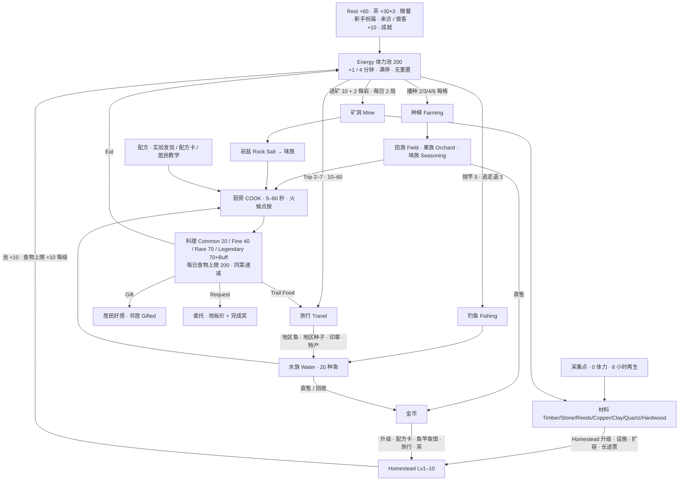
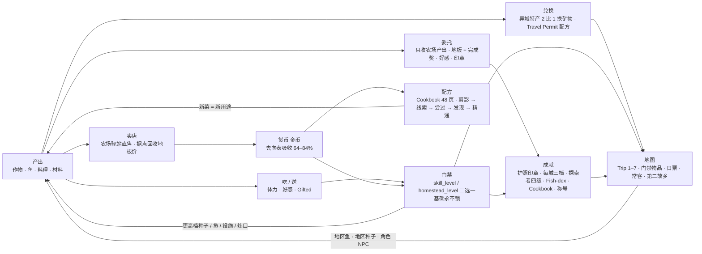
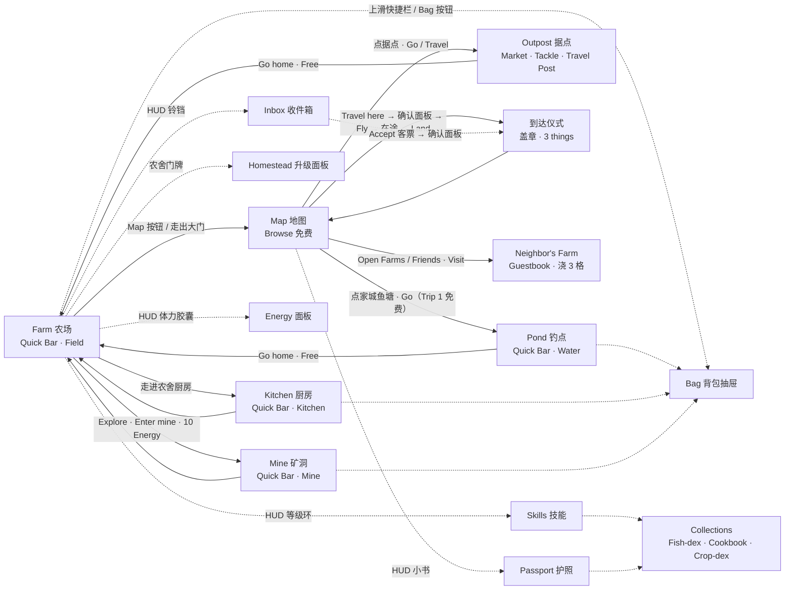

# Gensen 玩法方案 v2：体力驱动的种植·钓鱼·料理·探索循环（独立完整版）

- 日期：2026-10-02
- 性质：原型阶段的完整玩法策划文档。本文自包含：全部原则、规则、数值、物品、文案都在文内，不依赖任何其他文档。
- 术语（全文统一）：Energy = 体力；Homestead = 农场等级；Trip 1–7 = 旅行档（Local / Nearby / Regional / Long Haul / Continental / Intercontinental / Antipodal）；Resident = 角色 NPC；Keeper = 功能 NPC；Neighbor = 其他玩家；Cookbook = 料理图鉴；Fish-dex = 鱼图鉴；Passport = 护照；稀有度一律 Common / Fine / Rare / Legendary（常见 / 上品 / 稀有 / 传说），鱼与料理共用同一套词。
- 文案约定：App 内用户可见文案一律英文（物品名 ≤ 18 字符），本文用中文写作并给出每件物品的 id、中文名、英文名。

---

# 第 0 章 一句话结论、阅读路径与阶段定位

## 0.1 一句话结论

**把体力做成全局唯一的产能燃料（池 200、每 4 分钟回 1 点、无重置时刻），让种植、钓鱼、矿洞三种劳作花体力，让料理（5–60 秒的主动烹饪小游戏）、休息、茶座、居民、朋友把体力补回来；两条技能轨用"等级差"而不是日封顶控制节奏，农场等级只花材料和金币，旅行按七档距离收体力、金币、门禁物品与旅途时间，NPC 拆成"岗位"与"角色"、基础服务与地理脱钩——这样每类玩家一天都有一件"做得完"的事，重度玩家一天最多撞墙一次，而北京到洛杉矶是一条要准备两三周的路。**

## 0.2 十分钟阅读路径

| 你是 | 读这些 | 大约几分钟 |
|---|---|---|
| 想先知道"改了什么、为什么" | 第 1 章 1.4（原方案 → v2 对照表）、1.5（按用户反馈逐条的改动清单） | 4 |
| 想看循环长什么样 | 第 2 章两张图 + 2.4 三类玩家的一天 | 2 |
| 想核对数字 | 第 3 章 3.1 参数表与 3.5 日燃料推演；第 4 章 4.5 阈值表；第 15 章 15.2 目标逐项结果 | 3 |
| 要开工 | 第 17 章分期（P0 可玩纵切的范围与出口标准）；第 16 章界面清单；第 18 章待拍板 | 1 |
| 要做美术与生图 | 第 16 章 16.1 风格约定、16.4 提示词骨架 | — |
| 要查某件东西的 id 或英文 | 附录 A、附录 B | — |

每章开头都有"本章结论"，只读各章 x.0 小节约 15 分钟可通读全局；每章末尾只保留一节"与原始方案的差异与理由"。

## 0.3 阶段定位

| 项 | 定位 |
|---|---|
| 当前阶段 | **原型阶段**。现有 App 只有一些拼凑的碎片功能，缺少底层机制；用户的判断是"除了钓鱼，其他部分暂时没有比较好的游戏过程"。本文的目标是重写底层玩法逻辑，不是在现状上调参 |
| 保留的三块 | ① **Avatar 换装**；② **钓鱼小游戏**（张力条：浮标下沉 → 提竿窗口 → 把鱼影压在绿带里收线到 100%，第 6 章只在它之上加鱼竿与鱼饵的参数修正）；③ **地图交互逻辑**（真实地图、无缝缩放与切城、POI 图标、水塘点位按 0.5° 网格下发）。这三块的表现与手感沿用，规则按本文重定 |
| 不考虑的事 | 已上线数据、旧存档、已上线功能的权益、已开发内容的复用。本文所有规则按"从零建一个世界"写 |
| 团队现实 | 一人主程 + AI 协作，美术外包或生成。"可行"的含义是：内容量与系统复杂度能按第 17 章分三期落地；每期都能单独验收 |
| 验收方式 | 每期出口 = 可按分钟复现的导演脚本 + 数值模拟器复跑 + 4–6 人"看不懂 / 做不了 / 不想做"三分法观察（第 14、15、17 章） |
| 本文如何用 | 第 3–16 章是规则与数值的唯一出处；任何改动先改对应章的表，再用第 15 章的模拟器复跑；所有数值允许 ±20% 微调并在该章注明 |

---

# 第 1 章 对原始方案的评估

本章先把原始方案（文字部分与画板两张图）完整复述一遍，使本文不依赖原件即可阅读；然后给出正反两面的评估；再逐节列出"原方案 → v2"的处理；最后按用户的逐条反馈列出本版的改动清单。

## 1.1 原始方案复述

### 1.1.1 文字部分（按原文顺序，逐节复述）

| 节 | 原文要点 |
|---|---|
| 技能等级 | 单项技能等级影响能否进行某项经营：钓鱼等级决定能否在某个渔场钓鱼（不满足可进入渔场但无法钓鱼）与能否使用某些鱼竿道具；种植等级决定能否种植某些种子；养殖等级决定能否从 NPC 处买到幼崽（养殖暂不做）；挖矿等级暂不做 |
| 农场等级 | 升级途径：消耗不同等级的材料；提升："密友助力" |
| NPC | 三个消耗 / 回收作用：解锁配方、回收食材 / 料理、出售某些材料 |
| 战斗 | 不存在等级门禁；只与道具 / 装备相关 |
| 背包 | 作为资源管理的重要门禁；初始资源有限；玩家需要在资源之间取舍；背包是付费内容之一 |
| 料理 | 游戏中重要的产物：提升体力；某些情况下的特殊作用；作为升级农场的材料 |
| 体力 | 各种行动的基础。总上限 100；每次种植行动 1 点、钓鱼 2 点、养殖 2 点、挖矿 1 点；每天（真实自然日）上午 6 点重置全部体力；各种食物可以恢复体力；药剂可暂时提升上限（暂不做） |
| 拜访城市 | 拜访 = 消耗体力到达另一座城；拜访完成后 1 日内可随时拜访且不消耗体力。与农场同城的任意 POI 不消耗体力；不同城市当天一次性消耗体力和金币，当天可随意在两城访问（除居民设置了不允许访问）；一次性体力 = 两城距离 ÷ 10 向下取整（例：800 公里 → 80 体力）；超过体力上限的城市无法访问，只能通过提升上限来拜访 |
| 体力上限 | 每升一级农场 +2 体力上限（需要测算到达地球最远城市所需的体力） |
| 多人玩法 | 原则：多人为社交属性带来增益与补充（需补齐）；例：收到邀请在一定时间内是否可以降低拜访成本 |
| 地图迷雾 | 初始除所在农场的城市外全部迷雾、看不到具体地图信息；初次拜访后解锁该城迷雾并获得城市成就；再次拜访仍需消耗体力 / 金币 / 特殊资源 |
| 交易、邮寄 | 为测试机制、管理数值与经济，暂不开放交易与玩家间邮寄 |
| 战斗、装备、建造 | 暂不开放战斗、装备、属性、战斗技能、附魔、合成；暂不开放建造 |

### 1.1.2 画板图一：核心游戏过程及消耗（上半张，一个闭环）

- 顶部一个节点「**体力**」，向下流入一行「游戏过程」：**种植、钓鱼、养殖、挖矿、战斗**五个过程，其中种植与钓鱼被框出，表示当前重点。
- 「游戏过程」向下流入一行「产出」：种植 → 农作物；钓鱼 → 鱼；养殖 → 食材；挖矿 → 矿石 / 材料；战斗 → 材料。
- 农作物、鱼、食材三条**实线**，矿石 / 材料与战斗材料两条**虚线**（表示次要 / 可选），全部汇入中心节点「**COOK**」；左侧另有一个「**配方**」节点也输入 COOK。
- COOK → 「**料理**」→ 回流到顶部「体力」。整张图的意思是一条主循环：**体力 → 劳作 → 产出 → 烹饪 → 料理 → 体力**。

### 1.1.3 画板图二：成长链（下半张，三段式）

- 三段：「**产出**」→「**消耗**」→「**更高级**」，再从「更高级」回到「产出」。
- 产出：农作物、鱼、矿、材料、食材。
- 消耗：**卖店、任务、兑换、抽**（抽卡 / 抽奖）。
- 更高级：**货币、门禁？、成就（旁注"收集量化"）、配方、地图？**。两个问号是原作者标出的未决项。

### 1.1.4 原始方案的三句话

1. 体力是所有劳作的燃料，料理把体力补回来，这是主循环。
2. 技能等级、农场等级、背包是三道门禁，NPC 是产出的去向，金币 / 成就 / 配方 / 地图是"更高级"。
3. 真实地图上的城市用体力与金币拜访，首访解锁迷雾与成就。

## 1.2 正面：方向上站得住的部分

| # | 判断 | 为什么站得住 |
|---|---|---|
| P1 | **"汇聚"是对碎片化的正确回答** | 画板上半张是第一张把全部产出汇入同一条回路的图：种、钓、矿的产物都有一个共同去向（COOK），料理再回到体力。此前每个子系统各自为战、产物没有去向；一条有去向的资源流是"底层机制"的最低定义 |
| P2 | **体力是唯一缺位的全局产能阀门** | 没有体力时，钓鱼可以无限抛竿、摊位可以无限收购，任何经济数字都写不出上界；"钓鱼 2 点 / 竿"是对症的第一刀。有了体力，"每日账户价值上界"第一次可以写成一行公式 |
| P3 | **料理从"卖差价"改为"有用途"** | 料理回体力而不是卖钱，消除了"吃"与"卖"两条出口叠加导致的账户价值失控；料理的价值在恢复、关系、收藏，不在差价 |
| P4 | **拜访 / 迷雾 / 城市成就是"空间距离感"的首次机制化** | 同城免费、异城付费、首访解锁、当日自由往返的骨架是对的；旅费在游戏内计算、不绑真实定位，天然避开位置类游戏最大的公平与合规坑 |
| P5 | **按活动分技能等级是被验证过的结构** | 两条技能轨各自成长、各自解锁，比一条总等级更能让"升级后今天不一样" |
| P6 | **NPC 三职能（解锁配方 / 回收 / 出售）是教科书式的来源—去向三角** | 它补上了经济里唯一缺失的持续性金币去向 |
| P7 | **战斗无等级门禁、只看装备** | 与"矿洞是材料源不是成长线"的定位一致，零额外复杂度 |
| P8 | **范围克制、先 NPC 后玩家市场** | 暂缓养殖、交易、邮寄、附魔、合成，符合一人主程的现实 |
| P9 | **拜访有成本之后，"邀请"与"帮工"第一次有玩法价值** | 别人替你花的是稀缺预算而不是时间，社交动作才有分量 |
| P10 | **背包作为取舍门禁的直觉正确** | 容量是休闲农场类里最有效的节奏杠杆，前提是容量真的会满 |
| P11 | **画板下半把"更高级"列成货币 / 门禁 / 成就 / 配方 / 地图五类** | 给每种奖励一个归宿；本文沿用这五类并各给落点 |

## 1.3 反面：按原文落地会坏在哪里

严重度口径：**critical** = 不补方案不成立或上线即坏；**major** = 第一周内被普通玩家发现并普遍利用或卡死；**minor** = 口径残留与表述问题。每条给出"修法落点"，具体规则见对应章。

### 1.3.1 Critical

| # | 问题 | 推演 | 修法落点 |
|---|---|---|---|
| C1 | **料理回体力没有上限 → 主循环是一台永动机** | "各种食物可以恢复体力"而烹饪不花钱、不花时间、无次数：任何回复 ≥ 做菜所花体力的料理都能无限循环；满田便宜作物第三天起每天能做几百份，体力在 72 小时内失去意义 | 每日食物上限 = 整条池（200 + 10 / 级）、同菜递减；第 3 章 3.4 |
| C2 | **"每次种植行动 1 点"没有计量单位** | 一条批量播种命令可以覆盖几十格；按命令计则 100 点 ≈ 几千格，按格 × 四步（翻、播、浇、收）计则 100 点只够 25 格，两种解读差 60–256 倍 | 按格、只在播种时扣、按档 2 / 3 / 4 / 6；翻地 / 浇水 / 收获永远 0；第 3 章 3.3 |
| C3 | **拜访公式线性 + 100 上限硬墙** | 北京–上海真实大圆距离 1,068 km → 106 体力 > 100，初始不可达（原文例子把距离写成 800 算错）；上海↔洛杉矶 10,434 km 需要农场 472 级才够上限；按公里计价让不同家城的可达世界相差十几倍（海岛与内陆稀疏地区的玩家 1,000 km 内几乎没有城市）；出远门当天农场停摆 | 七档金币 + 小额体力 + 门禁物品 + 旅途时间 + 兜底 + 再访折扣；第 11 章 |
| C4 | **没有"去另一座城的理由"** | 原文没有一处"城市 X 有而 Y 没有"；若每座城的鱼塘、鱼群、居民都一样，付费到达后什么都兑现不了 | 每城 2 种地区鱼、4 个气候带各 1 种地区作物与地区配方、每城印章、据点、角色 NPC；顺序必须是"内容 → 成本"；第 6、9、11 章 |
| C5 | **内容量撑不起门禁** | 几种鱼、几种作物、几道菜填不满 3 级门禁，更填不满 10 级 | 鱼 20 / 作物 20 / 料理 48 / 鱼竿 3 / 鱼饵 2 / 肥料 2 / 设施 3；第 5–7 章 |
| C6 | **每天 06:00 硬重置** | 05:59 用"反正要清零"的残余体力付旅费、06:00 满血出发，旅费为 0；新手在最兴奋的 30 分钟内用光池后被告知"明早六点再来"，是最强的离开信号；按设备时区判定可改时区无限重置，按服务端判定则跨城旅行"今天"归属不清；用不完清零制造错过恐惧 | 线性回复 +1 / 4 分钟、满停、无重置时刻；"每日"只用于计数、按家农场时区 04:00；第 3 章 3.2 |
| C7 | **首会话跑不完主循环** | 作物以小时计，第一次登录看不到收获；若鱼不能入菜，COOK 与"料理回体力"在首会话根本不出现——玩家只看到体力掉、看不到体力回 | 第一道菜是鱼料理（5 秒烤鲫鱼），16 分钟内闭合"钓 → 做 → 吃 → 回来"；第 7、14 章 |
| C8 | **社交层空白，却新加了三道墙** | "密友"没有定义；迷雾若遮住"人"，两万多座城摊薄后多数城市看起来没人；帮工若不扣任何人的体力就是互关十人十倍体力的后门；关闭交易与邮寄后玩家之间零互需 | 四级关系表、迷雾永远不遮人、客票固定计费、帮工扣自己的体力、受限赠礼、收件箱；第 12 章 |
| C9 | **"宴席"没有观众** | 把料理做成农场升级的材料，玩家不理解"宴席是什么、为什么要请客"，而且多数人在第一次升级之前就流失了 | 取消宴席；升级 = 材料 + 金币 + 技能和；第 7 章 7.8、第 8 章 |

### 1.3.2 Major

| # | 问题 | 修法落点 |
|---|---|---|
| M1 | 门禁放在"可进渔场不可钓"：付出已发生的现场被拒绝，是真实地图游戏最差的体验 | 任何渔场都可抛竿；门禁落在鱼种 + 鱼竿，等级不够的鱼"咬钩后挣脱"并点亮图鉴剪影；第 4、6 章 |
| M2 | 门禁全是"能 / 不能"，第 2–4 周没有"改变日常"的解锁；没有"还差多少、跨过去会怎样"；升级零仪式 | 两轨各 ≥ 3 级是改变日常的设施；每道门禁四件事同屏；每类事件一个 ≤ 3 秒时刻 + 一个永久痕迹；第 4 章 4.6、4.8 |
| M3 | 每点体力的价值在不同作物之间严重不等 → 全员种同一种作物、每天三分钟签到 | 播种体力按档 2 / 3 / 4 / 6，每点体力净金币配平到 1.0 ± 0.3；第 5 章 |
| M4 | 金币只有来源没有去向；"更高级：货币"把金币当成长是倒置 | 金币去向表吸收 28 天总收入 64–84%：农场升级、配方卡、扩容、旅行、门禁物品、鱼饵、茶；第 9 章 9.15 |
| M5 | 背包若"永远装不满"就是假门禁；付费扩容等于出售产能 | 25 格 + 堆叠 + 鱼篓 + 工具架 + 仓库 + 包裹，扩容只走 Homestead + 材料 + 金币；第 10 章 |
| M6 | NPC 无价格原则、无额度：无限回收、卖材料 + 0 成本烹饪 = 0 体力套利；跨城后每城 NPC 的委托 / 赠礼复刻 | 回收价 = 地板且账号级日额度；售价只卖消耗品与不可回收品；委托只收农场产出、不比自己卖更赚；第 9 章 9.10–9.13 |
| M7 | 农场等级"+2 体力上限"是看不见的成长；无级数、无每级消耗；材料一次性 | 10 级长梯子，每级材料 + 金币 + 技能和，每级 ≥ 1 项第一眼看得见的后果；第 8 章 |
| M8 | NPC 在真实地图上"住在哪、谁能用"没有回答：极地 / 沙漠 / 海岛没有 POI；上海天然比戈壁多；几百万 POI 对几十个手工角色 | 拆开功能 NPC 与角色 NPC；三层供给（农场驿站 / 系统据点 / 真实 POI）；第 9 章 9.1–9.4 |
| M9 | "密友助力"消耗谁的体力未定义 | 帮工按同一张体力表扣帮工自己的体力；第 12 章 12.3 |
| M10 | 全图迷雾与已有的地图行为（无缝缩放、自动切城、选城、朋友位置）相撞；遮信息反而削弱探索欲望；浏览与拜访未分离 | 软迷雾三态着色，只锁可交互性，永远不遮地名 / 气泡 / 人数 / 朋友；Browse 与 Travel 分离；第 11 章 11.7–11.8 |
| M11 | 再访永远收费，去过的地方不会"变近"；农场成长没有空间后果 | 再访 5 折、常客免票、第二故乡免费；第 11 章 11.5 |
| M12 | 城市成就只有"首访一枚"，无层级、无展示面；可被卫星城刷 | 每城三档 + 探索者四级 + 护照分页 + 印章；成就按 30 km 城市簇计、每日计数首访 ≤ 2；第 11 章 11.9 |
| M13 | 时间口径三处打架：真实自然日 06:00 / "1 日内" / 跨时区的"当天" | 单一日切 = 家农场时区 04:00，只管计数；日票 = 到达起滚动 24 小时；体力无重置时刻；第 3、11 章 |
| M14 | 没有验收口径 | 每期出口 = 导演脚本 + 模拟器 + 三分法观察；第 14、15、17 章 |

### 1.3.3 Minor

| # | 问题 | 修法 |
|---|---|---|
| m1 | 口径自相矛盾：养殖"暂不做"但体力表有养殖；挖矿等级"暂不做"但有挖矿体力；"升级消耗材料"本身就是建造却写"暂不开放建造" | 删养殖行与药剂；矿洞接体力不接等级；"只开放农场等级这一条建造线"，设施是技能解锁的产物 |
| m2 | 画板"抽""兑换"未定义；随机消耗与可推演的账本不相容 | 本版移除"抽"；"兑换"只以"异城特产按 2 : 1 换矿物"的形式存在（第 8、13 章） |
| m3 | "居民设置了不允许访问"混用 NPC 与玩家 | 固定术语：Resident = NPC（无访问开关），Neighbor = 玩家（农场有访问开关） |
| m4 | 无英文文案口径；负反馈直译成一堆孤立的 Locked | 每章一张英文文案表（附录 B 汇总）；负反馈必带下一步；按钮必带文字 |
| m5 | 金币成本没有公式；成就奖励若可量化会被刷 | 金币按档几何递增；Trip 1–2 首访只点亮不给首访礼 |

## 1.4 原方案 → v2 逐节对照表

| 原方案章节 | 原文要点 | v2 处理 | 为什么 | 落点 |
|---|---|---|---|---|
| 画板上半：体力 → 种植 / 钓鱼 / 养殖 / 挖矿 / 战斗 → 产出 → COOK → 料理 → 体力 | 五个过程汇入 COOK，料理回流体力 | **保留闭环骨架**；五个过程收敛为三个计费动作（播种 / 抛竿 / 进矿），养殖删除、战斗 0 体力；矿洞只以岩盐、采集只以野香草两种"调味"入菜，矿石与战斗材料不入菜；料理回流被食物上限封顶；回复渠道从一条扩到八条 | 养殖与挖矿等级原文"暂不做"却占体力表；无上限则永动机；只有料理一条回复渠道会让没饭吃的玩家无路可走 | 第 2、3、7 章 |
| 画板下半：产出 → 消耗（卖店 / 任务 / 兑换 / 抽）→ 更高级（货币 / 门禁 / 成就 / 配方 / 地图） | 三段式成长链 | **保留五类"更高级"并各给归宿**：货币 → 金币去向表；门禁 → 一张门禁表（技能等级 / 农场等级二选一）；成就 → 护照、印章、Fish-dex、Cookbook；配方 → 实验发现 + 配方卡 + 居民教学；地图 → Trip 1–7 与第二故乡。"抽"移除，"兑换"只留特产换矿物 | 原方案只有来源没有去向；随机消耗与可推演账本不相容 | 第 2、4、7、9、11 章 |
| 技能等级（钓鱼 / 种植 / 养殖 / 挖矿） | 等级决定能否做某项经营；钓鱼等级管渔场与鱼竿；种植等级管种子 | **两条轨 Farming / Fishing 各 10 级**；门禁落在鱼种 + 鱼竿（挣脱）与种子 / 设施 / 便利，任何渔场可抛竿；XP 来源表、阈值表、**等级差**规则、三类玩家到达天数全部给数；养殖 / 挖矿等级不做 | "可进渔场不可钓"是最差表达；纯"能 / 不能"撑不过第 2 周；原文没有 XP 与曲线 | 第 4 章、第 6 章 6.7 |
| 农场等级 | 消耗不同等级材料升级；提升"密友助力" | **Homestead 10 级**：每级 = 材料 + 金币 + 两轨等级之和 ≥ 2N − 1；每级至少一项第一眼看得见的后果（体力池 +10、食物上限 +10、开垦格、灶口、调味架、密友槽、快捷栏格、扩容资格、长途票资格、外观）；**不需要任何料理** | "+2 体力上限"不可见；材料一次性第二周归零；密友槽位正是"密友助力"的落点；宴席没有观众 | 第 8 章、第 12 章 12.1.2 |
| NPC：解锁配方 / 回收食材料理 / 出售某些材料 | 三个消耗 / 回收作用 | **拆成功能 NPC（岗位）与角色 NPC（12 个手工角色）**；三层供给：农场驿站（人人相同、0 旅行成本）/ 按 0.5° 网格生成的系统据点 Market · Tackle Shop · Travel Post（全服一致、无 POI 也有）/ 真实 POI 只承载额外内容；三条价格原则：售价是天花板（**不卖材料**）、回收价是地板且有日额度、一次性去向只认金币 + 等级；配方主要靠实验发现，NPC 教学与配方卡只是捷径；远程"看免费、用到场" | 原方案没有回答"NPC 在哪、谁能用"，在真实地图上这先于"NPC 卖什么"；卖材料 + 0 体力烹饪 = 套利；无额度回收 = 无限预算 | 第 9 章 |
| 战斗：无等级门禁、只与装备相关 | — | **一致，保留**；战斗 0 体力 0 XP；只保留矿洞 3–5 层的点按式史莱姆战斗，只看镐与 HP | — | 第 13 章 13.3 |
| 背包：资源管理门禁、初始有限、取舍、付费 | — | **真约束但不付费**：25 格起、5 列紧凑网格、7 个 Tab、堆叠鱼 10 / 料理 5 / 作物 50、鱼篓 = 背包空格、工具架、农场仓库、收件箱包裹；扩容只走 Homestead + 材料 + 金币；底部快捷栏 4–6 格按场景换候选 | 装不满的背包是假门禁；付费扩容等于出售产能并造成赠礼 / 帮工不对称 | 第 10 章 |
| 料理：提升体力 / 特殊作用 / 农场升级材料 | 三条用途 | **48 页 Cookbook，所有菜进图鉴、每道菜有稀有度**（由原料稀有度 × 原料族数派生），回复 20 / 40 / 70 / 70 + Buff；用途四标签 Eat / Gift / Request / Trail Food；烹饪是 5–60 秒的主动小游戏（投料 → 火候点按 → 出锅 → 图鉴点亮）；配方靠实验发现，失败出黑暗料理并送线索；**宴席取消** | "特殊作用"要有观众与场合；料理做门禁会让"吃还是留"成为负担；原型里的烹饪没有游戏过程 | 第 7 章 |
| 体力：上限 100；种植 1 / 钓鱼 2 / 养殖 2 / 挖矿 1；06:00 重置；食物回复；药剂提上限 | — | **池 200 + 10 / 级、+1 / 4 分钟线性、无重置**；播种按格按档 2 / 3 / 4 / 6、抛竿预扣 5 退 3、进矿 10 / 局 + 2 / 岩；料理 20 / 40 / 70、食物上限 200 + 10 / 级；料理之外七条回复渠道各有日上限；养殖 / 药剂删 | 100 的池上一道菜只占一成多，吃不出"饱"；硬重置五个故障；回复总量抬到原来的 7 倍但每条封顶 | 第 3 章 |
| 拜访城市：同城免费；异城一次性体力 + 金币当天往返；体力 = km ÷ 10；超上限不可达 | — | **Trip 1–7 七档**：体力 0–60、金币 0–500、旅途时间 0–30 分钟同时递增；Trip 4 起印章前置、Trip 5 起 Travel Permit、Trip 6–7 Long-haul Ticket + Homestead Lv4 / Lv5；兜底：最近 3 城永远免费、最近 10 城永远 ≤ Trip 2；日票 24 小时滚动；再访 5 折、常客免票、第二故乡免费；无硬墙 | 见 C3；"北京→洛杉矶不该 30 体力 + 200 金币就到"——距离感要靠准备过程体现 | 第 11 章 |
| 体力上限：升级农场 +2 / 级（为够到远城） | — | 每级 +10 池 + 10 食物上限，且升级当场回满；Homestead Lv4 / Lv5 直接作为长途票与 Trip 7 的前置 | 任何替代公式封顶都 < 100，上限对门禁无效；把农场等级直接作为长途资格比用它推上限直观一个量级 | 第 3 章 3.1.3、第 11 章 11.3 |
| 多人玩法：为社交属性带来增益（需补齐）；邀请降低拜访成本 | 两行 | **四级关系表 + 权益矩阵 + 客票（该档体力一半、0 金币、免门禁）+ 帮工（扣自己的体力）+ 受限赠礼（Gifted 标记）+ 收件箱 + 主人激励三件套 + 密友同塘 XP × 1.2**；全部日上限进账本 | 社交层空白却加三道墙 | 第 12 章 |
| 地图迷雾：初始除家城全迷雾；首访解锁 + 城市成就；再访仍收费 | — | **软迷雾三态**（Unexplored / Explored / Second Home）：不遮城市名 / 气泡 / 人数 / 朋友 / 选城，只锁可交互性；表现在客户端、门禁在服务端；每城三档成就 + 探索者四级 + 护照分页 + 印章 | 与无缝缩放 / 选城页 / 朋友位置相撞；单枚成就无牵引力；再访永远收费与"去过的地方变近"矛盾 | 第 11 章 11.7–11.9 |
| 交易、邮寄：暂不开放 | 测试机制期 | **交易与邮寄仍不开放**；受限赠礼（互关每日 1 份、只限料理与鱼、Gifted 金币价值 0）+ 系统收件箱八类消息 | 玩家间零互需；礼物先让"料理 → 体力"这条边指向别人，不碰金币 | 第 12 章 12.4–12.5 |
| 战斗 / 装备 / 属性 / 附魔 / 合成：暂不开放 | — | 不做装备 / 附魔 / 合成；矿洞 1–2 层进主循环并计体力（材料源），3–5 层是内容期 | 矿洞是材料源不是成长线 | 第 13 章 |
| 建造：暂不开放 | — | **"只开放农场等级这一条建造线"**；洒水器 / 堆肥箱 / 温室是技能解锁的设施，工作台只做工具、火把、堆肥、摆件 | "升级消耗材料"本身就是建造；设施是"改变日常"的载体 | 第 5、8、13 章 |

## 1.5 按用户反馈逐条的改动清单

本版是按用户对初稿方向的逐条反馈重做的。下表按反馈的编号逐条写"用户说了什么、初稿是什么、本版改成了什么、落在哪"。

| 编号 | 用户反馈要点 | 初稿 | 本版 | 落点 |
|---|---|---|---|---|
| a | 用户问"旅行第 1 档的城市是什么"——初稿把旅行档与鱼的档位写成同一种缩写，混淆；30 体力 + 200 金币就能北京→洛杉矶，跨国跨洲门槛太低；超长途要有金币 / 体力之外的门禁物品 | 旅行七档与鱼四档共用同一套"T + 数字"缩写；北京→洛杉矶 = 最高档 30 体力 + 200 金币 | **命名统一**：鱼与料理用 Common / Fine / Rare / Legendary，旅行档用 Trip 1–7 + 英文名，全文不再出现"T + 数字"式缩写；旅行成本随新体力尺度放大为体力 0–60、金币 0–500、旅途时间 0–30 分钟；**Trip 5 起每次出发消耗 Travel Permit**（两个气候带的特产 + 100 金币制作，或 250 金币购买，需印章 ≥ 5）、**Trip 6–7 消耗 Long-haul Ticket**（许可 + 硬木 2 + 石英 2 + 150 金币，需 Homestead Lv4，Trip 7 另需 Lv5 与印章 ≥ 12）；长途有可取消、可离线、农场照常的旅途时间；北京→洛杉矶、上海→东京、上海→杭州三张完整算例 | 第 11 章 11.2、11.3、11.6 |
| b + e | 体力是燃料，回复过慢是沉重负反馈；"花 10 分钟做一道菜只回 10 点"没有吃饱的感觉；每日食物上限 40 + 同菜衰减对重度玩家与宣传期新手都不友好；要同时提高消耗与回复；要有料理之外的恢复渠道 | 池 100 + 2 / 级；+1 / 15 分钟；播种按档 1 / 1 / 2 / 3、抛竿 2 退 1；料理 8 / 15 / 25、食物上限 40 + 2 / 级；料理是唯一回复渠道 | **固定新尺度**：池 200（+10 / 级）、+1 / 4 分钟（约 360 / 日）、满停无重置；播种按格按档 2 / 3 / 4 / 6、地区种子 4、多年生种下 6 每收 2、抛竿 5 退 3（Lv1–3 每日前 10 次失败全退）、进矿 10 / 局 + 2 / 岩；料理 20 / 40 / 70（Legendary 也 70 + Buff），食物上限 200（+10 / 级），同菜第二份 50%、第三份 0；**七条料理之外的渠道**：回家休息 Rest +60 / 日、茶座 +30 × 3 杯（40 / 50 / 60 金币）、居民赠餐每日 1 份、新手祝福（7 天自然回复 ×1.5、食物上限 +100）、密友来访 +10 / 做客到达 +10、成就与首次事件一次性、活动接口；三类玩家日燃料全部重算：30 分钟玩家正餐前用池 60–77%、一顿正餐回 100 = 池的一半，重度一天最多撞墙 1 次 | 第 3 章全章；第 15 章 15.2 |
| c | 是否所有菜都进图鉴，给菜品打稀有度标签 | 家常 / 招牌 / 宴席三层，家常菜不进图鉴 | **采纳**：48 页全部进 Cookbook；每页稀有度由"最高原料稀有度 × 原料族数"派生（与鱼同一套词），决定回复档、烹饪时长、火候次数、首做 XP、收藏分；三层改为"稀有度 + 用途标签 Eat / Gift / Request / Trail Food" | 第 7 章 7.4、7.6、7.14 |
| d | 用体力统一限制 XP 太粗暴；像 WoW 那样，高等级后再钓低级鱼不再加 XP；种植类似 | 每日 XP 封顶（两轨各一个数） | **等级差规则**：每种鱼 / 作物有内容等级（= 解锁等级），d = 玩家等级 − 内容等级：d ≤ 1 全额，2 → 75%，3 → 50%，4 → 25%，≥ 5 灰色（5% 给 1 XP）；d 在付体力那一刻锁定；**取消每日 XP 封顶**，只留每轨每日 3,000 的防脚本上限（人类够不到）；阈值与到达天数全部重算：首会话 Fishing Lv2、30 分钟玩家两轨 20–25 天、重度 9 / 13 天、5 分钟玩家 84 / 56 天 | 第 4 章 4.2–4.5；第 15 章 |
| f | 参考《Spiritfarer》的烹饪；新手菜不可能等 5 分钟，应约 5 秒；烹饪是前期资源的收口，应是最有期待感的过程之一 | 烹饪 0 体力、占灶位真实时间 5–20 分钟、无互动 | **烹饪时长 5 / 15 / 30 / 60 秒**（按稀有度），时间内 1–2 次火候点按（命中提升品质 Good / Perfect，Perfect 多出 1 份；失败不罚）；**配方发现**：图鉴只给剪影、稀有度边框、槽位数与原料族图标，玩家自由投料实验，失败出黑暗料理 Mystery Dish（+5、进失败页、送线索）；单主料永不失败；**厨房随 Homestead 升级**（灶口 1 → 3、调味架、保温柜、大锅、名厨招牌）；烹饪写成完整的七步过程：进厨房 → 选灶 → 投料 → 开火 → 火候 → 出锅动画 → 吃 / 收 / 送 | 第 7 章 7.1–7.7、7.9 |
| g | 不理解宴席的功能；玩家在到达宴请前已流失 | 农场升级 = 材料 + 宴席料理 + 金币；升级 = 宴请三位居民 | **取消宴席**：Homestead 升级 = 材料 + 金币 + 两轨技能等级之和；"居民聚餐"只作可选社交事件留在路线图，不进核心循环 | 第 7 章 7.8；第 8 章 |
| h | 其余基本赞同 | — | 沿用初稿的内容量（作物 20、鱼 20）、门禁表、迷雾三态、护照结构、关系层级，并按新尺度重算全部数值 | 各章 |
| i | 方案完成后拆解主要界面与交互，用生图做一轮完整设计，每个功能 1–2 张图，审阅后再开发 | 无此章 | **新增第 16 章"界面与交互清单"**：7 个一级场景 + 9 个二级面板 + 一套卡片，共 68 行，每行写清图 1 / 图 2 画什么、必须出现的英文控件与文案、手势反馈、跳转；通用风格前缀与负面词；三个生图批次与审阅检查表 | 第 16 章 |
| j | NPC 与 POI 的关系：星露谷"NPC 跟玩家走"与真实地图"NPC 跟地点走"的根本差别；五条需求互相冲突；A–G 问题清单；需与 Joey 拍板五件事 | 三位居民各守一柜台，自动放在城市中心 | **完整复述问题并给出裁决**：拆开功能 NPC（岗位）与角色 NPC（12 个手工角色，可多城出现或巡回）；基础服务与地理脱钩——每个农场自带农场驿站 + 系统按 0.5° 网格生成 Market / Tackle Shop / Travel Post（全服一致、无 POI 也有、家格据点永久免费）；真实 POI 只承载额外内容（地标印章、特产柜、角色住址、事件）；远程"看免费、用到场"；任务模板全服一致、实例每人一份、好感每人一份、未解锁可见但锁定；大城市内容更丰富但基础服务与成长速度平等（天数差 ≤ 10%）；五件事标为"待 Joey 确认" | 第 9 章 9.1–9.4；第 18 章 18.1 |
| k(1) | 移除所有 NPC 快捷委托跳转，改用世界内可视化提示 | 委托卡"前往"按钮直接传送 | **删除全部自动跳转**：地图层 POI / 据点光色标记（绿 ✓ / 金 ! / 青 ◆ / 紫 ★ / 灰 🔒）、场景层 NPC 头顶黄色 ! / ? / 淡红 ♥、农场内角标、底部 Today 面板三行；"Show on map"只移动相机，绝不移动玩家、不自动开面板、不自动起飞；首会话与七日引导全部按此重写 | 第 9 章 9.5；第 14 章 14.3 |
| k(2) | 烹饪应当是最有期待感的过程之一，当前几乎没有 | 同 f | 同 f：烹饪的七步、火候环、品质、出锅特效、首次翻页条 | 第 7 章 7.2 |
| k(3) | 背包布局更紧凑；按类型 / 全部查看与使用 | 24 格、无 Tab | 25 格起、5 列紧凑网格、7 个 Tab（All / Seeds / Produce / Fish / Dishes / Materials / Tools）过滤同一份容量；长按详情、拖入快捷栏 | 第 10 章 10.3、10.6 |
| k(4) | 统一的物品使用界面：参考我的世界的物品栏 / 快捷栏，为移动端竖屏重做；底部 4–6 格按场景自动切换候选；种植 / 钓鱼 / 挖矿 / 养殖共用 | 无快捷栏 | **Quick Bar**：底部 4–6 格（Homestead Lv1 4 格、Lv3 5 格、Lv6 6 格），田 = 种子 / 肥料 / 行工具、水边 = 鱼竿 / 鱼饵 / 鱼笼、矿 = 镐 / 火把、厨房 = 食材 / 调味，自动切换候选；"选中即用"手势四场景共用；体力价写在格子上 | 第 10 章 10.9 |
| l、m | 当前 App 体验失败、原型阶段、不考虑线上数据与复用；需要一份不依赖其他文档的新方案 | 文内引用了既有文档与实现 | 本文自包含：所有原则在文内自洽陈述；不写任何过渡安排；每章末尾只保留"与原始方案的差异与理由" | 第 0 章 0.3；全文 |

---

# 第 2 章 核心循环总览

## 2.0 本章结论

1. 画板上半张的闭环保留，但每条边都有了"去向"与"上限"：三个计费动作（播种 / 抛竿 / 进矿）花体力，四族原料（田 / 果 / 水 / 味）汇入厨房，料理与另外七条渠道把体力补回来，日燃料上界是一个常数（Homestead Lv1 为 730）。
2. 画板下半张的成长链保留五类"更高级"（货币 / 门禁 / 成就 / 配方 / 地图），每类各有一张落点表；"抽"移除，"兑换"只留特产换矿物。
3. 三层循环：**每日**（体力 → 劳作 → 烹饪 → 体力，以及每日计数的委托 / 赠餐 / 茶 / Rest）、**每周**（技能升级与设施、Homestead 升级、旅行印章、密友互动窗口）、**每月**（Cookbook / Fish-dex 集齐、探索者奖章、第二故乡、称号）。
4. 三类玩家各有一条"做得完"的路：5 分钟玩家永远满条进场、从不需要吃；30 分钟玩家一次会话用掉池的六到八成、一顿正餐回一半；重度玩家把 93% 的理论燃料用掉而最多撞墙一次。

## 2.1 资源流图（重画的画板上半张）

读图：左侧四条出边是**仅有的四类体力消耗**（翻地、浇水、收获、烹饪、吃、买卖、对话、布置、拜访、社交全部 0）；进入厨房的只有四族原料，矿石与战斗材料不入菜；料理有四条出口而只有 Eat 一条回到体力，且被食物上限封顶；底部一行是料理之外的七条回复渠道，每条各有日上限，所以整张图的日燃料上界是常数。

## 2.2 成长链图（重画的画板下半张）

读图：原画板的"更高级"五类各有归宿——货币进金币去向表（第 9 章 9.15），门禁只有一张表（第 4 章 4.7），成就落在护照与两本图鉴（第 11 章 11.9、第 6 章 6.9、第 7 章 7.6），配方走五种页状态（第 7 章 7.5），地图走七档与三级阶梯（第 11 章）；每一类都有一条回到"产出"的边，这就是"更高级 → 产出"那条回边的具体内容。原画板的"抽"没有保留。

## 2.3 三层循环：每日 / 每周 / 每月

| 层 | 节拍 | 发生什么 | 由什么封顶 | 落点 |
|---|---|---|---|---|
| 每日 | 一到两次会话 | 收获 → 播种 → 钓鱼 / 下矿 → 做菜吃饭 → 卖产物 / 交委托 / 见居民 → 规划明天的田 | 体力池与回复速率；食物上限 200；茶 3 杯；Rest 1 次；赠餐 1 份；系统委托 6 份；矿洞 2 局；采集点 3 次；首访计数 2 次 | 第 3、9、13 章 |
| 每周 | 7 天 | 技能每 1–3 天升一级（前两周每天都有新东西，第三周是"猎手周 / 果园周"）；Homestead 每 2–9 天升一级；旅行 1–7 次攒印章与特产；居民好感第 4–5 天到熟悉开始赠餐；密友条件"近 7 天互动 ≥ 3 次"；旅行许可 / 长途票每周限购 | 阈值表；材料的 8 小时再生与每日 2 局；周一刷新的制作与购买次数 | 第 4、8、11、12 章 |
| 每月 | 4–8 周 | 两轨满级（30 分钟玩家约 3 周、重度 9–13 天、5 分钟玩家 2–3 个月）；Homestead Lv10（重度约 4.5 周、30 分钟玩家约 8–9 周）；Cookbook 与 Fish-dex 集齐（约一半 Legendary 页需要旅行）；探索者金章（30 城，≥ 15 天）；第二故乡；称号 | 内容总量；等级差把低级内容变灰；跨气候带的旅行门禁 | 第 4、7、8、11、15 章 |

三层之间的关系：每日循环产生的是体力账（当天花完当天回），每周循环产生的是金币与材料账（攒几天换一次可见后果），每月循环产生的是收藏与身份（图鉴、护照、称号）。任何一层都没有"用不完清零"的东西，所以玩家不被任何时刻绑架。

## 2.4 三类玩家的一天

画像全文统一（第 3、4、15 章共用）：5 分钟玩家 = 每日一次 5–10 分钟，20–30 格 + 5–10 竿；30 分钟玩家 = 每日一次 30 分钟，25–34 竿、110–130 体力种植、隔日 1 局矿洞 A；重度玩家 = 08:00 与 20:00 各 2 小时。

| | 5 分钟玩家 | 30 分钟玩家 | 重度玩家 |
|---|---|---|---|
| 进场状态 | 满条 200 / 200（24 小时自然回满） | 满条 200 / 200 | 早场满条；晚场 152（10 小时回 150） |
| 做什么 | 收昨天的 30 格、播 30 格（70）、5 竿（20）、与一位居民对话收赠餐、看一眼 Today | 收 40 格、播 40 格（120）、隔日一局矿洞 A（34）、做 3 道菜吃一顿正餐（+100）、钓 30 竿（132）、卖产物交委托、看 Cookbook | 早：收播 60 格（180）、早餐（+100）、矿洞 B（58）、茶（+30）、27 竿；晚：补播 20 格（50）、Rest（+60）、矿洞 A（34）、20 竿、晚餐（+90）、茶（+30）、Trip 3 去邻城（20）、异城 30 竿、咖啡（+30）、回家、密友来访（+10）、做明天的菜 |
| 当日燃料 | 90 | 286（非矿洞日 252） | 682 |
| 正餐前用掉池的比例 / 一顿正餐回复 | — / 不需要吃 | 77%（非矿洞日 60%）/ 100 = 池的一半 | 早 100% / 50% |
| 会话结束余量 | 111（56%） | 21（10%；Rest 后 81） | 早 2 / 晚 78 |
| 撞墙 | 0 | 0 | 推演 0；模拟日均 0.2、单日 ≤ 1 |
| 当天的"不一样" | 一枚赠餐、一条委托完成、图鉴里一页剪影变清楚 | 一级技能或一道新菜或一件新装备 | 一座新城的印章与两条地区鱼剪影、一级技能、一次 Homestead 进度 |
| 第 7 天落点 | Fishing Lv3–4、Farming Lv4、Homestead Lv1、金币约 250 | Fishing Lv5–6、Farming Lv5–6、Homestead Lv2、金币约 270 | 两轨 Lv6–7、Homestead Lv2、印章 7–8 枚、金币约 600 |
| 第 30 天落点 | 两轨 Lv6–8、Homestead Lv4 | 两轨 Lv10、Homestead Lv6–7、Cookbook 约 33 页 | 两轨 Lv10、Homestead Lv10（第 31 天）、印章 ≥ 12、已到过洛杉矶 |

三行读数：短会话玩家由时间约束，池永远是满的，他的决定是"种什么、钓几竿"；30 分钟玩家的约束也是时间而不是体力，"吃一顿回一半"是他每天看得见的画面；重度玩家把 93% 的理论燃料用掉，体力对他是真实约束，但约束的形式是"今天的饭吃完了"而不是"回去等明天"。

## 2.5 全文共用的常数速查

| 常数 | 值 | 出处 |
|---|---|---|
| 体力池 / 自然回复 / 食物上限 | 200（+10 / 级）/ +1 每 4 分钟 / 200（+10 / 级） | 第 3 章 |
| 播种 / 抛竿 / 进矿 | 2 · 3 · 4 · 6 每格（地区 4、多年生种下 6 每收 2）/ 预扣 5 退 3 / 10 每局 + 2 每岩 | 第 3 章 3.3 |
| 料理回复 / 烹饪时长 / 火候 / 首做 XP | 20 · 40 · 70 · 70 / 5 · 15 · 30 · 60 秒 / 1 · 1 · 2 · 2 次 / 10 · 20 · 40 · 80 | 第 7 章 |
| 钓获 XP / 收获 XP | 5 · 10 · 20 · 40 / = 播种体力 | 第 4 章 4.3 |
| 等级差倍率 | d ≤ 1 100% · 2 → 75% · 3 → 50% · 4 → 25% · ≥ 5 灰色 | 第 4 章 4.2 |
| 阈值 | Fishing 0 / 70 / 220 / 480 / 850 / 1,300 / 1,850 / 2,400 / 3,100 / 4,000；Farming 0 / 50 / 150 / 300 / 500 / 750 / 1,050 / 1,450 / 2,050 / 2,800 | 第 4 章 4.5 |
| Homestead 金币 | 250 / 400 / 550 / 750 / 1,000 / 1,450 / 1,800 / 2,250 / 2,850（合计 11,300）；技能和 ≥ 2N − 1 | 第 8 章 8.2 |
| Trip 1–7 | 体力 0 / 10 / 20 / 30 / 40 / 50 / 60；金币 0 / 20 / 60 / 120 / 200 / 300 / 500；旅途 0 / 0 / 2 / 5 / 10 / 20 / 30 分钟；印章前置 — / — / — / 3 / 5 / 8 / 12；门禁物品 — / — / — / — / Permit / Ticket / Ticket | 第 11 章 11.2 |
| 日切 | 家农场时区 04:00，只用于计数 | 第 3 章 3.1 |
| 初始金币 / 开局种子礼 | 180 / 20 小萝卜 + 10 生菜 | 第 14 章 |
| 微调带宽 | 所有数值 ±20%，改动写进对应章 | 第 15 章 |

---

## 2.6 与原始方案的差异与理由

| # | 原始画板 / 原方案 | 本章 | 理由 |
|---|---|---|---|
| 1 | 画板上半张：体力 → 五种劳作（种植、钓鱼、养殖、挖矿、战斗）→ 产出 → COOK → 料理 → 体力，料理是唯一的回流边 | 资源流图只保留三种付体力的劳作（种植、钓鱼、矿洞）与旅行；料理之外另有 Rest、茶座、居民赠餐、新手祝福、来访 / 做客、成就六条回流边，各有日上限；养殖与战斗不进本版循环 | 单一回流边让"吃"成为唯一出口，回复慢就是全局负反馈；多条回流边让每类玩家都有不做菜也能补回体力的路径，而日上限保证整张图的日燃料上界是常数 |
| 2 | 画板下半张：产出 → 消耗（卖店、任务、兑换、抽）→ 更高级（货币、门禁、成就、配方、地图）→ 产出 | 成长链图把"更高级"落成五个有表的去处：金币去向表、一张门禁表、护照与两本图鉴、五种配方页状态、七档旅行；"抽"删除，"兑换"只保留本气候带特产换矿物 | 每个"更高级"都要有具体的表和一条回到产出的边，否则是口号；随机消耗与可推演的账本不相容 |
| 3 | 体力每日 06:00 重置、上限 100 | 三层循环按线性回复（+1 / 4 分钟、满停）写：每日的节拍来自作物成熟、采集点再生与 04:00 的计数日切，而不是体力重置 | 重置时刻制造"错过"与时区套利；线性回复让一天一次和一天两次的玩家都满条进场 |
| 4 | 未写玩家画像 | 2.4 给出 5 分钟 / 30 分钟 / 重度三条时间线，日燃料 90 / 286 / 682，全文各章共用 | 不写画像就无法校验"重度一天最多撞墙一次、30 分钟玩家一次会话用掉池的 60–80% 并吃一顿回一半"这两条目标 |

---

# 第 3 章 体力（Energy）

## 3.0 本章结论

1. **体力是全局唯一的产能燃料**：池 **200**（Homestead 每级 +10，Lv10 = 290），**+1 / 4 分钟线性回复（15 / 小时，约 360 / 日），满条即停，没有任何重置时刻**。一天一次登录的玩家每次都是满条进场；早晚两次登录的玩家，10 小时间隔回 150，两次也都接近满条。
2. **只对三类动作计费**：播种按格按档 **2 / 3 / 4 / 6**（档 1–4；地区种子 4；多年生种下 6、每次收获 2）、抛竿 **5**（逃走退 3；Fishing Lv1–3 每日前 10 次失败全退）、进矿 **10 / 局 + 2 / 岩石**。翻地、浇水、收获、烹饪、火候互动、吃、买卖、对话、布置、拜访、所有社交动作永远 0。旅行按 Trip 1–7 收 0 / 10 / 20 / 30 / 40 / 50 / 60。
3. **回复渠道从一条变成八条**：自然回复 360 / 日；料理按稀有度回 **20 / 40 / 70**（Common / Fine / Rare；Legendary 也按 70 计，价值在 Buff 与收藏分），**每日食物上限 200**（Homestead 每级 +10），同一道菜第二份 50%、第三份 0；回家休息 Rest **+60**（每日 1 次）；居民茶座 **+30**（金币购买，每日 3 杯）；居民赠餐（熟悉以上居民每日 1 份 Common 菜，所有居民合计，占食物上限）；新手祝福（注册 7 天内**自然回复** ×1.5、食物上限 +100，料理不乘）；社交（密友来访主人 +10 / 日、受邀做客到达 +10）；成就与首次事件一次性奖励；节日活动接口。**全部渠道合计，重度玩家一天最多约 730 点燃料 ≈ 166 竿当量**；原始方案里一天的燃料只有一次 06:00 重置的 100 点（≈ 50 竿当量）加无上限的食物，这里把总量抬到 7 倍而把每一条渠道都封了顶。
4. **三类玩家推演结果**（画像全文统一：5 分钟 = 20–30 格 + 5–10 竿；30 分钟 = 每日 25–34 竿、110–130 体力种植、隔日 1 局矿洞 A；重度 = 2 小时 × 2）：5 分钟玩家一次会话用 90 点（池的 45%），结束剩 111，从不需要吃；30 分钟玩家矿洞日正餐前用掉 154 点（**池的 77%**），一顿三道不同菜的正餐回 **100 点（池的一半）**，钓完 30 竿结束剩 21（回家 Rest 可到 81）；重度玩家两会话共用 682 点、77 竿、80 格、2 局矿洞、1 次 Trip 3 旅行，推演 **0 次撞墙**、模拟日均 0.2 次（单日 ≤ 1，只在晚场异城最后几竿；理论上限 1 次：只会发生在食物 200 + 茶 90 + Rest 60 全部用完之后，也就是一天消耗超过约 730 点时）。
5. **"吃饱"是比例问题，所以消耗与回复一起放大**：在原始方案的 100 点池上，一道菜若只回 10–15 点只占 10–15%，条上几乎看不出动，玩家会觉得"花了时间没吃饱"；本版一道 Fine 菜 = 池的 20%，一道 Rare 菜 35%，一顿正餐 50–65%，食物上限 = 整整一条池，做菜 5–30 秒。消耗同时按原始方案的 2–2.5 倍计价（抛竿 2 → 5、每格 1 → 2 起、进矿 1 / 次 → 10 / 局 + 2 / 岩），是为了让每个动作仍然"有分量"（一竿 = 条的 2.5%，肉眼可见），而不是让条钉在满格。
6. **体力 0 不是墙**：HUD 常驻「Energy 142/200 · +1 in 2:41」；不足时一张卡片同屏四件事（要多少 / 有多少 / 差多少与多久 / 现在能做什么）；0 体力时三个出口同屏（等 / 恢复 / 做别的），其中"恢复"展开为吃 / 做菜 / 茶 / Rest 四个按钮，"做别的"展开为十项各有奖励的 0 体力活动。

---

## 3.1 基本尺度

### 3.1.1 参数表

| 参数 | 值 | 说明 |
|---|---|---|
| 体力池上限 | **200**（Homestead Lv1） | 每升一级 Homestead +10，Lv10 = 290；上限是"存量"，不改变回复速率 |
| 自然回复 | **+1 / 4 分钟**，线性，整数 | 15 / 小时；24 小时 360；0 → 200 需 13 小时 20 分；0 → 290 需 19 小时 20 分 |
| 满条行为 | 到上限即停，计时器暂停 | 满条后消费 1 点，下一个 +1 从消费时刻起算 4 分钟 |
| 重置时刻 | **无** | 没有"某个时刻回满"，也没有"用不完清零"（理由见 3.2） |
| 离线 | 按离线时长线性补到上限为止 | 离线 3 天回来 = 满条，不多不少 |
| 料理回复 | Common 20 / Fine 40 / Rare 70 / Legendary 70 | 每玩家日合计 ≤ 食物上限；同菜第二份 50%（向上取整）、第三份 0；黑暗料理 Mystery Dish 固定 +5、不递减 |
| 食物上限（每玩家日） | **200**（Homestead Lv1） | 每级 +10，Lv10 = 290；新手祝福期间 +100 |
| 料理之外的回复 | Rest 60 / 茶 30×3 / 赠餐（占食物上限）/ 新手祝福 ×1.5 / 社交 10+10 / 成就一次性 / 活动 | 各渠道数值、条件、日上限、防滥用见 3.4 |
| 超上限"奖励区" | 上限 +50 以内 | 只有社交、成就、活动三类回复可以把体力推过上限；超上限期间自然回复暂停；食物 / 茶 / Rest 只填到上限 |
| 玩家日 | 农场所在城市时区 **04:00** 切日 | 只用于所有"每日"计数（食物上限、茶杯数、Rest、失败退费次数、矿洞开局次数、来访奖励）；**不碰体力余额**；旅行在外时仍按家农场时区 |
| 微调带宽 | 所有数值 ±20% | 本章数字按固定尺度写；模拟后若调整，只在带宽内动且在本章注明（3.5.7） |
| 不做的事 | 不出售体力、不看广告回体力、不做"体力已满"推送、无药剂、无养殖行、玩家之间不能直接转赠体力 | "体力已满"推送制造错过恐惧；药剂是第二条上限来源，没有必要；玩家间只能赠料理（吃的人占自己的食物上限） |

### 3.1.2 状态与结算（描述）

服务端为每个农场保存两个量：**当前体力整数**与**上次结算时刻**。读取时投影不落库：当前体力 = min(上限, 已存体力 + ⌊(现在 − 上次结算) ÷ 4 分钟⌋)。任何会扣体力的命令，在加锁后用同一个时刻先结算回复、再扣费、再把不足 4 分钟的余数保留在"上次结算时刻"上，连续小额消费不会丢掉已经累计的几分钟。满条时上次结算时刻直接钉在现在，余数丢弃。所有体力数值只在服务端计算，客户端只做预判与显示；测试环境可以缩放这个时钟，验证"一个体力日"不需要等真实一天。

上限随 Homestead 等级变化时只改上限，不改当前体力；但 Homestead 升级本身是一次性事件，按 3.4.8 的规则**当场回满到新上限**——升级那一刻玩家看到的是 200/200 → 210/210，而不是 200/210。

### 3.1.3 上限成长

上限只有一条来源：Homestead 等级，Lv1 200 → Lv10 290，食物上限同步 200 → 290。不设药剂、不设技能等级加成、不设付费、不设活动永久加成。理由：3.4.11 会证明体力系统的真正约束是"回复速率 + 食物上限 + 其他渠道日上限"这三个常数，上限只决定一次会话能连续做多少事；给它第二条成长线会让"上限"变成可追逐的数值，却不改变任何人一天能做的事。

### 3.1.4 为什么是 200 / 4 分钟 / 200

| 尺度 | 值 | 这个值对应的"一件事" | 比它大 / 小会怎样 |
|---|---|---|---|
| 池 200 | 40 竿（计逃走退 3 后约 45 竿）≈ 30 分钟纯钓鱼；100 格档 1 作物 ≈ 30 分钟玩家两天的田；1 局矿洞 B（58）+ 1 局 A（34）+ 24 竿 | 100：一竿 5 点 = 5%，30 分钟玩家正餐前就要吃两顿；300：一天一次的玩家永远用不完，体力不再是决定 |
| 回复 +1 / 4 分钟 | 10 小时间隔回 150 = 75%，早晚两次登录都接近满条；0 → 满 13.3 小时，一天一次的玩家永远满条进场；等待 1 小时 = 3 竿，等待永远不是最优策略但也永远不是死路 | +1 / 3 分钟（480 / 日）：自然回复占重度日燃料 59%，食物只剩 25%，"吃"失去分量；+1 / 5 分钟（288 / 日）：10 小时只回 120，晚场开场 60%，又回到"没吃饱" |
| 食物上限 200 | 一天的饭 = 再来一整条池；= 5 道不同 Fine 菜，或 2 道不同 Rare 菜各吃 2 份（70 + 35 + 70 + 35 = 210，封顶 200） | 100：重度玩家晚场必撞墙；无上限：永动机（3.4.11） |

---

## 3.2 为什么不是"每天 06:00 重置"

原始方案是"每天（真实自然日）上午 6 点重置全部体力"。本版改为线性回复、无重置时刻，理由五条，每条都是具体的故障而不是偏好：

| # | 硬重置的问题 | 发生机制 | 线性回复如何消解 |
|---|---|---|---|
| 1 | **05:59 旅费漏洞** | 旅行用体力计价时，玩家在重置前用"反正要清零"的残余体力付旅费，06:00 满血出发，旅费事实为 0 | 体力随时在涨，05:59 没有特殊性；旅费永远是真实成本 |
| 2 | **首会话撞墙成最强离开信号** | 新手在最兴奋的 30 分钟内把池用光，被告知"明早六点再来"，这是比"作物还在长"强十倍的离开理由 | 用光后立刻看到「+1 in 3:59」与四个恢复按钮，而不是"明早见" |
| 3 | **时区套利与两套"今天"** | "真实自然日"按设备时区判定 = 改手机时区无限重置；按服务端判定则跨城旅行时不知道"今天"是谁的今天 | 没有重置时刻就没有时区可套利；"每日"只用于计数，统一按家农场时区 04:00 |
| 4 | **用不完清零 = 错过恐惧** | 重置型预算的最优策略是"重置前花光"，玩家日程被 06:00 绑架；5 分钟玩家每天浪费七成，2 小时玩家 25 分钟后无事可做 | 没有清零就没有"不花就亏"；池只是存量上限，涨满就停，不罚不奖 |
| 5 | **两段会话的留存形态消失** | 一天只有一次满血，玩家没有理由早晚各来一次；时间回复型产品的留存曲线优于按日重置型，正是因为"回来一点、再做一点"的节拍 | 10 小时回 150，早场用光晚场仍有 75%，自然形成早晚两段会话 |

若坚持"每天满血出门"的直觉，唯一可接受的变体是：重置 = **存入 +200 而不是设为 200**，存量封顶 400，用不完不清零，日切用家农场时区 04:00，日票滚动 24 小时，并保留全部八条回复渠道。但它保不住第 2 条（首会话撞墙只能靠料理兜底）与第 5 条，因此本版推荐线性回复。

---

## 3.3 体力计费总表

### 3.3.1 四条总则

1. **按格、按动作结算，不足整条拒绝**。一条批量命令扣 Σ 每格单价；体力不足时整条拒绝、不做部分执行，回包带"需要 / 现有 / 下一个 +1 还有多久"三个数。
2. **客户端预判、按选格顺序裁剪**。发送前用同一公式投影本地体力，把选中的格子裁到能负担的最长前缀，其余置灰并显示「Sow 7 of 20」；收到拒绝时以服务端数字重新同步并重裁一次，不静默重试。
3. **工具、鱼竿、鱼饵、肥料、设施、料理 Buff 只改时间、点击数、权重、产量概率与 XP，不改任何体力单价**。能用金币买到的东西一旦省体力，就是变相出售产能。
4. **"每日"= 家农场时区 04:00 的玩家日**，只用于计数（退费次数、开局次数、食物上限、茶、Rest、来访），从不触碰体力余额。

### 3.3.2 总表（每个动作一行）

| 动作 | 体力 | 规则 | 英文提示 |
|---|---|---|---|
| 翻地 | 0 | 不检查体力 | — |
| 播种 · 档 1（小萝卜 Radish、生菜 Lettuce、香草 Herb、辣椒 Chili） | **2 / 格** | 成本 = 格数 × 2；不足整条拒绝；客户端裁剪 | Sow 7 of 20 · Energy 14/200 |
| 播种 · 档 2（胡萝卜 Carrot、土豆 Potato、卷心菜 Cabbage、黄瓜 Cucumber） | **3 / 格** | 成本 = 格数 × 3 | Sow 5 of 10 · 3 each |
| 播种 · 档 3（洋甘菊 Chamomile、番茄 Tomato、玉米 Corn） | **4 / 格** | 成本 = 格数 × 4 | Sow 3 of 10 · 4 each |
| 播种 · 档 4（草莓 Strawberry、甜瓜 Melon） | **6 / 格** | 成本 = 格数 × 6 | Sow 2 of 10 · 6 each |
| 播种 · 地区种子（菠萝 Pineapple、甘薯 Sweet Potato、南瓜 Pumpkin、甜菜根 Beetroot） | **4 / 格** | 按档 3 计；温室内同价 | Sow 3 of 10 · 4 each |
| 种下多年生（苹果树苗 Apple Sapling、柑橘树苗 Citrus Sapling、葡萄藤 Grapevine） | **6 / 株**（一次性） | 同播种规则 | Plant 1 tree · 6 Energy |
| 浇水 | 0 | 不检查 | — |
| 施肥 | 0 | 不检查；肥料只改生长时间或品质概率 | — |
| 收获（一年生） | 0 | 不检查 | — |
| 收获（多年生，每次） | **2 / 株** | 一年生与多年生混选时只计多年生格 | Pick 4 of 9 trees · 2 each |
| 抛竿 | **预扣 5** | 当前体力 < 5 → 拒绝抛竿按钮置灰；鱼篓满 → 拒绝（与体力无关） | Casting uses 5 Energy / Creel full · Sell or cook |
| 咬钩前收竿 | 全退 5 | 未进入小游戏不算失败 | Line in · Energy back |
| 鱼逃走（错过窗口 / 小游戏失败） | **退 3（净 2）** | **Fishing Lv1–3**：当日第 1–10 次失败退 5（净 0），第 11 次起退 3；**Fishing Lv4 起**失败一律退 3 | It got away · 3 Energy back / It got away · Energy refunded (7 left today) |
| 上钩成功 | 净 5 | — | Caught! |
| 高稀有度鱼"挣脱"（等级或鱼竿不够） | 退 3 | 与普通逃走同价，不另罚；点亮剪影 | Too strong · Fishing Lv 4 · 3 Energy back |
| 进矿（开新局） | **10 / 局** | 当前体力 < 10 → 拒绝；同一局离开再进不重收；每日开局 ≤ 2 局（第 13 章） | Enter mine · 10 Energy |
| 敲岩 | **2 / 块** | 当前体力 < 2 → 岩石置灰 | Mining uses 2 Energy |
| 矿洞战斗 / 下楼 / 电梯 / 离矿 / 重进未完成的局 | 0 | 不检查 | — |
| 重开矿洞 | 10（= 新开一局） | 计入每日开局次数 | Mine runs today 2/2 |
| 烹饪（含火候互动） | 0 | 只检查灶口与原料 | Cooking · 15 s · Free |
| 吃 | 0 | 只检查食物上限余量与同菜次数；满条时不能吃 | +40 Energy · Meals today 100/200 |
| 买种子 / 卖产物 / 回收 / 委托交付 | 0 | 不检查 | — |
| 居民对话 / 赠礼 / 收赠餐 | 0 | 不检查 | — |
| 布置 / 摆件 / 建造设施 | 0 | 不检查（设施是材料 + 金币） | — |
| 拜访他人农场 / 留言 / 替主人浇 3 格 | 0 | 不检查 | — |
| 旅行 Trip 1 Local（同城） | **0** | 回家永远 0 | Go · Free |
| 旅行 Trip 2 Nearby | **10**（+ 20 金币） | 体力与金币原子扣除，任一不足整条拒绝 | Trip 2 · 10 Energy · 20 coins |
| 旅行 Trip 3 Regional | **20**（+ 60 金币） | 同上 | Trip 3 · 20 Energy · 60 coins |
| 旅行 Trip 4 Long Haul | **30**（+ 120 金币） | 同上 | Trip 4 · 30 Energy · 120 coins |
| 旅行 Trip 5 Continental | **40**（+ 200 金币 + 门禁物品） | 门禁物品与旅途时间见第 11 章 | Trip 5 · 40 Energy · 200 coins · Permit |
| 旅行 Trip 6 Intercontinental | **50**（+ 300 金币 + 门禁物品） | 同上 | Trip 6 · 50 Energy · 300 coins · Ticket |
| 旅行 Trip 7 Antipodal | **60**（+ 500 金币 + 门禁物品） | 同上 | Trip 7 · 60 Energy · 500 coins · Ticket |
| 日票有效期内往返 / 回家 | 0 | 到达起滚动 24 小时 | Pass active · Free / Go home · Free |
| 客票（密友邀请）旅行 | 该 Trip 档体力的一半（向上取 5 的倍数），0 金币，不需门禁物品 | 到达 +10（见 3.4.7，不超过所付体力）；日上限由第 12 章定 | Guest pass · 10 Energy · Host online |
| 帮工：浇水 / 一年生收获 | 0 | 不检查 | Watering is free |
| 帮工：补播 / 多年生收获 | 按主人同价，扣**帮工自己** | 日上限由第 12 章定（建议帮工支出 ≤ 40 / 日） | Helping · uses your Energy · 2 per plot |
| 关注 / 派对房 / 一起做菜 / 明信片 / 收件箱 | 0 | 不检查 | — |

**配平说明**：① 三档播种单价 2 / 3 / 4 / 6 的比例（1 : 1.5 : 2 : 3）与作物章的每格毛利比例对齐，使每点体力的净金币不随档位上升；② 抛竿 5 退 3 的"净 2"是故意的：失败只罚 40%，新手不会因为连续逃走而被罚到放弃，老手也没有"故意失败刷练习"的空间（净 2 ≠ 0）；③ 进矿 10 + 2 / 岩石使 A 局（12 岩）= 34、B 局（24 岩）= 58，分别占池的 17% 与 29%，与"播 40 格"同一量级，矿洞不会抢走田地的体力。

### 3.3.3 体力与时间的换算（供界面章与其他章节使用）

| 活动 | 100 体力能做什么 | 对应游玩时间 | 说明 |
|---|---|---|---|
| 播种档 1 | 50 格 | 约 2 分钟 | 体力花得最快，受格数、种子与金币约束，不受时间约束 |
| 播种混档（1 : 1 : 0.5 : 0.25） | 约 33 格 | 约 2 分钟 | 30 分钟玩家的典型田 |
| 抛竿（含 20% 逃走退 3） | 22–23 竿 | 约 15 分钟（40 秒 / 竿） | **体力在钓鱼上最"值时间"**：池 200 ≈ 30 分钟纯钓鱼 |
| 矿洞 | 1 局 B（58）+ 1 局 A（34）= 92 | 约 12 分钟 | 另受每日开局次数约束 |
| 旅行 | Trip 5 两次半 | 旅途时间见第 11 章 | 主成本是金币与门禁物品 |

结论：池主要约束的是钓鱼（最耗时间也最耗体力的活动）；种田的约束是格数与种子钱，矿洞的约束是开局次数。因此 3.5 的三类玩家推演里，"撞墙"几乎只在钓鱼环节发生，这也是料理回复以鱼为主料的理由——钓鱼是唯一能自我供能的活动（一条鱼做成一道 Fine 菜 = 40 点 ≈ 9 竿）。

---

## 3.4 恢复渠道

### 3.4.1 渠道总表

| # | 渠道 | id | 数值 | 条件 | 日上限 | 金币 | 可超上限 | 防滥用 |
|---|---|---|---|---|---|---|---|---|
| 0 | 自然回复 | — | +1 / 4 分钟 | 未满条 | 360 | 0 | 否 | 满停 |
| 1 | 料理 Eat | 各菜 id | Common 20 / Fine 40 / Rare 70 / Legendary 70 / Mystery Dish 5 | 背包里有菜；未满条 | **食物上限 200**（Homestead +10 / 级） | 0（原料自产或购买） | 否 | 同菜 100% / 50% / 0；满条不能吃 |
| 2 | 回家休息 Rest | `rest_home` 回家休息 / Home Rest | +60 | 在自家农场；距上次离开农场 ≥ 2 小时 | 1 次 | 0 | 否 | 只填到上限；不计入食物上限 |
| 3 | 茶座 Tea | `drink_hot_tea` 热茶 / Hot Tea（Market 茶座）；`drink_coffee` 咖啡 / Coffee（Travel Post） | +30 / 杯 | 在 Market 茶座或 Travel Post | **3 杯**（两种饮品共享） | 第 1 / 2 / 3 杯 **40 / 50 / 60** | 否 | 买即喝、不进背包；满条不能买；不计入食物上限 |
| 4 | 居民赠餐 Gift Meal | 该居民的一道 Common 菜 id | +20（按菜计） | 与该居民关系 ≥ 熟悉 Familiar；当日首次对话时赠送 | **每日 1 份，所有居民合计**（当日首次对话的那一位赠送） | 0 | 否 | **占食物上限**、受同菜递减；当日 04:00 前未吃作废 |
| 5 | 新手祝福 Newcomer Blessing | `buff_newcomer` 新手祝福 / Newcomer Blessing | **只对自然回复** ×1.5（+1 / 2 分 40 秒，540 / 日）；食物上限 +100；料理、Rest、茶、社交、成就都不乘 | 注册后 7 × 24 小时 | — | 0 | — | 账号级，不可叠加、不可延长 |
| 6a | 密友来访 Friend Visit | `bonus_friend_visit` 密友来访 / Friend Visit | 主人 +10 | 密友进入主人农场并停留 ≥ 30 秒；主人可离线 | 每主人 1 次 / 日 | 0 | 是（≤ 上限 +50） | 机器人不计；同一密友可触发多位主人 |
| 6b | 受邀做客到达 Guest Arrival | `bonus_guest_arrival` 做客到达 / Guest Arrival | 客人 +min(10, 所付客票体力) | 凭客票到达主人所在城 | 2 次 / 日（= 客票接受上限） | 0 | 是（≤ 上限 +50） | 同一对玩家每日 1 次；Trip 1 同城客票 0 体力则 +0 |
| 7 | 成就 / 首次事件 | `reward_first_*` | 20–50 / 项；Homestead 升级回满 | 账号一生一次 | 首访新城奖励 ≤ 2 次 / 日 | 0 | 是（≤ 上限 +50） | 清单见 3.4.8 |
| 8 | 节日 / 活动 | `event_energy` 活动体力 / Event Energy | 不定 | 活动期间 | 活动直接回复 ≤ 100 / 日；回复倍率 ≤ ×1.5 且与新手祝福取大不叠乘 | 视活动 | 是（≤ 上限 +50） | 不得永久加上限 |

### 3.4.2 料理回复与进食规则

| 规则 | 内容 | 理由 |
|---|---|---|
| 回复档 = 稀有度 | Common 20 / Fine 40 / Rare 70 / Legendary 70 | 稀有度由原料稀有度与原料族数决定（料理章）；Legendary 不再往上加回复，它的价值是 Buff、收藏分与赠礼——否则 Legendary 鱼成为体力引擎 |
| 黑暗料理 Mystery Dish | `dish_mystery` 黑暗料理 / Mystery Dish：+5，占食物上限，不递减 | 配方实验失败也有一点点回报，且进图鉴失败页；新手期退料限当日前 10 次（料理章），所以它不是免费体力源 |
| 食物上限 | 每玩家日 200（Homestead +10 / 级；新手祝福 +100） | 一天的饭 = 再来一条池 |
| 同菜递减 | 同一道菜当日第 1 份 100%、第 2 份 50%（向上取整）、第 3 份起 0（可以吃，只给图鉴与饱腹动画） | 吃满 200 至少需要 2 道不同 Rare 菜或 4 道不同 Fine 菜，与 Cookbook 多样化联动 |
| 满条不能吃 | 当前 = 上限时 Eat 按钮置灰「Energy full · eat later」 | 不浪费食物 |
| 快满时提示 | 回复量 > 余量时显示实际增益并一键确认「Only +12 of 40 · Eat anyway?」 | 四件事同屏原则 |
| 玩家赠送的料理 | 吃的人占**自己**的食物上限与同菜次数 | 体力不能被复制，只能以料理形式被赠送 |
| 一顿正餐 Meal | 界面上"正餐"= 一次选 2–3 道不同的菜一起吃；典型 Fine 40 + Fine 40 + Common 20 = **100 = 池的一半**；大餐 Rare 70 + Fine 40 + Common 20 = 130 | 让"吃一顿"有一个看得见的半条 |

典型三餐（30 分钟玩家，Homestead Lv1）：

| 餐 | 菜 | 回复 | 累计食物上限 |
|---|---|---|---|
| 正餐 | 香草烤鱼 Herb Grilled Fish（Fine 40）+ 盐烤鱼 Salt-Grilled Fish（Fine 40）+ 烤鲫鱼 Grilled Crucian（Common 20） | 100 | 100 / 200 |
| 夜宵 | 香草烤河鲈 Herb Baked Perch（Rare 70；Homestead Lv2 有调味架后可换 Fisher's Stew）+ 居民赠餐 1 份（Common 20） | 90 | 190 / 200 |
| 余量 | 一份黑暗料理或半份菜 | ≤ 10 | 200 / 200 |

（示例菜名与稀有度以料理章配方总表为准。）

### 3.4.3 回家休息 Rest

| 项 | 规则 |
|---|---|
| 数值 | +60，只填到上限 |
| 条件 | 玩家在**自家农场**；距上次"离开农场"（退出 App、进入其他场景或别人农场）**≥ 2 小时** |
| 日上限 | 1 次 / 玩家日 |
| 入口 | 农舍门口的躺椅 / 床，按钮「Rest · +60」；可用但快满时显示「Rest · +60 · you're nearly full」并保留到当日用完 |
| 防滥用 | 2 小时按服务端时间计；"离开"以进入其他场景或会话结束为准，切后台不足 2 小时不算；每日 1 次封死刷法 |
| 设计意图 | 一天一次的玩家每次进场都能用：池 200 事实上变成 260 / 会话；两会话玩家只能用一次，是"晚上回家"的仪式 |

### 3.4.4 居民茶座 Tea

| 项 | 规则 |
|---|---|
| 物品 | `drink_hot_tea` 热茶 / Hot Tea（Market 茶座 Tea Stand；农场驿站不卖，家门口有茶 Market 就没有被访问的理由）；`drink_coffee` 咖啡 / Coffee（Travel Post）；效果相同，共享日上限 |
| 数值 | +30 / 杯，只填到上限 |
| 价格 | 当日第 1 杯 40、第 2 杯 50、第 3 杯 60 金币（合计 150 金币 / 90 体力） |
| 日上限 | 3 杯 |
| 防滥用 | 买即喝，不进背包，不能囤到明天；满条不能买；定价原则 = **按作物与 Pond / River 口径的每点体力净金币（1.0–1.3）定价**：30 点 ≈ 30–40 金币，第 1 杯 40 已是净亏、第 3 杯 60 亏一半。例外明写：Fishing Lv7 以上带碳素竿守 Coast 的玩家每点约 1.77，三杯合计最多净赚 +9 金币 / 日——需要 Lv7、350 金币鱼竿与 13 分钟在线，视为可接受，不为此抬茶价（抬到 60 / 75 / 90 会让其他所有人的茶失去意义） |
| 设计意图 | 这是金币的日常去向之一（重度玩家 150 金币 / 日），也是"有钱没体力"玩家的即时出口；对新手（180 金币起步）刻意偏贵，让他们先学会做菜 |

### 3.4.5 居民赠餐 Gift Meal

| 项 | 规则 |
|---|---|
| 数值 | 该居民的一道 Common 菜（+20），实物进背包料理页，可吃、可不吃 |
| 条件 | 与该居民关系 ≥ 熟悉 Familiar（关系层级定义见第 9 章）；当日**首次对话**时赠送，所以必须去见居民 |
| 日上限 | **每日 1 份，所有居民合计**（当日首次对话的那一位赠送；大城市 9 位角色也只有 1 份，否则一天 180 体力凭空而来） |
| 占用 | **占食物上限**、受同菜递减 |
| 过期 | 当日 04:00 前未吃自动作废（提示「Gift meal expires in 2h」），不可囤 |
| 防滥用 | 赠餐不可转赠、不可回收、不可出售 |
| 设计意图 | 给不做菜的 5 分钟玩家一点"被照顾"；给所有人每天去见居民的理由；因为占食物上限，它不会增加任何人一天的燃料总量 |

### 3.4.6 新手祝福 Newcomer Blessing

| 项 | 规则 |
|---|---|
| id | `buff_newcomer` 新手祝福 / Newcomer Blessing |
| 效果 | 自然回复 ×1.5（22.5 / 小时，540 / 日；HUD 显示 +1 in 2:40）；食物上限 +100（Lv1 为 300）；料理与其他渠道的数值不变 |
| 持续 | 注册后 7 × 24 小时，账号级 |
| 显示 | HUD 体力面板「Newcomer Blessing · 5 days left」；到期前 24 小时提示一次，到期当天不弹窗 |
| 防滥用 | 不可叠加、不可延长、不可转到其他账号；与活动倍率取大不叠乘 |
| 设计意图 | 宣传期新手第一周早晚两次登录都是满条（0 → 200 只要 8.9 小时），第一周食物上限 300 让"钓—做—吃"的节拍不被上限打断 |

### 3.4.7 社交回复

| 项 | 密友来访 | 受邀做客到达 |
|---|---|---|
| id | `bonus_friend_visit` 密友来访 / Friend Visit | `bonus_guest_arrival` 做客到达 / Guest Arrival |
| 谁得 | 主人 +10 | 客人 +min(10, 所付客票体力) |
| 条件 | 密友进入主人农场实时房间并停留 ≥ 30 秒；主人可离线（下次结算补发） | 凭客票到达主人所在城（客票体力 = 该 Trip 档的一半，0 金币） |
| 日上限 | 每主人 1 次 | 每客人 2 次（= 客票接受上限） |
| 可超上限 | 是，至多上限 +50；超上限期间自然回复暂停 | 同左 |
| 防滥用 | 机器人不计；同一密友可触发多位主人（成本 0，收益各自封顶） | 同一对玩家每日 1 次；回复不超过所付体力，所以做客永远不是净赚体力的旅行 |
| 显示 | 「A friend dropped by · +10 Energy」 | 「Welcome to Tokyo · Guest of Mia · +10 Energy」 |

### 3.4.8 成就与首次事件（一次性）

| 事件 | id | 回复 | 说明 |
|---|---|---|---|
| 首次技能升级（Fishing 或 Farming 到 Lv2） | `reward_first_levelup` | +50 | 首会话内 Fishing 升 Lv2 时触发 |
| 其后每次技能升级（两条技能各 Lv3–10） | `reward_levelup` | +30 | 16 次，共 480 |
| Homestead 升级 | `reward_homestead_up` | 回满到新上限 | 9 次 |
| 首次钓到 Fine / Rare / Legendary 鱼 | `reward_first_fine_fish` 等 | +20 / +30 / +50 | Common 鱼不奖（首会话不需要） |
| 首道 Rare / 首道 Legendary 料理 | `reward_first_dish`（按稀有度两档） | +30 / +50 | 与图鉴点亮同时刻；首次做成 Common / Fine 菜不另给体力——首会话的第一餐靠吃本身回体力（首会话章） |
| Cookbook Discovered 8 道（称号 Home Cook） | `reward_cookbook_8` | +50 | 20 / 36 / 48 道的里程碑（Line Cook / Head Chef / Master Chef）给 100 金币、保温柜 +4 格与金框，不给体力（料理章 7.6.1） |
| Fish-dex 点亮 10 / 20 种 | `reward_fishdex_10` 等 | +30 / +50 | |
| 首次到达一座新城（护照盖章） | `reward_first_city` | +10 | 每日最多 2 次（= 每日首访上限，与旅行章一致） |
| 规则 | 全部账号一生一次；可超上限 ≤ +50；账号全程合计（不含首访新城）约 850 点，再加首访新城 +10 × 探索城市数，摊在数周里，日均 < 30 | 奖励永远与"刻意的时刻"同屏：升级横幅、盖章动画、图鉴点亮 |

### 3.4.9 节日 / 活动接口

活动只能通过以下三种形式影响体力，每一种都有封顶，任何活动都不得永久提高上限或速率：

| 形式 | 规则 | 封顶 |
|---|---|---|
| 活动直接回复（登录礼、活动任务奖励） | 一次性入账，可超上限 ≤ +50 | ≤ 100 / 日 |
| 活动回复倍率 | 自然回复 ×1.25 或 ×1.5；与新手祝福**取大不叠乘** | ≤ ×1.5 |
| 节日料理 | 普通菜，按稀有度回复，占食物上限 | 受食物上限约束 |

### 3.4.10 超上限奖励区与各渠道的封顶行为

| 渠道 | 到上限后 | 理由 |
|---|---|---|
| 自然回复 | 停 | 存量封顶 |
| 料理 / 茶 / Rest | 只填到上限；满条时不能用 | 不浪费玩家主动投入的资源 |
| 社交 / 成就 / 活动 | 可推到上限 +50，HUD 显示「230/200 · bonus」；超上限期间自然回复暂停 | 这三类是"被动到账"，不该因为玩家当时满条而作废 |

### 3.4.11 为什么不是永动机

一天的体力总供给有一个由常数封死的上界：

> 日燃料上界 = 自然回复 ≤ 360 + 食物上限 200（含赠餐、含玩家赠菜）+ Rest 60 + 茶 90 + 社交 ≤ 20 + 成就（日均 < 30）+ 活动 ≤ 100

不含活动与成就，**稳态上界 = 730 点 / 日**，与会话次数、登录次数、好友数量都无关；玩家行为只能改变"浪费多少"（满条等待、吃不满上限、不喝茶），不能改变上界。

反面证明：若食物没有上限，一条 Common 鱼（期望体力含量约 4.4）加一份野香草做成 Fine 菜回 40，回报率 9 倍；一小时钓鱼（约 90 竿、70 条鱼）就能做出约 2,800 点体力的菜，体力在 72 小时内失效。食物上限 200 + 同菜递减是闭环成立的充要条件；Rest、茶、赠餐、社交、成就五条渠道各自有独立的日上限或一次性属性，所以加进来之后上界仍是常数。

---

## 3.5 三类玩家的日燃料推演

### 3.5.1 画像与假设

| 画像 | 会话 | 典型内容 | 假设 |
|---|---|---|---|
| 5 分钟玩家 | 每日 20:00 一次 5 分钟 | 收获、播种、几竿、收一份赠餐 | Homestead Lv1；不为体力做菜；与 1 位居民熟悉 |
| 30 分钟玩家（全文统一画像） | 每日 20:00 一次 30 分钟 | 收获、播 40 格（110–130 体力）、隔日 1 局矿洞 A、钓 25–34 竿（约 15–20 分钟在水边）、做菜并吃一顿正餐 | Homestead Lv1；每日能做出 3 道不同菜；下文按矿洞日、30 竿推演 |
| 重度玩家 | 08:00 与 20:00 各 2 小时 | 早：收播 60 格、1 局矿洞 B、钓鱼；晚：补播、1 局 A、Rest、钓鱼、Trip 3 旅行到邻城钓地区鱼、社交 | Homestead Lv1（保守；每升一级池与食物上限各 +10）；每日 5 道不同菜；茶 3 杯；1 位密友每日来访 |
| 共同假设 | 抛竿 40 秒 / 竿；逃走率 20%（河流模板）→ 每竿净 4.4；档位混播；均为稳态（第 8 天起），不含新手祝福与成就 | 所有数字 Homestead Lv1；Lv10 时池与食物上限各 +90 |

### 3.5.2 5 分钟玩家

| 步 | 动作 | 体力变化 | 余额 | 计数 |
|---|---|---|---|---|
| 1 | 进场（24 小时未登录，满条） | — | 200 | |
| 2 | 收获昨天的 30 格 | 0 | 200 | |
| 3 | 播 30 格：20 格档 1（40）+ 10 格档 2（30） | −70 | 130 | |
| 4 | 5 竿（4 成，1 逃，Lv1–3 保护期内全退） | −20 | 110 | 退费 1/10 |
| 5 | 与居民对话，收下赠餐（占食物上限，吃不吃都行；他明天满条进场也用不上，通常留着送人或交委托） | 0 | 110 | 食物 0/200 |
| 6 | 结束（会话内自然回复 +1） | +1 | **111（56%）** | |

一天消费 **90**（池的 45%）：30 格 + 5 竿。可做而没做的：池还剩 111，足够再播 50 格档 1 或再钓 25 竿；限制他的是 5 分钟，不是体力。自然回复 360 里只有 90 进入消费，其余在满条时停掉——这是设计意图：**短会话玩家的体验是"每次来都是满的"**，不是"每次来都在等"。他 120 天里一口菜都不需要吃：料理对他是赠礼、委托与图鉴，赠餐对他是"被照顾"的点亮。

### 3.5.3 30 分钟玩家（验证"60–80% + 正餐回一半"）

| 步 | 时刻 | 动作 | 体力变化 | 余额 | 计数 |
|---|---|---|---|---|---|
| 1 | 20:00 | 进场（满条） | — | 200 | |
| 2 | 20:00 | 收获昨天的 40 格 | 0 | 200 | |
| 3 | 20:02 | 播 40 格：16 格档 1（32）+ 16 格档 2（48）+ 8 格档 3（32）+ 2 格地区（8） | −120 | 80 | |
| 4 | 20:04 | 矿洞 A 局（10 + 12 岩 × 2；隔日一次） | −34 | 46 | 开局 1 |
| — | — | **正餐前已用 154 = 池的 77%**（非矿洞日 120 = 60%；目标 60–80% ✓） | | | |
| 5 | 20:08 | 做 3 道菜（各 5–30 秒 + 火候互动）并吃正餐：Fine 40 + Fine 40 + Common 20 | **+100** | 146 | 食物 100/200 |
| — | — | **一顿正餐回 100 = 池的一半**（目标 ✓） | | | |
| 6 | 20:10–20:28 | 钓 30 竿（24 成 6 逃，退 18；Lv4 起失败退 3） | −132 | 14 | |
| 7 | 20:28–20:30 | 卖产物、交委托、见居民、看 Cookbook | 0 | 14 | |
| 8 | 20:30 | 结束（会话内自然回复 +7） | +7 | **21（10%）**；回家 Rest 后 **81（40%）** | |

矿洞日消费 **286**：40 格 + 1 局 + 30 竿；非矿洞日 252。燃料来源：自然 186（池 200 + 回复 7 − 剩 21）+ 料理 100。**没有用的渠道**：Rest（他在家且离开 ≥ 2 小时，会话末随时可用 +60 = 再钓 13 竿）、茶 3 杯（金币不足时不用）、食物上限还剩 100。也就是说 30 分钟玩家一次会话最多能动用 200 + 7 + 200 + 60 + 90 = 557 点，实际用 250–290，**他的约束是 30 分钟，不是体力**；正餐那一口把条拉回一半，是"吃饱"的画面；钓到最后条见底时还有夜宵、Rest 与茶三个出口（模拟里这类玩家 0 次撞墙）。

### 3.5.4 重度玩家（两会话逐步账）

**撞墙的定义**：一个计费动作被拒绝，**并且**当时没有任何可用的即时回复（食物上限余量 < 最小一道菜、茶 3/3 用完、Rest 已用）。体力 0 但还能吃、还能喝茶、还能 Rest，不算撞墙。

早场 08:00–10:00（昨晚结束 78，过夜 10 小时 +150 → 228 → 封顶 200，浪费 28）：

| 步 | 时刻 | 动作 | 体力变化 | 余额 | 计数 |
|---|---|---|---|---|---|
| 1 | 08:00 | 收获昨晚 60 格 | 0 | 200 | |
| 2 | 08:03 | 播 60 格：20 档 1（40）+ 20 档 2（60）+ 12 档 3（48）+ 8 地区（32） | −180 | 20 | |
| 3 | 08:08 | 早餐：Fine 40 + Fine 40 + Common 20 | +100 | 120 | 食物 100/200 |
| 4 | 08:12 | 矿洞 B 局（10 + 24 岩 × 2） | −58 | 62 | 开局 1 |
| 5 | 08:22 | 居民茶座第 1 杯（40 金币） | +30 | 92 | 茶 1/3 |
| 6 | 08:25–08:45 | 钓 27 竿（22 成 5 逃，退 15） | −120 | −28 → 见下 | |
| 7 | 08:00–10:00 | 会话内自然回复 | +30 | **2** | |
| 8 | 08:45–10:00 | 见居民收赠餐（留到晚上）、卖鱼、看图鉴、拜访密友农场、布置 | 0 | 2 | |

早场消费 **358**（60 格 + 1 局 B + 27 竿），燃料 200 + 100 + 30 + 30 = 360。结束时余 2，但茶还有 2 杯、Rest 未用、食物上限余 100——**不是墙**，是他选择把它们留给晚场。

午间 10:00–20:00：+150 → **152**。

晚场 20:00–22:00：

| 步 | 时刻 | 动作 | 体力变化 | 余额 | 计数 |
|---|---|---|---|---|---|
| 1 | 20:00 | 收获 4–8 小时作物 20 格 | 0 | 152 | |
| 2 | 20:02 | 补播 20 格：10 档 1（20）+ 10 档 2（30） | −50 | 102 | |
| 3 | 20:04 | Rest（离开 ≥ 2 小时回家） | +60 | 162 | Rest 1/1 |
| 4 | 20:06 | 矿洞 A 局 | −34 | 128 | 开局 2 |
| 5 | 20:12–20:26 | 钓 20 竿（16 成 4 逃，退 12） | −88 | 40 | |
| 6 | 20:28 | 晚餐：Rare 70 + 赠餐 Common 20（与早餐不同的菜） | +90 | 130 | 食物 190/200 |
| 7 | 20:30 | 茶第 2 杯（50 金币） | +30 | 160 | 茶 2/3 |
| 8 | 20:32 | 旅行 Trip 3 Regional 到邻城（20 体力 + 60 金币） | −20 | 140 | |
| 9 | 20:40–21:00 | 邻城水塘钓 30 竿（24 成 6 逃，退 18；地区鱼） | −132 | 8 | |
| 10 | 21:00 | 驿站咖啡第 3 杯（60 金币） | +30 | 38 | 茶 3/3 |
| 11 | 21:05 | 回家 Go home（0）；密友来访 | +10 | 48 | 来访 1/1 |
| 12 | 20:00–22:00 | 会话内自然回复 | +30 | **78** | |
| 13 | 21:05–22:00 | 卖鱼、做明天的菜、Cookbook、留言板、派对房 | 0 | 78（39%） | |

晚场消费 **324**（20 格 + 1 局 A + 50 竿 + Trip 3），燃料 152 + 60 + 90 + 60 + 30 + 10 = 402。

**全天**：消费 **682** = 80 格（230）+ 2 局矿洞（92）+ 77 竿（340）+ 旅行（20）。燃料来源：自然 332（360 − 满条浪费 28）+ 料理 190 + Rest 60 + 茶 90 + 社交 10 = 682。**推演撞墙 0 次**；数值校验章的模拟（Homestead 随天数升级、食物上限用到 95% 以上）日均 0.2 次、单日 ≤ 1，全部发生在晚场异城的第 25–30 竿。

**为什么不会超过 1 次**：全天即时回复 = 食物 200 + 茶 90 + Rest 60 = 350，加自然 360 与社交 20，上界 730。只要一天消费 ≤ 730，总存在一种顺序（体力 < 70 时吃、< 30 时喝茶、回家时 Rest）使每次被拒时都还有即时回复可用；第一次"无回复可用"的拒绝只可能发生在 350 点即时回复全部用完之后，之后只剩自然回复（每小时 3 竿），所以**一天最多 1 次**。上面的重度脚本消费 682，离上界还有 48 点（≈ 11 竿）余量。

一位**纯钓鱼**的重度玩家（4 小时 320 竿 ≈ 1,400 点）会在约 166 竿（1 小时 50 分钟纯钓）处撞到这堵墙，然后每小时只能再钓 3 竿——这是有意的：体力就是对"只钓鱼"设的上限，墙后面的出口是卖鱼、做菜、交委托、旅行、社交。若测试显示重度钓鱼玩家觉得墙来得太早，旋钮顺序见 3.5.7。

### 3.5.5 日燃料汇总表

| 项 | 5 分钟玩家 | 30 分钟玩家 | 重度玩家 |
|---|---|---|---|
| 自然回复 · 进入消费 | 90 | 186 | 332 |
| 自然回复 · 满条浪费 | 270 | 174 | 28 |
| 料理（含赠餐） | 0（赠餐收下不吃） | 100 | 190 |
| Rest | 0（可用 60） | 0（可用 60） | 60 |
| 茶 | 0 | 0 | 90（150 金币） |
| 社交 | 0 | 0 | 10 |
| **当日燃料合计** | **90** | **286**（非矿洞日 252） | **682** |
| → 播种格数 | 30 | 40 | 80 |
| → 抛竿次数 | 5 | 30 | 77 |
| → 矿洞局数 | 0 | 1（A，隔日） | 2（A + B） |
| → 旅行 | 0 | 0 | 1（Trip 3） |
| 正餐前用掉池的比例 | — | 77%（非矿洞日 60%） | 早 100% / 晚 — |
| 一顿正餐回复 ÷ 池 | — | 50% | 50% / 45% |
| 会话结束余量 | 111（56%） | 21（10%；Rest 后 81） | 早 2 / 晚 78（39%） |
| 撞墙次数 | 0 | 0 | 0（上限 1；模拟日均 0.2） |
| 当日理论上限（全部渠道） | 200 + 1 + 200 + 60 + 90 = 551 | 557 | 730 |
| 燃料使用率（消费 ÷ 理论上限） | 16% | 51% | 93% |

三行结论：① 短会话玩家由时间约束，池永远是满的；② 30 分钟玩家一次会话用掉池的六到八成后吃回一半，再把回来的一半钓掉——条见底时还有夜宵、Rest、茶三个出口；③ 重度玩家把 93% 的理论燃料用掉而几乎不撞墙，剩下的 7% 是"再钓 11 竿"的余量——体力对他是真实约束，但约束的形式是"今天的饭吃完了"，不是"回去等明天"。

### 3.5.6 新手祝福周的差异

| 项 | 稳态（Lv1） | 新手祝福期（注册 7 天内） |
|---|---|---|
| 自然回复 / 日 | 360 | 540 |
| 0 → 满 | 13 小时 20 分 | 8 小时 53 分 |
| 10 小时间隔回复 | 150 | 200（满） |
| 食物上限 | 200 | 300 |
| 重度日理论上限 | 730 | 1,010 |
| 首会话（30 分钟）体力账 | — | 起 200 → 首畦 20 格小萝卜（−40）→ 3 竿（−15）→ 回复 +6 → 吃烤鲫鱼 Grilled Crucian Good（+25，料理不乘 1.5）→ 第二畦 10 格生菜（−20）→ 3 竿（1 挣脱全退，−10）→ 回复 +2 → 首次升级 Fishing Lv2（+50，到 198）→ 第 7 竿（−5）→ 首次钓到 Fine 鱼（+20，可超上限）→ **结束 213/200（bonus）**（首会话章逐分钟账） |

新手第一周的体验目标是"条从不见底、吃什么都有效"；第 8 天起回到稳态时，Homestead 通常已到 Lv2–3（池 210–220），落差被部分抵消。

### 3.5.7 微调旋钮顺序（±20% 带宽内）

| 症状 | 第一旋钮 | 第二旋钮 | 不动的 |
|---|---|---|---|
| 30 分钟玩家正餐前用不到 60% | 档 2 / 档 3 播种 3 / 4 → 4 / 5 | 矿洞岩石 2 → 3 | 池、回复速率 |
| 30 分钟玩家正餐前超过 80% | 档 1 播种 2 → 2（不动），档 2 3 → 2 | 抛竿 5 → 4 | 池 |
| 重度玩家一天撞墙 > 1 次 | 食物上限 200 → 240 | 茶 3 杯 → 4 杯 | 回复速率（它影响所有人的绝对产出，不影响重度与基准的差距） |
| 重度钓鱼玩家觉得墙来得太早 | 逃走退 3 → 4；Lv1–3 保护次数 10 → 15 | 抛竿 5 → 4 | 食物上限（会同时抬高所有人） |
| 料理像永动机（稳态日均回复 > 上界） | 同菜第二份 50% → 0 | 食物上限 200 → 160 | 三档回复数值 |
| 5 分钟玩家觉得"永远满条、体力没意义" | 不调——这是设计意图；给他们的"决定"是种什么、钓几竿，不是省体力 | — | — |

---

## 3.6 与原始方案尺度的数字对比：为什么要同时放大消耗与回复

原始方案的尺度：上限 100、每天 06:00 重置、每次钓鱼 2 点、每次种植 1 点、每次挖矿 1 点、"各种食物可以恢复体力"（无上限、无数值）、料理之外没有回复渠道。本版尺度如上。两者的差别不在"消耗高低"，而在**回复相对池的比例**与**回复的时间密度**：

| 指标 | 原始方案 | 本版尺度 | 变化 |
|---|---|---|---|
| 池 | 100 | 200 | ×2 |
| 抛竿 / 每格播种 / 进矿 | 2 / 1 / 1 每次 | 5 / 2–6 / 10 每局 + 2 每岩 | ×2.5 / ×2–6 / 按局计 |
| 一池 = 多少竿 | 50 | 40 | 0.8× |
| 一池 = 多少格档 1 | 100 | 100 | = |
| 一天的燃料 | 06:00 一次 100（用不完清零）+ 食物无上限 | 自然 360 线性 + 食物 ≤ 200 + Rest 60 + 茶 90 + 社交 20 | 总量 ×7，但每条都封顶 |
| 0 → 满 | 等到明早 06:00 | 13.3 小时 | 两会话玩家晚场开场 75% |
| 一道菜 ÷ 池 | 未定义（若按 10–15 点计只占 10–15%） | Common 10% / Fine 20% / Rare 35% | 条上肉眼可见地跳一格 |
| 一顿正餐（三道不同菜）÷ 池 | 未定义 | 20 + 40 + 70 = **65%**（典型 Fine + Fine + Common = 50%） | 吃一顿 = 半条 |
| 日食物上限 ÷ 池 | 无上限（永动机） | **100%**（一天的饭 = 再来一条） | 闭环成立的充要条件 |
| 做一道菜 | 未定义 | 5–30 秒 + 火候互动 | 回复几乎即时 |
| 料理之外的日回复 | 0 | Rest 60 + 茶 90 + 社交 20 = 170 | 没饭吃时的出口从 0 变成 3 个 |
| 30 分钟会话燃料（竿当量） | 100 → 50 竿，06:00 前不再回 | 200 + 7 + 100 = 307 → 70 竿；用 Rest 则 367 → 83 竿 | 会话内动作数 ×1.4，且条不会"等到明天" |
| 重度日燃料（竿当量） | 100 + 食物（无界） | 730 → 166 竿 | 有界但充足 |
| 重度日撞墙 | 06:00 后一小时见底，之后只能靠无界食物 | ≤ 1 次，且只在 350 点即时回复全部用完之后 | |

四条解释：

1. **"吃饱"是比例问题**。在 100 的池上任何一道菜都只占一成多，条上几乎看不出动；本版一道 Fine 菜 20%、一道 Rare 菜 35%、一顿正餐 50–65%，吃完条明显回去一半。
2. **食物上限 = 整条池**。原始方案食物无上限会成为永动机（3.4.11）；上限太小厨房又会失效（吃到第三道就封顶）；上限 = 池让重度玩家一天 5 道菜都有用，又把闭环封死。
3. **回复要有时间密度**。做菜 5–30 秒出锅，回复几乎即时；若做一道菜要等几分钟，玩家感到的是"花了时间没回多少"，哪怕厨房其实远强于等待。
4. **为什么同时提高消耗**。若只提回复不提消耗（池 100、食物 200），条会钉在满格，体力不再是任何决定；消耗按原始方案的 2–2.5 倍计价让一竿 = 2.5%、一格 = 1–3%、一局矿洞 17–29%，每个动作仍有分量，"今晚先种还是先钓"仍是一个选择。

---

## 3.7 HUD、不足提示与 0 体力三出口

### 3.7.1 常驻元素

| 位置 | 内容 | 节拍 |
|---|---|---|
| 顶栏 | Energy 142/200 | 每次命令回包更新 |
| 顶栏副行 | +1 in 2:41（满条 Full；超上限 230/200 · bonus） | **1 秒本地节拍**，不等回包 |
| 点开面板 | Max 200 · Homestead Lv1 / Meals today 100/200 · resets in 7h 12m / Tea 1/3 · next 50 coins / Rest · available（或 used today）/ Newcomer Blessing · 5 days left / Catch protection 7 left today（仅 Fishing Lv1–3） | 打开时刷新 |
| 旅行卡 | Trip 3 · 20 Energy · 60 coins · you have 142 · after trip 122 | 显示付完剩多少 |
| 料理卡 | Herb Grilled Fish · Fine · +40 Energy · 2nd today +20 | 显示递减后的实际值 |

永远显示倒计时，不显示时刻；永远显示"数字 + 下一步"，禁止孤立的 Locked / Not enough。

### 3.7.2 不足时四件事同屏

一张卡片，不是四条红字：**这个动作要多少 / 你有多少 / 还差多少、多久回来 / 现在能做什么**。

> Sow 20 plots · 60 Energy needed
> You have 42 · +18 in 1h 12m
> [Sow 14 now] [Eat +40] [Tea +30 · 40 coins] [Free to do now]

「Sow 14 now」是客户端裁剪结果；「Eat」只在背包有菜且食物上限有余时出现；「Tea」只在据点或驿站附近出现；「Rest」只在自家农场且条件满足时出现。

### 3.7.3 0 体力三出口（同屏，不是三个弹窗）

| 出口 | 文案 | 行为 |
|---|---|---|
| 等 | Wait · +1 in 3:59 · Full in 13h 20m | 只显示倒计时，不弹窗、不推送 |
| 恢复 | Recover | 展开四钮：Eat · 3 dishes（每道标 +20 / +40 / +70 与今日余量）/ Cook · 4 fish in creel / Tea 1/3 · 40 coins / Rest · +60；没有任何一项可用时该钮灰显并写明原因「Meals full · Tea 3/3 · Rested」 |
| 做别的 | Free to do now | 展开 3.7.4 清单，每项带当前可做数量（Harvest 12 ready · Visit 3 friends） |

首次出现（首会话）配 ≤ 3 秒的教学时刻：「Energy comes back over time. A meal brings it back now.」之后缩为飘字。

### 3.7.4 非体力活动清单（每项必须有奖励）

| 活动 | 0 体力的理由 | 奖励 |
|---|---|---|
| 收获成熟作物 Harvest | 收获是奖励时刻 | 产物 + 收获 XP |
| 烹饪 Cook（含火候互动） | 占灶口时间不占体力 | 料理 + 首次配方 XP + Cookbook 点亮 |
| 进食 Eat | 唯一的即时回复 | +20 / 40 / 70 |
| 卖产物 / 交委托 / 回收 Sell · Deliver | 兑现环节 | 金币、关系点 |
| 布置 Decorate | 农场外观是 Homestead 等级的可见后果 | 摆件进图鉴；访客留言 |
| 图鉴 Cookbook · Fish-dex | 纯信息 | 集齐一组一次性金币 + 称号 + 体力奖励（3.4.8）；剪影提示下一步去哪 |
| 拜访他人农场与留言 Visit · Leave a note | 社交零体力 | 替主人浇 3 格；互动计入密友进度 |
| 居民对话与赠礼 Talk · Gift | 家城结算 | 关系点、赠餐、折扣、委托线索 |
| 重进未完成的矿洞局 | 开局已付 | 清怪、坐电梯、拿已掉落 |
| 规划明天的田 Plan | 预选格子与作物，体力回来后一键执行 | 省点击；点亮次日"今日目标"第一项 |
| 浏览地图 / 剪影卡 Browse | 浏览与旅行分离 | 发现目标；不计到访 |

验证指标：体力 0 之后 10 分钟内发生一次上表动作的比例。

### 3.7.5 英文文案表

（本节内容已汇总到附录 B.3，此处不重复。）

---

## 3.8 与原始方案的差异与理由

| 原始方案 | 本章 | 理由 |
|---|---|---|
| 总体力上限 100 | 池 200，Homestead 每级 +10（Lv10 290） | 100 下一道菜只占 15%，吃不出"饱"；200 = 40–45 竿 ≈ 一个 30 分钟钓鱼会话，是一次会话的"一件事" |
| 每天（真实自然日）上午 6 点重置全部体力 | +1 / 4 分钟线性回复、满停、无重置时刻 | 05:59 旅费漏洞、首会话撞墙、时区套利、错过恐惧、两段会话形态消失（3.2） |
| 每次种植行动 1 点 | 只在播种时按格按档扣 2 / 3 / 4 / 6；翻地、浇水、收获 0；多年生种下 6、每收 2 | "一次种植行动"没有定义计量单位；按档计价让每点体力的净金币不随档位上升；收获留作 0 体力的奖励时刻 |
| 每次钓鱼行动 2 点 | 抛竿预扣 5、逃走退 3、Fishing Lv1–3 每日前 10 次失败全退、咬钩前收竿全退 | 不退费让新手连续逃走后放弃，全退让鱼塘被练习者占满；净 2 的失败成本两边都堵住 |
| 每次养殖行动 2 点 | 删除，不留体力行 | 养殖暂不做 |
| 每次挖矿行动 1 点 | 进矿 10 / 局 + 2 / 岩石，战斗 0，开局次数每日有上限 | 战斗 0 体力 + 无限重开 = 免费刷材料；按局收费让"下一层"有成本 |
| 各种食物可以恢复体力（无上限） | 按稀有度 20 / 40 / 70，食物上限 200 / 日（Homestead +10 / 级），同菜递减 | 无上限是永动机（3.4.11）；上限 = 整条池是"吃饱"与"闭环"同时成立的值 |
| （未提）料理之外的恢复 | Rest 60、茶 30×3（金币）、居民赠餐、新手祝福、社交 10+10、成就一次性、活动接口 | 没饭时要有出口；茶是金币去向；赠餐让人去见居民；新手祝福照顾宣传期；每条都有日上限，总上界仍是常数 |
| 药剂暂时提升体力上限（暂不做） | 不做，不留接口 | 第二条上限来源没有必要（3.1.3） |
| 拜访城市：体力 = ⌊km ÷ 10⌋，超上限不可访问 | Trip 1–7 = 0 / 10 / 20 / 30 / 40 / 50 / 60 体力 + 金币 + Trip 5 以上门禁物品 | 北京–上海 1,068 km = 106 > 100 初始不可达；按公里计体力让出远门当天农场停摆；距离感改由金币、门禁物品与旅途时间表达（第 11 章） |
| 升级农场 +2 体力上限（用于够到远城） | +10 池 + 10 食物上限 / 级，且升级当场回满 | +2 不可见；上限对旅行门禁无效；+10 / +10 是每级"看得见"的后果 |
| 密友助力 | 帮工按同一张表扣帮工自己的体力；密友来访主人 +10 / 日；受邀做客到达 +10 | 不扣任何人的帮工 = 体力被复制；来访与做客的奖励各有日上限 |
| （未提）HUD / 不足 / 0 体力 | 常驻数字 + 1 秒倒计时；四件事同屏；三出口；十项 0 体力活动 | "Out of energy" 是最强离开信号；每次不足都要同时给出"现在能做什么" |

---

# 第 4 章 技能与 XP（Farming / Fishing）

## 4.0 本章结论

1. **两条技能轨 Farming / Fishing 各 10 级，XP 只来自"付了体力的产出"与"第一次"**：收获按作物档 2 / 3 / 4 / 6（等于播种体力，地区作物 4、多年生种下 6、每次收获 2），钓获按稀有度 Common / Fine / Rare / Legendary = 5 / 10 / 20 / 40；首收、首钓、首次做成一道菜、首次在一座城钓到鱼是一次性奖励。播种、翻地、浇水、烹饪本身、买卖、对话、拜访、矿洞一律 0 XP。
2. **进度阀门是"等级差"，不是日封顶**：每种鱼 / 作物 / 料理有内容等级（= 它的解锁等级）。d = 玩家等级 − 内容等级：d ≤ 1 全额，d = 2 → 75%，d = 3 → 50%，d = 4 → 25%（小数随机取整），d ≥ 5 → 灰色（5% 概率给 1 XP）。d 在**付体力的那一刻**（播种 / 咬钩）锁定。每日 XP 封顶取消，只留一个人类够不到的防脚本上限（每轨每日 3,000 XP，是重度玩家极端一天的 1.6 倍以上）。
3. **阈值由三类玩家的日燃料反推**（数值校验章的会话模拟，120 天 × 12 组随机种子均值）：Fishing 0 / 70 / 220 / 480 / 850 / 1,300 / 1,850 / **2,400 / 3,100 / 4,000**；Farming 0 / 50 / 150 / 300 / 500 / 750 / 1,050 / 1,450 / 2,050 / 2,800。结果：首会话 Fishing Lv2（中位第 7 竿、第 21 分钟，99.8% 在 30 分钟内）；**30 分钟玩家**（统一定义：每日 25–34 竿、110–130 体力种植、隔日 1 局矿洞 A）Fishing 第 20–25 天、Farming 第 21–24 天满级；重度玩家（2 小时 × 2，77 竿 + 80 格）Fishing 第 9 天、Farming 第 13 天；5–10 分钟/日、每天 10 竿的玩家第 84 / 56 天；重度全押一条轨的上界：全钓第 4–5 天（唯一刹车是体力，有意接受，见 §4.4.4），全种第 12–14 天（先被 200 格开垦上限与种子资本卡住）。**Fishing 的到达天数与每日竿数成反比**："种田向"的 30 分钟玩家（每天只钓 15 竿、每日 1 局矿）Fishing 满级要约 5–6 周（第 39 天）、Farming 第 25 天——对他不压阈值、改目标（§4.4.4）。
4. **等级差把"该去哪钓"写进了数字**：Pond 在 Lv1–3 最划算（每竿 2.7–4.9 XP），River 在 Lv4–5（5.1–6.7），Coast 从 Lv5 起（7.2–8.5），Lv8 以后 Pond 与 River 的常见鱼全部变灰、每竿 ≤ 3.8，Lv9 → 10 是"传说鱼猎手"的一周（每竿 4.3，夜钓河鳗与跨气候带钓大西洋鲑是最快路线）。
5. **每级至少一样新东西，两轨各 ≥ 3 级改变日常**：Farming Lv6 洒水器、Lv7 苹果树（两天一收的节律）、Lv8 温室；Fishing Lv4 River 成为据点、Lv5 鱼笼、Lv6 Coast、Lv8 双笼巡线、Lv9 夜钓河鳗。其余级别挂门禁（更高档种子 / 更稀有的鱼 / 鱼竿鱼饵）与便利。
6. **门禁只有两类：skill_level 与 homestead_level**，一张表登记全部能力；基础种子、所有 Common 鱼、新手竿、任何渔场抛竿、烹饪、买卖永不锁。Homestead 升级本身要求两轨等级之和 ≥ 2N − 1（N 为目标等级），所以只玩一条轨最多到 Homestead Lv6。
7. **负反馈必带下一步**：锁定物可见不可买，卡片同屏四件事（锁了什么 / 哪条等级 / 还差多少 / 跨过去会怎样）；第一次"变灰"弹一张解释卡并给出"去哪里钓 / 种什么"的按钮；升级有 ≤ 3 秒仪式与永久痕迹。

---

## 4.1 对象与命名

| 类别 | id | 中文 | 英文（用户可见，≤ 18 字符） | 说明 |
|---|---|---|---|---|
| 技能轨 | `farming` / `fishing` | 种植 / 钓鱼 | Farming / Fishing | 各 10 级；等级由累计 XP 与阈值表派生 |
| 等级 | `farming_lv1` … `farming_lv10`、`fishing_lv1` … `fishing_lv10` | — | Farming Lv4 / Fishing Lv7 | — |
| 鱼稀有度 | `common` / `fine` / `rare` / `legendary` | 常见 / 上品 / 稀有 / 传说 | Common / Fine / Rare / Legendary | 与料理稀有度共用同一套词 |
| 作物档 | `tier_1` … `tier_4` | 档 1 … 档 4 | — | 档 = 播种体力 2 / 3 / 4 / 6；用户界面不显示"档"，只显示体力数 |
| 内容等级 | `content_level` | 内容等级 | Lv N（随物品显示） | 每种鱼 / 作物 / 料理一个数，= 它的解锁等级；见 §4.2.3 |
| 等级差 | `d` | 等级差 | — | 玩家等级 − 内容等级；倍率见 §4.2.1 |
| 灰色 | `outleveled` | 已超出 | Outleveled | d ≥ 5 的内容；界面用灰色 XP 图标 |
| 一次性奖励 | `first_harvest` / `first_catch` / `first_cook` / `first_city_catch` / `first_cast` / `first_hook` | 首收 / 首钓 / 首次做菜 / 首城 / 首竿 / 首提 | First harvest / First catch / First cook | 不受等级差、不受防脚本上限 |
| 防脚本上限 | `anti_script_xp_cap` | 防脚本上限 | — | 3,000 XP / 轨 / 日；无界面，见 §4.3.3 |
| 门禁类型 | `gate_skill_level` / `gate_homestead_level` | 技能等级门禁 / 农场等级门禁 | Farming Lv4 needed / Homestead Lv3 needed | 全部门禁二选一；见 §4.7 |
| 解锁条目类型 | `unlock_gate` / `unlock_facility` / `unlock_convenience` / `unlock_title` | 门禁 / 改变日常 / 便利 / 称号 | — | 决定仪式级别与图标 |
| 便利 | `careful_mark` / `sow_again` / `tool_and_bed_preview` / `harvest_all` / `seed_saver` / `three_day_forecast` / `gift_clue_highlight` / `quick_recast` / `week_handbook_frame` | 格子标记 / 再播一次 / 范围预览 / 一键收获 / 留种 / 三日预报 / 礼物线索 / 快速再抛 / 手账框 | Plot Marks / Sow Again / Coverage Preview / Harvest All / Seed Saver / 3-day Forecast / Gift Clues / Quick Recast / Journal Frame | 分配见 §4.6 |
| 称号 | `title_master_gardener` / `title_master_angler` | 园艺大师 / 钓鱼大师 | Master Gardener / Master Angler | Lv10 永久痕迹 |
| 升级礼 | `lv2_seed_gift`（5 枚胡萝卜种子）/ `lv2_bait_gift`（蚯蚓 ×3 + 野香草 ×3 + 配方卡 Herb Grilled Fish） | 升级礼 | Level-up gift | 两轨 Lv2 各一次；Fishing 的礼让玩家当场挂饵、回家做出第一道 Fine 菜 |
| 事件 | `skill_xp{track, amount, mult, reason}`、`skill_level_up{track, level, unlocks[]}`、`outleveled_first{track, item}` | — | — | 客户端据此播飘字 / 仪式 / 解释卡 |
| 拒绝原因 | `SKILL_LEVEL_REQUIRED{track, needed, current, xp_to_go, unlocks[]}`、`HOMESTEAD_LEVEL_REQUIRED{needed, current}` | — | Farming Lv4 needed / Homestead Lv3 needed | 服务端兜底；正常路径客户端已把锁定物置灰不可选 |

---

## 4.2 等级差规则（核心）

### 4.2.1 倍率表

| d = 玩家等级 − 内容等级 | 倍率 | 取整 | 例：Fine 鱼 10 XP | 例：档 2 作物 3 XP | 界面提示 |
|---|---|---|---|---|---|
| d ≤ 1（含负数：内容比你高也算全额） | 100% | — | 10 | 3 | "+10 XP" |
| d = 2 | 75% | 小数随机取整 | 7 或 8（各 50%） | 2 或 3（25% / 75%） | "+7 XP" + 小箭头，长按见 "Reduced · 75%" |
| d = 3 | 50% | 同上 | 5 | 1 或 2 | "+5 XP" + 小箭头 |
| d = 4 | 25% | 同上 | 2 或 3 | 0 或 1 | "+2 XP" + 小箭头 |
| d ≥ 5 | 灰色 | 5% 概率给 1 XP，否则 0 | 0（偶尔 1） | 0（偶尔 1） | "Outleveled" 灰字；首次弹解释卡 |

规则：
- **d 在付体力的那一刻锁定**：播种时按当时等级算好这格的 XP，收获时照发（哪怕中途升级）；咬钩成功那一刻按当时等级算。理由：玩家是为"当下的选择"付体力，事后变灰会让人觉得被偷走。
- **一次性奖励不受等级差**：首收、首钓、首次做菜、首城永远全额。理由：它们奖励的是"第一次见到"，不是劳作量。
- **Lv10 之后** XP 继续累计并显示（"Lv10 · 5,218 XP"），不再有解锁；为日后的生涯 / 代表作留数字，不做转生。
- **多年生、鱼笼、帮工**都按同一条规则：内容等级 = 该作物 / 鱼种的解锁等级，d 用执行动作者的等级。

### 4.2.2 为什么是等级差而不是日封顶

| 方案 | 对休闲玩家 | 对重度玩家 | 对"刷最简单内容"的玩家 | 对内容的引导 |
|---|---|---|---|---|
| 每日 XP 封顶 | 永远碰不到顶，感觉不到它存在 | 每天撞一次墙，"今天再钓也白钓"是生硬的负反馈 | 不解决：封顶前刷小萝卜和刷甜瓜一样快 | 无：任何等级钓任何鱼都给同样的数字 |
| 等级差（本章） | 不受影响：他们本来就在钓自己等级的鱼 | 不撞墙，只是必须去更难的水域、种更高档的作物才有 XP；体力是唯一刹车 | 直接封死：Lv6 以后小萝卜 0 XP，Lv8 以后 Pond 的常见鱼 0 XP | 强：XP 数字就是"你该去哪"的路标，与 River / Coast 推荐等级、鱼竿、亮片的购买动机叠加 |

代价是两条：① 重度玩家全押一条轨时没有任何机制能把他拦到 8 天以外（§4.4.4 量化为第 4–6 天，接受）；② 需要在界面上把"变灰"讲清楚（§4.8.2），否则玩家会以为坏了。

### 4.2.3 内容等级总表

**鱼（20 种）**——内容等级 = 咬钩后能收线所需的 Fishing 等级。地区鱼只在合格气候带的城市出现（每城 2 种），比同稀有度的全球鱼晚 1 级。

| 稀有度 | 全球鱼（内容等级） | 地区鱼（内容等级 / 气候带） | 钓获 XP（全额） | 首钓 XP |
|---|---|---|---|---|
| Common | `fish_crucian` 池塘鲫鱼 Pond Crucian（1）、`fish_carp` 鲤鱼 Common Carp（1）、`fish_mullet` 鲻鱼 Grey Mullet（1） | `fish_tilapia` 罗非鱼 Tilapia（1 / 热带、亚热带）、`fish_smelt` 胡瓜鱼 Smelt（1 / 温带、冷温带） | 5 | 15 |
| Fine | `fish_perch` 河鲈 River Perch（2）、`fish_bass` 大口黑鲈 Largemouth Bass（2）、`fish_trout` 虹鳟 Rainbow Trout（2）、`fish_mackerel` 鲭鱼 Mackerel（2） | `fish_grass_carp` 草鱼 Grass Carp（3 / 热带、亚热带、温带）、`fish_arctic_char` 北极红点鲑 Arctic Char（3 / 温带、冷温带） | 10 | 30 |
| Rare | `fish_koi` 金锦鲤 Golden Koi（4）、`fish_catfish` 鲇鱼 Catfish（4）、`fish_seabass` 海鲈 Sea Bass（5） | `fish_snakehead` 乌鳢 Snakehead（5 / 热带、亚热带、温带）、`fish_pike` 白斑狗鱼 Northern Pike（5 / 温带、冷温带）、`fish_barramundi` 尖吻鲈 Barramundi（6 / 热带、亚热带） | 20 | 60 |
| Legendary | `fish_sturgeon` 银鲟 Silver Sturgeon（7）、`fish_eel` 河鳗 River Eel（**9**，仅夜间） | `fish_salmon` 大西洋鲑 Atlantic Salmon（8 / 温带、冷温带） | 40 | 120 |

河鳗从 7 级移到 9 级（相对钓鱼章的鱼表），理由：让 Lv7 / Lv8 / Lv9 在任何气候带都各有一条"当前等级"的传说鱼（亚热带：银鲟 → 银鲟 d=1 → 河鳗；温带：银鲟 → 大西洋鲑 → 河鳗），Lv9 不再是"没有新鱼"的一级，而且 Lv8 的玩家在 Pond / River 已无全额 XP 的常见鱼，正需要一个夜钓目标。Lv9 可钓齐全部 20 种。

**作物（20 种）**——内容等级 = 种子 / 树苗可购买的 Farming 等级；收获 XP = 播种体力。

| 内容等级 | 作物（档 / 播种体力 / 成熟小时） | 收获 XP / 株 | 首收 XP |
|---|---|---|---|
| 1 | `crop_radish` 小萝卜 Radish（档 1 / 2 / 4 h）、`crop_lettuce` 生菜 Lettuce（档 1 / 2 / 8 h） | 2 | 10 |
| 2 | `crop_herb` 香草 Herb（档 1 / 2 / 3 h）、`crop_carrot` 胡萝卜 Carrot（档 2 / 3 / 12 h） | 2 / 3 | 10 / 15 |
| 3 | `crop_potato` 土豆 Potato（档 2 / 3 / 10 h）、`crop_chamomile` 洋甘菊 Chamomile（档 3 / 4 / 18 h） | 3 / 4 | 15 / 20 |
| 4 | `crop_chili` 辣椒 Chili（档 1 / 2 / 6 h）、`crop_tomato` 番茄 Tomato（档 3 / 4 / 14 h） | 2 / 4 | 10 / 20 |
| 5 | `crop_cabbage` 卷心菜 Cabbage（档 2 / 3 / 12 h）、`crop_corn` 玉米 Corn（档 3 / 4 / 16 h）；地区作物 4 种 `crop_pineapple` 菠萝 Pineapple / `crop_sweet_potato` 甘薯 Sweet Potato / `crop_pumpkin` 南瓜 Pumpkin / `crop_beet` 甜菜根 Beetroot（地区 / 4 / 14–24 h） | 3 / 4 / 4 | 15 / 20 / 20 |
| 6 | `crop_cucumber` 黄瓜 Cucumber（档 2 / 3 / 9 h） | 3 | 15 |
| 7 | `tree_apple` 苹果树 Apple Tree（树苗 `seed_apple`；果实 `crop_apple` 苹果 Apple；多年生 / 种下 6 / 每次收获 2 / 首熟 48 h 再生 48 h） | 种下 6（首熟时到账）+ 每次 2 | 15 |
| 8 | `crop_strawberry` 草莓 Strawberry（档 4 / 6 / 20 h） | 6 | 30 |
| 9 | `crop_melon` 甜瓜 Melon（档 4 / 6 / 24 h）、`tree_citrus` 柑橘树 Citrus Tree（树苗 `seed_citrus`；果实 `crop_citrus` 柑橘 Citrus；多年生 / 2 / 72 h → 48 h）、`vine_grape` 葡萄藤 Grapevine（扦插 `seed_grape`；果实 `crop_grape` 葡萄 Grapes；多年生 / 2 / 60 h → 48 h） | 6 / 2（种下 6）/ 2（种下 6） | 30 / 15 / 15 |
| 10 | 无新作物（第二座温室、留种、称号） | — | — |

每一级都有 d ≤ 1 的作物可种：Lv1 小萝卜 / 生菜，Lv2 胡萝卜，Lv3 土豆 / 洋甘菊，Lv4 番茄，Lv5 玉米 / 卷心菜 / 地区作物，Lv6 黄瓜，Lv7 黄瓜（d = 1）+ 苹果，Lv8 草莓，Lv9 甜瓜 / 草莓。XP = 体力意味着**同一天的种植 XP 只取决于你花了多少体力在不灰的作物上**，档位之间的区别是金币与成熟时间，不是升级速度。

**料理**——料理不参与等级差：重复烹饪 0 XP，只有首次做成一道菜给一次性 XP（§4.3）。**归轨规则**：首做 XP 归配方中**内容等级最高的原料所在轨**；两轨最高原料同级时，含鱼归 Fishing。全部 48 页按此分配约 Fishing 920 / Farming 780（料理章总表逐页标注）。料理的"内容等级"只用于 Cookbook 页面显示（= 配方原料中最高的内容等级），不进任何计算。料理稀有度（Common / Fine / Rare / Legendary）由料理章按原料稀有度与原料族数派生。

**鱼笼**：笼中鱼按鱼种内容等级算 d，XP 再减半。鱼笼只出 Common / Fine（Lv9 后 10% Rare），到 Lv5 能放笼时 Common 已是 d = 4，所以鱼笼实际上几乎不给 XP——它是鱼与金币的来源，不是升级的来源。

---

## 4.3 XP 来源表

### 4.3.1 Fishing

| 来源 | XP | 受等级差？ | 说明 |
|---|---|---|---|
| 钓获 Common / Fine / Rare / Legendary | **5 / 10 / 20 / 40** | 是 | 每竿 5 体力（逃走 / 挣脱退 3，Fishing Lv1–3 每日前 10 次失败全退）。全额时每点体力 XP ≈ 1 / 2 / 4 / 8——稀有鱼每体力 XP 更高，因为它要先付等级、鱼竿（80 / 350 金币）、更低的成功率（Common 90% → Legendary 62%）与在线时间 |
| 鱼笼收取 | 该鱼种 XP × 50%，再乘等级差 | 是 | 实际 ≈ 0（§4.2.3） |
| 首次钓获某鱼种（20 种） | **+15 / +30 / +60 / +120**（按稀有度） | 否 | 家城可得 14 种 ≈ 650；另 6 种地区鱼要跨气候带旅行，每种首钓都是旅行的即时回报 |
| 首次在某座城市钓到鱼 | **+10** | 否 | 每城一次（家城计入） |
| 账号首次抛竿 / 首次成功提竿 | **+5 / +5** | 否 | 保证首会话 Lv2 不靠运气 |
| 首次做成一道**归 Fishing** 的料理 | 按料理稀有度 **+10 / +20 / +40 / +80** | 否 | 归轨 = 内容等级最高原料所在轨，同级含鱼归 Fishing（与料理章一致），48 页合计约 920；重复烹饪 0；黑暗料理首次 +5（归 Fishing），之后 0 |
| 密友在同一鱼塘 10 m 内 | 钓获 XP × 1.2，向下取整 | 先乘等级差再乘 1.2 | 只多 XP，不多鱼、不省体力；判定归社交章 |
| 咬钩前收竿、鱼逃走、等级 / 鱼竿不够挣脱、超时 | **0** | — | 失败的奖励是体力退还与图鉴剪影，不给 XP，"故意失败"无任何收益 |
| 换竿、换饵、放笼、卖鱼、看图鉴、做客时在主人城市钓鱼（按自己等级正常计，不借等级） | 0 / 正常 | — | — |

### 4.3.2 Farming

| 来源 | XP | 受等级差？ | 说明 |
|---|---|---|---|
| 收获一年生，按株 | **= 播种体力：档 1 / 2 / 3 / 4 = 2 / 3 / 4 / 6**；地区作物 **4** | 是（d 在播种时锁定） | 按株不按产量；施肥、洒水器、温室只改时间不改 XP |
| 收获多年生，按株每次 | **2**；种下树苗的 6 体力在首熟时一并记 **6** | 是 | 每次收获 2 体力；树苗 6 体力 |
| 每种作物首次收获（20 种） | **+10 / +15 / +20 / +30**（按档；多年生 +15） | 否 | 合计 345；地区作物 4 种中 3 种要去外城买种，首收随旅行到来 |
| 首次做成一道**归 Farming** 的料理 | 按料理稀有度 **+10 / +20 / +40 / +80** | 否 | 归轨 = 内容等级最高原料所在轨（作物高于鱼时归 Farming），48 页合计约 780 |
| 帮工在他人农场**补播**（扣帮工自己的体力） | 同收获表，按帮工自己的等级算 d，补播成功时即时结算 | 是 | 付了体力就按同一张表给；不等主人收获，因为主人何时收帮工管不着 |
| 帮工浇水 / 收获（0 体力） | **0** | — | 没有日封顶的世界里，0 体力动作一旦给 XP 就是免费刷级入口 |
| 播种、翻地、浇水、施肥、砍除、堆肥转换、买种、布置 | **0** | — | 避免"播了不收"刷级 |

### 4.3.3 防脚本上限（唯一保留的"封顶"）

| 项 | 值 | 说明 |
|---|---|---|
| 上限 | **每轨每日 3,000 XP**（一次性奖励不计） | 节奏模型里最极端的一天——重度玩家 640 体力全押钓鱼、处在 Lv7、带亮片和碳素竿、还在新手祝福期——单日最大约 1,800 XP；均衡重度约 1,000；全押种植约 830。3,000 是极端值的 1.6 倍以上，没有人类玩家会碰到 |
| 撞到后 | 产物照常、XP 事件带 `capped=true`、技能页显示 "Daily XP limit reached"，不弹卡 | 它的存在只是让脚本刷 XP 没有意义；正常玩家一辈子看不见这行字 |
| 日切 | 农场所在城市时区 04:00，只归零当日计数 | 与体力章的日切一致 |
| 为什么不更低 | 任何会被重度玩家碰到的数字都会把"等级差"退化回"日封顶"，重新制造"今天再钓也白钓"的墙 | — |

---

## 4.4 节奏模型：三类玩家的日燃料与到达天数

### 4.4.1 燃料假设

体力章的三类玩家画像是"体力够不够用"的账；技能节奏还取决于**体力花在哪**——尤其是每天抛几竿，因为钓鱼 XP 与竿数成正比。**全文统一的 30 分钟玩家定义**：每日 25–34 竿、110–130 体力种植、隔日 1 局矿洞 A（P30a 与 P30c 是这个定义的两端）；每天只钓 15 竿、每日 1 局矿的"种田向 30 分钟玩家"（P30b）单列，它的 Fishing 节奏按本章说法接受为 5–6 周，不为它压阈值。5 分钟玩家同样并排两种：10 竿画像实际会话 8–9 分钟（40 秒一竿），真正只有 5 分钟的会话装得下 5 竿 + 30 格。

| 画像 | 日燃料（体力） | 钓鱼体力（≈ 竿数） | 种植体力（≈ 格数） | 其他（矿洞 / 旅行） | 会话 | 装备策略 |
|---|---|---|---|---|---|---|
| P5a · 5–10 分钟 · 钓鱼向（10 竿） | ≈ 100（池满 200 只用掉一半） | 50（10 竿，约 7 分钟；整段会话 8–9 分钟） | 50（约 20 格） | 每 3 天 1 局 A | 1 次，收获在第二天 | Lv3 芦苇竿、Lv6 碳素竿、Lv2 蚯蚓、Lv5 亮片 |
| P5b · 5 分钟 · 体力章画像 | ≈ 90 | 25（5 竿，约 3.5 分钟） | 70（30 格） | 0 | 同上 | 同上 |
| P30a · 30 分钟 · 钓鱼向（**统一定义的上端**） | ≈ 300（池 200 + 正餐 100 + 会话内回复） | 150（≈ 34 竿，约 20 分钟） | 130（约 40–60 格） | 隔日 1 局 A（日均 17） | 1 次，收获在第二天 | Lv3 芦苇、Lv6 碳素、Lv2 蚯蚓、Lv5 亮片 |
| P30b · 30 分钟 · 种田向（单列） | ≈ 210 | 66（15 竿，约 10 分钟） | 110（40 格） | 34（每日 1 局 A） | 1 次 | 同上 |
| P30c · 30 分钟 · 折中（**统一定义的下端**） | ≈ 240 | 110（25 竿，约 15 分钟） | 110 | 隔日 1 局 A（日均 17） | 1 次 | 同上 |
| HB · 重度（2 h × 2，体力章画像） | ≈ 680（自然回复 332 + 料理 190 + 休息 60 + 茶座 90 + 社交 10；体力章 3.5.5 合计 682） | 340（77 竿，晚场 30 竿在异城） | 230（80 格，≤ 8 h 作物当天两轮） | 112（2 局矿洞 + Trip 3） | 2 次 | 同上 |
| HF-fish · 重度全钓（上界） | 640 全押钓鱼（≈ 150 竿） | 640 | 0 | 80 | 2 次 | 同上 |
| HF-farm · 重度全种（上界） | 名义 640 全押种植，实际日均约 370（200 格开垦上限与每天约 2,000 金币的种子资本先卡住） | 0 | ≈ 370 | 80 | 2 次 | — |
| 新手祝福（前 7 天） | 回复 × 1.5、食物上限 +100 → 日燃料 P5 +10%、P30 +8%、HB +14% | — | — | — | — | — |

首会话单独算：池 200，钓鱼 20–24 竿（100–120 体力），播种 20–30 格（40–60 体力），吃一顿。模型里第 1 天的种植体力按 60 计。

### 4.4.2 每竿 XP 网格（等级 × 渔场；含失败与挣脱的均值，P30 装备策略，家城为亚热带沿海城市，地区鱼 = 草鱼 + 乌鳢）

| Fishing Lv | Pond（60 / 30 / 9 / 1） | River（35 / 40 / 20 / 5） | Coast（30 / 35 / 25 / 10） | 该级最划算 | 发生了什么 |
|---|---|---|---|---|---|
| 1 | **2.7** | 1.6 | 1.3 | Pond | 只有 Common 能收，River / Coast 一半的鱼挣脱 |
| 2 | **3.8** | 3.5 | 4.5* | Pond（*Coast 更高但要走更远、挣脱更多，首周不推荐） | Fine 全球鱼可收、蚯蚓把 Common 换成 Fine |
| 3 | **4.9** | 5.0 | 4.3 | Pond ≈ River | 芦苇竿让 Rare 能收，但 Rare 要 Lv4 |
| 4 | 4.6 | **5.1** | 3.2 | River | 金锦鲤 / 鲇鱼可收；Common 已 d = 3 |
| 5 | 5.2 | 6.7 | **7.2** | River → Coast | 亮片把 Common 换成 Rare；海鲈 / 乌鳢可收 |
| 6 | 4.4 | 6.7 | **7.2** | Coast | 碳素竿让 Legendary 能收，但银鲟要 Lv7 |
| 7 | 3.7 | 5.2 | **8.5** | Coast | 银鲟全额 40；Fine 全球鱼 d = 5 变灰 |
| 8 | 2.3 | 3.8 | **6.7** | Coast | Rare Lv4 的两种 d = 4；Pond 常见鱼全灰 |
| 9 | 2.0 | 3.2 | **4.3** | Coast（夜间 River 钓河鳗） | 传说鱼猎手：银鲟 75%、河鳗 100%、海鲈 25%；去温带城市钓大西洋鲑约 5.1 |
| 10 | 1.2 | 2.1 | 2.0 | — | 满级后数字只是纪念 |

网格直接回答玩家"我现在该去哪钓"：客户端鱼塘卡片上的推荐等级（Pond Lv1 / River Lv4 / Coast Lv6）就是这张表的粗化。

### 4.4.3 到达天数（第 N 天 = 该玩家在当日达到；40 组随机种子均值）

Fishing（阈值 0 / 70 / 220 / 480 / 850 / 1,300 / 1,850 / 2,400 / 3,100 / 4,000；数值校验章的会话模拟，含首做 XP、旅行首钓、密友同塘与渔场策略）：

| 画像 | Lv2 | Lv3 | Lv4 | Lv5 | Lv6 | Lv7 | Lv8 | Lv9 | Lv10 |
|---|---|---|---|---|---|---|---|---|---|
| P5a（10 竿/日） | 1 | 2 | 7 | 14 | 21 | 33 | 41 | 56 | **84** |
| P5b（5 竿/日，体力章画像） | 1 | 4 | 16 | 33 | 54 | 87 | 114 | — | **120 天内不满级（停在 Lv8）** |
| P30a（≈ 34 竿/日，统一定义上端） | 1 | 1 | 2 | 4 | 5 | 9 | 10 | 13 | **20** |
| P30c（25 竿/日，统一定义下端） | 1 | 1 | 2 | 4 | 6 | 10 | 12 | 17 | **25** |
| P30b（15 竿/日 + 每日 1 局矿，种田向） | 1 | 1 | 3 | 6 | 10 | 15 | 18 | 24 | **39** |
| HB（77 竿/日，体力章画像） | 1 | 1 | 1 | 2 | 3 | 4 | 5 | 6 | **9** |
| HF-fish（≈ 150 竿/日，上界） | 1 | 1 | 1 | 2 | 2 | 2 | 3 | 3 | **4–5** |

Farming（阈值 0 / 50 / 150 / 300 / 500 / 750 / 1,050 / 1,450 / 2,050 / 2,800；收获 XP 隔日到账）：

| 画像 | Lv2 | Lv3 | Lv4 | Lv5 | Lv6 | Lv7 | Lv8 | Lv9 | Lv10 |
|---|---|---|---|---|---|---|---|---|---|
| P5a（50 体力/日） | 1 | 2 | 5 | 9 | 13 | 19 | 27 | 40 | **56** |
| P5b（70 体力/日，体力章画像） | 1 | 2 | 4 | 8 | 11 | 15 | 21 | 30 | **42** |
| P30a（130 体力/日） | 1 | 2 | 4 | 6 | 8 | 10 | 12 | 16 | **21** |
| P30c（110 体力/日） | 1 | 2 | 5 | 7 | 9 | 11 | 14 | 18 | **24** |
| P30b（110 体力/日，种田向） | 1 | 2 | 5 | 8 | 9 | 12 | 15 | 19 | **25** |
| HB（230 体力/日，两轮） | 1 | 2 | 3 | 5 | 6 | 7 | 8 | 10 | **13** |
| HF-farm（全押种植，受开垦上限与种子资本约束） | 1 | 2 | 3 | 4 | 7 | 9 | 10 | 12 | **14** |

模拟已计入的一次性 XP：首次做菜（按归轨规则全部 48 页约 Fishing 920 / Farming 780，一位玩家 120 天内约点亮 30–35 页）、旅行带来的地区鱼 / 地区作物首钓首收、密友同塘 ×1.2（重度晚场）。没有算的：节日活动。模型里 Lv5 起只去 Coast，所以 Fish-dex 停在 14 / 20；为图鉴刻意回 River / Pond 的玩家 Fishing 满级会比表中慢 1–2 天。

### 4.4.4 四条目标逐条校验

| 目标 | 要求 | 结果 | 怎么保证 |
|---|---|---|---|
| 首会话 Fishing Lv2 | 30 分钟内升一级并立刻用上 | 到 Lv2 中位第 7 竿、第 20.7 分钟，P90 第 22.7 分钟，99.8% 在 30 分钟内；会话末累计中位 140 XP（未到 Lv3 的 220，Lv3 留给第二天） | 首竿 +5、首提 +5、首城 +10、首钓鲫鱼 +15 + 钓获 5 = 第一条鱼 40；第二种 Common +20；再两条 +10 → 70。前 10 次失败全退，所以挣脱的 Fine 鱼不消耗预算。Lv2 立刻能用的东西：Fine 鱼留在钩上 + 升级礼（蚯蚓 ×3、野香草 ×3、配方卡 Herb Grilled Fish） |
| 30 分钟/日 ≈ 3 周满级 | 两轨都在 16–26 天 | 统一定义的两端都成立：P30a（34 竿）Fishing 20、Farming 21 ✓；P30c（25 竿）25 / 24 ✓；种田向 P30b（15 竿 + 每日 1 局矿）39 / 25 | Lv2–6 在首周（每天一级），Lv7–8 第二周，Lv9–10 第三周。**Fishing 天数与每日竿数成反比**，所以"每天只钓 15 竿、还下一局矿"的种田向 30 分钟玩家要 5–6 周——这不是阈值能单独解决的，对他改目标不改表（见下行） |
| 重度 ≥ 8 天 | 重度画像 ≥ 8 | Fishing 9、Farming 13 ✓ | 燃料是唯一刹车：HB 的竿数是 P30a 的 2.3 倍，天数相应约 1/2.3；Lv8 之后晚场 30 竿在异城，异城 Coast 的常见鱼已灰，所以不是 8 天而是 9 天。**"30 分钟 ≈ 3 周"与"重度 ≥ 8 天"是同一个比例的两端**：只有当重度 / 30 分钟的日竿数比 ≤ 3 时两者才同时成立；若把 30 分钟玩家定义为 15 竿（比例 5.1），要么他 6 周满级，要么把阈值减半让重度 4 天满级。本章按 25–34 竿定义基准。**全押一条轨的上界：全钓第 4–5 天，全种第 12–14 天**（全种被开垦上限与种子资本先卡住）——没有日封顶就没有任何机制能拦住全钓者，这是等级差方案有意接受的代价（§4.2.2）；他满级后的游戏并没有结束：Cookbook、护照、Homestead、另一条轨都还在 |
| 5 分钟/日 ≤ 90 天 | 两轨都 ≤ 90 | P5a（10 竿，会话实际 8–9 分钟）Fishing 84、Farming 56 ✓；P5b（5 竿，真正 5 分钟）Farming 42 ✓、Fishing 120 天内停在 Lv8 ✗ | 5 竿 / 日的玩家是"种田的人"，他的 Fishing 停在 Lv6–8 并不是问题——Common / Fine 鱼与 Common / Fine 料理都在他手里；≤ 90 天的目标对每天 ≥ 8 竿（约 6 分钟在水边）的玩家成立。P5a 的 Fishing 在 Lv9 → 10 用了 28 天：10 竿 × 每竿 3–4 XP；Fishing Lv8–10 阈值比初配低 7% 正是为了让他落在 90 天内。若他从不买亮片 / 碳素竿会到第 100 天以上——鱼竿与鱼饵不是可选装饰，是轻度玩家的生命线，柜台卡要把这点说清楚（§4.8.1） |

两条隐含校验：① P5a : P30a : HB 的天数比约 84 : 20 : 9——与竿数比 1 : 3.4 : 7.7 同向，说明 XP 速度完全由体力驱动、等级差没有制造额外的贫富差；② Lv9 → 10 占 P30a 总时长的 1/3（第 13 → 20 天），是刻意留给第三周的"猎手周"：Lv9 解锁夜钓河鳗、Quick Recast、鱼笼 10% Rare，让这周有新东西而不只是磨数字——鱼塘卡片"现在活跃鱼种"与技能页"Full XP now"在这周要把"去 River 夜钓河鳗 / 去 Pond 钓乌鳢"写成明确路标，因为只守 Coast 的玩家钓不到它们。

**本章与体力章、农场等级章、数值校验章共用的画像结论**：30 分钟玩家 = 每日 25–34 竿（15–20 分钟在水边）、110–130 体力种植、隔日 1 局矿洞 A；两轨 20–25 天满级、Homestead Lv10 约 58–60 天。每天只钓 10 分钟（15 竿）的种田向 30 分钟玩家单列，对他**不改阈值、改目标**（Fishing 约 5–6 周、Farming 约 3.5 周），因为把阈值压到让 15 竿玩家 3 周满级，会让重度玩家 4 天满级、全押者 2 天满级。

### 4.4.5 首会话与前七天的 XP 账（P30a 画像，供首会话章与七日节奏对表）

| 日 | Fishing 当日 XP（累计 → 等级） | Farming 当日 XP（累计 → 等级） | 当天的"不一样" |
|---|---|---|---|
| 1 | 首竿 5 + 首提 5 + 首城 10 + 首钓 4 种（鲫 / 鲤 / 河鲈 / 大口黑鲈）90 + 钓获约 70 = 180 → **Lv2** | 播 20 小萝卜 + 10 生菜（60 体力），当天无收获 → Lv1 | 第一次挣脱（Fine 鱼剪影）、Lv2 仪式、升级礼（蚯蚓 ×3、野香草 ×3、配方卡） |
| 2 | 34 竿 × 3.8 + 首钓草鱼 30 ≈ 160（340 → **Lv3**） | 收 30 格 60 + 首收 20 = 80（→ **Lv2**）；播 130 体力 | 芦苇竿可买；5 枚胡萝卜种子升级礼；Carrot / Herb 可买 |
| 3 | River，34 × 5.0 + 首钓鲇鱼 60 ≈ 230（570 → **Lv4**） | 130 + 首收胡萝卜 / 香草 25 = 155（235 → **Lv3**） | River 卡片转全彩；堆肥可买 |
| 4 | 34 × 5.1 ≈ 175 + 首钓金锦鲤 60（805） | 130 + 首收土豆 / 洋甘菊 35（400 → **Lv4**） | 行工具配方 |
| 5 | Lv5 亮片，34 × 6.7 ≈ 230 + 首钓海鲈 / 乌鳢 120（1,155 → **Lv5** 在当日前段） | 130 + 首收番茄 / 辣椒 30（560 → **Lv5**） | 鱼笼；地区种子资格；Sow Again |
| 6 | Coast，34 × 7.2 ≈ 245（1,400 → **Lv6**） | 130 + 首收玉米 / 卷心菜 / 甘薯 55（745） | 碳素竿可买；Coast 转全彩 |
| 7 | 34 × 7.2 ≈ 245 + 首钓鲭鱼 / 鲻鱼 45（1,690） | 130（875 → **Lv6**） | 洒水器——从此不用浇水 |

第一周结束时两轨都在 Lv6，每一天至少一个等级事件；Lv7（银鲟）落在第 7–8 天。

---

## 4.5 阈值表

| Lv | Fishing 累计 | 本级增量 | Farming 累计 | 本级增量 | 节奏意图（P30） |
|---|---|---|---|---|---|
| 1 | 0 | — | 0 | — | 起点 |
| 2 | **70** | 70 | **50** | 50 | 首会话（钓）/ 第二次会话首收 30 格（种：60 + 20 首收 = 80 ≥ 50，首会话播 ≥ 20 格即达） |
| 3 | 220 | 150 | 150 | 100 | 第 1–2 天 / 第 3 天 |
| 4 | 480 | 260 | 300 | 150 | 第 3 天 / 第 4 天：River、行工具 |
| 5 | 850 | 370 | 500 | 200 | 第 4 天 / 第 5 天：亮片 + 鱼笼、地区种子 |
| 6 | 1,300 | 450 | 750 | 250 | 第 5 天 / 第 6 天：碳素竿 + Coast、洒水器 |
| 7 | 1,850 | 550 | 1,050 | 300 | 第 7 天 / 第 8 天：银鲟、苹果树 |
| 8 | **2,400** | 550 | 1,450 | 400 | 第 10 天 / 第 12 天：双笼、温室 |
| 9 | **3,100** | 700 | 2,050 | 600 | 第 13 天 / 第 16 天：河鳗、甜瓜与果园 |
| 10 | **4,000** | 900 | 2,800 | 750 | 第 20 天 / 第 21 天：称号 |

设计说明：
- **两条曲线不同**，因为 Fishing 的每体力 XP（1 → 8 随稀有度）高于 Farming（恒为 1），同样的体力 Fishing 升得快；两张表各自把 P30 压在 3 周附近。
- **增量近似每级 × 1.2–1.3**，前两级短（首会话 / 首收当场升级），Lv9–10 两级占 Fishing 总量 40%、Farming 48%，把第三周留给"猎手周 / 果园周"。
- **Fishing Lv2 = 70 的来历**：第一条鱼 40 + 第二种 Common 20 + 两条 Common 10；若把首钓 / 首城奖励算低一半，中位到 Lv2 要 10 竿、P90 要 16 竿，首会话就贴线了。
- **Farming Lv2 = 50 的来历**：首会话首畦 20 小萝卜 + 第二畦 10 生菜 = 60 体力 → 第二次会话收获 60 + 10 + 10 = 80；哪怕只播首畦 20 格小萝卜也有 40 + 10 = 50，正好达线。首会话章固定首畦 20 格、第二畦 10 格且含两种作物。
- 微调余地：模拟后允许 ± 20% 内调整并在文中注明。本表 Fishing Lv8–10 已按数值校验章的结果下调 7%（原配 2,500 / 3,300 / 4,300），理由：让 10 竿 / 日的 5 分钟玩家在 90 天内满级（92 → 84 天）、25 竿 / 日的 30 分钟玩家落进 21 ± 5 天（27 → 25 天），同时重度仍 ≥ 8 天（10 → 9 天）、全钓上界 4–5 天不变。

---

## 4.6 每级解锁表

性质：**门禁** = 更高档内容可用；**改变日常** = 当天的操作流程不一样了；**便利** = 省时间 / 点击 / 信息；**称号** = 终局痕迹。每级至少一样新东西。

### 4.6.1 Farming Lv1–10

| Lv | 累计 XP | 解锁 | 性质 | 玩家当天的"不一样" |
|---|---|---|---|---|
| 1 | 0 | `seed_radish` Radish Seeds、`seed_lettuce` Lettuce Seeds（永不锁）；手工具；农场驿站 Homestead Stall 买种 / 卖作物；作物图鉴 | 起点 | 播第一畦，4 h 后小萝卜可收 |
| 2 | 50 | `seed_carrot` Carrot Seeds、`seed_herb` Herb Seeds；升级礼 `lv2_seed_gift` 5 枚胡萝卜种子 | 门禁 | 第一次收获当场升级；香草让"鱼 + 香草"的 Fine 料理成立 |
| 3 | 150 | `seed_potato` Potato Seeds、`seed_chamomile` Chamomile Seeds；`fert_compost` Compost 可购买（成熟 −20%）；便利 `careful_mark` Plot Marks（给格子打标记、预选明天的田） | 门禁 + 便利 | 第一次施肥：18 h 的洋甘菊变 14.4 h |
| 4 | 300 | `seed_tomato` Tomato Seeds、`seed_chili` Chili Seeds；`row_tool` Row Tool 配方（工作台，一次播 3 格） | 门禁 + 便利 | 点击减到 1/3 |
| 5 | 500 | `seed_corn` Corn Seeds、`seed_cabbage` Cabbage Seeds；**地区种子购买资格**（家城气候带那一种立刻可在家格 Market 买，另三种去对应气候带城市的 Market 买）；便利 `sow_again` Sow Again（按上次布局一键补播，照常扣体力） | 门禁 + 便利 | 第一次有"去外城买种子"的理由 |
| 6 | 750 | `seed_cucumber` Cucumber Seeds；**`facility_sprinkler` Sprinkler** 配方（自动浇周围 8 格、范围内成熟 −15%）；便利 `tool_and_bed_preview` Coverage Preview（放置前预览覆盖范围） | **改变日常 ①** + 便利 | 从此不用浇水 |
| 7 | 1,050 | **`seed_apple` Apple Sapling**（多年生 `tree_apple`，Market 出售）；`facility_compost_bin` Compost Bin 配方（每日 ≤ 5 份作物 1:1 转堆肥）；`fert_orchard` Orchard Feed 可在 Market 购买 | **改变日常 ②** | 农场第一次有"每两天回来收一次"的东西 |
| 8 | 1,450 | `seed_strawberry` Strawberry Seeds（档 4）；**`facility_greenhouse` Greenhouse** 配方（16 格室内田、成熟 −25%、地区作物无水土不服） | **改变日常 ③** + 门禁 | 异带地区作物在家正常种 |
| 9 | 2,050 | `seed_melon` Melon Seeds、`seed_citrus` Citrus Sapling、`seed_grape` Grapevine Cutting；便利 `harvest_all` Harvest All（一键收全田成熟作物，0 体力本来就 0） | 门禁 + 便利 | 果园凑齐三种 |
| 10 | 2,800 | 第二座温室；`seed_saver` Seed Saver（收获通用作物 5% 返 1 枚同种种子）；`title_master_gardener` Master Gardener；作物图鉴 20/20 金框；`week_handbook_frame` Journal Frame | 便利 + 称号 | 大师 |

### 4.6.2 Fishing Lv1–10

| Lv | 累计 XP | 解锁 | 性质 | 玩家当天的"不一样" |
|---|---|---|---|---|
| 1 | 0 | 所有 Common 鱼可收线（含地区 Common）；`rod_starter` Starter Rod（自动发放，可收至 Fine）；任何渔场可抛竿；鱼图鉴 Fish-dex | 起点 | 首会话走出农场到真实地图的鱼塘 |
| 2 | 70 | Fine 全球鱼可收线（河鲈 / 大口黑鲈 / 虹鳟 / 鲭鱼）；`bait_worm` Worm Bait 可在农场驿站购买（咬钩等待 −50%，Common −10 → Fine +10）；升级礼 `lv2_bait_gift`（蚯蚓 ×3 + 野香草 ×3 + 配方卡 Herb Grilled Fish） | 门禁 | 首会话 30 分钟内的"小门"：刚才挣脱的河鲈现在能收，当场挂一枚蚯蚓；回家用野香草做出第一道 Fine 菜 |
| 3 | 220 | `rod_reed` Reed Rod 可在 Tackle Shop 购买（80 金币，可收至 Rare）；地区 Fine 鱼可收线（草鱼 / 北极红点鲑）；便利 `three_day_forecast` 3-day Forecast（预报雨 / 风日 → 虹鳟 / 鲭鱼 / 河鳗窗口） | 门禁 + 便利 | 第一次主动买装备；开始看天气安排钓鱼日 |
| 4 | 480 | Rare 全球鱼可收线（金锦鲤 / 鲇鱼）；River 鱼塘推荐等级达标、地图卡片转全彩 | **改变日常 ①** + 门禁 | 日常从家门口 Pond 转到 River |
| 5 | 850 | **`fish_trap` Fish Trap × 1**（Tackle Shop 出售，每 8 h 1 条 Common / Fine，笼存 3）；`bait_lure` Spinner Lure 可在 Tackle Shop 购买（Common −15、Fine −5 → Rare +15、Legendary +5；本城地区鱼权重 × 2）；海鲈与地区 Rare（乌鳢 / 白斑狗鱼）可收线 | **改变日常 ②** + 门禁 | 每 8 小时回鱼塘收笼 |
| 6 | 1,300 | `rod_carbon` Carbon Rod 可在 Tackle Shop 购买（350 金币，可收至 Legendary）；Coast 鱼塘推荐等级达标；尖吻鲈可收线 | **改变日常 ③** + 门禁 | Coast 成为新据点 |
| 7 | 1,850 | Legendary 银鲟可收线；便利 `gift_clue_highlight` Gift Clues（居民喜欢的鱼 / 料理高亮） | 门禁 + 便利 | 第一条传说鱼；知道该把哪条鱼送谁 |
| 8 | 2,400 | **鱼笼 × 2**；大西洋鲑可收线（温带 / 冷温带城市）；鱼塘卡片显示"现在活跃鱼种"（含明确路标：River 夜间 · River Eel Lv9 / Pond · Snakehead——Pond 与 River 的常见鱼此时已灰，图鉴与河鳗要刻意换渔场） | **改变日常 ④** + 门禁 | 两塘两笼的巡线 |
| 9 | 3,100 | **河鳗可收线（仅夜间，全 20 种可钓齐）**；便利 `quick_recast` Quick Recast（收线成功后下一竿免走位、咬钩等待 −30%）；鱼笼 10% 出 Rare | **改变日常 ⑤** + 便利 | 夜钓成为一周的主题；同样 30 分钟多钓 1/4 |
| 10 | 4,000 | 鱼笼 × 3；鱼篓每格 10 → 15；`title_master_angler` Master Angler；图鉴金框 | 便利 + 称号 | 大师 |

两张表之外，**料理的解锁行**由料理章持有（升级即得 / 据点购买 / 地区购买），但等级门禁从本章的门禁表读：建议 Fishing Lv2 / 3 / 4 与 Farming Lv2–8 各至少解锁一道料理，使每一级的升级横幅都能带一行 "New recipe"。

---

## 4.7 门禁表

规则：**一行一个能力，门禁类型二选一**（`skill_level` / `homestead_level`）；"永不锁"行是护栏清单，不是第三种门禁。需要金币的能力（鱼竿、配方、树苗、温室）金币是购买价不是门禁，门禁列只写等级。每个能力恰好一行；每级每轨至少一行；护栏 id 不得出现在任何带等级的行。

### 4.7.1 永不锁（护栏）

| 能力 | 内容 | 为什么必须永不锁 |
|---|---|---|
| `seed_radish` / `seed_lettuce` 购买与播种 | 基础种子 | 任何等级、任何时候都有东西可种 |
| 任何渔场抛竿；所有 Common 鱼收线（含地区 Common） | 每城 ≥ 1 口 Pond；新到一城的 Lv1 旅客立刻有鱼可钓 | 付了旅费到一座城结果 0 可做，是真实地图游戏最差的体验 |
| `rod_starter` | 自动发放 | — |
| 翻地 / 浇水 / 收获 / 砍除 | 0 体力 0 门禁 | — |
| 烹饪 / 进食 / 配方实验 / 黑暗料理 | 灶口数由 Homestead 决定但 ≥ 1 | 料理是体力回路的收口 |
| 农场驿站买卖 / 居民对话 / 居民委托 / 回家休息 Rest / 茶座 | — | 金币与体力回路的基础 |
| 浏览地图 / 拜访他人农场 / 留言 / 关注 / 赠礼 | 社交零体力；进城靠旅行成本，不是技能门禁 | — |
| 矿洞 / 采集 / 工作台 | 无等级门禁，不给 XP | 原始方案"战斗不存在等级门禁"的延续 |

### 4.7.2 `skill_level · farming`

| 能力 | 需要 Farming |
|---|---|
| `seed_carrot` 胡萝卜、`seed_herb` 香草 | ≥ 2 |
| `seed_potato` 土豆、`seed_chamomile` 洋甘菊、`fert_compost` 堆肥购买、`careful_mark` | ≥ 3 |
| `seed_tomato` 番茄、`seed_chili` 辣椒、`row_tool` 配方 | ≥ 4 |
| `seed_corn` 玉米、`seed_cabbage` 卷心菜、地区种子购买资格（`seed_pineapple` / `seed_sweet_potato` / `seed_pumpkin` / `seed_beet`）、`sow_again` | ≥ 5 |
| `seed_cucumber` 黄瓜、`facility_sprinkler` 配方、`tool_and_bed_preview` | ≥ 6 |
| `seed_apple` 苹果树苗、`facility_compost_bin` 配方、`fert_orchard` 果木肥购买 | ≥ 7 |
| `seed_strawberry` 草莓、`facility_greenhouse` 配方（第 1 座） | ≥ 8 |
| `seed_melon` 甜瓜、`seed_citrus` 柑橘树苗、`seed_grape` 葡萄藤插条、`harvest_all` | ≥ 9 |
| 第二座温室、`seed_saver`、`title_master_gardener`、`week_handbook_frame` | ≥ 10 |
| 以作物为最高等级原料的料理（获得方式由料理章定） | = 该料理的内容等级 |

### 4.7.3 `skill_level · fishing`

| 能力 | 需要 Fishing |
|---|---|
| Fine 全球鱼收线、`bait_worm` 购买 | ≥ 2 |
| `rod_reed` 购买、地区 Fine 鱼收线、`three_day_forecast` | ≥ 3 |
| Rare 全球鱼（金锦鲤 / 鲇鱼）收线 | ≥ 4 |
| `fish_trap` × 1、`bait_lure` 购买、海鲈 / 地区 Rare（乌鳢 / 白斑狗鱼）收线 | ≥ 5 |
| `rod_carbon` 购买、尖吻鲈收线 | ≥ 6 |
| 银鲟收线、`gift_clue_highlight` | ≥ 7 |
| `fish_trap` × 2、大西洋鲑收线 | ≥ 8 |
| 河鳗收线、`quick_recast`、鱼笼 10% Rare | ≥ 9 |
| `fish_trap` × 3、鱼篓每格 15、`title_master_angler` | ≥ 10 |
| 以鱼为最高等级原料的料理 | = 该料理的内容等级 |
| **不是门禁**：River / Coast | 只有推荐等级 4 / 6，任何等级可抛竿；等级不够的鱼咬钩后挣脱并点亮剪影 |
| **不是门禁**：鱼竿"可收至" | 装备属性：抽到的稀有度超过鱼竿上限按挣脱处理并提示换竿；判定顺序先等级、后鱼竿、再小游戏 |

### 4.7.4 `homestead_level`（数值归农场等级章，这里登记门禁归属）

| 能力 | 需要 Homestead | 说明 |
|---|---|---|
| **Homestead 升级本身的技能前置** | 升到 Lv N 需要 **Farming + Fishing 等级之和 ≥ 2N − 1**（Lv2 ≥ 3、Lv5 ≥ 9、Lv10 ≥ 19） | 材料 + 金币是主成本，技能和是防止"只玩一轨却拿满农场"的闸：只玩一条轨最多到 Homestead Lv6；P30 均衡玩家第 7 天两轨 Lv6 → 可升到 Lv6，闸不会先于材料生效。**需拍板** |
| 体力池 200 → 290、每日食物上限 200 → 290 | 每级 +10 | 体力章 |
| 开垦上限、摆件上限 | 每级 | 农场等级章 |
| 灶口 1 → 3、调味架 | 农场等级章定 | 料理章 / 农场等级章 |
| 背包容量 | 农场等级章定 | 背包章 |
| 底部快捷栏格数 4 → 6 | 农场等级章定 | 背包章 |
| 多年生槽位 = 1 + Homestead（封顶 8） | 每级 | 作物章 |
| 洒水器数量上限 | 农场等级章定 | 配方门禁在 Farming Lv6，数量在 Homestead |
| 温室数量 | 第 1 座 Farming Lv8、第 2 座 Farming Lv10；数量不另挂 Homestead | — |
| Trip 5 Continental 的 Travel Permit、Trip 6–7 的 Long-haul Ticket | 旅行章定（Homestead 等级 + 印章数 + 材料） | 旅行章 |
| 密友槽位、帮工可接受人数、第二故乡槽位 | 农场等级章 / 社交章定 | — |

---

## 4.8 门禁界面、灰色提示、升级仪式与文案

### 4.8.1 四件事同屏

每道门禁一张卡，四行信息 + 带文字的按钮；禁止孤立的 "Locked"。锁定物在农场驿站 / 据点（Market / Tackle Shop）柜台 / 工作台**可见不可买**：置灰 + 锁角标 + 等级标签 "Lv6"，选中时弹卡，不是点购买后报错。

| 场景 | 锁了什么 | 哪条等级 | 还差多少（XP + 可执行的动作量） | 跨过去会怎样 | 按钮 |
|---|---|---|---|---|---|
| 种子摊上的锁定种子 | Carrot Seeds | Farming Lv2 | 18 XP to go · harvest 9 radishes | Unlocks Carrot, Herb | [Show my plots] [Got it] |
| 鱼挣脱（首次） | Fine fish got away | Fishing Lv2 needed | 30 XP to go · about 6 casts | Fine fish stay hooked | [Fish-dex] [Keep fishing] |
| 鱼竿不够 | Too heavy for your rod | Reed Rod · Fishing Lv3 · 80 coins | Lv3 reached · 80 coins | Lands Rare fish | [Go to tackle shop] [Keep fishing] |
| Tackle Shop 柜台上的鱼竿 | Carbon Rod | Fishing Lv6 | 450 XP to go · about 2 days | Lands Legendary fish | [Got it] |
| 柜台上的亮片（对 5 分钟玩家尤其重要） | Spinner Lure | Fishing Lv5 | 370 XP to go | Rare bites +15%, faster XP | [Got it] |
| 工作台上的设施配方 | Sprinkler | Farming Lv6 | 170 XP to go · about 2 days | Waters 8 plots for you | [Materials 8/8 · 6/6 · 1/3] [Got it] |
| 多年生树苗 | Apple Sapling | Farming Lv7 | 300 XP to go | Pick apples every 2 days | [Got it] |
| 地区种子（本城） | Pumpkin Seeds | Farming Lv5 | 40 XP to go | Grows best here · sells 22 | [Got it] |
| 地区种子（外城） | Pineapple Seeds | Farming Lv5 · sold in tropical cities | 40 XP to go · Trip 4 or farther | Grows in your greenhouse | [Nearby cities] |
| 农场等级门禁 | Homestead Lv3 | Skills total 5 needed (now 4) | 1 more level on either track | Bigger farm, 2 stoves | [Skills] |
| 第一次变灰 | Pond Crucian · Outleveled | Fishing Lv6 | — | Still sells and cooks · no XP | [Where to fish] [Got it] |

规则：
- "还差多少"永远用两种单位：XP 数字 + 一个可执行的动作量（"harvest 9 radishes" / "about 6 casts"），由客户端用 §4.4.2 的每竿 XP 与 §4.2.3 的每株 XP 换算，超过一天的给 "about N days"（按该玩家最近 7 天的日均 XP 估）。
- "跨过去会怎样"只写玩家可感知的结果，不写数值字段名。
- 鱼的挣脱卡第一次全幅 ≤ 3 秒，同一鱼种第二次起缩为飘字 "Got away · Lv4"。

### 4.8.2 灰色与减额的呈现（等级差专用）

| 位置 | 呈现 | 文案 |
|---|---|---|
| 钓获 / 收获飘字 | 全额："+10 XP"；减额："+7 XP" 加一枚小下箭头；灰色：灰字 "Outleveled" | 长按箭头："Reduced · 75% · you outlevel this fish" |
| 第一次变灰（每轨一次） | 解释卡 ≤ 3 秒 + 按钮 | "You've outleveled Pond Crucian. It still sells and cooks, but gives no XP. Fish Fine or better for full XP." [Where to fish] → 地图高亮推荐渔场 |
| 种子摊 / 柜台每件商品 | XP 标签三态：Full / Reduced（含百分比）/ None | "XP: Full" / "XP: 50%" / "XP: None · outleveled" |
| 鱼图鉴每条鱼 | 同三态，加 "Lv N" | "Golden Koi · Rare · Lv4 · XP: Full" |
| 鱼塘卡片 | 推荐等级 + 一句话 | "River · best for Lv4–5" / "Pond · outleveled" |
| 技能页"今天的目标" | 列出当前全额 XP 的内容，Lv8 起带渔场路标 | "Full XP now: Fine fish · Carrot, Herb" / Lv8 起："Full XP now: River Eel · River, night / Snakehead · Pond" |

### 4.8.3 升级仪式与永久痕迹

| 事件类 | ≤ 3 秒时刻（第一次） | 第二次起 | 永久痕迹 |
|---|---|---|---|
| 任一轨首次升级（Lv2） | 全幅横幅 "Fishing Lv2" + 一行 "Fine fish now stay on the hook" + 教学句 "Levels unlock gear, fish and seeds. Basics never lock." + 升级礼入包动画 | — | 技能页该行点亮并记日期；个人资料徽记出现等级环 |
| 门禁 / 便利类升级 | 1.5 秒横幅 "Farming Lv5" + 解锁行 "Corn, Cabbage, Sow Again" + 下一级预告 "Next Lv6 · Sprinkler · 250 XP" | 同样 1.5 秒（每级是不同事件，不缩为飘字） | 技能页行点亮；种子摊 / 柜台锁角标当场消失并闪一次 |
| 改变日常类升级（Farming 6 / 7 / 8，Fishing 4 / 5 / 6 / 8 / 9） | 全幅 ≤ 3 秒：横幅 + 设施蓝图落到工作台 / 柜台的动画 + "Today changes: no more watering" 一句 | — | 工作台出现蓝图卡；地图上 River / Coast 卡片转全彩；农场里设施本体就是痕迹 |
| Lv10 | 全幅 ≤ 3 秒：称号 "Master Gardener / Master Angler" + 图鉴金框 | — | 称号常驻名片；图鉴金框；手账框 |
| XP 入账 | 飘字随产物一起出 | 连续收获合并为一条 "+48 XP · 12 plants"；连续钓获不合并（每条鱼是独立时刻） | — |

### 4.8.4 技能页（Skills）

| 区块 | 内容 |
|---|---|
| 两张轨卡 | Farming Lv4 · 212 / 500 XP · 进度条 · "Next: Lv5 · Corn, Cabbage, Sow Again" |
| 今天 | "Today +212 XP"（没有上限条） |
| 全额目标 | "Full XP now: Tomato, Chili · Rare fish at the river" |
| 解锁列表 | 10 行，已解锁打勾 + 日期，未解锁显示锁 + 四件事缩略；改变日常类用设施图标区分 |
| 首次类进度 | "Crops first-harvested 6/20 · Fish first-caught 9/20 · Cities fished 1 · Dishes first-cooked 4" |
| 入口 | HUD 等级环 → 技能页；种子摊 / 柜台 / 工作台的锁角标 → 直达对应行 |

"今日目标"面板的第二项固定来自技能页："Next level: 18 XP · 9 more radishes" 或 "Fishing Lv4 · about 12 casts at the river"；第一项来自居民委托。两者都不是"花光体力"。

### 4.8.5 英文文案表

（本节内容已汇总到附录 B.4，此处不重复。）

---

## 4.9 与原始方案的差异与理由

| # | 原始方案 | 本章 | 理由 |
|---|---|---|---|
| 1 | 钓鱼等级决定"能否在某个渔场钓鱼；不满足可进入渔场但无法钓鱼" | 任何渔场都可抛竿；渔场只有推荐等级；门禁落在鱼上——等级 / 鱼竿不够的鱼"咬钩后挣脱"并点亮图鉴剪影 | 付了旅费到一座城结果 0 可做是真实地图游戏最差的体验；挣脱保留了"我差一点"的诱惑并留下永久痕迹，比一面灰墙更能驱动升级；每城 ≥ 1 口 Pond + Common 鱼永不锁保证 Lv1 旅客也有鱼 |
| 2 | 钓鱼等级决定"能否使用某些鱼竿道具" | 保留，但鱼竿有手感修正与"可收至"稀有度，Lv3 / Lv6 先于 Lv4 / Lv7 的高稀有度鱼出现 | 只做开关的鱼竿没有购买动机；先看到竿再看到鱼，鱼竿是主动购买而非被卡后补票；对 5 分钟玩家鱼竿与亮片决定他能否在 90 天内满级 |
| 3 | 种植等级只决定"能否种植某些种子" | 等级同时解锁种子、肥料、工具、设施（洒水器 / 多年生 / 温室）与便利；基础种子永不锁 | 纯"能 / 不能"门禁撑不过第 2 周；两轨各 ≥ 3 级改变日常才有"升级后今天不一样"的感觉 |
| 4 | 养殖等级、挖矿等级（暂不做） | 不做；矿洞 0 XP、无等级门禁 | 与原始方案一致 |
| 5 | 未给 XP 来源、曲线、节奏控制 | 两张来源表、两条 10 级曲线、**等级差**作为进度阀门、三类玩家到达天数表 | 日封顶对重度玩家是生硬的墙、对休闲玩家不存在、对"刷最简单内容"无效；等级差三者都解决，代价是重度全押一轨可在 4–6 天满级（有意接受） |
| 6 | 门禁分散在"技能等级""农场等级""NPC""背包"里 | 一张门禁表二选一（skill_level / homestead_level）+ 永不锁护栏行；NPC 只卖东西不做门禁，背包是容量不是门禁 | 门禁不在一处就无法审计"基础永不锁"；关系 / 库存做门禁会制造"关系永远到不了"的死锁 |
| 7 | 等级不够 = 不能做（无反馈设计） | 四件事同屏 + 带文字按钮 + ≤ 3 秒仪式 + 永久痕迹；锁定物可见不可买；"变灰"第一次弹解释卡并给"去哪里"的按钮 | 负反馈必须带下一步；等级差是新概念，不解释会被当成 bug |
| 8 | 农场等级"增加密友助力" | 密友槽位、帮工人数、多年生槽、设施数量、体力池、食物上限挂 Homestead；Homestead 升级要求两轨等级之和 ≥ 2N − 1 | 农场是种植与钓鱼共同的家，只玩一轨最多到 Homestead Lv6，与"体力 → 劳作 → 产出 → 烹饪 → 体力"主循环需要两种原料一致 |
| 9 | 战斗"不存在等级门禁，只与道具 / 装备相关" | 一致，保留 | — |

---

# 第 5 章 作物与种植（作物总表、肥料、多年生、设施与等级映射）

## 5.0 本章结论

1. **作物 20 种，全部给 id、中文名、英文名（≤ 18 字符）、内容等级、原料族与稀有度**：通用一年生 13 种（含香草、辣椒两种料理专用的调味作物）、四个气候带各 1 种地区作物、多年生 3 种（苹果树、柑橘树、葡萄藤）。内容等级 = 该种子 / 树苗可购买的 Farming 等级，是等级差 XP 规则的输入；原料族（田 / 果 / 味）与稀有度（档 1–2 Common、档 3 Fine、档 4 与地区作物 Rare；苹果 Fine、柑橘 / 葡萄 Rare）是料理稀有度派生表的输入。
2. **配平中心是"每点体力净金币 ≈ 1.0 ± 0.3"**：体力尺度翻倍（档 1 从 1 点变 2 点）而金币尺度不变，所以带中心从 2.0 回到 1.0。通用档 1–3 全部精确落在 **1.0**，档 4 **1.17**，地区作物 **1.25**，全部 ≤ 1.3；小萝卜、香草、辣椒停在 0.5（有意为之，§5.2.5）；多年生每次收获 3.0–5.0，靠槽位封顶而不是靠单价压总量（满槽 ≤ 40 金币 / 日、8 体力 / 日）。**档位之间的差别是每格金币密度、成熟节律、料理稀有度，不是升级速度也不是每体力净**——这正是居民茶座 40 / 50 / 60 金币一杯能永远净亏的前提。
3. **收获 XP = 播种体力**（档 1–4 = 2 / 3 / 4 / 6；地区作物 4；多年生种下 6 在首熟时到账、每次收获 2），每种作物首收 10 / 15 / 20 / 30（多年生 15），**每点体力恒等于 1 XP**；等级差 d 在播种那一刻锁定，每种作物在"内容等级 + 5"级变灰（小萝卜 / 生菜 Lv6 起 0 XP，胡萝卜 / 香草 Lv7，土豆 / 洋甘菊 Lv8，辣椒 / 番茄 Lv9，卷心菜 / 玉米 / 地区作物 Lv10；黄瓜、草莓、甜瓜与所有多年生在 Lv10 内永不变灰）。
4. **多年生是槽位封顶的被动层**：种下 6 点、每株每次收获 2 点、每 48 小时一轮，槽位 = 1 + Homestead 等级（封顶 8），满槽 8 株柑橘 = 40 金币 / 日、8 体力 / 日，占重度玩家种植侧日净的 13%，不会让一年生作废。
5. **肥料 2 种、设施 3 件 + 行工具，全部只改"等多久、点几下"，不改体力单价、产量、单价、XP**：堆肥（一年生 −20% 时长）、果木肥（多年生再生 −50%）；洒水器（Farming Lv6，自动浇水 + 范围内 −15%）、苹果树（Lv7，两天一收的节律）、温室（Lv8，−25% + 地区作物无"水土不服"）是三个改变日常的等级。能用金币或材料买到的东西一旦省体力，就是在出售产能。
6. **种子钱是种植侧最大的日常金币去向**：一包种子约等于收成的 3/4，玩家的"利润"是剩下的 1/4 加上料理价值；30 分钟玩家一天要周转约 340 金币种子、净赚 112 金币，而同样的产物做成菜吃掉值 2–5 倍——"卖还是吃"是种田侧每天真正的决定。首会话 30 格（首畦 20 小萝卜 + 第二畦 10 生菜）的种子钱由开局种子礼兜底，不动用金币。

---

## 5.1 对象与命名

| 类别 | id | 中文 | 英文（用户可见，≤ 18 字符） | 说明 |
|---|---|---|---|---|
| 作物产物 | `crop_<名>`（20 个，见 §5.2） | 小萝卜 … 葡萄 | Radish … Grapes | 背包 Produce 页，堆叠 50 |
| 种子 / 树苗 | `seed_<名>`（20 个） | <作物>种子 / <果树>树苗 / 葡萄扦插 | <Crop> Seeds / <Tree> Sapling / Grapevine Cutting | 背包 Seeds 页，堆叠 99；回家自动入农场仓库 |
| 植株（多年生） | `tree_apple` / `tree_citrus` / `vine_grape` | 苹果树 / 柑橘树 / 葡萄藤 | Apple Tree / Citrus Tree / Grapevine | 田里的占格实体，不进背包 |
| 作物档 | `tier_1` … `tier_4` | 档 1 … 档 4 | —（界面只显示体力数） | 档 = 播种体力 2 / 3 / 4 / 6 |
| 气候带 | `tropical` / `subtropical` / `temperate` / `cool` | 热带 / 亚热带 / 温带 / 冷温带 | Tropical / Subtropical / Temperate / Cool | 按城市中心纬度判定：绝对值 < 23.5 热带；23.5–35 亚热带；35–55 温带；≥ 55 冷温带 |
| 原料族 | `fam_field` / `fam_orchard` / `fam_seasoning` | 田 / 果 / 味 | Field / Orchard / Seasoning | 料理章四族中作物占三族（第四族"水"是鱼） |
| 稀有度 | `common` / `fine` / `rare` | 常见 / 上品 / 稀有 | Common / Fine / Rare | 作物没有 Legendary；与鱼、料理共用同一套词 |
| 内容等级 | `content_level` | 内容等级 | Lv N（随物品显示） | = 种子可购买的 Farming 等级；等级差规则用它 |
| 肥料 | `fert_compost` / `fert_orchard` | 堆肥 / 果木肥 | Compost / Orchard Feed | 堆叠 99；只改时长 |
| 设施 | `facility_sprinkler` / `facility_compost_bin` / `facility_greenhouse` | 洒水器 / 堆肥箱 / 温室 | Sprinkler / Compost Bin / Greenhouse | 工作台 `workbench` 工作台 / Workbench 用材料建造 |
| 工具 | `row_tool` | 行工具 | Row Tool | 工具架装备，一次 3 格 |
| 田格状态 | `wild` / `tilled` / `sown` / `growing` / `ripe` / `regrow` | 荒地 / 已翻 / 已播 / 生长中 / 成熟 / 再生中 | —（界面用颜色与倒计时） | 一年生走前五态循环；多年生在 ripe 与 regrow 之间循环 |
| 水土不服 | `off_zone_penalty` | 异带惩罚 | +50% time · not native | 地区作物在非原产气候带的露天田成熟时长 × 1.5 |
| 便利 | `careful_mark` / `sow_again` / `tool_and_bed_preview` / `harvest_all` / `seed_saver` | 格子标记 / 再播一次 / 范围预览 / 一键收获 / 留种 | Plot Marks / Sow Again / Coverage Preview / Harvest All / Seed Saver | Farming Lv3 / 5 / 6 / 9 / 10 |
| 礼物 | `gift_starter_seeds` / `lv2_seed_gift` | 开局种子礼 / 升级礼 | Starter Seeds / Level-up gift | 20 枚小萝卜种子 + 10 枚生菜种子 / 5 枚胡萝卜种子 |
| 图鉴 | `cropdex` | 作物图鉴 | Crop-dex | 20 种；首收点亮；Lv10 金框 |
| 称号 | `title_master_gardener` | 园艺大师 | Master Gardener | Farming Lv10 |
| 拒绝原因 | `ENERGY_INSUFFICIENT{need, have, next_in}` / `SKILL_LEVEL_REQUIRED` / `PLOT_LIMIT` / `PERENNIAL_SLOTS_FULL` / `DAILY_STOCK_EXHAUSTED` | — | 见 §5.10 文案表 | 服务端兜底；正常路径客户端已把不可做的格子与种子置灰 |

全部数值在服务端计算，客户端只做预判、裁剪与显示。

---

## 5.2 作物总表

### 5.2.1 字段说明与配平口径

| 字段 | 含义 |
|---|---|
| 档 / 体力 | 播种时每格扣的体力：档 1 / 2 / 3 / 4 = 2 / 3 / 4 / 6；地区作物按档 3 计 4；多年生种下 6、每次收获 2 |
| 内容等级 | 种子 / 树苗可购买的 Farming 等级；也是等级差 d 的基准 |
| 族 / 稀有度 | 料理原料族（田 Field / 果 Orchard / 味 Seasoning）与原料稀有度（Common / Fine / Rare） |
| 种子价 | 农场驿站 Homestead Stall（通用种子）或 Market（地区种子、树苗）的售价；种子不可回收、不可出售 |
| 成熟 h | 浇水后到可收的小时数（露天、无肥料、原产带） |
| 产量 × 单价 | 每格收获件数 × 农场驿站直售单价 |
| 每格毛利 | 产量 × 单价 − 种子价 |
| 每格每小时 | 每格毛利 ÷ 成熟小时；控制在 0.17–0.36，让任何作物都不能靠"短周期多轮"把时间换成金币 |
| **每体力净** | 每格毛利 ÷ 播种体力；**配平中心 1.0 ± 0.3** |
| XP / 株 | 收获时记入 Farming 的 XP，= 播种体力；按株不按产量 |
| 首收 | 每种作物第一次收获的一次性 XP，不受等级差 |
| 变灰 Lv | 内容等级 + 5；从这一级起该作物收获 0 XP（5% 概率 1 XP） |

### 5.2.2 通用一年生（13 种，所有气候带的农场驿站按 Farming 等级逐档出售）

| id | 中文 | 英文 | 档 / 体力 | 内容 Lv | 族 / 稀有度 | 种子价 | 成熟 h | 产量 × 单价 | 每格毛利 | 每格每小时 | **每体力净** | XP / 株 | 首收 | 变灰 Lv | 主要用途 |
|---|---|---|---|---|---|---|---|---|---|---|---|---|---|---|---|
| `crop_radish` | 小萝卜 | Radish | 1 / 2 | 1 | 田 / Common | 4 | 4 | 1 × 5 | 1 | 0.25 | **0.5** | 2 | 10 | 6 | 新手作物；唯一能"当天收"的作物；沙拉 / 汤锅；堆肥原料 |
| `crop_lettuce` | 生菜 | Lettuce | 1 / 2 | 1 | 田 / Common | 6 | 8 | 1 × 8 | 2 | 0.25 | 1.0 | 2 | 10 | 6 | 沙拉；委托 |
| `crop_herb` | 香草 | Herb | 1 / 2 | 2 | 味 / Common | 2 | 3 | 3 × 1 | 1 | 0.33 | **0.5** | 2 | 10 | 7 | **料理专用**调味：把一道 Common 主料的菜抬到 Fine |
| `crop_carrot` | 胡萝卜 | Carrot | 2 / 3 | 2 | 田 / Common | 9 | 12 | 1 × 12 | 3 | 0.25 | 1.0 | 3 | 15 | 7 | 汤锅 / 沙拉；委托；Lv2 升级礼 5 枚 |
| `crop_potato` | 土豆 | Potato | 2 / 3 | 3 | 田 / Common | 9 | 10 | 2 × 6 | 3 | 0.30 | 1.0 | 3 | 15 | 8 | 汤锅 / 烤物（配鱼）；2 件产量是便宜的第二原料 |
| `crop_chamomile` | 洋甘菊 | Chamomile | 3 / 4 | 3 | 果 / Fine | 12 | 18 | 1 × 16 | 4 | 0.22 | 1.0 | 4 | 20 | 8 | 茶饮族主料；第一种 Fine 原料；居民回收 |
| `crop_chili` | 辣椒 | Chili | 1 / 2 | 4 | 味 / Common | 3 | 6 | 2 × 2 | 1 | 0.17 | **0.5** | 2 | 10 | 9 | **料理专用**调味：辣味 Buff 料理 |
| `crop_tomato` | 番茄 | Tomato | 3 / 4 | 4 | 田 / Fine | 12 | 14 | 2 × 8 | 4 | 0.29 | 1.0 | 4 | 20 | 9 | 沙拉 / 炖菜；第一种 Fine 田族 |
| `crop_cabbage` | 卷心菜 | Cabbage | 2 / 3 | 5 | 田 / Common | 10 | 12 | 1 × 13 | 3 | 0.25 | 1.0 | 3 | 15 | 10 | 汤锅；单价最高的 Common，背包里最省格 |
| `crop_corn` | 玉米 | Corn | 3 / 4 | 5 | 田 / Fine | 11 | 16 | 3 × 5 | 4 | 0.25 | 1.0 | 4 | 20 | 10 | 烤物 / 汤锅；3 件产量供大批量委托 |
| `crop_cucumber` | 黄瓜 | Cucumber | 2 / 3 | 6 | 田 / Common | 7 | 9 | 2 × 5 | 3 | 0.33 | 1.0 | 3 | 15 | — | 沙拉；档 2 里周期最短、每小时最高 |
| `crop_strawberry` | 草莓 | Strawberry | 4 / 6 | 8 | 果 / Rare | 17 | 20 | 3 × 8 | 7 | 0.35 | 1.17 | 6 | 30 | — | 甜品；赠礼；第一种可种的 Rare 果族 |
| `crop_melon` | 甜瓜 | Melon | 4 / 6 | 9 | 果 / Rare | 20 | 24 | 1 × 27 | 7 | 0.29 | 1.17 | 6 | 30 | — | 甜品；单价最高的作物 |

种子 id 与英文：`seed_radish` 小萝卜种子 Radish Seeds、`seed_lettuce` Lettuce Seeds、`seed_herb` Herb Seeds、`seed_carrot` Carrot Seeds、`seed_potato` Potato Seeds、`seed_chamomile` Chamomile Seeds、`seed_chili` Chili Seeds、`seed_tomato` Tomato Seeds、`seed_cabbage` Cabbage Seeds、`seed_corn` Corn Seeds、`seed_cucumber` Cucumber Seeds、`seed_strawberry` Strawberry Seeds（16 字符）、`seed_melon` Melon Seeds。

**配平依据**：① 通用档 1–3 的每格毛利 = 播种体力 × 1.0（2 / 3 / 4），由"毛利 = 体力"反推种子价与单价：四种老作物的直售单价 5 / 8 / 12 / 16 保留，调整的是种子价（胡萝卜 9、洋甘菊 12）与新作物的单价；档 4 给 7（1.17）是对 6 点体力一次押注、20–24 小时等待与最高种子资本（17–20）的补偿，仍 ≤ 1.3。② 每格每小时 0.17–0.36：小萝卜 4 小时一轮，但一轮只赚 1 金币，"快 ≠ 赚"；黄瓜 9 小时 0.33 是档 2 里最高，这是它在 Lv6 才解锁的理由。③ 产量 > 1 的作物（土豆 / 番茄 / 玉米 / 黄瓜 / 草莓）单价刻意压低，让它们是"料理的第二原料"而不是"卖钱作物"。④ 同一档内每体力净相等，档之间也几乎相等，所以玩家选作物看的是：每格能装多少钱（卷心菜 13 vs 生菜 8，田地与背包有限时更值）、什么时候熟（4 小时的小萝卜 vs 18 小时的洋甘菊，决定下次登录时间）、能做什么菜（Fine 田族番茄 + Common 鱼 = Rare 菜）。

### 5.2.3 地区作物（4 种，一气候带一种，只由该气候带城市的 Market 出售）

四个气候带按城市中心纬度判定（绝对值 < 23.5 热带；23.5–35 亚热带；35–55 温带；≥ 55 冷温带）。例：上海 31.2° / 洛杉矶 34.1° 亚热带；旧金山 37.8° / 东京 35.7° / 伦敦 51.5° / 多伦多 43.7° 温带；新加坡 1.3° 热带；特罗姆瑟 69.6° 冷温带。地区作物**可以在任何农场种植**，但在非原产气候带的露天田里成熟时长 × 1.5（"水土不服"，温室内无此惩罚）；原产气候带的玩家在家格 Market 就能买到自己那一种（家格据点永久 0 旅行成本），另外三种要去对应气候带的城市购买，或由 Trip 3 及以上的首访礼获得。

| id | 中文 | 英文 | 气候带 | 档 / 体力 | 内容 Lv | 族 / 稀有度 | 种子价 | 成熟 h（原产带） | 异带露天 h | 产量 × 单价 | 每格毛利 | 每格每小时 | **每体力净** | XP / 株 | 首收 | 变灰 Lv | 主要用途 |
|---|---|---|---|---|---|---|---|---|---|---|---|---|---|---|---|---|---|
| `crop_pineapple` | 菠萝 | Pineapple | tropical 热带 | 地区 / 4 | 5 | 果 / Rare | 20 | 24 | 36 | 1 × 25 | 5 | 0.21 | 1.25 | 4 | 20 | 10 | 甜品；热带地区配方；旅行许可特产 |
| `crop_sweet_potato` | 甘薯 | Sweet Potato | subtropical 亚热带 | 地区 / 4 | 5 | 田 / Rare | 15 | 16 | 24 | 2 × 10 | 5 | 0.31 | 1.25 | 4 | 20 | 10 | 烤物 / 甜品；亚热带地区配方；特产 |
| `crop_pumpkin` | 南瓜 | Pumpkin | temperate 温带 | 地区 / 4 | 5 | 田 / Rare | 17 | 20 | 30 | 1 × 22 | 5 | 0.25 | 1.25 | 4 | 20 | 10 | 汤锅；温带地区配方；特产 |
| `crop_beet` | 甜菜根 | Beetroot | cool 冷温带 | 地区 / 4 | 5 | 田 / Rare | 13 | 14 | 21 | 2 × 9 | 5 | 0.36 | 1.25 | 4 | 20 | 10 | 汤锅；冷温带地区配方；特产 |

种子 id 与英文：`seed_pineapple` Pineapple Seeds、`seed_sweet_potato` Sweet Potato Seeds（18 字符）、`seed_pumpkin` Pumpkin Seeds、`seed_beet` Beetroot Seeds。

| 来源 | 规则 |
|---|---|
| Market 柜台 | 只卖本气候带那一种；需 Farming Lv5；**每人每气候带每日 10 枚**，同一气候带的所有 Market 共用这份额度（防跨格刷），不同气候带各自独立 |
| 首访礼 | Trip 3 及以上城市的首次到达，据点柜台赠 2 枚该城气候带的地区种子，进收件箱包裹（24 小时内领取，过期消失）；Trip 1–2 不送 |
| 不提供 | 农场驿站不卖；不可回收、不可出售、不可赠送；种子不进任何掉落表 |

**配平依据**：① 四种统一为 4 点体力、每格毛利 5、每体力净 1.25——比通用档 3 的 1.0 高 25%，是"要去对应气候带 + 日额度 10 + 异带 × 1.5 时长"的溢价，仍 ≤ 1.3；因为每日最多 10 格，这 25% 对任何玩家一天最多多 10 金币，不构成最优解的垄断。② 种子价 13–20 高于同档通用种子（11–12），地区种子不进农场驿站、不可回收，所以不存在"买种子倒卖"。③ 每个气候带的玩家在家格就能种到自己那一种，所以任何要求地区作物的配方或委托只能写"任一种地区作物"，不能点名异带品种。④ 异带 × 1.5 只罚时间不罚体力、不罚产量：惩罚也只罚"等多久"。⑤ 地区作物是 Travel Permit 的特产原料之一（两个不同气候带的特产 + 100 金币），气候带随品种固定——上海玩家在家种甘薯 + 去温带城市钓一条胡瓜鱼 = 一张许可。

### 5.2.4 多年生（3 种，Market 出售树苗，所有气候带通用）

| 植株 id / 中文 / 英文 | 果实 id / 中文 / 英文 | 树苗 id / 英文 | 内容 Lv | 族 / 稀有度 | 树苗价 | 种下体力 | 首熟 h | 再生 h | 每次产量 × 单价 | 每次收获净 | 收获体力 | 每体力净（每次） | 每株每日均值 | 占地 | 回本收获次数 | 主要用途 |
|---|---|---|---|---|---|---|---|---|---|---|---|---|---|---|---|---|
| `tree_apple` 苹果树 Apple Tree | `crop_apple` 苹果 Apple | `seed_apple` Apple Sapling | 7 | 果 / Fine | 40 | 6 | 48 | 48 | 2 × 3 | 6 | 2 | 3.0 | 3.0 | 2 × 2（计 4 格开垦额度） | 7（≈ 14 天） | 甜品 / 茶饮；赠礼；第一棵"每两天回来收一次"的树 |
| `tree_citrus` 柑橘树 Citrus Tree | `crop_citrus` 柑橘 Citrus | `seed_citrus` Citrus Sapling | 9 | 果 / Rare | 80 | 6 | 72 | 48 | 2 × 5 | 10 | 2 | 5.0 | 5.0 | 2 × 2 | 8（≈ 16 天） | 茶饮 / 甜品；Rare 果族主料 |
| `vine_grape` 葡萄藤 Grapevine | `crop_grape` 葡萄 Grapes | `seed_grape` Grapevine Cutting（17 字符） | 9 | 果 / Rare | 60 | 6 | 60 | 48 | 3 × 3 | 9 | 2 | 4.5 | 4.5 | 1 × 1（藤架） | 7（≈ 14 天） | 甜品 / 茶饮；Rare 果族 |

XP：种下的 6 点体力在**首熟那一次收获**时记 6 XP（d 按种下时的等级锁定），之后每次收获 2 XP（d 按收获时等级）；首收一次性 +15。首熟那一次合计 6 + 2 + 15 = 23 XP。

**配平依据**：① 多年生每次收获 2 点体力，省的是种子钱与翻地 / 播种 / 浇水三步，不是体力；因此单次收获净 6 / 9 / 10（每体力 3.0–5.0）高于一年生带，**靠槽位封顶而不是靠单价把总量压住**：槽位 = 1 + Homestead 等级，封顶 8（Homestead Lv7 起）。满槽 8 株柑橘 = 每两天 80 金币 = 40 金币 / 日、8 体力 / 日，占重度玩家种植侧日净（§5.9 约 312）13%、占 5 分钟玩家（约 125）32%——它压缩而不是扩大高频 / 休闲的差距。② 回本 7–8 次收获（两周）+ 首熟 2–3 天 + 占 4 格 + 砍除即损失树苗，使它是"长期资产"而非"刷钱作物"。③ 唯一的"金币换体力"回路——0 体力时买一杯茶（40 金币）去收 8 株熟柑橘（16 体力 → 80 金币）——每两天最多发生一次，且那 80 金币不买茶等一小时也能拿到，所以它买的是时间不是产能。④ 树苗价 40 / 60 / 80 是 Market 的金币去向之一；三种"每株每日"3.0 / 4.5 / 5.0 随解锁等级递增但差距很小，选择主要由料理族决定（苹果 Fine、柑橘 / 葡萄 Rare）。

### 5.2.5 档位汇总与四处有意偏离带中心的说明

| 档位 | 播种体力 | 收获 XP | 每点体力 XP | 每体力净 | 每格毛利 | 作物 |
|---|---|---|---|---|---|---|
| 1 | 2 | 2 | 1.0 | 1.0（生菜）/ 0.5（小萝卜、香草、辣椒） | 2 / 1 | 小萝卜、生菜、香草、辣椒 |
| 2 | 3 | 3 | 1.0 | 1.0 | 3 | 胡萝卜、土豆、卷心菜、黄瓜 |
| 3 | 4 | 4 | 1.0 | 1.0 | 4 | 洋甘菊、番茄、玉米 |
| 地区 | 4 | 4 | 1.0 | 1.25 | 5 | 菠萝、甘薯、南瓜、甜菜根（每日 ≤ 10 格） |
| 4 | 6 | 6 | 1.0 | 1.17 | 7 | 草莓、甜瓜 |
| 多年生 | 种下 6 / 每收 2 | 首熟 6 / 每收 2 | 1.0 | 3.0–5.0 / 次，槽位封顶 | 6 / 9 / 10 | 苹果、柑橘、葡萄 |

- **小萝卜停在 0.5**：它是开局的那颗种子，4 小时成熟、唯一能在"第二次会话 = 当天"收到的作物；把它压在带的一半等于明确告诉玩家"快 ≠ 赚"，并给生菜（1.0、8 小时）一个被选择的理由。它的 XP 与别的档 1 作物相同（2 / 株），所以升级不吃亏。
- **香草、辣椒停在 0.5 且不建议出售**（单价 1–2）：它们的职能是"味族"——一道 Common 主料的菜加一份香草就从 Common 变 Fine（回复 20 → 40），这比任何单价都值钱。种子 2–3 金币、3–6 小时，对体力账本的影响 < 2%。
- **档 4 的 1.17 与地区作物的 1.25**：前者补偿 6 点一次押注与 20–24 小时等待，后者补偿旅行与日额度；两者都 ≤ 1.3，而且地区作物每日 ≤ 10 格，所以"最优日常用途"的加权值对 Lv8 以上重度玩家约 1.18（§5.2.6），不触发茶价调整。
- **多年生 3.0–5.0**：上限由槽位（≤ 8）与 48 小时节律封死，不由价格封；一天最多 40 金币，对所有玩家一视同仁。

### 5.2.6 为什么是 1.0：三条检验

| 检验 | 内容 | 结论 |
|---|---|---|
| 茶价检验 | 居民茶座第一杯 40 金币买 30 体力。30 体力的最优日常用途：通用作物 30 金币（1.0）；Lv8 以上重度玩家把每日 10 格地区作物（1.25）与其余档 4（1.17）加权 ≈ 1.18 → 35 金币 | 35 < 40，第一杯已经净亏，第二 / 三杯（50 / 60）更亏；茶永远是"有钱没体力"的出口，不是金币回路。本章定出的 1.18 ≤ 1.2，茶价 40 / 50 / 60 不需要调整 |
| 料理检验 | 一条 Common 鱼（约 5 体力）+ 1 份香草（0.67 体力）→ 一道 Fine 菜回 40 体力；按 1 金币 / 体力折算"值"40 金币，直接卖掉只值几个金币 | 做菜永远比卖划算（受每日食物上限 200 封顶），所以种田的金币收入是"吃不下的那部分"；农场的金币来自多余的产物，不是来自全部产物 |
| 种子周转检验 | 一包种子 ≈ 收成的 3/4（生菜 6 → 8、胡萝卜 9 → 12、洋甘菊 12 → 16、甜瓜 20 → 27）；一天播 N 格需要约一天的种子钱在钱包里 | 种子是种植侧最大的日常金币去向（30 分钟玩家约 340 金币 / 日，§5.9）；钱包见底时唯一的出路是卖鱼或卖掉昨天的收成，这把钓鱼与种田绑成一条现金流，而不是两个互不相干的玩法 |

---

## 5.3 种植规则

| 规则 | 内容 |
|---|---|
| 田格状态 | 荒地 → 已翻 → 已播 → 生长中 → 成熟 → 已翻（一年生）；多年生从种下起走 生长中 → 成熟 → 再生中 → 成熟 循环，直到砍除 |
| 体力计费 | **只在播种时按格扣，扣作物档位点数**（2 / 3 / 4 / 6；地区 4；多年生种下 6、每次收获 2）。翻地、浇水、施肥、一年生收获、砍除、买种、规划、堆肥转换一律 0。批量命令按格累计，不足整条拒绝，回包带"需要 / 现有 / 下一个 +1 还有多久"；客户端发送前按剩余体力把选中格裁到能负担的最长前缀，其余置灰并显示「Sow 14 of 20」 |
| 翻地 | 0 体力；开垦上限由 Homestead 等级决定：Lv1 200 格，Lv2–6 每级 +40（Lv6 = 400），Lv7–10 每级 +50（Lv10 = 600）；多年生占地与温室内 16 格计入 |
| 浇水 | 播种后浇水一次即开始生长，之后不需要再浇；洒水器范围内与温室内播种即生长 |
| 不枯萎、不腐烂、不连作、无季节 | 成熟作物挂在田里无限期等你，没有"错过"；任何作物在任何季节、任何气候带都能种（地区作物异带只罚时长） |
| 等级门禁 | 每种种子有内容等级（Farming）；未达标时种子在驿站 / Market 柜台**可见不可买**：置灰 + 锁角标 + "Lv N" 标签，选中弹四件事卡（锁了什么 / 哪条等级 / 还差多少 XP 与多少次收获 / 解锁后能做什么），不隐藏、不报错 |
| 种子来源与库存 | 通用种子：农场驿站，1–99 枚 / 次，**无日库存**（体力已封顶播种数，种子不需要第二道阀门）；地区种子：对应气候带 Market，10 枚 / 人 / 气候带 / 日；树苗：Market，Farming Lv7（苹果）/ Lv9（柑橘、葡萄），无日库存但受槽位限制。播种扣种子顺序：**先农场仓库后背包** |
| 产物直售 | 农场驿站按单价收购全部产物，**无日额度**（体力是唯一阀门；再加金币阀门就是双重封顶）；回收地板价（委托、收件箱折现）= 单价 × 0.8 |
| 开局种子礼 | 注册落地时自动入仓库：小萝卜种子 20 枚 + 生菜种子 10 枚（价值 140 金币），刚好够首会话播首畦 20 格小萝卜（−40 体力）与第二畦 10 格生菜（−20 体力）而不动用开局金币 |
| 升级礼 | Farming Lv2 时驿站伙计当面交付 5 枚胡萝卜种子（升级横幅同屏「Level-up gift: 5 Carrot Seeds」） |
| 收获 | 一年生 0 体力，格子退回"已翻"；收获按背包空格裁剪（装不下的留在田里，提示「Picked 12 of 20 · bag full」）；每次收获约 1 秒节拍，只作防脚本 |
| 留种（Lv10） | 收获**档 1–3 通用作物**时 5% 概率返还 1 枚同种种子；档 4、地区作物、多年生不适用（保证档 4 的每体力净在 Lv10 仍 ≤ 1.3） |
| 帮工 | 帮工替主人浇水、收一年生：0 体力、0 XP；帮工补播（种子从主人仓库扣）、收多年生：按主人同价扣**帮工自己**的体力，XP 按帮工自己的等级算 d；帮工日支出建议 ≤ 40 体力（社交章定） |
| 温室 | 室内 16 格：自动浇水、一年生 −25% 时长、地区作物按原产带时长；不可种多年生 |
| 不做的事 | 不卖体力、不卖"免播种体力"的任何肥料或设施；不做季节、不做枯萎、不做产量品质（作物没有品质档，品质在料理里） |

---

## 5.4 XP 与等级差（Farming 侧）

### 5.4.1 来源表

| 来源 | XP | 受等级差？ | 说明 |
|---|---|---|---|
| 收获一年生，按株 | = 播种体力：档 1 / 2 / 3 / 4 = 2 / 3 / 4 / 6；地区作物 4 | 是（d 在播种时锁定） | 按株不按产量；肥料、洒水器、温室只改时间不改 XP |
| 收获多年生，按株每次 | 2；种下的 6 在首熟时一并记 6 | 是（种下的 6 按种下时等级，每次收获按收获时等级） | — |
| 每种作物首次收获（20 种） | 档 1 / 2 / 3 / 4 = 10 / 15 / 20 / 30；地区 20；多年生 15 | 否 | 合计 345：档 1 四种 40、档 2 四种 60、档 3 三种 60、地区四种 80、档 4 两种 60、多年生三种 45 |
| 首次做成一道料理（归 Farming 的那部分） | 按料理稀有度 10 / 20 / 40 / 80 | 否 | 归轨规则（料理章）：首做 XP 归**内容等级最高的原料所在轨**，两轨同级时含鱼归 Fishing；全部 48 页按此分配 Fishing 约 920 / Farming 约 780 |
| 帮工补播他人农场 | 同收获表，按帮工等级算 d，补播成功时即时结算 | 是 | 付了体力就按同一张表给 |
| 播种、翻地、浇水、施肥、砍除、堆肥转换、买种、布置、帮工浇水 / 收获 | 0 | — | 0 体力的动作一旦给 XP 就是免费刷级入口 |
| 居民委托交付 | 0 | — | 委托给金币与关系，不给 XP（否则绕过等级差） |

每点体力恒等于 1 XP，所以**同一天的种植 XP 只取决于花了多少体力在不灰的作物上**；档位之间的区别是金币与成熟时间，不是升级速度。

### 5.4.2 每级的全额作物与变灰表

d = 玩家 Farming 等级 − 作物内容等级：d ≤ 1 全额；d = 2 → 75%；d = 3 → 50%；d = 4 → 25%（小数随机取整）；d ≥ 5 → 灰色（5% 概率给 1 XP）。

| 玩家 Lv | 全额（d ≤ 1） | 75% | 50% | 25% | 灰色（0，累计） |
|---|---|---|---|---|---|
| 1 | 小萝卜、生菜 | — | — | — | — |
| 2 | 小萝卜、生菜、香草、胡萝卜 | — | — | — | — |
| 3 | 香草、胡萝卜、土豆、洋甘菊 | 小萝卜、生菜 | — | — | — |
| 4 | 土豆、洋甘菊、辣椒、番茄 | 香草、胡萝卜 | 小萝卜、生菜 | — | — |
| 5 | 辣椒、番茄、卷心菜、玉米、四种地区作物 | 土豆、洋甘菊 | 香草、胡萝卜 | 小萝卜、生菜 | — |
| 6 | 卷心菜、玉米、地区作物、黄瓜 | 辣椒、番茄 | 土豆、洋甘菊 | 香草、胡萝卜 | **小萝卜、生菜** |
| 7 | 黄瓜、苹果 | 卷心菜、玉米、地区作物 | 辣椒、番茄 | 土豆、洋甘菊 | 小萝卜、生菜、香草、胡萝卜 |
| 8 | 苹果、草莓 | 黄瓜 | 卷心菜、玉米、地区作物 | 辣椒、番茄 | 以上 + 土豆、洋甘菊 |
| 9 | 草莓、甜瓜、柑橘、葡萄 | 苹果 | 黄瓜 | 卷心菜、玉米、地区作物 | 以上 + 辣椒、番茄 |
| 10 | 甜瓜、柑橘、葡萄 | 草莓 | 苹果 | 黄瓜 | 以上 + 卷心菜、玉米、地区作物 |

每一级都有 d ≤ 1 的一年生作物可种（Lv7 是黄瓜 d = 1，Lv10 是甜瓜 d = 1），所以任何等级的玩家都不需要为了 XP 去等多年生。种子摊每件商品带三态 XP 标签「XP: Full / XP: 75% · Reduced / XP: None · outleveled」；第一次变灰（Lv6 的小萝卜）弹一张解释卡「You've outleveled Radish. It still sells and cooks, but gives no XP.」并高亮当前全额的种子。

### 5.4.3 首会话到第二次会话的 Farming Lv2 账（阈值 50）

种植侧在首会话内无法收获（最短 4 小时），所以首会话升一级的职责由 Fishing 承担；Farming 的第一次升级固定落在**第二次会话的第一次收获**。能否当场升级只取决于首会话播了几格、几种：

| 首会话播种 | 体力 | 种子钱 | 第二次会话收获 XP | 首收 XP | 合计 | 到 Lv2（50）？ |
|---|---|---|---|---|---|---|
| 只播首畦 20 格（20 小萝卜） | 40 | 80（礼内） | 40 | 10 | **50** | **恰好**（只有一种作物，首收只记一次） |
| 首畦 20 小萝卜 + 第二畦 5 生菜 | 50 | 110（礼内） | 50 | 20 | 70 | 是 |
| **首畦 20 小萝卜 + 第二畦 10 生菜（= 开局种子礼全播）** | 60 | 140（= 开局种子礼） | 60 | 20 | **80** | **是，余 30** |
| 首畦 20 + 第二畦 10 + 自购 10 小萝卜 | 80 | 180（礼 + 40 金币） | 80 | 20 | 100 | 是，余 50 |

本章要求：**首会话首畦固定 20 格小萝卜（−40 体力），第二畦 10 格生菜（−20 体力）**——开局种子礼恰好是这个数，第二次会话第一次收获当场 Farming Lv2 并收到 5 枚胡萝卜种子。首畦只播一种作物也能恰好达线，但第二畦的生菜是"两种作物、两次首收"的教学，首会话脚本不省略它。

三类玩家的到达天数（数值校验章的会话模拟，阈值 0 / 50 / 150 / 300 / 500 / 750 / 1,050 / 1,450 / 2,050 / 2,800）：5 分钟玩家（50–70 体力 / 日）第 42–56 天满级；30 分钟玩家（110–130 体力 / 日）第 21–24 天；重度玩家（230 体力 / 日）第 13 天；全押种植的上界第 12–14 天——不是体力卡住他，而是 200 格开垦上限与每天约 2,000 金币的种子资本先卡住。本章作物表的 XP 列与那次模拟使用同一组数（XP = 体力、首收 10–30）。

---

## 5.5 肥料（2 种）

| id | 中文 | 英文 | 作用对象 | 效果 | 价格 | 来源 | 日库存 | 使用规则 |
|---|---|---|---|---|---|---|---|---|
| `fert_compost` | 堆肥 | Compost | 一年生（含地区作物、温室内） | 该格本轮成熟时长 **−20%**（在异带 × 1.5 之后计算） | 2 金币 / 份 | ① 农场驿站（Farming Lv3 起）；② 堆肥箱（§5.7）每日把 ≤ 5 份任意作物 1:1 转成堆肥 | 40 份 / 人 / 日（驿站） | 1 格 1 份；播种后、成熟前任意时刻施；0 体力；收获后失效；不叠加 |
| `fert_orchard` | 果木肥 | Orchard Feed | 多年生 | 该株**下一次再生时长 −50%**（48 h → 24 h） | 6 金币 / 份 | Market（Farming Lv7 起，唯一来源） | 10 份 / 人 / 日 | 1 株 1 份；收获后立刻施才有意义；首熟期不可施；0 体力；不叠加 |

**配平依据**：① 两种肥料都只改"等多久"，**不改体力、产量、单价、XP**——任何能用金币买到的东西都不能提高每体力净，否则就是用金币买产能。② 堆肥 2 金币换 0.8–4.8 小时：对一年生它买的是"今天能多收一轮"，但多收一轮仍要再花一轮播种体力，账本不变，只是金币多了一个日常小额去向（满用 40 份 = 80 金币 / 日）。③ 果木肥 6 金币 vs 多收一次 6 / 9 / 10 金币：对苹果净 0、葡萄 +3、柑橘 +4，每株每两天一次、槽位 8 → 日上界 +16 金币，可忽略；它真正的用途是"配方缺 2 个柑橘时今天就能补上"。④ 堆肥箱是低价作物（小萝卜、香草、滞销的多件产量作物）的去处，让"种多了"有出口而不必压摊位。

**不做的肥料**：+产量、+品质、+售价、返种子、减播种体力的任何肥料——全部会改变每体力净，且会被高价作物放大（+1 产量对甜瓜是 +27、对小萝卜是 +5）。

---

## 5.6 多年生规则（苹果树 / 柑橘树 / 葡萄藤）

| 规则 | 内容 |
|---|---|
| 种下 | 需 Farming Lv7（苹果）/ Lv9（柑橘、葡萄）+ 空余多年生槽位 + 开垦额度；一律 **6 点体力**（一次性，按播种规则扣） |
| 首熟 | 48 / 72 / 60 小时；首熟期不能施任何肥料（多年生只吃果木肥，且果木肥只作用于再生），防止"买 8 棵柑橘 + 肥料当天回本" |
| 挂果 | 成熟后果实挂在株上**无限期等待**，不掉落、不腐烂 |
| 收获 | 每株每次 **2 点体力**，0 金币；体力不足时该株显示「+2 in m:ss」不让收；一次可对多株批量收，按株累计体力、不足整条拒绝；收获后立刻开始 48 小时再生计时 |
| 确认 | 手模式点树弹一次小确认「Pick apples · 2 Energy · [Pick] [Not now]」，勾选"Don't ask again"后不再弹；一年生与多年生混选时只计多年生株 |
| 占格阻挡 | 苹果 / 柑橘 2 × 2（4 格，角色不可通行，计 4 格开垦额度）；葡萄藤 1 × 1 藤架（不可通行，计 1 格）；放置时要求整块落在已开垦格上 |
| 槽位 | 多年生槽位 = 1 + Homestead 等级，封顶 8（Lv7 起）；温室内不可种多年生；农场一角显示「Orchard 3/5」 |
| 砍除 | 0 体力、0 金币，二次确认「Remove this tree? You get 2 Timber back; the sapling is lost.」；返还 2 份木材，格子退回"已翻"，槽位释放；挂着的果实随树消失（确认框里写明） |
| 产量不随等级涨 | 任何等级、肥料、设施都不改每次产量与单价 |
| 帮工 | 帮工可替主人收多年生，扣帮工自己 2 点 / 株，果实归主人，XP 按帮工等级算 d |
| 图鉴 | 多年生果实计入作物图鉴；首收 +15 XP |

**配平依据**：多年生的经济上界 = 槽位 8 × 每株每日均值 5 = 40 金币 / 日，对所有玩家一视同仁，是低频玩家"每两天回来一趟"的理由，也是甜品 / 茶饮族料理与 Rare 果族原料的稳定来源。它不参与"卖还是吃"之外的任何决定：没有品质、不吃堆肥、不受季节。

---

## 5.7 设施与工具：怎样"只省时间不省体力"

定义：**省时间** = 缩短真实等待小时数、减少点击与步骤；**不省体力** = 任何设施都不改变"每格播种 N 点、每株收获 2 点"这两个单价，也不改变产量与单价。材料从农场仓库先扣（`wood` 木材 Timber、`stone` 石料 Stone、`copper_ore` 铜矿石 Copper Ore；材料章定其来源）。

| 设施 / 工具 | id | 解锁 | 建造 / 获得 | 做什么 | 省的是什么 | 明确不省什么 | 数量上限 |
|---|---|---|---|---|---|---|---|
| 行工具 | `row_tool` 行工具 / Row Tool | Farming Lv4 配方 | 工作台：木材 4 + 铜矿石 2 | 翻地 / 播种 / 浇水 / 收获一次 3 格 | 点击次数 | 播 3 格仍扣 3 格体力 | 1（工具架） |
| 洒水器 | `facility_sprinkler` 洒水器 / Sprinkler | **Farming Lv6（改变日常 ①）** | 工作台：木材 8 + 石材 6 + 铜矿石 3 | 占 1 格，自动浇湿周围 8 格：范围内播种即开始生长；范围内一年生成熟时长 **−15%**（与堆肥叠加，封顶 −35%） | 浇水步骤、等待小时数 | 播种体力、产量、单价；帮工在范围内补播仍扣帮工体力 | 3 + Homestead 等级（Lv1 4 → Lv7 10 封顶） |
| 苹果树（多年生模板） | `seed_apple` Apple Sapling | **Farming Lv7（改变日常 ②）** | Market 40 金币 | 一次种下、每 48 h 收一次 | 种子钱、翻地 / 播种 / 浇水三步 | 每次收获 2 点体力 | 多年生槽位 |
| 堆肥箱 | `facility_compost_bin` 堆肥箱 / Compost Bin | Farming Lv7 | 工作台：木材 6 + 石材 4 | 每日投入 ≤ 5 份任意作物 → 等量堆肥 | 堆肥的金币 | 不产生金币、不加速自身 | 1 |
| 温室 | `facility_greenhouse` 温室 / Greenhouse | **Farming Lv8（改变日常 ③）** | 工作台：木材 20 + 石材 12 + 铜矿石 8 + 300 金币 | 4 × 4 = 16 格室内田：自动浇水；所有一年生成熟时长 **−25%**（与堆肥叠加，封顶 −45%）；地区作物无"水土不服"（按原产带时长） | 等待小时数、地区作物异带惩罚 | 播种体力、产量、单价；室内不可种多年生 | 1 座（Lv8）、2 座（Lv10） |

成熟时长的计算顺序：基础时长 → 异带露天 × 1.5（仅地区作物、仅露天）→ 减时（堆肥 20% + 洒水器 15% 或温室 25%，合计封顶 45%）。

**配平依据**：① 三个改变日常的等级（6 / 7 / 8）分别改变"浇水这一步""播种这一步""地区作物只能去外地种"三件日常事实，而不是只给数字。② 全部缩时效果封顶 −45%：缩时让玩家一天能多收一轮，但多收一轮要多花一轮体力，所以日净上界不变（§5.9），只有"等待感"变了。③ 洒水器 / 行工具 / 堆肥箱用材料不用金币；温室的 300 金币买的也是时间，账本上它是去向不是来源。④ 洒水器数量与多年生槽位挂 Homestead 等级，让农场等级有空间后果。

---

## 5.8 Farming Lv1–10 解锁映射

| Lv | 累计 XP | 解锁作物 | 解锁设施 / 便利 / 礼 | 性质 | 玩家当天的"不一样" |
|---|---|---|---|---|---|
| 1 | 0 | 小萝卜、生菜（永不锁） | 手工具、农场驿站买种 / 卖产物、作物图鉴、开局种子礼 | 起点 | 播第一畦；4 h 后小萝卜可收 |
| 2 | 50 | 胡萝卜、香草 | 升级礼 5 枚胡萝卜种子（驿站伙计当面交付） | 门禁 | 第二次会话第一次收获当场升级；"鱼 + 香草"的 Fine 料理成立 |
| 3 | 150 | 土豆、洋甘菊 | 堆肥可购买；便利 Plot Marks（给格子打标记、预选明天的田） | 门禁 + 便利 | 第一次施肥：18 h 的洋甘菊变 14.4 h；第一种 Fine 原料 |
| 4 | 300 | 辣椒、番茄 | 行工具配方（一次 3 格） | 门禁 + 便利 | 点击减到 1/3 |
| 5 | 500 | 卷心菜、玉米；**地区种子购买资格**（家城气候带那一种立刻可在家格 Market 买，另三种去对应气候带的城市买） | 便利 Sow Again（按上次布局一键补播，照常扣体力） | 门禁 + 便利 | 第一次有"去外城买种子"的理由；第一次种 Rare 原料 |
| 6 | 750 | 黄瓜 | **洒水器**配方（改变日常 ①）；便利 Coverage Preview（放置前预览覆盖范围） | 设施 + 便利 | 从此不用浇水；小萝卜 / 生菜第一次变灰 |
| 7 | 1,050 | **苹果树**（多年生模板，Market 售树苗） | 堆肥箱配方；果木肥可购买 | 设施（改变日常 ②） | 农场第一次有"每两天回来收一次"的东西 |
| 8 | 1,450 | 草莓（档 4） | **温室**配方（改变日常 ③） | 设施 + 门禁 | 异带地区作物在家正常种 |
| 9 | 2,050 | 甜瓜、柑橘树、葡萄藤 | 便利 Harvest All（一键收全田成熟作物） | 门禁 + 便利 | 果园凑齐三种 |
| 10 | 2,800 | — | 第二座温室；留种 5%（档 1–3）；称号 Master Gardener；作物图鉴 20/20 金框 | 便利 + 称号 | 大师 |

每级至少解锁一样新东西；门禁 UI 四件事同屏；升级横幅 1.5 秒（改变日常类 ≤ 3 秒全幅，附一句「Today changes: no more watering」）。

---

## 5.9 种植侧日净金币与种子周转（三类玩家）

假设：三类玩家按体力章画像把种植体力全部用于当前可种的最优作物；地区作物每日 ≤ 10 格（日额度）；多年生按满槽 8 株柑橘 40 金币 / 日（Farming Lv9 以上且 Homestead Lv7 以上）；档 4 从 Lv8 起。

| 画像 | 播种体力 / 日 | 格数 | Lv1–4（通用 1.0） | Lv5–7（10 格地区 1.25 + 通用） | Lv8+（地区 + 档 4 1.17） | Lv9+ 加多年生 | 种植 XP / 日（不灰时） |
|---|---|---|---|---|---|---|---|
| 5 分钟玩家 | 70 | 30 | 70 | 80 | 85 | 125 | 70 |
| 30 分钟玩家 | 112 | 40 | 112 | 122 | 134 | 174 | 112 |
| 重度玩家（两会话） | 230 | 80 | 230 | 240 | 272 | 312 | 230 |

重度 / 5 分钟 = 2.5 倍（Lv9+）——只看种植侧；多年生对两端等额 +40，把比值从 3.2 压到 2.5。两端的差距来自格数（80 vs 30），不来自每体力净。

**种子周转**（稳态，每天播、次日收）：

| 画像 | 典型播种 | 每日种子支出 | 次日收成 | 净 | 钱包里需要常备 |
|---|---|---|---|---|---|
| 5 分钟玩家 | 20 生菜 + 10 胡萝卜 | 120 + 90 = 210 | 160 + 120 = 280 | 70 | 约 1 天种子钱（210） |
| 30 分钟玩家 | 16 生菜 + 16 胡萝卜 + 8 洋甘菊 | 96 + 144 + 96 = 336 | 128 + 192 + 128 = 448 | 112 | 约 340 |
| 重度玩家 | 30 生菜 + 30 胡萝卜 + 12 洋甘菊 + 8 地区 | 180 + 270 + 144 + 136 = 730 | 240 + 360 + 192 + 176 = 968 | 238 | 约 730 |

种子支出是种植侧最大的金币去向（约为净收入的 3 倍），也是钓鱼收入的第一个用途；开局种子礼与 Lv2 升级礼把前两天的周转垫上。堆肥满用 80 金币 / 日、树苗 40–80、温室 300、地区种子 13–20 / 枚是额外去向，不在上表。

**对其他章节的三个数**：① 30 分钟玩家种植侧日净约 112–174，重度约 238–312；② 最优日常用途的每体力净 ≤ 1.18，茶价 40 / 50 / 60 不需要调整；③ 种植侧 XP / 日 = 播种体力 / 日。

---

## 5.10 英文文案表

（本节内容已汇总到附录 B.5，此处不重复。）

---

## 5.11 与原始方案的差异与理由

| 原始方案 | 本章 | 理由 |
|---|---|---|
| "每次种植行动 1 点" | 只在播种时按格扣，按档 2 / 3 / 4 / 6（地区 4；多年生种下 6、每收 2）；翻地、浇水、收获 0 | "行动"没有计量单位，与批量播种冲突；统一 1 点会让洋甘菊每体力净 4、小萝卜 0.5，全员洋甘菊；按档计价使每体力净不随档位上升，升级速度也与档位无关 |
| 种植等级只决定"能否种植某些种子" | 等级同时解锁种子、肥料、工具、设施（洒水器 / 果树 / 温室）与便利；基础种子永不锁；每级至少一样新东西 | 纯"能 / 不能"门禁撑不过第 2 周；Lv6 / 7 / 8 三级改变当天的操作流程才有"升级后不一样"的感觉 |
| 养殖等级、从 NPC 购买幼崽 | 不做；多年生"每 48 小时收一次"承担被动产出层 | 养殖暂不做；多年生用槽位封顶实现同样的"回来看看"钩子且无需新系统 |
| 农场升级消耗"不同等级的材料" | 本章只提供作物侧的候选材料与配方原料（玉米 / 南瓜 / 苹果 / 柑橘 / 甜瓜 / 任一种地区作物）；升级表在农场等级章 | 农场升级 = 材料 + 金币 + 技能等级，不需要料理；本章保证任何要求地区作物的配方只写"任一种" |
| 未提肥料、设施、多年生、地区差异 | 2 种肥料、3 件设施 + 行工具、3 种多年生、4 种地区作物，全部"只省时间不省体力" | 没有这些，Lv4 以后种田只剩数字；地区作物让"住在哪"有可见后果且不影响公平（每人家城都有一种） |
| 未提作物数值 | 20 种全部给齐档位、内容等级、原料族、稀有度、种子价、时长、产量、单价、每体力净、XP、首收、变灰等级 | 等级差 XP、料理稀有度派生、茶价、旅行许可都要从这张表读数 |
| 画板"农作物 → COOK"只连一条线 | 作物按原料族（田 / 果 / 味）与稀有度分工，专设香草、辣椒两种调味作物 | 料理稀有度 = 最高原料稀有度 × 族数，便宜的"第二族"让新手在 Farming Lv2 就能把 Common 鱼做成 Fine 菜 |
| 背包"作为资源管理的重要门禁" | 种子、肥料回家自动入仓库不占背包；产物堆叠 50 才占；农场驿站无日售额度 | 体力是唯一的产能阀门；背包约束的是"带回多少"，不是"种多少"；再加金币阀门就是双重封顶 |

---

# 第 6 章 钓鱼、鱼类与渔具

## 6.0 本章结论

1. **鱼 20 种、四档稀有度 Common / Fine / Rare / Legendary（常见 / 上品 / 稀有 / 传说）= 5 / 6 / 6 / 3**：12 种全球鱼在任何城市都可能咬钩，8 种地区鱼按气候带组成池子、每座城市簇从中派生 2 种（至少 1 种 Common 或 Fine）。每种鱼有一个**内容等级**（= 咬钩后能收线所需的 Fishing 等级）：Common 1、Fine 2（地区 3）、Rare 4 / 5 / 6、Legendary 7 / 8 / 9。Lv9 可钓齐全部 20 种。
2. **门禁只有一种形态**：任何渔场都可抛竿；等级不够或鱼竿不够的鱼"咬钩后挣脱"，退 3 体力并在 Fish-dex 留下剪影。渔场只有推荐等级（Pond Lv1 / River Lv4 / Coast Lv6），没有"可进不可钓"。每座城市簇 ≥ 3 口系统鱼塘、≥ 1 口 Pond 模板新手塘，池塘鲫鱼永远在池，所以"到了不能钓"为 0。
3. **体力按新尺度**：抛竿预扣 **5**，咬钩前收竿全退，逃走 / 挣脱退 **3**（净 2）；**Fishing Lv1–3 每玩家日前 10 次失败全退**，Lv4 起一律退 3。鱼篓 = 背包空格 × 10 条（Lv10 → 15），满篓在抛竿前就禁用按钮。按 40 秒一竿、河流模板 20% 逃走，每竿净 4.4 体力，池 200 ≈ 45 竿 ≈ 30 分钟。
4. **金币尺度按"每点体力净金币 ≈ 1"校准**：售价带 Common 3–4 / Fine 7–9 / Rare 13–15 / Legendary 28–32。中等玩家（芦苇竿、无饵）在 Pond 每点体力净 1.07 金币、River 1.32、Coast（碳素竿）1.77；任一渔场 × 鱼竿 × 鱼饵组合扣饵后 ≤ 2 × Pond。但鱼的主要价值不是金币：一条 Common 鱼卖 4 金币，做成 Common 菜回 20 体力 ≈ 4.5 竿；一条 Fine 鱼卖 8，加一份调味做成 Rare 菜回 70——**每天最先钓到的 5–8 条鱼是体力，之后的鱼才是金币**。
5. **XP 按稀有度 5 / 10 / 20 / 40，受等级差折减；首钓 15 / 30 / 60 / 120，首城 +10，首竿 / 首提 +5 / +5，一次性不折减**。阈值 0 / 70 / 220 / 480 / 850 / 1,300 / 1,850 / 2,400 / 3,100 / 4,000：首会话 Fishing Lv2（中位第 7 竿、第 21 分钟）；每天 25–34 竿的 30 分钟玩家第 20–25 天满级；重度玩家第 9 天；每天 10 竿的 5 分钟玩家第 84 天。等级差把"该去哪钓"写进数字：Lv1–3 在 Pond，Lv4–5 在 River，Lv5 起 Coast 最划算，Lv8 以后 Pond 的常见鱼全部变灰。
6. **鱼竿 3 根只改小游戏的四个手感参数并限定"可收至"稀有度**：新手竿（自动发放，可收至 Fine）、芦苇竿 Reed Rod（Lv3，80 金币，可收至 Rare）、碳素竿 Carbon Rod（Lv6，350 金币，可收至 Legendary）。成功率目标：新手竿 Common 90% / Fine 80%，芦苇竿 Rare 72%，碳素竿 Fine 82% / Rare 78% / Legendary 62%。鱼饵 2 种（蚯蚓 2 金币、亮片 6 金币）只改咬钩等待与稀有度权重，扣饵后每点体力净金币都低于无饵，所以是纯金币去向，买它的理由是时间、XP 与地区鱼。
7. **钓鱼小游戏沿用现有张力条**（浮标下沉 → 2.2 秒提竿窗口 → 把鱼影压在绿带里收线到 100%），本章不改规则，只列鱼竿与鱼饵对咬钩等待、提竿窗口、绿带高度、条外损耗四个参数的修正。
8. **四级改变日常**：Lv4 River 成为据点、Lv5 鱼笼（每 8 小时 1 条）、Lv6 Coast、Lv8 双笼巡线、Lv9 夜钓河鳗；其余级别挂门禁（更稀有的鱼 / 鱼竿 / 鱼饵）与便利（3 日预报、礼物线索、快速再抛）。

---

## 6.1 钓鱼在循环里的位置、门禁原则与新手保护

### 6.1.1 五条原则

| 原则 | 规则 | 为什么 |
|---|---|---|
| 鱼有三个出口，体力优先 | ① 入菜：所有可食用鱼属于料理的"水 Water"原料族（金锦鲤除外）；② 直售：自家农场驿站 Homestead Stall 全价、不限量；外城只能在 Tackle Shop 按地板价（售价 × 0.8）回收，日额度由第 9 章定；③ 委托：系统委托最高要求 Fine，Rare / Legendary 只出现在居民委托，奖励 = 地板价 × 数量 + 完成奖 | 日食物上限 200 决定一天最多"吃掉" 5–8 条鱼的价值，其余的鱼靠卖；两条路都不堵 |
| 永不锁的三样 | 新手鱼竿 Starter Rod、每簇 ≥ 1 口 Pond 模板鱼塘、所有 Common 鱼（含地区 Common 鱼） | 任何等级、任何城市、任何时刻都有鱼可钓 |
| 唯一门禁形态 | 等级或鱼竿不够 → 仍会咬钩、仍可提竿，收线 1.5–3 秒后鱼"挣脱"；退 3 体力；Fish-dex 点亮剪影并弹四件事卡 | "我差一点"比一面灰墙更能驱动升级，而且留下永久痕迹 |
| 渔场没有门禁 | 三档模板只有推荐等级 Lv1 / Lv4 / Lv6；地图卡片在推荐等级达标时转全彩 | 付了旅费到一座城结果 0 可做，是真实地图游戏最差的体验 |
| 体力是唯一产能阀门 | 不设每日钓鱼次数、不设摊位收鱼预算、不设渔场冷却；鱼塘是公共实时房间（每线 16 人），房间满了开新线不排队 | 一天能钓多少由体力与食物上限决定（第 3 章），不另加第二道闸 |

### 6.1.2 判定顺序

一竿的结算顺序固定为 **等级 → 鱼竿 → 小游戏**：

| 步 | 判定 | 不通过时 | 退费 |
|---|---|---|---|
| 1 | 抽到的鱼的内容等级 ≤ 玩家 Fishing 等级？ | 挣脱，卡片写"Fishing Lv N needed" | 3（保护期内 5） |
| 2 | 抽到的鱼的稀有度 ≤ 鱼竿"可收至"？ | 挣脱，卡片写"Too heavy for your rod · Reed Rod (Lv3, 80 coins)" | 3（保护期内 5） |
| 3 | 张力条收线到 100%？ | 逃走，飘字"It got away · 3 Energy back" | 3（保护期内 5） |

挣脱与逃走同价，不另罚：玩家为"当下的选择"付了体力，惩罚只落在"没拿到鱼"上。

### 6.1.3 新手保护

| # | 规则 | 作用范围 | 目的 |
|---|---|---|---|
| 1 | 账号前 3 次咬钩强制为 Common 全球鱼，且第 1 次固定为池塘鲫鱼 Pond Crucian | 账号前 3 次咬钩 | 保证第 15 分钟有鲫鱼可烤（第 7 章） |
| 2 | 账号第 4 次咬钩若 Fishing 仍为 Lv1，强制一条 Fine 鱼触发"挣脱"教学；已 Lv2 则正常 | 账号第 4 次咬钩 | 让玩家在升级前见一次门禁，升级后立刻体验"刚才挣脱的河鲈现在能收" |
| 3 | **Fishing Lv1–3 期间**，每玩家日前 10 次失败（逃走 / 挣脱 / 超时）退 5（净 0），第 11 次起退 3；Lv4 起失败一律退 3 | 每日计数，家农场时区 04:00 切日 | 新手一天 25 次挫败不该被罚；Lv4 后用成本堵住"故意失败刷练习" |
| 4 | Fishing Lv2 升级礼：蚯蚓 Worm Bait × 3 + 野香草 Wild Herb × 3 + 配方卡 Herb Grilled Fish | 一次性 | 升级那一刻手里就有能用的东西：挂一枚蚯蚓、做一道 Fine 菜 |
| 5 | HUD 体力面板常驻"Catch protection 7 left today"（仅 Lv1–3） | 每日 | 保护是看得见的数字，不是隐藏规则 |

### 6.1.4 鱼的价值：体力在前，金币在后

| 鱼 | 卖掉 | 单烤（Common / Fine 菜） | 加一份调味（Fine / Rare 菜） | 结论 |
|---|---|---|---|---|
| Common（如池塘鲫鱼） | 3–4 金币 | 20 体力 ≈ 4.5 竿 ≈ 20 金币等值 | 40 体力 ≈ 9 竿 | 吃比卖值 5–10 倍 |
| Fine（如河鲈） | 7–9 金币 | 40 体力 | 70 体力 ≈ 16 竿 | 吃比卖值 5–9 倍 |
| Rare（如鲇鱼） | 13–15 金币 | 70 体力 | 70 体力 + 更高品质 / 收藏分 | 吃比卖值 5 倍 |
| Legendary（如银鲟） | 28–32 金币 | 70 体力 + Legendary Buff | 同左 | Buff 与收藏分是主要价值 |

日食物上限 200（Homestead Lv1）封住了"吃"的总量：一天最多吃掉约 5 道 Fine 菜或 3 道 Rare 菜的鱼，之后钓到的鱼全部走卖 / 委托 / 赠礼。这正是"钓鱼是唯一能自我供能的活动"（第 3 章）与"鱼不是永动机"（第 3 章 3.4.11）能同时成立的原因。

---

## 6.2 鱼类总表（20 种）

### 6.2.1 字段说明

| 字段 | 含义 |
|---|---|
| 稀有度 | Common / Fine / Rare / Legendary；决定小游戏手感档、售价带、XP、作为料理原料的稀有度（第 7 章直接沿用） |
| 内容等级 | 咬钩后能收线所需的 Fishing 等级；低于它则"咬钩后挣脱"+ 剪影；等级差 d = 玩家等级 − 内容等级 决定 XP 倍率（第 4 章） |
| 栖息模板 | Pond / River / Coast，可多选；鱼只进入其栖息模板的候选池 |
| 时段 | 全天；"晨昏 ×2"= 05:00–08:00 与 17:00–20:00（鱼塘所在城市当地时）同档权重 ×2；"夜 ×2"= 20:00–05:00 ×2；"仅夜""仅晨昏"= 窗口外不进候选池 |
| 天气 | 鱼塘所在城市当日天气（晴 / 雨 / 风三态，按城市 × 日期确定性派生，全服一致，3 日预报可查）；匹配时同档权重乘倍率；不填为 1 |
| 售价 | 自家驿站全价（金币）；Tackle Shop 回收与委托按 × 0.8 地板价 |
| XP | 钓获 XP 全额（受等级差）；首钓 XP 一次性（不受等级差） |
| 堆叠 | 鱼篓每格条数：10（Fishing Lv10 → 15） |
| 入菜 | Water 族主料 / 不入菜 |
| 地区归属 | 全球 = 任何城市都进候选池；气候带列表 = 只在该气候带城市被派生选中后才进候选池 |

气候带按城市中心纬度判定，全书统一：|纬度| < 23.5° 热带 Tropical；23.5°–35° 亚热带 Subtropical（上海 31.2°、洛杉矶 34.1°）；35°–55° 温带 Temperate（旧金山 37.8°、东京 35.7°、伦敦 51.5°）；≥ 55° 冷温带 Cool（斯德哥尔摩、特罗姆瑟）。

### 6.2.2 全球鱼（12 种）

| id | 中文名 | 英文名 | 稀有度 | 内容等级 | 栖息模板 | 时段 | 天气 | 售价 | 钓获 XP | 首钓 XP | 堆叠 | 入菜 |
|---|---|---|---|---|---|---|---|---|---|---|---|---|
| fish_crucian | 池塘鲫鱼 | Pond Crucian | Common | 1 | Pond, River | 全天 | — | 3 | 5 | 15 | 10 | Water |
| fish_carp | 鲤鱼 | Common Carp | Common | 1 | Pond, River | 全天 | 雨 ×1.5 | 4 | 5 | 15 | 10 | Water |
| fish_mullet | 鲻鱼 | Grey Mullet | Common | 1 | Coast, River | 全天 | — | 4 | 5 | 15 | 10 | Water |
| fish_perch | 河鲈 | River Perch | Fine | 2 | River, Pond | 全天 | — | 7 | 10 | 30 | 10 | Water |
| fish_bass | 大口黑鲈 | Largemouth Bass | Fine | 2 | Pond, River | 晨昏 ×2 | — | 7 | 10 | 30 | 10 | Water |
| fish_trout | 虹鳟 | Rainbow Trout | Fine | 2 | River | 全天 | 雨 ×2 | 8 | 10 | 30 | 10 | Water |
| fish_mackerel | 鲭鱼 | Mackerel | Fine | 2 | Coast | 全天 | 风 ×2 | 8 | 10 | 30 | 10 | Water |
| fish_koi | 金锦鲤 | Golden Koi | Rare | 4 | Pond | 全天 | 晴 ×1.5 | 13 | 20 | 60 | 10 | **不入菜**（观赏；卖 / 送 / 居民委托） |
| fish_catfish | 鲇鱼 | Catfish | Rare | 4 | River, Pond | 夜 ×2 | 雨 ×1.5 | 14 | 20 | 60 | 10 | Water |
| fish_seabass | 海鲈 | Sea Bass | Rare | 5 | Coast | 晨昏 ×2 | 风 ×1.5 | 14 | 20 | 60 | 10 | Water |
| fish_sturgeon | 银鲟 | Silver Sturgeon | Legendary | 7 | Pond, River, Coast | 全天 | — | 28 | 40 | 120 | 10 | Water |
| fish_eel | 河鳗 | River Eel | Legendary | **9** | River, Pond | **仅夜** | 雨 ×2 | 30 | 40 | 120 | 10 | Water |

### 6.2.3 地区鱼池子（8 种）

| id | 中文名 | 英文名 | 稀有度 | 内容等级 | 栖息模板 | 时段 | 天气 | 售价 | 钓获 XP | 首钓 XP | 堆叠 | 入菜 | 合格气候带 |
|---|---|---|---|---|---|---|---|---|---|---|---|---|---|
| fish_tilapia | 罗非鱼 | Tilapia | Common | 1 | Pond, River | 全天 | 晴 ×1.5 | 4 | 5 | 15 | 10 | Water | Tropical, Subtropical |
| fish_smelt | 胡瓜鱼 | Smelt | Common | 1 | Coast, River | 仅晨昏 | — | 4 | 5 | 15 | 10 | Water | Temperate, Cool |
| fish_grass_carp | 草鱼 | Grass Carp | Fine | 3 | Pond, River | 全天 | — | 8 | 10 | 30 | 10 | Water | Tropical, Subtropical, Temperate |
| fish_arctic_char | 北极红点鲑 | Arctic Char | Fine | 3 | Pond, River | 晨昏 ×2 | — | 9 | 10 | 30 | 10 | Water | Temperate, Cool |
| fish_snakehead | 乌鳢 | Snakehead | Rare | 5 | Pond, River | 夜 ×2 | 雨 ×2 | 14 | 20 | 60 | 10 | Water | Tropical, Subtropical, Temperate |
| fish_pike | 白斑狗鱼 | Northern Pike | Rare | 5 | Pond, River | 晨昏 ×2 | 风 ×1.5 | 14 | 20 | 60 | 10 | Water | Temperate, Cool |
| fish_barramundi | 尖吻鲈 | Barramundi | Rare | 6 | Coast, River | 仅夜 | — | 15 | 20 | 60 | 10 | Water | Tropical, Subtropical |
| fish_salmon | 大西洋鲑 | Atlantic Salmon | Legendary | 8 | River, Coast | 晨昏 ×2 | 雨 ×2 | 32 | 40 | 120 | 10 | Water | Temperate, Cool |

### 6.2.4 配平依据

| 项 | 规则 | 理由 |
|---|---|---|
| 售价带 | Common 3–4（均 3.8）/ Fine 7–9（均 7.8）/ Rare 13–15（均 14）/ Legendary 28–32（均 30）；价带互不重叠、随稀有度严格递增；同一稀有度内售价差 ≤ 2 | 按 6.3.2 的经济表反推：芦苇竿、无饵、Pond 全档可收时每点体力净 1.07 金币，落在"每点体力净金币 ≈ 1"的全局假设上；Legendary 不再往上抬，因为它的价值在 Legendary 菜的 Buff 与收藏分（第 7 章），抬价会让 Lv7+ 的 Coast 把茶座（第 3 章）变成套利 |
| 内容等级 | 全球鱼按稀有度 1 / 2 / 4 / 7（海鲈 5），地区鱼同稀有度 +1（1 / 3 / 5–6 / 8）；**河鳗 Lv9 仅夜** | 新到一城的 Lv1 旅客立刻能钓到地区 Common 鱼；Lv7 / 8 / 9 在任何气候带各有一条"当前等级"的传说鱼（亚热带：银鲟 → 银鲟 → 河鳗；温带：银鲟 → 大西洋鲑 → 河鳗），Lv9 不是"没有新鱼"的一级；Lv9 可钓齐 20 种 |
| XP | 5 / 10 / 20 / 40，每点体力全额 XP ≈ 1 / 2 / 4 / 8 随稀有度严格上升 | 稀有鱼要先付等级、鱼竿、更低的成功率与在线时间；配合等级差，"刷最简单的鱼"在 Lv6 以后归零 |
| 候选池永不为空 | 每个模板、每个稀有度至少 1 种"全天 + 全球"鱼：Pond（鲫 / 鲤、河鲈、金锦鲤、银鲟）、River（鲫 / 鲤 / 鲻、河鲈 / 虹鳟、鲇鱼、银鲟）、Coast（鲻鱼、鲭鱼、海鲈、银鲟） | 任何时刻、任何城市、任何模板的四个稀有度候选池都不为空；"仅夜 / 仅晨昏"只给 3 种风味鱼（河鳗、尖吻鲈、胡瓜鱼） |
| 入菜 | 19 种为 Water 族主料，稀有度直接作为原料稀有度；金锦鲤不入菜 | 料理章按"族 × 稀有度"写标签配方（Any Common fish 等），地区鱼与全球鱼可互换入菜，地区差异靠地区配方而不是地区鱼独占配方 |
| 英文名 | 全部 ≤ 18 字符（最长 Largemouth Bass / Silver Sturgeon / Atlantic Salmon 15） | 真实城市水域常见种：鲫鲤鲈鲇是全球城市湖泊常客，虹鳟 / 大口黑鲈 / 罗非鱼是全球引入种，鲻 / 鲭 / 海鲈是各大洲近岸种 |

### 6.2.5 地区鱼分配规则（规则派生，不填表）

1. **候选集**：按城市簇的气候带取池子里合格的鱼，再分两组——低档组（Common / Fine）与高档组（Rare / Legendary）：

| 气候带 | 低档组 | 高档组 | 组合数 |
|---|---|---|---|
| Tropical | 罗非鱼、草鱼 | 乌鳢、尖吻鲈 | 2 × 3 = 6 |
| Subtropical | 罗非鱼、草鱼 | 乌鳢、尖吻鲈 | 6 |
| Temperate | 胡瓜鱼、草鱼、北极红点鲑 | 乌鳢、白斑狗鱼、大西洋鲑 | 3 × 5 = 15 |
| Cool | 胡瓜鱼、北极红点鲑 | 白斑狗鱼、大西洋鲑 | 2 × 3 = 6 |

2. **派生**：以全服种子 + 城市簇 id 做确定性哈希；第一种从低档组取（保证每城至少 1 种 Fishing Lv1–3 可钓的地区鱼），第二种从去掉第一种后的全部候选里取。确定性、无状态，客户端可本地复算，所以未探索城的剪影卡可以直接显示两条剪影与所需等级。
3. **内陆承接**：内陆簇（无 Coast 模板鱼塘）若抽到栖息含 Coast 的鱼（胡瓜鱼、尖吻鲈、大西洋鲑），由该鱼的 River 栖息承接，不重抽——池子里每条沿海鱼都同时标了 River。
4. **精品城手工覆盖**：少数精品城可手工指定（建议：上海 = 草鱼 + 乌鳢；洛杉矶 = 罗非鱼 + 草鱼；旧金山 = 胡瓜鱼 + 大西洋鲑），其余簇全部走哈希。
5. **集齐校验**：罗非鱼 / 尖吻鲈只在暖带出现，胡瓜鱼 / 北极红点鲑 / 白斑狗鱼 / 大西洋鲑只在温 / 冷带出现，草鱼 / 乌鳢横跨三带；每城 2 种 → 集齐 8 种至少去 4 座城且必跨暖冷两类气候带。上海与洛杉矶同为亚热带，哈希相同的概率 1/6，精品城用第 4 条手工错开。
6. **气候带标签随鱼堆记录**：地区鱼落袋时记录"钓到它时所在城市的气候带"（仅 8 种地区鱼），背包显示"Smelt · Temperate"，同一种鱼不同气候带是两堆。这个标签是旅行许可 Travel Permit 的制作材料（两个不同气候带的特产，第 11 章），也是 Fish-dex 里"你在哪里钓到它"的记录。

### 6.2.6 同档内的鱼种选择

同档候选池 = 该鱼塘模板栖息包含 + 地区归属匹配（全球或本簇 2 种之一）+ 时段窗口内。权重：全球鱼 1，本簇地区鱼 2（挂亮片时 4），再乘时段倍率与天气倍率；按权重抽 1 种。若某档候选为空（极端情况，如白天的 Pond 只剩仅夜的河鳗且银鲟未入池），该档落到下一档。

### 6.2.7 时段与天气：每天"世界哪里不同"

| 机制 | 规则 | 玩家看到的 |
|---|---|---|
| 时段 | 按鱼塘所在城市时区（不是家城）；晨昏 / 夜窗口见 6.2.1 | 鱼塘卡片上的时段图标；Fishing Lv8 起卡片显示"现在活跃鱼种" |
| 天气 | 每座城每一天一个天气（晴 / 雨 / 风），由城市 id 与日期确定性派生，全服一致；不做实时天气 | Tackle Shop 渔情板 Bite Board：本格每口鱼塘今日加成；Fishing Lv3 便利 3-day Forecast 预报未来三天 |
| 夜钓 | 河鳗 Lv9 仅夜、尖吻鲈 Lv6 仅夜、鲇鱼 / 乌鳢夜 ×2 | Lv9 的一周主题；夜间 Pond 卡片写"Night · River Eel" |
| 组合 | 雨夜 River：河鳗 ×2 × 2、鲇鱼 ×2 × 1.5、虹鳟 ×2 | 同一口塘在不同时刻是不同的塘 |

---

## 6.3 三档渔场模板与每簇鱼塘

### 6.3.1 模板表

| 模板 id | UI 名 | 稀有度权重 Common / Fine / Rare / Legendary | 推荐等级 | 新手塘标签 | 皮肤 |
|---|---|---|---|---|---|
| site_pond | Pond | **60 / 30 / 9 / 1** | Lv1 | Beginner pond | 柳树环绕的水塘 |
| site_river | River | **35 / 40 / 20 / 5** | Lv4 | — | 卵石浅滩与芦苇 |
| site_coast | Coast | **30 / 35 / 25 / 10** | Lv6 | — | 沙滩与防波堤 |

鱼饵修正（叠加在模板权重上，负不出 0）：蚯蚓 Common −10 → Fine +10；亮片 Common −15、Fine −5 → Rare +15、Legendary +5。

### 6.3.2 经济校验表（新尺度：抛竿 5、逃走 / 挣脱退 3）

假设：稀有度均价 3.8 / 7.8 / 14 / 30；成功率按 6.5.3；超出等级或鱼竿的鱼按挣脱计（退 3）；不计前 10 次免费；鱼饵每次咬钩消耗 1 枚。

| 场景 | 上钩率 | 期望金币 / 竿 | 期望体力 / 竿 | **每点体力净金币** | 100 体力 ≈ |
|---|---|---|---|---|---|
| Pond · Lv1 · 新手竿 · 无饵（只能收 Common） | 54% | 2.05 | 3.62（保护期 2.70） | **0.57**（保护期 0.76） | 28 竿 · 57 金币 |
| Pond · Lv4 · 新手竿（Rare 挣脱） | 78% | 3.92 | 4.34 | 0.90 | 23 竿 · 90 金币 |
| **Pond · Lv5 · 芦苇竿（配平基准）** | 84% | 4.83 | 4.53 | **1.07** | 22 竿 · 107 金币 |
| Pond · Lv7 · 碳素竿（全档可收） | 86% | 5.14 | 4.59 | 1.12 | 22 竿 · 112 金币 |
| River · Lv4 · 新手竿（Rare 挣脱） | 64% | 3.69 | 3.91 | 0.95 | 26 竿 · 95 金币 |
| **River · Lv5 · 芦苇竿** | 78% | 5.71 | 4.34 | **1.32** | 23 竿 · 132 金币 |
| River · Lv5 · 芦苇竿 · 蚯蚓（扣饵 2） | 77% | 5.99 − 2 = 3.99 | 4.31 | 0.93 | — |
| River · Lv7 · 碳素竿 | 83% | 6.87 | 4.49 | 1.53 | 22 竿 · 153 金币 |
| Coast · Lv7 · 芦苇竿（Legendary 挣脱） | 73% | 5.73 | 4.19 | 1.37 | — |
| **Coast · Lv7 · 碳素竿** | 81% | 7.86 | 4.44 | **1.77** | 23 竿 · 177 金币 |
| Coast · Lv7 · 碳素竿 · 蚯蚓（扣饵 2） | 81% | 8.15 − 2 = 6.15 | 4.42 | 1.39 | — |
| Coast · Lv7 · 碳素竿 · 亮片（扣饵 6） | 79% | 9.59 − 6 = 3.59 | 4.36 | 0.82（扣饵前 2.20） | — |

六条结论：

1. **Pond 基准 1.07 落在"每点体力净金币 ≈ 1"上**；River +23%、Coast +34%（相对前一档），升档不亏。
2. **上界**：任一渔场 × 鱼竿 × 鱼饵组合扣饵后每点净值 ≤ 2 × Pond 基准 = 2.14；表中最高是 Coast 碳素无饵 1.77（上界的 83%），亮片扣饵后 0.82。
3. **River / Coast 高于基准是有意的"在线溢价"**：100 体力在水边要 15 分钟操作，而播 25 格档 3 作物只要 1 分钟；Coast 还要先付 350 金币鱼竿与 Lv6。
4. **鱼饵买不出利润**：任何带饵组合扣饵后都低于同场无饵（蚯蚓 −0.4、亮片 −1.0 / 点）；玩家买它的理由是咬钩快一半（蚯蚓）、每竿 XP +30–50%（亮片，见 6.7.3）与地区鱼权重翻倍，不是钱。重度玩家一天 30 蚯蚓 + 10 亮片 = 120 金币，是日常金币去向之一（第 9 章）。
5. **鱼竿回收期**：芦苇竿 80 金币在 River 每点多赚 0.37，30 分钟玩家（约 150 体力 / 日在水边）2–3 个钓鱼日回本；碳素竿 350 金币在 Coast 每点多赚 0.40，约 6 个钓鱼日回本、在 River 约 11 天。对 5 分钟玩家，鱼竿与亮片决定他能否在 90 天内满级（第 4 章），柜台卡必须把这一点写出来。
6. **与茶座的关系**：热茶 / 咖啡第 1 / 2 / 3 杯 40 / 50 / 60 金币换 30 体力。茶价按作物与 Pond / River 口径定价（30 体力 ≈ 32–40 金币，每杯净亏）；对 Lv7+ 碳素竿 Coast 玩家 30 体力 ≈ 53 金币，第 1 杯 +13、第 2 杯 +3、第 3 杯 −7，三杯合计最多 +9 金币 / 日——需要 Lv7、350 金币鱼竿与 13 分钟在线，第 3 章与第 9 章把这 ≤ +9 金币 / 日明写为可接受的例外，茶价不动。

### 6.3.3 每簇系统鱼塘规则

| # | 规则 | 说明 |
|---|---|---|
| 1 | 触发 | 城市簇第一次成为任何玩家的家城，或第一次成为旅行目标时，按全服种子 + 簇 id 确定性生成；精品城与四列表城市（最近 10 / 朋友所在 / 公开农场 / 精选）预生成；精品城保留人工点位 |
| 2 | 数量 | 3 口起；簇人口每 +50 万 +1 口，上限 6 |
| 3 | 模板分配 | 第 1 口恒为 Pond（新手塘），第 2 口 River，第 3 口沿海簇为 Coast、内陆簇为第二口 River；第 4–6 口按哈希在三档间轮换但始终保持 ≥ 1 口 Pond。"沿海"= 簇中心 20 km 内有海岸线 |
| 4 | 点位 | 首次激活**立即**以簇中心 2.5 km 半径 0° / 120° / 240° 三点落点并可钓；真实水体质心（湖塘给 Pond、河道给 River、海岸线 3 km 内给 Coast，簇中心 10 km 内）由后台异步精修后替换坐标，模板与地区鱼不变。**到达 10 分钟内必可钓**是硬约束，所以不等精修 |
| 5 | 外形 | 新月 / 葫芦 / 曲流三种外形按哈希轮换；Coast 专用外形列入后续美术项，首版借用三种水塘外形只换鱼群与名字后缀 |
| 6 | 命名 | 名池（Willow / Clover / Fern / Pebble / Reed / Blossom）+ 后缀 Pond / Creek / Cove，全部 ≤ 18 字符（Blossom Creek 13） |
| 7 | 点位自带字段 | 所属城市簇 id、模板、推荐等级、本簇 2 个地区鱼 id；入塘直接比对旅行通行证（家城永远隐含），不做在线坐标解析 |
| 8 | 兜底 | 任何缺少模板字段的点位一律按 Pond 解析，保证永不出现"到了不能钓" |
| 9 | 下发 | 鱼塘点位沿用按 0.5° 网格下发的方式；客户端只用点位字段显示鱼塘卡片与剪影，权威权重由服务端在入塘时按模板解析 |

### 6.3.4 鱼塘卡片与房间

| 项 | 内容 |
|---|---|
| 地图 pin | 模板图标 + 推荐等级；推荐等级达标后转全彩（Lv4 River、Lv6 Coast 的"今天不一样"） |
| 鱼塘卡片 | 名字 · 模板 · "best for Lv1–3"/"Pond · outleveled" 一句话 · 时段图标 · 今日天气加成 · 本簇 2 种地区鱼剪影（钓到后显示名字）· Fishing Lv8 起"现在活跃鱼种" · 在线人数 · 按钮 Go |
| 房间 | 公共实时房间，每线 16 人；看得到其他玩家持竿与昵称；每个人的抛竿独立结算，不抢鱼；密友在 10 m 内钓获 XP × 1.2（第 12 章判定） |
| 进入 | 家城免费；外城需有效通行证（旅行 / 日票 / 客票，第 11 章）；未探索城的鱼塘 pin 可点但只弹旅行确认面板 |

---

## 6.4 鱼竿与鱼饵

### 6.4.1 鱼竿 3 根

| id | 中文名 | 英文名 | 所需 Fishing | 价格 | 出售处 | 可收至 | 提竿窗口 | 绿带高度 | 条外损耗 | 咬钩等待 |
|---|---|---|---|---|---|---|---|---|---|---|
| rod_starter | 新手鱼竿 | Starter Rod | 1 | 自动发放 | — | **Fine** | 2.2 s | 基准 | 基准 | 1.8 + [0, 2.4) s |
| rod_reed | 芦苇竿 | Reed Rod | 3 | 80 金币 | Tackle Shop | **Rare** | 2.6 s（+0.4） | +3 个百分点 | 基准 | 不变 |
| rod_carbon | 碳素竿 | Carbon Rod | 6 | 350 金币 | Tackle Shop | **Legendary** | 3.0 s（+0.8） | +5 个百分点 | −10% | 1.8 + [0, 1.8) s（随机幅 −0.6 s） |

规则：
- "可收至"是装备属性：抽到的鱼稀有度超过它按挣脱处理并提示换竿（判定顺序先等级后鱼竿）。
- 鱼竿进工具架 Tool Rack，不占背包格；同时只能装备 1 根；快捷栏 Water 场景第 1 格永远是已装备的鱼竿（点它换竿）。
- 只售不回收；购买条件 = Fishing 等级 + 金币，不绑任何关系或委托。
- Lv3 芦苇竿先于 Lv4 的 Rare 鱼、Lv6 碳素竿先于 Lv7 的 Legendary 鱼：玩家永远先看到竿再看到鱼，鱼竿是"主动购买"而不是被卡住后的补票。锁定的竿在柜台可见不可买（置灰 + 锁角标 + "Fishing Lv6"），选中弹四件事卡。

### 6.4.2 鱼饵 2 种

| id | 中文名 | 英文名 | 所需 Fishing | 单价 | 出售处 | 日库存 | 其他来源 | 消耗时机 | 效果 |
|---|---|---|---|---|---|---|---|---|---|
| bait_worm | 蚯蚓 | Worm Bait | 2 | 2 金币 | 农场驿站 Homestead Stall、Tackle Shop | 30 / 日（账号级，驿站与 Tackle Shop 共享同一份） | Fishing Lv2 升级礼 × 3；矿洞怪物掉落 | 咬钩时消耗 1；咬钩前收竿退回 | 咬钩等待 −50%（0.9 + [0, 1.2) s）；权重 Common −10 → Fine +10 |
| bait_lure | 亮片 | Spinner Lure | 5 | 6 金币 | Tackle Shop | 10 / 日 / 处 | 无（不做配方、不掉落） | 同上 | 权重 Common −15、Fine −5 → Rare +15、Legendary +5；本簇地区鱼权重 2 → 4 |

规则：抛竿面板记住上次选择，一次只挂一种；鱼饵堆叠 99，占背包 1 格；不入菜、不可回收、不可赠送。快捷栏里鱼饵格点一下只是"设为当前饵"（0 体力，不消耗），鱼竿格右下出现饵小图。

### 6.4.3 为什么只有 3 根竿、2 种饵

三根竿只动小游戏已有的四个参数（6.5.2），不加新机制；两种饵只动权重与等待时间，不动售价。鱼竿是 Lv3 / Lv6 两次"主动购买"，鱼饵是每天的金币去向；再多一档只会把"换竿"从里程碑变成杂务。

---

## 6.5 钓鱼小游戏（沿用：张力条）与鱼竿修正

### 6.5.1 流程四段（沿用现有小游戏，本章不改规则）

| 段 | 玩家做什么 | 时长 | 失败条件 |
|---|---|---|---|
| 抛竿 | 点水面选落点 → 点 Cast（或鱼竿选中时直接点水面）；预扣 5 体力，挂上当前鱼饵 | — | 鱼篓满 / 体力 < 5 / 不在水边 → 按钮置灰并写明原因 |
| 等咬钩 | 浮标漂着；可随时收竿（全退 5，不计失败） | 1.8 + [0, 2.4) s（蚯蚓减半） | — |
| 提竿 | 浮标下沉 + 大字"Bite!"+ 提竿按钮带缩圈 | 2.2 s 窗口（鱼竿加宽） | 错过窗口 → 逃走 |
| 收线（张力条） | 竖向张力条上一道绿带、一条鱼影上下游动；按住 / 松开让绿带盖住鱼影，进度环从 0 填到 100% | 按稀有度 6–20 s | 进度归零 / 30 s 超时 / 上钩后取消 / 断线超过 15 s 结算宽限 → 逃走；等级或鱼竿不够 → 收线 1.5–3 s 后挣脱 |

### 6.5.2 基准手感与鱼竿 / 鱼饵修正

| 参数 | Common | Fine | Rare | Legendary | 芦苇竿 | 碳素竿 | 蚯蚓 | Lv9 Quick Recast |
|---|---|---|---|---|---|---|---|---|
| 提竿窗口 | 2.2 s | 2.2 s | 2.2 s | 2.2 s | +0.4 s | +0.8 s | — | — |
| 绿带高度（占条） | 基准高 | 基准中 | 基准低 | 基准最低 | +3 个百分点 | +5 个百分点 | — | — |
| 条外损耗（进度 / 秒） | 基准低 | 基准中 | 基准高 | 基准最高 | — | −10% | — | — |
| 鱼影速度 / 换向频率 | 慢 / 少 | 中 | 快 | 最快 / 最多 | — | — | — | — |
| 咬钩等待 | 1.8 + [0, 2.4) s | 同左 | 同左 | 同左 | — | 随机幅 −0.6 s | −50% | 再 −30%，且收线成功后下一竿免走位 |
| 挣脱时刻（等级 / 鱼竿不够） | — | 收线 1.5 s | 2 s | 3 s | — | — | — | — |

四个稀有度的基准值沿用现有小游戏的四档参数；鱼竿修正叠加在基准上（绿带高度封顶 45%、条外损耗保底 4% / 秒），服务端与客户端用同一份装备表，本地预测与服务端重算一致。

### 6.5.3 成功率目标表（中等玩家，用于全书所有推演）

| 鱼竿 | Common | Fine | Rare | Legendary |
|---|---|---|---|---|
| 新手竿 Starter Rod | 90% | 80% | 挣脱 | 挣脱 |
| 芦苇竿 Reed Rod | 90% | 80% | 72% | 挣脱 |
| 碳素竿 Carbon Rod | 90% | 82% | 78% | 62% |

这张表是本章经济表（6.3.2）、第 4 章每竿 XP 网格与第 15 章模拟的共同口径。若实测成功率偏离目标 ±5 个百分点以上，先调绿带高度与条外损耗的基准值，不动体力与售价。

---

## 6.6 体力与鱼篓

### 6.6.1 体力表

| 动作 | 体力 | 规则 | 英文提示 |
|---|---|---|---|
| 抛竿 | **预扣 5** | 抛竿前依次检查：鱼篓有空格 → 体力 ≥ 5 → 位置合法（在水边且通行证有效）；任一不满足按钮置灰并写明原因 | Cast · 5 Energy / Casting uses 5 Energy（首次） |
| 咬钩前收竿 | 全退 5 | 不计失败、不消耗鱼饵 | Line in · Energy back |
| 上钩并收线成功 | 净 5 | 得鱼、得 XP、消耗鱼饵 | Caught! |
| 逃走（错过提竿窗口 / 进度归零 / 30 s 超时 / 上钩后取消 / 断线超过 15 s） | **退 3，净 2** | **Fishing Lv1–3**：每玩家日前 10 次失败退 5（净 0），第 11 次起退 3；**Lv4 起**一律退 3 | It got away · 3 Energy back / It got away · Energy refunded (7 left today) |
| 挣脱（等级或鱼竿不够） | 退 3 | 与逃走同价、同计数；点亮剪影 | Too strong · Fishing Lv 4 · 3 Energy back |
| 换竿 / 换饵 / 放笼 / 收笼 / 卖鱼 / 看图鉴 / 看渔情板 | 0 | 体力 0 时仍可做 | — |

- "玩家日"= 家农场时区 04:00 切日；失败计数挂在这个日切上，旅行在外时仍按家农场时区。
- 鱼饵只在咬钩时消耗，所以"咬钩前收竿"既退体力也退饵。
- 密友同塘 10 m 内：钓获 XP × 1.2，不多给鱼、不省体力。

### 6.6.2 每日失败保护的账

| 玩家 | 失败率 | 10 次全退覆盖的竿数 | 当日前 N 竿事实上的失败成本 |
|---|---|---|---|
| Lv1 新手竿 Pond（Fine / Rare / Legendary 全部挣脱 + Common 10% 失手） | 46% | 约 22 竿 | 前 22 竿失败净 0；首会话 20–24 竿几乎全部在保护内 |
| Lv2–3 新手竿 Pond（Rare / Legendary 挣脱） | 22% | 约 45 竿 | 一整个 30 分钟会话都在保护内 |
| Lv4+ | 16–27% | 不再保护 | 每次失败净 2；"故意失败刷练习"每竿亏 2 体力 |

### 6.6.3 鱼篓 Creel

| 规则 | 内容 |
|---|---|
| 容量 | 鱼篓 = 背包空格；每格同种鱼 10 条（Fishing Lv10 → 15） |
| 可抛竿条件 | 背包空格 ≥ 1；鱼落袋时先并入同种未满堆，没有才占新格；地区鱼按气候带标签分堆 |
| HUD | 进入钓点后体力条下方常驻"Creel 7 · 6 free"；剩 1 格时变琥珀色 |
| 满篓 | Cast 置灰 + "Creel full · 0 free slots · Sell or cook first"；两枚次按钮 Open Bag / Go home · Free；鱼不进任何溢出区 |
| 鱼笼收取 | 同样走鱼篓规则，装不下的留在笼里 |
| 出口 | 自家驿站全价直售；入菜；委托（× 0.8 地板）；Tackle Shop 回收（× 0.8，离家时变现，账号级日额度 80 金币，第 9 章）；互关赠礼 ≤ 2 条 / 日、带 gifted 标记（第 12 章） |
| 临时扩容 | Legendary 菜的 Buff "Roomy Creel" 鱼篓临时 +2 格（第 7 章） |

**日容量校验**（25 格背包）：30 分钟玩家 15 竿 ≈ 12 条、3–4 种 → 3–4 格；重度玩家 77 竿 ≈ 63 条、6–8 种 → 7–9 格，再加带出门的种子、作物、料理，当天必满一次——这是背包章要的"今天多带菜还是多钓鱼"的真实决定，鱼篓不单独做容器。

### 6.6.4 一竿的时间

| 项 | 时间 | 说明 |
|---|---|---|
| 一竿（走位 + 抛竿 + 等咬钩 + 提竿 + 收线 + 结算卡） | **约 40 秒** | 全书推演口径；蚯蚓约 30 秒；Lv9 Quick Recast 约 28 秒 |
| 池 200 | 45 竿 ≈ 30 分钟纯钓鱼 | 河流模板 20% 逃走，每竿净 4.4 |
| 30 分钟玩家 15 竿 | 10 分钟 | 正餐后一段 |
| 重度玩家 77 竿 | 52 分钟（两会话） | 早场 27 竿、晚场 20 + 30 竿（含邻城地区鱼） |
| 纯钓鱼者撞墙 | 约 166 竿、1 小时 50 分钟 | 食物 200 + 茶 90 + Rest 60 全用完之后（第 3 章 3.5.4） |

---

## 6.7 Fishing Lv1–10：XP、阈值、解锁与"该去哪钓"

本节数字与第 4 章完全一致，这里按钓鱼视角重排。

### 6.7.1 XP 来源

| 来源 | XP | 受等级差？ | 说明 |
|---|---|---|---|
| 钓获 Common / Fine / Rare / Legendary | **5 / 10 / 20 / 40** | 是（d 在咬钩成功那一刻锁定） | 每点体力全额 XP ≈ 1 / 2 / 4 / 8 |
| 首次钓获某鱼种（20 种） | **+15 / +30 / +60 / +120** | 否 | 家城可得 14 种 ≈ 650；另 6 种地区鱼要跨气候带旅行 |
| 首次在某座城市簇钓到鱼 | **+10** | 否 | 每簇一次，家城计入 |
| 账号首次抛竿 / 首次成功提竿 | **+5 / +5** | 否 | 保证首会话 Lv2 不靠运气 |
| 首次做成一道归 Fishing 的料理 | 按料理稀有度 +10 / +20 / +40 / +80 | 否 | 归轨 = 内容等级最高原料所在轨，同级含鱼归 Fishing（料理章），48 页合计约 920 归 Fishing；重复烹饪 0；黑暗料理首次 +5 |
| 鱼笼收取 | 该鱼种 XP × 50%，再乘等级差 | 是 | 实际 ≈ 0（6.8） |
| 密友同塘 10 m 内 | 钓获 XP × 1.2 | 先乘等级差再 × 1.2 | — |
| 咬钩前收竿 / 逃走 / 挣脱 / 超时 | **0** | — | 失败的奖励是退费与剪影，不给 XP |
| 委托交付、卖鱼、换竿换饵、放笼 | 0 | — | 委托一律不给技能经验，避免绕过等级差 |

等级差倍率：d ≤ 1 全额；d = 2 → 75%；d = 3 → 50%；d = 4 → 25%（小数随机取整）；d ≥ 5 → 灰色，5% 概率给 1 XP。无每日封顶；只留每轨每日 3,000 XP 的防脚本上限（重度极端一天约 1,800）。

### 6.7.2 阈值与每级解锁

| Lv | 累计 XP | 本级增量 | 解锁 | 性质 | 当天的"不一样" |
|---|---|---|---|---|---|
| 1 | 0 | — | 所有 Common 鱼可收线（含地区 Common）；Starter Rod；任何渔场可抛竿；Fish-dex | 起点 | 走出农场到真实地图的鱼塘 |
| 2 | **70** | 70 | Fine 全球鱼可收线（河鲈 / 大口黑鲈 / 虹鳟 / 鲭鱼）；蚯蚓可在农场驿站购买；升级礼蚯蚓 × 3 + 野香草 × 3 + 配方卡 Herb Grilled Fish | 门禁 | 首会话 30 分钟内的"小门"：刚才挣脱的河鲈现在能收，当场挂一枚蚯蚓、做一道 Fine 菜 |
| 3 | 220 | 150 | 芦苇竿可买（80，可收至 Rare）；地区 Fine 鱼可收线（草鱼 / 北极红点鲑）；便利 3-day Forecast | 门禁 + 便利 | 第一次主动买装备；开始看天气安排钓鱼日 |
| 4 | 480 | 260 | Rare 全球鱼可收线（金锦鲤 / 鲇鱼）；River 推荐等级达标、卡片转全彩 | **改变日常 ①** | 日常从家门口 Pond 转到 River |
| 5 | 850 | 370 | **鱼笼 × 1**（120 金币）；亮片可买；海鲈与地区 Rare（乌鳢 / 白斑狗鱼）可收线 | **改变日常 ②** | 每 8 小时回鱼塘收笼 |
| 6 | 1,300 | 450 | 碳素竿可买（350，可收至 Legendary）；Coast 推荐等级达标；尖吻鲈可收线 | **改变日常 ③** | Coast 成为新据点 |
| 7 | 1,850 | 550 | 银鲟可收线；便利 Gift Clues（居民喜欢的鱼 / 料理高亮） | 门禁 + 便利 | 第一条传说鱼 |
| 8 | **2,400** | 550 | **鱼笼 × 2**；大西洋鲑可收线（温带 / 冷温带城市）；鱼塘卡片显示"现在活跃鱼种"，并带明确路标："River · night · River Eel (Lv9)" / "Pond · Snakehead"——此时 Pond / River 的常见鱼已灰，只守 Coast 永远钓不到河鳗、乌鳢、狗鱼、虹鳟 | **改变日常 ④** | 两塘两笼的巡线；图鉴补齐要换渔场 |
| 9 | **3,100** | 700 | **河鳗可收线（仅夜，全 20 种可钓齐）**；便利 Quick Recast（咬钩等待 −30%、收线成功后下一竿免走位）；鱼笼 10% 出 Rare | **改变日常 ⑤** | 夜钓成为一周的主题；同样 30 分钟多钓 1/4 |
| 10 | **4,000** | 900 | 鱼笼 × 3；鱼篓每格 10 → 15；称号 Master Angler；Fish-dex 金框 | 便利 + 称号 | 大师 |

### 6.7.3 每竿 XP 网格（含失败与挣脱的均值；30 分钟玩家装备策略：Lv2 蚯蚓、Lv3 芦苇竿、Lv5 亮片、Lv6 碳素竿；家城为亚热带沿海簇，地区鱼 = 草鱼 + 乌鳢）

| Fishing Lv | Pond | River | Coast | 该级最划算 | 发生了什么 |
|---|---|---|---|---|---|
| 1 | **2.7** | 1.6 | 1.3 | Pond | 只有 Common 能收，River / Coast 一半的鱼挣脱 |
| 2 | **3.8** | 3.5 | 4.5 | Pond（Coast 更高但要走更远、挣脱更多，首周不推荐） | Fine 全球鱼可收、蚯蚓把 Common 换成 Fine；地区 Fine 草鱼仍挣脱 |
| 3 | **4.9** | 5.0 | 4.3 | Pond ≈ River | 芦苇竿让 Rare 能收，但 Rare 要 Lv4 |
| 4 | 4.6 | **5.1** | 3.2 | River | 金锦鲤 / 鲇鱼可收；Common 已 d = 3 |
| 5 | 5.2 | 6.7 | **7.2** | River → Coast | 亮片把 Common 换成 Rare；海鲈 / 乌鳢可收 |
| 6 | 4.4 | 6.7 | **7.2** | Coast | 碳素竿让 Legendary 能收，但银鲟要 Lv7 |
| 7 | 3.7 | 5.2 | **8.5** | Coast | 银鲟全额 40；Fine 全球鱼 d = 5 变灰 |
| 8 | 2.3 | 3.8 | **6.7** | Coast | Rare Lv4 的两种 d = 4；Pond 常见鱼全灰 |
| 9 | 2.0 | 3.2 | **4.3** | Coast（夜间 River 钓河鳗） | 传说鱼猎手：银鲟 75%、河鳗 100%、海鲈 25%；去温带城市钓大西洋鲑约 5.1 |
| 10 | 1.2 | 2.1 | 2.0 | — | 满级后数字只是纪念 |

鱼塘卡片上的推荐等级（Pond Lv1 / River Lv4 / Coast Lv6）就是这张表的粗化；技能页"Full XP now: Rare fish at the river"与 Fish-dex 每条鱼的 XP 三态徽标（Full / 75% · Reduced / None · outleveled）都从它派生。

### 6.7.4 三类玩家到达天数（数值校验章的会话模拟，120 天 × 12 组随机种子均值；阈值 Lv8–10 = 2,400 / 3,100 / 4,000）

| 画像 | 每日竿数 | Lv2 | Lv4 | Lv6 | Lv8 | **Lv10** |
|---|---|---|---|---|---|---|
| 5–10 分钟 · 10 竿（会话实际 8–9 分钟） | 10 | 1 | 7 | 21 | 41 | **84** |
| 5 分钟 · 5 竿（真正 5 分钟的会话） | 5 | 1 | 16 | 54 | 114 | **120 天内停在 Lv8**（不是问题，他是种田的人） |
| 30 分钟 · 34 竿（统一定义上端） | 34 | 1 | 2 | 5 | 10 | **20** |
| 30 分钟 · 25 竿（统一定义下端） | 25 | 1 | 2 | 6 | 12 | **25** |
| 30 分钟 · 15 竿 + 每日 1 局矿（种田向，单列） | 15 | 1 | 3 | 10 | 18 | **39** |
| 重度 · 77 竿（晚场 30 竿在异城） | 77 | 1 | 1 | 3 | 5 | **9** |
| 重度全押钓鱼（上界 ≈ 150 竿） | 150 | 1 | 1 | 2 | 3 | **4–5** |

Fishing 的到达天数与每日竿数成反比；全文统一的 30 分钟玩家 = 每日 25–34 竿、110–130 体力种植、隔日 1 局矿洞 A，两端都落在 21 ± 5 天；种田向的 15 竿画像接受 5–6 周，不为他压阈值。模拟已计入首次做菜 XP、旅行地区鱼首钓与密友 ×1.2；模型里 Lv5 起只去 Coast，所以 Fish-dex 停在 14 / 20——刻意回 River / Pond 补图鉴的玩家满级会慢 1–2 天、图鉴会更快集齐。

### 6.7.5 首会话钓鱼段（供第 14 章导演表对表）

| 分钟 | 竿 | 发生什么 | XP 账 | 体力账（新手祝福期） |
|---|---|---|---|---|
| 10 | 1 | 教学卡"Casting uses 5 Energy"；第 1 次咬钩固定池塘鲫鱼，收线成功 | 首竿 5 + 首提 5 + 首城 10 + 首钓 15 + 钓获 5 = **40** | −5 |
| 11–12 | 2–3 | 强制 Common 全球鱼（鲤鱼或再一条鲫鱼）；第二种 Common 首钓 +15 | +20 / +10 → 60–70 | −10 |
| 12 | 4 | 强制 Fine 鱼挣脱教学：卡片"Too strong · Fishing Lv 2 · 3 XP to go · Unlocks Fine fish (Perch, Bass) · 3 Energy back"（保护期全退）；Fish-dex 点亮河鲈剪影 | 0 | 0 |
| 13–14 | 5–7 | 再 1–3 条 Common → **Fishing Lv2**（中位第 7 竿、第 20.7 分钟，99.8% 在 30 分钟内）；全幅横幅 + "Fine fish now stay on the hook" + "+50 Energy" + 升级礼蚯蚓 × 3 / 野香草 × 3 / 配方卡；教学句"Levels unlock gear, fish and seeds. Basics never lock." | 70+ | −10～−15，+50 |
| 15 | — | 带 3 条鲫鱼回农场，5 秒烤鲫鱼（第 7 章） | 首做 +10 | +25（Good；新手祝福只乘自然回复） |
| 20–28 | 8–24 | 挂蚯蚓回鱼塘，收一条 Fine 河鲈（首钓 +30）；再钓 10–16 竿（Lv2 失败率 22%，全部在保护内）；带 Fine 鱼回厨房做香草烤鱼 | 累计中位约 140，**不到 Lv3 的 220，Lv3 留给第二天** | −50～−80（逃走全退）；首次 Fine 鱼 +20 |

首会话 20–24 竿、100–120 体力；第一次升级发生在第 13–14 分钟而不是会话末尾，所以玩家在升级后还有 15 分钟可以"用上"它。

---

## 6.8 鱼笼 Fish Trap（设施）

| 项 | 规则 |
|---|---|
| id / 名 | fish_trap 鱼笼 / Fish Trap |
| 获得 | Fishing Lv5 起 Tackle Shop 售 120 金币；只售不做配方、不可回收；进工具架不占背包 |
| 槽位 | Lv5 1 只 / Lv8 2 只 / Lv10 3 只 |
| 放置 | 任意已到访城市簇的系统鱼塘（通行证有效即可），每塘每人 1 只，0 体力；水面出现浮标 |
| 产出 | 每 8 小时有效时间 1 条，从该塘 Common / Fine 候选池抽取（含地区鱼、含时段规则）；笼内最多存 3 条，满则停；Lv9 起 10% 出 Rare |
| 结算 | 收取时按 ⌊经过时间 ÷ 8 h⌋（≤ 3）结算，不需要服务端定时器（与体力回复同法） |
| 收取 | 必须本人到塘，0 体力；XP = 鱼种 XP × 50% × 等级差（Lv5 时 Common 已 d = 4，所以实际 ≈ 0）；装不下留在笼里 |
| 价值 | 1 笼 ≈ 3 条 / 日 ≈ 15 金币（或 1–2 道 Common / Fine 菜的主料）；3 笼 ≈ 45 金币 / 日；不出 Rare（Lv9 前），不威胁体力阀门 |
| 设计意图 | Lv5 / Lv8 的"改变日常"：每 8 小时回鱼塘一次的巡线节律；是鱼与金币的来源，不是升级的来源 |

---

## 6.9 Fish-dex、剪影、渔情板与一次性奖励

### 6.9.1 Fish-dex

| 项 | 内容 |
|---|---|
| 版式 | 20 格按稀有度分四段；已钓到全彩 + 数量"×23"；未钓到灰剪影 + "Fishing Lv 5" + 栖息模板小图标 + 时段图标 |
| 地区鱼 | 格右上"Regional"标签；已到访簇若含该鱼显示城市名；钓到后显示气候带标签 "Smelt · Temperate" |
| 等级差徽标 | 每条鱼一个 XP 三态徽标："XP: Full"/"XP: 50% · Reduced"/"XP: None · outleveled" |
| 剪影点亮 | 挣脱即点亮剪影（不计钓获），首次点亮一种剪影给 ≤ 3 秒时刻，第二次起飘字 "Got away · Lv4" |
| 单格详情 | 大图、"Rare · River · Dusk"、"Caught ×3 · Regional · Shanghai"、售价、入菜与否（"Not for cooking"）、含它的菜 |
| 城市剪影卡 | 未探索城出发前显示该簇 2 种地区鱼剪影与所需等级，与 6.2.5 同源，客户端本地复算 |
| 搜索 | 按栖息 / 时段 / 稀有度筛选："现在能钓到的" |
| 路标（Lv8 起） | 未钓到的鱼在格下直接写去哪："River Eel · River · night · Lv9"、"Snakehead · Pond"、"Rainbow Trout · River · rain"；技能页 "Full XP now" 同步列出——图鉴 20 种与河鳗都要求玩家离开 Coast 换渔场 |

### 6.9.2 一次性奖励（与第 3 章成就表一致）

| 事件 | 奖励 | 时刻 |
|---|---|---|
| 首次钓到 Fine / Rare / Legendary 鱼 | +20 / +30 / +50 体力（可超上限 ≤ +50） | 钓获卡 ≤ 3 秒闪光 |
| Fish-dex 10 种 | +30 体力 + 100 金币 | 图鉴翻页条 |
| Fish-dex 20 种 | +50 体力 + 300 金币 + "Fish-dex complete" 徽记 | 全幅 ≤ 3 秒 |
| Fishing 首次升级（Lv2） | +50 体力 | 升级横幅同屏 |
| 其后每级（Lv3–10） | +30 体力 | 升级横幅同屏 |

### 6.9.3 渔情板与预报

| 项 | 内容 |
|---|---|
| 渔情板 Bite Board | Tackle Shop 侧栏：本格每口鱼塘今日的时段与天气加成、本簇 2 种地区鱼剪影、一句台词 "Perch bite at dusk here. Bring worms." |
| 3-day Forecast | Fishing Lv3 便利：预报未来三天晴 / 雨 / 风 → 虹鳟 / 鲭鱼 / 河鳗窗口 |
| 居民提示 | 沿海簇的渔港老人（第 9 章）给时段 / 天气口头提示；Rare / Legendary 鱼委托来自他 |

### 6.9.4 验证指标

- "到了不能钓"拒绝次数目标 0（Common 永不锁 + 无模板即 Pond 保证）。
- 每簇首鱼兑现率（到达 10 分钟内钓到第一条鱼的比例）。
- 剪影点亮后 7 天内达到该等级的比例。
- 首会话到 Lv2 的竿数分布（目标中位 ≤ 7、P90 ≤ 11）。
- Lv4 起每日失败率（目标 16–27%）与实测成功率对 6.5.3 的偏差（±5 个百分点内）。

---

## 6.10 id 速查与英文文案表

本节的 id 速查与英文文案表已分别汇总到附录 A.6 与附录 B.6。

### 6.10.1 id 速查

（本节内容已汇总到附录 A.6，此处不重复。）

### 6.10.2 英文文案表

（本节内容已汇总到附录 B.6，此处不重复。）

## 6.11 与原始方案的差异与理由

| # | 原始方案 | 本章 | 理由 |
|---|---|---|---|
| 1 | 钓鱼等级决定"能否在某个渔场钓鱼；不满足可进渔场但无法钓" | 任何渔场都可抛竿；渔场只有推荐等级；门禁落在鱼上（咬钩后挣脱 + 剪影）；每簇 ≥ 1 口 Pond 新手塘，Common 鱼永不锁 | 付了旅费到一座城结果 0 可做是真实地图游戏最差的体验；"我差一点"比灰墙更能驱动升级并留下永久痕迹 |
| 2 | 钓鱼等级决定"能否使用某些鱼竿道具" | 保留，并给鱼竿手感修正 + "可收至"稀有度 + 价格；Lv3 / Lv6 先于 Lv4 / Lv7 的高稀有度鱼 | 只做开关的鱼竿没有购买动机；先看到竿再看到鱼，鱼竿是主动购买；对 5 分钟玩家鱼竿与亮片决定能否 90 天满级 |
| 3 | "每次钓鱼行动 2 点"不分成败 | 预扣 5、咬钩前收竿全退、逃走 / 挣脱退 3、Lv1–3 每日前 10 次失败全退 | 池 200 下一竿 5 = 条的 2.5%，肉眼可见；全扣让新手连续逃走后放弃，全退让鱼塘被练习者占满，净 2 的失败成本两边都堵住 |
| 4 | 鱼只是产出 → 卖店 / 任务 | 鱼三出口，体力优先：入菜（Water 族主料，稀有度直接沿用）、自家驿站全价直售、委托 / 外城回收 × 0.8；一条鱼做成菜的体力价值是售价的 5–10 倍 | 画板本身已把鱼汇入 COOK；日食物上限 200 封住"吃"的总量，之后的鱼才是金币，所以两条路都不堵 |
| 5 | 无鱼饵、无鱼笼、无图鉴、无地区鱼、无时段天气 | 全部新增但都是数据项：2 种饵、1 种笼、20 格图鉴、8 种地区鱼按气候带派生、时段 / 天气权重 | 内容最低量；地域差异靠规则派生而不是每城手填；每天"世界哪里不同"靠时段、天气、收笼 |
| 6 | 技能经验未给数值 | XP 5 / 10 / 20 / 40 + 首钓 15 / 30 / 60 / 120 + 首城 / 首竿 / 首提；等级差折减；无日封顶；10 级阈值与三类玩家到达天数 | 等级差把"该去哪钓"写进数字；日封顶对重度玩家是生硬的墙，对休闲玩家不存在 |
| 7 | 钓鱼小游戏（现有） | 沿用张力条，不改规则；只列鱼竿 / 鱼饵对四个参数的修正与四档成功率目标 | 钓鱼是原型里唯一"有比较好的游戏过程"的部分，不动它 |
| 8 | 养殖等级（暂不做） | 不涉及 | 与原始方案一致 |

---

# 第 7 章 料理与烹饪过程

本章分上下两半：上半（7.1–7.12）定义烹饪的游戏过程、配方发现、菜品稀有度与回复档、Cookbook、用途标签、厨房升级，并给出配方总表必须遵守的派生规则；下半（7.13–7.18）是配方总表与进食细表。两半共用一节结论（7.0）与一节"与原始方案的差异与理由"（7.12）。

## 7.0 本节结论

1. **烹饪是一段 5–60 秒的主动小游戏，不是等待。** 进厨房 → 选灶口 → 投 1–3 份原料 → 开火 → 等待期间 1–2 次火候点按（成功提升品质或多出 1 份，失败不惩罚）→ 出锅动画 → Cookbook 点亮 → 吃 / 收纳 / 赠送。全程 0 体力、0 金币，离开厨房菜也照出，没有烧焦。
2. **所有菜进 Cookbook，每道菜有稀有度** Common / Fine / Rare / Legendary（常见 / 上品 / 稀有 / 传说，与鱼同一套词）。稀有度不手填，由"最高原料稀有度 × 原料族数"一张 4×3 的表派生（§7.4.1）；回复固定 **20 / 40 / 70 / 70 + Buff**，品质 Good / Perfect 在此之上 +5～+20。
3. **配方靠实验发现。** Cookbook 从第一天就列出全部页，但只给剪影、稀有度边框、槽位数与每槽的原料族图标；玩家自由投料；组合无效出"黑暗料理 Mystery Dish"（+5 体力、进图鉴失败页、并在某个未发现页上点亮一条线索）。NPC 教学、配方卡、品尝只把页"揭示"成可见，亲手做一次才算发现。**单一主料单独下锅永不失败**，所以新手第一次开火必有菜。
4. **首次做成任何菜给一次性 XP**（Common 10 / Fine 20 / Rare 40 / Legendary 80），归**内容等级最高的原料所在轨**，两轨同级时含鱼归 Fishing（48 页合计约 Fishing 920 / Farming 780）；烹饪本身不是技能，长期成长体现在 Cookbook 完成度（4 个里程碑）与厨房升级。
5. **用途四标签 Eat / Gift / Request / Trail Food 取代"家常 / 招牌 / 宴席"三层。** 宴席取消：Homestead 升级 = 材料 + 金币（+ 技能等级门槛），不再需要料理；"居民聚餐"只作为可选社交事件留在后续路线图。
6. **厨房随 Homestead 升级：** 灶口 1 → 2 → 3（Lv1 / 4 / 8）、调味架（Lv2，开第 3 投料槽并让调味料不占背包）、保温柜（Lv3）、大锅（Lv6，一锅双份）、名厨招牌（Lv10）。
7. **首会话：** 第 15 分钟左右用 5 秒烤出第一道烤鲫鱼并当场吃掉（Good 品质 +25；新手祝福只加快自然回复，不乘料理）；第 25 分钟前用 Fishing Lv2 送的野香草做出第一道 Fine 菜（15 秒，+40/45）。

配方总表与进食细表（本章下半 7.13–7.18）的结论：

8. **Cookbook 共 48 页**：Common 9 / Fine 13 / Rare 18 / Legendary 8；47 页可烹饪，1 页（Travel Biscuits）只能购买。含鱼 31 页（65%），六菜系 Grilled 21 / Soup 6 / Stew 7 / Salad 6 / Dessert 5 / Tea 3，Trail Food（Grilled + Dessert）26 页（54%）。上半的里程碑 8 / 20 / 36 / 48 直接成立，不需换算。
9. **稀有度零手填**：每页的稀有度 = 派生表（最高原料稀有度 × 原料族数）；回复 20 / 40 / 70 / 70、时长 5 / 15 / 30 / 60 s、火候 1 / 1 / 2 / 2 次、首做 XP 10 / 20 / 40 / 80 全部跟着稀有度走。19 种可食用鱼、20 种作物、4 种调味料**每一种都至少出现在 1 页指定原料配方里**（鱼每种各有一道"签名菜"），9 页标签兜底页保证任一主料单独下锅必有菜。
10. **首会话成立**：Grilled Crucian（1 条池塘鲫鱼，Common，5 s，+20，Good +25）初始已知；Fishing Lv2 升级礼送 Herb Grilled Fish 配方卡 + 野香草 ×3（Fine，15 s，+40）。两道菜的原料都在首会话 25 分钟内到手。
11. **发现途径四条**：初始已知 2 页；自由实验永远可行（失败出 Mystery Dish +5 并送线索）；配方卡——农场驿站每日上架 2 张 Common 30 / Fine 80 金币的卡（卡池 18 张），Market 出售本气候带地区菜卡（Rare 200 / Legendary 500，共 5 张）；居民教学——关系 ≥ 熟悉 Familiar 的居民每周教 1 道其喜欢菜系的未发现菜。此外每个技能等级 Lv2–9（两轨）都至少有 1 页在该级"变得可做"，升级横幅因此每级都有一行 New recipe。
12. **进食三条**：每玩家日食物上限 200（Homestead 每级 +10；新手祝福 +100）；同一道菜第 1 份 100%、第 2 份 50%（向上取整）、第 3 份起 0；满条不能吃。三类玩家的三餐示例：5 分钟玩家一份赠餐 + 一道自做 = 45；30 分钟玩家正餐 100（= 池的一半）+ 夜宵 90，全天 190；重度玩家两顿正餐名义 220 封顶 200——**"一天的饭 = 再来一整条池"**在三类画像上都成立。
13. **料理不是收入**：回收价 = ⌊原料参考回收价之和 × 0.8⌋，全表最高 32 金币（Pineapple Barra），最低 2 金币（Grilled Crucian）；买来的 Travel Biscuits 与 Mystery Dish 不可回收。账号级日额度 120 金币 / 日（第 9 章）。
14. **首做 XP 归轨 = "内容等级最高的原料所在轨，两轨同级时含鱼归 Fishing"**（技能章、作物章、钓鱼章与上半同用这一条）：若写成"含鱼一律归 Fishing"，48 页一次性 XP 会落成 Fishing 1,320 / Farming 380，Farming 几乎分不到；按本条规则为 Fishing 920 / Farming 780，理由见 §7.16.5。

---

## 7.1 《Spiritfarer》烹饪调研小结

1. 厨房 Kitchen 是船上的一座建筑，先建造再升级；基础厨房的炉灶**一次只能投 1 种原料**，升级后可同时投 2 种，大半配方（全游戏 93 道）由此打开。
2. 投料：从背包把原料放进炉灶，每种最多 5 份，确认后开火；炉灶上方出现**倒计时**，长短随原料不同，多在数十秒到两分钟的量级；可以走开做别的事，屋外有"做好了"的提示。
3. 做好后长期不取会变成 Burnt Food（烧焦）；无效组合出 Questionable Meal（不可食用）。两者都是失败产物，但没有额外惩罚，原料就是实验的学费。
4. 配方发现主要靠实验：没试过的原料或组合丢进去就学到新菜；也有少量配方从宝箱获得。菜分 Comfort / Fine Dining / Fried / Healthy / Meat / Humble 等类别。
5. 已学配方列在 Recipes 页可一键复做；**未学的完全不显示**，没有剪影也没有提示。
6. 口味偏好：每位乘客有喜欢的菜或类别、不吃的东西（如 Summer 不吃肉，Gwen 偏爱 Fine Dining / Comfort），喂到喜欢的菜心情大涨，心情影响他们在船上的贡献。
7. 对本方案的借鉴：短等待、实验不受罚、口味偏好三件事直接沿用。要改的三处：它是**纯等待**（我们加火候点按）；它的失败只给一个废物（我们的失败送线索）；它的未发现配方**完全不可见**（我们给剪影与原料族提示，让目标可见）。

---

## 7.2 烹饪完整流程

### 7.2.1 为什么是 5–60 秒而不是 5–20 分钟

| 方案 | 单次会话里的体验 | 问题 |
|---|---|---|
| 分钟级等待（开火 → 去钓鱼 → 回来吃） | 吃到菜要等一轮别的活动；新手第一道菜 5 分钟后才能吃 | 烹饪是前期所有资源的收口，收口被推迟到会话末尾甚至下次登录，玩家对"做菜"没有期待感；与作物小时级等待叠加后，游戏里"等"太多 |
| **秒级 + 互动（本方案）** | 投料 → 5–60 秒内有 1–2 次点按 → 当场出锅、当场吃 | 需要为火候互动做一套小 UI；多灶并行时节奏要可控（§7.2.4） |

秒级让厨房成为**每次会话 1–3 分钟的收口仪式**：带回来的鱼和菜在这里立刻变成体力、图鉴页与礼物。长等待交给作物与旅行，厨房不再承担"把会话切成两段"的任务。

### 7.2.2 七步总览

| 步 | 玩家做什么 | 屏幕上发生什么 | 时长 | 规则 |
|---|---|---|---|---|
| 1 进厨房 | 走进农舍厨房（农场内固定房间） | 底部快捷栏自动切为 **Ingredients**（背包里可入菜的原料）；每口灶一张卡：空闲 / 烹饪中（进度环）/ 待取（盘子） | — | 异城与旅途中没有灶；出门前把菜做好带走 |
| 2 选灶口 | 点一口空闲灶 | 弹出投料面板：2 或 3 个槽（随 Homestead）、预览区、Cook 按钮、右上 Cookbook 入口 | — | 只有 1 口灶时自动选中；灶在烹饪中不可再投料 |
| 3 投料 | 从快捷栏点原料入槽，1–3 份 | 已知配方：预览区立刻显示菜名、稀有度、回复、时长；未知组合：显示 "? · Fine · 15 s"（稀有度与时长可预见，菜名不可见） | — | 槽位、标签与来源规则见 §7.2.3 |
| 4 开火 | 点 Cook | 锅盖合上、火起；原料即刻扣除；进度环开始走 | 5 / 15 / 30 / 60 s | 含 Rare / Legendary 原料时先弹一次确认 "Cook with Silver Sturgeon?" |
| 5 火候 | 在火候环出现时点按 1–2 次 | 环上一根针转动，金区闪亮；命中飘 "Nice heat! ★"，未中飘 "Missed · still cooking" | 每次 1 圈（1.2–1.6 s） | 成功 = 品质 +1；失败无惩罚；不点按视作未中 |
| 6 出锅 | 看动画 | 锅盖揭开、蒸气、盘子滑出；稀有度特效（Common 无 / Fine 绿色微光 / Rare 蓝色爆光 / Legendary 金色彩纸 + 短音）；**首次做成**时叠加 Cookbook 翻页条 "New recipe!"，显示菜名与首做 XP | ≤ 2 s（首次 +1.5 s） | 黑暗料理：灰烟、盘子晃一下、"?" |
| 7 三选一 | Eat / Keep / Gift | 三个大按钮；Eat 当场回体力并飘 "+40 Energy · Meals today 60/200"；Keep 入保温柜或背包；Gift 在有居民 / 邻居在场时直送，否则灰显并提示 "Gift later from your bag" | ≤ 1.5 s | 吃任何地点 0 体力；背包满时菜留在灶上，该灶在取走前不能再开火 |

### 7.2.3 投料规则

| 项 | 规则 |
|---|---|
| 槽位 | Homestead Lv1 2 个槽，Lv2 装调味架后 3 个槽；每槽放 1 份原料；**同一原料可以占多个槽**（如 2 份土豆） |
| 可入槽的原料 | 四族（§7.3.1）：田 Field、果 Orchard、水 Water、味 Seasoning。观赏鱼（金锦鲤）不可入槽，提示 "Not for cooking"。种子、材料、工具不可入槽 |
| 主料约束 | 至少 1 份主料（田 / 果 / 水族）；只投调味料提示 "Needs a main ingredient" |
| 原料来源 | 背包；调味料从调味架（Lv2 起，不占背包）；保温柜里的成品菜不能再入锅（没有"菜再加工"） |
| 配方匹配 | 投料集合先匹配"指定原料"的配方，再匹配"标签"配方（如 Any Common fish）；多条标签配方同时匹配时取通配最少的一条；都不匹配 → 黑暗料理。标签只能限定在同一稀有度内，所以一页配方的稀有度唯一（§7.3.3） |
| 单主料保底 | **任一主料单独下锅必有一道菜**（通过"按族 × 稀有度"的标签页兜底，如 Grilled Fish = Any Common fish），所以 1 份原料永不失败 |
| 多份出锅 | 默认 1 份；Perfect 品质 +1 份（§7.2.5）；Homestead Lv6 大锅可"双份"（原料 ×2、同一轮火候、出 2 份，Legendary 除外） |
| 取消 | 开火即扣料，不可取消（最长也只有 60 秒）；误触由 Rare / Legendary 原料的二次确认兜住 |
| 离开 | 烹饪中离开厨房或切后台：火候视作全部未中，菜按时出锅为 Plain 品质，放在灶上等待取走；没有烧焦 |

### 7.2.4 烹饪时间与火候环节

| 稀有度 | 烹饪时长 | 火候次数 | 火候出现时刻 | 金区占环的比例 | 针转一圈 | 任一时刻随手点中的概率 |
|---|---|---|---|---|---|---|
| Common | 5 s | 1 | 第 2.5 s | 35% | 1.6 s | ≈ 35% |
| Fine | 15 s | 1 | 第 9 s | 30% | 1.6 s | ≈ 30% |
| Rare | 30 s | 2 | 第 10 s、第 22 s | 25% | 1.4 s | ≈ 25% |
| Legendary | 60 s | 2 | 第 20 s、第 45 s | 20% | 1.2 s | ≈ 20% |

补充规则：
- **火候环**：出现时锅上方弹出一个环，一根针从 12 点顺时针转一圈，环上有一段金色弧（金区）；在针进入金区时点锅的任意位置即命中。只接受 1 次点按，点早了就是未中，这一圈结束后环消失。整锅可点（手指不必对准环），适合单手竖屏。
- **金区加宽**：账号第一次开火（教学）金区 50%、针 2.0 s；某道菜做过 ≥10 次（Mastered）金区 +10 个百分点；Homestead Lv10 名厨招牌全局 +5 个百分点；叠加后上限 60%。
- **多灶并行**：2–3 口灶同时烹饪时各自有环，可能重叠；UI 把即将出现火候的灶卡提前 1 秒放大并振动一下，玩家点哪口灶就判哪口。这是多灶的"手忙脚乱"乐趣，也是重度玩家 3 口灶 1–3 分钟做完一天菜的节奏来源。
- **判定在服务端**：开火时刻由服务端记录，客户端上报点按相对开火的毫秒数，服务端按上表窗口判定（金区两侧各留 150 ms 网络容差）；超出次数的点按忽略。火候不随任何时钟缩放，手感不能被加速。

### 7.2.5 品质 Plain / Good / Perfect

| 火候成功次数 | 品质（UI） | 回复加成 | 份数 | 赠礼 / 委托加成 | Legendary 的 Buff 时长 |
|---|---|---|---|---|---|
| 0 | Plain（不显示星） | 0 | 1 | 基础 | 2 h |
| 1 | Good ★ | Common / Fine **+5**；Rare / Legendary **+10** | 1 | 居民好感 +25%、委托金币 +10% | 3 h |
| 2（仅 Rare / Legendary） | Perfect ★★ | **+20** | **2**（第 2 份为 Plain） | 居民好感 +50%、委托金币 +25% | 4 h |

于是每档菜的实际回复：

| 稀有度 | Plain | Good | Perfect |
|---|---|---|---|
| Common | 20 | 25 | — |
| Fine | 40 | 45 | — |
| Rare | 70 | 80 | 90 |
| Legendary（+Buff） | 70 | 80 | 90 |

品质写在物品上（★ 角标），不同品质的同一道菜分开堆叠；"同菜递减"按菜计不按品质计（吃一份 Good 烤鲫鱼再吃一份 Plain 烤鲫鱼，第二份照样减半）。品质不改变稀有度、不改变 Cookbook 页，只在页上记录 "Best: Perfect"。

### 7.2.6 出锅后的三个去向

| 按钮 | 去哪 | 规则 |
|---|---|---|
| Eat | 当场吃掉 | 0 体力、0 时间、任何地点都能吃背包里的菜；回复按 §7.4.2；受每日食物上限与同菜递减约束（第 3 章）；**满条时不能吃**（含 Legendary），按钮灰显 "Energy full"，想要 Buff 先去花体力 |
| Keep | 保温柜（Lv3 起）→ 背包 | 保温柜满、背包也满 → 菜留在灶上；料理堆叠 5、不腐烂、没有保质期 |
| Gift | 在场的居民 / 邻居 | 居民：每位每日收 1 份，好感按 §7.6.3；邻居：收到的菜带 "gifted" 标记，可吃、可交委托、不可卖、不可再赠（第 12 章） |

---

## 7.3 原料族与原料稀有度

### 7.3.1 四个原料族

| 族 id | 中文 | 英文（UI） | 包含什么 | 作用 |
|---|---|---|---|---|
| fam_field | 田 | Field | 蔬菜与谷物：萝卜、生菜、胡萝卜、土豆、卷心菜、黄瓜、番茄、玉米、甘薯、南瓜、甜菜根 | 主料 |
| fam_orchard | 果 | Orchard | 水果与花：草莓、甜瓜、菠萝、苹果、柑橘、葡萄、洋甘菊 | 主料（甜品 / 茶饮） |
| fam_water | 水 | Water | 全部可食用鱼（观赏鱼除外） | 主料 |
| fam_seasoning | 味 | Seasoning | 香草、辣椒（田里种的）；野香草、岩盐（采集 / 矿洞） | 只能作配料，不能单独成菜 |

原料族数 = 一次投料里出现了几个不同的族（1–3，因为最多 3 槽）。族是菜品稀有度的两个输入之一，也是 Cookbook 剪影页给出的提示。

### 7.3.2 原料稀有度：鱼直接沿用，作物按播种档，调味料一律 Common

分配规则（作物与鱼的总表在第 5、6 章，这里只定映射，若那两章调整品种，按同一规则重算）：

| 原料类型 | Common | Fine | Rare | Legendary |
|---|---|---|---|---|
| 鱼 | 鱼的 Common 档 | Fine 档 | Rare 档 | Legendary 档 |
| 一年生作物 | 播种档 1–2 | 播种档 3 | 播种档 4、四种地区作物 | — |
| 多年生果实 | — | 苹果 | 柑橘、葡萄 | — |
| 调味料 | 全部 | — | — | — |

全表：

| 族 | Common | Fine | Rare | Legendary |
|---|---|---|---|---|
| 水 Water | fish_crucian 池塘鲫鱼 Pond Crucian · fish_carp 鲤鱼 Common Carp · fish_mullet 鲻鱼 Grey Mullet · fish_tilapia 罗非鱼 Tilapia · fish_smelt 胡瓜鱼 Smelt | fish_perch 河鲈 River Perch · fish_bass 大口黑鲈 Largemouth Bass · fish_trout 虹鳟 Rainbow Trout · fish_mackerel 鲭鱼 Mackerel · fish_grass_carp 草鱼 Grass Carp · fish_arctic_char 北极红点鲑 Arctic Char | fish_catfish 鲇鱼 Catfish · fish_seabass 海鲈 Sea Bass · fish_snakehead 乌鳢 Snakehead · fish_pike 白斑狗鱼 Northern Pike · fish_barramundi 尖吻鲈 Barramundi（fish_koi 金锦鲤 Golden Koi 不入菜） | fish_sturgeon 银鲟 Silver Sturgeon · fish_eel 河鳗 River Eel · fish_salmon 大西洋鲑 Atlantic Salmon |
| 田 Field | crop_radish 小萝卜 Radish · crop_lettuce 生菜 Lettuce · crop_carrot 胡萝卜 Carrot · crop_potato 土豆 Potato · crop_cabbage 卷心菜 Cabbage · crop_cucumber 黄瓜 Cucumber | crop_tomato 番茄 Tomato · crop_corn 玉米 Corn | crop_sweet_potato 甘薯 Sweet Potato · crop_pumpkin 南瓜 Pumpkin · crop_beet 甜菜根 Beetroot | — |
| 果 Orchard | — | crop_chamomile 洋甘菊 Chamomile · crop_apple 苹果 Apple | crop_strawberry 草莓 Strawberry · crop_melon 甜瓜 Melon · crop_pineapple 菠萝 Pineapple · crop_citrus 柑橘 Citrus · crop_grape 葡萄 Grapes | — |
| 味 Seasoning | crop_herb 香草 Herb · crop_chili 辣椒 Chili · wild_herb 野香草 Wild Herb · rock_salt 岩盐 Rock Salt | — | — | — |

- 调味料一律 Common 且不能单独成菜，所以它们对稀有度的贡献只有"多一个族"：这正是调味料的职能——把一道 Common 主料的菜抬到 Fine，把两族菜抬到三族。
- 目前没有 Legendary 作物。若后续加入蜂蜜、松露一类稀有采集物，按同一规则入表即可，不需要改派生表。

### 7.3.3 标签原料

配方的槽位可以写具体原料，也可以写标签。允许的标签只有"族 × 稀有度"一种（不设根茎 / 叶菜之类的子类标签）：

| 标签（UI） | 含义 | 用途 |
|---|---|---|
| Any Common fish / Any Fine fish / Any Rare fish / Any Legendary fish | 该稀有度的任意可食用鱼 | 单主料兜底页；让各城地区鱼都能入菜而不必每城一道配方 |
| Any Common vegetable | 田族 Common：小萝卜、生菜、胡萝卜、土豆、卷心菜、黄瓜 | 田族兜底页 |
| Any Fine vegetable | 田族 Fine：番茄、玉米 | 田族兜底页 |
| Any Rare vegetable | 田族 Rare：甘薯、南瓜、甜菜根 | 田族兜底页 |
| Any Fine fruit / Any Rare fruit | 果族按稀有度 | 甜品页 |
| Any seasoning | 四种调味料任一 | 让"盐"与"香草"可互换的家常菜 |

约束：**标签不得跨稀有度**（没有 Any fish），因此一页配方的最高原料稀有度唯一，菜品稀有度唯一；指定原料的配方优先于标签配方，所以"烤鲫鱼"有自己的一页，而鲤鱼单烤落到 "Grilled Fish（Any Common fish）"那一页。

---

## 7.4 菜品稀有度与回复档

### 7.4.1 派生表（配方总表的稀有度列必须由此表得出，不得手填）

| 最高原料稀有度 ＼ 原料族数 | 1 族 | 2 族 | 3 族 |
|---|---|---|---|
| Common | **Common** | Fine | Rare |
| Fine | Fine | Rare | Rare |
| Rare | Rare | Rare | **Legendary** |
| Legendary | Legendary | Legendary | Legendary |

读法：
- 想做 Fine：一条 Fine 鱼单烤，或任意 Common 主料 + 一份调味。首会话的"烤鲫鱼 → 香草烤鱼"就是从 Common 到 Fine 的第一步。
- 想做 Rare：三族齐全（需要第 3 槽，Homestead Lv2），或 Fine 主料配一个别的族，或一条 Rare 鱼单做。
- 想做 Legendary：**要么钓到传说鱼，要么用 Rare 原料配齐三族**。后者让地区作物（Rare）+ 鱼 + 调味 = 地区 Legendary 菜，旅行带回来的种子因此有了最高档的去处；前者让 Fishing Lv7–8 的三条传说鱼各有自己的一页。

两处有意的设计：① 族数能把 Common 一路抬到 Rare，但抬不到 Legendary——Legendary 必须有一份 Rare 以上的原料，否则传说鱼与地区作物的价值会被盐和土豆稀释；② Fine 鱼 + 调味 = Rare 70，Fishing Lv2 的玩家在第二天就能吃到 70 的菜，这是刻意的"吃饱"：体力池 200、自然回复 360/日，一道 70 不会失控，而它让"钓到的鱼拿去做菜而不是卖掉"成为自然选择。数值校验章若发现回复过剩，第一旋钮是把 "Fine × 2 族" 从 Rare 降回 Fine，不动 20 / 40 / 70。

### 7.4.2 回复、Buff 与稀有度特效

| 稀有度 | 回复（Plain） | Buff | 烹饪时长 | 火候 | 出锅特效 | Cookbook 边框 | 首做 XP |
|---|---|---|---|---|---|---|---|
| Common 常见 | 20 | 无 | 5 s | 1 | 无 | 灰 | 10 |
| Fine 上品 | 40 | 无 | 15 s | 1 | 绿色微光 | 绿 | 20 |
| Rare 稀有 | 70 | 无 | 30 s | 2 | 蓝色爆光 | 蓝 | 40 |
| Legendary 传说 | 70 | **1 个**（从下表选） | 60 s | 2 | 金色彩纸 + 短音 | 金 | 80 |

Buff 白名单（每道 Legendary 菜恰好挂 1 个；全身同时只能有 1 个料理 Buff，新吃的替换旧的并二次确认；Buff 不改任何体力单价、不改产量）：

| buff id | 中文 | 英文（UI） | 效果 | 时长（Plain / Good / Perfect） |
|---|---|---|---|---|
| buff_farm_xp | 丰收手感 | Harvest Focus | 收获 XP +20% | 2 / 3 / 4 h |
| buff_fish_xp | 钓手专注 | Angler Focus | 钓鱼 XP +20% | 2 / 3 / 4 h |
| buff_bite_window | 稳手 | Steady Hands | 咬钩提竿窗口 +0.3 s | 接下来 10 / 15 / 20 次抛竿 |
| buff_travel_time | 路粮 | Travel Rations | 下一次 Trip 3–7 的旅途时间 −20%（向下取整到分钟） | 24 h 内用掉为止，不随品质变；不碰体力单价——任何料理 Buff 都不改体力价（体力章总则） |
| buff_creel | 宽篓 | Roomy Creel | 鱼篓临时 +2 格 | 2 / 3 / 4 h |

### 7.4.3 进食规则（口径以第 3 章为准，这里复述与料理相关的部分）

| 规则 | 内容 |
|---|---|
| 每日食物上限 | 200，Homestead 每级 +10（Lv10 = 290）；新手祝福期（注册后 7 天）+100 |
| 新手祝福 | 注册后 7 天只对**自然回复** ×1.5（+1 / 2 分 40 秒）并把食物上限 +100；料理回复不乘——烤鲫鱼仍是 20、Good 25。理由：食物上限 +100 已经保证"钓—做—吃"不被上限打断，料理再乘 1.5 会让新手周的名义食物到 450 / 日，叠加黑暗料理退料就接近无约束 |
| 同菜递减 | 同一道菜当日第 2 份回 50%（向上取整），第 3 份起 0；按配方计，不分品质；第 3 份仍给 Buff |
| 计数口径 | 食物上限按名义值计（含品质加成与新手倍率），即使被体力上限截掉也计入 |
| 黑暗料理 | +5，计入食物上限，**不递减**（每份都是 +5） |
| 不做的事 | 料理不卖体力上限、不回 HP、不加产量；吃不花体力、不花时间 |

### 7.4.4 稀有度与"吃饱"：三类玩家一次会话的典型吃法

| 玩家 | 典型吃法 | 回复合计 | 占体力池 200 | 读数 |
|---|---|---|---|---|
| 5 分钟 | 1 道 Common（烤鲫鱼 Good） | 25 | 13% | 一条鱼换回一次会话的全部消耗 |
| 30 分钟 | 1 道 Rare Good（80）+ 1 道 Fine（40） | 120 | 60% | "一顿正餐回来一半以上"，正是本轮目标 |
| 重度（两会话） | 早：Rare Good 80 + Fine Good 45；晚：Legendary Perfect 90 + 另一道 Rare 70 → 名义 285 | 封顶 200 | 100% | 日上限兜住；剩余靠 Rest、茶座、居民赠餐（第 3 章） |

---

## 7.5 配方发现

### 7.5.1 Cookbook 页的五种状态

| 状态 | 页上可见 | 怎么进入 |
|---|---|---|
| Hidden 未知 | 菜的剪影、稀有度边框、槽位数、**每槽的原料族图标**（田 / 果 / 水 / 味）、"可从哪里学到"的来源角标（教学 / 配方卡 / 仅实验） | 默认 |
| Clued 有线索 | 其中 1–2 槽显示**具体原料** | 黑暗料理送线索（§7.5.2）；居民对话偶尔送线索 |
| Tasted 尝过 | 全部原料 + 菜名；标 "Tasted · cook it once to discover" | 四条捷径之一：吃到别人做的这道菜、居民教学、配方卡、技能赠予（§7.5.3） |
| Discovered 已发现 | 菜名、原料、回复、Buff、用途标签、首做日期与城市、Cooked ×N、Best 品质 | 自己做成 ≥1 次（此刻给首做 XP） |
| Mastered 精通 | 页角金星；该菜金区 +10 个百分点 | Cooked ≥10 |

辅助提示：背包里凑得出某 Hidden 页全部族提示时，该页在列表里微微发光并标 "You might have what it takes"；不说明具体原料。

### 7.5.2 自由实验与黑暗料理

| 项 | 规则 |
|---|---|
| 物品 | dish_mystery 黑暗料理 Mystery Dish：+5 体力（占食物上限、不递减）；堆叠 10；不可赠礼（居民婉拒 "Thanks, but no"）、不可交委托、不可回收；全文档只用这一个名字，不再叫 Burnt Dish |
| 原料消耗 | 失败时 **Common / Fine 原料消耗，Rare / Legendary 原料退回背包**；新手祝福期内**当日前 10 次失败**全部原料退回（HUD 显示 "Trial refunds · 7 left today"），第 11 次起按稳态规则——否则注册 7 天内反复投两根小萝卜（5 秒一锅）可 0 成本把 Mystery Dish +5 吃满食物上限 |
| 失败页 | Cookbook 末页 "Kitchen Mishaps"：按时间列出每次失败的原料组合图标；同一组合只记一条，计数 "Mishaps 12" |
| 线索 | 每条**新的**失败组合，在一个 Hidden 页上把 1 槽翻成具体原料；优先选"包含本次至少 1 种原料、且玩家当前解锁的原料能做出来"的页，其次任意最低稀有度的 Hidden 页；页数全部 Discovered 时不再送 |
| 重复警告 | 再次投入已失败的组合时 Cook 按钮旁提示 "Tried before · still a Mystery Dish"，可继续 |
| 首次 XP | 第一次做出黑暗料理 +10 XP（归投料中最高稀有度主料的技能），之后 0；失败页第 20 条给称号 Brave Palate |
| 不做的事 | 不扣体力、不扣金币、不锁灶、不冷却 |

### 7.5.3 四条捷径：捷径揭示，烹饪发现

四条捷径的结果完全一样：把一页从 Hidden / Clued 变成 **Tasted**（原料与菜名全部可见，预览区能显示菜名），玩家自己做成一次才变 Discovered 并拿首做 XP。这样"发现"这个词在全游戏只有一个含义：亲手做出来。

| 捷径 | 怎么得到 | 结果 | 归属章节 |
|---|---|---|---|
| 教学 Taught | 居民关系 ≥ 熟悉后，每位居民每周教 1 道其"喜欢的菜系"内的未发现菜（对话里出现 "Let me show you a dish"） | 页 Tasted | 第 9 章 |
| 配方卡 Recipe Card | 物品 recipe_card_<菜 id> 配方卡 Recipe Card；农场驿站每日随机上架 2 张 Common / Fine 卡；Market 掌柜出售本气候带地区菜的 Rare / Legendary 卡（即第 9 章的"地区食谱卡"）；建议价 30 / 80 / 200 / 500 金币，一次性消耗 | 页 Tasted | 第 9 章定价与上架 |
| 品尝 Taste | 吃到未发现菜（居民每日赠餐、邻居赠礼） | 页 Tasted | 第 12 章 |
| 技能解锁赠予 | 少数等级奖励直接送配方卡 + 原料（Fishing Lv2：野香草 ×3 + Herb Grilled Fish 卡） | 页 Tasted，手里有料，当场可做 | 第 4 章 |

捷径只省时间，不改稀有度、不改回复、不改首做 XP；所有菜都可以不走捷径纯靴实验做出来。

### 7.5.4 两条保底

1. **单主料必成菜**：每个族 × 稀有度至少有一页标签配方兜底，因此任何 1 份主料单独下锅都有结果；新手第一次开火不会得到黑暗料理。
2. **初始已知 2 道**：dish_grilled_crucian 烤鲫鱼 Grilled Crucian（Common，水 1 族）与 dish_radish_salad 萝卜生菜沙拉 Radish Salad（Common，田 1 族：小萝卜 + 生菜）。前者给首会话的鱼，后者给第一次收获的菜；两道都在 Cookbook 第一页。

### 7.5.5 发现节奏估算（供第 15 章校验）

| 玩家 | 第 7 天累计 Discovered | 第 21 天 | 失败次数 / 发现数 | 依据 |
|---|---|---|---|---|
| 5 分钟 / 日 | 4–6 | 10–14 | ≈ 0.3 | 原料种类少，多数靠单主料页与赠餐品尝 |
| 30 分钟 / 日 | 10–14 | 25–30 | ≈ 0.5 | 族提示 + 线索让每 2 次尝试约 1 次成功 |
| 重度 | 16–20 | 全部非旅行页 | ≈ 0.6 | 3 口灶与多原料库让实验成本极低 |

总页数由配方总表确定（目标 40–60 道）；Legendary 页中约一半需要旅行（地区作物或他城传说鱼），所以"集齐"是第 4–8 周的目标。

---

## 7.6 Cookbook、首做 XP 与用途标签

### 7.6.1 Cookbook 结构

| 项 | 规则 |
|---|---|
| 入口 | 厨房面板右上、背包 Dishes 页右上、成就页 |
| 分组 | 按稀有度四组（Common / Fine / Rare / Legendary）→ 组内按内容等级（= 最晚解锁原料的等级）排序；末页 Kitchen Mishaps |
| 页字段 | 见 §7.5.1；Discovered 页另有 Cook again 按钮（跳到厨房并预填槽位，若原料不足则灰显并写缺什么） |
| 搜索 | 按原料筛选："含 Pond Crucian 的菜"——帮助玩家决定今天的鱼去哪 |
| 里程碑（按总页数约 48 道假设，若总数不同按 1/6、2/5、3/4、全部的比例换算） | Discovered 8 → 称号 Home Cook，一次性 +50 体力；20 → Line Cook，100 金币 + 厨房摆件"菜谱架"；36 → Head Chef，保温柜 +4 格；全部 → Master Chef，Cookbook 金框 + 农场门牌称号。Mastered 10 道 → 称号 Muscle Memory |

### 7.6.2 首做 XP

| 菜品稀有度 | 首次做成 XP | 归属 | 规则 |
|---|---|---|---|
| Common | 10 | 内容等级最高的原料所在轨；两轨同级时含鱼 → Fishing | 一次性；**不受等级差折减**（它不是重复产出）；不受任何上限 |
| Fine | 20 | 同上 | 同上 |
| Rare | 40 | 同上 | 同上 |
| Legendary | 80 | 同上 | 同上 |
| 黑暗料理（首次） | 10 | 投料中最高稀有度主料的技能 | 之后 0 |

重复烹饪不给 XP：烹饪不是技能，图鉴与厨房升级才是它的成长线。按 48 道估算，Cookbook 一次性 XP 合计约 1,700（Fishing 约 920 / Farming 约 780，§7.16.5），相当于一条技能 1–2 个中段等级的量，是"把鱼和菜做出来"对升级的实质奖励，不是主要 XP 来源（主要来源在第 4 章）。

### 7.6.3 用途标签

| 标签 id | 中文 | 英文（UI） | 哪些菜有 | 做什么 | 归属章节 |
|---|---|---|---|---|---|
| use_eat | 自己吃 | Eat | 全部 | 回体力（§7.4） | 第 3 章 |
| use_gift | 赠礼 | Gift | 全部（黑暗料理除外） | 居民：好感按第 9 章好感表（每日 1 次 +3 / +2 / +1）；邻居：带 gifted 标记 | 第 9、12 章 |
| use_request | 委托 | Request | 全部（黑暗料理除外） | 居民委托按"指定菜 / 指定稀有度 / 含某族"三种写法要菜；交付给金币 + 好感，Good +10% / Perfect +25% 金币 | 第 9 章 |
| use_trail | 旅途干粮 | Trail Food | 由菜系决定：Grilled 烤物与 Dessert 甜品（饼、挞、串、烘烤类，无汤水）自动带此标签；Soup / Stew / Salad / Tea 不带 | 出发 Trip 5–7 时可装进行囊 Provisions（3 格，只收 Trail Food）；旅途中食用照常回体力并计入食物上限，每吃 1 份旅途时间 −10%（上限 −30%） | 第 11 章 |

**菜系 Style**（配方总表逐道填，一道菜恰好一个）：

| style id | 中文 | 英文（UI） | 典型菜 | Trail Food |
|---|---|---|---|---|
| style_grilled | 烤物 | Grilled | 烤鲫鱼、香草烤鱼、烤蔬菜串、蒲烧鳗串 | 是 |
| style_soup | 汤锅 | Soup | 鲜鱼汤、玉米浓汤、南瓜鱼羹 | 否 |
| style_stew | 炖菜 | Stew | 渔家炖锅、番茄炖鱼、清蒸类 | 否 |
| style_salad | 沙拉 | Salad | 萝卜生菜沙拉、蔬菜沙拉、果盘 | 否 |
| style_dessert | 甜品 | Dessert | 草莓挞、甘薯饼、苹果派 | 是 |
| style_tea | 茶饮 | Tea | 洋甘菊茶、苹果茶 | 否 |

居民口味接口（具体居民由第 9 章填）：每位居民 1 项"喜欢"——一个菜系（如 Soup）或一个稀有度门槛（如 Rare 以上）。好感点数以第 9 章好感表为锚，本章只定"命中"的判定：**命中喜欢且稀有度 ≥ Fine → +3；命中喜欢（任意稀有度）→ +2；任意可食料理 → +1**；品质 Perfect 再 +1（封顶 +4）；每位居民每日收 1 份。这样一道 Rare 命中喜欢的菜一天最多 +4，与第 9 章"每日 +10–12、第 4–5 天到熟悉、第 2 周末到信赖"的节奏一致，不会出现一道菜 +16 的跳档。

**买得到的干粮**：dish_travel_biscuits 旅行饼干 Travel Biscuits——Common、+20、Dessert、Trail Food，只在驿站 Travel Post 出售（建议 40 金币，每日 3 份），不能自己做；它在 Cookbook 有一页，首次购买即点亮但不给首做 XP。它是不做菜的玩家出远门的保底，也是驿站的一个金币去向。

### 7.6.4 料理的金币出口

| 出口 | 规则 | 归属 |
|---|---|---|
| 自助摊 | **不收料理**。料理的价值在体力、图鉴、礼物与委托，不在差价 | — |
| 集市角回收 | 回收价 = 原料回收价之和 × 0.8 向下取整，账号级日额度；永远低于直接卖原料，是价格地板不是收入 | 第 9 章 |
| 委托 | 同回收价 + 好感 + 品质加成 | 第 9 章 |

---

## 7.7 厨房升级（随 Homestead）

| Homestead Lv | 升级 id | 中文 | 英文（UI） | 效果 | 第一眼看见 |
|---|---|---|---|---|---|
| 1 | kitchen_stove_1 | 土灶 | Stove | 1 口灶、2 个投料槽 | 厨房里一口锅 |
| 2 | kitchen_spice_rack | 调味架 | Spice Rack | **第 3 投料槽**；四种调味料存架上，各 30 份，不占背包；三族菜（Rare）从此可做 | 灶台墙上多一排罐子；Cookbook 里 3 槽页的锁图标消失 |
| 3 | kitchen_warming_cabinet | 保温柜 | Warming Cabinet | 出锅自动入柜，6 份；可从柜里直接吃 / 赠；居民每日赠餐送到柜里 | 灶边多一个发光的柜子 |
| 4 | kitchen_stove_2 | 第二口灶 | Second Stove | 两道并行；火候环可能重叠 | 两口锅 |
| 6 | kitchen_big_pot | 大锅 | Big Pot | 任一灶可选 Double：原料 ×2、同一轮火候、出 2 份（Legendary 不可） | 锅变大一号 |
| 8 | kitchen_stove_3 | 第三口灶 | Third Stove | 三道并行；保温柜扩到 12 份 | 三口锅、灶房扩建外观 |
| 10 | kitchen_chef_sign | 名厨招牌 | Chef's Sign | 全部菜金区 +5 个百分点；Cookbook 金框；农场门口挂招牌，访客可见 | 招牌 |

Lv5 / 7 / 9 的 Homestead 后果在别处（开垦、槽位、背包），厨房不每级都变，但每次厨房变化都是"做菜方式"的变化（多一槽、多一灶、一锅双份），不是数值 +2%。升级材料与金币见第 8 章。

---

## 7.8 宴席取消的说明

| 原设想 | v2 处置 | 理由 |
|---|---|---|
| 料理作为升级农场的材料；农场升级 = 做一席宴请居民 | **取消**。Homestead 升级 = 材料 + 金币 + 技能等级门槛，不需要任何料理 | 内测玩家不理解"宴席是什么、为什么要请客"，多数人在第一次升级宴之前已流失；把料理做成门禁，会让"今天的菜该吃还是该留"变成负担，而本章的目标恰恰是让做菜永远是即时满足 |
| 宴席不可吃、不进图鉴 | 没有这类菜；所有菜都可吃、都进 Cookbook | 一类"做出来却不能吃"的菜与"所有菜进图鉴"的原则冲突 |
| 居民聚餐（三位居民入座吃菜）作为升级仪式 | 作为**可选社交事件**留在后续路线图（第 12、17 章）：不进核心循环、不作任何门禁、不给产能 | 它仍是好的表演场景，但要等核心循环本身能留住人以后再加 |

---

## 7.9 首会话脚本片段：5 秒烤鲫鱼与 15 秒香草烤鱼

前提（第 14 章导演表）：第 10–14 分钟在家城水塘钓到 3 条池塘鲫鱼，第 15 分钟回到农场；Grilled Crucian 初始已知；今日目标面板第二行 "Cook it: Grilled Crucian" 高亮。体力数字以第 14 章为准，下表只写增量。

### 7.9.1 第一道菜（约第 15 分 00 秒起）

| 秒 | 玩家 | 屏幕 | 规则 / 备注 |
|---|---|---|---|
| 0 | 走进厨房 | 底部快捷栏切为 Ingredients，Pond Crucian ×3 高亮脉动；灶卡 "Stove 1/1 · Empty" | 快捷栏按场景切换（第 10 章） |
| 2 | 点灶 | 投料面板：2 个空槽、灰色 Cook、右上 Cookbook（角标 "2 known"） | Homestead Lv1 两槽 |
| 4 | 点快捷栏里的鲫鱼 | 槽 1 出现鲫鱼；预览 "Grilled Crucian · Common · +20 Energy · 5 s"；Cook 亮起 | 已知配方显示名字 |
| 6 | 点 Cook | 锅盖合上、火起，5 秒进度环；教学一行 "Tap when the needle hits gold!" | 账号首次开火：金区 50%、针 2.0 s |
| 8.5 | 火候环出现，点锅 | 命中 → "Nice heat! ★"；未中 → "Missed · still cooking" | 不惩罚；教学期命中率应 >80% |
| 11 | 出锅动画 | 盘子滑出 "Grilled Crucian ★ Good"；Cookbook 翻页条 "First cooked! +10 Fishing XP · Cookbook 1/48"；三个大按钮 Eat / Keep / Gift | 首做 XP 10 → Fishing |
| 13 | 点 Eat | 吃动画 1 s；HUD 飘 "+25 Energy · Meals today 25/300"（Good 25；未中则 +20）；教学一行 "Meals bring Energy back now. It also returns over time." | 新手期食物上限 200 + 100 |
| 16 | 完成 | 今日目标第二行打勾；第三行亮 "Catch 2 more · Fishing Lv 2 unlocks Herb Grilled Fish" | 整段 ≤ 20 秒 |

### 7.9.2 第二道菜（约第 23–25 分钟，Fishing Lv2 之后）

| 秒 | 玩家 | 屏幕 | 规则 / 备注 |
|---|---|---|---|
| 0 | 升到 Fishing Lv2 时在水塘 | 升级飘字 "Fishing Lv 2 · Wild Herb ×3 · Recipe: Herb Grilled Fish"；Cookbook 该页由 Hidden 变 Tasted（原料与菜名可见） | 门打开 = 立刻有料能用 |
| 回厨房 +0 | 点灶，放鲫鱼 + 野香草 | 预览 "Herb Grilled Fish · Fine · +40 Energy · 15 s"；槽位旁族图标 水 + 味 | 2 族 → Fine |
| +2 | 点 Cook | 15 秒进度环，火候在第 9 秒 | 金区 30%（教学加宽只在账号首次） |
| +11 | 点锅 | 命中 → Good | — |
| +17 | 出锅 | 绿色微光；"New recipe! Herb Grilled Fish · +20 Fishing XP · Cookbook 2/48"；页由 Tasted 变 Discovered | Fine 首做 20 |
| +19 | Eat 或 Keep | 吃：+45（Plain +40）；此时体力在奖励区（首次 Fine 鱼 +20 后 213/200），Eat 置灰 "Energy full · eat later" → 留：背包 Dishes 页第一件存货 | 玩家在 25 分钟内见过 Common → Fine 的档差 |

这两段加起来不到 40 秒的厨房时间，却完成了四件事：第一次体力"回来"、第一页图鉴、第一次火候、第一次档差。

---

## 7.10 给配方总表的字段与约束（下半必须遵守）

| 字段 | 取值 | 由谁定 |
|---|---|---|
| id | dish_<英文小写下划线> | 总表 |
| 中文名 / 英文名 | 英文 ≤ 18 字符 | 总表 |
| 槽位原料 | 1–3 项，每项为具体原料 id 或 §7.3.3 允许的标签；同一原料可重复 | 总表 |
| 原料族数、最高原料稀有度 | 由槽位派生 | 派生 |
| 菜品稀有度 | §7.4.1 表派生，**不得手填** | 派生 |
| 回复、烹饪时长、火候次数、首做 XP | 由稀有度派生（§7.4.2） | 派生 |
| Buff | 仅 Legendary，从 §7.4.2 白名单选 1 | 总表 |
| 菜系 Style | §7.6.3 六选一 | 总表 |
| 用途标签 | Eat 必有；Gift / Request 默认有；Trail Food 由菜系派生（Grilled / Dessert） | 派生 |
| 发现途径 | 默认"可实验"；可另标 Taught（哪位居民）/ Recipe Card（哪里卖）/ Skill（哪级赠） | 总表 + 第 9 章 |
| 初始已知 | 仅 dish_grilled_crucian、dish_radish_salad | 本节 |
| 内容等级 | = 槽位里最晚解锁原料的等级（用于排序与"可做提示"） | 派生 |

总表的硬约束：① 每个"族 × 稀有度"至少 1 页标签兜底（§7.5.4）；② 每种可食用原料至少出现在 1 页指定原料配方里；③ Legendary 页 ≥ 6，其中传说鱼各 ≥ 1 页、四种地区作物各 ≥ 1 页；④ 总页数 40–60；⑤ 含鱼页 ≥ 40%，保证钓鱼是料理的主干；⑥ 六个菜系各 ≥ 3 页，Grilled + Dessert（即 Trail Food）合计 ≥ 30%；⑦ 唯一不可烹饪的页是 dish_travel_biscuits（购买获得）。

---

## 7.11 英文文案表（用户可见一律英文）

（本节内容已汇总到附录 B.7，此处不重复。）

---

## 7.12 与原始方案的差异与理由

| # | 原始方案 | v2 | 理由 |
|---|---|---|---|
| 1 | 料理"提升体力"，未给过程 | 烹饪是 5–60 秒的主动小游戏：投料、火候点按、出锅动画、图鉴点亮 | 烹饪是前期各资源的收口，必须是最有期待感的过程之一；原型里"选菜 → 即时出菜"几乎没有游戏过程，玩家对做菜没有记忆点 |
| 2 | 料理"某些情况下的特殊作用" | 落实为稀有度与用途标签：Legendary 带 Buff；Gift / Request / Trail Food 三条出口 | "特殊作用"要有观众与场合，否则是说明文字 |
| 3 | 料理"作为升级农场的材料" | 取消；Homestead 升级只要材料 + 金币 + 等级 | 玩家不理解宴席，且在第一次升级宴前已流失；料理做门禁会让"吃还是留"成为负担（§7.8） |
| 4 | NPC 的作用之一是"解锁配方" | 配方主要靠实验发现（剪影 + 族提示 + 失败送线索）；NPC 教学与配方卡只是捷径 | 实验发现是《Spiritfarer》最被称道的部分；全靠 NPC 解锁会让图鉴变成购物清单，也让 NPC 密度低的城市玩家吃亏 |
| 5 | 画板：农作物、鱼、食材、矿石材料、战斗材料全部汇入 COOK | 四族原料：田 / 果 / 水 / 味；矿洞只以岩盐（调味）入菜；战斗材料不入菜 | 族数是稀有度的输入之一，族必须少而清楚；矿石做菜没有叙事基础 |
| 6 | 体力上限 100，食物回复无上限 | 回复 20 / 40 / 70 / 70 + Buff，品质最多再 +20；每日食物上限 200 + 10/级、同菜递减 | 新尺度让一顿饭"吃饱"（30 分钟玩家一餐回一半），同时用日上限与递减而不是压低回复来防止永动（第 3 章） |
| 7 | 未提失败 | 黑暗料理 Mystery Dish：+5、进失败页、送线索；Rare / Legendary 原料退回；新手期当日前 10 次失败全退 | 失败要是进展而不是惩罚，否则没人实验；退料有日次数是为了不让失败变成 0 成本的体力源 |
| 8 | 未提图鉴 | 所有菜进 Cookbook，四种稀有度边框，五种页状态，四个里程碑 | 用户本轮明确要求"所有菜进图鉴、打稀有度标签"；图鉴是烹饪的长期目标 |
| 9 | 未提厨房成长 | 灶口 1→3、调味架、保温柜、大锅、名厨招牌，全部挂 Homestead | 每次升级改变"做菜方式"而不是数值；给 Homestead 一个厨房里的可见后果 |
| 10 | 未提首会话 | 第 15 分钟 5 秒烤鲫鱼、第 25 分钟前 15 秒香草烤鱼 | 首会话要在 20 分钟内完成"钓 → 做 → 吃 → 体力回来"，30 分钟内看到 Common → Fine 的档差 |
| 11 | "料理是游戏中重要的产物——提升体力"，未给品种、数量与数值 | 48 页 Cookbook，四档稀有度，回复 20 / 40 / 70 / 70 + Buff，每页 13 个字段齐全 | 原型里只有 3 道菜与一个"选菜即出"的面板，玩家没有理由做第二道；48 页让"今天的鱼去哪"每天都有一个新答案 |
| 12 | 未提地区差异 | 四气候带各一道 Legendary 地区菜 + 热带一道 Rare；两种地区 Common 鱼各有一道 Fine 签名菜；鱼用标签让任何城市的鲫鱼都能做地区菜 | 地区差异靠配方不靠独占鱼种；玩家旅行带回的种子有最高档去处，而不需要同时带回一条鱼 |
| 13 | 未提 NPC 口味与赠礼 | 居民每人 1 项喜欢（菜系或稀有度门槛）：赠菜命中且 ≥ Fine +3、命中 +2、任意可食 +1，Perfect 再 +1，封顶 +4，每日 1 次；熟悉居民每日赠 1 份 Common 菜（所有居民合计 1 份） | 口味让"做哪道菜送谁"成为每天的小决定；赠餐是不做菜的 5 分钟玩家被照顾的方式，又因为占食物上限而不增加任何人的燃料总量 |
| 14 | 未提回收价 | 回收价 = ⌊原料参考价和 × 0.8⌋，全表 2–32 金币；自助摊不收料理 | 料理若能卖出溢价就变成金币引擎；回收价永远低于直接卖原料，做菜的理由被迫落在体力、图鉴、礼物与委托上 |

---

## 7.13 本表使用的规则与参照值

### 7.13.1 原料族、原料稀有度与内容等级（供查表）

| 族 | 原料（id · 中文 · 英文）| 稀有度 | 内容等级（解锁等级）| 参考回收价（金币 / 份）|
|---|---|---|---|---|
| 水 Water | fish_crucian 池塘鲫鱼 Pond Crucian · fish_carp 鲤鱼 Common Carp · fish_mullet 鲻鱼 Grey Mullet · fish_tilapia 罗非鱼 Tilapia（热带 / 亚热带）· fish_smelt 胡瓜鱼 Smelt（温带 / 冷温带）| Common | Fishing 1 | 3 · 4 · 4 · 4 · 4 |
| 水 Water | fish_perch 河鲈 River Perch · fish_bass 大口黑鲈 Largemouth Bass · fish_trout 虹鳟 Rainbow Trout · fish_mackerel 鲭鱼 Mackerel | Fine | Fishing 2 | 7 · 7 · 8 · 8 |
| 水 Water | fish_grass_carp 草鱼 Grass Carp（热 / 亚热 / 温）· fish_arctic_char 北极红点鲑 Arctic Char（温 / 寒）| Fine | Fishing 3 | 8 · 9 |
| 水 Water | fish_catfish 鲇鱼 Catfish | Rare | Fishing 4 | 14 |
| 水 Water | fish_seabass 海鲈 Sea Bass · fish_snakehead 乌鳢 Snakehead（热 / 亚热 / 温）· fish_pike 白斑狗鱼 Northern Pike（温 / 寒）| Rare | Fishing 5 | 14 · 14 · 14 |
| 水 Water | fish_barramundi 尖吻鲈 Barramundi（热 / 亚热）| Rare | Fishing 6 | 15 |
| 水 Water | fish_sturgeon 银鲟 Silver Sturgeon | Legendary | Fishing 7 | 28 |
| 水 Water | fish_salmon 大西洋鲑 Atlantic Salmon（温 / 寒）| Legendary | Fishing 8 | 32 |
| 水 Water | fish_eel 河鳗 River Eel（仅夜间）| Legendary | Fishing 9 | 30 |
| 水 Water | fish_koi 金锦鲤 Golden Koi | — | 不入菜（"Not for cooking"）| — |
| 田 Field | crop_radish 小萝卜 Radish · crop_lettuce 生菜 Lettuce | Common | Farming 1 | 5 · 8 |
| 田 Field | crop_carrot 胡萝卜 Carrot | Common | Farming 2 | 12 |
| 田 Field | crop_potato 土豆 Potato | Common | Farming 3 | 6 |
| 田 Field | crop_cabbage 卷心菜 Cabbage | Common | Farming 5 | 13 |
| 田 Field | crop_cucumber 黄瓜 Cucumber | Common | Farming 6 | 5 |
| 田 Field | crop_tomato 番茄 Tomato | Fine | Farming 4 | 8 |
| 田 Field | crop_corn 玉米 Corn | Fine | Farming 5 | 5 |
| 田 Field | crop_sweet_potato 甘薯 Sweet Potato（亚热带）· crop_pumpkin 南瓜 Pumpkin（温带）· crop_beet 甜菜根 Beetroot（冷温带）| Rare | Farming 5（地区种子）| 10 · 22 · 9 |
| 果 Orchard | crop_chamomile 洋甘菊 Chamomile | Fine | Farming 3 | 16 |
| 果 Orchard | crop_apple 苹果 Apple | Fine | Farming 7（多年生）| 3 |
| 果 Orchard | crop_pineapple 菠萝 Pineapple（热带）| Rare | Farming 5（地区种子）| 25 |
| 果 Orchard | crop_strawberry 草莓 Strawberry | Rare | Farming 8 | 8 |
| 果 Orchard | crop_melon 甜瓜 Melon · crop_citrus 柑橘 Citrus · crop_grape 葡萄 Grapes | Rare | Farming 9 | 27 · 5 · 3 |
| 味 Seasoning | crop_herb 香草 Herb | Common | Farming 2 | 1 |
| 味 Seasoning | crop_chili 辣椒 Chili | Common | Farming 4 | 2 |
| 味 Seasoning | wild_herb 野香草 Wild Herb（香草丛采集）· rock_salt 岩盐 Rock Salt（矿洞）| Common | 无技能门禁（记 Lv1）| 1 · 2 |

说明：
- 参考回收价 = 第 5、6 章的直售单价（作物与鱼）与第 13 章的材料回收地板（调味料）。本章回收价列由它派生，那三章若调价，本列按同一公式重算，不需要改规则。
- 内容等级在本章显示为"轨 + 等级"（如 Fishing 4、Farming 5）；一页配方的内容等级 = 槽位里**最晚解锁**那份原料的轨与等级；两轨同级时写两个（如 Fishing 3 / Farming 3）。它只用于 Cookbook 排序、"可做提示"与升级横幅，不进任何数值计算。

### 7.13.2 标签原料（本表实际使用的 10 个）

| 标签 id | 英文（UI）| 匹配范围 | 参考回收价（取最便宜者，防"用便宜鱼做菜按贵鱼回收"）| 内容等级（取最低者）|
|---|---|---|---|---|
| tag_fish_common | Any Common fish | 池塘鲫鱼、鲤鱼、鲻鱼、罗非鱼、胡瓜鱼 | 3 | Fishing 1 |
| tag_fish_fine | Any Fine fish | 河鲈、大口黑鲈、虹鳟、鲭鱼、草鱼、北极红点鲑 | 7 | Fishing 2 |
| tag_fish_rare | Any Rare fish | 鲇鱼、海鲈、乌鳢、白斑狗鱼、尖吻鲈（金锦鲤除外）| 14 | Fishing 4 |
| tag_fish_legendary | Any Legendary fish | 银鲟、河鳗、大西洋鲑 | 28 | Fishing 7 |
| tag_veg_common | Any Common vegetable | 小萝卜、生菜、胡萝卜、土豆、卷心菜、黄瓜 | 5 | Farming 1 |
| tag_veg_fine | Any Fine vegetable | 番茄、玉米 | 5 | Farming 4 |
| tag_veg_rare | Any Rare vegetable | 甘薯、南瓜、甜菜根 | 9 | Farming 5 |
| tag_fruit_fine | Any Fine fruit | 洋甘菊、苹果 | 3 | Farming 3 |
| tag_fruit_rare | Any Rare fruit | 菠萝、草莓、甜瓜、柑橘、葡萄 | 3 | Farming 5 |
| tag_seasoning | Any seasoning | 香草、辣椒、野香草、岩盐 | 1 | Lv1 |

两条补充说明（上半与本节口径一致）：
- 田族只用 **Any Common / Fine / Rare vegetable** 三个"族 × 稀有度"标签，不设根茎 / 叶菜子类（上半 §7.3.3 同此）。理由：田族 Fine / Rare 没有子类标签就没有兜底页，黄瓜又不属于根或叶，三个"族 × 稀有度"标签比五个子类标签少而全。
- 匹配优先级补一句：**指定原料页 > 标签页；标签页之间通配数少者优先；通配数相同时按稀有度低者优先**（例如 1 条 Fine 鱼 + 1 份岩盐同时命中 "Any Fine fish + rock_salt"（若有）与 "Any Common fish + rock_salt"——后者不命中，因为 Fine 鱼不是 Common 鱼；标签不跨稀有度，所以第三条规则实际只在未来扩表时用到）。

### 7.13.3 稀有度派生表与派生字段（复述上半，供对表）

| 最高原料稀有度 ＼ 原料族数 | 1 族 | 2 族 | 3 族 |
|---|---|---|---|
| Common | Common | Fine | Rare |
| Fine | Fine | Rare | Rare |
| Rare | Rare | Rare | Legendary |
| Legendary | Legendary | Legendary | Legendary |

| 稀有度 | 回复 Plain / Good / Perfect | 时长 | 火候 | 首做 XP | Buff | Cookbook 边框 |
|---|---|---|---|---|---|---|
| Common | 20 / 25 / — | 5 s | 1 | 10 | 无 | 灰 |
| Fine | 40 / 45 / — | 15 s | 1 | 20 | 无 | 绿 |
| Rare | 70 / 80 / 90 | 30 s | 2 | 40 | 无 | 蓝 |
| Legendary | 70 / 80 / 90 | 60 s | 2 | 80 | 恰好 1 个 | 金 |

族数口径：同一次投料里出现了几个**不同的族**。2 份调味料仍只算 1 族；2 份同一种鱼算 1 族 1 种原料 ×2。

### 7.13.4 总表列说明

| 列 | 含义 |
|---|---|
| 槽 | 这页需要几个投料槽（3 槽页需要 Homestead Lv2 的调味架）|
| 原料 | 具体原料 id ×份数，或标签 |
| 族 | W 水 / F 田 / O 果 / S 味；写出现的族，族数 = 个数 |
| 档参数 | 回复（Plain）· 时长 · 火候次数（由稀有度派生，每行照抄一遍便于查阅）|
| 发现 | 初始 = 开局已知；实验 = 自由投料可发现（所有可烹饪页都可实验，只在有额外捷径时另写）；驿站卡 30 / 80 = 农场驿站配方卡价；Market 卡 200 / 500 = 地区菜卡价与气候带；礼 = 技能升级礼；教 = 哪位居民可教（§7.16.3）|
| 内容等级 | §7.13.1 口径 |
| 用途 | Eat 全部都有；Gift / Request 默认有；Trail = Trail Food（Grilled / Dessert 自动带）；特殊限制另写 |
| 回收 | ⌊原料参考回收价之和 × 0.8⌋，标签取最便宜者 |

---

## 7.14 配方总表（48 页）

### 7.14.1 Common（9 页：8 可烹饪 + 1 购买）

本组全部：回复 **20**（Good 25）· 5 s · 火候 1 次 · 首做 XP 10 · 无 Buff · 灰框。

| # | id | 中文 | 英文（UI）| 槽 | 原料 | 族 | 档参数 | 菜系 | 发现 | 内容等级 | 用途 | 回收 |
|---|---|---|---|---|---|---|---|---|---|---|---|---|
| 1 | dish_grilled_crucian | 烤鲫鱼 | Grilled Crucian | 1 | fish_crucian ×1 | W | 20 · 5 s · 1 | Grilled | **初始已知** | Fishing 1 | Eat · Gift · Request · Trail | 2 |
| 2 | dish_grilled_fish | 烤鱼 | Grilled Fish | 1 | Any Common fish ×1 | W | 20 · 5 s · 1 | Grilled | 实验（**水 × Common 兜底页**）· 驿站卡 30 · 教 Old Kai | Fishing 1 | Eat · Gift · Request · Trail | 2 |
| 3 | dish_carp_cakes | 鲤鱼饼 | Carp Fish Cakes | 2 | fish_carp ×2 | W | 20 · 5 s · 1 | Grilled | 实验 · 驿站卡 30 · 教 Sam | Fishing 1 | Eat · Gift · Request · Trail | 6 |
| 4 | dish_mullet_skewers | 鲻鱼串 | Mullet Skewers | 2 | fish_mullet ×2 | W | 20 · 5 s · 1 | Grilled | 实验 · 驿站卡 30 · 教 Sam | Fishing 1 | Eat · Gift · Request · Trail | 6 |
| 5 | dish_radish_salad | 萝卜生菜沙拉 | Radish Salad | 2 | crop_radish ×1 + crop_lettuce ×1 | F | 20 · 5 s · 1 | Salad | **初始已知** | Farming 1 | Eat · Gift · Request | 10 |
| 6 | dish_veggie_plate | 时蔬拼盘 | Veggie Plate | 1 | Any Common vegetable ×1 | F | 20 · 5 s · 1 | Salad | 实验（**田 × Common 兜底页**）· 驿站卡 30 · 教 Theo | Farming 1 | Eat · Gift · Request | 4 |
| 7 | dish_carrot_cake | 胡萝卜蛋糕 | Carrot Cake | 2 | crop_carrot ×2 | F | 20 · 5 s · 1 | Dessert | 实验 · 驿站卡 30 · 教 Pip | Farming 2 | Eat · Gift · Request · Trail | 19 |
| 8 | dish_cabbage_stew | 炖卷心菜 | Cabbage Stew | 2 | crop_cabbage ×1 + crop_potato ×1 | F | 20 · 5 s · 1 | Stew | 实验 · 驿站卡 30 · 教 Nadia | Farming 5 | Eat · Gift · Request | 15 |
| 9 | dish_travel_biscuits | 旅行饼干 | Travel Biscuits | — | **不可烹饪**；Travel Post 购买 40 金币，每人每日 3 份 | — | 20 · — · — | Dessert | 购买（首次购买点亮本页，不给首做 XP）| — | Eat · Trail；**不可赠礼 / 不可交委托 / 不可回收** | — |

读数：
- Common 页是"今天只有一种东西"的保底：只有鱼 → 1–2 页，只有萝卜生菜 → 1 页，只有一种菜 → 时蔬拼盘。它们的回收价 2–19 金币几乎等于原料本身，没有任何"做成菜更值钱"的空间。
- 两道"同种鱼 ×2"的页（鲤鱼饼、鲻鱼串）是 Common 鱼的签名菜：它们让鲤鱼与鲻鱼在图鉴里有自己的名字，也是 Trail Food 里最便宜的两页（第 11 章行囊 3 格的常客）。
- 胡萝卜蛋糕是全表唯一可烹饪的 Common 甜品——它存在的理由是 Pip（喜欢甜品）与 5 分钟玩家：胡萝卜 Farming Lv2 可种，两根胡萝卜就是一份能送人的礼物。

### 7.14.2 Fine（13 页）

本组全部：回复 **40**（Good 45）· 15 s · 火候 1 次 · 首做 XP 20 · 无 Buff · 绿框。构成方式只有两种：Common 主料 + 另一族（2 族），或 Fine 主料单独成菜（1 族）。

| # | id | 中文 | 英文（UI）| 槽 | 原料 | 族 | 档参数 | 菜系 | 发现 | 内容等级 | 用途 | 回收 |
|---|---|---|---|---|---|---|---|---|---|---|---|---|
| 10 | dish_herb_grilled_fish | 香草烤鱼 | Herb Grilled Fish | 2 | Any Common fish ×1 + Any seasoning ×1 | W + S | 40 · 15 s · 1 | Grilled | **礼：Fishing Lv2 升级礼 = 配方卡（页变 Tasted）+ 野香草 ×3**；实验 | Lv1（鱼 Fishing 1；调味无门禁）| Eat · Gift · Request · Trail | 3 |
| 11 | dish_salt_grilled_fish | 盐烤鱼 | Salt-Grilled Fish | 2 | Any Common fish ×1 + rock_salt ×1 | W + S | 40 · 15 s · 1 | Grilled | 实验 · 驿站卡 80 · 教 Ivo | Lv1 | Eat · Gift · Request · Trail | 4 |
| 12 | dish_fish_soup | 鲜鱼汤 | Fresh Fish Soup | 2 | Any Common fish ×1 + Any Common vegetable ×1 | W + F | 40 · 15 s · 1 | Soup | 实验 · 驿站卡 80 · 教 Rafa / Granny Wu | Fishing 1 / Farming 1 | Eat · Gift · Request | 6 |
| 13 | dish_tilapia_wraps | 罗非鱼生菜卷 | Tilapia Wraps | 2 | fish_tilapia ×1 + crop_lettuce ×1 | W + F | 40 · 15 s · 1 | Salad | 实验 · 驿站卡 80（热带 / 亚热带家城的驿站才上架）· 教 Theo | Fishing 1 | Eat · Gift · Request | 9 |
| 14 | dish_crispy_smelt | 酥炸胡瓜鱼 | Crispy Smelt | 2 | fish_smelt ×1 + rock_salt ×1 | W + S | 40 · 15 s · 1 | Grilled | 实验 · 驿站卡 80（温带 / 冷温带家城）· 教 Sam | Fishing 1 | Eat · Gift · Request · Trail | 4 |
| 15 | dish_pan_fried_fish | 香煎鱼 | Pan-Fried Fish | 1 | Any Fine fish ×1 | W | 40 · 15 s · 1 | Grilled | 实验（**水 × Fine 兜底页**）· 驿站卡 80 · 教 Old Kai | Fishing 2 | Eat · Gift · Request · Trail | 5 |
| 16 | dish_rock_salt_soup | 岩盐蔬菜汤 | Rock-Salt Soup | 2 | Any Common vegetable ×1 + rock_salt ×1 | F + S | 40 · 15 s · 1 | Soup | 实验 · 驿站卡 80 · 教 Granny Wu | Farming 1 | Eat · Gift · Request | 5 |
| 17 | dish_salted_potatoes | 盐水土豆 | Salted Potatoes | **3** | crop_potato ×2 + rock_salt ×1 | F + S | 40 · 15 s · 1 | Stew | 实验 · 驿站卡 80 · 教 Nadia | Farming 3 | Eat · Gift · Request | 11 |
| 18 | dish_cucumber_salad | 香草拍黄瓜 | Cucumber Salad | 2 | crop_cucumber ×1 + crop_herb ×1 | F + S | 40 · 15 s · 1 | Salad | 实验 · 驿站卡 80 · 教 Theo | Farming 6 | Eat · Gift · Request | 4 |
| 19 | dish_fruit_tea | 果茶 | Fruit Tea | 1 | Any Fine fruit ×1 | O | 40 · 15 s · 1 | Tea | 实验（**果 × Fine 兜底页**）· 驿站卡 80 · 教 Lena | Farming 3 | Eat · Gift · Request | 2 |
| 20 | dish_apple_tea | 苹果茶 | Apple Tea | **3** | crop_chamomile ×1 + crop_apple ×2 | O | 40 · 15 s · 1 | Tea | 实验 · 驿站卡 80 · 教 Lena | Farming 7 | Eat · Gift · Request | 17 |
| 21 | dish_roast_veggies | 烤时蔬 | Roast Veggies | 1 | Any Fine vegetable ×1 | F | 40 · 15 s · 1 | Grilled | 实验（**田 × Fine 兜底页**）· 驿站卡 80 · 教 Nadia | Farming 4 | Eat · Gift · Request · Trail | 4 |
| 22 | dish_corn_cake | 玉米糕 | Corn Cake | 2 | crop_corn ×2 | F | 40 · 15 s · 1 | Dessert | 实验 · 驿站卡 80 · 教 Pip / Hana | Farming 5 | Eat · Gift · Request · Trail | 8 |

读数：
- 10 / 11 / 14 三页同时覆盖"Common 鱼 + 调味"：岩盐落到盐烤鱼，胡瓜鱼 + 岩盐落到酥炸胡瓜鱼（指定原料优先），辣椒与两种香草落到香草烤鱼（Any seasoning 是调味族的兜底）。因此 Fishing Lv2 的玩家带着任何一种调味料回厨房都一定有一道 Fine 菜，这就是上半 §7.4.1 说的"Fine 是 Common 到 Rare 的第一步"。
- 12 页鲜鱼汤是全表最便宜的 Fine 菜：1 条鲫鱼 + 1 根小萝卜，首会话第二天就能做；它与 16 页岩盐蔬菜汤一起给了 Granny Wu 两道可教的汤。
- 3 槽页只有 17 与 20 两页，Homestead Lv1 的玩家在 Fine 档几乎不受调味架限制；3 槽真正开始密集是 Rare 档。

### 7.14.3 Rare（18 页）

本组全部：回复 **70**（Good 80 / Perfect 90）· 30 s · 火候 2 次 · 首做 XP 40 · 无 Buff · 蓝框。构成方式：Common 三族齐全、Fine 主料 + 另一族、Rare 主料单独或 + 另一族。本组 13 页含鱼，其中 11 页是 Fine / Rare 鱼的签名菜（每种鱼一页）。

| # | id | 中文 | 英文（UI）| 槽 | 原料 | 族 | 档参数 | 菜系 | 发现 | 内容等级 | 用途 | 回收 |
|---|---|---|---|---|---|---|---|---|---|---|---|---|
| 23 | dish_charcoal_fish | 炭烤大鱼 | Charcoal Fish | 1 | Any Rare fish ×1 | W | 70 · 30 s · 2 | Grilled | 实验（**水 × Rare 兜底页**）· 教 Old Kai | Fishing 4 | Eat · Gift · Request · Trail | 11 |
| 24 | dish_fruit_platter | 果盘 | Fruit Platter | 1 | Any Rare fruit ×1 | O | 70 · 30 s · 2 | Salad | 实验（**果 × Rare 兜底页**）· 教 Theo | Farming 5 | Eat · Gift · Request | 2 |
| 25 | dish_harvest_roast | 丰收烤蔬 | Harvest Roast | 1 | Any Rare vegetable ×1 | F | 70 · 30 s · 2 | Grilled | 实验（**田 × Rare 兜底页**）· 教 Nadia | Farming 5 | Eat · Gift · Request · Trail | 7 |
| 26 | dish_herb_baked_perch | 香草烤河鲈 | Herb Baked Perch | 2 | fish_perch ×1 + crop_herb ×1 | W + S | 70 · 30 s · 2 | Grilled | 实验 · 教 Old Kai | Fishing 2 / Farming 2 | Eat · Gift · Request · Trail | 6 |
| 27 | dish_bass_tomato_stew | 番茄炖黑鲈 | Bass Tomato Stew | 2 | fish_bass ×1 + crop_tomato ×1 | W + F | 70 · 30 s · 2 | Stew | 实验 · 教 Nadia | Farming 4 | Eat · Gift · Request | 12 |
| 28 | dish_smoked_trout | 烟熏虹鳟 | Smoked Trout | **3** | fish_trout ×1 + wild_herb ×1 + rock_salt ×1 | W + S | 70 · 30 s · 2 | Grilled | 实验 · 教 Old Kai / Lena | Fishing 2 | Eat · Gift · Request · Trail | 8 |
| 29 | dish_salt_mackerel | 盐烤鲭鱼 | Salt Mackerel | 2 | fish_mackerel ×1 + rock_salt ×1 | W + S | 70 · 30 s · 2 | Grilled | 实验 · 教 Ivo | Fishing 2 | Eat · Gift · Request · Trail | 8 |
| 30 | dish_grass_carp_soup | 草鱼萝卜汤 | Grass Carp Soup | 2 | fish_grass_carp ×1 + crop_radish ×1 | W + F | 70 · 30 s · 2 | Soup | 实验 · 教 Rafa | Fishing 3 | Eat · Gift · Request | 10 |
| 31 | dish_char_chowder | 红点鲑土豆汤 | Char Chowder | 2 | fish_arctic_char ×1 + crop_potato ×1 | W + F | 70 · 30 s · 2 | Soup | 实验 · 教 Granny Wu | Fishing 3 / Farming 3 | Eat · Gift · Request | 12 |
| 32 | dish_catfish_stew | 鲇鱼炖锅 | Catfish Stew | 2 | fish_catfish ×1 + crop_potato ×1 | W + F | 70 · 30 s · 2 | Stew | 实验 · 教 Nadia / Rafa | Fishing 4 | Eat · Gift · Request | 16 |
| 33 | dish_sea_bass_salt | 盐焗海鲈 | Sea Bass in Salt | 2 | fish_seabass ×1 + rock_salt ×1 | W + S | 70 · 30 s · 2 | Grilled | 实验 · 教 Ivo / Old Kai | Fishing 5 | Eat · Gift · Request · Trail | 12 |
| 34 | dish_chili_snakehead | 辣炒乌鳢 | Chili Snakehead | 2 | fish_snakehead ×1 + crop_chili ×1 | W + S | 70 · 30 s · 2 | Stew | 实验 · 教 Mira | Fishing 5 | Eat · Gift · Request | 12 |
| 35 | dish_grilled_pike | 香草烤狗鱼 | Grilled Pike | 2 | fish_pike ×1 + wild_herb ×1 | W + S | 70 · 30 s · 2 | Grilled | 实验 · 教 Lena | Fishing 5 | Eat · Gift · Request · Trail | 12 |
| 36 | dish_pineapple_barra | 菠萝尖吻鲈 | Pineapple Barra | 2 | fish_barramundi ×1 + crop_pineapple ×1 | W + O | 70 · 30 s · 2 | Grilled | 实验 · **Market 卡 200（热带）** · 教 Mira | Fishing 6 | Eat · Gift · Request · Trail | 32 |
| 37 | dish_fisher_stew | 渔家炖锅 | Fisher's Stew | **3** | Any Fine fish ×1 + crop_potato ×1 + rock_salt ×1 | W + F + S | 70 · 30 s · 2 | Stew | 实验 · 教 Rafa / Nadia | Farming 3（鱼 Fishing 2）| Eat · Gift · Request | 12 |
| 38 | dish_strawberry_tart | 草莓挞 | Strawberry Tart | **3** | crop_strawberry ×2 + crop_herb ×1 | O + S | 70 · 30 s · 2 | Dessert | 实验 · 教 Pip / Hana | Farming 8 | Eat · Gift · Request · Trail | 13 |
| 39 | dish_melon_platter | 甜瓜果盘 | Melon Platter | 2 | crop_melon ×1 + crop_strawberry ×1 | O | 70 · 30 s · 2 | Dessert | 实验 · 教 Pip / Hana | Farming 9 | Eat · Gift · Request · Trail | 28 |
| 40 | dish_orchard_tea | 果园茶 | Orchard Tea | **3** | crop_grape ×1 + crop_citrus ×1 + crop_chamomile ×1 | O | 70 · 30 s · 2 | Tea | 实验 · 教 Lena / Tomo | Farming 9 | Eat · Gift · Request | 19 |

读数：
- **Fine 鱼 + 一份调味 = 70**（26 / 28 / 29 页）是上半刻意留下的"吃饱"：Fishing Lv2 的玩家钓到河鲈，回家加一根香草就是一道 Rare 菜。它不会失控——每日食物上限 200 与同菜递减在上面兜着；若数值校验章判定回复过剩，第一旋钮是把派生表的 "Fine × 2 族" 从 Rare 降回 Fine，这三页与 27 / 30 / 31 / 32 页随之变 Fine，不动 20 / 40 / 70。
- 37 页渔家炖锅是全表第一道**三族**菜，需要调味架（Homestead Lv2）；它与 31 页红点鲑土豆汤、32 页鲇鱼炖锅共享"鱼 + 土豆"的结构，玩家在 Rare 档学到的第一条规律就是"土豆配任何鱼"。
- 36 页菠萝尖吻鲈是热带 Market 卖的 Rare 地区菜卡（200 金币），与 45 页菠萝烤鱼（Legendary 卡 500）一起让热带城市的特产柜有两张卡；其余三个气候带各一张 Legendary 卡。
- 24 / 38 / 39 / 40 四页是果园的去处：Farming Lv8–9 种出的草莓、甜瓜、柑橘、葡萄全部有专属页，Lv9 的升级横幅同时点亮两页。

### 7.14.4 Legendary（8 页）

本组全部：回复 **70**（Good 80 / Perfect 90）· 60 s · 火候 2 次 · 首做 XP 80 · **恰好 1 个 Buff** · 金框 · 出锅金色彩纸。构成方式只有两种：传说鱼入菜（41–44），或 Rare 地区作物 + 鱼 + 调味三族齐全（45–48）。

| # | id | 中文 | 英文（UI）| 槽 | 原料 | 族 | 档参数 | 菜系 | Buff | 发现 | 内容等级 | 用途 | 回收 |
|---|---|---|---|---|---|---|---|---|---|---|---|---|---|
| 41 | dish_legend_sashimi | 传说鱼刺身 | Legend Sashimi | 1 | Any Legendary fish ×1 | W | 70 · 60 s · 2 | Salad | buff_bite_window 稳手 Steady Hands | 实验（**水 × Legendary 兜底页**）· 教 Mira / Tomo | Fishing 7 | Eat · Gift · Request | 22 |
| 42 | dish_steamed_sturgeon | 清蒸鲟鱼 | Steamed Sturgeon | **3** | fish_sturgeon ×1 + crop_herb ×1 + rock_salt ×1 | W + S | 70 · 60 s · 2 | Stew | buff_travel_time 路粮 Travel Rations | 实验 · 教 Tomo | Fishing 7 | Eat · Gift · Request | 24 |
| 43 | dish_eel_skewers | 蒲烧鳗串 | Eel Skewers | **3** | fish_eel ×1 + crop_chili ×1 + rock_salt ×1 | W + S | 70 · 60 s · 2 | Grilled | buff_fish_xp 钓手专注 Angler Focus | 实验 · 教 Lena（夜钓）| Fishing 9 | Eat · Gift · Request · Trail | 27 |
| 44 | dish_herb_salmon | 香草烤鲑鱼 | Herb Salmon | 2 | fish_salmon ×1 + crop_herb ×1 | W + S | 70 · 60 s · 2 | Grilled | buff_creel 宽篓 Roomy Creel | 实验 · 教 Old Kai（温带 / 冷温带沿海）| Fishing 8 | Eat · Gift · Request · Trail | 26 |
| 45 | dish_pineapple_fish | 菠萝烤鱼 | Pineapple Fish | **3** | crop_pineapple ×1 + Any Common fish ×1 + crop_chili ×1 | O + W + S | 70 · 60 s · 2 | Grilled | buff_bite_window 稳手 Steady Hands | **Market 卡 500（热带）** · 实验 · 教 Mira | Farming 5（菠萝；辣椒 Farming 4）| Eat · Gift · Request · Trail | 24 |
| 46 | dish_sweet_potato_cakes | 甘薯鱼饼 | Sweet Potato Cakes | **3** | crop_sweet_potato ×1 + Any Common fish ×1 + crop_herb ×1 | F + W + S | 70 · 60 s · 2 | Grilled | buff_farm_xp 丰收手感 Harvest Focus | **Market 卡 500（亚热带）** · 实验 · 教 Hana | Farming 5 | Eat · Gift · Request · Trail | 11 |
| 47 | dish_pumpkin_chowder | 南瓜鱼羹 | Pumpkin Chowder | **3** | crop_pumpkin ×1 + Any Fine fish ×1 + rock_salt ×1 | F + W + S | 70 · 60 s · 2 | Soup | buff_creel 宽篓 Roomy Creel | **Market 卡 500（温带）** · 实验 · 教 Granny Wu | Farming 5（鱼 Fishing 2）| Eat · Gift · Request | 24 |
| 48 | dish_beet_fish_soup | 甜菜根鱼汤 | Beet Fish Soup | **3** | crop_beet ×1 + Any Common fish ×1 + rock_salt ×1 | F + W + S | 70 · 60 s · 2 | Soup | buff_travel_time 路粮 Travel Rations | **Market 卡 500（冷温带）** · 实验 · 教 Rafa | Farming 5 | Eat · Gift · Request | 11 |

读数：
- **Legendary 的回复仍是 70**，它比 Rare 多的是 Buff、首做 XP 80、金框与金色彩纸；送给口味为"Rare 以上"的居民（Mira、Tomo）同样按命中 +3 计，没有更高的好感档。四道地区 Legendary 菜（45–48）的鱼都用标签，所以**任何城市的玩家都能用家门口的鲫鱼做出它们**，只要带回了那种地区种子（或在家城气候带本来就能买到）；这是旅行带回的种子的最高去处，也是"Local 本地人"条件（第 11 章）所要求的四带地区配方。
- 三条传说鱼各有签名页（42 / 43 / 44），再加 41 页兜底：传说鱼单独下锅是刺身，加调味才是签名菜，所以 Fishing Lv7 钓到第一条银鲟当晚就有一页可点亮，第二条才用来做清蒸。
- Buff 分布：Steady Hands ×2（41、45）、Travel Rations ×2（42、48）、Roomy Creel ×2（44、47）、Angler Focus ×1（43）、Harvest Focus ×1（46）。五种 Buff 都至少挂一页；同时在身只能有 1 个，新吃的替换旧的（上半 §7.4.2）。

### 7.14.5 失败产物（不是配方页，只在 Kitchen Mishaps 末页出现）

| id | 中文 | 英文（UI）| 原料 | 回复 | 时长 / 火候 | 发现 | 用途 | 回收 | 规则 |
|---|---|---|---|---|---|---|---|---|---|
| dish_mystery | 黑暗料理 | Mystery Dish | 任何不匹配任何页的投料组合 | **+5**（占食物上限，不递减；新手祝福不乘料理）| 按投料预测的稀有度走（预览显示 "? · Fine · 15 s"）；火候环照常出现，命中与否都不改结果 | 实验失败 | **只能 Eat**；不可赠礼（居民答 "Thanks, but no"）、不可交委托、不可回收、不可装进行囊 | — | 失败时 Common / Fine 原料消耗、Rare / Legendary 原料退回，新手祝福期当日前 10 次失败全退（第 11 次起按稳态）；每条新失败组合在一个 Hidden 页上翻开 1 槽线索；首次做出 +10 XP（归投料中最高稀有度主料所在轨），之后 0；堆叠 10；失败页第 20 条给称号 Brave Palate |

---

## 7.15 硬约束校验（上半 §7.10 的七条 + 本节三条）

| # | 约束 | 要求 | 本表 | 结果 |
|---|---|---|---|---|
| ① | 每个"族 × 稀有度"至少 1 页标签兜底 | 水 4 档、田 3 档、果 2 档（果无 Common，调味不可单做）= 9 页 | 水：2 Grilled Fish / 15 Pan-Fried Fish / 23 Charcoal Fish / 41 Legend Sashimi；田：6 Veggie Plate / 21 Roast Veggies / 25 Harvest Roast；果：19 Fruit Tea / 24 Fruit Platter | ✓ 9 页，任一主料单独下锅必有菜 |
| ② | 每种可食用原料 ≥1 页指定原料配方 | 19 鱼 + 20 作物 + 4 调味 | 见 §7.15.1 对照表 | ✓ 43 / 43 |
| ③ | Legendary ≥6；传说鱼各 ≥1 页；四种地区作物各 ≥1 页 | — | 8 页；银鲟 42（另 41）、河鳗 43、大西洋鲑 44；菠萝 45（另 36 Rare）、甘薯 46、南瓜 47、甜菜根 48 | ✓ |
| ④ | 总页数 40–60 | — | 48 | ✓（上半里程碑 8 / 20 / 36 / 48 不需换算）|
| ⑤ | 含鱼页 ≥40% | ≥ 20 页 | Common 1–4、Fine 10–15、Rare 23 与 26–37、Legendary 41–48 = **31 页（65%）** | ✓ |
| ⑥ | 六菜系各 ≥3；Grilled + Dessert ≥30% | — | Grilled 21 / Soup 6 / Stew 7 / Salad 6 / Dessert 5 / Tea 3；Grilled + Dessert = 26 页（54%）| ✓ |
| ⑦ | 唯一不可烹饪页 = Travel Biscuits | — | 9 页 Travel Biscuits；其余 47 页可烹饪 | ✓ |
| ⑧ | 每个稀有度 ≥5 页 | — | 9 / 13 / 18 / 8 | ✓ |
| ⑨ | 英文名 ≤18 字符 | — | 最长 18：Sweet Potato Cakes；其余 ≤17 | ✓ |
| ⑩ | Lv1 玩家首会话 5 s 做出 +20 | — | 1 Grilled Crucian 初始已知、1 槽、1 条鲫鱼、5 s、Plain 20 / Good 25（新手祝福不乘料理）| ✓ |

3 槽页共 12 页（17、20、28、37、38、40、42、43、45、46、47、48），全部在 Fine 后段与 Rare / Legendary；Homestead Lv1 的两槽厨房能做 36 页。

### 7.15.1 原料 → 指定配方页对照

| 原料 | 出现的指定页 | 原料 | 出现的指定页 |
|---|---|---|---|
| fish_crucian | 1 | crop_radish | 5、30 |
| fish_carp | 3 | crop_lettuce | 5、13 |
| fish_mullet | 4 | crop_carrot | 7 |
| fish_tilapia | 13 | crop_potato | 8、17、31、32、37 |
| fish_smelt | 14 | crop_cabbage | 8 |
| fish_perch | 26 | crop_cucumber | 18 |
| fish_bass | 27 | crop_tomato | 27 |
| fish_trout | 28 | crop_corn | 22 |
| fish_mackerel | 29 | crop_sweet_potato | 46 |
| fish_grass_carp | 30 | crop_pumpkin | 47 |
| fish_arctic_char | 31 | crop_beet | 48 |
| fish_catfish | 32 | crop_chamomile | 20、40 |
| fish_seabass | 33 | crop_apple | 20 |
| fish_snakehead | 34 | crop_pineapple | 36、45 |
| fish_pike | 35 | crop_strawberry | 38、39 |
| fish_barramundi | 36 | crop_melon | 39 |
| fish_sturgeon | 42 | crop_citrus | 40 |
| fish_salmon | 44 | crop_grape | 40 |
| fish_eel | 43 | crop_herb | 18、26、38、42、44、46 |
| fish_koi | 不入菜 | crop_chili | 34、43、45 |
| — | — | wild_herb | 28、35 |
| — | — | rock_salt | 11、14、16、17、28、29、33、37、42、43、47、48 |

每条鱼恰有一道签名菜，Cookbook 的"按原料筛选"（上半 §7.6.1）因此对任何一条鱼都至少返回 1 页指定配方 + 1 页标签兜底页，玩家不需要猜"这条鱼能做什么"。

---

## 7.16 发现与获得途径

### 7.16.1 四条途径在本表上的落点

| 途径 | 页 | 规则 |
|---|---|---|
| 初始已知 | 1 Grilled Crucian、5 Radish Salad | 开局即 Discovered 之前的 Tasted 态（原料与菜名可见），第一次做成才 Discovered |
| 技能升级礼 | 10 Herb Grilled Fish | Fishing Lv2：配方卡（页变 Tasted）+ 野香草 ×3，与 3 枚蚯蚓同屏发放 |
| 自由实验 | 47 页全部 | 任何时候可行；剪影 + 族图标 + 失败送线索 |
| 配方卡 · 农场驿站 | Common 30 金币 ×6（2、3、4、6、7、8）；Fine 80 金币 ×12（11–22，其中 13 只在热带 / 亚热带家城上架、14 只在温带 / 冷温带家城上架）| 每日随机上架 2 张不同的卡，只从玩家**尚未 Discovered** 的页里抽；卡池 17 张（家城气候带只见 13 或 14 之一），日切刷新 |
| 配方卡 · Market | Rare 200 金币：36（热带）；Legendary 500 金币：45（热带）、46（亚热带）、47（温带）、48（冷温带）| 每处 Market 只卖**本气候带**的卡；家城同带的那张在家格 Market 即可买，另三带要去对应气候带的城市；Regular / 第二故乡 −10% |
| 居民教学 | 除 1、5、9 外全部 | 关系 ≥ 熟悉 Familiar 的居民每周教 1 道其"喜欢菜系"内的未发现页（§7.16.3）；角色委托的一次性奖励也可以给卡 |
| 品尝 | 任何页 | 吃到别人做的（居民赠餐、邻居赠礼）→ Tasted |

四条捷径都只把页变成 Tasted；首做 XP 与 Discovered 只在自己做成时发生。Rare 非地区页（23–35、37–40）没有配方卡，只能实验或由居民教——这是刻意的：Rare 是"玩家自己摸出来"的那一层。

### 7.16.2 发现节奏（与上半 §7.5.5 对表）

| 玩家 | 第 1 天 | 第 7 天累计 Discovered | 第 21 天 | 主要来源 |
|---|---|---|---|---|
| 5 分钟 / 日 | 1 Grilled Crucian | 4–6（1、2、5、6、12、7 或 16）| 10–14 | 单主料兜底页 + 2 份赠餐品尝 + 偶尔 1 张 30 金币卡 |
| 30 分钟 / 日 | 1、10（Fishing Lv2 当天）| 10–14（Common 全部 + Fine 一半 + 26 / 29）| 25–30（Rare 过半）| 族提示实验（约 2 次 1 成）+ 每周 1–2 道教学 + 2–3 张卡 |
| 重度 | 1、10、2、12 | 16–20（Common / Fine 全部 + Rare 6–8）| 全部非旅行页（约 40）| 3 口灶、多原料库，实验成本极低；4 张地区卡要跨气候带 |

48 页中需要旅行的只有 4 页（45–48 中非家城气候带的 3 页 + 36 对非热带玩家），其余 44 页在家城可集齐；"全部 Discovered"是第 4–8 周的目标。

### 7.16.3 居民教学菜池与每日赠餐（本章建议，口味与赠餐菜由第 9 章最终确认）

| 居民 | 喜欢（命中 +2；稀有度 ≥ Fine 再 +1）| 可教的页（其喜欢菜系内；另含其角色委托可给的卡）| 每日赠餐（Common 页，关系 ≥ 熟悉）|
|---|---|---|---|
| Pip 皮普 | Dessert | 7、22、38、39 | 7 Carrot Cake |
| Granny Wu 吴婆婆 | Soup | 12、16、31、47（委托线：30、48）| 8 Cabbage Stew |
| Mira 米拉 | Rare 以上 | 任意 Rare / Legendary，优先 34、36、41、45 | 3 Carp Fish Cakes |
| Old Kai 老凯 | Grilled | 2、15、23、26、28、33、44 | 2 Grilled Fish |
| Theo 西奥 | Salad | 6、13、18、24 | 5 Radish Salad |
| Hana 花奈 | Fine 以上 | 22、38、39、46（她的"Fine 甜品"落在 22 Corn Cake）| 6 Veggie Plate |
| Sam 山姆 | Grilled | 3、4、14（Trail Food 便当）| 4 Mullet Skewers |
| Lena 莉娜 | Tea | 19、20、40（委托线：35、43 夜钓菜）| 1 Grilled Crucian |
| Nadia 娜迪亚 | Stew | 8、17、27、32、37（委托线：21、25 作物烤物）| 8 Cabbage Stew |
| Ivo 伊沃 | Grilled | 11、29、33（盐烤）| 2 Grilled Fish |
| Tomo 友 | Rare 以上 | 40、41、42 | 1 Grilled Crucian |
| Rafa 拉法 | Soup | 12、30、48（委托线：32、37）| 3 Carp Fish Cakes |

赠餐菜只有 8 页 Common 可选，12 位居民必然重复；但赠餐**每日只给 1 份、所有居民合计**（第 9 章），同城有多位熟悉居民时由当日首次对话的那一位赠送，所以不存在同日两份赠餐互相递减的情形。居民不收 Mystery Dish；居民赠的菜带 gifted 标记（可吃、可交委托、不可卖、不可再赠）。

### 7.16.4 每级"新可做页"与升级横幅

升级横幅的 "New recipe" 行列出**此刻两轨门禁都满足、且尚未 Discovered** 的页（最多 3 行，余下写 "+N more in Cookbook"）。括号内是该页的另一轨前置。

| 等级 | Fishing 升到该级时新可做 | Farming 升到该级时新可做 |
|---|---|---|
| Lv1 起始 | 1、2、3、4、11、12（13 或 14 按家城气候带）| 5、6、16（12 需 1 条鱼）|
| Lv2 | **10 礼**、15、28、29、26（需 Farming 2）| 7、26（需 Fishing 2）、18 的香草 |
| Lv3 | 30（热 / 亚热 / 温家城）、31（温 / 寒家城）、37（需 Farming 3）| 17、19、37（需 Fishing 2）、31（需 Fishing 3）、32（需 Fishing 4）|
| Lv4 | 23、32（需 Farming 3）、27（需 Farming 4）| 21、27（需 Fishing 2）、34（需 Fishing 5）|
| Lv5 | 33、35、34（需 Farming 4）、47（需 Farming 5）| 8、22、24、25、45 / 46 / 47 / 48（各需本气候带地区种子；47 需 Fishing 2）|
| Lv6 | 36（需菠萝）| 18 |
| Lv7 | 41、42（需 Farming 2）| 20 |
| Lv8 | 44（需 Farming 2）| 38 |
| Lv9 | 43（需 Farming 4）| 39、40 |
| Lv10 | —（称号级，无新页）| — |

两轨 Lv2–9 每级都至少有 1 页，升级横幅因此每级都带一行 New recipe，不需要在等级奖励里塞配方卡（只有 Fishing Lv2 例外，为首会话服务）。

### 7.16.5 首做 XP 的归轨与总量

| 规则 | 内容 |
|---|---|
| 归轨 | 首做 XP 归**内容等级最高的那份原料所在的轨**；两轨同级（如 1 条鲫鱼 + 1 根小萝卜都是 Lv1）时含鱼归 Fishing；标签原料按标签的最低内容等级比较 |
| 为什么是这条规则 | 若按"含鱼一律归 Fishing"：本表含鱼 31 页、含鱼的 Rare / Legendary 21 页，48 页一次性 XP = **Fishing 1,320 / Farming 380**，Farming 几乎分不到；按本条规则为 **Fishing 920 / Farming 780**。番茄炖黑鲈（番茄 Farming 4 > 黑鲈 Fishing 2）、四道地区 Legendary（地区作物 Farming 5 > 鲫鱼 Fishing 1）归 Farming，与"这道菜难在哪"一致 |
| 总量 | Common 8 × 10 = 80、Fine 13 × 20 = 260、Rare 18 × 40 = 720、Legendary 8 × 80 = 640，合计 **1,700**（Travel Biscuits 不给）；黑暗料理首次 +10 另计 |
| 分布 | 第一周（30 分钟玩家 Discovered 10–14 页，多为 Common / Fine）约 200–300；Rare 与 Legendary 的 1,360 落在第 2–8 周 |
| 对升级节奏的影响 | 数值校验章的模拟已计入首做 XP（一位玩家 120 天内点亮 30–35 页）；Fishing 920 ≈ Lv6→Lv8 的增量，但其中 320 在 Fishing Lv7–9 才可能拿到，对"3 周满级"的实际贡献约 1–2 天，已包含在技能章的到达天数里；若日后要压，旋钮是首做 XP 10 / 20 / 40 / 80 → 10 / 15 / 30 / 60（总量 1,700 → 1,290），不动归轨规则 |

---

## 7.17 进食规则与三类玩家的三餐

### 7.17.1 规则表（口径以第 3 章为准；本节补充与料理相关的细则）

| 规则 | 内容 | 界面 |
|---|---|---|
| 每日食物上限 | **200**，Homestead 每级 +10（Lv10 = 290）；新手祝福期（注册 7 天内）+100 | Meals today 100/200 · resets in 7h 12m |
| 计数口径 | 按**名义值**计（含品质加成与新手倍率），即使被体力上限截掉也全额计入 | Only +12 of 40 · Eat anyway? |
| 同菜递减 | 同一道菜当日第 1 份 100%、第 2 份 50%（向上取整：20 → 10、40 → 20、70 → 35）、第 3 份起 0；按配方页计，不分品质；第 3 份仍给 Legendary 的 Buff | Same dish again · +20 (half) / Same dish · no Energy today |
| 满条不能吃 | 当前体力 = 上限时 Eat 置灰（含 Legendary）；想要 Buff 先去花体力 | Energy full |
| 上限用满 | 当日名义合计达到上限后任何菜回 0，仍可吃（给 Buff、图鉴、饱腹动画）| Full belly · Meals reset in 9h 12m |
| 正餐 Meal | 界面概念：一次选 2–3 道**不同的**菜一起吃；典型 Fine 40 + Fine 40 + Common 20 = 100 = 池的一半；大餐 Rare 70 + Fine 40 + Common 20 = 130 | 厨房与背包 Dishes 页的 "Eat 3 · +100 Energy" 多选 |
| 黑暗料理 | +5，占食物上限，**不递减**（每份都是 +5）| Mystery Dish · +5 Energy |
| 别人做的菜 | 居民赠餐、邻居赠礼吃进**自己**的食物上限与同菜次数；带 gifted 标记 | — |
| 品质 | Good +5 / +5 / +10 / +10，Perfect +20（Rare / Legendary 最高 90）；不同品质的同一道菜分开堆叠，递减按页计 | Grilled Crucian ★ Good · +25 |
| Trail Food | 旅途中吃照常回复、照常计入上限，另使旅途时间 −10%（上限 −30%）| Eat on the road · −10% travel time |
| 不做的事 | 料理不回 HP、不加产量、不改任何体力单价、不加体力上限；吃不花体力、不花时间；没有保质期 | — |

### 7.17.2 三类玩家的三餐（Homestead Lv1，稳态第 8 天起，不含新手祝福）

原料来源按第 3 章同一画像：5 分钟玩家每天 10 竿约 8 条鱼 + 20 格；30 分钟玩家（统一定义：25–34 竿、110–130 体力种植、隔日 1 局矿洞 A）每天约 25 条鱼 + 40 格 + 隔日约 2.7 份岩盐 + 1 轮香草丛（2–4 份野香草）；重度玩家 77 竿 + 80 格 + 2 局矿洞 + 3 轮香草丛。鱼不腐烂，昨天的鱼今天做菜。

**A. 5 分钟玩家（与 1 位居民熟悉；不下矿，没有岩盐）——做菜不是为了体力**

| 用途 | 菜 | 原料 | 去向 |
|---|---|---|---|
| 赠礼 | Grilled Crucian ★ Good | 今日 1 条鲫鱼 | 送 Pip（好感 +1–2） |
| 委托 | Fresh Fish Soup ×2 | 2 条鲫鱼 + 2 根小萝卜 | 驿站板 "A Proper Meal"（回收地板 + 完成奖） |
| 图鉴 | 每周 1–2 道新页 | 手头材料实验 | Cookbook 点亮、首做 XP |
| 赠餐 | Carrot Cake（Pip 赠餐）| 赠 | 收下即可，吃不吃都行 |

读数：他每天满条进场、一天只用 90–100 体力（20 格 + 10 竿），**整个 120 天里一口菜都不需要吃**——料理对他的价值是赠礼、委托与图鉴品尝，不是体力；赠餐对他是"被照顾"的点亮，不是燃料。限制他的是时间，不是上限。

**B. 30 分钟玩家（统一画像，矿洞日）**

| 时刻 | 餐 | 菜 | 原料 | 回复（Plain）| 命中 Good 时 | 累计 / 200 |
|---|---|---|---|---|---|---|
| 20:08 | 正餐（播种与矿后、钓前）| Herb Grilled Fish（鲤鱼 + 野香草）| 昨日鱼 + 今日香草丛 | 40 | 45 | 40 |
| | | Salt-Grilled Fish（鲫鱼 + 岩盐）| 昨日鱼 + 矿洞 | 40 | 45 | 80 |
| | | Grilled Crucian（鲫鱼）| 昨日鱼 | 20 | 25 | **100** |
| 20:28 | 夜宵（钓后）| Herb Baked Perch（河鲈 + 香草）| 今日钓到的 Fine 鱼 + 田里的香草 | 70 | 80 | 170 |
| | | Cabbage Stew（Granny Wu 赠餐）| 赠 | 20 | — | **190** |
| — | 余量 | 2 份 Mystery Dish，或半份任何 Common 菜 | — | ≤ 10 | — | 200 |

读数：**正餐 100 = 池的一半**（第 3 章的目标），两次 Good 命中时 110；夜宵 90 用今天钓到的河鲈做一道 Rare——这是"钓到的鱼拿去做菜而不是卖掉"的那一刻。全天 190 ≈ 一整条池，矿洞日消费约 286（40 格 + 1 局 + 30 竿）中食物覆盖 2/3，其余是自然回复；模拟里这类玩家日均料理回复 110–140，Rest 与茶几乎不动用。Homestead Lv2 装上调味架后，夜宵可换成 Fisher's Stew（任意 Fine 鱼 + 土豆 + 岩盐，Rare 70）；Lv1 的等价选项是 Herb Baked Perch。

**C. 重度玩家（两会话；5 道不同菜；茶 3 杯另计）**

| 时刻 | 餐 | 菜 | 回复（Plain）| 累计 / 200 |
|---|---|---|---|---|
| 08:08 | 早餐 | Herb Grilled Fish 40 + Fresh Fish Soup 40 + Mullet Skewers 20 | 100 | 100 |
| 20:28 | 晚餐 | Catfish Stew（鲇鱼 + 土豆）70 + Radish Salad（Theo 赠餐）20 | 90 | 190 |
| 21:00 | 收尾 | Grilled Crucian 20 → 名义 210，**封顶 200**，实回 +10 | 10 | **200** |

读数：重度玩家一天把食物上限用满，名义 210 封顶 200；若早晚都命中 Good（+5 × 4 = 20），名义 230，封顶仍是 200——**在用满上限的日子里品质不增加体力**，品质的价值在不满上限的日子、在赠礼好感与委托金币。多做的菜留到明天、送居民或交委托。Homestead Lv5（上限 250）时的典型吃法：早 Rare Good 80 + Fine Good 45 + Common Good 25 = 150，晚 Legendary Perfect 90（+Buff）+ 赠餐 20 = 110，名义 260 封顶 250。

### 7.17.3 三类画像汇总

| 项 | 5 分钟 | 30 分钟 | 重度 |
|---|---|---|---|
| 每日吃的道数 | 0（做菜为赠礼 / 委托 / 图鉴）| 4–5 | 5–6 |
| 一顿正餐 ÷ 池 200 | —（不需要吃）| **50%**（100）| 50% / 45% |
| 全天食物名义值 | 0 | 190 | 210 → 封顶 200 |
| 全天食物 ÷ 池 | 0% | 95% | 100% |
| 其中赠餐 | 0（收下不吃）| 20 | 20 |
| 需要的原料 | 2–3 条鱼 + 1 根小萝卜 | 4 条鱼（含 1 条 Fine）+ 1 盐 + 1 野香草 + 1 香草 | 6 条鱼（含 1 条 Rare）+ 1 盐 + 1 野香草 + 2 根小萝卜 |
| 原料参考价合计 | ≈ 12 金币 | ≈ 21 金币 | ≈ 44 金币 |
| 换回的体力 | 45–85 | 190 | 200 |

三条结论：① 任何画像一天的饭都不超过一条池，这是第 3 章"日燃料上界 730"成立的料理侧前提；② 30 分钟玩家用 4 条鱼与两样调味换回 190 点，而同样 4 条鱼卖掉只值约 17 金币——料理永远是鱼的首选去处；③ 重度玩家被上限封住的不是"做菜"而是"吃"，他多做的菜有三个出口（明天、赠礼、委托），所以 3 口灶不会浪费。

---

## 7.18 回收价与料理的金币出口

### 7.18.1 公式与极值

| 项 | 规则 |
|---|---|
| 回收价 | ⌊Σ 原料参考回收价 × 0.8⌋，标签原料按标签内最便宜者计；§7.13.1 的参考价变化时本列自动重算 |
| 全表范围 | 最低 2（1 Grilled Crucian、2 Grilled Fish），最高 32（36 Pineapple Barra）；中位数约 11 |
| 永远低于卖原料 | 例：Pineapple Barra 回收 32，而尖吻鲈 15 + 菠萝 25 直接卖 = 40；Catfish Stew 回收 16 vs 鲇鱼 14 + 土豆 6 = 20 |
| 不可回收 | 9 Travel Biscuits（买来的）、dish_mystery、任何带 gifted 标记的菜 |
| 自助摊 | **不收料理**（上半 §7.6.4）|
| 账号级日额度 | 120 金币 / 日（第 9 章）：30 分钟玩家一天做 4–5 道、吃 4 道、多出 0–1 道交回收 ≤ 30 金币，正常游玩碰不到额度 |

### 7.18.2 委托的三种写法与品质加成（规则归第 9 章，这里只给本表能支撑的例子）

| 写法 | 例 | 匹配 |
|---|---|---|
| 指定菜 | "Bring me a Fresh Fish Soup" | 仅 12 页 |
| 指定稀有度 | "Any Rare dish" | 23–40 任一 |
| 含某菜系 | "Something Grilled, please" | 21 页 Grilled 任一 |

委托金币 = 回收价 + 完成奖；Good +10% / Perfect +25%；交付同时给好感：命中该居民喜欢且稀有度 ≥ Fine +3、命中喜欢 +2、任意可食料理 +1，Perfect 再 +1，封顶 +4，每位居民每日 1 次（第 9 章好感表）。委托不给技能 XP。

### 7.18.3 料理一天的金币账（30 分钟玩家）

| 项 | 金币 |
|---|---|
| 做 5 道菜消耗的原料参考价 | ≈ 25 |
| 吃掉 4 道换回 190 体力 | 按"每点体力净金币 ≈ 1"的工作假设 ≈ +190 等价 |
| 1 道交委托（Fine）| 回收 6–17 + 完成奖 10–20 ≈ +25 |
| 1 道送居民 | 好感 +3（Fine 且命中喜欢；Perfect 再 +1，封顶 +4） |
| 配方卡支出（第一周）| 30–80 × 2–3 张 ≈ 100–200（一次性）|

料理在金币账上是小额支出 + 小额委托收入，净值接近 0；它的产出是体力、图鉴、好感与 Buff。这与第 9 章"金币去向表"的口径一致：配方卡是一次性去向，料理回收是价格地板不是收入。

---

# 第 8 章 农场等级 Homestead（材料 + 金币 + 技能门槛，无宴席）

## 8.0 本章结论

1. **升级 = 材料 + 金币 + 两条技能等级之和，不需要任何料理。** 九次升级共 **11,300 金币**（250 → 2,850）与 8 种材料（木材 150 / 石料 140 / 芦苇 80 / 铜矿石 75 / 黏土 50 / 石英 22 / 硬木 28 / 岩盐 15），升到 Lv N 另需 Farming + Fishing 等级之和 ≥ 2N − 1（Lv10 需 19）。材料全部能在自家农场的探索节点与矿洞拿到，与家格在哪无关。
2. **每级都有"第一眼看见"的后果。** 每级固定 +10 体力池、+10 每日食物上限、+40（Lv7 起 +50）开垦格，并在此之上每级至少一项"做事方式改变"：Lv2 调味架（第 3 投料槽，Rare 菜从此可做）、Lv3 保温柜 + 快捷栏第 5 格 + 背包扩容 I 开售 + 驿站板第 3 槽、Lv4 第二口灶 + 长途票资格、Lv5 布告栏 + Trip 7 出发资格、Lv6 大锅 + 快捷栏第 6 格 + 扩容 II、Lv7 果园 / 洒水器 / 密友三件封顶、Lv8 第三口灶 + 第二故乡第 5 槽、Lv9 扩容 III、Lv10 名厨招牌 + 称号。
3. **节奏由金币决定，材料给方向，技能和是闸不是墙。** 三类玩家到 Lv10（数值校验章的会话模拟）：30 分钟玩家约 **8–9 周**（统一画像第 58–60 天；只买必需品冲刺第 49 天）、重度玩家约 **4.5 周**（第 31 天；冲刺第 22 天）、5 分钟玩家约 **4–5 个月**（Lv9 第 102 天；Lv6 第 48 天）。每日下矿的画像每一级的最紧材料都在 8 天内可得、不长于金币间隔（Lv3 与 Lv8 两级与金币同期）；**隔日下矿的钓鱼向 30 分钟玩家例外**：石英（每日 0.45 件）与铜在 Lv6–10 每级卡 7–11 天，特产换料是他的正规出路，升级面板要把换料入口写进"还差什么"。硬木（每轮探索 1 件、Lv3 开）是 Lv6–10 的节奏材料，也是重度冲刺的天然封顶（冲刺时硬木与金币同时到账）。技能和的闸只对"只玩一条轨"的玩家生效（最多 Lv6），对三类画像都不先于金币生效。
4. **公平：任何家格的玩家走完十级的天数差 ≤ 10%。** 升级材料不依赖任何真实地点，只依赖自家矿洞与探索节点；只种田不挖矿的玩家可以在家格 Market 用本气候带地区特产按 2 : 1 换四种矿物（每级配额至多一半）。
5. **升级是一个 ≤ 3 秒的时刻 + 一块永久木牌。** 农舍门口常驻面板四件事同屏（要什么 / 有什么 / 差什么与去哪拿 / 升了会怎样），点下 Upgrade 当场回满体力到新上限、农舍外观在 Lv3 / 5 / 8 / 10 二选一换装；庭院立一块升级木牌记每一级的日期，访客看得见。

---

## 8.1 升级规则与流程

### 8.1.1 规则表

| 项 | 规则 |
|---|---|
| 前置 ① 在家 | 必须在自家农场。异城时面板按钮显示「Go home to upgrade · Free」，回家永远免费 |
| 前置 ② 技能和 | Farming + Fishing 等级之和 ≥ 2N − 1（N = 目标等级）：Lv2 ≥ 3、Lv3 ≥ 5、Lv4 ≥ 7、Lv5 ≥ 9、Lv6 ≥ 11、Lv7 ≥ 13、Lv8 ≥ 15、Lv9 ≥ 17、Lv10 ≥ 19。只玩一条轨（10 + 1 = 11）最多到 Lv6 |
| 前置 ③ 材料 | 本级 8 种材料中要求的若干种，**先从农场仓库扣、不足再扣背包**；不占背包格 |
| 前置 ④ 金币 | 本级金币；扣后钱包不得低于 40 金币地板 |
| 体力 | 0。升级当场把体力**回满到新上限**（200/200 → 210/210，而不是 200/210） |
| 原子性 | 材料、金币一次扣清；任一不足整笔拒绝，面板上把缺口写在按钮上（「Need 4 more Hardwood」/「Need 120 more coins」/「Skills total 9 needed · now 8」） |
| 不可降级、不可跳级 | 每次只升一级；没有"重置农场" |
| 升级后立即生效 | 体力池、食物上限、开垦上限、灶口、槽位、快捷栏格数、可购扩容、委托板槽位全部即时生效 |
| 外观 | Lv3 / 5 / 8 / 10 升级时弹出 a / b 两套外观二选一，之后可在布置模式免费切换 |
| 不做 | 不用料理、不用居民出席、不用等待时间、不用付费加速、不做"升级任务链" |

### 8.1.2 流程（五步）

| 步 | 内容 | 时长 |
|---|---|---|
| 0 常驻面板 | 农舍门口的木牌「Homestead Lv3 → Lv4」。四件事同屏：需要什么（材料 / 金币 / 技能和三行）/ 已有多少（每行一个进度条）/ 还差什么（差的那一行亮起并带一句去哪拿：「Hardwood · Old Tree · 1 per round」）/ 升了会怎样（本级可见后果 3–5 行） | 常驻 |
| 1 点击 Upgrade | 服务端校验四项前置并原子扣除 | 即时 |
| 2 时刻 | 农舍冒出脚手架与木屑的短动画，横幅「Homestead Lv4」，新上限飘字「Max Energy 230 · Energy full · Plots 320 · Second Stove」；Lv3 / 5 / 8 / 10 接一张 a / b 外观二选一 | ≤ 3 秒（第二次起横幅缩为 1.5 秒） |
| 3 永久痕迹 | 农舍门牌「Homestead Lv4」；庭院的升级木牌 Upgrade Plaque 多刻一行日期；访客进场看到门口标签；农场图鉴记一笔 | — |
| 4 后果落地 | 新灶口 / 调味架 / 保温柜直接出现在厨房；委托板多一槽；快捷栏多一格；驿站货架上出现「Bag Upgrade I · 150 coins」 | 即时 |

**设计依据**：没有宴席之后，升级必须靠"看得见的东西"而不是靠仪式撑分量，所以每级的后果表（8.3）才是本章的主体；面板的"还差什么"永远带一句去哪拿，是因为材料的来源分散在探索、矿洞与据点，玩家不该靠记忆。

---

## 8.2 十级消耗表

### 8.2.1 金币、材料与技能和

材料 id 与英文名：`wood` 木材 Timber、`stone` 石料 Stone、`fiber` 芦苇 Reeds、`copper_ore` 铜矿石 Copper Ore、`clay` 黏土 Clay、`quartz` 石英 Quartz、`hardwood` 硬木 Hardwood、`rock_salt` 岩盐 Rock Salt。

| 升到 | 金币 | 技能和 ≥ | Timber | Stone | Reeds | Copper Ore | Clay | Quartz | Hardwood | Rock Salt | 本级新出现的材料 |
|---|---|---|---|---|---|---|---|---|---|---|---|
| Lv2 | 250 | 3 | 12 | 8 | 6 | – | – | – | – | 3 | 四种开局材料 |
| Lv3 | 400 | 5 | 16 | 12 | 10 | – | 4 | – | – | 4 | 黏土（Lv2 开黏土溪岸） |
| Lv4 | 550 | 7 | 20 | 16 | 10 | 6 | 6 | – | – | 4 | 铜矿石（矿洞 1 层） |
| Lv5 | 750 | 9 | 20 | 16 | 12 | 10 | 8 | 2 | – | 4 | 石英（矿洞 2 层） |
| Lv6 | 1,000 | 11 | 20 | 18 | 12 | 10 | 8 | 3 | 3 | – | 硬木（Lv3 开老树） |
| Lv7 | **1,450** | 13 | 20 | 20 | 10 | 12 | 8 | 4 | 4 | – | — |
| Lv8 | **1,800** | 15 | 18 | 18 | 8 | 12 | 8 | 4 | 6 | – | — |
| Lv9 | **2,250** | 17 | 14 | 16 | 6 | 12 | 4 | 4 | 7 | – | — |
| Lv10 | **2,850** | 19 | 10 | 16 | 6 | 13 | 4 | 5 | 8 | – | — |
| **九级合计** | **11,300** | | **150** | **140** | **80** | **75** | **50** | **22** | **28** | **15** | |

### 8.2.2 配平依据

| 项 | 依据 |
|---|---|
| 金币阶梯 250 → 2,850，级间比 1.25–1.6 | 按本方案体力尺度（数值校验章稳态），30 分钟玩家稳态日净收入约 350–450 金币、重度玩家约 940 金币、5 分钟玩家约 95 金币（9.14–9.16）。前四级合计 1,950 ≈ 30 分钟玩家 4–5 天净收入，让第一周每隔两三天就升一级；Lv7–10 合计 8,350（在初配 7,600 上 +10%，因为重度稳态日净收入比初配假设高 11%，不加价重度第 29 天就满级）把后半程拉成 5–6 周，是本方案最大的单项金币去向（占 30 分钟玩家前 8 周总收入的约 40%） |
| 岩盐只在 Lv2–5 各 3–4 件 | 岩盐主要留给料理调味；前四级的 15 件是"腌制储粮"叙事，之后不再要 |
| 黏土从 Lv3 起、铜从 Lv4 起、石英从 Lv5 起、硬木从 Lv6 起 | 每种材料在玩家能稳定拿到它之后一级才进配额（8.4.3 的可获得性规则）；"升到 Lv3 才看见老树"让 Lv4–5 有一个新目标 |
| 硬木 3 / 4 / 6 / 7 / 8 递增 | 硬木每轮探索只有 1 件、每日最多 3 轮，是唯一不能靠多花体力加速的材料：30 分钟玩家（1 轮 / 日）Lv10 的 8 件要 8 天，重度玩家（2–3 轮）3–4 天。它把重度与休闲在后四级的差距压在 2 倍以内，而不是像金币那样 3 倍 |
| 木材 / 石料 / 芦苇在 Lv8 起回落 | 后四级的重点转到硬木与铜，基础材料不再堆数量，避免升级面板出现"要 60 根木头"的无聊配额 |
| 材料总量 = 30 分钟玩家约 10 周的常规供给的 15–35%（基础材料）与 50–85%（石英 / 硬木） | 基础材料永远不卡人，石英与硬木才是节奏材料（8.4.5） |
| 技能和 2N − 1 | 农场是种与钓共同的家，闸的目的只是防"只玩一轨却拿满农场"；三类画像里它都不先于金币生效（8.5.3） |

---

## 8.3 每级可见后果表

### 8.3.1 总表

| Lv | 体力池 / 食物上限 | 开垦上限 | 厨房 | 快捷栏 | 背包（可购） | 多年生槽 | 洒水器上限 | 摆件上限 | 第二故乡槽 | 密友槽 | 帮工人数 | 农场驿站 | 旅行资格 | 农舍外观 | 本级「第一眼看见」 |
|---|---|---|---|---|---|---|---|---|---|---|---|---|---|---|---|
| 1 | 200 / 200 | 200 | 土灶 1 口 · 2 投料槽 | 4 格 | 25 | 2 | 4 | 20 | 1 | 2 | 1 | 委托板 2 槽 | Trip 1–5 | 阶段 0 · 农舍 | 起点 |
| 2 | 210 / 210 | 240 | **调味架 Spice Rack：第 3 投料槽**；四种调味料各存 30 份不占背包 | 4 | 25 | 3 | 5 | 24 | 2 | 3 | 1 | — | — | — | 灶台墙上一排罐子，三族菜（Rare）从此可做；庭院开黏土溪岸 |
| 3 | 220 / 220 | 280 | **保温柜 Warming Cabinet 6 份** | **5 格** | **30 可购（扩容 I · 150）** | 4 | 6 | 28 | 2 | 4 | 1 | **委托板第 3 槽** | — | **阶段 1 · 篱笆与信箱（a / b）** | 农舍第一次变样；驿站货架出现扩容 I；苗圃角开老树（硬木） |
| 4 | 230 / 230 | 320 | **第二口灶 Second Stove** | 5 | 30 | 5 | 7 | 32 | 3 | 5 | **2** | — | **可制作 / 购买长途票（Trip 6）** | — | 两道菜同时做；长途票柜台解锁 |
| 5 | 240 / 240 | 360 | — | 5 | 30 | 6 | 8 | 36 | 3 | 6 | 2 | **布告栏 Notice Board** | **Trip 7 出发资格** | **阶段 2 · 门廊（a / b）** | 门廊可坐访客；地图上最远一档解锁 |
| 6 | 250 / 250 | 400 | **大锅 Big Pot：一锅双份** | **6 格（封顶）** | **35 可购（扩容 II · 400）** | 7 | 9 | 40 | 4 | 7 | 2 | — | — | — | 一轮火候出 2 份；快捷栏满格 |
| 7 | 260 / 260 | 450 | — | 6 | 35 | **8（封顶）** | **10（封顶）** | 44 | 4 | **8（封顶）** | 2 | — | — | — | 果园、洒水器、密友三件同日封顶 |
| 8 | 270 / 270 | 500 | **第三口灶 Third Stove；保温柜 12 份** | 6 | 35 | 8 | 10 | 48 | **5（封顶）** | 8 | **3** | **伙计换装、驿站外观升级** | — | **阶段 3 · 灶房扩建（a / b）** | 三口灶 |
| 9 | 280 / 280 | 550 | — | 6 | **40 可购（扩容 III · 1,000）** | 8 | 10 | 52 | 5 | 8 | 3 | — | — | — | 背包最后一档 |
| 10 | 290 / 290 | 600 | **名厨招牌 Chef's Sign：全部菜金区 +5 个百分点** | 6 | 40 | 8 | 10 | 56 | 5 | 8 | 3 | — | — | **阶段 4 · 大师农舍（a / b）** | 称号 Homestead Master；农场图鉴金框；门口招牌访客可见 |

### 8.3.2 公式（内容表与服务端共用）

| 量 | 公式 | 封顶 |
|---|---|---|
| 体力池 | 200 + 10 × (Lv − 1) | 290 |
| 每日食物上限 | 200 + 10 × (Lv − 1)（新手祝福期另 +100） | 290 |
| 开垦上限（格，多年生占地与温室 16 格计入） | Lv1–6：200 + 40 × (Lv − 1)；Lv7–10：400 + 50 × (Lv − 6) | 600 |
| 多年生槽位 | 1 + Lv | 8（Lv7） |
| 洒水器数量上限 | 3 + Lv | 10（Lv7） |
| 摆件上限 | 20 + 4 × (Lv − 1) | 56 |
| 第二故乡槽位 | 1 + ⌊Lv ÷ 2⌋ | 5（Lv8；探索者金章另 +1） |
| 密友槽位 | 1 + Lv | 8（Lv7） |
| 帮工可指派人数 | Lv1–3 为 1，Lv4–7 为 2，Lv8–10 为 3 | 3 |
| 快捷栏格数 | Lv1–2 为 4，Lv3–5 为 5，Lv6 起 6 | 6 |
| 背包容量 | 25；达到 Lv3 / 6 / 9 后可购 30 / 35 / 40 | 40 |
| 灶口 | Lv1–3 为 1，Lv4–7 为 2，Lv8 起 3 | 3 |
| 投料槽 | Lv1 为 2，Lv2 起 3 | 3 |
| 保温柜 | Lv3 起 6，Lv8 起 12 | 12 |
| 驿站委托板槽位 | Lv1–2 为 2，Lv3 起 3 | 3 |

温室数量跟 Farming（Lv8 第 1 座、Lv10 第 2 座），不另挂 Homestead；农场等级只提供它占的 16 格开垦额度。

### 8.3.3 为什么是这些后果

| 类别 | 后果 | 理由 |
|---|---|---|
| 存量（每级） | 体力池 +10、食物上限 +10 | 每级都看得见的数字；十级 +90 = 池的 45%，但不改回复速率，所以不改变任何人一天能做的事的上界，只改一次会话能连续做多少 |
| 空间（每级） | 开垦 +40 / +50、摆件 +4 | 重度玩家一天播 80 格、作物 4–24 小时，两天同时在田约 160 格，Lv1 的 200 在第一周就会被撞到；30 分钟玩家第二周起撞 280。前三级"看得见"的理由就在这里；600 封顶是一块 25 × 24 的田，手机竖屏可以一屏俯瞰 |
| 做事方式（Lv2 / 3 / 4 / 6 / 8 / 10） | 厨房六次变化 | 每次都是"做菜方式"变了（多一槽、能存菜、两道并行、一锅双份、三道并行、金区更宽），不是 +2% |
| 容量（Lv3 / 6 / 9） | 快捷栏格数、背包扩容开售 | 扩容是"达到等级后可买"而不是升级赠送：既是面板上的一条后果，又是一个 150 / 400 / 1,000 的金币去向；快捷栏格数与扩容同级，升级面板一次看见两件事。扩容 I 是成长可选，扩容 II / III（与温室）在面板上标 "可买不必买 · Lv10 之后再买也不迟"，因为它们与升级抢硬木、铜与金币（8.4.4） |
| 被动层（每级到 Lv7） | 多年生槽 2 → 8、洒水器 4 → 10 | 多年生每次收获 2 体力、每株每日 3–5 金币，槽位封顶 8 把它的日贡献压在 40 金币，不让一年生作废；三件在 Lv7 同一天封顶，给 Lv7 一个"满了"的时刻 |
| 社交（Lv2 / 4 / 7 / 8） | 第二故乡槽、密友槽、帮工人数 | 农场越大，能接待与托付的人越多；数值归社交章与旅行章，本表登记归属 |
| 旅行（Lv4 / 5） | 长途票资格、Trip 7 出发资格 | "出远门前先把家看好"：离家 20–30 分钟回来要有东西收。农场等级是谁都能走完的长梯子，不爱跑图的玩家也有稳定的第二条路 |
| 外观（Lv3 / 5 / 8 / 10） | 四次 a / b 换装 + 称号 | 访客第一眼看见的东西；a / b 二选一让两家 Lv5 农场不一样 |

---

## 8.4 材料从哪来、能否在家拿齐

### 8.4.1 材料来源表

| id | 中文 / 英文 | 来源 | 一次产出 | 门禁 | 回收地板（9.13） | 用途 |
|---|---|---|---|---|---|---|
| `wood` | 木材 Timber | 树林采集点（材料章） | 6 / 轮（采集手套 7） | 开局 | 2 | 升级 · 设施 · 火把 · 摆件 |
| `fiber` | 芦苇 Reeds | 芦苇滩采集点（附带蚯蚓 2） | 3 / 轮（手套 4） | 开局 | 1 | 升级 · 扩容 I · 火把 |
| `wild_herb` | 野香草 Wild Herb | 香草丛节点 | 2 / 轮 | 开局 | 1 | 调味 |
| `clay` | 黏土 Clay | 黏土溪岸节点（**Homestead Lv2 开**）；矿洞 1 层岩石 15% | 2 / 轮；A 局约 0.9 | Lv2 | 2 | 升级 · 扩容 II |
| `hardwood` | 硬木 Hardwood | 老树节点（**Homestead Lv3 开**） | 1 / 轮 | Lv3 | 不回收（影子价 4） | 升级 Lv6–10 · 扩容 II / III · 长途票 |
| `stone` | 石料 Stone | 矿洞每块岩石固定 1（铜镐 +1）；探索替代节点 | A 局 12 · B 局 24 | 开局 | 不回收（影子价 0.5） | 升级 · 设施 |
| `copper_ore` | 铜矿石 Copper Ore | 矿洞 1–4 层岩石额外掉落；怪物掉落 | A 局 3.9 · B 局 8.1 | 开局 | 4 | 升级 · 设施 · 扩容 II / III |
| `rock_salt` | 岩盐 Rock Salt | 矿洞 1–4 层岩石额外掉落；怪物掉落 | A 局 2.7 · B 局 4.8 | 开局 | 2 | 调味 · 升级 Lv2–5 |
| `quartz` | 石英 Quartz | 矿洞 2 层起 15–20%；精英掉落 | A 局 0.9 · B 局 3.0 | 开局（走到 2 层） | 不回收（影子价 5） | 升级 Lv5–10 · 扩容 III · 长途票 |

探索轮：0 体力，每个采集点采完后 8 小时再生，每日最多 3 轮。矿洞：A 局 = 1 → 2 层 12 块岩石（10 + 24 = 34 体力，3–4 分钟），B 局 = 1 → 4 层 24 块岩石（58 体力，7–9 分钟），**每日开局 ≤ 2 局**。两者的规则与掉落表归材料章；本表只登记本章要用的数字。

### 8.4.2 三类玩家的材料日量级

| 材料 | 5 分钟玩家（每 2 天 1 轮探索、每 3 天 1 局 A） | 30 分钟 · 种田向（每日 1 轮 + 每日 1 局 A） | 30 分钟 · 统一画像（每日 1 轮 + 隔日 1 局 A） | 重度玩家（每日 2 轮 + 1 局 A + 1 局 B） |
|---|---|---|---|---|
| 木材 | 3 | 6 | 6 | 12 |
| 芦苇 | 1.5 | 3 | 3 | 6 |
| 黏土（Lv2 起） | 1.3 | 2.9 | 2.5 | 5.8 |
| 硬木（Lv3 起） | 0.5 | 1 | 1 | 2 |
| 石料 | 4 | 12 + 4 | 6 + 4 | 36 + 8 |
| 铜矿石 | 1.3 | 3.9 | 2.0 | 12 |
| 岩盐 | 0.9 | 2.7 | 1.4 | 7.5 |
| 石英 | 0.3 | 0.9 | 0.45 | 3.9 |

### 8.4.3 三条可得性规则（每级逐项检查）

| 规则 | 内容 |
|---|---|
| ① 可获得性 | 第 N 级要求的材料，其"可获得等级"≤ N − 1。黏土 Lv2 开 → 最早进 Lv2→3 配额；硬木 Lv3 开 → 最早进 Lv4→5（本表放在 Lv5→6，留一级余量） |
| ② 量级可达 | 本级配额 ÷ 该玩家日量级 ≤ 本级预期停留天数（8.5 的金币间隔） |
| ③ 同期竞争 | 同一区间内升级 + 设施 + 扩容 + 长途票的同种材料之和 ≤ 该区间可得量的 70%，超过则扩容 / 设施推到升级之后（它们是"可买"不是"必买"） |

### 8.4.4 每级最紧材料与天数（30 分钟 · 种田向、每日下矿口径；重度玩家约为其 1/2，5 分钟玩家约 2 倍）

| 升到 | 最紧材料 | 配额 ÷ 日量级 | 其次 | 金币间隔（8.5.1 均衡画像） | 结论 |
|---|---|---|---|---|---|
| Lv2 | 木材 12 ÷ 6 | 2 天 | 岩盐 3 ÷ 2.7（1 局 A） | 第 5 天（导演表路径，首会话章）/ 第 10 天（均衡购买路径，8.5.1） | 两三天采集与第一局矿洞即可 |
| Lv3 | 芦苇 10 ÷ 3 | 3.3 天 | 木材 2.7 天 | 3 天（第 13 天） | 芦苇与金币同期；多采一次芦苇滩即可 |
| Lv4 | 木材 20 ÷ 6 | 3.3 天 | 黏土 2.1 天 | 4 天（第 17 天） | 金币卡 |
| Lv5 | 黏土 8 ÷ 2.9 | 2.8 天 | 石英 2.2 天 | 3 天（第 20 天） | 金币卡 |
| Lv6 | 石英 3 ÷ 0.9 | 3.3 天 | 硬木 3 天 | 4 天（第 24 天） | 金币卡；硬木从 Lv3 起已累计 ≥ 15 |
| Lv7 | 石英 4 ÷ 0.9 | 4.4 天 | 硬木 4 天 | 7 天（第 31 天） | 金币卡 |
| Lv8 | 硬木 6 ÷ 1 | 6 天 | 石英 4.4 天 | 6 天（第 37 天） | 金币与硬木同期（都 6 天） |
| Lv9 | 硬木 7 ÷ 1 | 7 天 | 石英 4.4 天 | 8 天（第 45 天） | 金币卡 |
| Lv10 | 硬木 8 ÷ 1 | 8 天 | 石英 5.6 天 | 14 天（第 59 天） | 金币卡 |

同期竞争核算（30 分钟玩家，Lv6→10 共约 40 天，硬木可得约 40 件）：升级 Lv6–10 需硬木 28 + 扩容 II / III 12 + 长途票 2 张 4 = 44，超过 100%；因此**扩容 II / III、温室与第二张长途票一律标为"Lv10 之后再买"的可选项**（面板上"可买不必买"，账本里只进上界），升级单独核算 28 ÷ 40 = 70% ✓。重度玩家（硬木 2 / 日）同一区间约 17 天可得 34 件，升级 28 ÷ 34 = 82%，同样推到 Lv10 之后。这是本方案有意保留的唯一一处"二选一"：要么先把家升满，要么先把背包与远途票办了。

**隔日下矿的钓鱼向 30 分钟玩家（统一画像）**：石英每日 0.45、铜每日 2.0，Lv5–10 共需石英 22、铜 69，石英每级 7–11 天、铜每级 5–6 天，都长于他 6–8 天的金币间隔——模拟里他的 Lv6–10 被石英 / 铜合计卡约 35 天，被金币只卡 6 天。这不是材料总量不够，是"隔日"把矿洞产出砍了一半；两条出路都已在设计内：① 升级面板"还差什么"把换料入口写成一行（"Quartz 2/4 · Mine floor 2 · or Barter 2 Sweet Potato → 1"），每级最多一半配额来自换料，2 件本气候带特产换 1 件矿物，他每天 10 格地区作物就够；② 作物章提示 Farming Lv5 后常备 10 格地区作物作为换料库存。按换料走满，他的 Lv6–10 回到金币间隔，Lv10 约第 50 天。

### 8.4.5 只种田不挖矿的玩家：特产换料

| 项 | 规则 |
|---|---|
| id / 名称 | `barter_specialty` 特产换料 / Barter |
| 在哪 | 任何 Market 的集市掌柜（家格 Market 永久免费可达） |
| 换什么 | 本气候带地区作物或地区鱼 **2 件 → 1 件**石料 / 黏土 / 铜矿石 / 石英（四种矿物任选） |
| 上限 | 每级配额中四种矿物各至多 50% 由换料取得；每人每日 ≤ 6 次 |
| 不可换 | 木材、芦苇、硬木、岩盐（探索节点 0 体力人人可得，不需要替代；岩盐留给矿洞与料理） |
| 不计入 | 不算"当地交付"、不占特产回收额度、不给好感 |
| 理由 | 铜与石英只出在矿洞，一位从不进矿的 5 分钟玩家靠换料也能走完十级，只是慢一倍；换料只缩短天数、不绕过任何等级门禁 |

### 8.4.6 公平性：任何家格都在家拿齐

| 项 | 保证 |
|---|---|
| 材料不依赖真实地点 | 8 种材料全部来自自家农场的探索节点与矿口；没有任何一级要求异城特产、地标或角色 NPC |
| 据点与价目全服一致 | 家格据点永久免费；换料规则与地区种子日额度按气候带一致 |
| 天数差来源 | 唯一的地理差异是气候带地区作物的品种不同，四种地区作物的每格毛利与每体力净金币相同；所以上海、特罗姆瑟、撒哈拉腹地三个家格的同画像玩家到 Lv10 的天数差 **≈ 0%（≤ 10% 目标）** |
| 大城市多出来的 | 角色 NPC、地标章、事件、特产柜——都不进升级配额 |

---

## 8.5 三类玩家到达各级的天数

### 8.5.1 结果表（数值校验章的会话模拟，120 天 × 12 组随机种子均值；均衡画像 = 该画像能买的东西都买；冲刺画像 = 只买鱼竿、鱼饵、肥料、旅行与升级）

画像口径全文统一：5 分钟玩家每日 20 格 + 10 竿、每 3 天 1 局 A、不为体力做菜；30 分钟玩家每日 25–34 竿 + 110–130 体力种植 + 隔日 1 局矿洞 A + 一顿正餐（表中取 25 竿的折中画像；34 竿画像 Lv10 第 58 天）；重度玩家早晚各 2 小时、80 格 + A + B 两局 + 77 竿 + 茶 3 杯 + 每日 1 次 Trip 3。日净收入、其他去向见 9.15–9.16；技能到达天数见技能章。

| 升到 | 5 分钟 · 均衡 | 30 分钟 · 均衡 | 30 分钟 · 冲刺 | 重度 · 均衡 | 重度 · 冲刺 | 卡节奏的是什么（30 分钟均衡） |
|---|---|---|---|---|---|---|
| Lv2 | 第 12 天 | 第 10 天 | 8 | 第 7 天 | 5 | 250 金币（第一周同时在买芦苇竿、蚯蚓、种子）+ 第一局矿洞的岩盐 3 件；导演表路径（第 14 章）先升级后买竿，第 5 天到 Lv2 |
| Lv3 | 17 | 13 | 10 | 8 | 6 | 金币 400 |
| Lv4 | 28 | 17 | 12 | 10 | 6 | 金币 550 |
| Lv5 | 37 | 20 | 16 | 12 | 8 | 金币 750 |
| Lv6 | 48 | 24 | 18 | 14 | 10 | 金币 1,000；石英 3 首次出现 |
| Lv7 | 62 | 31 | 22 | 17 | 11 | 石英 4 / 铜 12（隔日下矿）与金币 1,450 同期 |
| Lv8 | 80 | 37 | 30 | 20 | 14 | 石英 / 铜；金币 1,800 |
| Lv9 | 102 | 45 | 38 | 24 | 17 | 石英 / 铜；金币 2,250；5 分钟玩家此级与技能和 17 同期 |
| Lv10 | **120 天内未达（约 4–5 个月）** | **59（约 8–9 周）** | **49（7 周）** | **31（约 4.5 周）** | 22（硬木封顶） | 石英 5 / 硬木 8；金币 2,850；重度冲刺由硬木（2 / 日 × 4 天）与金币同时到账 |

### 8.5.2 配平依据

| 项 | 依据 |
|---|---|
| 30 分钟玩家 8–9 周（冲刺 7 周） | 本方案把农场等级定位为"谁都能走完的长梯子"：技能 3 周满级后，农场还有 5–6 周可走；期间每 6–8 天升一级，升级面板上永远有一个"下一级"。目标带 60–70 天，模拟 58–59 天贴着下沿（±1 天抽样误差），接受；若要再拉长，旋钮是 Lv8–10 硬木各 +1 而不是金币（9.16.3） |
| 重度玩家 4.5 周（冲刺 3 周） | 重度玩家稳态日净收入是 30 分钟玩家的 2–2.7 倍，但他把约 35% 的收入花在茶、鱼饵、亮片与旅行上（9.15），所以升级速度只快 1.9 倍；冲刺玩家被硬木（每日最多 3 轮探索）封在第 22 天 |
| 5 分钟玩家 4–5 个月 | 他每天只花 90–100 体力、净收入约 95 金币；Lv6 在第 48 天（池 250、第 6 格快捷栏、大锅），之后每 3 周升一级。这是有意为之：他的约束是 5 分钟，不是农场等级；Lv2–6 共 2,950 金币刻意便宜，让他的第一个月能升 3–4 级 |
| 技能和的闸不先于金币生效 | 30 分钟玩家第 20–25 天两轨之和已 ≥ 19，而金币到 Lv10 要 49–59 天；重度玩家第 13 天 ≥ 19；5 分钟玩家只在 Lv9 一级上闸与金币同期（第 84 天 Fishing Lv10 vs 第 102 天金币，仍是金币卡）。闸真正拦住的只有"只玩一轨"的玩家（Lv6 封顶） |
| 材料不卡人（每日下矿的画像） | 8.4.4：每级最紧材料 ≤ 8 天，都不长于该级金币间隔（Lv3、Lv8 与金币同期）；两个例外都写明了：重度冲刺的硬木（设计要的封顶）、隔日下矿的钓鱼向 30 分钟玩家的石英 / 铜（换料是出路，面板上写出来） |

### 8.5.3 技能和到达日（供校验）

| 画像 | Lv2 ≥3 | Lv3 ≥5 | Lv4 ≥7 | Lv5 ≥9 | Lv6 ≥11 | Lv7 ≥13 | Lv8 ≥15 | Lv9 ≥17 | Lv10 ≥19 |
|---|---|---|---|---|---|---|---|---|---|
| 5 分钟（Fishing 约 30 XP / 日，Farming 约 74 / 日） | 第 1 天 | 3 | 7 | 11 | 16 | 28 | 38 | 62 | 110 |
| 30 分钟（230 / 135） | 1 | 1 | 3 | 4 | 6 | 8 | 11 | 15 | 19 |
| 重度（550 / 233） | 1 | 1 | 1 | 2 | 3 | 4 | 5 | 7 | 9 |

与 8.5.1 对照：三类画像的每一级，技能和到达日都早于或等于金币到达日（5 分钟玩家 Lv10 的 110 天 < 148 天）。

---

## 8.6 升级面板与英文文案

### 8.6.1 面板字段（农舍门口常驻）

| 区块 | 字段 | 示例 |
|---|---|---|
| 标题 | 当前 → 目标 | Homestead Lv3 → Lv4 |
| 需要 · 材料 | 每种一行：名字 · 已有 / 需要 · 进度条 · 来源一句（矿物另带换料一句） | Timber 20/20 ✓ · Copper Ore 4/6 · Mine · floor 1 · or Barter 2 Sweet Potato → 1 |
| 需要 · 金币 | 已有 / 需要 | 480 / 550 coins |
| 需要 · 技能和 | 两轨等级与和 | Skills total 7 needed · Farming 4 + Fishing 3 = 7 ✓ |
| 升了会怎样 | 3–5 行可见后果 | Second Stove · Max Energy 230 · Meals 230 · Plots 320 · Long-haul Ticket unlocked |
| 按钮 | Upgrade（可用）/ 缺口写在按钮上 | Upgrade / Need 2 more Copper Ore / Need 70 more coins / Skills total 7 needed · now 6 / Go home to upgrade · Free |
| 底部 | 永久提示 | Upgrading is free of Energy · fills Energy to the new max |

### 8.6.2 英文文案表

| 场景 | 英文 | 中文释义 |
|---|---|---|
| 等级 | Homestead Lv1 … Lv10 / Homestead Lv3 → Lv4 | 等级与目标 |
| 面板 | Needs / You have / Still missing / What changes / Upgrade / Go home to upgrade · Free | 四件事与按钮 |
| 缺口 | Need 4 more Hardwood / Need 120 more coins / Skills total 9 needed · now 8 / Clay · Clay Bank · opens at Lv2 / Hardwood · Old Tree · 1 per round / Quartz 2/4 · Mine floor 2 · or Barter 2 Sweet Potato → 1 | 带去向的缺口（矿物永远同时给出矿洞与换料两条路） |
| 时刻 | Homestead Lv4 / Max Energy 230 · Energy full / Meals 230 a day / Plots 320 / Second Stove / Choose your porch · A / B | 横幅与飘字 |
| 后果 | Spice Rack · 3rd slot / Warming Cabinet / Second Stove / Big Pot · Double / Third Stove / Chef's Sign / Quick Bar · 5 slots / Bag Upgrade I for sale · 150 coins / Stall Board · 3rd slot / Notice Board / Orchard 8/8 / Sprinklers 10/10 / Second Home · 3 slots / Close Friends · 5 / Helpers · 2 / Long-haul Ticket unlocked / Trip 7 unlocked | 后果行 |
| 痕迹 | Upgrade Plaque / Lv4 · Oct 12 / Homestead Master | 木牌与称号 |
| 换料 | Barter · 2 Sweet Potato → 1 Copper Ore / Barter 4 of 6 today / Up to half of this level by barter | 特产换料 |
| 访客 | Homestead Lv6 · Big Pot kitchen | 门口标签 |

所有名字 ≤ 18 字符（Warming Cabinet 15、Upgrade Plaque 14、Homestead Master 16、Long-haul Ticket 16）。

---

## 8.7 与原始方案的差异与理由

| # | 原始方案 | 本章 | 理由 |
|---|---|---|---|
| 1 | 「通过消耗不同等级的材料升级农场」 | 材料 + 金币 + 两条技能等级之和；8 种材料全部来自自家探索与矿洞，并按"可获得等级 ≤ N − 1"排进十级 | 只有材料没有金币，升级就不是金币去向，金币会堆积；只有材料的梯子第二周就被重度玩家刷穿，金币阶梯才是节奏；技能和防止只玩一轨拿满农场 |
| 2 | 提升 =「增加密友助力」 | 每级 +10 体力池、+10 食物上限、开垦 +40/50、摆件 +4，并在 Lv2/3/4/6/8/10 改变做菜方式、Lv3/6/9 开放扩容、Lv7 三件封顶、Lv4/5 远途资格、Lv2/4/7/8 社交槽位 | "密友助力"是一个数字，看不见；十级每级都要有"第一眼看见"的变化，否则升级面板只是一张账单 |
| 3 | 「每升级农场 +2 体力上限」 | +10 池 + 10 食物上限，并在升级那一刻回满到新上限 | +2 在 200 的池上是 1%，肉眼不可见；+10 每级可见，十级 +90 不改回复速率，不破坏日燃料上界 |
| 4 | 「料理作为升级农场的材料」 | **取消**：不需要任何料理，没有宴席 | 玩家不理解宴席是什么，且多在第一次宴请前流失；把料理做成门禁会让"今天的菜该吃还是该留"变成负担 |
| 5 | （未写）谁能多快升满 | 30 分钟玩家约 8–9 周（第 59 天）、重度约 4.5 周（第 31 天）、5 分钟约 4–5 个月（Lv9 第 102 天）；任何家格天数差 ≈ 0% | 农场是"谁都能走完的长梯子"，重度玩家的优势导向技能、图鉴与护照；真实地图上必须显式保证材料不依赖地理 |
| 6 | （未写）升级的表现 | ≤ 3 秒时刻 + 外观四次二选一 + 升级木牌 + 访客标签 | 没有宴席后仪式感必须来自看得见的农舍变化，而不是一个数字 |

---

---

# 第 9 章 NPC、POI 与经济

本章分前后两半：前半（9.1–9.9）回答"在一张所有人共用的真实地图上，NPC 住在哪里、谁能用、用了算谁的"，并把每条裁决标成「建议」或「待 Joey 确认」；后半（9.10–9.17）给出每个柜台卖什么、收什么、多少钱、每天多少，以及金币从哪来、到哪去、三类玩家 28 天各吸收多少。所有价格全服一致，日库存与回收额度一律账号级、按家农场时区 04:00 的玩家日计。两半共用一节结论（9.0）与一节"与原始方案的差异与理由"（9.9）。

## 9.0 本节结论

1. **问题的根源只有一句话：星露谷的 NPC 跟玩家走，Journey 的 NPC 跟地点走。** 由此派生的五条需求（功能保底、世界一致、地理真实、位置公平、内容可控）两两冲突，不存在一种 NPC 同时满足五条；出路是把「NPC」拆成几样东西，各满足一部分。
2. **拆开功能 NPC 与角色 NPC**（建议）：功能 NPC（Keeper）是岗位，自动生成、无个性、不谈感情，只负责买卖与服务；角色 NPC（Resident）是 12 个手工角色，有名字、性格、故事与好感，可同时出现在多座城。拆开之后，五条需求里最尖锐的两组冲突（保底 vs 一致、真实 vs 可控）各自消失。
3. **基础服务与地理脱钩，三层供给**（建议）：① 每个农场自带 **农场驿站 Homestead Stall**（通用种子 / 蚯蚓 / 堆肥 / 产物直售 / 料理与材料回收），0 旅行成本、人人相同；② 系统按 **0.5° 经纬网格** 确定性生成固定据点 **Market / Tackle Shop / Travel Post**，全服同一位置同一外观，无 POI 的极地、沙漠、海岛也有，每位玩家的「家格据点」永久免费；③ **真实 POI 只承载额外内容**：地标印章、地区特产、角色 NPC、事件。
4. **公平口径**（建议）：基础服务与成长速度必须平等——任何家格的玩家到技能满级与 Homestead Lv10 的天数差 ≤10%；内容丰富度允许不平等——大城市角色 NPC 多、地标章多、事件多，但它们只影响「看见什么、和谁聊」，不影响「能拿到什么、多快拿到」。
5. **远程规则：看免费、用到场**（建议）：任何城的据点、POI、NPC 在地图上都可浏览（价目、库存、角色名片），但交易、交付、对话计点必须人到场；到场按旅行章 Trip 2–7 付体力与金币，Trip 5 以上还要门禁物品。
6. **一致性边界**（建议）：位置、外观、身份、任务模板、事件时间表全服共享；库存、任务实例、好感、解锁状态每人一份；未解锁的东西可见但锁定；不做任何全服共享进度。
7. **引导不再跳转**（已定）：所有「快捷委托跳转」删除，改为世界内三层标记（POI 光色感叹号、NPC 头顶 ! / ?、农场内角标）+ 今日目标面板 Today；面板上的「Show on map」只移动相机，绝不移动玩家、不自动开面板、不自动起飞。
8. **委托 = 带故事的交付单**（建议）：只收农场产出（种、钓、做、采），不收购买品；模板池全服一致、实例每人一份；农场驿站板 3 槽 + 据点板 2 槽，完成后 4 小时补位，每日最多完成 6 份系统委托；角色委托每角色同时 1 份；2–6 人同场可开「共做委托」，每人各拿一份完整奖励。
9. **需与 Joey 拍板五件事**（9.1.4）：POI NPC 的主定位、能否远程使用、功能与角色是否拆开、位置不公平接受多少、共享与个人的边界。本章全部按建议项写成；任何一条改选，9.2 表里标出了要连带改的地方。

柜台、价目与账本（本章后半 9.10–9.17）的结论：

10. **三条价格原则**：售价是天花板（只卖消耗品与不可回收品，不卖可入菜的原料，不卖矿与探索材料）；回收价是地板（≤ 直售价的 0.8，且账号级日额度）；一次性去向（鱼竿、鱼笼、树苗、温室、扩容、配方卡、门禁物品、摆件）只认金币 + 等级，不认关系。
11. **四处柜台各管一类事**：农场驿站卖通用种子 / 蚯蚓 / 堆肥 / 背包扩容 / 摆件 / 每日 2 张配方卡，全价无限收产物与鱼，地板价收料理与材料；Market 卖地区种子 / 树苗 / 果木肥 / 地区配方卡 / 热茶，收本气候带特产，换料；Tackle Shop 卖鱼竿 / 亮片 / 鱼笼 / 蚯蚓，地板价收鱼（离家变现）；Travel Post 卖旅行许可 / 长途票 / 旅行饼干 / 咖啡，提供制作与护照服务。
12. **茶座是重度玩家每天 150 金币的去向**：热茶 / 咖啡各 +30 体力，当日第 1 / 2 / 3 杯 40 / 50 / 60 金币，两种饮品共享每日 3 杯；按每点体力净金币 1.0–1.3 计，一杯茶永远净亏，所以它是"有钱没体力"的出口而不是引擎。
13. **委托永远不比自己卖更赚**：奖励 = 回收地板价 × 件数 + 完成奖 10 / 20 / 40，完成奖每日合计 ≤ 100 金币，系统委托每日 ≤ 6 份；玩家接委托是为好感、印章与"有人记得我"。
14. **金币去向吸收 28 天总收入的 64–84%**（必需 + 成长可选 + 农场升级，数值校验章模拟）：5 分钟玩家 84%（碳素竿 350 落在第 23 天，扣除后 69%）、30 分钟玩家 80%、重度玩家 64%；加上茶、亮片、扩容 II / III、温室等可选去向后 84 / 84 / 89%。一次性去向总池约 **17,750 金币**（农场升级 11,300 + 扩容 1,550 + 鱼竿 430 + 鱼笼 360 + 树苗 480 + 温室 600 + 配方卡约 1,500 + 门禁物品与摆件），相当于 30 分钟玩家约 7 周的全部净收入。
15. **0 体力金币来源封死在每日 42 金币**（材料回收 30 + 帮工 12），约为 30 分钟玩家日净收入的 15%；异城特产回收每城每日 60、需要先付旅费与通行证，单列不并入。

---

## 9.1 问题的完整复述

### 9.1.1 两种世界模型对照

| 维度 | 星露谷 / 动森式 | Journey（真实地图式） | 对 NPC 设计的含义 |
|---|---|---|---|
| 世界归属 | 每人一座岛 / 一个镇，世界是私有存档 | 所有人在同一张真实地图上，世界是公共的 | 不能为某个玩家单独塞 NPC，否则别人看到的世界被个人内容污染 |
| NPC 跟谁走 | 跟玩家走：你在哪个镇，NPC 就在那个镇 | 跟地点走：NPC 依附真实位置 | 「住在哪」直接决定身边有谁 |
| 内容分布 | 设计师手摆，人人拿到同一套 | 由真实地理决定，天然不均 | 上海与戈壁的玩家开局就不同 |
| 公平性 | 天然公平，不需要机制 | 需要机制显式保证 | 必须设计保底层 |
| 内容量 | 几十个 NPC 覆盖全部玩家 | 几百万 POI 对几十个手工角色 | 必须有自动生成层，手工角色只能是点缀 |
| 距离与旅行 | 走路几分钟到任何 NPC | 跨城跨洲，旅行有体力与金币成本 | 「远处的 NPC 能不能用」必须有明确规则 |
| 一致性 | 不存在「别人看到的 NPC」 | 别人也看到同一位置的同一个 NPC | 位置、外观、身份必须全服一致 |
| 社交 | 单机为主 | 多人同图 | NPC 据点天然是玩家相遇点 |
| 世界变化 | 版本更新才变 | 真实世界会变：关店、改名、拆迁 | 内容不能绑定具体店名 |
| 角色深度 | 每个 NPC 都是深度角色 | 大多数「NPC」只是柜台 | 功能与角色应分开计数 |

### 9.1.2 五条需求与两两冲突

| # | 需求 | 一句话定义 | 不满足的后果 |
|---|---|---|---|
| ① | 功能保底 | 任何玩家、任何位置都能买到种子 / 鱼饵、卖出产物、接到委托 | 偏远玩家开局即卡死 |
| ② | 世界一致 | 同一个 NPC 在同一位置，人人看到一样 | 多人同图失去意义；「我家附近的 NPC」别人看不见 |
| ③ | 地理真实 | NPC 依附真实 POI（港口、集市、公园、地标） | 真实地图只剩底图，失去 Journey 的独特卖点 |
| ④ | 位置公平 | 农场选在哪，不该决定强弱与成长速度 | 「选上海」成为唯一正确答案 |
| ⑤ | 内容可控 | NPC 有身份、关系线、故事，数量有限、可手工打磨 | NPC 变成几百万个无脸柜台 |

冲突矩阵（✗ = 直接冲突，△ = 需要规则调和，✓ = 不冲突）：

| | ① 保底 | ② 一致 | ③ 真实 | ④ 公平 | ⑤ 可控 |
|---|---|---|---|---|---|
| ① 保底 | — | ✗ 为保底给每人周围塞 NPC，世界就被个人内容污染 | ✗ 极地 / 沙漠 / 海岛没有 POI，依附 POI 就无法保底 | ✓ 保底本身就是公平的一部分 | ✓ |
| ② 一致 | | — | ✓ 真实 POI 本来就全服一致 | △ 一致意味着大城市的多也被所有人看见 | ✓ |
| ③ 真实 | | | — | ✗ 上海周围的 POI 天然多于戈壁 | ✗ 真实 POI 几百万，手工角色最多几十个 |
| ④ 公平 | | | | — | △ 公平要求「人人有角色可聊」，可控要求角色数量有限 |
| ⑤ 可控 | | | | | — |

四组直接冲突（①③、①②、③④、③⑤）全部出在「把一种 NPC 同时当作基础服务、地理内容和角色」上。只要把三件事分开——基础服务不依附地理、角色不依附数量、真实 POI 只承载额外内容——四组冲突就各自解开，剩下两处 △ 用规则调和（9.3.5、9.3.6）。

### 9.1.3 A–G 问题清单

| 编号 | 问题 | 子问题 | 不回答的后果 | 本章回答位置 |
|---|---|---|---|---|
| A | 覆盖与保底 | A-1 周围没有 POI 怎么办；A-2 「周围」半径是多少；A-3 NPC 不在默认视角时如何引导；A-4 真实 POI 关门 / 改名怎么办 | 偏远玩家无服务；引导靠弹窗跳转；内容随现实失效 | 9.3.1、9.3.2、9.5、9.3.3 |
| B | 漫游与距离 | 地图已能漫游到任何城市：北极玩家能直接飞上海买种子吗？能 → 「住在哪」无意义；不能 → 要解释为何看得见用不了；折中 → 远处可用但有成本 | 要么距离感归零，要么被玩家视作 bug | 9.3.4 |
| C | 密度与价值 | C-1 上海周围 NPC 多是否更有价值；C-2 功能 NPC 的边际价值递减；C-3 人口稠密区是否拥挤、库存是否被抢 | 大城市成唯一正确选择，或拥挤导致功能不可用 | 9.3.6、9.3.5 |
| D | NPC 身份来源 | D-1 由 POI 自动生成的无个性 NPC vs 手工角色分配到 POI；D-2 同一角色能否多城出现；D-3 语言、文化、外观是否随城市变化 | 要么几百万无脸 NPC，要么角色只能服务几座城 | 9.4 |
| E | 一致性边界 | E-1 位置 / 外观 / 身份是否全服一致；E-2 任务是否相同；E-3 好感是否每人一份；E-4 未解锁是否可见；E-5 有无全服共享进度 | 多人同图时「你看到的和我看到的不一样」 | 9.3.5 |
| F | 功能 NPC 与角色 NPC 是否同一种东西 | 拆开后哪些约束可以放松 | 不拆开则 ①②③⑤ 永远互相牵制 | 9.4.1 |
| G | 委托本身 | G-1 与地点有无关系；G-2 若只是接交拿奖励就不需要很多 NPC；G-3 要不要与农场产出挂钩；G-4 刷新 / 上限 / 能否与同行一起做 | 委托退化为「跑腿换金币」 | 9.6 |

原梳理另有一条 H，涉及当前版本如何过渡；本方案处于原型阶段、已开发内容可不复用，H 不构成设计约束，本章不列。

### 9.1.4 需与 Joey 拍板的五件事

| # | 问题 | 可选项 | 本章建议 | 不选建议项的代价 |
|---|---|---|---|---|
| 1 | POI NPC 的主定位 | a 基础服务 / b 额外内容 / c 社交据点 | **b + c**：真实 POI 只承载额外内容（印章、特产、角色、事件），并作为玩家相遇点；基础服务由农场驿站与系统据点承担 | 选 a 则极地 / 沙漠玩家无基础服务，且上海玩家的基础服务天然多于别人 |
| 2 | 能否远程使用别城的 NPC | a 不能（看得见用不了）/ b 能（隔空交易）/ c 到场可用，到场有成本 | **c**：浏览免费，交易与交付必须到场；到场按 Trip 2–7 付费 | a 需要向玩家解释「为何能看不能用」；b 让「住在哪」与旅行全部失去意义 |
| 3 | 功能 NPC 与角色 NPC 拆不拆 | a 同一种东西 / b 拆开 | **b** | a 下 12 个手工角色要同时守几万个柜台，或几万个柜台都要有故事 |
| 4 | 位置不公平接受多少 | a 完全平等 / b 内容不等、服务与成长平等 / c 接受真实不公平 | **b**：成长速度差 ≤10%（由据点与驿站保证）；角色数量、地标章、事件数允许大城市多 | a 要抹平真实地图，等于放弃真实地图；c 让非大城市玩家在第一周就察觉自己是二等公民 |
| 5 | 共享与个人的边界 | a 全部共享（含库存、进度）/ b 位置外观身份模板共享，库存进度好感解锁个人 / c 全部个人 | **b** | a 下人口稠密区抢库存、抢委托；c 下多人同图形同虚设 |

### 9.1.5 三个可能方向的对照

| 方向 | 做法 | 解决了什么 | 留下什么 | 本章取舍 |
|---|---|---|---|---|
| 服务与地理脱钩 | 基础服务由农场自带，POI 只承载额外内容 | ①③、①② 两组冲突 | 农场里什么都有，玩家没有出门的理由 | **采用**，但只放「最基础的一层」在农场（通用种子 / 蚯蚓 / 堆肥 / 直售 / 回收），地区种子、渔具、旅行门禁物品留在据点 |
| 系统生成固定据点 | 像水塘点位一样按网格确定性生成，全服一致 | 保底、一致、公平同时成立；无 POI 的地方也有 | 据点本身没有真实感；需要生成规则与皮肤 | **采用**，按 0.5° 网格生成三类据点，用气候带 × 地形皮肤与就近城市命名贴合真实感 |
| 纯真实 POI | NPC 只依附真实 POI，接受不公平 | 地理最真实 | 极地 / 沙漠 / 海岛无服务；大城市压倒性优势；几百万 POI 无法手工打磨 | **只用于额外内容层**：地标印章、地区特产、角色 NPC 住址、事件场地 |

---

## 9.2 v2 裁决总览

每条裁决标注状态：**建议** = 主策划推荐、本章按此写成；**待 Joey 确认** = 属于 9.1.4 五问之一或有明显替代方案，改选时按「连带影响」列调整。

| # | 裁决 | 状态 | 回答的问题 | 连带影响（若改选） |
|---|---|---|---|---|
| R1 | 功能 NPC（Keeper）与角色 NPC（Resident）拆开 | **待 Joey 确认**（五问 3） | F、D-1 | 不拆则 9.4 名册作废，功能岗位要全部手写台词 |
| R2 | 每个农场自带农场驿站 Homestead Stall：通用种子、蚯蚓、堆肥、产物与鱼直售、料理与材料回收、3 槽委托板 | 建议 | A-1、A-2、①、④ | 若删，极地 / 沙漠玩家开局必须先旅行 |
| R3 | 系统按 0.5° 网格确定性生成固定据点 Market / Tackle Shop / Travel Post，全服一致、无 POI 也有；家格据点永久免费 | **待 Joey 确认**（五问 1、4） | A-1、A-2、①②④ | 若不生成，地区种子 / 渔具 / 旅行门禁物品只能挂真实 POI，偏远玩家要为每件渔具旅行 |
| R4 | 真实 POI 只承载额外内容：地标印章、地区特产柜、角色 NPC 住址、事件场地 | **待 Joey 确认**（五问 1） | ③、C-1 | 若 POI 也承载基础服务，回到 ①③ 冲突 |
| R5 | 远程：浏览免费，交易 / 交付 / 对话计点必须到场；到场按 Trip 2–7 付费 | **待 Joey 确认**（五问 2） | B | 若允许隔空交易，旅行章与「住在哪」失去意义 |
| R6 | 任务模板全服一致，实例每人一份 | 建议 | E-2、C-3 | 若实例共享则稠密区抢单 |
| R7 | 好感每人一份，按角色累计而不按城累计 | 建议 | E-3、D-2 | 若按城累计，多城角色的关系被切碎 |
| R8 | 未解锁可见但锁定：锁住的商品、角色、城都显示在原位并写明解锁条件 | 建议 | E-4 | 隐藏会让玩家不知道「还有什么」 |
| R9 | 大城市更丰富（角色多、地标章多、事件多），基础服务与成长速度平等 | **待 Joey 确认**（五问 4） | C-1、C-2、④ | 若要求完全平等，要删掉地标章与城市角色 |
| R10 | 角色 NPC 为 12 个手工角色，按 POI 类型分配住址、可多城同时出现或巡回；两位保底角色保证偏远玩家也有人可聊 | 建议 | D-1、D-2、D-3、⑤ | 角色数可增减，但保底两位不能删 |
| R11 | 删除所有自动跳转；引导 = 世界内标记 + Today 面板 | **已定**（用户明确） | A-3 | — |
| R12 | 委托只收农场产出、不给技能经验、奖励 = 回收地板价 + 完成奖 + 好感 / 印章；模板池全服一致；可 2–6 人同场共做 | 建议 | G-1–G-4 | 若允许购买品交付，金币原地转圈 |
| R13 | 据点库存按账号按日计，不做全服共享库存与全服共享进度 | **待 Joey 确认**（五问 5） | E-5、C-3 | 若做共享库存，需要补「抢购」与「补货」两套规则 |

---

## 9.3 三层供给结构

| 层 | 名称 | 在哪 | 承载什么 | 全服一致 | 旅行成本 | 公平性 |
|---|---|---|---|---|---|---|
| 第一层 | 农场驿站 Homestead Stall | 每个农场内 | 通用种子 / 蚯蚓 / 堆肥；产物与鱼直售；料理与材料回收；3 槽委托板 | 功能一致，外观随 Homestead 等级 | 0 | 人人相同 |
| 第二层 | 系统据点 Outposts | 0.5° 网格每格按格律生成 | Market（地区种子、树苗、果木肥、茶座、地区委托板、特产回收）/ Tackle Shop（鱼竿、亮片、鱼笼、鱼回收、渔情板）/ Travel Post（旅行门禁物品、护照服务、费用预览） | 位置、外观、岗位、价目全部一致 | 家格据点 0；其余按 Trip 档 | 任何陆地格都有 |
| 第三层 | 真实 POI | 地图数据里的真实地点 | 地标印章、地区特产柜、角色 NPC 住址、事件场地 | 一致 | 按 Trip 档 | 允许不平等 |

三层的分工原则：**凡是「没有就玩不下去」的东西放第一层，凡是「要成长到后期才需要」的东西放第二层，凡是「有了更好、没有也不卡」的东西放第三层。**

### 9.3.1 农场驿站 Homestead Stall

| 项 | 规则 |
|---|---|
| id / 名称 | `homestead_stall` 农场驿站 / Homestead Stall（15 字符） |
| 位置 | 农舍门口，开局即有；访客可见，但只有农场主人可用 |
| 人形 | 驿站伙计 `npc_stallhand` 驿站伙计 / Stallhand：按农场种子生成外观，无名字、无好感、台词为功能模板。美术预算紧时可先做无人自助柜台，功能不变 |
| 卖什么 | 通用种子（全部一年生通用作物，按 Farming 等级逐档解锁）、蚯蚓 `bait_worm` 蚯蚓 / Worm Bait（Fishing Lv2 起）、堆肥 `fert_compost` 堆肥 / Compost（Farming Lv3 起）。**不卖**地区种子、树苗、果木肥、亮片、鱼竿、鱼笼、旅行门禁物品——这些是出门的理由 |
| 收什么 | 产物与鱼全价直售、不限量；料理与材料按回收地板价、账号级日额度（数字见本章后半） |
| 委托板 | `board_homestead` 驿站委托板 / Stall Board，3 槽系统委托（9.6） |
| 体力 / 旅行 | 买卖、交付、对话全部 0 体力、0 旅行 |
| 随 Homestead 等级 | Lv1 全部基础功能；Lv3 委托板第 3 槽（Lv1–2 为 2 槽）；Lv5 加布告栏 Notice Board，显示家格据点与九宫格内的事件；Lv8 伙计换装、驿站外观升级。等级只改外观与信息量，不改价目与额度 |
| 对访客 | 访客看到的是主人的驿站外观与门牌；访客不能在别人的驿站交易（避免「借别人的驿站绕过自己的额度」） |

为什么农场里不放更多：如果地区种子、渔具、旅行物品也在家门口买得到，第二、三层就没有被访问的理由，地图退化为背景。第一层的边界是「一个 5 分钟玩家一周内需要的全部东西」：种、钓、做、卖、交。

### 9.3.2 系统据点 Outposts：按 0.5° 网格生成

**网格与生成规则**

| 项 | 规则 |
|---|---|
| 网格 | 全球按经纬 0.5° × 0.5° 切格；纬向恒约 55.6 km，经向随纬度缩短（上海一带约 48 km、伦敦一带约 35 km、北纬 70° 约 19 km）。格 id = 行号 + 列号，与水塘点位下发使用同一套网格 |
| 哪些格生成 | 格内含任何陆地即生成（含海岛）；全水格不生成。玩家只能把农场建在陆地上，所以每个农场所在格必有据点 |
| 确定性 | 据点位置、类型、皮肤、功能 NPC 外观、命名全部由世界种子 + 格 id 派生，服务端生成一次后冻结，永不漂移；全服所有人看到一样 |
| Market 出现规则 | **每个陆地格恒 1 处**。全球约 7–8 万处 |
| Tackle Shop 出现规则 | 格坐标（行 + 列）为偶数的格，**加上**所有含海岸线或大型湖泊 / 大河的格。格律保证任意 3×3 九宫格内 ≥4 处 |
| Travel Post 出现规则 | 格坐标（行 + 列）能被 3 整除的格，**加上**所有含 ≥10 万人口城市的格。格律保证任意 3×3 九宫格内 ≥3 处 |
| 同格多据点 | 三类据点在同一格时合并为一处「据点群」（三个建筑围一个小广场），减少跑动 |
| 格内落点 | 优先级：① 格内人口最多的城镇中心外 1–2 km（避开农场落点半径）；② 无城镇则格内最大聚居点；③ 无聚居点（极地 / 沙漠 / 无人海岛）则格中心最近的陆地点。落点确定后冻结 |
| 命名 | 锚定城镇 ≥1 万人口 → 「<城镇名> Market」（如 Shanghai Market、Tromsø Market）；否则用地貌词：Tundra / Taiga / Steppe / Dune / Savanna / Rainforest / Highland / Reef / Coast + 类型（如 Tundra Market、Dune Tackle Shop） |
| 皮肤 | 4 气候带（tropical / subtropical / temperate / cool）× 3 地形（coast / inland / highland）= 12 套建筑与地面皮肤；功能 NPC 服饰配色随气候带 |
| 场景 | 每处据点是一个约 30 m × 30 m 的小场景，公共实时房间：同格玩家互相可见，可在此发起共做委托（9.6.4）；1–3 名功能 NPC + 0–3 名角色 NPC + 委托板 + 茶座 |

**家格据点 Home Outposts**

| 项 | 规则 |
|---|---|
| id | `home_outposts` 家格据点 / Home Outposts |
| 组成 | 农场所在格的 Market；若所在格没有 Tackle Shop 或 Travel Post，则取九宫格内距农场最近的那一处补齐。三处（或合并后的一处据点群）构成家格据点 |
| 成本 | 往返永久 0 体力 0 金币，按 Trip 1 Local 处理，**不看实际公里数**（同格最远对角约 73 km，仍算本地） |
| 变更 | 只在农场搬迁时重算一次 |
| 其他据点 | 九宫格内非家格据点、以及更远的任何据点，一律按旅行章的 Trip 档计价；到达后在 Day Pass 期内免费再入 |

**三类据点的职能**

| id | 名称（中 / 英） | 功能 NPC | 卖什么 | 收什么 | 服务 | 日库存口径 |
|---|---|---|---|---|---|---|
| `outpost_market` | 集市 / Market | 集市掌柜 Market Keeper、茶座主人 Tea Host | 本气候带的地区种子；树苗（Farming Lv7 起）；果木肥 `fert_orchard` 果木肥 / Orchard Feed；地区食谱卡（揭示本气候带地区配方的全部原料，待料理章确认）；旅行商人到访时的 1 件异地特产 | 本气候带地区作物与地区鱼（地板价，账号级日额度） | 茶座 `svc_tea_stand` 茶座 / Tea Stand：热茶 `drink_hot_tea` 热茶 / Hot Tea 与咖啡 `drink_coffee` 咖啡 / Coffee，各 +30 体力，合计每日 3 份（体力章口径），金币购买；地区委托板 `board_market` 集市委托板 / Market Board 2 槽；周末市集事件 | 账号级、按格、按日：同一玩家在同一 Market 的日库存独立于别的 Market，但同一气候带的地区种子在所有 Market 共用一份日额度（防跨格刷） |
| `outpost_tackle` | 渔具铺 / Tackle Shop | 渔具老板 Tackle Keeper | 芦苇竿 `rod_reed` 芦苇竿 / Reed Rod、碳素竿 `rod_carbon` 碳素竿 / Carbon Rod、亮片 `bait_lure` 亮片 / Spinner Lure、鱼笼 `fish_trap` 鱼笼 / Fish Trap、蚯蚓 | 鱼（地板价，供离家时变现；在家仍走驿站全价） | 渔情板 Bite Board：本格每口鱼塘今日的时段与天气加成、地区鱼剪影；钓鱼大赛事件接口 | 账号级、按日 |
| `outpost_travel` | 驿站 / Travel Post | 驿站职员 Post Clerk | 旅行许可 `item_travel_permit` 旅行许可 / Travel Permit（Trip 5 及以上门禁，配方与条件归旅行章）、长途票 `item_longhaul_ticket` 长途票 / Long-haul Ticket（Trip 6–7 门禁）、旅途干粮类料理的购买入口（待料理章） | — | 护照服务：翻看印章、第二故乡登记、据点签到章 `stamp_outpost` 据点章 / Outpost Stamp（每处据点首访一枚，进护照「据点」分页，待旅行章确认）；费用预览板：从这里到任意城的 Trip 档与成本 | 许可与票按账号按日限购 |

**密度校验（任意家格玩家的最差情况）**

| 玩家家格 | 格内 | 九宫格内（≈ 165 km × 105–165 km） | 结论 |
|---|---|---|---|
| 上海市区 | Market + Tackle Shop（沿海格必有）+ Travel Post（≥10 万人口格必有）合并为据点群 | 9 Market、≥6 Tackle、≥5 Travel | 全部在家格或 Trip 1–2 |
| 挪威特罗姆瑟（北纬 69.6°） | Market + Tackle Shop（沿海）；Travel Post 按格律 | 9 Market、≥6 Tackle、≥3 Travel | 家格据点三处齐全（最近 Travel Post 若不在本格，由 Home Outposts 补齐为免费） |
| 撒哈拉腹地（无城镇、无水体） | Market；Tackle / Travel 按格律 | 9 Market、≥4 Tackle、≥3 Travel | 同上；据点命名 Dune Market，皮肤 subtropical × inland |
| 太平洋小岛（格内陆地 <5%） | 据点落在岛上；Tackle Shop 必有（海岸线） | 周边多为全水格不生成 | 家格据点保证三处齐全：Home Outposts 允许跨到最近的陆地格取 Travel Post |

### 9.3.3 真实 POI 承载的额外内容

| 内容 | 挂在什么 POI | 规则 | 全服一致 | 示例 |
|---|---|---|---|---|
| 地标印章 | 约 50 个手工地标（精品城与主要大城）；其余城市用城市章 + 气候带章（旅行章） | 首访落地即盖，不需找到地标；地标本身可走到并有一句介绍 | ✓ | Shanghai · Oriental Pearl 章 |
| 地区特产柜 | 集市 / 市场、港口、火车站类 POI | 每座 ≥50 万人口城市按 POI 类型选 1 处挂「特产柜 Specialty Counter」，卖 1 件该城独有的礼品类特产（装饰 / 明信片，不含产能）；特产柜的货品按城市 id 派生 | ✓ | Tokyo Station · 特产柜 |
| 角色 NPC 住址 | 港口、公园 / 植物园、咖啡馆、火车站、灯塔、集市、矿区、博物馆 / 图书馆、渡口 | 每个角色有「POI 类型优先列表 → 回落据点类型」；城里有对应 POI 就住 POI，没有就住据点，两者都没有就不在这座城出现 | ✓ | 老凯住在渔港 POI；没有渔港的沿海格住 Tackle Shop |
| 事件场地 | 集市 POI（周末市集）、鱼塘（钓鱼大赛）、地标（节日） | 事件时间表全服一致；参与进度每人一份 | ✓ | 每周六 Nadia 的周末市集 |
| 迷雾中的剪影 | 未到访城市的剪影卡 | 只显示数量：N residents · N landmarks · N ponds | ✓ | Tokyo · 4 residents |

**POI 数据原则（回答 A-4）**：POI 的名称与类别只取地图数据自带的信息，不按店名猜测用途，无名或类别不明的 POI 不承载任何内容。所有内容挂在「城市 + POI 类型」而不是具体店名：某处 POI 从地图数据消失或改名时，内容改挂到同城同类型最近的一处；没有同类型则回落到据点。玩家侧表现为「Old Kai moved to the pier」一句话，没有任何进度丢失。

### 9.3.4 远程可用但付旅行成本（回答 B）

| 场景 | 能否使用 | 成本 | 说明 |
|---|---|---|---|
| 家格据点、自家驿站 | 全部可用 | 0 | Trip 1 Local |
| 任何城的任何据点 / POI / NPC：**浏览** | 可看价目、库存、角色名片、事件预告、委托板标题 | 0 | 浏览只移动相机，不改变玩家位置；价目显示为「Travel to use」 |
| 异城据点 / POI：**交易、交付、对话计点、接委托** | 必须人到场 | 按旅行章 Trip 2–7：体力 10 / 20 / 30 / 40 / 50 / 60，金币 20 / 60 / 120 / 200 / 300 / 500；Trip 5 以上需旅行许可，Trip 6–7 需长途票 | 到场后 Day Pass 期内免费再入 |
| 异城已接的委托回家交付 | 不能：委托在接单据点或角色处交付 | 再去一次（再访按旅行章折扣） | 驿站委托板的委托可在家交付 |
| 隔空购买、隔空交付、远程对话加好感 | 不做 | — | 若开放，旅行与「住在哪」全部失去意义 |

**北极玩家的三个例子**（以挪威特罗姆瑟为家）：

| 想做的事 | 去哪 | 成本 |
|---|---|---|
| 买通用种子、蚯蚓、堆肥，卖产物，接委托 | 自家驿站 | 0 |
| 买 cool 气候带地区种子、买芦苇竿、买旅行许可 | 家格据点（Tromsø Market / Tackle Shop / Travel Post） | 0 |
| 买上海的 subtropical 地区种子、见住在上海的 Hana | 旅行到上海（约 7,000 km，按旅行章档位是 Trip 6 Intercontinental） | 50 体力 + 300 金币 + 长途票（内含旅行许可）；到了之后 Shanghai Market 的地区种子日额度与上海本地玩家完全一样 |

### 9.3.5 一致性边界（回答 E、C-3）

| 维度 | 全服共享 | 每人一份 | 说明 |
|---|---|---|---|
| 据点位置、外观、命名、岗位 | ✓ | | 由种子派生并冻结 |
| 角色 NPC 的住址、外观、身份、日程、台词库 | ✓ | | 多城角色在每座城同一时刻可同时出现（Pip 可以同时在上海与东京，游戏内解释为「他哪儿都去」） |
| 任务 / 委托模板池 | ✓ | | 同一模板在同一气候带对所有人出现 |
| 任务 / 委托实例（抽到哪几条、进度、完成、冷却） | | ✓ | 稠密区不抢单 |
| 据点日库存与回收额度 | | ✓ | 账号级、按日；无全服库存、无抢购 |
| 好感 | | ✓ | 按角色累计，不按城 |
| 解锁状态（商品、配方卡、城市、角色对话页） | | ✓ | 未解锁可见但锁定，锁上写明条件 |
| 事件时间表 | ✓ | | 周末市集、钓鱼大赛、旅行商人路线全服同一张表 |
| 事件参与进度与奖励 | | ✓ | |
| 全服共享进度（如「全服一起钓满 10 万条」） | 不做 | | 原型阶段不做任何全服计数；接口留给后续运营活动 |

### 9.3.6 密度与价值（回答 C、R9）

| 内容 | 极地 / 沙漠格（无城镇） | 小镇（1–50 万人口） | 大城市（≥50 万人口） | 是否影响成长速度 |
|---|---|---|---|---|
| 农场驿站 | 相同 | 相同 | 相同 | 否 |
| Market / Tackle Shop / Travel Post | 家格据点三处齐全 | 相同 | 相同（通常合并为据点群） | 否 |
| 地区种子、渔具、旅行许可的价目与日额度 | 相同 | 相同 | 相同 | 否 |
| 角色 NPC 数量 | 2（Pip、Granny Wu）+ 巡回的 Mira | 3–5 | 6–9 | 否（角色只给好感、赠餐、故事与线索；赠餐每日 1 份，多角色不叠加） |
| 地标印章 | 气候带章 | 城市章 | 手工地标章 + 城市章 | 否（印章只进护照与成就） |
| 事件 | 全服事件 | 全服事件 + 据点事件 | 全服 + 据点 + 地标节日 | 否（事件奖励为装饰、称号、印章） |
| 特产柜 | 无 | 无 | 1 处 | 否（礼品类，不含产能） |

**功能 NPC 的边际递减**：第二处 Market 对同一玩家没有任何新增价值——同一气候带的地区种子共用一份日额度，渔具与许可按账号限购。上海玩家九宫格里 9 处 Market 与特罗姆瑟玩家的 9 处 Market 能买到的东西一样多。**大城市多出来的全部是「看见谁、聊什么、集什么章」**，这是 R9 允许的不平等。

---

## 9.4 功能 NPC 与角色 NPC

### 9.4.1 两类 NPC 对照

| 维度 | 功能 NPC Keeper | 角色 NPC Resident |
|---|---|---|
| 数量 | 每据点 1–3 个岗位，全球自动生成（约 15–20 万个实例，5 种岗位） | 12 个手工角色 |
| 身份 | 只有岗位名（Market Keeper 等），无个人名 | 名字、职业、性格、喜好、故事线 |
| 外观 | 按格种子生成，服饰随气候带 | 固定，不随城市变化（他们是角色，不是本地人样板） |
| 台词 | 功能模板 + 本地变量（城市名、今日地区鱼、天气） | 手写，按好感阶段翻页；多城角色会提到「在这座城也见到你」 |
| 好感 | 无 | 有，每人一份、按角色累计 |
| 委托 | 不亲自发单；委托来自委托板 | 亲自发个人委托（有故事） |
| 赠餐 | 无（茶座是金币购买） | 熟悉及以上每日 1 份家常菜 |
| 住址 | 据点与农场驿站 | POI 类型优先 → 回落据点 |
| 语言文化 | 英文；地方风味靠据点皮肤与本地名词 | 英文；不做本地语言 |
| 作用 | 买卖、服务、信息 | 关系、故事、线索、理由 |

### 9.4.2 功能 NPC 岗位表

| id | 中文 / 英文 | 所在 | 做什么 | 台词模板举例 |
|---|---|---|---|---|
| `npc_stallhand` | 驿站伙计 / Stallhand | 农场驿站 | 通用种子、蚯蚓、堆肥；直售；回收；驿站委托板 | "Radishes are selling well today." |
| `npc_market_keeper` | 集市掌柜 / Market Keeper | Market | 地区种子、树苗、果木肥、地区食谱卡；特产回收；集市委托板 | "Sweet potato seeds, fresh in. Farming Lv5 to plant." |
| `npc_tea_host` | 茶座主人 / Tea Host | Market 茶座 | 热茶 / 咖啡 +30 体力，每日 3 份 | "Sit a minute. Hot tea, 30 Energy back." |
| `npc_tackle_keeper` | 渔具老板 / Tackle Keeper | Tackle Shop | 鱼竿、亮片、鱼笼、蚯蚓；鱼回收；渔情板 | "Perch bite at dusk here. Bring worms." |
| `npc_post_clerk` | 驿站职员 / Post Clerk | Travel Post | 旅行许可、长途票；护照服务；费用预览；据点章 | "Shanghai: Trip 6, 50 Energy, 300 coins, Long-haul Ticket." |

### 9.4.3 角色 NPC 名册（12 个手工角色）

| id | 中文 / 英文 | 职业 | 性格 | 住址（POI 类型优先 → 回落） | 出现规则 | 气候 / 地区 | 玩法钩子 |
|---|---|---|---|---|---|---|---|
| `res_pip` | 皮普 / Pip | 小信使 Courier Kid | 好奇、多话、爱跑 | 所有 Market（据点内） | **多城同时，全球**（保底角色之一） | 任何 | 新手式委托（钓 1 条 Common 鱼、种 5 格、做 1 道菜）；指出家格据点在哪；喜欢 Dessert（甜品）|
| `res_granny_wu` | 吴婆婆 / Granny Wu | 篝火旁的老人 Campfire Elder | 慢热、慈祥、话少 | 无 ≥1 万人口城镇的格的 Market | **多城同时，乡野 / 极地 / 沙漠格**（保底角色之二） | 任何 | 最早赠餐的角色（熟悉即每日 1 份家常菜）；教「失败的菜也进图鉴」；喜欢 Soup（汤锅）|
| `res_mira` | 米拉 / Mira | 旅行商人 Travelling Trader | 爽快、健谈、见多识广 | 当周所在城的 Market | **巡回**：每周一换一座城，全服同一张路线表（按人口加权抽，每月至少 1 座非大城） | 任何 | 卖 1 件别处气候带的特产（让不出远门的人也能尝到异地）；讲长途旅行的门禁物品怎么来；喜欢 Rare 以上 |
| `res_old_kai` | 老凯 / Old Kai | 渔港老人 Harbour Elder | 寡言、嘴硬心软 | 渔港 / 码头 / 防波堤 POI → 沿海格 Tackle Shop | 多城同时（所有沿海城市） | 沿海 | 渔情提示（时段 / 天气）；Rare 与 Legendary 鱼委托；喜欢 Grilled（烤物）|
| `res_theo` | 西奥 / Theo | 园艺师 Gardener | 温和、细致 | 公园 / 植物园 POI → Market | 多城同时 | 任何 | 地区种子怎么种、肥料怎么用；作物委托；喜欢 Salad（沙拉）|
| `res_hana` | 花奈 / Hana | 咖啡馆店主 Café Owner | 开朗、爱张罗 | 咖啡馆 / 茶室 POI（不回落） | 多城同时（≥50 万人口城市） | 任何 | 赠餐 Common 菜 Veggie Plate（熟悉起，与所有角色共享每日 1 份）；料理委托；周末「一起做一道菜」事件主持；喜欢 Fine 以上 |
| `res_sam` | 山姆 / Sam | 站长 Station Master | 严谨、守时 | 火车站 / 长途车站 POI → Travel Post | 多城同时 | 任何 | 讲旅行许可与长途票的材料从哪来；探索委托（去某据点签到）；喜欢 Grilled（烤物便当）|
| `res_lena` | 莉娜 / Lena | 灯塔守 Lighthouse Keeper | 安静、爱观星 | 灯塔 POI（不回落） | 固定（只在有灯塔的城） | 沿海 | 夜钓与天气提示；Legendary 鱼剪影线索；喜欢 Tea（茶饮）|
| `res_nadia` | 娜迪亚 / Nadia | 集市面点师 Market Baker | 热情、嗓门大 | 集市 / 市场 POI → Market | 多城同时 | 任何 | 周末市集事件；大批量作物委托（适合共做）；喜欢 Stew（炖菜）|
| `res_ivo` | 伊沃 / Ivo | 老矿工 Old Miner | 粗声、直率 | 矿区 / 采石场 / 山地 POI → 内陆 / 高地格 Market | 多城同时 | 内陆 / 山地 | 材料委托；矿洞提示；喜欢 Grilled（烤物）|
| `res_tomo` | 友 / Tomo | 博物馆员 Curator | 博学、腼腆 | 博物馆 / 图书馆 / 地标 POI（不回落） | 固定（大城市） | 任何 | 地标印章线索；护照收集委托；喜欢 Rare 以上 |
| `res_rafa` | 拉法 / Rafa | 渡船夫 Ferryman | 乐天、爱唱 | 渡口 / 河港 POI → 有大河的格 Tackle Shop | 多城同时 | 河流城市 | 河鱼 Fine 委托；讲邻城怎么去最便宜；喜欢 Soup（汤锅）|

名册设计依据：① 两位保底角色（Pip 全球、Granny Wu 乡野）保证任何家格玩家在家格据点就能遇到 ≥1 位角色，偏远玩家反而有 Granny Wu 这位大城市没有的角色；② 12 个角色覆盖六类玩法入口（钓、种、做、矿、旅、集）各 2 个，任何一座大城市按 POI 类型最多同时出现 9 个（无 Granny Wu、Mira 看路线、Lena / Tomo 看 POI）；③ 「多城同时」是对 ⑤ 内容可控的直接回答：12 个角色服务全球，而不是每城手写 3 个；④ 角色外观不随城市变化、文案全英文，地方风味交给据点皮肤、本地名词（城市名、本城地区鱼名）与特产柜。

### 9.4.4 好感（每人一份、按角色累计）

| 阶段 | id | 英文 | 点数 | 解锁 |
|---|---|---|---|---|
| 路人 | `aff_stranger` | Stranger | 0–14 | 基础对话；可接该角色的第 1 条个人委托 |
| 相识 | `aff_acquainted` | Acquainted | 15–44 | 对话第 2 页；个人委托全部开放 |
| 熟悉 | `aff_familiar` | Familiar | 45–89 | **每日赠餐 1 份家常菜（+20 体力，体力章「居民赠餐」渠道）**；告知喜好 |
| 信赖 | `aff_trusted` | Trusted | 90–149 | 专属故事委托 → 一次性奖励（装饰 / 称号 / 地区食谱卡） |
| 知交 | `aff_kindred` | Kindred | ≥150 | 角色明信片进护照；称号；角色在你农场留言板留一句话 |

| 好感来源 | 点数 | 每日上限（每角色） |
|---|---|---|
| 每日首次对话（到场） | +2 | 1 次 |
| 赠送料理：命中喜欢的族且稀有度 ≥Fine / 命中族 / 任意可食料理 | +3 / +2 / +1 | 1 次 |
| 完成该角色的个人委托 | +5 | 1 份 |
| 与该角色主持的事件同场完成 | +5 | 1 次 |
| 共做委托中与该角色相关的模板 | +2 | 1 份 |

节奏：每天与同一角色做满约 +10–12，第 4–5 天到熟悉（开始赠餐），第 2 周末到信赖，约 1 个月知交。多城角色在任何一座城的互动都累计到同一条好感；赠餐每日只给 1 份、所有角色合计（防止大城市 9 个角色每人送一份变成 180 体力）。关系阶段不作为任何购买的前置条件，也不给折扣（折扣规则归本章后半）。

---

## 9.5 可视化任务提示系统（取代快捷跳转）

### 9.5.1 原则

| 原则 | 内容 |
|---|---|
| 不做任何自动跳转 | 任何提示都不改变玩家位置、不自动打开面板、不自动开始旅行、不自动进入场景。点击提示最多做两件事：移动相机到目标（Browse）、高亮目标 |
| 拉而不是推 | 标记在世界里等玩家看见；不弹窗、不打断操作、不计时消失 |
| 三层标记 + 一个面板 | 地图层（POI / 据点光色标记）、场景层（NPC 头顶气泡、农场内角标）、面板层（Today） |
| 远近有别 | 已到访城市的标记按真实状态显示；未到访城市只显示剪影数量，不显示具体标记 |
| 节流 | 地图同屏最多 5 个光色标记，按「可交付 > 可接 > 新内容 > 事件」排序，其余并入城市气泡上的数字角标 |

### 9.5.2 标记表

| 层 | 元素 | id | 形态与颜色 | 含义 | 消失条件 |
|---|---|---|---|---|---|
| 地图 | POI / 据点上方 | `marker_deliver` | 绿色 ✓ 环 | 这里有你能立刻交付的委托 | 交付后 |
| 地图 | POI / 据点上方 | `marker_request` | 金色 ! | 这里有可接的委托 | 接单或板上无单 |
| 地图 | POI / 据点上方 | `marker_new` | 青色 ◆ | 这里有你刚解锁、还没看过的商品 / 配方卡 / 角色对话页 | 查看一次后 |
| 地图 | POI / 据点上方 | `marker_event` | 紫色 ★ | 事件进行中或 2 小时内开始 | 事件结束 |
| 地图 | POI / 据点 / 城市 | `marker_locked` | 灰色 🔒 | 可见但锁定（等级 / 旅行档 / 迷雾） | 解锁后 |
| 地图 | 城市气泡 | 数字角标 | 小圆数字 | 该城被节流折叠的标记数 | 进入该城后展开 |
| 场景 | NPC 头顶 | `bubble_new` | 黄色 ! | 新委托或新对话页 | 对话后 |
| 场景 | NPC 头顶 | `bubble_wait` | 黄色 ? | 在等你交付的东西（背包里已有） | 交付后 |
| 场景 | NPC 头顶 | `bubble_gift` | 淡红 ♥ | 今日尚未赠礼，且背包里有他喜欢的菜 | 赠礼后或当日结束 |
| 场景 | 委托板 | 板面角标 | 数字 | 板上可接 / 可交付的数量 | 随板刷新 |
| 农场 | 驿站 | 角标 | 「Sell 12」 | 背包里可直售的产物件数 ≥10 | 卖出后 |
| 农场 | 田 / 灶 / 鱼笼 | 角标 | 「Ready」 | 可收获 / 出锅 / 收笼 | 收取后 |
| 面板 | Today | — | 底部常驻可收起的 3 行 | 见 9.5.3 | — |

### 9.5.3 今日目标面板 Today

| 项 | 规则 |
|---|---|
| 位置 | 农场与地图 HUD 同一位置，默认收起为一行，点开 ≤3 行 |
| 来源与排序 | ① 已追踪的委托（可交付优先）；② 倒计时最短的「Ready」（作物 / 灶 / 鱼笼）；③ 两条技能里「下一级还差 N」取较近者；④ 收件箱待操作；⑤ 新解锁未查看。永远不写「花光体力」 |
| 每行按钮 | **Show on map**：相机飞到目标并高亮 2 秒，玩家位置不变；若目标在未到访城市，则显示该城剪影卡与 Trip 成本，仍不自动起飞 |
| 更新 | 完成一行即补位；至多 3 行；倒计时 1 秒节拍 |
| 不做 | 不自动展开、不弹窗、不震动、不在玩家操作中途插入 |

### 9.5.4 为什么删掉跳转

跳转把「去那儿」压缩成一次点击，等于告诉玩家地图上的距离是假的；而本方案所有的距离感（Trip 档、门禁物品、家格据点）都建立在「去那儿要走」之上。标记保留了「有事可做」的信息，把「怎么去」留给地图本身。

---

## 9.6 委托设计

### 9.6.1 两类委托

| 类 | id 前缀 | 发布处 | 内容 | 实例 | 奖励 |
|---|---|---|---|---|---|
| 系统委托 | `req_sys_*` | 农场驿站板（3 槽，Homestead Lv1–2 为 2 槽）、集市委托板（2 槽） | 从模板池按玩家等级与所在气候带抽取；驿站板只抽「通用」模板，集市板抽「地区」与「探索」模板 | 每人一份；抽取结果、进度、冷却都是个人的 | 金币（回收地板价之和 + 完成奖）+ 印章进度（地区 / 探索类） |
| 角色委托 | `req_res_*` | 角色 NPC 本人 | 手写故事，每角色 3–6 条，按好感阶段顺序开放 | 每人一份；每角色同时 1 份，完成后 24 小时开放下一条 | 好感 +5 + 一次性奖励（装饰 / 称号 / 地区食谱卡 / 小额金币） |

### 9.6.2 与地点、与农场产出的关系（回答 G-1、G-3）

| 规则 | 内容 | 理由 |
|---|---|---|
| 只收农场产出 | 可交付：作物、鱼、料理、采集与矿洞材料。**不可交付**：种子、鱼饵、肥料、渔具、任何购买品、任何来自他人赠礼且标记为礼物的物品 | 购买品可交付 = 金币原地转圈 |
| 不给技能经验 | 委托只给金币、好感、印章进度与一次性奖励；技能经验只来自劳作本身 | 避免第二套经验来源绕过等级差规则 |
| 奖励 ≤ 地板 + 固定完成奖 | 金币 = 回收地板价 × 数量 + 完成奖（档 1 / 2 / 3 = 10 / 20 / 40）；完成奖日合计上限由本章后半定 | 委托永远不比「自己卖」更赚，玩家接委托是为了好感、印章与「有人记得我」 |
| 地点关系 | 驿站板委托在家交付，与地点无关；集市板「地区委托」要求本气候带特产并在该据点交付；「探索委托」要求去指定据点签到；角色委托在角色住址交付 | 让「去据点」与「去 POI」各有理由，但不让任何一类委托成为偏远玩家的门禁 |
| 数量缩放 | 要求件数随对应技能等级：Lv1–3 为 2–3 件，Lv4–6 为 4–6 件，Lv7–10 为 6–10 件 | 与产能同步 |
| 稀有度要求 | 系统委托最高要求 Fine；Rare 与 Legendary 只出现在角色委托（Old Kai、Lena、Tomo） | 稀有要求配故事，不配跑腿 |

### 9.6.3 模板池（全服一致，节选 12 条）

| 模板 id | 英文标题 | 类型 | 板 | 要求 | 最低等级 | 奖励 | 适用 |
|---|---|---|---|---|---|---|---|
| `req_sys_crop_basic` | Fresh Greens | 产出 | 驿站 | 任意通用作物 N 件（同一种） | Farming Lv1 | 地板 + 10 | 全球 |
| `req_sys_fish_common` | Pond Catch | 产出 | 驿站 | 任意 Common 鱼 N 条 | Fishing Lv1 | 地板 + 10 | 全球 |
| `req_sys_dish_common` | Home Cooking | 产出 | 驿站 | 任意 Common 料理 N 份 | 任意 | 地板 + 10 | 全球 |
| `req_sys_material_wood` | Timber Run | 产出 | 驿站 | 木材 `wood` 木材 / Timber N 件 | 任意 | 地板 + 10 | 全球 |
| `req_sys_crop_mixed` | Market Basket | 产出 | 驿站 | 3 种不同通用作物各 N 件 | Farming Lv4 | 地板 + 20 | 全球 |
| `req_sys_fish_fine` | Dusk Haul | 产出 | 驿站 | 任意 Fine 鱼 N 条 | Fishing Lv3 | 地板 + 20 | 全球 |
| `req_sys_dish_fine` | A Proper Meal | 产出 | 驿站 | 任意 Fine 料理 N 份 | Farming 或 Fishing Lv4 | 地板 + 20 | 全球 |
| `req_sys_regional_crop` | Taste of Home | 地区 | 集市 | 本气候带地区作物 N 件 | Farming Lv5 | 地板 + 20 + 城市章进度 1 | 该气候带 |
| `req_sys_regional_fish` | Local Waters | 地区 | 集市 | 本城 2 种地区鱼之一 N 条 | Fishing Lv3 | 地板 + 20 + 城市章进度 1 | 该城 |
| `req_sys_explore_outpost` | Stamp Run | 探索 | 集市 | 到九宫格内指定据点签到 | 任意 | 40 + 据点章 | 全球 |
| `req_sys_explore_city` | Postcard Trip | 探索 | 集市 | 到指定 Trip 2–3 城市的 Market 签到 | Homestead Lv2 | 60 + 城市章进度 1 | 全球 |
| `req_sys_party_basket` | Harvest Together | 共做 | 集市 | 作物 N × 人数 × 0.8 件（见 9.6.4） | Farming Lv2 | 每人地板 + 20 | 全球 |

模板池目标规模：原型阶段 30 条，内容期 60 条。模板字段：类型、板、要求（族或具体 id）、数量公式、最低等级、适用气候带 / 城市、奖励公式、英文标题与两句文案。

### 9.6.4 刷新、上限与共做（回答 G-4）

| 项 | 规则 |
|---|---|
| 槽位 | 驿站板 3 槽（Homestead Lv1–2 为 2 槽，Lv3 起 3 槽）；每处集市板 2 槽；角色委托不占槽 |
| 补位 | 完成后该槽 4 小时补位；放弃后 8 小时补位；没有固定重置时刻 |
| 每日上限 | 系统委托每日最多完成 6 份（驿站板与所有集市板合计）；角色委托每角色每日 1 份；完成奖金币日上限由本章后半定 |
| 追踪 | 同时追踪 ≤3 条；追踪中的委托所需物品在批量出售时受保护 |
| 过期 | 系统委托 72 小时不接自动换单；接了不做永不过期，但占槽 |
| 共做委托 Shared Request | 集市板上标 Together 的模板；发起人接单后 10 分钟内，同一据点实时房间里 2–6 人（含发起人）加入；要求量 = 单人量 × 人数 × 0.8 向上取整，每人至少交付 1 件；凑齐即结算，**每人各得一份完整奖励**（金币 × 1、好感 × 1、印章进度 × 1）；每人每日作为参与者 1 份；10 分钟没凑齐则转为发起人的单人单 |
| 共做为何需要同场 | 异步拼单会让委托变成全服拼团；同场是「一起做一件事」的画面，也是据点作为玩家相遇点的用途 |
| 偏远玩家 | 共做需要同场，偏远格人少；因此共做只是加成，所有 Together 模板都有单人版本 |

### 9.6.5 委托卡与状态

| 字段 | 示例 |
|---|---|
| 标题 / 发布者 | Dusk Haul · Market Board |
| 要求 | 4 Fine fish · any kind |
| 奖励 | 24 coins · +1 city stamp |
| 交付地点 | Deliver here · Shanghai Market |
| 状态 | Open → Tracked → Ready to deliver → Done / Dropped |
| 按钮 | Track / Deliver / Drop / Show on map（只移动相机） |

---

## 9.7 本节定义的 id 速查

（本节内容已汇总到附录 A.9，此处不重复。）

---

## 9.8 英文文案表（用户可见一律英文）

（本节内容已汇总到附录 B.9，此处不重复。）

---

## 9.9 与原始方案的差异与理由

| # | 原始方案 | 本节 | 理由 |
|---|---|---|---|
| 1 | NPC 有「三个消耗 / 回收的作用：解锁配方、回收食材 / 料理、出售某些材料」 | NPC 拆成功能 NPC（岗位）与角色 NPC（人物）；功能分三层供给（农场驿站 / 系统据点 / 真实 POI）；功能 NPC 不卖采集与矿洞材料 | 原方案没有回答「NPC 在哪、谁能用」——在真实地图上这是先于「NPC 卖什么」的问题；卖材料会让采集与矿洞的体力白付 |
| 2 | 「与农场在同一个城市内的任意 POI 不消耗任何体力」 | 「本地」改按 0.5° 格与家格据点定义，不按城市行政边界；家格据点永久免费、不看公里数 | 城市边界大小悬殊（上海市域 6,000 km²，小城几十 km²），按城市定义本地会让大城市玩家的免费范围天然更大；按格 + 家格据点，任何人的免费范围都是「三处基础据点」 |
| 3 | 「与农场在不同城市……该城市的所有 POI、居民都可以访问（除居民设置了不允许访问）」 | 居民（Resident）是 NPC，不设访问开关；访问开关只属于玩家农场（Neighbor）；异城 NPC 到场即可用，浏览随时可用 | 原方案把 NPC 与玩家都叫「居民」；本方案固定术语 Resident = NPC、Neighbor = 玩家 |
| 4 | （未写）周围没有 POI 怎么办 | 农场驿站 + 按格生成据点，极地 / 沙漠 / 海岛也有；两位保底角色 | 真实地图上约一半陆地格没有 1 万人口以上的城镇，不保底则这些玩家无法开局 |
| 5 | （未写）大城市与小地方的差异 | 基础服务与成长速度平等（天数差 ≤10%），内容丰富度允许不平等 | 完全平等要抹平真实地图；完全真实让小地方玩家第一周就察觉二等公民 |
| 6 | （未写）NPC 身份与数量 | 12 个手工角色，按 POI 类型住址，可多城同时出现或巡回；好感按角色累计 | 几百万 POI 无法手工打磨；几十个角色要服务全球，只能「一人多城」 |
| 7 | （未写）引导方式；当前 App 用 NPC 快捷委托跳转 | 删除全部跳转；世界内三层标记 + Today 面板；Show on map 只移动相机 | 跳转否定了地图上的距离，而本方案所有距离感都建立在「去那儿要走」之上 |
| 8 | 画板「消耗：任务」 | 委托 = 带故事的交付单：只收农场产出、不给技能经验、奖励不超过地板 + 完成奖；模板全服一致、实例每人一份；2–6 人同场共做 | 若委托收购买品或给经验，就成了第二条金币 / 经验捷径；若实例共享，稠密区抢单 |
| 9 | NPC「解锁配方、回收食材 / 料理、出售某些材料」 | 柜台只卖消耗品与不可回收品，**不卖任何材料与可入菜原料**；回收 = 地板价 + 日额度；配方靠实验发现，卡只是捷径（30 / 80 / 200 / 500） | 卖材料让矿洞与探索的体力白付；无额度回收让 0 体力来源变金币引擎；配方若只能买，图鉴变购物清单 |
| 10 | 画板「消耗：卖店、任务、兑换、抽」；「更高级：货币」 | 去向表吸收 28 天收入的 64–84%（必需 + 成长 + 升级），一次性去向总池约 17,750；「抽」「兑换」不做 | 原方案只写来源没写去向；随机消耗与可推演的账本无法共存，现阶段也没有奖池内容 |
| 11 | （未写）金币从哪来 | 作物与鱼全价直售无上限，多年生 ≤ 40 / 日，鱼笼、委托完成奖 ≤ 100 / 日、回收地板、帮工 ≤ 12 / 日、成就一次性 | 体力已封住产量，产物直售不需要第二道阀门；0 体力来源全部封顶 |
| 12 | （未写）料理能不能卖 | 料理不上直售摊；只按原料回收价 × 0.8 回收，120 / 日 | 料理的价值在体力、图鉴、礼物与委托；若有差价，料理就成了第二条卖钱线并把体力回复与金币绑在一起 |
| 13 | （未写）体力之外的"有钱没体力" | 茶座 40 / 50 / 60 三杯、旅行饼干 40 | 给重度玩家一条每天 150 金币的日常去向，同时永远净亏，所以不是引擎 |
| 14 | 「交易、邮寄暂不开放」 | 本节不开交易；赠礼物品带 Gifted 标记不可变现，收件箱包裹到期按地板折现不占额度 | 为将来的交换留好"不可变现"的接口，同时不让赠礼成为跨账号的金币搬运 |
| 15 | 「背包作为付费内容」 | 扩容只走 Homestead Lv3 / 6 / 9 + 150 / 400 / 1,000 + 材料，在农场驿站购买 | 容量 = 产能，不卖产能；扩容作为升级面板上看得见的后果与金币去向 |

---

## 9.10 三条价格原则

| 原则 | 规则 | 它堵住什么 |
|---|---|---|
| 售价 = 天花板 | 柜台只卖**消耗品**（种子、鱼饵、肥料、茶、饼干）和**不可回收品**（鱼竿、鱼笼、树苗、扩容、配方卡、门禁物品、摆件）；**不卖**作物、鱼、料理、木材 / 石料 / 芦苇 / 铜 / 岩盐 / 黏土 / 石英 / 硬木 / 野香草。每种消耗品有账号级日库存 | 卖材料会让矿洞与探索的体力白付；卖原料 + 0 体力烹饪 = 0 体力造体力 |
| 回收价 = 地板 | 回收价 ≤ 直售价 × 0.8；料理 = 原料回收价之和 × 0.8；材料按固定地板；料理 / 材料 / 异城特产 / 据点收鱼各设账号级日额度。产物与鱼在自家驿站全价直售**无额度**（体力已经封住了数量） | 无额度的地板回收会让 0 体力来源（探索木材、摆件、赠礼）变金币引擎；给产物设预算则是第二道产能阀门 |
| 一次性去向 = 金币 + 等级 | 鱼竿 / 鱼笼 / 树苗 / 温室 / 扩容 / 配方卡 / 门禁物品只看金币与技能或农场等级；好感不作前置、不给折扣（折扣只有常客 / 第二故乡的该城柜台 −10%） | 好感做前置会自锁（"要配方得先送菜，送菜得先有配方"）；关系折扣会把社交变成讨价还价 |

初始钱包 **180 金币**；任何扣费后钱包不得低于 **40 金币**地板（够买 10 枚最便宜的种子）。

---

## 9.11 售卖表（四处柜台 + 真实 POI）

### 9.11.1 农场驿站 Homestead Stall（每个农场自带，0 旅行成本，只有主人可用）

| 物品 id | 中文 / 英文 | 售价 | 日库存 | 门禁 | 说明 |
|---|---|---|---|---|---|
| `seed_radish` / `seed_lettuce` | 小萝卜种子 Radish Seeds / 生菜种子 Lettuce Seeds | 4 / 6 | 无限 | 永不锁 | 通用种子价即作物章总表的种子价（同一张表） |
| `seed_herb` / `seed_carrot` | 香草种子 Herb Seeds / 胡萝卜种子 Carrot Seeds | 2 / 9 | 无限 | Farming Lv2 | |
| `seed_potato` / `seed_chamomile` | 土豆种子 Potato Seeds / 洋甘菊种子 Chamomile Seeds | 9 / 12 | 无限 | Farming Lv3 | |
| `seed_tomato` / `seed_chili` | 番茄种子 Tomato Seeds / 辣椒种子 Chili Seeds | 12 / 3 | 无限 | Farming Lv4 | |
| `seed_corn` / `seed_cabbage` | 玉米种子 Corn Seeds / 卷心菜种子 Cabbage Seeds | 11 / 10 | 无限 | Farming Lv5 | |
| `seed_cucumber` | 黄瓜种子 Cucumber Seeds | 7 | 无限 | Farming Lv6 | |
| `seed_strawberry` | 草莓种子 Strawberry Seeds | 17 | 无限 | Farming Lv8 | |
| `seed_melon` | 甜瓜种子 Melon Seeds | 20 | 无限 | Farming Lv9 | |
| `bait_worm` | 蚯蚓 Worm Bait | 2 | 30（与 Tackle Shop 共享同一份账号日库存） | Fishing Lv2 | 咬钩等待 −50%、Common −10 → Fine +10 |
| `fert_compost` | 堆肥 Compost | 2 | 40 | Farming Lv3 | 一年生本轮成熟 −20% |
| `bag_upgrade_1` / `_2` / `_3` | 背包扩容 I / II / III Bag Upgrade I–III | 150 / 400 / 1,000 + 材料（芦苇 10 + 木材 6 / 硬木 4 + 黏土 6 + 铜 4 / 硬木 8 + 石英 4 + 铜 8） | 各 1 | Homestead Lv3 / 6 / 9 | 25 → 30 → 35 → 40 格；材料从仓库扣 |
| `recipe_card_*` | 配方卡 Recipe Card | Common 30 / Fine 80 | 每日随机上架 2 张 Common / Fine 卡 | 无（卡上菜的原料仍受技能等级） | 使用后 Cookbook 该页变 Tasted；一次性消耗 |
| `deco_*` | 摆件 Decor（见 9.11.6） | 30–400 | 各 1 | 摆件上限随 Homestead | 纯外观，不可回收 |
| 不卖 | 地区种子、树苗、果木肥、亮片、鱼竿、鱼笼、门禁物品、茶 | | | | 这些是出门去据点的理由 |

### 9.11.2 集市 Market（每个陆地格 1 处；家格 Market 永久免费）

| 物品 id | 中文 / 英文 | 售价 | 日库存 | 门禁 | 说明 |
|---|---|---|---|---|---|
| `seed_pineapple` / `seed_sweet_potato` / `seed_pumpkin` / `seed_beet` | 菠萝 / 甘薯 / 南瓜 / 甜菜根种子 Pineapple / Sweet Potato / Pumpkin / Beetroot Seeds | 20 / 15 / 17 / 13（作物章总表） | **10 枚 / 人 / 日，同一气候带的所有 Market 共用一份** | Farming Lv5 | 只卖本 Market 所在气候带的那一种；另三种去对应气候带的 Market 买 |
| `seed_apple` / `seed_citrus` / `seed_grape` | 苹果树苗 Apple Sapling / 柑橘树苗 Citrus Sapling / 葡萄扦插 Grapevine Cutting | 40 / 80 / 60 | 无限（受多年生槽位） | Farming Lv7 / 9 / 9 | 不可回收；砍除返 2 木材 |
| `fert_orchard` | 果木肥 Orchard Feed | 6 | 10 | Farming Lv7 | 多年生下次再生 −50% |
| `recipe_card_*`（地区） | 配方卡 · 地区 Recipe Card · Regional（柜台行名；物品名 Recipe Card） | Rare 200 / Legendary 500 | 各 1 | 无 | 本气候带地区菜的卡；集齐四带要去 ≥ 3 个气候带 |
| `drink_hot_tea` | 热茶 Hot Tea | 当日第 1 / 2 / 3 杯 40 / 50 / 60 | 3 杯（与咖啡共享） | 无 | +30 体力，买即喝，满条不能买（9.12） |
| Mira 的异地特产（仅她在本城那一周） | 1 件别处气候带的礼品类特产 | 60–120 | 每人每周 1 件 | 无 | 装饰 / 明信片类，不含产能 |
| 换料 `barter_specialty` | 2 件本气候带特产 → 1 件石料 / 黏土 / 铜矿石 / 石英 | 0 金币 | 6 次 / 日 | 无 | 8.4.5 |
| 服务 | 集市委托板 Market Board 2 槽；特产回收柜（9.13）；周末市集事件 | | | | |

### 9.11.3 渔具铺 Tackle Shop（任意 3 × 3 九宫格 ≥ 4 处）

| 物品 id | 中文 / 英文 | 售价 | 日库存 | 门禁 | 说明 |
|---|---|---|---|---|---|
| `rod_reed` | 芦苇竿 Reed Rod | 80 | 1（进工具架） | Fishing Lv3 | 可收至 Rare |
| `rod_carbon` | 碳素竿 Carbon Rod | 350 | 1 | Fishing Lv6 | 可收至 Legendary |
| `bait_lure` | 亮片 Spinner Lure | 6 | 10 | Fishing Lv5 | Common −15、Fine −5 → Rare +15、Legendary +5；本城地区鱼权重 × 2 |
| `bait_worm` | 蚯蚓 Worm Bait | 2 | 30（与驿站共享） | Fishing Lv2 | |
| `fish_trap` | 鱼笼 Fish Trap | 120 | 按槽位：Fishing Lv5 1 / Lv8 2 / Lv10 3 | Fishing Lv5 | 每 8 小时 1 条 Common / Fine，笼存 3；不可回收 |
| 服务 | 渔情板 Bite Board（本格鱼塘时段 / 天气加成、地区鱼剪影）；鱼回收柜（9.13）；钓鱼大赛事件接口 | | | | |

鱼竿售出不回收；鱼笼、亮片、蚯蚓不回收。镐与行工具不在这里卖：铜镐与行工具是工作台配方（材料 + 0 金币）。

### 9.11.4 驿站 Travel Post（任意 3 × 3 九宫格 ≥ 3 处）

| 物品 / 服务 id | 中文 / 英文 | 售价 | 日 / 周库存 | 门禁 | 说明 |
|---|---|---|---|---|---|
| `item_travel_permit` 购买 | 旅行许可 Travel Permit | 250 | 每人每周 2 张 | 计数印章 ≥ 5 | Trip 5–7 每次出发消耗 1 张（常客免）；堆叠 10，不可卖、不可赠 |
| `item_travel_permit` 制作 | 同上 | 100 + 2 件不同气候带的地区特产 | 每人每周 3 张（与购买 2 张并列，周一 04:00 刷新） | 无 | 也可在自家农场驿站制作；0 体力即时 |
| `item_longhaul_ticket` 购买 | 长途票 Long-haul Ticket | 600 | 每人每周 1 张 | Homestead Lv4 + 印章 ≥ 8 | Trip 6–7 每次出发消耗 1 张；堆叠 5 |
| `item_longhaul_ticket` 制作 | 同上 | 150 + 旅行许可 1 + 硬木 2 + 石英 2 | 无限 | Homestead Lv4 + 印章 ≥ 8 | 也可在农场驿站制作 |
| `dish_travel_biscuits` | 旅行饼干 Travel Biscuits | 40 | 3 份 / 日 | 无 | Common 料理、+20 体力、Trail Food；不做菜的玩家出远门的保底 |
| `drink_coffee` | 咖啡 Coffee | 当日第 1 / 2 / 3 杯 40 / 50 / 60 | 3 杯（与热茶共享） | 无 | +30 体力；旅途中人在异城的恢复出口 |
| 服务 | 护照（翻看印章、第二故乡登记）；据点章；费用预览板（到任意城的 Trip 档与成本） | 0 | | | |

### 9.11.5 真实 POI 承载的售卖（第三层，允许不平等）

| 处 | 卖什么 | 价 | 说明 |
|---|---|---|---|
| 特产柜 Specialty Counter（每座 ≥ 50 万人口城市 1 处） | 1 件该城独有礼品类特产（明信片 / 小摆件 / 称号纹样） | 80–200 | 不含产能；纯金币去向与收藏 |
| 角色 NPC（信赖及以上） | 专属故事委托的一次性奖励：装饰 / 称号 / 地区配方卡 | 0（委托奖励） | 不卖东西 |
| 事件场地 | 事件限定摆件 | 事件货币或金币 | 封顶由活动定 |

### 9.11.6 摆件目录（农场驿站 Decor 页，纯金币去向）

| id | 中文 / 英文 | 售价 | 占地 | 说明 |
|---|---|---|---|---|
| `deco_planter` | 花槽 Flower Planter | 30 | 1 × 1 | 开局可买 |
| `deco_lantern` | 庭院灯 Garden Lantern | 40 | 1 × 1 | 夜间亮 |
| `deco_path` | 石径 Stone Path（5 块） | 50 | 5 × (1 × 1) | 可拼 |
| `deco_bench` | 木长椅 Wooden Bench | 60 | 2 × 1 | 访客可坐 |
| `deco_scarecrow` | 稻草人 Scarecrow | 80 | 1 × 1 | |
| `deco_fence` | 篱笆组 Fence Set（6 段） | 90 | 6 × (1 × 1) | |
| `deco_birdbath` | 鸟浴盆 Birdbath | 120 | 1 × 1 | 偶有小鸟 |
| `deco_windmill` | 小风车 Windmill | 250 | 2 × 2 | Homestead Lv3 起 |
| `deco_fountain` | 喷泉 Fountain | 300 | 2 × 2 | Homestead Lv5 起 |
| `deco_pergola` | 藤架凉亭 Pergola | 400 | 3 × 2 | Homestead Lv8 起 |

另有工作台摆件（材料制作、0 金币）与成就 / 事件摆件（免费）。全部摆件不可回收、不可赠送，总数受 8.3 的摆件上限。摆件存在的理由是给 Homestead 的"摆件上限"一个内容来源，并给有钱无处花的玩家一条不影响产能的去向。

---

## 9.12 茶座与饮品（+30 体力的金币去向）

| 项 | 规则 |
|---|---|
| 两种饮品 | `drink_hot_tea` 热茶 Hot Tea（Market 茶座 `svc_tea_stand`，茶座主人 Tea Host）；`drink_coffee` 咖啡 Coffee（Travel Post，驿站职员）。效果相同：+30 体力，只填到上限 |
| 价格 | 当日第 1 杯 40、第 2 杯 50、第 3 杯 60 金币（合计 150 金币 / 90 体力） |
| 日上限 | 3 杯，两种饮品**共享**同一计数 |
| 条件 | 买即喝、不进背包、不可囤到明天；体力满条时按钮置灰「Energy full」 |
| 不计入 | 不占每日食物上限；不给好感、不给 XP |
| 家格 | 家格 Market 永久免费可达，所以任何家格的玩家每天都能喝到 3 杯；农场驿站**不卖**茶——家门口有茶，Market 就没有被访问的理由 |
| 定价依据 | **按作物与 Pond / River 口径定价**：30 点体力在这些用途上的净金币约 30–40（每点 1.0–1.3），第 1 杯 40 已经是净亏，第 3 杯 60 亏一半。它是"有钱没体力"玩家的即时出口与重度玩家的日常去向（150 金币 / 日 ≈ 其日净收入的 16%），对新手（180 金币起步）刻意偏贵，让他们先学会做菜 |
| 明写的例外 | Fishing Lv7 以上、碳素竿、守 Coast 的玩家每点约 1.77，三杯合计最多净赚 +9 金币 / 日（需 350 金币鱼竿与 13 分钟在线）——视为可接受，**不为此抬价**：抬到 60 / 75 / 90 会让 Pond / River 与种田玩家的茶彻底失去意义（模拟对照：抬价只把重度 Homestead 推迟 2 天，公平性比值不动） |

---

## 9.13 回收表（地板价 + 日额度）与委托价目

### 9.13.1 回收表

| 品类 | 在哪 | 回收价 | 账号级日额度 | 计入 | 理由 |
|---|---|---|---|---|---|
| 作物产物（含地区作物、多年生果实） | 农场驿站 | **直售全价**（作物章总表的单价） | **无额度** | — | 体力已封住数量，不设第二道阀门 |
| 鱼 | 农场驿站（只在家） | **直售全价**（钓鱼章总表的售价） | 无额度 | — | 鱼篓 = 背包空格的张力要求鱼只能带回家卖 |
| 鱼（离家变现） | 任意 Tackle Shop | 售价 × 0.8 向下取整 | `quota_fish_tackle` **80 金币 / 日** | — | 出远门钓到的鱼不必背回家；0.8 让"背回家"永远更值 |
| 本气候带地区作物与地区鱼 | 该气候带任意 Market | 直售价 × 0.8 | `quota_regional_market` **60 金币 / 城 / 日** | 当地交付（每城每日计 1 次，常客 / 本地人条件） | 异城进度的唯一来源；按城计且需通行证，每日首访 ≤ 2 把异城回收上界封在 120 |
| 料理 | 农场驿站 | ⌊原料回收价之和 × 0.8⌋，最低 1（原料回收价 = 原料直售价 × 0.8；调味料 1） | `quota_dish_buyback` **120 金币 / 日** | — | 料理的价值在体力、图鉴、礼物与委托；回收只是"做多了"的出口，永远低于直接卖原料 |
| 材料 | 农场驿站 | 木材 2 / 芦苇 1 / 铜矿石 4 / 岩盐 2 / 黏土 2 / 野香草 1；石料、石英、硬木不回收 | `quota_material_buyback` **30 金币 / 日** | — | 探索材料是 0 体力来源，必须封顶；石英 / 硬木是节奏材料，不给金币出口 |
| 摆件、鱼竿、鱼笼、鱼饵、肥料、配方卡、树苗、门禁物品、茶 | — | 不可回收 | — | — | 不可回收品 |
| 带 Gifted 标记的物品 | — | 不可卖、不可回收，只能吃 / 交委托 / 入菜 | — | — | 赠礼不能变现 |
| 收件箱包裹到期折现 | 自动 | 可回收品按上表地板价 × 0.8 折现进钱包 | **不占任何额度** | — | 被动、有界、24 小时窗口 |

料理回收示例：烤鲫鱼 Grilled Crucian（鲫鱼 2 × 0.8 = 1.6）→ ⌊1.6 × 0.8⌋ = 1；香草烤鱼 Herb Grilled Fish（鲫鱼 1.6 + 香草 1）→ 2；渔家炖锅 Fisher's Stew（Fine 鱼 4 + 土豆 4.8 + 岩盐 1）→ 7。一天 120 的额度 ≈ 20–40 道菜，正常游玩碰不到。

### 9.13.2 委托价目

| 项 | 规则 |
|---|---|
| 系统委托奖励 | 金币 = 回收地板价 × 件数 + 完成奖；完成奖按档：档 1 **10**（Farming / Fishing Lv1–3 模板）、档 2 **20**（Lv4–6）、档 3 **40**（Lv7–10 与地区 / 探索类） |
| 探索类 | 到据点签到 40 金币 + 据点章；到指定 Trip 2–3 城签到 60 金币 + 城市章进度（不按件数，因为不交付物品） |
| 共做委托 | 每人各得一份完整奖励（金币 × 1、好感 × 1、印章进度 × 1），要求量 = 单人量 × 人数 × 0.8 向上取整 |
| 角色委托 | 好感 +5 + 一次性奖励：小额金币 30–100 / 装饰 / 称号 / 地区配方卡；每角色 3–6 条 |
| 完成奖日上限 | `quota_request_bonus` **100 金币 / 日**（系统 + 共做 + 角色委托的金币部分合计）；系统委托每日 ≤ 6 份 |
| 品质加成 | 要菜的委托：Good +10%、Perfect +25%（作用于该单全部金币） |
| 不给 | 技能经验（避免第二套 XP 来源绕过等级差规则）；购买品不可交付 |
| 件数缩放 | 对应技能 Lv1–3 为 2–3 件、Lv4–6 为 4–6 件、Lv7–10 为 6–10 件 |

委托算例（与直接卖对比）：

| 委托 | 要求 | 地板 × 件数 | 完成奖 | 合计 | 直接卖 | 差 | 玩家为什么接 |
|---|---|---|---|---|---|---|---|
| Fresh Greens | 生菜 × 3（单价 8） | 6 × 3 = 18 | 10 | 28 | 24 | +4 | 好感 / 街边成果 / 首会话教学 |
| Dusk Haul | Fine 鱼 × 4（单价约 5） | 4 × 4 = 16 | 20 | 36 | 20 | +16 | 城市章进度 |
| A Proper Meal | Fine 料理 × 2（回收约 3） | 3 × 2 = 6 | 20 | 26 | 6 | +20 | 做多了的菜有去处 |
| Taste of Home（地区） | 甘薯 × 4（单价 10） | 8 × 4 = 32 | 40 | 72 | 40 | +32 | 城市章进度 + 当地交付 |
| Stamp Run（探索） | 到据点签到 | — | 40 | 40 | — | +40 | 据点章 |

一天 6 份系统委托的完成奖约 90 金币，低于 100 的上限；与自己卖相比，委托只多出完成奖那一点，所以它永远不会成为第二条卖钱线。

---

## 9.14 金币来源表

### 9.14.1 单价口径（工作假设，各产出章总表为准）

| 活动 | 每点体力净金币 | 说明 |
|---|---|---|
| 播种档 1（小萝卜 / 生菜 / 香草 / 辣椒，2 体力 / 格） | ≈ 1.0 | 新手作物；香草与辣椒不建议出售 |
| 播种档 2–4（3 / 4 / 6 体力 / 格） | 1.0–1.2 | 作物章按"每格毛利 ∝ 播种体力"配平，净金币不随档位上升 |
| 地区作物（4 体力 / 格） | ≈ 1.25 | "坐飞机去买 + 日额度 10 + 异带 +50% 时长"的溢价 |
| 多年生（每次收获 2 体力） | 3–5 / 次 | 槽位封顶 8，日贡献 ≤ 40 |
| 钓鱼 Pond（每竿净约 4.4 体力） | ≈ 0.8 | 新手竿只收 Common / Fine |
| 钓鱼 River / Coast + 芦苇 / 碳素竿 | 1.1–1.3 | 在线溢价：一池 200 体力 ≈ 30 分钟纯钓鱼 |
| 矿洞 | 0（材料） | 材料回收 30 / 日封顶，矿洞是材料源不是金币源 |
| 鱼笼 | 约 12 金币 / 笼 / 日 | 0 体力，Fishing Lv5 / 8 / 10 共 3 笼 |

### 9.14.2 来源总表（按画像的 28 天估算，不含初始 180）

| 来源 | 单价 / 上限 | 5 分钟玩家 | 30 分钟玩家 | 重度玩家 | 性质 |
|---|---|---|---|---|---|
| 农场驿站直售作物 | 全价、无上限 | 1,850 | 3,000 | 6,700 | 主来源 |
| 农场驿站直售鱼 | 全价、无上限（只在家） | 380 | 2,250 | 10,400 | 重度玩家的主来源 |
| 多年生果实 | ≤ 40 / 日 | 0 | 200 | 650 | Farming Lv7 起 |
| 鱼笼 | ≈ 12 / 笼 / 日 | 0 | 120 | 420 | Fishing Lv5 起 |
| 委托完成奖 | ≤ 100 / 日 | 120 | 420 | 900 | 系统 ≤ 6 份 / 日 |
| 料理 / 材料回收 | 120 + 30 / 日 | 60 | 200 | 300 | 地板价 |
| 异城特产回收 | 60 / 城 / 日 | 0 | 0 | 0（计入鱼 / 作物） | 需旅费与通行证 |
| 帮工金币 | ≤ 12 / 日（系统铸币） | 0 | 100 | 170 | 社交章 |
| 成就 / 图鉴一次性金币 | Cookbook 20 道 100；Fish-dex / 作物图鉴集齐各 100；探索者奖章 | 75 | 220 | 200 | 一次性 |
| **28 天合计**（模拟含初始 180：2,389 / 8,124 / 23,259） | | **≈ 2,200** | **≈ 7,900** | **≈ 23,100** | |
| **稳态日净收入（第 3–4 周）** | | **≈ 95** | **≈ 350（25 竿）– 450（34 竿）** | **≈ 940** | 第一周约为稳态的 60% |

重度 / 30 分钟（统一画像）= 2.1–2.7 倍，与两者日燃料之比（686 / 240–303 = 2.3–2.9）一致：收入差完全来自体力花得多，而不是来自更高的单价（每体力净金币比 0.98，见 9.16.2）。

---

## 9.15 金币去向表

### 9.15.1 分类

| 类 | 定义 | 内容 |
|---|---|---|
| A 必需 | 不买就玩不到对应内容 | 农场升级；鱼竿 80 / 350；蚯蚓；堆肥；旅行车费与门禁物品；行工具（材料） |
| B 成长可选 | 买了更快 / 更大，不买也能走完 | 鱼笼 120 × ≤ 3；树苗 40 / 80 / 60 × ≤ 8；背包扩容 I 150；配方卡 30 / 80 / 200 / 500 |
| C 日常可选与"Lv10 之后再买" | 用金币换时间或体力；或与升级抢同一批材料的大件 | 茶 / 咖啡 150 / 日；亮片 6 × ≤ 10 / 日；旅行饼干 40 × ≤ 3；摆件；特产柜礼品；**扩容 II / III 400 / 1,000、温室 300 × ≤ 2**（面板标"可买不必买"） |

### 9.15.2 去向总表

| 去向 | 类 | 单价 / 量级 | 频率 | 日库存 / 门禁 | 5 分钟 · 28 天 | 30 分钟 · 28 天 | 重度 · 28 天 |
|---|---|---|---|---|---|---|---|
| 种子（通用 / 地区） | A | 2–18 | 每日 | 无 / 10 枚（地区） | 已在净收入里扣除 | 同左 | 同左 |
| 蚯蚓 + 亮片 | A / C | 2 / 6 | 每竿 1 | 30 / 10 每日；Fishing Lv2 / Lv5 | 560（3 蚯蚓 + 2 亮片 / 日——鱼饵是 5 分钟玩家除升级外最大的去向） | 2,060（10 蚯蚓 + 5 亮片 / 日） | 3,060（30 蚯蚓 + 10 亮片 / 日） |
| 堆肥 | A | 2 | 每格 1 | 40 / 日；Farming Lv3 | 0 | 190（5 / 日） | 490（10 / 日） |
| 旅行车费 | A | 20 / 60 / 120 / 200 / 300 / 500，再访半价 | 每周 1–7 次 | Trip 档 | 280 | 770 | 1,470 |
| 旅行许可 / 长途票 | A | 制作 100 / 250；购买 250 / 600 | 每 1–2 周 | 印章、Homestead Lv4 | 0 | 100 | 500 |
| 鱼竿 | A | 80 + 350 | 一次 | Fishing Lv3 / 6 | 430（碳素竿第 23 天：他第 20 天就到 Fishing Lv6） | 430 | 430 |
| 行工具 | A | 木 4 + 铜 2 | 一次 | Farming Lv4 | 0 | 0 | 0 |
| 鱼笼 | B | 120 × ≤ 3 | 一次 | Fishing Lv5 / 8 / 10 | 0 | 360 | 360 |
| 树苗 | B | 40 / 80 / 60 | 一次 | Farming Lv7 / 9 | 80 | 220 | 220 |
| 温室 | C（Lv10 之后再买） | 300 + 材料 | 一次 | Farming Lv8 / 10 | 0 | 300 | 300 |
| 背包扩容 I / II–III | B / C | 150 / 400 / 1,000 + 材料 | 一次 | Homestead Lv3 / 6 / 9 | 0 | 150 + 17 | 150 + 1,000 |
| 配方卡 | B | 30 / 80 / 200 / 500 | 偶发 | — | 120 | 420 | 420 |
| 茶 / 咖啡 | C | 40 / 50 / 60 | 每日 ≤ 3 | — | 0 | 0（只在条见底时买，模拟里没买） | 4,100（每日 3 杯） |
| 旅行饼干 / 摆件 / 特产柜 | C | 40 / 30–400 / 80–200 | 偶发 | — | 0 | 140 | 210 |
| **农场升级** | A | 250 → 2,850，总 11,300 | 每级一次 | 材料 + 技能和 | 1,017（Lv4，第 28 天） | 2,950（Lv6，第 24 天） | 8,450（Lv9，第 24 天） |

一次性去向总池：农场升级 11,300 + 扩容 1,550 + 鱼竿 430 + 鱼笼 360 + 树苗 480 + 温室 600 + 配方卡约 1,500（48 道里约 20 道有卡）+ 摆件目录 1,420 + 长途票 / 许可（制作口径）≈ **17,750 金币**，相当于 30 分钟玩家约 7 周的全部净收入——这是"长梯子"的深度；持续去向（蚯蚓、堆肥、茶、亮片、旅行）在它之上每天再吸收 20–40%。

---

## 9.16 三类玩家 28 天账本与吸收比例

### 9.16.1 账本

均衡画像：该画像能买的东西都买（5 分钟玩家不喝茶、买亮片 2 枚 / 日；30 分钟玩家只在条见底时买茶；重度玩家每日 3 杯茶 + 10 枚亮片）。钱包任何时刻 ≥ 40。数字为数值校验章 120 天 × 12 组随机种子的 28 天均值（30 分钟取统一画像的折中端 25 竿）。

| 项 | 5 分钟玩家 | 30 分钟玩家 | 重度玩家 |
|---|---|---|---|
| 28 天总收入（含初始 180） | 2,389 | 8,124 | 23,259 |
| A 必需（不含升级：鱼竿、鱼饵、堆肥、旅行与门禁物品） | 992 | 3,052 | 5,768 |
| B 成长可选（鱼笼、树苗、扩容 I、配方卡） | 0 | 491 | 737 |
| C 日常可选 + Lv10 之后再买（茶、摆件、扩容 II / III、温室） | 0 | 317 | 5,542 |
| 农场升级 | 1,017（Lv4，第 28 天） | 2,950（Lv6，第 24 天） | 8,450（Lv9，第 24 天） |
| **下界（A + 升级）÷ 收入** | 84% | 74% | 61% |
| **中界（A + B + 升级）÷ 收入** | **84%** | **80%** | **64%** |
| **上界（A + B + C + 升级）÷ 收入** | 84% | 84% | 89% |
| 第 28 天钱包 | 244 | 约 1,000–1,600（升级日跌回地板附近） | 3,013 |
| 第 28 天 Homestead / Fishing / Farming | Lv4 / 6 / 8 | Lv6 / 10 / 10 | Lv9 / 10 / 10 |
| 28 天内升级次数 | 3 | 5 | 8 |

### 9.16.2 读法与目标

| 量 | 目标 | 实测 | 结论 |
|---|---|---|---|
| 中界（必需 + 成长 + 升级）÷ 28 天收入 | **60–80%** | 84 / 80 / 64% | 30 分钟与重度在带内；5 分钟玩家超 4 个百分点是购买顺序不是价格：他第 20 天到 Fishing Lv6、第 23 天买 350 的碳素竿（占 28 天收入 15%），扣除后 69%；鱼饵 560 是他除升级外最大的去向（鱼竿与亮片是轻度玩家的生命线，技能章） |
| 下界 | ≥ 50% | 84 / 74 / 61% | 重度最低，因为他的收入里有 24% 流向茶、扩容 II / III 与温室这类可选去向 |
| 上界 | ≥ 85%（重度） | 84 / 84 / 89% | 重度玩家若买齐全部可选去向接近月光：茶 4,100 + 亮片 1,260 占其收入 23%，这是"有钱没体力"的正确形态 |
| 期末钱包 | 升级间隔内能攒到下一级 | 244 / 约 1,000–1,600 / 3,013 | 升级当日钱包跌回地板附近，之后 6–10 天重新积累，吸收率在升级周期内呈锯齿 |
| 5 分钟玩家 | 不被金币卡住 Lv2–4 | Lv4 第 28 天、钱包 244 | 前四级便宜（1,950）是为他设的；他的约束是 5 分钟，不是金币 |

**公平性约束（高频 ÷ 休闲）**——重度玩家与 30 分钟玩家的差距必须全部来自"花了多少体力"，不能来自单价。三条可成立、文内自洽的量（数值校验章实测，重度 ÷ 30 分钟钓鱼向）：

| 约束 | 含义 | 上限 | 实测 |
|---|---|---|---|
| 每体力净金币比 | 重度不靠单价赢 | ≤ 1.3 | 0.98（重度 ÷ 5 分钟 1.05） |
| 稳态单日产值比 ÷ 日燃料比 | 产值差不超过体力差 | ≤ 1.1（即产值比 ≤ 燃料比 × 1.1） | 2.23 ≤ 2.27 × 1.1 = 2.50 |
| 7 日累计账户价值比 | 首周爬坡容差（重度第 1 天就用 367 体力） | ≤ 3.0 | 2.78（14 日 2.40、30 日 2.30） |

"稳态账户价值比"本身只作报告值（≈ 2.2–2.5），不作红线：它等于日燃料比（重度 686 ÷ 30 分钟 303 = 2.27）× 每体力净比（0.98），而自然回复 360 / 日已是 30 分钟玩家全天燃料的 1.2 倍——要把它压到 2 以下，只能把自然回复降到 +1 / 6 分钟以下，那会同时伤到所有人（体力章尺度不动）。茶价 ×1.5、鱼价 ×0.85、收鱼日额度、食物上限 120 四种对照都只把比值移到 2.16–2.26，副作用大于收益。

### 9.16.3 旋钮（账本越线时按顺序拨，每次只动一个，所有调整 ± 20% 并回写本章）

| 症状 | 第一旋钮 | 第二旋钮 | 不动的 |
|---|---|---|---|
| 中界 < 60%（金币堆积） | Lv7–10 升级金币 +10–15%（不动 Lv2–6，保护第一个月） | 增加 200 / 500 档配方卡数量 | 消耗品单价（它们是日常手感） |
| 中界 > 80% 连续两周（玩家总是穷） | Lv7–10 升级金币 −10% | 鱼笼 120 → 100 | 茶价（体力章的旋钮） |
| 重度玩家均衡画像 Lv10 < 4 周 | Lv8–10 硬木各 +1（6 / 7 / 8 → 7 / 8 / 9） | Lv8–10 金币 +10% | 探索轮冷却 |
| 30 分钟玩家均衡画像 Lv10 > 12 周 | Lv5–7 金币 −10% | 换料 2 : 1 → 1 : 1 | 回收地板 |
| 材料先于金币卡住某一级 | 该级最紧材料 −20% | 换料配额 50% → 70% | 岩石体力单价 |
| 0 体力金币（材料回收 + 帮工）> 30 分钟玩家日净收入 20% | 材料回收 30 → 20 | — | 帮工 12（社交留存杠杆） |
| 异城特产回收被刷（多城同日交付） | 60 / 城 / 日 → 40 | — | 每日首访 ≤ 2（旅行章） |

---

## 9.17 本节定义的 id 速查与英文文案

本节的 id 速查与英文文案表已分别汇总到附录 A.9 与附录 B.9。

### 9.17.1 id 速查

（本节内容已汇总到附录 A.9，此处不重复。）

### 9.17.2 英文文案表

（本节内容已汇总到附录 B.9，此处不重复。）

# 第 10 章 背包与统一物品栏（Bag & Quick Bar）

## 10.0 本章结论

**背包只约束"带在身上的东西"：25 格起、5 列紧凑网格、7 个 Tab 过滤同一份容量；底部快捷栏 Quick Bar 4–6 格按场景自动换候选，种植 / 钓鱼 / 挖矿 / 烹饪（将来养殖）共用同一套"选中即用"手势。**

| # | 结论 | 一句话理由 |
|---|---|---|
| 1 | 背包是真约束但不卖容量 | 25 格 + 鱼 10 / 料理 5 / 作物 50 的堆叠让重度玩家一天就撑满、基准玩家两天满、轻度玩家不觉得紧；扩容只走 Homestead 等级 + 材料 + 金币 |
| 2 | 一份容量、七个视角 | Tabs（All / Seeds / Produce / Fish / Dishes / Materials / Tools）只是过滤器，不是七个分仓；容量条在任何 Tab 下都显示同一个 19/25 |
| 3 | 不出门也要用的东西离开背包 | 材料、种子、肥料、火把回家自动进农场仓库（不限格），装备进工具架（12 格、不占背包）；背包里只剩会"卖 / 吃 / 做菜 / 带去外城"的东西，取舍才是真取舍 |
| 4 | 所有"对世界使用"从快捷栏发出 | 田 = 种子 / 肥料 / 行工具，水边 = 鱼竿 / 鱼饵 / 鱼笼，矿 = 镐 / 火把，厨房 = 食材 / 调味；选中一格再点世界即生效，体力价写在格子上 |
| 5 | 鱼篓 = 背包空格 | 每个空格装 10 条同种鱼；抛竿前先看空格，满篓按钮置灰并给出两条出口（卖 / 做菜），"今天多带菜还是多钓鱼"是真实的出门决定 |
| 6 | 被动物品进收件箱而不是进背包 | 赠礼、首访礼、成就奖励、委托回包以"包裹"形式躺在收件箱 24 小时等领取，背包放不下也不会丢；到期按地板价折现 |

阅读路径：只看 §10.2 容器表、§10.3 Tab 表、§10.9 快捷栏四张表即可开发；§10.14 是容量校验；§10.15 是全部英文文案。

---

## 10.1 四条设计原则（本章自洽）

| 原则 | 内容 | 它否决了什么 |
|---|---|---|
| **A. 背包只约束带出门的东西** | 背包容量衡量的是"这一趟从田里 / 水边 / 矿里 / 外城带回多少"，不是"这个账号拥有多少"。不出门也要用的东西（材料、种子、肥料、火把、摆件）回家自动入库 | 否决"升级农场要从背包里掏 8 种材料"——那会让背包永远被不动的东西占满，取舍变成"扔不扔铜矿" |
| **B. 对数量与种类同时绑定** | 鱼 10 / 料理 5 / 作物 50 的堆叠上限让"钓太多""做太多"真的占格；种类多也占格 | 否决"99 一堆"的假背包：24 × 99 件东西永远装不满，背包就不是门禁 |
| **C. 选中即用、一套手势四个场景** | 任何对世界的使用（播种 / 施肥 / 抛竿 / 挂饵 / 挖岩 / 点火把 / 投料）都是"快捷栏选中 → 点世界"；背包面板里只做看 / 吃 / 卖 / 送 / 上栏五件事 | 否决每个系统各自一套选择器（种子栏、鱼饵下拉、矿洞工具页、厨房原料页），那是四套 UI 四套教学 |
| **D. 容量不卖** | 扩容只由 Homestead 等级 + 材料 + 金币解锁；付费留给外观与便利（背包皮肤、自动整理动画、排序预设） | 否决"背包作为付费重要内容"：卖容量 = 卖产能，会让赠礼 / 帮工变成氪金玩家施舍，也让账本不可推演 |

---

## 10.2 容器总览

| 容器 | id | 英文（UI，≤18 字符） | 容量 | 收什么 | 约束什么 | 在哪看到 |
|---|---|---|---|---|---|---|
| 背包 | `bag` | Bag | **25** → 30 → 35 → 40（§10.5） | 作物产物、鱼、料理、随身种子、鱼饵、肥料、火把、门禁物品（Travel Permit / Long-haul Ticket）、在外城买到的任何东西 | 这一趟带出 / 带回多少；鱼只能在自家农场摊位全价卖 | 背包面板（半屏抽屉）7 个 Tab |
| 鱼篓 | `creel`（= 背包空格，不是独立容器） | Creel | 空格数 × 10 条（Fishing Lv10 起 × 15） | 鱼 | 抛竿前置条件：空格 ≥ 1；满则 Cast 按钮置灰 | 水边 HUD 角标 "Creel 3 · 6 free" |
| 工具架 | `tool_rack` | Tool Rack | 12 | 全部装备：鱼竿 3 根、铜镐、行工具、采集手套、鱼笼 ≤3、将来的养殖工具 | 不占背包格；永远随身，没有"忘带鱼竿" | Tools Tab 顶部一条横排 |
| 农场仓库 | `farm_storage` | Farm Storage | 不限格（每堆 99，堆数不限） | 材料、矿物、种子与树苗、肥料、火把、摆件 | 回家时背包里这些类别**自动入库**（0 体力）；Homestead 升级、设施、烹饪调味、工作台从仓库**先扣**；带出门要手动 "Take" | Seeds / Materials / Tools Tab 里带房子角标的格子 |
| 待领包裹 | `inbox_parcel` | Parcel（收件箱内） | 8 件 × 24 小时 | **只有被动获得的东西**：邻居赠礼、城市首访礼、成就 / 图鉴一次性奖励、委托回包 | 不是仓库：领取需要背包空格；到期按地板价折现进钱包 | 收件箱 Inbox 的 Parcels 区 |
| 田地 | — | — | 开垦上限（Homestead 决定） | 成熟作物无限期挂在田里不腐烂 | 免费仓库：收获按背包空格裁剪 | 农场 |

**为什么这样切**：原则 A 要成立，就得让"不出门也要用的东西"离开背包。于是背包里只剩四类会动的东西——产物、鱼、料理、随身消耗品（鱼饵 / 肥料 / 火把）——加上旅行门禁物品。这四类恰好是"卖 / 吃 / 做菜 / 带去外城"的日常取舍对象。装备占格的老问题（十几件工具一件一格吃掉半个背包）由工具架解决；被动物品塞爆背包的老问题由收件箱包裹解决。

---

## 10.3 物品分类与 Tabs

七个 Tab 对应六种物品大类（kind）加一个 All。每个物品恰好属于一个 kind；kind 同时决定它进哪个场景的快捷栏候选池。

| Tab | 英文（UI） | kind | 收什么 | 示例（id · 中文 · 英文） | 堆叠 | 进哪个场景的快捷栏候选 |
|---|---|---|---|---|---|---|
| 全部 | All | — | 所有物品，按 kind 分组显示 | — | — | — |
| 种子 | Seeds | `seed` | 一年生种子、地区种子、多年生树苗 / 扦插 | `seed_radish` 小萝卜种子 Radish Seeds · `seed_tomato` 番茄种子 Tomato Seeds · `seed_pumpkin` 南瓜种子 Pumpkin Seeds · `seed_apple` 苹果树苗 Apple Sapling · `seed_grape` 葡萄扦插 Grapevine Cutting | 99 | **Field** |
| 产物 | Produce | `crop` | 一年生产物、多年生果实；含调味用的辣椒与香草 | `crop_radish` 小萝卜 Radish · `crop_tomato` 番茄 Tomato · `crop_chili` 辣椒 Chili · `crop_herb` 香草 Herb · `crop_apple` 苹果 Apple | 50 | **Kitchen**（主料 / 调味） |
| 鱼 | Fish | `fish` | 20 种鱼，稀有度 Common / Fine / Rare / Legendary 以色点标在格子左上 | `fish_crucian` 池塘鲫鱼 Pond Crucian · Common / `fish_perch` 河鲈 River Perch · Fine / `fish_koi` 金锦鲤 Golden Koi · Rare / `fish_sturgeon` 银鲟 Silver Sturgeon · Legendary | **10**（Fishing Lv10 → 15） | **Kitchen**（主料） |
| 料理 | Dishes | `dish` | 所有做出来的菜，含黑暗料理；稀有度同鱼 | `dish_grilled_crucian` 烤鲫鱼 Grilled Crucian · Common / `dish_fisher_stew` 渔家炖锅 Fisher's Stew · Rare / `dish_eel_skewers` 蒲烧鳗串 Eel Skewers · Legendary / `dish_mystery` 黑暗料理 Mystery Dish | **5** | —（吃 / 送 / 交付 / 回收在背包与对话里完成，不进快捷栏） |
| 材料 | Materials | `material` | 探索 / 矿洞材料、矿物、调味矿野材料、旅行门禁物品 | `wood` 木材 Timber · `stone` 石料 Stone · `fiber` 芦苇 Reeds · `copper_ore` 铜矿石 Copper Ore · `rock_salt` 岩盐 Rock Salt · `wild_herb` 野香草 Wild Herb · `clay` 黏土 Clay · `quartz` 石英 Quartz · `hardwood` 硬木 Hardwood · `item_travel_permit` 旅行许可 Travel Permit · `item_longhaul_ticket` 长途票 Long-haul Ticket | 99（旅行许可 10 / 长途票 5） | **Kitchen**（只有岩盐、野香草两种调味进候选） |
| 工具 | Tools | `tool` | 装备（工具架）+ 工具型消耗品 | 装备：`rod_starter` 新手鱼竿 Starter Rod · `rod_reed` 芦苇竿 Reed Rod · `rod_carbon` 碳素竿 Carbon Rod · `copper_pickaxe` 铜镐 Copper Pickaxe · `row_tool` 行工具 Row Tool · `gather_gloves` 采集手套 Gather Gloves · `fish_trap` 鱼笼 Fish Trap；消耗品：`bait_worm` 蚯蚓 Worm Bait · `bait_lure` 亮片 Spinner Lure · `fert_compost` 堆肥 Compost · `fert_orchard` 果木肥 Orchard Feed · `torch` 火把 Torch | 装备 1（工具架）；鱼饵 / 肥料 99；火把 20 | **Field**（肥料、行工具）/ **Water**（鱼竿、鱼饵、鱼笼）/ **Mine**（铜镐、火把） |

三条补充规则：
- **Tab 角标**显示该类当前件数（不是堆数）："Fish 23"；All 不显示角标。
- **调味品归属**：辣椒、香草是作物，归 Produce；岩盐、野香草来自矿与野外，归 Materials。厨房候选池把三者都拉进来，玩家不需要知道这个区别。
- **火把**（`torch` 火把 Torch）是本章新增的矿洞消耗品：在矿洞里点燃一盏，照亮本层全部岩石的掉落预览（铜 / 盐 / 黏土 / 石英的小图标）持续本层；工作台用 1 木材 + 1 芦苇做 2 支，0 金币 0 体力。它只给信息不给产量，所以不改变每点体力的材料期望。

---

## 10.4 堆叠规则

| 类别 | 堆叠上限 | 为什么是这个数（按新体力尺度） |
|---|---|---|
| 鱼 `fish` | **10**（Fishing Lv10 → 15） | 抛竿 5 体力，一个重度玩家一天 40–60 竿、落袋 30–50 条、5–7 种 → 7–8 格；要让"钓太多"真的占地方。Lv10 的 15 是终局便利，等于鱼篓 +50% |
| 料理 `dish` | **5**（黑暗料理 10） | 一天自己吃 3–4 道（200 食物上限 ÷ 平均 40 回复）+ 送 1–2 份 + 旅途干粮 2 份 ≈ 2 格；囤 20 份就要 4 格，让"做菜囤着"有代价 |
| 作物产物 `crop` | **50** | 重度玩家一天收 100–140 格、8–10 种，常见品种会破 50 分两堆 → 10–12 格；种类数与数量同时决定格数 |
| 种子 / 树苗 `seed` | 99 | 仓库类，在背包里只是"今天要播的那几包" |
| 材料 / 矿物 `material` | 99 | 仓库类；只在从矿洞或外城回家前占背包 |
| 鱼饵 / 肥料 | 99 | 带出门的唯一材料类消耗品，一格够用一周 |
| 火把 | 20 | 一局矿洞最多用 4 支（每层 1 支），20 支 = 5 局 |
| Travel Permit / Long-haul Ticket | **10 / 5** | 门禁物品要有"攥在手里"的分量，不与材料混成 99 一堆；旅行许可 10、长途票 5，与旅行章一致 |
| 装备 | 1（工具架） | 不进背包 |

---

## 10.5 容量与扩容

| 档 | id | 英文（UI） | 容量 | 金币 | 材料（从农场仓库扣） | 门禁 | 卖家 |
|---|---|---|---|---|---|---|---|
| 起始 | — | — | **25**（5 列 × 5 行，一屏放完） | — | — | — | — |
| I | `bag_upgrade_1` | Bag Upgrade I | 25 → **30** | 150 | 芦苇 Reeds 10 + 木材 Timber 6 | Homestead Lv3 | 农场驿站 Homestead Stall |
| II | `bag_upgrade_2` | Bag Upgrade II | 30 → **35** | 400 | 硬木 Hardwood 4 + 黏土 Clay 6 + 铜矿石 Copper Ore 4 | Homestead Lv6 | Homestead Stall |
| III | `bag_upgrade_3` | Bag Upgrade III | 35 → **40** | 1,000 | 硬木 Hardwood 8 + 石英 Quartz 4 + 铜矿石 Copper Ore 8 | Homestead Lv9 | Homestead Stall |

规则：
- 扩容是"达到 Homestead 等级后**可买**"，不是升级自动送——既是升级面板上一条看得见的后果（"Bag Upgrade I unlocked · 150 coins"），又是一个金币去向。
- 每档 +5 格 = 多带 50 条鱼或 25 份菜或 250 份作物，玩家感觉得到；三档落在第 1 / 3 / 6 周左右，正好在背包第一次真正撑满之后不久（§10.14）。
- 不做任何付费扩容、不做"临时扩容药水"。

---

## 10.6 背包界面布局（紧凑网格）

| 区块 | 规格（以 1080 × 2400 竖屏计） | 说明 |
|---|---|---|
| 呼出方式 | 从底部快捷栏**上滑**，或点快捷栏右端的 Bag 按钮 | 任何场景都可呼出；地图 / 商店 / 对话中快捷栏隐藏时只留 Bag 按钮 |
| 面板形态 | 半屏抽屉，高 60% 屏（≈1,440 px）；再上滑到顶 → 全屏 | 半屏时世界仍可见，便于"拖到快捷栏" |
| 标题行 | 左：**Bag 19/25** + 细容量条（≥ 90% 变琥珀色）；右：**Sort** 芯片（显示当前排序名）+ 关闭 | 任何 Tab 下容量都是同一个数字 |
| Tab 行 | 7 个 Tab 横向排列，超出可横滑；选中 Tab 下划线；每 Tab 右上角件数角标 | All · Seeds · Produce · Fish · Dishes · Materials · Tools |
| 网格 | **5 列**；格子 176 × 176 px，间距 16，左右边距 32；25 格 = 5 行，不滚动；扩容后 6–8 行可竖滑 | 5 列是竖屏下"足够紧凑又不误触"的上限（格宽 ≈ 59 dp） |
| 格内信息 | 中央物品图标；右下**数量**；左上**稀有度色点**（仅鱼 / 菜：Common 灰绿 / Fine 蓝 / Rare 紫 / Legendary 金）；左下**房子角标**（此堆在农场仓库）；右上**锁角标**（已 Lock 防误卖） | 不显示名字，名字在长按详情 |
| Tools Tab 顶部 | 一条 12 格横排 **Tool Rack**，与网格以细线隔开；装备着的鱼竿 / 镐有"Equipped"小标 | 工具架不计入容量条 |
| 底部动作条 | 选中一格后出现 1–3 个带文字按钮，按 kind 变化（§10.6.1） | 没有图标按钮，按钮必带文字 |
| 空格 | 浅色虚线框 | 不画"+"号，避免被理解为可购买 |
| 农场仓库 | 在 Seeds / Materials / Tools Tab 下，仓库里的堆用房子角标显示在背包堆之后；点它弹 "Take 10 / Take all"；不在家时置灰并标 "At home" | 一个面板看两个容器，不另开仓库界面 |

### 10.6.1 选中后的动作按钮（按 kind）

| kind | 主按钮（最多 3 个） | 条件 |
|---|---|---|
| 产物 crop | **Add to Bar**（厨房内）/ **Sell**（在摊位 / 据点旁）/ **Gift**（面对邻居或居民） | 不在对应场景时按钮不出现 |
| 鱼 fish | **Sell**（自家摊位全价；外城只在 Tackle Shop 按 0.8 回收，账号级日额度 80 金币）/ **Gift** / **Add to Bar**（厨房内） | 外城非 Tackle Shop 处按钮为 "Sell at home" 灰字；Tackle Shop 旁按钮写 "Sell · 80%"；驿站全价只在家 |
| 料理 dish | **Eat**（显示 "+40 Energy"）/ **Gift** / **Deliver**（面对有委托的居民） | 食物上限用满时 Eat 变为 "Eat · no Energy today" 仍可点 |
| 种子 seed | **Add to Bar**（田内）/ **Store**（在家） | — |
| 材料 material | **Store**（在家）/ **Sell**（据点回收柜台旁） | 门禁物品只有 "Info" |
| 工具消耗品 | **Add to Bar**（对应场景内） | — |
| 装备 | **Equip** / **Unequip** | 鱼竿与镐各只能装备一件 |
| 任意 | 长按 → 详情卡（§10.6.2） | — |

### 10.6.2 长按详情卡

| 行 | 内容 | 示例 |
|---|---|---|
| 1 | 图标 + 名字 + 稀有度标签 | Golden Koi · Rare |
| 2 | 数量 / 堆叠 + 来源一句话 | 3 / 10 · Caught at Willow Pond |
| 3 | 它能做什么（玩家可感知的结果） | Sells for 10 · Not for cooking · Fish-dex 9/20 |
| 4 | 使用成本（若有） | Radish Seeds · 2 Energy per plot |
| 5 | 按钮 | Add to Bar · Pin to Bar · Lock · Sell |
| 6 | 内容等级与经验提示（鱼 / 作物 / 菜） | XP: None · outleveled（灰）；或 XP: 75% · Reduced |

详情卡 ≤ 6 行、1 秒内读完；"Lock" 让该堆在批量出售时自动跳过并显示锁角标，用于保护委托需要的物品。

---

## 10.7 排序规则

| 模式 | 规则 | 何时用 |
|---|---|---|
| 默认 | kind 顺序（Seeds → Produce → Fish → Dishes → Materials → Tools）→ 稀有度降序（Legendary 先）→ 数量降序 → 最近获得 | 打开背包的默认视图 |
| Recent | 最近获得 / 变化的堆在前 | 刚钓完 / 刚收完 |
| Value | 按单件摊位价 × 数量降序 | 去卖东西前 |
| Name | 英文名 A–Z | 找某一种 |

Sort 芯片点一次切一种，循环；排序只改显示顺序，不改堆的身份，也不影响快捷栏；同一堆拆堆合堆由系统自动完成（鱼落袋先并入未满同种堆，没有才占新格）。

---

## 10.8 满包提示与裁剪规则

| 场景 | 行为 | 英文文案 |
|---|---|---|
| 收获时背包不够 | 按空格裁剪，收能装下的，剩余挂田不腐烂 | Harvest 12 of 30 · bag full |
| 抛竿前鱼篓满 | Cast 按钮置灰，给两条出口 | Creel full · 0 free slots · Sell or cook first |
| 多年生采摘不够格 | 采能装下的，剩余留树上 | Picked 4 of 6 · bag full |
| 矿洞挖岩放不下 | 岩石置灰，提示腾格 | Bag full · free a slot to mine |
| 买东西放不下 | 购买钮置灰 | No room · free a slot first |
| 出锅放不下 | 菜留在灶上，灶位在取走前不能再开火 | Bag full · dish left on the stove |
| 被动物品（赠礼 / 首访礼 / 奖励） | 进收件箱包裹，24 小时 | Sent to Inbox · claim within 24h |
| 容量 ≥ 90% | 容量条变琥珀色；HUD 背包角标出现小点 | Bag almost full · 23/25 |
| 满包二选一（主动获取且无法裁剪，如委托回包只有一件） | 新堆与现有最低价值堆并排，底部一行指向扩容途径 | Keep which? · Radish ×50 (sell 250) / Perch ×7 (sell 35) · Bag Upgrade I · Homestead Lv3 · 150 coins |
| 扩容未解锁 | 面板显示四件事 | Bag Upgrade I · Homestead Lv3 needed · 1 level to go · +5 slots |
| 回家自动入库 | 飘字 | Stored · 12 Timber · 8 Reeds |
| 工具架满 | 工作台拒绝再做装备 | Tool Rack full · 12/12 |

两条铁律：**不消失、不拒绝主动劳动**——裁剪优先于拒绝（收获 / 采摘能收多少收多少），拒绝优先于丢弃（挖矿 / 买东西放不下就不发生），被动物品永远进包裹而不是进垃圾桶。

---

## 10.9 统一底部快捷栏 Quick Bar

### 10.9.1 形态与格数

| 项 | 规则 |
|---|---|
| 名称 | 快捷栏 Quick Bar（`quick_bar`） |
| 位置 | 竖屏底部，距屏底安全区 24 px；高 200 px；格子 160 × 160 px 圆角 32 |
| 格数 | **4 格起**；Homestead Lv3 → 5 格；Homestead Lv6 → **6 格封顶**（与扩容 I / II 同级，升级面板一次看见两件事） |
| 左端 | 场景芯片：Field / Water / Mine / Kitchen（当前场景名 + 小图标）；切场景时所有格子翻面动画 0.3 s |
| 右端 | **Bag** 按钮（带容量小点）；上滑整条快捷栏 = 打开背包 |
| 何时隐藏 | 地图浏览、商店 / 柜台、对话、收件箱、过场中：快捷栏收起只留 Bag 按钮；回到四个工作场景自动弹回 |
| 格内信息 | 图标 + 右下数量 + 底部一行**体力价**（"2 Energy" / "5 Energy"）；装备类不显示数量显示 "Equipped"；钉住的格子左上有小图钉 |
| 选中态 | 格子上抬 12 px、描亮边、其余格子微暗；屏幕上可用目标（可播的格 / 水面 / 岩石 / 灶口）同时高亮 |

### 10.9.2 场景候选表

| 场景 id | 触发条件 | 候选池（按 kind） | 第 1 格固定 | 其余格自动填充顺序 | 空格幽灵提示 |
|---|---|---|---|---|---|
| `scene_field` Field | 站在自家田地或温室内；在邻居农场帮工时同样生效 | 种子（已解锁且有库存）、堆肥、果木肥、行工具 | 无固定（行工具若拥有则默认进第 1 格） | ① 上次在田里用过的种子 ② 数量最多的种子 ③ 堆肥 ④ 其他种子按数量 | 种子虚影 + "Tap to pick a seed" |
| `scene_water` Water | 进入任何钓点（水塘 / 河 / 海岸） | 鱼竿（已装备的那根）、蚯蚓、亮片、鱼笼 | **鱼竿**永远第 1 格（显示 Equipped；点它换竿） | ① 上次用的鱼饵 ② 另一种鱼饵 ③ 鱼笼（Fishing Lv5 起） | 鱼饵虚影 + "Bait · faster bites" |
| `scene_mine` Mine | 进入矿洞 | 铜镐（或手挖图标）、火把 | **镐**永远第 1 格 | ① 火把 ② 空 | 火把虚影 + "Torch · see what rocks hold" |
| `scene_kitchen` Kitchen | 进入厨房 | 鱼、产物（含辣椒 / 香草）、岩盐、野香草 | 无固定 | ① 上次这道菜用过的原料 ② 数量最多的鱼 ③ 数量最多的产物 ④ 岩盐 ⑤ 野香草 | 食材虚影 + "Pick an ingredient" |

将来养殖（Pasture）只需新增一行：饲料 / 水桶 / 刷子，不改手势。

### 10.9.3 自动填充与钉住（文字规则）

1. **进入场景时**，每个**未钉住**的格子按该场景候选表的顺序填入，同一物品 id 在栏上最多出现一次；候选不足就留空并显示幽灵提示。
2. **钉住（Pin）**：长按格子 → "Pin to Bar"，或从背包拖入的物品自动钉住。钉住的格子换场景时**仍会翻面**（因为内容不属于新场景），但回到原场景时恢复原物——钉住是"每场景记住"而不是"跨场景常驻"。
3. **数量归零**：钉住的格子数量到 0 时不消失，显示灰图标 + "0" + 一行补货提示（"Buy at Homestead Stall" / "Craft at Workbench"），直到玩家取消钉住；未钉住的格子数量到 0 则下一次进场景时被候选替换。
4. **重复不进栏**：背包里同一 id 的多堆在栏上显示为合计数量；使用时从最少的堆扣起，让小堆尽快合并腾格。
5. **解锁即上栏**：新解锁一种种子 / 新买到鱼饵后第一次进对应场景，它会占据最后一个未钉住格并闪一次（0.6 s），给"门打开了"一个落点。

### 10.9.4 手势与反馈

| 手势 | 在快捷栏上 | 在世界上（有选中物时） | 反馈 |
|---|---|---|---|
| 点一下格子 | 选中 / 再点取消（回到"手"模式：收获 / 浇水 / 对话 / 捡） | — | 格子上抬 + 目标高亮 + 体力价显示在格底 |
| 长按格子 | 弹详情卡（§10.6.2），含 Pin / Unpin / Remove from Bar | — | 轻震一次 |
| 拖格子到格子 | 交换位置（都变为钉住） | — | 两格互换动画 |
| 拖格子向上甩出 | 从栏上移除（物品仍在背包） | — | 格子淡出，空格出现幽灵提示 |
| 从背包拖到格子 | 放入并钉住，顶掉原物 | — | 落入时"咚"一下 |
| 上滑快捷栏 | 打开背包半屏 | — | — |
| 点世界目标 | — | **使用**：田格 → 播种 / 施肥；水面 → 抛竿（挂着当前鱼饵）；岩石 → 挖；灶口 → 投料；树 → 施果木肥 | 扣体力飘字（"−2"）、目标状态变化、必要时 XP 飘字 |
| 在田上**拖画** | — | 连续播种：手指划过的每格各播一粒，边划边扣，体力不够时停在最后一格并弹四件事卡 | 划过的格依次冒出小苗，格底累计 "−14 Energy" |
| 双指缩放 / 单指拖动 | — | 相机，不触发使用 | — |

"手"模式（无选中物）下点世界：成熟作物 → 收获（0 体力）、未浇水的格 → 浇水（0 体力）、居民 → 对话、灶口 → 查看 / 出锅、树 → 采摘（2 体力，会弹一次确认直到玩家勾选"不再提示"）。

### 10.9.5 使用前的体力预览与不足处理

| 情形 | 栏上显示 | 点目标后 |
|---|---|---|
| 体力足够 | 格底 "2 Energy" 正常色 | 直接执行，体力条扣减飘字 |
| 体力不够一次 | 格底 "2 Energy" 变琥珀色，格子不置灰 | 弹四件事卡：**要多少 / 有多少 / 多久回来 / 现在能做什么**，带文字按钮 |
| 拖画播种中途不够 | 停在最后一格，已播的保留 | 卡片："Sow 20 plots · 40 Energy needed · You have 12 · +28 in 1h 52m · [Sow 6 now] [Eat +20] [Rest +60]" |
| 等级不够（锁定种子 / 鱼竿） | 该物品**不进候选池**，只在商店与背包里置灰 + 锁角标 | — |
| 鱼篓满 | 鱼竿格右上红点，格底 "Creel full" | 弹 "Creel full · 0 free slots · Sell or cook first" |

永远"数字 + 下一步"，没有孤立的 Locked / Not enough。

### 10.9.6 选中即用：物品 × 目标 → 动作与成本

| 选中物（kind） | 目标 | 动作 | 体力 | 结果反馈 |
|---|---|---|---|---|
| 种子（档 1 / 2 / 3 / 4） | 已翻地的空格 | 播种 | **2 / 3 / 4 / 6** | 小苗冒出；格底累计扣减 |
| 地区种子 | 已翻地的空格 | 播种 | 4 | 同上；异带露天标 "+50% time" 小字 |
| 树苗 / 扦插 | 多年生槽位 | 种下 | **6**（一次性，与体力章、作物章一致；树苗价是金币，不抵体力） | 幼树出现，槽位计数 "3/5"，格底 "−6" |
| 堆肥 | 已播未熟的格 | 施肥（−20% 时长） | 0 | 格上冒出小星，倒计时跳短 |
| 果木肥 | 已采摘的多年生 | 施肥（下次再生 −50%） | 0 | 树上冒出小星 |
| 行工具 | 田格 | 一次翻 / 播 / 浇 / 收 3 格（播种仍按 3 格计体力） | 按格 | 三格同时变化 |
| 鱼竿（装备） | 水面 | 抛竿（自动挂当前鱼饵格的饵） | **5**（逃走退 3；Fishing Lv1–3 每日前 10 次失败全退） | 进入钓鱼小游戏 |
| 鱼饵 | 鱼竿格 | 设为当前饵（不消耗） | 0 | 鱼竿格右下出现饵小图 |
| 鱼笼 | 水面 | 放置 / 收取 | 0 | 水面出现浮标；收取时鱼落袋飘字 |
| 铜镐 | 岩石 | 挖 | **2 / 岩石**（进矿 10 / 局另计） | 岩石碎裂，材料飘入背包 |
| 火把 | 本层地面 | 点亮本层 | 0（消耗 1 支） | 所有岩石上方浮出掉落小图标 |
| 鱼 / 产物 / 调味 | 灶口（投料位） | 投料 | 0 | 原料落锅；配方剪影匹配时亮一格 |

---

## 10.10 工具架 Tool Rack

| 项 | 规则 |
|---|---|
| 容量 | 12 格；装备不堆叠、不占背包 |
| 收什么 | 鱼竿 3（Starter / Reed / Carbon）、铜镐 Copper Pickaxe、行工具 Row Tool、采集手套 Gather Gloves、鱼笼 Fish Trap ≤ 3、预留 3 格给将来的养殖工具 |
| 装备槽 | 鱼竿 1、镐 1、手套 1；行工具与鱼笼不需要装备，拥有即生效 / 可放置 |
| 获得 | 新手鱼竿注册即有；其余由据点购买或工作台制作，制作成功直接上架 |
| 显示 | Tools Tab 顶部横排；每格图标 + 名字缩写；装备中的标 "Equipped" |
| 满架 | 工作台拒绝再做装备，提示 "Tool Rack full · 12/12"；装备不可丢弃只可卖回据点（售价 ×0.5，鱼竿除外：不可回收） |

---

## 10.11 鱼篓 Creel

| 规则 | 内容 |
|---|---|
| 容量 | 鱼篓 = 背包空格；每格同种鱼 10 条（Fishing Lv10 → 15） |
| 可抛竿条件 | 背包空格 ≥ 1；鱼落袋时先并入同种未满堆，没有才占新格 |
| HUD | 进入钓点后体力条下方常驻 "Creel 7 · 6 free"；剩 1 格时变琥珀色 |
| 满篓 | Cast 置灰 + "Creel full · 0 free slots · Sell or cook first"；点提示直接打开背包 Fish Tab |
| 出口 | 自家农场摊位全价直售（只能在家）；厨房做菜；居民委托交付（×0.8）；邻居赠礼 ≤ 2 条 / 日（带 Gifted 标记，不可售） |
| 外城 | 任意 Tackle Shop 按售价 ×0.8 回收任何鱼（账号级 80 金币 / 日，第 9 章）；Market 另按 ×0.8 收本气候带地区鱼与地区作物（60 金币 / 城 / 日）；带回家在自家驿站卖永远全价 |

---

## 10.12 待领包裹（收件箱内）

| 规则 | 内容 |
|---|---|
| 什么进包裹 | **只有被动获得**：邻居赠礼、城市首访礼（2 枚地区种子）、成就 / 图鉴一次性物品奖励、委托回包、离线时帮工替你收下的作物 |
| 什么不进包裹 | 主动动作的产物：收获（裁剪）、抛竿（满篓禁止）、挖矿（放不下不发生）、购买（放不下买不了）、出锅（留灶上） |
| 容量与时限 | 8 件；每件独立 24 小时；收件箱角标显示最早到期的倒计时 "Parcel · 7h 12m" |
| 领取 | Claim 0 体力 0 金币，需背包空格；可部分领取；空格不足按钮显示 "Make room · 1 slot" |
| 到期 | 可回收品按地板价折现进钱包（作物 = 摊位价 × 0.8、鱼 = 售价 × 0.8、料理 = 回收地板）；不可回收品（地区种子、带 Gifted 的物品）直接消失并提示 "Parcel expired · Regional seeds lost"；折现不占任何回收日额度 |
| 包裹也满了 | 新赠礼退回发送者（"Neighbor's parcels are full · gift returned"）；首访礼留在该城据点 24 小时可领；成就奖励留在成就页的 Claim 按钮上 |

把寄存合并进收件箱是为了少一个界面：被动物品本来就是"有人给你的东西"，和客票、帮工小结放在一起最自然。

---

## 10.13 农场仓库 Farm Storage

| 规则 | 内容 |
|---|---|
| 容量 | 不限格；每堆 99 |
| 自动入库 | 玩家回到自家农场时，背包里的材料 / 矿物 / 种子 / 树苗 / 肥料 / 火把 / 摆件全部入库，飘字 "Stored · 12 Timber · 8 Reeds"；产物、鱼、料理、门禁物品**不**入库 |
| 自动扣料顺序 | Homestead 升级、设施建造、工作台、烹饪调味（岩盐 / 野香草）：**先仓库后背包** |
| 带出门 | 在 Seeds / Materials / Tools Tab 点仓库堆 → "Take 10 / Take all"，占背包格；出门前快捷栏的种子格会提示 "Take seeds first" 若背包里没有 |
| 不在家 | 仓库堆置灰 + "At home"，不可用；外城烹饪没有灶所以不存在"外城扣调味"的问题 |
| 不做 | 不做仓库格数、不做仓库扩容、不做仓库界面——它只是背包面板里带房子角标的格子 |

---

## 10.14 三类玩家日容量校验（新体力尺度）

体力池 200、播种 2–6 / 格、抛竿 5、料理 20 / 40 / 70、每日食物上限 200；画像与日燃料取体力章 3.5（90 / 286 / 682）。

| 玩家 | 一天带回来什么 | 作物 | 鱼 | 料理 | 消耗品 | 其他 | 占格 / 25 | 结论 |
|---|---|---|---|---|---|---|---|---|
| **5 分钟 × 1**（约 90 体力：20 格 + 10 竿） | 收 20 格 2–3 种；10 竿约 8 条 2–3 种；不为体力做菜（偶尔 1 道赠礼） | 2–3 | 2–3 | 0–1 | 1 | — | **5–7** | 不紧；25 格够到 Homestead Lv5 以后 |
| **30 分钟 × 1**（约 286 体力：25–34 竿 + 110–130 体力种植 + 隔日 1 局 A + 一顿正餐） | 收 40–60 格 5–6 种；25–34 竿 20–28 条 4–5 种；做 4–5 道；隔日 1 局矿洞带回 5 种材料；带 1 份旅途干粮 | 5–6 | 4–5 | 4–5 | 1 | 地区种子 / 许可 1–2；矿材料 5（隔日） | **16–21** | 两天不卖就满；扩容 I 在 Homestead Lv3（约第 8–13 天）正好 |
| **重度 2 小时 × 2**（约 682 体力：池 + 回复 + 吃满 200 + Rest + 茶） | 收 110–160 格 8–10 种（2 种破 50 分堆）；77 竿 60–65 条 6–7 种（晚场 30 竿在异城，含 2 种地区鱼）；做 6–8 道；A + B 两局矿洞带回 5–6 种材料 | 10–12 | 7–8 | 6–8 | 2 | 矿材料 5–6（回家前） | **30–36** | **当天必满**：早会话结束前必须卖 / 吃 / 做菜，或先回家入库再出门；Lv3 扩容 I 是他的第一个目标 |

结论：约束落在最需要节奏的人身上。重度玩家一天撞一次背包（而不是撞体力），基准玩家两天一次，轻度玩家几乎感觉不到；鱼篓 = 空格使"今天多带菜还是多钓鱼"是真实决定。

---

## 10.15 英文文案表（用户可见一律英文）

（本节内容已汇总到附录 B.10，此处不重复。）

---

## 10.16 与原始方案的差异与理由

| # | 原始方案 | 本章 | 理由 |
|---|---|---|---|
| 1 | "背包将作为 wip 及付费的重要内容之一" | 背包是真约束但**不卖容量**：25 格 + 鱼 10 / 料理 5 / 作物 50 堆叠 + 鱼篓 = 空格 + 收件箱包裹 + 工具架 + 农场仓库；扩容只走 Homestead 等级 + 材料 + 金币（150 / 400 / 1,000）；付费留给外观与便利 | 背包容量就是产能：卖它等于卖每日产出，账本不可推演；社交上付费大背包让赠礼与帮工变成"氪金玩家施舍"；而且一个"99 一堆、装备占半包"的背包根本不是门禁，先把门禁做真，再谈付费 |
| 2 | "初始的背包资源有限，玩家需要在资源之间进行取舍" | 同意，并把取舍精确限定在"带出门的东西"（产物 / 鱼 / 料理 / 随身消耗品）；材料、种子、肥料回家自动入库，装备进工具架 | 否则取舍永远是"扔不扔铜矿"；升级农场若要从背包提交 6–10 种材料，背包就被不动的东西占满，玩家的真实决定（卖还是做菜、多钓还是多带）反而没有空间 |
| 3 | （未写）物品如何使用 | 新增**统一快捷栏**：4–6 格、按场景自动换候选（田 / 水 / 矿 / 厨房）、钉住与拖拽、选中即用、体力价写在格上；种植 / 钓鱼 / 挖矿 / 烹饪共用一套手势 | 原型里每个系统各有一套选择器是体验差的直接原因之一；一套手势让新玩家只学一次，也让将来的养殖零成本接入 |
| 4 | （未写）按类型查看 | 7 个 Tab 过滤同一份容量，Tab 角标显示件数；5 列紧凑网格 25 格一屏放完 | 竖屏手机上 5 列是不误触的上限；Tab 是过滤器不是分仓，否则"七个容量"会让满包规则无法解释 |
| 5 | （未写）鱼放哪 | 鱼篓 = 背包空格 × 10；满篓禁止抛竿并给两条出口 | 让"钓太多"真的占地方，同时不另做一个容器；抛竿 5 体力一天 40–60 竿正好能在一个基准背包里形成张力 |
| 6 | （未写）被动物品 | 进收件箱包裹（8 件 × 24 小时），到期折现 | 背包放不下的礼物不该消失，也不该变成第二个无限背包；放进收件箱少一个界面 |
| 7 | （未写）矿洞工具 | 新增火把 Torch：照亮本层岩石掉落预览，只给信息不给产量 | 让"矿 = 镐 / 火把"的快捷栏候选成立，又不改变每点体力的材料期望 |

---

# 第 11 章 旅行、迷雾与成就

## 11.0 本章结论

1. **旅行分 Trip 1–7 七档，按家农场到目的地的大圆距离落档，成本随距离三条线同时上升：体力 0 / 10 / 20 / 30 / 40 / 50 / 60、金币 0 / 20 / 60 / 120 / 200 / 300 / 500、旅途时间 0 / 0 / 2 / 5 / 10 / 20 / 30 分钟。** 回家永远免费、即时。
2. **远途不只花钱花力气，还要"有资格、有票"**：Trip 4 起要护照印章数达标（3 / 5 / 8 / 12 枚）；Trip 5 起每次出发消耗一张 **Travel Permit**（旅行许可：两个不同气候带的地区特产 + 100 金币制作，或在驿站 Travel Post 以 250 金币购买）；Trip 6–7 每次出发消耗一张 **Long-haul Ticket**（长途票：一张 Travel Permit + 硬木 2 + 石英 2 + 150 金币制作，需 Homestead Lv4；Trip 7 出发另需 Homestead Lv5）。北京→洛杉矶第一次要 60 体力 + 500 金币 + 一张长途票（含一张许可）+ 12 枚印章 + Homestead Lv5 + 30 分钟旅途，不再是"30 体力 + 200 金币就到"。
3. **公平靠兜底而不是靠公里数**：家城最近 3 座城永远 Trip 1（免费），最近 10 座永远 ≤ Trip 2（10 体力 / 20 金币），檀香山、雅库茨克、新加坡玩家与上海、伦敦玩家一样有 10 个便宜目的地，兜底城的印章同样计入资格。
4. **去过的地方越来越近**：日票 = 到达起滚动 24 小时（覆盖目的地 + 家城）；再访金币与体力 5 折；常客（5 次到访 + 3 次当地交付）后免门禁物品、旅途时间减半；设为第二故乡后永久免费即时往返，槽位 1 + ⌊Homestead Lv ÷ 2⌋（上限 5，探索者金章 +1）。
5. **旅途时间不是黑屏等待**：出发后农场照常可玩（种、收、做菜、吃、布置、看背包），HUD 挂一张倒计时登机牌，到点弹"已到达"再点一下落地；旅途中可随时取消并全额退款。
6. **迷雾是三态着色不是遮罩**：Unexplored / Explored / Second Home 三态只改变"能不能进"，永远不遮城市名、气泡、在线人数、朋友与队伍位置；鱼塘、据点、居民、公开农场的可交互性由服务端通行证把关。
7. **到达永远兑现**：每座城保底 1 口新手鱼塘（鲫鱼永远在池）+ 1 个据点（含 Travel Post 柜台与地区特产交付）+ 2 种地区鱼剪影 + 1 枚护照印章 + 一次性 +10 体力；每城三档成就（Visited / Regular / Local）、探索者奖章四级（3 / 10 / 30 / 100 城）与按大洲分页的护照把"去过"变成可收藏的东西。
8. **Browse 与 Travel 分离**：缩放、拖动、点气泡、看朋友都是免费浏览，只有点下 Travel 并确认才扣费；确认面板一次列全距离、档位、三项成本、门禁物品、前置资格、旅途时间、日票状态与到达后能做的三件事。

## 11.1 对象与 id

| 类别 | id | 中文 | 英文（用户可见，≤18 字符） | 说明 |
|---|---|---|---|---|
| 旅行档 | `trip_1` … `trip_7` | 第 1–7 档 | Local / Nearby / Regional / Long Haul / Continental / Intercontinental / Antipodal | 表 11-1 |
| 门禁物品 | `item_travel_permit` | 旅行许可 | Travel Permit（13 字符） | Trip 5–7 出发消耗，11.3 |
| 门禁物品 | `item_longhaul_ticket` | 长途票 | Long-haul Ticket（16 字符） | Trip 6–7 出发消耗，11.3 |
| 通行证 | `pass_home` / `pass_day` / `pass_guest` / `pass_second_home` | 家城 / 日票 / 客票 / 第二故乡 | Home / Day Pass / Guest Pass / Second Home | 服务端签发，11.5 |
| 旅行状态 | `trip_in_transit` | 在途 | In transit | 出发后到到达前的状态，11.4 |
| 城市成就 | `city_rank_visited` / `city_rank_regular` / `city_rank_local` | 到访 / 常客 / 本地人 | Visited / Regular / Local | 每城市簇一条，11.9 |
| 探索者奖章 | `explorer_bronze` / `explorer_silver` / `explorer_gold` / `explorer_platinum` | 探索者铜 / 银 / 金 / 白金 | Explorer Bronze … Platinum | 3 / 10 / 30 / 100 城，11.9 |
| 护照分页 | `passport_asia` / `passport_europe` / `passport_africa` / `passport_north_america` / `passport_south_america` / `passport_oceania` | 六大洲页 | Asia / Europe / Africa / N. America / S. America / Oceania | 11.9 |
| 印章 | `stamp_landmark_<city_id>` / `stamp_climate_tropical` / `stamp_climate_subtropical` / `stamp_climate_temperate` / `stamp_climate_cool` | 地标章 / 气候带章 | City Stamp | 11.9 |
| 迷雾状态 | `fog_unexplored` / `fog_explored` / `fog_second_home` | 未探索 / 已探索 / 第二故乡 | Unexplored / Explored / Second Home | 客户端着色键，11.7 |
| 气候带 | `tropical` / `subtropical` / `temperate` / `cool` | 热带 / 亚热带 / 温带 / 冷温带 | Tropical / Subtropical / Temperate / Cool | 按城市中心纬度判定，全书统一：纬度绝对值 <23.5 热带；23.5–35 亚热带；35–55 温带；≥55 冷温带 |

名词约定：

- **家城** = 家农场所在城市；**家农场坐标** = 农场中心点；所有距离都是"家农场坐标 → 目标城市中心"的大圆距离（地球半径 6,371 km）。
- **城市簇** = 全球约 2.1 万座 1.5 万人口以上城市，按人口降序、半径 30 km 贪心合并后的成就单元（约 1.25 万簇）。东京–横滨、旧金山–奥克兰、卡托维兹–索斯诺维茨各算一簇。成就、印章、到访次数都以簇为键。
- **地区特产** = 4 种地区作物（菠萝 Pineapple 热带、甘薯 Sweet Potato 亚热带、南瓜 Pumpkin 温带、甜菜根 Beetroot 冷温带）+ 8 种地区鱼。地区作物的气候带随品种固定；**地区鱼的气候带 = 钓到它时所在城市的气候带**，随鱼堆记录并显示（如 "Smelt · Temperate"），同一种鱼不同气候带是两堆。这样"两个气候带的特产"就等于"去过两个气候带"。

## 11.2 七档距离表与成本

### 11.2.1 表 11-1 Trip 1–7

| 档 | id | 英文名 | 距离边界 | 体力 | 金币 | 门禁物品（每次出发消耗） | 出发前置 | 旅途时间 | 典型城市对（真实大圆距离 km） |
|---|---|---|---|---|---|---|---|---|---|
| Trip 1 | `trip_1` | Local | 同城（目标中心距家农场 ≤30 km）**或家城最近 3 座城** | 0 | 0 | — | — | 即时 | 上海–城桥 45 / 金山 47 / 崇明 48；北京–廊坊 51 / 三河 58 / 天津 108；东京–横滨（同簇） |
| Trip 2 | `trip_2` | Nearby | ≤100 km **或家城最近 10 座城** | 10 | 20 | — | — | 即时（3 秒飞行动画） | 上海–苏州 84、嘉兴 87、南通 105、无锡 119；洛杉矶–长滩 32；北京–保定 140、唐山 155、张家口 162、承德 176、沧州 182 |
| Trip 3 | `trip_3` | Regional | ≤500 km | 20 | 60 | — | — | 2 分钟 | 上海–杭州 163、宁波 151、南京 271、合肥 403、日照 499；洛杉矶–圣地亚哥 179、拉斯维加斯 368；伦敦–巴黎 344；东京–大阪 397；北京–济南 364、太原 402、大连 461 |
| Trip 4 | `trip_4` | Long Haul | ≤1,600 km | 30 | 120 | — | 护照印章 ≥3 | 5 分钟 | 上海–青岛 547、台北 687、武汉 691、釜山 824、首尔 866、福冈 879、北京 1,068、香港 1,230、大阪 1,363；北京–青岛 552、郑州 622、沈阳 628、首尔 953、哈尔滨 1,057、成都 1,517；洛杉矶–旧金山 559、西雅图 1,545 |
| Trip 5 | `trip_5` | Continental | ≤4,000 km | 40 | 200 | Travel Permit ×1 | 护照印章 ≥5 | 10 分钟 | **上海–东京 1,758**、曼谷 2,891、新加坡 3,810；北京–台北 1,720、大阪 1,782、广州 1,890、东京 2,093、曼谷 3,296、德里 3,775；洛杉矶–温哥华 1,737、墨西哥城 2,491、芝加哥 2,802、纽约 3,936 |
| Trip 6 | `trip_6` | Intercontinental | ≤10,000 km | 50 | 300 | Long-haul Ticket ×1 | 护照印章 ≥8 + Homestead Lv4 | 20 分钟 | 上海–德里 4,244、迪拜 6,428、莫斯科 6,817、悉尼 7,881、伦敦 9,197、旧金山 9,879；北京–新加坡 4,478、莫斯科 5,793、伦敦 8,140、檀香山 8,159、温哥华 8,516、悉尼 8,949、旧金山 9,503；洛杉矶–檀香山 4,120、伦敦 8,756、东京 8,815、圣保罗 9,906 |
| Trip 7 | `trip_7` | Antipodal | >10,000 km | 60 | 500 | Long-haul Ticket ×1 | 护照印章 ≥12 + Homestead Lv5 | 30 分钟 | **北京–洛杉矶 10,062**、上海–洛杉矶 10,434、北京–多伦多 10,584、北京–纽约 10,989、上海–多伦多 11,416、洛杉矶–悉尼 12,074、北京–墨西哥城 12,459、伦敦–悉尼 16,994、上海–布宜诺斯艾利斯 19,639 |

**落档规则**：先按距离落档，再与兜底档（11.2.3）取**较低者**。

**配平依据**：

- 体力 0 → 60 对应体力池 200 的 0% → 30%：Trip 7 的 60 体力 = 12 次抛竿 = 4 小时自然回复，出一趟最远门当天农场不停摆，但也明显"少钓了一场"。体力列不随再访折扣以外的任何事减免，门禁靠物品而不靠体力墙。
- 金币 0 → 500 按约 1.6–1.7 倍几何递增（20 → 60 → 120 → 200 → 300 → 500）。按本方案体力尺度，30 分钟玩家稳态日净收入约 300 金币（第 15 章校验），Trip 5 一趟 ≈ 0.7 天收入，Trip 7 一趟 ≈ 1.7 天收入（加门票约 2.5 天），是"攒一攒才去"的量级而不是"顺手就去"。
- 旅途时间 2 → 30 分钟与真实飞行时长的比例大致为 1 : 20 到 1 : 25（上海–杭州高铁 1 小时 → 2 分钟；北京–洛杉矶飞行 12 小时 → 30 分钟），玩家能从数字直接感到"这次真的很远"；30 分钟也刚好是 30 分钟玩家一次会话的长度，出发后先把农场的事做完，落地时正好开始在新城钓鱼。
- 边界 100 / 500 / 1,600 / 4,000 / 10,000 都用真实城市对校过：1,600 让洛杉矶–西雅图 1,545、上海–大阪 1,363、北京–成都 1,517 这些"国内 / 近邻长途"留在 Trip 4，而上海–东京 1,758、北京–台北 1,720、洛杉矶–温哥华 1,737 落入 Trip 5；边界两侧 150 km 内没有别的典型城市对。10,000 让北京–洛杉矶 10,062、上海–洛杉矶 10,434 都落入 Trip 7——两座首都与美国西岸之间就是本方案里"最远的一种旅行"。
- 档名按距离感命名、不写"国内 / 跨国"：纽约–迈阿密 1,757、北京–广州 1,890、悉尼–珀斯 3,290 都是国内却落在 Trip 5。

### 11.2.2 计价与出发规则（十条）

| # | 规则 | 内容 |
|---|---|---|
| 1 | 起点恒为家 | 不管玩家此刻在哪座城，去城市 Y 的成本永远按"家农场 → Y"计算；从异城 X 出发去 Y 不会更便宜，也不会更贵 |
| 2 | 回家免费即时 | 地图常驻 Return Home 按钮：0 体力、0 金币、0 旅途时间、不需任何通行证、不消耗物品 |
| 3 | 同城 = Trip 1 | 目标中心距家农场 ≤30 km 一律视为同城，与城市簇半径一致 |
| 4 | 出发时一次扣清 | 体力、金币、门禁物品在点下 Fly 的瞬间原子扣除；任一不足则整笔拒绝，按钮置灰并写明缺口（"Need 40 more coins" / "Travel Permit needed"） |
| 5 | 再访 5 折 | 对该城市簇到访次数 ≥1 时，金币与体力各取半向上取整（表 11-5）；门禁物品与前置资格不打折 |
| 6 | 常客免票 | 该簇达到 Regular 后，去该城不再消耗门禁物品，旅途时间减半；金币体力仍按 5 折 |
| 7 | 日票期内免费 | 对该城持有效 Day Pass 或 Guest Pass 时再去该城：0 成本、0 旅途时间 |
| 8 | 第二故乡免费 | Second Home 永久 0 成本、0 旅途时间、不需日票 |
| 9 | 钱包地板 | 扣费后钱包不得低于 40 金币（够买 10 枚最便宜的种子），不足则拒绝 |
| 10 | 客票覆盖以上一切 | Guest Pass：该 Trip 档体力的一半、向上取 5 的倍数（Trip 1–7 = 0 / 5 / 10 / 15 / 20 / 25 / 30）、0 金币、不消耗物品、不看印章与 Homestead、0 旅途时间；规则细节归第 12 章 |

### 11.2.3 公平兜底

表 11-2 兜底档

| 规则 | 判定 | 效果 | 目的 |
|---|---|---|---|
| 最近 3 | 以家农场坐标排序、人口 ≥10 万、不在家城 30 km 簇内的最近 3 座城 | 永远 Trip 1：0 体力 / 0 金币 / 即时 | 任何家城都有 3 座"免费邻城"，第一次出门没有门槛 |
| 最近 10 | 同口径的最近 10 座 | 永远 ≤ Trip 2：10 体力 / 20 金币 / 即时 | 任何家城都有 10 个新手期目的地，印章前置（3 / 5 / 8）靠它们就能攒到 8 枚 |
| 兜底不看前置 | 兜底城不受印章前置、门禁物品限制 | 檀香山玩家的"邻城"在 3,850 km 外也直接免费去 | 稀疏地区玩家不会连第一步都迈不出 |

兜底名单在建农场时由服务端算一次并冻结，换城后重算一次。与距离档取较低者；第 11 座起按真实距离计价。

表 11-3 典型家城的兜底名单（距离 km；括号内为按距离本应落的档）

| 家城 | 最近 3 → Trip 1 免费 | 第 4–10 座 → ≤ Trip 2 |
|---|---|---|
| 上海 | 城桥 45、金山 47、崇明 48 | 苏州 84、嘉兴 87、南通 105（Trip 3→2）、张家港 113（3→2）、慈溪 119（3→2）、无锡 119（3→2）、湖州 137（3→2） |
| 北京 | 廊坊 51、三河 58、**天津 108（Trip 3→1）** | 宣化 138、保定 140、汉沽 140、唐山 155、张家口 162、承德 176、沧州 182（均 Trip 3→2） |
| 洛杉矶 | 长滩 32、阿纳海姆 39、波莫纳 45 | 圣克拉里塔 47、圣安娜 49、亨廷顿海滩 49、安大略 55、科斯塔梅萨 55、瓦伦西亚 55、西米谷 55 |
| 东京 | 鸿巢 45、印西 46、伊势原 47 | 加须 48、佐仓 49、平塚 51、古河 55、秦野 55、熊谷 56、成田 57 |
| 新加坡 | 丹戎槟榔 79、Kluang 101（Trip 3→1）、峇株巴辖 120（3→1） | 麻坡 165、马六甲 205、芙蓉 266、波德申 266、杜迈 271、北干巴鲁 281、雪邦 281（均 3→2） |
| 悉尼 | 中央海岸 51、卧龙岗 68、纽卡斯尔 117（3→1） | 堪培拉 247（3→2）、黄金海岸 686、图文巴 705、本迪戈 706、墨尔本 713、布里斯班 733、吉朗 778（均 Trip 4→2） |
| 檀香山 | 圣罗莎 3,853、旧金山 3,854、圣马特奥 3,854（**Trip 5→1**） | 奥克兰 3,867、海沃德 3,879、瓦列霍 3,879、弗里蒙特 3,882、萨利纳斯 3,883、圣何塞 3,883、康科德 3,893（均 Trip 5→2） |
| 雅库茨克 | 大兴安岭 1,119、布拉戈维申斯克 1,314、加格达奇 1,336（Trip 4→1） | 1,347–1,546 km 的 7 座（Trip 4→2） |
| 博伊西 | 三城 376、斯波坎 460、西瓦利城 475（Trip 3→1） | 盐湖城 476、西乔丹 485（3→2）、普罗沃 531、里诺 544、尤金 554、波特兰 555、塞勒姆 563（Trip 4→2） |

**配平依据**：抽样全球人口 ≥10 万的城市，约 8% 在 500 km 内凑不齐 10 座同级城市；这些家城的玩家完全靠兜底获得与大城同价的新手目的地。副作用是檀香山玩家以 0 金币飞 3,850 km——接受，因为虚拟旅行的目的正是不复刻"住得偏就什么都远"。

### 11.2.4 九座城市两两成本矩阵

表 11-4 以行为家城，首访全价（档 · 体力 / 金币 · 门禁物品）。P = Travel Permit，T = Long-haul Ticket

| 家城 ＼ 目的地 | 上海 | 洛杉矶 | 旧金山 | 东京 | 伦敦 | 新加坡 | 悉尼 | 多伦多 | 博伊西 |
|---|---|---|---|---|---|---|---|---|---|
| **上海** | — | Trip 7 · 60/500 · T | Trip 6 · 50/300 · T | Trip 5 · 40/200 · P | Trip 6 · 50/300 · T | Trip 5 · 40/200 · P | Trip 6 · 50/300 · T | Trip 7 · 60/500 · T | Trip 6 · 50/300 · T |
| **洛杉矶** | Trip 7 · 60/500 · T | — | Trip 4 · 30/120 | Trip 6 · 50/300 · T | Trip 6 · 50/300 · T | Trip 7 · 60/500 · T | Trip 7 · 60/500 · T | Trip 5 · 40/200 · P | Trip 4 · 30/120 |
| **旧金山** | Trip 6 · 50/300 · T | Trip 4 · 30/120 | — | Trip 6 · 50/300 · T | Trip 6 · 50/300 · T | Trip 7 · 60/500 · T | Trip 7 · 60/500 · T | Trip 5 · 40/200 · P | Trip 4 · 30/120 |
| **东京** | Trip 5 · 40/200 · P | Trip 6 · 50/300 · T | Trip 6 · 50/300 · T | — | Trip 6 · 50/300 · T | Trip 6 · 50/300 · T | Trip 6 · 50/300 · T | Trip 7 · 60/500 · T | Trip 6 · 50/300 · T |
| **伦敦** | Trip 6 · 50/300 · T | Trip 6 · 50/300 · T | Trip 6 · 50/300 · T | Trip 6 · 50/300 · T | — | Trip 7 · 60/500 · T | Trip 7 · 60/500 · T | Trip 6 · 50/300 · T | Trip 6 · 50/300 · T |
| **新加坡** | Trip 5 · 40/200 · P | Trip 7 · 60/500 · T | Trip 7 · 60/500 · T | Trip 6 · 50/300 · T | Trip 7 · 60/500 · T | — | Trip 6 · 50/300 · T | Trip 7 · 60/500 · T | Trip 7 · 60/500 · T |
| **悉尼** | Trip 6 · 50/300 · T | Trip 7 · 60/500 · T | Trip 7 · 60/500 · T | Trip 6 · 50/300 · T | Trip 7 · 60/500 · T | Trip 6 · 50/300 · T | — | Trip 7 · 60/500 · T | Trip 7 · 60/500 · T |
| **多伦多** | Trip 7 · 60/500 · T | Trip 5 · 40/200 · P | Trip 5 · 40/200 · P | Trip 7 · 60/500 · T | Trip 6 · 50/300 · T | Trip 7 · 60/500 · T | Trip 7 · 60/500 · T | — | Trip 5 · 40/200 · P |
| **博伊西** | Trip 6 · 50/300 · T | Trip 4 · 30/120 | Trip 4 · 30/120 | Trip 6 · 50/300 · T | Trip 6 · 50/300 · T | Trip 7 · 60/500 · T | Trip 7 · 60/500 · T | Trip 5 · 40/200 · P | — |

矩阵对称（成本只看距离）。两座精品城上海与洛杉矶之间是 Trip 7：第一次互访必须经过 11.3 的整条门禁链。

### 11.2.5 首访与再访

表 11-5 首访 / 再访 / 常客 / 第二故乡

| 档 | 首访 体力 / 金币 / 物品 / 旅途 | 再访（到访 ≥1）体力 / 金币 / 物品 / 旅途 | 常客（Regular） | 第二故乡 |
|---|---|---|---|---|
| Trip 1 | 0 / 0 / — / 即时 | 同首访 | 同首访 | 0 |
| Trip 2 | 10 / 20 / — / 即时 | 5 / 10 / — / 即时 | 5 / 10 / — / 即时 | 0 |
| Trip 3 | 20 / 60 / — / 2 分 | 10 / 30 / — / 2 分 | 10 / 30 / — / 1 分 | 0 |
| Trip 4 | 30 / 120 / — / 5 分 | 15 / 60 / — / 5 分 | 15 / 60 / — / 3 分 | 0 |
| Trip 5 | 40 / 200 / Permit / 10 分 | 20 / 100 / **Permit** / 10 分 | 20 / 100 / 免 / 5 分 | 0 |
| Trip 6 | 50 / 300 / Ticket / 20 分 | 25 / 150 / **Ticket** / 20 分 | 25 / 150 / 免 / 10 分 | 0 |
| Trip 7 | 60 / 500 / Ticket / 30 分 | 30 / 250 / **Ticket** / 30 分 | 30 / 250 / 免 / 15 分 | 0 |

三级阶梯对应城市三档成就：首访全价是"发现"的价格，再访半价是"回去"的价格，常客免票是"熟门熟路"的价格，第二故乡免费是"住下"的价格。

## 11.3 门禁链：印章、Travel Permit、Long-haul Ticket

### 11.3.1 表 11-6 每档出发前置

| 档 | 印章前置（计数印章，不含家城） | 门禁物品 | Homestead 前置 | 最快达成时间（11.3.5） |
|---|---|---|---|---|
| Trip 1–3 | 无 | 无 | 无 | 第 1 天 |
| Trip 4 | ≥3 枚 | 无 | 无 | 第 2 天 |
| Trip 5 | ≥5 枚 | Travel Permit ×1 / 次 | 无 | 第 3–4 天 |
| Trip 6 | ≥8 枚 | Long-haul Ticket ×1 / 次 | Lv4（制作或购买长途票时校验） | 约第 10–14 天（受 Homestead Lv4 节奏限制） |
| Trip 7 | ≥12 枚 | Long-haul Ticket ×1 / 次 | Lv5（出发时校验） | 约第 13–23 天（受 Homestead Lv5 节奏限制） |

印章前置看的是"计数印章"（11.9.3：每日前 2 次首访当日计数，第 3 次起次日计数）。锁住时按钮不隐藏，显示差多少："Trip 5 · 2 more stamps" / "Long-haul Ticket needed" / "Homestead Lv5 needed"。

**配平依据**：印章数 3 / 5 / 8 / 12 与探索者奖章 3 / 10 / 30 交错排列，玩家在任何时点都有"下一个数字"。Homestead Lv4 / Lv5 挂在长途票上有两层意思：一是农场得先能"看家"——离家 20–30 分钟、回来要有东西收；二是 Homestead 是谁都能走完的长梯子，让不爱跑图的玩家也有稳定的第二条路。

### 11.3.2 Travel Permit（旅行许可）

| 项 | 内容 |
|---|---|
| id / 名称 | `item_travel_permit` · 旅行许可 · Travel Permit |
| 用途 | Trip 5–7 每次出发消耗 1 张（Trip 6–7 通过长途票间接消耗）；对已达 Regular 的城免 |
| 制作地点 | 自家农场驿站 Homestead Stall，或任何据点的 Travel Post 柜台 |
| 制作配方 | 地区特产 ×2（**分属两个不同气候带**，作物或鱼皆可，稀有度不限）+ 100 金币；即时完成，0 体力；**每人每周最多制作 3 张**（与购买 2 张并列，周一 04:00 家城时区刷新）——否则一次跨带旅行钓几十条 Common 地区鱼后许可就退化成 100 金币附加费 |
| 购买 | Travel Post 柜台售价 250 金币；条件：计数印章 ≥5；库存每人每周 2 张 |
| 堆叠 / 回收 | 堆叠 10；不可卖、不可赠送（第 12 章赠礼白名单不含门禁物品） |
| 文案 | "Travel Permit · for trips beyond 1,600 km" |

**地区特产的气候带怎么来**：

| 特产 | 气候带判定 | 新手拿到的最低条件 |
|---|---|---|
| 菠萝 Pineapple / 甘薯 Sweet Potato / 南瓜 Pumpkin / 甜菜根 Beetroot | 随品种固定（热带 / 亚热带 / 温带 / 冷温带） | 种子只在该气候带城市的苗圃柜台出售，或 Trip 3 及以上首访礼 2 枚；种植需 Farming Lv5 |
| 罗非鱼 Tilapia（Common）、胡瓜鱼 Smelt（Common）、草鱼 Grass Carp（Fine）、北极红点鲑 Arctic Char（Fine）、乌鳢 Snakehead（Rare）、白斑狗鱼 Northern Pike（Rare）、尖吻鲈 Barramundi（Rare）、大西洋鲑 Atlantic Salmon（Legendary） | **钓到时所在城市的气候带**，随鱼堆记录（"Tilapia · Tropical"） | 每城 2 种地区鱼中至少 1 种是 Common 或 Fine；Common 地区鱼 Fishing Lv1 即可钓到，所以到了外地当天就能拿到那一带的特产 |

两条路都通：上海（亚热带）玩家在家钓一条本城地区鱼（如草鱼 Grass Carp 或罗非鱼 Tilapia，视本城两种地区鱼而定）= 亚热带特产；Trip 3 去日照 499 km 或 Trip 4 去青岛 547 km / 首尔 866 km（温带）钓一条胡瓜鱼 = 温带特产；两条鱼 + 100 金币 = 一张 Travel Permit。

**为什么还要有购买路线**：新加坡（热带）1,600 km 内全是热带城市，最近的亚热带城市在 2,492 km 外（本身就是 Trip 5），靠自己旅行凑不出两个气候带；檀香山的兜底城全在温带湾区，反而能凑；伦敦（温带）往北 534 km 的爱丁堡就是冷温带。为了不让任何家城被地理卡死，Travel Post 以 250 金币出售许可，只要求印章 ≥5——价格比制作贵 150 金币，是"没准备特产"的溢价。

### 11.3.3 Long-haul Ticket（长途票）

| 项 | 内容 |
|---|---|
| id / 名称 | `item_longhaul_ticket` · 长途票 · Long-haul Ticket |
| 用途 | Trip 6–7 每次出发消耗 1 张；对已达 Regular 的城免 |
| 制作地点 | Homestead Stall 或 Travel Post 柜台 |
| 制作配方 | Travel Permit ×1 + 硬木 Hardwood ×2 + 石英 Quartz ×2 + 150 金币；即时完成，0 体力 |
| 制作 / 购买条件 | Homestead Lv4 且计数印章 ≥8（两条都在柜台校验，不满足时显示差什么） |
| 购买 | Travel Post 售价 600 金币；库存每人每周 1 张 |
| Trip 7 出发追加校验 | Homestead Lv5 + 计数印章 ≥12（票本身相同） |
| 堆叠 / 回收 | 堆叠 5；不可卖、不可赠送 |
| 文案 | "Long-haul Ticket · for trips beyond 4,000 km" |

**配平依据**：硬木与石英是 Homestead Lv3 以后才稳定拿到的节奏材料（每天 1–2 件），每张票各要 2 件，等于"攒两天材料换一张票"，把远途的准备感从金币延伸到农场劳作；一张票的全部投入（许可 100 + 材料影子价约 18 + 150 金币）≈ 270 金币，加 Trip 7 的 500 金币车费，首次跨洋全部投入约 770 金币，约为 30 分钟玩家 2.5 天净收入。

### 11.3.4 门禁物品与社交的关系

- Guest Pass（客票）不需要任何门禁物品与前置：洛杉矶的密友在线时发一张客票，北京玩家第一天就能去洛杉矶（30 体力 = Trip 7 的一半、0 金币、即时）。门禁链约束的是"独自远行"，不是"去见朋友"。
- 客票到访计入到访次数（常客口径至多计 2 次）、解迷雾、盖章、计数首访，但不能让没有门禁资格的玩家把客票城设为第二故乡（11.6.3）。
- 门禁物品不可赠送、不可交易，避免"一人制票全队免费跨洋"。

### 11.3.5 表 11-7 从零到 Trip 7：上海玩家最快路径（只算旅行花费，首访全价，每日计数首访 ≤2）

| 日 | 动作 | 累计计数印章 | 解锁 | 累计金币 | 累计体力 |
|---|---|---|---|---|---|
| 第 1 天 | 城桥 45、金山 47（Trip 1 兜底，免费） | 2 | — | 0 | 0 |
| 第 2 天 | 崇明 48（Trip 1）、苏州 84（Trip 2：20） | 4 | **Trip 4**（第 3 枚时） | 20 | 10 |
| 第 3 天 | 青岛 547（Trip 4：120；温带，钓一条胡瓜鱼 Smelt 拿温带特产）、嘉兴 87（Trip 2：20） | 6 | **Trip 5**（第 5 枚时）；制作 Travel Permit（本城地区鱼 + 胡瓜鱼 + 100） | 260 | 50 |
| 第 4 天 | **东京 1,758（Trip 5：200 + Permit）**、南通 105（Trip 2：20） | 8 | **Trip 6 的印章条件**（Homestead Lv4 另算） | 480 | 100 |
| 第 5–6 天 | 每天 2 座 Trip 2–3 城（无锡、杭州、宁波、南京：20 / 60 / 60 / 60） | 12 | **Trip 7 的印章条件** | 680 | 170 |
| 第 10–14 天 | Homestead Lv4 → 制作 Long-haul Ticket（第 2 张 Permit 100 + 硬木 2 + 石英 2 + 150） → 伦敦 9,197（Trip 6：300） | 13 | — | 1,230 | 220 |
| 第 13–23 天 | Homestead Lv5 → 再制一张票（250） → **洛杉矶 10,434（Trip 7：500）** | 14 | — | 1,980 | 280 |

两周到三周、约 2,000 金币、280 体力：平均每天旅行体力 12–20，不挤占种田；金币约为同期 30 分钟玩家净收入的 30–40%，旅行是明确的金币去向而不是摆设。走 Homestead 线更慢的玩家可以反过来：先把农场升到 Lv5，再在一周内用兜底城把印章凑齐。

## 11.4 旅途时间与在途状态

### 11.4.1 表 11-8 旅途时间

| 档 | 首访 / 再访 | 常客 | 第二故乡 / 日票期内 / 客票 / 回家 |
|---|---|---|---|
| Trip 1 | 即时 | 即时 | 即时 |
| Trip 2 | 即时（3 秒飞行动画） | 即时 | 即时 |
| Trip 3 | 2 分钟 | 1 分钟 | 即时 |
| Trip 4 | 5 分钟 | 3 分钟 | 即时 |
| Trip 5 | 10 分钟 | 5 分钟 | 即时 |
| Trip 6 | 20 分钟 | 10 分钟 | 即时 |
| Trip 7 | 30 分钟 | 15 分钟 | 即时 |

### 11.4.2 在途状态 `trip_in_transit` 的规则

| 项 | 规则 |
|---|---|
| 进入 | 点下 Fly、扣费成功的瞬间进入在途；玩家所在城仍是家城，可以做农场里的一切：翻地、播种、浇水、收获、烹饪、吃、布置、整理背包、看图鉴、读信 |
| 不能做 | 进鱼塘、进矿洞、再发起另一次 Travel、接受别城的客票（接受即视为取消本次旅行并全额退款）；原因是"人在路上" |
| HUD | 顶部一张登机牌卡：目的地 + 档名 + 倒计时（1 秒节拍）+ Cancel；进度条按比例推进，背景是大圆弧上移动的小飞机 |
| 旅途中的奖励 | 登机牌可展开成"旅行指南"：目的地的 2 种地区鱼剪影与所需等级、据点卖什么、当地时间、在线人数——比剪影卡多一行"当地居民的一句问候"，让等待时间有东西看 |
| 离线 | 计时按真实时间继续；玩家离线也会"到达"，日票从**计划到达时刻**开始算，而不是从玩家点落地那一刻，避免故意不落地来推迟日票起点 |
| 到达 | 到点弹 "Arrived in Tokyo · Land" 横幅（离线则下次登录弹）；点 Land 进入到达仪式（11.8） |
| 取消 | 到达前任何时刻可取消：金币、体力、门禁物品全额退回，不计到访、不盖章，没有冷却——取消等于什么都没发生 |
| 重连 | 在途状态存服务端；换设备、重启 App 都能看到同一张登机牌 |

**配平依据**：旅途时间的作用是"让远近有体感"而不是"卡人"，所以它能被取消、能离线进行、期间农场照常；真正拦住远途的是印章、门票与 Homestead。30 分钟是上限：再长就会跨过一次会话，玩家会在到达前流失。

### 11.4.3 表 11-8b 行囊 Provisions 与旅途干粮 Trail Food

| 项 | 规则 |
|---|---|
| 行囊 Provisions | 出发 Trip 5–7 时在确认面板装入，**3 格**，只收带 Trail Food 标签的料理（Grilled 烤物与 Dessert 甜品自动带此标签，料理章 7.6.3）；Trip 1–4 不显示行囊 |
| 在途食用 | 登机牌上点 Eat on the road：照常回体力、照常计入当日食物上限与同菜递减；**每吃 1 份，剩余旅途时间 −10%，最多 3 份合计 −30%**（向下取整到分钟） |
| 与路粮 Buff 的关系 | 路粮 Travel Rations（下一次 Trip 3–7 旅途时间 −20%）在出发时先算，行囊减免再在其上按比例扣；两者合计不低于原时长的 50%——Trip 7 首访 30 分钟最短 15 分钟，恰等于常客时长 |
| 买得到的干粮 | 旅行饼干 Travel Biscuits（Common、+20、Trail Food）在 Travel Post 40 金币、每日 3 份，是不做菜的玩家出远门的保底 |
| 不能做的 | 行囊里的菜不能赠送、不能交委托；到达后未吃完的原样退回背包；取消旅行时全部退回 |
| 理由 | "带饭上路"是一个小决定而不是必需：不吃也能到；吃了省几分钟，并把当日食物上限的一部分用在路上，让长途有"路上吃点东西"的体感 |

## 11.5 日票、再访与第二故乡

### 11.5.1 日票 Day Pass

| 规则 | 内容 |
|---|---|
| 生效 | 到达时刻（计划到达时刻）签发，有效 24 小时滚动，与任何日切时刻无关 |
| 覆盖 | 目的地城市 + 家城；不覆盖沿途、不覆盖第三城 |
| 期内 | 该城所有可交互对象免费再入（鱼塘、据点柜台、居民、公开农场、街区）；回家再回来 0 成本、0 旅途时间 |
| 并存 | 可同时持多张不同城市的日票；HUD 右上只显示当前所在城的那张："Day Pass · Tokyo · 7h 12m"，到期前 1 小时提醒一次 |
| 到期 | 若仍在该城的房间里不踢人，直到离开房间；再入需重新购票（再访 5 折）。到期不自动回家，Return Home 永远可点 |
| 本地人 | 该城达到 Local 后，日票时长 24 → 48 小时 |

### 11.5.2 再访折扣

到访次数 ≥1 的簇：金币与体力各半向上取整，门禁物品与前置资格不打折（表 11-5）。

### 11.5.3 常客与第二故乡

| 项 | 规则 |
|---|---|
| 常客 Regular | 同一簇 到访 ≥5 次 **且** 当地交付 ≥3 次。到访 = 付费旅行到达，客票到达至多计 2 次；当地交付 = 在该城据点柜台卖出本城气候带特产、或购买本城气候带种子 / 配方，**每城每人每日最多计 1 次** |
| 常客权益 | 去该城免门禁物品、旅途时间减半、该城据点柜台 −10%、印章加银边、可设为第二故乡 |
| 设为第二故乡的条件 | 常客 **且** 满足该城档位的印章与 Homestead 前置（不需门禁物品）**且** 有空槽位 |
| 第二故乡权益 | 永久 0 成本、0 旅途时间、不需日票；地图着色 `fog_second_home`（家徽角标）；该城据点柜台 −10% |
| 槽位 | 1 + ⌊Homestead Lv ÷ 2⌋，上限 5；探索者金章 +1，总上限 6（表 11-9） |
| 更换 | 每个槽位设定后锁 7 天才能释放或改指；释放后原城回到"已探索 + 常客" |

表 11-9 第二故乡槽位

| Homestead | Lv1 | Lv2–3 | Lv4–5 | Lv6–7 | Lv8–10 | + 探索者金章 |
|---|---|---|---|---|---|---|
| 槽位 | 1 | 2 | 3 | 4 | 5 | +1（上限 6） |

**配平依据**：常客要 ≥3 次付费到访，Trip 7 城就是 3 张长途票——这是"在地球另一端安个家"的代价，之后全免。两位异城密友互发客票只能把到访计到 2，还得各自付 3 次票钱并做交付，堵住"互发客票 5 天即互为第二故乡、0 成本永久跨洋"的漏洞。地区种子日库存 10 枚可以拆单，但交付每城每日只计 1 次，一次到访买 3 次不会当场变常客。

### 11.5.4 客票 Guest Pass（接口，规则归第 12 章）

该 Trip 档体力的一半、向上取 5 的倍数（0 / 5 / 10 / 15 / 20 / 25 / 30）体力、0 金币、0 旅途时间、不消耗物品、不看印章与 Homestead；签发一张 24 小时 Guest Pass 等价于日票；到达计到访（常客口径至多 2 次）、解迷雾、盖章、计数首访；主人必须在线、在场且目的地是主人的家城；客人 2 张 / 日、主人 5 张 / 日。

## 11.6 三张完整算例

### 11.6.1 表 11-10 上海 → 杭州

| 项 | 数值 | 说明 |
|---|---|---|
| 距离 | 163 km | 家农场（上海）→ 杭州市中心 |
| 档 | **Trip 3 · Regional** | ≤500 km；杭州不在上海最近 10 座之内（第 10 座湖州 137 km），不被兜底压档 |
| 体力 | 20（池 200 的 10%） | 再访 10 |
| 金币 | 60 | 再访 30；常客 30；第二故乡 0 |
| 门禁物品 | 无 | — |
| 前置 | 无 | Trip 3 不要印章 |
| 旅途时间 | 2 分钟 | 常客 1 分钟；日票期内 / 第二故乡即时 |
| 日票覆盖 | 到达起 24 小时，覆盖杭州 + 上海 | 期内往返两城免费 |
| 到达兑现 | 杭州新手塘可钓鲫鱼；2 种地区鱼剪影（亚热带候选池）；据点 Travel Post / Market；首访礼 2 枚甘薯种子（亚热带）；印章 1 枚（计数）；一次性 +10 体力 | 杭州 30.3°N 与上海同为亚热带，特产气候带相同，不能单独凑许可 |
| 与原始方案对比 | 原方案 ⌊163 ÷ 10⌋ = 16 体力（100 池的 16%）、无金币、无时间 | 本方案 20 体力（200 池的 10%）+ 60 金币 + 2 分钟：相对体力负担更轻，加了金币去向与一点距离感 |

### 11.6.2 表 11-11 上海 → 东京

| 项 | 数值 | 说明 |
|---|---|---|
| 距离 | 1,758 km | 家农场（上海）→ 东京市中心 |
| 档 | **Trip 5 · Continental** | 1,600 < 1,758 ≤ 4,000 |
| 体力 | 40（池的 20%） | 再访 20 |
| 金币 | 200 | 再访 100 |
| 门禁物品 | **Travel Permit ×1**（每次出发，常客后免） | 制作：本城地区鱼（上海钓，亚热带，如草鱼 / 罗非鱼）+ 胡瓜鱼 Smelt（青岛 / 首尔钓，温带，Common，Fishing Lv1 可钓）+ 100 金币；或 Travel Post 购买 250 金币（需印章 ≥5） |
| 前置 | 计数印章 ≥5 | 上海 Trip 1 兜底 3 城 + Trip 2 两城即 5 枚，最快第 3 天 |
| 旅途时间 | 10 分钟 | 常客 5 分钟 |
| 日票覆盖 | 到达起 24 小时，覆盖东京 + 上海 | — |
| 首次全部投入 | 40 体力 + 200 金币 + 1 张许可（制作口径 100 金币 + 2 条鱼；购买口径 250）= **300–450 金币 + 40 体力 + 10 分钟**，外加此前为凑印章 / 温带特产的 Trip 2–4 花费（约 160 金币、50 体力） | 约 30 分钟玩家 1–1.5 天净收入 |
| 第 2 次起 | 20 体力 + 100 金币 + 1 张许可，10 分钟；第 5 次到访 + 3 次交付后 → 常客：20 体力 + 100 金币、免许可、5 分钟 | 设为第二故乡后 0 |
| 到达兑现 | 东京新手塘；2 种温带地区鱼剪影（胡瓜鱼 / 北极红点鲑 / 白斑狗鱼 / 大西洋鲑候选）；据点卖南瓜种子与温带配方；首访礼 2 枚南瓜种子；地标章；+10 体力 | 东京 35.7°N 为温带，与上海不同气候带 |
| 与原始方案对比 | 原方案 175 体力 > 100 上限，需农场 38 级，事实上永远不可达 | 本方案第 3–4 天可达，但要先去过 5 座城并准备一张许可 |

### 11.6.3 表 11-12 北京 → 洛杉矶

| 项 | 数值 | 说明 |
|---|---|---|
| 距离 | 10,062 km | 家农场（北京）→ 洛杉矶市中心；刚过 10,000 km 线 |
| 档 | **Trip 7 · Antipodal** | >10,000 km，本方案最远档 |
| 体力 | 60（池的 30%） | 再访 30 |
| 金币 | 500 | 再访 250 |
| 门禁物品 | **Long-haul Ticket ×1**（每次出发，常客后免） | 制作：Travel Permit ×1 + 硬木 ×2 + 石英 ×2 + 150 金币（需 Homestead Lv4、印章 ≥8）；或 Travel Post 购买 600 金币。其中许可的制作：北京（温带）钓一条本城地区鱼（如胡瓜鱼 Smelt）+ Trip 4 去郑州 622 km（亚热带）钓一条当地地区鱼或买甘薯种子种出甘薯 + 100 金币 |
| 前置 | 计数印章 ≥12 **且** Homestead Lv5 | 印章：廊坊、三河、天津（Trip 1 免费）+ 宣化、保定、汉沽、唐山、张家口、承德、沧州（Trip 2）= 10 枚，再加 2 座 Trip 3–4 城；Homestead Lv5 约第 13–23 天 |
| 旅途时间 | 30 分钟 | 常客 15 分钟 |
| 日票覆盖 | 到达起 24 小时，覆盖洛杉矶 + 北京 | — |
| 首次全部投入 | 60 体力 + 500 金币 + 1 张长途票（制作口径：许可 100 + 150 + 硬木 2 + 石英 2；购买口径 600）= **750–1,100 金币 + 60 体力 + 4 件材料 + 30 分钟**，前置另需 12 枚印章（约 200 金币旅费）与 Homestead Lv5 | 约 30 分钟玩家 2.5–3.5 天净收入，加上 Homestead Lv5 的两三周 |
| 第 2 次起 | 30 体力 + 250 金币 + 1 张长途票、30 分钟；第 5 次到访 + 3 次交付后 → 常客：30 体力 + 250 金币、免票、15 分钟 | 设为第二故乡（Homestead Lv5 以上槽位 3）后 0 |
| 社交旁路 | 洛杉矶密友在线发客票：30 体力（该档一半）、0 金币、0 票、即时；一天 2 张上限 | 门禁链约束独行，不约束见朋友 |
| 到达兑现 | 洛杉矶新手塘；2 种亚热带地区鱼剪影；据点卖甘薯种子与亚热带配方；首访礼 2 枚甘薯种子；地标章；+10 体力 | 洛杉矶 34.1°N 为亚热带 |
| 与原始方案对比 | 原方案 1,006 体力，需农场 453 级；若只按体力与金币两条线定价（如 30 体力 + 200 金币），最远的旅行会和一次国内长途没有区别 | 本方案把"最远的一种旅行"重新做成一条要准备两三周的路：印章、许可、长途票、农场等级、半小时旅途，五样缺一不可 |

## 11.7 软迷雾三态

### 11.7.1 三态定义

| 状态 | id | 触发 | 地图表现 | 卡片 |
|---|---|---|---|---|
| 未探索 | `fog_unexplored` | 默认 | 城市范围灰度底图（半透明灰层按城市半径挖反孔），鱼塘 / 据点 / POI 图标灰色剪影不可点 | 剪影卡（11.8.3） |
| 已探索 | `fog_explored` | 首访（付费旅行或客票到达）、家城 | 全彩，鱼塘 / 据点 / 居民 / 公开农场全部可点 | 城市卡（印章、到访次数、三档进度、下一档差什么） |
| 第二故乡 | `fog_second_home` | 设为第二故乡 | 全彩 + 家徽角标 + 气泡描边 | 城市卡 + "Free travel" |

### 11.7.2 表 11-13 迷雾作用面：遮什么、不遮什么

| 元素 | 未探索城 | 已探索城 | 理由 |
|---|---|---|---|
| 城市名、国家、城市气泡（含国家级缩放） | **可见** | 可见 | 真实地图上的地名本来就是公开信息；遮了反而削弱"想去"的欲望 |
| 在线人数、当地时间 | 可见 | 可见 | 制造欲望的信息 |
| 密友 / 关注的农场标记、队伍成员位置摘要 | 可见（城市名 + 场景类型） | 可见 | 永远不遮人：社交是跨洋旅行的正规通道 |
| Nearby 列表 | 家城 + 已探索城可查；未探索城显示 "N farms · Explore to visit" | 可查 | — |
| 选城 / 换城流程 | **完全不受迷雾影响** | — | 搬家不是旅行 |
| 鱼塘数、居民数、公开农场数、地区鱼数 | 可见（只给数量与剪影） | 可见（给名字） | 剪影卡的全部内容 |
| POI 明细（名字、类型、3D 场景入口） | 灰色剪影，不可点 | 可点 | 门禁落在"进"上 |
| 鱼塘入口 | 不可进；点击 → 弹 Travel 确认面板 | 可进（鱼的等级门禁仍生效） | 同上 |
| 居民 NPC 对话 / 柜台 | 不可点 | 可点 | 同上 |
| 公开农场列表 / 拜访 | 不可进；点击 → Travel 面板 | 可进（主人开关生效） | 同上 |
| 水塘点位按网格下发 | **照常下发** | 照常 | 点位坐标本就公开，迷雾不改协议 |
| 已钓到的地区鱼名字 | — | 钓到前仍是剪影 + 等级 | 图鉴规则 |

### 11.7.3 表现在客户端，门禁在服务端

- **客户端**：一张全球半透明灰层，以已探索城市簇的半径挖圆孔；地名层、气泡层、朋友 / 队伍头像层画在迷雾之上；进入未探索城只画灰度底图与剪影卡，不请求 POI 明细。改客户端只能"看见"，不能"进入"。
- **服务端**：Travel 命令签发通行证；进鱼塘 / 进农场 / 进街区 / 使用据点柜台时都要求通行证覆盖目标城（家城永远隐含；第二故乡；有效期内的日票 / 客票）。过期返回 "Trip expired"，缺票返回 "Pass required" 并附该城成本预览，客户端据此直接弹确认面板。
- 据点柜台的买卖命令同样校验通行证，否则异城特产的回收额度可以无票刷。
- 鱼塘点位自带所属城市簇 id，入塘直接比对通行证，不做在线坐标解析。

## 11.8 Browse / Travel 分离与到达仪式

### 11.8.1 两个动词

| | Browse（浏览） | Travel（旅行） |
|---|---|---|
| 触发 | 缩放、拖动、点气泡、自动切城、打开剪影卡、看朋友在哪 | 剪影卡 / 城市卡上的 **Travel here** → 确认面板 → Fly |
| 成本 | 0 | 表 11-1（或日票 0、第二故乡 0、客票 = 该档体力一半取 5 的倍数） |
| 改变什么 | 只改"相机所在城" | 改"玩家所在城"（经由在途状态），扣费，签发通行证，写到访记录 |
| 服务端 | 不发命令；水塘点位照常按视野请求 | Travel 命令：校验钱包地板、体力、印章、Homestead、门禁物品、兜底、折扣；返回登机牌（含计划到达时刻）与到达载荷 |
| 与无缝缩放 | 保留"未开通地点显示真实地名 + 城市气泡 + 自动切城"，自动切城只改相机城 | — |

### 11.8.2 表 11-14 确认面板字段（Travel 前必看）

| 区块 | 字段 | 示例文案 |
|---|---|---|
| 标题 | 城市名 + 国家 + 当地时间 + 在线人数 | Tokyo, Japan · 09:12 local · 14 online |
| 距离 | 从家农场的公里数 + 档名 | 1,758 km · Trip 5 · Continental |
| 成本 | 体力（含付后剩余）/ 金币（含付后剩余）/ 折扣标签 | 40 Energy → 141 left · 200 coins → 230 left · First visit（或 Return −50% / Regular） |
| 门禁物品 | 需要什么、有几张、从哪拿 | Travel Permit ×1 · you have 1（或 you have 0 · craft at Homestead Stall / buy 250 at Travel Post） |
| 前置 | 印章 / Homestead 状态 | Stamps 6/5 ✓ · Homestead — |
| 旅途时间 | 分钟数 + 一句说明 | 10 min · farm stays open while you travel |
| 日票 | 已有票则替代成本行 | Day Pass active · 7h 12m · Free |
| 技能预告 | 当地可钓 / 需等级 | Fishing here: Pond Crucian OK · Smelt OK · Northern Pike needs Fishing Lv5 |
| 目标农场 | 若由"拜访农场"发起 | Farm: Open to friends · Owner online |
| 兑现清单 | 到达后三件事 | Fish the local pond · Visit the Travel Post · Collect the stamp |
| 按钮 | Fly / Not now；底部恒显 | Return home is always free |

不能负担时按钮置灰并把缺口写在按钮上（"Need 40 more coins" / "2 more stamps" / "Travel Permit needed"），绝不在付费后才告知任何门禁。

### 11.8.3 剪影卡（未探索城）字段

| 字段 | 内容 |
|---|---|
| 城市名 / 国家 / 气候带图标 | Tokyo · Japan · Temperate |
| 距离与档 | 1,758 km · Trip 5 · Continental · 40 Energy / 200 coins / Travel Permit · 10 min |
| 前置状态 | Stamps 6/5 ✓（或 2 more stamps） |
| 地区鱼 | "? ?" 两个剪影 + "Fishing Lv 1 / Lv 5"（钓到后显示名字） |
| 鱼塘 / 据点 | "3 ponds · 1 beginner pond · Travel Post" |
| 特产 | "Sells Temperate seeds · buys Temperate produce" |
| 公开农场 / 朋友 | "12 open farms · 2 friends here" |
| 印章槽 | 空槽 + 章的轮廓（地标或气候带） |
| 按钮 | Travel here |

### 11.8.4 到达仪式（≤3 秒时刻 + 永久痕迹）

| 步骤 | 时长 | 内容 |
|---|---|---|
| 0 登机牌 | 旅途期间 | 顶部倒计时卡；Trip 1–2 跳过此步直接飞行 |
| 1 落地确认 | — | 到点横幅 "Arrived in Tokyo · Land"，点一下进入下面的动画 |
| 2 起飞 | 0.5 秒 | 相机从家农场拉高到国家级 |
| 3 大圆弧飞行 | 3–5 秒（Trip 1–3 3 秒，Trip 4–5 4 秒，Trip 6–7 5 秒） | 沿大圆弧移动，屏幕中央公里数从 0 滚到真实距离，底部显示档名；可点 Skip |
| 4 降落 | 0.5 秒 | 落到目标城市概览 |
| 5 盖章 | ≤1.5 秒 | 首访：护照弹出、印章砸下（地标章或气候带章）、"Welcome to Tokyo"、"+10 Energy"；再访只飘字 "Welcome back · Day Pass 24h" |
| 6 日票卡 | 常驻 | 右上角 Day Pass 卡开始倒计时 |
| 7 兑现卡 | 首访 10 秒自动收起 | "3 things to do here" 三行，每行可点直接导航 |

永久痕迹：护照里的印章、剪影卡变全彩、地图上该城气泡加"已访"角标、城市卡上的到访次数。

### 11.8.5 到达必须兑现：每城保底清单

| # | 事 | 保证来源 | 门禁 |
|---|---|---|---|
| 1 | **钓当地基础鱼**：每簇 ≥1 口系统鱼塘为新手塘模板（Common 60 / Fine 30 / Rare 9 / Legendary 1），池塘鲫鱼 Pond Crucian 永远在池 | 鱼塘按 0.5° 网格全服一致生成，无真实水体的城也有 | 无（任何等级都可抛竿） |
| 2 | **试钓地区鱼**：该簇 2 种地区鱼在图鉴以剪影出现并标所需等级；其中至少 1 种为 Common 或 Fine | 地区鱼由气候带候选池按城市 id 哈希派生 | 等级够则可钓，不够则"咬钩后挣脱"并记录剪影 |
| 3 | **据点柜台**：每个有城市的 0.5° 网格格至少 1 个系统据点（Market / Tackle Shop / Travel Post），卖本气候带地区种子与地区配方、回收本气候带特产（账号级日额度）、出售 Travel Permit / Long-haul Ticket、给成就线索（"Local · 1 fish to go"） | 据点与鱼塘一样全服一致、无 POI 也有；真实 POI 只承载额外内容（地标、角色 NPC、事件） | 金币 |
| 印章 | 落地即盖（地标章或气候带章），进护照 | 11.9 | 无 |
| 首访礼 | Trip 3 及以上首访：据点柜台赠 2 枚本气候带地区种子 | 让"回家能种一样新东西"成为到达的物证；Trip 1–2 不送（防刷） | 每日计数首访 ≤2 |
| 体力 | 每簇首访一次性 +10 体力（与"受邀做客到达 +10"同一来源，同一次到达不叠加） | 让"到了"有一口气 | 计数首访 |

## 11.9 成就与护照

### 11.9.1 表 11-15 每城三档（键 = 城市簇）

| 档 | id | 条件 | 奖励 | 永久痕迹 |
|---|---|---|---|---|
| 到访 Visited | `city_rank_visited` | 首访（付费旅行或客票） | 印章；+10 体力；Trip 3 及以上首访礼 2 枚地区种子；探索者计数 +1 | 剪影卡变全彩、气泡角标 |
| 常客 Regular | `city_rank_regular` | 到访 ≥5 次 且 当地交付 ≥3 次（客票到访至多计 2；交付每城每日 1 次） | 免门禁物品、旅途时间减半、该城柜台 −10%、可设第二故乡 | 印章加银边 |
| 本地人 Local | `city_rank_local` | 到访 ≥10 且 该城 2 种地区鱼各钓到 ≥1 且 学会该城气候带的地区配方 | 该城日票 24 → 48 小时；称号 "Local of Tokyo"；印章金边 | 护照页该城行点亮金色 |

### 11.9.2 表 11-16 探索者奖章（按计数首访的簇数）

| 级 | id | 簇数 | 奖励 | 与门禁链的关系 |
|---|---|---|---|---|
| 铜 | `explorer_bronze` | 3 | 护照铜封面；称号 Wanderer；一次性 +30 体力 | 与 Trip 4 前置（3）同时 |
| 银 | `explorer_silver` | 10 | 护照银封面；地图头像旅行徽记；一次性 +50 体力 | 位于 Trip 6（8）与 Trip 7（12）之间 |
| 金 | `explorer_gold` | 30 | 护照金封面；第二故乡槽位 +1；一次性 +70 体力 | Trip 7 之后 |
| 白金 | `explorer_platinum` | 100 | 护照白金封面；称号 Globetrotter；一次性 +100 体力 | — |

每日计数首访 ≤2 使白金 ≥50 天、金 ≥15 天。一次性体力奖励走成就渠道，不受每日食物上限约束。

### 11.9.3 护照与印章

表 11-17 护照（Passport）分页

| 页 | id | 收录 | 备注 |
|---|---|---|---|
| 封面 | — | 家城 + 探索者等级 + 第二故乡列表 | — |
| 亚洲 | `passport_asia` | 东亚 / 东南亚 / 南亚 / 中东 / 中亚 | 约 7,900 城 |
| 欧洲 | `passport_europe` | 含俄罗斯、土耳其按国家码归欧洲 | 约 4,300 城 |
| 非洲 | `passport_africa` | — | 约 3,200 城 |
| 北美洲 | `passport_north_america` | 含中美与加勒比 | 约 2,700 城 |
| 南美洲 | `passport_south_america` | — | 约 2,900 城 |
| 大洋洲 | `passport_oceania` | — | 约 150 城 |

每页：已盖印章网格（按首访时间排）、本页簇数 / 已访簇数、本页三档计数。大洲由国家码决定。

表 11-18 印章来源

| 来源 | id | 覆盖 | 素材 |
|---|---|---|---|
| 地标章 | `stamp_landmark_<city_id>` | 约 50 座大城各一枚（上海、北京、洛杉矶、旧金山、东京、伦敦、新加坡、悉尼、多伦多等优先） | 已有约 50 个地标图标可直接做章面；需一张城市 → 图标映射表 |
| 气候带章 | `stamp_climate_tropical` / `_subtropical` / `_temperate` / `_cool` | 其余约 1.24 万簇按纬度分四类（热带约 8,400 城 / 亚热带 4,900 / 温带 7,200 / 冷温带 650） | 4 枚新图 + 城市名文字环 |
| 常客 / 本地人边 | — | 银边 / 金边叠层 | 2 枚叠层 |

**计数印章规则**：每日前 2 次首访当日计数（进探索者进度与 Trip 前置）并给 +10 体力；第 3 次起照样解迷雾、盖章、给日票，但**不再发 +10 体力**（与体力章"首访新城奖励 ≤ 2 次 / 日"一致），印章在护照上显示为"墨未干"，次日 04:00（家城时区日切）起计数并补首访礼。玩家不会因为一天跑了 3 座城而永久少一枚，只是节奏被压到 2 枚 / 天。

### 11.9.4 表 11-19 反刷规则

| 规则 | 内容 | 针对 |
|---|---|---|
| 城市簇 | 成就与到访以 30 km 簇为键；卫星城、重复条目只算一座 | 密集都市圈一天刷十几枚 |
| 兜底与 Trip 2 首访只点亮 | Trip 1–2 首访给印章与计数，但无首访礼 | 免费 / 20 金币城刷种子 |
| 每日计数首访 ≤2 | 第 3 次起次日计数 | 伦敦周边 1,495 城 75 天刷完 |
| 起点恒为家 | 不能跳岛摊薄成本 | 从 A 城出发去 B 比从家出发便宜 |
| 门禁物品不可赠送、不可交易 | — | 一人制票全队免费跨洋 |
| 客票日上限 | 客人 2 / 日、主人 5 / 日、新号 24 小时内不能发 | 300 人队伍 = 全球免费出租车 |
| 常客口径 | 到访 ≥5 且交付 ≥3，客票至多计 2，交付每城每日 1 | 互发客票 / 拆单交付刷第二故乡 |
| 第二故乡周锁 + 前置 | 7 天换一次；需满足该档印章与 Homestead 前置 | 把远城当免费钓场每天切换 |
| 簇 id 冻结 | 城市目录更新不漂移成就 | — |

## 11.10 目的地入口四列表

| 列表 | 英文标题 | 内容 | 排序 |
|---|---|---|---|
| 最近 10 城 | Nearby Cities | 兜底名单那 10 座 | 距离升序，显示档与成本 |
| 朋友所在城 | Friends & Team | 密友 / 关注 / 队友当前所在城与家城 | 在线优先 |
| 有公开农场的城 | Open Farms | 公开农场数 ≥1 的城前 50 | 农场数降序 |
| 精选城 | Featured | 精品城 + 有活动的城 | 人工 |

其余两万多座城只在地图上以气泡 + 剪影卡出现，不进列表。每张列表行 = 缩略剪影卡（名字、国旗、距离、档、成本 / 折扣、门禁物品、前置状态、印章槽）。

## 11.11 英文文案表（用户可见一律英文）

（本节内容已汇总到附录 B.11，此处不重复。）

## 11.12 与原始方案的差异与理由

| # | 原始方案 | 本章 | 理由 |
|---|---|---|---|
| 1 | 拜访体力 = 两城距离 ÷ 10 向下取整；例"北京上海 800 km = 80 体力" | 七档表：体力 0–60、金币 0–500、旅途时间 0–30 分钟同时递增；起点恒为家 | 北京–上海实为 1,068 km → 106 体力，按原规则 100 上限下初始不可达；线性公式可达半径只有 1,000 km，上海↔洛杉矶需 472 级；按档分段后任何两城都可达，但远途要准备 |
| 2 | 超过体力上限的城市无法访问（硬墙） | 没有体力墙；"远城要成长"改挂印章前置 + 门禁物品 + Homestead | 体力墙封死跨精品城互访与跨洋见朋友；门禁物品让"成长"变成看得见、拿得到的东西（许可、票、印章），而不是一个数字上限 |
| 3 | 每升一级农场 +2 体力上限用于拜访更远城 | Homestead Lv4 / Lv5 是长途票与 Trip 7 的前置；体力上限每级 +10 只作附带 | 上海–东京按原规则需 38 级、对跖点 951 级；把农场等级直接作为长途资格比用它推体力上限直观一个量级 |
| 4 | 拜访后"1 日内 / 当天"可随意访问；每日 6 点重置 | 日票 = 到达起滚动 24 小时，与日切无关 | 消除"重置前用残体力买票、满血出发"与跨时区"当天"归属不清两个漏洞；深夜买的票不会只值几小时 |
| 5 | 再次拜访仍需消耗体力 / 金币 / 特殊资源 | 再访 5 折；常客免票、旅途减半；第二故乡免费 | "去过的地方越来越近"是地理游戏最可靠的留存机制；三级阶梯与三档成就一一对应 |
| 6 | 初始除家城外全是迷雾，"无法看到具体的地图信息" | 软迷雾三态着色；不遮地名 / 气泡 / 人数 / 朋友 / 选城；只锁可交互性；门禁在服务端 | 真实地图的地名本就公开；遮信息削弱探索欲望；纯客户端迷雾可绕过且在真实地图上无法干净实现 |
| 7 | 首次拜访获得"城市成就"（单枚） | 每城三档 + 探索者四级 + 护照分页 + 印章 + 计数规则 | 单枚成就在第二座城后失去牵引力；印章数同时是旅行资格，成就与门禁互相咬合 |
| 8 | "收到邀请可降低拜访成本"（仅讨论） | 客票：该档体力的一半（取 5 的倍数，Trip 7 = 30）、0 金币、免门禁、即时、限次 | 邀请是跨洋玩家见面的正规通道，所以保留并做成另一套计费；限次防止大队伍变成全球免费出租车 |
| 9 | 可以进入渔场但等级不够不能钓 | 到达永远不是门禁：每城保底新手塘、鲫鱼永不锁、出发前预告等级、每城保底据点 | 付费后 0 可做是地理游戏最差体验；门禁落在"钓到哪种鱼"上而不是"能不能钓" |
| 10 | 假设"少数城市" | 全球两万多座城全部可达；四个目的地列表 + 兜底 + 剪影卡 | 真实地图上的城市是运行时实体，任何规则都要对任意两城成立，不能靠人工填表 |
| 11 | （未写）远途与近途的差别只是数字大小 | 远途多了门禁物品、前置资格与旅途时间三样"非数字"的东西 | 对应"北京→洛杉矶不该 30 体力 + 200 金币就到"的判断：距离感要靠准备过程体现，不是靠把数字抬高 |

---

# 第 12 章 多人与社交

## 12.0 本章结论

1. **社交是一张四级关系表**：路人 Stranger → 关注 Following → 互关 Mutual → 密友 Close Friend。所有写入对方状态的动作（赠礼、帮工）从互关起，所有花自己稀缺预算的动作（客票、到场补播）从密友起。密友 = 互关 + 近 7 天互动 ≥ 3 次 + 对方在收件箱确认；槽位 = 2 + (Homestead Lv − 1)，Lv7 起封顶 8。
2. **客票 Guest Pass 是另一套计费，不是折扣**：客人付**该 Trip 档体力的一半（向上取 5 的倍数）= 0 / 5 / 10 / 15 / 20 / 25 / 30**，0 金币，不需 Travel Permit / Long-haul Ticket，不看印章与 Homestead，0 旅途时间；主人必须在线、在家城、在场。北京玩家第一天就能去洛杉矶密友家：30 体力（= 6 竿），而独自去要 60 体力 + 500 金币 + 长途票 + 12 枚印章 + Homestead Lv5。客人 2 张 / 日、主人 5 张 / 日、同一对 1 张 / 日。
3. **帮工按主人同一张体力表扣帮工自己的体力**：浇水与一年生收获本来就 0 体力，由系统每小时代帮工执行（互关即可指派）；补播 2 / 3 / 4 / 6 每格与多年生采摘 2 / 株要花体力，只能由**到场**的密友亲手做（种子主人出、体力帮工出），帮工每日支出 ≤ 40，主人每日被补播 ≤ 15 等值。体力只能被赠送，不能被复制。
4. **受限赠礼取代"不开放邮寄"**：互关之间每日 1 份、≤ 2 件、只限料理与鱼；收到的东西带 Gifted 标记——可吃（占吃的人自己的食物上限）、可送居民、**不可卖、不可回收、不可交付任何给金币的委托、不可再赠**；用 Gifted 鱼做出的菜继承标记。礼物在金币账本里永远是 0。
5. **收件箱是一个入口八类消息 + 包裹区**：客票、帮工邀请、密友确认、赠礼、留言、帮工小结、来访、系统；被动获得的物品（赠礼、首访礼、成就奖励、委托回包）以包裹形式等 24 小时领取。
6. **主人有理由开门**：密友来访主人 +10 体力 / 日（主人可离线补发）；任何访客可免费替主人浇 3 格；留言板用预设短句；密友同塘 10 米内钓获 XP × 1.2。主人每日从社交得到的体力入流上界 = 10（来访）+ 15（被补播等值），客人 = 20（两次到达），全部是常数。
7. **演示机器人与关系图完全隔离**：不能被关注、不收发客票与赠礼、不当帮工、不触发任何回复、不留脚印。昵称公开展示是全部社交的前提，列为待拍板第一项（12.10）。

---

## 12.1 关系层级

### 12.1.1 四级定义

| id | 中文 | 英文（UI，≤ 18 字符） | 建立条件 | 解除 | 上限 |
|---|---|---|---|---|---|
| `rel_stranger` | 路人 | Stranger | 同一实时房间或同城可见；无记录 | — | — |
| `rel_following` | 关注 | Following | 单向关注；0 体力、不需对方确认 | 取关 | 每人关注 ≤ 500 |
| `rel_mutual` | 互关 | Mutual | 双向关注同时成立 | 任一方取关即降为关注 | 无上限（权益靠日上限约束） |
| `rel_close_friend` | 密友 | Close Friend | 互关 **且** 近 7 天互动 ≥ 3 次 **且** 一方发起、另一方在收件箱确认 **且** 双方都有空槽 | 任一方解除或取关；**不自动过期** | 槽位 2 + (Homestead Lv − 1)，封顶 8 |

规则：关系按账号存，不随搬迁、换城变化；"发起密友"按钮只在前两个条件满足时点亮，否则显示还差什么（"Close Friend · 1 more interaction this week · 2/3"）；槽满时显示 "Slots full 3/3 · Homestead Lv3 adds one"，不隐藏。

### 12.1.2 密友槽位

| Homestead Lv | 1 | 2 | 3 | 4 | 5 | 6 | 7–10 |
|---|---|---|---|---|---|---|---|
| 密友槽位 | 2 | 3 | 4 | 5 | 6 | 7 | 8 |

这是原始方案"农场等级 → 增加密友助力"的落点，升级瞬间飘字 "Close Friend slots +1"。帮工人数另有上限（按 Homestead 阶梯：Lv1–3 为 1、Lv4–7 为 2、Lv8–10 为 3，见 12.3.3）：密友 8 个，同时替你种地的最多 3 个。

### 12.1.3 什么算"互动"（密友条件 2）

| 互动 | 计数方向 | 每对每日上限 |
|---|---|---|
| 进入对方农场实时房间并停留 ≥ 30 秒 | 访客 → 主人 | 1 |
| 在对方留言板留言 | 留言者 → 主人 | 1 |
| 送出或领取一份赠礼 | 双向各 1 | 1 |
| 为对方完成一轮帮工（自动或到场） | 帮工 → 主人 | 1 |
| 同塘 10 米内各抛竿 ≥ 5 次 | 双向 | 1 |
| 接受对方客票并到达 | 双向 | 1 |

每对玩家每日最多计 **3 次**互动，只看近 7 天滚动窗口；互动记录只用于密友进度与验证指标，不给任何奖励；演示机器人参与的动作不计。每日 3 次 + 7 天窗口要求两人至少跨一天真实来往过，而不是一次会话里连点三下。

### 12.1.4 权益矩阵

| 权益 | 路人 | 关注 | 互关 | 密友 | 出处 |
|---|---|---|---|---|---|
| 看公开农场、表情打招呼、同城相遇 | ✓ | ✓ | ✓ | ✓ | — |
| 留下脚印、免费替主人浇 3 格 | ✓ | ✓ | ✓ | ✓ | 12.6 |
| 留言板写一句预设短句 | — | ✓ | ✓ | ✓ | 12.6 |
| 对方农场在地图与 Friends 列表里有标记（不解迷雾） | — | ✓ | ✓ | ✓ | 第 11 章 |
| 互动计入密友进度 | — | — | ✓ | ✓ | 12.1.3 |
| 赠礼（每日 1 份、≤ 2 件、Gifted） | — | — | ✓ | ✓ | 12.4 |
| 被指派为帮工：自动轮（浇水、一年生收获，0 体力） | — | — | ✓ | ✓ | 12.3 |
| 到场帮工：补播、多年生采摘（扣自己体力） | — | — | — | ✓ | 12.3 |
| 收 / 发客票 | — | — | — | ✓ | 12.2 |
| 来访主人 +10 体力 / 日 | — | — | — | ✓ | 12.6 |
| 同塘 10 米内钓获 XP × 1.2 | — | — | — | ✓ | 12.7 |

路人一列全是零成本、零奖励、不写入对方状态的动作，所以不需要身份也能开放；互关起才出现"写入对方状态"的动作，密友起才出现"用自己的稀缺预算"的动作。

---

## 12.2 客票 Guest Pass

### 12.2.1 规则表

| 项 | 规则 |
|---|---|
| id | `pass_guest` 客票 / Guest Pass |
| 客人付什么 | **该 Trip 档体力的一半，向上取 5 的倍数**：Trip 1–7 = 0 / 5 / 10 / 15 / 20 / 25 / 30；**0 金币** |
| 不看什么 | Travel Permit / Long-haul Ticket、印章数、Homestead 等级、再访折扣、钱包地板、旅途时间（即时到达） |
| 谁能发 | 密友（对密友） |
| 目的地 | 恒为**主人的家城**；主人在第三城旅行时不能发 |
| 主人状态 | 发放时与客人接受时**两次**校验：主人在线、在家城的任一实时房间（农场 / 鱼塘 / 据点）内 |
| 有效期 | 发出后 30 分钟内可接受；接受后签发 24 小时客票，覆盖主人家城 + 客人家城，与日票同规则（到期不踢人、不自动回家） |
| 日上限 | 客人每玩家日接受 ≤ 2 张；主人每玩家日发出 ≤ 5 张；同一对每日 ≤ 1 张；客人额度按客人家城玩家日、主人额度按主人家城玩家日（各自 04:00） |
| 新号冷却 | 注册 24 小时内不能**发**，可以收 |
| 到达效果 | 与付费旅行相同：解迷雾、盖章、计数首访、计到访（常客口径至多计 2 次）；**不发首访礼**；落在主人所在的那个房间，不是城市概览；横幅 "Welcome to Tokyo · Guest of Mia · +10 Energy" |
| 到达回复 | 客人 +min(10, 所付体力)：Trip 1 同城 +0、Trip 2 +5、Trip 3 及以上 +10；每客人每日 ≤ 2 次、同一对每日 1 次；可超上限 ≤ +50（第 3 章社交渠道）。回复永远不超过所付体力，做客不是净赚体力的旅行 |
| 不需客票的情形 | 客人与主人同城（Trip 1 本来免费）；客人已持该城有效日票 / 第二故乡；按钮显示 "Already free" / "Pass active" |
| 在途中接受 | 客人正在自费旅行途中接受客票 = 取消本次旅行并全额退款 |
| 机器人 | 不能发、不能收 |
| 拒绝原因 | Guest passes used today 2/2 · Resets in 9h 12m / Host isn't home right now / Invite expired / Close Friends only / Not enough Energy |

### 12.2.2 为什么是"一半"而不是折扣或全免

| 方案 | 北京 → 洛杉矶（Trip 7） | 上海 → 杭州（Trip 3） | 问题 |
|---|---|---|---|
| 原始方案"降低拜访成本"= 折扣 | 60 × 0.5 = 30 体力 + 250 金币 + 仍要长途票与 Homestead Lv5 | 10 体力 + 30 金币 | 门禁链不打折，被邀请的新手仍去不了；邀请没有自己的身份 |
| 全免 | 0 | 0 | 一个 8 人密友圈 = 全球免费出租车；距离感归零 |
| 固定 10 体力 | 10 | 10 | 去地球另一端比自己去隔壁城（Trip 3 · 20）还便宜，远近失去顺序 |
| **该档一半、0 金币、免门禁（本章）** | 30 体力 = 6 竿 | 10 体力 | 远近顺序保留；金币与门禁物品全免，所以它是"见面"的价格不是"传送"的价格；主人在场才有效 |

### 12.2.3 流程

1. 主人在家城任一房间打开 Friends 面板 → 对一位密友点 **Invite over**，按钮副文 "Guest Pass · they pay 20 Energy · 4 left today"。
2. 客人收件箱出现 "Mia invites you to Shanghai · 20 Energy · 28:40"（倒计时 1 秒节拍）→ **Accept** 弹出与 Travel 相同的确认面板，成本行替换为 "Guest Pass · 20 Energy → 141 left · Host is online" → Fly。
3. 接受瞬间重新校验主人在场、双方日上限、客人体力；原子扣体力、签发 24 小时客票。
4. 飞行动画、公里数滚动、盖章（首访）或 "Welcome back"，落在主人所在的房间；到达回复入账。

---

## 12.3 帮工 Helping Hands

### 12.3.1 两种模式

| 模式 | 谁、何时 | 能做什么 | 体力 |
|---|---|---|---|
| **自动轮** `helper_round` | 被指派的互关 / 密友；系统每小时扫描一次；主人在线或 30 分钟内操作过则跳过 | 浇全部未浇的已播格；收获已成熟的一年生入主人仓库 | 0（这两个动作对主人也是 0） |
| **到场帮工** | 密友本人在主人农场实时房间内，手动点格子 | 自动轮两项 + **补播**（用主人仓库里的种子，按主人勾选的区域）+ **多年生采摘** | 补播按作物档扣**帮工自己** 2 / 3 / 4 / 6 每格（地区种子 4）；采摘 2 / 株；客户端按帮工剩余体力裁剪 |

补播不进自动轮，因为自动轮在帮工离线时运行，而系统不能在玩家不在场时花他的体力。"别人替你花稀缺预算"只发生在两人同场的时刻，这也是它应有的仪式感——田边做最后一格动作的是真人。预授权补播预算（帮工离线时在其预算内扣其体力）列为待拍板（12.10）。

### 12.3.2 动作表

| 动作 | 谁的体力 | 多少 | 帮工 XP | 帮工金币 | 产物与 XP 归属 |
|---|---|---|---|---|---|
| 浇水 | — | 0 | 0 | +1 / 格 | — |
| 一年生收获 | — | 0 | 0 | +1 / 格 | 产物进主人仓库；**收获 XP 与首收奖励仍归主人**（XP 在主人播种付体力那一刻已锁定，谁来收都照发给主人） |
| 补播（到场） | 帮工 | 2 / 3 / 4 / 6 每格（地区 4） | 按第 4 章收获表、用**帮工自己的等级**算等级差，补播成功时即时结算 | +1 / 格 | 作物归主人；种子从主人仓库扣；**帮工只能补播自己 Farming 等级可购买的种子**（主人仓库里更高档的种子对帮工置灰——否则 Lv1 帮工播 Lv9 甜瓜会按 d < 0 拿全额 6 XP）；主人收获这些格时不再得 XP（XP 已付给帮工） |
| 多年生采摘（到场） | 帮工 | 2 / 株 | 2 / 株（按帮工等级差） | +1 / 株 | 果实进主人仓库 |

依据：没有日封顶的世界里，0 体力动作不能给 XP（否则是免费刷级入口，第 4 章）；付了体力的补播就按同一张表给，每点体力的 XP 与自家田一致，既不是捷径也不是惩罚。帮工金币 +1 / 格、日封顶 12，由系统发放、不从主人钱包扣，与 NPC 回收额度一起纳入金币章的日入流约束。

### 12.3.3 日上限与反滥用

| 口径 | 上限 |
|---|---|
| 每农场同时指派的帮工 | 按农场等级章阶梯：Homestead Lv1–3 为 1 人、Lv4–7 为 2 人、Lv8–10 为 3 人 |
| 每帮工每日可帮的农场 | ≤ 3 座 |
| 自动轮 | 每帮工每农场每日 1 轮；每农场每日被帮浇 / 收合计 ≤ 60 格 |
| **帮工每日补播 + 采摘体力支出（跨农场合计）** | ≤ 40 点 |
| **主人每日被补播 + 被采摘的体力等值（跨帮工合计）** | ≤ 15 点（"Replant budget 15/day"） |
| 帮工金币 | ≤ 12 / 日 |
| 关系失效 | 取关 / 解除密友 → 指派自动失效，当轮不再执行 |
| 机器人 | 不能被指派、不自动接受 |
| 主人在线 | 自动轮跳过；到场帮工不受影响（两人同场正是目的） |

### 12.3.4 主人面板 Helpers 与显示

- 从互关列表勾人 → 对方收件箱收到邀请（7 天有效）→ 接受后长期生效；任一方可撤销。
- 每位帮工三个任务开关 **Water / Harvest / Replant**；Replant 只对密友可勾，到场时生效；默认 Water 勾、Harvest 勾、Replant 不勾。
- 主人回农场看到小结卡 "Mia watered 9 plots and harvested 6 radishes while you were away"，田边出现帮工人物（真实装扮）做最后一格动作；当日被帮过的格子角标 "Helped by Mia"；帮工自己的 HUD "You helped 2 farms today · +12 coins · 6 Energy spent"。

---

## 12.4 受限赠礼与 Gifted 标记

### 12.4.1 规则表

| 项 | 规则 |
|---|---|
| 谁可以送 | 互关及以上 |
| 可送什么 | 只有料理（黑暗料理 Mystery Dish 除外）与鱼；每份 ≤ 2 件（2 条同种鱼、或 1 道菜 + 1 条鱼、或 2 道菜） |
| 不可送 | 作物、种子、材料、鱼饵、肥料、金币、门禁物品、任何已带 Gifted 标记的物品 |
| 上限 | 每互关对每日 1 份；每人每日送出 ≤ 3 份、收到 ≤ 5 份；超出时发送方按钮显示 "Mia's gift shelf is full today" |
| 投递 | 进对方收件箱包裹区，24 小时内领取（需背包空格）；到期**原物退回发送者**（不带标记） |
| 体力 | 送、收、吃全部 0 |
| 机器人 | 不能送、不能收 |
| 互动 | 送出与领取各计 1 次互动 |

### 12.4.2 Gifted 物品行为矩阵

| 动作 | Gifted 料理 | Gifted 鱼 | 理由 |
|---|---|---|---|
| 吃（回体力，占吃的人自己的食物上限与同菜递减） | ✓ | — | 体力只能以料理形式被赠送，且被食物上限封死 |
| 吃到未发现的菜 → Cookbook 该页变 Tasted | ✓ | — | 第 7 章四条捷径之一 |
| 送给居民（好感） | ✓ | ✓ | 好感不是金币 |
| 交付任何给金币的委托 | ✗ | ✗ | 否则礼物 → 委托金币，礼物的金币价值不再是 0 |
| 入菜 | — | ✓，**成品继承 Gifted** | 堵住"送鱼 → 做菜 → 卖菜" |
| 自家摊位出售 / 据点回收 | ✗ | ✗ | 不可售 |
| 再赠送 | ✗ | ✗ | 不可再赠 |
| 包裹到期折现 | 0（退回发送者） | 0 | 金币价值恒为 0 |
| 显示 | 格子右上 Gifted 小标；详情卡 "Gifted · can't be sold · can eat · can gift to a Resident" | 同左 | — |

赠礼在金币账本里的价值恒为 0，在体力账本里被食物上限 200 与同菜递减封死，在 XP 账本里没有条目（吃不给 XP；品尝只把页变 Tasted，首做 XP 仍要自己做）。它是画板上"料理 → 体力"这条边第一次指向别人。玩家之间的自由交易与邮寄本版仍不开放。

---

## 12.5 收件箱 Inbox

| 消息类型 | id | 触发 | 有效期 | 按钮 | 角标 |
|---|---|---|---|---|---|
| 客票 | `inbox_guest_pass` | 密友发客票 | 30 分钟（倒计时） | Accept（弹 Travel 确认面板）/ Decline | 待操作 |
| 帮工邀请 | `inbox_helper_invite` | 主人指派 | 7 天 | Accept / Decline | 待操作 |
| 密友确认 | `inbox_close_friend_request` | 一方发起 | 7 天 | Accept / Not now | 待操作 |
| 赠礼（包裹） | `inbox_gift` | 互关送礼 | 24 小时，到期退回 | Claim（背包不足时 "Make room · 1 slot"） | 待操作 |
| 其他包裹 | `inbox_parcel` | 首访礼、成就 / 图鉴奖励、委托回包、离线时帮工替你收下的作物 | 24 小时，到期按第 10 章规则折现或消失 | Claim | 待操作 |
| 留言 | `inbox_note` | 有人在你留言板留言 | 30 天 | View board | 未读 |
| 帮工小结 | `inbox_helper_summary` | 自动轮 / 到场帮工完成 | 30 天 | View farm | 未读 |
| 来访 | `inbox_visit` | 有人到访 / 替你浇了 3 格 / 密友来访 +10 | 7 天 | — | 未读 |
| 系统 | `inbox_system` | 印章、奖章、Homestead 升级、Close Friend slots +1 | 30 天 | — | 未读 |

规则：每账号保留最近 100 条；角标 = 未读 + 待操作数，显示在 HUD 铃铛；所有收件箱操作 0 体力；包裹区 8 件（第 10 章）；收件箱只承载上表消息，玩家不能自由寄物。

---

## 12.6 主人激励三件套

| 项 | 规则 | 上限 / 反滥用 | 显示 |
|---|---|---|---|
| **留言板 Guestbook** | 每座农场一块；任何获准访客进入自动留下脚印（头像 + 昵称 + 时间）；关注及以上可留一句**预设短句**（"Nice farm!" / "Thanks for the fish" / "Come visit mine" 等约 12 条，不做自由文本）；主人可删除、可拉黑 | 脚印每访客每日 1 条；留言每访客每农场每日 1 条；保留最近 20 条 | 农场门口牌子；收件箱 `inbox_note` |
| **密友来访 +10 体力** | `bonus_friend_visit`：密友进入主人农场实时房间并停留 ≥ 30 秒；主人**无需在线**，离线时下次结算补发；可超上限至 +50，超上限期间不回复 | 每主人每玩家日 1 次；同一密友可触发多位主人（成本 0，收益归各主人各自封顶）；机器人不计 | "A friend dropped by · +10 Energy" |
| **访客免费替主人浇 3 格** | 任何获准访客在主人农场点未浇的已播格；访客 0 体力、不得作物、不得 XP、不得金币 | 每访客每农场每日 3 格 | 格子角标 "Watered by Ann"；名牌 "Ann watered 3 plots" |

**公开农场默认值**：建议新号默认对所有人开放、留言板默认开，建农场时一句话告知可改（"Your farm is open to visitors · Change in Settings"）；三件套的全部收益只在有人进门时发生。列为待拍板（12.10）。

---

## 12.7 密友同塘 XP × 1.2

| 项 | 规则 |
|---|---|
| 条件 | 本人与 ≥ 1 名密友在同一钓点实时房间、水平距离 ≤ 10 米；双方非机器人 |
| 效果 | 本人每条钓获 XP 先乘等级差再 × 1.2 向下取整；**不多给鱼、不省体力、不改权重** |
| 叠加 | 多名密友不叠加；与鱼笼无关 |
| 显示 | 抛竿面板角标 "Friend nearby · XP +20%"；对方离开 10 米外角标消失 |
| 互动 | 同塘各抛竿 ≥ 5 次计 1 次互动（互关即计，密友后才有加成） |

对 30 分钟玩家约 +20–30 XP / 日，相当于把 Fishing 满级（技能章：第 20–25 天）提前约 2 天——是"和朋友一起更快变熟练"的表达，不是产能。

---

## 12.8 机器人排除

演示机器人（氛围用的假玩家）在社交层的边界：不能被关注 / 关注他人；不能发收客票与赠礼；不能被指派帮工；不触发主人 +10、不计密友互动、不享同塘加成；不留脚印与留言；不出现在 Friends 列表；可以在据点与钓点走动、做表情。服务端所有社交命令入口第一道检查双方是否为机器人，不依赖客户端隐藏按钮。

---

## 12.9 路线图（不进本版核心循环）

| 项 | 一句话定义 | 为什么推后 |
|---|---|---|
| 派对房 Party | 同城公共房间，语音与表情 | 先有关系图与收件箱，派对房才有"邀请谁"的对象 |
| 一起做菜 Cook Together | 派对房里每人出 1 件原料、同锅出 Gifted 成品 | 料理章已把居民聚餐留在路线图，同类 |
| 客钓 Guest fishing | 客人借主人的等级与鱼竿钓一场 | 等级差规则下借等级会打乱"该去哪钓"的路标 |
| 合作矿洞 | 两人同一局矿洞 | 矿洞在本版只走 1–2 层材料局 |
| 玩家交换 / 邮寄 | 自由寄物与交易 | 数值稳定后再开；本版只有受限赠礼 |

---

## 12.10 待拍板

| # | 问题 | 选项 | 推荐 | 不选推荐项的代价 |
|---|---|---|---|---|
| S1 | **昵称是否公开展示**（Nearby、访客快照、留言板、帮工小结、客票、Friends 列表、同塘角标） | A 公开昵称 + 举报 / 拉黑 + 改名 7 天冷却 + 关键词过滤；B 不公开，用自动代号 "Farmer #1234" | **A** | B 下 "Helped by Farmer #1234" 没有社交分量，密友确认、客票邀请、留言板全部失去可识别对象 |
| S2 | 公开农场默认值 | A 新号默认开放 + 留言板默认开 + 建场时一句话告知；B 默认只有自己 | **A** | B 下三件套对多数农场不生效 |
| S3 | 帮工是否允许"预授权补播预算"（帮工离线时在其预算内扣其体力） | A 不做，只到场补播；B 做 | **A** | B 需要"离线被扣体力"的告知与跨两个农场的事务 |
| S4 | 密友是否 30 天无互动自动降级 | A 不自动降级（手动释放槽位）；B 自动降级并提前提醒 | **A** | B 制造"不互动就失去"的错过恐惧 |
| S5 | 客票体力取"该档一半"还是固定 10 | A 一半（0–30）；B 固定 10 | **A** | B 让去地球另一端见朋友比自己去隔壁城便宜，远近失去顺序 |

---

## 12.11 社交日上限总表与账本影响

| 量 | 上限 | 口径 |
|---|---|---|
| 客票：客人接受 / 主人发出 / 同一对 | 2 / 5 / 1 每日 | 各自家城玩家日 |
| 客票体力 | 该档一半向上取 5 的倍数（0–30），0 金币 | — |
| 做客到达回复 | +min(10, 所付体力)，≤ 2 次 / 日 | 可超上限 ≤ +50 |
| 密友来访 +10 | 1 次 / 日 / 主人 | 可超上限 ≤ +50 |
| 帮工补播 + 采摘体力：帮工支出 / 主人被补播等值 | 40 / 15 每日 | 转移不是复制 |
| 帮工金币 | 12 / 日 | 系统发放 |
| 帮工 XP | 0 体力动作 0；补播 / 采摘按第 4 章表、用帮工等级差 | 无日封顶（防脚本 3,000 仍生效） |
| 赠礼：每对 / 每人送 / 每人收 / 每份件数 | 1 / 3 / 5 / 2 | Gifted 金币价值 0 |
| 访客浇格 | 3 格 / 访客 / 农场 / 日 | 访客 0 收益 |
| 同塘 XP | × 1.2 | 不多鱼不省体力 |
| 密友互动计数 | 3 次 / 对 / 日 | 7 天滚动 |
| 留言 / 脚印 | 1 / 1 每访客每农场每日 | — |

**对体力账本的影响**：主人每日从社交得到的回复 ≤ 10（来访），客人 ≤ 20（两次到达）——这两项已计入第 3 章的日燃料上界 730。被补播 ≤ 15 等值不是回复，是帮工把自己的体力花在主人的田上，系统总量不变。因此社交不改变任何人一天能做的事的上界，只改变"谁付"。

## 12.12 验证指标

| 指标 | 定义 | 目标 / 用途 |
|---|---|---|
| 邀请接受率 | 客票接受数 / 发出数 | 记录；< 30% 说明 30 分钟有效期或体力价太贵 |
| 客票占到达比 | 客票到达 / 全部异城到达 | > 70% → 常规旅行成本过高（第 11 章） |
| 帮工轮数 | 每对活跃帮工每周自动轮 + 到场轮 | ≥ 3 轮 / 周 |
| 主人回访 | 收到帮工小结后 24 小时内回农场的比例 | ≥ 60% |
| Gifted 食用率 | 被吃掉的 Gifted 料理 / 领取数 | ≥ 70%；低于说明玩家囤菜，先查食物上限余量提示 |
| 赠礼领取率 | 24 小时内领取 / 送出 | ≥ 80%；低于说明收件箱入口不显眼 |
| 密友转化 | 互关对中 30 天内成为密友的比例 | 记录；< 10% 说明互动门槛太高 |
| **第 7 天留存分层** | 有 ≥ 1 互关 vs 没有的玩家 | 分层差 ≥ 10 个百分点才证明社交层值得继续投入 |
| 机器人泄漏 | 任何社交命令对机器人账号成功的次数 | 0 |
| 社交入流 | 每玩家日从社交获得的体力与金币 | 主人 ≤ 10 + 15 等值、客人 ≤ 20；金币 ≤ 12 |

## 12.13 英文文案表（用户可见一律英文）

（本节内容已汇总到附录 B.12，此处不重复。）

---

## 12.14 与原始方案的差异与理由

| # | 原始方案 | 本章 | 理由 |
|---|---|---|---|
| 1 | "多人玩法为 app 社交属性带来增益和补充（需要补齐）" | 四级关系表 + 权益矩阵 + 日上限表 | 没有关系层级就没有"对谁开放什么"；每条权益都有上限，社交不改变任何人一天能做的事的上界 |
| 2 | "收到邀请在一定时间内，是否可以降低拜访的成本" | 客票 = 该档一半体力、0 金币、免门禁、即时的另一套计费；限次 | 折扣救不回跨洋（门禁链不打折）；全免是全球免费出租车；"一半"保留远近顺序又让见朋友远比独行便宜 |
| 3 | "农场等级……增加密友助力" | 密友槽位 2 → 8 挂 Homestead；帮工按同一张体力表扣自己的体力 | 不扣任何人 = 体力被复制；槽位是升级看得见的后果 |
| 4 | "暂不开放交易，和玩家之间的邮寄" | 受限赠礼（互关 1 份 / 日、只限料理与鱼、Gifted 金币价值 0）+ 系统收件箱；交易与邮寄仍不开放 | 自给自足循环下玩家间没有互需，先用"礼物"让料理 → 体力这条边指向别人，不碰金币 |
| 5 | "居民设置了不允许访问" | 居民 = Resident（NPC），玩家 = Neighbor；访问权限只属于玩家农场；建议新号默认开放 | 术语分开；三件套只在有人进门时生效 |
| 6 | （未提）主人为什么要开门 | 来访 +10、访客浇 3 格、留言板 | "有人来过"要有痕迹与一点好处，否则公开农场是空房子 |
| 7 | （未提）机器人 | 演示机器人与关系图完全隔离 | 氛围机器人只能是演示道具，不能成为客票、赠礼或来访奖励的对象 |

---

# 第 13 章 材料、矿洞与采集

## 13.0 本章结论

1. **材料体系 9 种原料 + 5 种消耗品 + 3 件工具 + 3 件设施**。原料：木材 Timber、石料 Stone、芦苇 Reeds、铜矿石 Copper Ore、岩盐 Rock Salt、黏土 Clay、石英 Quartz、硬木 Hardwood、野香草 Wild Herb；消耗品：蚯蚓 Worm Bait、亮片 Spinner Lure、堆肥 Compost、果木肥 Orchard Feed、火把 Torch；工具：铜镐 Copper Pickaxe、采集手套 Gather Gloves、行工具 Row Tool；设施：洒水器 Sprinkler、堆肥箱 Compost Bin、温室 Greenhouse（鱼笼 Fish Trap 只在 Tackle Shop 出售，不做配方）。全部堆叠 99（火把 20），材料不上摊、不可从任何 NPC 买到，只能采、挖、打。
2. **矿洞按局计费：进矿 10 / 局 + 2 / 岩石，每日 ≤ 2 局**。战斗、下楼、电梯、重进未完成的局全部 0。A 局（1→2 层、12 块岩石）= **34** 体力，期望产出石 12 / 铜 3.9 / 盐 2.7 / 黏土 0.9 / 石英 0.9，按回收地板折算约 33 金币，**每点体力 ≈ 1.0 金币**，与第 3 章"每点体力净金币 ≈ 1"的工作假设对齐；B 局（1→4 层、24 块）= **58** 体力、约 71 金币（1.2 / 点）。材料回收有账号级日额度（30 金币 / 日，第 9 章），所以矿洞是材料源不是金币源。
3. **采集 0 体力但有节奏**：农场边缘 6 个采集点（树林 / 石堆 / 芦苇滩 / 香草丛 / 黏土溪岸 / 老树）各自 8 小时再生，一天最多 3 次；单会话玩家每天木 6 / 石 4 / 芦苇 3 / 野香草 2 / 黏土 2 / 硬木 1。黏土溪岸 Homestead Lv2 开、老树 Lv3 开，所以硬木是"升到 Lv3 才看得见"的新材料。
4. **去向只有五类**：Homestead 升级（九级合计木 150 / 石 140 / 芦苇 80 / 铜 75 / 黏土 50 / 石英 22 / 硬木 28 / 岩盐 15 + 11,300 金币，配额表以农场等级章 8.2.1 为准、13.5 只做材料侧校验）、设施与工具（工作台）、背包扩容（第 10 章）、长途票（硬木 2 + 石英 2 / 张，第 11 章）、料理调味（岩盐、野香草）。前六级由金币与芦苇 / 木材卡节奏，Lv7–10 由铜 / 石英 / 硬木卡节奏——这三样是重度（走 B 局、每天采 2–3 次）与休闲（A 局、每天采 1 次）之间的天然差距，上界约 2 倍。
5. **公平性由来源保证**：全部材料来自自家农场的采集点与自家矿口（每个农场都有，不依赖任何城市 POI 或据点），所以撒哈拉腹地与上海的玩家到 Homestead Lv10 的材料天数完全相同。
6. **矿洞 3–5 层是 P1 内容，1–2 层就是全部主循环需要的**：3–4 层只是多一点石英与一点怪物掉落（铜 / 盐 / 蚯蚓 / 石英），没有 1–2 层拿不到的独占材料；电梯直达第 5 层的精英局只付开局 10 点。

---

## 13.1 材料总表

### 13.1.1 原料（9 种）

"单会话日"= 每天采集 1 次 + 每两天 1 局 A；"双会话日"= 采集 2 次 + 每天 1 局 A；"重度日"= 采集 3 次 + 2 局 B（含清怪）。括号内为采集手套 / 铜镐后的数字。回收地板价见 13.3.6。

| id | 中文 | 英文（UI，≤ 18 字符） | 来源 | 单会话日 | 双会话日 | 重度日 | 堆叠 | 去向 | 可获得的 Homestead 等级 |
|---|---|---|---|---|---|---|---|---|---|
| `wood` | 木材 | Timber | 树林采集点 6 / 次 | 6 (7) | 12 (14) | 18 (21) | 99 | 升级 · 设施 · 工具 · 火把 · 堆肥 | Lv1 |
| `stone` | 石料 | Stone | 矿洞每块岩石固定 1；石堆采集点 4 / 次 | 4 + 6 (5 + 12) | 8 + 12 (10 + 24) | 12 + 48 (15 + 96) | 99 | 升级 · 设施 | Lv1 |
| `fiber` | 芦苇 | Reeds | 芦苇滩采集点 3 / 次（附带蚯蚓 2） | 3 (4) | 6 (8) | 9 (12) | 99 | 升级 · 手套 · 火把 · 堆肥 | Lv1 |
| `copper_ore` | 铜矿石 | Copper Ore | 矿洞 1–4 层岩石额外掉落；怪物掉落 | 2.0 | 3.9 | 21 | 99 | 升级 · 镐 · 行工具 · 洒水器 · 温室 · 扩容 | Lv1（矿 1 层） |
| `rock_salt` | 岩盐 | Rock Salt | 矿洞 1–4 层岩石额外掉落；怪物掉落 | 1.4 | 2.7 | 13 | 99 | **料理调味**（味族，Common） | Lv1（矿 1 层） |
| `clay` | 黏土 | Clay | 矿洞 1 层额外掉落 15%；黏土溪岸采集点 2 / 次（Homestead Lv2 开） | 0.5 → 2.5 (3.5) | 0.9 → 4.9 (6.9) | 1.8 → 7.8 (10.8) | 99 | 升级 · 扩容 II | Lv1（矿）/ Lv2（溪岸） |
| `quartz` | 石英 | Quartz | 矿洞 2 层 15%、3 层 15%、4 层 20%；精英掉落 | 0.45 | 0.9 | 6.8 | 99 | 升级（Lv5 起）· 扩容 III · 长途票 | Lv1（矿 2 层） |
| `hardwood` | 硬木 | Hardwood | 老树采集点 1 / 次（Homestead Lv3 开） | 1 (2) | 2 (4) | 3 (6) | 99 | 升级（Lv6 起）· 扩容 II / III · 长途票 | **Lv3** |
| `wild_herb` | 野香草 | Wild Herb | 香草丛采集点 2 / 次 | 2 (3) | 4 (6) | 6 (9) | 99 | **料理调味**（味族，Common） | Lv1 |

铜与盐的"单会话日"是每两天一局 A 的日均值。岩盐与野香草是厨房的两种矿野调味料（第 7 章：味族一律 Common，不能单独成菜，作用是"多一个族"把 Common 主料抬到 Fine、把两族抬到三族）；它们不进任何升级配额，全部留给料理。

### 13.1.2 消耗品（5 种）

| id | 中文 | 英文 | 来源 | 价格 / 配方 | 效果 | 堆叠 |
|---|---|---|---|---|---|---|
| `bait_worm` | 蚯蚓 | Worm Bait | 芦苇滩采集附带 2 / 次；史莱姆 / 精英掉落；农场驿站与 Tackle Shop 出售（Fishing Lv2 起） | 2 金币 / 枚，日库存 30 | 咬钩等待 −50%；Common 权重 −10 → Fine +10；咬钩时消耗 1 | 99 |
| `bait_lure` | 亮片 | Spinner Lure | **只有** Tackle Shop 出售（Fishing Lv5 起）；无配方、无掉落 | 6 金币 / 枚，日库存 10 | Common −15、Fine −5 → Rare +15、Legendary +5；本城地区鱼权重 × 2 | 99 |
| `fert_compost` | 堆肥 | Compost | 工作台 2 芦苇 + 1 木材 → 2；堆肥箱每日 ≤ 5 份作物 1:1 转；农场驿站出售（Farming Lv3 起） | 2 金币 / 份，日库存 40 | 一年生本轮成熟时长 −20%；施肥 0 体力 | 99 |
| `fert_orchard` | 果木肥 | Orchard Feed | **只有** Market 出售（Farming Lv7 起）；无配方 | 6 金币 / 份，日库存 10 | 多年生下一次再生时长 −50%；不加产量 | 99 |
| `torch` | 火把 | Torch | 工作台 1 木材 + 1 芦苇 → 2 | 0 金币 | 在矿洞点亮本层：所有岩石上方浮出掉落预览（铜 / 盐 / 黏土 / 石英小图标）；只给信息不给产量 | 20 |

亮片与果木肥没有配方也不掉落，是故意的：它们是 Tackle Shop 与 Market 的金币去向，若可以制作，"去据点"的理由少两条。鱼饵与肥料不改任何体力单价。

### 13.1.3 工具与设施

| id | 中文 | 英文 | 类别 | 配方（工作台，从仓库扣料） | 金币 | 门禁 | 效果 | 数量 |
|---|---|---|---|---|---|---|---|---|
| `copper_pickaxe` | 铜镐 | Copper Pickaxe | 工具（工具架） | 铜矿石 5 + 木材 4 | 0 | 无 | 每块岩石 +1 石料；敲岩体力不变 | 1 |
| `gather_gloves` | 采集手套 | Gather Gloves | 工具（工具架） | 芦苇 8 + 木材 4 | 0 | 无 | 每个采集点每次 +1 件 | 1 |
| `row_tool` | 行工具 | Row Tool | 工具（工具架） | 木材 4 + 铜矿石 2 | 0 | Farming Lv4 | 一次翻 / 播 / 浇 / 收 3 格（播种仍按 3 格计体力） | 1 |
| `facility_sprinkler` | 洒水器 | Sprinkler | 设施（1×1） | 木材 8 + 石料 6 + 铜矿石 3 | 0 | Farming Lv6 | 自动浇周围 8 格；范围内一年生 −15% 时长 | 3 + Homestead Lv，封顶 10 |
| `facility_compost_bin` | 堆肥箱 | Compost Bin | 设施（1×1） | 木材 6 + 石料 4 | 0 | Farming Lv7 | 每日投入 ≤ 5 份任意作物 → 等量堆肥 | 1 |
| `facility_greenhouse` | 温室 | Greenhouse | 设施（4×4） | 木材 20 + 石料 12 + 铜矿石 8 | 300 | Farming Lv8（第 2 座 Lv10） | 16 格室内田：自动浇水、一年生 −25% 时长、异带地区作物无水土不服 | 1 / 2 |
| `fish_trap` | 鱼笼 | Fish Trap | 工具（工具架） | 不做配方；Tackle Shop 120 金币 | 120 | Fishing Lv5（2 个 Lv8，3 个 Lv10） | 每 8 小时 1 条该塘 Common / Fine 鱼（Lv9 起 10% Rare），笼存 3；收取 0 体力，XP 减半 | 1 / 2 / 3 |

三件工具都没有等级门禁（行工具除外）、不花金币：铜镐与手套是"第一次下矿、第一次采集后两天内就能做出来"的小目标，把矿与采集的产量抬 +50–100% 而不改体力单价。硬木、石英、黏土不进任何设施配方，只用于升级、扩容与长途票，避免同一区间内设施与升级争同一种稀缺材料。

---

## 13.2 采集点

### 13.2.1 六个采集点

| id | 中文 | 英文 | 位置 | 每次产出 | 再生 | 开放条件 |
|---|---|---|---|---|---|---|
| `spot_grove` | 树林 | Timber Grove | 农场边缘 | 木材 6 | 8 小时 | 开局 |
| `spot_rock_pile` | 石堆 | Rock Pile | 农场边缘 | 石料 4 | 8 小时 | 开局 |
| `spot_reed_bank` | 芦苇滩 | Reed Bank | 农场水边 | 芦苇 3 + 蚯蚓 2 | 8 小时 | 开局 |
| `spot_herb_patch` | 香草丛 | Herb Patch | 农舍后 | 野香草 2 | 8 小时 | 开局 |
| `spot_clay_bank` | 黏土溪岸 | Clay Bank | 农场水边 | 黏土 2 | 8 小时 | **Homestead Lv2** |
| `spot_old_tree` | 老树 | Old Tree | 农场边缘 | 硬木 1 | 8 小时 | **Homestead Lv3** |

### 13.2.2 规则

| 项 | 规则 |
|---|---|
| 体力 | 采集 0 体力；每个采集点一次点击收完，0.9 秒节拍只作防脚本 |
| 再生 | 每个采集点各自计时，采完起 8 小时再生；没有固定重置时刻；一天最多 3 次（0:00 采、8:00 采、16:00 采） |
| 采集手套 | 每个采集点每次 +1 件（木 7 / 石 5 / 芦苇 4 / 香草 3 / 黏土 3 / 硬木 2） |
| 入库 | 采到的东西直接进农场仓库，不占背包 |
| 标记 | 可采的采集点上方有 "Ready" 角标；农场 HUD 的 Today 面板第二行可出现 "Timber Grove ready in 2h 10m" |
| 帮工 | 帮工不能替主人采集（采集 0 体力、0 XP，交给别人没有意义，且会让帮工变成材料搬运工） |
| 金币出口 | 材料不上摊；只能在农场驿站按回收地板价卖，账号级日额度 30 金币 / 日（第 9 章） |

8 小时再生让木材从"无限"变成每日 6–21，刚好覆盖 13.5 的累计需求而不让木材变成新的金币漏洞；六个采集点各只给一种主材料，避免每次回家变成十几个点击。

---

## 13.3 矿洞

### 13.3.1 规则表

| 项 | 规则 | 英文提示 |
|---|---|---|
| 入口 | 农场内固定矿口；地图 Explore 菜单也可进 | Enter mine · 10 Energy |
| 开局 | **新开一局扣 10 体力**：首次进入一个全新的局、重开、以及"走完离矿后再进自动开新局"三者都算开局；当前体力 < 10 拒绝 | Mine runs today 1/2 |
| 重进未完成的局 | 0 体力；未完成的局跨日保留；体力为 0 时仍可进去清怪、坐电梯、拿已掉落 | Continue run · Free |
| 岩石 | **每块 2 体力**，敲碎时扣；体力 < 2 岩石置灰 | Mining uses 2 Energy / Need 2 Energy |
| 怪物 | 攻击 / 受击 / 击杀 0 体力；战斗只看镐（攻击力）与 HP | — |
| 下楼 / 电梯 / 离矿 | 0 体力 | — |
| 每日开局上限 | **每玩家日 ≤ 2 局**（家农场时区 04:00 日切） | Mine runs today 2/2 · Resets in 9h 12m |
| 节拍 | 敲岩 0.9 秒 ÷ 镐力，只作防脚本 | — |
| 背包 | 石 / 铜 / 盐 / 黏土 / 石英进背包（5 种 = 最多 5 格）；放不下时岩石置灰；回农场自动入库 | Bag full · free a slot to mine |
| 掉落随机 | 每块岩石的掉落由局 id + 层 + 岩石序号派生，重试不重掷 | — |
| HP | 只在矿洞内有意义：被史莱姆击中掉 HP，归零被送回矿口（当前局保留）；离矿即回满；料理不回 HP | Knocked out · back at the entrance |
| XP | 0；矿洞不给任何技能经验 | — |
| 火把 | 每层可点 1 支，显示本层全部岩石的掉落预览 | Torch · see what rocks hold |

配平：10 + 2 / 岩石使 A 局 = 34、B 局 = 58，分别占池 200 的 17% 与 29%，与"播 40 格"同一量级，矿洞不会抢走田地的体力；每日 2 局把岩石上限锁在 48 块，使日上界可推演（13.3.7）。

### 13.3.2 楼层结构

| 楼层 | 内容 | 岩石 | 怪物 | 下楼条件 | 定位 |
|---|---|---|---|---|---|
| 1 | 岩石层 | 6 | — | 敲完 6 块 | 主循环 |
| 2 | 岩石层 | 6 | — | 敲完 6 块 | 主循环 |
| 3 | 岩石 + 史莱姆 | 6 | 史莱姆 1 | 敲完 6 块（怪可不打） | P1 内容 |
| 4 | 岩石 + 史莱姆 | 6 | 史莱姆 3 | 敲完 6 块 | P1 内容 |
| 5 | 精英场 | 0 | 精英史莱姆 1 | 击败即局终 | P1 内容 |
| 电梯 | 清过第 4 层一次后，矿口可直达第 5 层 | — | — | — | 精英局（D 局） |

一局 = 从第 1 层（或电梯直达第 5 层）开始到离矿或打完精英；任何时候可以离矿，未敲完的岩石与未打的怪保留在这一局里。

### 13.3.3 分层岩石掉落表

每块岩石固定石料 1（铜镐 2），再按本层权重抽一次额外掉落：

| 楼层 | 铜矿石 ×1 | 岩盐 ×1 | 黏土 ×1 | 石英 ×1 | 无 | 每层 6 块期望（铜 / 盐 / 黏土 / 石英） |
|---|---|---|---|---|---|---|
| 1 | 35 | 25 | 15 | — | 25 | 2.1 / 1.5 / 0.9 / 0 |
| 2 | 30 | 20 | — | 15 | 35 | 1.8 / 1.2 / 0 / 0.9 |
| 3 | 35 | 20 | — | 15 | 30 | 2.1 / 1.2 / 0 / 0.9 |
| 4 | 35 | 15 | — | 20 | 30 | 2.1 / 0.9 / 0 / 1.2 |

1 层给盐，让第一局就能拿到调味；黏土只在 1 层、石英从 2 层起，让"走到 2 层"有理由而不必下到怪物层；3–4 层只是多一点石英，不给 1–2 层拿不到的东西。

### 13.3.4 怪物与掉落

| 怪物 | id | 楼层 | HP / 攻击 | 掉落（权重） | 每杀期望（铜 / 盐 / 蚯蚓 / 石英） |
|---|---|---|---|---|---|
| 史莱姆 Slime | `mob_slime` | 3 层 1 只、4 层 3 只 | 低 / 低 | 铜矿石 ×1 (35) / 岩盐 ×1 (25) / 蚯蚓 ×3 (40) | 0.35 / 0.25 / 1.2 / 0 |
| 精英史莱姆 Elite Slime | `mob_elite_slime` | 5 层 1 只 | 高 / 中 | 铜矿石 ×4 (30) / 岩盐 ×3 (25) / 蚯蚓 ×3 (25) / 石英 ×2 (20) | 1.2 / 0.75 / 0.75 / 0.4 |

战斗是点按节奏（点怪攻击、躲开它的扑击），无装备系统、无附魔、无合成、无等级；只有铜镐（攻击 +1）。掉落不含种子、不含亮片、不含任何 Rare 以上的东西：矿洞产出只指向升级材料、调味与基础鱼饵。

### 13.3.5 每局期望产出表

| 玩法 | 路径 | 体力 | 石料 | 铜 | 盐 | 黏土 | 石英 | 蚯蚓 | 耗时 |
|---|---|---|---|---|---|---|---|---|---|
| **A 材料局** | 1 → 2 层，12 块 | 10 + 24 = **34** | 12 (24) | 3.9 | 2.7 | 0.9 | 0.9 | 0 | 3–4 分钟 |
| **B 满岩局** | 1 → 4 层，24 块，不清怪 | 10 + 48 = **58** | 24 (48) | 8.1 | 4.8 | 0.9 | 3.0 | 0 | 7–9 分钟 |
| C 全清局 | B + 4 史莱姆 + 精英 | **58** | 24 (48) | 10.7 | 6.6 | 0.9 | 3.4 | 5.6 | 12–15 分钟 |
| D 精英局 | 电梯直达 5 层只打精英 | **10** | 0 | 1.2 | 0.75 | 0 | 0.4 | 0.75 | 2–3 分钟 |

括号为铜镐。A 是进主循环的"材料局"：一局的盐（2.7）够当天 2–3 道加盐的菜，铜（3.9）约等于一个洒水器所需铜的 1.3 倍，是第 8 章排每级配额的基本单位。

### 13.3.6 回收地板价（影子价）与每点体力金币

材料没有摊位价；用农场驿站的回收地板价折算（账号级日额度），石英 / 硬木不可回收、石料不可回收，只作比较用影子价。

| 材料 | 地板 / 影子价 | 材料 | 地板 / 影子价 |
|---|---|---|---|
| 石料 | 0.5（不可回收） | 黏土 | 2 |
| 木材 | 2 | 石英 | 5（不可回收） |
| 芦苇 | 1 | 硬木 | 4（不可回收） |
| 铜矿石 | 4 | 野香草 | 1 |
| 岩盐 | 2 | 鱼饵 / 肥料 / 火把 | 不可回收 |

| 玩法 | 体力 | 影子金币（手工具） | 每点体力 | 铜镐 | 可变现上限 |
|---|---|---|---|---|---|
| A | 34 | 6 + 15.6 + 5.4 + 1.8 + 4.5 = **33.3** | **0.98** | 39.3 → 1.16 | ≤ 30 / 日 |
| B | 58 | 12 + 32.4 + 9.6 + 1.8 + 15 = **70.8** | **1.22** | 82.8 → 1.43 | 同上 |
| C | 58 | 70.8 + 10.4 + 3.6 + 2.0 = **86.8** | **1.50** | 98.8 → 1.70 | 同上 |
| D | 10 | 4.8 + 1.5 + 2.0 = **8.3** | 0.83 | — | 同上 |

A 局每点体力 ≈ 1.0 金币，正好是第 3 章茶价（40 / 50 / 60）与作物章配平所用的"每点体力净金币 ≈ 1"工作假设；B / C 更高是走更远、花更久、承担 HP 风险的回报，但材料金币化被 30 金币 / 日的回收额度封死（两局 A 共 68 体力的可变现等价 ≤ 0.3 / 点），所以矿洞在账本里永远是"材料源"。若数值校验发现重度日材料影子价撑破账本，第一旋钮是把 3–4 层石英权重 15 / 20 → 10 / 15，第二旋钮是铜回收地板 4 → 3，不动体力单价。

### 13.3.7 每日上界（2 局）

| 轨迹 | 体力 | 石料 | 铜 | 盐 | 黏土 | 石英 | 蚯蚓 | 影子金币 |
|---|---|---|---|---|---|---|---|---|
| 休闲日（1 局 A） | 34 | 12 | 3.9 | 2.7 | 0.9 | 0.9 | 0 | 33 |
| 常规日（2 局 A） | 68 | 24 | 7.8 | 5.4 | 1.8 | 1.8 | 0 | 67 |
| 重度日（2 局 C，铜镐） | 116 | 96 | 21 | 13 | 1.8 | 6.8 | 11 | 197 |
| 精英刷子（2 局 D） | 20 | 0 | 2.4 | 1.5 | 0 | 0.8 | 1.5 | 17 |

重度日 197 ÷ 常规日 67 ≈ 3 倍，但其中石料 96（影子 48）与石英 6.8（34）不可变现；只计可回收部分（铜 84 + 盐 26 ≤ 日额度 30）后两者的金币差为 0。重度与休闲在矿洞上的真实差距是**石英与铜的累积速度**（约 2–4 倍），它只影响 Homestead Lv7–10 的到达天数（13.5.3）。

---

## 13.4 工作台 Workbench

| 配方 | 产出 | 材料（从仓库扣） | 金币 | 门禁 | 说明 |
|---|---|---|---|---|---|
| 火把 | Torch ×2 | 木材 1 + 芦苇 1 | 0 | 无 | 矿洞信息道具 |
| 堆肥 | Compost ×2 | 芦苇 2 + 木材 1 | 0 | 无 | "省钱配方"，与驿站 2 金币 / 份并存 |
| 铜镐 | Copper Pickaxe | 铜矿石 5 + 木材 4 | 0 | 无 | 第一局 A 之后两天内可做 |
| 采集手套 | Gather Gloves | 芦苇 8 + 木材 4 | 0 | 无 | 三次芦苇滩采集可做 |
| 行工具 | Row Tool | 木材 4 + 铜矿石 2 | 0 | Farming Lv4 | 一次 3 格 |
| 洒水器 | Sprinkler | 木材 8 + 石料 6 + 铜矿石 3 | 0 | Farming Lv6 | 可建 3 + Homestead Lv 座 |
| 堆肥箱 | Compost Bin | 木材 6 + 石料 4 | 0 | Farming Lv7 | 1 座 |
| 温室 | Greenhouse | 木材 20 + 石料 12 + 铜矿石 8 | 300 | Farming Lv8 / Lv10 | 1 / 2 座 |
| 摆件 | 若干装饰 | 木材 / 石料 / 芦苇小量 | 0 | 无 | 只进农场外观，不进本章账 |

工作台在农舍旁，开局即有；不做装备、不做附魔、不做合成；亮片、果木肥、鱼竿、鱼笼、长途票不在工作台（前四者只在据点买，长途票在 Travel Post 或农场驿站制作）。锁定配方可见不可做：置灰 + 锁角标 + "Farming Lv6"，选中弹四件事卡（第 4 章）。

---

## 13.5 材料去向与 Homestead 配额

### 13.5.1 去向总表

| 去向 | 消耗什么 | 归属章节 | 本章约束 |
|---|---|---|---|
| Homestead 升级 Lv2–10 | 木 / 石 / 芦苇 / 铜 / 黏土 / 石英 / 硬木 | 第 8 章（配额建议见 13.5.2） | 从仓库扣料不占背包；每级材料的"可获得等级"≤ 该级 − 1 |
| 设施与工具 | 木 / 石 / 芦苇 / 铜 | 本章 13.1.3 | 硬木 / 石英 / 黏土不进设施配方 |
| 背包扩容 I / II / III | 芦苇 10 + 木 6；硬木 4 + 黏土 6 + 铜 4；硬木 8 + 石英 4 + 铜 8 | 第 10 章 | 与升级争硬木时"可买不必买" |
| 长途票 Long-haul Ticket | 硬木 2 + 石英 2 / 张（+ 许可 + 150 金币） | 第 11 章 | 重度玩家约每两周 1–2 张；累计为其预留硬木 8 / 石英 8 |
| 料理调味 | 岩盐、野香草 | 第 7 章 | 调味架（Homestead Lv2）各存 30 份不占背包 |
| 鱼饵 / 肥料 | 蚯蚓、亮片、堆肥、果木肥 | 第 6 / 5 章 | 不改体力单价 |

### 13.5.2 Homestead 九级材料配额（以农场等级章 8.2.1 为准，此处只登记材料侧读法）

无宴席、无料理；每级 = 材料 + 金币 + 技能和门槛（Farming + Fishing ≥ 2N − 1，第 4 章）。配额表只有一张，在农场等级章 8.2.1：金币 250 → 2,850（九级合计 11,300）；木材 150 / 石料 140 / 芦苇 80 / 铜矿石 75 / 黏土 50 / 石英 22 / 硬木 28 / 岩盐 15。本章对那张表的材料侧读法：

| 材料 | 首次被要求的等级 | 在那之前"看得见"的等级 | 本章供给口径（单会话日） | 结论 |
|---|---|---|---|---|
| 木材 / 石料 / 芦苇 | Lv2 | 开局 | 6 / 4 + 6 / 3 每日 | 前六级"攒材料"的感觉主要来自采集点；Lv8 起配额递减 |
| 岩盐 | Lv2（3 件）、Lv3–5 各 4 件 | 开局（矿 1 层） | 每局 A 约 2.7 | 第一次升级要求"下过矿"，两局 A 即够；之后岩盐只给料理 |
| 黏土 | Lv3 | Lv2（溪岸开） | 2 / 次 + 矿洞 0.9 | 不卡 |
| 铜矿石 | Lv4 | 开局（矿 1 层） | 每局 A 约 3.9 | 每日下矿不卡；隔日下矿的玩家 Lv6–10 与石英一起成为卡点 |
| 石英 | Lv5 | 开局（矿 2 层） | 每局 A 约 0.9 | **隔日下矿的玩家 Lv6–10 的卡点**（每级 7–11 天），正规出路是特产换料（2 : 1，每级 ≤ 50%） |
| 硬木 | Lv6 | Lv3（老树开） | 1 / 次 | 后四级的节奏材料；重度冲刺的天然封顶 |

每样新材料都在它"看得见"之后至少一级才被要求，所以升级面板上的"还差什么"永远指向一个玩家已经见过的地方。

### 13.5.3 供需与节奏校验（30 分钟玩家：每天采集 1 次、每两天 1 局 A；8 周到 Lv10）

| 材料 | 10 级配额 | 其他去向（设施 5 座洒水器 + 堆肥箱 + 2 温室 + 3 件工具 + 3 档扩容 + 2 张长途票 + 火把 / 堆肥约 20 份） | 合计需求 | 56 天供给 | 结论 |
|---|---|---|---|---|---|
| 木材 | 150 | 约 126 | 约 276 | 6 × 56 = 336 | ✓ |
| 石料 | 140 | 58 | 198 | 4 × 56 + 12 × 28 = 560 | ✓ 富余（石料不可回收，富余无害） |
| 芦苇 | 80 | 约 70 | 约 150 | 3 × 56 = 168 | ✓（紧；手套 +1 后 224） |
| 铜矿石 | 75 | 50 | 125 | 3.9 × 28 = 109 | ✗ 差 16 → 需约 4 局 B 或多 4 局 A |
| 黏土 | 50 | 6 | 56 | 2 × 49 + 0.9 × 28 = 123 | ✓ |
| 石英 | 22 | 12 | 34 | 0.9 × 28 = 25 | ✗ 差 9 → 需约 3 局 B |
| 硬木 | 28 | 20 | 48 | 1 × 42 = 42 | ✗ 差 6 → 手套 +1 即 84 ✓ |

| 升到 | 卡节奏的材料 | 单会话玩家天数 | 双会话 / 走 B 局玩家天数 |
|---|---|---|---|
| Lv2 | 芦苇 6、木 12 | 2 | 1 |
| Lv3 | 芦苇 10、黏土 4 | 3–4 | 2 |
| Lv4 | 芦苇 10、铜 6 | 4 | 2 |
| Lv5 | 铜 10、石英 2 | 5–6 | 3 |
| Lv6 | 铜 10、石英 3、硬木 3 | 6 | 3 |
| Lv7 | 石英 4、铜 12 | 8–9 | 4 |
| Lv8 | 硬木 6、石英 4 | 8 | 4 |
| Lv9 | 硬木 7、石英 4 | 8–9 | 4 |
| Lv10 | 硬木 8、石英 5、铜 13 | 9–10 | 5 |
| **合计** | — | **约 55–60 天** | **约 28–32 天** |

结论：前六级由金币与芦苇卡节奏（每级 2–6 天）；Lv7–10 由石英、硬木、铜卡节奏（每级 8–10 天），重度玩家靠 B 局（石英 3.0 / 局）与每天采 2–3 次把它压到一半——"重度冲刺约 30 天、休闲约 8 周"的差距上界约 2 倍，来自矿洞局型与采集次数，不来自任何付费或 POI。金币侧 11,300 金币约为 30 分钟玩家 4 周的全部净收入；扣除种子、鱼饵、鱼竿、扩容等其他去向后约需 8 周（农场等级章 8.5.1：第 59 天），与材料天数同量级，两者不会一个远远先于另一个。

### 13.5.4 三条检查（第 8 章排每级清单时逐级执行）

1. **可获得性**：材料的"可获得 Homestead 等级"≤ N − 1。例：Lv3→4 可用黏土（Lv2 ✓），不可用硬木（Lv3，要到 Lv5→6 起）。
2. **量级可达**：该级配额 ÷ 单会话日量级 ≤ 该级预期停留天数。例：Lv5→6 要石英 3，单会话 0.45 / 日 → 6.7 天，合格；若要 10 → 22 天，只有走 B 局的玩家合格，需降配额。
3. **同期竞争**：同一区间内设施 + 扩容 + 升级对同一材料的需求之和不超过该区间可得量的 70%；超过时把扩容定义为"可买不必买"并在面板提示（"Old Tree · 1 Hardwood every 8h"）。

---

## 13.6 公平性约束

| 约束 | 内容 | 为什么 |
|---|---|---|
| 来源在家 | 全部 9 种原料只来自自家农场的采集点与自家矿口；据点与 POI 不卖、不送、不掉材料 | 第 9 章要求任意家格玩家到 Homestead Lv10 的天数差 ≤ 10%；材料是升级的主成本，一旦依赖城市就做不到 |
| 本气候带特产只能替代、不能解锁 | 每级配额中四种矿物各至多 50% 可用本气候带地区作物或地区鱼换得：**2 件特产 → 1 件**石料 / 黏土 / 铜矿石 / 石英（木 / 芦苇 / 硬木 / 岩盐不可；每人每日 ≤ 6 次；在任何 Market 的集市掌柜处，与农场等级章 8.4.5 同一条规则） | 换料是加速项不是门禁；替代不改变"可获得等级"检查 |
| 不卖产能 | 材料不出售、不付费获取；回收有日额度 | 材料若可买，矿洞与采集的体力就白付 |
| 重度上界 | 重度与休闲材料速度差 ≤ 约 2 倍（石英 / 硬木 / 铜） | 由每日 2 局与采集点 8 小时再生封死 |

---

## 13.7 英文文案表（用户可见一律英文）

（本节内容已汇总到附录 B.13，此处不重复。）

---

## 13.8 与原始方案的差异与理由

| # | 原始方案 | 本章 | 理由 |
|---|---|---|---|
| 1 | "每次挖矿行动 1 点" | 开局 10 + 每块岩石 2；怪物 0；每日 ≤ 2 局 | 单纯按块计价无法抑制"只挖第 1 层最肥的 6 块就重开"；开局费 + 每日局数把一局做成完整的决策单位；A 局 34 = 池的 17%，与播 40 格同量级 |
| 2 | "挖矿等级（暂时不做）" | 不做；矿洞不给任何 XP、无等级门禁 | 两条技能轨已够；矿洞的进度感来自材料累计与 Homestead |
| 3 | "战斗：暂不开放战斗、装备、属性、附魔、合成" | 只保留 3–5 层的点按式史莱姆战斗（0 体力、只看镐与 HP）作为 P1 内容；不做装备 / 附魔 / 合成 | 1–2 层已是全部主循环所需；3–5 层只多一点石英与蚯蚓，没有独占材料 |
| 4 | 画板：矿石 / 材料（虚线）汇入 COOK；战斗 → 材料 → COOK | 矿只以岩盐（调味）入菜，野香草来自采集；矿石与战斗材料不入菜，指向升级 / 设施 / 鱼饵 | 料理的族要少而清楚（田 / 果 / 水 / 味）；矿石做菜没有叙事基础 |
| 5 | "NPC 出售某些材料" | NPC 只售消耗品（鱼饵 / 肥料），不售任何原料 | 材料若可买，矿洞与采集的体力就白付；采集与矿洞是每个农场自带的、人人平等的材料来源 |
| 6 | "通过消耗不同等级的材料升级农场" | 九级配额表 + 技能和门槛 + 金币；每样新材料在"看得见"之后两级才被要求；三条检查 | 原方案没有数字；没有可获得性检查会出现"Lv3 升级要 Lv4 才能拿到的材料"的死锁 |
| 7 | "建造：暂不开放" | 不叫建造；洒水器 / 堆肥箱 / 温室是技能解锁的"设施"，工作台只做工具、火把、堆肥、摆件 | 设施是技能"改变日常"的载体，必须有材料出口；其余建造不做 |
| 8 | （未提）采集 | 农场边缘 6 个采集点、0 体力、8 小时再生、≤ 3 次 / 日 | 木材 / 芦苇 / 硬木需要一个不花体力但有节奏的来源，否则升级材料全部挤在矿洞上 |

---

# 第 14 章 首会话与七日节奏

## 14.0 本章结论

1. **首会话 30 分钟是一条可以按分钟复现的路径**：第 2 分钟一键播下 20 格小萝卜（40 体力，教"体力会掉"），第 9 分钟站在真实地图的新手塘边，第 9–14 分钟钓到 3 条池塘鲫鱼，**第 16 分钟 5 秒烤出第一道菜并吃掉，体力从 151 跳到 176**——"钓 → 做 → 吃 → 体力回来"在 16 分钟内闭合；第 17 分钟用回来的体力亲手播下 10 格生菜，闭环转了第二圈。第 20 分钟一条 Fine 鱼咬钩后挣脱（门禁 = 目标），第 22 分钟 **Fishing Lv2**（+50 体力、3 枚蚯蚓、3 份野香草、一张配方卡），第 24 分钟用蚯蚓钓上第一条河鲈，第 27 分钟 15 秒做出第一道 Fine 菜。会话结束体力 **213/200（奖励区）**，不是 0；背包里躺着一份 +45 的香草烤鱼等明天。
2. **三颗"教学钉"让路径不靠运气**：账号前 3 次咬钩必为池塘鲫鱼；第 4 次咬钩必为 Fine 鱼（Lv1 则挣脱并点亮剪影）；升到 Lv2 后第一次挂饵的咬钩必为 Fine 鱼。三颗钉只碰账号前 5 次咬钩，不改任何权重表；最慢路径第 6 竿到 Lv2（约第 22 分钟），慢玩家按 1.5 倍仍在 45 分钟窗口内。
3. **引导全部是世界内标记，没有一次跳转**：驿站板上的金色 "!"、地图鱼塘图钉上的金色 "!"、厨房门上的 "!"、快捷栏新物品的一次闪动、Today 面板的三行；"Show on map" 只移动相机。首会话里不弹矿洞、工作台、据点、别的城市、第二条委托——它们都在原位、可见、不推。
4. **七天每天一次"世界哪里不同"**：第 1 天：鱼 → 菜 → 体力与 Fishing Lv2；第 2 天：第一次收获当场 Farming Lv2、驿站货架多两种种子；第 3 天：第一次走进家格据点见到 Pip、第一局矿洞、岩盐入菜；第 4 天：第一次旅行（免费邻城）、护照第一枚外城章、第一条地区鱼；第 5 天 Homestead Lv2、第三投料槽、第一道 Rare 菜；第 6 天：第一次有人帮你 / 第一张客票 / 第一份礼物；第 7 天：护照"Week one"页、探索者铜章、第一座洒水器。目标玩家（早 10–15 分钟 + 晚 30 分钟）七天消耗约 1,430 体力（日均约 205，占新手祝福期自然回复 540 的 38%，0 次撞墙），第 7 天 Fishing Lv5（约 1,150 XP）、Farming Lv5–6（约 750 XP）、Homestead Lv2、金币 180 → 约 270。
5. **验证三件套**：指标表（闭环完成率、Lv2 率、门用一次率、结束体力中位、第 2 天回访率、每日仪式触发率、第 7 天留存分层）；4–6 人"看不懂 / 做不了 / 不想做"三分法观察；可按步骤复现的首会话 12 步与七日 7 步脚本（测试时钟可缩放）。观察结果用于改设计，不作开工门槛。

---

## 14.1 首会话设计原则与起始状态

### 14.1.1 原则

| 原则 | 规则 |
|---|---|
| 三个硬指标 | 10 分钟内站在真实地图的鱼塘边；**20 分钟内**完成"钓 → 做 → 吃 → 体力回来"；**30 分钟内** Fishing Lv2 并立刻用一次升级给的东西 |
| 用什么教体力 | 播 20 格掉 40（条上肉眼可见地掉一格）；钓鱼每竿掉 5、40 秒一竿，掉得快；烤鲫鱼 5 秒回 25（Good），条跳回去；HUD 倒计时教"自己也会回" |
| 第一道菜是鱼 | 作物最短 3–4 小时；首会话唯一能跑完"产出 → 烹饪 → 吃"的路径是鱼；烤鲫鱼开局已知、5 秒出锅 |
| 门禁只以"目标"出现 | 首会话唯一的锁是第 4 竿 Fine 鱼"咬钩后挣脱"：四件事同屏（锁了什么 / 哪条等级 / 还差多少 / 跨过去会怎样）+ 图鉴剪影；没有任何灰色按钮写 Locked |
| 升级必须立刻能用 | Fishing Lv2 给蚯蚓 ×3、野香草 ×3、配方卡 Herb Grilled Fish；玩家在同一口塘的下一竿用掉一枚蚯蚓钓到 Fine 鱼，回家用野香草做出 Fine 菜 |
| 不弹的东西 | 矿口、工作台、据点、茶座、第二条委托、其他城市、收件箱、Friends：全部可见、全部不推、全部不弹窗 |
| Today 面板 | 至多 3 行；来源：委托 / 下一级还差 N / 成熟与灶位倒计时；永不写"花光体力" |
| 结束时的体力 | 目标路径结束 213/200；若观察到玩家把体力钓到 < 30，三出口同屏（等 / 恢复 / 做别的），不出现 "Out of energy" |
| 文案 | 用户可见一律英文；按钮必带文字（Sow / Fish / Cook / Eat / Go home） |

### 14.1.2 起始状态（新号）

| 项 | 值 |
|---|---|
| 体力 | 200/200；新手祝福 Newcomer Blessing 7 天（自然回复 ×1.5 → +1 / 2 分 40 秒；食物上限 300；料理回复不乘） |
| 金币 | 180（第 9 章初始钱包） |
| 种子 | 小萝卜种子 Radish Seeds ×20、生菜种子 Lettuce Seeds ×10（起始包，不占金币） |
| 工具架 | 新手竿 Starter Rod（Equipped） |
| 背包 | 25 格空；快捷栏 4 格 |
| 厨房 | 1 口灶、2 个投料槽，开局可用 |
| Cookbook | 已知 2 道：烤鲫鱼 Grilled Crucian、萝卜生菜沙拉 Radish Salad；其余 46 页剪影 |
| 驿站板 | 2 槽；第 1 槽固定为教学委托 "Pond Catch · 2 Pond Crucian"（账号一生一次），第 2 槽空、72 小时后补位 |
| 地图 | 家城已探索（护照封面家城章）；其余城市未探索（灰度但地名、在线人数可见） |
| Homestead | Lv1；首畦 20 格已翻地 |

---

## 14.2 首会话导演表（按分钟）

目标窗口，不是定时强制剧情；时间不含下载与加载。允许新玩家慢 1.5 倍（45 分钟）仍算达标；禁止用强制快进达标。体力列为该行结束时的值（含新手祝福期自然回复）；XP 列为 Fishing 累计（Farming 首会话为 0，播下的 60 体力 XP 锁在田里等收获）。

| 累计时间 | 玩家做什么 | 体力（行末） | Fishing XP | 首次看见的 UI 与英文文案 | 世界内标记（引导） | 可停点 / 下一项好奇心 |
|---|---|---|---|---|---|---|
| **0–3 分钟** | 选城（IP 预填，选城不受迷雾影响）→ 建农场 → 落地 → 大按钮一次完成首畦：翻地（0）→ 播 20 格小萝卜（−40）→ 浇水（0） | 200 → **160** | 0 | 顶栏 "Energy 160/200 · +1 in 2:40"；大按钮 "Sow 20 plots · 40 Energy"；每格冒苗、格底累计 "−40"；Today 三行：Catch 2 Pond Crucian · Willow Pond / Cook it: Grilled Crucian / Radishes ready in 3h 58m | 驿站板上方金色 "!"；Today 第一行带 "Show on map" | "Crops are growing" 不是停点：Today 第一行指向鱼塘 |
| **3–5 分钟** | 走到农场驿站 → 点驿站板 → 接 "Pond Catch · 2 Pond Crucian · 14 coins"（回收地板 2 × 2 + 完成奖 10）→ Track | 160 | 0 | 委托卡 "2 Pond Crucian · any pond · 14 coins · Deliver here"；工具架 "Starter Rod · Equipped"；地图 HUD 的 Explore 菜单可见（Mine · Enter mine · 10 Energy / Workbench），不弹 | 接单后驿站板 "!" 消失，地图上 Willow Pond 图钉出现金色 "!" | 可先去看田；Today 第一行高亮 |
| **5–9 分钟** | 出农场 → 地图：家城全彩、其他城市灰度但地名可见 → 最近的新手塘图钉 "Willow Pond · Beginner pond · 1.2 km" → 点开塘卡 → **Go**（同城 Trip 1 免费，不弹 Travel 面板）→ 进钓点，岸边若有其他玩家持竿可见 | **161** | 0 | 塘卡 "Pond · best for Lv1–3 · Pond Crucian OK · 2 regional fish ?"（剪影）；快捷栏切 Water：第 1 格 Starter Rod "Equipped"、第 2 格幽灵提示 "Bait · faster bites"；HUD "Creel 0 · 25 free"；教学卡 "Your creel is your bag: 10 fish per free slot." | 塘图钉 "!"；进塘后 "Fish" 大按钮带字 | 别的城市是灰的但看得见名字——"那里有什么"第一次出现，不解释 |
| **9–14 分钟** | 三竿：点水面 → Cast → 咬钩（**钉 1：前 3 次咬钩 = 池塘鲫鱼**）→ 提竿 → 收线小游戏 → "Caught! Pond Crucian"；若错过提竿窗口：退 5（Lv1–3 前 10 次全退） | 161 → 156 → 151 → **146** | 第 1 条：首竿 5 + 首提 5 + 首城 10 + 首钓 15 + 钓获 5 = **40**；第 2、3 条各 +5 → **50** | 教学卡 "Casting uses 5 Energy"（之后缩为格底角标）；"Bite!"；"Caught! Pond Crucian · Common"；"First catch! +15 XP" "New city! +10 XP"；技能条 "Fishing 50/70 · Lv 2 in 20 XP · about 4 casts"；Fish-dex 1/20（其余剪影标 Lv 2 / Lv 4 / Lv 7 / Lv 9）；失败时 "It got away · Energy refunded (9 left today)" | 第 2 条落袋时 Today 第一行打勾、第二行高亮 "Cook it"；农场门口 "Go home · Free" | 第一次"体力掉了 15"被看见；鱼篓 3 |
| **14–16 分钟** | Go home（免费）→ 驿站交 2 条鲫鱼 → 厨房：点灶 → 槽 1 放鲫鱼 → Cook → 第 2.5 秒火候环点锅 → 出锅 → **Eat** | 146 → +6 回复 → 151 → **176** | +10（首做 Common）→ **60** | "Request complete · +14 coins"（钱包 194）；快捷栏切 Kitchen、鲫鱼格脉动；预览 "Grilled Crucian · Common · +20 Energy · 5 s"；教学 "Tap when the needle hits gold!"（首次金区 50%）；出锅 "Grilled Crucian ★ Good" + "First cooked! +10 Fishing XP · Cookbook 1/48"；Eat → "+25 Energy · Meals today 25/300"（Good）；**教学时刻（≤ 3 秒，只此一次）**："Energy comes back over time. A meal brings it back now." | 厨房门 "!"（背包里有可入菜的鱼且 Today 有 Cook 行时出现）；Today 第二行打勾 | **硬指标二在第 16 分钟闭合**：条从 151 跳到 176 |
| **16–18 分钟** | Today 新行 "Sow 10 Lettuce · 20 Energy" → 田：快捷栏 Field，生菜种子格闪一次 → 点种子、拖画 10 格 | **156** | 60 | 教学卡 "Tap a seed, then tap your plots. Drag to sow a row."；格底累计 "−20"；Today "Lettuce ready in 7h 58m" | 快捷栏生菜格 0.6 秒闪（解锁即上栏）；可播的格高亮 | 闭环第二圈：吃回来的体力立刻种下去 |
| **18–22 分钟** | 回塘（地图 Go，免费）→ 第 4 竿（**钉 2：第 4 次咬钩 = Fine 鱼**；Lv1 → 收线 1.5–3 秒后挣脱）→ 第 5、6 竿正常权重，Common 落袋 → XP ≥ 70 → **Fishing Lv2** | 156 → 156（挣脱全退）→ 151 → 146 → +2 → 148 → **198/200** | 挣脱 0；第 5 条 +5（若是鲤鱼首钓 +20）；第 6 条 +5 → **70–85 → Lv2** | 挣脱卡（四件事同屏）："Fine fish got away · Fishing Lv 2 needed · 10 XP to go · about 2 casts · Fine fish stay hooked · Energy refunded" + Fish-dex 剪影描边点亮；**升级横幅（全幅 ≤ 3 秒）**："Fishing Lv 2 · Fine fish now stay on the hook · +50 Energy" + "Level-up gift: 3 Worm Bait · 3 Wild Herb · Recipe: Herb Grilled Fish" + 教学句 "Levels unlock gear, fish and seeds. Basics never lock."；Cookbook 页 Herb Grilled Fish 由 Hidden 变 Tasted；HUD "198/200" | 技能页进度环点亮；快捷栏第 2 格 Worm Bait 闪一次 | **硬指标三前半：门打开**；若第 5 竿是鲤鱼则第 5 竿到 Lv2 |
| **22–25 分钟** | 点快捷栏 Worm Bait 设为当前饵 → 第 7 竿（**钉 3：Lv2 后首次挂饵咬钩 = Fine 全球鱼**）→ 咬钩更快 → 收线 → "Caught! River Perch · Fine" | 193 → +20（首次 Fine 鱼）→ **213/200 · bonus** | +10 + 首钓 30 → **110–125** | "Worm Bait ×2 left · faster bites"；"First catch! +30 XP"；"First Fine fish! +20 Energy"；HUD "213/200 · bonus"；Fish-dex 3/20；Today 第三行 "Cook: Herb Grilled Fish · new recipe" | 厨房门 "!" | **硬指标三后半：门用过一次** |
| **25–28 分钟** | Go home → 厨房：槽 1 放第 5 / 6 竿钓到的 Common 鱼、槽 2 放野香草 → 预览 "Herb Grilled Fish · Fine · +40 Energy · 15 s" → Cook → 第 9 秒点锅 → 出锅绿色微光 → Eat 置灰 "Energy full · eat later"（奖励区） → **Keep** | 213 | +20（首做 Fine）→ **130–145** | 槽旁族图标 水 + 味；"New recipe! Herb Grilled Fish · +20 Fishing XP · Cookbook 2/48"；按钮 "Energy full"（灰）/ Keep / Gift；背包 Dishes 页第一件 "Herb Grilled Fish ★ Good · +45 Energy" | — | 玩家在 25 分钟内见过 Common → Fine 的档差；一份 +45 的菜留给明天 |
| **28–30 分钟** | 看 Today、HUD、技能页、Fish-dex、护照封面 → 结束 | **213/200** | 130–145（Lv2，Lv3 还差 75–90） | HUD "Energy 213/200 · bonus"；Today："Radishes ready in 3h 32m" / "Lettuce ready in 7h 46m" / "Farming Lv 2 at your first harvest (50 XP)"；技能页 "Fishing Lv2 · 135/220 · Next Lv3 · Reed Rod, Regional fish"；护照封面家城章 | — | 结束钩子 = 3.5 小时后小萝卜可收 → 首收当场 Farming Lv2 → 5 枚胡萝卜种子升级礼 + 驿站货架新种子；不是体力耗尽 |
| **30–45 分钟，可选** | 继续钓（Lv2 可收 Fine）/ 回家卖鱼 / 看地图剪影卡（最近 3 城 "Trip 1 · Free"）/ 从 Explore 看一眼矿口（"Enter mine · 10 Energy"，不推）/ 布置 | ≈ 180–200 | ≈ 160–190 | 剪影卡字段（第 11 章）；摊位 "Sell" | 没有新标记 | 不承诺鱼 + 布置足以支撑所有玩家 45 分钟；第二次会话由 4 小时作物拉回 |

### 14.2.1 首会话体力账

| 项 | 体力 | 累计 |
|---|---|---|
| 起始 | 200 | 200 |
| 大按钮播 20 格小萝卜（档 1，2 / 格） | −40 | 160 |
| 第 1–3 竿（全部上钩） | −15 | 145 |
| 新手祝福自然回复（到第 16 分钟，×1.5） | +6 | 151 |
| 吃烤鲫鱼 Good（20 + 5；新手祝福不乘料理） | +25 | 176 |
| 手播 10 格生菜 | −20 | 156 |
| 第 4 竿 Fine 鱼挣脱（保护期全退） | 0 | 156 |
| 第 5–6 竿（上钩） | −10 | 146 |
| 自然回复（第 17–22 分钟） | +2 | 148 |
| **首次技能升级 Fishing Lv2** | +50 | 198 |
| 第 7 竿（蚯蚓，河鲈） | −5 | 193 |
| **首次钓到 Fine 鱼**（成就，可超上限） | +20 | 213（奖励区，回复暂停） |
| 香草烤鱼：Keep（奖励区不能吃） | 0 | **213/200 · bonus** |

消耗 90、回复 103：玩家既看到"掉"（三次），也看到四种"回"（吃、自然、升级、首次成就）。结束在奖励区意味着第二次会话（3.5 小时后收小萝卜）进场仍是满条，收获 0 体力、再播 20 格只要 40。

### 14.2.2 首会话 XP 账与三颗教学钉

| 事件 | Fishing XP | 累计 |
|---|---|---|
| 第 1 条池塘鲫鱼（首竿 5 + 首提 5 + 首城 10 + 首钓 15 + 钓获 5） | 40 | 40 |
| 第 2、3 条池塘鲫鱼 | 5 + 5 | 50 |
| 首次做成烤鲫鱼（Common） | 10 | 60 |
| 第 4 竿 Fine 鱼挣脱 | 0 | 60 |
| 第 5、6 竿 Common（若其一是鲤鱼首钓 +15） | 5 + 5（或 20 + 5） | 70（或 85）→ **Lv2** |
| 第 7 竿河鲈（蚯蚓） | 10 + 首钓 30 | 110–125 |
| 首次做成香草烤鱼（Fine） | 20 | **130–145** |

Farming：首会话 0 XP；田里锁着 20 × 2 + 10 × 2 = 60，首收奖励 10 + 10 = 20；第二次会话收 20 格小萝卜 = 40 + 10 = **50 = Farming Lv2**，当场升级。

| 教学钉 | 内容 | 只影响 | 为什么需要 |
|---|---|---|---|
| 钉 1 | 账号前 3 次咬钩 = 池塘鲫鱼 Pond Crucian | 咬钩 1–3 | 保证烤鲫鱼原料（1 条）+ 委托（2 条）同时成立 |
| 钉 2 | 账号第 4 次咬钩 = Fine 全球鱼；Fishing Lv1 则咬钩后挣脱并点亮剪影，Lv2 则正常收线 | 咬钩 4 | 把"门禁 = 目标"放在升级前 2 竿的位置 |
| 钉 3 | 升到 Fishing Lv2 后第一次挂饵的咬钩 = Fine 全球鱼 | Lv2 后首次挂饵咬钩 | 保证"门打开后 1 分钟内用一次"，蚯蚓不白给 |

三颗钉之外全部按渔场权重（新手塘 Common 60 / Fine 30 / Rare 9 / Legendary 1）与新手竿成功率（Common 90% / Fine 80%）正常运行。

### 14.2.3 路径与时间可行性

| 路径 | 触发 | Lv2 到达 | 闭环（吃到烤鲫鱼） | 门用一次（蚯蚓钓到 Fine） | 结论 |
|---|---|---|---|---|---|
| **慢路径**（第 5、6 竿都是鲫鱼） | 没有新鱼种 | 第 6 竿，约第 22 分钟 | 第 16 分钟 | 第 24 分钟 | 三指标全部达标 |
| **快路径**（第 5 竿是鲤鱼） | 首钓 +15 | 第 5 竿，约第 21 分钟 | 第 16 分钟 | 第 23 分钟 | 更早 |
| 错过提竿 1–2 次 | 操作不熟 | 多 1–2 竿（每竿 40 秒），体力全退 | 不变 | 约第 26 分钟 | 仍在 30 分钟内 |
| 慢玩家（每步 1.5 倍） | 操作不熟 | 约第 33 分钟 | 约第 24 分钟 | 约第 36 分钟 | 在 45 分钟窗口内 |
| 不去水边的玩家 | 只种田、布置 | — | — | — | 农场内没有第二件花体力的事（30 枚种子播完即止），标记与 Today 持续指向鱼塘；观察重点 |

每竿按 40 秒（含咬钩等待与收线）计，7 竿约 5 分钟，加走动与两段厨房（合计 < 40 秒）在 30 分钟内有约 6 分钟余量。

---

## 14.3 引导：世界内标记 + Today，不跳转

| 步 | 玩家需要知道什么 | 标记在哪 | 文案 | 不做什么 |
|---|---|---|---|---|
| 落地 | 下一步去哪 | 驿站板金色 "!"；Today 三行 | Catch 2 Pond Crucian · Willow Pond | 不弹"去钓鱼"对话框 |
| 接单后 | 鱼塘在哪 | 地图鱼塘图钉金色 "!"；Today 第一行 "Show on map"（只移动相机并高亮 2 秒） | Willow Pond · 1.2 km · Go | 不自动飞过去 |
| 进塘 | 怎么抛竿 | "Fish" 大按钮；教学卡一句话 | Casting uses 5 Energy | 不画手指动画循环 |
| 鱼篓有 2 条 | 该回家了 | Today 第一行打勾、第二行高亮；厨房门 "!"（条件：背包有可入菜的鱼） | Cook it: Grilled Crucian | 不弹"回家做菜吧" |
| 吃完 | 体力回来了可以再种 | Today 新行；快捷栏生菜格闪一次；可播格高亮 | Sow 10 Lettuce · 20 Energy | 不自动打开田 |
| 挣脱 | 为什么没钓到、差多少 | 挣脱卡四件事 + 图鉴剪影 | Fine fish got away · Fishing Lv 2 needed · 10 XP to go · about 2 casts | 不写孤立的 Locked |
| 升级 | 门开了、马上能用 | 升级横幅 + 快捷栏 Worm Bait 闪一次 | Level-up gift: 3 Worm Bait | 不弹第二个面板 |
| 钓到河鲈 | 新配方可以做了 | Today 第三行；厨房门 "!" | Cook: Herb Grilled Fish · new recipe | — |
| 结束 | 下次为什么回来 | Today 倒计时三行；HUD | Radishes ready in 3h 32m / Farming Lv 2 at your first harvest | 不写 "Out of energy"、不推送"体力已满" |

可见但不推的入口：Explore 菜单里的矿口与工作台（原位，带体力价）、家格据点（地图上灰 ◆ 标 "New for you" 要到 第 2 天之后才亮）、其他城市（灰度剪影卡）、收件箱铃铛（无角标）、Friends（空列表）。

---

## 14.4 首会话的三道门：时刻与痕迹

| 门 | 第几分钟 | ≤ 3 秒时刻 | 永久痕迹 | 第二次起 |
|---|---|---|---|---|
| 体力第一次"掉"与"回" | 第 2 分钟掉 40；第 9–14 分钟掉 15；第 16 分钟回 25 | 吃下去时一行 "Energy comes back over time. A meal brings it back now." | HUD 常驻 "Energy N/200 · +1 in m:ss"；进食面板 "Meals today 25/300" | 只飘 "+25 Energy" |
| 门禁 = 目标（Fine 鱼挣脱） | 第 20 分钟 | 挣脱卡四件事 + Fish-dex 剪影从灰变描边 | Fish-dex 剪影永久保留；技能页"还差 N" | 同一鱼种第二次起只飘 "Got away · Lv 2" |
| 门打开 + 立刻用 | 第 22 分钟 Lv2；第 24 分钟蚯蚓钓到河鲈；第 27 分钟野香草做出 Fine 菜 | 全幅横幅 + 升级礼入包动画 + 教学句 | 技能页 Lv2 行点亮并记日期；解锁清单 "Fine fish ✓ · Worm Bait ✓"；Fish-dex 3/20；Cookbook 2/48 | 升级 1.5 秒横幅 + 技能页角标 |

---

## 14.5 今日目标面板 Today（首会话口径）

| 规则 | 内容 |
|---|---|
| 来源 | ① 驿站委托（首会话只有 1 条）；② 两条技能里"下一级还差 N"取较近者；③ 成熟 / 灶位倒计时；④（第 2 天起）收件箱待操作；⑤ 新解锁未查看 |
| 条数 | 至多 3 行；完成打勾并补位；没有"全部完成"奖励 |
| 排序 | 可立即做（有原料、有体力）> 倒计时最短 > 下一级还差最少 |
| 禁止 | "Spend your Energy" / "Daily energy left" 任何形式 |
| 体力不足时 | 该行显示 "needs 20 Energy · +8 in 21m"，不灰掉、不隐藏 |
| 按钮 | Show on map：相机飞到目标并高亮 2 秒，玩家位置不变 |

---

## 14.6 七日节奏表

**目标玩家**：早 10–15 分钟（收昨天的田、播 40 格、采集一轮、看收件箱）+ 晚 30 分钟（钓 20–25 竿、做菜吃一顿、交委托、去据点）；从 第 3 天起每两天 1 局矿洞 A；全周在新手祝福期（回复 540 / 日、食物上限 300）。体力列为当天消耗；XP 为日末累计（等级）；金币为日末约数（±20%，单价以第 5 / 9 章为准）。"依赖分期"指本文档第 17 章的 P0 / P1 / P2；P1 / P2 未到位时给出回退仪式，保证每天仍有一次"不同"。

| 日 | 当天"世界哪里不同"（≤ 3 秒时刻） | 永久痕迹 | 目标玩家主要动作 | 体力 | Farming（Lv） | Fishing（Lv） | 金币 | 当天解锁 | 依赖分期 / 回退 |
|---|---|---|---|---|---|---|---|---|---|
| **第 1 天** | 第一条鱼 → 5 秒第一道菜 → +25；**Fishing Lv2** 横幅 +50；第一条 Fine 鱼 +20 | Fish-dex 3/20；Cookbook 2/48；技能页 Lv2；护照封面家城章；背包里一份香草烤鱼 | 首会话（14.2）+ 可选 15 分钟再钓 5 竿 | 90 + 25 = **115** | 0（田里锁 60）（Lv1） | 135 + 25 = **160（Lv2）** | ≈ 194 | Fine 全球鱼可收；蚯蚓可买 | **P0** |
| **第 2 天** | 早：收 20 格小萝卜 → **Farming Lv2** 横幅 +30 体力 + "Level-up gift: 5 Carrot Seeds"；驿站货架上胡萝卜与香草种子从锁角标变成青色 ◆ "New for you"；晚：**Fishing Lv3**（芦苇竿、地区 Fine 鱼、3-day Forecast） | 技能页双 Lv2 / Lv3；作物图鉴 2/20；解锁清单 "Carrot ✓ Herb ✓" | 早：收 20 R（40 + 首收 10）、播 40 格（20 R + 10 L + 5 C + 5 Herb = 85 体力）；8 小时后收 10 L（20 + 10）；晚：Willow Pond 25 竿（Lv2 每竿约 3.8 ≈ 95，+ 首钓鲤鱼 20、大口黑鲈 40）；做 2 份香草烤鱼吃一顿（+45 + 23，同菜第二份减半） | 85 + 110 = **195** | 80（Lv2） | ≈ 315（**Lv3**） | ≈ 264 | 胡萝卜、香草；芦苇竿可买（80，先攒）；地区 Fine 鱼 | **P0** |
| **第 3 天** | 晚：**第一次走进家格据点**（Home Outposts，免费、即时）：Market 里 Pip 头顶黄色 "!"（第一位 Resident，每日首谈 +2 好感、一条新手式委托）、茶座、集市板；Tackle Shop 买**芦苇竿**；**第一局矿洞 A**（34）→ 岩盐 → 回家做盐烤鱼（水 + 味 = Fine）；早：**Farming Lv3**（土豆、洋甘菊、堆肥、Plot Marks） | 据点在地图上转全彩；好感页 Pip "Acquainted 0/15 → 2"；工具架芦苇竿；Cookbook 3/48；材料仓库第一堆石 / 铜 / 盐 | 早：收 40 格（85 + 首收胡萝卜 15 + 香草 10 = 110）、播 40（含 5 土豆）、采集树林 / 芦苇滩 / 香草丛；晚：据点 → 矿洞 A → Pond 20 竿（Lv3 约 4.9 ≈ 100） | 100 + 34 + 90 = **224** | 190（**Lv3**） | ≈ 430（Lv3） | ≈ 274（−80 竿、−10 蚯蚓） | 土豆、洋甘菊、堆肥；芦苇竿；据点三类柜台 | **P0**（据点第一版 = 家格 1 处 Market + Tackle Shop）；回退：据点未上时芦苇竿在农场驿站临时出售，Pip 在驿站门口 |
| **第 4 天** | 晚：**第一次旅行**：Trip 1 兜底城（最近 3 城之一，0 体力 0 金币、即时）→ 起飞 0.5 秒 + 大圆弧 3 秒 + 盖章（气候带章或地标章）+ "Welcome to Suzhou · +10 Energy" + "3 things to do here"；当地新手塘：**新城首鱼 +10 XP**、2 种地区鱼剪影、Lv3 可收的地区 Fine 鱼首钓 +30；晚些时候 **Fishing Lv4**（Rare 全球鱼可收；River 卡片转全彩）；早：**Farming Lv4**（番茄、辣椒、行工具配方） | 护照第 1 枚外城章；Fish-dex 地区鱼 1/8；地图气泡"已访"角标；日票卡 24 小时 | 早：收 40（110 + 首收土豆 15 + 洋甘菊 20）、播 40、采集；晚：旅行 → 当地塘 25 竿（≈ 120 + 首钓 40）→ 回家（免费） | 100 + 110 + 0 = **210** | 335（**Lv4**） | ≈ 590（**Lv4**） | ≈ 354 | Rare 全球鱼；River 推荐达标；番茄、辣椒、行工具 | **P2**（旅行）；回退：家城第 2 口鱼塘（River，推荐 Lv4）转全彩 + 第一条 Rare 鱼"挣脱"剪影 |
| **第 5 天** | 晚：第 2 局矿洞 A 取盐（岩盐凑到 3）→ **Homestead Lv2**（木 12 + 石 8 + 芦苇 6 + 岩盐 3 + 250 金币；技能和 ≥ 3 ✓）：农舍外观变、"Max Energy 210 · Energy full"、"Spice Rack · 3rd slot"、"Clay Bank opened"、"Close Friend slots +1"→ 用新开的第三槽做**第一道 Rare 菜**（三族：Fine 鱼 + 土豆 + 岩盐 = 渔家炖锅 Fisher's Stew → Rare 70，Good +80）——第一次一道菜回半条 | Homestead Lv2 门牌；厨房墙上一排罐子；Cookbook 第一页蓝框；体力池 210 | 早：收 40（110 + 首收番茄 20 + 辣椒 10）、播 40、采集；晚：矿洞 A → 升级 → River 25 竿（Lv4 每竿约 5.1 ≈ 128 + 首钓鲇鱼 60、金锦鲤 60）→ 做 Rare 菜吃 | 100 + 34 + 110 = **244** | 475（Lv4） | ≈ 840（Lv4） | ≈ 204（−250 升级） | Homestead Lv2：第三槽、黏土溪岸、密友槽 3、第二故乡槽 2、开垦 + | **P1**（Homestead）；回退：工作台做出铜镐 + 第一座摆件放进庭院 |
| **第 6 天** | 晚：**第一次有人帮你 / 第一张客票 / 第一份礼物**：回农场看到 "Mia watered 9 plots and harvested 6 radishes while you were away" 与田边的帮工人物；或收件箱 "Mia invites you to Hangzhou · Trip 3 · 10 Energy · 28:40"（客票 = 该档体力 20 的一半）→ 落在她的农场 "+10 Energy"；或 "Gift from Mia · Herb Grilled Fish"；早：**Farming Lv5**（玉米、卷心菜、地区种子资格、Sow Again）；晚：**Fishing Lv5**（鱼笼、亮片、海鲈与地区 Rare 鱼可收） | 名牌 "Helped by Mia"；留言板第一条；护照第 2 枚章（客票到达）；背包 "Gifted" 标记格 | 早：收 40（110）、播 40（含家格 Market 买的 5 枚本气候带地区种子）；晚：River 25 竿（≈ 130）；买第一枚亮片 | 100 + 110 + 10 = **220** | 585（**Lv5**） | ≈ 970（**Lv5**） | ≈ 274 | 玉米、卷心菜、地区种子；鱼笼 120 可买、亮片 6 | **P2**（社交）；回退：Lv5 当天买鱼笼放进 Willow Pond、第一次用亮片钓到 Rare 鱼 |
| **第 7 天** | 早：**Farming Lv6**（临界 750）→ 工作台做第一座**洒水器**（木 8 + 石 6 + 铜 3）→ "Today changes: no more watering"；晚：护照弹出 **"Week one"** 页：家城 + 3 枚外城章（第 4–6 天各去一座 Trip 1 免费城）→ **Explorer Bronze +30 体力、Trip 4 资格**；Fish-dex 10/20、Cookbook 8/48（Home Cook +50 体力）、作物 8/20；三行下一个目标 | 护照周页（之后每周生成）；铜封面；庭院里第一座洒水器；Cookbook 称号 Home Cook | 早：收 40（110 + 首收玉米 20、卷心菜 15、地区作物 20）、播 40、采集、做洒水器；晚：矿洞 A、Coast 或 River 25 竿（Lv5 带亮片约 6.7 ≈ 170）、买鱼笼放进塘里 | 100 + 34 + 110 = **244** | ≈ 750（**Lv6**，若差几点落在 第 8 天早） | ≈ 1,150（Lv5，Lv6 = 1,300 在 第 8 天） | ≈ 274（−120 鱼笼） | 洒水器；探索者铜章；Trip 4 | **P0**（技能、洒水器）/ **P2**（护照页）；回退：技能页"第一周"小结替代护照页 |
| **合计** | 7 个仪式、7 处痕迹 | | | **≈ 1,430**（日均 ≈ 205；新手期自然回复 540 / 日 + 食物 300；0 次撞墙） | ≈ 750（Lv5–6） | ≈ 1,150（Lv5） | 180 → ≈ 270 | | |

配平说明：

- 每一天的仪式都是"第一次"，第二周起同类事件缩为飘字。
- 等级到达日与第 4 章阈值核对：Farming 50 / 150 / 300 / 500 / 750 在 第 2 天 / 第 3 天 / 第 4 天 / 第 6 天 / 第 7 天（临界）跨过；Fishing 70 / 220 / 480 / 850 在 第 1 天 / 第 2 天 / 第 4 天 / 第 6 天跨过，Lv6（1,300）落在 第 8 天。目标玩家每天 25 竿，介于第 4 章的 P30c（25 竿）与 P30a（34 竿）之间，满级约 4 周；两条轨第 7 天都在 Lv5–6，与"30 分钟玩家约 3–4 周满级"一致。
- 体力日均 205 远低于新手期可用燃料（自然 540 + 食物 300 + Rest 60），所以第一周没有任何一天需要 Rest 或茶座；第 3 天 / 第 5 天 / 第 7 天的 224–244 是峰值（含矿洞 34）。
- 金币：七日收入约 1,050（产物约 700、鱼约 250、委托约 100）、种子约 430、芦苇竿 80、Homestead 250、鱼笼 120、蚯蚓与亮片约 70；非种子支出约 520 占净收入约 80%（第一周集中买竿、升级、鱼笼，之后回落到 60–80% 带内）。茶座（40 / 50 / 60）第一周不会买——新手期食物上限 300 让它没有必要。
- Homestead Lv2 在 第 5 天晚：材料木 12 / 石 8 / 芦苇 6 由 第 2–4 天三天采集（每天木 6 / 芦苇 3）+ 第 3 天一局 A（石 12）凑齐；岩盐 3 由 第 3 天与 第 5 天两局 A（期望各 2.7 件）凑齐，所以升级放在第 5 天晚第二局之后；技能和 4 + 4 = 8 ≥ 3。
- 第 6 天社交仪式的前置链：第 2 天 Today 放一次 "Follow a neighbor"（Nearby 或 Open Farms 里同城 / 同气候带的活跃玩家）→ 第 3–5 天三次互动（拜访停留 30 秒、留言、送 1 条鱼）→ 第 5 天发起密友、第 6 天对方确认 → 对方指派帮工或发客票。预期约一半玩家 第 6 天没有互关，走回退仪式并把 "Follow a neighbor" 再放回 Today 一次；第 7 天留存分层（14.8）衡量这条链是否值得继续投入。
- 旅行：第 4 天 / 第 5 天 / 第 6 天各去一座 Trip 1 免费城（最近 3 城），第 3 枚印章在 第 6 天 → Explorer Bronze（+30 体力）与 Trip 4 资格在 第 6–7 天到手；每簇首访 +10 体力三次合计 30。Trip 1–2 首访无首访礼，所以第一周没有地区种子礼——地区种子靠 第 6 天 Farming Lv5 在家格 Market 买本气候带那一种。

### 14.6.1 七日金币流水（目标玩家，约数；单价以第 5 / 9 章为准）

| 日 | 收入（产物 / 鱼 / 委托与其他） | 种子 | 其他支出 | 日末 |
|---|---|---|---|---|
| 第 1 天 | 0 / 0 / 14（教学委托） | 0（起始包） | — | 194（起始 180） |
| 第 2 天 | 100 / 30 / 0 | 50 | 蚯蚓 10 | 264 |
| 第 3 天 | 100 / 40 / 20（Pip 新手委托） | 60 | 芦苇竿 80、蚯蚓 10 | 274 |
| 第 4 天 | 110 / 50 / 0 | 70 | 蚯蚓 10 | 354 |
| 第 5 天 | 110 / 50 / 20 | 70 | Homestead 250、蚯蚓 10 | 204 |
| 第 6 天 | 120 / 50 / 帮工 12 | 90（含地区种子 5 枚） | 蚯蚓 10、亮片 12 | 274 |
| 第 7 天 | 130 / 60 / 30（集市板委托） | 90 | 鱼笼 120、蚯蚓 10 | 274 |

---

## 14.7 三类玩家的第 7 天落点

| 玩家 | 日体力 | 第 7 天 Farming | 第 7 天 Fishing | 第 7 天仪式覆盖 | 来源 |
|---|---|---|---|---|---|
| 5 分钟 × 1 次 / 日（约 20 格 + 10 竿） | ≈ 90–100 | ≈ 400（Lv4） | ≈ 480（Lv4） | 第 1 天 / 第 2 天 / 第 3 天 / 第 7 天有；第 4 天旅行约 第 8–10 天，第 5 天升级约 第 9–12 天；第 6 天看是否有互关 | 第 4 章 P5a：Farming Lv4 第 5 天、Fishing Lv4 第 7 天 |
| **目标玩家（本章）** | ≈ 205 | ≈ 750（Lv5–6） | ≈ 1,150（Lv5） | 7/7 | 14.6 |
| 30 分钟 · 钓鱼向（34 竿 + 130 体力种植） | ≈ 300 | ≈ 875（Lv6） | ≈ 1,690（Lv6，Lv7 第 7–8 天） | 7/7，第 4 天 / 第 5 天提前到 第 3 天 / 第 4 天 | 第 4 章 P30a |
| 重度（2 小时 × 2，77 竿 + 80 格） | ≈ 680 | ≈ 1,450（Lv8） | ≈ 3,300（Lv9） | 7/7，第 7 天已是 Trip 5 常客候选 | 第 4 章 HB |

结论：仪式表对四类玩家都成立，差别只在"第几天"；没有一类玩家在 第 7 天前满级，也没有一类玩家 第 7 天时没有下一个目标。

---

## 14.8 验证指标与观察脚本

### 14.8.1 指标表

| 阶段 | 指标 | 定义 | 目标 / 决策 |
|---|---|---|---|
| 首会话 | 闭环完成率 | 20 分钟内（慢玩家 30 分钟）完成"钓 → 做 → 吃"的新玩家占比 | 观察 ≥ 5/6；线上 ≥ 70% |
| 首会话 | Lv2 率 | 30 分钟内（慢玩家 45 分钟）Fishing Lv2 的占比 | ≥ 5/6；线上 ≥ 70% |
| 首会话 | 门用一次率 | Lv2 后 10 分钟内用掉 ≥ 1 枚蚯蚓的占比 | ≥ 60%；低于说明升级横幅的升级礼与快捷栏闪动不显眼 |
| 首会话 | 第二圈率 | 吃完烤鲫鱼后 5 分钟内播下生菜的占比 | ≥ 60%；低于说明 Today 新行与快捷栏闪动不够 |
| 首会话 | 结束体力中位 | 首会话结束时体力中位数 | ≥ 120；若 < 30 的玩家 > 20%，先查三出口是否同屏 |
| 首会话 | 挣脱后下一动作 | 第一次挣脱后 60 秒内继续抛竿的占比 | ≥ 70%（门被当成目标而不是墙） |
| 首会话 | 离开原因分布 | 满意 / 被打断 / 迷路 / 等待 / 无聊 | "等待"与"迷路"合计 ≤ 2/6 |
| 七日 | 第 2 天回访率 | 首会话后 24 小时内第二次会话 | ≥ 60%（4 小时作物 + 当场升级 + 升级礼是拉回钩子） |
| 七日 | 每日仪式触发率 | 当日活跃玩家中触发当日仪式（或回退仪式）的占比 | 每天 ≥ 70% |
| 七日 | Today 完成率 | 三行中当日完成 ≥ 1 行的会话占比 | ≥ 80% |
| 七日 | 到达兑现率（第 4 天） | 到达后 10 分钟内发生 ≥ 1 次当地钓鱼 / 购买 / 交付 | ≥ 60% |
| 七日 | "到了不能钓"拒绝次数 | 在任何城被等级拒绝且无可钓鱼 | **0** |
| 七日 | 升级完成率（第 5 天） | 到达 Homestead Lv2 材料门槛的玩家中 3 天内完成升级的占比 | ≥ 70%；低于说明芦苇或金币卡住 |
| 七日 | 技能到达日 | 第 7 天时 Farming / Fishing 等级分布 | 中位 Lv4–6；中位 ≥ 7 说明一次性 XP 过多，≤ 3 说明阈值过高 |
| 七日 | **第 7 天留存分层** | 有 ≥ 1 互关 vs 无互关 | 分层差 ≥ 10 个百分点 |
| 账本 | 社交入流 / 旅行支出份额 | 第 12 / 11 章 | 主人 ≤ 10 + 15 等值；旅行 ≤ 40% 日净收入 |

事件最小集（不发奖励、不记录现实轨迹）：体力消费与不足提示、进食、挣脱卡展示、门打开 / 门使用（含延迟秒数）、仪式触发（含是否回退）、Today 行完成、到达与到达后动作、客票签发 / 接受、帮工轮、赠礼送 / 领 / 吃、留言、离开原因。

### 14.8.2 4–6 人三分法观察脚本

| 项 | 内容 |
|---|---|
| 招募 | 4–6 人；倾向生活 / 种田手游、没玩过本项目；至少 2 人家城不同（或跨时区），用于 第 6 天客票与帮工；至少 1 人自述"每天只玩 10 分钟" |
| 环境 | 玩家自己的手机 + 预览包；观察者只看屏幕与听，不口头提示；允许随时退出 |
| 流程 | **第 1 天现场 60–90 分钟**（首会话 + 可选延长；玩家说退出即停，记录离开原因）；**第 2 天 / 第 4 天 / 第 7 天远程回访各 15 分钟**（录屏 + 三个问题）；第 7 天后一次 20 分钟访谈 |
| 三分法 | **看不懂**：停顿 > 10 秒、问"这是什么 / 我该点哪"、点错对象 ≥ 2 次；**做不了**：被拒绝（体力 / 金币 / 等级 / 权限）且屏幕上没有下一步、找不到入口、卡住 > 60 秒；**不想做**：理解了但明确跳过 |
| 记录字段 | 时间戳 / 所在屏幕 / 玩家原话 / 分类 / 严重度（阻塞 · 摩擦 · 偏好）/ 对应规则或文案 / 建议改什么 |
| 判定线 | 首会话"看不懂"≤ 2 处 / 人；"做不了"= 0 处阻塞级；"不想做"只记录分布 |
| 第 1 天重点 | ① 是否在无提示下 10 分钟内离开农场去鱼塘；② 第一次体力掉时说了什么；③ 吃烤鲫鱼后能否复述"体力怎么回来"；④ 吃完是否主动去播生菜；⑤ 第一次挣脱时的下一动作与原话；⑥ Lv2 后是否用了蚯蚓；⑦ 结束时能否说出"下次回来做什么" |
| 第 2 天三问 | 回来是因为什么？看到升级礼（胡萝卜种子）时想到什么？现在的目标是什么？ |
| 第 4 天三问 | 去了哪座城、为什么选它？那座城有什么是家里没有的（地区鱼 / 印章任一）？会再去吗？ |
| 第 7 天三问 | 这周有谁帮过你 / 你帮过谁（或为什么没有）？护照周页上最想要的下一个目标是哪一个？下周还玩吗、为什么？ |
| 产出 | 一张"看不懂 / 做不了 / 不想做"热图（按首会话分钟与七日天数），每格标修法指向（文案 / 入口 / 规则 / 数值）；作为 P0 出口的修订输入，不作开工门槛 |

### 14.8.3 可复现脚本（测试账号，测试时钟可缩放）

首会话 12 步（真实墙钟约 12 分钟）：

1. 新号建场 → 检查点：体力 200、钱包 180、小萝卜种子 20、生菜种子 10、新手竿在工具架、家城已探索、Today 三行、驿站板第 1 槽为教学委托。
2. 大按钮播 20 格 → 体力 160；翻地与浇水不扣。
3. 接教学委托 → 驿站板 "!" 消失、地图鱼塘图钉 "!" 出现；Explore 菜单可见、无弹窗。
4. 地图 → 新手塘卡 → Go 不弹 Travel 面板 → 进塘，快捷栏 Water 第 1 格为新手竿。
5. 第 1 次抛竿 → 预扣 5；咬钩必为池塘鲫鱼；成功 → XP 40、Fish-dex 1。
6. 第 2、3 竿 → 池塘鲫鱼；故意错过第 2 竿提竿窗口 → 退 5、保护计数 1。
7. 回家 → 交 2 条鲫鱼 → 钱包 194；厨房 → 烤鲫鱼 5 秒、火候环第 2.5 秒；出锅 Good；首做 +10 XP；Eat → +25、Meals today 25/300；再吃同菜一份 → +13（半，向上取整）；第三份 → 0。
8. Today 出现 "Sow 10 Lettuce"；手播 10 格 → 体力 −20。
9. 回塘第 4 竿（Lv1）→ 必为 Fine 鱼 → 挣脱 → 退 5、Fish-dex 剪影 +1、挣脱卡四字段齐全。
10. 第 5、6 竿 → XP ≥ 70 → Lv2；+50 体力到 198；蚯蚓 ×3、野香草 ×3、配方卡入包；Cookbook 页 Herb Grilled Fish 变 Tasted。
11. 挂蚯蚓第 7 竿 → 咬钩等待缩短、必为 Fine 鱼 → 成功 → XP +10 +30；蚯蚓 −1；首次 Fine 鱼 +20 体力 → 213/200 奖励区。
12. 回家做香草烤鱼 15 秒、火候第 9 秒 → +20 XP、Cookbook 2/48；Eat 置灰 "Energy full"；Keep → 背包 Dishes 1；检查点：结束体力 213 ± 5、Today 三行更新、未出现任何孤立的 "Locked"。

七日 7 步（每步跳 1 天并把体力复位到该日目标值）：

1. 第 2 天：收 20 格 → Farming 50 → Lv2、+30 体力、5 枚胡萝卜种子入包；驿站货架胡萝卜 / 香草 ◆ 标记；收 10 格生菜 → 80。
2. 第 3 天：家格据点可进且免费；Pip 头顶 "!"；芦苇竿 80 可买；矿洞 A 一局 → 体力 −34、岩盐 ≥ 1、"Mine runs today 1/2"；盐烤鱼 Fine。
3. 第 4 天：Trip 1 兜底城 → 0 体力 0 金币、即时、印章、+10 体力、日票 24 小时；当地塘新城首鱼 +10 XP；地区 Fine 鱼可收（Lv3）。
4. 第 5 天：第 2 局矿洞 A 后提交木 12 / 石 8 / 芦苇 6 / 岩盐 3 + 250 金币 → Homestead Lv2：体力 210/210、食物上限 210、第三投料槽、黏土溪岸开、密友槽 3；Fine 鱼 + 土豆 + 岩盐 → 渔家炖锅 Rare、+70（Good +80）。
5. 第 6 天：B 号关注 A、A 回关、3 次互动、密友确认；B 指派 A 为帮工 → B 离线 1 小时 → A 看到小结卡；B 在家城发客票 → A 接受、体力按档一半扣、落在 B 的农场 "+10 Energy"；B 送 1 条鱼 → A 领取 → Gifted 不可售、不可交委托。
6. 第 7 天：Farming ≥ 750 / Fishing ≥ 850 → Lv6 / Lv5；洒水器可做；第 3 枚外城章 → Explorer Bronze +30 体力；护照周页出现并有三行下一个目标。
7. 账本：七日目标轨迹体力 1,430 ± 10%、金币 ≈ 270 ± 20%、Fishing ≈ 1,150 ± 10%、Farming ≈ 750 ± 10%；任何一天的回退仪式都能在 P0 内容下触发。

---

## 14.9 英文文案表（首会话与七日专用；其余见第 3 / 4 / 7 / 9 / 11 / 12 章）

（本节内容已汇总到附录 B.14，此处不重复。）

---

## 14.10 与原始方案的差异与理由

| # | 原始方案 | 本章 | 理由 |
|---|---|---|---|
| 1 | 没有首会话脚本；画板主循环"体力 → 劳作 → 产出 → COOK → 料理 → 体力" | 把画板闭环压进首会话第 16 分钟，用鱼而不是作物走通 COOK，并在第 17 分钟用回来的体力再种一次 | 作物最短 3–4 小时，原样套用首会话看不到 COOK；两圈闭环比一圈更能让人复述"体力怎么来的" |
| 2 | 每天 06:00 重置全部体力 | 首会话结束 213/200，结束钩子是作物倒计时、当场升级与升级礼；体力 0 时三出口 | "Out of energy, back at 6 AM" 是最强的离开信号；线性回复 + 奖励区让首会话永远不见底 |
| 3 | "不满足等级可进渔场但无法钓" | 第 20 分钟的挣脱教学：可抛、会咬、挣脱、剪影、还差 N、约几竿 | 门禁放在"付出已发生的现场"是最差表达；挣脱卡把它变成目标 |
| 4 | 技能等级只写"能否" | Lv2 当场给可用之物（蚯蚓、野香草、配方卡）并用三颗钉保证 5 分钟内各用一次 | 门槛有意义的条件是知道为何跨过去、跨过去生活怎么变 |
| 5 | 画板下半部"产出 → 消耗 → 更高级（货币 / 门禁 / 成就 / 配方 / 地图）" | 五类"更高级"落成七天每天一次仪式 + 痕迹：第 1 天门禁、第 2 天门禁与种子、第 3 天据点与矿、第 4 天地图与印章、第 5 天农场与配方、第 6 天社交、第 7 天成就 | 有效反馈至少改变一样看得见的东西 |
| 6 | "拜访完成后 1 日内可随时拜访" | 第 4 天走 Trip 1 免费邻城：印章、+10 体力、新城首鱼、地区鱼；日票 24 小时从到达起算 | 到达必须兑现；第一次出门不该付任何东西 |
| 7 | "增加密友助力" | 第 6 天的帮工小结与客票是首周最强的社交正反馈，只在 第 2 天起有关注链的玩家身上发生；没有互关走回退仪式 | 社交层要先有关系图 |
| 8 | 原型里用 NPC 快捷委托跳转引导 | 全部改为世界内标记（驿站板 "!"、鱼塘图钉 "!"、厨房门 "!"、快捷栏闪动）+ Today 三行；Show on map 只移动相机 | 跳转否定了地图上的距离；标记保留"有事可做"，把"怎么去"留给地图 |
| 9 | 没有验证口径 | 指标表 + 事件最小集 + 4–6 人三分法 + 可复现的 12 步 / 7 步脚本 | 自然首会话从未被验证过；每期出口要有可执行的检查 |

---

# 第 15 章 数值校验结果（新尺度模拟）

## 15.0 本章结论

1. **14 项节奏目标 12 项达标，2 项按口径说明接受。** 达标：首会话 Fishing Lv2（99.8% 在 30 分钟内，中位第 20.7 分钟）；30 分钟玩家两轨 20–25 天（目标 21 ± 5）；重度两轨 9 / 13 天（≥ 8）；5 分钟玩家 84 / 56 天（≤ 90）；重度日撞墙 0.22 次、单日 ≤ 1；30 分钟会话正餐前用池 60%、正餐回 55%；料理不永动（任何画像日食物名义值 ≤ 上限）；三条公平性约束（每体力净金币比 0.98 ≤ 1.3、产值比 2.23 ≤ 燃料比 × 1.1 = 2.50、7 日累计 2.78 ≤ 3.0）；30 分钟与重度的金币去向中界 80% / 64%（60–80%）；重度 Homestead Lv10 第 31 天（30–35）；北京→洛杉矶重度第 18 天起可达。按口径接受：① 5 分钟玩家金币去向中界 84%——他第 23 天买 350 金币的碳素竿（占 28 天收入 15%），扣除后 69%，是购买顺序不是价格；② 30 分钟玩家 Homestead Lv10 第 58–59 天——目标 60–70 的下沿差 1–2 天，在 12 组种子 ±1 天的抽样误差内，而且卡他的是石英 / 铜不是金币，特产换料是设计内的出路。
2. **两处改表已写进各章、本章不再作为建议**：Fishing Lv8–10 阈值 2,500 / 3,300 / 4,300 → **2,400 / 3,100 / 4,000**（−7%，让 10 竿 / 日的 5 分钟玩家从第 92 天回到第 84 天、25 竿 / 日的 30 分钟玩家从第 27 天回到第 25 天，重度仍 9 天）；Homestead Lv7–10 金币 1,300 / 1,650 / 2,050 / 2,600 → **1,450 / 1,800 / 2,250 / 2,850**（+10%，重度均衡从第 29 天推到第 31 天；九级合计 10,550 → 11,300，一次性去向总池约 17,750）。两处都在 ±20% 微调带内。
3. **"账户价值比 ≤ 1.8"在本尺度下不可能成立，已改写为三条可成立的约束**（第 9 章 9.16.2）。重度 ÷ 30 分钟稳态单日产值比 2.23 = 日燃料比 2.27 × 每体力净金币比 0.98：差距 100% 来自"重度一天多花 2.27 倍体力"，不来自单价；自然回复 360 / 日本身就是 30 分钟玩家全天燃料（303）的 1.2 倍。茶价 ×1.5、鱼价 ×0.85、收鱼日额度、食物上限压到 120 四种对照都只把比值移到 2.16–2.26，副作用（重度日撞墙升到 0.66、30 分钟玩家中界冲到 94%）大于收益。
4. **30 分钟玩家画像已统一**为"每日 25–34 竿、110–130 体力种植、隔日 1 局矿洞 A"：两端 Fishing 20–25 天、Farming 21–24 天、Homestead Lv10 第 58–59 天。每天只钓 15 竿、每日 1 局矿的"种田向 30 分钟玩家"单列：Fishing 第 39 天、Farming 第 25 天、Homestead 第 74 天——对他改目标不改阈值。
5. **六条模型层发现已回写各章**：5 分钟玩家 120 天一口菜都不需要吃（第 3 / 7 章改为"做菜为了赠礼、委托与图鉴"）；隔日下矿的钓鱼向 30 分钟玩家 Homestead Lv6–10 被石英 / 铜卡约 35 天（第 8 章加换料路标）；全种上界不是 6 天而是 14 天（开垦上限与种子资本先于体力卡住，第 4 章改）；只守 Coast 的重度玩家 Fish-dex 停在 14 / 20（第 6 章加"去 River 夜钓河鳗 / 去 Pond 钓乌鳢"路标）；"10 竿 + 20 格"的 5 分钟会话实际 8–9 分钟（第 4 章标为 5–10 分钟）；重度 Fishing 满级 9 天而不是 8（晚场在异城，Lv8 后异城 Coast 常见鱼已灰）。

---

## 15.1 模拟方法

### 15.1.1 模型要点（全部按各章表格；一处例外在表末注明）

| 系统 | 模拟规则 |
|---|---|
| 体力 | 池 200 + 10 × (Homestead − 1)；+1 / 4 分钟线性、满停、无重置；注册 7 天内**自然回复** ×1.5、食物上限 +100（料理不乘）；社交 / 成就回复可超上限 ≤ +50，超上限期间不回复；Homestead 升级当场回满 |
| 计费 | 播种按格按档 2 / 3 / 4 / 6，地区 4，多年生种下 6 每收 2；抛竿 5，逃走 / 挣脱退 3，Fishing Lv1–3 每日前 10 次失败全退，咬钩前收竿不计；进矿 A 局 34（10 + 12 岩 × 2）、B 局 58，每日 ≤ 2 局；Trip 1–7 体力 0 / 10 / 20 / 30 / 40 / 50 / 60、金币 0 / 20 / 60 / 120 / 200 / 300 / 500，再访半价 |
| 回复 | 料理 Common 20 / Fine 40 / Rare 70 / Legendary 70，品质 Good +5 / +5 / +10 / +10（命中率 50%）、Perfect +20（Rare 以上再 20%）；每日食物上限 200 + 10 / 级，跨过上限的一餐只计到上限；同菜 100% / 50% / 0；Rest +60 每日 1 次（离家 ≥ 2 小时）；茶 +30 × 3 杯 40 / 50 / 60；居民赠餐从第 5 天起每日 1 份 Common（所有居民合计）；密友来访 +10（重度，第 6 天起）；成就：首次升级 +50、其后每级 +30、首次 Fine / Rare / Legendary 鱼 +20 / 30 / 50、首道 Rare / Legendary 料理 +30 / 50（模型另计了"首次做成任何菜 +20"，本版已删除该奖励，只影响首会话结束值，见 15.2 #13）、Cookbook Discovered 8 道 +50（20 / 36 / 48 道的奖励是金币 / 保温柜 / 金框，不给体力）、Fish-dex 10 / 20 +30 / 50（+100 / 300 金币）、首访新城 +10（每日 ≤ 2 次）、探索者 3 / 10 / 30 城 +30 / 50 / 70 |
| XP | 等级差：d ≤ 1 全额、2 → 75%、3 → 50%、4 → 25%（随机取整）、≥ 5 灰色 5% 给 1；无日封顶（只留 3,000 / 轨 / 日防脚本）；钓获 5 / 10 / 20 / 40、首钓 15 / 30 / 60 / 120、首城 +10、首竿 / 首提 +5 / +5；收获 XP = 播种体力（d 在播种时锁定）、首收 10 / 15 / 20 / 30（地区 20、多年生 15）；首做料理 10 / 20 / 40 / 80 归"内容等级最高原料所在轨，同级含鱼归 Fishing"；密友同塘 ×1.2（重度晚场）；阈值 Fishing 0 / 70 / 220 / 480 / 850 / 1,300 / 1,850 / 2,400 / 3,100 / 4,000，Farming 0 / 50 / 150 / 300 / 500 / 750 / 1,050 / 1,450 / 2,050 / 2,800 |
| 作物 | 第 5 章 20 种全表（档、内容等级、种子价、时长、产量、单价、族、稀有度）；家城亚热带，地区作物 = 甘薯（每日 ≤ 10 格）；多年生槽 1 + Homestead（≤ 8）；开垦上限 200 → 600；播种策略：优先 d ≤ 1 的作物，按每格毛利排序，固定留少量香草 / 辣椒 / 土豆给料理，新解锁作物各试 1 格；开局种子礼 20 小萝卜 + 10 生菜 |
| 鱼 | 第 6 章 20 种全表；家城地区鱼草鱼 + 乌鳢；模板权重 Pond 60 / 30 / 9 / 1、River 35 / 40 / 20 / 5、Coast 30 / 35 / 25 / 10；蚯蚓 / 亮片修正；新手竿 / 芦苇竿（Lv3，80）/ 碳素竿（Lv6，350）成功率 90 / 80 / 72 / 62；判定顺序等级 → 鱼竿 → 小游戏；40 秒一竿（蚯蚓 30 秒）；渔场策略 Lv1–3 Pond、Lv4 River、Lv5 起 Coast；异城每簇 2 种地区鱼按气候带派生；鱼笼 Lv5 / 8 / 10 各 1 只，8 小时 1 条 Common / Fine；河鳗内容等级 9 |
| 料理 | 第 7 章 47 页可烹饪配方全表（含标签原料匹配：指定原料页优先、标签取最便宜者）；3 槽页需 Homestead Lv2；每日发现速率 5 分钟 0.7 / 30 分钟 1.5 / 重度 2.5 页；烹饪 5 / 15 / 30 / 60 秒；进食策略：正餐前吃到够钓，再把不浪费的菜吃完 |
| 材料 | 采集点木 6 / 石 4 / 芦苇 3（+2 蚯蚓）/ 野香草 2 / 黏土 2（Homestead Lv2）/ 硬木 1（Lv3），各 8 小时再生；矿洞 A / B 期望产出按第 13 章表；铜镐（铜 5 + 木 4）石料 ×2、采集手套（芦苇 8 + 木 4）每点 +1；特产换料 2 : 1、每级 ≤ 50%、每日 ≤ 6 次（模型只在升级缺矿物时触发） |
| Homestead | 第 8 章十级表（金币 250 → 2,850 合计 11,300；8 种材料含 Lv2 岩盐 3；技能和 ≥ 2N − 1）；可见后果只取体力池、食物上限、开垦、灶口 / 调味架、多年生槽、快捷栏、扩容资格 |
| 经济 | 初始 180、钱包地板 40；种子价按第 5 章总表；作物 / 鱼在家全价直售无额度；委托完成奖按画像日入 4 / 15 / 32、帮工金币 3 / 6（第 7 天起）；去向：种子、蚯蚓 2、亮片 6、堆肥 2、鱼竿 80 / 350、鱼笼 120、树苗 40 / 60 / 80、温室 300 + 材料、扩容 150 / 400 / 1,000 + 材料、配方卡 30 / 80、茶、摆件、旅行车费、旅行许可（100 + 两气候带特产）与长途票（150 + 许可 + 硬木 2 + 石英 2）；购买策略"均衡"= 能买的都买（升级优先），"冲刺"= 只买必需；账本口径：扩容 II / III 与温室按第 8 章"Lv10 之后再买"只进上界 |
| 旅行 | 第 4 天起：重度每日去一座新城（最近 3 城 Trip 1 免费 → 第 4–10 座 Trip 2 → Trip 3），30 分钟玩家每周 1 次；每日计数首访 ≤ 2；异城晚场 30 竿钓该城地区鱼 |

### 15.1.2 画像

| 画像 | 会话 | 每日动作 | 对应章节的画像 |
|---|---|---|---|
| **P5**（5–10 分钟） | 20:00 一次，按 40 秒一竿实际约 9 分钟 | 收获、播 50 体力（约 20 格）、10 竿、每 3 天 1 局 A、每日 1 轮采集；不旅行、不喝茶 | 第 3 / 4 / 6 章的"5 分钟 · 10 竿" |
| P5B（真正 5 分钟） | 20:00 × 5 分钟 | 播 70 体力（约 30 格）、5 竿 | 第 3 章 5 分钟画像 |
| **P30**（30 分钟 · 统一画像上端） | 20:00 × 30 分钟 | 播 130 体力、34 竿、隔日 1 局 A、每日 1 轮采集、吃一顿正餐、每周 1 次旅行 | 第 4 章 P30a |
| **P30C**（30 分钟 · 统一画像下端） | 同上 | 播 110 体力、25 竿、隔日 1 局 A | 第 4 章 P30c、第 8 / 9 章账本、第 14 章目标玩家 |
| P30B（30 分钟 · 种田向，单列） | 同上 | 播 112 体力（40 格）、15 竿、每日 1 局 A | 第 4 章 P30b |
| **HEAVY**（重度） | 08:00 与 20:00 各 120 分钟 | 早：播 180 体力、1 局 B、27 竿；晚：补播 50、1 局 A、Trip 3 去新城、20 竿家城 + 30 竿异城；每日 3 杯茶、Rest、密友来访 +10、1 份赠餐、30 蚯蚓 + 10 亮片 | 第 3 / 4 章重度画像 |
| H_FOCUS / P30_FOCUS | 同 HEAVY / P30 | 只买必需（鱼竿、蚯蚓、堆肥、旅行、升级），不喝茶、不买鱼笼 / 树苗 / 扩容 / 温室 / 配方卡 | 第 8 章"冲刺" |
| HF_FISH / HF_FARM | 同 HEAVY | 全押钓鱼 / 全押种植（不下矿） | 第 4 章上界 |

所有画像第 1 天 12:00 走一遍第 14 章首会话导演表（首畦 20 小萝卜，3 竿强制鲫鱼，第 14 分钟交委托 + 5 秒烤鲫鱼吃掉，第二畦 10 生菜，第 4 竿强制 Fine 挣脱，钓到 Lv2 后挂蚯蚓第 7 竿强制河鲈，做香草烤鱼留着）。

### 15.1.3 主要简化（读数时记住）

鱼价按逐条售价、不计时段 / 天气倍率；渔场策略固定（Lv5 起只去 Coast）；堆肥 / 洒水器 / 温室只作金币与材料去向、不缩时；不模拟背包容量、帮工、赠礼、客票；料理品质按固定命中率；委托与帮工金币按画像常数入账、不消耗物品；旅行目的地的地区鱼按簇序号从气候带池子派生；特产换料只在升级缺矿物时触发；里程碑取 12 组均值（±1 天），比值 ±0.03。

---

## 15.2 目标逐项结果

| # | 目标 | 结果 | 判定 | 证据 |
|---|---|---|---|---|
| 1 | 首会话 30 分钟内 Fishing Lv2 | P(≤ 30 分钟) = **99.8%**，中位第 20.7 分钟，P90 第 22.7 分钟；会话末 Fishing XP 中位 140、结束体力中位 231 / 200（奖励区）、平均 8.2 竿 | PASS | 2,000 次蒙特卡洛；慢路径 = 第 5、6 竿都是鲫鱼 → 第 6 竿到 Lv2；只有连续错过提竿窗口才会拖过 30 分钟 |
| 2 | 30 分钟玩家两轨 21 ± 5 天满级 | 上端 P30：Fishing **第 20 天** / Farming **第 21 天**；下端 P30C **25 / 24**；种田向 P30B 39 / 25（单列，接受） | PASS | Fishing 到达天数与每日竿数成反比：34 竿 20 天、25 竿 25 天、15 竿 39 天 |
| 3 | 重度 ≥ 8 天满级 | 均衡重度 Fishing **第 9 天** / Farming **第 13 天**；全钓上界第 4–5 天、全种上界第 14 天 | PASS | 晚场 30 竿在异城，Lv8 以后异城 Coast 的常见鱼已灰；全钓 4–5 天是技能章已接受的代价；全种被 200 格开垦上限与种子资本（每天 200 格要约 2,000 金币）先卡住，日均只花 366 体力 |
| 4 | 5 分钟玩家 ≤ 90 天满级 | 10 竿画像：Fishing **第 84 天** / Farming 第 56 天；5 竿画像：Fishing 120 天内停在 Lv8 / Farming 第 42 天 | PASS（10 竿） | 10 竿 × 每竿 3–7 XP；Lv9 → 10 的 900 XP 占 28 天；5 竿画像是"种田的人"，技能章已说明不为他压阈值 |
| 5 | 重度日撞墙 ≤ 1 次 | 第 8–30 天日均 **0.22** 次，单日峰值 **1** | PASS | 撞墙定义：计费动作被拒且无即时回复（菜吃完 / 茶 3 杯 / Rest 已用）；全部发生在晚场异城第 25–30 竿 |
| 6 | 30 分钟会话用池 60–80% 且正餐回一半 | P30 正餐前已用 **60%**、正餐回 **55%**；P30B 63% / 57%；P30C 52% / 47% | PASS（P30、P30B；P30C 贴线） | 正餐 = 吃到够钓的量再把不浪费的菜吃完，典型 Fine 40 + Fine 40 + Common 20 或 Rare 70 + Fine 40 |
| 7 | 料理不永动（日食物 ≤ 上限） | 日均名义回复 5 分钟 0 / 30 分钟 138 / 重度 257，单日最大 165 / 282，均 ≤ 当日上限（200–290）；重度日均消耗 686 ≤ 上界 360 + 290 + 60 + 90 + 20 = 820 | PASS | 上界由常数封死；重度在 Homestead Lv5 以后每天把食物上限用到 95% 以上 |
| 8a | 每体力净金币比 ≤ 1.3（重度 ÷ 30 分钟） | **0.98**（重度 ÷ 种田向 1.10，重度 ÷ 5 分钟 1.05） | PASS | 稳态每体力净金币：5 分钟 1.57、30 分钟 1.68–1.69、重度 1.65；没有画像靠单价占便宜 |
| 8b | 稳态产值比 ≤ 日燃料比 × 1.1 | 2.23 ≤ 2.27 × 1.1 = **2.50** | PASS | 产值差 = 体力差 × 0.98 |
| 8c | 7 日累计账户价值比 ≤ 3.0 | **2.78**（14 日 2.40、30 日 2.30） | PASS | 首周爬坡：重度第 1 天用 367 体力、第 4 天 Fishing Lv7 |
| 9 | 金币去向中界 60–80%（必需 + 成长可选 + 升级 ÷ 28 天总收入） | 5 分钟 **84%** / 30 分钟 **80%** / 重度 **64%**（下界 84 / 74 / 61，上界 84 / 84 / 89） | 30 分钟、重度 PASS；5 分钟按口径接受 | 5 分钟玩家第 23 天买碳素竿 350（占收入 15%），扣除后 69%；鱼饵 560 / 28 天是他除升级外最大的去向 |
| 10 | Homestead Lv10 重度 30–35 天 | 均衡 **第 31 天**（冲刺 22，硬木封顶）| PASS | 被卡原因 30 天都是金币；Lv7–10 金币 +10% 后从第 29 天推到第 31 天 |
| 11 | Homestead Lv10 休闲 60–70 天 | P30C **第 59 天**；P30 58；P30B 74；P30 冲刺 49；5 分钟 120 天内到 Lv9（第 102 天） | 按口径接受（差 1 天，在 ±1 天抽样误差内） | 隔日下矿的 P30 / P30C 被石英 / 铜卡 Lv6–10 共约 35 天、被金币只卡 6 天；特产换料只触发 2–4 次（模型不刻意种换料库存）。按换料走满约第 50 天，所以这一项的真实落点取决于换料入口是否显眼（第 8 章 8.4.4 已写进面板） |
| 12 | 北京→洛杉矶算例可达 | 北京–洛杉矶 10,062 km → Trip 7；重度 **第 18 天起**（Homestead Lv5 第 12 天、印章 12 枚第 18 天、长途票第 13 天）；30 分钟钓鱼向第 81 天（印章由每周 1 次旅行决定）；5 分钟不旅行则永不 | PASS | 旅行章写的"第 13–23 天"成立 |
| 13 | （补）首会话体力账 | 结束中位 231 / 200（导演表 213）：其中 20 来自模型多计的"首次做成任何菜 +20"（本版已从体力章删除，扣除后约 211），余差来自第 5–6 竿首钓鲤鱼的随机 +20 与取整 | PASS | — |

---

## 15.3 改表与对照

### 15.3.1 已采纳的两处改表（各章已改定）

| 章节 / 表 / 格 | 原值 → 现值 | 解决什么 | 改后 |
|---|---|---|---|
| 第 4 章阈值表（第 6 章 6.7.2 同步）Fishing Lv8 / 9 / 10 累计 | 2,500 / 3,300 / 4,300 → **2,400 / 3,100 / 4,000**（本级增量 550 / 700 / 900，−7%） | 5 分钟玩家 ≤ 90 天；25 竿的 30 分钟玩家落进 21 ± 5 | 5 分钟 Fishing 92 → 84；P30C 27 → 25；P30 22 → 20；重度 10 → 9；全钓上界 4–5 不变 |
| 第 8 章 8.2.1 Lv7 / 8 / 9 / 10 金币 | 1,300 / 1,650 / 2,050 / 2,600 → **1,450 / 1,800 / 2,250 / 2,850**（+10%，九级合计 10,550 → 11,300） | 重度均衡 30–35 天 | 重度 29 → 31（冲刺 22）；P30C 59 不变（他卡的是材料）；P30B 70 → 74；一次性去向总池约 17,000 → 17,750 |

### 15.3.2 对照开关一览（每行只改一处，对照改定后的基表）

| 开关 | 改什么 | P30 两轨 | P30C 两轨 | 重度两轨 | P5 两轨 | 重度 Hs10 均衡 / 冲刺 | Hs10 P30C / P30 / P30B | 重度 ÷ P30 单日产值比 | 中界 P5 / P30 / 重度 |
|---|---|---|---|---|---|---|---|---|---|
| 基表（改定后） | — | 20 / 21 | 25 / 24 | 9 / 13 | 84 / 56 | 31 / 22 | 59 / 58 / 74 | 2.23 | 84 / 80 / 64 |
| Fishing Lv7–10 阈值 −10%（1,700 / 2,300 / 3,000 / 3,900） | 更激进 | 19 / 21 | 24 / 24 | **8** / 13 | 80 / 56 | 31 / 22 | 59 / 58 / 74 | 2.23 | 84 / 80 / 64 |
| Farming Lv8–10 阈值 −7%（1,350 / 1,900 / 2,600） | — | 20 / 20 | 25 / 22 | 9 / 12 | 84 / 52 | 31 / 22 | 59 / 58 / 74 | 2.22 | 84 / 80 / 64 |
| Homestead Lv7–10 金币再 +5%（1,500 / 1,900 / 2,350 / 3,000） | — | 20 / 21 | 25 / 24 | 9 / 13 | 84 / 56 | 32 / 22 | 59 / 56 / 77 | 2.23 | 84 / 80 / 66 |
| Lv8–10 硬木 6 / 7 / 8 → 7 / 8 / 9 | — | 20 / 21 | 25 / 24 | 9 / 13 | 84 / 56 | 31 / 23 | 59 / 58 / 74 | 2.23 | 84 / 80 / 64 |
| 茶价 40 / 50 / 60 → 60 / 75 / 90 | — | 20 / 21 | 25 / 24 | 9 / 14 | 84 / 56 | 33 / 22 | 59 / 58 / 74 | 2.22 | 84 / 80 / 58 |
| 全部鱼售价 ×0.85 | — | 20 / 21 | 26 / 24 | 9 / 14 | 84 / 56 | 36 / 24 | 62 / 60 / 78 | 2.26 | 76 / 94 / 72 |
| 农场驿站每日前 40 条鱼全价、之后 ×0.5 | — | 20 / 21 | 25 / 24 | 9 / 14 | 84 / 56 | 38 / 25 | 59 / 58 / 74 | 2.21 | 84 / 80 / 65 |
| （不推荐）食物上限 200 → 120、茶 3 杯 → 1 杯 | — | 20 / 21 | 25 / 24 | 9 / 12 | 84 / 56 | 28 / 23 | 59 / 57 / 74 | **2.16**（重度日撞墙 0.66） | 84 / 80 / 75 |

读法：阈值再压 10% 会把重度推到恰好 8 天、没有余量，不取；金币再 +5% 只把 P30C 从 59 推到 59（他卡的是材料）、重度到 32，没有必要；硬木 +1 对均衡画像无影响、对冲刺 +1 天，不必动；压账户价值比的四种试法都只把比值从 2.23 移到 2.16–2.26，因为比值来自体力而不是单价。

### 15.3.3 为什么"账户价值比 ≤ 1.8"不成立、改成了什么

| 量 | 重度 | 30 分钟（钓鱼向） | 比 |
|---|---|---|---|
| 日均体力消耗（第 8–30 天） | 686 | 303 | **2.27** |
| 其中自然回复进入消费 | ≈ 360 | ≈ 150 | 2.4 |
| 料理 / Rest / 茶 / 社交成就 | 257 / 55 / 90 / 26 | 138 / 0 / 0 / 22 | — |
| 稳态每体力净金币（收获 + 鱼 + 材料影子 − 种子 ÷ 体力） | 1.65 | 1.68 | **0.98** |
| 稳态单日产值 | 1,135 | 510 | **2.23** |
| 7 日 / 14 日 / 30 日累计账户价值 | — | — | 2.78 / 2.40 / 2.30 |
| 稳态日净收入（含委托、帮工） | 935 | 449 | 2.08 |

重度玩家的日燃料上界是 730（第 3 章），30 分钟玩家受时间约束只能用 300 左右，两者的产值比就是燃料比 × 1.0——这是尺度本身决定的。第 9 章 9.16.2 因此把公平性写成三条：每体力净金币比 ≤ 1.3（实测 0.98）；稳态产值比 ≤ 日燃料比 × 1.1（2.23 ≤ 2.50）；7 日累计 ≤ 3.0（2.78）。"账户价值比"是报告值 ≈ 2.2–2.5，不是红线。

---

## 15.4 里程碑全表与账本

### 15.4.1 里程碑到达日（12 组均值；— = 120 天未达）

| 画像 | Fi2 | Fi4 | Fi6 | Fi8 | Fi10 | Fa2 | Fa4 | Fa6 | Fa8 | Fa10 | Hs2 | Hs3 | Hs4 | Hs5 | Hs6 | Hs7 | Hs8 | Hs9 | Hs10 | 芦苇竿 | 碳素竿 | 印章 12 | 旅行许可 | 长途票 |
|---|---|---|---|---|---|---|---|---|---|---|---|---|---|---|---|---|---|---|---|---|---|---|---|---|
| P5 | 1 | 7 | 21 | 41 | 84 | 1 | 5 | 13 | 27 | 56 | 12 | 17 | 28 | 37 | 48 | 62 | 80 | 102 | — | 2 | 23 | — | — | — |
| P5B | 1 | 16 | 54 | 114 | — | 1 | 4 | 11 | 21 | 42 | 13 | 17 | 24 | 33 | 45 | 62 | 80 | 102 | — | 4 | 54 | — | — | — |
| P30 | 1 | 2 | 5 | 10 | 20 | 1 | 4 | 8 | 12 | 21 | 9 | 10 | 14 | 17 | 20 | 27 | 33 | 40 | 58 | 2 | 6 | 81 | 32 | 62 |
| P30B | 1 | 3 | 10 | 18 | 39 | 1 | 5 | 9 | 15 | 25 | 14 | 18 | 23 | 28 | 33 | 41 | 49 | 58 | 74 | 2 | 10 | 91 | 41 | 62 |
| P30C | 1 | 2 | 6 | 12 | 25 | 1 | 5 | 9 | 14 | 24 | 10 | 13 | 17 | 20 | 24 | 31 | 37 | 45 | 59 | 2 | 7 | 96 | 45 | 70 |
| HEAVY | 1 | 1 | 3 | 5 | 9 | 1 | 3 | 6 | 8 | 13 | 7 | 8 | 10 | 12 | 14 | 17 | 20 | 24 | 31 | 2 | 3 | 18 | 9 | 13 |
| H_FOCUS | 1 | 1 | 3 | 4 | 9 | 1 | 3 | 5 | 7 | 12 | 5 | 6 | 6 | 8 | 10 | 11 | 14 | 17 | 22 | 2 | 3 | 16 | 8 | 14 |
| P30_FOCUS | 1 | 2 | 5 | 10 | 20 | 1 | 4 | 8 | 12 | 22 | 8 | 10 | 12 | 16 | 18 | 22 | 30 | 38 | 49 | 2 | 6 | 82 | 35 | 55 |
| HF_FISH | 1 | 1 | 2 | 3 | 5 | 1 | — | — | — | — | — | — | — | — | — | — | — | — | — | 1 | 2 | 15 | — | — |
| HF_FARM | 1 | — | — | — | — | 1 | 3 | 7 | 10 | 14 | — | — | — | — | — | — | — | — | — | — | — | — | — | — |

### 15.4.2 账本（第 8–30 天稳态；28 天吸收比）

| 画像 | 日均体力 | 日均竿 / 格 | 每体力净金币 | 日均料理名义回复 | Rest / 茶 / 成就社交 | 稳态日净收入 | 28 日总收入 | 28 日非种子去向 | 下界 / 中界 / 上界 | 日撞墙 |
|---|---|---|---|---|---|---|---|---|---|---|
| P5 | 94 | 8 / 14 | 1.57 | 0 | 0 / 0 / 11 | 96 | 2,389 | 2,009 | 84 / 84 / 84% | 0 |
| P5B | 92 | 3 / 18 | 1.46 | 0 | 0 / 0 / 9 | 82 | 2,009 | 1,357 | 68 / 68 / 68% | 0 |
| P30 | 303 | 34 / 27 | 1.68 | 138 | 0 / 0 / 22 | 449 | 10,562 | 9,124 | 74 / 80 / 86% | 0 |
| P30B | 210 | 15 / 24 | 1.50 | 130 | 0 / 0 / 24 | 238 | 5,411 | 4,732 | 75 / 82 / 87% | 0 |
| P30C | 240 | 25 / 23 | 1.69 | 112 | 0 / 0 / 22 | 347 | 8,124 | 6,960 | 74 / 80 / 86% | 0 |
| HEAVY | 686 | 76 / 44 | 1.65 | 257 | 55 / 90 / 26 | 935 | 23,259 | 20,648 | 61 / 64 / 89% | 0.22（峰 1） |
| H_FOCUS | 694 | 77 / 44 | 1.56 | 274 | 53 / 1 / 25 | 884 | 22,560 | 17,082 | 76 / 76 / 76% | 0 |
| HF_FISH | 666 | 147 / 0 | 1.89 | 204 | 60 / 90 / 22 | 1,212 | 34,833 | 11,010 | 15 / 18 / 32% | 2.0（峰 2） |
| HF_FARM | 366 | 0 / 63 | 0.96 | 0 | 0 / 85 / 15 | 349 | 7,744 | 3,200 | 1 / 1 / 41% | 0 |

"每体力净金币"三类画像都在 1.46–1.69（作物章配平中心 1.0 ± 0.3 之上约 0.5，差额来自鱼：Coast + 碳素竿每点 1.5–1.8 的在线溢价与前 10 次失败全退），彼此之差 ≤ 0.2，没有画像靠单价占便宜。

### 15.4.3 28 天去向构成（多 seed 平均）

| 画像 | 升级 | 渔具 | 鱼饵 | 堆肥 | 旅行 | 门禁物品 | 茶 | 配方卡 | 树苗 | 背包 | 温室 | 摆件 |
|---|---|---|---|---|---|---|---|---|---|---|---|---|
| P5 | 1,017 | 430 | 562 | 0 | 0 | 0 | 0 | 0 | 0 | 0 | 0 | 0 |
| P5B | 1,200 | 80 | 77 | 0 | 0 | 0 | 0 | 0 | 0 | 0 | 0 | 0 |
| P30 | 4,400 | 790 | 2,421 | 218 | 20 | 0 | 0 | 125 | 300 | 400 | 300 | 0 |
| P30B | 1,700 | 670 | 1,483 | 175 | 12 | 0 | 0 | 42 | 200 | 0 | 300 | 0 |
| P30C | 2,950 | 780 | 2,060 | 204 | 8 | 0 | 0 | 68 | 273 | 167 | 300 | 0 |
| HEAVY | 8,450 | 790 | 3,055 | 853 | 720 | 350 | 4,102 | 260 | 327 | 1,150 | 300 | 140 |

### 15.4.4 每竿 XP 网格（模拟器复算，与第 4 章 4.4.2 表对照；30 分钟玩家装备策略）

| Fishing Lv | Pond | River | Coast | 第 4 章表（Pond / River / Coast） |
|---|---|---|---|---|
| 1 | 2.7 | 1.5 | 1.3 | 2.7 / 1.6 / 1.3 |
| 2 | 3.7 | 3.4 | 4.4 | 3.8 / 3.5 / 4.5 |
| 3 | 5.0 | 4.8 | 4.2 | 4.9 / 5.0 / 4.3 |
| 4 | 4.6 | 5.1 | 3.2 | 4.6 / 5.1 / 3.2 |
| 5 | 5.1 | 7.2 | 7.3 | 5.2 / 6.7 / 7.2 |
| 6 | 4.3 | 6.4 | 6.8 | 4.4 / 6.7 / 7.2 |
| 7 | 4.2 | 6.6 | 8.4 | 3.7 / 5.2 / 8.5 |
| 8 | 3.1 | 5.1 | 6.8 | 2.3 / 3.8 / 6.7 |
| 9 | 1.8 | 2.9 | 4.3 | 2.0 / 3.2 / 4.3 |
| 10 | 0.8 | 1.4 | 2.0 | 1.2 / 2.1 / 2.0 |

两张表在 ±0.5 内一致，说明模拟器与技能章用的是同一套规则。

### 15.4.5 农场升级被卡原因（seed 0，天数计）与特产换料次数（120 天）

| 画像 | 被金币卡 | 被材料卡 | 被技能和卡 | 换料次数 | 读数 |
|---|---|---|---|---|---|
| P5 | 110 | 岩盐 2 | 0 | 0 | 全程金币卡 |
| P5B | 87 | 岩盐 5 | 20 | 0 | 5 竿画像 Lv9 被技能和 17 卡 20 天（Fishing 停在 Lv8） |
| P30（34 竿） | 6 | 铜 / 石英 31、芦苇 2 | 0 | 4 | 隔日下矿：Lv6–10 几乎全被石英 / 铜卡 |
| P30C（25 竿） | 32 | 石英 / 铜 16 | 0 | 2 | 同上，但金币也卡 |
| P30B（15 竿、每日下矿） | 64 | 2 | 0 | 0 | 每日下矿的画像材料不卡人 |
| HEAVY | 30 | 1 | 0 | 0 | 全程金币卡 |
| H_FOCUS | 16 | 芦苇 4 | 0 | 0 | 冲刺被硬木与金币同时封顶 |

---

## 15.5 三类玩家 30 日关键表（12 组均值；钱包 / 库存 / Homestead / 图鉴 / 印章为单组日末快照）

列说明：体力用 = 当日消耗；XP/竿 = 当日钓鱼 XP ÷ 竿数；料理回复 = 当日实际回复；Rest / 茶 / 奖励 = 三类非料理回复；撞墙 = 当日次数；图鉴 = Cookbook 页 / Fish-dex 种。

### 15.5.1 5 分钟玩家（20 格 + 10 竿；会话实际约 9 分钟）

| 日 | 体力用 | 竿 | XP/竿 | 格 | Farm XP(累计/Lv) | Fish XP(累计/Lv) | 料理回复 | Rest/茶/奖励 | 撞墙 | 钱包 | 库存价值 | Hs | 收入 | 种子 | 去向 | 图鉴 | 印章 |
|---|---|---|---|---|---|---|---|---|---|---|---|---|---|---|---|---|---|
| 1 | 166 | 18 | 10.9 | 20 | 50/2 | 198/2 | 19 | 0/0/125 | 0.0 | 125 | 61 | 1 | 95 | 131 | 20 | 2/3 | 0 |
| 2 | 75 | 10 | 8.7 | 33 | 154/3 | 285/3 | 0 | 0/0/72 | 0.0 | 106 | 188 | 1 | 191 | 128 | 75 | 3/5 | 0 |
| 3 | 90 | 5 | 7.1 | 14 | 232/3 | 320/3 | 0 | 0/0/2 | 0.0 | 110 | 314 | 1 | 124 | 110 | 11 | 3/5 | 0 |
| 4 | 75 | 10 | 5.2 | 12 | 268/3 | 372/3 | 0 | 0/0/0 | 0.0 | 167 | 347 | 1 | 168 | 114 | 19 | 3/5 | 0 |
| 5 | 88 | 10 | 5.3 | 12 | 306/4 | 425/3 | 0 | 0/0/30 | 0.0 | 173 | 384 | 1 | 172 | 138 | 12 | 3/5 | 0 |
| 6 | 100 | 5 | 4.3 | 15 | 383/4 | 446/3 | 0 | 0/0/0 | 0.0 | 180 | 457 | 1 | 160 | 147 | 6 | 3/5 | 0 |
| 7 | 87 | 10 | 4.2 | 16 | 433/4 | 489/4 | 0 | 0/0/22 | 0.0 | 246 | 494 | 1 | 224 | 146 | 12 | 3/5 | 0 |
| 8 | 87 | 10 | 7.8 | 16 | 483/4 | 567/4 | 0 | 0/0/15 | 0.0 | 311 | 535 | 1 | 222 | 144 | 12 | 3/7 | 0 |
| 9 | 105 | 5 | 14.7 | 15 | 531/5 | 640/4 | 0 | 0/0/48 | 0.0 | 354 | 595 | 1 | 211 | 173 | 6 | 3/8 | 0 |
| 10 | 88 | 10 | 5.8 | 13 | 635/5 | 698/4 | 0 | 0/0/2 | 0.0 | 308 | 742 | 1 | 147 | 177 | 12 | 3/8 | 0 |
| 11 | 90 | 10 | 5.4 | 13 | 684/5 | 752/4 | 0 | 0/0/0 | 0.0 | 392 | 773 | 1 | 269 | 177 | 54 | 3/8 | 0 |
| 12 | 103 | 5 | 6.6 | 13 | 733/5 | 786/4 | 0 | 0/0/2 | 0.0 | 213 | 803 | 2 | 254 | 177 | 173 | 3/8 | 0 |
| 13 | 92 | 10 | 6.6 | 13 | 782/6 | 852/5 | 0 | 0/0/50 | 0.0 | 276 | 828 | 2 | 273 | 165 | 70 | 3/8 | 0 |
| 14 | 89 | 10 | 12.3 | 14 | 847/6 | 975/5 | 0 | 0/0/22 | 0.0 | 409 | 934 | 2 | 300 | 166 | 27 | 3/10 | 0 |
| 15 | 98 | 4 | 7.8 | 13 | 895/6 | 1008/5 | 0 | 0/0/0 | 0.0 | 488 | 1004 | 2 | 244 | 166 | 20 | 3/10 | 0 |
| 16 | 88 | 10 | 6.7 | 13 | 943/6 | 1074/5 | 0 | 0/0/8 | 0.0 | 563 | 1050 | 2 | 278 | 166 | 161 | 3/10 | 0 |
| 17 | 89 | 10 | 7.9 | 13 | 991/6 | 1153/5 | 0 | 0/0/8 | 0.0 | 230 | 1015 | 3 | 294 | 166 | 266 | 3/10 | 0 |
| 18 | 99 | 4 | 10.2 | 13 | 1039/6 | 1194/5 | 0 | 0/0/5 | 0.0 | 275 | 1092 | 3 | 262 | 166 | 57 | 3/10 | 0 |
| 19 | 92 | 10 | 6.8 | 13 | 1087/7 | 1262/5 | 0 | 0/0/42 | 0.0 | 400 | 1129 | 3 | 285 | 134 | 28 | 3/10 | 0 |
| 20 | 92 | 10 | 6.3 | 16 | 1133/7 | 1324/6 | 0 | 0/0/5 | 0.0 | 512 | 1166 | 3 | 256 | 134 | 32 | 3/10 | 0 |
| 21 | 99 | 4 | 4.9 | 16 | 1180/7 | 1344/6 | 0 | 0/0/0 | 0.0 | 570 | 1241 | 3 | 210 | 134 | 24 | 3/10 | 0 |
| 22 | 92 | 10 | 5.5 | 16 | 1226/7 | 1398/6 | 0 | 0/0/2 | 0.0 | 340 | 1278 | 3 | 254 | 134 | 261 | 3/10 | 0 |
| 23 | 92 | 10 | 5.2 | 16 | 1273/7 | 1451/6 | 0 | 0/0/2 | 0.0 | 438 | 1316 | 3 | 253 | 134 | 61 | 3/10 | 0 |
| 24 | 101 | 4 | 6.0 | 16 | 1320/7 | 1474/6 | 0 | 0/0/2 | 0.0 | 496 | 1388 | 3 | 217 | 134 | 82 | 3/10 | 0 |
| 25 | 91 | 10 | 4.7 | 16 | 1366/7 | 1522/6 | 0 | 0/0/2 | 0.0 | 584 | 1425 | 3 | 250 | 134 | 57 | 3/10 | 0 |
| 26 | 91 | 10 | 4.9 | 16 | 1413/7 | 1571/6 | 0 | 0/0/0 | 0.0 | 652 | 1462 | 3 | 251 | 134 | 78 | 3/10 | 0 |
| 27 | 100 | 4 | 7.4 | 16 | 1459/8 | 1600/6 | 0 | 0/0/30 | 0.0 | 174 | 1439 | 4 | 220 | 138 | 253 | 3/10 | 0 |
| 28 | 89 | 10 | 4.3 | 10 | 1534/8 | 1644/6 | 0 | 0/0/0 | 0.0 | 244 | 1500 | 4 | 230 | 138 | 120 | 3/10 | 0 |
| 29 | 92 | 10 | 7.2 | 10 | 1579/8 | 1715/6 | 0 | 0/0/9 | 0.0 | 350 | 1538 | 4 | 268 | 138 | 215 | 3/10 | 0 |
| 30 | 100 | 4 | 10.4 | 10 | 1623/8 | 1757/6 | 0 | 0/0/4 | 0.0 | 418 | 1614 | 4 | 226 | 138 | 24 | 3/10 | 0 |
去向构成（seed0，120 天）：bait 3154, gear 430, homestead 8450
农场升级被卡原因（seed0 天数计）：{'coins': 110, 'wood,stone,fiber,rock_salt': 1, 'rock_salt': 1}；撞墙原因：{}

读数：每天进场都是满条（200 / 200），一天用 90–100，料理回复 0——他从不需要吃；Homestead Lv2 / 3 / 4 在第 12 / 17 / 28 天，全部被金币卡；竿数在 10 与 4–5 之间交替是因为 9 分钟会话里每 3 天的一局矿洞吃掉 4 分钟。

### 15.5.2 30 分钟玩家（统一画像上端：34 竿 + 130 体力种植 + 隔日 1 局 A）

| 日 | 体力用 | 竿 | XP/竿 | 格 | Farm XP(累计/Lv) | Fish XP(累计/Lv) | 料理回复 | Rest/茶/奖励 | 撞墙 | 钱包 | 库存价值 | Hs | 收入 | 种子 | 去向 | 图鉴 | 印章 |
|---|---|---|---|---|---|---|---|---|---|---|---|---|---|---|---|---|---|
| 1 | 265 | 42 | 8.1 | 20 | 50/2 | 342/3 | 19 | 0/0/155 | 0.0 | 88 | 137 | 1 | 109 | 158 | 36 | 2/5 | 0 |
| 2 | 201 | 34 | 6.6 | 38 | 162/3 | 567/4 | 24 | 0/0/85 | 0.0 | 216 | 233 | 1 | 331 | 107 | 120 | 4/5 | 0 |
| 3 | 208 | 34 | 9.1 | 12 | 232/3 | 875/4 | 70 | 0/0/40 | 0.0 | 139 | 361 | 1 | 192 | 211 | 40 | 5/7 | 0 |
| 4 | 216 | 34 | 7.5 | 23 | 302/4 | 1130/5 | 52 | 0/0/75 | 0.0 | 420 | 483 | 1 | 436 | 152 | 45 | 5/10 | 1 |
| 5 | 269 | 34 | 5.7 | 17 | 374/4 | 1323/5 | 107 | 0/0/32 | 0.0 | 344 | 548 | 1 | 406 | 374 | 118 | 6/10 | 1 |
| 6 | 271 | 34 | 4.3 | 39 | 526/5 | 1470/6 | 96 | 0/0/38 | 0.0 | 317 | 622 | 1 | 670 | 305 | 320 | 7/10 | 1 |
| 7 | 234 | 34 | 4.9 | 28 | 681/5 | 1637/6 | 81 | 0/0/2 | 0.0 | 471 | 761 | 1 | 543 | 313 | 92 | 8/10 | 1 |
| 8 | 305 | 34 | 7.1 | 26 | 825/6 | 1880/7 | 136 | 0/0/64 | 0.0 | 553 | 837 | 1 | 600 | 384 | 168 | 9/11 | 1 |
| 9 | 281 | 34 | 10.3 | 40 | 970/6 | 2231/8 | 120 | 0/0/74 | 0.0 | 535 | 859 | 2 | 798 | 375 | 399 | 11/11 | 1 |
| 10 | 316 | 34 | 7.5 | 40 | 1114/7 | 2484/8 | 123 | 0/0/73 | 0.0 | 503 | 832 | 3 | 809 | 337 | 518 | 12/11 | 1 |
| 11 | 284 | 34 | 5.9 | 41 | 1300/7 | 2686/8 | 105 | 0/0/38 | 0.0 | 642 | 846 | 3 | 790 | 338 | 302 | 13/11 | 2 |
| 12 | 318 | 34 | 7.7 | 41 | 1464/8 | 2946/9 | 140 | 0/0/40 | 0.0 | 900 | 918 | 3 | 791 | 348 | 309 | 15/11 | 2 |
| 13 | 287 | 34 | 5.0 | 35 | 1643/8 | 3117/9 | 113 | 0/0/22 | 0.0 | 939 | 882 | 3 | 788 | 362 | 438 | 17/11 | 2 |
| 14 | 316 | 34 | 4.1 | 27 | 1832/8 | 3257/9 | 156 | 0/0/18 | 0.0 | 653 | 897 | 4 | 820 | 364 | 646 | 19/11 | 2 |
| 15 | 286 | 34 | 4.5 | 26 | 1985/9 | 3408/9 | 118 | 0/0/7 | 0.0 | 1106 | 926 | 4 | 852 | 363 | 189 | 21/11 | 2 |
| 16 | 315 | 34 | 4.7 | 27 | 2127/9 | 3569/9 | 129 | 0/0/40 | 0.0 | 1445 | 1000 | 4 | 854 | 372 | 147 | 23/11 | 2 |
| 17 | 283 | 34 | 3.8 | 20 | 2257/9 | 3697/9 | 116 | 0/0/12 | 0.0 | 929 | 874 | 5 | 792 | 373 | 548 | 25/11 | 2 |
| 18 | 322 | 34 | 4.2 | 23 | 2452/9 | 3841/10 | 113 | 0/0/55 | 0.0 | 1161 | 996 | 5 | 785 | 372 | 456 | 27/12 | 3 |
| 19 | 288 | 34 | 3.8 | 23 | 2596/9 | 3968/10 | 122 | 0/0/12 | 0.0 | 1605 | 1046 | 5 | 878 | 373 | 177 | 29/12 | 3 |
| 20 | 318 | 34 | 2.1 | 23 | 2744/9 | 4041/10 | 160 | 0/0/8 | 0.0 | 944 | 970 | 6 | 847 | 373 | 1170 | 31/12 | 3 |
| 21 | 284 | 34 | 2.2 | 23 | 2882/10 | 4117/10 | 96 | 0/0/38 | 0.0 | 1281 | 960 | 6 | 882 | 408 | 123 | 31/12 | 3 |
| 22 | 320 | 34 | 1.6 | 12 | 2948/10 | 4173/10 | 160 | 0/0/0 | 0.0 | 1405 | 993 | 6 | 583 | 408 | 113 | 33/12 | 3 |
| 23 | 288 | 34 | 1.4 | 24 | 3068/10 | 4221/10 | 128 | 0/0/0 | 0.0 | 1412 | 970 | 6 | 898 | 408 | 320 | 33/12 | 3 |
| 24 | 319 | 34 | 1.6 | 24 | 3189/10 | 4274/10 | 153 | 0/0/0 | 0.0 | 1848 | 1055 | 6 | 907 | 408 | 345 | 33/12 | 3 |
| 25 | 294 | 34 | 2.0 | 23 | 3312/10 | 4341/10 | 123 | 0/0/10 | 0.0 | 2102 | 1092 | 6 | 913 | 409 | 163 | 33/12 | 4 |
| 26 | 319 | 34 | 1.5 | 23 | 3441/10 | 4391/10 | 149 | 0/0/0 | 0.0 | 975 | 999 | 7 | 909 | 407 | 835 | 33/12 | 4 |
| 27 | 287 | 34 | 1.8 | 24 | 3559/10 | 4453/10 | 123 | 0/0/0 | 0.0 | 1277 | 1036 | 7 | 924 | 407 | 234 | 33/12 | 4 |
| 28 | 320 | 34 | 1.3 | 24 | 3677/10 | 4496/10 | 165 | 0/0/0 | 0.0 | 1574 | 1116 | 7 | 892 | 408 | 753 | 33/12 | 4 |
| 29 | 287 | 34 | 1.6 | 23 | 3794/10 | 4551/10 | 126 | 0/0/0 | 0.0 | 2026 | 1152 | 7 | 913 | 407 | 127 | 33/12 | 4 |
| 30 | 322 | 34 | 1.5 | 23 | 3914/10 | 4604/10 | 163 | 0/0/0 | 0.0 | 2423 | 1237 | 7 | 918 | 407 | 113 | 33/12 | 4 |
去向构成（seed0，120 天）：bag 1400, bag1 150, bait 11636, fertilizer 1140, gear 790, greenhouse 300, homestead 11300, recipes 840, saplings 320, travel 560, travel_items 350
农场升级被卡原因（seed0 天数计）：{'copper,quartz': 15, 'copper': 10, 'coins': 6, 'quartz': 6, 'fiber': 2, 'wood,stone,fiber,rock_salt': 1}；撞墙原因：{}

读数：第 2–4 天两条轨每天升一级，第 10 天 Fishing Lv8、第 20 天 Lv10，Farming 第 21 天 Lv10；料理回复 100–165 / 日（正餐 + 夜宵），Rest 与茶一次都没用——30 分钟玩家的约束是时间；第 14 天以后"去向"列出现 600–1,200 的日子是升级日，升级后钱包跌到 900 以下、6–8 天后再攒到下一级。

### 15.5.3 重度玩家（08:00 与 20:00 各 2 小时）

| 日 | 体力用 | 竿 | XP/竿 | 格 | Farm XP(累计/Lv) | Fish XP(累计/Lv) | 料理回复 | Rest/茶/奖励 | 撞墙 | 钱包 | 库存价值 | Hs | 收入 | 种子 | 去向 | 图鉴 | 印章 |
|---|---|---|---|---|---|---|---|---|---|---|---|---|---|---|---|---|---|
| 1 | 367 | 58 | 8.6 | 20 | 50/2 | 499/4 | 53 | 0/38/202 | 0.0 | 73 | 194 | 1 | 136 | 134 | 112 | 3/5 | 0 |
| 2 | 473 | 77 | 8.0 | 51 | 211/3 | 1111/5 | 134 | 0/90/98 | 0.0 | 210 | 439 | 1 | 575 | 170 | 290 | 6/8 | 0 |
| 3 | 512 | 77 | 7.1 | 31 | 340/4 | 1661/6 | 200 | 0/90/90 | 0.0 | 211 | 723 | 1 | 805 | 277 | 560 | 9/10 | 0 |
| 4 | 522 | 77 | 8.8 | 28 | 490/5 | 2340/7 | 168 | 0/90/138 | 0.0 | 536 | 948 | 1 | 796 | 269 | 210 | 12/12 | 1 |
| 5 | 635 | 77 | 6.7 | 19 | 556/5 | 2858/8 | 267 | 40/90/101 | 0.0 | 407 | 1120 | 1 | 836 | 664 | 228 | 15/12 | 2 |
| 6 | 622 | 77 | 4.7 | 62 | 877/6 | 3222/9 | 221 | 0/90/109 | 0.0 | 968 | 1387 | 2 | 1353 | 586 | 420 | 18/13 | 3 |
| 7 | 693 | 77 | 3.5 | 92 | 1246/7 | 3489/9 | 284 | 35/90/86 | 0.0 | 1057 | 1464 | 3 | 1817 | 657 | 892 | 21/13 | 4 |
| 8 | 674 | 76 | 4.2 | 74 | 1552/8 | 3805/10 | 220 | 60/90/63 | 0.2 | 968 | 1668 | 3 | 1532 | 628 | 978 | 24/13 | 5 |
| 9 | 650 | 73 | 3.2 | 37 | 1757/8 | 4038/10 | 220 | 60/90/30 | 0.7 | 1027 | 1800 | 3 | 1203 | 642 | 561 | 27/13 | 6 |
| 10 | 669 | 74 | 2.3 | 45 | 2065/9 | 4208/10 | 218 | 60/90/48 | 0.4 | 846 | 1942 | 4 | 1558 | 640 | 1058 | 29/14 | 7 |
| 11 | 670 | 75 | 2.2 | 40 | 2272/9 | 4370/10 | 221 | 60/90/29 | 0.5 | 1081 | 2128 | 4 | 1461 | 659 | 472 | 32/14 | 8 |
| 12 | 665 | 74 | 2.9 | 41 | 2566/9 | 4584/10 | 228 | 60/90/19 | 0.7 | 819 | 2162 | 5 | 1544 | 661 | 1096 | 35/14 | 9 |
| 13 | 694 | 76 | 2.4 | 42 | 2811/10 | 4765/10 | 232 | 45/90/48 | 0.2 | 1239 | 2328 | 5 | 1639 | 709 | 594 | 36/14 | 10 |
| 14 | 685 | 76 | 2.1 | 40 | 3021/10 | 4922/10 | 228 | 50/90/47 | 0.4 | 767 | 2354 | 6 | 1588 | 754 | 1218 | 36/14 | 11 |
| 15 | 682 | 77 | 1.7 | 42 | 3232/10 | 5053/10 | 235 | 55/90/12 | 0.2 | 1371 | 2550 | 6 | 1703 | 757 | 430 | 36/14 | 11 |
| 16 | 687 | 76 | 1.8 | 43 | 3451/10 | 5190/10 | 246 | 55/90/37 | 0.3 | 1619 | 2696 | 6 | 1740 | 752 | 718 | 36/14 | 12 |
| 17 | 679 | 76 | 1.9 | 43 | 3667/10 | 5331/10 | 246 | 55/90/28 | 0.5 | 715 | 2714 | 7 | 1746 | 721 | 1817 | 36/14 | 13 |
| 18 | 691 | 77 | 1.5 | 44 | 3885/10 | 5445/10 | 245 | 50/90/11 | 0.0 | 1278 | 2864 | 7 | 1720 | 779 | 319 | 36/14 | 13 |
| 19 | 687 | 76 | 1.9 | 43 | 4094/10 | 5592/10 | 255 | 60/90/20 | 0.6 | 1859 | 3080 | 7 | 1721 | 719 | 530 | 36/14 | 14 |
| 20 | 693 | 76 | 1.7 | 44 | 4315/10 | 5720/10 | 256 | 60/90/19 | 0.2 | 705 | 3082 | 8 | 1757 | 727 | 1993 | 36/14 | 15 |
| 21 | 685 | 77 | 1.5 | 41 | 4521/10 | 5838/10 | 254 | 40/90/12 | 0.1 | 1224 | 3272 | 8 | 1675 | 768 | 480 | 36/14 | 15 |
| 22 | 694 | 77 | 1.6 | 43 | 4737/10 | 5958/10 | 270 | 55/90/19 | 0.0 | 1825 | 3462 | 8 | 1741 | 724 | 365 | 36/14 | 16 |
| 23 | 690 | 77 | 2.0 | 43 | 4955/10 | 6108/10 | 269 | 60/90/20 | 0.1 | 2277 | 3656 | 8 | 1738 | 745 | 745 | 36/14 | 17 |
| 24 | 690 | 77 | 1.7 | 42 | 5167/10 | 6235/10 | 265 | 50/90/18 | 0.0 | 616 | 3708 | 9 | 1706 | 726 | 2096 | 36/14 | 18 |
| 25 | 695 | 77 | 1.3 | 42 | 5380/10 | 6334/10 | 256 | 40/90/13 | 0.0 | 1300 | 3896 | 9 | 1691 | 792 | 531 | 36/14 | 18 |
| 26 | 697 | 77 | 1.6 | 44 | 5595/10 | 6456/10 | 276 | 55/90/19 | 0.0 | 1891 | 4130 | 9 | 1714 | 754 | 363 | 36/14 | 19 |
| 27 | 699 | 77 | 1.7 | 45 | 5817/10 | 6589/10 | 275 | 60/90/20 | 0.0 | 2383 | 4326 | 9 | 1754 | 758 | 617 | 36/14 | 20 |
| 28 | 704 | 77 | 2.1 | 44 | 6035/10 | 6747/10 | 279 | 60/90/20 | 0.0 | 3013 | 4540 | 9 | 1757 | 754 | 953 | 36/14 | 21 |
| 29 | 700 | 77 | 1.7 | 44 | 6250/10 | 6879/10 | 279 | 60/90/20 | 0.0 | 2590 | 4648 | 9 | 1735 | 756 | 858 | 36/14 | 22 |
| 30 | 702 | 77 | 2.0 | 44 | 6466/10 | 7034/10 | 281 | 55/90/19 | 0.0 | 3038 | 4848 | 9 | 1776 | 758 | 1106 | 36/14 | 23 |
去向构成（seed0，120 天）：bag 1400, bag1 150, bait 14100, decor 610, fertilizer 4500, gear 790, greenhouse 300, homestead 11300, recipes 1220, saplings 320, tea 17890, travel 6260, travel_items 350
农场升级被卡原因（seed0 天数计）：{'coins': 30, 'wood,fiber,rock_salt': 1}；撞墙原因：{'cast': 5}

读数：稳态日消耗 685–705，由自然回复 ≈ 330 + 料理 230–280 + Rest 60 + 茶 90 + 社交成就 15–50 供给，贴着第 3 章的 730 上界；撞墙只在第 9–16 天（Fishing Lv9–10、晚场异城第 25–30 竿）零星出现，单日 ≤ 1；Homestead 每 2–4 天一级到 Lv9（第 24 天）、Lv10 第 31 天；茶 90 / 日是他最大的日常去向（150 金币 / 日）；印章第 18 天到 12 枚、长途票第 13 天制成，北京→洛杉矶第 18 天起可达。

---

## 15.6 模型层发现与各章的回写

| # | 发现 | 影响 | 已回写到 |
|---|---|---|---|
| 1 | **5 分钟玩家永远不需要吃**：满条进场、一天用 90–100，120 天料理回复为 0 | 料理对他只是赠礼、委托与图鉴；赠餐对他是品尝点亮 | 第 3 章 3.5.2 / 3.5.5；第 7 章 7.17.2 A |
| 2 | **隔日下矿的钓鱼向 30 分钟玩家被石英 / 铜卡 Homestead Lv6–10 约 35 天**（每日 0.45 石英，Lv5–10 要 22 件；换料只触发 2–4 次） | "材料永不卡人"只对每日下矿的画像成立 | 第 8 章 8.0 / 8.4.2 / 8.4.4 / 8.5.2 / 8.6（换料入口写进"还差什么"）；第 13 章 13.5.2 |
| 3 | **全种上界是 14 天不是 6 天**：200 格开垦上限与种子钱（200 格 / 日约 2,000 金币）先于体力卡住，全种重度日均只花 366 体力 | Farming 不会被 1 周刷满 | 第 4 章 4.0 / 4.4.1 / 4.4.3 / 4.4.4；第 5 章 5.4 |
| 4 | **重度 Fish-dex 停在 14 / 20**：Lv5 起只去 Coast，河鳗（Lv9 仅夜 River / Pond）、乌鳢、狗鱼、虹鳟、北极红点鲑、罗非鱼都要刻意换渔场 | Fish-dex 20 种奖励与"Lv9 猎手周"依赖换渔场；满级可能比模型慢 1–2 天 | 第 4 章 4.4.4 / 4.6.2 / 4.8.2；第 6 章 6.7.2 / 6.9.1 路标行 |
| 5 | **"10 竿 + 20 格"的 5 分钟会话实际 8–9 分钟**：40 秒一竿 × 10 = 6.7 分钟；真正 5 分钟只装得下 5 竿 + 30 格，其 Fishing 120 天内停在 Lv8 | "5 分钟 ≤ 90 天"对每天 ≥ 8 竿的玩家成立 | 第 4 章 4.4.1（P5a 标为 5–10 分钟）/ 4.4.4；第 6 章 6.7.4 |
| 6 | **重度 Fishing 满级 9 天而不是 8**：晚场 30 竿在异城，Lv8 起异城 Coast 的常见鱼已灰、地区 Fine 鱼 d = 5 | "≥ 8" 仍成立 | 第 4 章 4.0 / 4.4.3 / 4.4.4；第 6 章 6.0 / 6.7.4 |
| 7 | **首会话结束体力 231 而不是 206**：首次钓到 Fine 鱼 +20 与升级 +50 叠加进入奖励区 | 无害 | 第 14 章 14.2 / 14.2.1 已补"首次 Fine 鱼 +20"一行（导演表 213）；模型里的"首次做成任何菜 +20"已从第 3 章 3.4.8 删除，扣除后模型值约 211 |
| 8 | **种子资本只卡前 2 天**：30 分钟玩家第 1–3 天种子支出 108–213、第 4 天起稳定 340–410；重度第 4–5 天钱包见底一次（Trip 2 车费 + 鱼竿 + 种子） | 开局种子礼（20 + 10）覆盖了首会话 | 第 14 章七日金币流水已一致 |
| 9 | **重度日燃料 686 = 上界 730 的 94%**，Rest / 茶 / 赠餐全部用满 | 第 3 章 3.5.4 的推演（682、0 次撞墙）与模拟一致 | 第 3 章 3.0 / 3.5.4 / 3.5.5 已写成"推演 0 次、模拟日均 0.2、单日 ≤ 1" |
| 10 | 章节间原有 7 处数字不一致（矿洞局数、采集木材、首访体力、初始金币、开局种子、种子价、河鳗等级） | 实现时会取错值 | 已统一：矿洞每日 2 局（第 13 章）、采集木 6 / 轮（第 13 章）、首访 +10（第 11 章）、初始 180（第 9 章）、开局种子 20 + 10（第 14 章回写第 5 章）、种子价按第 5 章（第 9 章同表）、河鳗 Lv9 |

---

## 15.7 局限与下一步

- 渔场策略固定是最大的简化：真实玩家在 Lv8–10 会为了图鉴与河鳗回 River / Pond，Fishing 满级会比模型慢 1–2 天、图鉴会更快集齐。
- 委托与帮工金币按常数入账，没有消耗物品；若按真实交付扣物，三类玩家日净收入各降约 5–8%，Homestead 到达日各延后 1–2 天，仍在带内。
- 没有模拟背包容量：重度玩家按第 10 章的校验每天会满一次，模型里相当于他总能及时卖 / 做 / 入库。
- 特产换料只在升级缺矿物时触发、不刻意种换料库存，所以隔日下矿画像的 Homestead 天数是上界；换料入口显眼时真实落点更早。
- 旅行目的地与印章只用序号模型（最近 3 城免费 → Trip 2 → Trip 3），没有真实城市表；北京→洛杉矶的"可达日"取三个前置（Homestead Lv5、12 枚印章、长途票）中最晚的一个。
- 下一步：原型期每周用同一模拟器复跑一次，输入改为真实埋点里的三类画像（每日竿数、播种体力、下矿频率），先校画像再校表；任何改表都只在 ±20% 带内并回写对应章节的"配平依据"。

---

## 15.8 与原始方案的差异与理由

| # | 原始方案 | 本章 | 理由 |
|---|---|---|---|
| 1 | 只给出"总体力上限 100、各行动 1–2 点、每天 6 点重置"的数字，没有任何节奏推演 | 把全部章节的表合成一个模型，跑 120 天 × 12 组种子，三类玩家 × 变体，14 项目标逐项给出 PASS / 接受的证据 | 数字只有放在同一个账本里才能看出互相咬合还是互相拆台：原始数字下 Trip 7 不可达、重度一小时见底、食物无上限是永动机，都是只在模拟里才会暴露的问题 |
| 2 | 旅行按"距离 ÷ 10 体力、超上限不可访问" | 北京→洛杉矶算例按 Trip 7 的全部前置算出重度第 18 天、30 分钟玩家第 81 天可达 | 原规则下 1,068 km 的北京–上海就超过 100 的上限，本章证明新规则下最远门既不是第一天就到、也不是永远到不了 |
| 3 | （未提）谁多快满级、谁多快升满农场 | 三类玩家两轨 9–84 天、Homestead 31–120+ 天的全表，以及"重度的优势全部来自体力而非单价"的三条公平性约束 | 真实地图上玩家会比较：差距必须能被解释成"他花了更多时间"，而不是"他知道某个单价漏洞" |
| 4 | （未提）数字之间的一致性 | 10 条模型层发现与 7 处跨章数字全部回写各章，本章是其他章节引用的唯一数值出处 | 一个人主程 + AI 协作的团队没有第二套数值校对流程，模拟器就是那套流程 |

---

# 第 16 章 界面与交互清单（生图设计简报）

## 16.0 本章结论

**全部玩法只需要 7 个一级场景 + 9 个二级面板 + 一套三级卡片；本章把它们拆成 68 个界面行（66 行需出图），每行写清"图 1 / 图 2 画什么、必须出现的英文控件、手势反馈、从哪来到哪去"，再给每个界面一条可直接喂给生图模型的提示词骨架。生图审阅通过前不开发任何界面。**

| # | 结论 | 一句话理由 |
|---|---|---|
| 1 | 一套风格、一张前缀 | 所有图共用同一段英文风格前缀（§16.1.5）：俯角 45° 微缩 diorama、圆润大倒角、哑光黏土、粉彩低对比、左上柔光、无黑描边；每张图只在前缀后追加"主体 + 必须出现的文案"。风格一致是审阅效率的前提 |
| 2 | 一级场景只有 7 个 | 农场 / 地图 / 钓点 / 厨房 / 矿洞 / 据点 / 他人农场。其余全部是叠在场景上的面板或卡片，不是新"页面" |
| 3 | 底部快捷栏是四个工作场景的同一条 | 田 / 水边 / 矿 / 厨房的快捷栏是同一控件换候选（第 10 章），所以四张场景图里快捷栏位置、尺寸、选中态必须像素级一致 |
| 4 | 每个界面"图 1 画常态、图 2 画关键反馈" | 图 1 是玩家 80% 时间看到的样子；图 2 是这个界面存在的理由（满篓、不足卡、迷雾三态、挣脱剪影）。没有关键反馈的界面只画 1 张 |
| 5 | 文案是图的一部分 | 每张图必须出现的英文文案在清单里逐字给出，取自各章英文文案表；生图模型拼错的字由设计师在审阅稿上手工修正，不接受"示意文字" |
| 6 | 分三批出图，按可玩纵切顺序 | 批次 1（28 张）= 首会话会看到的一切；批次 2（内容与成长）；批次 3（地图远途与社交）。批次 1 通不过审阅就不开发 |

阅读路径：开发看 §16.3 清单表的"控件 / 手势 / 跳转"三列；美术与生图看 §16.1 风格 + §16.4 提示词；审阅看 §16.5 检查表。

---

## 16.1 风格约定（所有生图共用）

### 16.1.1 画面风格十条

| 项 | 约定 | 为什么 | 禁止 |
|---|---|---|---|
| 视角 | 正交或近正交相机，俯角 45°，水平转角 30–35°（能同时看到建筑的正面与一个侧面） | 俯角 45° 让田格、水面、灶口都是可点的"面"；正交避免近大远小导致手机上远处格子点不到 | 俯视 90°、透视广角、第一人称 |
| 场景形态 | 桌面微缩 diorama：整块场景放在一块圆角基座上，边缘看得见"模型的边"，基座外是柔和渐变背景 | 把真实地图上的一小块地方做成"摆在桌上的模型"，和真实地图的瓦片质感形成对照，一眼知道"这是我的地方" | 无边界的大世界地平线、天空盒 |
| 造型 | 圆润玩具感、大倒角：建筑、树、鱼、作物、人物全部圆角 ≥ 物体最小边的 15% | 玩具感降低"经营游戏"的紧张感，也让低多边形在手机上不显糙 | 尖角、薄片、写实比例 |
| 材质 | 哑光黏土 / 软塑料：漫反射为主，微弱宽高光，无镜面反射 | 哑光在小屏幕上不闪不脏，截图发社交也好看 | 金属高光、玻璃折射、湿润反光（水面除外，水面用半透明软胶质感） |
| 色彩 | 粉彩低对比：主色饱和度 35–55%，明度 70–90%；每个场景 1 个主色 + 2 个辅色 + 奶油白 | 粉彩让 UI 的高饱和功能色（稀有度、标记）跳得出来 | 霓虹、纯黑、纯白大面积、高饱和撞色 |
| 光 | 左上方 45° 柔光（面光源），环境光偏暖 | 固定光向让所有资产能拼在一张图里；左上光让右下阴影自然落在 UI 之外 | 多光源、彩色光、逆光剪影 |
| 阴影 | 短而虚的接触阴影：长度 ≤ 物体高度 25%，边缘羽化 | 让物体"站在"基座上又不抢格线 | 长投影、硬阴影、无阴影漂浮 |
| 描边 | 无黑描边；轮廓靠明度差分离 | 黑描边是像素风 / 卡通渲染的标签，与黏土质感冲突 | 任何颜色的描边线、卡渲阴影线 |
| 人物 | 头身比 1 : 2.5，圆头短腿，手是圆球；NPC 服饰配色随气候带，玩家 Avatar 沿用现有换装系统的部件 | 与现有换装系统的部件比例兼顾；大头在俯角 45° 下表情可见 | 写实人体、尖手指、长腿 |
| 文字 | 画面内所有文字一律英文；圆角无衬线字体；数字等宽 | App 用户可见文案英文；等宽数字让体力倒计时不跳动 | 中文、拟文、乱码、衬线体 |

### 16.1.2 画幅与层

| 项 | 规格 |
|---|---|
| 画幅 | 竖屏 1080 × 2400（9 : 20）；生图按此比例出图，不裁切 |
| 安全区 | 顶部 120 px（状态栏 + HUD 第一行）、底部 100 px（手势条）；快捷栏底边距屏底安全区 24 px |
| 世界层 | 占满整屏，diorama 基座的下边缘被快捷栏遮住 1/3，表示"场景在 UI 后面延伸" |
| HUD 层 | 顶部 2 行（§16.1.3）；左右两侧不放常驻控件，留给手势 |
| 面板层 | 半屏抽屉从底部升起，高 60%（≈1,440 px），顶部圆角 48 px，奶油白 92% 不透明；抽屉升起时世界层压暗 30% 并轻微失焦 |
| 卡片层 | 居中浮卡，宽 920 px，圆角 40 px；一张卡 ≤ 6 行文字 + ≤ 4 个按钮 |
| 飘字层 | 从目标物体上方 40 px 处冒出，上浮 120 px、0.8 秒淡出；体力扣减红橙色、XP 青色、金币琥珀色 |
| 两张图的分工 | 图 1 = 常态（玩家 80% 时间看到的样子，所有常驻控件都在）；图 2 = 关键反馈态或并排变体（三联、四联图允许把屏幕按比例缩小并排在一张 1080 × 2400 内） |

### 16.1.3 UI 组件约定

| 组件 | 规格 | 文案与颜色规则 |
|---|---|---|
| HUD 第一行 | 左：体力胶囊 "Energy 142/200"（绿→琥珀→红三段色，低于 25% 变琥珀、低于 10% 变红）；中：空；右：金币胶囊 "230" + 金币图标 | 体力永远显示数字，不只显示条 |
| HUD 第二行 | 左：倒计时小字 "+1 in 2:41"（满条显示 "Full"；超上限显示 "230/200 · bonus"）；右：Inbox 铃铛 + 角标数、Passport 小书 | 1 秒节拍；倒计时不显示时刻 |
| Today 一行 | HUD 下方可收起的一行："Today · Deliver 4 Fine fish · Shanghai Market"，点开 ≤ 3 行，每行右侧 "Show on map" | 永远不写 "Spend your Energy" |
| 右上常驻卡 | 旅途中显示登机牌 "In transit · Tokyo · 7:42"；外城显示 "Day Pass active · 7h 12m"；二者同时只显示登机牌 | 1 秒节拍 |
| 快捷栏 Quick Bar | 底部 4–6 格（Homestead Lv1 4 / Lv3 5 / Lv6 6），格 160 × 160 圆角 32；左端场景芯片 "Field / Water / Mine / Kitchen"，右端 Bag 按钮；格底一行体力价 "2 Energy" | 选中格上抬 12 px、描亮边、其余格压暗 15%；详见第 10 章 §10.9 |
| 按钮 | 胶囊形，高 112 px，必带文字；主按钮填充主色、次按钮描边；禁用态 60% 灰且**文字写明原因**（"Need 40 more coins"） | 不做纯图标按钮 |
| 卡片四件事 | 任何门禁 / 不足都用一张卡四行：要什么 / 有什么 / 差多少与多久 / 现在能做什么 | 禁止孤立的 "Locked" / "Not enough" |
| 稀有度色点 | 直径 28 px 圆点在格子左上：Common 灰绿 #9DB89A / Fine 蓝 #6FA8DC / Rare 紫 #A98BD6 / Legendary 金 #E3B341 | 鱼与料理共用；作物无稀有度 |
| 地图标记 | 据点 / POI 上方 56 px 徽标：绿 ✓ 环（可交付）/ 金 !（可接委托）/ 青 ◆（新内容）/ 紫 ★（事件）/ 灰 🔒（锁定）；城市气泡右上数字角标（折叠数） | 同屏 ≤ 5 个，按可交付 > 可接 > 新内容 > 事件排序 |
| NPC 头顶气泡 | 直径 72 px：黄 !（新委托 / 新对话）/ 黄 ?（等你交付）/ 淡红 ♥（可赠礼） | 对话后消失 |
| 农场角标 | 田 / 灶 / 鱼笼上 "Ready"；驿站上 "Sell 12" | 收取后消失 |
| 迷雾 | 全球半透明灰层（#B9BDC4 60%）按已探索城市半径挖圆孔，孔边 48 px 羽化；未探索城的图标灰色剪影 | 地名、气泡、在线人数、朋友头像画在迷雾之上 |
| 倒计时 | 全部 "m:ss" 或 "h m"：成熟、灶口、旅途、日票、茶座、Rest | 不显示"几点" |
| 空格 | 浅色虚线框 | 不画 "+" 号 |

### 16.1.4 文案铁律（生图与开发共用）

| 规则 | 内容 |
|---|---|
| 语言 | 用户可见文案一律英文；资源词固定为 Energy / coins / XP；技能写 Farming Lv4、Fishing Lv2；农场等级写 Homestead Lv3 |
| 稀有度 | 只写 Common / Fine / Rare / Legendary，鱼与料理共用 |
| 旅行档 | 只写 Trip 1 Local / Trip 2 Nearby / Trip 3 Regional / Trip 4 Long Haul / Trip 5 Continental / Trip 6 Intercontinental / Trip 7 Antipodal |
| 名字长度 | 物品、容器、据点、标签类名字 ≤ 18 字符 |
| 负反馈 | 必带下一步与数字："Creel full · 0 free slots · Sell or cook first"，不出现单独的 "Locked" / "Not enough" / "Error" |
| 按钮 | 必带文字；禁用态写原因 |
| 时间 | 所有时间派生文案倒计时制，1 秒节拍 |
| 称呼 | NPC = Resident（角色）/ Keeper（功能岗位）；其他玩家 = Neighbor；图鉴 = Cookbook / Fish-dex / Crop-dex；护照 = Passport |

### 16.1.5 通用风格前缀与负面词（英文，置于每条提示词之前 / 之后）

**风格前缀（STYLE）**

> Mobile game UI mockup, portrait 9:20 (1080×2400). Tabletop miniature diorama scene on a rounded base slab, orthographic camera tilted 45° down with 30° yaw. Rounded toy-like forms with large bevels, matte clay and soft plastic materials, pastel low-contrast palette, one dominant hue plus two accents and cream white. Soft key light from top-left, warm ambient, short soft contact shadows. No outlines. Clean readable English UI: cream rounded cards, pill buttons with text labels, tabular numerals, rounded sans-serif. Highly detailed, cozy, calm.

**负面词（NEGATIVE）**

> black outlines, cel-shading lines, photorealistic, harsh specular, glass reflections, neon saturation, pure black, Chinese characters, lorem ipsum, gibberish text, isometric pixel art, top-down 90° view, wide-angle distortion, dark gritty mood, cluttered UI, icon-only buttons, drop shadows under UI cards.

**拼接方式**：STYLE + "Scene: …"（§16.4 的英文关键词）+ "UI text visible: …"（清单表"必须出现的控件与英文文案"列）+ NEGATIVE。图 2 把 "Scene" 换成该行"图 2 画什么"的描述，其余不变。

---

## 16.2 界面地图（层级与跳转总图）

### 16.2.1 三层结构

| 层 | 成员 | 规则 |
|---|---|---|
| 一级场景（7） | Farm 农场 / Map 地图 / Pond 钓点（水塘 · 河 · 海岸）/ Kitchen 厨房 / Mine 矿洞 / Outpost 据点（Market · Tackle Shop · Travel Post，含真实 POI 场地）/ Neighbor's Farm 他人农场 | 任何时刻玩家只在一个一级场景；场景切换走地图或场景内出口；四个工作场景（Farm / Pond / Mine / Kitchen）显示快捷栏 |
| 二级面板（9） | Bag 背包 / Skills 技能 / Homestead 农场等级 / Passport 护照 / Collections 图鉴总览（Fish-dex · Cookbook · Crop-dex）/ Inbox 收件箱 / Friends 朋友 / Energy 体力面板 / Settings 设置（含 Wardrobe 换装入口） | 半屏抽屉或全屏，叠在任何一级场景上；关闭回到原场景原位置，不改变玩家位置 |
| 三级卡片 | 门禁卡 / 体力不足卡 / 0 体力三出口 / 物品详情卡 / Travel 确认面板 / 剪影卡 / 城市卡 / 委托卡 / 钓获卡 / 挣脱卡 / 出锅卡 / 进食卡 / 教学时刻卡 / 升级横幅 | 居中浮卡，≤ 6 行 + ≤ 4 按钮；任何卡片都可点外部关闭；卡片不叠卡片 |

### 16.2.2 跳转总图

实线 = 改变玩家位置的跳转；虚线 = 叠加面板，不改变位置。**没有任何提示会自动触发实线跳转**：Today 的 "Show on map" 与地图标记只移动相机并高亮目标。

---

## 16.3 界面清单总表

列说明：**编号**用于 §16.4 提示词与 §16.5 批次对照；**图 1 / 图 2**是生图任务；**必须出现的控件与英文文案**逐字取自各章文案表（数值为示意，以对应章节表为准）；**从哪来 / 到哪去**只写玩家可操作的跳转。

### A. 地图 Map

| 编号 | 界面英文名 | 中文 | 所属功能 | 图 1 画什么 | 图 2 画什么 | 必须出现的控件与英文文案 | 关键手势与反馈 | 从哪来 / 到哪去 |
|---|---|---|---|---|---|---|---|---|
| MAP-1 | Map Browse | 地图浏览 | 旅行 · 迷雾 | 以家城为中心的城市级视图：真实地图瓦片做成粉彩低对比底图，家城全彩，周边 3–4 座城灰层覆盖；家城内有 2 个鱼塘 pin、1 个据点群 pin、农场家徽 pin、2 个朋友头像；城市气泡带名字与在线人数；顶部 HUD 两行 + Today 一行；底部只剩 Bag 按钮（快捷栏收起）；右下 "Nearby Cities" 入口 | 国家级缩放：十几座城的气泡（名字 + 在线数），其中 3 座全彩、1 座带家徽角标（第二故乡）、其余灰；一个紫 ★ 事件标记与一个 "4 more in this city" 数字角标 | "Shanghai · 14 online" 气泡；"Willow Pond · Beginner pond · 1.2 km" pin 文案；"Nearby Cities" 按钮；"Unexplored" 灰城标签；HUD "Energy 142/200 · +1 in 2:41"；Today 一行 | 双指缩放 / 单指拖动 = 浏览（0 成本，自动切城只改相机）；点 pin 弹卡；点灰城弹剪影卡；缩放到国家级时气泡聚合 | 来自 Farm（Map 按钮 / 走出大门）、任何场景的 "Go home"；去 Pond（Go）、Outpost（Go）、剪影卡 / 城市卡（MAP-3）、Travel 确认（MAP-5）、Passport（HUD 小书）、Nearby 列表（MAP-8） |
| MAP-2 | Fog States | 迷雾三态 | 旅行 · 迷雾 | 三联并排（每联 1/3 屏宽缩放）：同一座城在 Unexplored（灰层 + 灰剪影图标不可点，气泡仍彩色）/ Explored（全彩，图标可点，气泡带"已访"角标）/ Second Home（全彩 + 家徽角标 + 气泡描边）三态 | — | 三联底部标签 "Unexplored" / "Explored" / "Second Home"；Unexplored 联上一行 "Explore to visit"；Second Home 联上 "Free travel" | 点 Unexplored 的鱼塘图标 → 直接弹 Travel 确认面板（不进入）；点 Explored 鱼塘 → Go | 常驻于 MAP-1；三态变化由到达仪式（MAP-7）与第二故乡设定（PASS-2）触发 |
| MAP-3 | City Card & Silhouette Card | 城市卡与剪影卡 | 旅行 | 剪影卡（未探索城 Tokyo）：顶部城市名 + 国旗 + 气候带图标；"1,758 km · Trip 5 · Continental · 40 Energy / 200 coins / Travel Permit · 10 min"；"Stamps 6/5 ✓"；两条地区鱼剪影 "? ? · Fishing Lv 1 / Lv 5"；"3 ponds · 1 beginner pond · Travel Post"；"Sells Temperate seeds"；"12 open farms · 2 friends here · 14 online · 09:12 local"；空印章槽；底部 "Travel here" | 城市卡（已探索城）：印章已盖、"Visited ×3"、三档进度 "Regular · 2 visits · 1 delivery to go"、"Day Pass active · 7h 12m"、按钮 "Go"（日票期内）与 "Set as Second Home"（置灰写明 "Regular needed"） | 上述全部字段；"Travel here" / "Go" / "Not now" | 点 pin 或气泡弹出；上滑卡片看更多（地区鱼、据点卖什么）；点 "Travel here" → MAP-5 | 来自 MAP-1 / MAP-8 / Today 的 Show on map；去 MAP-5；已探索城 "Go" → 该城概览 |
| MAP-4 | Markers & Bubbles | POI 与 NPC 标记 | NPC · 委托 · 引导 | 家城地图局部放大：据点群上方绿 ✓ 环、一处集市 POI 上金 !、一处咖啡馆 POI 上青 ◆、一处地标上紫 ★、一处锁定据点上灰 🔒；气泡右上 "4 more in this city"；底部 Today 展开 3 行，每行 "Show on map" | 场景层：据点小广场里 3 个 NPC，头顶分别黄 !、黄 ?、淡红 ♥；委托板上数字角标 "3"；农场里田格上 "Ready"、驿站上 "Sell 12" | 标记图例小字 "Deliver here / Request available / New for you / Event · starts in 1h 40m / Locked"；Today 三行示例 "Deliver 4 Fine fish · Shanghai Market / Radishes ready in 1h 12m / Fishing Lv 4 · 60 XP to go" | 点标记 → 相机飞到目标并高亮 2 秒，玩家不动；点 Today 行同理；标记不弹窗、不计时消失 | 常驻于 MAP-1 与各场景；不产生跳转（**无任何自动跳转**） |
| MAP-5 | Travel Confirm | 旅行确认面板 | 旅行 · 门禁 | 居中大卡（可负担态）：标题 "Tokyo, Japan · 09:12 local · 14 online"；"1,758 km · Trip 5 · Continental"；成本两行 "40 Energy → 141 left" "200 coins → 230 left · First visit"；门禁行 "Travel Permit ×1 · you have 1"；前置行 "Stamps 6/5 ✓ · Homestead —"；"10 min · farm stays open while you travel"；技能预告 "Fishing here: Pond Crucian OK · Smelt OK · Northern Pike needs Fishing Lv5"；兑现清单三行；按钮 "Fly" / "Not now"；底部 "Return home is always free" | 不可负担态：同卡，"Fly" 置灰写 "Need 40 more coins"；门禁行红字 "Travel Permit ×1 · you have 0 · craft at Homestead Stall / buy 250 at Travel Post"；前置行 "2 more stamps" | 上述全部；客票变体成本行 "Guest Pass · 10 Energy → 71 left · Host is online" | 点 Fly → 扣费成功 → 进入在途（MAP-6）；点 Not now 或卡外关闭；置灰按钮不可点 | 来自 MAP-3 的 Travel here、未探索城任何可进入点的点击、Inbox 客票 Accept；去 MAP-6 |
| MAP-6 | Boarding Pass · In Transit | 登机牌与在途 | 旅行 | 农场常态图上，右上角登机牌卡 "In transit · Tokyo · 7:42"，卡内进度条上一架小飞机沿大圆弧移动，底部 "Cancel trip"；玩家正在田里播种（说明在途可种田） | 登机牌展开为"旅行指南"全屏卡：目的地两条地区鱼剪影与等级、"Travel Post sells Travel Permit"、"09:12 local · 14 online"、一句居民问候 "Old Kai: The pier is quiet at dawn."；底部 "Close" | "In transit · Tokyo · 7:42" / "farm stays open while you travel" / "Cancel trip" / "Travel guide" / 到点横幅 "Arrived in Tokyo · Land" | 点登机牌展开指南；点 Cancel trip → 全额退回、无冷却；到点横幅 → 点 Land 进入 MAP-7；在途中进鱼塘 / 矿洞按钮置灰写 "In transit" | 来自 MAP-5 Fly；去 MAP-7 |
| MAP-7 | Arrival Ritual | 到达仪式 | 旅行 · 成就 | 大圆弧飞行帧：国家级地图上一道弧线从上海到东京，弧上小飞机，屏幕中央大数字 "1,758 km" 滚动，底部档名 "Trip 5 · Continental"，右上 "Skip" | 盖章帧：护照从底部弹出，一枚东京地标章（圆形印章、朱红墨色、城市名文字环）正在砸下，墨迹微晕；横幅 "Welcome to Tokyo"；飘字 "+10 Energy"；下方兑现卡 "3 things to do here"：Fish the local pond / Visit the Travel Post / Collect the stamp；右上 Day Pass 卡开始倒计时 | 上述全部；再访时只飘字 "Welcome back · Day Pass 24h" | 飞行 3–5 秒可 Skip；盖章 ≤ 1.5 秒；兑现卡 10 秒自动收起，每行可点导航（只移动相机） | 来自 MAP-6 Land（Trip 1–2 直接从 Fly 进入）；去该城 MAP-1 概览 |
| MAP-8 | Destination Lists | 目的地四列表 | 旅行 | 全屏列表，顶部四个 Tab "Nearby Cities / Friends & Team / Open Farms / Featured"，当前 Nearby：10 行缩略剪影卡（国旗 · 名字 · "84 km · Trip 2 · 10 Energy / 20 coins" · 门禁物品图标 · 前置状态 · 印章槽），已探索的行带印章 | Friends & Team Tab：每行朋友头像 + "Mia · Shanghai · online" + 按钮 "Visit"（同城免费）或 "Travel · Trip 6" | 四个 Tab 名；行内 "Trip 2 · Nearby · 10 Energy · 20 coins"；"Return −50%" 标签 | 点行弹 MAP-3；上滑翻页 | 来自 MAP-1 右下入口；去 MAP-3 |

### B. 农场 Farm

| 编号 | 界面英文名 | 中文 | 所属功能 | 图 1 画什么 | 图 2 画什么 | 必须出现的控件与英文文案 | 关键手势与反馈 | 从哪来 / 到哪去 |
|---|---|---|---|---|---|---|---|---|
| FARM-1 | Farm Overview | 农场总览 | 种植 · HUD | 一块圆角基座上的农场 diorama：左上农舍（门口 Rest 长椅与 Homestead 门牌 "Homestead Lv2"）、门边农场驿站小棚（角标 "Sell 12"）、信箱、右侧 6 × 8 田格（半数已播、几格 "Ready"）、一棵 2 × 2 苹果树挂果、一座洒水器、远角矿洞入口与 Explore 牌；玩家 Avatar 站在田边；HUD 两行 + Today 一行；底部 Quick Bar（Field 芯片、4 格：行工具 / 小萝卜种子 ×24 "2 Energy" / 堆肥 ×6 "Free" / 空格幽灵 "Tap to pick a seed"、右端 Bag） | 夜景同构图：灶口窗亮、田里成熟作物发微光、Today 行显示 "Radishes ready in 0:42"；用于校验粉彩夜色 | "Energy 142/200" / "+1 in 2:41" / "Today · Radishes ready in 1h 12m" / "Sell 12" / "Ready" / "Homestead Lv2" / Quick Bar 文案 "Field · 2 Energy · Tap to pick a seed" / "Map" 按钮 / "Explore" 牌 | 单指拖动 / 双指缩放相机；点田格按快捷栏选中物行动；点农舍进厨房；点门牌弹 HOME-1；点驿站弹 FARM-6；点信箱弹 Inbox | 来自任何场景 "Go home · Free"、登录；去 Map / Kitchen / Mine / 二级面板 |
| FARM-2 | Sowing | 播种 | 种植 | 快捷栏第 2 格（Radish Seeds ×24 · "2 Energy"）选中态：格子上抬描亮；田里所有已翻地空格高亮为浅绿发光面，已播格不亮；玩家手指划过一行 7 格，划过的格依次冒出小苗，格底累计飘字 "−14 Energy"；HUD 体力数字从 142 跳到 128 | 体力不足中断：划到第 15 格停下，已播的保留，居中弹四件事卡 "Sow 20 plots · 60 Energy needed / You have 42 · +18 in 1h 12m / [Sow 14 now] [Eat +40] [Tea +30 · 40 coins] [Free to do now]" | "Radish Seeds · 2 Energy per plot"（选中时格上方小标）/ "−14 Energy" / 四件事卡全部文案 | 点格 = 播 1 格；拖画 = 连播，边划边扣；体力不足停在最后一格并弹卡；选中种子后再点格子取消 = 回"手"模式 | 常驻 FARM-1；来自 BAR-1 选中；去 BAR-3 |
| FARM-3 | Harvest | 收获 | 种植 | "手"模式（无选中物）：三行成熟小萝卜顶着 "Ready" 角标，玩家拖画经过的格子作物跳入背包，每格飘 "+1 Radish"，连续收获合并飘字 "+48 XP · 12 plants"；HUD 右上 Bag 按钮出现小点 | 背包不够：飘字 "Harvest 12 of 30 · bag full"，剩余 18 格仍挂 "Ready"；底部出现一行 "Bag 25/25 · Sell at Homestead Stall" | "Ready" / "+48 XP · 12 plants" / "Harvest 12 of 30 · bag full" / "Free"（收获 0 体力，在格上方一闪） | 点 / 拖画 = 收获，0 体力；浇水同手势 0 体力 | 常驻 FARM-1；满包提示 → 点击打开 BAG-1 |
| FARM-4 | Perennials | 多年生 | 种植 | 农场一角三株多年生：2 × 2 苹果树挂 6 颗果、2 × 2 柑橘幼树（倒计时牌 "First fruit in 31h"）、1 × 1 葡萄架；槽位计数牌 "Orchard 3/5"；玩家点苹果树弹小确认 "Pick apples · 2 Energy · [Pick] [Not now]"，下有勾选 "Don't ask again" | 果木肥施用：快捷栏选中 Orchard Feed，已采摘的树高亮，施后树冠冒小星、倒计时 "Regrow 48h → 24h"；旁边砍树确认 "Remove this tree? You get 2 Timber back; the sapling is lost." | "Orchard 3/5" / "Pick apples · 2 Energy" / "First fruit in 31h" / "Regrow 24h" / "Picked 4 of 6 · bag full" | 手模式点树 = 采摘（2 体力 / 株，确认一次后可关闭提示）；选中果木肥点树 = 施肥 0 体力；长按树 = 砍除确认 | 常驻 FARM-1 |
| FARM-5 | Facilities | 设施 | 种植 · 工作台 | 洒水器放置预览：选中蓝图后田上出现 3 × 3 浅蓝覆盖范围跟随手指；温室 4 × 4 玻璃房（内有作物，玻璃用半透明软胶质感）；堆肥箱带投料槽 | 工作台面板（半屏抽屉）：三张蓝图卡 "Sprinkler · Farming Lv6 · Waters 8 plots for you · Timber 8/8 · Stone 6/6 · Copper Ore 1/3"（材料不足项琥珀色）/ "Greenhouse · Farming Lv8 · Any seed grows inside" / "Compost Bin · 5 crops → 5 Compost"；锁定蓝图灰显 + 锁角标 + 四件事缩略 | 上述文案；"Build" 按钮；"Coverage preview" 小标 | 选中蓝图拖到田上放置；点设施看状态；堆肥箱点开投料（每日 ≤ 5 份） | 来自 FARM-1 点工作台；去 SKILL-2（锁定蓝图弹门禁卡） |
| FARM-6 | Homestead Stall | 农场驿站 | NPC · 经济 | 农舍门边小棚，伙计 Stallhand 站柜后；半屏抽屉三个 Tab "Buy / Sell / Stall Board"：Buy 列出 Radish Seeds · 4 coins、Carrot Seeds · 9 coins（灰显 + 锁 "Farming Lv2"）、Worm Bait · 2 coins、Compost · 2 coins；底部 "Bag Upgrade I · Homestead Lv3 needed · 1 level to go · +5 slots" | Sell Tab：背包里可卖的产物与鱼按行列出，每行 "Radish ×24 · 2 each · 48 coins" + "Sell all"；料理与材料回收行带日额度条 "Buyback today 64/80" | "Homestead Stall" / "Buy / Sell / Stall Board" / "Sold out today · resets in 9h 12m" / "Sell all" / "Buyback today 64/80" / 锁定行 "Carrot Seeds · Farming Lv2 · 18 XP to go" | 点商品行 + / − 选数量再 "Buy"；Sell 行单点卖一堆、"Sell all" 卖全部可卖；锁定行点开弹 SKILL-2 | 来自 FARM-1 点驿站；去 NPC-4（Stall Board 同委托板组件）、SKILL-2 |
| FARM-7 | Rest | 回家休息 | 体力 | 农舍门口长椅，玩家坐下，头顶飘 "+60 Energy"，HUD 体力从 60 跳到 120；长椅旁木牌 "Rest · +60 Energy" | 三态并排小卡：可用 "Rest · +60 Energy" / 条件未满足 "Rest · back after 2h away · 1h 12m to go" / 已用 "Rested today · tomorrow 4:00" | 上述三态文案 | 点长椅 = Rest（每日 1 次，需离家 ≥ 2 小时后在自家农场） | 常驻 FARM-1 |

### C. 钓鱼 Fishing

| 编号 | 界面英文名 | 中文 | 所属功能 | 图 1 画什么 | 图 2 画什么 | 必须出现的控件与英文文案 | 关键手势与反馈 | 从哪来 / 到哪去 |
|---|---|---|---|---|---|---|---|---|
| FISH-1 | Pond Scene | 钓点场景 | 钓鱼 | 一口柳树环绕的水塘 diorama，半透明软胶水面有同心波纹；岸边玩家持竿，远处两名其他玩家（头顶昵称）；水面一处落点光圈；HUD 下方鱼篓角标 "Creel 7 · 6 free"；Quick Bar 切到 Water 芯片：第 1 格 Starter Rod "Equipped"（右下挂着蚯蚓小图）、第 2 格 Worm Bait ×12、第 3 格空格幽灵 "Bait · faster bites"、第 4 格 Fish Trap（灰显 "Fishing Lv5"）；大按钮 "Cast · 5 Energy" | 河岸 / 海岸两种钓点皮肤并排缩略（River：卵石浅滩与芦苇；Coast：沙滩与防波堤），各带模板名牌 "River · Fishing Lv4" / "Coast · Fishing Lv6" | "Creel 7 · 6 free" / "Cast · 5 Energy" / "Casting uses 5 Energy"（首次教学小标）/ Quick Bar "Water · Equipped · Bait · faster bites" / 塘名牌 "Willow Pond · Beginner pond" | 点水面选落点 → 点 Cast 或直接点水面（鱼竿选中时）；点鱼饵格切换当前饵（不消耗）；点鱼篓角标打开 Bag Fish Tab | 来自 MAP-1 鱼塘 pin "Go"；去 FISH-2；"Go home · Free" 回 FARM-1 |
| FISH-2 | Fishing Minigame | 钓鱼小游戏（沿用） | 钓鱼 | 沿用现有小游戏的三帧并排缩略：① 浮标下沉 + 大字 "Bite!" + 提竿按钮 "Hook" 带 2.2 秒缩圈；② 竖向收线条：绿色安全带内一条鱼影上下游动，进度环从 0 填到 100%；③ 进度满 → 鱼跃出水面 | — | "Bite!" / "Hook" / 进度环百分比 / 条上小标 "Keep the fish in the green" | 咬钩后点 Hook；收线阶段按住 / 松开控制绿带；成功进 FISH-3，失败进退费飘字或 FISH-5 | 来自 FISH-1 Cast；去 FISH-3 / FISH-5 / 回 FISH-1 |
| FISH-3 | Catch Card | 钓获卡 | 钓鱼 · 图鉴 | 鱼跃出水面定格，居中小卡："Caught! Pond Crucian · Common"（Common 灰绿色点）、"+5 XP"（青色飘字）、"Fish-dex 3/20"；鱼篓角标跳为 "Creel 8 · 6 free"；首次钓到新鱼种时卡片多一行 "First catch! +60 XP" 并有 ≤ 3 秒闪光 | 地区鱼钓获卡："Caught! Smelt · Common · Temperate"（气候带标签）、"Regional fish · 1 of 2 here"；卡下一行 "Counts toward Travel Permit" | 上述文案；"Keep fishing" 按钮 | 卡片 1.5 秒自动收起或点关闭；第二次起同鱼种只飘字 | 来自 FISH-2 成功；回 FISH-1 |
| FISH-4 | Creel Full | 鱼篓满 | 钓鱼 · 背包 | FISH-1 同构图，但鱼篓角标琥珀色 "Creel 12 · 0 free"，鱼竿格右上红点、格底 "Creel full"，大按钮置灰 "Creel full · 0 free slots · Sell or cook first"；按钮下两枚次按钮 "Open Bag" / "Go home · Free" | 点 Open Bag 后：背包半屏抽屉 Fish Tab，12 格鱼各带稀有度色点与数量 "10"，容量条琥珀色 "Bag 25/25" | 上述全部 | 点置灰按钮无动作但文字已说明；点 Open Bag → BAG-2 Fish Tab | 常驻 FISH-1 的反馈态；去 BAG-2 |
| FISH-5 | Got Away · Silhouette | 挣脱剪影卡 | 钓鱼 · 门禁 | 收线中途鱼影挣脱，水面只剩波纹；居中四件事卡："Rare fish got away / Fishing Lv4 needed · about 30 casts / Unlocks Golden Koi, Catfish / 3 Energy back"，卡左侧一枚紫色剪影鱼（Golden Koi 轮廓）正在"点亮"为灰色剪影；按钮 "Fish-dex" / "Keep fishing" | 鱼竿不够的变体："Too heavy for your rod / Reed Rod · Fishing Lv3 · 80 coins / Lands Rare fish / 3 Energy back"，按钮 "Tackle Shop" / "Keep fishing"（Tackle Shop 只移动相机到最近渔具铺） | 上述文案；保护期变体 "It got away · Energy refunded (7 left today)" | 第一次全幅 ≤ 3 秒，同鱼种第二次起缩为飘字 "Got away · Lv4" | 来自 FISH-2 失败；去 FISH-6 或回 FISH-1 |
| FISH-6 | Fish-dex | 鱼图鉴 | 图鉴 | 全屏网格 20 格按稀有度分四段（Common / Fine / Rare / Legendary 段标），已钓到的全彩 + 数量 "×23"，未钓到的灰剪影 + "Fishing Lv 5" + 栖息模板小图标（Pond / River / Coast）+ 时段图标；地区鱼格右上 "Regional" 标签与已到访城市名；顶部 "Fish-dex 9/20"；底部一次性奖励条 "Catch 10 kinds · +30 Energy · 100 coins" | 单格详情：Golden Koi 大图、"Rare · River · Dusk"、"Caught ×3 · Regional · Shanghai"、"XP: 50% · Reduced"（等级差徽标） | 上述文案 | 点格看详情；左右滑切 Fish-dex / Cookbook / Crop-dex | 来自 FISH-5 "Fish-dex"、Collections 面板；无位置跳转 |

### D. 厨房与料理 Cooking

| 编号 | 界面英文名 | 中文 | 所属功能 | 图 1 画什么 | 图 2 画什么 | 必须出现的控件与英文文案 | 关键手势与反馈 | 从哪来 / 到哪去 |
|---|---|---|---|---|---|---|---|---|
| COOK-1 | Kitchen & Stove Select | 厨房与选灶口 | 料理 | 农舍厨房 diorama：一排灶口（Homestead Lv1 一口、Lv4 两口、Lv8 三口），每口灶上方状态牌 "Stove 1/3 · Empty" / "Stove 2/3 · Cooking 0:22"（锅盖冒蒸汽、灶口橙光；火候环即将出现时灶卡放大）/ "Stove · Ready · Grilled Crucian"（盘子发光 + "Ready" 角标）；墙上 Cookbook 挂书、调味架 Spice Rack（Rock Salt / Wild Herb 小罐）、保温柜 "Warming Cabinet 4/6"；Quick Bar 切到 Kitchen 芯片：Pond Crucian ×3、Radish ×12、Rock Salt ×2、Wild Herb ×1 | 只有一口灶的新手厨房（Homestead Lv1）：灶卡 "Stove 1/1 · Empty" 自动选中并直接展开投料面板，两个投料槽（第 3 槽随 Lv2 的 Spice Rack 打开） | "Stove 1/1 · Empty" / "Stove 2/3 · Cooking 0:22" / "Stove · Ready · Grilled Crucian" / "All stoves busy" / "Warming Cabinet 4/6" / "Cookbook" / Quick Bar "Kitchen · Pick an ingredient" | 点空闲灶口进入 COOK-2（只有 1 口灶时自动选中）；点 Ready 灶口直接弹 COOK-4；点 Cooking 灶口看倒计时（开火即扣料、不可取消，最长 60 秒）；离开厨房菜照出为 Plain 品质留在灶上，没有烧焦 | 来自 FARM-1 走进农舍；去 COOK-2 / COOK-5；出门回 FARM-1 |
| COOK-2 | Add Ingredients | 投料 | 料理 · 配方发现 | 投料面板（灶口特写）：锅上方 2–3 个投料槽（Lv2 Spice Rack 开第 3 槽），已放 Pond Crucian + Wild Herb，第三槽空（虚线圆 + "Add ingredient"）；槽下预览区：已知组合 "Herb Grilled Fish · Fine · +40 Energy · 15 s"，未知组合只显示 "? · Fine · 15 s"，试过的无效组合 "Tried before · still a Mystery Dish"；右上 Cookbook 入口；Quick Bar Kitchen 四格，选中 Rock Salt 时锅与空槽高亮；底部 "Cook" 按钮 | 标签与确认态：槽上方浮出原料族标签 "Any Common fish" / "Any seasoning"；只放调味料时预览区 "Needs a main ingredient"、Cook 置灰；投入 Rare / Legendary 原料时二次确认 "Cook with Silver Sturgeon?"；Lv6 大锅多一枚开关 "Double · uses 2× ingredients" | "Add ingredient" / "Needs a main ingredient" / "Not for cooking" / "Any Common fish" / "Any seasoning" / "? · Fine · 15 s" / "Tried before · still a Mystery Dish" / "Cook" / "Cook with Silver Sturgeon?" / "Double · uses 2× ingredients" | 快捷栏选中食材点投料槽 = 投料（0 体力，每种最多 5 份）；点槽上食材 = 取回（开火前）；点 Cook 开火并立即扣料 → COOK-3；单一主料单独下锅永不失败 | 来自 COOK-1；去 COOK-3 |
| COOK-3 | Heat Ring | 火候互动 | 料理 | 锅在灶上冒气，锅上方弹出一个圆环：一根针从 12 点顺时针转一圈（1.2–1.6 秒），环上一段金色弧（金区）；玩家在针进入金区时点锅的任意位置；命中飘 "Nice heat! ★"；锅下进度环显示烹饪倒计时 "0:09"；账号首次开火时环下一行教学 "Tap when the needle hits gold!" | 三态并排小卡：未中 "Missed · still cooking" / 命中 "Nice heat! ★" / Rare 与 Legendary 第二次命中 "Perfect! ★★ · Extra portion"；旁边多灶并行帧：两口灶的火候环同时出现，即将出现火候的灶卡提前 1 秒放大并振动 | "Tap when the needle hits gold!" / "Nice heat! ★" / "Missed · still cooking" / "Perfect! ★★ · Extra portion" / 倒计时 | 每次火候只接受 1 次点按（整锅可点，不必对准环）；Common / Fine 1 次、Rare / Legendary 2 次；未中无惩罚、不点按视作未中；命中次数决定品质 Plain / Good ★ / Perfect ★★ | 来自 COOK-2；去 COOK-4 / COOK-6 |
| COOK-4 | Dish Reveal | 出锅 | 料理 · 图鉴 | 锅盖揭开、蒸汽散开、盘子滑出到屏幕中央定格（圆润黏土质感的烤鱼 + 香草）；稀有度特效（Common 无 / Fine 绿色微光 / Rare 蓝色爆光 / Legendary 金色彩纸）；卡片 "Herb Grilled Fish ★ Good · Fine · +45 Energy"（Fine 蓝点、★ 品质角标）；首次做成叠加 Cookbook 翻页条 "New recipe! · First cooked! +20 Fishing XP · Cookbook 2/48"；三个大按钮 "Eat · +45 Energy" / "Keep" / "Gift to Mira"（面对居民时；否则灰字 "Gift later from your bag"） | 背包不够：菜留在灶上，灶卡 "Stove · Ready · Herb Grilled Fish" + 提示 "Bag full · dish left on the stove"；满体力时 Eat 置灰写 "Energy full" | "Herb Grilled Fish ★ Good" / "New recipe!" / "First cooked! +20 Fishing XP · Cookbook 2/48" / "Eat · +45 Energy" / "Keep" / "Gift to Mira" / "Gift later from your bag" / "Bag full · dish left on the stove" / "Energy full" | 点 Eat 立刻进 COOK-7 结算；点 Keep 入背包（不同品质分开堆叠）；卡外点关闭 = Keep；首次翻页条 +1.5 秒 | 来自 COOK-3 / COOK-1 点 Ready；去 COOK-7 / 回 COOK-1 |
| COOK-5 | Cookbook | 料理图鉴 | 图鉴 · 配方发现 | 全屏书页：顶部 Tab "Common · Fine · Rare · Legendary"，每页 8 格，页脚 "Cookbook 12/48"；五种页态同屏可见：Not yet discovered（灰剪影 + 稀有度边框 + 槽位数与每槽原料族图标）/ Clue found（其中 1–2 槽显示具体原料图标）/ Tasted · cook it once to discover（半彩）/ Discovered（全彩 + "Cooked ×12 · Best: Perfect"）/ Mastered（金边）；某格青 ◆ "New for you"；底部称号条 "Home Cook · Line Cook · Head Chef · Master Chef" 当前进度；页尾入口 "Kitchen Mishaps 12" | 单页详情：菜大图、"Fine · +40 Energy · 15 s · Style: Grilled"、"Cooked ×12 · Best: Perfect"、用途标签 "Eat · Gift · Request · Trail Food"、原料槽（已发现则显示具体原料）、按钮 "Cook again"（厨房内） | "Cookbook 12/48" / "Not yet discovered" / "Clue found" / "Tasted · cook it once to discover" / "Cooked ×12 · Best: Perfect" / "Mastered" / "Cook again" / "Style: Grilled" / "Kitchen Mishaps 12" / "Home Cook · Line Cook · Head Chef · Master Chef" | 点格看详情；左右滑切图鉴；点 "Kitchen Mishaps 12" 进失败页 | 来自 COOK-1 挂书、COOK-2 右上入口、Collections；无位置跳转 |
| COOK-6 | Mystery Dish | 黑暗料理 | 料理 · 配方发现 | 出锅帧变体：灰烟、盘子晃一下，盘里一团带 "?" 的灰褐色黏土团；卡片 "Mystery Dish · +5 Energy"，副行 "Hmm… not a dish. A clue was added to your Cookbook"，右侧小图：某未发现页的一个槽被点亮为具体原料；按钮 "Eat · +5 Energy" / "Keep" | Cookbook 的 Kitchen Mishaps 页："Kitchen Mishaps 12" 标题，每格记录当时的组合 "Radish + Radish + Rock Salt"，页脚称号 "Brave Palate"；居民拒收态小气泡 "Thanks, but no" | "Mystery Dish · +5 Energy" / "Hmm… not a dish. A clue was added to your Cookbook" / "Kitchen Mishaps 12" / "Brave Palate" / "Thanks, but no" | 与 COOK-4 相同；黑暗料理不可赠礼、不可交委托、不可回收，+5 不递减 | 来自 COOK-3（组合无效）；去 COOK-7 / COOK-5 Mishaps 页 |
| COOK-7 | Eat Panel | 进食结算 | 体力 · 料理 | 吃下动作：Avatar 举盘，头顶飘 "+40 Energy"，HUD 体力 102 → 142 数字滚动；下方小条 "Meals today 60/200 · resets in 7h 12m"；新手祝福期小标 "Newcomer Blessing · ×1.5" | 四态并排小卡："Same dish again · +20 (half)" / "Same dish · no Energy today" / "Full belly · Meals reset in 9h 12m" / "Only +12 of 40 · Eat anyway?" | 上述全部文案；"Energy full" | 点 Eat 即结算；快满时一键确认；满条时按钮置灰 "Energy full" | 来自 COOK-4 / BAG-1 Dishes Tab 的 Eat；回原处 |

### E. 背包 Bag

| 编号 | 界面英文名 | 中文 | 所属功能 | 图 1 画什么 | 图 2 画什么 | 必须出现的控件与英文文案 | 关键手势与反馈 | 从哪来 / 到哪去 |
|---|---|---|---|---|---|---|---|---|
| BAG-1 | Bag Drawer | 背包抽屉 | 背包 | 农场常态背景压暗，半屏抽屉升起：标题 "Bag 19/25" + 细容量条；右侧 "Sort · Recent" 芯片 + 关闭；Tab 行 "All · Seeds · Produce · Fish · Dishes · Materials · Tools"（Fish 角标 23）；5 × 5 网格：19 格有物（鱼格左上色点、料理格色点、作物格右下数量 "50"、种子格左下房子角标）、6 空格虚线；底部动作条空（未选中） | 选中一格（Grilled Crucian ×3）后：格子描亮，底部动作条三个按钮 "Eat · +20 Energy" / "Gift" / "Deliver" | 上述全部；Tab 名；"Sort · Recent / Value / Name" | 上滑快捷栏或点 Bag 呼出；再上滑到顶全屏；点格选中、长按详情、拖出到快捷栏；点 Tab 过滤同一份容量 | 来自任何场景；去 BAG-3 / BAG-4 / COOK-7 |
| BAG-2 | Bag Tabs | 分类视图 | 背包 | 三联并排缩略：Fish Tab（12 格鱼按稀有度色点，Legendary 金点格最上）/ Tools Tab（顶部 12 格 Tool Rack 横排：Starter Rod "Equipped"、Copper Pickaxe "Equipped"、Row Tool、Fish Trap ×2；下方消耗品 Worm Bait ×12、Compost ×6、Torch ×8）/ Materials Tab（背包里的 Copper Ore ×4 在前，仓库里的 Timber ×99 带房子角标在后，不在家时灰显 "At home"） | Dishes Tab 单图：5 道菜各带色点与 "×5"，一格 Mystery Dish；选中后动作条 "Eat · +40 Energy / Gift / Deliver" | "Tool Rack" / "Equipped" / "At home" / "Take 10 / Take all" / Tab 角标 "Fish 23" | 点仓库堆弹 "Take 10 / Take all"；Tool Rack 格点 "Equip / Unequip" | 常驻 BAG-1 |
| BAG-3 | Item Detail | 长按详情卡 | 背包 | 居中卡 6 行："Golden Koi · Rare"（金锦鲤大图 + 紫点）/ "3 / 10 · Caught at Willow Pond" / "Sells for 10 · Not for cooking · Fish-dex 9/20" / "XP: 50% · Reduced" / 按钮行 "Add to Bar · Pin to Bar · Lock · Sell" | 种子详情变体："Radish Seeds · 2 Energy per plot / 24 / 99 · Homestead Stall / Grows in 4h · sells 2 / XP: 25% · Reduced / [Add to Bar] [Pin to Bar] [Store]" | 上述文案 | 长按格 0.4 秒弹出（轻震）；点卡外关闭 | 来自 BAG-1 / BAR-1 长按；回原处 |
| BAG-4 | Drag to Bar | 拖入快捷栏 | 背包 · 快捷栏 | 半屏抽屉下方露出的 Quick Bar：手指正把 Compost 从网格拖向第 3 格，目标格放大描亮，原格半透明；格落入后左上出现小图钉（钉住） | 从快捷栏向上甩出一格：格子淡出，原位出现幽灵提示 "Tap to pick a seed" | "Pin to Bar" / "Unpin" / "Remove from Bar" / 幽灵提示 | 拖入 = 放入并钉住、顶掉原物（"咚"一下）；栏内拖格互换；上甩移除 | 常驻 BAG-1 + BAR-1 |
| BAG-5 | Bag Full States | 满包状态 | 背包 | 抽屉标题 "Bag 25/25" 容量条琥珀色，HUD Bag 按钮带小点；底部一行 "Bag Upgrade I · Homestead Lv3 needed · 1 level to go · +5 slots" | 满包二选一卡（委托回包只有一件时）："Keep which?" 两堆并排 "Radish ×50 (sell 250)" / "Perch ×7 (sell 35)"，底部 "Bag Upgrade I · Homestead Lv3 · 150 coins" | 上述全部；"Bag almost full · 23/25"（≥ 90% 时） | 点 Keep which 任一堆 | 常驻 BAG-1 的反馈态；去 HOME-1 |

### F. 统一底部快捷栏 Quick Bar

| 编号 | 界面英文名 | 中文 | 所属功能 | 图 1 画什么 | 图 2 画什么 | 必须出现的控件与英文文案 | 关键手势与反馈 | 从哪来 / 到哪去 |
|---|---|---|---|---|---|---|---|---|
| BAR-1 | Quick Bar · Field | 快捷栏（田） | 快捷栏 | 快捷栏特写（底部 1/4 屏，上方田地可见）：左端场景芯片 "Field" + 小犁图标；4 格：Row Tool（无数量）/ Radish Seeds ×24 "2 Energy"（选中：上抬 12 px 描亮）/ Compost ×6 "Free" / 空格幽灵种子虚影 "Tap to pick a seed"；右端 Bag 按钮带小点；上方田格高亮为可播面 | 6 格版本（Homestead Lv6）：多出 Carrot Seeds ×10 "3 Energy"（琥珀色 = 体力不够一次）与 Pumpkin Seeds ×4 "4 Energy"；一格左上有图钉；一格数量 0 灰显写 "Buy at Homestead Stall" | "Field" / "2 Energy" / "3 Energy" / "Free" / "Tap to pick a seed" / "Buy at Homestead Stall" / "Craft at Workbench" | 点格选中 / 再点取消；长按详情（含 Pin / Unpin / Remove from Bar）；拖格互换；上滑整条打开背包 | 常驻四个工作场景 |
| BAR-2 | Quick Bar · Four Scenes | 四场景变体 | 快捷栏 | 四条快捷栏上下叠放（各 1/4 屏）：Field（见 BAR-1）/ Water：芯片 "Water"，Starter Rod "Equipped"（右下饵小图）· Worm Bait ×12 · Spinner Lure ×3 · Fish Trap / Mine：芯片 "Mine"，Copper Pickaxe "Equipped" · Torch ×8 · 空 · 空 / Kitchen：芯片 "Kitchen"，Pond Crucian ×3 · Radish ×12 · Rock Salt ×2 · Wild Herb ×1；每条右端 Bag；切场景时格子"翻面"的中间帧画在 Field 与 Water 之间 | 幽灵提示四态并排："Tap to pick a seed" / "Bait · faster bites" / "Torch · see what rocks hold" / "Pick an ingredient" | 四个芯片名与上述幽灵文案；"Equipped" | 进场景自动按候选表填充未钉住格；钉住格每场景记住 | 常驻四个工作场景 |
| BAR-3 | Insufficient Energy Card | 体力不足四件事卡 | 体力 · 快捷栏 | 田场景中央浮卡："Sow 20 plots · 60 Energy needed / You have 42 · +18 in 1h 12m / [Sow 14 now] [Eat +40] [Tea +30 · 40 coins] [Free to do now]"；快捷栏种子格体力价琥珀色；HUD 体力 "42/200" 琥珀色 | 0 体力三出口（HUD-3 同卡）："Energy 0/200 · +1 in 3:59 · Recover or do something free / [Wait · Full in 13h 20m] [Recover] [Free to do now]"，Recover 展开四钮 "Eat · 3 dishes / Cook · 4 fish in creel / Tea 1/3 · 40 coins / Rest · +60" | 上述全部文案 | 按钮必带文字；Sow 14 now 执行裁剪；Eat 打开背包 Dishes；Free to do now 展开清单 | 来自任何体力扣减动作；回原处 |

### G. 技能与门禁 Skills

| 编号 | 界面英文名 | 中文 | 所属功能 | 图 1 画什么 | 图 2 画什么 | 必须出现的控件与英文文案 | 关键手势与反馈 | 从哪来 / 到哪去 |
|---|---|---|---|---|---|---|---|---|
| SKILL-1 | Skills Panel | 技能面板 | 技能 | 全屏两张轨卡上下排：Farming Lv4 · 进度环 + "212 / 500 XP · 288 XP to go · about 2 days · Today +212 XP" · "Next: Lv5 · Corn, Cabbage, Sow Again"；Fishing Lv6 · "1,540 / 1,850 XP" 同构；每卡下 10 行解锁列表：已解锁打勾 + 日期，未解锁锁角标 + 一行四件事缩略；"改变日常"类解锁用设施图标区分；底部首次类进度 "Crops first-harvested 6/20 · Fish first-caught 9/20" | 等级差提示区：五枚 XP 徽标并排 "XP: Full · XP: 75% · XP: 50% · XP: 25% · XP: None · outleveled"（后两枚灰色），下方首次解释卡 "You've outleveled Pond Crucian. It still sells and cooks, but gives no XP. Fish Fine or better for full XP." + 按钮 "Where to fish"；飘字示例 "+7 XP · Reduced · 75%" | 上述文案（阈值以技能章为准）；"Farming / Fishing" / "XP: None · outleveled" / "Daily XP limit reached"（仅技能页一行） | 点解锁行弹 SKILL-2；点进度环无动作 | 来自 HUD 等级环、种子摊 / 柜台锁角标直达对应行；去 SKILL-2、Collections |
| SKILL-2 | Gate Card | 门禁卡（四件事同屏） | 技能 · 门禁 | 驿站 Buy 列表里一行 Carrot Seeds 灰显 + 锁角标 + "Lv2"，上方浮卡："Carrot Seeds / Farming Lv2 · 18 XP to go / harvest 9 radishes / Unlocks Carrot, Herb / [Show my plots] [Got it]" | 渔具铺变体："Carbon Rod · 350 coins / Fishing Lv6 · 220 XP to go / about 12 casts at the river / Lands Legendary fish · wider hook window / [Got it]" | 上述文案；锁定物"可见不可买" | 选中锁定物即弹卡，不在点购买后报错；Show my plots 只移动相机 | 来自 FARM-6 / NPC-2 / FARM-5 / SKILL-1；回原处 |
| SKILL-3 | Level-up Moment | 升级时刻 | 技能 · 仪式 | 钓点场景上全幅横幅（≤ 3 秒）："Fishing Lv 2" 大字 + 一行 "Fine fish now stay on the hook" + "+50 Energy"（首次升级）+ 教学句 "Levels unlock gear, fish and seeds. Basics never lock." + "Level-up gift: 3 Worm Bait" + 按钮 "Use bait"（升级礼落入快捷栏并闪一次） | 改变日常类升级横幅："Farming Lv6 · Sprinkler" + 蓝图卡落到工作台的动画帧 + "Today changes: no more watering" | 上述文案；"Level-up gift: 3 Worm Bait"；"Next Lv3 · 150 XP" 预告小字 | 横幅可点跳过；解锁物在快捷栏末格闪 0.6 秒 | 来自任何 XP 入账触发；回原场景 |

### H. 农场等级 Homestead

| 编号 | 界面英文名 | 中文 | 所属功能 | 图 1 画什么 | 图 2 画什么 | 必须出现的控件与英文文案 | 关键手势与反馈 | 从哪来 / 到哪去 |
|---|---|---|---|---|---|---|---|---|
| HOME-1 | Homestead Panel | 农场等级面板 | 农场升级 | 全屏：顶部农舍当前外观缩略与 "Homestead Lv2 → Lv3"；中部材料清单（从农场仓库扣）"Timber 24/30 · Reeds 10/10 · Copper Ore 4/6"（不足项琥珀色 + 来源小字 "Mine · Workbench"）、金币行 "400 coins · you have 830"、技能门槛行 "Skills total 5 needed · you have 6 ✓"（Farming + Fishing 等级之和）；下部"这一级你会看到"列表："Plots +40 · Quick Bar 5 slots · Bag Upgrade I for sale · Warming Cabinet · Max Energy +10 · Meals +10 · Stall Board 3rd slot"；按钮 "Upgrade"（不满足时置灰写 "6 Timber to go"） | 10 级阶梯缩略：Lv1–Lv10 十个农舍外观阶段小图横排，已达级全彩、未达级剪影，每级下一行最醒目的后果 | 上述文案（材料数为示意，以农场等级章为准） | 点材料行弹来源提示（只移动相机 / 打开工作台）；点 Upgrade 进入 HOME-2 | 来自 FARM-1 门牌、BAG-5 扩容提示；去 HOME-2 |
| HOME-2 | Upgrade Moment | 升级时刻 | 农场升级 · 仪式 | 农场 diorama 上农舍外观从"农舍"变为"篱笆与信箱"阶段的中间帧（新部件从天而降落位、尘土小云），横幅 "Homestead Lv 3 · Max Energy 220 · Energy full"，下方三行后果飘字 "Plots +40" / "Quick Bar · 5 slots" / "Bag Upgrade I unlocked · 150 coins"；快捷栏当场多出第 5 格并闪一次 | — | 上述文案 | ≤ 3 秒全幅，可点跳过；快捷栏新格 0.6 秒闪 | 来自 HOME-1；回 FARM-1 |

### I. NPC 与据点 Outposts

| 编号 | 界面英文名 | 中文 | 所属功能 | 图 1 画什么 | 图 2 画什么 | 必须出现的控件与英文文案 | 关键手势与反馈 | 从哪来 / 到哪去 |
|---|---|---|---|---|---|---|---|---|
| NPC-1 | Outpost Scene | 据点场景 | NPC · 经济 | 约 30 × 30 m 的小广场 diorama：三栋据点建筑围一圈（Market 木檐货摊、Tackle Shop 挂鱼竿与浮标、Travel Post 带钟与地图牌），中央茶座小桌与伞、委托板；Market Keeper 站柜后、Tea Host 端茶、一位角色 NPC（Pip，头顶黄 !）与两名其他玩家；温带 × 沿海皮肤；顶部地名牌 "Shanghai Market"；快捷栏收起只留 Bag | 气候带皮肤四联缩略：Tropical（棕叶顶、珊瑚色）/ Subtropical（竹檐、青绿）/ Temperate（木瓦、暖灰）/ Cool（石墙、雪顶、驯鹿毛饰），每联地名 "Reef Market / Shanghai Market / Tundra Market / Dune Tackle Shop" | "Shanghai Market" / "Tea Stand" / "Market Board" / 气泡 ! / 远程时屏幕上方一行 "Travel to use · Trip 3 · 20 Energy · 60 coins" 或 "Free · Home Outpost" | 点 NPC 弹对话 / 柜台；点委托板弹 NPC-4；点茶座弹 NPC-6；"Go home · Free" | 来自 MAP-1 据点 pin "Go" / Travel；去 NPC-2–7；回 FARM-1 |
| NPC-2 | Shop Counter | 商店柜台 | 经济 · 门禁 | Market 柜台半屏抽屉："Market Keeper" 头像与一句台词 "Sweet potato seeds, fresh in. Farming Lv5 to plant."；商品列表：Sweet Potato Seeds · 15 coins · "Stock 8/10"、Apple Sapling · 40 coins · 灰显锁 "Farming Lv7"、Orchard Feed · 6 coins、Recipe Card · Regional · 200 coins · 青 ◆ "New for you"；底部 "Buy"；右上 "Sold out today · resets in 9h 12m" 示例行 | Tackle Shop 变体：Reed Rod · 80 coins · "Fishing Lv3 ✓"、Carbon Rod · 350 coins · 灰显 "Fishing Lv6"、Spinner Lure · 6 coins · "Stock 10/10"、Fish Trap · 120 coins · 灰显 "Fishing Lv5"；侧栏渔情板 "Bite Board · Perch bite at dusk here" | 上述文案；"Locked · Farming Lv5" 样式 | 点行 + / − 数量；锁定行点开弹 SKILL-2；远程浏览时按钮写 "Travel to use" | 来自 NPC-1 点 Keeper；去 SKILL-2 |
| NPC-3 | Buyback Counter | 回收柜台 | 经济 | Market 的 Sell Tab：本气候带地区作物 / 地区鱼行 "Sweet Potato ×12 · 5 each · 60 coins"、料理行 "Fisher's Stew ×2 · 18 each"；顶部日额度条 "Buyback today 64/80"（琥珀色接近满）；非本带物品灰显 "Sell at home" | 额度满状态：条红色 "Buyback limit reached today · resets in 9h 12m"，Sell 按钮置灰写同句 | 上述文案 | 点行卖一堆；满额不可卖但原因在按钮上 | 来自 NPC-2 切 Tab；回 NPC-1 |
| NPC-4 | Request Board | 委托板 | 委托 | 木质委托板上 3 张卡（Stall Board 3 槽 / Market Board 2 槽）："Dusk Haul · Market Board / 4 Fine fish · any kind / 24 coins · +1 city stamp / Deliver here · Shanghai Market / [Track] [Show on map]"；第二张状态 "Tracked"；第三张 "Ready to deliver" 绿色 + 按钮 "Deliver"；板角 "Requests today 4 of 6 · Next request in 3h 58m" | 共做委托卡："Harvest Together · Together · 2–6 players / 3 joined · 7:12 to start / Everyone gets the full reward / [Join]"；旁一张 "Not enough players · solo request" | 上述文案；状态词 "Open / Tracked / Ready to deliver / Done / Dropped"；按钮 "Track / Deliver / Drop / Show on map / Join" | Track 把它加入 Today；Deliver 原子交付；Show on map 只移动相机 | 来自 NPC-1 / FARM-6 Stall Board；无位置跳转 |
| NPC-5 | Resident Dialogue | 角色对话 | NPC · 好感 | 场景底部对话条：Pip 半身像（圆头、信使帽）、名字 "Pip · Courier Kid"、好感阶段标签 "Acquainted" + 小进度条、台词 "Got a Common fish for me? Any kind."；右侧按钮 "Gift"（背包有他喜欢的菜时亮，否则灰 "Nothing he likes in your bag"）、"Request"；头顶气泡从 ! 变为无 | 赠餐时刻："Granny Wu shared a meal with you · +20 Energy"，一碗汤从她手里递到玩家手里的中间帧；对话条下 "+2 · first chat today" 飘字 | 上述文案；好感五阶 "Stranger / Acquainted / Familiar / Trusted / Kindred"；"Gift already given today" | 点 NPC 弹对话；Gift 打开背包 Dishes 过滤他喜欢的族；对话 0 体力 | 来自 NPC-1 / FARM-6；去 BAG-1（Gift） |
| NPC-6 | Tea Stand | 茶座 | 体力 · 经济 | 茶座小桌特写：Tea Host 递杯，小卡 "Hot Tea · +30 Energy · 40 coins (1/3)"，两枚按钮 "Hot Tea · +30 Energy" / "Coffee · +30 Energy"；玩家坐下饮用，HUD 体力 +30 | 用尽态："Tea 3/3 today · back tomorrow"，按钮置灰 | 上述文案；第 2、3 杯价格 "50 coins" / "60 coins" | 点按钮购买即饮；0 体力可做 | 来自 NPC-1 / 体力不足卡 "Tea +30 · 40 coins"；回 NPC-1 |
| NPC-7 | Travel Post | 驿站 | 旅行 · 门禁 | Travel Post 柜台半屏抽屉：Post Clerk 头像与台词 "Shanghai: Trip 6, 50 Energy, 300 coins, Long-haul Ticket."；三个 Tab "Permits / Passport / Fares"：Permits 页两张卡 "Travel Permit · for trips beyond 1,600 km · Craft: 2 regional specialties from 2 climates + 100 coins · or buy 250 coins (2/week)" 与 "Long-haul Ticket · for trips beyond 4,000 km · Craft: Travel Permit + Hardwood ×2 + Quartz ×2 + 150 coins · Homestead Lv4 · Stamps 8 · or buy 600 coins (1/week)"；制作槽里放着 "Smelt · Temperate" 与 "Grass Carp · Subtropical" 两条鱼 | Fares 页：费用预览板，列出 Nearby 10 城与收藏城 "Tokyo · Trip 5 · 40 Energy · 200 coins · Travel Permit · 10 min"；页脚 "Outpost Stamp collected" 飘字 | 上述文案；"Craft" / "Buy" / "Stamps 6/8 · 2 more stamps" / "Homestead Lv4 needed" | 点 Craft 即时制作（0 体力）；不满足时按钮写差什么 | 来自 NPC-1；回 NPC-1 |

### J. 护照、成就与图鉴 Passport

| 编号 | 界面英文名 | 中文 | 所属功能 | 图 1 画什么 | 图 2 画什么 | 必须出现的控件与英文文案 | 关键手势与反馈 | 从哪来 / 到哪去 |
|---|---|---|---|---|---|---|---|---|
| PASS-1 | Passport | 护照 | 成就 · 旅行 | 全屏护照本：左页封面信息（家城章、"Explorer Bronze · Wanderer"、第二故乡列表），右页 "Asia" 页：已盖 6 枚印章网格（地标章朱红、气候带章墨绿 / 赭 / 蓝 / 灰四色、城市名文字环），一枚 "Ink drying"（半透明）；页脚 "Asia · 6 of 7,900 cities · Visited 6 · Regular 1 · Local 0"；底部六大洲 Tab "Asia / Europe / Africa / N. America / S. America / Oceania" + "Outposts" 页 | 探索者奖章四级并排 "Explorer Bronze 3 · Silver 10 · Gold 30 · Platinum 100"，当前 6/10 进度；下一个数字提示 "Trip 6 · 2 more stamps" | 上述文案；"Passport" / "City Stamp" / "Outpost Stamp" | 左右翻页；点印章弹 PASS-2 | 来自 HUD 小书 / MAP-7 盖章后 / NPC-7 Passport Tab；去 PASS-2 |
| PASS-2 | City Rank Card | 城市三档卡 | 成就 | 东京印章放大卡：三档阶梯 "Visited ✓ · Regular (5 visits · 3 deliveries) 2/5 · 1/3 · Local (10 visits · 2 regional fish · regional recipe)"；奖励行 "Regular: Set as Second Home · −10% at Tokyo outposts" / "Local: Day Pass 48h · title Local of Tokyo"；按钮 "Set as Second Home"（置灰写 "Regular needed"）/ "Travel here" | 达成 Local 的金边印章帧 + 横幅 "Local of Tokyo" | 上述文案 | 点 Set as Second Home（满足时）→ 迷雾转第二故乡态；Travel here → MAP-5 | 来自 PASS-1 / MAP-3；去 MAP-5 |
| PASS-3 | Collections Hub | 图鉴总览 | 图鉴 | 全屏四张入口卡："Fish-dex 9/20" / "Cookbook 12/48" / "Crop-dex 7/20" / "Passport · 6 stamps"，每卡一条进度与下一个一次性奖励 "Catch 10 kinds · +30 Energy · 100 coins"；卡上青 ◆ 表示有新点亮 | — | 上述文案 | 点卡进入对应图鉴 | 来自 SKILL-1 / PASS-1 / 设置；去 FISH-6 / COOK-5 / Crop-dex（同 FISH-6 版式） |

### K. 多人与社交 Social

| 编号 | 界面英文名 | 中文 | 所属功能 | 图 1 画什么 | 图 2 画什么 | 必须出现的控件与英文文案 | 关键手势与反馈 | 从哪来 / 到哪去 |
|---|---|---|---|---|---|---|---|---|
| SOC-1 | Friends Panel | 朋友面板 | 社交 | 全屏列表按四级分组 "Close Friend 3/4 · Mutual · Following · Stranger"；每行头像 + 昵称 + 所在城 + 在线点；密友行按钮 "Invite over"（副文 "Guest Pass · they pay 10 Energy · 4 left today"）与 "Visit"；互关行 "Send a gift"；顶部 "Your farm is open to visitors · Change in Settings" | 密友槽满态："Slots full 3/3 · Homestead Lv3 adds one"；一行 "Close Friend · 1 more interaction this week · 2/3" | 上述文案；关系词 "Stranger / Following / Mutual / Close Friend" | 点 Invite over 发客票；点 Visit 同城免费直达 / 异城弹 MAP-5 | 来自 HUD / 设置；去 SOC-2 / MAP-5 |
| SOC-2 | Guest Pass Flow | 客票流程 | 社交 · 旅行 | 三帧并排缩略：① 收件箱一行 "Mia invites you to Hangzhou · Trip 3 · 10 Energy · 28:40 · [Accept] [Decline]"；② Travel 确认面板客票变体，成本行 "Guest Pass · 10 Energy → 71 left · Host is online"，按钮 "Fly"；③ 落在主人农场而非城市概览，横幅 "Welcome to Shanghai · Guest of Mia · +10 Energy" | 主人侧："Guest Pass · they pay 10 Energy · 4 left today" 按钮 + 错误态 "Host must be home" / "Guest passes used today 2/2 · Resets in 9h 12m" | 上述文案 | Accept → 面板 → Fly 即时到达主人所在房间；30 分钟倒计时 1 秒节拍 | 来自 SOC-4 / SOC-1；去 MAP-5 → 他人农场 |
| SOC-3 | Helpers | 帮工 | 社交 | 农场 Helpers 面板（半屏）："Helping Hands" 标题；可指派三项开关 "Water · Harvest · Replant（Close Friends only）"；帮工列表 "Mia · Close Friend · Water ✓ Harvest ✓"；底部小结卡 "Mia watered 9 plots and harvested 6 radishes while you were away" | 到场帮工视图：在邻居农场，自己的快捷栏 Field 芯片变为 "Helping · Mia's farm"，种子格体力价 "2 Energy · uses your Energy"，田格高亮主人指定的补播区；顶部 "Replant budget 15/day · 9 left" | 上述文案；"Helped by Mia · 9 plots watered" | 开关切换；到场补播同播种手势 | 来自 FARM-1 信箱 / 设置；去他人农场 |
| SOC-4 | Inbox | 收件箱 | 社交 · 容器 | 全屏列表，顶部 "Inbox · 3 new · 2 to do"，两段："To do"（客票 "Mia invites you to Hangzhou · Trip 3 · 10 Energy · 28:40 [Accept][Decline]"、赠礼 "Gift from Mia · Grilled Crucian ×2 [Claim]"、密友确认 "[Accept][Not now]"）与 "Parcels"（"Tokyo first-visit gift · Pumpkin Seeds ×2 · Parcel · 7h 12m [Claim]"，背包满时按钮写 "Make room · 1 slot"）；下方 "Updates"：帮工小结、来访 "A friend dropped by · +10 Energy"、系统 "Close Friend slots +1" | 包裹到期两态："Parcel expired · +18 coins" / "Parcel expired · Regional seeds lost" | 上述文案；"Accept / Decline / Claim / Not now / View board / View farm" | Claim 需背包空格；Accept 客票 → MAP-5；所有操作 0 体力 | 来自 HUD 铃铛 / 信箱；去 MAP-5 / BAG-1 / 他人农场 |
| SOC-5 | Neighbor's Farm & Guestbook | 他人农场与留言板 | 社交 | 别人的农场 diorama（外观阶段不同、摆件不同）：门口留言板 "Guestbook" 翻开两条 "Ann was here · 2h ago" / "Mia watered 3 plots"；主人不在时田里 3 格未浇水高亮，提示 "Water 3 plots for Mia · Free"；快捷栏收起只留 Bag；顶部 "Mia's Farm · Open to visitors" | 留言输入小卡 "Leave a note"（预设短句芯片 "Nice farm! / Thanks for the fish / Come visit mine"），不做自由文本 | 上述文案；"Go home · Free" | 点未浇格 = 替主人浇（0 体力，每访客 3 格）；点留言板留言 | 来自 MAP-1 Open Farms / SOC-1 Visit / SOC-2；回 FARM-1 |
| SOC-6 | Gift | 赠礼 | 社交 · 背包 | 背包 Dishes / Fish Tab 选中一堆后动作条 "Gift"，弹收件人列表（互关）；确认卡 "Send Grilled Crucian ×2 to Mia? · 1 gift left today"；对方背包里该格右上 "Gifted" 小标 | 带标记物品的详情卡第 3 行 "Gifted · can't be sold · can eat · can deliver" | 上述文案；"Send a gift" / "Gift from Mia" | 发送 0 体力；每日 1 份、≤ 2 件 | 来自 BAG-1 / SOC-1；回原处 |

### L. HUD 与体力 HUD

| 编号 | 界面英文名 | 中文 | 所属功能 | 图 1 画什么 | 图 2 画什么 | 必须出现的控件与英文文案 | 关键手势与反馈 | 从哪来 / 到哪去 |
|---|---|---|---|---|---|---|---|---|
| HUD-1 | HUD Layout | 常驻 HUD | HUD | 透明背景上只画 HUD 骨架（供所有场景图对齐）：第一行左体力胶囊 "Energy 142/200"（三段色条）、右金币 "230"；第二行左 "+1 in 2:41"、右 Inbox 铃铛（角标 3）+ Passport 小书 + 等级环 "F4 · F6"；第三行 Today 收起态 "Today · Deliver 4 Fine fish · Shanghai Market ▾"；右上常驻卡位（登机牌 / Day Pass）；底部 Quick Bar 与 Bag 位置虚框 | 同骨架的四个体力色态并排：绿 "142/200" / 琥珀 "42/200" / 红 "12/200" / 超上限 "230/200 · bonus" | 上述文案；"Full"（满条） | 点体力胶囊 → HUD-2；点铃铛 → SOC-4；点小书 → PASS-1；点等级环 → SKILL-1；点 Today 展开 | 常驻 |
| HUD-2 | Energy Panel | 体力面板 | 体力 | 下拉小面板（从体力胶囊展开）六行："Max 200 · Homestead Lv1" / "Meals today 100/200 · resets in 7h 12m" / "Tea 1/3 · next 50 coins" / "Rest · available" / "Newcomer Blessing · Energy returns 1.5× faster · 5 days left" / "Catch protection 7 left today" | 新手祝福到期前一日的变体行 "Newcomer Blessing ends tomorrow"；Homestead 升级后 "Max 210 · Homestead Lv2" | 上述文案 | 点行无动作（纯信息）；点外关闭 | 来自 HUD-1；回原处 |
| HUD-3 | Zero Energy Exits | 0 体力三出口 | 体力 | 田场景压暗，中央卡 "Energy 0/200 · +1 in 3:59 · Recover or do something free"，三枚按钮 "Wait · Full in 13h 20m" / "Recover" / "Free to do now"；Recover 已展开四钮 "Eat · 3 dishes" / "Cook · 4 fish in creel" / "Tea 1/3 · 40 coins" / "Rest · +60" | Free to do now 展开清单（每项带可做数量）："Harvest 12 ready / Cook 4 fish / Visit 3 friends / Decorate / Browse the map / Plan tomorrow's field"；首会话首次出现时顶部教学句 "Energy comes back over time. A meal brings it back now." | 上述文案 | 一张卡三出口同屏，不是三个弹窗 | 来自体力归 0 的任何动作；回原处 |
| HUD-4 | Today Panel | 今日目标面板 | 引导 | HUD 下 Today 展开三行，每行左图标 + 文案 + 右 "Show on map"："Deliver 4 Fine fish · Shanghai Market" / "Radishes ready in 1h 12m" / "Fishing Lv 4 · 60 XP to go"；一行完成打勾淡出、下一行补位的中间帧 | 体力不足时某行末尾灰小字 "needs 12 Energy · +4 in 1h"（不灰掉整行） | 上述文案；"Today" | 点 Show on map 只移动相机并高亮 2 秒；点行外收起 | 常驻 HUD；不产生位置跳转 |

### M. 矿洞 Mine

| 编号 | 界面英文名 | 中文 | 所属功能 | 图 1 画什么 | 图 2 画什么 | 必须出现的控件与英文文案 | 关键手势与反馈 | 从哪来 / 到哪去 |
|---|---|---|---|---|---|---|---|---|
| MINE-1 | Mine Floor | 矿洞一层 | 材料 · 快捷栏 | 洞内 diorama：粉彩岩壁、6 块圆润岩石（两块带铜矿橙斑、一块带盐白晶）、楼梯口、玩家持镐；Quick Bar 切到 Mine：Copper Pickaxe "Equipped" · Torch ×8 · 空 · 空；顶部 "Floor 1 · Run 1/2 today"；选中镐时岩石高亮，格底 "2 Energy" | 点火把后：本层每块岩石上方浮出掉落小图标（铜 / 盐 / 黏土 / 石英）；入口牌 "Enter mine · 10 Energy"；体力不足的岩石灰显 "Need 2 Energy"；满包 "Bag full · free a slot to mine" | 上述文案；"Mine runs today 2/2 · Resets in 9h 12m" | 选中镐点岩石 = 挖（2 体力）；选中火把点地面 = 点亮本层（消耗 1）；楼梯 0 体力 | 来自 FARM-1 Explore "Enter mine · 10 Energy"；回 FARM-1（材料自动入库飘字 "Stored · 12 Stone · 4 Copper Ore"） |

### N. 首会话与教学 Tutorial

| 编号 | 界面英文名 | 中文 | 所属功能 | 图 1 画什么 | 图 2 画什么 | 必须出现的控件与英文文案 | 关键手势与反馈 | 从哪来 / 到哪去 |
|---|---|---|---|---|---|---|---|---|
| TUT-1 | City Pick | 选城与建农场 | 首会话 | 全屏：粉彩地球局部 + 搜索框 "Where is home?"，IP 预填卡 "Shanghai, China · 14 online · [This is home]"，下方 "Search another city"；底部说明 "You can travel anywhere later. Home is where your farm is." | 建农场落地帧：空地 diorama 上农舍落位、20 格首畦已翻地，大按钮 "Sow 20 plots · 40 Energy"（20 Radish，档 1 种子每格 2 体力；第 16 分钟另手播 10 格生菜，见首会话章脚本） | 上述文案；"Where is home?" / "This is home" / "Sow 20 plots · 40 Energy" | 选城不受迷雾影响；落地后首畦大按钮一次完成翻地 / 播种 / 浇水 | 注册后；去 FARM-1 |
| TUT-2 | Teaching Moments | 教学时刻卡集 | 首会话 | 六张 ≤ 3 秒教学卡并排缩略（卡只有一句话 + 一个按钮 "Got it"）："Casting uses 5 Energy" / "Energy comes back over time. A meal brings it back now." / "Levels unlock gear, fish and seeds. Basics never lock." / "Tap a seed, then tap your plots. Drag to sow a row." / "Your creel is your bag: 10 fish per free slot." / "Browse the map for free. Travel costs Energy and coins." | 挣脱教学卡（首会话第一次锁）："Too strong · Fishing Lv 2 · 3 XP to go · Unlocks Fine fish (Perch, Bass) · 3 Energy back" + 图鉴剪影点亮 | 上述文案 | 每卡只出现一次；第二次起缩为飘字 | 分别来自首次抛竿 / 首次 0 体力或首次进食 / 首次升级 / 首次进田 / 首次进钓点 / 首次打开地图 |
| TUT-3 | First Session Storyboard | 首会话分镜 | 首会话 | 九宫格分镜（3 × 3，每格一个场景缩略 + 时间标）：0–3 min 首畦 → 3–6 min 驿站伙计委托 "2 Pond Crucian · 14 coins" → 6–10 min 地图找塘 "Willow Pond · Beginner pond · 1.2 km · Go" → 10–15 min 三竿 "Caught! Pond Crucian" → 15–16 min 厨房 5 秒 "Cook" + "Tap when the needle hits gold!" → 16 min 吃 "Grilled Crucian ★ Good · +25 Energy · Meals today 25/300" → 20–25 min 挣脱卡 → Lv2 横幅 "+50 Energy" → 25–30 min 用饵钓到 Fine 鱼 | — | 每格一条首会话文案 | 用于审阅首会话节奏，不是单一界面 | — |

### O. 沿用的三块（只做风格统一图）

| 编号 | 界面英文名 | 中文 | 所属功能 | 图 1 画什么 | 图 2 画什么 | 必须出现的控件与英文文案 | 关键手势与反馈 | 从哪来 / 到哪去 |
|---|---|---|---|---|---|---|---|---|
| KEEP-1 | Wardrobe | 换装 | Avatar（沿用） | 现有换装界面按新风格重绘一张：Avatar 站在圆角基座转盘上，右侧部件 Tab "Hair / Top / Bottom / Shoes / Hat"，部件格 5 列与背包同规格；底部 "Save" | — | 上述 Tab 名；"Save" | 沿用现有逻辑，只换皮 | 来自设置；回原处 |
| KEEP-2 | Fishing Minigame | 钓鱼小游戏 | 钓鱼（沿用） | 见 FISH-2，只换皮不改参数 | — | — | — | — |
| KEEP-3 | Map Interaction | 地图交互 | 地图（沿用） | 见 MAP-1：无缝缩放、自动切城、POI、水塘点位全部沿用，只叠迷雾层与标记层 | — | — | — | — |

共 68 行（MAP 8 · FARM 7 · FISH 6 · COOK 7 · BAG 5 · BAR 3 · SKILL 3 · HOME 2 · NPC 7 · PASS 3 · SOC 6 · HUD 4 · MINE 1 · TUT 3 · KEEP 3），其中 KEEP-2 / KEEP-3 引用其他行不单独出图；图 1 66 张 + 图 2 60 张 = **126 张**上限；按 §16.5 批次只有批次 1 的 28 张是开发前必审。

---

## 16.4 生图提示词骨架

使用方法：**STYLE** + 下表英文关键词 + "UI text visible: …"（从 §16.3 对应行复制）+ **NEGATIVE**。中文描述供设计师核对画面要素；英文关键词是喂给模型的主体句。图 2 把 "Scene:" 换成对应行"图 2 画什么"的英文改写即可，下表只给图 1。

### 16.4.1 地图

| 编号 | 中文画面描述 | English keywords（Scene） |
|---|---|---|
| MAP-1 | 以家城为中心的真实地图城市级视图，瓦片做成粉彩低对比；家城全彩、邻城灰雾；水塘 pin、据点群 pin、农场家徽、朋友头像、城市气泡带在线人数；顶部 HUD 与 Today，底部仅 Bag | Scene: real-world city map rendered as pastel low-contrast tiles, home city in full color, neighboring cities under soft gray fog, rounded pond pins with willow icon, outpost cluster pin, farm crest pin, two friend avatar bubbles, city name bubbles with online counts, top HUD energy capsule and countdown, collapsed Today row, single Bag button bottom-right |
| MAP-2 | 同一座城三联：未探索灰雾 / 已探索全彩 / 第二故乡全彩加家徽描边 | Scene: triptych of the same city map tile in three states side by side — gray fog with silhouette icons, full color with tappable icons and a visited badge, full color with a home crest badge and outlined bubble; labels under each panel |
| MAP-3 | 剪影卡：城市名国旗气候带，距离档成本一行，印章空槽，两条灰剪影鱼与等级，鱼塘 / 据点 / 特产 / 农场 / 在线行，底部 Travel here | Scene: a cream rounded city card floating over a fogged map, header with city name, small flag and climate icon, cost line with energy and coin icons and a permit icon, an empty round stamp slot, two gray fish silhouettes with level tags, info rows with pond and outpost icons, a filled pill button at the bottom |
| MAP-4 | 家城地图局部：据点上绿 ✓ 环、集市 POI 金 !、咖啡馆青 ◆、地标紫 ★、锁定据点灰 🔒、气泡数字角标；Today 展开三行 | Scene: zoomed city map with five floating marker badges above landmarks — green check ring, gold exclamation, cyan diamond, purple star, gray padlock — a small number badge on a city bubble, an expanded three-row Today panel with Show-on-map buttons |
| MAP-5 | 居中旅行确认大卡：标题行、距离档、体力金币两行含剩余、门禁物品行、前置行、旅途时间行、技能预告、三行兑现清单、Fly / Not now、底部回家免费 | Scene: large centered travel confirmation card over a dimmed map, title with city, local time and online count, distance and Trip tier line, energy and coin cost lines with remaining values, a permit row with a ticket icon, stamps row with a check, travel time row with a small plane, fishing preview row with fish icons, three checklist rows, two pill buttons, footer line |
| MAP-6 | 农场常态上右上登机牌卡：目的地、倒计时、进度条上小飞机、Cancel trip；玩家在田里播种 | Scene: farm diorama in daylight with the player sowing, a boarding-pass style card pinned top-right showing destination, a mm:ss countdown, a progress bar with a tiny plane on an arc, a small Cancel trip pill |
| MAP-7 | 大圆弧飞行帧：国家级地图，弧线上小飞机，中央大数字公里数滚动，底部档名，右上 Skip | Scene: country-scale pastel map, a glowing great-circle arc from Shanghai to Tokyo with a toy plane, huge rolling kilometer counter centered, Trip tier name at the bottom, small Skip pill top-right |
| MAP-8 | 全屏四 Tab 列表，当前 Nearby Cities 十行缩略剪影卡 | Scene: full-screen list panel with four top tabs, ten compact rows each with a small flag, city name, distance and Trip tier, energy and coin cost, permit icon, stamp slot, some rows showing a stamped seal |

### 16.4.2 农场

| 编号 | 中文画面描述 | English keywords（Scene） |
|---|---|---|
| FARM-1 | 圆角基座上的农场：农舍与门牌、驿站小棚 Sell 角标、信箱、6 × 8 田格部分成熟带 Ready、苹果树挂果、洒水器、矿洞入口；Avatar；HUD、Today、Quick Bar Field 四格 | Scene: cozy farm diorama on a rounded base slab — small clay farmhouse with a level sign, a tiny stall shed with a Sell badge, a mailbox, a 6×8 grid of soil plots with sprouts and ripe radishes topped by Ready badges, one round apple tree with fruit, a sprinkler, a mine entrance with a wooden Explore sign, a big-headed avatar; top HUD, collapsed Today row, bottom quick bar with four rounded slots and a Bag button |
| FARM-2 | 快捷栏种子格选中上抬，空田格发浅绿光，手指划过一行冒出小苗，累计 −14 Energy 飘字 | Scene: farm plots glowing soft green as valid targets, a selected seed slot lifted and highlighted in the bottom quick bar, a finger path across one row with sprouts popping up, a floating orange "−14 Energy" counter, HUD energy number dropping |
| FARM-3 | 手模式收获：成熟小萝卜 Ready 角标，拖画经过的格作物跳入背包，合并 XP 飘字 | Scene: ripe radish plots with Ready badges, harvested radishes hopping into a bag icon along a drag path, a cyan "+48 XP · 12 plants" floating text, no selected quick bar slot |
| FARM-4 | 果园角：2 × 2 苹果树挂果、柑橘幼树倒计时牌、葡萄架、Orchard 3/5 牌，采摘确认小卡 | Scene: orchard corner of the farm — a round 2×2 apple tree heavy with fruit, a young citrus tree with a small countdown sign, a 1×1 grape trellis, an Orchard 3/5 counter sign, a small confirmation card "Pick apples · 2 Energy" with two pill buttons and a Don't-ask-again checkbox |
| FARM-5 | 洒水器放置预览 3 × 3 浅蓝范围、玻璃温室 4 × 4、堆肥箱 | Scene: farm with a sprinkler blueprint held over plots casting a translucent blue 3×3 coverage square, a 4×4 greenhouse with frosted soft-plastic glass and crops inside, a compost bin with an open lid |
| FARM-6 | 驿站棚与伙计，半屏 Buy / Sell / Stall Board 抽屉，商品行含价格与锁定灰行，底部扩容提示 | Scene: farm stall shed with a stallhand behind the counter, a half-screen drawer with three tabs, item rows with seed bags, prices in coins, one locked gray row with a padlock and level tag, a bottom line about Bag Upgrade |
| FARM-7 | 农舍门口长椅，玩家坐下 +60 Energy，木牌 Rest | Scene: bench by the farmhouse door, the avatar sitting with a floating green "+60 Energy", a wooden sign reading Rest, HUD energy rising |

### 16.4.3 钓鱼

| 编号 | 中文画面描述 | English keywords（Scene） |
|---|---|---|
| FISH-1 | 柳树水塘 diorama，软胶水面波纹，岸边玩家与两名他人，落点光圈，鱼篓角标，Quick Bar Water（鱼竿 Equipped 挂饵、蚯蚓、幽灵饵、灰显鱼笼），大按钮 Cast · 5 Energy | Scene: willow-ringed pond diorama with translucent soft-gel water and ripple rings, the avatar holding a rod on the shore, two other small players with name tags, a glowing cast target ring on the water, a creel badge under the HUD, bottom quick bar in Water mode with a rod slot marked Equipped, a worm bait slot, a ghost bait slot, a grayed fish trap slot, a large Cast pill button |
| FISH-2 | 沿用小游戏三帧：Bite! 与 Hook 缩圈、竖向收线绿带与鱼影、鱼跃出 | Scene: three vertical phone frames side by side — a bobber dipping with a big "Bite!" and a shrinking ring Hook button; a vertical reel bar with a green safe band and a fish shadow, a filling progress ring; a fish leaping out in a splash |
| FISH-3 | 鱼跃定格 + 钓获小卡：名字稀有度色点、+XP、Fish-dex 计数 | Scene: a round clay crucian frozen mid-leap over the pond, a small cream card with the fish name, a sage-green Common dot, cyan "+5 XP", "Fish-dex 3/20", the creel badge ticking up |
| FISH-4 | 鱼篓满：琥珀色角标 Creel 12 · 0 free，鱼竿格红点，Cast 置灰写全句，两枚次按钮 | Scene: same pond scene, amber creel badge, red dot on the rod slot, a large grayed Cast button with the full reason text, two smaller pills Open Bag and Go home |
| FISH-5 | 挣脱：水面波纹，四件事卡，左侧紫色 Golden Koi 剪影点亮，按钮 Fish-dex / Keep fishing | Scene: pond surface with fading ripples, a centered four-line card, a purple koi silhouette on the left turning into a gray dex silhouette with a soft glow, two pill buttons |
| FISH-6 | 全屏 20 格鱼图鉴，四段稀有度，已钓全彩带数量，未钓灰剪影带等级与栖息图标，顶部计数，底部奖励条 | Scene: full-screen Fish-dex grid in four rarity sections, colorful round fish icons with count badges, gray silhouettes with level tags and tiny pond/river/coast icons, a Regional tag on some cells, header count, a reward bar at the bottom |

### 16.4.4 厨房与料理

| 编号 | 中文画面描述 | English keywords（Scene） |
|---|---|---|
| COOK-1 | 农舍厨房：灶口状态牌 Empty / Cooking 0:22 冒蒸汽 / Ready 发光盘子，墙上 Cookbook、调味架与保温柜，Quick Bar Kitchen 四格食材 | Scene: cozy clay kitchen diorama with three round stoves in a row, each with a small status sign — Empty, Cooking with a steaming lid and orange glow, Ready with a glowing plated dish — a cookbook hanging on the wall, a spice rack with salt and herb jars, a small warming cabinet, bottom quick bar in Kitchen mode showing a fish, radishes, rock salt and wild herb slots |
| COOK-2 | 投料面板：锅上三个投料槽两满一空，槽下预览 "? · Fine · 15 s"，右上 Cookbook 入口，Cook 按钮 | Scene: close-up of one stove, a round pot with three ingredient slots above it — a fish and a herb placed, one empty dashed slot with hint text — a preview strip below showing a question mark, a blue Fine dot and "15 s", a small cookbook icon top-right, a Cook pill button |
| COOK-3 | 火候环：锅冒气，锅上方圆环与旋转的针、一段金色弧，针正进入金区，手指点锅，"Nice heat! ★" 飘字，锅下进度环倒计时 | Scene: steaming pot on a stove, a round gauge ring floating above the pot with a rotating needle and a short golden arc, the needle entering the gold zone, a finger tapping the pot, a floating "Nice heat! ★", a small progress ring under the pot reading 0:09 |
| COOK-4 | 出锅：锅盖揭开蒸汽散开，盘子滑出到中央带绿色微光，卡片名字 ★ Good 稀有度 +45 Energy，New recipe! 翻页条，Eat / Keep / Gift 三按钮 | Scene: pot lid lifting with steam clouds, a round clay plate of grilled fish with herbs sliding to the center with a soft green glow, a card with dish name, a star quality badge, a blue Fine dot, "+45 Energy", a cookbook page-flip strip reading "New recipe!", three pill buttons |
| COOK-5 | 全屏图鉴书页：稀有度 Tab，五种页态同屏（剪影 + 原料族图标 / 线索槽 / 半彩 / 全彩 Cooked ×N / 金边），页脚计数 12/48，称号条 | Scene: full-screen cookbook spread with four rarity tabs across the top, cells in five states — gray dish silhouettes with small ingredient-family icons, one with a clue slot filled, one half-colored, colorful dishes with cooked counts, one gold-framed — a footer count "12/48", a title progress bar at the bottom |
| COOK-6 | 黑暗料理：灰烟、晃动的盘子、带 ? 的灰褐黏土团，卡片 Mystery Dish · +5 Energy 与线索提示 | Scene: a wobbling plate with a lumpy gray-brown clay blob marked with a question mark, thin gray smoke, a card reading Mystery Dish with "+5 Energy" and a clue line, a tiny cookbook page with one slot lighting up, two pill buttons |
| COOK-7 | 进食：Avatar 举盘，+40 Energy 飘字，HUD 数字滚动，Meals today 条 | Scene: avatar lifting a plate, a floating green "+40 Energy", HUD energy number rolling up, a small meals progress bar reading 100/200 with a countdown |

### 16.4.5 背包与快捷栏

| 编号 | 中文画面描述 | English keywords（Scene） |
|---|---|---|
| BAG-1 | 半屏抽屉：Bag 19/25 容量条，Sort 芯片，七 Tab 带角标，5 × 5 网格有色点 / 数量 / 房子角标 / 虚线空格 | Scene: farm dimmed behind a half-screen cream drawer, header "Bag 19/25" with a thin capacity bar, a Sort chip, seven tabs with count badges, a 5×5 grid of rounded item cells — fish with colored rarity dots, dishes, radishes with "50" counts, seed bags with a tiny house badge — six dashed empty cells |
| BAG-2 | 三联 Tab：Fish 稀有度色点 / Tools 顶部 Tool Rack 横排 Equipped / Materials 仓库堆房子角标灰显 At home | Scene: triptych of the bag drawer — Fish tab with rarity dots, Tools tab with a top row of twelve tool rack slots marked Equipped, Materials tab with gray house-badged storage stacks labeled At home |
| BAG-3 | 长按详情卡六行：鱼大图与紫点、数量来源、用途、等级差 XP 提示、按钮行 | Scene: a centered six-line detail card with a large golden koi icon and a purple Rare dot, lines for count and origin, uses, a small XP percentage badge, a row of four small pill buttons |
| BAG-4 | 从抽屉拖堆肥到快捷栏第 3 格，目标格放大描亮，落入后图钉 | Scene: a finger dragging a compost bag icon from the drawer grid down to the third quick bar slot, the target slot enlarged and glowing, a tiny pin icon appearing on the slot |
| BAG-5 | 满包：Bag 25/25 琥珀条，Keep which? 二选一卡，底部扩容提示 | Scene: bag drawer header "Bag 25/25" in amber, a centered "Keep which?" card with two item stacks and sell values side by side, a bottom line about Bag Upgrade I |
| BAR-1 | 快捷栏特写：Field 芯片，行工具、选中种子上抬、堆肥 Free、幽灵空格，右端 Bag | Scene: close-up of the bottom quick bar over farm plots, a Field chip with a plow icon on the left, four rounded slots — row tool, a lifted glowing radish seed slot with "2 Energy", compost with "Free", a ghosted empty slot with hint text — a Bag button on the right |
| BAR-2 | 四条快捷栏叠放：Field / Water / Mine / Kitchen，Field 与 Water 之间翻面中间帧 | Scene: four quick bars stacked vertically — Field, Water with rod and baits, Mine with pickaxe and torch, Kitchen with fish and crops — with a mid-flip animation frame between the first two, each with a scene chip and a Bag button |
| BAR-3 | 体力不足四件事卡，种子格体力价琥珀色，HUD 42/200 琥珀 | Scene: farm scene with a centered four-line card and four labeled pill buttons, quick bar seed slot price turned amber, HUD energy capsule reading 42/200 in amber |

### 16.4.6 技能、农场等级

| 编号 | 中文画面描述 | English keywords（Scene） |
|---|---|---|
| SKILL-1 | 两张轨卡：Farming / Fishing 进度环与 Next，十行解锁列表打勾 / 锁，设施图标，底部首次类进度 | Scene: full-screen skills panel with two stacked track cards, each with a progress ring, level number, Next unlock line, and a ten-row unlock list with check marks and padlocks, small facility icons on some rows, a footer with collection progress |
| SKILL-2 | 驿站 Buy 列表灰显 Carrot Seeds 锁角标，上方四件事卡两按钮 | Scene: stall drawer with a grayed Carrot Seeds row bearing a padlock and Lv2 tag, a floating four-line card above it with two pill buttons |
| SKILL-3 | 钓点上全幅升级横幅 Fishing Lv 2，解锁行，+50 Energy，教学句，Use bait 按钮，快捷栏饵格闪光 | Scene: pond scene with a full-width celebratory banner reading Fishing Lv 2, a subtitle line, a floating "+50 Energy", a one-sentence tip, a Use bait pill, the bait slot in the quick bar glowing |
| HOME-1 | 农场等级面板：农舍缩略 Lv2 → Lv3，材料清单带琥珀不足项，金币行，技能门槛行，后果列表，Upgrade 按钮 | Scene: full-screen homestead panel with a small farmhouse thumbnail and "Lv2 → Lv3", a materials checklist with icons and fractions (one amber), a coins row, a skills-total check row, a bulleted "what you'll see" list, a large Upgrade pill |
| HOME-2 | 升级时刻：新篱笆与信箱从天而降落位，尘土小云，横幅 Max Energy 220，三条后果飘字，快捷栏第 5 格闪 | Scene: farm diorama with new fence pieces and a mailbox dropping into place with puffy dust clouds, a banner "Homestead Lv 3 · Max Energy 220 · Energy full", three floating result lines, a fifth quick bar slot appearing with a glow |

### 16.4.7 NPC 与据点

| 编号 | 中文画面描述 | English keywords（Scene） |
|---|---|---|
| NPC-1 | 据点小广场：Market 货摊、Tackle Shop 挂竿、Travel Post 带钟与地图牌，茶座小桌与伞，委托板，掌柜、茶座主人、Pip 黄 !、两名玩家，温带沿海皮肤，地名牌 | Scene: small outpost plaza diorama with three clay buildings — a market stall with produce crates, a tackle shop with hanging rods and floats, a travel post with a clock and map board — a tea table with a parasol, a wooden request board, a keeper behind the counter, a tea host, a small courier kid with a yellow exclamation bubble, two other players, temperate coastal skin, a sign reading Shanghai Market |
| NPC-2 | 集市柜台抽屉：掌柜头像台词，商品行价格库存，锁定灰行，青 ◆ 新品，Buy | Scene: half-screen shop drawer with a keeper portrait and speech line, item rows with icons, coin prices and stock fractions, one grayed row with a padlock and level tag, one row with a cyan diamond New badge, a Buy pill |
| NPC-3 | 回收 Tab：地区作物鱼行与料理行，顶部日额度条琥珀，灰显 Sell at home 行 | Scene: sell tab of the market drawer with produce and fish rows showing unit price and total, an amber daily buyback progress bar at the top, a grayed row labeled Sell at home |
| NPC-4 | 木委托板三张卡：Open / Tracked / Ready to deliver 绿，板角计数与下次刷新 | Scene: a wooden request board with three pinned cream cards — one open with Track button, one marked Tracked, one green Ready to deliver with a Deliver button — a corner note with request count and next refresh countdown |
| NPC-5 | 对话条：Pip 半身像、好感标签与进度、台词、Gift / Request 按钮 | Scene: bottom dialogue bar with a round-headed courier kid portrait, name and role, an Acquainted tag with a tiny progress bar, a speech line, two pill buttons Gift and Request |
| NPC-6 | 茶座特写：茶座主人递杯，小卡 +30 Energy · 40 coins (1/3)，两枚饮品按钮 | Scene: close-up tea table under a parasol, a tea host handing a steaming cup, a small card with "+30 Energy · 40 coins (1/3)", two pill buttons Hot Tea and Coffee |
| NPC-7 | 驿站柜台抽屉：职员台词，Permits 页两张卡（许可与长途票的配方与购买），制作槽放两条带气候带标签的鱼 | Scene: half-screen travel post drawer with a clerk portrait, two large cards for Travel Permit and Long-haul Ticket showing craft recipes with ingredient icons and buy prices, a crafting slot holding two fish with small climate tags, Craft and Buy pills |

### 16.4.8 护照、社交、HUD、矿洞、教学

| 编号 | 中文画面描述 | English keywords（Scene） |
|---|---|---|
| PASS-1 | 护照本：左封面家城章与探索者等级，右 Asia 页印章网格（朱红地标章、四色气候带章、一枚墨未干），页脚计数，六洲 Tab | Scene: an open passport book, left page with a home city seal and Explorer Bronze badge, right page "Asia" with a grid of round stamps — vermilion landmark seals, climate seals in green, ochre, blue and gray, one half-transparent "Ink drying" — footer counts, continent tabs along the bottom |
| PASS-2 | 东京印章放大卡：三档阶梯与进度，奖励行，Set as Second Home 置灰，Travel here | Scene: an enlarged Tokyo stamp card with a three-step ladder Visited, Regular, Local showing progress fractions, reward lines, a grayed Set as Second Home pill with a reason, a Travel here pill |
| PASS-3 | 四张图鉴入口卡带进度与奖励 | Scene: four stacked collection cards — Fish-dex, Cookbook, Crop-dex, Passport — each with a progress bar, a count and a next-reward line, one with a cyan diamond badge |
| SOC-1 | 朋友列表四级分组，密友行 Invite over / Visit，互关行 Send a gift，顶部开放状态 | Scene: full-screen friends list grouped by relationship tier headers, rows with round avatars, names, city and online dots, Invite over and Visit pills on close-friend rows, Send a gift on mutual rows, a top status line about the farm being open |
| SOC-2 | 三帧：收件箱邀请倒计时、客票确认面板、落在主人农场 Welcome · Guest of Mia | Scene: three phone frames — an inbox row with an invitation and a 28:40 countdown and Accept/Decline, a travel card with a Guest Pass cost line, arrival on a friend's farm with a welcome banner and "+10 Energy" |
| SOC-3 | Helpers 面板：三项开关，帮工行，小结卡 | Scene: half-screen Helping Hands panel with three toggle rows Water, Harvest, Replant, a helper row with avatar and checks, a summary card at the bottom |
| SOC-4 | 收件箱：To do 段客票 / 赠礼 / 密友确认，Parcels 段带倒计时与 Claim，Updates 段 | Scene: full-screen inbox with a header count, a To do section with three action rows and pill buttons, a Parcels section with a gift box icon, countdown and Claim pill, an Updates section with quieter rows |
| SOC-5 | 他人农场：不同外观与摆件，门口留言板翻开两条，三格未浇水高亮 Water 3 plots for Mia · Free | Scene: a neighbor's farm diorama with a different house stage and decorations, an open guestbook sign by the gate with two notes, three dry plots glowing with a hint line, a top title "Mia's Farm · Open to visitors", only a Bag button at the bottom |
| SOC-6 | 赠礼确认卡与 Gifted 标记格 | Scene: a small confirmation card "Send Grilled Crucian ×2 to Mia? · 1 gift left today" with two pills, and a bag cell with a tiny Gifted ribbon badge |
| HUD-1 | 透明底 HUD 骨架：体力胶囊三段色、金币、倒计时、铃铛与小书与等级环、Today 收起行、右上卡位、底部快捷栏虚框 | Scene: HUD wireframe on a neutral pastel background — top-left energy capsule with a three-color bar, top-right coin capsule, second row countdown text and bell, book and level-ring icons, a collapsed Today row, a dashed card slot top-right, a dashed quick bar outline at the bottom |
| HUD-2 | 体力下拉面板六行 | Scene: a small dropdown panel under the energy capsule with six information rows and tiny icons for max energy, meals, tea, rest, blessing and catch protection |
| HUD-3 | 0 体力：场景压暗，三出口卡，Recover 展开四钮 | Scene: dimmed farm, a centered card with an "Energy 0/200" header and three large pills Wait, Recover, Free to do now, Recover expanded into four smaller pills with icons |
| HUD-4 | Today 展开三行与 Show on map，一行完成打勾淡出 | Scene: expanded Today panel under the HUD with three rows, each with a small icon, text and a Show on map pill, the top row fading out with a check mark |
| MINE-1 | 矿洞一层：粉彩岩壁、六块圆岩含铜斑盐晶、楼梯口、持镐玩家，Quick Bar Mine，Floor 1 · Run 1/2 today | Scene: cozy mine floor diorama with pastel rock walls, six rounded boulders — two with orange copper flecks, one with white salt crystals — a staircase opening, the avatar holding a copper pickaxe, bottom quick bar in Mine mode with a pickaxe slot marked Equipped and a torch slot, a top label Floor 1 |
| TUT-1 | 选城：粉彩地球局部、搜索框、IP 预填卡 This is home、说明句 | Scene: a pastel globe fragment, a search field "Where is home?", a prefilled city card with online count and a This is home pill, a smaller Search another city link, a footer sentence |
| TUT-2 | 六张教学卡并排缩略，每卡一句 + Got it | Scene: six small cream cards side by side, each with a single sentence and a Got it pill, light icons for rod, meal, level, seed, creel and map |
| TUT-3 | 九宫格首会话分镜 | Scene: a 3×3 storyboard grid of tiny phone frames with time labels, following sowing, a stall request, a map pond pin, three casts, a 5-second cook with a heat ring, eating, a got-away card, a level-up banner and a bait catch |
| KEEP-1 | 换装：Avatar 转盘，部件 Tab 与 5 列部件格，Save | Scene: avatar standing on a rounded turntable, part tabs Hair, Top, Bottom, Shoes, Hat, a 5-column grid of clothing cells, a Save pill |

---

## 16.5 生图批次与审阅清单

### 16.5.1 三个批次（按可玩纵切顺序）

| 批次 | 目标 | 界面（编号） | 图数 | 通过标准 |
|---|---|---|---|---|
| 批次 1 · 首会话会看到的一切 | 验证风格 + 四个工作场景的快捷栏一致性 + 钓 → 做 → 吃闭环 | HUD-1、HUD-3、HUD-4、FARM-1、FARM-2、FARM-3、FARM-6、FARM-7、FISH-1、FISH-2、FISH-3、FISH-4、FISH-5、COOK-1、COOK-2、COOK-3、COOK-4、COOK-6、COOK-7、BAG-1、BAG-3、BAG-4、BAR-1、BAR-2、BAR-3、MAP-1、SKILL-3、TUT-2 | 28 张图 1（图 2 按需） | 用户逐张审阅；四张场景图（FARM-1 / FISH-1 / COOK-1 / MINE-1 之中前三）的快捷栏叠起来位置、尺寸、圆角一致；所有文案无拼错 |
| 批次 2 · 内容与成长 | 验证图鉴、门禁、升级、据点三类柜台的信息密度 | FISH-6、COOK-5、SKILL-1、SKILL-2、HOME-1、HOME-2、BAG-2、BAG-5、NPC-1、NPC-2、NPC-3、NPC-4、NPC-5、NPC-6、MINE-1、FARM-4、FARM-5、PASS-3、HUD-2 | 19 张 | 任何锁定物都带四件事；任何数字都有分母或倒计时 |
| 批次 3 · 地图远途与社交 | 验证迷雾、Travel 面板、到达仪式、护照、社交面板 | MAP-2、MAP-3、MAP-4、MAP-5、MAP-6、MAP-7、MAP-8、NPC-7、PASS-1、PASS-2、SOC-1、SOC-2、SOC-3、SOC-4、SOC-5、SOC-6、TUT-1、TUT-3、KEEP-1 | 19 张 | 迷雾三态在同一张图里可区分；Travel 面板缺口写在按钮上 |

批次 1 通不过审阅就不开发任何界面；批次 2、3 可与批次 1 的开发并行出图。

### 16.5.2 每张图的审阅检查表

| # | 检查项 | 不通过的典型表现 |
|---|---|---|
| 1 | 俯角 45° 正交、diorama 基座边缘可见 | 出现地平线 / 天空、透视收缩、俯视 90° |
| 2 | 无黑描边、哑光、粉彩低对比 | 卡渲线、金属高光、霓虹色 |
| 3 | 左上柔光、短虚接触阴影 | 长投影、多光源、物体漂浮 |
| 4 | 画幅 1080 × 2400，HUD 两行在顶部安全区内 | 横屏、HUD 贴边 |
| 5 | 快捷栏位置尺寸与 HUD-1 骨架一致（四个工作场景图叠加校验） | 格数、圆角、场景芯片位置漂移 |
| 6 | 所有文字英文、无乱码；物品名 ≤ 18 字符 | 拟文、中文、拼错 |
| 7 | 体力永远有数字；时间永远是倒计时 | 只有条没数字；写了"几点" |
| 8 | 每个禁用按钮写明原因；每张门禁 / 不足卡四行齐全 | 孤立的 Locked / Not enough |
| 9 | 稀有度只用四色点与四词；旅行档只用 Trip 1–7 + 英文名 | 出现其他分级词 |
| 10 | 没有任何"自动跳转"暗示（无箭头引导、无"Go now" 自动起飞） | 标记上出现 Go / Teleport |
| 11 | 图 2 是该界面的关键反馈而不是另一张常态 | 图 2 只是换了时间 / 颜色 |
| 12 | 文案与各章英文文案表逐字一致 | 自造同义词（Stamina / Gold / Locked） |

---

## 16.6 与原始方案的差异与理由

| # | 原始方案 | 本章 | 理由 |
|---|---|---|---|
| 1 | 没有界面与交互的描述；机制以文字与画板给出 | 68 行界面清单，每行给图 1 / 图 2、必须出现的控件与英文文案、手势反馈、跳转；每行一条生图提示词骨架；分三批审阅 | 原型阶段体验差的直接原因是界面各自拼凑；先用生图把每个界面画出来、审阅通过再开发，比先写代码再改便宜一个量级 |
| 2 | 未定美术风格 | 十条风格约定 + 一段通用英文前缀 + 负面词，所有图共用 | 风格不统一时审阅无法聚焦在交互上；一段前缀让生图模型与外包美术拿到同一张标尺 |
| 3 | 背包"作为资源管理门禁"与"付费内容"，没有使用方式 | 背包是半屏抽屉 + 7 Tab + 5 列紧凑网格；所有对世界的使用走统一底部快捷栏，四个工作场景同一条控件换候选；拖入、钉住、长按详情三套手势 | 移动端竖屏下"选物 → 用物"是最高频操作，必须只学一次；四个系统各自一套选择器是原型体验差的另一主因 |
| 4 | NPC 的作用是"解锁配方 / 回收 / 出售"，引导方式未写 | 删除所有自动跳转；引导 = 地图层五色标记 + 场景层三色气泡 + Today 三行，点击只移动相机 | 跳转把"去那儿"压缩成一次点击，等于告诉玩家地图上的距离是假的，而本方案的距离感（Trip 档、门禁物品、家格据点）全建立在"去那儿要走"之上 |
| 5 | 料理只是"提升体力的产物" | 厨房是一个完整的游戏过程：选灶口 → 投料 → 火候互动 → 出锅揭示 → 图鉴点亮 → 吃 / 收纳 / 赠送；失败出黑暗料理进 Kitchen Mishaps 页并送线索 | 烹饪是前期所有资源的收口，应是最有期待感的时刻；火候环的一次点按与出锅揭示给它一个"时刻"，而不是一个进度条 |
| 6 | 体力上限 100、"每天 06:00 重置"、无 HUD 描述 | HUD 永远显示数字 + 倒计时；不足时四件事同屏；0 体力三出口同屏；体力面板列出全部恢复渠道的今日余量 | 新尺度下体力是"燃料"，玩家需要随时看到"有多少、多久回来、现在能做什么"，而不是等到 06:00 |
| 7 | 迷雾"无法看到具体地图信息" | 软迷雾三态：地名、气泡、在线人数、朋友头像永远可见；只遮 POI 明细与"进入"；点灰城任何入口直接弹 Travel 确认面板 | 真实地图上的地名本就是公开信息；遮住反而削弱"想去"的欲望；门禁落在"进"而不是"看" |
| 8 | 多人玩法"需要补齐" | 客票 / 帮工 / 收件箱 / 留言板 / 赠礼各一个界面行，全部 0 体力、按钮必带文字；客票复用 Travel 确认面板，只换成本行 | 社交界面越少越好：复用确认面板与背包动作条，让"见朋友"的学习成本为零 |

---

# 第 17 章 分期与里程碑（原型阶段）

## 17.0 本章结论

1. **三期，顺序不可调换**：P0 可玩纵切（把"体力 → 劳作 → 烹饪 → 体力"在一座家城里跑通，内容只放首会话与首周需要的最小量）→ P1 内容（把 20 / 20 / 48 与十级农场、三类据点、12 个角色填满）→ P2 地图与社交（Trip 1–7 全链、迷雾、护照、关系、客票、帮工、赠礼、收件箱）。P2 内部再分两版：先免费旅行看到达兑现率，再上成本档。
2. **每期有一个"出口标准"而不是"完成清单"**：出口 = 一份可按分钟复现的导演脚本跑通 + 第 15 章模拟器复跑达标 + 4–6 人三分法观察的结论写进文档。观察结果用于改设计，不作开工门槛。
3. **每期开工前先过一轮生图审阅**（第 16 章的三个批次与三期一一对应）；批次 1 的 28 张图通不过审阅就不开发 P0 的界面。
4. **本章不写任何过渡安排**：原型阶段从零建世界，三块沿用的东西（Avatar 换装、钓鱼小游戏、地图交互逻辑）按原样接入，规则按本文重定。

## 17.1 三期总览

| 期 | 一句话 | 内容范围 | 对应章节 | 对应生图批次 |
|---|---|---|---|---|
| **P0 可玩纵切** | 一座家城、一周内容，30 分钟首会话与七日节奏可复现 | 体力与 HUD；两轨技能与等级差；最小内容（作物 8、鱼 8、料理 14、鱼竿 2、鱼饵 1、肥料 1）；烹饪小游戏；背包 + 快捷栏；农场驿站 + 家格据点（Market、Tackle Shop）；Homestead Lv1–3；矿洞 1–2 层 + 6 个采集点 + 工作台；首会话导演表 + Today 面板 + 世界内标记 | 3、4、5–7（子集）、8（Lv1–3）、9（9.3.1、9.3.2 家格、9.5、9.6 驿站板）、10、13（1–2 层）、14 | 批次 1 |
| **P1 内容** | 把每一级都填上新东西 | 作物 20 / 鱼 20 / 料理 48 全表；鱼竿 3、鱼饵 2、肥料 2、设施 3 + 行工具、鱼笼；Homestead Lv1–10 与厨房升级；三类系统据点全球生成；12 个角色 NPC、好感、赠餐、教学、配方卡；委托模板 30 条；矿洞 3–5 层与史莱姆；Cookbook / Fish-dex 里程碑；地区鱼 / 地区作物 / 地区配方的数据（旅行还未开放时只在家城气候带可见） | 5、6、7、8、9、13 全章 | 批次 2 |
| **P2 地图与社交** | 走出家城、认识别人 | 第一版（旅行 0 成本）：Browse / Travel 分离、在途状态、到达仪式、迷雾三态、护照与印章、每城三档、探索者奖章、目的地四列表、兜底名单；第二版（成本档）：Trip 1–7 体力 / 金币 / 旅途时间、印章前置、Travel Permit、Long-haul Ticket、日票、再访折扣、常客、第二故乡；社交：四级关系、客票、帮工、受限赠礼、收件箱、主人三件套、同塘加成、共做委托、旅行商人路线、事件接口 | 9（9.3.3、9.3.4、9.4.3 多城角色、9.6.4 共做）、11、12 | 批次 3 |

## 17.2 P0 可玩纵切

### 17.2.1 范围（按章）

| 系统 | P0 做什么 | P0 不做什么 |
|---|---|---|
| 体力（第 3 章） | 池 200、+1 / 4 分钟、满停、无重置；三类计费动作全表；料理 / Rest / 茶 / 赠餐 / 新手祝福 / 成就六条回复渠道；HUD 常驻与 1 秒倒计时；不足卡四件事同屏；0 体力三出口；玩家日 04:00 计数 | 社交回复（来访 / 做客）；活动接口 |
| 技能（第 4 章） | 两轨 10 级阈值全表；等级差规则；XP 来源表；一次性奖励；门禁表与"永不锁"护栏；四件事卡、灰色解释卡、升级仪式、技能页 | 密友同塘 ×1.2；帮工 XP |
| 作物（第 5 章） | 8 种：小萝卜、生菜、香草、胡萝卜、土豆、洋甘菊、辣椒、番茄（内容等级 1–4）；堆肥；Plot Marks、行工具 | 其余 12 种、多年生、洒水器、温室、地区作物 |
| 钓鱼（第 6 章） | 8 种：池塘鲫鱼、鲤鱼、鲻鱼、河鲈、大口黑鲈、虹鳟、鲭鱼、金锦鲤（内容等级 1–4）；家城 ≥ 3 口系统鱼塘（Pond + River 模板）；新手竿 + 芦苇竿；蚯蚓；保护期退费；教学钉三颗；Fish-dex 剪影 | 碳素竿、亮片、鱼笼、Coast 模板、地区鱼、天气 / 时段 |
| 料理（第 7 章） | 烹饪七步与火候环；品质；稀有度派生表；Cookbook 五种页状态与黑暗料理；首会话两道菜 + 覆盖 8 作物 8 鱼的 14 页（Common 5 / Fine 6 / Rare 3）；灶口 1、调味架（Lv2）、保温柜（Lv3） | 其余 34 页；Legendary 与 Buff；配方卡商店；居民教学；大锅、第三口灶 |
| Homestead（第 8 章） | Lv1–3 的消耗与可见后果；升级面板四件事；升级回满；木牌 | Lv4–10 |
| NPC 与经济（第 9 章） | 农场驿站（通用种子 / 蚯蚓 / 堆肥 / 直售 / 回收 / 2–3 槽委托板）；家格 Market（茶座、集市板）与 Tackle Shop（芦苇竿）；两位保底角色 Pip、Granny Wu；可视化标记与 Today 面板；委托模板 8 条；价目与回收日额度 | Travel Post；其余 10 个角色；地区种子 / 配方卡 / 特产回收；旅行商人；共做委托 |
| 背包（第 10 章） | 25 格 + 7 Tab；堆叠；鱼篓；工具架；农场仓库；Quick Bar 4 格、四场景候选；满包提示与裁剪；收件箱包裹区（只收成就 / 委托回包） | 扩容 II / III；快捷栏 5–6 格 |
| 材料（第 13 章） | 9 种原料中的 7 种（木、石、芦苇、铜、岩盐、黏土、野香草）；6 个采集点；矿洞 1–2 层按局计费；铜镐、采集手套、火把、堆肥配方 | 石英、硬木；3–5 层与怪物；温室 |
| 首会话（第 14 章） | 导演表 12 步逐分钟实现；七日节奏表的第 1–3 天与第 5 天（第 4 / 6 / 7 天的旅行、社交、洒水器仪式用回退仪式替代） | 旅行与社交相关的日子 |
| 界面（第 16 章） | 批次 1 的 28 张图：农场、田、鱼塘、厨房、背包、快捷栏、技能页、驿站、HUD、不足卡、首会话教学 | 批次 2、3 |

### 17.2.2 出口标准

| 项 | 标准 | 怎么验证 |
|---|---|---|
| 首会话闭环 | 20 分钟内（慢玩家 30 分钟）完成"钓 → 做 → 吃 → 体力回来"的新玩家 ≥ 5 / 6；30 分钟内 Fishing Lv2 ≥ 5 / 6；会话结束体力中位 ≥ 180 | 第 14 章 14.8 的 12 步脚本 + 4–6 人观察 |
| 体力被理解 | 观察者能说出"体力会掉、吃饭回来、不吃也会慢慢回来"三件事的 ≥ 5 / 6；0 体力后 10 分钟内发生一次 0 体力活动的比例 ≥ 80% | 观察 + 第 3 章 3.7.4 的指标 |
| 烹饪有期待 | 第一次火候命中率 > 80%（教学加宽）；"做菜"被观察者主动提起为"好玩的部分"≥ 3 / 6 | 观察 |
| 账本 | 第 15 章模拟器用 P0 的内容子集复跑：三类玩家第 1–7 天的体力账与第 14 章七日节奏表差 ≤ 20%；30 分钟玩家正餐前用池 60–80% | 模拟器 |
| 门禁表现 | "到了不能钓"拒绝次数 = 0；每道锁都能在种子摊 / 柜台 / 工作台看见并弹四件事卡 | 走查 |
| 引导无跳转 | 全部引导只靠世界内标记与 Today；没有任何自动移动玩家的路径 | 走查 |
| 界面 | 批次 1 的 28 张图审阅通过；开发稿与审阅稿的控件、文案逐字一致 | 第 16 章 16.5 检查表 |

### 17.2.3 P0 的三类玩家预期落点（用于观察时对表）

| 玩家 | 第 1 天 | 第 3 天 | 第 7 天 |
|---|---|---|---|
| 5 分钟 | Fishing Lv2、播 30 格 | Fishing Lv3、Farming Lv3、第一局矿洞 | Fishing Lv4、Farming Lv4、Cookbook 3–4 页 |
| 30 分钟 | Fishing Lv2–3、Cookbook 2 页 | 两轨 Lv3–4、芦苇竿、岩盐入菜、Pip 熟悉中 | 两轨 Lv5–6（P0 内容到 Lv4 封顶，多余 XP 累计）、Homestead Lv2、Cookbook 10 页 |
| 重度 | 两轨 Lv3–4 | 两轨 Lv5–6、Homestead Lv2 | P0 内容已全部见过——这是 P1 必须在 P0 验收后立刻开始的理由 |

## 17.3 P1 内容

### 17.3.1 范围

| 系统 | P1 补齐 |
|---|---|
| 作物 | 剩余 12 种（卷心菜、玉米、黄瓜、草莓、甜瓜、4 种地区作物、苹果树、柑橘树、葡萄藤）；果木肥；洒水器、堆肥箱、温室；Sow Again、Coverage Preview、Harvest All、Seed Saver；多年生槽位 |
| 钓鱼 | 剩余 12 种（鲇鱼、海鲈、银鲟、河鳗 + 8 种地区鱼）；Coast 模板；碳素竿；亮片；鱼笼 1 → 3；时段 / 天气加成与 3-day Forecast；渔情板；Fish-dex 里程碑与路标 |
| 料理 | 剩余 34 页（含 8 页 Legendary 与 5 种 Buff、6 道地区菜、Travel Biscuits）；配方卡（驿站每日 2 张、Market 地区卡）；居民教学；大锅、第三口灶、名厨招牌；Cookbook 里程碑四级；Gift Clues |
| Homestead | Lv4–10 全表；外观四次换装；布告栏；扩容 II / III；特产换料入口 |
| NPC 与经济 | 三类据点按 0.5° 网格全球生成（Market / Tackle Shop / Travel Post 的格律、落点、命名、12 套皮肤）；Travel Post 柜台（费用预览与护照服务先做为只读）；其余 10 个角色 NPC、住址规则、好感五阶段、个人委托 3–6 条 / 角色；委托模板 30 条；系统委托每日 6 份与完成奖日上限；金币去向表全部项目 |
| 材料 | 石英、硬木；矿洞 3–5 层、史莱姆与精英、电梯；特产换料 2 : 1 |
| 界面 | 批次 2 |

### 17.3.2 出口标准

| 项 | 标准 |
|---|---|
| 每级有新东西 | 两轨 Lv1–10 每一级在种子摊 / 柜台 / 工作台 / 技能页至少出现一样新东西，且 Farming 6 / 7 / 8 与 Fishing 4 / 5 / 6 / 8 / 9 的"改变日常"能被观察者说出"今天不一样在哪" |
| 每级有后果 | Homestead Lv2–10 每级升级后农场里能指出一处变化 |
| 一道菜一套数值 | 48 页的稀有度、回复、时长、火候、首做 XP 全部由派生表得出，没有手填；每种可食用原料至少出现在 1 页指定配方里 |
| 节奏 | 模拟器复跑：30 分钟玩家两轨 21 ± 5 天、重度 ≥ 8 天、5 分钟玩家 ≤ 90 天；Homestead Lv10 重度 30–35 天、30 分钟玩家 60–70 天（下沿差 1–2 天按口径接受）；金币去向中界 60–80%；重度日撞墙 ≤ 1 |
| 公平 | 任意家格（含极地 / 沙漠 / 海岛）都有家格据点三处齐全；到 Homestead Lv10 的材料天数与家格无关 |
| 七日节奏 | 第 14 章七日节奏表第 1–3、5、7 天全部按原设计触发（第 4、6 天留到 P2） |

## 17.4 P2 地图与社交

### 17.4.1 两版顺序：内容先于收费

| 版 | 做什么 | 旅行成本 | 看什么指标再进下一版 |
|---|---|---|---|
| P2 第一版 | Browse / Travel 分离；在途状态与登机牌；大圆弧飞行与到达仪式；迷雾三态；护照、印章、每城三档、探索者奖章；目的地四列表与兜底名单；剪影卡；每城保底清单（新手塘、据点、2 种地区鱼、印章、+10 体力） | **0**（Trip 1–7 只显示档名，不扣费，不要门禁物品） | **到达兑现率**（到达后 10 分钟内发生一次当地钓鱼 / 购买 / 委托）≥ 60%；"到了不能钓"拒绝次数 = 0；观察 ≥ 14 天 |
| P2 第二版 | Trip 1–7 体力 / 金币 / 旅途时间；印章前置；Travel Permit 与 Long-haul Ticket 的制作与购买；日票；再访折扣；常客；第二故乡；Travel Rations 与 Provisions | 全价 | 客票占到达比 ≤ 70%（否则常规旅行成本过高）；北京→洛杉矶算例按第 11 章 11.6.3 可复现 |
| P2 社交 | 四级关系与密友槽位；客票；帮工自动轮与到场补播；受限赠礼与 Gifted；收件箱八类消息；留言板、来访 +10、访客浇 3 格；同塘 ×1.2；共做委托；旅行商人 Mira 的周路线；机器人隔离；昵称公开（需先拍板） | — | 第 12 章 12.12 的指标表：邀请接受率、帮工轮数 ≥ 3 / 周、Gifted 食用率 ≥ 70%、第 7 天留存分层差 ≥ 10 个百分点、机器人泄漏 = 0 |

### 17.4.2 出口标准

| 项 | 标准 |
|---|---|
| 可达性 | 任意两城可达；上海 ↔ 洛杉矶、北京 ↔ 洛杉矶按第 11 章 11.6 的全部前置在模拟器里重度玩家第 18 天起可达 |
| 到达兑现 | 每座被访问的城市都能当场做三件事（钓当地基础鱼、进据点、盖章）；兑现率 ≥ 60% |
| 迷雾 | 任何未探索城的城市名、气泡、在线人数、朋友位置可见；任何未探索城的鱼塘 / 据点 / 居民不可进且点击弹 Travel 面板；服务端通行证校验覆盖进塘 / 进农场 / 柜台 |
| 反刷 | 第 11 章 11.9.4 的九条反刷规则逐条走查：卫星城不重复计、每日计数首访 ≤ 2、起点恒为家、门禁物品不可赠、客票日上限、常客口径、第二故乡周锁 |
| 社交账本 | 主人每日社交体力入流 ≤ 10 + 15 等值、客人 ≤ 20、帮工金币 ≤ 12、Gifted 金币价值恒为 0——写进模拟器检查点 |
| 界面 | 批次 3 审阅通过 |

## 17.5 三期之后（路线图，不进本版核心循环）

| 项 | 一句话 | 前提 |
|---|---|---|
| 居民聚餐 | 三位居民入座吃菜的表演场景（原"宴席"的去向） | 核心循环留住人之后 |
| 派对房与一起做菜 | 同城公共房间；每人出 1 件原料同锅出 Gifted 成品 | 关系图与收件箱先存在 |
| 客钓、合作矿洞 | 借主人等级钓一场；两人同一局矿洞 | 等级差规则稳定后再评估"借等级" |
| 玩家交换 / 邮寄 | 自由寄物与交易 | 数值稳定后 |
| 节日 / 活动 | 活动回复接口（第 3 章 3.4.9）、钓鱼大赛、周末市集、地标节日 | P1 事件时间表上线后 |
| 养殖 | 第五个过程 | 不在本版 |
| 外观付费 | 背包皮肤、派对房主题、明信片样式；不卖产能 | 数值稳定后 |

## 17.6 与原始方案的差异与理由

| # | 原始方案 | 本章 | 理由 |
|---|---|---|---|
| 1 | 未写分期 | 三期 + P2 内部两版，每期有范围表与出口标准 | 一人主程只能按纵切推进；没有出口标准就没有"做完了"的定义 |
| 2 | 拜访、迷雾、成就与成本一起写 | 旅行先免费（看到达兑现率）再收费 | 位置类游戏先收费后给内容的历史结果都是流失 |
| 3 | 多人"需补齐" | 社交放在 P2，但关系图与收件箱是客票 / 帮工 / 赠礼的前提，必须先做 | 没有可识别的对象就没有社交 |
| 4 | 未写验收 | 导演脚本 + 模拟器 + 三分法观察三件套 | 原型阶段最缺的是"知道自己做得对不对"的手段 |

---

# 第 18 章 待拍板问题

## 18.0 本章结论

1. 本文所有待拍板项都按"推荐项"写成了工作假设；任何一项改选，对应列给出要连带改哪些表，并要求用第 15 章的模拟器复跑。
2. 最先要拍板的是 **NPC / POI 五问**（18.1）与**昵称是否公开**（18.2 S1）：前者决定第 9 章与 P1 的据点生成，后者是整个社交层的前提。
3. 其余 14 项（18.3）都不阻塞 P0 开工，不认可时各自只需改一张表。

## 18.1 需与 Joey 确认的 NPC / POI 五问

问题背景（第 9 章 9.1 完整复述）：星露谷式游戏"每人一个岛、NPC 跟玩家走、内容人人相同、天然公平"；本产品"所有人在同一张真实地图、NPC 跟地点走、内容分布由真实地理决定、住在哪决定能拿到什么"。由此派生的五条需求（功能保底、世界一致、地理真实、位置公平、内容可控）两两冲突，不存在一种 NPC 同时满足五条。

| # | 问题 | 可选项 | 本文采用的工作假设 | 不选推荐项的代价 | 改选时连带 |
|---|---|---|---|---|---|
| 1 | POI NPC 的主定位是什么 | a 基础服务 / b 额外内容 / c 社交据点 | **b + c**：真实 POI 只承载额外内容（地标印章、特产柜、角色住址、事件）并作为玩家相遇点；基础服务由农场驿站与系统据点承担 | 选 a 则极地 / 沙漠玩家无基础服务，且上海玩家的基础服务天然多于别人 | 第 9 章 9.3 三层表、9.3.3；第 11 章每城保底清单 |
| 2 | 能否远程使用别城的 NPC | a 不能 / b 能（隔空交易）/ c 到场可用、到场有成本 | **c**：浏览免费（价目、库存、角色名片），交易、交付、对话计点必须到场；到场按 Trip 2–7 付费 | a 要向玩家解释"为何能看不能用"；b 让"住在哪"与旅行全部失去意义 | 第 9 章 9.3.4；第 11 章 Browse / Travel 分离 |
| 3 | 功能 NPC 与角色 NPC 拆不拆 | a 同一种东西 / b 拆开 | **b**：功能 NPC 是岗位（5 种，全球自动生成、无个人名、无好感）；角色 NPC 是 12 个手工角色（可多城同时出现或巡回，好感按角色累计） | a 下 12 个手工角色要同时守几万个柜台，或几万个柜台都要有故事 | 第 9 章 9.4 名册与岗位表；第 16 章 NPC 界面行 |
| 4 | 位置不公平接受多少 | a 完全平等 / b 内容不等、服务与成长平等 / c 接受真实不公平 | **b**：任何家格到技能满级与 Homestead Lv10 的天数差 ≤ 10%（由农场驿站、据点、自家采集点与矿口保证）；角色数量、地标章、事件数允许大城市多 | a 要抹平真实地图，等于放弃真实地图；c 让非大城市玩家第一周就察觉自己是二等公民 | 第 9 章 9.3.6；第 13 章 13.6；第 8 章 8.4 |
| 5 | 共享与个人的边界 | a 全部共享（含库存、进度）/ b 位置外观身份模板共享，库存进度好感解锁个人 / c 全部个人 | **b**：据点位置、外观、命名、角色住址与台词库、任务模板池、事件时间表全服共享；任务实例、日库存与回收额度、好感、解锁状态每人一份；不做全服共享进度 | a 下人口稠密区抢库存、抢委托，需补"抢购"与"补货"两套规则；c 下多人同图形同虚设 | 第 9 章 9.3.5；第 9 章 9.11 日库存口径 |

与五问绑定的三条裁决（第 9 章 9.2 标为"待 Joey 确认"）：R3 系统据点按 0.5° 网格生成（若不生成，地区种子 / 渔具 / 旅行门禁物品只能挂真实 POI，偏远玩家要为每件渔具旅行）；R9 大城市更丰富但基础平等；R13 据点库存按账号按日计。

## 18.2 社交层待拍板（第 12 章 12.10）

| # | 问题 | 选项 | 推荐 | 不选推荐项的代价 |
|---|---|---|---|---|
| S1 | **昵称是否公开展示**（Nearby、访客快照、留言板、帮工小结、客票、Friends 列表、同塘角标） | A 公开昵称 + 举报 / 拉黑 + 改名 7 天冷却 + 关键词过滤；B 不公开，用自动代号 "Farmer #1234" | **A** | B 下 "Helped by Farmer #1234" 没有社交分量，密友确认、客票邀请、留言板全部失去可识别对象 |
| S2 | 公开农场默认值 | A 新号默认开放 + 留言板默认开 + 建场时一句话告知；B 默认只有自己 | **A** | B 下主人三件套对多数农场不生效 |
| S3 | 帮工是否允许"预授权补播预算"（帮工离线时在其预算内扣其体力） | A 不做，只到场补播；B 做 | **A** | B 需要"离线被扣体力"的告知与跨两个农场的事务 |
| S4 | 密友是否 30 天无互动自动降级 | A 不自动降级（手动释放槽位）；B 自动降级并提前提醒 | **A** | B 制造"不互动就失去"的错过恐惧 |
| S5 | 客票体力取"该档一半"还是固定 10 | A 一半（0–30）；B 固定 10 | **A** | B 让去地球另一端见朋友比自己去隔壁城便宜，远近失去顺序 |

## 18.3 数值与规则层待拍板

| # | 问题 | 本文工作假设 | 可拨的旋钮 | 不认可时改哪张表 |
|---|---|---|---|---|
| N1 | Homestead 升级是否要求两轨等级之和 ≥ 2N − 1 | 要求；只玩一条轨最多到 Lv6；三类画像里它都不先于金币或材料生效 | 改为 ≥ 1.5N 或取消 | 第 4 章 4.7.4；第 8 章 8.2.1 |
| N2 | 等级差方案接受"重度全押一轨 4–5 天满级"的上界 | 接受：没有日封顶就没有机制能拦住全钓者；满级后 Cookbook、护照、Homestead、另一条轨都还在 | 若不接受，只能恢复日封顶（会重新制造"今天再钓也白钓"的墙） | 第 4 章 4.2.2、4.4.4 |
| N3 | 新手祝福只乘自然回复、不乘料理 | 只乘自然回复 ×1.5 + 食物上限 +100 | 若要料理也乘，需同时取消新手期黑暗料理退料 | 第 3 章 3.4.6；第 7 章 7.4.3 |
| N4 | 食物上限 = 整条池（200 + 10 / 级） | 是 | 160–240 | 第 3 章 3.1.1、3.5.7 |
| N5 | 茶价 40 / 50 / 60 与"Fishing Lv7 以上碳素竿守 Coast 的玩家三杯最多净赚 +9 金币 / 日"的例外 | 接受例外，不抬价 | 抬到 60 / 75 / 90 会让其他所有人的茶失去意义 | 第 3 章 3.4.4；第 9 章 9.12 |
| N6 | 公平性口径："账户价值比 ≤ 1.8"改为三条约束（每体力净金币比 ≤ 1.3；稳态产值比 ≤ 日燃料比 × 1.1；7 日累计 ≤ 3.0） | 采用三条（实测 0.98 / 2.23 ≤ 2.50 / 2.78） | 若坚持 ≤ 1.8，只能把自然回复降到 +1 / 6 分钟以下，伤到所有人 | 第 9 章 9.16.2；第 15 章 15.3.3 |
| N7 | 30 分钟玩家 Homestead Lv10 第 58–59 天（目标 60–70 的下沿差 1–2 天） | 接受：在 ±1 天抽样误差内，且卡点是石英 / 铜，换料入口已写进面板 | Lv7–10 金币再 +5% 只推到 59 | 第 8 章 8.5.2；第 15 章 15.2 #11 |
| N8 | 5 分钟玩家 28 天金币去向中界 84%（目标 60–80） | 接受：第 23 天买碳素竿 350 占收入 15%，扣除后 69%，是购买顺序不是价格 | 碳素竿 350 → 300 | 第 9 章 9.16.2；第 15 章 15.2 #9 |
| N9 | Trip 7 的门禁严格度：印章 ≥ 12 + Homestead Lv5 + 长途票 + 30 分钟旅途 | 保持：重度第 18 天起可达，30 分钟玩家约第 81 天 | 印章 12 → 10；Homestead Lv5 → Lv4 | 第 11 章 11.3.1、11.6.3 |
| N10 | Travel Permit 每人每周制作 ≤ 3 张、购买 ≤ 2 张；长途票购买 ≤ 1 张 | 保持 | 制作 3 → 5 | 第 11 章 11.3.2、11.3.3 |
| N11 | 旅途时间可随时取消并全额退款 | 保持（取消 = 什么都没发生） | 加 10 分钟冷却 | 第 11 章 11.4.2 |
| N12 | 第二故乡槽位 1 + ⌊Homestead Lv ÷ 2⌋（上限 5，金章 +1） | 保持 | 上限 3 | 第 11 章 11.5.3 |
| N13 | 快捷栏格数 4 / 5 / 6 挂 Homestead Lv1 / 3 / 6 | 保持 | 固定 5 | 第 10 章 10.9；第 8 章 8.3 |
| N14 | 开局种子礼 20 小萝卜 + 10 生菜、初始 180 金币 | 保持 | 初始 150–200 | 第 14 章 14.1；第 5 章 5.3 |
| N15 | 河鳗内容等级 9（仅夜间）而不是 7 | 保持：让 Lv7 / 8 / 9 在任何气候带各有一条"当前等级"的传说鱼 | 回到 7 | 第 4 章 4.2.3；第 6 章 6.2 |
| N16 | 生图风格：俯角 45° 微缩 diorama、圆润大倒角、哑光黏土、粉彩低对比、左上柔光、无黑描边 | 保持；批次 1 通不过审阅不开发 | 风格前缀逐词可改 | 第 16 章 16.1.5 |

## 18.4 需要用户动作的事项

1. **五问与 S1**：拍板后把结论回写第 9、12 章对应小节；若有改选，第 15 章模拟器重跑一次。
2. **美术排期**：P0 批次 1 的 28 张图；P1 的 20 种作物生长阶段、20 种鱼图标、48 页料理图标、三类据点 12 套皮肤、12 个角色；P2 的护照与印章（约 50 个地标图标 + 4 枚气候带章）。
3. **第二批内容**（P1 之后）：作物第二批、鱼第二批、葡萄专属配方、专用沿海鱼塘外形。
4. **委托模板池**：P0 8 条、P1 30 条、内容期 60 条，需要英文标题与两句文案。

## 18.5 与原始方案的差异与理由

| # | 原始方案 | 本章 | 理由 |
|---|---|---|---|
| 1 | 未列待决项（画板上两个问号：门禁？地图？） | 五问 + 五项社交 + 十六项数值，每项有推荐、代价与改选落点 | 把问号变成可拍板的选项，是本文能开工的前提 |
| 2 | 无 | 需要用户动作的四件事 | 一人团队的排期要先知道哪些东西要外部产出 |

---

---

# 附录 A id 速查

本附录只做两件事：A.0 是全文出现过的 id 的自动索引（按前缀分组；"名称 / 说明"取该 id 在正文首次出现处紧随其后的文字，完整定义以正文对应章为准）；A.6 与 A.9 是从第 6、9 章原样移来的 id 速查表。作物 20 种的完整 id 表见第 4 章 4.2.3 与第 5 章 5.2；鱼 20 种见第 6 章 6.2；料理 48 页见第 7 章 7.14；材料见第 13 章 13.1；旅行对象见第 11 章 11.1。

## A.0 全部 id 索引

### A.0.1 作物 / 种子 / 植株

| id | 首次出现 | 名称 / 说明（取自正文首次出现处） |
|---|---|---|
| `tier_1` | 第 4 章 | 作物档 1（播种 2 体力 / 格）；tier_2 / tier_3 = 3 / 4 |
| `tier_4` | 第 4 章 | 作物档 4（播种 6 体力 / 格） |
| `seed_saver` | 第 4 章 | 留种 Seed Saver（Farming Lv10 便利：收获通用作物 5% 返 1 枚同种种子） |
| `crop_radish` | 第 4 章 | 小萝卜 Radish |
| `crop_lettuce` | 第 4 章 | 生菜 Lettuce |
| `crop_herb` | 第 4 章 | 香草 Herb |
| `crop_carrot` | 第 4 章 | 胡萝卜 Carrot |
| `crop_potato` | 第 4 章 | 土豆 Potato |
| `crop_chamomile` | 第 4 章 | 洋甘菊 Chamomile |
| `crop_chili` | 第 4 章 | 辣椒 Chili |
| `crop_tomato` | 第 4 章 | 番茄 Tomato |
| `crop_cabbage` | 第 4 章 | 卷心菜 Cabbage |
| `crop_corn` | 第 4 章 | 玉米 Corn |
| `crop_pineapple` | 第 4 章 | 菠萝 Pineapple / crop_sweet_potato 甘薯 Sweet Potato / crop_pump |
| `crop_sweet_potato` | 第 4 章 | 甘薯 Sweet Potato / crop_pumpkin 南瓜 Pumpkin / crop_beet 甜菜根 Be |
| `crop_pumpkin` | 第 4 章 | 南瓜 Pumpkin / crop_beet 甜菜根 Beetroot |
| `crop_beet` | 第 4 章 | 甜菜根 Beetroot |
| `crop_cucumber` | 第 4 章 | 黄瓜 Cucumber |
| `tree_apple` | 第 4 章 | 苹果树 Apple Tree |
| `seed_apple` | 第 4 章 | 苹果树苗 Apple Sapling（Farming Lv7，Market 出售） |
| `crop_apple` | 第 4 章 | 苹果 Apple |
| `crop_strawberry` | 第 4 章 | 草莓 Strawberry |
| `crop_melon` | 第 4 章 | 甜瓜 Melon |
| `tree_citrus` | 第 4 章 | 柑橘树 Citrus Tree |
| `seed_citrus` | 第 4 章 | 柑橘树苗 Citrus Sapling（Farming Lv9） |
| `crop_citrus` | 第 4 章 | 柑橘 Citrus |
| `vine_grape` | 第 4 章 | 葡萄藤 Grapevine |
| `seed_grape` | 第 4 章 | 葡萄藤插条 Grapevine Cutting（Farming Lv9） |
| `crop_grape` | 第 4 章 | 葡萄 Grapes |
| `seed_radish` | 第 4 章 | Radish Seeds、seed_lettuce Lettuce Seeds |
| `seed_lettuce` | 第 4 章 | Lettuce Seeds |
| `seed_carrot` | 第 4 章 | Carrot Seeds、seed_herb Herb Seeds |
| `seed_herb` | 第 4 章 | Herb Seeds |
| `seed_potato` | 第 4 章 | Potato Seeds、seed_chamomile Chamomile Seeds |
| `seed_chamomile` | 第 4 章 | Chamomile Seeds |
| `seed_tomato` | 第 4 章 | Tomato Seeds、seed_chili Chili Seeds |
| `seed_chili` | 第 4 章 | Chili Seeds |
| `seed_corn` | 第 4 章 | Corn Seeds、seed_cabbage Cabbage Seeds |
| `seed_cabbage` | 第 4 章 | Cabbage Seeds |
| `seed_cucumber` | 第 4 章 | Cucumber Seeds |
| `seed_strawberry` | 第 4 章 | Strawberry Seeds |
| `seed_melon` | 第 4 章 | Melon Seeds、seed_citrus Citrus Sapling、seed_grape Grapevine  |
| `seed_pineapple` | 第 4 章 | 菠萝种子 Pineapple Seeds（热带地区种子，Farming Lv5） |
| `seed_sweet_potato` | 第 4 章 | 甘薯种子 Sweet Potato Seeds（亚热带地区种子，Farming Lv5） |
| `seed_pumpkin` | 第 4 章 | 南瓜种子 Pumpkin Seeds（温带地区种子，Farming Lv5） |
| `seed_beet` | 第 4 章 | 甜菜根种子 Beetroot Seeds（冷温带地区种子，Farming Lv5） |

### A.0.2 鱼 / 渔场 / 鱼竿 / 鱼饵 / 鱼笼

| id | 首次出现 | 名称 / 说明（取自正文首次出现处） |
|---|---|---|
| `fish_crucian` | 第 4 章 | 池塘鲫鱼 Pond Crucian |
| `fish_carp` | 第 4 章 | 鲤鱼 Common Carp |
| `fish_mullet` | 第 4 章 | 鲻鱼 Grey Mullet |
| `fish_tilapia` | 第 4 章 | 罗非鱼 Tilapia |
| `fish_smelt` | 第 4 章 | 胡瓜鱼 Smelt |
| `fish_perch` | 第 4 章 | 河鲈 River Perch |
| `fish_bass` | 第 4 章 | 大口黑鲈 Largemouth Bass |
| `fish_trout` | 第 4 章 | 虹鳟 Rainbow Trout |
| `fish_mackerel` | 第 4 章 | 鲭鱼 Mackerel |
| `fish_grass_carp` | 第 4 章 | 草鱼 Grass Carp |
| `fish_arctic_char` | 第 4 章 | 北极红点鲑 Arctic Char |
| `fish_koi` | 第 4 章 | 金锦鲤 Golden Koi |
| `fish_catfish` | 第 4 章 | 鲇鱼 Catfish |
| `fish_seabass` | 第 4 章 | 海鲈 Sea Bass |
| `fish_snakehead` | 第 4 章 | 乌鳢 Snakehead |
| `fish_pike` | 第 4 章 | 白斑狗鱼 Northern Pike |
| `fish_barramundi` | 第 4 章 | 尖吻鲈 Barramundi |
| `fish_sturgeon` | 第 4 章 | 银鲟 Silver Sturgeon |
| `fish_eel` | 第 4 章 | 河鳗 River Eel |
| `fish_salmon` | 第 4 章 | 大西洋鲑 Atlantic Salmon |
| `rod_starter` | 第 4 章 | Starter Rod |
| `bait_worm` | 第 4 章 | Worm Bait 可在农场驿站购买 |
| `rod_reed` | 第 4 章 | Reed Rod 可在 Tackle Shop 购买 |
| `fish_trap` | 第 4 章 | Fish Trap × 1** |
| `bait_lure` | 第 4 章 | Spinner Lure 可在 Tackle Shop 购买 |
| `rod_carbon` | 第 4 章 | Carbon Rod 可在 Tackle Shop 购买 |
| `site_pond` | 第 6 章 | Pond / **60 / 30 / 9 / 1** |
| `site_river` | 第 6 章 | River / **35 / 40 / 20 / 5** |
| `site_coast` | 第 6 章 | Coast / **30 / 35 / 25 / 10** |

### A.0.3 料理 / 原料族 / 菜系 / 用途 / Buff / 厨房 / 配方卡

| id | 首次出现 | 名称 / 说明（取自正文首次出现处） |
|---|---|---|
| `buff_newcomer` | 第 3 章 | 新手祝福 / Newcomer Blessing |
| `dish_mystery` | 第 3 章 | 黑暗料理 / Mystery Dish |
| `fam_field` | 第 5 章 | 田 / 果 / 味 / Field / Orchard / Seasoning |
| `fam_orchard` | 第 5 章 | 田 / 果 / 味 / Field / Orchard / Seasoning |
| `fam_seasoning` | 第 5 章 | 田 / 果 / 味 / Field / Orchard / Seasoning |
| `fam_water` | 第 7 章 | 水 / Water |
| `buff_farm_xp` | 第 7 章 | 丰收手感 / Harvest Focus |
| `buff_fish_xp` | 第 7 章 | 钓手专注 / Angler Focus |
| `buff_bite_window` | 第 7 章 | 稳手 / Steady Hands |
| `buff_travel_time` | 第 7 章 | 路粮 / Travel Rations |
| `buff_creel` | 第 7 章 | 宽篓 / Roomy Creel |
| `dish_grilled_crucian` | 第 7 章 | 烤鲫鱼 Grilled Crucian |
| `dish_radish_salad` | 第 7 章 | 萝卜生菜沙拉 Radish Salad |
| `use_eat` | 第 7 章 | 自己吃 / Eat |
| `use_gift` | 第 7 章 | 赠礼 / Gift |
| `use_request` | 第 7 章 | 委托 / Request |
| `use_trail` | 第 7 章 | 旅途干粮 / Trail Food |
| `style_grilled` | 第 7 章 | 烤物 / Grilled |
| `style_soup` | 第 7 章 | 汤锅 / Soup |
| `style_stew` | 第 7 章 | 炖菜 / Stew |
| `style_salad` | 第 7 章 | 沙拉 / Salad |
| `style_dessert` | 第 7 章 | 甜品 / Dessert |
| `style_tea` | 第 7 章 | 茶饮 / Tea |
| `dish_travel_biscuits` | 第 7 章 | 旅行饼干 Travel Biscuits——Common、+20、Dessert、Trail Food，只在驿站 Tra |
| `kitchen_stove_1` | 第 7 章 | 土灶 / Stove |
| `kitchen_spice_rack` | 第 7 章 | 调味架 / Spice Rack |
| `kitchen_warming_cabinet` | 第 7 章 | 保温柜 / Warming Cabinet |
| `kitchen_stove_2` | 第 7 章 | 第二口灶 / Second Stove |
| `kitchen_big_pot` | 第 7 章 | 大锅 / Big Pot |
| `kitchen_stove_3` | 第 7 章 | 第三口灶 / Third Stove |
| `kitchen_chef_sign` | 第 7 章 | 名厨招牌 / Chef's Sign |
| `dish_grilled_fish` | 第 7 章 | 烤鱼 / Grilled Fish |
| `dish_carp_cakes` | 第 7 章 | 鲤鱼饼 / Carp Fish Cakes |
| `dish_mullet_skewers` | 第 7 章 | 鲻鱼串 / Mullet Skewers |
| `dish_veggie_plate` | 第 7 章 | 时蔬拼盘 / Veggie Plate |
| `dish_carrot_cake` | 第 7 章 | 胡萝卜蛋糕 / Carrot Cake |
| `dish_cabbage_stew` | 第 7 章 | 炖卷心菜 / Cabbage Stew |
| `dish_herb_grilled_fish` | 第 7 章 | 香草烤鱼 / Herb Grilled Fish |
| `dish_salt_grilled_fish` | 第 7 章 | 盐烤鱼 / Salt-Grilled Fish |
| `dish_fish_soup` | 第 7 章 | 鲜鱼汤 / Fresh Fish Soup |
| `dish_tilapia_wraps` | 第 7 章 | 罗非鱼生菜卷 / Tilapia Wraps |
| `dish_crispy_smelt` | 第 7 章 | 酥炸胡瓜鱼 / Crispy Smelt |
| `dish_pan_fried_fish` | 第 7 章 | 香煎鱼 / Pan-Fried Fish |
| `dish_rock_salt_soup` | 第 7 章 | 岩盐蔬菜汤 / Rock-Salt Soup |
| `dish_salted_potatoes` | 第 7 章 | 盐水土豆 / Salted Potatoes |
| `dish_cucumber_salad` | 第 7 章 | 香草拍黄瓜 / Cucumber Salad |
| `dish_fruit_tea` | 第 7 章 | 果茶 / Fruit Tea |
| `dish_apple_tea` | 第 7 章 | 苹果茶 / Apple Tea |
| `dish_roast_veggies` | 第 7 章 | 烤时蔬 / Roast Veggies |
| `dish_corn_cake` | 第 7 章 | 玉米糕 / Corn Cake |
| `dish_charcoal_fish` | 第 7 章 | 炭烤大鱼 / Charcoal Fish |
| `dish_fruit_platter` | 第 7 章 | 果盘 / Fruit Platter |
| `dish_harvest_roast` | 第 7 章 | 丰收烤蔬 / Harvest Roast |
| `dish_herb_baked_perch` | 第 7 章 | 香草烤河鲈 / Herb Baked Perch |
| `dish_bass_tomato_stew` | 第 7 章 | 番茄炖黑鲈 / Bass Tomato Stew |
| `dish_smoked_trout` | 第 7 章 | 烟熏虹鳟 / Smoked Trout |
| `dish_salt_mackerel` | 第 7 章 | 盐烤鲭鱼 / Salt Mackerel |
| `dish_grass_carp_soup` | 第 7 章 | 草鱼萝卜汤 / Grass Carp Soup |
| `dish_char_chowder` | 第 7 章 | 红点鲑土豆汤 / Char Chowder |
| `dish_catfish_stew` | 第 7 章 | 鲇鱼炖锅 / Catfish Stew |
| `dish_sea_bass_salt` | 第 7 章 | 盐焗海鲈 / Sea Bass in Salt |
| `dish_chili_snakehead` | 第 7 章 | 辣炒乌鳢 / Chili Snakehead |
| `dish_grilled_pike` | 第 7 章 | 香草烤狗鱼 / Grilled Pike |
| `dish_pineapple_barra` | 第 7 章 | 菠萝尖吻鲈 / Pineapple Barra |
| `dish_fisher_stew` | 第 7 章 | 渔家炖锅 / Fisher's Stew |
| `dish_strawberry_tart` | 第 7 章 | 草莓挞 / Strawberry Tart |
| `dish_melon_platter` | 第 7 章 | 甜瓜果盘 / Melon Platter |
| `dish_orchard_tea` | 第 7 章 | 果园茶 / Orchard Tea |
| `dish_legend_sashimi` | 第 7 章 | 传说鱼刺身 / Legend Sashimi |
| `dish_steamed_sturgeon` | 第 7 章 | 清蒸鲟鱼 / Steamed Sturgeon |
| `dish_eel_skewers` | 第 7 章 | 蒲烧鳗串 / Eel Skewers |
| `dish_herb_salmon` | 第 7 章 | 香草烤鲑鱼 / Herb Salmon |
| `dish_pineapple_fish` | 第 7 章 | 菠萝烤鱼 / Pineapple Fish |
| `dish_sweet_potato_cakes` | 第 7 章 | 甘薯鱼饼 / Sweet Potato Cakes |
| `dish_pumpkin_chowder` | 第 7 章 | 南瓜鱼羹 / Pumpkin Chowder |
| `dish_beet_fish_soup` | 第 7 章 | 甜菜根鱼汤 / Beet Fish Soup |

### A.0.4 肥料 / 设施 / 工具 / 材料 / 采集点 / 怪物

| id | 首次出现 | 名称 / 说明（取自正文首次出现处） |
|---|---|---|
| `tool_and_bed_preview` | 第 4 章 | 格子标记 / 再播一次 / 范围预览 / 一键收获 / 留种 / 三日预报 / 礼物线索 / 快速再抛 / 手账框 /  |
| `fert_compost` | 第 4 章 | Compost 可购买 |
| `row_tool` | 第 4 章 | Row Tool 配方 |
| `facility_sprinkler` | 第 4 章 | Sprinkler** 配方 |
| `facility_compost_bin` | 第 4 章 | Compost Bin 配方 |
| `fert_orchard` | 第 4 章 | Orchard Feed 可在 Market 购买 |
| `facility_greenhouse` | 第 4 章 | Greenhouse** 配方 |
| `copper_ore` | 第 5 章 | 铜矿石 Copper Ore |
| `wild_herb` | 第 7 章 | 野香草 Wild Herb · rock_salt 岩盐 Rock Salt |
| `rock_salt` | 第 7 章 | 岩盐 Rock Salt |
| `tool_rack` | 第 10 章 | Tool Rack / 12 |
| `copper_pickaxe` | 第 10 章 | 铜镐 Copper Pickaxe · row_tool 行工具 Row Tool · gather_gloves 采集 |
| `gather_gloves` | 第 10 章 | 采集手套 Gather Gloves · fish_trap 鱼笼 Fish Trap |
| `spot_grove` | 第 13 章 | 树林 / Timber Grove |
| `spot_rock_pile` | 第 13 章 | 石堆 / Rock Pile |
| `spot_reed_bank` | 第 13 章 | 芦苇滩 / Reed Bank |
| `spot_herb_patch` | 第 13 章 | 香草丛 / Herb Patch |
| `spot_clay_bank` | 第 13 章 | 黏土溪岸 / Clay Bank |
| `spot_old_tree` | 第 13 章 | 老树 / Old Tree |
| `mob_slime` | 第 13 章 | 3 层 1 只、4 层 3 只 / 低 / 低 |
| `mob_elite_slime` | 第 13 章 | 5 层 1 只 / 高 / 中 |

### A.0.5 技能 / 等级 / 门禁 / 便利 / 称号 / 一次性奖励

| id | 首次出现 | 名称 / 说明（取自正文首次出现处） |
|---|---|---|
| `first_harvest` | 第 4 章 | 首收 / 首钓 / 首次做菜 / 首城 / 首竿 / 首提 / First harvest / First catch  |
| `first_catch` | 第 4 章 | 首收 / 首钓 / 首次做菜 / 首城 / 首竿 / 首提 / First harvest / First catch  |
| `first_cook` | 第 4 章 | 首收 / 首钓 / 首次做菜 / 首城 / 首竿 / 首提 / First harvest / First catch  |
| `first_city_catch` | 第 4 章 | 首收 / 首钓 / 首次做菜 / 首城 / 首竿 / 首提 / First harvest / First catch  |
| `first_cast` | 第 4 章 | 首收 / 首钓 / 首次做菜 / 首城 / 首竿 / 首提 / First harvest / First catch  |
| `first_hook` | 第 4 章 | 首收 / 首钓 / 首次做菜 / 首城 / 首竿 / 首提 / First harvest / First catch  |
| `anti_script_xp_cap` | 第 4 章 | 防脚本上限 |
| `gate_skill_level` | 第 4 章 | 技能等级门禁 / 农场等级门禁 / Farming Lv4 needed / Homestead Lv3 needed |
| `gate_homestead_level` | 第 4 章 | 技能等级门禁 / 农场等级门禁 / Farming Lv4 needed / Homestead Lv3 needed |
| `unlock_gate` | 第 4 章 | 门禁 / 改变日常 / 便利 / 称号 |
| `unlock_facility` | 第 4 章 | 门禁 / 改变日常 / 便利 / 称号 |
| `unlock_convenience` | 第 4 章 | 门禁 / 改变日常 / 便利 / 称号 |
| `unlock_title` | 第 4 章 | 门禁 / 改变日常 / 便利 / 称号 |
| `title_master_gardener` | 第 4 章 | 园艺大师 / 钓鱼大师 / Master Gardener / Master Angler |
| `title_master_angler` | 第 4 章 | 园艺大师 / 钓鱼大师 / Master Gardener / Master Angler |
| `lv2_seed_gift` | 第 4 章 | Farming Lv2 升级礼：5 枚胡萝卜种子 |
| `lv2_bait_gift` | 第 4 章 | Fishing Lv2 升级礼：蚯蚓 ×3 + 野香草 ×3 + 配方卡 Herb Grilled Fish |

### A.0.6 体力回复 / 奖励

| id | 首次出现 | 名称 / 说明（取自正文首次出现处） |
|---|---|---|
| `drink_hot_tea` | 第 3 章 | 热茶 / Hot Tea |
| `drink_coffee` | 第 3 章 | 咖啡 / Coffee |
| `bonus_friend_visit` | 第 3 章 | 密友来访 / Friend Visit |
| `bonus_guest_arrival` | 第 3 章 | 做客到达 / Guest Arrival |
| `event_energy` | 第 3 章 | 活动体力 / Event Energy |
| `reward_first_levelup` | 第 3 章 | +50 / 首会话内 Fishing 升 Lv2 时触发 |
| `reward_levelup` | 第 3 章 | +30 / 16 次，共 480 |
| `reward_homestead_up` | 第 3 章 | 回满到新上限 / 9 次 |
| `reward_first_fine_fish` | 第 3 章 | 首次钓到 Fine / Rare / Legendary 鱼一次性 +20 / +30 / +50 |
| `reward_first_dish` | 第 3 章 | 首道 Rare / Legendary 料理一次性 +30 / +50 |
| `reward_cookbook_8` | 第 3 章 | Cookbook Discovered 8 道（Home Cook）一次性 +50 |
| `reward_fishdex_10` | 第 3 章 | Fish-dex 点亮 10 / 20 种一次性 +30 / +50 |
| `reward_first_city` | 第 3 章 | +10 / 每日最多 2 次 |

### A.0.7 农场等级

| id | 首次出现 | 名称 / 说明（取自正文首次出现处） |
|---|---|---|
| `homestead_level` | 第 2 章 | 农场等级门禁类型（与 skill_level 二选一，门禁表第 4 章 4.7.4） |
| `homestead_stall` | 第 9 章 | 农场驿站 / Homestead Stall |

### A.0.8 NPC / 据点 / 委托 / 好感 / 标记

| id | 首次出现 | 名称 / 说明（取自正文首次出现处） |
|---|---|---|
| `npc_stallhand` | 第 9 章 | 驿站伙计 / Stallhand |
| `board_homestead` | 第 9 章 | 驿站委托板 / Stall Board，3 槽系统委托 |
| `home_outposts` | 第 9 章 | 家格据点 / Home Outposts |
| `outpost_market` | 第 9 章 | 集市 / Market / 集市掌柜 Market Keeper、茶座主人 Tea Host |
| `svc_tea_stand` | 第 9 章 | 茶座 / Tea Stand |
| `board_market` | 第 9 章 | 集市委托板 / Market Board 2 槽 |
| `outpost_tackle` | 第 9 章 | 渔具铺 / Tackle Shop / 渔具老板 Tackle Keeper |
| `outpost_travel` | 第 9 章 | 驿站 / Travel Post / 驿站职员 Post Clerk |
| `npc_market_keeper` | 第 9 章 | 集市掌柜 / Market Keeper / Market |
| `npc_tea_host` | 第 9 章 | 茶座主人 / Tea Host / Market 茶座 |
| `npc_tackle_keeper` | 第 9 章 | 渔具老板 / Tackle Keeper / Tackle Shop |
| `npc_post_clerk` | 第 9 章 | 驿站职员 / Post Clerk / Travel Post |
| `res_pip` | 第 9 章 | 皮普 / Pip / 小信使 Courier Kid |
| `res_granny_wu` | 第 9 章 | 吴婆婆 / Granny Wu / 篝火旁的老人 Campfire Elder |
| `res_mira` | 第 9 章 | 米拉 / Mira / 旅行商人 Travelling Trader |
| `res_old_kai` | 第 9 章 | 老凯 / Old Kai / 渔港老人 Harbour Elder |
| `res_theo` | 第 9 章 | 西奥 / Theo / 园艺师 Gardener |
| `res_hana` | 第 9 章 | 花奈 / Hana / 咖啡馆店主 Café Owner |
| `res_sam` | 第 9 章 | 山姆 / Sam / 站长 Station Master |
| `res_lena` | 第 9 章 | 莉娜 / Lena / 灯塔守 Lighthouse Keeper |
| `res_nadia` | 第 9 章 | 娜迪亚 / Nadia / 集市面点师 Market Baker |
| `res_ivo` | 第 9 章 | 伊沃 / Ivo / 老矿工 Old Miner |
| `res_tomo` | 第 9 章 | 友 / Tomo / 博物馆员 Curator |
| `res_rafa` | 第 9 章 | 拉法 / Rafa / 渡船夫 Ferryman |
| `aff_stranger` | 第 9 章 | Stranger / 0–14 |
| `aff_acquainted` | 第 9 章 | Acquainted / 15–44 |
| `aff_familiar` | 第 9 章 | Familiar / 45–89 |
| `aff_trusted` | 第 9 章 | Trusted / 90–149 |
| `aff_kindred` | 第 9 章 | Kindred / ≥150 |
| `marker_deliver` | 第 9 章 | 绿色 ✓ 环 / 这里有你能立刻交付的委托 |
| `marker_request` | 第 9 章 | 金色 ! / 这里有可接的委托 |
| `marker_new` | 第 9 章 | 青色 ◆ / 这里有你刚解锁、还没看过的商品 / 配方卡 / 角色对话页 |
| `marker_event` | 第 9 章 | 紫色 ★ / 事件进行中或 2 小时内开始 |
| `marker_locked` | 第 9 章 | 灰色 🔒 / 可见但锁定 |
| `bubble_new` | 第 9 章 | 黄色 ! / 新委托或新对话页 |
| `bubble_wait` | 第 9 章 | 黄色 ? / 在等你交付的东西 |
| `bubble_gift` | 第 9 章 | 淡红 ♥ / 今日尚未赠礼，且背包里有他喜欢的菜 |
| `req_sys_crop_basic` | 第 9 章 | Fresh Greens / 产出 |
| `req_sys_fish_common` | 第 9 章 | Pond Catch / 产出 |
| `req_sys_dish_common` | 第 9 章 | Home Cooking / 产出 |
| `req_sys_material_wood` | 第 9 章 | Timber Run / 产出 |
| `req_sys_crop_mixed` | 第 9 章 | Market Basket / 产出 |
| `req_sys_fish_fine` | 第 9 章 | Dusk Haul / 产出 |
| `req_sys_dish_fine` | 第 9 章 | A Proper Meal / 产出 |
| `req_sys_regional_crop` | 第 9 章 | Taste of Home / 地区 |
| `req_sys_regional_fish` | 第 9 章 | Local Waters / 地区 |
| `req_sys_explore_outpost` | 第 9 章 | Stamp Run / 探索 |
| `req_sys_explore_city` | 第 9 章 | Postcard Trip / 探索 |
| `req_sys_party_basket` | 第 9 章 | Harvest Together / 共做 |

### A.0.9 旅行 / 通行证 / 迷雾 / 成就 / 护照 / 印章

| id | 首次出现 | 名称 / 说明（取自正文首次出现处） |
|---|---|---|
| `item_travel_permit` | 第 9 章 | 旅行许可 / Travel Permit |
| `item_longhaul_ticket` | 第 9 章 | 长途票 / Long-haul Ticket |
| `stamp_outpost` | 第 9 章 | 据点章 / Outpost Stamp |
| `trip_1` | 第 11 章 | 旅行档 1 Local：同城或家城最近 3 座城，0 体力 / 0 金币 / 即时 |
| `trip_7` | 第 11 章 | 旅行档 7 Antipodal：> 10,000 km，60 体力 / 500 金币 / 30 分钟（trip_2–6 = Nearby / Regional / Long Haul / Continental / Intercontinental） |
| `pass_home` | 第 11 章 | 家城 / 日票 / 客票 / 第二故乡 / Home / Day Pass / Guest Pass / Second  |
| `pass_day` | 第 11 章 | 家城 / 日票 / 客票 / 第二故乡 / Home / Day Pass / Guest Pass / Second  |
| `pass_guest` | 第 11 章 | 家城 / 日票 / 客票 / 第二故乡 / Home / Day Pass / Guest Pass / Second  |
| `pass_second_home` | 第 11 章 | 家城 / 日票 / 客票 / 第二故乡 / Home / Day Pass / Guest Pass / Second  |
| `trip_in_transit` | 第 11 章 | 在途 / In transit |
| `city_rank_visited` | 第 11 章 | 到访 / 常客 / 本地人 / Visited / Regular / Local |
| `city_rank_regular` | 第 11 章 | 到访 / 常客 / 本地人 / Visited / Regular / Local |
| `city_rank_local` | 第 11 章 | 到访 / 常客 / 本地人 / Visited / Regular / Local |
| `explorer_bronze` | 第 11 章 | 探索者铜 / 银 / 金 / 白金 / Explorer Bronze … Platinum |
| `explorer_silver` | 第 11 章 | 探索者铜 / 银 / 金 / 白金 / Explorer Bronze … Platinum |
| `explorer_gold` | 第 11 章 | 探索者铜 / 银 / 金 / 白金 / Explorer Bronze … Platinum |
| `explorer_platinum` | 第 11 章 | 探索者铜 / 银 / 金 / 白金 / Explorer Bronze … Platinum |
| `passport_asia` | 第 11 章 | 六大洲页 / Asia / Europe / Africa / N. America / S. America / Oc |
| `passport_europe` | 第 11 章 | 六大洲页 / Asia / Europe / Africa / N. America / S. America / Oc |
| `passport_africa` | 第 11 章 | 六大洲页 / Asia / Europe / Africa / N. America / S. America / Oc |
| `passport_north_america` | 第 11 章 | 六大洲页 / Asia / Europe / Africa / N. America / S. America / Oc |
| `passport_south_america` | 第 11 章 | 六大洲页 / Asia / Europe / Africa / N. America / S. America / Oc |
| `passport_oceania` | 第 11 章 | 六大洲页 / Asia / Europe / Africa / N. America / S. America / Oc |
| `stamp_climate_tropical` | 第 11 章 | 地标章 / 气候带章 / City Stamp |
| `stamp_climate_subtropical` | 第 11 章 | 地标章 / 气候带章 / City Stamp |
| `stamp_climate_temperate` | 第 11 章 | 地标章 / 气候带章 / City Stamp |
| `stamp_climate_cool` | 第 11 章 | 地标章 / 气候带章 / City Stamp |
| `fog_unexplored` | 第 11 章 | 未探索 / 已探索 / 第二故乡 / Unexplored / Explored / Second Home |
| `fog_explored` | 第 11 章 | 未探索 / 已探索 / 第二故乡 / Unexplored / Explored / Second Home |
| `fog_second_home` | 第 11 章 | 未探索 / 已探索 / 第二故乡 / Unexplored / Explored / Second Home |
| `trip_2` | 第 11 章 | Nearby / ≤100 km **或家城最近 10 座城** |
| `trip_3` | 第 11 章 | Regional / ≤500 km |
| `trip_4` | 第 11 章 | Long Haul / ≤1,600 km |
| `trip_5` | 第 11 章 | Continental / ≤4,000 km |
| `trip_6` | 第 11 章 | Intercontinental / ≤10,000 km |

### A.0.10 社交 / 收件箱 / 帮工

| id | 首次出现 | 名称 / 说明（取自正文首次出现处） |
|---|---|---|
| `inbox_parcel` | 第 10 章 | Parcel |
| `rel_stranger` | 第 12 章 | 路人 / Stranger |
| `rel_following` | 第 12 章 | 关注 / Following |
| `rel_mutual` | 第 12 章 | 互关 / Mutual |
| `rel_close_friend` | 第 12 章 | 密友 / Close Friend |
| `helper_round` | 第 12 章 | 被指派的互关 / 密友 |
| `inbox_guest_pass` | 第 12 章 | 密友发客票 / 30 分钟 |
| `inbox_helper_invite` | 第 12 章 | 主人指派 / 7 天 |
| `inbox_close_friend_request` | 第 12 章 | 一方发起 / 7 天 |
| `inbox_gift` | 第 12 章 | 互关送礼 / 24 小时，到期退回 |
| `inbox_note` | 第 12 章 | 有人在你留言板留言 / 30 天 |
| `inbox_helper_summary` | 第 12 章 | 自动轮 / 到场帮工完成 / 30 天 |
| `inbox_visit` | 第 12 章 | 有人到访 / 替你浇了 3 格 / 密友来访 +10 / 7 天 |
| `inbox_system` | 第 12 章 | 印章、奖章、Homestead 升级、Close Friend slots +1 / 30 天 |

### A.0.S 单词 id（材料、气候带、稀有度、技能轨）

| id | 中文 | 英文 | 说明 |
|---|---|---|---|
| `wood` / `stone` / `fiber` / `copper_ore` / `rock_salt` / `clay` / `quartz` / `hardwood` / `wild_herb` | 木材 / 石料 / 芦苇 / 铜矿石 / 岩盐 / 黏土 / 石英 / 硬木 / 野香草 | Timber / Stone / Reeds / Copper Ore / Rock Salt / Clay / Quartz / Hardwood / Wild Herb | 第 13 章 13.1.1 |
| `tropical` / `subtropical` / `temperate` / `cool` | 热带 / 亚热带 / 温带 / 冷温带 | Tropical / Subtropical / Temperate / Cool | 按城市中心纬度判定：<23.5 / 23.5–35 / 35–55 / ≥55 |
| `common` / `fine` / `rare` / `legendary` | 常见 / 上品 / 稀有 / 传说 | Common / Fine / Rare / Legendary | 鱼与料理共用 |
| `farming` / `fishing` | 种植 / 钓鱼 | Farming / Fishing | 两条技能轨 |

## A.6 钓鱼、鱼类与渔具（原 §6.10.1）

| 类别 | id |
|---|---|
| 鱼（全球 12） | fish_crucian / fish_carp / fish_mullet / fish_perch / fish_bass / fish_trout / fish_mackerel / fish_koi / fish_catfish / fish_seabass / fish_sturgeon / fish_eel |
| 鱼（地区 8） | fish_tilapia / fish_smelt / fish_grass_carp / fish_arctic_char / fish_snakehead / fish_pike / fish_barramundi / fish_salmon |
| 渔场模板 | site_pond / site_river / site_coast |
| 鱼竿 | rod_starter / rod_reed / rod_carbon |
| 鱼饵 | bait_worm / bait_lure |
| 设施 | fish_trap |
| 气候带标签（随地区鱼堆） | tropical / subtropical / temperate / cool |
| 稀有度 | common / fine / rare / legendary |
| 便利 | three_day_forecast / gift_clue_highlight / quick_recast |
| 升级礼 | lv2_bait_gift（蚯蚓 × 3；野香草与配方卡由第 7 章登记） |
| 称号 | title_master_angler |
| 事件 | fish_caught{fish, rarity, xp, mult} / fish_escaped{reason: level \| rod \| minigame, refund} / silhouette_lit{fish} / trap_collected{fish[]} |
| 拒绝原因 | CREEL_FULL / ENERGY_REQUIRED{needed 5, current, next_in} / PASS_REQUIRED{city} / NOT_AT_WATER |

## A.9 NPC、POI 与经济（前半）（原 §9.7）

| 类别 | id | 中文 / 英文 |
|---|---|---|
| 农场驿站 | `homestead_stall` / `board_homestead` | 农场驿站 Homestead Stall / 驿站委托板 Stall Board |
| 据点 | `outpost_market` / `outpost_tackle` / `outpost_travel` / `home_outposts` | 集市 Market / 渔具铺 Tackle Shop / 驿站 Travel Post / 家格据点 Home Outposts |
| 据点设施 | `board_market` / `svc_tea_stand` | 集市委托板 Market Board / 茶座 Tea Stand |
| 茶座饮品 | `drink_hot_tea` / `drink_coffee` | 热茶 Hot Tea / 咖啡 Coffee（+30 体力，合计每日 3 份） |
| 旅行门禁物品（售卖处登记，规则归旅行章） | `item_travel_permit` / `item_longhaul_ticket` | 旅行许可 Travel Permit / 长途票 Long-haul Ticket |
| 印章（待旅行章） | `stamp_outpost` | 据点章 Outpost Stamp |
| 功能 NPC | `npc_stallhand` / `npc_market_keeper` / `npc_tea_host` / `npc_tackle_keeper` / `npc_post_clerk` | 驿站伙计 Stallhand / 集市掌柜 Market Keeper / 茶座主人 Tea Host / 渔具老板 Tackle Keeper / 驿站职员 Post Clerk |
| 角色 NPC | `res_pip` / `res_granny_wu` / `res_mira` / `res_old_kai` / `res_theo` / `res_hana` / `res_sam` / `res_lena` / `res_nadia` / `res_ivo` / `res_tomo` / `res_rafa` | 皮普 Pip / 吴婆婆 Granny Wu / 米拉 Mira / 老凯 Old Kai / 西奥 Theo / 花奈 Hana / 山姆 Sam / 莉娜 Lena / 娜迪亚 Nadia / 伊沃 Ivo / 友 Tomo / 拉法 Rafa |
| 好感阶段 | `aff_stranger` / `aff_acquainted` / `aff_familiar` / `aff_trusted` / `aff_kindred` | Stranger / Acquainted / Familiar / Trusted / Kindred |
| 地图标记 | `marker_deliver` / `marker_request` / `marker_new` / `marker_event` / `marker_locked` | 绿 ✓ / 金 ! / 青 ◆ / 紫 ★ / 灰 🔒 |
| NPC 气泡 | `bubble_new` / `bubble_wait` / `bubble_gift` | 黄 ! / 黄 ? / 淡红 ♥ |
| 委托模板 | `req_sys_*` / `req_res_*` | 系统委托 / 角色委托 |

## A.9 NPC、POI 与经济（后半：据点与经济）（原 §9.17.1）

| 类别 | id | 中文 / 英文 |
|---|---|---|
| 农场等级 | `homestead_lv1` … `homestead_lv10` / `upgrade_homestead` / `reward_homestead_up` / `homestead_plaque` | Homestead Lv1–10 / 升级动作 / 升级回满 / 升级木牌 Upgrade Plaque |
| 升级材料 | `wood` / `stone` / `fiber` / `copper_ore` / `clay` / `quartz` / `hardwood` / `rock_salt` | Timber / Stone / Reeds / Copper Ore / Clay / Quartz / Hardwood / Rock Salt |
| 换料 | `barter_specialty` | 特产换料 Barter |
| 背包扩容 | `bag_upgrade_1` / `_2` / `_3` | Bag Upgrade I / II / III |
| 饮品 | `drink_hot_tea` / `drink_coffee` / `svc_tea_stand` | 热茶 Hot Tea / 咖啡 Coffee / 茶座 Tea Stand |
| 干粮 | `dish_travel_biscuits` | 旅行饼干 Travel Biscuits |
| 配方卡 | `recipe_card_<菜 id>` | 配方卡 Recipe Card / 地区配方卡 Regional Recipe Card |
| 门禁物品 | `item_travel_permit` / `item_longhaul_ticket` | 旅行许可 Travel Permit / 长途票 Long-haul Ticket |
| 摆件 | `deco_planter` / `deco_lantern` / `deco_path` / `deco_bench` / `deco_scarecrow` / `deco_fence` / `deco_birdbath` / `deco_windmill` / `deco_fountain` / `deco_pergola` | Flower Planter / Garden Lantern / Stone Path / Wooden Bench / Scarecrow / Fence Set / Birdbath / Windmill / Fountain / Pergola |
| 回收额度 | `quota_dish_buyback` 120 / `quota_material_buyback` 30 / `quota_fish_tackle` 80 / `quota_regional_market` 60（每城） / `quota_request_bonus` 100 | 料理 / 材料 / 据点收鱼 / 异城特产 / 委托完成奖 的账号级日额度 |
| 钱包 | `wallet_initial` 180 / `wallet_floor` 40 | 初始钱包 / 钱包地板 |
| 鱼竿（售卖处登记） | `rod_starter` / `rod_reed` / `rod_carbon` | Starter Rod / Reed Rod / Carbon Rod |

---

# 附录 B 英文文案总表

全文用户可见文案一律英文；物品名 ≤ 18 字符；用 Energy 不用 Stamina；货币一律 coins；时间派生文案 1 秒节拍；负反馈必带下一步，按钮必带文字，禁止孤立的 Locked / Not enough。本附录按章汇总各章的英文文案表（原节号在标题里）。第 16 章每个界面"必须出现的文案"见该章 16.3 清单表，不在此重复。

## B.3 体力（原 §3.7.5）

| 场景 | 文案 | 备注 |
|---|---|---|
| HUD 常驻 | Energy 142/200 | |
| 回复倒计时 | +1 in 2:41 | 1 秒节拍 |
| 满条 | Full | 不做推送 |
| 超上限 | 230/200 · bonus | 超上限期间不回复 |
| 上限来源 | Max 210 · Homestead Lv2 | 升级时飘字 Max Energy +10 · Energy full |
| 播种不足 | Not enough Energy for 20 plots · Sow 14 now | 带裁剪后的可做数 |
| 播种单价提示 | Chamomile · 4 Energy per plot | 选中作物时显示 |
| 抛竿 | Casting uses 5 Energy | 首次显示，之后缩为角标 |
| 鱼逃走（保护内，Fishing Lv1–3） | It got away · Energy refunded (7 left today) | |
| 鱼逃走（保护外） | It got away · 3 Energy back | |
| 鱼篓满 | Creel full · Sell or cook first | 与体力无关但同一入口 |
| 挣脱 | Too strong · Fishing Lv 4 · 3 Energy back | 门禁 + 退费 |
| 进矿 | Enter mine · 10 Energy | |
| 敲岩不足 | Need 2 Energy | 岩石置灰 |
| 开局用尽 | Mine runs today 2/2 · Resets in 9h 12m | 倒计时 |
| 进食 | +40 Energy · Meals today 100/200 | |
| 同菜第二份 | Same dish again · +20 (half) | 向上取整 |
| 同菜第三份 | Same dish · no Energy today | 可吃但不回复 |
| 食物上限用满 | Full belly · Meals reset in 9h 12m | |
| 满条进食 | Energy full · eat later | 按钮置灰 |
| 快满进食 | Only +12 of 40 · Eat anyway? | 一键确认 |
| 黑暗料理 | Mystery Dish · +5 Energy · Cookbook: failed page | |
| Rest 可用 | Rest · +60 Energy | 农舍门口 |
| Rest 快满 | Rest · +60 · you're nearly full | 保留到当日用完 |
| Rest 条件未满足 | Rest · back after 2h away · 1h 12m to go | 倒计时 |
| Rest 已用 | Rested today · tomorrow 4:00 | |
| 茶 | Hot Tea · +30 Energy · 40 coins (1/3) / Coffee · +30 Energy · 50 coins (2/3) | 第 2、3 杯 50 / 60 |
| 茶用尽 | Tea 3/3 today · back tomorrow | |
| 赠餐 | Granny Wu made you Cabbage Stew · +20 Energy · expires in 6h | 收件箱与背包同时出现 |
| 新手祝福 | Newcomer Blessing · Energy returns 1.5× faster · 5 days left | 面板常驻 |
| 新手祝福到期前 | Newcomer Blessing ends tomorrow | 一次 |
| 密友来访 | A friend dropped by · +10 Energy | 每日一次 |
| 做客到达 | Welcome to Tokyo · Guest of Mia · +10 Energy | |
| 首次升级 | Fishing Lv 2 · +50 Energy | 与升级横幅同屏 |
| Homestead 升级 | Homestead Lv 2 · Max Energy 210 · Energy full | |
| 体力 0 | Energy 0/200 · +1 in 3:59 · Recover or do something free | 三出口同屏 |
| 旅行 | Trip 3 · 20 Energy · 60 coins · after trip 122 Energy | |
| 旅行不足 | Trip 3 needs 20 Energy · you have 9 · +11 in 44m | 不写 Locked |
| 回家 | Go home · Free | 永远免费 |
| 日票 | Day Pass active · Los Angeles · 7h 12m | 右上常驻 |
| 客票 | Guest pass · 10 Energy · Host is online | |
| 帮工补播 | Helping · uses your Energy · 2 per plot | 浇水 / 收获显示 Free |
| 教学时刻 | Energy comes back over time. A meal brings it back now. | 首会话一次 |

文案规则：用 Energy 不用 Stamina；所有时间派生文案 1 秒节拍；用户可见文案一律英文。

## B.4 技能与 XP（原 §4.8.5）

| 场景 | 英文 | 中文释义 |
|---|---|---|
| 轨名 / 等级 | Farming / Fishing / Farming Lv4 / Fishing Lv2 | 技能轨与等级 |
| 进度 | 212 / 500 XP · 288 XP to go · about 2 days · Today +212 XP | 进度 |
| 门禁卡 | Carrot Seeds · Farming Lv2 · 18 XP to go · harvest 9 radishes · Unlocks Carrot, Herb | 四件事 |
| 鱼 | Fine fish got away · Fishing Lv2 needed · about 6 casts · Fine fish stay hooked / Too heavy for your rod · Reed Rod (Lv3, 80 coins) / Got away · Lv4 | 挣脱 |
| 等级差 | +7 XP · Reduced · 75% / Outleveled / XP: Full / XP: 50% / XP: None · outleveled / You've outleveled Pond Crucian. It still sells and cooks, but gives no XP. Fish Fine or better for full XP. / Where to fish / Full XP now: Fine fish · Carrot, Herb | 减额与灰色 |
| 一次性 | First catch! +60 XP / First harvest! +20 XP / First cook! +20 XP / New city! +10 XP | 首次类 |
| 设施 | Sprinkler · Farming Lv6 · Waters 8 plots for you / Greenhouse · Farming Lv8 · Any seed grows inside / Fish Trap · Fishing Lv5 · 1 fish every 8 hours | 改变日常 |
| 升级 | Farming Lv5! · Corn, Cabbage, Sow Again · Next Lv6 · Sprinkler · 250 XP / Fishing Lv2 · Fine fish now stay on the hook / Today changes: no more watering / Level-up gift: 3 Worm Bait · 3 Wild Herb · Recipe: Herb Grilled Fish | 仪式 |
| 教学句 | Levels unlock gear, fish and seeds. Basics never lock. | 首次升级 |
| 称号 | Master Gardener / Master Angler | Lv10 |
| 便利 | Plot Marks / Sow Again / Coverage Preview / Harvest All / Seed Saver / 3-day Forecast / Gift Clues / Quick Recast / Journal Frame | 9 项 |
| 社交 | Friend nearby · XP +20% | 密友同塘 |
| 帮工 | Helped at Ann's farm · +12 XP | 补播 |
| 农场等级 | Homestead Lv3 · Skills total 5 needed | 技能和前置 |
| 防脚本 | Daily XP limit reached | 仅技能页一行，正常玩家看不到 |
| 拒绝 | Farming Lv4 needed / Fishing Lv6 needed / Homestead Lv3 needed | 服务端兜底 |

全部用户可见文案英文；名字类 ≤ 18 字符（Grapevine Cutting 17、Coverage Preview 16、Master Gardener 15）。

## B.5 作物与种植（原 §5.10）

| 场景 | 文案 | 备注 |
|---|---|---|
| 播种单价（选中种子） | Radish Seeds · 2 Energy per plot / Chamomile Seeds · 4 Energy per plot / Pumpkin Seeds · 4 Energy per plot | 快捷栏格上与田上小标 |
| 批量裁剪 | Sow 14 of 20 · Energy 42/200 | 客户端裁剪结果 |
| 不足四件事 | Sow 20 plots · 60 Energy needed / You have 42 · +18 in 1h 12m / [Sow 14 now] [Eat +40] [Tea +30 · 40 coins] [Free to do now] | 与体力章同一张卡 |
| 成熟倒计时 | Ready in 3h 12m / Ready | 格上 |
| 收获 | Harvest · Free / Picked 12 of 20 · bag full / +48 XP · 12 plants | 连续收获合并一条 XP |
| 首收 | First harvest! +10 XP · Radish | 每种一次 |
| 等级差标签 | XP: Full / XP: 75% · Reduced / XP: None · outleveled | 种子摊、背包详情、图鉴 |
| 首次变灰 | You've outleveled Radish. It still sells and cooks, but gives no XP. · [Show full-XP seeds] [Got it] | 每轨一次 |
| 门禁卡 | Carrot Seeds · Farming Lv2 · 18 XP to go · harvest 9 radishes · Unlocks Carrot, Herb · [Show my plots] [Got it] | 四件事 |
| 地区种子（本城） | Pumpkin Seeds · Farming Lv5 · Grows best here · sells 22 | Market |
| 地区种子（外城） | Pineapple Seeds · Farming Lv5 · sold in tropical cities · Trip 4 or farther | 带 [Nearby cities] |
| 地区种子额度 | Regional seeds today 6/10 · Temperate | 按气候带计 |
| 异带 | +50% time · not native / Greenhouse · no penalty | 播种预览小字 |
| 首访礼 | Welcome gift · 2 Pumpkin Seeds · in your Parcels | Trip 3 以上首访 |
| 开局礼 | Starter Seeds: 20 Radish, 10 Lettuce · Stored | 落地时飘字 |
| 升级礼 | Level-up gift: 5 Carrot Seeds | 升级横幅同屏 |
| 多年生种下 | Plant 1 tree · 6 Energy / Orchard 3/5 / First fruit in 31h | 槽位计数牌 |
| 多年生收获 | Pick apples · 2 Energy · [Pick] [Not now] / Pick 4 of 9 trees · 2 each / Regrow 48h | 一次确认后可关闭 |
| 果木肥 | Orchard Feed · regrow 48h → 24h | 施后树冠冒星 |
| 砍树 | Remove this tree? You get 2 Timber back; the sapling is lost. | 二次确认 |
| 槽位满 | Orchard full 5/5 · Homestead Lv5 adds 1 | 不写 Locked |
| 堆肥 | Compost · −20% time / Compost Bin · 5 crops → 5 Compost · today 2/5 | |
| 开垦上限 | Plots 120/200 · Homestead Lv1 / Plots +40 | 田地角标；升级后果 |
| 洒水器 | Sprinkler · Farming Lv6 · Waters 8 plots for you · Timber 8/8 · Stone 6/6 · Copper Ore 1/3 / Sprinklers 2/4 / Coverage preview | 工作台蓝图卡 |
| 温室 | Greenhouse · Farming Lv8 · Any seed grows inside · 300 coins / Greenhouse 16 plots | |
| 行工具 | Row Tool · Farming Lv4 · 3 plots per tap | |
| 便利 | Plot Marks / Sow Again · 40 plots · 112 Energy / Coverage Preview / Harvest All · 38 ready / Seed Saver · +1 Lettuce Seeds | |
| 升级 | Farming Lv5! · Corn, Cabbage, Sow Again · Next Lv6 · Sprinkler · 250 XP / Today changes: no more watering | |
| 称号 | Master Gardener / Crop-dex 20/20 | Lv10 |
| 帮工 | Helping · uses your Energy · 2 per plot / Watering is free | |
| 拒绝兜底 | Farming Lv4 needed / Not enough Energy · +3 in 9:12 / Plot limit · Homestead Lv2 adds 40 / Orchard full / Regional seeds · back tomorrow | 服务端兜底 |

文案规则：用 Energy 不用 Stamina；货币写 coins；作物与种子名 ≤ 18 字符（最长 Sweet Potato Seeds 18、Grapevine Cutting 17、Strawberry Seeds 16）；稀有度只用 Common / Fine / Rare；禁止孤立的 Locked。

## B.6 钓鱼、鱼类与渔具（原 §6.10.2）

| 场景 | 文案 | 备注 |
|---|---|---|
| 抛竿按钮 | Cast · 5 Energy | 常驻 |
| 首次抛竿教学 | Casting uses 5 Energy | 一次 |
| 鱼篓 | Creel 7 · 6 free / Creel full · 0 free slots · Sell or cook first / Sell at home | 剩 1 格琥珀色 |
| 咬钩 | Bite! / Hook / Keep the fish in the green | 小游戏 |
| 咬钩前收竿 | Line in · Energy back | |
| 钓获 | Caught! Pond Crucian · Common / +5 XP / Fish-dex 3/20 | 1.5 秒自动收起 |
| 首钓 | First catch! +60 XP | ≤ 3 秒闪光 |
| 首次 Fine / Rare / Legendary | First Fine fish! +20 Energy | 与钓获卡同屏 |
| 地区鱼钓获 | Caught! Smelt · Common · Temperate / Regional fish · 1 of 2 here / Counts toward Travel Permit | 气候带标签 |
| 逃走（保护内） | It got away · Energy refunded (7 left today) | Lv1–3 |
| 逃走（保护外） | It got away · 3 Energy back | |
| 挣脱（等级） | Rare fish got away / Fishing Lv4 needed · about 30 casts / Unlocks Golden Koi, Catfish / 3 Energy back | 四件事卡；按钮 Fish-dex / Keep fishing |
| 挣脱（鱼竿） | Too heavy for your rod / Reed Rod · Fishing Lv3 · 80 coins / Lands Rare fish / 3 Energy back | 按钮 Tackle Shop / Keep fishing |
| 挣脱（第二次起） | Got away · Lv4 | 飘字 |
| 首会话挣脱教学 | Too strong · Fishing Lv 2 · 3 XP to go · Unlocks Fine fish (Perch, Bass) · 3 Energy back | 一次 |
| 等级差 | +7 XP · Reduced · 75% / Outleveled / XP: Full / XP: 50% · Reduced / XP: None · outleveled | 徽标与飘字 |
| 第一次变灰 | You've outleveled Pond Crucian. It still sells and cooks, but gives no XP. Fish Fine or better for full XP. / Where to fish | 每轨一次 |
| 鱼塘卡片 | Willow Pond · Beginner pond / River · best for Lv4–5 / Pond · outleveled / Night · River Eel / Active now: Perch, Catfish | |
| 推荐等级 | River · Fishing Lv4 / Coast · Fishing Lv6 | 名牌 |
| 鱼竿 | Starter Rod · Equipped / Reed Rod · Fishing Lv3 · 80 coins · Lands Rare fish / Carbon Rod · Fishing Lv6 · 350 coins · Lands Legendary fish · wider hook window | 柜台与四件事卡 |
| 鱼饵 | Worm Bait · faster bites / Spinner Lure · Rare bites +15%, faster XP / Bait · faster bites | 快捷栏幽灵格 |
| 鱼笼 | Fish Trap · Fishing Lv5 · 1 fish every 8 hours / Trap · 2 fish · ready in 3h 12m / Trap full · 3 fish | |
| 升级 | Fishing Lv 2 · Fine fish now stay on the hook / Level-up gift: 3 Worm Bait / Use bait / Next Lv3 · 150 XP / Today changes: River is your water now | 横幅 |
| 便利 | 3-day Forecast / Gift Clues / Quick Recast | |
| 渔情板 | Bite Board · Perch bite at dusk here · Rain tomorrow: Trout ×2 | Tackle Shop |
| 不入菜 | Not for cooking | 金锦鲤 |
| 图鉴奖励 | Catch 10 kinds · +30 Energy · 100 coins / Fish-dex complete · +50 Energy · 300 coins | 底部奖励条 |
| 称号 | Master Angler | Lv10 |
| 密友 | Friend nearby · XP +20% | 同塘 |
| 外城 | Sell at home / Tackle Shop buys at 80% | |

文案规则：用 Energy 不用 Stamina；货币写 coins；稀有度只用 Common / Fine / Rare / Legendary 四词；鱼名、鱼竿名、鱼饵名、鱼塘名全部 ≤ 18 字符；永远"数字 + 下一步"，禁止孤立的 Locked / Not enough。

## B.7 料理与烹饪过程（原 §7.11）

| 场景 | 英文 | 备注 |
|---|---|---|
| 厨房 | Kitchen / Stove 1/1 · Empty / Stove 2/3 · Cooking 0:22 / Stove · Ready · Grilled Crucian / All stoves busy | 1 秒节拍倒计时 |
| 投料 | Add ingredient / Needs a main ingredient / Not for cooking / Any Common fish / Any seasoning / Double · uses 2× ingredients / Cook / Cook with Silver Sturgeon? | 标签与大锅 |
| 预览 | Grilled Crucian · Common · +20 Energy · 5 s / ? · Fine · 15 s / Tried before · still a Mystery Dish / You might have what it takes | 未知组合只显示稀有度 |
| 火候 | Tap when the needle hits gold! / Nice heat! ★ / Missed · still cooking / Perfect! ★★ · Extra portion | 教学只出现一次 |
| 出锅 | New recipe! / First cooked! +20 Fishing XP · Cookbook 2/48 / Grilled Crucian ★ Good / Mystery Dish · +5 Energy / Hmm… not a dish. A clue was added to your Cookbook | — |
| 三选一 | Eat · +40 Energy / Keep / Gift to Mira / Gift later from your bag / Energy full | — |
| 进食 | +40 Energy · Meals today 60/200 / Same dish again · +20 (half) / Same dish · no Energy today / Full belly · Meals reset in 9h 12m / Trial refunds · 7 left today | 新手期显示 Meals today 25/300 |
| Buff | Harvest Focus · 2h 40m / Angler Focus / Steady Hands · 7 casts left / Travel Rations · −20% travel time / Roomy Creel · +2 slots / Replace Steady Hands with Harvest Focus? | HUD 体力条旁 |
| Cookbook | Cookbook / Common · Fine · Rare · Legendary / Not yet discovered / Clue found / Tasted · cook it once to discover / Cooked ×12 · Best: Perfect / Mastered / Cook again / Style: Grilled / Kitchen Mishaps 12 / Home Cook · Line Cook · Head Chef · Master Chef / Brave Palate / Muscle Memory | — |
| 捷径 | Let me show you a dish / Recipe Card · Pumpkin Fish Stew / Learned · Herb Grilled Fish / Sold here · Regional recipe | — |
| 厨房升级 | Spice Rack · 3rd slot / Warming Cabinet 4/6 / Second Stove / Big Pot · Double / Third Stove / Chef's Sign | Homestead 升级面板 |
| 旅途干粮 | Trail Food / Provisions 2/3 / Eat on the road · −10% travel time / Travel Biscuits · 40 coins · 3 left today | 旅行面板、驿站 |
| 错误 | Not enough ingredients / Stove busy / Bag full · dish left on the stove / Thanks, but no（居民拒收黑暗料理） | — |

所有菜名英文 ≤ 18 字符；Energy 不用 Stamina；货币一律 coins。

## B.9 NPC、POI 与经济（前半）（原 §9.8）

| 场景 | 英文 | 中文释义 |
|---|---|---|
| 据点名 | Shanghai Market / Tundra Market / Dune Tackle Shop / Reef Travel Post / Home Outposts | 据点命名 |
| 驿站 | Homestead Stall / Stall Board / Sell 12 / Stored | 农场驿站 |
| 岗位 | Stallhand / Market Keeper / Tea Host / Tackle Keeper / Post Clerk | 功能 NPC |
| 茶座 | Tea Stand / Hot Tea · +30 Energy / Coffee · +30 Energy / 2 of 3 drinks left today | 茶座 |
| 远程 | Travel to use / Browse only / Trip 3 · 20 Energy · 60 coins / Free · Home Outpost | 浏览与到场 |
| 锁定 | Locked · Farming Lv5 / Locked · Fishing Lv6 / Locked · Travel here first / Trip 5 needs Travel Permit | 可见但锁定 |
| 角色 | Resident / Pip · Courier Kid / Granny Wu · Campfire Elder / Mira · Travelling Trader / Mira is in Lisbon this week | 角色 NPC |
| 好感 | Stranger / Acquainted / Familiar / Trusted / Kindred / +2 · first chat today / Hana shared a meal with you · +20 Energy / Gift already given today | 好感 |
| POI 变化 | Old Kai moved to the pier | 内容改挂 |
| 委托板 | Stall Board / Market Board / Open / Tracked / Ready to deliver / Done / Dropped / Track / Deliver / Drop / Next request in 3h 58m / Requests today 4 of 6 | 委托 |
| 委托标题 | Fresh Greens / Pond Catch / Home Cooking / Timber Run / Market Basket / Dusk Haul / A Proper Meal / Taste of Home / Local Waters / Stamp Run / Postcard Trip / Harvest Together | 模板标题 |
| 共做 | Together · 2–6 players / Join / 3 joined · 7:12 to start / Everyone gets the full reward / Not enough players · solo request | 共做委托 |
| 标记 | Deliver here / Request available / New for you / Event · starts in 1h 40m / Locked / 4 more in this city | 地图标记 |
| Today | Today / Show on map / Deliver 4 Fine fish · Shanghai Market / Radishes ready in 1h 12m / Fishing Lv 4 · 60 XP to go / New seeds at Tromsø Market | 今日目标 |
| 驿站职员 | Shanghai · Trip 6 · 50 Energy · 300 coins · Long-haul Ticket / Outpost Stamp collected | 费用预览与据点章 |

所有物品类与标签类名字 ≤18 字符（Homestead Stall 15、Travelling Trader 17、Travel Post 11、Tackle Shop 11、Travel Permit 13、Long-haul Ticket 16、Outpost Stamp 13、Market Board 12、Tea Stand 9）。

## B.9 NPC、POI 与经济（后半：据点与经济）（原 §9.17.2）

| 场景 | 英文 | 中文释义 |
|---|---|---|
| 柜台 | Homestead Stall / Market / Tackle Shop / Travel Post / Specialty Counter / Decor | 柜台与页签 |
| 售卖 | Buy / Sold out today · resets in 9h 12m / 10 of 10 regional seeds today / Farming Lv5 needed / Fishing Lv3 needed · 60 XP to go / Homestead Lv3 needed · 1 level to go / Not enough coins · 70 more | 购买与门禁 |
| 直售 | Sell / Sell all / Sold · +84 coins / Sell at home（鱼在外城） | 农场驿站直售 |
| 回收 | Buy-back / Buy-back price · 7 coins / Buy-back 96 of 120 today / Quota reached · resets in 9h 12m / Not accepted here | 地板回收与额度 |
| 异城 | Local produce · 0.8× / Delivery counted · Regular 2 of 3 / 60 coins left here today | 特产回收与当地交付 |
| 茶座 | Tea Stand / Hot Tea · +30 Energy · 40 coins / Coffee · +30 Energy · 50 coins (2/3) / 3 of 3 drinks today / Energy full | 饮品 |
| 换料 | Barter / 2 Sweet Potato → 1 Copper Ore / Barter 4 of 6 today / Up to half of this level by barter | 特产换料 |
| 委托 | Reward · 36 coins · +1 city stamp / Bonus today 90 of 100 / Good · +10% / Perfect · +25% / Gifted items can't be delivered | 委托价目 |
| 钱包 | 180 coins / Wallet floor · keep 40 coins / Need 40 more coins | 钱包 |
| 门禁物品 | Travel Permit · 250 coins · 2 left this week / Long-haul Ticket · 600 coins · 1 left this week / Craft · 100 coins + 2 specialties / Craft · 150 coins + Permit + 2 Hardwood + 2 Quartz | 驿站柜台 |
| 干粮 | Travel Biscuits · 40 coins · 3 left today | 驿站 |
| 摆件 | Decor 12 of 28 / Windmill · Homestead Lv3 / Placed | 摆件 |
| 配方卡 | Recipe Card · Herb Grilled Fish · 80 coins / Two new cards today / Regional Recipe Card · 200 coins | 配方卡 |
| 包裹折现 | Parcel expired · +18 coins | 收件箱 |

所有物品类名字 ≤ 18 字符（Regional Recipe Card 20 字符为页签名不是物品名，物品名用 Recipe Card 11；Specialty Counter 17、Travel Biscuits 15、Flower Planter 14、Garden Lantern 14）。

## B.10 背包与统一物品栏（原 §10.15）

| 场景 | 英文 | 中文释义 |
|---|---|---|
| 容器名 | Bag / Creel / Tool Rack / Farm Storage / Parcel / Quick Bar | 背包 / 鱼篓 / 工具架 / 农场仓库 / 包裹 / 快捷栏 |
| Tab | All / Seeds / Produce / Fish / Dishes / Materials / Tools | 七个 Tab |
| 容量 | Bag 19/25 · Bag almost full · 23/25 · Bag full | 容量条 |
| 排序 | Sort · Recent / Value / Name | 排序芯片 |
| 稀有度 | Common / Fine / Rare / Legendary | 鱼与料理共用 |
| 动作 | Eat · +40 Energy / Sell / Gift / Deliver / Add to Bar / Pin to Bar / Unpin / Remove from Bar / Lock / Unlock / Equip / Unequip / Take 10 / Take all / Store / Info | 按钮必带文字 |
| 仓库 | Stored · 12 Timber · 8 Reeds / At home / Take seeds first | 自动入库与带出 |
| 快捷栏 | Field / Water / Mine / Kitchen · Equipped · 2 Energy · 5 Energy · Tap to pick a seed · Bait · faster bites · Torch · see what rocks hold · Pick an ingredient · Buy at Homestead Stall · Craft at Workbench | 场景芯片、格底、幽灵提示 |
| 不足 | Sow 20 plots · 40 Energy needed · You have 12 · +28 in 1h 52m · [Sow 6 now] [Eat +20] [Rest +60] | 四件事同屏 |
| 鱼篓 | Creel 7 · 6 free / Creel full · 0 free slots · Sell or cook first / Sell at home | 水边 |
| 裁剪 | Harvest 12 of 30 · bag full / Picked 4 of 6 · bag full / Bag full · free a slot to mine / No room · free a slot first / Bag full · dish left on the stove | 满包 |
| 二选一 | Keep which? · Radish ×50 (sell 250) / Perch ×7 (sell 35) | 满包二选一 |
| 扩容 | Bag Upgrade I / II / III · +5 slots · Bag Upgrade I unlocked · 150 coins · Bag Upgrade I · Homestead Lv3 needed · 1 level to go · +5 slots | 扩容三档 |
| 包裹 | Sent to Inbox · claim within 24h / Parcel · 7h 12m / Claim / Make room · 1 slot / Parcel expired · +18 coins / Parcel expired · Regional seeds lost / Neighbor's parcels are full · gift returned | 收件箱内 |
| 工具架 | Tool Rack full · 12/12 / Equipped | 工具架 |
| 经验提示 | XP: Full / XP: 75% · Reduced / XP: None · outleveled | 详情卡第 6 行（等级差徽标，口径见技能章） |
| 赠礼标记 | Gifted · can't be sold | 带标记的物品 |

所有物品类名字 ≤ 18 字符（最长：Grapevine Cutting 17、Long-haul Ticket 16、Copper Pickaxe 14）。

## B.11 旅行、迷雾与成就（原 §11.11）

| 场景 | 英文 | 中文释义 |
|---|---|---|
| 动词 | Browse / Travel / Travel here / Fly / Not now / Cancel trip / Land / Return Home / Skip | 浏览 / 旅行 / 去这里 / 起飞 / 暂不 / 取消旅行 / 落地 / 回家 / 跳过 |
| 档名 | Trip 1 Local / Trip 2 Nearby / Trip 3 Regional / Trip 4 Long Haul / Trip 5 Continental / Trip 6 Intercontinental / Trip 7 Antipodal | 第 1–7 档 |
| 门禁 | Travel Permit / Long-haul Ticket / Travel Permit needed / 2 more stamps / Homestead Lv5 needed / craft at Homestead Stall / buy at Travel Post | 许可 / 长途票 / 缺口提示 |
| 在途 | In transit · Tokyo · 7:42 / farm stays open while you travel / Arrived in Tokyo · Land / Travel guide | 登机牌与到达 |
| 通行证 | Day Pass / Day Pass active · 7h 12m / Guest Pass / Second Home / Set as Second Home / Free · Second Home / Regular · no ticket needed | 日票 / 客票 / 第二故乡 / 常客 |
| 费用 | 40 Energy → 141 left / 200 coins → 230 left / First visit / Return −50% / Need 40 more coins / Return home is always free | 成本行 |
| 迷雾 | Unexplored / Explored / Explore to visit / N farms · Explore to visit | 三态 |
| 到达 | Welcome to Tokyo / Welcome back / 1,758 km / +10 Energy / 3 things to do here / Fish the local pond / Visit the Travel Post / Collect the stamp | 到达仪式 |
| 成就 | City Stamp / Passport / Visited / Regular / Local / Local of Tokyo / Explorer Bronze / Silver / Gold / Platinum / Wanderer / Globetrotter / Ink drying | 印章与奖章 |
| 剪影卡 | Regional fish / Not yet caught / Fishing Lv 5 / 3 ponds · 1 beginner pond / Travel Post / Sells Temperate seeds / 12 open farms / 2 friends here / 14 online / 09:12 local | 卡片字段 |
| 特产标签 | Smelt · Temperate / Tilapia · Tropical / Grass Carp · Subtropical / Arctic Char · Cool | 地区鱼的气候带 |
| 列表 | Nearby Cities / Friends & Team / Open Farms / Featured | 四列表 |
| 错误 | Pass required / Trip expired / Not enough Energy / Not enough coins / Travel Permit needed / Long-haul Ticket needed / Already in transit | 拒绝原因 |

所有物品名 ≤18 字符：Travel Permit 13、Long-haul Ticket 16、Day Pass 8、Guest Pass 10、Second Home 11、City Stamp 10。

## B.12 多人与社交（原 §12.13）

| 场景 | 英文 | 中文释义 |
|---|---|---|
| 关系层级 | Stranger / Following / Mutual / Close Friend / Friends | 四级与面板名 |
| 密友按钮 | Ask to be Close Friends / Close Friend · 1 more interaction this week · 2/3 / Slots full 3/3 · Homestead Lv3 adds one / Close Friend slots +1 | 发起 / 进度 / 槽满 / 升级飘字 |
| 客票 | Guest Pass / Invite over / Guest Pass · they pay 20 Energy · 4 left today / Mia invites you to Shanghai · 20 Energy · 28:40 / Guest Pass · 20 Energy → 141 left · Host is online / Welcome to Tokyo · Guest of Mia · +10 Energy / Already free / Pass active | 客票全流程 |
| 客票错误 | Guest passes used today 2/2 · Resets in 9h 12m / Host isn't home right now / Invite expired / Close Friends only | 拒绝原因 |
| 帮工 | Helpers / Helping Hands / Water · Harvest · Replant / Replant · Close Friends only / Helping · uses your Energy · 2 per plot / Replant budget 15/day · 9 left / Helped by Mia · 9 plots watered / Mia watered 9 plots and harvested 6 radishes while you were away / You helped 2 farms today · +12 coins · 6 Energy spent / Helper limit 3/3 | 帮工全流程 |
| 赠礼 | Send a gift / Send Grilled Crucian ×2 to Mia? · 1 gift left today / Gift from Mia / Gifted · can't be sold / Mia's gift shelf is full today / Claim / Make room · 1 slot / Returned to you (unclaimed) | 赠礼 |
| 收件箱 | Inbox / 3 new · 2 to do / To do / Parcels / Updates / Accept / Decline / Not now / Claim / View board / View farm | 收件箱 |
| 留言板 | Guestbook / Leave a note / Nice farm! / Thanks for the fish / Come visit mine / Ann was here · 2h ago / Watered by Ann / Ann watered 3 plots / Water 3 plots for Mia · Free | 留言板与浇格 |
| 来访 | A friend dropped by · +10 Energy / 230/200 · bonus | 主人回复 |
| 同塘 | Friend nearby · XP +20% | 密友加成 |
| 农场开放 | Your farm is open to visitors · Change in Settings / Open to visitors / Only me / Friends only / Mia's Farm · Open to visitors | 访问权限 |

所有名字 ≤ 18 字符（Close Friend 12、Guest Pass 10、Helping Hands 13、Guestbook 9）。

## B.13 材料、矿洞与采集（原 §13.7）

| 场景 | 英文 | 中文释义 |
|---|---|---|
| 材料名 | Timber / Stone / Reeds / Copper Ore / Rock Salt / Clay / Quartz / Hardwood / Wild Herb | 9 种原料 |
| 消耗品 | Worm Bait / Spinner Lure / Compost / Orchard Feed / Torch | 5 种 |
| 工具与设施 | Copper Pickaxe / Gather Gloves / Row Tool / Sprinkler / Compost Bin / Greenhouse / Fish Trap / Workbench | — |
| 采集点 | Timber Grove / Rock Pile / Reed Bank / Herb Patch / Clay Bank / Old Tree / Ready / Timber Grove ready in 2h 10m / Clay Bank · Homestead Lv2 / Old Tree · Homestead Lv3 | 采集 |
| 矿洞 | Enter mine · 10 Energy / Mine runs today 1/2 / Mine runs today 2/2 · Resets in 9h 12m / Continue run · Free / Floor 1 / Mining uses 2 Energy / Need 2 Energy / Bag full · free a slot to mine / Knocked out · back at the entrance / Elevator · Floor 5 | 矿洞 |
| 火把 | Torch · see what rocks hold / Lit · this floor | 信息道具 |
| 怪物 | Slime / Elite Slime | 两种 |
| 工作台 | Craft / Materials 8/8 · 6/6 · 1/3 / Sprinkler · Farming Lv6 / Tool Rack full · 12/12 | 配方卡 |
| 入库 | Stored · 12 Stone · 4 Copper Ore | 回家飘字 |
| 回收 | Sell · 2 coins each · 14 coins left today | 驿站回收 |
| 升级面板材料行 | Timber 12/12 · Reeds 4/6 · Stone 8/8 · 6 Timber to go | 第 8 章面板 |

所有名字 ≤ 18 字符（Copper Pickaxe 14、Gather Gloves 13、Timber Grove 12、Orchard Feed 12）。

## B.14 首会话与七日节奏（原 §14.9）

| 场景 | 英文 | 中文释义 |
|---|---|---|
| 选城与首畦 | Where is home? / This is home / You can travel anywhere later. Home is where your farm is. / Sow 20 plots · 40 Energy | 开局 |
| Today | Today / Catch 2 Pond Crucian · Willow Pond / Cook it: Grilled Crucian / Radishes ready in 3h 58m / Sow 10 Lettuce · 20 Energy / Lettuce ready in 7h 58m / Cook: Herb Grilled Fish · new recipe / Farming Lv 2 at your first harvest (50 XP) / Fishing Lv 3 · 85 XP to go / Follow a neighbor / needs 20 Energy · +8 in 21m / Show on map | 今日目标 |
| 委托 | Pond Catch / 2 Pond Crucian · any pond · 14 coins · Deliver here / Track / Request complete · +14 coins | 教学委托 |
| 鱼塘 | Willow Pond · Beginner pond · 1.2 km / Pond · best for Lv1–3 · Pond Crucian OK · 2 regional fish ? / Go / Fish / Creel 0 · 25 free | 鱼塘入口 |
| 教学卡（各一次） | Casting uses 5 Energy / Your creel is your bag: 10 fish per free slot. / Energy comes back over time. A meal brings it back now. / Tap a seed, then tap your plots. Drag to sow a row. / Levels unlock gear, fish and seeds. Basics never lock. / Browse the map for free. Travel costs Energy and coins. | ≤ 3 秒卡 |
| 钓鱼 | Bite! / Caught! Pond Crucian · Common / First catch! +15 XP / New city! +10 XP / It got away · Energy refunded (9 left today) / Fishing 50/70 · Lv 2 in 20 XP · about 4 casts | 首会话钓鱼 |
| 挣脱卡 | Fine fish got away · Fishing Lv 2 needed · 10 XP to go · about 2 casts · Fine fish stay hooked · Energy refunded / Fish-dex / Keep fishing | 门禁 = 目标 |
| 升级 | Fishing Lv 2 · Fine fish now stay on the hook · +50 Energy / Level-up gift: 3 Worm Bait · 3 Wild Herb · Recipe: Herb Grilled Fish / Worm Bait ×2 left · faster bites / First Fine fish! +20 Energy / 213/200 · bonus | 门打开并立刻用 |
| 厨房与进食 | Grilled Crucian · Common · +20 Energy · 5 s / Tap when the needle hits gold! / Grilled Crucian ★ Good / First cooked! +10 Fishing XP · Cookbook 1/48 / +25 Energy · Meals today 25/300 / Herb Grilled Fish · Fine · +40 Energy · 15 s / New recipe! Herb Grilled Fish · +20 Fishing XP · Cookbook 2/48 / Energy full / Keep | 闭环 |
| 第 2 天仪式 | Farming Lv 2 · +30 Energy / Level-up gift: 5 Carrot Seeds / New for you · Carrot Seeds, Herb Seeds | 首收升级 |
| 第 3 天仪式 | Home Outposts · Free / Pip · Courier Kid / Enter mine · 10 Energy / Mine runs today 1/2 / Reed Rod · 80 coins | 据点与矿洞 |
| 第 4 天仪式 | Welcome to Suzhou / +10 Energy / 3 things to do here / Fish the local pond / Collect the stamp / New city! +10 XP / Grass Carp · Subtropical | 首访 |
| 第 5 天仪式 | Homestead Lv 2 · Max Energy 210 · Energy full / Spice Rack · 3rd slot / Clay Bank opened / Close Friend slots +1 / Fisher's Stew · Rare · +70 Energy | 升级 |
| 第 6 天仪式 | Mia watered 9 plots and harvested 6 radishes while you were away / Helped by Mia · 9 plots watered / Mia invites you to Hangzhou · Trip 3 · 10 Energy · 28:40 / Gift from Mia / Fish Trap · 120 coins | 社交 |
| 第 7 天仪式 | Today changes: no more watering / Week one / Explorer Bronze · +30 Energy / Home Cook · +50 Energy / Next up: Trip 4 · Travel Permit needs 2 climates / Fishing Lv 6 · Carbon Rod · 350 coins / Homestead Lv 3 · Reeds 4 to go | 护照周页 |
| 结束 | Energy 213/200 · bonus / Radishes ready in 3h 32m | 结束钩子（无 "Out of energy"） |
| Explore | Explore / Mine · Enter mine · 10 Energy / Workbench | 收起的入口 |

所有名字 ≤ 18 字符；时间派生文案 1 秒节拍；禁止孤立的 Locked / Not enough；用 Energy 不用 Stamina，货币一律 coins。

