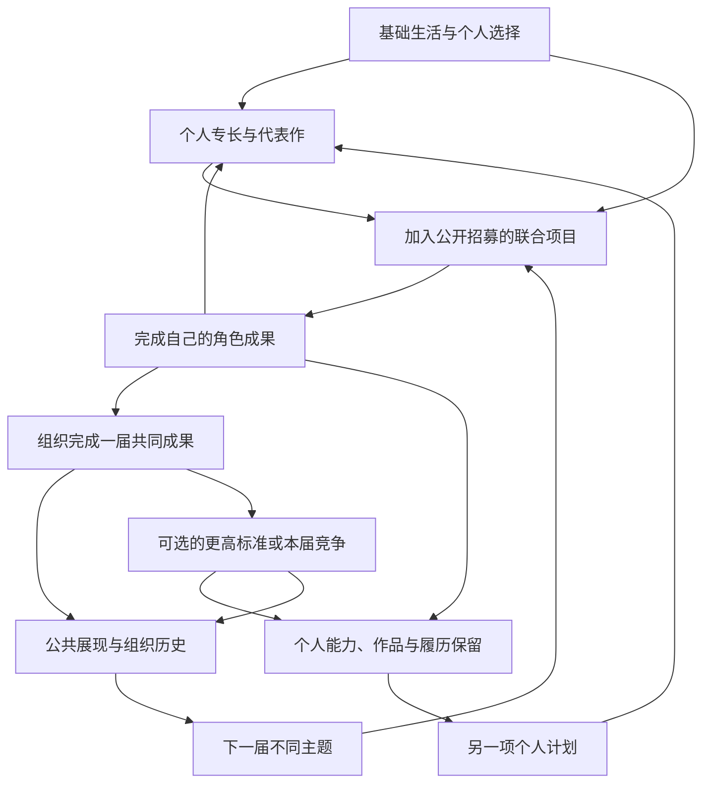
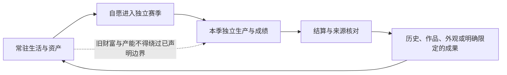

# Gensen 的终极目标、赛季与长期积累

> **资料范围（2026-10-05 清理）**：当前玩法、数值、操作与分期统一以 [玩法方案 v2](gameplay-plan-v2-2026-10-02.md) 为准。保留长期目标/赛季研究及证据；大服交易/组织竞争前提不是 v2 当前阶段范围。

## 1. 核心结论

**Gensen 值得拥有明确、可完成、值得展示的远期目标。建议同时区分个人生涯目标、组织共同成果和当期竞争目标，分别定义完成条件与保留规则。** 不宜用一条全服百分比替所有人完成成长，也不宜把“每季重新开始”当成终极目标本身。

对大量陌生人同服、持续生产与交易的地图生活游戏，优先研究的组合是：**永久个人生涯与代表作、分届的组织联合成果、可选的标准条件竞争。** 如果测试表明主要乐趣来自新经济、新地理格局和开荒竞赛，则应转向独立赛季空间，认真隔离经济并定义成果如何带回。全服周期清零也是可讨论方案，但它会显著改变“经营长期生活”的产品承诺。

推荐方向仍是假设。终极目标的名字、认证、排名和稀有外观都不能自动让玩家在意它；玩家必须能看见自己想拥有的成果，理解达成的意义，并愿意投入过程。

| 问题 | 框架回答 |
| --- | --- |
| 需要类似完美度的终极目标吗 | 需要值得追求的远期完成状态；不必要求所有人把所有系统做到 100% |
| 多人终极目标如何设定 | 个人有自己的完成与代表作，组织有共同成果，世界有共享历史；三者相连但不互相代领 |
| 赛季制是否必需 | 不必需。先确定是否需要重新比较、重新分配机会或重建经济，再决定赛季重置哪些状态 |
| 新玩家怎样参与 | 尽快达到有效参与门槛，拥有自己的成长和成果；不要求追平老玩家全部资产与历史 |
| 老玩家保留什么 | 按方案明确保留资产、能力、作品、关系、履历与历史中的哪些；保留不等于全部带入竞争 |
| 组织者为何组织 | 共同成果推进自己的目标；培养成员提高组织完成目标的能力，且个人与团队成果均可归属 |
| 每季积累如何表现 | 在角色、家园、组织场所、地图历史和生涯档案中可辨认，而不只显示累计赛季点 |

## 2. 前提与证据边界

Gensen 的长期定位是大量陌生人共同在线、跨时段协作、持续生产与交易。非婚恋 CP、搭档、基友、闺蜜是优先的关系方向；婚恋、生子属于后续高级内容候选。NPC 仍可提供故事与生活反馈，但不承担大服唯一的终局目标。

公共地标的动机问题必须单独解决。某座桥对所有人有用，不等于某个人愿意持续承担材料和组织成本。本报告区分自愿捐赠、真实采购、共同备料与有明确成果归属的组织项目，不把所有交付都解释为集体奉献。

本报告比较各类保留与重置方案，不预设资产必须全部保留。文中的 Gensen 目标、分届规则和表现方式均为设计候选，不是已采纳的排期、已实现能力或经过玩家验证的结果。

机制事实以实际读取的游戏官方资料和星露谷 Wiki 为依据。访问日期为 2026-09-14；历史更新按对应版本引用，不作为相关游戏今日所有规则的完整清单。跨游戏比较支持机制选择，不能证明某种赛季制会提高 Gensen 的留存。

当前项目另有较新的执行边界：9 月 13 日记录明确优先优化现有体验和 3D 表现，暂停新增地域生产、材料交换。该次更新还改变了新手地块成长。9 月 11 日研究和更早 GDD 不能当作当前全部实现状态，本次研究也不恢复旧的系统开发排期。[^14]

## 3. 截图里的完美度究竟解决了什么

### 3.1 从分散活动到一个可理解的远期结果

星露谷的完美度将出货、技能、料理、制造、收藏、关系和若干高成本目标归入一个后期完成状态。进度跟踪器位于齐先生的核桃房，正常游戏内需解锁该地点才能查看；达到 100% 会开放顶峰及特殊过场等后期内容，并留下雕像、石雕和其他奖励。[^1][^2]

它同时承担三项职责：给不同活动一个共同方向，让玩家知道还缺什么，并在完成后明确承认这段经历。完成反馈包括场景、演出、物品与农场标志，完成度面板只是查看入口。

这种全内容完成目标，与“击败一个标志性最终对手”属于不同的目标结构。前者要求广度，后者强调某项集中挑战；Gensen 可以同时设置一条较聚焦的生涯完成线与一条自愿的全收集线，不必将二者合成唯一通关条件。

### 3.2 截图也显示了替代达成路径

图中出货、好友、料理、制造等分类未满，但底部显示“总完成度 100%（2 豁免书）”。星露谷 1.6 引入完美豁免书，每份以游戏内金币购买并增加 1% 完美度。截图与该规则相符；不能据部分分类未满，就判断截图异常。[^1][^2]

这提供一个有用的设计区别：**让玩家完成自己生涯，可以容纳替代路线；证明玩家在相同条件下取得某项成绩，则需要保持对应标准。** 在 Gensen 中，买材料、委托他人生产、选择另一种作品都可以支持生活目标；别人完成的操作、作品和竞技成绩不应因此成为自己的履历。

不建议把星露谷的付费豁免直接搬到大服公开荣誉。若可以用市场财富跳过全部成绩条件，个人技能、组织协作和荣誉可信度就会受到影响。需要先区分“我拥有这件物品”“我参与完成”“我亲自达成”和“我资助了项目”。

### 3.3 永久完成与当前全收集并非同一件事

英文 Wiki 明确记录：游戏更新加入新的菜、鱼、制作物和出货物后，原来的完美玩家可能不再显示当前内容 100%，但已经开放的顶峰仍可进入。[^1]

对持续更新的多人游戏，建议更明确地分开两种记录：

- **已获成果：**例如“初篇名家生涯完成”，绑定达成时的规则与内容范围，永久保留。
- **当前收集：**例如“新增地域收藏 12/20”，随新内容增加独立章节，不撤回旧证书或旧作品。

不要让玩家每次更新都从“已经完成”变回“过去不算”。也不应把早期较小范围的完成，伪装成自动完成未来全部内容。

### 3.4 多人完美度不是大服贡献系统

星露谷多人完美度是共享值，许多分类取某位玩家的最高完成度，并非把所有人各做的一部分简单相加。它适用于有限共同存档，但不能直接证明陌生人大服中每个人都获得了自己的经历。[^1]

Gensen 要分别回答：公共设施是否已经开放、这个组织完成了什么、我具体完成了什么。老玩家修好公共道路可以帮助新人，不能顺便让新人获得并未经历的个人成就。

## 4. 三种目标，三个完成对象

| 目标 | 完成主体 | 候选终点 | 完成之后 |
| --- | --- | --- | --- |
| 个人生涯 | 每位玩家 | 掌握一门专长并完成一件属于自己的代表作 | 保留作品、能力与履历，兼修另一方向或继续经营 |
| 组织共同成果 | 实际参与的一组玩家 | 完成一届跨地域联合成果，留下成员分工与共同作品 | 保留团队成绩与历史，换主题、提高表现或培养下一批成员 |
| 当期竞争 | 自愿参赛的个人或团队 | 在明确条件下达到某级表现、个人最佳或名次 | 本届结算并归档，下届重新比较，过去成绩不消失 |

此外可以有世界级目标，例如全服共同开放一项公共区域。它为地图提供阶段历史，但不应是所有人的唯一成长入口，也不应要求所有玩家先等同一全服门槛。

三类目标的关系可以是：



箭头表达建议的目标关系，不表示现有玩法已经形成循环。新人可以先参加合适的联合项目，再逐渐完成个人代表作，个人毕业不是多人入口的前置。尤其需要验证：代表作是否想要、联合项目是否比独自完成更有意义、做完之后是否愿意再来。

## 5. 可以借鉴的机制证据

### 5.1 生产采集也能连接个人成绩与共同世界

《最终幻想 XIV》的伊修加德重建让采集职业提供材料、制作职业交付物资。检验后的采集材料可以进入市场，制作交付提供经验和专用票据；最终排名还对应个人成就和称号。共同地区的重建并非只依靠无回报捐赠。[^3][^4]

其官方页面记载，重建结束后，各世界按制作职业的累计成绩树立对应工具造型的纪念碑；玩家也可以查看过去建设进程。这里的地图纪念物承载了已有活动和成绩，个人回报、公共贡献与永久表现同时存在。[^3]

边界同样重要：该重建已经完成，页面保留最终排名；后来的玩家可以继续交付获得经验与票据，地区还存在庆典活动，但不等于每个人都能重新参加当年的首建竞赛。它证明可以设计生产者参与、个人奖励和世界纪念，不证明一个公共建筑能无限提供终局内容，也不能直接当作公会组织动力已成立的证据。

### 5.2 常驻积累可以与周期目标并存

《激战 2》的专精可以为账号内角色开放行动能力；传奇武器库让满足角色条件的账号内角色使用已拥有的传奇物品。传奇绑定有庆祝与来源表现，专精也可通过名牌显示。这同时体现实际用途、长期投入和社会可见性，但账号内共享并不等于新账号自动追平老玩家。[^7][^8]

Wizard's Vault 的周期目标可以推进奖励获取，其中部分奖励帮助永久传奇目标。2023 年官方说明及随后上线公告明确，该系统引入的专属外观轮换后进入历史奖励页，仍可取得、价格更高；相关货币跨期保留。这个保证只适用于所述系统与奖励范围，不能扩写为全游戏所有内容永不过期。[^9]

对于新内容入口，其 Skyscale 官方介绍提供了简化的平行解锁路径和区域租用，也给同时拥有旧新两套专精的玩家保留组合增强。它展示的是“降低入场门槛、承认旧投入”的折中，不是完全同起点。[^10]

这条路的代价是老玩家资产、经验和人际资源会保留。只重置积分榜，并不能自然产生公平的新起点。若需要比较标准表现，应另行规定装备、配方、投入和外部支援的边界。

### 5.3 新起点可以发生在独立空间

《无人深空》2021 年的远征更新将一次共同旅程分成里程碑与阶段，阶段奖励、整次完成奖励和图章册让终点可见；当时远征存档结束后转为普通模式，已解锁的重要奖励可以在其他存档领取。[^5]

2024 年 Omega 更新进一步允许从既有存档进入远征、暂停并返回主存档，结束后带回一定形式的物品、技术、货币、发现与基地，并在目录中记录历史远征。不能将 2021 年“新存档开局”描述成此后永远唯一的参与方式。[^6]

它对 Gensen 的启发是“主生活与一段有终点的共同经历可以分开，再把经历带回”。但这套跨存档转移不能直接移植为大服贸易规则；大量赛季产出回流主世界，会影响其他玩家的市场。

### 5.4 硬赛季的核心是重新分配机会

《暗黑破坏神 IV》2023 年首赛季官方方案要求新角色进入赛季，同时允许部分账号解锁与探索进度保留；季末角色、进度与物品转入永久领域，赛季特有机制不因此全部保留。官方还把季节旅程描述为引导内容的长期方向，并把临时机制试验、尝试不同构筑和共同开始作为理由。这里引用首季制度，不推断 2026 年全部资产迁移规则。[^11]

《流放之路》官方概述将独立世界、排行榜和经济联系起来，以重现新服务器竞赛，而不用反复重置主经济。官方跨联盟交易规则更明确禁止用长期世界资产交换挑战联盟资产，以免以前的游戏时间被买成新赛季优势。[^12]

赛季物品也需要区分保存实体、继续可用和仍有产出来源。PoE 的官方季末公告展示了部分内容进入常驻、部分临时资源删除、部分旧物继续可用但停止产出等不同处理。挑战奖励则可以按多个完成阶段给出外观和可摆放奖杯，而非只奖第一名。[^13]

对 Gensen 而言，采用这条路线就意味着明确选择“反复经营一个新局”的价值。不能一面允许全部旧资产进入，一面宣称新经济从零开始；也不能只检查直接转账，而忽略跨世界购买材料、代工和组织补贴。

## 6. 四种完整方案的取舍

| 方案 | 重开什么 | 主要保留 | 获得什么 | 主要代价 |
| --- | --- | --- | --- | --- |
| A：永久生涯与连续章节 | 不统一重开；新章节追加自己的目标 | 家园、资产、能力、关系与所有历史 | 强归属，随时进入，完成节奏由个人决定 | 成熟市场和新老差距持续存在，较难创造集中重返机会 |
| B：持久世界与分届成果 | 本届目标、组织成绩、赛场结果与有限活动状态 | 主世界家园、资产、能力、关系、作品与历届记录 | 保留长期生活，同时提供共同时间与新一轮认可 | 必须明确公平边界，组织与内容运营成本较高 |
| C：全服周期重开 | 主世界农庄、经济、工具或能力按规则重置 | 账号关系、历史、外观等预先声明的继承物 | 新经济、新格局、首建机会重新出现，玩家集中开局 | 家业被清空，晚入局成本大，持续生活的承诺明显减弱 |
| D：常驻世界加独立赛季空间 | 独立空间中的生产、资产和竞争状态 | 常驻生活，以及赛季带回的限定成果 | 可以较完整地重开，同时保留主世界归属 | 分散人口，两套状态与经济更复杂，转移规则容易产生漏洞 |

### 6.1 A 适合什么产品

若核心向往是长期经营自己的地方、积累关系与作品，A 最一致。新目标用内容章节和个人项目提供，组织可以自行选择什么时候发起挑战，不必都对齐全服日期。

它不会自动解决通货、供给饱和和新玩家买不起东西的问题。持续市场仍需要真实消费、可达的基础购买力、有限的产能复利与公平的成长入口。不能因为没有赛季，就无限追加材料和价格。

### 6.2 B 适合什么产品

若同时重视长期家业与周期共同成果，B 最有潜力。赛季更接近“一届有主题、有完成标准的活动”，永久生活继续运行；深度玩家可以追求更高表现，普通玩家可以完成本届的一件具体成果。

但 B 需要承认两种活动的差别：开放经营可以使用既有财富与专长，标准竞争则限制这些优势进入。两者的结果分别命名和展示，不能用同一排行榜比较完全不同的条件。

### 6.3 C 何时值得选择

如果目标玩家最在意开服竞争、快速经营和从零塑造格局，且明确接受每局结束，C 有其一致性。清空物质状态可以结束一轮垄断与库存累积，重新创造早期商品需求和组织招募理由。

这不是低成本的经济修复。熟练度、信息和人脉不会被清零；头部组织仍可能更快占优。必须让较晚加入的人能完成一局有意义的目标，并承诺留下足够有价值的成果。对投入住宅、庭院和长期搭档生活的玩家，重建同一套东西也可能很快变成负担。

### 6.4 D 何时优于 B

当希望保留主生活，又需要真正的新供应链、新资产格局和开荒竞争时，D 比只重置排行榜更诚实。独立赛季空间可以有共同起点和独立市场，结束后带回成果与历史。

需要预先选择回流策略：只带外观与纪念、带需要重新支付材料建造的图纸、按规则有限转换，或者将角色资产留在独立历史空间。不同选择的经济影响不同，不能笼统写“全部保留”或“全部转永久”后再补账。

还要检查双份生活负担：进入赛季期间，主世界经营是否要求频繁打理，搭档是否留在另一世界，赛季功能奖励是否变成主世界必需投入。如果两边都要求出勤，或不参加赛季就缺关键能力，“自愿进入”实际上会失去意义。D 的选择条件必须包括主世界缺席成本、跨模式奖励依赖和两边的实际社交密度。

### 6.5 初步推荐与改变推荐的条件

**优先验证 B，保留 D 作为另一个明确方向。** 当前产品已有个人农场、角色与地图访问的基础，这让持久家业有可延续的对象；此前讨论又强调陌生人组织与共同荣誉，因此值得试验分届联合成果。

这不构成拒绝清零的先验结论。如果对照观察发现，多数目标玩家真正期待的是再开一局，愿意放下上一局产能与财富，而持久经营很快满足或停滞，则应转向 D，必要时重新讨论 C。若玩家反而不喜欢共同截止时间，A 应成为主方案。

## 7. 推荐方案的具体终极目标

### 7.1 个人：成为一门生活技艺的名家，并完成自己的代表作

“名家生涯”为暂用概念。它需要一个具体可见的终点，例如园艺方向完成自己的名园、料理方向完成自己的名店、工艺方向完成自己的代表工坊。角色获得一件能持续使用、布置和展示的成果，以及可说明达成经历的履历。

终点不应只是买一栋更大的房子。候选完成条件分成三部分：掌握一组基础生活能力；完成自己选择的专长经历；把这些能力组合成一件完整作品。条件对应的操作、作品规模和内容量，需要通过设计与原型才能确定，不在这里伪造小时数或任务数量。

| 条件组 | 需要证明什么 | 可以由他人帮助什么 | 不能代替什么 |
| --- | --- | --- | --- |
| 基础生活能力 | 理解并实际使用基本生产、制作和资源分配 | 教学、协助、基础材料采购 | 不能以其他人的完成记录代领自己的掌握 |
| 一门专长 | 能在这一方向处理不同目标，形成自己的选择 | 外地产物、部分加工、伙伴分工 | 不能只靠买齐成品被记成亲手制作全部作品 |
| 完整代表作 | 自己的规划与实际贡献形成一个可见、可用的成果 | 真实采购、合作制作、受邀共同布置 | 作者、供货者、合作方与资助者应按实际角色记录 |

毕业条件不要求攻略全部 NPC、建立指定关系、加入公会或精通所有职业。全图鉴、全专业和更高标准可作为自愿的完美目标，拥有独立的完成范围。

**一条可判断完成的候选实例：园艺生涯初篇。** 下表中的数量与条件只用于把终点讲清楚，不是已平衡的数值；实际内容目录应在该篇发布时固定。

| 项目 | 候选完成判据 | 不算完成的情况 |
| --- | --- | --- |
| 基础生产 | 亲自走通种植、收获、把产物用于食用、制作或交付中的一项 | 只购买一份成品，没有自己的基础操作经历 |
| 一次能力投资 | 建成一项个人生产或制作设施，并实际使用它完成后续目标 | 只付钱或只看到竣工动画 |
| 园艺专题 | 完成初篇预先公布的三项专题：常规培育、不同地域材料组合、有限空间布置；每项都有实作成果 | 只把同一件物品反复交三次，或用别人专题的完成记录代领 |
| 我的代表作 | 建成包含主题花境、一个有产出用途的种植区和可实际进入的交流区的个人名园，相关部分可使用且来源清楚 | 仅购买名园外壳，或挂牌后对应区域不可进入、不可使用 |
| 最后一步 | 用这座名园完成一次预先规定、可重试的使用流程：收获指定园艺产物，完成一种自选用途，并把本次代表作录入生涯 | 不以真实访客人数、点赞量、与 NPC 的恋爱或公会是否在线作为判据 |

最后一步完成时，固定的“园艺生涯初篇”记为已完成，名园作为自己的可用场所留下，并开放该作品的署名与展示。下一卷可以有新条件，但不会撤回这次完成。专题本身可以是较长的成长项目，不能用这张结构表推断实际只需几分钟或必然能支撑数月。

个人名园所用的材料和部件可以采购，外部制作记实际供货与作者来源；自己的规划和规定实作仍需自己完成。这样既允许市场帮助毕业，也避免把最高财富直接等同于全专业掌握。

### 7.2 组织：完成一届能代表自己的跨地域联合成果

组织可以是公开招募的合作社、工坊联合、园艺社或其他适合世界观的形式。候选终极成果是一届完整的联合展示与经营项目，例如“河湾生活展”：种植、料理、工艺和资源供给形成一个别人能进入、使用和理解的整体。

重点在于每位成员带着个人目标加入。园艺玩家完成自己的主题花园，料理玩家形成自己能持续使用的菜单与场所作品，工艺玩家完成自己的部件与布置成果。组织得到共同完成记录，个人带走自己的成果与经历。

名称和展览主题本身不保证吸引力。该方案至少需要证明：共同成果有个人独做难以获得的完整性或舞台；角色之间的协作影响结果；成果可以被看见或使用。若只是四个人各交一包材料换一张证书，它仍然没有解决原先地标的动机问题。

**贯通例子：河湾花宴。** 组织想做成一处可以实际使用的主题花园与料理场所。普通完成条件在开工前固定：主题花境、两款与主题相容的料理、可运行的制作与交流区，以及一次完整的收获、制作、上桌和场所使用流程。联合荣誉要求有真实玩家协作和各自可归属的成果，个人毕业不要求完成这项联合荣誉。

场地和材料预算有限，不能简单把个人方案全部拼在一起。园艺师想把空间留给花境，料理师需要食材种植与备餐空间，工艺师提出两种方案：增加立体花架，用更多山麓构件腾出食材区；或者保留平面花园，调整菜单并采购部分外地食材。两条方案能达到同一主题，但对矿料、农田、料理和资金的要求不同。

组织者的工作是协商方案、安排采购、把各人作品组合成能运行的整体。做成后，园艺师保留自己专题与花境经历，料理师保留菜单与实际制作成果，工艺师保留装置作品，组织者保留自己负责的方案和真实组织履历；共同场所属于已约定的组织资产。联合组件可以推进个人专题，但不会无条件替代个人名园的全部毕业要求。

新人可以承担一组花木培育或一份已约定的食材供给，得到自己的完成记录与采购报酬；培养后可以负责下一次主题中的完整区块。组织招募他的理由是补齐能力和分担真实工作，而不是获取一个新账号倍率。

这里的最后一步是场所内的一次可重试使用流程，检验成员的选择能否共同成立。普通完成不需要当天凑够观众，实际真人来访、销售与欣赏另作经营表现；不能用 NPC 演出伪造真实买家。标准竞赛可以在独立、等效投入条件下重新比较同类方案，不能把开放经营的大额采购直接转成本届技术冠军。

这个例子证明的是如何写出目标与相互影响，不证明操作和协作已经好玩。若实际使用流程没有可学习、可改进的内容，它仍只能成为有限的合作作品，不能被包装成能长期替代高水平团队挑战的系统。

### 7.3 完成、优秀与排名分开

| 层次 | 面向谁 | 判断方式 | 价值 |
| --- | --- | --- | --- |
| 本届完成 | 广泛参与者与普通组织 | 满足预先说明的成果条件 | 人人有可争取的阶段终点，不靠击败别人 |
| 高水平成果 | 有意深入的玩家与团队 | 达到更高的作品或协作标准 | 可反复改善，记录自己的最佳与团队成长 |
| 当期排名 | 自愿竞争者 | 在明确可比的规则下比较成绩 | 产生稀缺荣誉、讨论和组织目标 |

不应把原材料总价、在线总时长、总捐献额或无限交易额直接当作最高水平。大众作品展示可以保留开放经营的资源优势；如果另设标准赛场，应给出共同可用的工具、配方与投入条件，单独形成成绩。

审美也不宜压成一个假装完全客观的总分。功能完成、标准条件下的方案表现、主题策展和玩家欣赏可以分开；其中某一种获认可，不代表在所有维度都更优秀。

公平并不意味着抹除练习和合作经验。需要公平的是已承诺的条件，而不是保证每个人同样优秀。具体评分必须抵抗买票、互刷与换号等操纵，同时避免把组织做成单纯刷分工厂；本报告不宣称这部分已经解决。

### 7.4 组织者为何带新与拉新

组织者首先也要有自己的愿望：形成一个拿得出手的组织成果，实现自己的构想，取得组织荣誉，或者培养可靠伙伴。组织扩展能带来更完整的专长组合、更可靠的合作与更多创作可能，而不只是增加一项管理工作。

新人当下应能完成有用的一部分，成长后可以独立承担更多工作。带新应改善组织的长期能力；如果加入只稀释奖励、使平均分变差或增加负担，拒绝新人是合理选择。不能靠按邀请人数发钱掩盖这种冲突。

因此，公开的新人成果、共同完成与顶尖排名不宜共用一个让组织排斥新人的简单平均分。参与历史、个人成长和竞技阵容需要分开记录；追求极限成绩的队伍也不必承担所有带新职责。

### 7.5 回答投入动机，而不是重新命名捐赠

公开基础设施仍可允许自愿捐赠，并对未捐者开放。联合项目则应事前说明作品归属、材料用途、参与者所得和未完成时的处理。供应者可以只是收取实际报酬的供应者，不需要同时热爱项目。

个人成果可以帮助组织完成，组织成果又为个人带来作品、协作经历、展示和进一步目标。这是待验证的互相推动关系。若这些回报不能让玩家在没有首建金币奖励时仍愿意参与，就应修改或放弃该目标，而不是增加材料数量。

## 8. 推荐方案的一届如何开始与结束

### 8.1 先有完成条件，再定季长

赛季至少需要说明主题与规则、可达成成果、参与窗口、资产结算和历史保留。现实气候季节、作物生产时间、内容章节和竞赛赛季不是同一个时钟。

不宜先决定八周或十二周，再倒推玩家每周必须做多少任务。应根据实际完成一件作品的投入、参与者常见缺席、组织凑齐合作的频率和团队内容产能决定窗口。固定日周任务、连续签到或错过即损失的材料并非赛季的必要组成。

| 阶段 | 玩家看到什么 | 可以完成什么 | 结束边界 |
| --- | --- | --- | --- |
| 预告与选择 | 一件可见的本届成果、明确规则和几条可选方向 | 选择目标、寻找组织或独立计划 | 不要求抢报名才能取得基础资格 |
| 参与与筹备 | 自己的缺口、实际工作和伙伴成果 | 自己的一件作品、一段协作或一次供给 | 有短会话可停点，不要求全体同时在线 |
| 展示与挑战 | 已形成的共同作品与可选更高标准 | 常规完成、更好方案、相关角色成绩 | 普通完成与竞赛截止分别说明 |
| 结算与归档 | 本届结果、作品去向、保留和转换清单 | 获得已达成的成果与可查历史 | 合资格成果不靠最后一分钟在线领取 |
| 后续与下一届 | 保留的作品、可回访内容、另一项新目标 | 补个人经历、继续经营或休息 | 不拆主家园、不要求重做已完成生涯 |

### 8.2 内容完成与当届荣誉分开

建议让本届普通个人内容在结束后保有非竞赛的完成路径，具体可以是保留个人已接项目、开放回顾版本，或者在后续提供等价取得途径。后来的玩家可以完成同一主题的作品，但结果应标记为后续完成，不能补发未发生的当届排名。

团体实时经历无法完全重放，公共历史也不能伪造。某届开幕参与、当届纪录、真实参与成员名单属于当时发生的事实，可以有独特标记；基础能力、必需配方和普通表达内容不宜全部靠永久绝版制造需求。

**未完成联合项目也需要有具体归宿。** 推荐 B 的默认候选如下；它要求有相应的所有权与结算设计，不能仅靠一条说明文字实现。

| 赛季结束时的状态 | 候选处理 |
| --- | --- |
| 已托管但未用于制作的个人材料 | 解除本届托管并归还原出资人；若此前已经完成真实采购，物品仍属于实际买方 |
| 已消耗原料制成的部件 | 保留部件及实际归属，不同时再退一份原料；采购承诺与报酬不因换季取消 |
| 我的区块或专题已经完成，整体未完成 | 保留个人实际达成的记录、作品与角色；不提前授予组织全体完成或当届名次 |
| 整体还需少量合作 | 项目转入非竞赛延续，可继续或招募新的合作者；来源记录区分本届参与与后续完成 |
| 原组织解散或成员不再回来 | 保留个人履历；个人所有的可移动作品可按事先约定取回，已转为组织资产的部分不允许单方拆走 |
| 项目依赖无法继续提供的临时机制 | 应在投入前公布可执行的转换与补偿；无法给出合理归宿时，不应把长期资产投入该临时项目 |

例如花宴中的新人已完成花木培育，料理部分尚未完成：新人的专题与已经支付的供货报酬保留，组织可以在非竞赛状态继续办完，最终取得后续完成记录。它不能补成上一届冠军，也不应迫使新人把同一份工作从头再做。

这不是承诺每种限时内容都无限维护。需要决定哪些进入回顾目录、哪些只保留作品和历史、哪些以后再开放相近挑战，并把维护成本纳入方案选择。

### 8.3 让完成成为真正的结束点

普通参与者完成一届后，应能感到“这一段做完了”，而不是奖杯弹出后立即出现同一件事的无限追加条。更高水平、另一专长、团队改进和经营复购可以作为自愿方向。

部分玩家完成后休息，是有限目标的正常结果。需要观察他们是否满意、是否愿意在值得的新目标出现时回来，而不是只追求赛季最后一天仍被任务绑住。

## 9. 哪些积累保留，哪些重新比较

下表是推荐方案 B 的候选规则。它不是全服清零方案 C 的承诺；选择另一方案必须重新写一份相应契约。

| 积累对象 | 主世界跨届处理 | 对新一届普通活动的作用 | 对标准竞争的作用 |
| --- | --- | --- | --- |
| 身份与角色外观 | 保留 | 继续被认识与表达 | 不因旧外观获得成绩倍率 |
| 家园、店铺与个人作品 | 保留并可继续使用 | 是继续经营与创作的基础 | 不自动带入无限产能 |
| 常规金币与材料 | 保留 | 可采购和支持开放联合项目 | 不可无限购买标准赛场的投入 |
| 工具、配方与生活能力 | 保留 | 老玩家有便利和更丰富选择 | 采用当期共同可用条件或明确组别 |
| 个人毕业与固定章节完成 | 保留原规则版本与达成事实 | 不重做基础毕业 | 不自动换成本届成绩 |
| 个人发现与收藏 | 原章节保留，新内容另开章节 | 提供长期自选目标 | 不以历史总收集量直接判当季强弱 |
| 非婚恋搭档与共同经历 | 保留关系状态及实际历史 | 为共同计划提供连续性 | 不强迫结成关系才有参赛资格 |
| 组织身份与历史作品 | 保留 | 支持招募、风格和长期合作 | 本届名单、贡献与成绩单独记录 |
| 本届成绩与名次 | 结算封存 | 可回顾、可选择展示 | 新届重新取得，按规则版本比较 |
| 活动专用材料和临时能力 | 事先明确到期、有限转换或退出 | 不得静默删除未披露的资产 | 不跨届积累成无限优势 |
| 共享基础设施 | 已建成果保留 | 新人和回归者可以使用 | 不凭一次捐赠永久控制他人入口 |
| 本届公共展陈 | 当届展示，随后精选或归档 | 可回访作品、保存来源 | 不永久占满新一届的展示位置 |

### 9.1 “保留”需要说明保留到什么程度

可继续使用的家园、需要重新付材料建造的图纸、仅可参观的归档场景、不能进入的截图，是四种不同结果。不能把后三种统称为完整保留家业。

物品同样如此。仍有图标但不能使用，与仍能使用但无新增产出不同。采用赛季机制时，应在玩家投入之前说明归宿，尤其是功能道具、稀有消耗品和临时产能。

### 9.2 历史积累不必都变成生产优势

长期成长可以保留实际能力，例如更多配方、更方便的操作、可处理的专业任务和表达选择；这比只发纪念徽章更有使用价值。但无上限地叠加常规产量、掉率和财富倍率，会把每届优势不断推高。

建议在常驻生活中允许有边界的能力积累，在标准竞争中限制所用条件。由经验、人际关系和组织默契产生的优势依然存在，需要如实承认；赛季规则无法把人的记忆清零。

## 10. 积累如何在世界里被看见

### 10.1 五种载体各自承担一件事

| 载体 | 玩家实际看到的东西 | 需要能解释什么 | 避免的问题 |
| --- | --- | --- | --- |
| 角色 | 自选的专业标识、当届或历史称号、代表性工具外观 | 这人擅长什么、哪一届做过什么 | 所有历史标识同时堆在头顶，旧玩家靠视觉体量压倒新人 |
| 家园与店铺 | 可使用的代表作、作品细节、精选纪念物 | 这份积累如何进入日常生活 | 只剩一个奖杯仓库；截图替代实际资产却称完整保留 |
| 作品来源 | 设计者、制作者、供货方、合作成员、完成时间 | 谁做了什么，物品转手后来源仍可理解 | 持有者被当成作者，出钱者代领全部功劳 |
| 组织场所 | 本届共同作品、历届精选与成员角色 | 组织有什么风格，能做成什么 | 会长改写个人历史，退出后抹掉既有贡献 |
| 地图与生涯档案 | 当前作品入口、地方历史、分届完成记录 | 哪个地方发生过什么，我参与了哪一段 | 永久地标无限堆叠；全世界只剩一张历史财富榜 |

强积累表现应在正常生活中被自然遇见：交易时看见制作者，访问时看见作品，寻找组织时看见共同经历。不是要求每个人都打开另一个成就菜单，才知道过去发生了什么。

### 10.2 三个视角的文字示意

下列是信息结构示意，不是已经实现的界面，也不是最终文案。

```text
我的生涯
  园艺生涯 · 初篇       已完成
  代表作               河湾四季园
  我的角色             设计、种植
  新篇收藏             独立记录，不撤回初篇完成

本届共同目标
  秋日生活展           常规成果已完成
  我完成的作品         水岸花境
  组织接下来可选       改进方案 / 公开展示 / 本届收官

历届记录
  第一届 · 河湾        园艺协作，作品可回访
  第二届 · 山麓        组织筹备，共同成果可查看
  当前展示             由我选择一件代表作与一项荣誉
```

个人生涯不随赛季重归零，本届目标不混入过去成绩，历届记录也不要求补齐所有缺席的年份。新玩家可以从自己的第一份完整记录开始，不必面对一个永远无法补满的历史总百分比。

### 10.3 结算是场景和经历的收束

候选呈现可以包括作品揭幕、个人工具或作品细节的变化、组织精选展陈、地图上可访问的成果，以及明确记录实际参与者的纪念。它们应对应真实达成的东西，而不是靠演出把普通材料交付包装成壮举。

已有资格的奖励和履历应在结算时保存，允许离线后查看。不能要求所有人同一时刻参加仪式才承认贡献；离线成员可以出现在参与名单中，但不能伪造成实际参加了现场合照。

关系纪念还需要当事人的展示选择。搭档、基友、闺蜜的共同作品可以有私人意义，不必都成为公开攀比指标；关系变化不应倒扣已独立取得的能力与作品。

## 11. 新手、晚来者与回归者

### 11.1 新人先能一起玩，再逐步拥有自己的全部积累

新人不需要追平老玩家多年存款、每件作品与全部关系，才算能参与。需要先追到的是当期基础活动的有效参与门槛，例如能承担一个完整的小环节、使用公共设备、完成一份自己有所得的作品。

目标呈现也应分层：开局先看见一件具体的远期成果和眼前可完成的一步，理解基础生活后再展开完整的生涯条件。本届活动只呈现当前可承担的角色及其后续空间，不把截图式的全部百分比作为新手首页。

可以考虑公共工具、限定范围的借用设备、简化的基础能力路径和可主动恢复的材料来源。它们帮助进入活动，不直接授予大师履历、顶级成绩或全部稀有资产。《激战 2》的平行解锁与租用提供的是这种折中的参考，不是无条件复制。[^10]

| 玩家处境 | 合适的当前目标 | 应保留的成长空间 |
| --- | --- | --- |
| 刚进入游戏 | 完成一段短生活，看到一种想要的远期作品 | 自选专长与个人毕业 |
| 进入已建成的地区 | 使用公共成果，完成自己的第一份贡献 | 不必重交历史工程材料 |
| 加入成熟组织 | 承担清楚、有用、能独立完成的一部分 | 从基础角色成长为可负责更复杂工作的成员 |
| 当届很晚加入 | 做得完的一段成果，个人生涯继续推进 | 不承诺临结束也能拿满当季排名奖励 |
| 缺席数届后回来 | 看懂当前机会，恢复基础参与能力 | 可选择补旧内容，不必按年份补作业 |
| 全服首达已结束 | 自己或组织的首次完成、自己的最好作品 | 顶尖历史名次之外仍有完整的目标 |
| 已完成个人生涯 | 另一专长、共同作品、经营、关系或休息 | 不因暂离被撤回毕业与能力 |

### 11.2 新人贡献不能只是便宜劳动力或人数配额

新人需要有自己可完成的结果。基础材料供应可以是有效参与的一种，但若永远只能替老玩家交料，而自己的成长、收入与作品没有推进，这套结构仍不成立。

反过来，也不能给每个新账号一份足够决定项目结果的高额补贴，然后用“组织带新很多”证明社区健康。真实的带新应改善技能、承担角色和未来合作，而不是完成拉人配额。

### 11.3 晚加入是所有赛季方案都要面对的问题

硬重开主要为季初提供较新的物质起点，不自动帮助最后一周注册的人。滚动开服可以让更多人遇到新局，却会分散人口、贸易和朋友，不能作为无代价的解决办法。

推荐方案 B 可以把个人生涯与大部分普通内容保留为可继续推进，只有本届竞技和历史身份按时结算。方案 C、D 则需要说明迟入场者还能完成哪些阶段、结束后具体保留什么，以及下一届是否真的值得重开。

## 12. 赛季经济与公平的实际边界

### 12.1 三个目标不能无条件同时成立

完全开放的跨期交易、旧财富无限影响新期，以及新期成绩不受旧财富影响，不能同时成立。需要选择在哪个活动范围内保留经营优势，在哪个范围内约束输入。

| 场景 | 合理的承诺 | 不能宣称 |
| --- | --- | --- |
| 主世界开放经营 | 老投入有实际价值，新人有可进入的市场与成长路线 | 人人财富和产能一样 |
| 公开联合作品 | 可采购与分工，明确作品和参与来源 | 总成本越高就代表个人操作越强 |
| 标准条件竞争 | 相同或明确分组的条件，成绩重新取得 | 只清零榜单就已公平 |
| 独立赛季经济 | 限制旧资产和旧产能进入的新供需环境 | 两个钱包就已经隔绝所有旧资本 |

即使把旧金币挡在赛场外，长期财富仍可能买到主世界生活便利，从而让玩家有更多时间练习；老团队还有人脉、经验与组织能力。公平要具体到承诺的参赛条件，不宜许诺所有背景差异消失。

### 12.2 双世界要防直接和间接输送

《流放之路》的官方跨联盟规则说明了这个问题：永久世界付款、赛季世界交货，仍然可以把过去积累转为新赛季优势。[^12]

Gensen 若采用 D，至少要解释金币、材料、设备加成、代工、公共资金、可交易奖励和下一季兑换资格能否跨界。名义上只转移外观也不一定经济中性；可交易的稀有外观同样能成为财富与交换媒介。



图表示需要定义的边界，不表示技术上已经阻止所有跨世界交换。

### 12.3 换季不会自动创造健康需求

永久世界中的金币与普通材料保留，就仍需要真实消费与资产回收。系统发放金币购买赛季材料，会减少物品却增加货币；交易只是换持有人；公款再发给玩家通常仍是内部转移。

独立新局会重新产生种子、工具与建造需求，但季末预期失效也可能使玩家停止投资。赛季产物大量回流永久市场，还可能压低原有商品价格。需要同时查看赛季内与常驻世界的账，不能只证明其中一个局短期平衡。

生活作品、料理、装饰和收藏都有需求边界。新主题、角色成长与组织活动能提供新用途，但不能把“以后会一直有新玩家、新活动”当作永久需求已经闭合的证据。

## 13. 不能靠赛季解决的四个问题

**第一，终点没有吸引力。** 把普通花箱改叫名家作品，或加一个最高等级认证，不会自动让人想要。需要展示真实成果，并观察玩家愿不愿为它做准备。

**第二，没有可学习、可改进的表现。** 要让玩家像追求高水平团队成绩那样长期投入，就需要能理解和改善的实际挑战。不同预算、空间、地域条件和组合方案只是候选；若最后只有提交材料、等待和领取，就缺少支持深度表现追求的基础。

**第三，内容产能不足。** A 需要持续活动或值得反复的表达，B 需要按期的主题与有意义变化，C 需要耐重复的新开局，D 还需要维护两套世界。生成更多名称和文本不能替代这些成本。

**第四，所有人被迫追同一目标。** 普通毕业不必全收集，全收集不必要求恋爱，高水平组织不必包揽全部新人教学。保留多个有终点的方向，才能让“终极目标”成为牵引，而不是统一的生活考核。

## 14. 选择方案前的验证设计

以下是后续研究与原型的输入，不是立即新增系统的排期。

| 要验证什么 | 比较方式 | 看什么行为 | 失败后应做什么 |
| --- | --- | --- | --- |
| 终点是否值得追求 | 展示具体名园、名店、工坊等成果及达成路径 | 玩家自主选一个目标，并愿意准备下一步 | 改成果与能力意义，不先增加进度条 |
| 个人与组织是否同向 | 相近投入和奖励下比较公共捐赠、个人作品进入联合成果、标准合作挑战 | 成员说得清自己所得，组织者主动规划 | 修改成果归属与协作价值 |
| 新人是否有用 | 让新人加入已具备一定能力的真实团队 | 新人做出结果，老玩家愿意再次合作 | 改角色与参与门槛，不加拉人数奖励 |
| 完成后是否愿意再来 | 保持基础奖励可比，给同题改进或不同约束 | 出现自主的第二、第三次选择 | 回到重复活动，不靠新季掩盖失败 |
| 清零是否可接受 | 先让玩家真正投入一份家业，再比较保留、部分重开和独立新局 | 实际选择、重开行动和回访 | 根据行为选择 A、B、C 或 D |
| 积累是否能被理解 | 让另一位玩家访问作品与履历 | 能看出做成了什么、谁做的、何时完成 | 改世界表达与来源，不堆徽章 |
| 季末是否变成负担 | 覆盖临结束、错过一段时间和晚加入情境 | 期待、明确取舍、义务感、放弃原因 | 改窗口、补做和结算规则 |
| 经济是否被转移冲击 | 模拟并观察普通玩家、高产者、组织资金和双世界流动 | 净发行、存货、使用、可负担性、关联交易 | 改输入输出边界，不只调整税率 |

必须尽量保持各方案的核心内容质量与奖励吸引力接近。不能用精美丰富的赛季版本对照贫乏的永久版本，再把结果归因于清零制度。

短期访谈、少量样本和纸面推演可以排除明显问题，不能直接证明多年留存、真实大服市场稳定或长期组织生态。对照需要包含新人、老玩家、回归者、组织者与不愿组织的人，实际投入与口头偏好分开记录。

## 15. 建议形成的下一项设计决定

先决定一件玩家看得见、愿意追求的个人代表作，以及一种使个人作品进入共同成果的组织目标。明确普通完成与极致完美的区别，再选择是否用固定赛季组织它们。

若这组目标成立，优先用方案 B 检验持久家业与分届成果能否相互支持；标准竞争作为清楚划界的可选层。如果反复白手起家明显更有吸引力，再选 D，并将赛季资产和常驻经济的关系作为核心规则，而非后续补丁。

当前不冻结季长、评分权重、材料数量、奖励价格和迁移比例。原型需要先证明目标值得追、组织值得参加、结果值得保留，之后才有依据为整个赛季安排足够的内容。

## 来源

来源支持所述机制，不支持对 Gensen 留存与玩家动机的既成结论。外部页面访问日期为 2026-09-14。中英文星露谷条目在部分物品总数上存在差异，本报告不采用这些总数来冻结 Gensen 的完成条件。

[^1]: Stardew Valley Wiki，[Perfection](https://stardewvalleywiki.com/Perfection)。持续更新。用于完成维度、查看入口、后期奖励、多人聚合、1.6 豁免及版本更新后完美度与顶峰保留的区别。
[^2]: Stardew Valley Wiki，[完美](https://zh.stardewvalleywiki.com/完美)。持续更新。与本次提供的完美度截图对照，用于中文机制和豁免说明；截图中的部分分类不足 100%、底部注明两份豁免书为图像可见信息。
[^3]: Square Enix，[Ishgardian Restoration](https://na.finalfantasyxiv.com/lodestone/ishgardian_restoration/)。官方页面包含重建完成后的说明、材料检验与市场、制作交付回报、纪念碑和 Past Progress。它是已完成重建的机制记录，不是当前重开中的全服建设承诺。
[^4]: Square Enix，[Skybuilder Rankings](https://na.finalfantasyxiv.com/lodestone/ishgardian_restoration/ranking/)。历史最终排名与奖励页，说明阶段排名、成就、称号与奖励发放；不把历史排名当作当前仍可争取的同一届名次。
[^5]: Hello Games，[Expeditions Update](https://www.nomanssky.com/expeditions-update/)，版本 3.3，2021 年。用于阶段里程碑、图章册、限时结束、普通存档转换和跨存档奖励。
[^6]: Hello Games，[Omega Update](https://www.nomanssky.com/omega-update/)，2024 年。用于既有存档参与、主存档与远征切换、物品和技术转移、货币/发现/基地回流及历史远征目录。仅说明该版机制，不作为 Gensen 资产可无限回流的经济依据。
[^7]: Crystin Cox、Nellie Hughes / ArenaNet，[Reimagining Progression: The Mastery System](https://www.guildwars2.com/en/news/reimagining-progression-the-mastery-system/)，2015-02-05。用于账号专精、行动方式与名牌进展的原始设计说明；后续实际能力对照来源 10。
[^8]: The Guild Wars 2 Team / ArenaNet，[The Legendary Armory Arrives July 13](https://www.guildwars2.com/en/news/the-legendary-armory-arrives-july-13/)，2021-07-06。用于传奇武器库跨角色使用条件、外观便利、庆祝与来源提示，以及分阶段活动通向传奇目标；不声称传奇靠更高属性碾压。
[^9]: ArenaNet，[Discover the Wonders within the Wizard's Vault](https://www.guildwars2.com/en/news/discover-the-wonders-within-the-wizards-vault-in-guild-wars-2-secrets-of-the-obscure/)，2023-08-15；[Studio Update: Guild Wars 2 in Autumn and Winter 2023](https://www.guildwars2.com/en/news/studio-update-guild-wars-2-in-autumn-and-winter-2023/)，2023-10-24；[Live Now: Through the Veil](https://www.guildwars2.com/en/news/live-now-through-the-veil-first-major-update-for-guild-wars-2-secrets-of-the-obscure/)，2023-11-07。用于周期目标、奖励选择、专属外观历史页与货币跨期保留。2025-07-15 [Visions of Eternity 公告](https://www.guildwars2.com/en/news/announcing-guild-wars-2-visions-of-eternity/)确认周期奖励体系继续使用；不据此宣称 2026 年全部奖励条款未变。
[^10]: The Guild Wars 2 Team / ArenaNet，[Soaring with the Skyscale](https://www.guildwars2.com/en/news/soaring-with-the-skyscale/)，2023-08-08。用于平行简化解锁、区域租用和旧新专精组合增强的折中。
[^11]: Blizzard Entertainment，[Diablo IV Post-Launch Experiences Revealed](https://news.blizzard.com/en-us/article/23952500/diablo-iv-post-launch-experiences-revealed)，2023-05-10；[Malignance Runs Rampant in the First Season of Diablo IV](https://news.blizzard.com/en-us/article/23967322/diablo-iv-season-of-the-malignant-is-coming-july-20)，2023-07-06。用于首季新角色、部分账号继承、季末迁移及临时机制。不是 2026 年完整规则表，未对未逐项核实的独立金币余额等作结论。
[^12]: Grinding Gear Games，[Game Overview](https://www.pathofexile.com/game)，Leagues and Events 节，无统一发布日期；Chris / GGG，[Cross-league trading is not allowed between long-term and three-month challenge leagues](https://www.pathofexile.com/forum/view-thread/541124)，2013-10-16 发布，2023-10-30 最后编辑。用于独立经济与限制旧资本换取新季优势的设计原则；旧帖不作为当前执行效果的证据。
[^13]: Grinding Gear Games，[What Will Happen When the Keepers League Ends](https://www.pathofexile.com/forum/view-thread/3912208)，2026-02-16；[What Happens When The Mirage League Ends](https://www.pathofexile.com/forum/view-thread/3984581)，2026-07-14；[Keepers of the Flame Challenge Rewards](https://www.pathofexile.com/forum/view-thread/3870709)，2025-10-31。用于季末分别处理机制、资产、产出来源和可用性，以及阶段外观和挑战奖杯。规则按对应赛季引用。
[^14]: Gensen 项目资料：[9 月 13 日 Android 体验更新](https://github.com/IndieMiao/sensen-godot/blob/25b7a8a6e0574f9b0c4c97f480238e98d5d9985c/docs/product/investor-build-2026-09-13.md)；[下一阶段行动蓝图](https://github.com/IndieMiao/sensen-godot/blob/25b7a8a6e0574f9b0c4c97f480238e98d5d9985c/docs/product/next-stage-action-blueprint-2026-09-10.md)；[地域经营与成长 GDD](https://github.com/IndieMiao/sensen-godot/blob/25b7a8a6e0574f9b0c4c97f480238e98d5d9985c/docs/product/regional-growth-gdd-2026-09-10.md)；[好玩优先方向](https://github.com/IndieMiao/sensen-godot/blob/25b7a8a6e0574f9b0c4c97f480238e98d5d9985c/docs/product/fun-first-rework-2026-09-07.md)；[9 月 11 日星露谷研究](stardew-gensen-framework-research-2026-09-11.md)。较早的[地图经营方案](https://github.com/IndieMiao/sensen-godot/blob/25b7a8a6e0574f9b0c4c97f480238e98d5d9985c/docs/product/map-farm-game-design.md)和[MVP 生活模拟方向](https://github.com/IndieMiao/sensen-godot/blob/25b7a8a6e0574f9b0c4c97f480238e98d5d9985c/docs/product/map-farm-life-sim-direction.md)有历史赛季与四季庭院设想，其已被替代的时限、数值与 Gate 不构成本次新设计的约束或已实现事实。非婚恋关系优先、地标动机质疑和本次不预设保留底线，作为本轮产品讨论的设计输入，不作为竞品事实。
