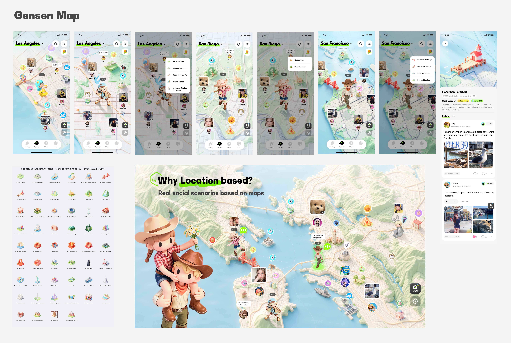

# 洛杉矶地图与 UI 调整评估

> **资料范围（2026-10-05 清理）**：当前玩法、数值、操作与分期统一以 [玩法方案 v2](gameplay-plan-v2-2026-10-02.md) 为准。保留真实地图/POI资料与透明素材方案；旧附近玩家抽屉/避让/独立 NPC map解锁早已被la-map-interactions覆盖，当前第9/11/16章生效。

- 日期：2026-09-22。
- 状态：历史评估与建议。用户随后批准主视觉并明确要求开始，Android开发样板已实现，见[QA记录](../qa/la-map-2026-09-22.md)；本文建议不自动代表全部已上线。
- 视觉审阅进展：用户于 2026-09-22 确认[洛杉矶地图主视觉稿](../design/la-map-2026-09-22/README.md)，后续地图实装以该稿对齐；本评估中的技术建议与工作量仍按实际数据和实现验证。
- 用户目标：参照提供的 Gensen Map 设计图改善 UI 与地图丰富度；优先洛杉矶；加入真实 POI、类型匹配素材和已解锁 NPC；POI 仅展示基本资料。
- 用户补充：地图默认仅自己是完整 3D 角色，其他玩家默认显示头像。其他玩家仍然保留。
- 本轮没有修改游戏代码、发布包、服务端或农场数据。

## 1. 结论

方向可行，且与地图承载地点发现、居民活动和进度反馈的产品方向相容。主要工作是地图内容层、显示层级、样式与原生桥接；不能仅靠替换按钮贴图完成。

建议组合为：浅色真实底图 + 一名完整 3D 玩家角色 + 其他玩家头像 + NPC 头像 + 风格统一的 POI 小景 + 轻量悬浮 UI。

POI 使用预先生成、人工检查的透明背景 2.5D 素材。真实经纬度、名称、分类来自数据；素材承担风格化表达，不代表对应商户真实建筑外观。参考图里的陶土浮雕地形与普通地图换色是不同工作；本轮建议先完成底图配色、信息密度与地点小景。

## 2. 展示与交互建议

| 对象 | 地图默认显示 | 点击结果 | 实现边界 |
| --- | --- | --- | --- |
| 自己 | 唯一完整 3D 角色，保留真实保存装扮 | 角色相关入口或定位 | 浏览位置与真实 GPS、原农场归属分离；跨城浏览不得迁移农场 |
| 其他玩家 | 头像、短名称；重叠时聚合 | 简短玩家/农场卡，复用访问入口 | 首轮沿用公开农场锚点，不称为实时真人位置 |
| 已解锁 NPC | 与玩家区分的头像边框、名字和一个状态角标 | NPC 小卡，接续既有对话/委托入口 | 复用现有解锁和服务端状态，不在客户端提前解锁或发奖励 |
| 普通 POI | 类型匹配的小型建筑/物件素材 | 名称、类别、地址（有则显示） | 数据缺失时保留已有字段；无须评论、评分或动态流 |
| 重点地标 | 单独制作的特色素材 | 同样的基本资料卡 | 使用真实位置，远近视图分级展示 |

“默认一名 3D 角色”不要求把地图上的建筑都改成平面，但首轮使用 2.5D 地点素材更可控。也不建议选中其他玩家后自动增加完整 3D 角色。

头像优先采用产品已有的可信头像来源。现有地图 API 只有 `avatar_ref`，并没有账户头像 URL；当前远端地图角色也由 `SeededOutfit` 从引用生成，并非读取对方真实保存装扮。若目标是用户上传的照片头像，需要增加相应字段与加载能力；若采用游戏角色头部头像，可复用已有截图缓存思路，但需明确远端装扮来源。

## 3. UI 风格

参考图的主要特征：浅暖灰/奶白道路、浅绿地貌、青蓝水面；人物和地点具有玩具体积感；UI 使用薄白色悬浮面、深灰字、轻投影和少量亮绿强调。

建议地图先作为风格样板，再同步公共按钮、弹窗和页签：

- 顶部保留城市名称和少量入口，减少大面积背景板；地标列表可作为洛杉矶快速浏览入口。
- 底部用紧凑胶囊导航承接现有功能，不直接照搬参考图中尚未实现的社交栏目。
- 降低蓝紫描边、厚倒角和高饱和渐变的存在感，统一字体、圆角和间距。
- 让人物与 POI 保有立体感，操作控件保持清晰轻盈。常用入口仍保留短标签，尤其保留农场“行走 / 种地”的发现性。
- 地图小图标可以视觉紧凑，实际触摸目标仍建议至少 44–48 逻辑像素；名字不全部常驻，选中后展开。中文、白底对比和安全区另行验收。

## 4. 洛杉矶范围与显示层级

当前地图常态围绕农场中心限制约 ±450 米平移，缩放为 15–18。该范围不足以承载设计图里的城市地标探索。

建议增加两级：城市概览显示少量重点地标、NPC 和聚合头像；街区视图显示餐厅、咖啡店、公园等普通 POI 与分散头像。地图缩放和农场选址/搬迁范围需要独立配置，不能复用新的城市浏览范围来改变现有选址规则。

第一批可以考虑 Hollywood Sign、Griffith Observatory、Santa Monica Pier、Venice Beach、Universal Studios Hollywood。它们横跨大洛杉矶，应按区域浏览和快速聚焦，不压缩实际距离或塞进同一个街区。候选需在实施时核对名称、经纬度、分类与来源。

原始坐标用于实际定位；屏幕上的避让只改变头像/图标展示偏移。缩小时聚合、减少标签，放大后再展开，避免图标密度变成新的 UI 问题。

## 5. POI 数据与素材匹配

已核对 Mapbox 官方文档，尚未使用当前项目 token 请求洛杉矶 POI 样本，因此账号权限、实际覆盖和细分类别质量仍需小样验证。

| 路径 | 能力 | 建议 |
| --- | --- | --- |
| Mapbox Streets v8 的 `poi_label` | 名称/部分译名、几何位置、`class`、`maki`、可选类别说明、密度等级 | 优先用于视野内基础 POI 与按类别设置自有图标 |
| Search Box API | 美国受支持；按类别检索，返回名称、坐标、类别和可选地址等 | 需要细分类别或详情时按需接入，避免每帧或每次轻微拖动请求 |
| Geocoding v6 | 地址及行政地理编码 | 官方明确不再提供 POI 数据，不作为本需求主接口 |

`queryRenderedFeatures` 只反映已渲染的对象，会受缩放、过滤和碰撞隐藏影响；不能当成全城 POI 清单。若直接在地图样式层替换 POI 图标，保留实际 source-layer 和平台返回字段的验证；若做独立覆盖层，需去重、屏幕避让和对齐检查。

素材映射优先级建议：已确认地标专用素材 → 明确细分类素材 → 大类素材 → 通用地点标记。相同 POI 的变体选择应稳定，不能每次刷新换外观。

| 可靠输入 | 素材 |
| --- | --- |
| 明确中餐类别 | 中餐厅小景 |
| 仅有餐厅类别 | 通用餐厅，不推断菜系 |
| 咖啡店 / 面包店 | 对应店铺小景 |
| 公园 / 花园 | 树木、草地、花圃小景 |
| 博物馆 / 影院 / 商店 | 对应类别建筑 |
| 已核实重点地标 | 专属地标素材 |

第一批建议约 8–12 类通用素材、每类 1–2 个变体，再加 5 个特色地标；这是建议范围，不是已生成资产。统一视角、光源、颜色、透明边缘、底部锚点和屏幕尺度；先预生成与审核，再随包匹配。无需为每一家店实时生成素材。

Search Box 每次类别/反向检索按请求计费，官方文档当前规定结果仅供临时使用；永久保存位置数据须另行确认授权。不要默认抓取并随包固化整城 Search Box 结果。可以长期保存自主制作的素材及类别规则；固定 NPC 锚点应由独立的游戏城市配置提供，不能直接依赖临时搜索结果。Mapbox 与底图来源归属信息继续保留。

## 6. NPC 上地图

已有三个稳定身份：苗圃管理员、小馆主理人、修缮师。已有 `ResidentCast`、地点可用性、首次见面和请求进度，能够复用；地图目前缺少他们的独立地理锚点。

建议给每个 NPC 配置稳定的洛杉矶游戏会面点，例如公园附近、餐饮街区、社区广场，具体坐标实施时选定。角色依旧是虚构居民，不表示真实店主或现实场所的工作人员。

显示条件采用已有地点/角色可用性和进度规则。不要仅凭状态对象中存在某个 resident key 就当作已解锁，也不要一律要求已初见而隐藏可初见的角色。

首轮固定点位，显示与实际状态一致的一条提示，例如可交谈、有委托、可交付；点击后复用现有角色入口和请求结算。已有场景内 NPC 暂时保留，地图新增定位入口，不把“上提到地图”误解成删除角色原场景。NPC 自动日程、跨城游走和新奖励属于另外的玩法范围。

## 7. 工作量与建议顺序

| 工作 | 相对投入 | 主要原因 |
| --- | --- | --- |
| 自己 3D、其他玩家头像 | 小至中 | 可复用角色与聚合锚点；头像来源和缓存需处理 |
| POI 基本资料卡 | 小 | 名称、分类、可选地址和关闭即可 |
| NPC 地图标记与入口 | 中 | 点位配置、进度绑定、复用上下文和错误恢复 |
| 洛杉矶 POI 接入与密度控制 | 中至大 | 原生桥接、数据字段、去重、缩放与地图手势 |
| 底图与公共 UI 风格统一 | 中至大 | 地图样式、可读性、公共组件回归 |
| 与参考一致的真实陶土浮雕地形 | 大，单独评估 | 不能通过通用 POI 素材或颜色配置直接得到 |

建议先用一个洛杉矶街区核对真实 POI 字段、分类和可用性，同时确定一张地图主屏视觉稿；再扩展至城市概览、地标、玩家头像和 NPC。主屏验收至少覆盖：单完整角色、重叠标记、三个缩放档、POI 字段缺失、已解锁/未解锁 NPC、换装刷新、拖动不误触、详情关闭、断网恢复及农场/搬迁行为不受影响。

首轮可尽量保持服务端玩法与存档契约不变；账户照片头像或跨离线保存对方真实装扮可能需要新增数据契约，应明确后再估算。

## 8. 本轮证据与限制

1. 用户参考图：已检查并保存，是视觉目标。
2. 0.16.12 模拟器选城入口：已启动并保存稳定截图；文字和城市选项清晰，厚蓝紫边框、立体按钮与参考图的轻量悬浮风格有明显差异。
3. 当前地图操作流：本轮未完成截图审阅。Android UI 树仅暴露 Godot Surface，动态城市按钮又禁用键盘焦点；未按猜测坐标操作。地图结构判断来自代码，不能称为完整地图交互审计。
4. 官方数据能力：已读取下列文档；没有进行账号付费 API 样本验证，也没有宣称性能改善已实测。

模拟器检查经 `tools/android/run_test.sh` 在单一会话运行，已退出并停止应用，未安装新包或执行农场动作。

工程依据：`scenes/map_poc/map_poc.gd`、`scenes/map/farm_markers.gd`、`scenes/map_poc/map_bridge.gd`、`tools/android/overlay/GodotMapPlugin.kt`、`tools/ios/MapUnderlay.swift`、`modules/ui/avatar_focus_button.gd`、`modules/farm/resident_cast.gd`、`modules/farm/place_catalog.gd`、`server/src/http/dto.ts`。

官方来源：

- [Mapbox Streets v8 / poi_label](https://docs.mapbox.com/data/tilesets/reference/mapbox-streets-v8/#poi_label)
- [Mapbox Search Box API](https://docs.mapbox.com/api/search/search-box/)
- [Mapbox Geocoding API v6](https://docs.mapbox.com/api/search/geocoding/)
