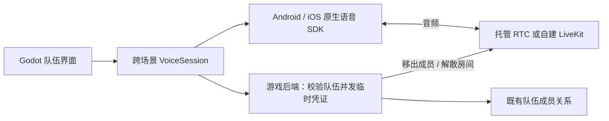

# 组队语音调研与实现建议

> **已采纳的最新决定（2026-09-16）：**用户要求直接部署到现有阿里云服务器，替代下文调研阶段的 LiveKit Cloud 建议。香港 ECS 上开发/生产 LiveKit 已分别部署，域名为 `voice-dev.sensenjoy.cn` / `voice.sensenjoy.cn`，独立密钥、容器、命名空间；无新增实例或 Cloud 订阅。软件免费，现有公网流量按阿里云计费。SGODOT-126 为 **In Progress**。
>
> Android 原生接入和队伍 UI 已实现并通过模拟器 2/4/8 人联调；默认静音、主动开麦、收听开关、跨场景保留、后台退出、离队撤权。双向音频及强制 TURN 中继有测试证据。iOS 官方 Swift 桥接已通过 macOS / iOS Simulator 编译，Godot iOS 适配及真机跨平台验收仍待完成。部署与配置见 `server/deploy/voice/README.md`，实际发布状态见 `docs/qa/party-voice-2026-09-16.md`。
>
> 以下价格比较和 Cloud 推荐保留为调研历史，不代表当前上线选型或完成状态。

日期：2026-09-16。对应 [SGODOT-126](https://plane.sensenjoy.cn/zili/projects/47d11337-c390-4b42-8b05-ef60fa2633f7/issues/c5efea6f-5e4e-48fa-b26b-76a220dcc98e)。
本次是公开资料与现有架构调研；没有开通账号、部署语音服务或验证实际通话。用户随后确认：首批使用者以海外为主，第一版服务 2–8 人小队，未来必须支持 iOS。Android 可先做原型，架构从一开始按 Android/iOS 双端设计。服务选型仍为建议，尚未开通或实装。

## 建议结论

**针对已确认的“海外为主、2–8 人小队”，第一版建议优先 LiveKit Cloud。先用免费 Build 额度验证，再根据实际时长决定是否升级；中长期保留 LiveKit 自建路线。**

原因是手机端接入工作两条路线都要做；托管可以暂时省去公网 UDP/TURN、证书、监控和容量运维。免费额度是否足够必须按人数、在线时间与条款计算。

- **当前首选：**LiveKit Cloud 承担媒体转发与网络运维，Android 通过 Kotlin 桥接官方 Android SDK，iOS 通过 Godot iOS 原生插件桥接官方 Swift SDK。[19][21] 两端共用 VoiceSession 接口、队伍身份和后端发证流程，同一房间可混合加入。语音跟随队伍跨场景保持；先完成两机通话，再验收 4 人和 8 人。具体国家与跨区域线路按实际测试者分布验证。
- **按量备选：**Agora 基础语音与腾讯 RTC Engine 可在网络体验或预算不合适时比较。两者均有原生移动端 SDK，但本 Godot 项目仍需桥接。不能把国际站美元价直接视为中国大陆账号的人民币报价。
- **希望尽量降低持续语音的费用：**腾讯 GVoice/GME 的申请制 5,000 PCU 免费计划值得核实。要先确认现有账号是否是首次开通、Godot 项目是否符合审核条件、配额何时生效；不把待申请额度作为已获得权益。
- **重视海外使用及将来自主部署：**LiveKit Cloud 与开源服务器共享 SDK，适合先云端验证、后续迁移。但自建与 Cloud 的令牌撤销、全球网络和运维能力有差别，不能说换一个 URL 就完成全部迁移。

首批用户以海外为主、语音队伍为 2–8 人，已由用户确认。成本示例按 4–8 人纯音频小队估算；现有游戏空间 300 人上限保持独立，首版语音不承接 300 人同时开麦。按住说话或常开麦、后台行为尚待在实现方案中明确。

## 公开额度与成本

以下为调研当日官方页面，USD 为国际站价格，不含税费、录制等附加服务。PCU/CCU 是并发人数口径，通常按应用/项目合计，**不是单个房间容量**。

| 方案 | 官方免费范围 | 超额/条件 | 对本项目的判断 |
| --- | --- | --- | --- |
| Agora Voice Calling | 每月前 10,000 合并 RTC 人分钟免费 | 基础纯语音标价 $0.99/1,000 人分钟；按每位参与者时长计费 [1] | 适合快速做原生手机小队验证；免费额度不足后低用量费用仍易计算 |
| 腾讯 RTC Engine（国际站） | 每月 10,000 分钟 | 官方免费包说明为激活相关月套餐后一年内可领取、周期内用完/失效不结转；基础音频 $0.99/1,000 分钟，按量须启用 [2][3] | 不应解读为所有账号永久每月免费；与 CallKit/Conference 等套餐要分开看 |
| 腾讯 GVoice/GME 游戏语音支持计划 | 单个指定 SDKAppID 每月 5,000 PCU 配额 | 首次创建 GVoice 的游戏客户、申请制、有效一年、到期需手动重新激活；共享资源，无 SLA；官方建议用于预研/原型/小规模灰度 [4] | 对持续语聊很有吸引力，但资格、Godot 支持和生效通知需要确认 |
| LiveKit Cloud Build | 每月 5,000 WebRTC 人分钟 + 50 GB 下行，项目总并发 100 | 免费额度是硬上限，超过后新请求失败；Ship $50/月含 150,000 人分钟、250 GB 下行、1,000 总并发，超出分别 $0.0005/分钟、$0.12/GB [5][6] | 适合技术原型和可迁移架构；4 人每天聊 1 小时已超过免费分钟 |
| LiveKit 开源自建 | Apache-2.0，软件许可费为零 [7] | 实例、带宽/TURN、运维和监控自行承担 [8] | 适合确定地区/规模后控制长期部署；不是零成本服务 |
| Vivox Voice & Text | 官方价格页列前 5,000 PCU 免费 [9] | Unity 明确自 2026-06-30 起停止向注册在中国大陆、香港、澳门的组织提供包含 Vivox 在内的部分全球服务；目标玩家在海外也不改变该条件 [10] | 先确认组织注册地，不能仅因免费额度大就列为可用首选；Core SDK 支持自定义引擎，Godot 接入仍需开发 [11] |
| Photon Voice | 20 CCU / 60 GB 每月，标记 Development Only | 面向上线的 100 CCU 档为一次性 $95/12 个月；并非“100 CCU 永久免费” [12] | 有游戏生态，但本项目仍要核对原生 SDK/桥接路线，优先级低于上面方案 |

**GVoice 的超额跳档需要特别注意：**官方示例中月峰值 5,400 PCU，扣除免费 5,000 后剩 400，仍按一个 5,000 PCU 档计费，当月 $3,000。不能将它当成平滑的几美元按量套餐。官方口径还会把各国家/地区的日峰值相加，再取月峰值，不能只看某一瞬间的全球同时在线数。选择时应确认计费方式，在发证入口限制语音规模，并按厂商账单口径监控。[4]

Agora 表格采用基础语音和 Automatic 网络模式。其强制 UDP / TCP-TLS Cloud Proxy 方案另有起步 $500/月的条款，不计入下面的基础语音示例。[1]

### 人分钟示例

`月人分钟 = 参与人数 × 每人每天连接分钟 × 天数`。四人同时连接一小时是 240 人分钟；不能将整间房一小时记为 60。具体“静音但留房”等情况按厂商计费口径计，不靠静音按钮推断免费。

| 用法 | 月人分钟 | Agora 基础语音估算 | LiveKit Cloud |
| --- | ---: | ---: | --- |
| 4 人，每天 1 小时，30 天 | 7,200 | $0 | Build 分钟不足；Ship $50/月可覆盖 |
| 8 人，每天 2 小时，30 天 | 28,800 | 约 $18.61 | Ship $50/月可覆盖 |
| 100 名日活，每人每天 30 分钟，30 天 | 90,000 | 约 $79.20 | Ship $50/月可覆盖 |

LiveKit 的“可覆盖”同时要求下行未超过 250 GB，没有其他额外消费。Agora 按账户仍享有 10,000 免费分钟、只有基础纯语音计算。GVoice 若获批且实际应用峰值不超过 5,000 PCU，按支持计划可以免该项语音费；它不按这张表的人分钟直接换算。

### 自建带宽不是免费

以 SFU 转发为例，设房间 N 人、k 人持续发送，每条音轨按**含协议开销约 48 kbit/s 的规划假设**估算，下行约为 `k × (N−1) × 48 kbit/s`。

- 8 人全部持续发声：约 2.69 Mbit/s。每天 2 小时、30 天，约 72.6 GB 下行。
- 同一 8 人房只有 2 人持续发声：约 0.67 Mbit/s。静音抑制/DTX、订阅策略可进一步影响实际流量。
- 300 人全部发声并互相订阅：该假设下约 4.31 Gbit/s 下行，不能从“300 人游戏位移同步通过”推出语音也能承受。

这些是估算，不是压测结果或购买规格。自建账单应为实例租用 + 实际公网出流量/带宽 + 运维；现有 1 GiB 是游戏应用容器限额，不能当作整机语音容量证明。正式语音宜独立服务和资源预算。

## 在现有项目中具体怎么接

现有后端是 Fastify + PostgreSQL/实时网关，队伍身份和成员关系已有权威来源；Android 已有 Kotlin `GodotMapPlugin` 桥接先例，当前依赖清单未接入语音 SDK。

1. **Godot 管理操作与状态。**增加独立的 `VoiceSession` 全局节点，提供加入/退出、静音、正在讲话、连接状态和音量事件。它跟随队伍身份，不挂在每个场景的 `OnlineSpace` 下，避免换街区、农场或矿层时随场景销毁。
2. **音频留在原生 SDK。**Android 用独立 Kotlin Godot 插件/AAR；iOS 使用 Godot iOS 原生插件，通过 Objective-C++/可互操作封装接 LiveKit Swift SDK，SDK 包管理优先使用官方提供的 Swift Package。[21] 采集、编码、回声消除、网络抖动缓冲与播放由 SDK 完成，GDScript 只传控制和事件。第一版只启用麦克风音轨，用户授权后再开麦；付费增强降噪与基础 SDK 的音频处理需分清。
3. **后端只发有队伍权限的凭证。**建议新增 `POST /v1/online/voice/join`：用现有登录身份查询权威队伍、校验语音容量和成员状态，返回房间、短期凭证和 SDK 所需配置。客户端不能自行指定任意队伍房间。API secret 留在服务器。
4. **成员变化由服务端处理。**退队、被踢、解散时主动撤销/移出语音；重连重新确认资格。队长转让但成员不变时保持通话。语音网络独立于游戏连接，语音失败仍可正常游戏。
5. **真实手机验证。**两台 Android 从授权、双向说话、扬声器回声、耳机切换、静音、切场景、Wi-Fi/蜂窝切换到离队全部跑通；随后做约 8 人试用。后台是否继续听/说另行明确；若需要持续后台采集，按 Android 对麦克风前台服务的要求实现。新增 `.so` 也要检查 16 KB 对齐，现有 APK 的此项欠账不因增加语音而消失。

### Android/iOS 共用契约与分阶段验收

- Godot 的 `VoiceSession` 统一暴露加入、退出、麦克风开关、收听状态，以及连接/重连、成员、发言人和错误事件；平台适配层不向玩法界面暴露 Kotlin/Swift 对象。
- 后端与房间身份不按操作系统分裂，Android 和 iPhone 进入同一队伍语音房，共用成员校验、容量控制和离队撤权逻辑。
- iOS 增加麦克风用途说明及运行时授权；协调 `AVAudioSession` 与游戏音效、扬声器/耳机/蓝牙路由，处理来电等音频中断及恢复。官方 Swift SDK 可自动管理音频会话，应先验证默认管理与 Godot 音频共存，避免两边反复抢占设置。[21]
- Android 可先交付原型，同时提前验证 iOS SDK 链接、Godot 导出与最小双向通话，避免后续才暴露平台桥接问题；iOS 完整功能可后续交付。
- 双端支持的验收包含 Android↔Android、Android↔iPhone、iPhone↔iPhone，以及 4/8 人混合设备；检查切场景、静音、断线恢复、离队失效和音频中断。仅 Android 通过时记录为 Android 阶段完成。
- iOS 后台/锁屏持续通话按用户体验要求另行确定；若需要，再配置相应 audio 后台能力与生命周期。普通游戏内语音不预设必须接入 CallKit。

现有位移 WebSocket 不宜直接承载 PCM/自制语音包：它的协议和限流是游戏同步用途，不提供完整的音频编解码、回声消除、抖动缓冲和弱网拥塞处理。Godot `WebRTCPeerConnection` 暴露的主要是 DataChannel/连接协商 API，不是现成的移动端语音聊天 SDK。[13]

## LiveKit 自建的实际工作量

LiveKit 提供成套房间服务、官方移动端 SDK、服务器 API 和内置 TURN，比从 mediasoup 的底层媒体模块重新组织信令/房间更适合本任务。mediasoup 官方明确它是可嵌入的低层 Node 模块，不是开箱即用独立服务。[14]

部署至少涉及：域名与可信 TLS 证书、LiveKit 服务、媒体 UDP 与 TCP 回退端口、内置 TURN、生产监控/日志与升级备份；多实例再接 Redis 和分布式调度。[8]

- 常见端口：信令/API 7880 放到 HTTPS 反向代理后；ICE/TCP 7881；UDP 可使用 7882 mux 或配置端口范围；TURN/TLS 常需公网 443 的四层入口，不能只把现有 HTTP Caddy 路径复用一下就覆盖媒体。[15]
- 官方单个自建房间仍要放得进单个节点；“多节点”不等于一间任意大的语音房自动跨机器拆分。[16]
- 当前 LiveKit Cloud 公开的亚太区域有日本、新加坡，没有列出中国大陆节点。这不是“国内一定不可用”的结论；大陆运营商、公司网与海外队友组合必须实际试通。[17]
- 社区 `NodotProject/godot-livekit` 明确列 Linux/macOS/Windows、Godot 4.5；没有声明 Android/iOS 支持。因此它可作为桌面验证候选，不能当本项目 Godot 4.7 手机端的现成插件。[18] 官方 Android SDK 支持 Cloud/自建、通话音频和说话人事件，可复用它来做手机桥接。[19]

### 自建与 Cloud 的权限撤销差异

官方资料明确：LiveKit Cloud 支持 access token revocation，自建版没有同等内建撤销。只 `RemoveParticipant` 踢掉当前连接，不等于旧 token 不能再次进入；自建文档建议短 TTL 且拒绝签发新 token。但 SDK 会自动刷新连接中的 token，刷新后的有效期至少十分钟，不能据此承诺“发 30 秒 token 就能 30 秒彻底失效”。[20]

本项目要求离队后不能继续听本队语音，因此自建方案需要额外设计并验证：例如移出成员后给剩余队员切换到新的语音房间代际，关闭旧房间，使旧房间凭证无法进入新房间；代价是一次短暂重连。也可以评估受控准入层/服务器扩展，但不能假设已有一个能满足条件的标准 hook。

Cloud 使用移出 API 时也要按官方说明设置明确的撤销时间，测试缓存/刷新凭证重新入房；默认的一分钟时钟缓冲不是严格的即时阻止重入。[20]

## 下一步建议

- 首版以已确认的 2–8 人语音为验收规模，后端控制语音加入人数，并清楚提示容量；不改变游戏现有组队/空间容量。大队伍发言席位与旁听另行设计。
- 优先用 LiveKit Cloud Build 完成两台实际 Android 手机的连接、回声、静音、切场景、退出权限和重连验证，并尽早跑通 Android↔iPhone 最小链路；随后扩大到 4 人/8 人混合设备。覆盖实际海外同区域及跨区域线路，以测量结果判断体验。
- Build 的 100 总并发是整个项目跨房间的总数，5,000 人分钟和 50 GB 是月额度；2–8 人单队并不保证持续使用始终免费。监控额度后决定 Ship 或自建，不因本次范围确认自动开通付费套餐。
- PoC 接口收口在 `VoiceSession` 与服务端发证适配层；初期不同时维护多家语音实现。
- 本轮保持 SGODOT-126 为 Todo。海外为主、2–8 人及后续 iOS 支持已确认；LiveKit Cloud 为当前建议，实际服务开通、双端接入与语音交互/后台策略尚未完成。

## 一手来源

[1] Agora：[Voice Calling Pricing](https://www.agora.io/en/pricing/voice-calling/)；[总价目与每月 10,000 RTC 分钟](https://www.agora.io/en/pricing/)。

[2] Tencent RTC：[RTC Engine Pricing](https://trtc.io/pricing/rtc-engine)；[音视频时长计费](https://trtc.io/document/42734?product=pricing)。

[3] Tencent RTC：[Free Quota，10,000 分钟与一年期限](https://trtc.io/document/42735?product=pricing)。

[4] Tencent Cloud：[GVoice/GME Free Plan，资格、5,000 PCU、期限及超额示例](https://www.tencentcloud.com/document/product/607/78141)。

[5] LiveKit：[定价](https://livekit.com/pricing)，读取 Participants / Media transport，不把 AI Agent 时长当人对人通话费用。

[6] LiveKit：[Quotas and limits](https://docs.livekit.io/deploy/admin/quotas-and-limits/)。

[7] LiveKit：[开源服务器及许可证](https://github.com/livekit/livekit)。

[8] LiveKit：[自建与 Cloud 对比](https://docs.livekit.io/transport/self-hosting.md)；[部署](https://docs.livekit.io/transport/self-hosting/deployment/)。

[9] Unity：[UGS Pricing，Vivox Voice & Text](https://unity.com/products/gaming-services/pricing)。

[10] Unity：[2026-06-30 对中国大陆/香港/澳门注册组织停止部分全球服务的说明](https://support.unity.com/hc/en-us/articles/48560161446804-Unity-Services-Access-Ending-June-30-2026-Information-for-China-Based-Developers)。判断对象是组织注册地，不是目标玩家地区。

[11] Unity：[Vivox，Core SDK 与自定义引擎](https://unity.com/products/vivox)。

[12] Photon：[Voice Pricing](https://www.photonengine.com/voice/pricing)。

[13] Godot：[WebRTCPeerConnection](https://docs.godotengine.org/en/stable/classes/class_webrtcpeerconnection.html)；[Android plugins](https://docs.godotengine.org/en/stable/tutorials/platform/android/android_plugin.html)。

[14] mediasoup：[Design](https://mediasoup.org/documentation/v3/mediasoup/design/)。

[15] LiveKit：[Ports and firewall](https://docs.livekit.io/transport/self-hosting/ports-firewall/)。

[16] LiveKit：[Benchmarking](https://docs.livekit.io/transport/self-hosting/benchmark/)，容量受音轨、订阅与转发量影响，不能直接移用厂商 benchmark 作为本项目结果。

[17] LiveKit：[Regions & static IPs](https://docs.livekit.io/deploy/admin/regions/endpoints.md)。

[18] NodotProject：[godot-livekit README](https://github.com/NodotProject/godot-livekit)。

[19] LiveKit：[Android Kotlin SDK](https://github.com/livekit/client-sdk-android)。

[20] LiveKit：[Tokens & grants / lifecycle](https://docs.livekit.io/frontends/reference/tokens-grants.md)；[Remove participant](https://docs.livekit.io/intro/basics/rooms-participants-tracks/participants/)。

[21] LiveKit：[iOS/macOS Swift SDK](https://github.com/livekit/client-sdk-swift)，含 Swift Package、音频会话管理、音频路由与中断/CallKit 配合说明。

公开页面摘录、检索结果和成本计算：`output/voice-research-2026-09-16/`。价格和优惠适用性需在真正开通时按所用账号确认。
