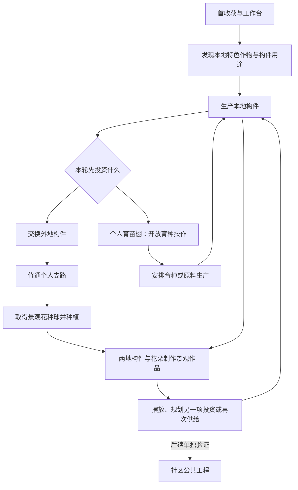
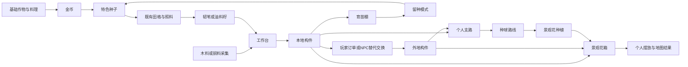
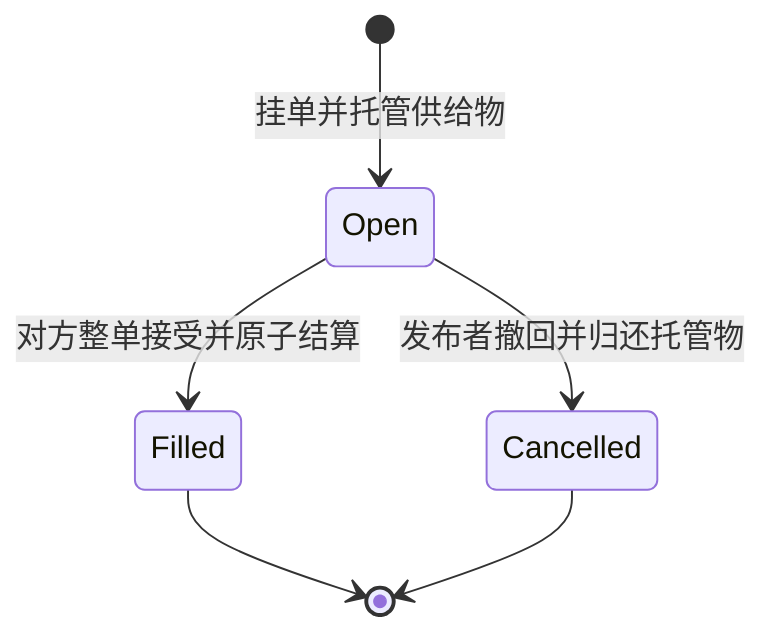

# 街角四季：地域经营与成长 GDD

- 版本：0.1，2026-09-10。
- 用途：下一阶段 2–3 日紧凑设计的可讨论初稿，以及双地域样板的设计输入。
- 推进依据：[已采纳行动蓝图](next-stage-action-blueprint-2026-09-10.md)。
- 产品远景：[简版 PRD](prd-brief-2026-09-10.md)。
- 状态：推进顺序已由用户采纳；本文具体配方、能力、价格和研究阈值为样板设计草案，未实装、未经过团队完整评审或自然玩家验证。
- 时间口径：分钟数与数日跨度是体验假设，不是强制门槛、留存结论或交付承诺。

## 1. 要解决的设计问题

现有版本已经支持农场经营、地图行走、采集、料理、制作、设施修复和居民活动。当前主要缺口是：完成一次性目标后，玩家如何形成下一项自己的计划，以及同一套系统如何在第二、第三轮产生不同选择。

本阶段的体验承诺：**我在一个有地域特征的街角经营农场，决定先改善生产还是打开通路，把自己的产物用于成长、布置或交换，逐渐成为别人愿意找的生产者。**

地图、生产和成长分别需要承担实际职责：地图提供不同机会及通行关系，生产让玩家安排有限田格与产物，成长改变后续的行动可能。交换帮助玩家把已有专长转化为另一种能力。

本阶段验证三个假设：

| 假设 | 玩家行为证据 | 反证 |
| --- | --- | --- |
| H1：投资顺序能产生自主计划 | 玩家能说明先做生产设施或先修通路的理由，后面一轮安排因此变化 | 两个选项存在明显通用最优解，或只有更大的数字差别 |
| H2：地域互补能形成值得重复的交换 | 玩家为具体用途准备本地构件，主动用它换外地产物 | 只完成强制教学交换，此后没有需要或只觉手续增加 |
| H3：世界变化能产生下一轮目标 | 玩家看到通路、新种植或布置结果后开始新目标 | 变化只在任务计数和领取弹窗中被感知 |

## 2. 已有基础与本次新增范围

### 2.1 已实现基础

| 基础 | 本次如何复用 | 证据边界 |
| --- | --- | --- |
| 四种分钟级作物、九格起步、工具与扩地 | 基础食材和现金经营保持可用；特色作物竞争同一批可用田格 | 不能把已有四作物称为地域专长已实现 |
| 木料、石料、芦苇、三处地点与蓝图道路 | 复用调查、采集、跑近操作、道路与入口投影 | 随包道路不等于任意地区在线拓扑 |
| 工作台、手作、设施、布置 | 复用配方成本、目标追踪、安装与保存反馈 | 现有工程主要是个人状态 |
| 三名居民、故事、请求与聚会 | 作为地域线索、用途解释与成果回应的现有角色 | 预设 NPC 不等于 AI 生成角色或真实社区 |
| 公网身份、存档、幂等、访客快照 | 延用单农场权威状态与版本保障 | 访客只读快照不能承担交易或公共工程结算 |

依据：[发布记录](../qa/farm-public-release-2026-09-10.md)、[设施后试玩](../qa/journey-gatherings-2026-09-09.md)、[旅程配置](../../assets/farm/data/journey.json)。

### 2.2 样板边界

| 内容 | 样板规模 |
| --- | --- |
| 地域 | 两个固定测试地域：河湾、山麓；对应真实地图数据中经确认的水系/地形标签 |
| 特色生产 | 每地域一种新作物、一种专长构件；山麓增加一种矿料采集物 |
| 经营投资 | 一座个人育苗棚、一段个人可修通路；可以选择先后，最终都能完成 |
| 新路线用途 | 景观花种球采集与种植；一款需要两地构件的景观作品 |
| 玩家交换 | 构件换构件的异步订单，仅两种可交易物；数量与用途清楚 |
| 无对手恢复 | NPC 材料交换，成本高于默认玩家交换，立即可执行，无现实日次数限制 |
| 世界表达 | 育苗棚可用、通路开放、种球点可见、景观作品可摆放 |
| AI | 同一地域内容结构的一组离线候选，独立校验和比较 |
| 公共工程 | 本 GDD 定义后续契约；样板阶段不实现多人公共工程 |

不存在必须把当前 21 项旧一次性目标全部做完才能进入样板的要求。新存档在首收获、工作台与一次制作之后看到地域投资；旧存档按确有的能力进入，不补发虚构完成事实。

## 3. 玩家动机与系统分工

首要玩家是喜欢经营、探索和可见建设结果的人。熟悉真实街区的情感、喜欢 NPC 的玩家也值得观察，但本阶段不假设所有人都愿意参与市场或高频社交。

| 动机 | 给玩家的具体目标 | 支持系统 |
| --- | --- | --- |
| 自己能决定怎么经营 | 同一份构件先投育苗棚，或先换外地材料修路 | 投资成本、田格占用、可比较的能力效果 |
| 去过的地方值得记住 | 河边找苇材线索，山麓看矿料，修好的路通向新种球 | 地域资源、稳定入口和持久连接 |
| 劳动成果有用途 | 本地构件可投资、交换，也能进入景观作品 | 多用途消耗图 |
| 自己对别人有价值 | 对方需要自己生产的构件，并能看到交付用途 | 异步订单、成交记录；以后延伸专长与社区工程 |
| 这里越来越像自己的地方 | 设施、作品和路线在场景与地图上留下变化 | 个人建设与布置 |

NPC 提供故事和生活感，不负责替玩家自动选定经营路线。玩家选好目标后继续使用现有导航和缺料提示；目标完成后回到可比较的机会，不自动接取新订单。

## 4. 从首会话到数日的成长骨架

下表是设计层级。样板实现至 L3；L4 是后续验证方向，不承诺现有内容已能支撑数日。

| 层级 | 玩家形成的认识 | 新增决策 | 成果 | 下一层动力 |
| --- | --- | --- | --- | --- |
| L0：安顿，首会话前段 | 我的农场能生产，附近有人和可修物件 | 留食材、出售，或开始一次制作 | 首收获与第一件作品 | 看见育苗棚和封闭通路 |
| L1：经营，首会话后段至数小时 | 我的地域有一条值得投入的生产链 | 基础作物与特色作物占多少田格；先投生产或通路 | 本地构件、首项投资 | 投资效果引出第二种用途 |
| L2：往来，数小时 | 外地产物能帮助实现自己的计划 | 向玩家交换、用 NPC 替代，或先做本地目标 | 另一地域构件、通路开放 | 新路线提供景观花种球 |
| L3：表达与第二轮经营 | 我可以组合两地能力留下作品 | 继续投资、生产供给他人，或制作布置 | 景观作品、补齐另一项投资 | 同一库存出现不同分配方案 |
| L4：社区，后续数日假设 | 我的专长能参与共同改变地图 | 支持哪段公共工程、承担哪类供给 | 所有人能看见并使用的设施 | 新区域与新生产角色；待独立验证 |

### 成长图

育苗棚不是修路前置；修路不是首次加工或交换前置。景观作品依赖新路线与两地构件，但不反向锁住基础生产、交易或另一项投资。

## 5. 两种关键投资

### 5.1 育苗棚：获得育种能力

玩家投入两份本地构件和四份木料，修好自己街角的育苗棚。它为已拥有种子的特色作物开放“留种”收获模式，不增加一套每日签到或维护条。

普通模式每株产出两份特色原料；留种模式每株产出一份原料和一枚同种种子。模式在播种时选定并随该批作物冻结，成熟后按当时规则结算。种子只供自己播种，样板阶段不能交易或出售。

这个能力让玩家决定“现在尽快凑构件”还是“减少未来购种支出”。普通收成在单位田格时间上提供两倍原料；留种保持下一轮种植能力。没有已经播种的作物被追溯降低产量。

场景反馈：棚体变为可操作，种盘显示选定作物；农场播种选择可看到普通与留种的实际产出。NPC 对第一次自己育种有一次回应，重复育种不刷首见奖励。

风险：初始钱包较宽裕，节省种钱可能吸引力不足。若观察不到使用场景，优先修改育种用途或成本；不得仅大幅提高种子价格制造贫困。

### 5.2 个人支路：获得新的资源与种植用途

玩家投入一份河湾编织构件、一份山麓连接件和两份石料，修通本地一段有明确障碍的支路。材料对两地域对称，玩家以自己的构件换取另一种。

通路开放一个景观花种球点，并改善一次熟悉的往返连接。第一次到达有稳定可辨认的地物；以后可以快捷返回已经探索的区域。新资源用途和路线关系一起构成投资收益，不靠延长初次赶路时间。

修路前即可从社区交易入口查看另一地域的订单和 NPC 替代交换。第一次没有真人订单时，可以先做育苗棚，或多生产一份本地构件换材料修路。

### 5.3 两条投资的对照

| 项目 | 育苗棚优先 | 通路优先 |
| --- | --- | --- |
| 第一轮投入 | 2 份本地构件 + 4 木料 | 1 编织构件 + 1 连接件 + 2 石料 |
| 暂缓什么 | 新种球与景观作品 | 育种和种子自给 |
| 新行为 | 播种时选择原料收成或留种 | 进入新支路、采种球、种景观花 |
| 下一轮改变 | 决定哪些田格继续冲原料、哪些留种 | 为花朵腾田格，同时准备两地构件 |
| 适用意图 | 更稳定地经营、降低后续购种需求 | 尽早探索、布置一个具体作品 |
| 可恢复性 | 继续生产与交换即可修路 | 继续生产即可补建育苗棚 |

两项均为个人投资，样板不引入永久职业锁定。选择先后有代价，最终可以兼得。必须验证两条路线确实存在合理使用场景，不能只看按钮都有点击率。

## 6. 第一轮、第二轮与第三轮

| 轮次 | 玩家能比较的机会 | 应发生的变化 | 本轮可停点 |
| --- | --- | --- | --- |
| 第一轮 | 本地育苗棚或外地构件交换；基础食材或特色原料 | 形成一个自己选的投资目标并开始生产 | 第一份构件或首笔订单 |
| 第二轮 | 育种与原料生产；新支路与熟悉补给路线 | 因第一项投资改变种植配比、物料去向或路线 | 棚建好、路修通或花种下 |
| 第三轮 | 补齐另一项投资、制作景观作品，或接另一玩家需要的构件 | 相同资源在多个目的之间分配；没有首次奖励仍有具体用途 | 作品摆好、另一投资开始或再次成交 |

“轮”是玩家选定一个目标并看到后果的观察单位，不是新增服务端全局回合，也不是每轮必须清完全部采集点。现有探索轮次仍只负责资源领取与刷新。

当前样板有明确内容终点。两三轮成立只能支持继续研究，不能据此宣布长期需求、开放市场或数日留存成立。

## 7. 地域、产物与生产规则

### 7.1 地域定义

| 属性 | 河湾 | 山麓 |
| --- | --- | --- |
| 地理依据 | 已核实的河流/水系附近区域 | 已核实的坡地/地形区域 |
| 新作物 | 编织苇，游戏内可种植品种 | 油料花，样板作物名，不冒充当地真实物种调查 |
| 作物原料 | 韧苇 | 油料籽 |
| 可采资源 | 复用木料、石料等基础采集 | 基础采集 + 新铜料点 |
| 专长构件 | 编织构件 B | 金属连接件 P |
| 基础经营 | 保留四种基础作物、料理、买卖、NPC | 同左 |
| 初次专长权限 | 河湾作物与 B 配方 | 山麓作物与 P 配方 |

地域决定初期生产专长，玩家可以通过游戏内旅行查看另一地域与其用途，不要求现实移动。样板中不能通过反复改城市刷种子或复制产能。

使用两份固定地域定义与现有蓝图作为测试数据。设计阶段需要注明其真实地图来源与标签证据；未完成地理核对的河湾/山麓仅是测试原型名，不能在发布说明中称为当地事实。最终坐标选择属于设计审阅项，不在本文伪造地理结论。

### 7.2 候选数值

下表仅供纸面推演。特色作物新增独立物品 ID，不能直接把旧存档中可免费采到的芦苇或食材改成可交易构件原料。

| 项目 | 输入 | 输出 | 时间/约束 |
| --- | --- | --- | --- |
| 特色种子购买 | 4 金币 | 1 枚本地特色种子 | 随时可买；首次一次性试种赠 2 枚，不靠反复建场领取 |
| 特色普通种植 | 1 种子、1 可用田格 | 2 韧苇或 2 油料籽 | 照料后 8 分钟；成熟保留 |
| 特色留种种植 | 同上，且已建育苗棚 | 1 原料 + 1 同种种子 | 同为 8 分钟；种子不交易、不出售 |
| B 编织构件 | 4 韧苇 + 1 木料 | 1 B | 工作台加工；沿用到达、确认、结算流程 |
| P 金属连接件 | 4 油料籽 + 2 铜料 | 1 P | 工作台简化榨油、整修与装配；不新增冶炼模拟 |
| 铜料调查点 | 一次场景采集 | 2 铜料 | 两个稳定节点，按已有探索规则补充 |
| 育苗棚 | 2 本地构件 + 4 木料 | 留种能力 | 永久个人投资，无维护费 |
| 个人支路 | 1 B + 1 P + 2 石料 | 种球路线、连接变化 | 永久个人投资 |
| 种球点 | 一次新路线采集 | 2 景观花种球 | 以该路线领取记录保存；不可反复重进刷取 |
| 景观花种植 | 1 种球、1 可用田格 | 1 景观花 | 照料后 12 分钟；无天气硬锁 |
| 景观作品 | 1 B + 1 P + 2 景观花 | 1 新景观花箱 | 可在个人场地摆放、旋转、收回；收回返作品，不返原料 |
| 玩家交换默认报价 | 1 B | 1 P，或反向 | 报价由玩家确认；样板仅整数整单成交 |
| NPC 替代交换 | 2 本地构件 | 1 外地构件 | 明确为 NPC，立即完成；无现实日上限 |

B/P 与新特色原料在样板阶段不向系统直接卖成金币；只有 B/P 可在玩家订单中交换。基础金币经营继续使用现有农产品和料理规则。这样能单独观察交换与投资的价值，且不把新构件设计成另一个刷金币入口。

油料籽用于金属加工的消耗性油料，是简化游戏配方，不声称现实农业或工业配比。若玩家无法理解，优先改物品表达与配方结构。

### 7.3 资源流向图

既有厨房花园、育苗床和补给站的权益保留；它们提供的旧物品不直接替代新特色原料。后续如统一物品体系，必须另列迁移与供需方案，不能扣减旧玩家权益来制造稀缺。

## 8. 三条纸面推演

### 8.1 统一起点与记账

以下从明确的中期设计检查点开始：河湾玩家拥有 2 B、4 木料、2 石料，基础种植与 B 加工已开放，两项投资均未完成。它是纸面检查点，不代表开局赠送这些资源，也不是自然试玩记录。山麓将 B/P 对调推演，棚仍需木料，铜料另按加工量准备。

从零生产 2 B 需要 8 韧苇、2 木料。若用四个田格普通种植一批，需要四枚种子，即最多 16 金币，8 分钟自然生长；另计采集、移动、操作和加工。没有四个空格时，可以分批或先收已有作物，不覆盖现存作物。

### 8.2 路线 A：先改善生产

| 步骤 | 资源变化 | 可见后果与下一选择 |
| --- | --- | --- |
| 用 2 B + 4 木料建棚 | B=0，木料=0，石料=2 | 获得留种能力；开始选择原料收成或留种 |
| 再用四格普通收成 | 买 4 种子至多花 16 金币，产 8 韧苇；采 2 木料，做 2 B | 快速凑修路材料，但本轮没有留种 |
| 或四格全部留种 | 买 4 种子至多花 16 金币，产 4 韧苇 + 4 种子；采 1 木料，做 1 B | 留下下一批种子，但修路要再生产一批 |
| 玩家交换并修路 | 1 B 换 1 P；余 1 B + 1 P + 2 石料用于通路 | 两项投资完成，之后决定景观花占多少田格 |

留种分支需要两批才能取得 2 B；第二批可以用第一批种子。普通分支一批即可，但未来继续购种。检查的是真实的产能与自给取舍，不把第二批自然生长时间全部计作主动操作。

### 8.3 路线 B：先探索

| 步骤 | 资源变化 | 可见后果与下一选择 |
| --- | --- | --- |
| 用 1 B 向玩家换 1 P | B=1，P=1，木料=4，石料=2 | 已能修路，暂未获得留种能力 |
| 投入通路材料 | B=0，P=0，木料=4，石料=0 | 进入新路线，取得 2 种球 |
| 两格种景观花，四格种特色作物 | 12 分钟后 2 花；特色批次 8 分钟后 8 韧苇，另采 2 木料做 2 B | 比较花箱与补建棚，两个目标竞争构件 |
| 选择景观作品 | 1 B 换 1 P；1 B + 1 P + 2 花做花箱 | 可摆放自己的作品；棚仍未完成 |
| 或选择补建棚 | 2 B + 留下的 4 木料建棚；花保留 | 获得留种，花箱需后续继续生产与交换 |

两种选择都留下持久结果。花箱收回只返还作品，不能拆成 B/P 反复支付工程或返还交易。

### 8.4 路线 C：没有交易对手

| 步骤 | 资源变化 | 设计要求 |
| --- | --- | --- |
| 没有匹配订单 | 资源不扣除；未挂单物品仍可自由使用 | 同屏可看到 NPC 成本与继续本地经营的选项 |
| 2 B 向 NPC 换 1 P | B=0，P=1，木料=4，石料=2 | 明确是成本更高的替代，不伪装真人成交 |
| 两格普通特色作物 | 买 2 种子至多 8 金币，8 分钟产 4 韧苇；用 1 木料做 1 B | 多一批生产即可补齐修路材料；等待时仍能采集或做已有生活目标 |
| 用 1 B + 1 P + 2 石料修路 | B=0，P=0，木料=3，石料=0 | 无真人在线也能获得个人关键能力 |

也允许先做育苗棚；不能因为市场为空而强制玩家选择同一条路线。2:1 为待测成本，若被感知为无意义惩罚，应降低差价或提供有实际探索内容的替代获取，不引入倒计时等待商人出现。

### 8.5 纸面检查结论与未解决项

- 依赖图不存在必须先修路才能交换、先交换才能生产的循环。
- 默认玩家 1:1 交换下，修路需要相当于 2 本地构件；NPC 2:1 下需要 3 本地构件。两地域构件要求相同作物数量，但铜料、木料的主动取得成本仍需测量。
- NPC 双向换回原物会将 4 份变成 1 份，不产生物品增殖；育种不会增加每株“原料 + 种子”的件数，但种子价值与现金循环需要整体评估。
- 仍未证明育苗棚足够吸引人、两地生产主动耗时接近、花箱用途能带来第二次自愿交换。
- 样板只提供有限的投资与表达需求。长期交易需求、供需规模、公共工程与未来消耗需另行验证，不能以无限系统收购或增加材料价格掩盖需求耗尽。

## 9. 异步交换与恢复

### 9.1 玩家流程

1. 在地图的社区交换点查看 B/P 供需，或从自己的投资缺口查看所需构件。
2. 选择供给物、数量、求购物与数量；默认展示 1:1，可修改整数数量。样板上限每类每单 20 份。
3. 发布前显示实际支出与成交后可用于的目标。挂单将供给物移入服务端托管，不能同时用于工程、摆放或另一笔订单。
4. 对方整单接受，服务端同时结算双方库存；离线卖家重登后看到实际成交记录。
5. 玩家继续使用收到的构件，或保留给另一目标。未成交可以取消，原托管物原数返还。

第一版只做整单成交、无手续费、无部分成交、无拍卖、无货币交易、无聊天议价。每位玩家最多三张未成交订单；名额满时可以撤回旧单，不用付费解锁。默认无自动到期，避免离线时被倒计时迫使操作。

### 9.2 状态契约

- 接单与撤单并发只允许一个终态；双方账户和订单在同一数据库事务中更新，锁顺序固定。
- 超时后读取同一操作结果或重放原幂等键，不根据客户端动画判断成功，不用新键再次付款。
- 拒绝自己接自己的订单；只接受明确白名单的 B/P、正整数数量、足量未托管库存。
- 草稿不扣物；挂单扣入托管；成交转交；撤单归还。托管与背包不得双计。
- 不从访客快照读取余额或直接改对方农场。交易结果独立于 15 分钟访客快照刷新。
- NPC 交换只改当前玩家与系统消耗，不生成真人订单、供给者身份或成交活跃指标。

### 9.3 低供给、失误与离线

| 情况 | 玩家可做什么 | 必须维持的结果 |
| --- | --- | --- |
| 没有订单、无人接单 | NPC 替代交换，或暂缓修路先投资/生产 | 无现实日等待，基础经营可继续 |
| 构件被旧挂单占用 | 撤单取回，或生产另一份 | 不误显示“物品丢失”；不重复归还 |
| 花光金币 | 现有无门票采集与木料委托获得种钱；已建棚可以留种 | 不因新系统关闭原有恢复路径 |
| 田格满 | 收获已成熟作物、完成照料、保留目标并去采集 | 不自动铲掉旧作物，不靠扩大地图解决操作缺口 |
| 断网 | 查看缓存目标与库存；付款、挂单和接单等待服务恢复 | 明确未确认状态；不本地发放交易物 |
| 错误报价但尚未成交 | 撤回，再发布 | 成交前清楚显示交换双方物品数量 |
| 改变投资计划 | 取消追踪，切换目标；未投入材料仍归玩家 | 已建工程保留；不自动拆除或扣款 |

多账号套利与成熟市场操纵不是这个样板已解决的问题。初次种子赠送不应足以立即构成可交易奖励；批量建号的供给风险在扩大公开交易前需要独立检查。

## 10. 地图必须承担的选择

### 10.1 两个尺度

街区尺度保留农场、工作台、NPC、原有资源点与一段可修支路。地域尺度显示本地特色、另一区域的构件和交换机会。两个尺度使用稳定 ID 与对应进度，不把两个异地城市强行连成一段步行道路。

首次到访帮助玩家记住地物与连接，已探索目的地提供快捷往返。出行不增加现实 GPS 条件、体力门票或长距离强制赶路。

### 10.2 最小空间题

本地工作台位于农场与集市之间；基础资源路线和新种球支路分开。需要木料做构件时可以顺路补给；景观花成熟后更值得回农场再去工作台。修路后的连接减少一段已熟悉绕行，并提供新种球。

具体地物应适配所选道路，而非仅更换背景贴图。两个地域沿用可读的操作尺度，不承诺河流、坡度会直接参与物理模拟。

每次地图测试同时记录：玩家想去哪里、为什么先去、是否能指认相对关系、实际移动和无效导航耗时。若地点次序完全由指南针决定，优先改机会表达与空间后果；不能通过关闭导航人为增加困难。

## 11. 农场、居民与世界表达

农场是稳定的生产基地。基础食材继续服务金币、料理和居民；特色作物服务能力投资与交换；景观花服务表达。这三类用途竞争田格，但任何一类都不应由免费补给完整替代。

保留已有 NPC，并给每个人一个与经营有关的具体视角：管理员关注留种和下一批种植，修缮师关注通路和材料用途，主理人关注地方产物与场地布置。对话可以指出机会与后果，不能直接要求玩家按固定顺序完成两项投资。

必要反馈包括：原料在田里可辨、构件在工作台可辨、交易确认后库存真实变化、施工后的路实际可通、花箱实际可摆。复用模型时允许材质和少量部件区分新物品。完整七动作、全天 NPC 日程和所有天气视觉不作为样板前置。

对于只喜欢布置或居民的玩家，保留基础循环和已有个人表达。是否必须进入跨域高级链是未来产品定位问题；样板观察应记录拒绝交易的理由，不能将其一律归因于教学不足。

## 12. AI 内容与社区远景

### 12.1 AI 的作用和稳定性

地理数据提供事实，设计规则限定可用结构，AI 辅助组织名称、线索、需求表达和合规的配方候选。首份手工基准与 AI 候选使用同一结构，分别验证。

最小地域内容契约：

| 字段 | 责任 |
| --- | --- |
| `region_definition_id` / `revision` | 稳定规则身份；同存档引用同版本 |
| `source_tags` / `source_refs` | 地理标签及来源；未知事实明确缺失 |
| `crop_ids` / `recipe_ids` / `resource_nodes` | 仅引用已注册的物品和操作 |
| `capability_edges` | 谁解锁什么；校验无循环锁死与可达性 |
| `trade_goods` / `fallback_recipes` | 可交易范围与无人供货路径 |
| `presentation` | 名称、线索、物件表达，与经济规则分离 |

AI 不能自行扩大产量区间、产生未知货币、发新玩家首通奖励、改正在进行的订单或更换已种作物规则。候选通过结构、可达性、经济和人工审阅后才能成为新内容版本；客户端不在每次进入地图时重新生成经济事实。

样板只验证一组候选能否表达地域并遵守规则。动态全球生成、自动发布、无限 NPC 和生成数量不计入阶段完成标准。

### 12.2 社区共建的下一步

个人样板成立后，选一项公共温室或河岸花园做后续试验。工程材料可以包含 B/P 与种植成果，但先定义归属和用途，再扩大建造量。

| 契约 | 后续试验的默认设计 |
| --- | --- |
| 社区边界 | 显式测试社区 ID 与稳定公共地点 ID；不把附近所有 GPS 点自动视为同一社区 |
| 阶段 | 两至三个可见建设阶段，每阶段改变一个部件或设施用途 |
| 贡献 | 服务端原子扣除个人物品并增加公共进度；同时记录实际贡献，不依赖客户端计数 |
| 完成并发 | 超额材料不默默吞掉；预览与结算说明实际可接受数量，剩余归还 |
| 成果 | 所有成员能看到并使用公共设施；不是各自复制一个个人竣工标记 |
| 新玩家 | 能使用已有公共成果，并有后续可参与目标；不要求补交历史工程门票 |
| 离开社区 | 历史贡献保留，已经形成的共同成果不随退出倒退；个人农场保留 |
| 样板边界 | 非当前阶段交付，不以一项短工程证明长期社区运营成立 |

## 13. 工程边界与存档连续性

以下是实现输入，不要求先重构完整框架。

| 边界 | 最小改动方向 | 必须保留 |
| --- | --- | --- |
| 内容目录 | 在现有内容加载方式中增加明确的地域定义、少量物品和配方 | 唯一内容来源、版本校验、未知 ID 拒绝 |
| 农场领域 | 新作物、留种模式、个人设施与通路事实；每批作物冻结规则 | 旧库存、旧作物 `ready_at`、既有设施和装饰权益 |
| 地图与场景 | 地域与地点稳定映射，复用跑近交互和追踪 | 返回恢复、可达性、入口身份、可读触区 |
| 玩家交易 | 独立订单与托管记录；事务跨订单和双方农场 | 幂等、账户隔离、版本冲突恢复、不重复扣发 |
| 公共工程 | 后续独立公共状态与贡献账本 | 不写入只读访客快照作为权威，不混入个人工程事实 |
| AI 生成 | 离线生成至已注册内容格式后校验 | 不在运行时越过服务端奖励和版本边界 |

当前 `CropId`、`DishId` 与材料类型有固定枚举，新增内容需要同步服务端、客户端目录与测试。当前 PostgreSQL 命令事务只锁一座农场，不能直接用现有单农场 reducer 伪造双方交易成功。

旧存档按明确能力接入新系统；不给全部旧玩家回填新地域里程碑，不更改已购工具与扩地，不强制重新建场。地域初次赋值须稳定并可追溯；不能仅按现有上海/洛杉矶城市名猜测真实气候或物种。

实现采用独立测试环境和明确版本迁移。纸面数值不是直接修改现网配置的授权；本轮只交付设计与 Plane 整理，不运行数据库迁移或更新设备。

## 14. 三份设计交付的验收

### A. 成长图

- 首会话、数小时与数日层级各自有新的决策，且标明样板之外部分。
- 每项关键投资都有投入、暂缓项、能力、立即使用方式、下一轮后果。
- 两项投资顺序可交换；关键路径无循环依赖；初次地域机会不锁在旧目标全清之后。
- 能说明当前样板何时会耗尽内容，不能把重复计数写成无限成长。

### B. 资源流向图

- 每种新增物品有来源、用途、可交易性和恢复方式。
- 正常交换、先建棚、无对手三条推演均不凭空补钱补物。
- 地域差异同时核对作物田格时间与采集主动成本，不能只比较标价。
- 旧免费补给、金币来源、种子自给、托管物及取消退款纳入同一核对。
- 任何候选数值改动后重新走三条推演，注明版本，保留反例。

### C. 样板验收表

- 规则正确、操作可用、玩家选择三个层次分别记录，不互相替代。
- 自然新存档、中期检查点、开发者脚本、真人与 NPC 交换分别标识。
- 未通过时知道先改哪项假设，而非自动追加更多设施或内容。

本 v0.1 已提供上述三份交付的初稿。下一步是核对吸引力、地理来源、数值与工程契约；文档形成不等于设计评审全部通过。

## 15. 玩家观察与扩张条件

### 15.1 观察安排

先做 4–6 人探索性观察，覆盖喜欢种田经营和喜欢探索布置的目标玩家。记录参与者是否玩过本项目及其熟悉程度，不用开发者代替陌生玩家样本。

新存档观察首收获、首件制作和第一次投资理解；另用标识清楚的中期存档检查第二、第三轮。若同一个人先接触了中期存档，之后的新存档不再算完全无经验样本。中期存档由隔离 QA 工具或明确 fixture 准备，不修改现网存档。

每人最多提供一个可自由结束的观察窗口；首次重点观察约 20–30 分钟内的理解和目标，不要求玩满。玩家愿意继续则继续，主动时间、等待、离线和操作阻塞分开。两三个自然玩家各自可以在不同时间发单接单；操作者配对安排属于受控实验，要注明，不能当作市场已有流动性。

### 15.2 验收表

下列人数阈值是探索性决策规则，不是统计显著性或留存承诺。4 人取前一值，6 人取后一值；5 人至少 3 人满足选择项、4 人满足理解项。样本不足时只报告个案，不自动通过阶段。

| 验证项 | 候选通过信号 | 停止或修订条件 |
| --- | --- | --- |
| 看懂地域 | 至少 3/4 或 4/6 能说出本地产物、外地产物与一项用途 | 只能复述地名或配色，无法说明经营差异 |
| 自主目标 | 至少 3/4 或 4/6 在无口头指定下选定并开始一个目标 | 必须告诉玩家点哪个目标才继续 |
| 投资取舍 | 至少 2/4 或 3/6 能说明暂缓另一投资的理由并付诸行动 | 所有人都因同一硬性优势选择一条路线；需进一步核对是否属于偏好一致 |
| 第二、第三轮 | 至少 2/4 或 3/6 因已有能力或用途改变田格、物料或路线安排 | 按同一串指南针完成固定清单，自己说不出差异 |
| 再次交换 | 至少 2/4 或 3/6 为实际后续用途再次准备或发起真人订单；成交另记 | 只有一次被要求的教学交换；NPC 成交不能抵真人证据 |
| 地图价值 | 至少 3/4 或 4/6 能指认两处地点与一次先后顺序理由 | 只记得菜单；路变长却没有新判断 |
| 无对手恢复 | 覆盖该场景者能找到并执行替代或本地目标；记录额外生产负担 | 想推进却只剩等人，或替代被普遍感知为惩罚 |
| 操作与存档 | 关键扣发、撤单、重试和旧存档正确；阻断问题为零 | 出现复制、吞物、错误身份、不可恢复目标，停止玩家扩大测试 |

“所有人选同一路线”本身不是失败的充分证据。先看其目标是否相近、另一条是否被理解，以及在改变意图后是否仍有通用最优路线。

### 15.3 记录模板

每次观察记录：参与者代号、经验、版本、地域、存档来源、目标、可选方案、实际选择、理由、后果、主动操作/移动/等待时长、帮助次数、是否愿意继续、退出原因。交易记录另含订单来源、真人/NPC、是否受研究安排配对、首次/重复与后续用途。

最小事件为 `goal_selected`、`investment_completed`、`crop_mode_selected`、`route_opened`、`trade_posted/filled/cancelled`、`fallback_exchange_used`、`world_changed`、`session_end`。优先复用现有命令事实和观察表，新增事件不奖励游戏资源。无需先完成完整商业埋点平台才能开展观察。

### 15.4 下一阶段决策

| 观察结论 | 下一步 |
| --- | --- |
| 有自己的计划，但操作阻断 | 修最早的具体阻塞，再验证相同假设 |
| 操作顺畅，但两三轮选择趋同且缺少理由 | 修改资源用途、投资后果或机会成本；暂停增加地域、配方与工程 |
| 单人投资成立，真人交换价值不成立 | 检查专长差异和需求；不得靠关闭恢复路径强迫交易 |
| 两三轮选择和交换成立 | 小范围自然新存档验证完整 60–90 分钟；记录 24/72 小时自发回访及具体目标 |
| 个人循环成立且共同目标有意愿 | 下一轮仅选一项公共工程验证共享成果 |

一次样板未通过时，针对最早失败的一个假设修订一轮。相同关键假设连续两轮仍无改善，形成暂停/改方向结论，停止内容扩张；这是产品复盘规则，不影响持续修复数据正确性问题。

## 16. 本次需要收敛的决定

| 决定 | v0.1 默认 | 复核依据 |
| --- | --- | --- |
| 当前研发主线 | 紧凑设计，再做双地域经营样板 | 用户已采纳行动蓝图 |
| 关键个人成长是否必须等真人 | 保持跨地域材料要求，提供成本较高的 NPC 替代 | 低供给观察；属于对简版 PRD 的样板层细化 |
| 第一项生产投资 | 育苗棚开放留种模式 | 能否与修路形成有理由的先后选择 |
| 两地域实际地理来源 | 采用经核实的两处数据，发布前锁定定义与来源 | 第 1–2 日地图与地理核对，尚未完成 |
| 种植与交换数值 | 8 分钟、每株 2 原料；玩家默认 1:1、NPC 2:1 | 三条推演与实际主动成本；尚未玩家验证 |
| 长期需求 | 投资、个人作品、后续公共工程分别验证 | 样板不宣称无限消耗和市场留存 |
| AI 上线方式 | 手工基准后，同结构离线候选 | 结构和经济校验，地域表达比较 |
| 社区实现时点 | 个人循环和交换证据成立之后 | 行动蓝图阶段 D |

设计评审优先讨论这张表中会改变核心循环的选择。物品命名、模型细节、按钮位置在规则与可读性需求明确后继续推进。
