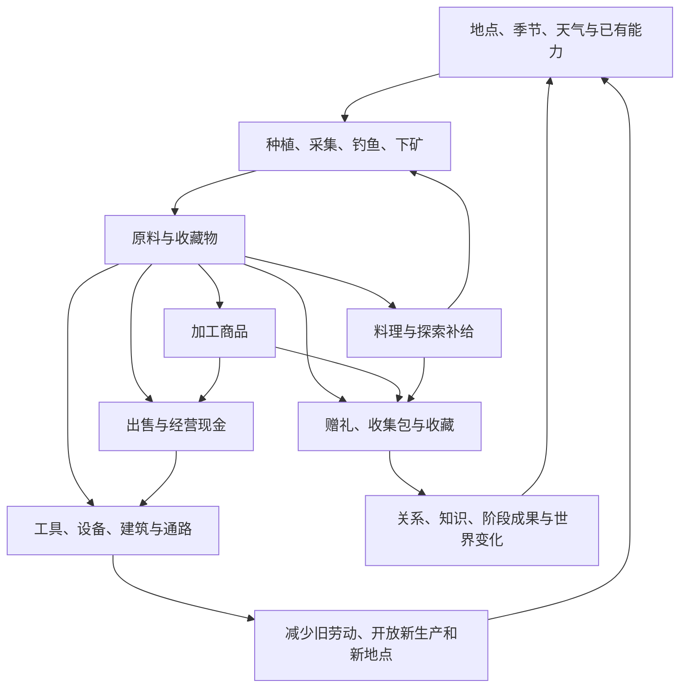

# 星露谷物语深度拆解与 Gensen 多人地图生活框架

## 1. 核心判断

**Gensen 最值得继承的，是星露谷“多种劳动产生多用途资源，投资改变生活方式，不同目标相互支持”的结构。面向大量陌生人同服、持续协作交易的定位，建议以“个人生活与专长成长 + 地方持续经营 + 跨地域共同发展”组织长期目标。**

地标值得加强，但加强的重点应是建成后能做什么、谁会使用、怎样产生下一轮经营。公共事件适合让共同目标进入一个有主题的阶段。两者都不适合独自承担 NPC 关系所提供的私人回应、人物期待和共同生活感。

建议保留 NPC 的个人关系与故事，同时让玩家的产物被真实的人使用，让地图上的公共场所形成持续生活。一个人可以追求喜欢的居民、经营自己的料理摊、认识常来买东西的陌生人，也可以参与地区温室和路线建设。这些目标应相互支持，不要求每个玩家都走完同一条线。

| 核心问题 | 建议结论 | 主要理由 |
| --- | --- | --- |
| 星露谷哪些部分值得直接学习 | 多用途资源、跨系统投资、可见能力成长、短循环与长期目标交错 | 它们解释了同一组种植、采集和制作为什么能持续产生不同安排 |
| NPC 是否必须被社区目标替换 | 保留个人 NPC 关系，另建共享世界目标 | 私人关系和共享进度可以并存；二者承担的动机不同 |
| 地标是否足够支撑长期玩法 | 单次捐料建成不够；应成为持续使用的公共场所 | 一次建设的物料需求会结束，场所需要继续承载经营、探索、表达和往来 |
| 更强的社区长期目标是什么 | 发展一个有特色、有人需要、能被共同改变的地方，并在其中积累自己的身份 | 陌生人的合作需要具体用途和可辨认的贡献，不应仅依赖抽象集体荣誉 |
| 地图增加什么 | 地域比较优势、空间连接、环境机会、产地身份和共同历史 | 地名不同但决策相同，不足以构成地图玩法 |
| 经济系统先解决什么 | 谁持续消费、为什么向别人购买、哪些供给可以进入市场 | 交易只是资源转移，不能自行产生最终需求 |

以上为设计建议，未证明其吸引力超过 NPC 婚恋，也不代表 Gensen 已实现相应系统。当前没有足够证据判断“普通玩家普遍更喜欢哪一种长期目标”；需要区分关系、经营、探索、收集和表达偏好。

## 2. 事实边界与关键纠偏

### 2.1 真正的区别是持久陌生人世界

星露谷支持远程在线联机，不仅支持单人和本地多人。它的原版合作围绕房主存档与共同农场展开：房主需要开放该存档，其他玩家才能进入。开发者在 2018 年的多人更新说明中明确表示，合作默认发生在彼此信任的人之间，大家共同经营农场，游戏没有真正的财产所有权概念。[^1][^2]

因此，关键差异不是简单的“单机变多人”，而是下面几组设计条件发生变化：

| 维度 | 星露谷原版合作的主要前提 | Gensen 的目标前提 |
| --- | --- | --- |
| 关系 | 有限参与者，默认相互信任 | 大量不认识的人，可逐渐形成重复往来 |
| 世界 | 房主开放的共同存档 | 独立于某个玩家在线状态的持久世界 |
| 时间 | 共同推进游戏日，过夜需要协调 | 随时上线下线，异步生产、交易和参与 |
| 财产 | 共同农场，可选择共享或独立资金 | 明确个人资产、公共资产、交付与使用权 |
| 成长 | 同一批玩家大致共同经历世界变化 | 不断有新人进入，也有中途离开和回归的人 |
| 经济 | 规则规定的商店与出货系统，协作调整产出 | 玩家之间长期流通，供需、价格和财富积累互相影响 |
| 公共目标 | 有限存档的一次性修复与完成目标 | 建成之后仍需容纳后来者，并持续产生参与机会 |

当前 Wiki 已包含共享与独立钱包，以及多人利润率设置。2018 年公告中的人数和钱池规则不能当作全部现行规则；这里引用它只用于说明合作的原始信任假设。[^1][^2]

### 2.2 NPC 影响进度，但不是所有进度的总开关

NPC 好感能开放爱心事件、私人空间、礼物和部分配方。卡洛琳的两心事件可通向茶苗配方，莱纳斯的三心关系可通向生鱼片食谱；它们让农业、探索与关系形成回流。[^3][^4]

但星露谷还有技能、工具、矿井、社区收集包、博物馆和地区通行等独立进度。巴士修复开放沙漠、博物馆捐赠达到条件开放下水道，都不是恋爱攻略的统一结果。完美度也同时覆盖生产、收藏、技能、关系与其他目标。[^5][^6][^7]

更准确的表述是：**NPC 是进度网络和情感网络的重要节点，不是唯一主线。** Gensen 可以借鉴这种分布式目标结构，避免将所有玩家卡在同一个 NPC、同一公共工程或同一种购买行为上。

星露谷多人本身就让个人好感、技能、配方与多数任务，同共享的社区修复、矿井和博物馆进度并存。这说明“同一个世界中的私人生活”已有可参考的结构；大服需要进一步解决的是归属、后来者经历和排他性规则。[^2]

### 2.3 单机同样需要经济设计

星露谷有种子成本、出货价格、加工时间、技能收益、工具和建筑投资，也有多人增产后的利润率调整。出货箱和商店的售卖按既定价格规则结算，不以是否存在一个真人买家为条件。它当然有经济系统；它主要不需要处理陌生人大服中持续的玩家市场治理。[^2][^8][^9][^27]

单人玩家找到高效赚钱方式，可以是一种成功体验。在持久共享市场中，同样的高效生产会改变其他玩家的价格与生计。把星露谷的售价、加工倍率和产能扩张直接搬进大服，会把个人成长问题变成全体玩家的供需问题。

### 2.4 本报告的适用范围

机制依据以星露谷官方说明、中英文 Wiki 的可读 1.6 系列资料为主，辅以 Palia 官方资料检验“多人生活游戏是否容纳个人 NPC 关系、交易范围是否可以分品类设计”。资料访问日期为 2026-09-11。持续更新的 Wiki 不构成逐平台最新版本核验；报告不依赖最新物品总数、精确联机人数或边缘版本规则。

机制事实附来源；动机解释属于设计分析；Gensen 方案属于待讨论建议。没有竞品玩家访谈、行为数据或本轮实机比较来支持留存因果结论。

项目状态依据现有产品文档：分钟级种植、采集、料理、制作布置、预设居民、地图入口与随包街区已有基础；主要工程仍属于个人状态。双地域专长和两种构件异步交换属于 GDD 草案，完整矿洞、大规模陌生人同场、开放商品市场和共享地标不属于已验证成果。[^26]

## 3. 星露谷的整体结构

### 3.1 最小循环是“安排一天”，不是“等待收菜”

星露谷的游戏日从早晨开始，玩家安排农活、出行、社交和探索，再选择睡觉推进到下一天。季节每 28 个游戏日变化，改变作物、采集、鱼类和活动。单人模式许多菜单会暂停时间，多人模式一般不会自动暂停，过夜还需要协调。[^10][^11]

时间和体力形成了安排上的取舍：农田种多了，可能少一些矿洞时间；先去见某位居民，就要调整另一段路线。农作物生长期间，玩家仍有其他可以主动做的事情。

**对 Gensen 的启示：**保留“我现在有几件都值得做的事，而且顺序由我决定”，不必照搬共同睡觉或压缩游戏日。项目现有“现实环境时间、分钟级生产、行动事实解锁”的分工可以继续承担这个职责。[^26]

### 3.2 资源是一张用途网络



这是对机制关系的归纳，不是游戏内部数据结构。最重要的是，同一个库存有多个有意义的去向，而且结果会改变下一轮：矿石可变成工具和洒水器，食材可变成探索补给或某个人喜欢的礼物，收藏可带来新地点。[^3][^5][^8][^12][^13]

“多用途”也不是让所有配方都争抢同一件稀有物品。基础资源应支持可靠经营，特色资源提供不同方向的价值，关键材料需要能理解的来源。只有需求、没有可达来源，会成为卡点；只有大量来源、没有后续用途，会成为库存垃圾。

### 3.3 成长的价值在于重新分配时间

优质洒水器是很清晰的例子：耕种等级 6 解锁，消耗铁锭、金锭和精炼石英，自动浇灌周围 8 格。农业经验和矿洞产物共同换来更少的日常浇水，玩家可以将释放的时间用于别的活动。[^12]

小桶又把木材、铜锭、铁锭和橡树树脂连接起来，开放新的加工安排。温室让一块有限空间中的种植摆脱正常季节限制，改变了玩家的长期作物组合。[^13][^14]

这类奖励不是简单的“产量 +10%”。它们分别改变劳动方式、原料用途和生产边界。Gensen 每项中期成长都应回答：**得到它以后，我下一轮会怎样不同？**

### 3.4 长期目标存在多条并行路径

| 目标路径 | 星露谷的代表机制 | 玩家得到的变化 | Gensen 值得继承的部分 |
| --- | --- | --- | --- |
| 经营成长 | 工具、设备、建筑、技能与职业选择 | 新生产、少做旧劳动、重新配置空间和时间 | 有限资源下的投资顺序与生产方法变化 |
| 世界修复 | 社区中心、交通恢复、地区开放 | 看得见且用得上的世界变化 | 分段成果、多玩法输入、明确的新用途 |
| 人物关系 | 赠礼、事件、配方、婚后生活 | 认识人物、被回应、日常空间改变 | 具体对象与个人经历，不只增加好感数值 |
| 探索挑战 | 矿层、阶段奖励、后续洞穴 | 新资源、装备、风险与熟练度 | 有可停点的探索和不同深度的目标 |
| 收集与完成 | 博物馆、出货、鱼、料理、制造、完美度 | 把分散活动组织成看得见的长目标 | 类别收集、个人发现、可展示的成果 |
| 自我表达 | 农场布局、住宅、陈列与服饰 | 形成自己的地方与风格 | 可持续的个人作品和他人来访理由 |

这些路径并不等量吸引所有人。完美度将许多系统重新组织成后期目标，但仍是有限完成度；爷爷评价也可以重评，并非必须在两年内完成所有内容的硬截止。[^7][^15]

对持久多人游戏而言，有限成就值得保留。问题在于它们完成以后，是否还有值得重复的活动与关系，而不是把所有成就做成无限等级。

### 3.5 门槛应组织探索与期待

| 门槛类型 | 星露谷中的作用 | Gensen 的转译原则 |
| --- | --- | --- |
| 能力与工具 | 熟悉活动后获得新配方，处理以前无法处理的资源 | 保留行动成长与能力变化，不用重复签到替代掌握 |
| 材料与资金 | 将多个生产活动连接成一次投资 | 保留投入与机会成本，关键个人成长不锁在唯一卖家手中 |
| 地点与通路 | 新地区带来不同资源和挑战 | 公共通路共享开放，个人工具与发现仍有自己的目标 |
| 人物关系 | 逐步开放私人事件、配方与生活阶段 | 保留关系内容，不把全部产业准入绑在恋爱上 |
| 季节与天气 | 引导玩家学习世界、安排取得时机 | 保留可预期的机会差异，准备替代来源和可重复窗口 |
| 阶段完成度 | 将分散系统汇成社区修复或后期成就 | 共享成果和个人经历分开，晚加入者仍有可完成的内容 |

机制依据见技能、关系、收集包、矿井、天气与完美度资料。[^3][^5][^7][^16][^19][^23] 门槛有意义的条件是玩家知道自己为何要跨过去，以及跨过去以后生活有什么变化；只规定“还不能做”，并不自然产生期待。

## 4. 按模块拆解与裁剪

### 4.1 种植：从收益比较发展到用途比较

**已知机制。** 作物有不同季节、生长周期、再生特征和品质。缺水通常暂停生长而不是直接死亡，正常换季会使不适应下一季的作物枯萎。品质影响售价、食用恢复和合适礼物的关系收益；加工和料理对品质有自己的规则，不能假设原料品质总会传递。[^8][^9]

**成熟部分。** 田地、资金、成长时间和后续用途共同决定种什么。短周期作物帮助周转，多次收获作物影响长期安排；一份作物可以卖出、加工、烹饪、赠礼或保留给收集包。

**Gensen 建议。** 让本地特色与基础作物竞争同一份产能，比较的不只有每分钟售价，还包括自己想做的菜、真实订单和即将使用的设施。长短周期适配不同上线习惯，但不应让高频操作成为唯一有效经营方式。

不建议照搬持久世界里的换季清田惩罚。共享时间不会等待离线玩家，已播批次宜保持可预期的完成规则，成熟成果应能回来再收。农业成长优先减少重复点击、开放种植方法和产品组合；持续增加可交易总产出必须与需求一起评估。

### 4.2 下矿：承担材料、发现和局部挑战

**已知机制。** 普通矿井有 120 层，不同深度对应矿物、环境和奖励，电梯层提供返回已到达深度的便利。探索同时涉及时间、生命、工具、食物和是否继续深入的取舍。[^16]

**成熟部分。** 每次出行能形成相对完整的小目标：取得所需矿料、到达一个检查点、找到新收藏物，或者挑战更深处。带回来的东西既能服务矿洞本身，也能改善农场。

**Gensen 建议。** 下矿至少连接三类成果：用于工具与公共设施的材料、用于个人/公共展览的发现、可选的探索挑战。农业与料理为探索提供可选择的补给，矿料反过来支持农业、加工与建造。

面向轻休闲大服，基础矿料不宜由抢最后一击、抢唯一矿点或强制组队决定。建议公共入口连接个人或小规模协作探索空间，关键收获归属明确；不同矿带形成品类差异，而不是全服永久挤同一个最优刷矿点。战斗强度是独立设计维度，“下矿”确定不等于每位种田玩家都必须完成高压战斗。

电梯式检查点可以继承“减少已掌握路段的重复成本”。死亡丢物、深层装备碾压和必须准时集合的副本机制，需要另行论证，不能因为参考星露谷就默认采用。

### 4.3 料理与加工：承担不同的需求

**已知机制。** 料理主要提供恢复、部分行动增益、关系和收集价值；许多菜的售价不高于原料机会价值。工匠商品则使用设备和加工时间，通常以增值经营为主要用途。多数加工品忽略原料星级，但熏鱼等存在明确例外。[^9][^17]

**成熟部分。** 食材不是一律进入售价最高的配方。带一份合适料理出门，可能比把食材卖掉更有价值；加工设备的投入和占用，又形成经营安排。

**Gensen 建议。** 将料理发展为真实可消费的生活与出行商品，将工匠商品发展为经营品、制作材料和表达性成品。料理可提供不同路线便利、共同用餐和招待价值，但不要先制造强制饥饿、再靠出售食物解决基础操作。

需要特别验证“有人愿意反复吃”以及“有人愿意从别人处购买”。只把料理交给无限发钱的系统订单，会使料理摊实际上仍依赖系统收购。共同制作可以有参与感，但多人一起做一份菜若向每人复制完整可交易产物，经济上就是按人数扩张的供给来源，不能免费忽略。

### 4.4 轻量建造：区分五种成长回报

星露谷中的设备、建筑、住宅与交通设施承担不同功能，不能统一理解成建设等级。[^12][^13][^14][^5]

| 建造类型 | 应产生的回报 | Gensen 的候选方向 |
| --- | --- | --- |
| 劳动改善 | 减少已经熟悉的重复操作 | 照料便利、批次安排、收纳与加工操作改善 |
| 生产方法 | 能做以前做不了的东西 | 育种、不同加工、有限的异地试种 |
| 空间与通行 | 新地点可进入，熟悉路线更方便 | 支路、驿站、公共连接与矿区入口 |
| 个人表达 | 空间留下自己的作品 | 庭院、摊位、花木组合、收藏陈列 |
| 公共用途 | 别人也能使用建成成果 | 公共温室、集市、展厅、出行服务场所 |

五类价值都可以存在，但不要让每一座建筑同时加金币、加产量、加经验。这样容易形成必须最先建造的通用最优项。轻量建造更适合明确的部件、摆放和用途，不需要先做高度自由的物理搭建系统。

### 4.5 收集：连接地点与个人经历

**已知机制。** 鱼类出现受地点、时间、季节和天气影响，也能进入料理与社区收集包；博物馆、出货、料理和制造记录让不同活动进入长期完成目标。[^5][^7][^18]

**成熟部分。** 同一物品因为“我还没见过”“这里需要它”而获得独立于售价的意义。收集也让玩家学习世界条件，形成路线和季节记忆。

**Gensen 建议。** 分开“拥有物品”“亲自发现”“用于陈列”三件事。可交易物品能帮助补齐展示，个人发现记录保留旅行与探索的价值。公共收藏可展示地方合作成果，但不能因为别人先捐过，就让后来的玩家没有个人收集经历。

收藏通常是阶段需求，不是无限消耗。公共展览可更换主题，个人布置可继续表达，但不能假定玩家必然为每次换展重新购买整套商品。稀有收藏也不应成为基础成长必须等待某个现实季节的唯一钥匙。

### 4.6 技能与职业：让偏好形成专长

**已知机制。** 星露谷通过相应活动获得技能经验，等级解锁配方、熟练度和职业选择。这让玩家做自己喜欢的活动时获得成长，也让经验回到生产安排。[^19]

**Gensen 建议。** 人人能尝试种植、料理、采矿和建造，同时让当前设施投入、产地和熟练度形成擅长方向。专长优先体现产品组合、便利、某类订单适配或表达能力，不宜只有不断累加的出货倍率。

要保留转向和逐渐兼修的可能，但一个角色同时高效覆盖全部产业应有可理解的产能取舍。**“别人能做、我完全不能做”可以制造交易门槛，却未必制造愉快的合作；“我可以学，但目前更愿意找你买”更适合休闲经营。** 这种偏好是否足够支撑市场，需要测试，不能仅凭逻辑假定。

### 4.7 委托与公共事件：组织目标，避免成为唯一目标

星露谷的普通任务和特别任务给产物提供阶段用途，部分特别任务带配方、设备或事件奖励，有些可重复，有些不可重复。它们使用游戏内的日历与期限，部分要求接单后新取得资源。[^20]

可学习的是：一次任务让玩家以新的组合使用已有系统，并得到下一轮能用的能力。不能机械照搬现实倒计时、强制新增收获或不可取消订单来制造忙碌；这些规则放在长期在线环境中，会直接改变离线和回归成本。

Gensen 的公共事件可以围绕已有地方生活展开：矿物展、地方料理周、园艺主题、路线调查等。活动应让生产内容和合作方式发生变化，而不是所有人反复把材料投入同一条进度条。

### 4.8 社区中心：借结构，不借有限清单本身

社区收集包将季节作物、采集、鱼、矿物、加工品和金币组织到一个共同可见的修复目标。部分包允许在候选物品中选够要求数量；房间完成后带来温室、矿车、巴士、采石场等明确功能回报，修复还连接居民庆祝和世界变化。[^5]

最值得继承的结构是：

**看见想要的成果 → 理解缺少的不同物品 → 用自己的路线补齐一部分 → 得到阶段反馈 → 成果改变日常行动 → 新用途重新进入经营。**

Gensen 应保留材料类别与路线选择，例如“几种适合的花材任选其一”，减少某一种资源无理由垄断。但如果大服只拥有一份不可重复的收集清单，早到者会替后来者完成世界进度，建设需求也会迅速耗尽。公共中心可以借鉴，必须配上后续经营与个人经历。

## 5. NPC 与社区长期目标怎样并存

### 5.1 NPC 关系提供的价值不只是解锁奖励

从已知机制可以分解出五种设计价值：具体的人物对象、针对自己的回应、逐步认识的内容、关系进入日常空间，以及为某个人安排生产的机会成本。婚后房间、共同居住、对话和生活行为，是关系成果的持续表达。[^3][^21]

这解释了为什么“我送出一颗宝石后，他愿意告诉我一段过去”与“我捐出一颗宝石，全服建设增加一点”可能给人很不同的感受。后者要形成情感意义，需要增加具体对象、可识别的结果和后续生活。

但这属于机制解释，不是婚恋留存更高的证据。偏爱经营优化的玩家，可能更在意自己的商店与生产方法；偏爱探索的玩家，可能更在意矿洞和收藏。产品不应要求公共地标在所有动机上胜过 NPC。

资源、日期与关系的具体连接如下。前两列为机制事实，后两列为设计解释与 Gensen 建议。[^3][^4][^21]

| 机制 | 星露谷中的连接 | 对生产和期待的作用 | Gensen 的裁剪原则 |
| --- | --- | --- | --- |
| 礼物偏好 | 不同居民对物品有不同喜好，礼物日志记录已知偏好 | 一件低售价物品也可能因为某个人而值得保留 | 保留具体喜好与可学习线索，避免所有角色只要最高价菜 |
| 赠礼节奏 | 普通赠礼有每日、每周次数限制，生日等有例外 | 关系分多次发生，不能一次清空库存直接刷完 | 保留分段认识，但不机械换算为现实周等待 |
| 生日 | 生日礼物有更强的关系影响，也能突破普通周次数限制 | 日历给准备食材和收藏礼物一个具体理由 | 提供纪念与筹备价值，不让错过一天永久损失核心剧情 |
| 交谈与关系变化 | 交谈、赠礼等影响好感；部分关系存在不互动衰减 | 鼓励把人物放进日常路线 | 保留主动互动回报，谨慎处理持久世界中的离线衰减 |
| 爱心事件 | 好感与各事件的位置、时段或前置条件共同决定触发 | 认识人物是逐步发生的内容，不只增加数值 | 个人事件可接续，公共世界推进不跳过私人经历 |
| 关系通向配方 | 卡洛琳事件与茶苗、莱纳斯关系与生鱼片食谱相连 | 赠礼的资源又回到生产和探索能力 | 保留关系回流经营，同时给不恋爱的玩家完整成长路线 |
| 交往与求婚 | 花束提高恋爱关系上限；求婚还涉及农舍、通路、吊坠与雨天商人 | 关系成为一个跨农业收入、建设和地理条件的个人项目 | 保留共同生活的阶段感，重做大服排他名额与现实天气门槛 |
| 婚后生活 | 搬入农舍、专属空间和日常互动延续关系 | 阶段完成之后仍能看见关系存在 | 让关系成果进入个人空间；不以无限加好感条代替内容 |

由此可以看到，值得学习的不只是“物品换好感”，还有“理解对方、为某个日子准备、期待下一段经历、成果进入生活”的完整过程。地标或公共事件若想承担相近的价值，也需要具体对象和后续生活。

### 5.2 三种关系各有责任

| 关系 | 主要价值 | 建议表现 | 需要防止的问题 |
| --- | --- | --- | --- |
| 我与 NPC | 稳定回应、私人故事、生活陪伴 | 个人好感、通信、事件、配方、私宅互动 | 全服共享好感让别人替我认识角色；奖励唯一名额被抢占 |
| 我与其他玩家 | 实际互需、熟悉的生产者、共同经历 | 回头购买、作品使用、共同出行、互助与公开活动 | 强制聊天、拉人或入会；把不可预测的人际回应当作必需进度 |
| 我与地方 | 我改变过这里，这里有我的记忆 | 常去场所、可用设施、作品来源、地方故事与历史 | 地标只有等级；贡献被总量淹没；换频道后历史消失 |

多人生活游戏容纳私人 NPC 关系并非纯理论。Palia 的官方关系说明明确将每位玩家的关系故事视为个人经历，不因其他玩家攻略同一 NPC 而竞争；后续官方更新也增加了更高友谊阶段任务。它能支持“可以并存”的判断，不能证明相同方案必然适合 Gensen。[^22]

星露谷多人 NPC 婚姻具有排他性，这不适合直接搬到大量陌生人的世界。Gensen 若保留恋爱，应采用个人叙事层，并明确公共居民身份与私人事件的边界；若暂不投入婚恋内容，友谊、师徒、常客关系也能先承担一部分成长与回应。是否制作婚恋是内容定位决策，不是联网技术必然要求删除的玩法。[^2][^21]

### 5.3 可选的长期方向比较

下表是框架判断，不是经过用户研究的评分。

| 方向 | 能提供的吸引力 | 单独采用的局限 | 建议角色 |
| --- | --- | --- | --- |
| 更大、更漂亮、更多级的地标 | 可见成果、收藏与地方象征 | 建成即结束，劳动与个体关系弱，增加等级不能保证新玩法 | 保留，但必须带实际用途 |
| 高频公共事件 | 共同发生的事、氛围和主题变化 | 内容运营压力大，容易靠限时奖励驱动，错过成本高 | 作为持续生活的阶段活动 |
| NPC 与地方居民共同故事 | 有具体对象、悬念和情感回应 | 叙事内容成本高，需要处理个人与共享状态 | 保留个人线，增加有限公共地方线 |
| 玩家产业、经营身份与往来 | “我的产品有人需要”，可以产生反复交易 | 依赖真实消费、流动性和可辨认的供给者 | 大服中长期经营主轴 |
| 地域探索、收藏与共同发展 | 新路线、新产地、共同发现和地图历史 | 内容会消耗，纯开图仍会变成一次性清单 | 世界发展主轴，连接经营和地方故事 |

**推荐组合：以玩家经营身份和地方共同发展为主轴，以 NPC 承担稳定的私人情感，以地标承载能力与历史，以公共事件组织阶段变化。** 不需要另造一个试图取代所有动机的超级目标。

## 6. 适合陌生人大服的长期目标框架

### 6.1 三个尺度，同时可参与

| 尺度 | 玩家能表达的愿望 | 长期目标 | 与其他层的关系 |
| --- | --- | --- | --- |
| 个人 | “我想把自己的生活经营成这样” | 家园、摊位、专长、NPC 故事、配方和个人图鉴 | 提供稳定自主目标，也产生消费与供给 |
| 地方公共场所 | “这里是我常来、我的东西会被用到的地方” | 集市、公共温室、矿区驿站、展厅及其持续经营 | 让陌生人的合作具体化，形成重复相遇 |
| 跨地域世界 | “我们这里与其他地方连接起来，能做更多事” | 用途不同的通路、地域联合展览、共同调查和地方发展 | 汇集不同生产链，持续强调地图价值 |

地方尺度不是把产品缩回熟人小房间。玩家仍处在开放的大服中，可以跨区交易和参与公开场所，不要求加入公会。稳定的活动地点与供货记录，为重复遇见同一生产者提供机会。

同服也不意味着所有人只填一条全服进度条。多个有名字、有用途的公共地点，可以共同属于一个持久世界。频道或同屏人数限制属于呈现问题，不应改变同一公共地点的建成事实、作品归属和历史。

### 6.2 地标的四段生命过程

| 阶段 | 共同在做什么 | 玩家得到什么 | 需求特点 |
| --- | --- | --- | --- |
| 建成 | 修复一个明确能力，例如可用温室或通路 | 新行为、新地点、看得见的贡献结果 | 真实但有限的建设需求 |
| 使用 | 种植试验、出行、采购、供餐、展示 | 自己的计划更容易实现，别人的成果对自己有用 | 取决于活动本身是否值得重复 |
| 选择与扩展 | 决定下一主题、另一支路或不同经营用途 | 新的资源组合与表达，不只增加同一种产量 | 提供阶段需求，不能无限抬高等级 |
| 留存与接续 | 保留成果、讲述地方变化、开放后来者目标 | 地方历史、个人经历、当前可加入的活动 | 已完成的基础能力不倒退，个人目标仍可进行 |

例如公共温室建成后可以成为有限的异地试种、主题园艺和展览场所。它不必让所有人都无成本种遍全球作物，否则会消除地域交易的原因；也不应长期以高额租税阻止普通玩家使用。应在公共可用性、个人种植能力和本地比较优势之间保持明确边界。

### 6.3 共同目标与个人回报分开设计

公共设施原则上对后来者与未贡献者可用。适度的搭便车是公共品属性，不必通过“未捐款禁止过桥”处理。贡献者可以同时获得自己的订单收入、制作成果、作品署名、发现记录或人物回应，使参与有具体的个人意义。

公共建设不能只接受最高级材料。基础食材、合适的花木、成套构件、调查发现和陈列作品可以承担不同职责，让新玩家也能完成一件有结果的小事。认可不宜默认以捐献总价排序，也不宜把项目最终一件材料对应为全部功劳。

不能同时为所有贡献无条件支付高额系统金币，否则公共工程会变成新的货币发行口。个人回报需要与经济设计一致：哪些由真实购买者付款，哪些是一次奖励，哪些属于不进入交易的记录和表达，必须能解释。

### 6.4 协作包含三种不同体验

| 协作方式 | 候选活动 | 给玩家的感受 | 必要边界 |
| --- | --- | --- | --- |
| 异步互需 | 买卖料理、原料、构件，接受制作需求 | 即使错峰，我的产物也对别人有用 | 成交与真实使用可辨认，系统不冒充玩家 |
| 同场共同做事 | 开放式共同备餐、短矿洞探索、布置与调查活动 | 我看到别人行动，我们一起完成了这一件事 | 可就近加入、分段退出；不以固定职业和全员到齐锁住基础成长 |
| 持久共同改变 | 设施开放、路线形成、地方展览与历史记录 | 我们做过的事让这个地方不同了 | 公共事实一致，后来者仍有个人贡献和参与机会 |

三者不能互相代替。只有交易可能成为匿名采购，只有一起捐料可能仍是并排做单人任务，只有同场热闹又未必留下长期成果。

例如一场公开备餐中，玩家可承担不同原料与加工步骤，成果进入同一张真实可使用的餐桌，并留下食物与制作者来源；一段矿区探索中，同行者可以共同发现路径、处理障碍，再各自带回明确归属的材料。具体互动还需验证，核心要求是别人的行动能被感知并产生帮助，而不只在结算时乘一个人数倍率。

同场活动是大服体验的重要方向，但核心生活不依赖某名陌生人必须在线。共享场景可以按活动规模组织参与者，交易和地方历史仍连接更大的世界。

### 6.5 大服必须经受的反例

| 情况 | 框架上的处理原则 |
| --- | --- |
| 富裕玩家买齐材料，迅速建成 | 允许其加快公共能力，但个人发现、表达、经营与后续主题不被一次购买替别人完成；建设完成不是内容终点 |
| 用强制独立人数门槛防止包办 | 不把拉够人数放在基础进度上；它会让冷清地区停摆，也不能有效排除多账号 |
| 半夜或冷清时段上线 | 异步订单和个人活动仍可进行；关键个人成长有明确低供给路径；系统交易不能冒充真人成交 |
| 新玩家进入成熟地区 | 直接使用历史公共成果，完成自己的能力和发现，参加当前经营；不补交历史门票 |
| 离开一段时间 | 个人家园、永久能力和已形成贡献保留；回来能理解当前主题；未参与不能导致全镇惩罚 |
| 地区参与人数差距大 | 阶段开始时采用可解释的目标规模，进行中不随在线人数任意抬高终点；提供跨区参与和贸易连接 |
| 一群人控制公共空间 | 不把永久拆除权或发展否决权交给无限金币投票；公共编辑边界明确，表达机会可轮换 |
| 玩家很多但从不记得谁 | 保留供货者、常用地点、作品与重复购买的可追溯性；是否形成关系需行为证据 |
| 已完成工程被换频道“重置” | 同一公共地点共享结果；个人经历单独记录；不以各自的个人进度条伪装共享工程 |
| 新目标只是材料翻十倍 | 检查是否新增行为和用途；没有变化就应修目标，不以更长施工时间代替设计 |

公共空间轮换、个人反馈和历史展示都有内容与管理成本，应在一个公共场所中先验证。大服定位不意味着第一步就需要公会政治、玩家自治城邦或完整的治理模拟。

## 7. 地图、时间、天气与气候

### 7.1 地图应至少改变五类决策

| 地图因素 | 应改变的决定 | 候选表现 | 不成立的做法 |
| --- | --- | --- | --- |
| 地形、水系、土壤与气候倾向 | 本地擅长什么，值得投入什么设施 | 河湾植物链、山麓矿料与工艺链 | 每城仅换名，收益和用途完全相同 |
| 道路、连接与空间距离 | 先去哪里，是否开通另一条路 | 工作台与市场顺路，支路开放新资源 | 地图只是多个菜单入口 |
| 环境状态 | 本次出行和生产怎样调整 | 一种天气适合某类调查，另一条路线始终可做 | 现实天气封死主线，玩家只能等 |
| 产地与地方文化表达 | 为什么买这里的产品、展示什么主题 | 可识别的产地、配方风格、地区展览 | 给每个邮编生成独立物品，市场碎成无数小类 |
| 公共建设与往来 | 哪里发生了变化，今后更值得去哪里 | 集市、试种场所、公共路线和常用供应者 | 世界变化只写在任务结算里 |

星露谷的地理、季节与天气让物品有条件性的来源，温室等能力再改变这些条件。Gensen 可以把“随时间出现的不同机会”扩展为“不同地方同时存在的互补机会”，让玩家选择旅行、生产或购买。[^11][^14][^18]

### 7.2 气候、天气与活动日历不能混成一个时钟

| 层次 | 建议责任 | 需要的边界 |
| --- | --- | --- |
| 长期地域与气候 | 形成稳定特色、作物适应和设施价值 | 是长期规则，不因每次刷新随机改掉生产身份 |
| 短期天气 | 提供可预期的路线与产物差异 | 有预告和替代行动，不因现实灾害损毁个人资产 |
| 现实昼夜 | 地方氛围、居民活动表现和可选机会 | 不把固定时区的唯一窗口作为基础配方或成长门槛 |
| 生产计时 | 可离线推进的批次与成熟 | 已种批次规则可预期，成熟不要求立即领取 |
| 个人内容进度 | 技能、人物、配方与探索事实 | 不因公共世界先推进就失去自己的经历 |
| 公共活动周期 | 组织多人共同主题、筹备和回顾 | 不重置永久家园和基础能力，不强迫全部人同一刻到场 |

星露谷允许通过电视预知次日天气，且不同区域可能有不同天气；它展示的是“条件可学习、安排有依据”的价值。Gensen 不需要先接实时天气 API 才能验证这个价值。[^23]

当前阶段可以先采用稳定、明确标为游戏规则的环境情境。未来如果接现实天气，实况、预报和游戏事件应区分；天气数据缺失时应保持可玩。真实地域事实必须来自核实数据，AI 生成的物种、气候和居民设定不能自动成为地理事实。[^26]

### 7.3 地域差异应是比较优势

某地擅长一条生产链，不代表其玩家应永久比另一地更富。需要同时比较生产成本、产能占用、需求广度、可替代性和成长用途，不能只把配方材料数做成对称就宣布公平。

建议“基础经营普遍可达，专长形成不同的机会成本，游戏内旅行可跨区，迁居不重置资产”。现实住址不应决定永久发展上限；也不要求玩家真实出门才能拿到核心材料。

贸易上的重要矛盾是：若跨区复制生产完全无成本、全球同价且人人随时高效生产一切，地域差异会快速失去价值；若通过长距离等待、频繁搬运和硬性物种锁维持差价，休闲体验又可能受损。更合适的初始杠杆是有限产能、设施投入和稳定的产品优势，物流只保留可理解的连接与成本，不变成重复点击负担。

商品标准也应适度统一。保留有玩法意义的品类、品质或用途标签；产地故事可以作为元信息，而不是每一个真实街区都产生一个不能互相替代的新交易品种。这样才能兼顾地图特色与市场流动性。

## 8. 在线经济框架

### 8.1 先定义最终消费，再定义交易形式

长期供需至少需要同时回答：生产者为什么生产，消费者为什么使用，为什么向别人买而不是自己做，以及使用之后是否还会再需要。玩家买到材料，只是需求链条中的中间一步。

| 最终用途 | 价值 | 持续性边界 |
| --- | --- | --- |
| 个人工具、设备、扩建 | 明确成长，愿意积累和购买 | 会逐步完成，不能单独支撑成熟服务器需求 |
| 公共设施建设 | 共同改变地方，多类型材料汇合 | 建成以后原建设材料需求下降 |
| 可使用的料理和出行补给 | 反复活动可以反复消耗 | 必须活动好玩、消费自愿；强制饥饿和入场税不等同于需求设计 |
| 种植与加工投入 | 每次生产有输入成本 | 若最终产物没人使用，只是把积压转移到另一种物品 |
| 个人表达、花木与主题陈列 | 偏好差异带来不同购买理由 | 家具可复用、展示位有限；不能假设人人无限装修 |
| NPC 关系与个人收藏 | 具体对象和明确长目标 | 满好感、收齐后会下降；不应通过掉好感惩罚强行维持 |
| 地方主题与公共活动 | 让不同商品在不同阶段有用途 | 依赖活动吸引力与内容供给，不应默认运营可以无限补充 |
| 新玩家成长 | 为基础品和设备提供需求 | 不能以永远有大量新人为平衡前提 |

**一次性成长需求负责目标感，重复使用需求负责经营延续，表达与关系需求提供多样性。** 三者都需要，但不能互相冒充。

### 8.2 金币与物品必须分别看账

```text
全体玩家经济体系的金币净变化 = 系统新增金币 - 系统永久移出的金币

某类商品的存量变化 = 生产与系统发放 + 转化流入
                    - 使用消耗 - 转化流出 - 其他实际移出

玩家之间的交易：改变持有人，原则上不改变全体金币或商品总量。
```

统计范围包含个人钱包、交易托管及仍可分配给玩家的公共资金池，不能只看当前可消费余额。物品也要包含托管等中间库存。制作是把输入变成输出，不等于所有经济价值消失；家具放进仓库或反复上架，也不构成最终消耗。

| 行为 | 金币影响 | 物品影响 |
| --- | --- | --- |
| 系统买走玩家作物 | 向玩家发行金币 | 作物离开玩家体系 |
| 玩家向系统购买种子或服务 | 回收金币 | 种子可能由系统新增，服务通常不形成可转卖库存 |
| 玩家向另一玩家买料理 | 金币转移，扣除的系统费用另算 | 料理转移 |
| 玩家吃掉料理 | 通常不产生金币 | 料理被实际消费 |
| 玩家制作构件 | 可能另付服务费 | 原料转为构件，不能只计消耗不计产出 |
| 玩家把构件用于公共设施 | 视报酬来源而定 | 构件转为持久公共能力，后续可能改变供给与需求 |
| 交易税进入公共资金池后再发给玩家 | 只是转移，尚未成为净回收 | 无直接作用 |

这个区分直接影响设计选择。增加系统订单可以减少商品库存，同时增加货币；增加交易量不代表经济更平衡；增加手续费可以回收金币，却未必解决商品无人使用。

### 8.3 推荐受规则约束的玩家商品市场

Gensen 以持续协作交易为目标，长期方案应支持真实玩家之间的商品交换。建议基本结构是：个人资产清楚、异步成交为主、交易品类有边界、个人经历与公共使用权不直接出售。

| 内容 | 建议交易定位 | 理由 |
| --- | --- | --- |
| 基础原料、常规食材 | 可交易 | 支持不同上线习惯与生产偏好 |
| 地域特色原料与加工件 | 核心交易商品 | 把地图比较优势转为真实互需 |
| 有反复使用价值的料理和消耗品 | 核心交易候选 | 为成熟玩家提供重复需求，但先验证使用价值 |
| 家具、花木、部分收藏实体 | 按品类开放 | 支持经营与表达；需要避免种类过碎和唯一名额炒作 |
| NPC 好感、个人发现、技能经历 | 不直接交易 | 保留自己的生活过程，避免全部成长变成买单 |
| 公共基础使用权、永久管理权 | 不作为普通商品出售 | 防止公共成果被少数人永久控制 |
| 新手赠送、补偿和关键恢复物资 | 与可套利商品明确分开 | 防止批量建号、循环领取直接变成市场供给 |

Palia 提供了分品类设计交易边界的参考：其 0.185 官方更新开放特定玩偶类交换，而不是一次性开放全部资源自由交易。这个例子说明“交易范围可以选择”；它不应替代 Gensen 对生产商品交易的明确目标，也不是对 Palia 当前所有交易规则的完整描述。[^24]

货币交易在商品品类增加后可以减少“你正好有我需要的，我也正好有你需要的”这一双重匹配困难。现有双地域样板的构件换构件仍有价值，因为它能先检验互补与用途；它本身无法证明未来货币市场的价格、需求深度和流动性成立。[^26]

市场连接的默认候选是同服供需可统一查找、地方订单互联，采用一致的成交规则，同时保留产地、店铺和生产者身份。**日常社区范围可以小于订单匹配范围。** 不宜一开始按每个真实街区切出封闭市场，让冷区只能依赖 NPC；优先扩大可见的真人供需范围，再以 NPC 保证关键进度。是否引入独立地方价格、运输服务或更强地域隔离，需要在实际分工成立后另外判断。

### 8.4 NPC 兜底与玩家市场的边界

低供给路径必须保留，否则冷区、错峰和回归玩家会失去个人成长。但 NPC 如果无限、低价出售所有地域产品，就会挤掉生产者；如果高价无限收购所有产物，就会成为主导收入来源。

系统仍应承担正常的货币发行职责，让新玩家和普通玩家通过基础劳动获得可预期的初始购买力，不必先等富裕玩家买单。发行与回收需要结合人口、活动规模和基本消费负担调整；经济目标不是金币零增长，也不是让每个人始终缺钱。

建议框架是：基础生活与关键个人成长可恢复，NPC 的供给品类和条件明确；玩家提供更丰富的选择、适合的品质或更有吸引力的综合成本。恢复产物可在必要时限定为自用或转化为同等个人能力，避免形成无限可转售的低价货源，但不应把所有特色物品都绑定而掏空市场。

需要同时检查两端价格。若某 NPC 以价格 S 无限买入一种可交易品，它会给玩家市场形成价格支撑；若又以价格 B 无限卖出该品，会形成价格上界和系统套利边界。这可能是有意设计，但不能与“价格完全由玩家供需决定”同时宣称。

现有 GDD 的 NPC 2:1 替代只是一项样板候选规则。币值、加工、赠礼、退款、其他 NPC 和跨区规则加入后，都可能出现新的闭环；局部往返亏损不等于全经济无套利。[^26]

### 8.5 长期生产成长的边界

如果每次升级都增加田地、机器、产量和可交易收益，而成熟玩家的主要建设目标会完成，供给就可能比消费增长更快。结果可能是基础商品价格下滑、利润集中在少数新品，或者玩家绕开真人市场只向系统出货。这是需要验证的风险，不是已经发生在 Gensen 的事实。

建议让成长更多体现在劳动便利、配方选择、不同产品适配、有限专长和表达空间，同时保留需要选择的产能配置。高等级不应让全部低级商品变成废物，也不应只有老玩家才能供应任何有价值的东西。

反方向也有风险：若货币回收过重，新玩家会缺少交易资金；若价格下限保护过强，商品永远不能反映过剩；若用腐烂、维修税和强制体力门票消耗库存，又可能牺牲休闲体验。没有一个“收税即可平衡”的通用办法。

### 8.6 陌生人协作不等于免费复制资源

公共采集和共同活动需要让后来加入的人不会抢走他人的成果，也需要避免围观者无限领取可交易产物。共享节点、参与归属、个人发现与商品发放应分开考虑。

Palia 的 0.180 更新展示了队伍共享采集收益、NPC 关系扩展与经济调整可以同时存在。借鉴点是协作归属可以主动设计；它不代表增加每名参与者的产出后，市场就会自然吸收新增物资。[^25]

反多账号、自动化刷取、复制物品、虚假交易和市场控制，是扩大公开流通前需要解决的真实约束。框架上应以可靠资产记录、明确交易范围、有限可重复补贴和可追溯成交为前提。不给本报告未设计的制度贴上“已经防住工作室”的标签。

商业化若以后引入可交易货币、无限额产能或可转卖商品，会改变本框架的财富与供给边界，应重新评估；本文不假设已采用这类商业化。

## 9. 一条贯通主要模块的远景体验

以下“河湾四季园与山麓矿区驿站”是设计示例，植物与地点名不代表已核实的真实地理事实，也不是本次新增开发范围。

### 9.1 三个陌生人，从不同愿望开始

甲喜欢种植和料理，想把自己的摊位做成有辨识度的香草小馆；乙喜欢下矿和收集，希望发现新矿物、改善工具；丙喜欢布置，希望参与一个自己愿意常去的公共花园。三人可以互不认识，也不必同时上线。

甲在本地食材、特色构件原料与观赏植物之间分配田格。某批香草可以做新菜、卖给真实买家，或者用于自己正在推进的 NPC 故事。乙的一次短探索带回矿料和新收藏，矿料可以用于个人工具、加工连接件或出售；发现记录属于乙自己的经历。

### 9.2 公共目标提供共同方向

河湾四季园需要温室部件、适合本地主题的植物和布置作品；驿站需要能开放另一条探索路线的设施。甲购买乙供应的连接件，乙购买甲制作的出行料理，丙采购两地材料制作场景作品。

同一份物品仍有取舍：甲也许先满足自己的小馆，而不是立即捐给公共工程；乙也许先升级工具，再供下一批连接件。合作的前提是不同目标相互支持，不要求所有人牺牲个人计划服务全服进度。

### 9.3 建成之后，经营继续发生

四季园开放有限的异地试种与展览用途，驿站带来新的矿带探索。甲发现一种菜确实被出行玩家反复购买，决定改变下一轮种植；乙记住一家常用的供货摊位；丙看到游客使用自己参与布置的区域，想准备下一组主题作品。

NPC 在个人对话中回应各自做过的事，公共居民则在场所中承担共同职业与活动角色。个人关系没有被全服好感条取代，公共世界也不是每个人单独完成的假共享。

当甲、乙、丙碰巧同场时，可以加入一次公开备餐或短探索，共同完成眼前的一件事；没有到场的玩家依然能通过提前供货、后续使用和下一场活动参与地方生活。共同在线带来额外的动作与相遇体验，异步连接则让它不依赖固定聚会时间。

### 9.4 天气和地域提供下一次变化

一个有预告的环境窗口，使某类观察或采集更值得去做；不适合该路线的玩家仍有其他行动。新的花材和矿物进入个人图鉴、料理配方与展陈主题，跨区商品有新的用途。

此时新来的丁可直接使用建好的驿站，以基础食材订单或自己的首次发现进入当前生活，不用重建历史工程，也不因没参加开幕而失去核心能力。

### 9.5 这个例子不能隐藏的问题

连接件的首次建设需求会结束，菜品的需求取决于探索活动是否值得重复，展览需求取决于表达是否有吸引力，NPC 关系和图鉴也会逐渐完成。只有观察到真实的使用、复购和自主目标，才能说这套框架产生了持续经营。

玩家不需要每一轮都遍历种田、下矿、料理、交易和建设。每条偏好路径应可以独立形成一次完整体验，通过交换和公共用途与别人连接；否则系统越多，越可能变成全员必做的流水线。

## 10. 继承、改写与暂缓

| 星露谷元素 | 处理建议 | 保留的价值或改写原因 |
| --- | --- | --- |
| 同一产物有多种用途 | 优先继承 | 支撑库存分配与自主目标 |
| 工具、设备、交通改变下一轮 | 优先继承 | 用能力变化替代纯数值升级 |
| 多层长期目标并行 | 优先继承 | 兼容经营、关系、探索、收集和表达偏好 |
| NPC 个人好感和故事 | 保留并分层 | 为个人上线提供稳定反馈，与公共居民状态并存 |
| 社区中心分包、分段、功能回报 | 继承结构 | 让多条生产线汇入可使用成果 |
| 下矿检查点、材料与收藏并行 | 继承结构 | 有可停点、有发现，收益回流到其他生活模块 |
| 日历、天气、地点影响机会 | 改写 | 适应错峰、离线和现实地域公平 |
| 有限合作存档的共享财产 | 重做 | 陌生人大服需要明确财产与权限 |
| 唯一 NPC 婚姻名额 | 不照搬 | 避免抢占和后来者永久失去关系内容 |
| 一份全服一次性收集清单 | 不单独采用 | 早到者包办、后来者旁观、完工后需求下降 |
| 全部商品固定价无限出货 | 不直接照搬 | 会支配货币发行与玩家市场定价 |
| 无限扩产、统一强度升级 | 谨慎改写 | 个人成长会影响其他玩家的供需和新老差距 |
| 换季离线损毁、共同睡觉 | 不照搬 | 持久世界不能等待所有玩家协调作息 |
| 钓鱼、养殖、复杂战斗等完整扩展 | 根据价值另行排序 | 可提供独特循环，但不因竞品存在就自动进入当前样板 |

本轮明确的模块方向是种植、经营、轻量建造、下矿、收集，以及天气、气候、时间和地域等地图因素。料理、加工、个人关系和公共场所是连接这些模块的重点候选。完整矿洞是后续设计内容，不能把现有 GDD 的矿料采集点表述为矿洞系统已经完成。

## 11. 哪些假设应先验证

### 11.1 需要证明的不是“功能很多”

| 假设 | 有用的证据 | 反证与调整方向 |
| --- | --- | --- |
| 能力成长改变安排 | 玩家能说明为何先投一种能力，得到后改变生产或路线 | 所有选择都只是同一收益率；先修能力差异 |
| 地域创造互需 | 玩家为具体用途寻找外地产物，并在使用后再形成新需求 | 只完成教学交换；先修商品用途 |
| 料理能支持重复消费 | 有玩家自愿使用，并愿意再次制作或购买 | 只有系统高价收走；先修活动和消费价值 |
| 公共场所比捐料条更有意义 | 玩家指出自己完成的具体成果，建成后回去使用 | 只为首通奖励贡献一次；先修建成后的生活 |
| 陌生人能形成重复往来 | 无研究者配对时，出现复购、再次合作或常去地点 | 每次都是不可辨认的随机交易；检查供给者与地方记忆 |
| 新人与回归者仍有自己的目标 | 进入成熟地区后能自主开始合适活动 | 只能补旧账或等新活动；先修参与结构 |
| 环境因素产生安排而非惩罚 | 玩家因预告改变计划，不利窗口也能完成其他目标 | 相同作息反复被排除；调整窗口与替代路径 |
| 成熟经济仍有需求 | 首批建设与首通结束后，商品仍因使用与表达流通 | 库存持续堆积、成交只靠补贴；先修消费而非增加产量 |

可以比较“只有外观的地标”与“有功能、使用者、个人回应的公共场所”，尽量保持投入、奖励价值和制作质量接近，再观察贡献、回访与后续选择。它能检验整套目标是否更有效；要分清究竟是功能、人物还是认可起作用，需要后续拆分变量。

NPC 爱好者、经营爱好者和探索收集爱好者应分开观察。不要以一组玩家不关心公共建设，就推出所有人都不喜欢；也不要以系统强制交材料的完成率推断社区归属。

### 11.2 大服经济的验证不能由两次成交替代

后续至少需要看：不同商品的实际使用与库存积累、成交等待与未成交原因、生产主动成本和利润、系统金币发行与回收、基础消费的可负担性、交易对象与财富集中度、低人口与高产玩家加入后的变化。

总成交额不能单独代表健康，金币总量也不能单独证明通胀。需要观察代表性商品的价格与购买能力，并区分新品稀缺、活动需求、玩家增长和系统补贴等原因。程序模拟能发现数量上的矛盾，不能证明料理好吃、经营有趣或玩家愿意合作。

少量目标玩家的探索性观察适合暴露理解和动机问题；大服市场流动性、长期供需、滥用和留存，需要在相应人口结构与时间跨度下另取证。同屏承载量通过也不等于社区有吸引力。

## 12. 与 Gensen 当前方向的关系

现有 GDD 已经包含多用途构件、先投资生产或先修路、异步交换、关键个人成长的 NPC 替代、新玩家能使用公共成果、贡献历史不倒退等原则。这些与本报告相容。[^26]

本次新增的重点是：**将大量陌生人同服与持续商品交易作为长期目标前提；明确个人 NPC 与公共地方生活并行；把地标从建设终点改为使用起点；在扩大产能之前解释成熟玩家的重复消费。**

本报告不冻结市场价格、货币种类、技能上限、活动周期或生产倍率，也不把所有长期框架直接加入当前样板。现有本地化优先、紧凑设计、双地域样板、第二第三轮自主选择观察、依据证据扩张的顺序继续作为当前执行基线。[^26]

对下一份设计稿最有价值的补充是三项：明确个人、地方、跨地域的目标关系；为每种可交易产物写出最终用途及其会不会耗尽；为一项公共场所写出建成后如何被反复使用。双地域样板先证明互补与能力变化，之后公共场所试验应纳入互不认识、错峰、晚加入的玩家，而不只演示熟人同步捐料。

Gensen 的长期产品承诺可以表述为：**在真实地域塑造的持久世界中，经营自己的生活与专长，让产物被别人需要，与不同的人共同改变常去的地方，并留下属于自己的经历。** 这是建议采用的设计方向，其长期吸引力仍需要玩家行为验证。

## 来源

以下外部页面均于 2026-09-11 访问。Wiki 为持续更新资料，发布日期未统一提供；其中机制可用于设计分析，不能代替玩家动机或商业效果研究。官方历史公告和更新说明按所引版本使用。

[^1]: ConcernedApe，[Stardew Valley 1.3 (Multiplayer Update) is now available!](https://www.stardewvalley.net/stardew-valley-1-3-multiplayer-update-is-now-available/)，2018-08-01。用于房主制及可信合作者的原始设计假设，不用于当前人数或全部钱包规则。
[^2]: Stardew Valley Wiki，[Multiplayer](https://stardewvalleywiki.com/Multiplayer)；中文对照[合作](https://zh.stardewvalleywiki.com/合作)。用于在线合作、个人与共享进度、钱包、利润率和婚姻归属。
[^3]: Stardew Valley Wiki，[友谊](https://zh.stardewvalleywiki.com/友谊)。用于赠礼、关系阶段、人物事件与配方回报。
[^4]: Stardew Valley Wiki，[茶苗](https://zh.stardewvalleywiki.com/茶苗)、[生鱼片](https://zh.stardewvalleywiki.com/生鱼片)。用于卡洛琳两心事件与莱纳斯三心食谱两个具体例子。
[^5]: Stardew Valley Wiki，[收集包](https://zh.stardewvalleywiki.com/收集包)、[社区中心](https://zh.stardewvalleywiki.com/社区中心)。用于跨系统收集、候选要求、功能奖励及公共世界变化。
[^6]: Stardew Valley Wiki，[下水道](https://zh.stardewvalleywiki.com/下水道)。用于博物馆捐赠与地区通行的关系。
[^7]: Stardew Valley Wiki，[完美](https://zh.stardewvalleywiki.com/完美)。用于多维后期完成目标，不把完美度解释为只完成恋爱或多人贡献简单求和。
[^8]: Stardew Valley Wiki，[农作物](https://zh.stardewvalleywiki.com/农作物)。用于季节、生长、缺水、收获、品质与用途。
[^9]: Stardew Valley Wiki，[Artisan Goods](https://stardewvalleywiki.com/Artisan_Goods)。用于设备加工、加工时间、品质继承及例外。
[^10]: Stardew Valley Wiki，[Day Cycle](https://stardewvalleywiki.com/Day_Cycle)。用于游戏日、睡眠、单人暂停与多人时间协调。
[^11]: Stardew Valley Wiki，[季节](https://zh.stardewvalleywiki.com/季节)。用于 28 日季节周期及作物、采集、地区差异。
[^12]: Stardew Valley Wiki，[Quality Sprinkler](https://stardewvalleywiki.com/Quality_Sprinkler)。用于等级 6、铁锭/金锭/精炼石英和周围 8 格浇灌实例。
[^13]: Stardew Valley Wiki，[Keg](https://stardewvalleywiki.com/Keg)。中文游戏物品“小桶”，俗称酿酒桶；用于耕种、矿料、木材与橡树树脂的跨系统投资。
[^14]: Stardew Valley Wiki，[温室](https://zh.stardewvalleywiki.com/温室)。用于季节限制改变、空间安排与种植能力。
[^15]: Stardew Valley Wiki，[爷爷](https://zh.stardewvalleywiki.com/爷爷)。用于阶段评价与可重新评价的边界。
[^16]: Stardew Valley Wiki，[矿井](https://zh.stardewvalleywiki.com/矿井)。用于普通矿井深度、资源分布、电梯与探索取舍；中文页面部分掉落表标记待补全，本报告不采用掉率数值。
[^17]: Stardew Valley Wiki，[烹饪](https://zh.stardewvalleywiki.com/烹饪)。用于食谱、恢复、增益及料理利润限制。
[^18]: Stardew Valley Wiki，[Fish](https://stardewvalleywiki.com/Fish)。用于地点、时间、天气、季节、收集与料理之间的关系；不把这些条件视为无例外的绝对限制。
[^19]: Stardew Valley Wiki，[技能](https://zh.stardewvalleywiki.com/技能)。用于活动经验、配方、熟练度和职业选择。
[^20]: Stardew Valley Wiki，[Quests](https://stardewvalleywiki.com/Quests)，特别任务与齐先生任务部分。用于期限、重复性、接取后取得要求和能力奖励。
[^21]: Stardew Valley Wiki，[婚姻](https://zh.stardewvalleywiki.com/婚姻)。用于关系条件、婚后居住与日常表现；多人排他规则对照来源 2。
[^22]: Palia 官方支持文档，[NPCs & Relationships](https://support.palia.com/hc/en-us/articles/7474617601428-NPCs-Relationships)，页面编辑于 2023-03-02；Palia，[Patch 0.180](https://palia.com/news/patch-180)，2024-05-28。前者用于个人关系不因其他玩家攻略而竞争的设计说明，后者用于后续友谊阶段任务；不用于声称 Gensen 的关系方案已有验证。
[^23]: Stardew Valley Wiki，[天气](https://zh.stardewvalleywiki.com/天气)。用于天气预报、不同区域天气、居民和鱼类条件变化。
[^24]: Palia，[Patch 0.185](https://palia.com/news/patch-185)，2024-10-22。用于特定玩偶类交换的品类边界，不作为 2026 年完整交易功能清单。
[^25]: Palia，[Patch 0.180](https://palia.com/news/patch-180)，2024-05-28。用于队伍共享采集收益、关系任务与经济调整并存的对照。
[^26]: Gensen 项目文档：[好玩优先方向](fun-first-rework-2026-09-07.md)，重点第 3、4、6、7、9 节及 9 月 10 日补充；[下一阶段行动蓝图](next-stage-action-blueprint-2026-09-10.md)，第 1–5 节；[地域经营与成长 GDD](regional-growth-gdd-2026-09-10.md)，第 1、2、5–12、15 节；[简版 PRD](prd-brief-2026-09-10.md)，第 2、4、6 节。既有比较参考：[种田生活游戏资源、料理与建造调研](farming-games-systems-research-2026-09-11.md)。版本状态按文档记录理解；草案与既有调研不等于已实施或玩家验证。
[^27]: Stardew Valley Wiki，[Shipping](https://stardewvalleywiki.com/Shipping)。用于出货箱结算、商店售卖同价及规则规定的系统购买。
