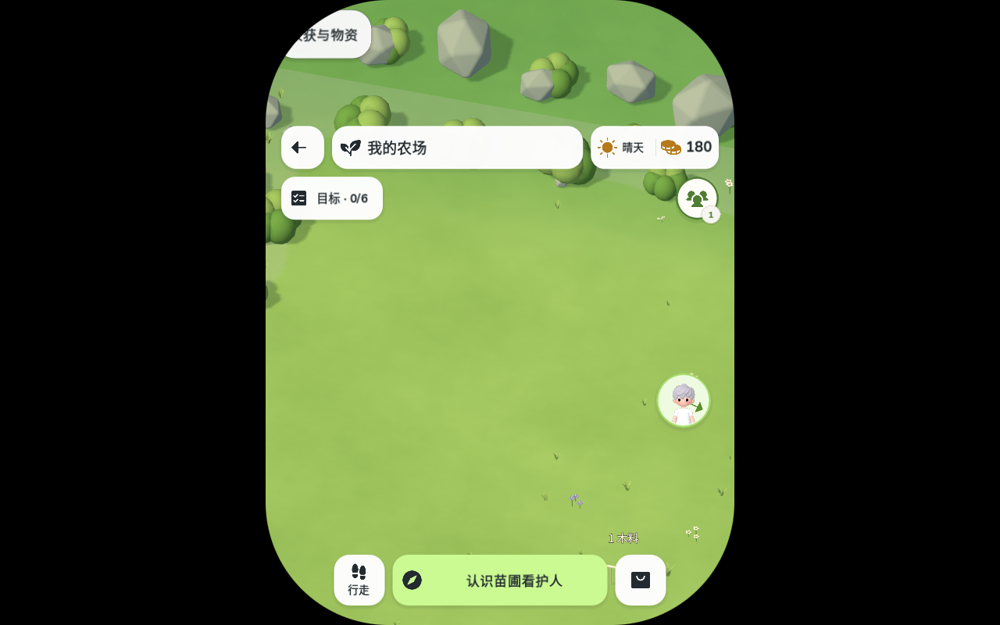
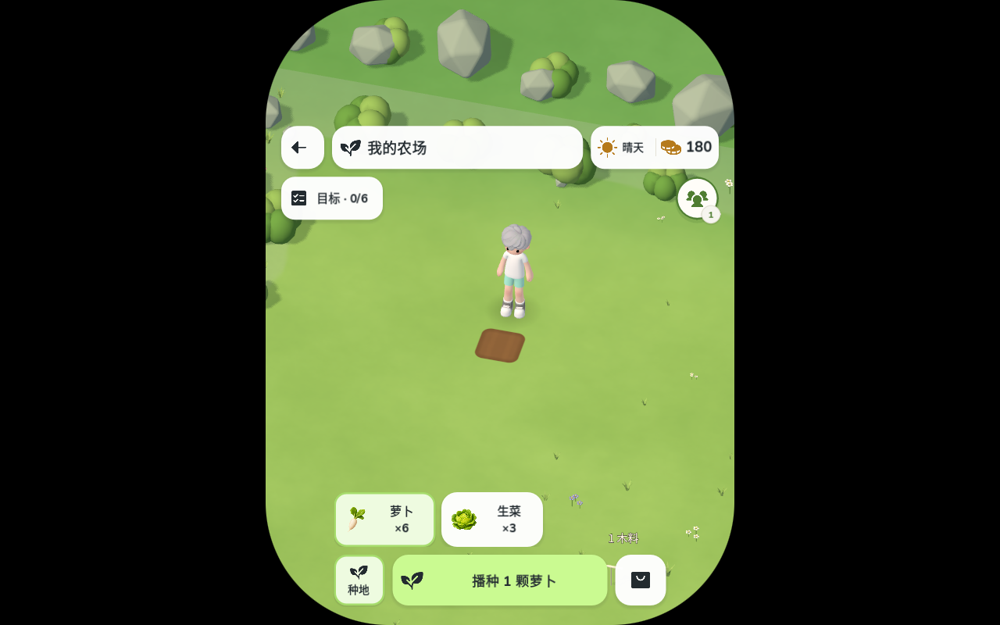

# 农场鱼塘移除验证

本轮代码已移除农场人工鱼塘的水面、岸景、钓鱼按钮、点水面钓鱼及服务端农场抛竿权限。真实地理水域和 12 个地图系统钓鱼点保留。规则与发布依赖见 [产品记录](../product/farm-pond-retirement-2026-09-25.md)。

## 已验证

| 项目 | 结果 |
| --- | --- |
| 服务端／PostgreSQL | 851 项通过，包含旧农场迁移、事务失败回滚、资格保留、当前／历史命令、地图鱼塘真实 HTTP/WebSocket 钓鱼结算 |
| Godot | 295 项通过，覆盖农場地形、导航、UI、原有种地、访客、自然水体、地图鱼塘与钓鱼回归 |
| 跨端数据 | 旧农场转换和新生成版本 3 的独立 JSON 样本，在 Node 和 Godot 中校验和一致 |
| 原塘位 | 47 格恢复为可走／可耕／可放置；海岸样本原有 628 个水域格保持不可行走 |
| 历史状态 | 作物、成熟时间、装备与库存、钱包、农场坐标及搬迁资格不被重新分配；旧缓存清理不删除命令／建场历史 |
| 迁移身份 | JSONB 字段顺序改变后仍得到同一地形 ID；重复迁移不再改动已处理农场 |
| Android 实际操作 | 在专用 `emulator-5580` 上，点击原塘位走入、切换种地、点击开垦，共 3 次游戏输入；本地服务器确认 `8,33` 为 `tilled`，版本变为 1 |
| 发布状态 | 未迁移生产数据、未部署后端、未更新用户真机；手机仍为此前的 0.16.39 |

[结构化结果](farm-pond-removal-2026-09-25/verification.json)、[Android 结果](farm-pond-removal-2026-09-25/validation.json)。

原塘位已恢复地面：



角色走入原塘位，并获得服务端确认的开垦结果：



图中的左右留白与圆角来自 Android 37 平板对竖屏应用的 letterbox。输入坐标先读取当前 Godot 控件／世界投影，再根据当前 Android UI 树的 SurfaceView 边界补上窗口偏移。新应用首次提示通过当前 UI 树关闭，没有沿用截图坐标。

## 测试隔离与复现

数据库测试使用本工作树内独立 PostgreSQL、回环地址 `127.0.0.1:5548/farm_pond_removal_test`，没有读取生产 `.env`。Android 使用独立包 `com.sensen.farmpondremovalqa`、ADB 服务 5041，以及独立的本机 3214 内存服务和测试账号。

初始测试配置曾遇到 APK 安装尚未完成、标准模板未打开网络权限、测试账号未通过真实身份哈希／Journey 初始化，以及系统提示与 letterbox 偏移。这些测试环境问题已修正；最终输入与服务端回包通过。不是用本地画面预测冒充后端成功。

```sh
# 从仓库启动独立测试服务；仅监听 127.0.0.1。
FARM_POND_QA_OUTPUT="$PWD/output/farm-pond-removal-2026-09-25/private" \
  pnpm --dir server exec tsx tools/qa_retired_pond.ts

tools/dev/pond_art_godot.sh --headless --path . \
  --script tools/dev/prepare_farm_pond_removal_qa.gd
tools/dev/pond_art_godot.sh --headless \
  --path output/farm-pond-removal-2026-09-25/project \
  --export-debug 'Android Farm Pond Retirement QA' ../farm-pond-removal-qa.apk
tools/android/pond_art_adb.sh -s emulator-5580 install -r \
  output/farm-pond-removal-2026-09-25/farm-pond-removal-qa.apk
ADB="$PWD/tools/android/pond_art_adb.sh" tools/android/run_test.sh \
  --serial emulator-5580 com.sensen.farmpondremovalqa -- \
  python3 tools/dev/farm_pond_removal_android_qa.py
```

原始日志保存在本地 `output/farm-pond-removal-2026-09-25/`：`server-verified.log`、`native-verified.log`、`android-checked.log`。本报告没有把模拟器验收称为这一轮的真机或生产验收。

生产迁移工具默认只做 dry-run，应用迁移需另加 `--apply`；从当前生产内容升级时，应显式指定 `--previous-content-version 50c2dbdde04c9678`。新内容与领域需一起切换，并保留部署既有的网络超时及语音配置。此次任务未执行该生产动作。
