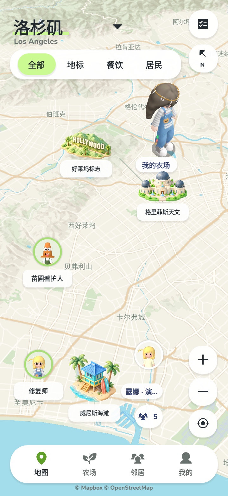

# 洛杉矶地图可操作样板

日期：2026-09-22。状态：Android 模拟器开发样板已实现并验证；未发布正式 Journey 更新、未部署服务器、未安装真机、未做外部投递。

## 实现

- 浅色 Mapbox 城市底图、中文城市标题、全部/地标/餐饮/居民筛选、地点列表、轻量资料卡、四项导航、缩放与回位。城市概览采用 42° 朝向和 35° 俯角以适配洛杉矶沿海地标的分布，N 按钮恢复正北。街区与城市浏览缩放下限分离于选址/搬迁。
- 地图世界仅保留自己的一个完整 3D 角色，使用已保存装扮。其他农场主使用缓存的角色头部头像，继续支持聚合、选人和访问。现有 API 提供 `avatar_ref`，没有账户照片；没有生成虚假的玩家照片或实时玩家位置。
- NPC 使用原有 ResidentCast/PlaceCatalog 解锁条件，独立头像和游戏配置会面点；点击接续原有居民场景。样板账号当前有两名可见居民，没有提前开放小馆主理人。
- Android 原生桥读取 Mapbox 已加载的 `poi_label` 图层，去重、限定当前视口和至多100个候选。Godot按缩放、类别和遮挡选择展示数量；缺地址不补造地址。地点类别缺失时使用通用标记，明确中餐分类才使用中餐厅素材。POI不持久化，没有抓取并随包保存 Search Box 结果。
- 五个独立配置的洛杉矶地标、三位 NPC 游戏会面点和13张 Sensenjoy `gpt-image-2` 生成的512×512透明素材。素材与提示词来源见[素材记录](../design/la-map-2026-09-22/production/assets-manifest.json)。
- 修复 Android JavaObject 包装器能力检测：原生方法需 `has_java_method`，不能只用 Godot `Object.has_method`。因此新POI接口、底图样式和现有语言切换能够正确调用。

## 验证

| 检查 | 结果 / 证据 |
| --- | --- |
| Godot 地图套件 | 149项通过，`reports/report_1314/results.xml`；最后N控件调整另跑6项UI/数据检查通过，`reports/report_1313/results.xml` |
| Android 原生桥 | Kotlin编译与 `testStandardDebugUnitTest` 通过，`output/la-map-2026-09-22/verification/android-native-tests.log` |
| 完整模拟器流程 | 24次触控通过，`output/la-map-2026-09-22/android/result.json` |
| 流程内容 | 城市概览、地点列表、Griffith基本信息、真实餐饮筛选、NPC卡/居民场景、邻居列表及实际农场访问、换装返回、自己的农场返回、拖动地标不选中、概览点选 |
| 资产保持 | 同一隔离账号前后 farm_id、wallet、cells、bag 完整比较相等；没有操作真实账号 |
| 地理对齐 | 调试阶段比较Hollywood与码头的Mapbox原生投影与Godot投影，采样差小于0.1物理像素；屏幕避让通过细线回指原位置，真实坐标不改 |
| 帧率观察 | 最终概览、餐饮和资料卡截图时采样均60fps；不是长时间性能或真机功耗结论 |
| APK | `output/la-map-2026-09-22/journey-map-qa.apk`，`com.sensen.journeyuiqa` / `0.16.13-mapqa`；安装APK已回读，SHA256一致，见 `verification/build.json` |

最终餐饮视图从Mapbox载入14个视口内POI，显示3个餐饮标记。城市概览与天文台周围的数据更稀疏；不会把未在视口内的候选当作当前可见点，也不以虚构地点填充空白。实际名称随Mapbox数据更新。

测试经 `tools/android/run_test.sh` 在完整场景会话内执行；退出时停止QA应用，保留模拟器运行。测试入口、只读控件树观察器和隔离账号仅在开发QA包，未写入正式Journey。

## 视觉核对

[完整对照](../design/la-map-2026-09-22/qa/comparison.jpg)与[UI局部对照](../design/la-map-2026-09-22/qa/ui-focused.jpg)已实际打开检查。细节与迭代记录见根目录 `design-qa.md`。

运行时保持真实地理和已有装扮；概念稿中的陶土浮雕地形、照片头像、示例人数和压缩的城市地标间距没有直接替代真实数据。当前交付是原生地图样板，不是将概念图作为背景的静态页面，也不代表全应用UI改版已经完成。

## 环境与保存边界

- 本机隔离服务：`server/tools/la_map_qa_server.ts`，端口3196，内存数据；QA应用通过模拟器的 `10.0.2.2:3196` 访问。服务需要在本机运行。真实POI来自正常Mapbox底图服务。
- 正式Journey应用、用户真实农场、身份/装扮和服务器保持原样。后端domain27/content `50c2dbdde04c9678` 未改变；无迁移。
- 用户授权后移除8个历史QA安装包，使用 `cmd package uninstall -k` 保留测试数据；正式Journey和当前QA保留。空间由约519MB增至约1.6GB，操作记录在 `private/historical-qa-cleanup.json`。当前QA的旧二进制与数据归档在 `private/prior-qa/`。
- 首次安装为应对安装预留阈值临时调整模拟器设置并立即恢复，恢复结果已核对，见 `private/storage-install.json`；清理旧包后安装无需此调整。
- 本轮未验证iOS原生POI桥接或真机；iOS目前沿用基础地图桥，不宣称与Android样板等效。现有16KB模拟器兼容模式提示经过系统UI树定位关闭，本轮未改动Godot/Mapbox原生库的页大小兼容性。

