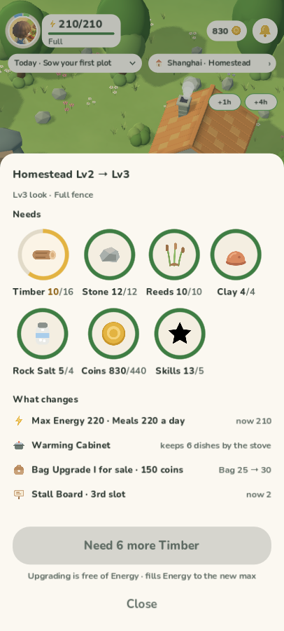
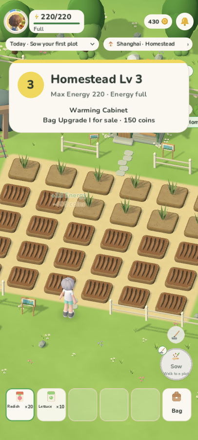
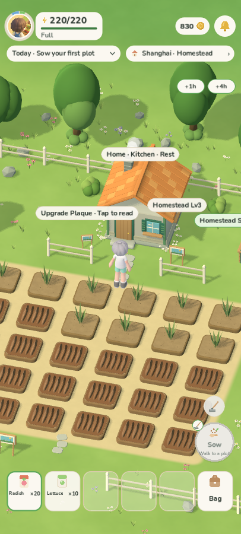
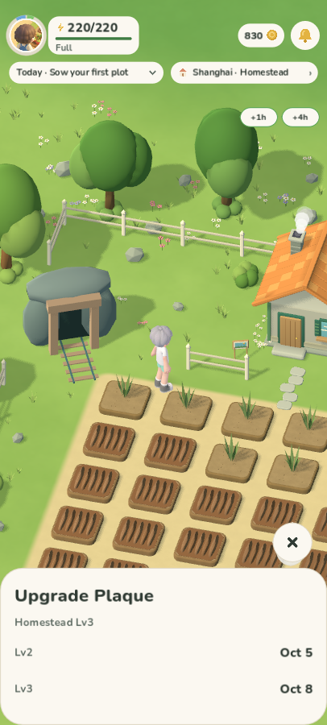

# P0 Homestead 升级界面走查 · 2026-10-08（SGODOT-228 PR-B，#21）

桌面 405×900（逻辑 360×800）按 `P0_SHOT` 拍摄，本地 P0 服务端（端口 3128，临时存档），head = ea33d7f6。
Android 模拟器 10 步走查拼图在 Plane SGODOT-228 评论 d4ac7d8b 的附件里。

| # | 画面 | 对应稿 | 截图 |
|---|---|---|---|
| 1 | HOME-1 Lv2 → Lv3，缺 6 Timber（琥珀环，按钮写缺口） | HOME-1 482:152 |  |
| 2 | 升到 Lv3 的 HOME-2 横幅（+10 Energy / −400 coins 飘字，围栏整圈落下中） | HOME-2 / MomentBanner 1228:108620 |  |
| 3 | Lv3 农场：整圈围栏、门右门牌标签 Homestead Lv3、门左木牌占位与指尖卡 Upgrade Plaque · Tap to read | HOME-LV3-FENCE 1510:97492 |  |
| 4 | PLAQUE-READ：每级一行日期，只有 × | PLAQUE-READ 1510:97745 |  |

说明
- 门牌和木牌上的标签目前用 P0Ui 的旧 tag 画（文字胶囊）。#12（SGODOT-221）合入后改用 UiTapCard / UiStatusBadge：门牌常驻指尖卡，可升级时上方出 READY 徽标；木牌靠近才出指尖卡。用户手测的是亚瑟按这个方向适配后的集成包。
- 农舍上方的 `Home · Kitchen · Rest` 和右侧 `Homestead Stall …` 不属于本 PR。
- 木牌是美术占位（缩小的 sign.glb），不占格。
