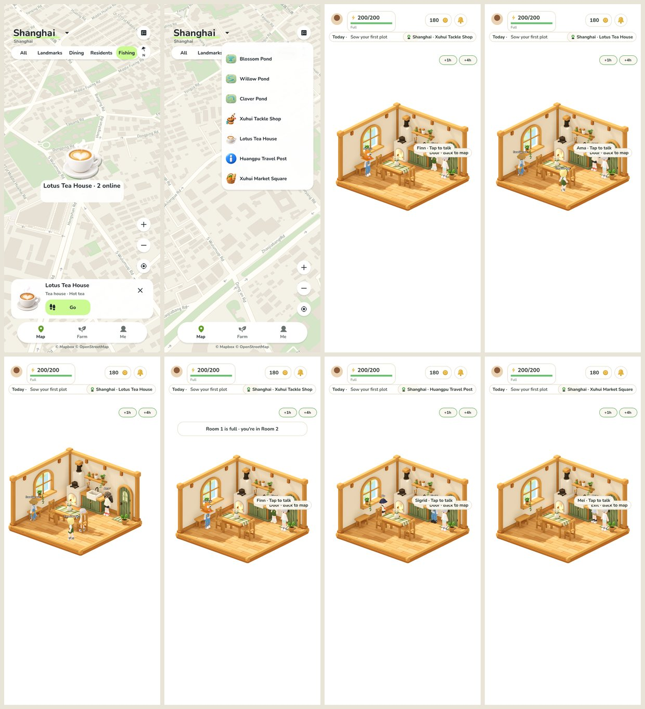
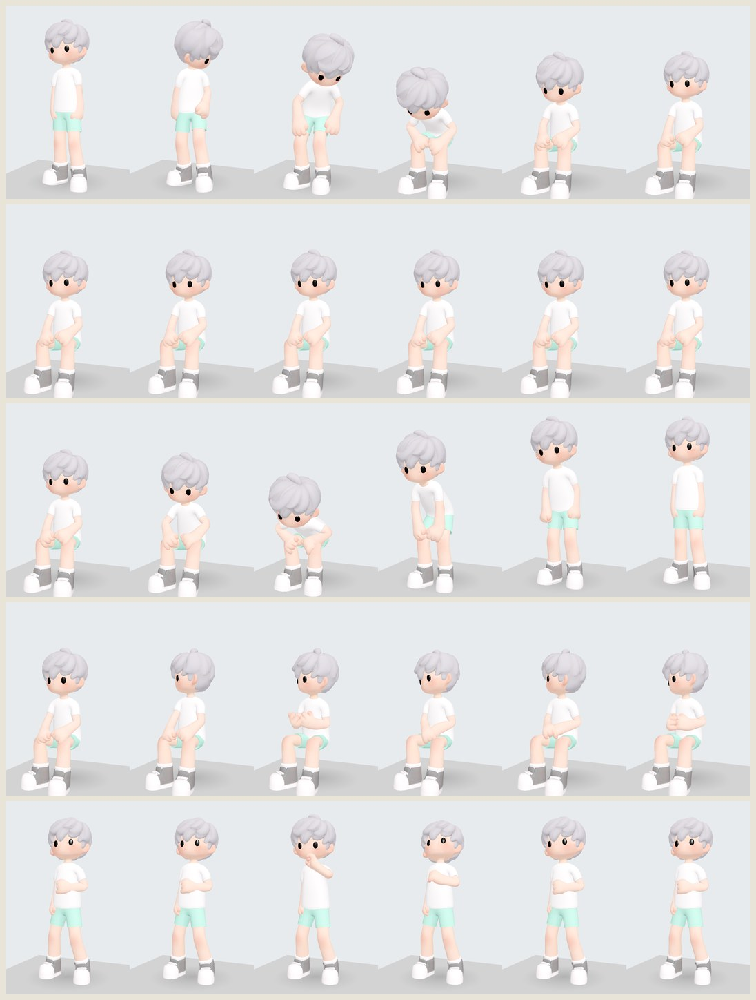
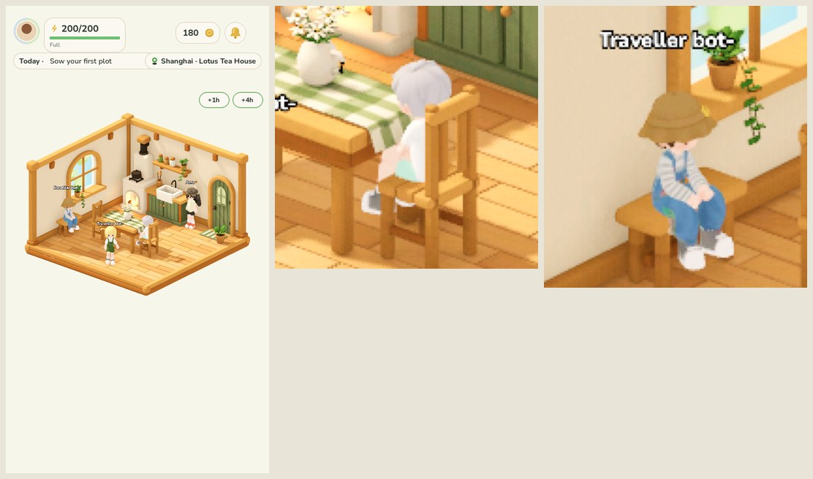

# P0 outpost rooms and realtime rooms — emulator walkthrough (SGODOT-227, 2026-10-08)

Scope: the four home-set outposts (Xuhui Tackle Shop, Lotus Tea House, Huangpu Travel Post, Xuhui
Market Square) on the indoor shell `P0Room` (SGODOT-226, PR #13), and their realtime rooms on the P0
playtest server (`/v1/p0/online`, `/v1/p0/presence`). All four use the Basic Room placeholder until
wp-3d-scene lands (SGODOT-208). This is an emulator check, not a physical-phone acceptance.

## Setup

- Isolated AVD `Houyi_P0` (emulator-5584, 2 GB), private ADB server on 5073 limited to that emulator,
  test package `com.sensen.p0proto.houyi`, worktree P0 server on 3197 with `adb reverse tcp:3110 tcp:3197`
  and its own state file. All of them were stopped after the run.
- Two scripted players in the tea house (one walking a loop, one seated on the bench) and twelve idle
  players filling Room 1 of the tackle shop, all over the same `/v1/p0/online` protocol.

Left to right, top row: tea house pin `Lotus Tea House · 2 online` with its card and `Go`; the place
list with the four outposts; Xuhui Tackle Shop (Finn at the counter, Old Kai by the window); Lotus Tea
House with the two other players. Bottom row: seated at the tea table (standing pose until the sit
clips land); entering the full tackle shop lands in Room 2 with `Room 1 is full · you're in Room 2`;
Huangpu Travel Post (Sigrid, Pip); Xuhui Market Square (`Exit · Back to map`).

## Checked

| Item | Result |
|---|---|
| Map: four outpost pins from `assets/p0/p0_outposts.json`, card `Go` opens the room above the map | Pass |
| Pin label `· N online` from `/v1/p0/presence` (all rooms together), refreshed on return from a room | Pass |
| Spawn at the door facing in; place chip `Shanghai · <outpost name>` | Pass (4/4) |
| Keeper and residents at their `npc_` anchors with name tags; finger card `<Name> · Tap to talk` | Pass |
| Tapping the keeper walks to `stand_counter`, then opens the keeper entry (tackle: existing greeting until SGODOT-224) | Pass |
| Other players visible and moving (OnlineCrowd, frame v1) | Pass |
| Tea table: walks to the nearest free seat, server holds it, joystick stands up | Pass |
| Room 2: 13th player of an indoor outpost; toast only on a fresh join to Room 2+ | Pass |
| Door: Back walks out to the map; market uses `Exit · Back to map` | Pass |

## Found and fixed during the run

1. Back while seated left the room at once (no path from inside the chair collider) and the router
   then popped an empty stack into the old map. The shell now always reports Back as handled
   (bc94dd96, SGODOT-226); outposts stand up before walking to the door (7fd59052).
2. The selected city-map name tag was measured at font 9 with an 18 px pad but renders at font 10 in
   4 + 4 px margins, so `Lotus Tea House · 2 online` got a two-line box (7fd59052).
3. The room connection read the default server URL when an outpost was the first world (dev boot):
   it now waits for the P0 session (a34a041b).

## Seats and sit clips (2026-10-08, later the same night)

The user's Mixamo takes (SGODOT-230) are in the library as `sit_down`, `sit_idle`, `sit_up`, `sit_talk`
(first 8 s) and `drink_stand`; all 46 bones map and the probe contact sheet shows correct arms, no foot
sliding and an in-place hip:

Measured on the base rig: `sit_idle` puts the hip joint 0.426 m above the rig root (standing 0.778 m), with
the thighs about 0.086 m below the joint. Basic Room seat surfaces are about 0.74 m (chairs) and 0.745 m
(window bench) in room coordinates, so the seated root sits 0.34 m below the `seat_` anchor (feet dangle on
these tall stylized seats). Sitting plays `sit_down` then loops `sit_idle` while the root eases onto the
seat (about 0.3 s); standing plays `sit_up` at 2x and releases the player after 0.55 s; Back while seated
stands up and then walks to the door. Other players on a seat are lifted onto it and play `sit_idle`.

Desktop render, Basic Room placeholder: player on the door-side chair, a scripted player on the bench.
Acceptance of the seated pose (hip contact within 2 cm, legs clear of the table, recording on the final
tea-house scene 179) belongs to the art director.

## Open

- Keeper and door finger cards overlap near the spawn (placeholder anchors near the door); marker
  avoidance comes with SGODOT-221's tag layer.
- Seated pose not yet accepted by the art director; sitting while drinking is not done (see SGODOT-227).
- Keeper / Pip / Old Kai outfits are provisional (Old Kai's `hairhat20` reads as an animal hood); the
  hairHat / cloth contact sheet goes to the art director first.
- Not covered here: physical phone (ask the user first), real network latency, more than one client
  device.
