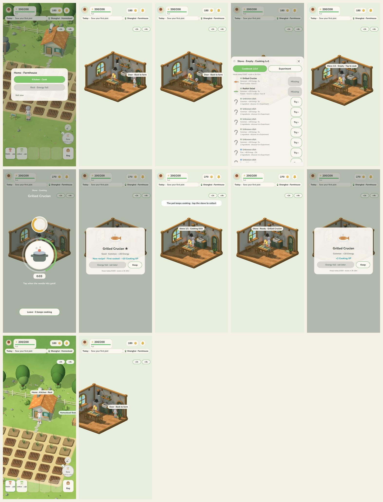

# P0 room shell and farmhouse: emulator walkthrough (SGODOT-226, 2026-10-08)

Branch `feat/p0-room-shell`. Development QA only: no release, no device update, no production data.

## Setup

- Isolated AVD `Nezha_P0` (emulator-5572, 2 GB RAM, 1280×2856), private ADB server 5071, package
  `com.sensen.p0proto.nezha` (export preset patched for the build only and restored).
- Private P0 server on port 3120 with its own state file (`adb reverse tcp:3110 tcp:3120`); the test player
  was given fish through the dev endpoints of that server only.
- The session ran through `tools/android/run_test.sh`; the emulator and server were shut down afterwards.

## Walkthrough

Left to right, top to bottom:

1. Farm: tap the farmhouse → door card (owned by SGODOT-224; its Kitchen row now enters the farmhouse).
2. Inside: place chip `Shanghai · Farmhouse`, door card `Door · Back to farm`, Bag only (the Bag end
   appears once SGODOT-221's `room` surface lands).
3. Walking in the room: the whole diorama stays framed (fix made during this walkthrough).
4. Tap the stove → the player walks to `stand_stove` and the interim cooking panel opens.
5. Panel closed: stove card `Stove 1/1 · Empty · Tap to cook`.
6. Cook → interim 2D pot (heat ring tapped by hand).
7. Result card: Good ★, first-cook XP.
8. Cook again, Back while the pot is up: the pot keeps cooking; card `Stove 1/1 · Cooking 0:03`.
9. Ready: `Stove · Ready · Grilled Crucian`.
10. Tap the stove → collect once (Plain, no heat taps after leaving); the server stove is empty afterwards.
11. Back from the room walks out of the door: the player stands on the farm doorstep, chip
    `Shanghai · Homestead`.
12. Walking into the doorway enters the farmhouse again. This frame predates fix 3 (the camera then
    still followed the player and cropped the room).

## Performance (emulator, not a device measurement)

Debug log `P0_PERF` (user://p0_perf) inside the farmhouse: 58–61 fps, 78 draw calls, about 78k primitives
(room + avatar). Basic Room still has no physical-GPU data; device testing needs the user's approval.

## Tests

`tests/p0` 47/47. Full suite: 1366 cases, 10 failures and 3 errors, the same pre-existing set as farm-dev
(map_candidates, map_relocation, farm_generation, farm_relocation, stress_hud_layout, app_theme,
design_tokens, touch_scroll_container).
